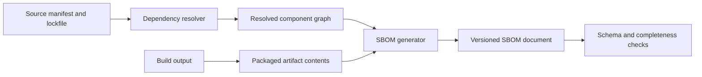
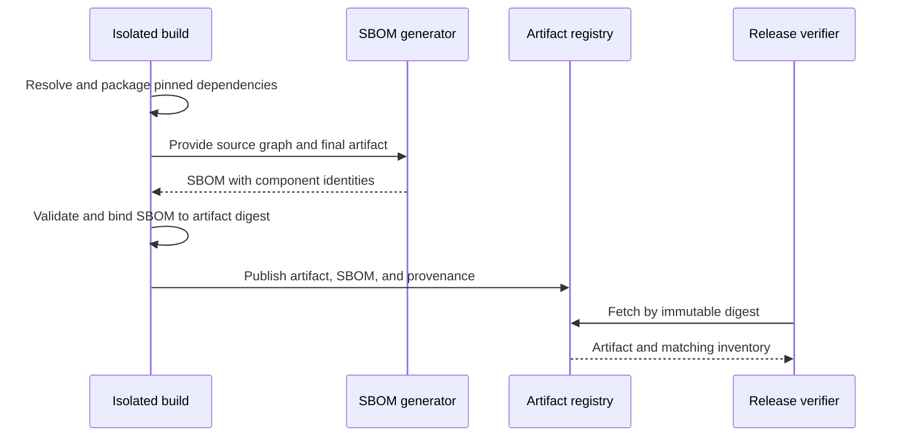
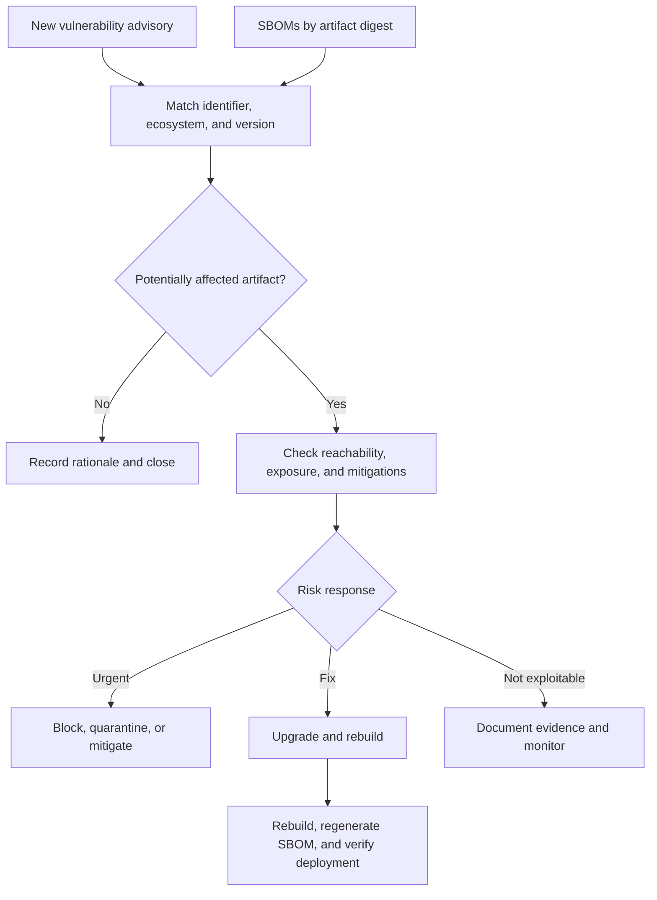
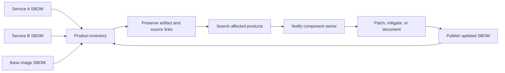
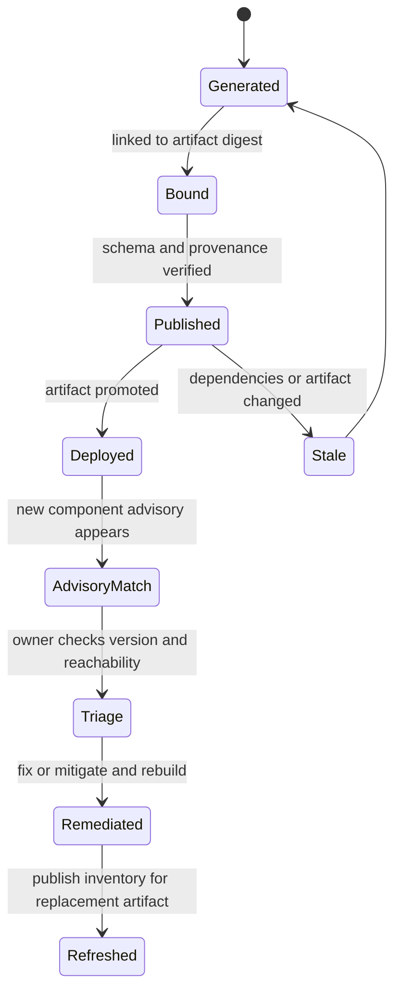

# SBOM (Software Bill of Materials)

Part: [15 — Security](PART_OVERVIEW.md)

A Software Bill of Materials (SBOM) is a machine-readable inventory of software components associated with a product or artifact. It can support vulnerability response, license review, provenance, and dependency analysis, but it is not a security verdict and may be incomplete or stale. [CH15 Supply Chain Security](CH15_Supply_Chain_Security.md) owns end-to-end integrity; Part 13 owns build pipeline integration.

## Component Identity and Formats

An SBOM should identify components and relationships with enough detail to match advisories and understand provenance. Useful fields include component name, version, supplier, package URL or other identifier, dependency relationships, hashes, and document metadata. Names alone are ambiguous; ecosystem-specific identifiers improve matching. Preserve direct and transitive dependencies and distinguish declared, resolved, and actually shipped components.

Common interchange formats include Software Package Data Exchange (SPDX) and CycloneDX. Choose based on ecosystem support and required fields. Validate format and completeness, and preserve the source and tool version used to generate the inventory. Different formats and tools may encode relationships differently, so downstream consumers need a normalization strategy.

## Generation and Artifact Binding

Generate an SBOM at a point where resolved inputs and final artifact contents are known. Source-level inventories may include components not shipped; image-level inventories may reveal OS packages and bundled libraries. For containers or multi-stage builds, distinguish builder-stage components from runtime contents. Record whether the inventory is source-, build-, or artifact-derived.

Bind the SBOM to an immutable artifact digest and provenance statement. A standalone document with no reliable relation to the deployed binary can mislead responders. Protect inventory integrity, record generation tool and timestamp, and retain it for at least as long as the artifact may be deployed or investigated.

## Vulnerability Matching and Prioritization

Matching an advisory to a component requires accurate identity, version ranges, ecosystem, and sometimes distribution-specific backports. A match is a lead for triage, not proof of exploitability. Consider whether the vulnerable code is present, reachable, enabled, exposed, and mitigated. Prioritize by impact and deployment context; do not report every name match as a confirmed vulnerability.

Keep advisory data freshness visible. Component inventory without current vulnerability data cannot identify newly disclosed exposure. Conversely, scanning alone cannot establish that a vulnerable function is reachable in the product. Assign triage owner and remediation deadline based on risk.

## Freshness, Merging, and Operations

SBOMs become stale when dependencies, build tools, base images, or generated artifacts change. Regenerate on each release and preserve per-version history. A merged product SBOM may combine services, plugins, and runtime layers, but must retain provenance and ownership for each component. Deduplication should not erase which artifact or service contains a component.

Restrict access to inventories where they reveal internal components or versions. Establish APIs and formats for suppliers to provide SBOMs, then validate them rather than accepting claims unchecked. Measure coverage: percentage of release artifacts with valid inventory, time to identify affected deployed artifacts, and age of current inventory.

## Worked Case and Review Checklist

A critical library vulnerability is announced. The product security team queries SBOMs by component identifier and version, maps matches to immutable artifact digests, then finds which services and environments deploy them. Owners check whether the vulnerable code path is reachable. Affected services rebuild with a fixed dependency, generate new image-level SBOMs, and publish attestations. Old artifacts are blocked from new deployment while incident response evaluates existing instances.

Review component identifiers, transitive dependencies, artifact binding, generation source, format validation, tool version, freshness, merge semantics, vulnerability data, reachability assessment, access, retention, and deployment queryability. Confirm missing or invalid SBOMs are visible as coverage gaps rather than treated as clean.

## Questions and Summary

1. Compare source-, build-, and artifact-level SBOMs for a multi-stage container.
2. Why is a component name without ecosystem and version insufficient for reliable matching?
3. Trace an advisory to deployed digests and define the evidence needed before calling a match exploitable.
4. How should a product-level SBOM preserve ownership and provenance when merging service inventories?
5. Design an operational metric for SBOM coverage and freshness.

An SBOM is an inventory and query interface into software composition, not a pass/fail security certificate. Generate it from resolved inputs and shipped artifacts, bind it to an immutable digest, keep it fresh, and use advisory matches as the start of contextual triage. Part 15 supply chain security defines the integrity and response controls around that inventory.
