# SBOM (Software Bill of Materials)

Part: [15 — Security](PART_OVERVIEW.md) · Status: Revised (in-depth rewrite)

## 1. Introduction

A Software Bill of Materials (SBOM) is a machine-readable inventory of the components that make up a piece of software, together with the relationships between them. The idea comes from manufacturing: a physical product ships with a parts list so that when a supplier announces a defective part, the manufacturer can find every product that contains it. Software has the same problem at a much larger scale. A typical service pulls in hundreds of libraries directly and transitively, sits on a base image with hundreds more operating system packages, and may embed copies of code that no package manager ever recorded. When a new vulnerability is published against one library, the first operational question is "where do we run it?", and without an inventory the answer comes from grep, memory, and luck.

An SBOM is evidence about composition. It records what a generator believed was in an artifact at the moment it ran. It does not say whether any component is vulnerable, whether a vulnerable function is reachable, or whether the artifact was built honestly. Those are separate questions, answered by vulnerability data, exploitability analysis, and provenance. Keeping that boundary clear prevents the two most common failures: treating a clean scan of an SBOM as a security certificate, and treating an SBOM that is missing components as if it were complete.

After this chapter you will be able to:

- Describe what an SBOM contains (documents, components, relationships, identifiers, hashes) and what it cannot tell you.
- Explain how identifiers such as package URL (purl) and Common Platform Enumeration (CPE) work, and why mismatches between them produce both missed vulnerabilities and false alarms.
- Compare the SPDX (Software Package Data Exchange) and CycloneDX formats at the level of structure and typical use, and read a small fragment of each.
- Compare source, build, and image or binary analysis as generation approaches, and predict where each over-reports or under-reports.
- Explain how a generator discovers components and builds a dependency graph, and which constructs (vendored code, static linking, shaded archives) it commonly misses.

Ownership across the handbook:

| Topic | Owner |
|---|---|
| SBOM concepts, formats, generation approaches, identifiers, Vulnerability Exploitability eXchange (VEX) mechanism, vulnerability matching, distribution and consumption, regulatory context | This chapter |
| Provenance, attestations, signing, verification, registry and admission policy | [CH15 Supply Chain Security](CH15_Supply_Chain_Security.md) |
| Image hardening, runtime isolation, image scanning at the node and registry | [CH14 Container Security](CH14_Container_Security.md) |
| Secure build and review practices, dependency policy in the development lifecycle | [CH13 Secure SDLC](CH13_Secure_SDLC.md) |

This chapter repeats provenance and signing only far enough to explain how an SBOM is bound to an artifact. The first half of the chapter covers the inventory itself (model, identity, formats, generation). The later sections cover how an inventory is used: matching, exploitability statements, distribution, and operations.

## 2. The Inventory Model

### 2.1 Documents, components, and relationships

Every SBOM format reduces to three kinds of thing. A document carries metadata about the inventory itself: who or what generated it, when, with which tool and version, and which subject (product or artifact) it describes. A component is one item in the inventory: a library, an operating system package, a file, a container image layer, or a firmware blob. A relationship connects two entities: "A depends on B", "A contains B", "this image was built from that source". The relationships turn a flat list into a graph, and the graph is what lets a responder answer "which of my products reach the vulnerable library, and through which path?"

The United States National Telecommunications and Information Administration (NTIA) published a widely cited baseline of "minimum elements" in 2021: supplier name, component name, version, other unique identifiers, dependency relationship, author of the SBOM data, and timestamp. Treat that list as a floor for interoperability, not a quality target. Verify the current wording at the NTIA and Cybersecurity and Infrastructure Security Agency (CISA) sites before citing it, because guidance on minimum elements has been revised over time.

### 2.2 Direct, transitive, and the three versions of "the dependencies"

A direct dependency is one the developer names in a manifest. A transitive dependency is pulled in because something the developer named requires it. Most of the components in a modern application are transitive, which is why developers rarely know the real inventory. Three different lists are easy to confuse:

- Declared: what the manifest asks for, often as version ranges such as "any 4.x".
- Resolved: what the dependency resolver chose at a particular time, as recorded in a lockfile.
- Shipped: what ends up in the artifact that runs in production.

These lists differ. Declared ranges resolve to different versions on different days unless a lockfile pins them. Resolved lists include development and test tools that never ship. Shipped artifacts include things no manifest lists: operating system packages from the base image, runtimes, and code copied into the repository. An SBOM that states which of the three it describes is useful. One that does not will mislead whoever consumes it.

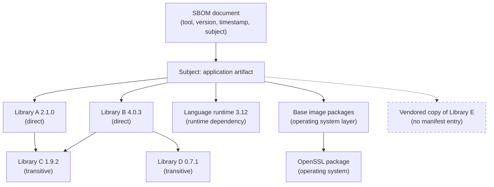

The diagram shows one subject and its relationships. Library C is reached by two paths, so a fix may require upgrading either A, B, or both, and a graph preserves that fact where a flat list loses it. The operating system layer and the runtime appear as peers of the libraries, because a vulnerability in OpenSSL matters as much as one in a library the developer chose. The dashed node is vendored code: source copied into the repository. Package-manager-based tools cannot see it because no manifest names it, so it appears only if a generator inspects files or the team records it by hand. Section 6 returns to why that omission is common.

### 2.3 What an SBOM cannot say

An SBOM does not say that a listed component is exploitable, that an unlisted component is safe, or that the inventory is correct. Two properties follow. First, an SBOM is a claim made by a tool, and its accuracy depends on the generation approach (section 5). Second, it describes a moment: dependencies, base images, and the build environment change, so an inventory without a timestamp and subject binding drifts out of truth silently. Both limits shape how the later sections on matching, distribution, and freshness are designed.

## 3. Component Identity

### 3.1 Why names are not enough

Vulnerability matching is a join between two datasets: the components in an SBOM and the products named in an advisory. A join needs a key. Plain names fail as keys. The same name can exist in several ecosystems (a Python package and a JavaScript package can share one), a vendor can rename a product, and distributions repackage upstream software under their own names and version strings. A usable identifier must state the ecosystem, the name within it, and the exact version, in a form a program can parse without guessing.

Two identifier schemes dominate, and they come from different worlds.

### 3.2 Package URL (purl)

A package URL (purl) is a compact string that identifies a package by its ecosystem rather than by who published an advisory. The general shape is:

```text
pkg:<type>/<namespace>/<name>@<version>?<qualifiers>#<subpath>
```

The type names the package ecosystem (for example `maven`, `npm`, `pypi`, `deb`, `golang`). The namespace is the grouping the ecosystem uses (a Maven group identifier, an npm scope, a Debian distribution). Qualifiers carry extra detail such as CPU architecture or distribution release. The following examples are illustrative in form; check the purl specification for the exact encoding rules per type:

```text
pkg:maven/org.apache.logging.log4j/log4j-core@2.17.1
pkg:npm/%40angular/core@17.0.0
pkg:pypi/requests@2.31.0
pkg:deb/debian/openssl@3.0.11-1~deb12u2?arch=amd64
```

The `%40` in the npm example is a percent-encoded `@`, needed because the version separator is also `@`. Encoding mistakes are a common source of identifiers that look right to a human and fail to match in a database.

A purl is constructed from facts the generator already holds (the package manager that resolved the component, the name, the version), so it is precise. Its weakness is coverage and normalization. Some ecosystems normalize names (for example Python treats case and some separators as equivalent), so a generator that does not apply the ecosystem's rule emits an identifier that differs from the one in an advisory database. Components that no package manager manages (a copied source file, a vendored library, a firmware blob) have no purl unless someone assigns one.

### 3.3 Common Platform Enumeration (CPE)

A Common Platform Enumeration (CPE) is a naming scheme maintained in the United States National Vulnerability Database (NVD), where it is used to state which products a Common Vulnerabilities and Exposures (CVE) record affects. The current 2.3 string form has a fixed set of colon-separated fields, roughly vendor, product, version, and several qualifiers, with `*` for "any" and `-` for "not applicable":

```text
cpe:2.3:a:apache:log4j:2.14.1:*:*:*:*:*:*:*
```

CPE is defined from the advisory side: NVD analysts assign vendor and product strings to a CVE. A generator working from a package manager does not know those strings and has to guess them, usually by taking names from package metadata. Several failure modes follow from that:

- Vendor mismatch. The package's publisher string differs from the vendor string in the CPE dictionary, so a correct component never matches.
- Product mismatch. A library is shipped under a different name by a distribution or a wrapper project, so its CPE does not match the advisory's.
- Over-broad match. A product name is shared by unrelated projects, so a component matches an advisory for software it is not.
- Version expression differences. Advisories express affected versions as ranges, and a distribution backport changes the effective code without changing the upstream version number the CPE refers to.

At the time of writing, NVD has described changes to how it processes and enriches records, and some feeds now carry other identifier types. Check the current NVD documentation and the data source you consume before building a matching design that depends on CPE completeness.

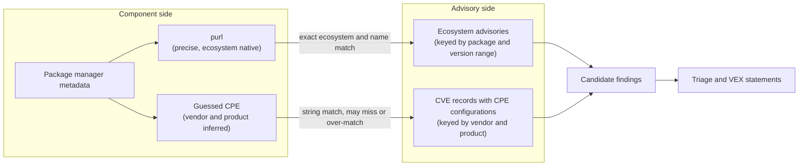

The diagram shows two matching paths. The purl path joins on identifiers the generator produced itself, against advisories that are keyed by package and version range, so precision is high for ecosystems with good advisory coverage. The CPE path joins on strings that someone had to infer, against a database keyed by an analyst's naming, so it produces both false negatives (an unrecognized vendor string) and false positives (an over-broad product string). In practice matchers combine both paths and deduplicate. The cost of that combination is that a finding's confidence differs by path, and a consumer who loses that detail cannot tell a precise hit from a guess. Preserve the match source in whatever tooling reports the finding.

### 3.4 Hashes and other evidence

A cryptographic hash of the component file is the strongest identity the document can carry, because it identifies the exact bytes rather than a name and version. Hashes help in two ways. They confirm that the artifact a consumer holds is the one the inventory describes, and they let a matcher identify a component whose metadata was stripped (for example a renamed archive). Hashes do not help matching against advisories directly, because advisories are not keyed by hash. They are most useful for integrity and for recognizing known files. Suppliers, licenses, and download locations round out the identity. Each is a field the generator may leave empty, and consumers should treat a missing value as unknown rather than as "none".

## 4. Formats: SPDX and CycloneDX

### 4.1 Two formats with different origins

Two formats carry most SBOM exchange. SPDX (Software Package Data Exchange) grew out of license compliance work under the Linux Foundation and models packages, files, snippets, and the relationships among them. CycloneDX grew out of the Open Worldwide Application Security Project (OWASP) community with a security and supply chain focus, and models components, services, dependencies, and related security artifacts in one document family. Both have been submitted to formal standards bodies at various versions; verify the current standard designations and versions on the official sites ([SPDX](https://spdx.dev/) and [CycloneDX](https://cyclonedx.org/)) rather than relying on a number remembered from a presentation.

Both can be serialized as JSON (JavaScript Object Notation), and each also supports other encodings (for example XML (Extensible Markup Language), and tag-value for SPDX). The choice rarely rests on one format being more capable in general. It rests on four practical questions:

1. What do your consumers accept? A customer, regulator, or tool that requires one format decides for you.
2. What does your tool chain emit natively? Converting between formats can drop information, because the models do not map one-to-one.
3. Which fields do you need? License-heavy compliance needs lean on SPDX's file-level and license-expression machinery. Security workflows that carry vulnerability and exploitability data alongside components often favor CycloneDX.
4. How will you validate? Both publish schemas, so a pipeline can reject malformed documents.

When requirements do not decide, pick one as the internal canonical format, emit the second only when a consumer needs it, and avoid round-tripping through both.

### 4.2 A CycloneDX-style fragment

The fragment below is a trimmed illustration of the shape. Field names and required properties differ between specification versions (the `tools` property in particular has changed shape across releases), so check the current CycloneDX schema before copying it.

```json
{
  "bomFormat": "CycloneDX",
  "specVersion": "1.5",
  "serialNumber": "urn:uuid:3e671687-395b-41f5-a30f-a58921a69b79",
  "version": 1,
  "metadata": {
    "timestamp": "2026-11-05T09:30:00Z",
    "component": { "type": "application", "name": "orders-service", "version": "4.2.0" }
  },
  "components": [
    {
      "type": "library",
      "bom-ref": "pkg:maven/org.apache.logging.log4j/log4j-core@2.17.1",
      "name": "log4j-core",
      "version": "2.17.1",
      "purl": "pkg:maven/org.apache.logging.log4j/log4j-core@2.17.1",
      "hashes": [ { "alg": "SHA-256", "content": "<hex digest>" } ]
    }
  ],
  "dependencies": [
    {
      "ref": "pkg:maven/org.apache.logging.log4j/log4j-core@2.17.1",
      "dependsOn": []
    }
  ]
}
```

Notice that the relationship graph lives in a separate `dependencies` array that refers to components by `bom-ref`. A tool that lists components but emits no `dependencies` entries produces a valid document with no graph, which makes transitive analysis impossible. Validation against the schema will not catch that, so a completeness check must.

### 4.3 An SPDX-style fragment

SPDX 2.x JSON uses flat arrays of packages and relationships, with identifiers of the form `SPDXRef-...`. The version 3 series of SPDX introduces a different, graph-oriented model, so treat the fragment below as the 2.x shape and verify against the version you target.

```json
{
  "spdxVersion": "SPDX-2.3",
  "dataLicense": "CC0-1.0",
  "SPDXID": "SPDXRef-DOCUMENT",
  "name": "orders-service-4.2.0",
  "documentNamespace": "https://example.com/spdx/orders-service-4.2.0-<unique-id>",
  "creationInfo": {
    "created": "2026-11-05T09:30:00Z",
    "creators": ["Tool: example-generator-1.8.0"]
  },
  "packages": [
    {
      "SPDXID": "SPDXRef-log4j-core",
      "name": "log4j-core",
      "versionInfo": "2.17.1",
      "downloadLocation": "NOASSERTION",
      "filesAnalyzed": false,
      "externalRefs": [
        {
          "referenceCategory": "PACKAGE-MANAGER",
          "referenceType": "purl",
          "referenceLocator": "pkg:maven/org.apache.logging.log4j/log4j-core@2.17.1"
        }
      ]
    }
  ],
  "relationships": [
    {
      "spdxElementId": "SPDXRef-DOCUMENT",
      "relationshipType": "DESCRIBES",
      "relatedSpdxElement": "SPDXRef-log4j-core"
    }
  ]
}
```

Two details deserve attention. The value `NOASSERTION` is the format's way of saying the generator makes no claim, which is honest and different from an empty value. A consumer should count `NOASSERTION` fields as a coverage signal. The `externalRefs` entry shows how the same purl identifier is attached to the package, so both formats can carry the same identity even though they organize everything else differently.

### 4.4 Normalization on the consuming side

A consumer that receives SBOMs from several suppliers in both formats needs a normalization step: parse each document, map components to a common internal record (identifier, version, supplier, hashes, relationships, source document), and keep a link back to the original. Mapping is lossy in places. For example, a CycloneDX component type has no exact counterpart in every SPDX construct. Keep the original document so a finding can always be traced to what the supplier actually stated, and record which fields were absent so a later analysis does not mistake "not provided" for "not present".

## 5. Generation Approaches and Their Accuracy

### 5.1 Three vantage points

An SBOM is generated by looking at something, and what the generator looks at determines what it can see. There are three common vantage points, and they correspond to stages of the delivery path.

Source analysis reads manifests and lockfiles in the repository (for example `package-lock.json`, `pom.xml`, `go.sum`, `requirements.txt`) and records the declared or resolved dependency graph. It runs early, needs no build, and is cheap. It sees the intent of the developer. It cannot see what the build actually packaged, which operating system packages the image adds, or anything that bypasses the package manager.

Build analysis hooks into the build itself. A build plugin or a wrapper around the build tool records which dependencies were resolved and which were actually used to produce the output, including build-time-only tools that it can label as such. It sees the resolved graph with high fidelity, including version selection that the resolver performed. It knows the build system, so it is only as good as the plugin for that ecosystem, and it covers only what the build tool handles.

Image and binary analysis inspects the finished artifact: it unpacks container image layers and reads the package databases of the operating system (for example the dpkg or rpm databases), scans language-specific metadata found in the filesystem, and may fingerprint binaries and archives by hash or by embedded strings. It sees what will run. It sees no source relationships (it cannot always tell a direct dependency from a transitive one), and it infers identities from whatever metadata survived packaging.

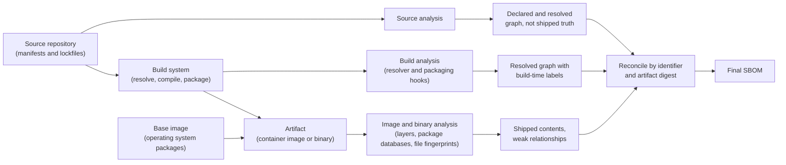

The diagram shows three inventories converging. The distinction that matters is where each branch gets its data relative to the artifact: the source branch never touches the artifact, the build branch watches it being made, and the image branch examines the result. Reconciling them, by identifier and by the digest of the artifact, gives an inventory that has both the relationships from the build and the completeness of the final contents. Many teams cannot afford three tools and choose one primary approach. The rule of thumb is to generate as close to the artifact as the tooling allows, and to add the earlier vantage point when relationships matter.

### 5.2 Accuracy differences, with a worked example

Accuracy has two parts. Precision measures how many listed components are really present: precision is true positives divided by everything listed. Recall measures how many truly present components were listed: recall is true positives divided by everything that is present. A source SBOM tends to have low precision (it lists items that do not ship) and low recall (it misses the base image). An image SBOM tends to have high precision and high recall for what the package managers recorded, and misses what was never recorded.

The numbers below are illustrative, not measurements of any tool.

Suppose a service's lockfile lists 412 application packages. A review of the final image finds:

- 290 of those 412 are in the image. The other 122 are test and build tools that are not shipped.
- The image also holds 180 operating system packages from the base image.
- The true shipped inventory therefore has 290 + 180 = 470 components.

A source-only SBOM lists 412 components, of which 290 are really shipped. Then:

- Precision = 290 / 412 = 0.704, so about 30% of its entries (122 of 412) are not in the artifact.
- Recall = 290 / 470 = 0.617, so about 38% of the shipped components (180 of 470) are absent from it, all of them operating system packages.

An image-based SBOM finds all 180 operating system packages and 280 of the 290 application packages. It misses 10 libraries that were repackaged into one archive with their metadata removed. It also mislabels 6 entries through a faulty name inference. It lists 180 + 280 + 6 = 466 components, of which 180 + 280 = 460 are correct. Then:

- Precision = 460 / 466 = 0.987.
- Recall = 460 / 470 = 0.979.

The 122 extra entries in the source SBOM are not harmless. Each is a candidate for vulnerability matching, so the downstream cost is triage effort on code that never runs in production. The 180 missing operating system packages are worse: they are real exposure that no query against that SBOM can find. The image-based inventory is better here, but its 10 misses and 6 errors carry their own consequences, and the 10 misses are exactly the class the next section examines.

### 5.3 Multi-stage builds and what "the artifact" means

A multi-stage container build compiles in one image and copies only the output into a smaller runtime image. A generator pointed at the build stage inventories compilers and build tools that never reach production. One pointed at the final image sees only the runtime contents, and loses the build-stage dependencies that influenced the output. Record which stage the SBOM describes, and for a statically compiled program (such as a Go binary), look for tools that can read the module information embedded in the binary, since the final image may contain nothing but one file and a minimal filesystem. [CH14 Container Security](CH14_Container_Security.md) covers how to shrink the runtime image, which also shrinks what the inventory must describe.

### 5.4 Choosing, and the attacker's view

Choose by the question the SBOM must answer. For "which deployed artifacts contain library X?", the artifact-level view is the one that answers it. For "which direct dependency should we upgrade to remove library X?", the build or source graph is the one that has the paths. Most organizations need both, linked through the artifact digest.

An attacker reading this chapter sees the weak points. Generators trust package metadata, so a malicious package that falsifies its name or version can appear in the inventory as something harmless. A component that is deliberately outside any package manager (a downloaded binary fetched at start-up) is not in an image analysis done at build time. An inventory that is generated from the repository rather than from the artifact can be accurate and still describe something other than what was deployed. Binding the inventory to the artifact digest and signing it is the integrity answer, taught in [CH15 Supply Chain Security](CH15_Supply_Chain_Security.md).

## 6. How Generators Discover Components and Build the Graph

### 6.1 Discovery mechanisms

A generator has no special knowledge of what software contains. It runs a set of cataloguers, each of which recognizes one kind of evidence and turns it into component records. Understanding the evidence explains both what is found and what is not.

- Manifests and lockfiles. A parser reads `package-lock.json`, `Pipfile.lock`, `go.mod`, a Maven dependency tree, or similar. A lockfile gives exact versions and usually the parent-child edges, so it yields the best graph. A manifest with version ranges gives only what was requested.
- Package manager databases. In an image, the operating system records installed packages in a database (dpkg status files, the rpm database, the apk installed list). Reading it gives exact names, versions, architectures, and sometimes file ownership, which links files to packages.
- Language metadata in the filesystem. Installed Python packages carry metadata directories, Java archives carry manifest files, Node modules carry their own `package.json`. A cataloguer walks the filesystem and reads these.
- File and archive fingerprints. Where metadata is missing, a tool may hash files or inspect embedded strings and compare against a database of known components. This is probabilistic: it can recognize a known library even when renamed, and it can also guess wrongly.
- Binary inspection. Some language toolchains embed dependency information into the executable (Go records module versions in binaries built in module mode). A cataloguer can read that. Native code compiled from C with statically linked libraries typically carries no such record.

Each cataloguer produces records with a confidence that depends on the evidence, and a good generator keeps that confidence (or at least the evidence type) in the output so a consumer can weigh a match.

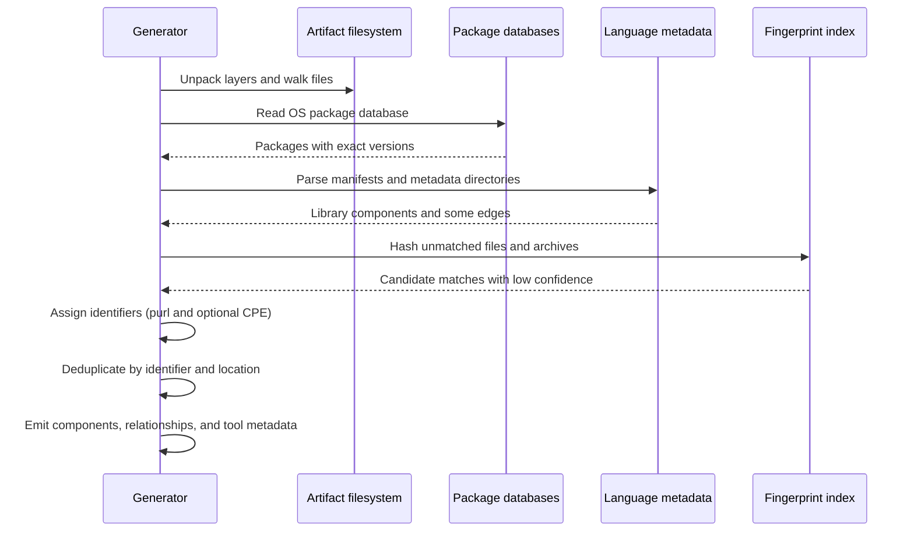

The sequence shows that the generator decides each component's identity only after collecting evidence from several sources, and that deduplication is a decision, not a bookkeeping step. The same library can appear as an operating system package and as a copy inside an application directory, and merging the two by name would lose the fact that two different copies, at possibly different versions, are on disk. Good generators deduplicate by identifier and location together, so one vulnerable copy is not hidden behind a patched one.

### 6.2 Representing the dependency graph

A graph needs nodes, edges, and a root. Nodes are the components. Edges say "depends on" (requires at runtime), and some formats also distinguish "dev dependency", "optional", or "build" relationships through separate fields or relationship types. The root is the subject of the SBOM, the artifact the document describes. Edges are only as precise as the source. A lockfile states the parent-child structure. An image scan of an installed filesystem usually cannot, because installed packages are flattened onto disk. So an image-derived SBOM frequently has components attached directly to the root with no intermediate edges, which means a question like "does the application reach this library through a library I could upgrade?" cannot be answered from it.

Two points make graph handling harder than it looks. First, the same component at the same version may be reachable by several paths, so the structure is a directed acyclic graph in the usual case and the inventory should store it once with several incoming edges, not as repeated copies. Second, different versions of the same library can coexist in one artifact: a language that resolves per subtree (the Node package ecosystem, in many configurations) can install two versions side by side. Both are real components and both need matching. A flat "library X version" lookup that keeps only one will under-report.

### 6.3 What generators commonly miss

The following are patterns, not statistics, and each is a reason that a complete-looking SBOM may be incomplete.

- Vendored code. Source copied into the repository, often to patch it or avoid a network fetch, has no manifest entry. A file-fingerprint cataloguer may identify well-known libraries. Internal copies with local modifications will not match any known fingerprint, and the identity is lost.
- Static linking. A C or C++ program that links libraries statically contains their code in one binary with no database record. Version strings embedded in the binary may exist, and a binary analyzer can try to read them, but this is heuristic.
- Shaded or repackaged archives. Java builds often merge dependencies into a single archive and rename packages, which removes the metadata a cataloguer reads. This is the kind of miss described in the worked example of section 5.2.
- Downloaded at run time. Software that fetches plugins or binaries at start-up has contents that do not exist at build time.
- Language runtimes and system tools copied in by hand rather than installed through a package manager.
- Embedded firmware or machine learning model files, which carry components no package manager tracks.

The failure is silent. A scan of an SBOM with missing components reports fewer findings, and fewer findings read as better health. This is the central reason the later sections on distribution and operations insist that missing coverage be visible rather than treated as a clean result.

### 6.4 Completeness checks a pipeline can run

Because schema validation cannot detect missing components, a pipeline needs additional checks that cost little:

1. Graph check. Every component other than the root has at least one incoming relationship, or is explicitly labelled as unattached.
2. Identifier check. Each component has a purl, or the pipeline records why it does not. A rising count of components without identifiers is a leading signal of missing coverage.
3. Cross-check against a second source. Compare the SBOM with an independent count, such as the package manager's own listing in the image or the lockfile entry count. A large gap between the two warrants review.
4. Tool and version recorded. If the generator or its vulnerability data is updated, previously generated documents may need regenerating, and the tool field tells you which ones.

These checks do not prove completeness. They make the common gaps visible, and that is the realistic goal. The next step in the lifecycle, after an inventory exists, is to bind it to the artifact, match it against vulnerability data, and decide what each match means for the deployed system. Those steps are developed in the sections that follow.

## 7. Binding an SBOM to the Exact Artifact

### 7.1 Why a name and tag are not a binding

An inventory is only useful if a responder can say which deployed thing it describes. A release name such as `orders-service:4.2.0` is a label, and labels move. In a container registry a tag can be re-pointed to different content after the SBOM was produced, so an SBOM keyed by tag can silently describe an artifact that is no longer the one running. The stable key is the content digest: a cryptographic hash of the artifact's manifest (for container images) or of the file (for binaries and archives). Two artifacts with the same digest are byte-identical for the purposes of the hash, so an inventory attached to a digest describes exactly that content.

Three properties make the binding work:

1. The subject of the SBOM names the digest, not only a name and version. In CycloneDX the `metadata.component` can carry a `hashes` entry, and in SPDX the described package can carry a checksum. Registry-based attachment (next section) adds the digest as the lookup key.
2. The generator runs against the artifact that will be released, or against a build output that is later proven identical to it. An SBOM generated from a rebuild is a claim about the rebuild.
3. Deployment records the digest it ran. If the cluster or the deployment tool records only the tag, the join from "running workload" to "SBOM" needs a registry lookup that is time-dependent, and that lookup can be wrong.

### 7.2 Attaching and signing the SBOM

Three storage patterns exist, and a team commonly uses more than one:

- Beside the artifact in the registry. Registries that implement the Open Container Initiative (OCI) distribution specification can store additional objects that reference an image by digest, so the SBOM is found through the image. The mechanism for listing objects that refer to a digest (the referrers capability) was added in later versions of the specification, and registry support varies, so verify what your registry supports before designing around it. Tools such as ORAS and Cosign can push and fetch such objects.
- Embedded in the artifact. A file inside the image (or inside a release archive) travels with the artifact and cannot be separated by mistake. The cost is that its digest is part of the artifact, so the SBOM cannot describe the final digest of the image that contains it, only the contents before it was added. Teams that embed an SBOM accept that limitation or generate a second, detached one.
- In an inventory service. A central database ingests the document keyed by digest. This serves queries during incident response and does not by itself provide integrity.

Integrity comes from signing. An SBOM can be wrapped as an attestation: a signed statement whose subject is the artifact digest and whose predicate is the SBOM. Signing proves that a particular identity vouched for the document and that it was not altered after signing. It does not prove that the content is correct. The mechanics of signatures, attestation envelopes, transparency logs, and verification policy belong to [CH15 Supply Chain Security](CH15_Supply_Chain_Security.md). The only rule this chapter adds is that the SBOM attestation and the provenance attestation for one artifact should name the same digest, so a verifier can check that they describe one object.

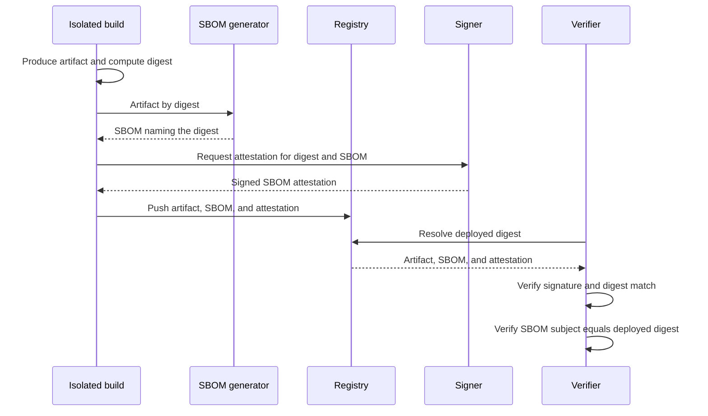

The sequence places generation after the digest exists and signing after generation, so the SBOM is produced from the real output. The verifier performs two separate checks: signature validity, and equality between the SBOM's subject and the digest that is actually deployed. Skipping the second check lets a validly signed SBOM for one build be presented with a different artifact. The implication for operations is that the deployment record must hold digests, and that an artifact with no verifiable SBOM is a coverage gap to report, not a clean result.

### 7.3 Records to keep with the binding

Keep, with each SBOM: the generator name and version, the vulnerability data it was matched against if matching ran at generation time, the generation vantage point (source, build, or image, as described in section 5), the build identity, and a timestamp. Retain the SBOM for as long as the artifact could be running or could be the subject of an investigation, which is usually longer than the artifact's time in production.

## 8. Vulnerability Matching Mechanics

### 8.1 The join and its inputs

Matching joins two datasets: the components in an SBOM, and advisory records that state which products and versions are affected. The inputs are a component identity (purl, sometimes a guessed CPE), a version, and an advisory with an affected-version expression. The output is a list of candidate findings. A candidate is a lead for triage and carries no proof that the product is exploitable.

Advisory sources fall into two groups. Ecosystem-keyed databases (for example the Open Source Vulnerabilities (OSV) format, and the advisory databases of package registries and Linux distributions) state affected ranges against a package in an ecosystem, which fits purl. The National Vulnerability Database (NVD) describes affected products with CPE configurations, which fits a vendor and product string. Section 3 explained why the second path is less precise. Distribution security trackers add a third layer of information: whether the distribution has shipped a fixed build of a package whose upstream version number looks vulnerable.

### 8.2 Version-range logic

An advisory rarely lists versions one by one. It states ranges: introduced at some version, fixed at some later version, sometimes with several disjoint ranges for several release branches. Matching evaluates whether the component's version falls inside any range. Three details cause errors:

- Version ordering is ecosystem-specific. Debian, RPM, Maven, npm (semantic versioning), and Python each define comparison rules, including how pre-release tags and epochs sort. Comparing `1.10` and `1.9` as strings gives the wrong answer, and applying semantic-versioning rules to a Debian version string does too. A matcher must use the comparison rules of the component's own ecosystem.
- Fixed in a branch. A fix may exist at `2.17.1` on one release line and `2.12.4` on another. A component at `2.13.0` is not fixed merely because a larger number exists elsewhere.
- Backports. A distribution can patch an old upstream version and keep the upstream number, adding its own suffix. An upstream-based match reports a vulnerability that the distribution has already fixed. A matcher that reads the distribution's tracker avoids that false positive, and a matcher that does not will report it every time.

A range check in outline looks like this (language-neutral pseudocode, with the ecosystem comparator as the key parameter):

```text
for each component c with purl p and version v:
    for each advisory a that lists package(p.type, p.namespace, p.name):
        if any range r in a.ranges satisfies:
               compare_ecosystem(p.type, v, r.introduced) >= 0
           and (r.fixed is absent or compare_ecosystem(p.type, v, r.fixed) < 0):
            emit finding(c, a, source = "purl")
```

### 8.3 False positives and false negatives with numbers

A false positive is a finding for a component that is not actually affected. A false negative is a real exposure the matcher did not report. Precision is true positives divided by reported findings. Recall is true positives divided by all real exposures. The figures below are illustrative arithmetic for one imagined release, not measurements of a tool.

Suppose a scan of one service image reports 200 findings. After review, 120 are real (the component and version are present and inside the affected range) and 80 are not (name collisions, backported fixes, test-only components, and an over-broad CPE). Separately, suppose that a later, deeper review finds 30 real exposures the scan never reported, for example vendored copies and a shaded archive with stripped metadata.

- Real exposures: 120 reported plus 30 missed = 150.
- Precision = 120 / 200 = 0.60.
- Recall = 120 / 150 = 0.80.

The cost shows up in two places. With a triage cost of 20 minutes per finding, reviewing 200 findings takes 200 × 20 = 4,000 minutes, about 66.7 hours. The 80 false positives account for 80 × 20 = 1,600 minutes, about 26.7 hours, of effort that produced nothing. The 30 missed exposures cost no triage time and remain unprotected, which is the larger risk. Raising recall (adding fingerprint matching, scanning the final image) tends to lower precision, because fingerprint and CPE heuristics guess. Raising precision (accepting only exact purl matches against ecosystem databases) lowers recall for components without good identifiers. Choose the trade-off deliberately by how costly a miss is for the product, and measure precision and recall on samples that analysts have reviewed.

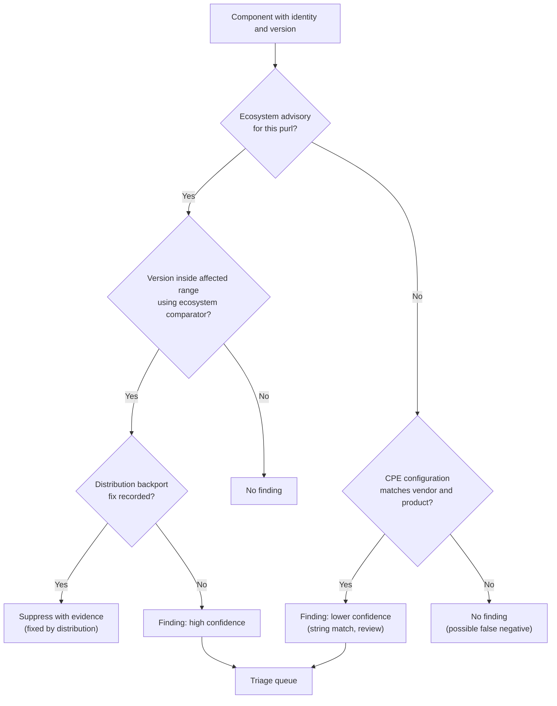

The flowchart shows that the path to a finding determines its confidence, and that the "no finding" outcomes are not equal. One means the component was checked against a range and cleared. The other (no identifier, no CPE match) means the matcher had nothing to compare, which is a gap. A report that merges both into "zero findings" hides the difference. Operations should count components with no usable identifier and show that number next to the finding count.

## 9. VEX: Stating Exploitability

### 9.1 What a VEX statement is

An SBOM says what is in an artifact, and matching says which advisories name those components. Neither says whether the product is affected in practice. A Vulnerability Exploitability eXchange (VEX) statement is a supplier's assertion about one vulnerability in the context of one product. It lets the supplier say "this component is present, and this advisory does not make our product exploitable, for this reason", in a form that tools can read and consumers can apply to their own scan results.

A VEX statement has four essential parts: the product (identified like an SBOM subject, ideally by purl or digest), the vulnerability (typically a CVE identifier), a status, and, for a not-affected status, a justification. Time and author matter too, because a statement can be superseded.

### 9.2 Statuses and their meaning

Formats differ in exact vocabulary, so verify the terms in the specification you use (the Common Security Advisory Framework (CSAF) VEX profile, the OpenVEX specification, and the CycloneDX vulnerability analysis fields each define their own). The meanings are consistent enough to describe:

- Not affected. The product contains the component, and the vulnerability cannot be exploited in the product. A justification must explain why.
- Affected. The vulnerability is exploitable in the product, and action is advised (a fix, an upgrade, or a mitigation). Suppliers often add recommended actions.
- Fixed. A product version has been released that addresses the vulnerability. The statement names the fixed version.
- Under investigation. The supplier has not yet determined impact. This tells consumers to expect an update, and avoids silence being read as safety.

Justifications for not-affected are drawn from a small controlled list in the common guidance. The shared ideas are: the vulnerable component is not present, the vulnerable code is not present (for example a compiled-out module), the vulnerable code is present but cannot be executed in the product, an adversary cannot control the inputs that reach it, and existing mitigations already block exploitation. Check the current guidance for exact wording. A free-text justification is weaker than a controlled one, because tools can act on the controlled value.

### 9.3 A VEX fragment

The fragment below follows the shape of OpenVEX. Field names and the version of the context URL change between specification releases, so treat it as illustrative and check the specification.

```json
{
  "@context": "https://openvex.dev/ns/v0.2.0",
  "@id": "https://example.com/vex/orders-service-2026-001",
  "author": "Example Product Security",
  "timestamp": "2026-11-05T10:00:00Z",
  "version": 1,
  "statements": [
    {
      "vulnerability": { "name": "CVE-0000-00000" },
      "products": [
        { "@id": "pkg:oci/orders-service@sha256:<digest>" }
      ],
      "status": "not_affected",
      "justification": "vulnerable_code_not_in_execute_path",
      "impact_statement": "The affected parser is on the classpath but the service never calls it."
    }
  ]
}
```

The identifier `CVE-0000-00000` is a placeholder. The `impact_statement` is the human evidence behind the controlled justification, and reviewers should require it.

### 9.4 How VEX reduces noise, with arithmetic

Continue the illustrative scan from section 8: 200 findings, of which 80 are false positives (the matcher was wrong) and 120 are real component-and-version matches. Among the 120, suppose analysts determine that 30 are not exploitable in this product (the vulnerable function is never called, or the feature is disabled).

- Without VEX or suppression: 200 findings × 20 minutes = 4,000 minutes (about 66.7 hours) per scan cycle, repeated whenever the scan is rerun.
- With statements covering the 80 false positives (suppressed with evidence) and the 30 not-exploitable cases: 110 findings are closed, leaving 90. Effort is 90 × 20 = 1,800 minutes, 30 hours.
- Saving per cycle: 2,200 minutes, about 36.7 hours.

The larger effect comes from reuse. Suppose the same release is deployed in 40 environments, each scanned by its own consumers. A published VEX statement is written once and applied to all of them. Without it, each consumer repeats the analysis. These figures show the shape of the saving; real ratios depend on the product.

Two cautions apply. A VEX statement is a claim, and a wrong not-affected statement hides a real exposure, so it needs the same review as any security decision and should be signed like an SBOM (see [CH15 Supply Chain Security](CH15_Supply_Chain_Security.md)). And a statement is time-bound: a code change that makes the vulnerable path reachable invalidates it, so statements should name the product version or digest they cover, and should be re-evaluated on each release.

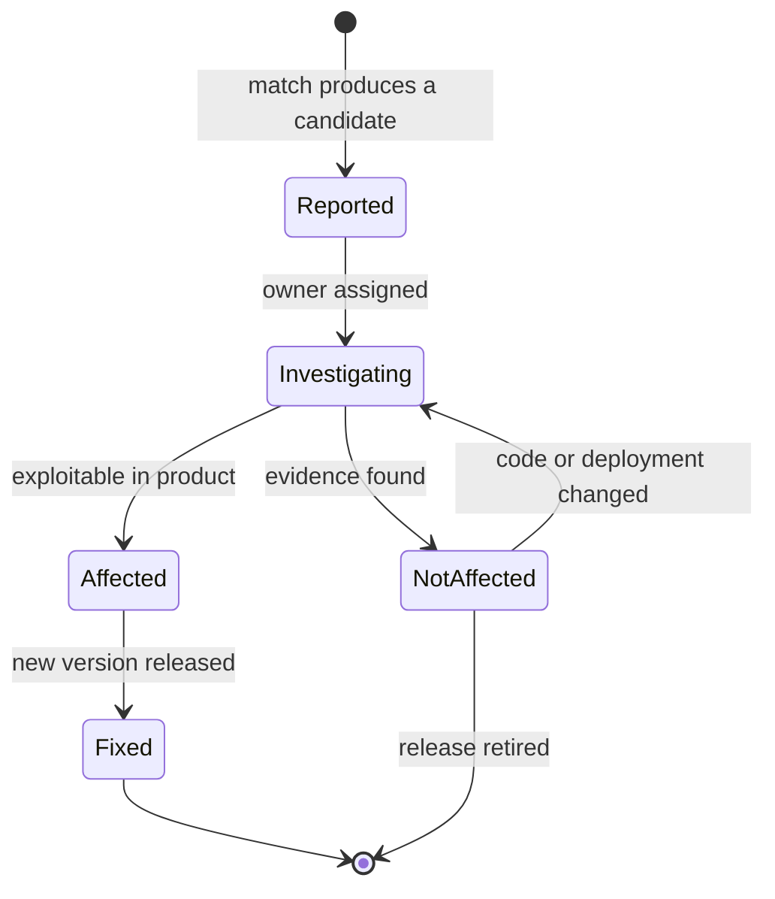

The state machine shows the life of a finding as a VEX consumer would track it. The edge from the not-affected state back to investigating is the one teams forget: a justification depends on the code and configuration at the time, so it expires when they change. The implication is that VEX needs an owner and a trigger (release, dependency change, or new exploit information), and not just a one-time export.

## 10. Prioritization

### 10.1 Severity alone is a weak ordering

A Common Vulnerability Scoring System (CVSS) base score rates the intrinsic severity of a vulnerability and ignores your deployment. Sorting findings by it puts a critical-scored flaw in an internal batch tool ahead of a high-scored flaw in an internet-facing gateway. A usable order combines severity with context and with evidence about attacker behaviour.

### 10.2 Signals

- Exposure. Is the affected artifact reachable from untrusted networks, or does it process untrusted input? An SBOM, plus a deployment inventory, gives the first half of this answer.
- Reachability. Does the product execute the vulnerable code? Static call-graph analysis can approximate this for some languages: it marks a vulnerable function as called, not called, or unknown. Results are conservative in one direction (reflection, dynamic loading, and plugins make "not called" unreliable), so treat "not called" as a lead that needs a justification and review before it becomes a not-affected statement.
- Exploit signals. The Exploit Prediction Scoring System (EPSS) publishes a probability estimate that a vulnerability will be exploited, and the Cybersecurity and Infrastructure Security Agency (CISA) maintains a Known Exploited Vulnerabilities (KEV) catalog of vulnerabilities with evidence of exploitation. Both are inputs, with limits: a probability is not a certainty, a missing entry is not proof of safety, and the catalogs lag disclosure. Verify the current definitions and update cadence at the source.
- Fix availability. A finding with a tested upgrade is cheaper to close than one that needs a mitigation, which affects scheduling more than risk.
- Data sensitivity and blast radius of the service itself, from the threat model ([CH12 Threat Modeling](CH12_Threat_Modeling.md)).

### 10.3 A simple triage rule

A defensible policy is a decision table with owners and deadlines, written down so it is applied consistently. For example (illustrative; set your own thresholds): known exploited and internet-facing means mitigate or patch on the shortest agreed deadline; reachable and high severity means patch in the next release cycle; not reachable with a reviewed justification means issue a VEX statement and re-check at the next dependency change. The point is to make the ordering explainable to an auditor and to the team that receives the ticket.

## 11. Freshness, Merging, and Composing SBOMs

### 11.1 Freshness

An SBOM goes stale in two independent ways. The inventory goes stale when the artifact changes, which is solved by generating a new SBOM for each new artifact digest and keeping the old ones. The matching goes stale when the vulnerability data changes, which happens with no change to the artifact at all. Both need to be tracked.

A practical design stores inventories permanently and reruns matching on a schedule and on advisory feeds, so a new CVE is checked against all stored inventories within a target time. Record the age of the inventory (time since generation, and time since the artifact was last rebuilt) and the age of the advisory data used in the last match. A rebuild of the same source on a later date can pick up different transitive versions when dependencies are not pinned, so a regenerated SBOM is new evidence and not a reformatting of the old one.

### 11.2 Merging and composing

A product is rarely one artifact. It is several services, a base image, a front-end bundle, perhaps agent software installed on hosts and third-party appliances. Two operations are needed, and they are different.

Composition keeps each component SBOM intact and records a relationship from the product to each part ("the product comprises these artifact digests"). The product SBOM is an index. A query descends into the parts. Provenance, ownership, and the exact digest stay attached to each component.

Flattening merges everything into one list. It is easy to consume but destroys structure: it loses which service contains a library, collapses two versions of the same library into one entry if the merge deduplicates by name, and hides which team owns the fix. If a flat list is required (for example a customer asks for one document), generate it from the composed structure, and keep the composed form as the source of truth.

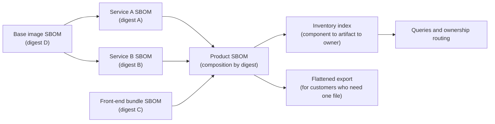

The diagram shows the base image feeding two services, which is the usual source of shared vulnerable components. A flattened export would show one operating system layer where two real copies exist, and a base-image patch would then appear to fix one thing when two artifacts must rebuild. Composition by digest keeps that fact. The implication for release engineering is that a base-image update triggers rebuilds of every artifact that names it, and the index tells you which.

## 12. Storage, Distribution, and Access Control

### 12.1 Who receives an SBOM

Three audiences have different needs and different risk.

- Internal teams need complete detail: all components, versions, paths, and internal identifiers, plus the link to the owning service. This is the incident-response view.
- Customers usually need the inventory of what they run, not of internal tooling. They want a stable format, a signed document tied to the product version they have, and a way to learn when the data changes. They may also want VEX statements so that their scanners do not report items you have already analyzed.
- Regulators and auditors may require SBOMs for particular product classes or procurement. Requirements differ by jurisdiction and sector and change over time, so read the current text that applies to your market and do not assume the NTIA minimum elements are the legal requirement.

### 12.2 Exposure risk

An SBOM is reconnaissance material. A complete list of components and versions tells an attacker which known weaknesses to try. That does not argue for secrecy as the main defence (software that depends on hidden versions is fragile), but it does mean that internal SBOMs, which include private package names and infrastructure details, are classified and access-controlled, while customer-facing SBOMs are deliberately scoped. A customer-facing version typically omits build tools and internal package names, and should be generated from the internal source of truth by a documented filter, not edited by hand.

### 12.3 Mechanisms

Typical patterns: a registry holding attached SBOMs with the same access control as the image; an inventory service with an Application Programming Interface (API) that supports query by component, digest, and product; a customer portal or release page that serves signed documents by product version; and, for suppliers sending SBOMs to you, an intake that validates schema, checks the signature, and verifies that the subject digest matches what the supplier says they shipped. Authorize writes tightly. Whoever can replace an SBOM can make a vulnerable product appear clean. Log reads and writes of the inventory, because queries for specific components are themselves sensitive.

## 13. Operations and Incident Response

### 13.1 The blast-radius question

When a new vulnerability is announced for a component, the incident question is: which deployed artifacts contain component X at a version in the affected range, who owns them, and where do they run? The answer needs three linked datasets: components by artifact digest (the SBOMs), deployments by digest (what is running where), and ownership by service. The SBOM is the first dataset and cannot answer the question without the other two.

### 13.2 A worked query

Suppose an inventory service stores normalized records in relational tables queried with Structured Query Language (SQL). The schema is illustrative.

```sql
-- component(artifact_digest, purl_type, purl_name, version)
-- deployment(artifact_digest, environment, workload, observed_at)
-- service(workload, owner_team)

SELECT d.environment, d.workload, s.owner_team, c.version, c.artifact_digest
FROM component c
JOIN deployment d ON d.artifact_digest = c.artifact_digest
JOIN service s    ON s.workload = d.workload
WHERE c.purl_type = 'maven'
  AND c.purl_name = 'org.apache.logging.log4j/log4j-core'
  AND d.observed_at > NOW() - INTERVAL '1 day'
ORDER BY d.environment, s.owner_team;
```

The query lists every deployed workload whose image contains the library, with the owner. Version-range evaluation should happen with the ecosystem comparator from section 8 and not in SQL string comparison, so many teams filter by name in the query and apply the range check in application code, or precompute a flag when the advisory arrives. The `observed_at` filter excludes stale deployment data, and the deployment table must be fed from the cluster or deployment tool, not from the release plan, or the answer describes intention.

Add a second query for the gap: artifacts that are deployed but have no SBOM in the inventory.

```sql
SELECT d.environment, d.workload, d.artifact_digest
FROM deployment d
LEFT JOIN (SELECT DISTINCT artifact_digest FROM component) c
       ON c.artifact_digest = d.artifact_digest
WHERE c.artifact_digest IS NULL;
```

Every row is a workload for which the first query is silent. Reporting the count of such rows beside the match results keeps the team from reading silence as safety.

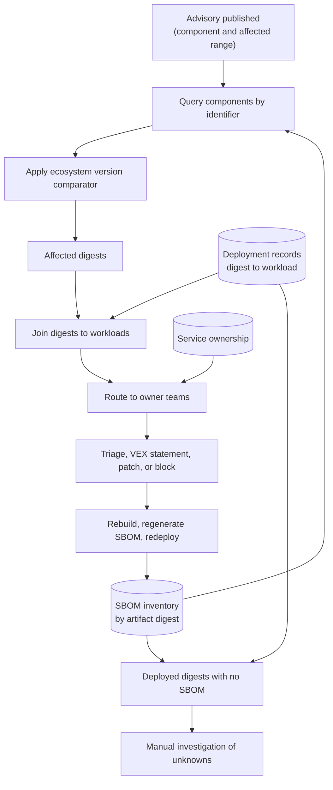

The diagram shows an incident flow with two outputs: owners with work, and a list of unknowns. The loop at the end matters, because a fix is not complete until the new artifact's SBOM is in the inventory and the old digest is no longer deployed. A useful measure is time from advisory publication to a complete list of affected workloads, together with the share of deployed digests that have a verified SBOM. Both should be exercised in a game day, not for the first time during an incident.

### 13.3 Operations in steady state

Track a small set of metrics: percentage of release artifacts with a valid, signed SBOM; percentage of running digests present in the inventory; age distribution of the inventories; time to produce the affected list for a test advisory; and open findings by age and priority. Block deployment of an artifact without a verifiable SBOM only after the generation pipeline is reliable, because a gate with frequent false failures teaches teams to bypass it. The gate itself belongs to admission policy in [CH15 Supply Chain Security](CH15_Supply_Chain_Security.md).

## 14. Licence Compliance at a High Level

The same inventory supports licence review. Each component can carry a licence identifier, and SPDX defines a short-identifier list and an expression syntax for combinations (for example "either of two licences" or "a licence with an exception"). Compliance work then asks: which components carry licences with obligations (attribution, source disclosure, copyleft terms), and how does the product use them (linked, modified, distributed to customers, or only run as a hosted service)? Whether an obligation applies depends on the licence text, how the code is combined, and how it is distributed, and that is a legal judgement that the SBOM informs and does not make.

Limits specific to licence data: generators read declared licences from package metadata, and declared metadata can be missing, wrong, or `NOASSERTION`. Files inside a package can carry different licences from the package. Treat licence output as a screening list for legal review, and prefer policies expressed as allow, review, and deny classes by identifier, with an owner for the review queue.

## 15. Tooling by Class

Names below are examples of classes, not endorsements, and capabilities change between releases, so verify before selecting.

- Generators. Syft, Trivy, and cdxgen are widely used open-source tools that generate SBOMs, and several emit both SPDX and CycloneDX. Ecosystem-native build plugins (for example the CycloneDX plugins for common build tools) record the resolved graph during the build.
- Matchers and scanners. Grype and Trivy match SBOM or image contents against advisory databases, and OSV-Scanner matches against the OSV database. They differ in which advisory sources they consume and how they treat distribution backports, so run two on a sample and compare the differences as part of tool selection.
- Platforms. OWASP Dependency-Track is an open-source platform that ingests CycloneDX documents, tracks components over time, and supports VEX-style analysis states. Commercial software composition analysis (SCA) products add reachability analysis, policy engines, and reporting.
- Registry and attestation tooling. Cosign and ORAS push, sign, and fetch attached objects, as described in [CH15 Supply Chain Security](CH15_Supply_Chain_Security.md).

Selection criteria: formats read and written, ecosystems covered, quality of the identifiers emitted, support for the vantage points in section 5, how advisory data is refreshed, whether output retains the evidence type and match source, and whether you can run it in the build environment without sending your source or artifacts elsewhere.

## 16. Limits of SBOMs

An SBOM is useful because it is cheap and structured, and its value is bounded by these limits.

- It reflects the generator's view. Gaps from vendored, statically linked, shaded, or runtime-fetched code are silent, and fewer findings can mean worse coverage.
- It does not establish exploitability. Presence of a vulnerable component is a starting point. VEX and reachability analysis address the gap and carry their own error rates.
- It does not establish integrity or honest builds. A signed SBOM proves who signed it. Provenance and build isolation address whether the artifact came from the expected source ([CH15 Supply Chain Security](CH15_Supply_Chain_Security.md)).
- It depends on advisory quality. Missing, late, or imprecisely scoped advisories produce false negatives and false positives that no inventory can correct.
- It is a snapshot. Without regeneration discipline and a binding to the digest, it drifts from what runs.
- It does not cover runtime configuration, services, or data. A vulnerable service reachable through a misconfigured network path is outside its scope, and it should be paired with the controls in the other chapters of this part.

Used within these limits, the SBOM is the index that makes the other controls operable at the speed an incident demands.

## 17. Failure and Quality-Attribute Scenarios

A quality-attribute scenario states a stimulus, the response the system should give, and a measure that says whether it did. The scenarios below turn the limits in section 16 into tests a team can run. The numeric targets are illustrative starting points, not standards. Set your own from the cost of a miss.

### 17.1 Scenario table

| Scenario | Stimulus | Expected response | Measurable success criterion (illustrative) |
|---|---|---|---|
| Critical vulnerability disclosed | An advisory names a library used widely in the estate | The inventory is rematched, affected digests are joined to workloads and owners, and deployed digests without an SBOM are listed separately | Complete affected-workload list and unknown-workload list within 60 minutes of advisory publication, in a drill run each quarter |
| SBOM misses vendored code | A penetration test finds a copied library that no SBOM lists | The gap is recorded, the code is added to a declared vendored-code manifest, and the generator output is reconciled with it | Entry added and affected SBOMs regenerated within one release cycle, and recall on the next quarterly reviewed sample at or above 0.97 |
| VEX statement later found wrong | A not-affected statement is shown to be incorrect because a feature flag makes the vulnerable path reachable | The statement is superseded by an affected statement, consumers are notified, and the finding returns to triage with priority | Superseding statement published within 4 hours of confirmation, and a root-cause note that changes the justification review rule |
| Tag re-pointed after SBOM generation | A registry tag now refers to a different image than the one inventoried | Verification detects that the SBOM subject differs from the deployed digest, and the workload is reported as having no valid SBOM | 100 percent of deployments recorded by digest, and a mismatch raises an alert before the next deployment |
| Stale advisory data | The matcher's feed has not refreshed | The report shows the age of the advisory data and flags results older than the agreed limit | Matching never runs against data older than 24 hours without an alert |

### 17.2 Scenario A: time to answer "where are we exposed?"

The measure that matters in the first scenario is elapsed time from publication to a trustworthy list. It decomposes into steps that can each be timed. With illustrative figures: the matcher polls feeds every 15 minutes, so the worst-case wait before the advisory is ingested is 15 minutes. The rematch across the stored inventories takes 5 minutes. A responder then reviews the two result sets (affected workloads, and deployed digests with no SBOM) and routes tickets, which takes 10 minutes if the ownership data is current. The worst-case total is 15 + 5 + 10 = 30 minutes, which leaves 30 minutes of margin against the 60-minute target. If a drill shows 95 minutes, the breakdown says where to look: feed polling, an inventory query that scans instead of using the identifier index, or ownership data that needs manual lookup.

The unknown list is part of the answer. A response that reports 12 affected workloads and omits 4 deployed digests with no SBOM claims more certainty than the data supports. The success criterion therefore names both lists.

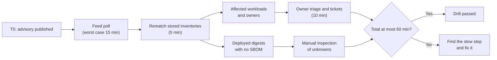

The diagram shows that the clock covers three stages and two outputs, and that the drill passes only when both outputs are produced inside the limit. The implication is to time each stage separately in every drill. A single end-to-end number hides which stage is slow, and the unknown list can be the stage that takes the longest, because it needs human inspection.

### 17.3 Scenario B: the SBOM that misses vendored code

The stimulus is discovery by another channel, such as a penetration test, a code review, or a customer report. The response has two parts. The immediate part is to identify which artifacts contain the copy, which is a source search and not an inventory query, because the inventory cannot see it. The lasting part is to remove the blind spot. Options are a declared vendored-code manifest that the pipeline merges into the SBOM, with each entry naming the upstream project, version, and the local modifications; a file-fingerprint cataloguer for unmodified copies; or a policy that bans copying and requires the dependency to come through a package manager.

The success measure is recall on a reviewed sample. Draw a sample of artifacts each quarter, have an analyst establish the real inventory by hand, and compute recall as in section 5.2. A target of 0.97 means that at most 3 of every 100 real components may be missing. A drop below the target triggers a review of which construct caused the misses, because the cause (shading, static linking, runtime download) decides the remedy.

### 17.4 Scenario C: a VEX statement later found wrong

A not-affected statement is a decision that other teams rely on, and some will be wrong. Suppose a statement said the vulnerable parser is on the classpath but never called. Months later a configuration change enables a feature that calls it. The statement was correct when written and is wrong now, or it was wrong from the start because the analysis missed a reflective call.

The expected response is mechanical. Publish a new statement with a later timestamp that supersedes the old one and sets the status to affected, naming the affected versions and the fix or mitigation. Tell the consumers who applied the old statement, using the distribution channel from section 12. Return the finding to the triage queue at the priority its exposure deserves. Then examine the cause. If the justification relied on a "never called" claim, require evidence such as a call-graph report plus a test, and require a re-evaluation trigger on configuration changes. The criterion is the time from confirmation to the superseding statement (4 hours here), and a measurable change to the review rule so the same error class is caught earlier.

### 17.5 Scenario D: tag and digest drift

The fourth scenario checks the binding from section 7. Deploy a test workload by tag, then re-point the tag to different content and run the verifier. The expected result is a reported mismatch, since the SBOM subject names the old digest. If the verifier reports success, the pipeline is comparing names instead of digests. This test is cheap and finds a class of error that undermines every query in section 13.

## 18. Worked Case Study: One Organization, End to End

This case is a hypothetical illustration with invented figures. It exists to show the reasoning and the arithmetic. No real organization or measurement is described.

### 18.1 Situation

A mid-sized parcel-logistics organization, called Example Logistics here, runs 46 services owned by 5 teams. Services are built into container images from 3 shared base images and deployed to staging and production. Images are promoted from staging to production without rebuilding, so many digests appear in both environments. Across both environments 58 distinct digests are deployed, which includes 2 vendor-supplied images the organization does not build.

A recent drill asked "which workloads contain library X?" The answer took 2 days (48 hours) and was assembled from grep across repositories. Only 41 of the 58 deployed digests had any SBOM. Coverage was 41 / 58 = 0.707, or about 71 percent. The goals set for the programme were: an affected-workload list in 60 minutes, at least 95 percent of deployed digests with a verified SBOM, and a triage workload that a small security team can sustain.

### 18.2 Decisions and rejected alternatives

| Decision | Choice | Rejected alternative | Reason for the choice |
|---|---|---|---|
| Generation vantage point | Image-level generation on the release artifact, plus build-level generation for the three Java services that need dependency paths | Source-only generation from lockfiles | The worked figures in section 5.2 give a source SBOM recall of 0.617 because it omits the base image, and base-image packages are shared across all 46 services |
| Canonical format | CycloneDX internally, SPDX emitted on request for one customer | Both formats everywhere, with conversion between them | Round-tripping drops information, and only one customer requires SPDX |
| Binding | SBOM attached to the image in the registry by digest and signed as an attestation | Keying the inventory by image tag | Tags are re-pointed, and promotion without rebuilding makes digest the natural key |
| Product SBOM | Composition by digest, with a flattened export generated for customers | A single flattened SBOM as the source of truth | Flattening would hide that one base image feeds many services, so a base-image fix would look like one change when it is a rebuild of every dependent artifact |
| Vendored code | Declared manifest merged into the SBOM | Rely on fingerprinting | Local modifications defeat fingerprints, and three services carry patched copies |
| Deployment gate | Warn mode for 30 days, then block deployments with no verifiable SBOM | Block from day one | A gate with frequent false failures teaches teams to bypass it, as noted in section 13.3 |
| Vendor images | Request an SBOM and VEX from each supplier, and list them as coverage gaps until supplied | Exclude them from the metrics | Excluding them would make the coverage figure look better than the exposure is |

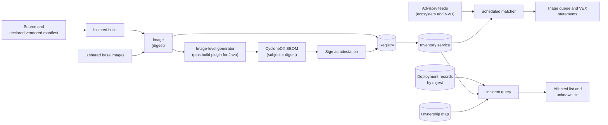

The diagram shows one path from source to a queryable inventory and a second path from advisories to triage. They meet at the inventory service, which is keyed by digest. The implication is that every box on the left must preserve the digest. If any step re-tags or rebuilds the image without regenerating the SBOM, the key between the artifact and its inventory breaks, and the incident query silently loses that workload to the unknown list.

### 18.3 Validation evidence

The team validated the design with four pieces of evidence, each tied to a goal.

Coverage. After the pipeline change, 56 of the 58 deployed digests have a verified SBOM. Coverage is 56 / 58 = 0.966, or 96.6 percent, which meets the 95 percent goal. The 2 digests without one are the vendor images, listed as gaps.

Accuracy. Analysts reviewed a sample of 10 images. They established that the sample holds 4,700 real components. Before the vendored manifest, the generator listed 4,660 components, of which 4,600 were correct. Precision was 4,600 / 4,660 = 0.987, and recall was 4,600 / 4,700 = 0.979. The 100 misses sat in 3 services that vendor or shade libraries. After the vendored manifest was merged, 88 of those 100 were recorded, so the generator listed 4,660 + 88 = 4,748 components, of which 4,600 + 88 = 4,688 were correct. Precision became 4,688 / 4,748 = 0.987, and recall became 4,688 / 4,700 = 0.997. The remaining 12 misses (4,700 − 4,688) were archives with stripped metadata, and the team logged them as known gaps.

Time to answer. A drill with an injected advisory produced both lists in 41 minutes, below the 60-minute goal. The breakdown was 15 minutes of feed wait, 5 for rematching, and 21 for routing, because two ownership entries were stale. The team fixed the ownership feed and set a quarterly repeat.

Triage effort. Suppose 58 digests produce an average of 40 findings each, so 58 × 40 = 2,320 findings per cycle. At 20 minutes per finding, that is 2,320 × 20 = 46,400 minutes, about 773 hours. Analysts classify 55 percent of findings as false positives, backport-fixed, or test-only and close them with VEX statements or suppressions with evidence. That closes 2,320 × 0.55 = 1,276 findings and leaves 1,044. The remaining effort is 1,044 × 20 = 20,880 minutes, 348 hours. The saving is 46,400 − 20,880 = 25,520 minutes, about 425 hours per cycle. The figures are invented to show the method. The team's real ratio would come from its own reviewed samples.

### 18.4 The SBOM across release versions

Each release produces a new image digest and a new SBOM, and the older ones stay in the inventory. The new SBOM is not an edit of the old one. Dependencies that are not pinned can change between builds, so the comparison between two releases is itself useful evidence: a diff of the two inventories shows what changed, which feeds review.

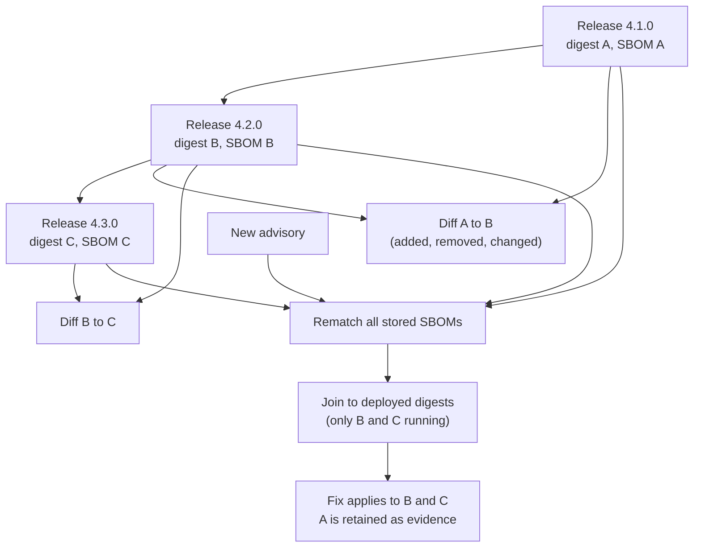

The diagram shows that a new advisory is matched against every stored inventory, including release 4.1.0, which is no longer deployed. The join with deployment records then limits action to what runs. The implication is that retention and deployment data are separate decisions: keep old SBOMs for investigation, and let the deployment join decide urgency. Deleting old inventories to save space removes the ability to answer whether an older release ever contained the library.

## 19. Common Mistakes and Anti-Patterns

| Mistake | Cause | Consequence |
|---|---|---|
| Treating a clean scan as a security certificate | The report counts findings and says nothing about components with no identifier or artifacts with no SBOM | Missing coverage reads as good health, and real exposure goes unreported |
| Generating from source only | Lockfile parsing is cheap and runs early | Base-image packages are absent and unshipped test tools are listed, so both recall and precision suffer (section 5.2) |
| Keying SBOMs by image tag | Tags are the name humans use | A re-pointed tag leaves the SBOM describing a different artifact, and incident queries return wrong answers |
| Validating the schema and stopping | A valid document looks finished | A document with components and no `dependencies` or relationships passes validation and supports no graph analysis |
| Flattening product SBOMs as the source of truth | One file is easy to hand to a customer | Ownership, per-service versions, and shared base-image structure are lost, so fixes cannot be routed |
| Comparing versions as strings or with the wrong ecosystem rules | A generic comparator is simpler to write | Ranges are evaluated wrongly, producing false negatives for some ecosystems and false positives for others |
| Ignoring distribution backports | The matcher uses upstream version numbers only | Fixed packages are reported as vulnerable every scan, and analysts learn to dismiss findings |
| Writing VEX statements with free-text reasons and no owner | Statements are produced during a push to reduce the queue | Wrong statements hide real exposure, and nobody re-evaluates them when code changes |
| Publishing the internal SBOM to customers | It already exists | Private package names and infrastructure detail leak, and the document contains build tools the customer cannot act on |
| Blocking deployments before the pipeline is reliable | The gate looks like a quick win | False failures push teams to bypass the gate, which weakens the control after it is reliable |
| Deleting old SBOMs when artifacts are retired | Storage cost, and a belief that only running software matters | Investigations cannot establish whether an earlier release held a component |
| Ranking by CVSS alone | The score is in every record | Effort goes to flaws in internal batch jobs before internet-facing services |

Several of these share a root cause. A tool produced a number, and the team accepted the number without examining what it left out. The remedies in the earlier sections are the same each time: make gaps visible, bind evidence to the digest, and measure accuracy on a reviewed sample.

## 20. Design-Review Checklist

Use these questions in a design review. Each answer should point to evidence, such as a pipeline output, a drill record, or a sampled review.

Identity and format

- Does every component carry a purl, and is the count of components without one reported?
- Is one canonical format chosen, with a stated reason, and are documents validated against its schema?
- Does the document state whether it describes declared, resolved, or shipped contents?

Generation

- Which vantage point (source, build, image) produces the SBOM, and which constructs does it miss?
- Is there a declared vendored-code manifest, and a policy for static linking and shaded archives?
- Are the graph, identifier, and cross-count checks from section 6.4 part of the pipeline?
- Are the generator version and the stage of a multi-stage build recorded?

Binding and integrity

- Is the SBOM subject a digest, and does deployment record the digest?
- Is the SBOM signed, and does the verifier check that its subject equals the deployed digest?

Matching and exploitability

- Does the matcher use ecosystem version comparators and distribution trackers, and is the match source kept in each finding?
- Is there a written triage rule, and are VEX statements signed, evidenced, owned, and re-evaluated on change?
- Are precision and recall measured on reviewed samples?

Freshness and operations

- Are old SBOMs retained, and is matching rerun on advisory updates with the data age shown?
- Is the affected-workload drill timed, with both the affected list and the unknown list?
- Are metrics published for signed-SBOM coverage, inventory coverage of running digests, and time to answer?

Distribution

- Are internal and customer-facing SBOMs separate, with the latter generated by a documented filter?
- Who can write to the inventory, and are reads and writes logged?
- Is the gate in warn mode until the pipeline is reliable?

## 21. Exercises

Each exercise has a brief answer outline. Work the answer before reading the outline.

1. A source-only SBOM for a service lists 300 packages. A review of the image finds that 240 of them ship, plus 150 operating system packages. Compute precision and recall of the SBOM, and say which error is more dangerous.
   Outline: the true shipped inventory is 240 + 150 = 390. Precision is 240 / 300 = 0.80, recall is 240 / 390 = 0.615. Recall is the more dangerous gap because the 150 missing packages are real exposure that no query can find, while the 60 extra entries only cost triage time.

2. A matcher reports 90 findings. Review shows 54 are real, and a later deep review finds 6 more real exposures that were not reported. Compute precision and recall, and the triage time at 15 minutes per finding.
   Outline: real exposures are 54 + 6 = 60. Precision is 54 / 90 = 0.60, recall is 54 / 60 = 0.90. Triage is 90 × 15 = 1,350 minutes, 22.5 hours, of which 36 false positives cost 36 × 15 = 540 minutes, 9 hours.

3. Explain why `pkg:npm/%40angular/core@17.0.0` can fail to match an advisory even though it looks right.
   Outline: encoding and normalization. The `@` in the scope must be percent-encoded, and a generator or matcher that encodes or decodes differently produces a string that differs from the database key. Compare the canonical forms, not the display strings.

4. Describe how a Go binary in a minimal image can still be inventoried, and what remains unknown.
   Outline: read the module information embedded in a binary built in module mode. Unknown: native libraries linked statically, and anything the build did not record. Pair the result with a build-level SBOM.

5. A not-affected VEX statement is published with the justification "the function is never called". List the evidence to require and the triggers that expire it.
   Outline: a call-graph report plus a test showing no path, an analyst sign-off, the product version or digest covered, and a re-evaluation on new releases, dependency changes, configuration or feature-flag changes, and new exploit information.

6. A base image feeds 12 services. A flattened product SBOM shows the vulnerable package once. Explain what goes wrong, and what structure avoids it.
   Outline: the response plan sees one fix, but 12 artifacts must rebuild and 12 teams must act. Composition by digest keeps each service SBOM and the base-image reference, so the index routes work to each owner.

7. Design a time-to-answer drill. Name the stages, a target, and the output that stops a team from reading silence as safety.
   Outline: stages are feed wait, rematch, join to deployments, and routing. Target a total, for example 60 minutes. Report the unknown list of deployed digests with no SBOM beside the affected list. Time each stage.

8. A customer asks for your SBOM. Decide what to send and how to produce it.
   Outline: send a signed, customer-scoped document for the product version they hold, generated by a documented filter from the internal composed source of truth, with the format they require and VEX statements for items already analyzed. Omit build tools and internal names.

## 22. Summary

An SBOM is a machine-readable inventory of a piece of software, and a query interface into its composition. It reports what a generator believed was present at one moment. It does not certify safety. The chapter's outcomes map to the sections as follows.

| Outcome from the Introduction | Where taught | Core takeaway |
|---|---|---|
| Describe what an SBOM contains and what it cannot tell you | Sections 2 and 16 | Documents, components, relationships, identifiers, and hashes form a graph. Exploitability, integrity, and completeness are outside it |
| Explain how purl and CPE work, and why mismatches produce missed and false findings | Sections 3 and 8 | A purl is generated from ecosystem facts and is precise. A CPE is inferred and can miss or over-match. Keep the match source |
| Compare SPDX and CycloneDX and read a fragment of each | Section 4 | Choose by consumers, tool chain, and needed fields. Use one canonical format and emit the other only on request |
| Compare source, build, and image generation and predict their errors | Sections 5, 17, and 18 | Source over-reports and omits the base image. Image analysis sees what runs but has weak relationships. Compute precision and recall on reviewed samples |
| Explain discovery and graph building, and what generators miss | Section 6 | Vendored, statically linked, shaded, and runtime-fetched code is silent, so pipelines add completeness checks |

The later sections turn the inventory into an operating practice. Bind the SBOM to an immutable digest and sign it (section 7). Match with ecosystem comparators and treat findings as candidates (section 8). Use VEX to record exploitability, with evidence and an owner (section 9). Rank by exposure and exploit evidence, not only CVSS (section 10). Keep inventories and rematch on new advisories (section 11). Compose product SBOMs by digest, and scope what customers receive (sections 11 and 12). Run drills that report both the affected list and the unknown list (sections 13 and 17). Make every gap visible, because a missing SBOM, an unidentified component, or a stale feed is a finding in itself. [CH15 Supply Chain Security](CH15_Supply_Chain_Security.md) defines the signing, provenance, and admission controls that make the inventory trustworthy.
