# Machine Learning Foundations

Part: [16 — Artificial Intelligence, Machine Learning, and Generative AI](PART_OVERVIEW.md) · Status: Drafted

## 1. Introduction

Machine Learning (ML) constructs a model from data so it can estimate, classify, rank, or generate outputs for inputs it has not seen before. It is useful when a pattern is difficult to express with fixed rules and enough representative data exists to learn it. A learned model is not automatically correct, causal, fair, or safe; its behavior depends on data, objective, training procedure, deployment context, and monitoring.

Every capability in this part of the book, from the regression models in the next two chapters to the large language models (LLMs) that power generative AI (GenAI) products, is built from the same small set of ingredients: a way of representing examples, an objective that scores predictions, an optimization procedure that adjusts parameters to improve that score, and an evidence process that estimates how the result will behave on cases it has never seen. Foundation models differ from a three-feature logistic model in scale, architecture, and training objective, not in the underlying logic. An architect who understands these ingredients can ask the right questions of any artificial intelligence (AI) proposal: what decision is supported, what data is the model learning from, what is it being rewarded for, and how do we know it will keep working after deployment?

That last question is why this chapter matters to a solution architect rather than only to a data scientist. A learned model is a component whose behavior is defined by data instead of by code. It cannot be code-reviewed line by line, its failure modes are statistical rather than logical, and its quality decays when the world changes even though no one has touched the software. Decisions about service boundaries, latency budgets, fallbacks, ownership of training data, and monitoring are all shaped by the properties introduced here.

This chapter owns the basic machine learning problem model, the relationship between data and labels, the objective, optimization, generalization, and the end-to-end workflow. It teaches the minimum mathematics needed to reason about these ideas rather than treating them as black boxes. The boundaries with neighbouring chapters are deliberate:

- Leakage, point-in-time correctness, missing values, and split construction belong to [CH02 — Data Preparation, Feature Engineering, and Leakage](CH02_Data_Preparation_Feature_Engineering_and_Leakage.md).
- Linear and logistic regression as model families, detailed regularization penalties, calibration, and threshold selection belong to [CH03 — Regression and Classification](CH03_Regression_and_Classification.md). This chapter uses linear models only as the simplest vehicle for teaching objectives, optimization, and generalization.
- Tree-based models belong to [CH04 — Decision Trees and Ensemble Learning](CH04_Decision_Trees_and_Ensemble_Learning.md), and clustering and dimensionality reduction to [CH05 — Unsupervised Learning and Representation Reduction](CH05_Unsupervised_Learning_and_Representation_Reduction.md).
- Validation design, metrics, confidence intervals, and model selection belong to [CH06 — Model Evaluation, Validation, and Selection](CH06_Model_Evaluation_Validation_and_Selection.md).
- Backpropagation, neural-network optimizers, and accelerator training belong to [CH07 — Deep Learning Foundations](CH07_Deep_Learning_Foundations.md).
- Production system composition, model placement, and governance belong to Part 17, starting with [AI Workload Qualification and Architecture Foundations](../17_AI_Architecture/CH01_AI_Workload_Qualification_and_Architecture_Foundations.md). Operating the model lifecycle belongs to [CH29 — MLOps and LLMOps](CH29_MLOps_and_LLMOps.md). General probability and non-functional requirement foundations remain with [Part 07](../07_System_Design_and_Distributed_Systems/PART_OVERVIEW.md); this chapter applies only the parts of probability that learning needs.

After studying this chapter, a reader should be able to:

1. Decide whether a problem warrants a learned model, and frame it as a prediction unit, a decision time, a horizon, and a label with known provenance.
2. State the learning problem formally and explain why minimizing training loss is only a proxy for the goal.
3. Derive common loss functions from probabilistic assumptions and choose one that reflects decision costs.
4. Explain gradient-based optimization well enough to diagnose a learning rate that is too high, too low, or defeated by badly scaled features.
5. Decompose prediction error into bias, variance, and irreducible noise, and use that decomposition to decide whether to simplify the model, add data, or change the problem.
6. Build and review a first end-to-end model with a baseline, a time-respecting split, and a cost-based decision rule.

## 2. Historical Evolution

The ideas in this chapter come from three converging traditions: statistics, which supplied estimation and inference; the study of intelligent machines, which supplied the ambition of learning from experience; and optimization and learning theory, which supplied the means and the guarantees. The milestones below are selected for their relevance to the concepts taught later in the chapter.

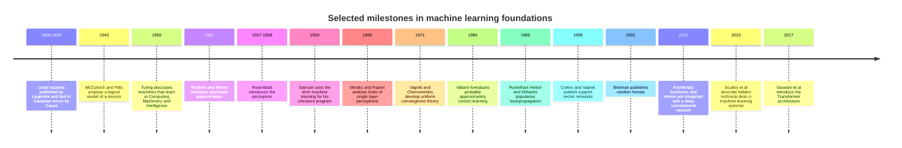

**Statistical roots.** Least squares, published by Adrien-Marie Legendre in 1805 and connected to the normal distribution of measurement errors by Carl Friedrich Gauss in 1809, is still the starting point for regression and for the squared-error loss derived in Section 7. The conceptual move that matters here is that fitting a model to noisy observations is an estimation problem with an explicit error model, not a curve-drawing exercise.

**Learning machines.** Warren McCulloch and Walter Pitts (1943) proposed a threshold-unit model of a neuron, Alan Turing (1950) discussed the possibility of machines that learn, and Frank Rosenblatt's perceptron (1957-1958) was an early trainable classifier. Arthur Samuel's 1959 paper on a checkers-playing program is generally credited with popularising the phrase "machine learning". In 1969 Marvin Minsky and Seymour Papert showed that single-layer perceptrons cannot represent functions such as exclusive OR (XOR), which contributed to a period of reduced enthusiasm for neural approaches. The lesson for practitioners is that model capacity is a design variable with consequences, a theme that returns in Section 9.

**Optimization and theory.** Herbert Robbins and Sutton Monro's 1951 stochastic approximation method is the ancestor of the stochastic gradient descent used to train almost every modern model. Vladimir Vapnik and Alexey Chervonenkis (1971) developed the theory of when empirical averages converge uniformly to true expectations, which is the formal root of the question "how much can I trust training error?". Leslie Valiant (1984) framed learnability as probably approximately correct (PAC) learning. David Rumelhart, Geoffrey Hinton, and Ronald Williams (1986) popularised backpropagation for training multi-layer networks, and Corinna Cortes and Vladimir Vapnik (1995) introduced the support vector machine in its soft-margin form, which combined a margin objective with a regularization trade-off.

**Scale and systems.** Leo Breiman's random forests (2001) established ensembles of trees as a dominant approach for tabular data. The 2012 ImageNet result by Alex Krizhevsky, Ilya Sutskever, and Geoffrey Hinton showed that deep convolutional networks trained on accelerators could outperform hand-engineered features, and the 2017 paper "Attention Is All You Need" by Ashish Vaswani and colleagues introduced the Transformer that underlies today's language models. In parallel, D. Sculley and colleagues (2015) argued in "Hidden Technical Debt in Machine Learning Systems" that the model code is a small fraction of a production machine learning system and that data dependencies, feedback loops, and configuration create maintenance costs that ordinary software does not have. That observation motivates Sections 10 and 11 of this chapter.

## 3. Why Machine Learning Exists, and When It Is the Wrong Tool

Traditional software encodes a human-written rule: given the input, apply these steps. This works when the rule can be stated completely and remains stable. It fails when the rule is unknowable to the author (recognising a face in a photograph), too large to enumerate (every phrase that signals a billing complaint), or changing faster than it can be rewritten (which products an individual will want next week). Machine learning inverts the process: supply examples of inputs paired with desired outcomes, and let an optimization procedure find the rule. The product of that procedure is a model, a parameterized function whose parameters were chosen from data rather than typed by an engineer.

That inversion has a price. A learned model requires data that is representative of the cases it will see, a definition of "good" precise enough to optimise, infrastructure to train, version, deploy, and monitor it, and a plan for what happens when it is wrong. A fixed rule's behavior is auditable in a code review; a model's behavior can only be characterised statistically, through evaluation. The right question is therefore not "can machine learning do this?" but "does a learned model beat the simplest credible alternative by enough to pay for its lifecycle?".

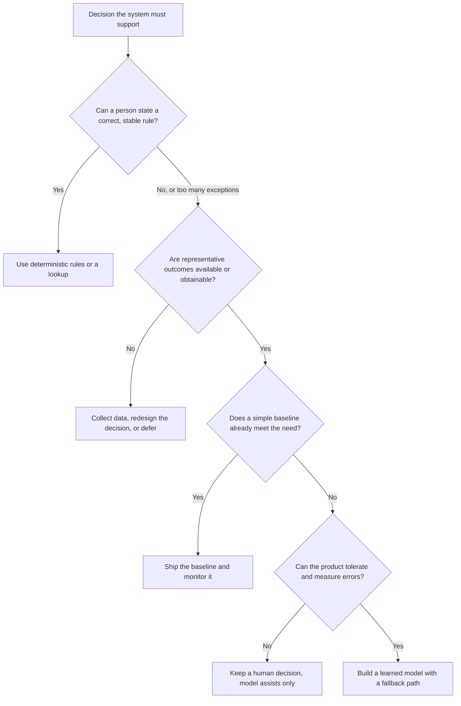

The decision tree makes three points that are easy to lose in enthusiasm for a technique. First, the left branch is a legitimate and often best outcome: a lookup table or a threshold rule that a domain expert can read is cheaper, faster, and more debuggable than any model. Second, "no data" is a blocker rather than an inconvenience; collecting labels may be the largest part of the project, and a project that cannot obtain outcomes cannot be evaluated, which means it cannot be responsibly deployed. Third, the final gate asks about errors, not accuracy. Every model will be wrong on some inputs. If a wrong answer is catastrophic, irreversible, or unreviewable, the design must change (a human decides, the model only assists, the action is reversible) before any algorithm is chosen.

A practical way to apply the tree is the **baseline ladder**: constant prediction (always the majority class or the historical average), then a hand-written rule, then a simple statistical model, then a more complex learned model. Each rung must demonstrate a measured gain over the previous one on the metric that reflects the real decision. Projects that jump straight to the top rung cannot tell whether the complexity is earning its keep, and they often discover late that the constant baseline was close to optimal for their cost structure, as the worked example in Section 12.3 shows.

Finally, learned models are appropriate only where error is tolerable in a probabilistic sense. A fraud screen can miss some fraud and flag some legitimate payments, provided the review process, the economics, and the customer experience absorb those errors. A rule that must hold for every input, such as "never ship to a sanctioned country", should remain a rule, possibly with a model proposing candidates for human review.

## 4. The Learning Problem

### 4.1 The formal setup

Start with the pieces that every supervised learning problem shares. There is an input space $\mathcal{X}$ (what the model sees) and an output space $\mathcal{Y}$ (what we want predicted). The world generates cases according to an unknown joint distribution $P(x, y)$; "unknown" is the whole point, because if we could write down $P$ we would not need to learn anything. We observe a finite training sample $S = \{(x_i, y_i)\}_{i=1}^{n}$ and typically assume its examples are drawn independent and identically distributed (i.i.d.) from $P$, the same distribution the deployed system will face. A **hypothesis class** $\mathcal{H} = \{f_\theta\}$ is the family of functions the learner may choose from, indexed by parameters $\theta$; a **loss function** $L(\hat{y}, y)$ assigns a non-negative penalty to a prediction $\hat{y}$ given the true outcome $y$.

The quantity we care about is the **true risk**, the expected loss on a fresh case:

$$
R(f) = \mathbb{E}_{(x, y) \sim P}\big[L(f(x), y)\big]
$$

The quantity we can compute is the **empirical risk**, the average loss on the training sample, $\hat{R}_S(f) = \frac{1}{n}\sum_{i=1}^{n} L(f(x_i), y_i)$. Empirical risk minimization is the strategy of choosing $f$ to make $\hat{R}_S$ small in the hope that $R$ is small too. Everything interesting in the rest of this chapter lives in the gap between those two quantities.

Two consequences follow immediately. First, even a perfect learner cannot drive $R$ to zero when the outcome is not fully determined by the inputs; the best achievable risk, called the **Bayes risk** or irreducible error, is set by noise in the world and by information the features do not contain. Second, the i.i.d. assumption is a modelling choice, not a fact. Customer behavior drifts over time, observations from the same account are correlated, and a deployed model changes the data it later sees (a recommendation changes what users click). When "same distribution" fails, empirical risk stops being a trustworthy estimate of future risk. [CH02](CH02_Data_Preparation_Feature_Engineering_and_Leakage.md) owns the splitting and leakage practices that protect against the most common violations, and [CH06](CH06_Model_Evaluation_Validation_and_Selection.md) owns the evaluation procedures built on them.

### 4.2 Learning setups

A learning setup is defined by the signal available to the learner, not by the algorithm. Supervised learning has labelled examples; unsupervised learning has only inputs; reinforcement learning has rewards that arrive through interaction; and generative modelling aims to produce new samples resembling the data. These are training setups, not product guarantees.

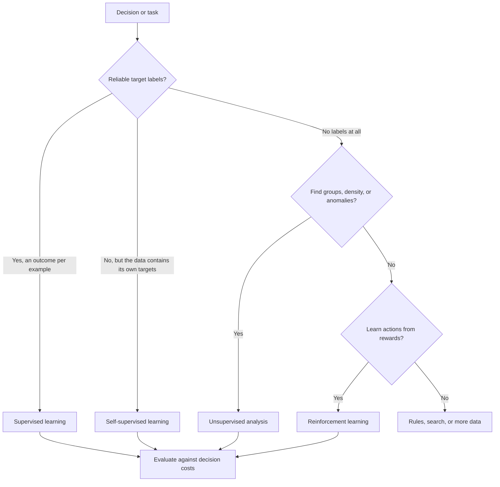

The taxonomy is a routing aid. Each leaf has a different relationship between data and evaluation, which is why they are taught separately, but all of them end in the same gate: evidence measured against what the decision actually costs.

| Setup | Signal the learner receives | Typical output | Example | Where taught |
|---|---|---|---|---|
| Supervised, regression | Numeric target per example | A number | Predict delivery time in minutes | [CH03](CH03_Regression_and_Classification.md) |
| Supervised, classification | Class label per example | A class or class probabilities | Will this account cancel | [CH03](CH03_Regression_and_Classification.md), [CH04](CH04_Decision_Trees_and_Ensemble_Learning.md) |
| Unsupervised | Inputs only | Groups, density, or compressed representation | Segment usage patterns | [CH05](CH05_Unsupervised_Learning_and_Representation_Reduction.md) |
| Self-supervised | Targets derived from the input itself | A learned representation or next-element predictor | Predict the next token in text | [CH15](CH15_Large_Language_Model_Fundamentals_and_Inference.md), [CH16](CH16_Embeddings_and_Semantic_Representations.md) |
| Reinforcement | Scalar reward after actions | A policy mapping states to actions | Adaptive control of a resource | [CH13](CH13_Reinforcement_Learning.md) |
| Generative | Samples from a distribution | New samples resembling the data | Image or text synthesis | [CH10](CH10_Transformers_and_Attention.md) onward |

Three distinctions deserve emphasis because they affect architecture. **Regression versus classification** is a choice about the output type, and it can often be made in more than one way; predicting "days until cancellation" is a regression, predicting "cancels within 30 days" is a classification, and they imply different labels, different data requirements, and different downstream consumers. **Self-supervised learning** blurs the supervised and unsupervised boundary: the labels are manufactured from raw data (hide a word and predict it), which removes the human-labelling bottleneck and is the reason large language models can learn from enormous text corpora. It is still an optimization problem with a loss, just one whose targets cost nothing to produce. **Reinforcement learning** differs in kind: the data the learner sees depends on its own past actions, so the i.i.d. assumption fails by construction and evaluating a new policy safely requires care.

### 4.3 Framing the decision

Do not begin with a model family. Begin with the decision the model supports, and fix five elements before touching an algorithm:

- **Prediction unit**: what one row represents (an account, a transaction, a session).
- **Decision time**: the moment at which a prediction must be made, which determines what information is legitimately available.
- **Horizon**: the future window over which the outcome is judged.
- **Label**: the observed outcome, and how and when it is recorded.
- **Action**: what the system or a person will do with the output, and what each kind of error costs.

Consider a subscription service that wants to prioritise outreach before renewal. The prediction unit is an active account on a fixed decision date; the horizon is the next billing period; the label is "cancelled during that period"; and the action is a retention call for the highest-risk accounts. These choices already exclude features recorded after the decision date (a cancellation reason typed after the account cancelled), and they reveal the economics: the call has a cost, a saved account has a value, and the model is useful only if the targeted group cancels at a meaningfully higher rate than the average. Skipping this framing yields technically accurate scores that answer the wrong business question.

## 5. Data, Features, Labels

Data is the specification of a learned system. In conventional software the specification is written as requirements and encoded as logic; in a learned system the behavior is whatever the optimizer extracts from examples, so every ambiguity, bias, or gap in the data becomes behavior. This section covers what an example is, how features and labels come to exist, and the ways data can fail to represent the decision the deployed system will actually make.

### 5.1 Examples, rows, and representation

An example is one instance of the prediction unit fixed in Section 4.3: in supervised learning a pair $(x, y)$, where $x$ is a vector of features and $y$ is the target. The model produces a prediction $\hat{y} = f_\theta(x)$ using learned parameters $\theta$, and the loss measures disagreement between $\hat{y}$ and $y$. Stacking $n$ examples gives a design matrix $X \in \mathbb{R}^{n \times d}$ (one row per example, one column per feature) and a target vector $y \in \mathbb{R}^{n}$. The closed-form and gradient-based solutions in Section 8 are written in this matrix form.

A model only ever sees numbers, so every encoding choice is an assumption about what matters. The table lists common feature types and the pitfall each brings. Encoding techniques and point-in-time construction belong to [CH02](CH02_Data_Preparation_Feature_Engineering_and_Leakage.md).

| Feature type | Example | Typical representation | Common pitfall |
|---|---|---|---|
| Continuous numeric | Order value | Scaled number | Heavy tails and unit mismatches; scale also affects optimization (Section 8.5) |
| Count | Support cases in the last 30 days | Number, often log-transformed | The counting window must end at decision time |
| Categorical (nominal) | Country | One-hot indicators or a learned embedding | High cardinality and categories unseen at deployment |
| Ordinal | Plan tier | Integer rank | Equal spacing between ranks is assumed, not guaranteed |
| Timestamp | Signup date | Derived age, recency, or day of week | A raw calendar value cannot generalize to future dates |
| Free text or image | Support ticket body | Learned embedding, see [CH16](CH16_Embeddings_and_Semantic_Representations.md) | The representation is another model whose quality bounds yours |

### 5.2 Where labels come from

The model learns to predict the label as recorded, not the concept the product owner has in mind. Five properties of the label process cause most of the damage:

- **Noisy.** Annotators disagree, or an automated rule mislabels some cases. Noise limits the accuracy that can even be measured (Section 5.4).
- **Delayed.** The outcome is known only after the horizon closes, and may be corrected later. Rows whose window is still open are unlabeled, and treating "no outcome yet" as "negative" biases the training set.
- **Selectively observed.** The outcome is recorded only for cases where a prior decision allowed it. If repayment is observed only for approved loan applicants, a model trained on them has never seen the region the policy rejected.
- **Proxy.** A measurable quantity stands in for the real target, such as clicks for satisfaction. Optimizing the proxy faithfully can move it away from the goal.
- **Reflecting past human decisions.** The label is what a person decided (approved, escalated, flagged), not what turned out to be true. The model learns to imitate the decision process, including its inconsistencies and biases, and cannot learn the underlying outcome unless an outcome label also exists.

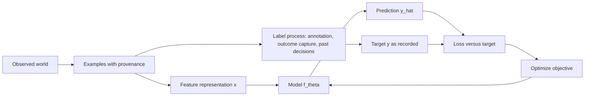

The diagram separates two paths that are easy to conflate. The feature path ends at the model input and must contain only information available at decision time. The label path passes through a process with its own errors, delays, and incentives, and its output is the only definition of "correct" that the optimizer ever sees. Any defect in the label process therefore reaches the model as ground truth, which is why label provenance is documented as carefully as feature provenance.

Label delay is a timing problem as well as a quality problem. The sequence below uses illustrative figures (a 30-day horizon and a 90-day correction window) to show why a training job must only use rows whose label window has closed.

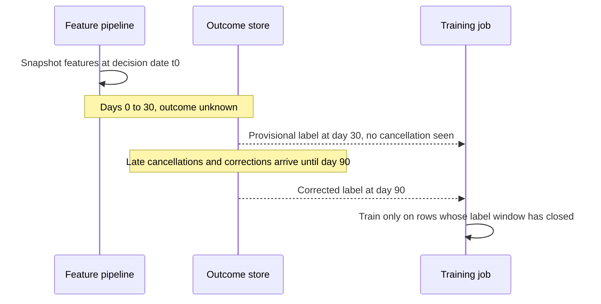

A job that trained at day 30 would see some eventual positives as negatives, and the error would be concentrated in the most recent rows, exactly the ones closest to the deployment distribution. The practical consequences are a labeling lag that must be budgeted into the retraining schedule, an explicit rule for provisional labels, and a freshness limit on how recent the training window can be. Leakage and time-aware splitting are treated in [CH02](CH02_Data_Preparation_Feature_Engineering_and_Leakage.md).

### 5.3 Training population versus deployment population

The training sample is drawn from the past, through whatever channels were instrumented, while the deployed model faces the future through whatever channels the product uses. Three standard terms describe how the two can differ. **Covariate shift** means the distribution of inputs $P(x)$ changes while the relationship $P(y \mid x)$ stays fixed. **Label shift** means the outcome rate changes. **Concept drift** means $P(y \mid x)$ itself changes, so the same input now deserves a different answer. Distinguishing them matters because only the last cannot be repaired by reweighting the data.

The i.i.d. assumption from Section 4.1 is violated in three recurring ways:

- **Time.** Rows are ordered and the future differs from the past, so random splits overstate performance and the evaluation must respect order.
- **Grouping.** Several rows come from the same account, patient, or device and are correlated. If one account appears on both sides of a split, the model can memorize it, so splits should be made by group.
- **Feedback loops.** The model's decisions change what data is collected later. If only recommended items are clicked, the next training set contains only what the previous model recommended.

Detection and remediation of drift in production belong to [CH29](CH29_MLOps_and_LLMOps.md); split design to [CH02](CH02_Data_Preparation_Feature_Engineering_and_Leakage.md) and [CH06](CH06_Model_Evaluation_Validation_and_Selection.md).

### 5.4 How label quality bounds achievable accuracy

Suppose labels are binary and each recorded label differs from the true label with probability $\epsilon$, independently of the features and of the model. Consider a model that agrees with the true label with probability $a$. It agrees with the recorded label when it is right and the label was not flipped (probability $a(1-\epsilon)$) or when it is wrong and the label was flipped (probability $(1-a)\epsilon$). The measured accuracy is therefore

$$
A_{\text{measured}} = a(1-\epsilon) + (1-a)\epsilon = \epsilon + a(1 - 2\epsilon)
$$

The table evaluates this for a perfect model ($a = 1$) and two imperfect ones. All values are illustrative arithmetic under the stated independence assumption.

| Label noise rate $\epsilon$ | $a = 1.00$ | $a = 0.95$ | $a = 0.90$ |
|---|---|---|---|
| 0.00 | 1.000 | 0.950 | 0.900 |
| 0.05 | 0.950 | 0.905 | 0.860 |
| 0.10 | 0.900 | 0.860 | 0.820 |
| 0.20 | 0.800 | 0.770 | 0.740 |

Two lessons follow. First, with $\epsilon = 0.10$ even a perfect model measures 90%, so a target of 95% measured accuracy is unattainable no matter how good the model is. Second, noise compresses differences: the true 5-point gap between $a = 0.95$ and $a = 0.90$ is $0.05(1-2\epsilon)$ when measured, which is 4 points at $\epsilon = 0.10$ and 3 points at $\epsilon = 0.20$, making improvements harder to detect. If noise is concentrated in one segment or correlated with the model's own errors, the simple formula no longer applies and the measured number can mislead in either direction. A small adjudicated re-labeling sample is the usual way to estimate $\epsilon$; Section 9 explains why a flexible model trained on noisy labels may also learn the noise.

### 5.5 Documenting the dataset

A dataset that cannot be described cannot be audited or reproduced. The practice of "datasheets for datasets" proposed by Timnit Gebru and colleagues is a useful template, and the governance and provenance obligations around it belong to [CH30](CH30_AI_Data_Governance_Privacy_and_Provenance.md). A minimal record states:

- the prediction unit, decision time, horizon, and label definition (Section 4.3);
- the collection period, source systems, and inclusion and exclusion rules;
- how each label was produced, by whom or what, with known noise and delay;
- which populations, channels, or periods are missing or underrepresented;
- consent, licensing, and retention constraints;
- the dataset version and the intended and unintended uses.

This record is what lets a reviewer decide whether the training population resembles the deployment population before any model is trained.

## 6. From Examples to an Objective

### 6.1 Empirical risk minimization

Section 4.1 defined the true risk $R(f)$ and the empirical risk $\hat{R}_S(f)$. Training turns that definition into a procedure: **empirical risk minimization (ERM)** chooses the parameters that minimize the average loss on the observed sample,

$$
\hat{R}(\theta) = \frac{1}{n}\sum_{i=1}^{n} L\big(f_\theta(x_i),\, y_i\big), \qquad \hat{\theta} = \arg\min_{\theta}\, \hat{R}(\theta)
$$

Everything the optimizer does is in service of this one number. The learner never sees $R(f)$, the loss on future cases, so its success depends on how well $\hat{R}$ stands in for it.

### 6.2 Why training loss is only a proxy

Three separate gaps sit between training loss and the quality of future decisions, and they have different remedies.

- **Sampling gap.** The sample is finite, so $\hat{R}$ fluctuates around $R$. More data shrinks this gap; nothing else does.
- **Distribution gap.** The sample may not come from the population the model will face (Section 5.3). More data from the same biased process does not close it.
- **Objective gap.** The loss may value errors differently from the business decision (Section 7.6). A better optimizer does not close it.

The sampling gap can be quantified in a limited case. For one fixed model chosen before looking at the sample, with loss between 0 and 1 and examples drawn i.i.d., Hoeffding's inequality gives

$$
P\big(\,|\hat{R} - R| \ge \varepsilon\,\big) \le 2\exp(-2n\varepsilon^2)
$$

With $n = 1000$ and $\varepsilon = 0.05$ the bound is $2e^{-5} \approx 0.0135$, so the empirical risk is within 0.05 of the true risk with probability at least 98.6%. With $n = 100$ it is $2e^{-0.5} \approx 1.21$, which exceeds 1 and therefore says nothing. The guarantee also assumes the model was fixed in advance. ERM violates that assumption by construction: it picks the model *because* it looks good on this sample, so the winner's empirical risk is optimistically biased. The more candidate models the learner can choose from, the larger the bias, which is the capacity effect developed in Section 9.

### 6.3 The regularized objective

Regularization changes the objective so that fit is traded against a measure of complexity or parameter size:

$$
J(\theta) = \hat{R}(\theta) + \lambda\,\Omega(\theta), \qquad \lambda \ge 0
$$

Here $\Omega$ is a penalty, for example the squared Euclidean ($\ell_2$) norm $\lVert\theta\rVert_2^2$, and $\lambda$ sets the exchange rate. At $\lambda = 0$ this is plain ERM; as $\lambda$ grows, the optimizer is pushed toward whatever minimizes $\Omega$ alone, which erases signal if overdone. Because adding a penalty can only raise the minimum training loss, training loss always prefers $\lambda = 0$, so $\lambda$ must be chosen with separate validation evidence, not training loss. Specific penalties and their effects are the subject of [CH03](CH03_Regression_and_Classification.md); two interpretations explain why the form is natural.

*Constraint view.* Minimizing $\hat{R}(\theta)$ subject to $\Omega(\theta) \le c$ is a constrained problem. Its Lagrangian is $\hat{R}(\theta) + \lambda(\Omega(\theta) - c)$ with multiplier $\lambda \ge 0$, which equals $J$ up to the constant $-\lambda c$. For convex problems each budget $c$ corresponds to some $\lambda$, with a tighter budget meaning a larger $\lambda$. The multiplier is the price the optimizer pays per unit of complexity.

*Prior view.* Suppose $y = f_\theta(x) + \varepsilon$ with Gaussian noise of variance $\sigma^2$, and a zero-mean Gaussian prior with variance $\tau^2$ on each parameter. The negative log posterior is, up to constants, $\frac{1}{2\sigma^2}\sum_i r_i^2 + \frac{1}{2\tau^2}\lVert\theta\rVert_2^2$, where $r_i = y_i - f_\theta(x_i)$. Multiplying by $2\sigma^2$ gives the sum of squared residuals plus $\lambda\lVert\theta\rVert_2^2$ with $\lambda = \sigma^2/\tau^2$. The maximum a posteriori (MAP) estimate therefore equals this penalized fit: a narrow prior (small $\tau$) means a strong penalty. The result is stated for the sum form of the loss; with the mean form the constant absorbs a factor of $n$.

### 6.4 Worked example: equal training loss, different generalization

The following example is illustrative and chosen so that every number can be checked by hand. The training sample is four noise-free points on the line $y = x$: $(0,0), (1,1), (2,2), (3,3)$. The truth the model should recover is $y = x$.

- **Model A** predicts $\hat{y} = x$ (two parameters: slope 1, intercept 0).
- **Model B** is a lookup table that stores the four training labels and, for any input, returns the label of the closest training input (four stored values).

Both models reproduce every training label, so both have a training mean squared error (MSE) of exactly 0. The training sample cannot tell them apart. Now evaluate on three new inputs, $x = 0.4, 1.4, 2.4$, whose true labels are $0.4, 1.4, 2.4$:

| Test input | True $y$ | A predicts | B predicts | A squared error | B squared error |
|---|---|---|---|---|---|
| 0.4 | 0.4 | 0.4 | 0 | 0 | 0.16 |
| 1.4 | 1.4 | 1.4 | 1 | 0 | 0.16 |
| 2.4 | 2.4 | 2.4 | 2 | 0 | 0.16 |
| **Test MSE** | | | | **0** | **0.16** |

If test labels also carry independent noise of variance $\sigma^2$, both test MSEs rise by $\sigma^2$ and the 0.16 gap is unchanged. With noisy training labels, B would also copy the noise, which would widen the gap. A complexity term does separate them: take $\Omega$ as the number of free parameters, a deliberately crude measure, and $\lambda = 0.01$. Then $J_A = 0 + 0.01 \times 2 = 0.02$ and $J_B = 0 + 0.01 \times 4 = 0.04$, so the regularized objective prefers A, the model that also generalizes better. The general lesson is that identical training loss is compatible with very different future behavior, which is why the evidence used to judge a model must be separate from the data used to fit it. Validation design is owned by [CH06](CH06_Model_Evaluation_Validation_and_Selection.md).

## 7. Loss Functions

A loss function is not a free design choice. Most standard losses are the negative logarithm of a probability model for the labels, so choosing one is the same as asserting how the labels are generated. This section derives the common losses from that view, shows where each is fragile, and connects them to the cost of real decisions.

### 7.1 Squared error from Gaussian noise

**Maximum likelihood estimation (MLE)** chooses the parameters that make the observed labels most probable: $\hat{\theta} = \arg\max_\theta \prod_i p(y_i \mid x_i; \theta)$. Taking logarithms does not change the maximizer and turns the product into a sum, so MLE is equivalent to minimizing the negative log-likelihood (NLL).

Assume the target is the model output plus Gaussian noise, $y = f_\theta(x) + \varepsilon$ with $\varepsilon \sim \mathcal{N}(0, \sigma^2)$. Then

$$
p(y \mid x; \theta) = \frac{1}{\sqrt{2\pi\sigma^2}} \exp\!\left(-\frac{(y - f_\theta(x))^2}{2\sigma^2}\right)
$$

and the NLL over $n$ independent examples is

$$
\mathrm{NLL}(\theta) = \frac{n}{2}\ln(2\pi\sigma^2) + \frac{1}{2\sigma^2}\sum_{i=1}^{n}\big(y_i - f_\theta(x_i)\big)^2
$$

The first term does not depend on $\theta$ and, for fixed $\sigma$, the factor $1/(2\sigma^2)$ only rescales the second, so minimizing the NLL is exactly minimizing the sum of squared errors, or equivalently the mean squared error (MSE). Setting the derivative with respect to $\sigma^2$ to zero gives $\hat{\sigma}^2 = \mathrm{MSE}$: the fitted noise variance is the training MSE. The gradient of $\tfrac{1}{2}(\hat{y} - y)^2$ with respect to the prediction is $\hat{y} - y$, which grows linearly with the error, so a single large residual can dominate the update.

### 7.2 Log loss from Bernoulli likelihood

For a binary label $y \in \{0, 1\}$, let the model output a probability $p = \sigma(z)$, where $z = w^\top x + b$ and $\sigma(z) = 1/(1 + e^{-z})$ is the logistic function. The Bernoulli likelihood of one label is $p^{y}(1-p)^{1-y}$, so its NLL is the **log loss**, also called binary cross-entropy:

$$
\ell(p, y) = -y \ln p - (1 - y)\ln(1 - p)
$$

To obtain the gradient, use $\mathrm{d}p/\mathrm{d}z = p(1-p)$ and $\partial \ell / \partial p = -y/p + (1-y)/(1-p)$. The chain rule gives

$$
\frac{\partial \ell}{\partial z} = p(1-p)\left(-\frac{y}{p} + \frac{1-y}{1-p}\right) = -y(1-p) + (1-y)p = p - y
$$

so that $\partial \ell / \partial w = (p - y)\,x$ and $\partial \ell / \partial b = p - y$. This has the same "prediction minus target, times input" form as linear regression with squared error. It is a consequence of pairing each noise model with its natural link function, stated here without proof. A numeric check: for $x = 2$, $y = 1$, $w = -1$, the logit is $z = -2$, $p = \sigma(-2) \approx 0.1192$ and the gradient is $(0.1192 - 1)\times 2 \approx -1.7616$, which the code in Section 7.7 confirms against a finite-difference estimate.

The pairing matters. Applying squared error to the probability instead gives a gradient with respect to $z$ of $(p - y)\,p(1-p)$, which vanishes when the sigmoid saturates. Take $y = 1$ and $z = -4$, so $p \approx 0.017986$ and the model is confidently wrong. The log-loss gradient with respect to $z$ is $p - y \approx -0.982$, while the squared-error gradient is about $-0.0173$, roughly 57 times smaller. Log loss keeps pushing hard when the model is confidently wrong; squared error on probabilities stalls. Log loss also penalizes confident mistakes without bound: $-\ln 0.01 \approx 4.605$ when the model gives probability 0.01 to the event that occurred.

### 7.3 Absolute loss, the median, and Huber loss

Squared error corresponds to an estimate of the conditional mean. If the noise is instead Laplace-distributed, with density proportional to $\exp(-\lvert y - \mu\rvert / b)$, the same derivation gives the absolute loss $\lvert \hat{y} - y\rvert$, whose minimizer for a constant prediction is the median. Averaged over examples this is the mean absolute error (MAE). Its gradient has constant magnitude, so outliers pull no harder than ordinary points, but it is not differentiable at zero. **Huber loss** with threshold $\delta$ combines both:

$$
L_\delta(r) = \begin{cases} \tfrac{1}{2}r^2 & \lvert r\rvert \le \delta \\[2pt] \delta\big(\lvert r\rvert - \tfrac{1}{2}\delta\big) & \lvert r\rvert > \delta \end{cases}
$$

where $r = y - \hat{y}$. The two pieces meet at $\lvert r\rvert = \delta$ with equal value $\tfrac{1}{2}\delta^2$ and equal slope $\delta$, so the function is smooth, quadratic near zero and linear in the tails.

*Worked outlier example (illustrative).* Fit a single constant $c$ to the values $1, 2, 3, 4, 100$.

- Squared error is minimized by the mean, $c = 110/5 = 22$. Without the outlier the mean of $1, 2, 3, 4$ is $2.5$, so one point moved the estimate by $19.5$.
- Absolute error is minimized by the median, $c = 3$ (versus $2.5$ without the outlier, a shift of $0.5$).
- Huber loss with $\delta = 1$ is minimized where the clipped residuals sum to zero. At $c = 3$ the residuals are $-2, -1, 0, 1, 97$, which clip to $-1, -1, 0, 1, 1$ and sum to zero, so $c = 3$. Without the outlier the minimizer is $2.5$.

At $c = 3$ the squared-error gradient contribution of the outlier is $97$, while under absolute or Huber loss it is capped at $1$. When label errors or genuine extreme cases are expected, this bounded influence is what keeps the fit stable. Whether extremes should be down-weighted is a business question: for a revenue forecast the large values may be exactly what matters.

### 7.4 Asymmetric and cost-sensitive loss

Real errors rarely cost the same in both directions. Let a false positive (FP) cost $C_{FP}$, a false negative (FN) cost $C_{FN}$, and a correct decision cost nothing. Given the true probability $p = P(y = 1 \mid x)$, predicting positive has expected cost $(1 - p)\,C_{FP}$, because it is wrong with probability $1 - p$. Predicting negative has expected cost $p\,C_{FN}$. Predict positive exactly when

$$
(1 - p)\,C_{FP} < p\,C_{FN} \;\Longleftrightarrow\; C_{FP} < p\,(C_{FP} + C_{FN}) \;\Longleftrightarrow\; p > t^{*} = \frac{C_{FP}}{C_{FP} + C_{FN}}
$$

Equivalently, predict positive when the odds $p/(1-p)$ exceed $C_{FP}/C_{FN}$. With equal costs $t^{*} = 0.5$. With $C_{FP} = 1$ and $C_{FN} = 9$, $t^{*} = 1/10 = 0.1$: the decision rule should flag a case when it is even 10% likely, because missing it is nine times as costly as a false alarm. The rule assumes calibrated probabilities and constant costs per error type; calibration and threshold selection in depth are owned by [CH03](CH03_Regression_and_Classification.md).

Two training-time analogues exist. For regression, the pinball (quantile) loss charges $\tau$ per unit of under-prediction and $1 - \tau$ per unit of over-prediction, and its minimizer is the $\tau$-quantile. For classification, weighting positives by $C_{FN}$ and negatives by $C_{FP}$ in the log loss makes the pointwise optimal output $q$ satisfy $q/(1-q) = (C_{FN}/C_{FP})\,p/(1-p)$ for a sufficiently flexible model. A cutoff of 0.5 on $q$ is then the same as the cutoff $t^{*}$ on $p$, but the outputs are no longer calibrated probabilities.

### 7.5 Proper scoring rules

A scoring rule for probabilistic predictions is **proper** if the expected loss is minimized when the model reports the true probability, and strictly proper if only then. Log loss and the Brier score $(q - y)^2$ are both strictly proper. For Brier, the expected loss of reporting $q$ when the event has true probability $p$ is $p(1-q)^2 + (1-p)q^2$, whose derivative $2(q - p)$ vanishes only at $q = p$; for log loss the derivative $-p/q + (1-p)/(1-q)$ also vanishes only at $q = p$. Accuracy at a fixed cutoff is not proper, because any probability on the correct side of the cutoff scores the same. This matters because the cost-based rule in Section 7.4 consumes probabilities, so the quantity being trained and evaluated must reward honest ones.

### 7.6 Proxy loss versus business metric

The training loss is a differentiable surrogate chosen so that an optimizer can work with it. The quantity the business cares about is often not differentiable (accuracy has zero gradient almost everywhere), not per-example (recall within a fixed review capacity), or measured on a subset (only the 200 highest-risk accounts are called). A model with a lower average log loss can still rank the top of the list worse than one with a higher log loss. The workable discipline is to train on a surrogate that is well behaved, evaluate on the metric that reflects the decision (Section 4.3), choose weights or thresholds to match decision costs, and check on validation data that the surrogate and the decision metric rank candidate models consistently. When they disagree, the objective is wrong and no amount of optimization will repair it. Metric design belongs to [CH06](CH06_Model_Evaluation_Validation_and_Selection.md).

### 7.7 Comparison and a runnable check

| Loss | Per-example form | Assumed noise or target | Constant-prediction minimizer | Sensitivity to outliers | Typical use |
|---|---|---|---|---|---|
| Squared error | $\tfrac{1}{2}(\hat{y}-y)^2$ | Gaussian | Mean | High, influence grows with the residual | Mean regression |
| Absolute error | $\lvert\hat{y}-y\rvert$ | Laplace | Median | Low, constant influence | Robust regression |
| Huber | Quadratic then linear at $\delta$ | Gaussian core, heavier tails | Between mean and median | Bounded influence | Robust, smooth gradient |
| Pinball | $\tau r$ if $r \ge 0$, else $(\tau - 1)r$ | Asymmetric costs | $\tau$-quantile | Low | Quantile and asymmetric forecasts |
| Log loss | $-y\ln p - (1-y)\ln(1-p)$ | Bernoulli | True probability | Unbounded penalty for confident errors | Probabilistic classification |
| Brier | $(p - y)^2$ | Bernoulli | True probability | Bounded, maximum 1 | Evaluating probabilities |
| Weighted log loss | Log loss scaled by class cost | Bernoulli with costs | Cost-shifted odds | As log loss | Cost-sensitive classification |

The NumPy (a Python numerical array library) snippet below computes each loss on the same toy data. The regression values and the classification probabilities are illustrative.

```python
import numpy as np

# Regression: four ordinary points and one outlier label.
y = np.array([1.0, 2.0, 3.0, 4.0, 100.0])
pred = np.array([2.0, 2.0, 3.0, 5.0, 10.0])
r = y - pred  # residuals: -1, 0, 0, -1, 90

mse = np.mean(r ** 2)
mae = np.mean(np.abs(r))
delta = 1.0
huber = np.mean(np.where(np.abs(r) <= delta, 0.5 * r ** 2, delta * (np.abs(r) - 0.5 * delta)))
tau = 0.9
pinball = np.mean(np.where(r >= 0, tau * r, (tau - 1.0) * r))
print(f"MSE={mse:.4f} MAE={mae:.4f} Huber={huber:.4f} Pinball(0.9)={pinball:.4f}")
print(f"outlier share of squared error: {r[-1] ** 2 / np.sum(r ** 2):.4f}")

# Classification: four labels with predicted probabilities.
yb = np.array([1, 0, 1, 0])
p = np.array([0.9, 0.2, 0.4, 0.7])
logloss = -np.mean(yb * np.log(p) + (1 - yb) * np.log(1 - p))
brier = np.mean((p - yb) ** 2)
print(f"log loss={logloss:.4f} Brier={brier:.4f}")

# Cost-sensitive threshold: C_FP = 1, C_FN = 9.
c_fp, c_fn = 1.0, 9.0
t_star = c_fp / (c_fp + c_fn)

def total_cost(threshold):
    yhat = (p > threshold).astype(int)
    fp = np.sum((yhat == 1) & (yb == 0))
    fn = np.sum((yhat == 0) & (yb == 1))
    return c_fp * fp + c_fn * fn

print(f"t*={t_star:.2f} cost@0.5={total_cost(0.5):.0f} cost@t*={total_cost(t_star):.0f}")

# Finite-difference check of the logistic gradient (p - y) * x at x=2, y=1, w=-1.
def nll(w, x=2.0, label=1.0):
    q = 1 / (1 + np.exp(-w * x))
    return -(label * np.log(q) + (1 - label) * np.log(1 - q))

w0, eps = -1.0, 1e-6
numeric = (nll(w0 + eps) - nll(w0 - eps)) / (2 * eps)
analytic = (1 / (1 + np.exp(2.0)) - 1) * 2.0
print(f"finite diff={numeric:.4f} analytic={analytic:.4f}")
```

Expected output:

```text
MSE=1620.4000 MAE=18.4000 Huber=18.1000 Pinball(0.9)=16.2400
outlier share of squared error: 0.9998
log loss=0.6122 Brier=0.2250
t*=0.10 cost@0.5=10 cost@t*=2
finite diff=-1.7616 analytic=-1.7616
```

These values can be checked by hand. The residuals are $-1, 0, 0, -1, 90$, so MSE is $(1 + 0 + 0 + 1 + 8100)/5 = 1620.4$ and MAE is $92/5 = 18.4$. Huber with $\delta = 1$ contributes $0.5, 0, 0, 0.5$ and $90 - 0.5 = 89.5$, a mean of $90.5/5 = 18.1$. Pinball with $\tau = 0.9$ contributes $0.1$ for each of the two over-predictions and $0.9 \times 90 = 81$ for the outlier, a mean of $81.2/5 = 16.24$. The outlier supplies $8100/8102 \approx 99.98\%$ of the squared error. The log loss is $(0.1054 + 0.2231 + 0.9163 + 1.2040)/4 = 2.4488/4 \approx 0.6122$, and the Brier score is $(0.01 + 0.04 + 0.36 + 0.49)/4 = 0.225$. At the cutoff 0.5 the predictions are $1, 0, 0, 1$, giving one false negative (cost 9) and one false positive (cost 1), a total of 10. At $t^{*} = 0.1$ all four cases are flagged, giving two false positives and no false negatives, a total of 2. Both cutoffs have accuracy 50%, yet the cost differs fivefold, which is the point of choosing the decision rule from costs instead of from accuracy.

## 8. Optimization

Training searches for parameters that make the objective $J(\theta)$ small. The search is iterative, local, and sensitive to step size and to how features are scaled, and it can fail in ways that look like model problems. This section derives gradient descent, shows exactly when it converges or diverges, and gives a diagnostic procedure for a loss that will not fall.

### 8.1 The loss landscape and convexity

Viewed as a function of the parameters, the objective is a surface. A function is **convex** if the line segment between any two points on its graph lies on or above the graph. For a convex objective every local minimum is a global minimum, and gradient descent with a suitable step size reaches it. Linear regression with squared error and logistic regression with log loss are convex in their parameters. The losses of neural networks ([CH07](CH07_Deep_Learning_Foundations.md)) are not, and three features of non-convex surfaces matter in practice:

- **Multiple local minima**, of different quality, so initialization and random seeds can change the result.
- **Plateaus**, flat regions where the gradient is near zero and progress stalls without being at a minimum.
- **Saddle points**, where the gradient is exactly zero but the surface curves up in some directions and down in others. A zero gradient therefore does not certify a minimum.

### 8.2 Gradient descent

Gradient descent (GD) follows from a first-order Taylor expansion. For a small step $\Delta$,

$$
J(\theta + \Delta) \approx J(\theta) + \nabla J(\theta)^\top \Delta
$$

Among steps of a fixed length the change is most negative when $\Delta$ points opposite the gradient, so take $\Delta = -\eta\,\nabla J(\theta)$. The predicted change is then $-\eta\,\lVert\nabla J(\theta)\rVert^2 \le 0$, and the update rule is

$$
\theta_{t+1} = \theta_t - \eta\,\nabla J(\theta_t)
$$

where $\eta > 0$ is the learning rate. The expansion is valid only for small steps, so the approximation, and with it the guarantee of decrease, breaks down when $\eta$ is large relative to the curvature of the surface. That is the source of the divergence analyzed in Section 8.4. When each step uses a mini-batch $B_t$ the gradient is replaced by $\nabla \hat{R}_{B_t}$ (Section 8.6).

### 8.3 Worked example in one dimension

Let $f_w(x) = wx$ with a single example $(x, y) = (2, 5)$ and loss $L = \tfrac{1}{2}(wx - y)^2$. The gradient is $\mathrm{d}L/\mathrm{d}w = (wx - y)\,x$. Start at $w_0 = 1$ with $\eta = 0.1$; the error is $e_t = w_t x - y$.

| Step $t$ | $w_t$ | Prediction | Error $e_t$ | Gradient $e_t x$ | Loss |
|---|---|---|---|---|---|
| 0 | 1.000 | 2.000 | -3.000 | -6.000 | 4.500 |
| 1 | 1.600 | 3.200 | -1.800 | -3.600 | 1.620 |
| 2 | 1.960 | 3.920 | -1.080 | -2.160 | 0.5832 |
| 3 | 2.176 | 4.352 | -0.648 | -1.296 | 0.209952 |

The pattern is exact. The update $w_{t+1} = w_t - \eta x e_t$ gives $e_{t+1} = e_t - \eta x^2 e_t = (1 - \eta x^2)\,e_t$, here $0.6\,e_t$, so $e_t = -3 \times 0.6^t$ and the loss shrinks by $0.6^2 = 0.36$ per step. After ten steps the error is about $0.018$. The minimizer is $w = 2.5$, where the prediction equals the target. This loss measures one training example, so even a loss of zero would say nothing about future cases; that requires separate evidence ([CH06](CH06_Model_Evaluation_Validation_and_Selection.md)).

### 8.4 The learning rate: convergence and divergence

The worked example already contains the general result. For the one-dimensional quadratic $L(w) = \tfrac{a}{2}w^2$ with curvature $a > 0$, the gradient is $a w$, so

$$
w_{t+1} = w_t - \eta a w_t = (1 - \eta a)\,w_t \quad\Longrightarrow\quad w_t = (1 - \eta a)^t\,w_0
$$

This converges to zero if and only if $\lvert 1 - \eta a\rvert < 1$, that is, $0 < \eta < 2/a$. The multiplier $1 - \eta a$ determines the regime: between 0 and 1 the iterates approach the minimum monotonically; at exactly 0 ($\eta = 1/a$) one step suffices; between $-1$ and 0 they overshoot and oscillate while shrinking; at $-1$ they oscillate forever; below $-1$ they diverge. Take $a = 4$ (the curvature $x^2$ of the example above, so the limit is $2/a = 0.5$) and $w_0 = 1$:

| $\eta$ | Multiplier | Regime | $w_1$ | $w_2$ | $w_3$ |
|---|---|---|---|---|---|
| 0.10 | 0.6 | Monotone convergence | 0.6 | 0.36 | 0.216 |
| 0.25 | 0 | One-step convergence | 0 | 0 | 0 |
| 0.40 | -0.6 | Oscillating convergence | -0.6 | 0.36 | -0.216 |
| 0.50 | -1 | Sustained oscillation | -1 | 1 | -1 |
| 0.60 | -1.4 | Divergence | -1.4 | 1.96 | -2.744 |

For $\eta = 0.6$ the loss $2w^2$ goes $2, 3.92, 7.6832, 15.059, \dots$ and grows without bound, although each step is computed by the same rule that converged at $\eta = 0.1$. For a multi-dimensional quadratic with curvature eigenvalues $\lambda_i$ the condition becomes $\eta < 2/\lambda_{\max}$, the largest curvature in any direction.

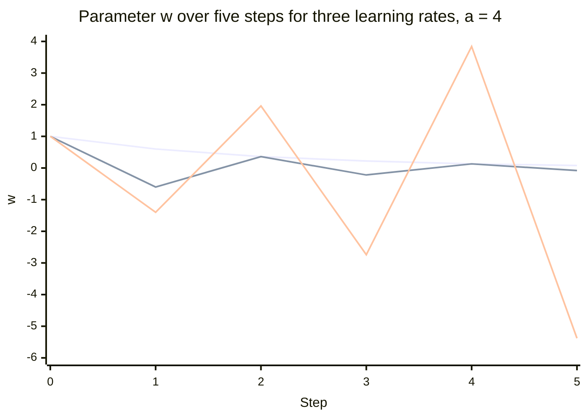

The first line ($\eta = 0.1$) decays smoothly toward 0, the second ($\eta = 0.4$) alternates sign but with shrinking amplitude, and the third ($\eta = 0.6$) alternates with growing amplitude. The practical reading of a training curve follows: a loss that bounces with growing amplitude or becomes NaN (not a number) indicates a step beyond the stability limit, whereas a smooth but very slow decline indicates a step far below it. Because $2/\lambda_{\max}$ depends on the data, the same learning rate can be safe for one scaling of the features and divergent for another.

### 8.5 Conditioning and feature scaling

For the mean squared loss $\tfrac{1}{2n}\lVert Xw - y\rVert^2$ the curvature is the matrix $H = X^\top X / n$. Along the eigenvector of $H$ with eigenvalue $\lambda_i$, the error contracts by $1 - \eta\lambda_i$ per step. Stability requires $\eta < 2/\lambda_{\max}$, while progress along the flattest direction is governed by $1 - \eta\lambda_{\min}$. With the near-maximal step $\eta = 1/\lambda_{\max}$ that factor is $1 - 1/\kappa$, where $\kappa = \lambda_{\max}/\lambda_{\min}$ is the **condition number**. Shrinking the error by a factor of 1000 then takes about $\ln(1000)/(-\ln(1 - 1/\kappa)) \approx 6.9\,\kappa$ steps.

*Worked example (illustrative).* Take two centered, uncorrelated features, so $H$ is diagonal with entries equal to the mean squares $\overline{x_1^2}$ and $\overline{x_2^2}$. Let $x_1$ have standard deviation 100 and $x_2$ have standard deviation 1, giving $H = \mathrm{diag}(10^4, 1)$ and $\kappa = 10^4$. The largest stable step is $2/10^4 = 0.0002$; at $\eta = 0.0003$ the multiplier in the $x_1$ direction is $1 - 3 = -2$ and training diverges. At $\eta = 10^{-4}$ the $x_1$ direction is solved in one step, but the $x_2$ direction contracts by only $0.9999$ per step, so shrinking its error by 1000 takes $\ln(1000)/(-\ln 0.9999) \approx 69{,}000$ steps. The step cannot be raised to speed this up because the $x_1$ direction forbids it. After standardizing both features to unit variance, $H = I$, $\kappa = 1$, and $\eta = 1$ converges in one step; $\eta = 0.5$ halves the error each step, reaching a 1000-fold reduction in 10. Correlated or uncentered features raise $\kappa$ further. Scaling statistics must come from training data only, which [CH02](CH02_Data_Preparation_Feature_Engineering_and_Leakage.md) explains. Section 8.10 repeats the comparison on real numbers.

### 8.6 Mini-batch stochastic gradient descent

The full gradient requires a pass over all $n$ examples per step. **Stochastic gradient descent (SGD)**, whose ancestor is the Robbins and Monro method of Section 2, instead estimates the gradient from a random mini-batch of $B$ examples. The estimate is unbiased, meaning its average over random batches equals the full gradient $\nabla \hat{R}$, and its variance is about $\sigma_g^2/B$, where $\sigma_g^2$ is the per-example gradient variance, so the noise standard deviation falls as $1/\sqrt{B}$. Moving from $B = 1$ to $B = 32$ cuts it by about 5.7 times, and to $B = 1024$ by 32 times. Going from 32 to 1024 costs 32 times the computation per step for a further 5.7-fold reduction, which is a sharply diminishing return.

- **Small batches** are cheap per step and give many updates per epoch (one pass over the data). The noise can help the iterate leave plateaus and saddle points, but the loss curve is jagged and a constant learning rate leaves the iterate fluctuating in a neighborhood of the minimum rather than settling at it.
- **Large batches** give smoother curves and use parallel hardware efficiently, but each epoch has fewer updates and the benefit of extra batch size flattens. Rules of thumb that scale the learning rate with batch size exist, but they are heuristics that must be validated rather than relied on.
- **Decaying the learning rate** over time shrinks the noise ball. The classical convergence conditions for stochastic approximation require step sizes whose sum diverges and whose sum of squares converges.

### 8.7 Momentum and adaptive methods

Two refinements address the conditioning problem without rescaling features. **Momentum** steps along an exponentially decaying average of past gradients, which damps oscillation across steep directions and accelerates travel along consistent ones. **Adaptive methods**, such as RMSProp and Adam, divide each parameter's step by a running measure of its gradient magnitude, which acts as a per-parameter learning rate. These reduce sensitivity to badly scaled features, but they do not repair a defective target, a leaked feature, or an unrepresentative sample. Update equations, hyperparameters, and accelerator considerations belong to [CH07](CH07_Deep_Learning_Foundations.md).

### 8.8 The training loop, stopping, and early stopping

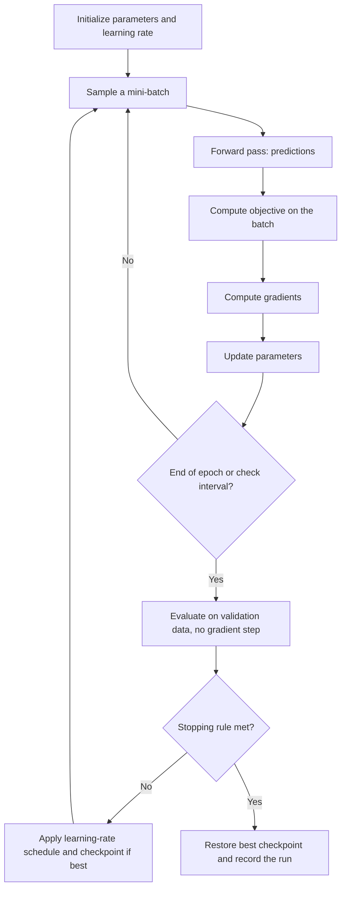

The loop has two distinct roles for data. Training batches drive parameter updates, while validation data is evaluated outside the gradient path purely to decide when to stop and which checkpoint to keep. Logging both curves is what makes the loop diagnosable: a falling training curve with a rising validation curve is a generalization problem (Section 9), and a flat training curve is an optimization problem (Section 8.11).

Common stopping rules are a gradient norm below a tolerance, a loss improvement below a tolerance for several consecutive checks, and a fixed iteration or compute budget. **Early stopping** halts when validation loss has not improved for a chosen number of checks (the patience) and restores the best checkpoint. It limits how far the parameters move from their starting point, so it acts as an implicit regularizer; for gradient descent on least squares from a zero start the effect is qualitatively similar to a penalty. Because the validation set now influenced the choice of checkpoint, an unbiased final estimate needs a separate test set ([CH06](CH06_Model_Evaluation_Validation_and_Selection.md)). Record code version, data version, configuration, and random seeds with each run; nondeterministic data pipelines, hardware kernels, and distributed execution limit exact reproducibility, so log enough to explain variation.

### 8.9 Closed-form versus iterative solutions for linear regression

For squared loss on a linear model the gradient of $\tfrac{1}{2}\lVert Xw - y\rVert^2$ is $X^\top X w - X^\top y$. Setting it to zero gives the **normal equations**,

$$
X^\top X\,w = X^\top y \quad\Longrightarrow\quad \hat{w} = (X^\top X)^{-1}X^\top y
$$

provided $X^\top X$ is invertible, which holds when the columns of $X$ are linearly independent. The cost is about $O(nd^2)$ to form $X^\top X$ and $O(d^3)$ to solve it. For the dataset in Section 8.10, $X^\top X = \begin{pmatrix} 5 & 10 \\ 10 & 30 \end{pmatrix}$ and $X^\top y = (25.0,\ 69.7)^\top$. Its determinant is 50, so $\hat{w} = \tfrac{1}{50}(30 \cdot 25 - 10 \cdot 69.7,\ -10 \cdot 25 + 5 \cdot 69.7)^\top = (1.06,\ 1.97)^\top$.

The closed form is fragile in several situations: duplicated or collinear features make $X^\top X$ singular; with more features than examples ($d > n$) infinitely many weight vectors fit exactly; the condition number of $X^\top X$ is the square of that of $X$, so rounding error is amplified; and the $O(d^2)$ memory and $O(d^3)$ time become impractical for very large $d$. There is also no closed form for log loss or for non-linear models, so iterative methods are the general tool. In practice, numerical libraries solve least squares by QR or singular value decomposition (SVD) factorizations instead of forming an explicit inverse, and adding a ridge penalty $\lambda I$ makes the system invertible ([CH03](CH03_Regression_and_Classification.md)).

### 8.10 Complete gradient descent for linear regression

The program fits an intercept and a slope to five points by gradient descent, logs the training curve, and compares it with the normal-equation solution, then repeats the fit on standardized inputs. It uses the step $\eta = 1/\lambda_{\max}$ from Section 8.5 and stops when the gradient norm falls below $10^{-6}$.

```python
import numpy as np

x = np.array([0.0, 1.0, 2.0, 3.0, 4.0])
y = np.array([1.1, 2.9, 5.2, 6.8, 9.0])
X = np.column_stack([np.ones_like(x), x])  # first column is the intercept


def gradient_descent(X, y, eta, max_iter=20000, tol=1e-6):
    n = len(y)
    w = np.zeros(X.shape[1])
    history = []  # (iteration, loss, gradient norm), logged before each update
    for t in range(max_iter + 1):
        resid = X @ w - y
        loss = 0.5 * np.mean(resid ** 2)
        grad = X.T @ resid / n
        history.append((t, loss, float(np.linalg.norm(grad))))
        if np.linalg.norm(grad) < tol:
            break
        w = w - eta * grad
    return w, history


lam = np.linalg.eigvalsh(X.T @ X / len(y))  # curvature of the squared loss
print("Hessian eigenvalues", lam.round(4), "condition number", round(lam[-1] / lam[0], 2))

w_ne = np.linalg.lstsq(X, y, rcond=None)[0]
print("normal-equation solution", w_ne.round(4), "loss", round(0.5 * np.mean((X @ w_ne - y) ** 2), 4))

w, hist = gradient_descent(X, y, eta=0.1)
for t, loss, g in hist:
    if t in (0, 1, 2, 5, 10, 50, 200) or t == hist[-1][0]:
        print(f"iter {t:4d}  loss {loss:.6f}  |grad| {g:.2e}")
print("gradient descent solution", w.round(4))

# Same data, step 1/lambda_max: raw inputs versus standardized inputs.
w_raw, h_raw = gradient_descent(X, y, eta=1 / lam[-1])
z = (x - x.mean()) / x.std()
Xs = np.column_stack([np.ones_like(z), z])
lam_s = np.linalg.eigvalsh(Xs.T @ Xs / len(y))
w_s, h_s = gradient_descent(Xs, y, eta=1 / lam_s[-1])
print("raw inputs:", h_raw[-1][0], "iterations")
print("standardized inputs:", h_s[-1][0], "iteration, weights", w_s.round(4))
```

Expected output:

```text
Hessian eigenvalues [0.2984 6.7016] condition number 22.46
normal-equation solution [1.06 1.97] loss 0.0091
iter    0  loss 16.390000  |grad| 1.48e+01
iter    1  loss 1.806348  |grad| 4.89e+00
iter    2  loss 0.218806  |grad| 1.61e+00
iter    5  loss 0.022709  |grad| 1.06e-01
iter   10  loss 0.018968  |grad| 7.67e-02
iter   50  loss 0.009974  |grad| 2.28e-02
iter  200  loss 0.009100  |grad| 2.43e-04
iter  382  loss 0.009100  |grad| 9.78e-07
gradient descent solution [1.06 1.97]
raw inputs: 254 iterations
standardized inputs: 1 iteration, weights [5.    2.786]
```

The numbers can be verified by hand. At $w = (0, 0)$ the predictions are zero, so the gradient is $(-\bar{y},\ -\overline{xy}) = (-5.0,\ -13.94)$, with norm $14.81$, and the loss is $\tfrac{1}{2}\overline{y^2} = 16.39$. One step of $\eta = 0.1$ gives $w = (0.5,\ 1.394)$ and a loss of $1.806348$. The closed-form fit has $\hat{w} = (1.06,\ 1.97)$ with a residual sum of squares of $0.091$, a loss of $0.0091$, which gradient descent reaches. The curvature eigenvalues are $(7 \pm \sqrt{41})/2 \approx 0.2984$ and $6.7016$, a condition number of $22.46$; the slow direction contracts by $1 - 0.1 \times 0.2984 \approx 0.970$ per step, which is why the last digits take hundreds of iterations. With $\eta = 1/\lambda_{\max}$ the raw inputs need 254 iterations, while standardized inputs have $H = I$ and need one. Their weights, $(5.0,\ 2.786)$, are the mean of $y$ and the slope $1.97\sqrt{2}$, because the standard deviation of $x$ is $\sqrt{2}$.

### 8.11 Diagnosing a loss that does not decrease

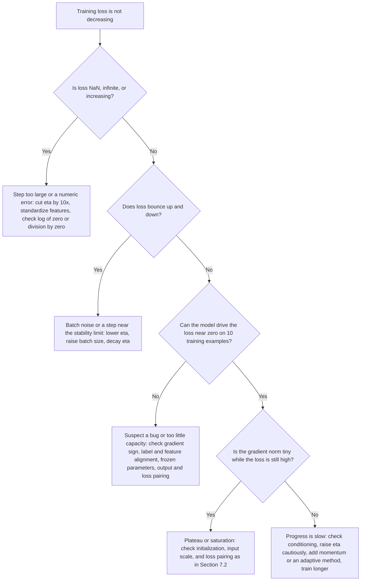

The branches are ordered from cheapest to most expensive to check. Divergence is nearly always a step size or numeric problem and is decided by looking at the first few iterations. Bouncing is separated from divergence because its causes, noise and a step near $2/\lambda_{\max}$, call for different remedies. The pivotal test is whether the model can memorize a handful of examples: if it cannot, the defect is in the code, the labels, or the capacity, and tuning the learning rate will not help; if it can, the optimizer and model are working and the remaining branches concern curvature and saturation. A gradient implementation can also be checked against a finite-difference estimate, as in Section 7.7. A training loss that falls while validation loss rises is not an optimization failure and is the subject of Section 9.

## 9. Generalization, Bias, and Variance

Section 6 showed that training loss is only a proxy for future loss. This section quantifies the gap for squared error, shows how to read it from evidence a team can actually collect, and then names the ways the future can differ from the sample. Underfitting occurs when a model cannot represent important patterns; overfitting occurs when it learns noise or idiosyncrasies that do not persist.

### 9.1 The bias-variance decomposition

Assume outcomes are generated as $y = f(x) + \varepsilon$, where $f$ is the true regression function, $\mathbb{E}[\varepsilon] = 0$, $\operatorname{Var}(\varepsilon) = \sigma^2$, and the noise at a test point is independent of the training sample $D$. A learner applied to a random sample returns a random function $\hat{f}_D$. Fix a test input $x$, take expectations over both $D$ and $\varepsilon$, and write $\bar{f}(x) = \mathbb{E}_D[\hat{f}_D(x)]$ for the prediction averaged over hypothetical training samples.

Step 1 separates the noise. Substitute $y$ and expand the square:

$$
\mathbb{E}\big[(y - \hat{f}_D)^2\big] = \mathbb{E}[\varepsilon^2] + \mathbb{E}\big[(f - \hat{f}_D)^2\big] + 2\,\mathbb{E}[\varepsilon]\;\mathbb{E}\big[f - \hat{f}_D\big] = \sigma^2 + \mathbb{E}\big[(f - \hat{f}_D)^2\big]
$$

The cross term factors because $\varepsilon$ is independent of $D$, and it vanishes because $\mathbb{E}[\varepsilon] = 0$. Step 2 adds and subtracts $\bar{f}$ in the remaining term, using $f - \hat{f}_D = (f - \bar{f}) + (\bar{f} - \hat{f}_D)$:

$$
\mathbb{E}\big[(f - \hat{f}_D)^2\big] = (f - \bar{f})^2 + \mathbb{E}\big[(\bar{f} - \hat{f}_D)^2\big] + 2\,(f - \bar{f})\,\mathbb{E}\big[\bar{f} - \hat{f}_D\big]
$$

The factor $f - \bar{f}$ is constant with respect to $D$, and $\mathbb{E}[\bar{f} - \hat{f}_D] = 0$ by the definition of $\bar{f}$, so the last term is zero. Combining the two steps:

$$
\underbrace{\mathbb{E}\big[(y - \hat{f}_D(x))^2\big]}_{\text{expected squared error}} = \underbrace{\sigma^2}_{\text{noise}} + \underbrace{\big(f(x) - \bar{f}(x)\big)^2}_{\text{bias}^2} + \underbrace{\mathbb{E}_D\big[(\hat{f}_D(x) - \bar{f}(x))^2\big]}_{\text{variance}}
$$

- **Noise** is the Bayes risk for squared loss from Section 4.1. No model, however flexible, goes below it.
- **Bias** is the systematic error that remains even if sampling variation were averaged away. It arises when the hypothesis class cannot represent $f$, when regularization pulls too hard, or when the features omit relevant information.
- **Variance** is how much the learned function moves when the training sample changes. It grows with flexibility and shrinks with data.

The identity is exact for squared error; other losses have analogues but not this additive form. It is also a thought experiment about resampled training sets. With one dataset in hand, bias and variance cannot be measured separately, except in simulation where $f$ and $\sigma^2$ are known (Exercise 1 in Section 14). In practice they are inferred from training and validation error, as the next two subsections show.

### 9.2 A worked example: polynomial degree versus error

The numbers below are **illustrative, not measured**. Take $n = 50$ training points, noise variance $\sigma^2 = 1.00$, and polynomial least-squares fits of degree $d$ with $p = d + 1$ parameters. For least squares with fixed input points, the average variance term is $\sigma^2 p / n$, and the expected training error is $\text{bias}^2 + \sigma^2(1 - p/n)$, because the fit absorbs a share $p/n$ of the noise. The bias values depend on the unknown $f$, so they are assumed here; everything else is computed from them.

| Degree $d$ | $p$ | Bias$^2$ (assumed) | Variance $p/50$ | Expected test MSE $= 1 + \text{bias}^2 + \text{var}$ | Expected training MSE $= \text{bias}^2 + 1 - p/50$ | Gap (test minus training) |
|---|---|---|---|---|---|---|
| 1 | 2 | 3.00 | 0.04 | 4.04 | 3.96 | 0.08 |
| 2 | 3 | 1.20 | 0.06 | 2.26 | 2.14 | 0.12 |
| 3 | 4 | 0.20 | 0.08 | 1.28 | 1.12 | 0.16 |
| 5 | 6 | 0.06 | 0.12 | 1.18 | 0.94 | 0.24 |
| 9 | 10 | 0.02 | 0.20 | 1.22 | 0.82 | 0.40 |
| 15 | 16 | 0.01 | 0.32 | 1.33 | 0.69 | 0.64 |
| 20 | 21 | 0.01 | 0.42 | 1.43 | 0.59 | 0.84 |

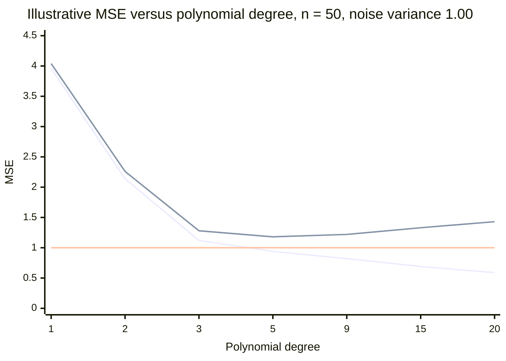

The lines are, in order, expected training MSE, expected test MSE, and the noise floor. Three readings follow.

1. **Training error only falls.** It decreases at every step and drops below the noise floor of 1.00 from degree 5 onward. An honest out-of-sample error cannot go below $\sigma^2$, so a training error under the floor is a signature of fitting noise, not of skill.
2. **Test error is U-shaped.** It bottoms out at degree 5 (1.18, only 0.18 above the floor). On the left, bias$^2$ dominates (3.00 of the 4.04 at degree 1); on the right, variance dominates (0.42 against bias$^2$ of 0.01 at degree 20).
3. **The best capacity depends on the data size.** Variance scales as $1/n$ while bias does not, so more data moves the optimum toward more flexible models. With the same assumed biases and $n = 200$, degree 5 gives $1 + 0.06 + 6/200 = 1.09$ while degree 9 gives $1 + 0.02 + 10/200 = 1.07$, so the best of the tabulated degrees moves from 5 to 9.

The practical consequence is that a team cannot choose capacity from training error. It needs a validation estimate of the test column, and it should expect that estimate to be noisy when the validation set is small (CH06 owns the uncertainty estimates).

### 9.3 Diagnosing capacity from learning curves

A **learning curve** plots training and validation error against a controlled variable, most often the training-set size $n$ (or the number of training epochs). The two curves together reveal which term of Section 9.1 is limiting. Judge them against a reference of acceptable error, such as the best simple baseline, a human benchmark, or the noise level estimated from adjudicated re-labeling (Section 5.4).

| Regime | Training error | Validation error | Gap | Typical causes | First responses |
|---|---|---|---|---|---|
| High bias (underfit) | Above the acceptable level | Similar to training | Small | Model too simple, features lack signal, over-regularized | Add informative features, raise capacity, reduce $\lambda$, reframe the problem; more data alone helps little |
| High variance (overfit) | Low | Much higher | Large | Flexible model for the sample size, many noisy features, near-duplicate rows | More data, stronger regularization, simpler model or fewer features, early stopping, averaging (CH04) |
| Near the noise floor | At or just above the floor | Close to training | Small | Remaining error is mostly irreducible | Stop tuning the model; change the target, obtain new information, or accept the error |
| Suspicious | Higher than validation, or erratic | Lower than training | Negative or unstable | Regularization active only in training, easy or tiny validation set, leakage | Audit the split ([CH02](CH02_Data_Preparation_Feature_Engineering_and_Leakage.md)), enlarge validation, report intervals |

The curves change shape with the amount of data. The chart uses the degree-15 model from Section 9.2 ($p = 16$, bias$^2 = 0.01$, same assumptions), for which expected training MSE is $0.01 + 1 - 16/n$ and expected test MSE is $1.01 + 16/n$. The values are illustrative.

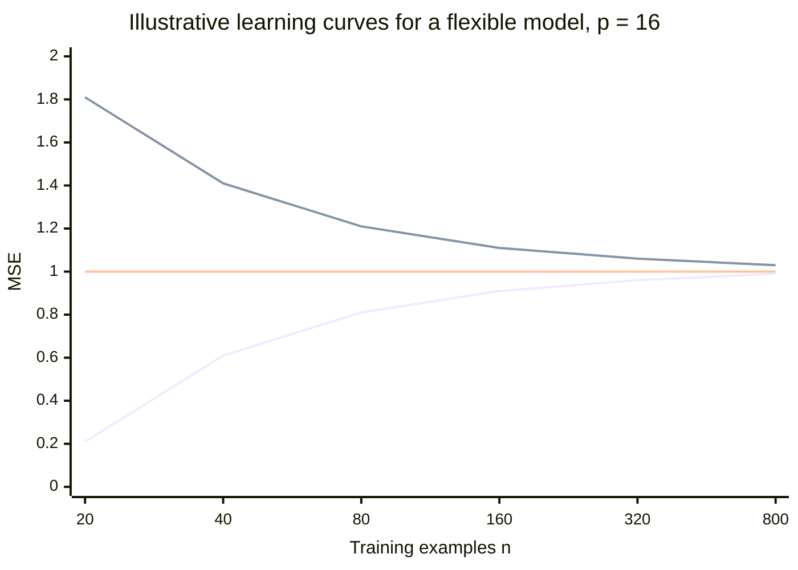

The lines are training MSE (rising), test MSE (falling), and the noise floor. The gap equals $2p/n$: 1.60 at $n = 20$ and 0.04 at $n = 800$. Halving the gap requires doubling the data, so returns diminish: going from 160 to 320 examples improves test MSE by 0.05, and going from 320 to 800 improves it by a further 0.03. For this flexible model, more data is worth buying while the curves are far apart and still moving. A rigid model behaves differently. A degree-1 model under the same assumptions has test MSE $4 + 2/n$, which converges to 4.00 (bias$^2$ 3.00 plus noise 1.00) however much data arrives, so collecting data to fix high bias wastes budget.

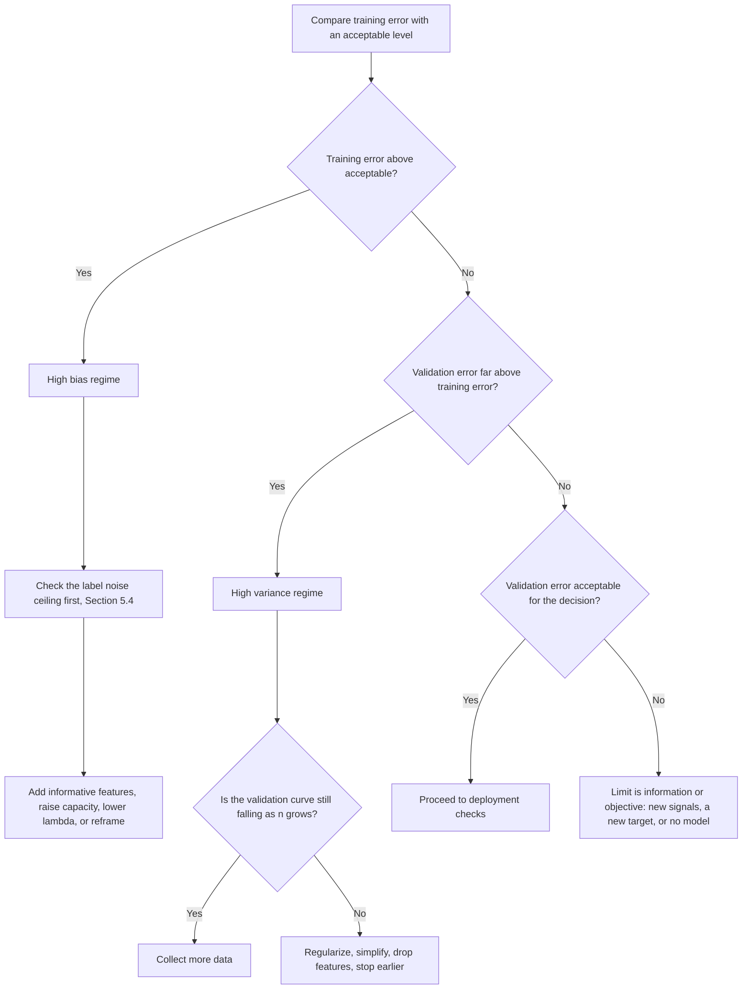

The flowchart encodes an ordering that saves effort. The first test compares training error with an external standard, because a model that cannot fit its own training data is not suffering from overfitting, and adding data or regularization will not help. Only then does the train-validation gap matter. The final branch is the uncomfortable one: when training and validation errors are both acceptable-looking yet the decision metric is not met, the limit is information or objective, which is a product conversation rather than a tuning exercise. Validation error below training error should send the reader to the "Suspicious" row of the table above before any branch of this flowchart.

### 9.4 Capacity, Occam, and regularization

**Capacity** is the flexibility of the hypothesis class. Parameter count is a crude proxy; the effective capacity also depends on regularization strength, feature count, tree depth, and how long training runs (Section 8.8). The regularized objective of Section 6.3 turns capacity into a continuous dial: raising $\lambda$ increases bias and lowers variance.

A small calculation shows why a deliberately biased estimator can win. Estimate a mean $\mu$ from $n$ samples with noise variance $\sigma^2$ using the shrunken estimator $c\,\bar{y}$, $0 \le c \le 1$. Its bias is $(c - 1)\mu$ and its variance is $c^2\sigma^2/n$, so

$$
\mathrm{MSE}(c) = (1 - c)^2\mu^2 + c^2\,\frac{\sigma^2}{n}, \qquad c^{*} = \frac{\mu^2}{\mu^2 + \sigma^2/n}
$$

With $\mu = 1$, $\sigma^2 = 4$, and $n = 4$, the unbiased estimator ($c = 1$) has MSE $= 0 + 1 = 1$, while $c^{*} = 1/(1 + 1) = 0.5$ gives $0.25 + 0.25 = 0.5$, half the error. With $n = 16$, $c^{*} = 0.8$ and the MSE falls from $0.25$ to $0.04 + 0.16 = 0.20$, so the advantage shrinks as data grows. The optimal $c^{*}$ depends on the unknown $\mu$, which is why $\lambda$ is selected by validation rather than derived.

**Occam's razor**, the preference for the simpler of two models that explain the evidence equally well, is a working heuristic, not a theorem that simple models always generalize better. It is justified here on practical grounds: simpler models explore fewer candidates, which limits the optimistic selection bias of Section 6.2, and they are cheaper to explain, test, and monitor.

### 9.5 Double descent, with caution

The U-shaped test curve of Section 9.2 is the classical picture, and it remains the right default for small and medium tabular problems. Researchers have also documented, in some model families, a second regime. As capacity grows past the point where the model can interpolate the training data (fit it exactly), test error can peak near that interpolation threshold and then fall again as capacity keeps growing. This pattern, called **double descent**, was described by Belkin and colleagues in 2019 and has since been reported for several model families, including neural networks, and in variants indexed by training epochs or by data size. How general it is, and why it occurs, are still active research questions; it appears most clearly when labels are noisy and depends on the model family and training procedure.

Four practical points follow, none of which require taking a side in that debate:

- The identity in Section 9.1 is not violated. What changes is how the variance term behaves as parameters increase, which need not be monotone.
- "More capacity must overfit" is not a law, and neither is "bigger always generalizes". Decide with validation evidence for the actual data.
- A model with roughly as many effective parameters as training examples deserves extra scrutiny, because that is where the reported peak sits.
- Learning curves and held-out evaluation remain the instruments; theory about the curve's shape does not replace them.

### 9.6 Distribution shift: when the sample stops representing the future

Everything above assumes that test examples come from the same distribution as the training sample (the i.i.d. assumption of Section 4.1). Let $P$ be the training distribution and $Q$ the distribution the deployed model faces. Validation error estimates risk under $P$, not $Q$, and the guarantee of Section 6.2 does not transfer. A model can sit at the bottom of the U-curve and still fail in production. Section 5.3 named three shifts; the formal conditions and consequences are:

| Shift | What changes | What is assumed to stay fixed | Illustrative example | Consequence and typical remedy |
|---|---|---|---|---|
| Covariate | $P(x) \to Q(x)$ | $P(y \mid x)$ | A new acquisition channel brings accounts with a different usage profile | Error rises in regions the sample covered thinly. Reweighting by $w(x) = Q(x)/P(x)$ can approximate $Q$-risk, but only if $P$ covers where $Q$ has mass; otherwise collect data there |
| Label (prior) | $P(y) \to Q(y)$ | $P(x \mid y)$ | The cancellation rate rises from 10% to 20% | Probabilities are miscalibrated though ranking may survive; adjust the prior odds or recalibrate |
| Concept drift | $P(y \mid x)$ itself | Nothing useful | A pricing change alters why customers cancel | Reweighting cannot help, because the same input now deserves a different answer; new labels and retraining are required |

For label shift the correction is mechanical. Under the assumption that $P(x \mid y)$ is unchanged, posterior odds scale by the ratio of prior odds. If a calibrated model outputs $0.30$ when prevalence is 10%, the odds are $0.30/0.70 \approx 0.4286$. The prior-odds ratio is $\frac{0.20/0.80}{0.10/0.90} = 2.25$, so the new odds are $0.4286 \times 2.25 \approx 0.9643$ and the adjusted probability is $0.9643/1.9643 \approx 0.491$. A decision threshold fitted before the shift would now be applied to the wrong probabilities.

Covariate and prior shift can be noticed from unlabeled data, by comparing input and score distributions between training and production. Concept drift cannot be confirmed without outcomes, which arrive late (Section 5.2), so it often surfaces first as a slow fall in a delayed quality metric. Detection thresholds, alerting, and retraining triggers belong to [CH29](CH29_MLOps_and_LLMOps.md); time-ordered and group-aware validation, which approximates $Q$ more honestly, belongs to [CH06](CH06_Model_Evaluation_Validation_and_Selection.md).

## 10. ML Systems and Hidden Technical Debt

Sections 4 to 9 treated the model as the unit of study. In production it is one component of a larger system, and most of what goes wrong lives outside it. Sculley et al. (2015), "Hidden Technical Debt in Machine Learning Systems", argued this from the authors' experience building and maintaining such systems; it is an experience-based position paper, not a measurement of how often each problem occurs. Its value is as a checklist of risks that ordinary software engineering practice does not cover.

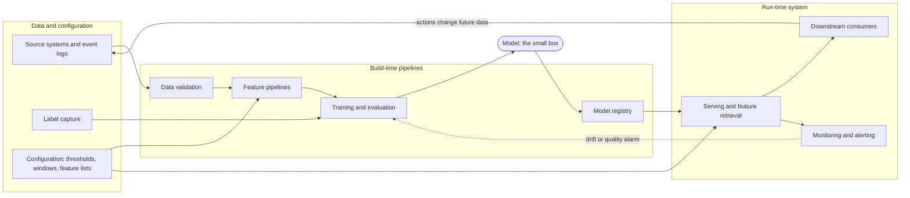

The diagram makes the proportions visible: the learned artifact is a single node, while data validation, feature computation, configuration, serving, monitoring, and the return path from consumers back to data are the larger surface. Each arrow is a dependency that can change without any change to the model code. Part 17 develops how such systems are composed (start with [AI Workload Qualification and Architecture Foundations](../17_AI_Architecture/CH01_AI_Workload_Qualification_and_Architecture_Foundations.md)) and [CH29](CH29_MLOps_and_LLMOps.md) covers operating them; this section keeps to the risks that follow from the properties taught so far.

### 10.1 Data dependencies and undeclared consumers

A model depends on its inputs the way code depends on a library, but without a type system or compiler to flag a change. An upstream team that redefines a field, changes a unit, or stops populating a column alters the model's behavior silently. Two related problems compound this: inputs that add little accuracy but couple the model to an unstable source, and **undeclared consumers**, other systems that read the model's output without being registered and therefore constrain any later change. The countermeasures are organizational as much as technical: named owners for every input, declared consumers, validation of input contracts at pipeline boundaries ([CH02](CH02_Data_Preparation_Feature_Engineering_and_Leakage.md)), and lineage ([CH29](CH29_MLOps_and_LLMOps.md)).

### 10.2 Entanglement: changing anything changes everything

Features are not independent modules. Consider a linear model with two strongly correlated features: the optimizer splits weight between them, and if one is removed or its distribution shifts, the other's weight and the whole function change, including predictions for inputs that did not touch the changed feature. The same holds for retraining on a new window, adding a feature, or changing a regularization strength. Sculley et al. summarise this as "changing anything changes everything". The consequence is that no change is local: each modification needs full re-evaluation, including by segment (Section 11.2). A related trap is a **correction cascade**, a second model trained to fix the first model's mistakes, which makes the first model very costly to improve because the second depends on its quirks.

### 10.3 Feedback loops

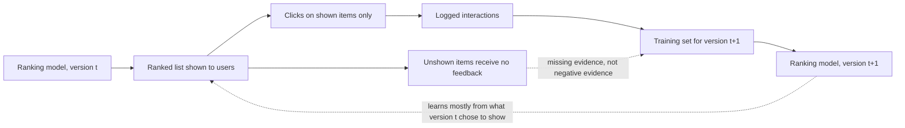

A system that influences its own training data is in a feedback loop. In the recommender above, users can only click what they are shown, so the next training set reflects the previous model's choices as well as user preference. Items that were never shown look identical to items that were shown and ignored, which can entrench the current policy and make the model's apparent accuracy partly self-confirming. Feedback can be direct, as here, or hidden, when two models influence each other through the world without sharing code. Typical mitigations are logging what was shown and with what probability, a small exploration or holdout slice that is not driven by the model, and evaluating on data not selected by the model being evaluated. This is the practical form of the feedback violation of i.i.d. noted in Section 5.3.

### 10.4 Pipeline jungles, configuration debt, and training-serving skew

Pipelines that grow by accretion, with ad hoc joins, scrapes, and format conversions glued together, become what Sculley et al. call a **pipeline jungle**: hard to test end to end and hard to change. **Configuration debt** is the parallel problem for settings: thresholds, feature lists, data windows, and hyperparameters are behavior-defining but are often unreviewed, unversioned, and untested. A threshold tuned to last year's distribution is also an implicit assumption about the world, which Section 9.6 shows can expire. **Training-serving skew** (owned by [CH02](CH02_Data_Preparation_Feature_Engineering_and_Leakage.md)) is the systems view of the same issue: two implementations of one feature definition, one offline and one online, will eventually disagree. The structural remedy is a single definition used by both paths.

### 10.5 Behavior is defined by data, not code

The unifying implication is that the data, labels, and configuration are part of the program. This changes how ordinary engineering disciplines apply:

| Concern | Conventional service | ML-enabled service |
|---|---|---|
| What defines behavior | Code and configuration | Code, configuration, training data, labels, and randomness |
| Testing | Assert exact outputs for given inputs | Assert statistical properties on slices, invariances, and baseline comparisons (Section 11.2) |
| Versioning | Source commit | Data snapshot, feature definitions, training code, hyperparameters, and model artifact together |
| Ownership | One service team | Spans data producers, feature owners, model owners, and consumers; gaps create undeclared dependencies |
| Failure mode | Errors and crashes that are visible | Silent degradation: the system runs, outputs look plausible, quality falls |
| Rollback | Redeploy the previous build | The previous model may not match current feature definitions, so rollback needs compatible features |

## 11. Failure Scenarios, Testing, and Common Mistakes

Most machine learning failures are not exotic. They are a small number of recurring patterns, each with a recognizable signature and a standard defence. The catalogue below is organized by how a failure shows up, because that is where a team starts.

### 11.1 A catalogue of failures

| Failure | How it shows up | How it is detected | Mitigation |
|---|---|---|---|
| Leakage | Excellent offline metrics that collapse after launch; one feature dominates | Audit unusually strong features; re-evaluate with a strictly time-ordered split | Point-in-time features and split design ([CH02](CH02_Data_Preparation_Feature_Engineering_and_Leakage.md)) |
| Label shift | Score distribution and calibration move while ranking may hold | Compare production score and outcome rates with training; check calibration on recent labels | Adjust prior odds or recalibrate (Section 9.6, [CH03](CH03_Regression_and_Classification.md)) |
| Proxy-label mismatch | Proxy metric improves while the business outcome does not; the model imitates a past decision | Audit a sample against adjudicated outcomes; compare proxy and true outcome on a small labeled set | Capture an outcome label; record label provenance (Section 5.2) |
| Optimizing the wrong metric | A model wins offline but decision costs rise | Evaluate at the operating point with decision costs; check that surrogate and decision metric rank candidates alike (Section 7.6) | Set thresholds and weights from costs (Section 7.4); metric design in [CH06](CH06_Model_Evaluation_Validation_and_Selection.md) |
| Silent drift | Quality declines with no error and no deployment | Monitor input and score distributions; track delayed-label quality | Alerts and retraining triggers ([CH29](CH29_MLOps_and_LLMOps.md)) |
| Selection bias | Outcomes exist only for cases a prior policy allowed; the model never saw the rejected region | Compare training and deployment populations; look for outcomes missing by design | Exploration or holdout traffic; limit claims to the covered region (Section 5.3) |
| Segment reversal | An aggregate comparison favors one model while every segment favors the other | Report each segment with counts and traffic mix | Compare on a common mix or randomized traffic |
| Over-trusting a single number | A headline score hides slice failures, uncertainty, and cost | Slice report, intervals, and baseline comparison | Report slices, intervals, and baselines together ([CH06](CH06_Model_Evaluation_Validation_and_Selection.md)) |

**Segment reversal, illustrated.** The counts below are illustrative. Old model A was evaluated mostly on easy cases and new model B mostly on hard ones, for example because B launched in a region with harder inputs. Segments are defined by features known at decision time.

| Segment | Model A correct / total | Model B correct / total |
|---|---|---|
| Easy | 760 / 800 = 95.0% | 192 / 200 = 96.0% |
| Hard | 120 / 200 = 60.0% | 500 / 800 = 62.5% |
| All | 880 / 1,000 = 88.0% | 692 / 1,000 = 69.2% |

B is better in each segment yet worse in aggregate, because each aggregate weights the segments by that model's own traffic (80% easy for A, 20% easy for B). On a common 50/50 mix, A scores $0.5 \times 95.0 + 0.5 \times 60.0 = 77.5\%$ and B scores $0.5 \times 96.0 + 0.5 \times 62.5 = 79.25\%$. The aggregate comparison measured the mix, not the model. The defence is to compare candidates on the same cases, through randomized assignment or a standardized mix, and to publish the per-segment table next to the headline number.

### 11.2 Tests for machine learning components

Because behavior is defined by data (Section 10.5), tests assert statistical and structural properties rather than exact outputs. Five kinds cover most of the catalogue:

- **Data validation** checks schema, ranges, null rates, category sets, freshness, and distribution summaries on every batch of training and serving inputs, and fails the pipeline before bad data reaches training.
- **Invariance tests** assert that predictions stay within a tolerance when an input that should not matter is changed, such as a field the policy excludes.
- **Directional tests** assert that the output moves the known way when one feature changes, for example more support tickets should not lower predicted cancellation risk.
- **Slice tests** assert that quality on each important segment stays above an agreed floor relative to the overall result or a baseline.
- **Baseline-regression tests** assert that a candidate beats the current production model and the simple baseline on a pinned, versioned evaluation set before promotion, without regressing on critical slices.

The sketch below implements slice, invariance, and directional checks with NumPy only. The data and the two predictors are synthetic. The second predictor deliberately uses a field (`south`) that the policy says should not matter.

```python
import numpy as np

rng = np.random.default_rng(7)


def make_data(n):
    tickets = rng.poisson(1.5, n)
    tenure = rng.integers(1, 60, n)
    south = rng.random(n) < 0.5
    z = -2.0 + 0.5 * tickets - 0.03 * tenure
    y = (rng.random(n) < 1 / (1 + np.exp(-z))).astype(int)
    return {"tickets": tickets, "tenure": tenure, "south": south, "y": y}


def predict(d):
    z = -2.0 + 0.5 * d["tickets"] - 0.03 * d["tenure"]
    return 1 / (1 + np.exp(-z))


def predict_region_biased(d):
    z = -2.0 + 0.5 * d["tickets"] - 0.03 * d["tenure"] + 0.8 * d["south"]
    return 1 / (1 + np.exp(-z))


def slice_check(d, predict_fn, slice_key, threshold=0.2, max_gap=0.05, min_n=30):
    correct = (predict_fn(d) > threshold).astype(int) == d["y"]
    overall = correct.mean()
    failing = {}
    for value in np.unique(d[slice_key]):
        mask = d[slice_key] == value
        if mask.sum() >= min_n and correct[mask].mean() < overall - max_gap:
            failing[value.item()] = round(float(correct[mask].mean()), 3)
    return round(float(overall), 3), failing


def invariance_gap(d, predict_fn, key, alternatives):
    base = predict_fn(d)
    return max(np.abs(predict_fn({**d, key: alt}) - base).max() for alt in alternatives)


def direction_violations(d, predict_fn, key, step=1):
    return int((predict_fn({**d, key: d[key] + step}) < predict_fn(d) - 1e-12).sum())


d = make_data(4000)
for name, fn in [("ok", predict), ("region_biased", predict_region_biased)]:
    print(name, "slices:", slice_check(d, fn, "south"))
    print(name, "invariance gap:", round(float(invariance_gap(d, fn, "south", [np.zeros(4000, bool), np.ones(4000, bool)])), 3))
    print(name, "direction violations:", direction_violations(d, fn, "tickets"))
```

Sample output from one run (exact digits depend on the seed and NumPy version):

```text
ok slices: (0.804, {})
ok invariance gap: 0.0
ok direction violations: 0
region_biased slices: (0.687, {True: 0.575})
region_biased invariance gap: 0.197
region_biased direction violations: 0
```

The biased predictor fails the slice test (accuracy 0.575 on the `south` slice against 0.687 overall, a gap above the 0.05 tolerance) and the invariance test (a maximum change of about 0.197 in predicted probability), yet passes the directional test. That is why the kinds are complementary: each catches a different fault. In a test suite the `print` calls become assertions. The tolerance, the minimum slice size, and the threshold are agreed in advance, because on small slices a gap can be sampling noise.

### 11.3 Anti-patterns

| Anti-pattern | Why it fails | Instead |
|---|---|---|
| Random split of time-ordered or grouped data | Overstates performance (Section 5.3) | Time-ordered and group-aware splits ([CH06](CH06_Model_Evaluation_Validation_and_Selection.md)) |
| Tuning repeatedly on the final test set | Optimistic selection bias (Section 6.2) | Keep a test set untouched until the final estimate |
| Reporting accuracy on a rare outcome | At 8% prevalence a model that never predicts the outcome scores 92% | Cost-based and ranking metrics (Section 7.6) |
| Skipping the baseline ladder | Cannot tell whether complexity pays (Section 3) | Constant, then rule, then simple model, then complex |
| Shipping a score with no decision rule | No action, threshold, or error cost to evaluate | Define action and cost first (Section 4.3) |
| No fallback path | A model outage or drift becomes a product outage | A rule or human path that can take over |
| Retraining as the default fix | Reproduces the defect if the cause is leakage, labels, or drift | Diagnose with the flowchart in Section 9.3 first |
| Unowned features and thresholds | The debt of Section 10 accumulates unseen | Named owners and versioned configuration |

## 12. Putting It Together

### 12.1 The workflow lifecycle

The sections of this chapter compose into one workflow. The diagram shows it as a loop with explicit feedback edges, because evidence at a later stage routinely sends the work back to an earlier one.

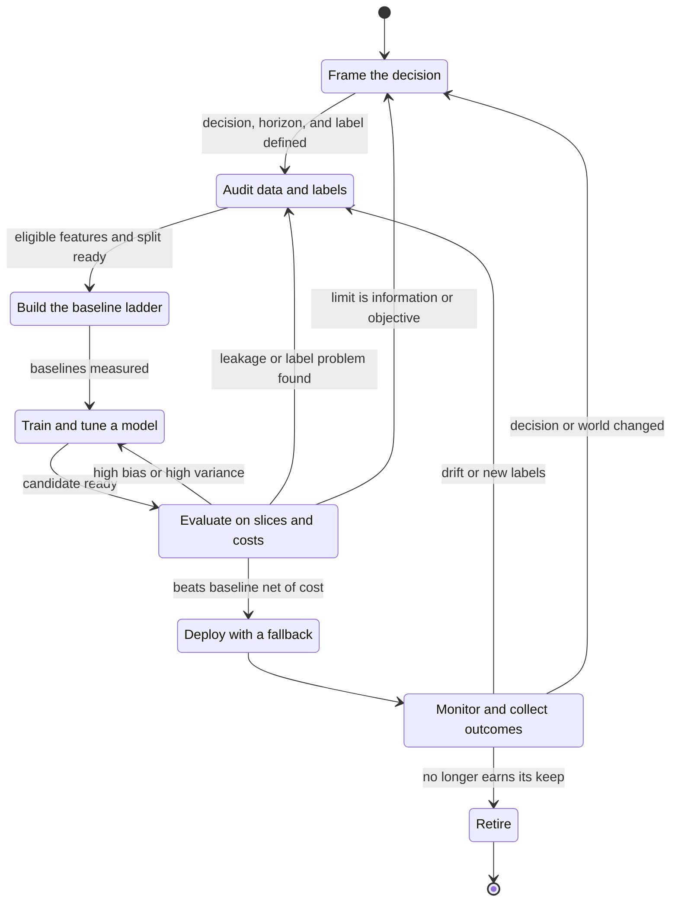

Three feedback edges carry most of the learning. The edge from evaluation to modeling is the bias-variance loop of Section 9.3. The edges from evaluation and monitoring back to data and framing are the ones teams skip: they correspond to leakage, label, and drift findings, whose fix is outside the model. The terminal state is deliberate; a model that no longer beats its baseline net of cost should be retired. Operating this loop at scale is the subject of [CH29](CH29_MLOps_and_LLMOps.md), and composing it into a platform is covered from Part 17 onward.

### 12.2 Trade-off analysis

The baseline ladder (Section 3) turns the simple-versus-complex choice into a sequence of measured decisions. The table lists the dimensions on which the rungs differ, and the question that settles each.

| Dimension | Simple model or rule | Complex model | Question to settle it |
|---|---|---|---|
| Accuracy ceiling | Lower where interactions matter | Higher if the data supports it | Does the measured gain exceed sampling noise and the cost of the extra rung? |
| Interpretability | Readable and auditable | Needs separate explanation tooling | Who must explain a decision, and to whom? |
| Latency and serving cost | Low and predictable | Higher and sometimes needs specialized hardware | Does the latency and cost budget allow it? |
| Data needs | Few examples and features suffice | More examples and coverage; higher variance risk (Section 9.2) | Do labels exist at that volume and quality? |
| Maintenance | Few dependencies | More features and pipelines, more entanglement (Section 10.2) | Who owns it for its whole life? |
| Failure behavior | Predictable, easy to fall back from | Harder to bound; silent degradation | What happens when it is wrong or unavailable? |

The rule of thumb is to climb a rung only when its measured gain, on the decision metric and net of lifecycle cost, is larger than the uncertainty of the measurement.

### 12.3 Worked example: the baseline ladder for subscription renewal

This extends the framing of Section 4.3. Every figure is **illustrative**, chosen so the arithmetic can be checked by hand; none is a measured result. Work per 1,000 active accounts at one decision date:

- Prevalence of cancellation is 8%, so 80 accounts would cancel.
- A retention call costs $C = \$10$, whether or not the account would have cancelled.
- A call to an account that would cancel saves it with probability $s$, and a saved account is worth $V = \$300$. **Scenario A** takes $s = 0.30$, so $sV = \$90$. **Scenario B** takes $s = 0.10$, so $sV = \$30$. Calls to accounts that would not cancel earn nothing.
- Staff capacity allows 100 calls per 1,000 accounts for the rule and the model.
- The called group cancels at an assumed 20% for the rule and 28% for the logistic model.

The expected value (EV) of a policy is $\text{EV} = (\text{cancellers reached}) \times sV - (\text{calls}) \times C$. As in Section 7.4, call an account only when its expected benefit exceeds the cost: $p \cdot sV > C$, so the break-even probability is $C/(sV) = 10/90 \approx 0.111$ in A and $10/30 \approx 0.333$ in B. Prevalence is 0.08, below both, so blanket calling loses in both scenarios.

| Rung | Calls | Cancellers reached | Cost ($10 per call) | A: value $= \text{reached} \times 90$ | A: EV | B: value $= \text{reached} \times 30$ | B: EV |
|---|---|---|---|---|---|---|---|
| Constant: call nobody | 0 | 0 | \$0 | \$0 | \$0 | \$0 | \$0 |
| Constant: call everyone | 1,000 | 80 | \$10,000 | \$7,200 | -\$2,800 | \$2,400 | -\$7,600 |
| Rule (for example, many recent support tickets) | 100 | $100 \times 0.20 = 20$ | \$1,000 | \$1,800 | +\$800 | \$600 | -\$400 |
| Logistic model | 100 | $100 \times 0.28 = 28$ | \$1,000 | \$2,520 | +\$1,520 | \$840 | -\$160 |

In Scenario A the rule adds \$800 over doing nothing, and the model adds a further $1{,}520 - 800 = \$720$ per 1,000 accounts. The rule reaches 25% of cancellers ($20/80$) at a lift of $0.20/0.08 = 2.5$; the model reaches 35% at a lift of 3.5. Suppose running the model costs a fixed \$1,500 per renewal cycle (labeling, monitoring, retraining, and platform share, also assumed). Then it pays for itself relative to the rule once the portfolio exceeds $1500 / 0.72 \approx 2{,}083$ accounts (1,000 accounts: $720 - 1500 = -\$780$; 10,000 accounts: $7200 - 1500 = +\$5{,}700$).

The evidence is a second condition. With only 100 flagged accounts, a rate of 28% has a standard error of $\sqrt{0.28 \times 0.72 / 100} \approx 0.045$ and a rate of 20% has one of 0.04, so the 8-point gap is about 1.3 combined standard errors, treating the groups as independent. With 1,000 flagged accounts per rung the combined standard error is about 0.019 and the gap is about 4.2. Interval construction is owned by [CH06](CH06_Model_Evaluation_Validation_and_Selection.md).

Scenario B is the case promised in Section 3. With $sV = \$30$ the break-even probability is 0.333, and neither the rule's 20% nor the model's 28% reaches it, so both have negative EV and the best policy is to call nobody (EV 0). Even if the model could isolate 20 accounts cancelling at 40% (an assumption), the EV would be $8 \times 30 - 20 \times 10 = +\$40$ per 1,000 accounts, which a \$1,500 fixed cost needs $1500 / 0.04 = 37{,}500$ accounts to cover. The constant baseline is near-optimal. Prior shift matters too: if prevalence rose from 8% to 12% in Scenario A, blanket calling would move from $-\$2{,}800$ to $1000 \times (0.12 \times 90 - 10) = +\$800$.

The model earns its keep when four conditions hold together: the break-even probability sits below the cancellation rate of the group it can isolate, the portfolio is large enough to cover its fixed cost, its gain over the rule is distinguishable from noise, and it survives drift under monitoring. It does not earn its keep when the value of a save is small relative to the cost of a call, when a rule already captures most of the achievable gain, or when the portfolio is small.

### 12.4 Illustrative composite case study (hypothetical)

The following composite is **hypothetical**. It is not drawn from a real organization or incident, and it contains no measurements. It shows how the chapter's pieces interact. A regional parcel carrier wants to predict delivery delay so it can notify customers in advance.

- **Framing.** The prediction unit is a parcel, the decision time is the depot scan before dispatch, the horizon is the promised delivery date, and the label is "delivered after the promised date". A first draft used a customer-complaint field as the label. That is a proxy recorded only for customers who complain, so it is selectively observed (Sections 5.2 and 11.1). The team replaces it with scan timestamps.
- **Features.** A "route assigned" field turns out to be filled in after dispatch, so it leaks the outcome offline and will be missing online. A feature audit catches it, and the team rebuilds features as of decision time ([CH02](CH02_Data_Preparation_Feature_Engineering_and_Leakage.md)).
- **Baseline ladder.** The rungs are the overall delay rate, a rule for heavy parcels to remote zones, a logistic model, and a larger ensemble. The ensemble beats the logistic model on a random split but not on a time-ordered split that spans a seasonal peak, which the team reads as variance plus shift rather than skill (Section 9).
- **Evaluation.** A slice report shows one depot performing far worse than the rest. Two pilot depots also handled different parcel mixes, so their aggregate scores were not comparable (Section 11.1).
- **Deployment.** Notifications change customer behavior, such as rebooking, which changes outcomes. The team keeps a small holdout that receives no notification so that the model's training data is not purely a record of its own influence (Section 10.3).
- **Operation.** A routing policy change alters $P(y \mid x)$, which is concept drift (Section 9.6). A monitored delayed-label metric triggers review.

The decision in this story is to ship the logistic model with a rule fallback and defer the ensemble until it beats the simpler rung on the time-ordered evaluation net of its extra maintenance, in the manner of Section 12.3.

### 12.5 Architect review checklist

Use the list as a gate before committing to a learned component. Each item can be answered with a document, a measurement, or an owner.

**Problem and framing**

- A learned model has been justified against rules and a lookup (Section 3).
- The prediction unit, decision time, horizon, action, and error costs are written down (Section 4.3).

**Data and labels**

- Label provenance, delay, noise, and selectivity are documented, and the dataset has a record (Sections 5.2, 5.4, and 5.5).
- Every feature is available at decision time, with leakage controls in place ([CH02](CH02_Data_Preparation_Feature_Engineering_and_Leakage.md)).
- The training population is compared with the deployment population (Section 5.3).

**Objective and evidence**

- The loss, the decision metric, and the threshold are aligned with error costs (Sections 7.4 and 7.6).
- The baseline ladder is measured, the split respects time and grouping, and results carry intervals and slice breakdowns ([CH06](CH06_Model_Evaluation_Validation_and_Selection.md)).
- Learning curves were used to diagnose bias versus variance before adding data or complexity (Section 9.3).
- The expected value net of lifecycle cost has been computed, as in Section 12.3.

**System and ownership**

- Inputs, features, configuration, and consumers have named owners, and each feature has one definition shared by training and serving (Sections 10.1 and 10.4).
- Feedback loops are identified, with a holdout or exploration slice where the model influences its own data (Section 10.3).
- The tests of Section 11.2 run automatically, including a baseline-regression gate.

**Operation**

- A fallback path and a human path exist, and actions are reversible where possible.
- Input, score, and outcome drift are monitored, with retraining triggers and a retirement criterion ([CH29](CH29_MLOps_and_LLMOps.md)).
- Code, data snapshot, configuration, and seeds are recorded for every released model (Section 8.8).

## 13. Interview Questions

1. **Why is training error an optimistic estimate of future error?** The parameters were chosen to minimize that very sample's loss, so the winner's training error is biased low, and more flexibility means more bias (Section 6.2). Use data that played no part in fitting or selection.
2. **Sketch the bias-variance decomposition for squared error.** Write $y = f + \varepsilon$. Expanding the square, the cross term with independent zero-mean noise vanishes, leaving $\sigma^2 + \mathbb{E}[(f - \hat{f})^2]$. Adding and subtracting the average prediction $\bar{f}$ splits that into $(f - \bar{f})^2$ plus the variance of $\hat{f}$, with the new cross term zero by the definition of $\bar{f}$.
3. **Training and validation errors are both high and close together. What now?** High bias. Add informative features, raise capacity, lower regularization, or reframe the problem, and check the label-noise ceiling. More data alone will not help.
4. **Training error is low and validation error much higher. What now?** Probably high variance. Rule out leakage or a mismatched split first, then collect more data if the validation curve is still falling, or regularize, simplify, drop features, or stop earlier.
5. **How is a classification threshold chosen?** From decision costs: with calibrated probabilities, act when $p > C_{FP}/(C_{FP} + C_{FN})$ (Section 7.4), then confirm on validation data. Accuracy at 0.5 is not a cost-based rule.
6. **Why do squared error and log loss appear for regression and classification?** They are negative log-likelihoods of a Gaussian and a Bernoulli noise model respectively (Sections 7.1 and 7.2); choosing a loss asserts how labels are generated.
7. **Training loss turns into NaN. What do you check?** A learning rate above $2/\lambda_{\max}$, unscaled features, or a numeric error such as the log of zero. Cut the step size, standardize inputs, and check the gradient on a few examples (Sections 8.4 and 8.11).
8. **Distinguish covariate shift, label shift, and concept drift. Which can reweighting fix?** Covariate changes $P(x)$, label changes $P(y)$, concept changes $P(y \mid x)$. Reweighting can address covariate shift when support overlaps, and prior-odds adjustment addresses label shift. Concept drift needs new labels and retraining (Section 9.6).
9. **What is hidden technical debt in ML systems?** From Sculley et al.: maintenance costs that conventional code does not have, arising from data dependencies, undeclared consumers, entanglement, feedback loops, pipeline jungles, and configuration. It is an experience-based argument, used as a risk checklist (Section 10).
10. **A new model has a higher aggregate score than the old one, but you suspect it is not better. How do you check?** Report per-segment results with counts, compare on a common traffic mix or randomized assignment, and add intervals. Segment reversal can make an aggregate reflect the mix rather than the model (Section 11.1).

## 14. Hands-on Exercises

All five run in a notebook with NumPy; plotting with Matplotlib is optional.

1. **Estimate bias and variance by simulation.** Take $f(x) = \sin(2\pi x)$ on $[0, 1]$, noise standard deviation 0.3, and $n = 30$ training points. For polynomial degrees 1, 3, and 9, draw 200 independent training sets, fit each with `np.polyfit`, and predict on a fixed grid. Estimate bias$^2$ and variance averaged over the grid, and check that $\sigma^2 + \text{bias}^2 + \text{variance}$ is close to the mean squared error on fresh noisy test points.
2. **Draw learning curves.** For degrees 1 and 9 of the same setup, plot training and validation MSE for $n \in \{20, 40, 80, 160, 320, 640\}$. Label each curve as high bias, high variance, or near the floor, and compare with the regimes of Section 9.3.
3. **Reweight under covariate shift.** Fit a straight line to $y = x^2 + \varepsilon$ using $x \sim \mathcal{N}(0, 1)$, then measure error on $x \sim \mathcal{N}(1.5, 1)$. Estimate the shifted error from training-distribution samples using weights $w(x) = Q(x)/P(x)$, compare it with the direct estimate, and report how the variance of the weights affects stability.
4. **Construct a segment reversal.** Choose two models and two segments with unequal traffic mixes so that model B wins in both segments but loses overall. Verify the counts, compute the 50/50 standardized accuracy, and bootstrap an interval for each segment.
5. **Rebuild the baseline ladder.** Implement $\text{EV} = \text{reached} \times sV - \text{calls} \times C$ and reproduce the table in Section 12.3. Sweep the save probability $s$ from 0.05 to 0.40 and find where each rung's EV crosses zero. The hand-computed answers are $s \approx 0.119$ for the model ($1000 / (28 \times 300)$) and $s \approx 0.167$ for the rule ($1000 / (20 \times 300)$).

## 15. Design and Architecture Review Questions

1. A product team proposes a model to approve refunds automatically. Which framing, cost, reversibility, and fallback questions must be answered before any algorithm is chosen (Sections 3 and 4.3)?
2. A vendor claims 97% accuracy for a fraud model. What evidence would you ask for about prevalence, baselines, label provenance, the evaluation population, intervals, and slices?
3. The only available training data is the log of decisions made by an earlier rule-based system. Which selection and feedback problems does that create, and how would you mitigate them (Sections 5.2 and 10.3)?
4. For an ML-enabled service, assign owners and a versioning scheme for source data, features, configuration, the model artifact, and downstream consumers. What breaks if one of them is unowned (Section 10)?
5. Offline metrics improved but the online business metric is flat. List the hypotheses, the evidence that would separate them, and where [CH06](CH06_Model_Evaluation_Validation_and_Selection.md) covers online validation.
6. Design the monitoring signals, retraining triggers, fallback, and retirement criterion for the retention model of Section 12.3, using [CH29](CH29_MLOps_and_LLMOps.md) for the operating mechanisms.

## 16. Summary

Machine learning learns a function from examples under an explicit objective, and the chapter's six outcomes summarize how to reason about it.

1. **Decide and frame.** Use a learned model only when it beats the simplest credible alternative net of lifecycle cost. Fix the prediction unit, decision time, horizon, label, and action first (Sections 3 and 4.3).
2. **Training loss is a proxy.** Empirical risk is optimistically biased by selection, and the sampling, distribution, and objective gaps have different remedies (Sections 4 to 6).
3. **Losses encode assumptions.** Squared error and log loss come from noise models, and cost-based thresholds follow from decision costs (Section 7).
4. **Optimization is diagnosable.** Learning rate, conditioning, and feature scaling determine convergence (Section 8).
5. **Error decomposes.** Expected squared error equals noise plus bias squared plus variance. Learning curves tell you whether to add data, simplify, regularize, or change the problem, and distribution shift can invalidate the whole analysis (Section 9).
6. **Build and review end to end.** Climb the baseline ladder, test by slice and invariance, count the system around the model, and review against the checklist (Sections 10 to 12).

Behavior is defined by data, so data, labels, features, and configuration need owners, versions, tests, and monitoring. Treat the model as one component in a larger system.
