# Data Preparation, Feature Engineering, and Leakage

Part: [16 — Artificial Intelligence, Machine Learning, and Generative AI](PART_OVERVIEW.md) · Status: Drafted

## 1. Introduction

Data preparation turns raw observations into the numeric inputs a model can consume, while preserving a strict rule: a model may be shown only what the production system will actually know at the moment it must predict. Feature engineering is the craft of representing useful signals within that rule. Leakage is what happens when the rule is broken, when information from the future, from the label, or from the evaluation data slips into training. A leaky pipeline is dangerous precisely because it does not fail loudly. It produces a machine learning (ML) model that scores very well in offline testing and then disappoints in production, because the offline score measured a task that production never presents.

That is why this chapter matters to a solution architect and not only to a data scientist. In a learned system, the data pipeline is part of the model: the same fitted means, vocabularies, and imputation values that shaped training must be reproduced at prediction time, or the model receives inputs it was never trained on. Several architectural decisions follow directly: where feature code runs and how many implementations of it exist, how fitted transformation state is versioned and shipped with the model artifact, how historical data is reconstructed "as of" a past moment, which partitioning policy defines the evaluation contract, and who owns each feature's definition. An evaluation number is only as honest as the partitioning and preprocessing behind it, and the go or no-go decision for an ML capability usually rests on that number.

This chapter owns data preparation, transformation state, missing-value policy, label maturity and imbalance handling at the data level, partitioning to prevent leakage, feature construction with temporal correctness, and data-quality and lineage controls. The boundaries with neighbouring chapters are deliberate:

- Problem framing, the learning objective, and the general idea of generalization belong to [CH01 — Machine Learning Foundations](CH01_Machine_Learning_Foundations.md); this chapter applies its prediction-unit, decision-time, and horizon framing to concrete data construction.
- Linear and logistic models, regularization penalties, probability calibration, and threshold selection belong to [CH03 — Regression and Classification](CH03_Regression_and_Classification.md).
- How tree-based models split on features and treat missing values internally belongs to [CH04 — Decision Trees and Ensemble Learning](CH04_Decision_Trees_and_Ensemble_Learning.md); this chapter only notes where preparation choices depend on the model family.
- Validation design, cross-validation procedure, metrics, uncertainty, and test-set discipline belong to [CH06 — Model Evaluation, Validation, and Selection](CH06_Model_Evaluation_Validation_and_Selection.md); this chapter owns how data is cut so those procedures are not contaminated.
- Production monitoring, drift response, and model lifecycle artifacts belong to [CH29 — MLOps and LLMOps](CH29_MLOps_and_LLMOps.md); consent, licensing, and provenance obligations belong to [CH30 — AI Data Governance, Privacy, and Provenance](CH30_AI_Data_Governance_Privacy_and_Provenance.md).
- Production system composition belongs to Part 17, starting with [AI Workload Qualification and Architecture Foundations](../17_AI_Architecture/CH01_AI_Workload_Qualification_and_Architecture_Foundations.md). General probability and statistics foundations remain with [Part 07](../07_System_Design_and_Distributed_Systems/PART_OVERVIEW.md).

After studying this chapter, a reader should be able to:

1. State the prediction-time contract for a use case (prediction unit, decision time, feature availability, and label horizon) and audit any feature against it.
2. Separate stateless from fitted transformations, explain why fitted state belongs to the model artifact, and compute the effect of fitting statistics on the wrong partition.
3. Classify a missing-value mechanism, predict how each handling strategy distorts the data, and choose a policy that also works when production data is missing differently from training data.
4. Recognize the major leakage paths, reproduce two of them in code, and apply a test that exposes them.
5. Design train, validation, and test partitions by time, group, and sampling unit, including purge gaps for label horizons, and handle label maturity and class imbalance without distorting evaluation.
6. Specify a feature contract with point-in-time semantics, lineage, and quality gates, and decide when data shift requires revalidation.

## 2. Background

The practices in this chapter were not designed together. Each grew out of a specific failure that a research community noticed, named, and then learned to prevent. The milestones below are limited to ones that can be attributed with confidence.

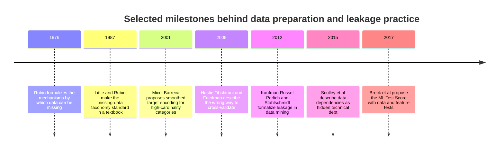

**Missing data.** Donald Rubin's 1976 paper "Inference and missing data" gave statistics the vocabulary for why a value is absent, and Roderick Little and Donald Rubin's 1987 book *Statistical Analysis with Missing Data* made the resulting taxonomy standard. The central lesson, developed in the missing-values section of this chapter, is that the reason a value is missing determines whether any handling method is safe.

**Encoding and leakage.** Daniel Micci-Barreca (2001) proposed representing a high-cardinality categorical value by blending that category's own target average with the overall average, weighted by how many examples support the category. That is the origin of the smoothed target encoding analysed below, and it also shows why such encodings are dangerous when computed carelessly. Trevor Hastie, Robert Tibshirani, and Jerome Friedman's textbook *The Elements of Statistical Learning* (2009) devotes a section to "the wrong and right way to do cross-validation": choosing predictors using every label and only then cross-validating produces optimistic error estimates, a case reproduced in code later in this chapter. Shachar Kaufman, Saharon Rosset, Claudia Perlich, and Ori Stahlschmidt (2012) gave leakage a formal treatment in data mining, describing it as the introduction of information about the target that should not legitimately be available to the model.

**Systems.** D. Sculley and colleagues (2015) argued that data dependencies can accumulate technical debt comparable to code dependencies while being harder to detect, and Eric Breck and colleagues (2017) turned that concern into a rubric whose items include checking that training and serving features compute the same values. The thread through these sources is that preparation is an engineering discipline with testable invariants, not an informal cleaning step before the real modelling begins.

## 3. Why Data Preparation Exists: The Prediction-Time Contract

Raw operational data is shaped for the system that produced it, not for a model. Fields arrive with mixed units, inconsistent encodings, gaps, duplicates, and values whose meaning depends on when they were written. A model, by contrast, needs a fixed-length numeric vector for every example, comparable across examples, and it assumes (as [CH01](CH01_Machine_Learning_Foundations.md) established) that training examples resemble the cases it will face. Preparation is the layer that closes this gap, and every decision in it either preserves or breaks that resemblance.

The governing idea is the **prediction-time contract**. Let $t_0$ be the decision time for one prediction unit, such as an account on a renewal date. Let $\mathcal{D}_{\le t_0}$ denote everything the production system could have known by $t_0$, including the delays with which it actually receives data. Let $H$ be the label horizon. Then the contract is:

$$
x = \phi\big(\mathcal{D}_{\le t_0}\big), \qquad y = g\big(\mathcal{D}_{(t_0,\; t_0 + H]}\big)
$$

The feature vector $x$ is a function only of information available at or before $t_0$, and the label $y$ is computed only from what happens afterwards. Training data construction is a *simulation* of deployment: for each historical example, the pipeline must reconstruct what the system would have known on that day, not what is known today with the benefit of hindsight. Everything this chapter teaches is a way of keeping that simulation faithful.

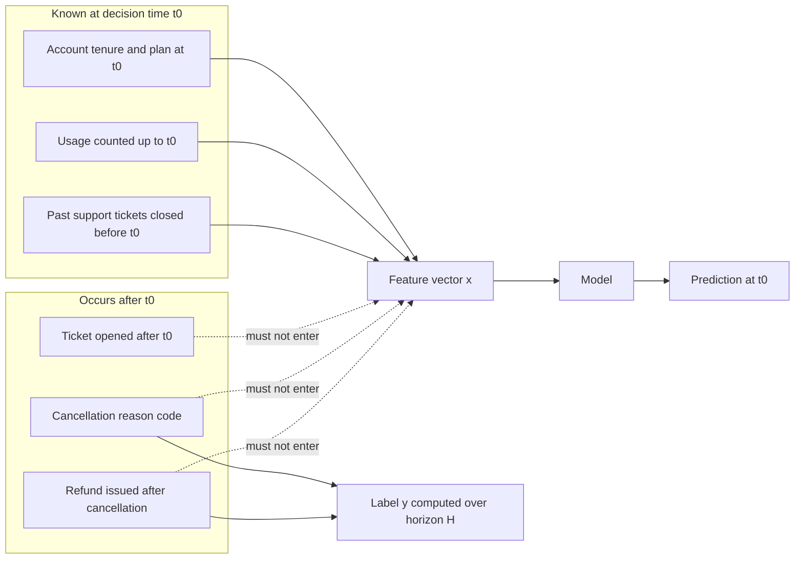

The diagram uses an illustrative subscription-renewal case. Solid arrows from the left group are legitimate inputs. The three fields on the right are recorded only because of what happens after $t_0$; a cancellation reason code exists only for accounts that cancelled, so it is a near-copy of the label. Notice that these fields are not obviously "wrong": they sit in the same customer table, they have sensible names, and they correlate strongly with the outcome. Nothing in the data itself marks them as forbidden. The contract is a specification written by people who understand when each field is populated, which is why it must be an explicit artifact and not tribal knowledge.

Four reasons make preparation unavoidable, and each maps to a later section.

- **Representation.** Text, categories, timestamps, and identifiers must become numbers. Each encoding choice is an assumption about which differences matter.
- **Comparability.** Features measured on different scales distort optimization, regularization, and distance computations. Rescaling requires statistics, and statistics must come from somewhere legitimate.
- **Robustness.** Real data has gaps and invalid values. A policy for them is a behavior of the system whether or not anyone chose it deliberately.
- **Honest evaluation.** The same choices determine whether offline results predict production, because the evaluation partitions must obey the contract too.

Two architectural consequences follow. First, **features are an interface**. A feature has a name, a type, a definition, an owner, a freshness expectation, and a meaning that must stay stable between the training run and every prediction request. Second, **training-serving skew**, any systematic difference between how a feature is computed during training and how it is computed in production, is a defect with no exception to catch it. The model simply receives different numbers than it learned from and produces plausible-looking outputs. Teams that implement feature logic twice, once in a batch job and once in a request handler, create this defect by construction and must test against it continuously. The next section shows exactly where state hides inside ordinary-looking transformations.

## 4. Transformations as Learned State

### 4.1 Stateless and fitted transformations

A transformation is **stateless** when its output depends only on the one record it receives: a logarithm, a ratio of two fields, a unit conversion, the day of week extracted from a timestamp. It is **fitted** when it first estimates parameters from data and then applies them: a mean and standard deviation, a median used for filling gaps, a category vocabulary, histogram bin edges. Write a fitted transformation as $T_\psi$, where the state $\psi = \hat\psi(S_{\text{train}})$ is computed from the training partition only. Because $\psi$ changes the numbers the model receives, it is as much a part of the learned system as the model's coefficients, and it must be versioned, stored, and shipped with the model artifact.

| Transformation | Fitted state | Why it is used | Hazard |
|---|---|---|---|
| Log, ratio, unit conversion, date parts | None | Reduce skew, express relationships, expose seasonality | Definition drift between implementations |
| Standardization | Mean, standard deviation | Comparable scales for gradient-based, distance-based, and penalized models | Statistics taken from the wrong partition |
| Min-max scaling | Minimum, maximum | Bounded inputs | Serving values outside the fitted range; one outlier sets the range |
| Robust scaling | Median, interquartile range | Heavy-tailed features | Same fit-scope risk as standardization |
| Clipping (winsorizing) | Percentile bounds | Limit outlier influence | Bounds computed on evaluation data |
| Imputation | Fill value per column | Remove gaps | Silent change in missing rate at serving |
| One-hot encoding | Vocabulary and column order | Represent bounded categories | Unseen categories; column order mismatch |
| Frequency or target encoding | Counts or label statistics | Compact encoding of high-cardinality values | Target encoding leaks labels if fitted carelessly |

The model family decides which rows matter. Tree-based models split on thresholds and are unaffected by monotone rescaling, so standardizing inputs for a tree changes nothing, while linear, neural, and distance-based models are sensitive to it.

### 4.2 Standardization and the cost of fitting on the wrong rows

Standardization maps a feature to $z = (x - \mu)/\sigma$, where $\mu$ and $\sigma$ are the fitted mean and standard deviation. It matters for three separate reasons. First, gradient-based optimization converges faster on comparably scaled inputs, the conditioning effect covered in [CH01](CH01_Machine_Learning_Foundations.md). Second, a penalty such as $\lambda\lVert w\rVert_2^2$ treats coefficients as commensurable, which is false for raw features. Re-express a feature from dollars to cents and its coefficient shrinks from $w$ to $w/100$, so its penalty falls from $w^2$ to $w^2/10{,}000$; the same signal is penalized ten thousand times less purely because of its units. Third, Euclidean distance between a feature in dollars and one in years is dominated by whichever has the larger numeric spread.

Now compute what happens when the statistics are fitted on the wrong rows. This worked example is illustrative. A numeric feature (order value) has five training values $10, 12, 14, 16, 18$ and two later production values $30, 32$.

- Fitted on training rows only: $\mu = 14$, population variance $= (16+4+0+4+16)/5 = 8$, so $\sigma = \sqrt{8} \approx 2.83$. The production values standardize to $(30-14)/2.83 \approx 5.66$ and $(32-14)/2.83 \approx 6.36$. A value more than five standard deviations from the training mean is conspicuous, and a simple range check on the standardized value would flag it.
- Fitted on all seven rows: $\mu = 132/7 \approx 18.86$ and $\sigma \approx 8.06$. The same production values become $1.38$ and $1.63$, unremarkable. The training values shift to between $-1.10$ and $-0.11$, all negative.

Fitting on the combined data did two harmful things at once. It used information from the evaluation rows to build the model's input representation, so the held-out score no longer measures behavior on unseen data. And it concealed the very shift that a production monitor would need to see, because the fitted state had already absorbed the shifted values. The correct procedure is trivially simple: split first, fit on training rows, and apply the stored state everywhere else.

Heavy-tailed features raise a further choice. Min-max scaling lets one extreme value compress every other observation into a sliver of the range. Robust scaling with the median and interquartile range, a logarithm, or clipping at fitted percentiles each tames the tail, and the percentile bounds and medians are themselves fitted state. Clipping at the 99th percentile computed on the full dataset is another instance of the evaluation-data contamination just described.

### 4.3 Categorical encoding and unseen values

A categorical field has no inherent numeric meaning, so the encoding is an assumption. **One-hot encoding** creates one binary column per category in the training vocabulary. It makes no ordering assumption and suits linear and neural models with bounded vocabularies, but a field with 10,000 distinct merchants becomes 10,000 mostly empty columns. **Ordinal encoding** maps categories to integers and is appropriate only when order is meaningful, such as plan tiers, and even then it assumes equal spacing. **Frequency encoding** replaces a category with its training count. **Hashing** maps each value to a fixed number of columns with a hash function, needs no vocabulary, and accepts collisions as the price. **Target encoding** replaces a category with a statistic of the label, and its leakage hazard has its own treatment in the leakage section of this chapter.

Every vocabulary-based encoder needs an explicit policy for values that did not occur in training, because production will eventually supply one. The policy is a design decision with trade-offs:

- Map unseen values to all zeros: simple, but the all-zero vector is indistinguishable from "the baseline category" in some models.
- Map unseen and rare values to a dedicated bucket: the model can learn a coefficient for "other", and the minimum count that defines "rare" is fitted state.
- Reject or route the record to a fallback: safest when an unknown category implies an unsupported input, but it needs a fallback path.

Whichever is chosen, count unseen values at serving time and expose the rate. A rising unseen rate means the production population is moving away from the training vocabulary.

### 4.4 The fit boundary in a pipeline

The pipeline below shows where the fit boundary sits. The split occurs before any fitting, fitted state flows one way, and held-out data is only ever transformed.

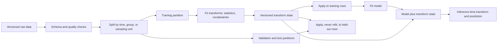

The key edge is the one that is absent: nothing flows from the held-out partitions back into the fit step. That single property is what makes a validation score a forecast and not a restatement. The architectural corollary is that the artifact promoted to production is the pair of transform state and model, never the model alone.

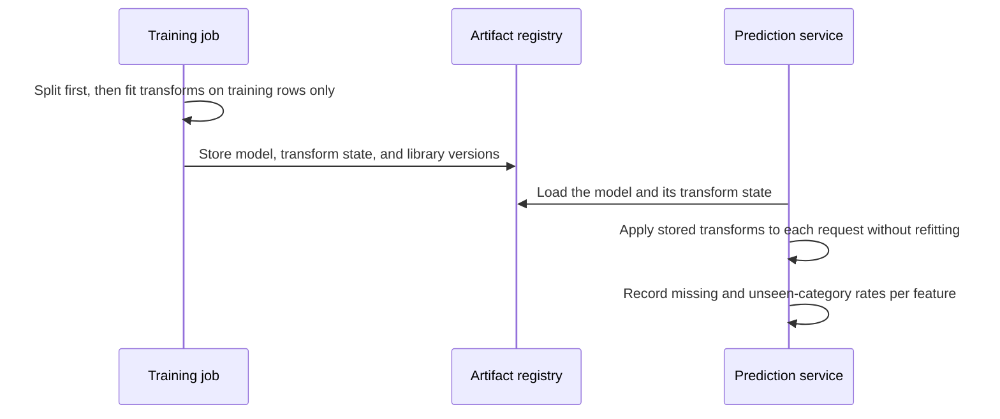

The sequence emphasizes who owns the state at each moment. The training job computes it exactly once. The registry stores it immutably with the model and the software versions that interpret it. The prediction service only applies it. The recording step at the end is not optional: those counters are the earliest evidence that production inputs have drifted from the training data.

The following sketch makes the boundary explicit with scikit-learn. It was run with arrays small enough to verify by hand.

```python
import numpy as np
from sklearn.impute import SimpleImputer
from sklearn.pipeline import Pipeline
from sklearn.preprocessing import OneHotEncoder, StandardScaler

X_train = np.array([[10.0], [12.0], [np.nan], [16.0], [18.0], [14.0]])
numeric = Pipeline([
    ("impute", SimpleImputer(strategy="median")),
    ("scale", StandardScaler()),
])
numeric.fit(X_train)  # state is learned here, from training rows only
print(numeric.named_steps["impute"].statistics_)  # [14.]
print(numeric.named_steps["scale"].mean_, numeric.named_steps["scale"].scale_)  # [14.] [2.5819889]
print(numeric.transform(np.array([[30.0], [np.nan]])).ravel())  # about [6.197 0.0]

plans = OneHotEncoder(handle_unknown="ignore")
plans.fit(np.array([["basic"], ["pro"], ["basic"], ["enterprise"]]))
print(plans.categories_[0])  # ['basic' 'enterprise' 'pro']
print(plans.transform(np.array([["pro"], ["team"]])).toarray())  # unseen "team" becomes all zeros
```

The median of the five observed values is 14, so the missing entry is filled with 14. The scaler is then fitted on the imputed column, so the filled value contributes to the mean (still 14) and to $\sigma = \sqrt{40/6} \approx 2.58$; step order therefore changes the fitted state. At serving time, the value 30 becomes $(30-14)/2.58 \approx 6.20$, and a missing value is filled with 14 and standardizes to exactly zero. That last behavior is worth noticing: a missing input and an average input produce the same standardized value, so unless the missing indicator is also supplied, the model cannot tell them apart. The encoder never saw "team", so it emits an all-zero row without raising an error, which is why the unseen-value counter matters.

### 4.5 Failure modes and tests

- **Refitting at serving time.** Normalizing each request batch with its own statistics gives different numbers per batch, and a single-request batch has zero variance.
- **Mismatched implementations.** A batch job and an online handler each re-implement the same ratio or bucketing rule and diverge on edge cases such as zero denominators, time zones, or rounding.
- **Version drift.** Loading persisted state with a different software release can change defaults, column order, or category handling. Pin versions with the artifact and fail loudly when they differ.
- **Silent vocabulary growth.** A pipeline that rebuilds its category list on every run changes column positions between model versions.

The standard defense is a **parity test**: take a fixed set of raw records, run them through the training-time and serving-time code paths, and assert that the resulting feature vectors agree within a tolerance. Combined with the unseen and missing-rate counters, it detects most of the skew that causes quiet degradation. [CH29 — MLOps and LLMOps](CH29_MLOps_and_LLMOps.md) owns how those checks fit into release gates and monitoring.

## 5. Missing Values

### 5.1 Why a value is missing

A missing value is an observation about the data-collection process, not only an absence. The same blank can mean a sensor failed, a form field was skipped, a join found no match, or the quantity genuinely does not exist yet. Rubin's taxonomy classifies the mechanism by what the probability of being missing depends on. Let $M$ indicate that a value is missing, let $X_{\text{obs}}$ be the values that were recorded, and let $X_{\text{mis}}$ be the values that would have been recorded had they not gone missing.

- **Missing Completely At Random (MCAR):** $P(M \mid X_{\text{obs}}, X_{\text{mis}}) = P(M)$. Missingness is unrelated to any value, observed or not.
- **Missing At Random (MAR):** $P(M \mid X_{\text{obs}}, X_{\text{mis}}) = P(M \mid X_{\text{obs}})$. Missingness depends only on values that were recorded.
- **Missing Not At Random (MNAR):** missingness depends on the unrecorded value itself, even after accounting for everything recorded.

| Mechanism | Illustrative cause | Effect of dropping incomplete rows | Can the data alone confirm it? |
|---|---|---|---|
| MCAR | A logging process drops a random subset of events | Loses data but does not bias averages | Partially; some tests can reject it, none can prove it |
| MAR | An optional field is skipped more often by one customer segment that is itself recorded | Biased unless the segment is accounted for | No, because the claim concerns values nobody saw |
| MNAR | High earners decline to report income | Biased in a direction the observed data cannot reveal | No |

The distinction between MAR and MNAR cannot be settled from the recorded data, since it concerns the values that are absent. It must come from knowledge of the collection process, or from a follow-up sample in which some missing values are obtained. Rubin's theory addresses estimating population quantities; for prediction, the practical question is narrower and just as demanding. The model will be trained on one missingness process and served under whatever process produces the next batch of records, so the policy must hold up when those two differ.

### 5.2 Worked example: how handling methods distort a distribution

The example is constructed so that every value can be checked by hand. Ten customers have annual incomes of $20, 25, 30, 35, 40, 45, 50, 60, 80, 120$ thousand. The full-data mean is $505/10 = 50.5$ and the population variance is $817.25$. Now suppose the three highest incomes, $60, 80, 120$, are withheld by their owners, an MNAR process. Seven values remain, with mean $245/7 = 35.0$ and deviations $-15, -10, -5, 0, 5, 10, 15$, so the sum of squared deviations is $700$ and the variance is $700/7 = 100$.

| Handling method | Rows used | Estimated mean | Estimated variance |
|---|---|---|---|
| Full data (not observable in practice) | 10 | 50.5 | 817.25 |
| Drop incomplete rows | 7 | 35.0 | 100.0 |
| Fill gaps with the observed mean | 10 | 35.0 | 70.0 |

Both practical methods understate the mean by $15.5$ thousand, which is $15.5/50.5 \approx 31\%$ of the true value, because the withheld values are the largest and every method works only from the smaller ones. No amount of additional data under the same process repairs this. Mean filling also changes the variance in a predictable way. The imputed entries equal the mean, so they add nothing to the sum of squared deviations (still $700$), while the divisor grows from $n_{\text{obs}}$ to $n$:

$$
\sigma^2_{\text{imputed}} = \frac{n_{\text{obs}}}{n}\,\sigma^2_{\text{obs}} = \frac{7}{10} \times 100 = 70
$$

The filled column therefore looks less variable than the observed data, which is already narrower than the truth. Any relationship between this column and another is attenuated for the same reason: the imputed rows add observations that carry no variation to correlate with anything.

A missing-value indicator, a separate binary column equal to 1 when the value was absent, recovers part of what imputation destroys. In this constructed example the withheld incomes average $260/3 \approx 86.7$, far above every observed value. Nobody could compute that figure in practice, but a model supplied with the indicator can learn that the flagged rows behave differently from the rest, because their outcome labels are observed even though their incomes are not. Absence is information precisely when the mechanism is MNAR or MAR.

### 5.3 Choosing a strategy

| Strategy | Appropriate when | Main cost |
|---|---|---|
| Drop rows (complete-case) | Missingness is MCAR and rare | Selection bias otherwise; production cannot drop requests |
| Drop the feature | Missing rate is high and the feature adds little | Loses signal |
| Constant or sentinel value | A model that handles sentinels (such as trees) is used | A sentinel inside a linear model looks like a real value |
| Mean, median, or mode, fitted on training rows | Missingness is low and unrelated to the label | Shrinks variance; hides absence |
| Statistic plus missing indicator | Absence may carry signal | Indicator becomes unreliable if collection changes |
| Model-based imputation, fitted on training rows | Missing values are predictable from other recorded features | Extra fitted state to version; must never use the label |
| Native handling by the model | Tree libraries that learn a direction for missing values (see [CH04](CH04_Decision_Trees_and_Ensemble_Learning.md)) | Behavior is library-specific and must be tested at serving |

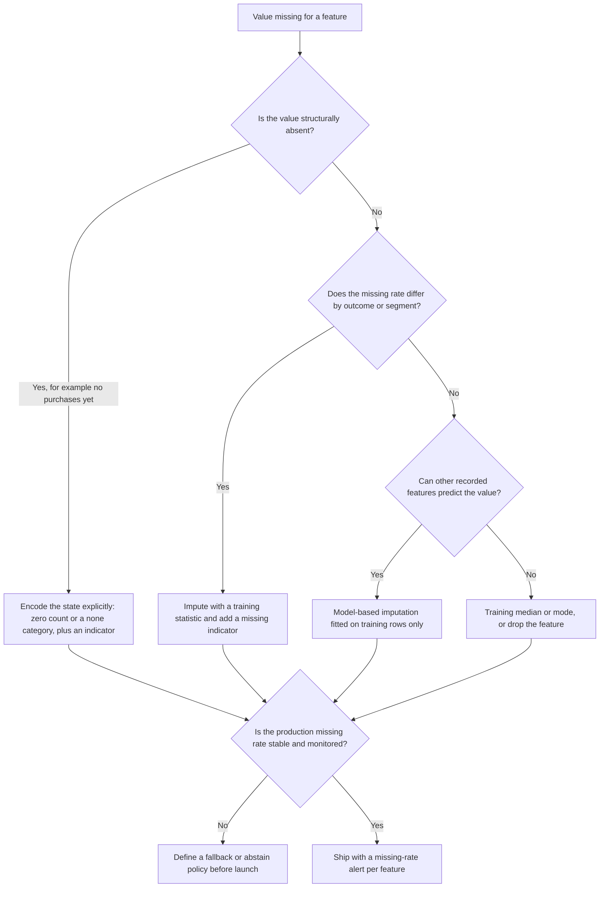

The first branch deserves emphasis. A **structural** absence is a fact, not a gap: the days since a customer's last purchase do not exist for a customer who has never purchased. Filling that field with the training average asserts a purchase history that never occurred. Encode the state itself, with a count of zero where counts are meaningful, or a distinct category, plus an indicator. Two rules apply to every branch that fits a statistic or a model. The label must never be used to impute a feature, because that is leakage by construction, and every fitted fill value belongs to the transformation state from the previous section.

### 5.4 Missingness at serving time

Training sees one missingness process and production another. Consider an illustrative feature that is almost always present in training, with a missing rate under 1%. During an upstream outage, the feature is empty for 40% of requests. Median imputation turns each of those requests into a plausible-looking vector, the service keeps returning predictions, and nothing raises an error. Predictions for the affected requests are now driven by a constant. A missing indicator does not help if the model never saw the indicator active, because it has no learned response.

Likewise, a collection change can create an indicator that is informative for the wrong reason. If a new client application stops sending a field that an older client sent, then "field missing" becomes a proxy for "uses the new client", and the model attributes the outcomes of that population to the missingness itself. The practical defenses are modest and concrete:

- Record the missing rate of every feature by source and time, and alert on departures from the training rate.
- Set a per-request policy before launch: how many critical features may be missing before the service falls back to a simpler rule or abstains.
- Treat a change in how a field is collected as a change to the feature, with the same review as a change to its definition.

[CH29](CH29_MLOps_and_LLMOps.md) owns the monitoring and rollback machinery these alerts feed.

## 6. Leakage

### 6.1 Definition and taxonomy

A feature value **leaks** when the procedure that computed it used information that the production system would not have at decision time $t_0$: a future event, the label of the very example being predicted, or data from the partition that is supposed to measure generalization. Leakage is not a modelling error that better algorithms avoid. It is a mismatch between the training-and-evaluation task and the deployment task, and the more flexible the model, the more completely it exploits the mismatch. The following taxonomy separates paths that look similar but have different remedies.

| Path | Mechanism | Typical symptom | Primary defense |
|---|---|---|---|
| Post-outcome field | A column is written after, or because of, the outcome (for example a field populated only for accounts that cancelled) | One feature dominates importance; offline score is implausibly high | Per-feature availability audit against the prediction-time contract |
| Label proxy | A column is a near-deterministic function of the label | Same as above, harder to spot because the column looks innocuous | Ask what business process fills the column and when |
| Preprocessing contamination | Means, vocabularies, selected features, or imputation values are fitted on rows that include evaluation data | Optimistic validation score that does not reappear on later data | Fit every step inside the training partition |
| Label-statistic encoding | A row's own label enters its own feature, as in naive target encoding | Large gap between training and held-out score | Out-of-fold encoding with smoothing |
| Temporal leakage | Future rows in training, or a rolling feature computed with a window that extends past $t_0$ | Random-split score far above time-split score | Time-ordered partitions; point-in-time feature construction |
| Entity or duplicate leakage | The same customer, device, document, or near-duplicate appears on both sides of a split | Memorization rewarded; score collapses on new entities | Group-aware partitioning and duplicate-family checks |

A seventh path, repeatedly tuning against the final test set until it becomes training feedback, belongs to evaluation discipline and is owned by [CH06](CH06_Model_Evaluation_Validation_and_Selection.md). Point-in-time construction of rolling features, the main defense against temporal leakage inside feature code, is developed in the feature-engineering section later in this chapter.

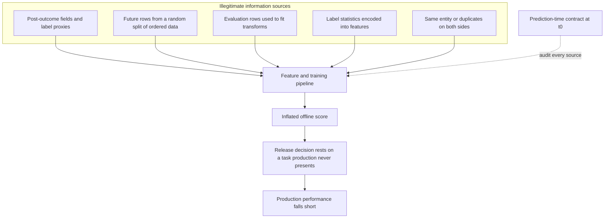

The diagram traces why leakage is an architectural problem and not a data-science footnote. Every path ends in the same place: an offline number that a decision-maker trusts. The dotted edge is the only defense that does not depend on noticing a symptom. Auditing each input against the contract prevents leakage at its source, whereas every symptom in the table is evidence that arrives only after the damage is done.

### 6.2 Worked example: target encoding leaks the label

Target encoding replaces a category with a statistic of the label, such as the share of positive examples observed in that category. Computed naively on the training rows, it places each row's own label inside its own feature. This example is illustrative. One category has five training rows with labels $1, 1, 0, 0, 0$, so its naive encoding is $2/5 = 0.40$ for every row, and each row's label contributes one fifth of its own feature. For a category with a single training row, the encoded value is the label itself. A flexible model learns that "encoded value 1 means positive" and achieves a perfect training score using a rule that cannot work on new rows, whose encodings come from other examples' labels.

A tempting repair is **leave-one-out** encoding, which encodes each row with the mean label of the *other* rows in its category: $(s_c - y_i)/(n_c - 1)$, where $s_c$ is the category's positive count and $n_c$ its size. For the five-row category above, each positive row receives $(2-1)/4 = 0.25$ and each negative row receives $2/4 = 0.50$. Within the category, the encoding is a strictly decreasing function of the row's own label: lower value means positive. The label has been moved into the feature in reverse, and a model that sees both the category and the encoded value can read it off. Leave-one-out is therefore not a safe repair for flexible models.

The defensible approach combines two ideas. **Out-of-fold encoding** computes the encoding for each training row from folds that do not contain that row, so a row's label never influences its own feature; validation, test, and serving rows are encoded with statistics from the whole training partition. **Smoothing** protects small categories by blending the category mean $\bar y_c$ with the overall mean $\bar y$, using a pseudo-count $m$ that sets how many examples a category needs before it is trusted:

$$
\tilde{\mu}_c = \frac{n_c\,\bar{y}_c + m\,\bar{y}}{n_c + m}
$$

With overall mean $\bar y = 0.30$ and $m = 20$, a category with $n_c = 2$ rows, both positive, encodes to $(2 \times 1 + 20 \times 0.30)/22 = 8/22 \approx 0.364$, barely above the prior, while a category with $n_c = 200$ and $\bar y_c = 0.5$ encodes to $(100 + 6)/220 \approx 0.482$, close to its own mean. The pseudo-count $m$ is a hyperparameter selected with validation evidence, and the overall mean is fitted state.

The experiment below uses 2,000 rows and 400 categories, with labels drawn independently of the category so that no feature can legitimately predict them. It scores each encoding with the Area Under the receiver operating characteristic Curve (AUC), computed on the encoded value itself; an AUC near 0.5 means no predictive power.

```python
import numpy as np
from sklearn.metrics import roc_auc_score

rng = np.random.default_rng(1)
n, n_cat, m = 2000, 400, 20.0
cat = rng.integers(0, n_cat, n)
y = rng.integers(0, 2, n)  # labels are noise, so no feature can legitimately predict them
tr, te = np.arange(1000), np.arange(1000, 2000)

def fit(c, t):
    return np.bincount(c, weights=t, minlength=n_cat), np.bincount(c, minlength=n_cat)

def encode(c, sums, counts, prior, m):
    return (sums[c] + m * prior) / (counts[c] + m)

prior = y[tr].mean()
sums, counts = fit(cat[tr], y[tr])
naive_train = roc_auc_score(y[tr], encode(cat[tr], sums, counts, prior, 1e-9))  # own label included
naive_test = roc_auc_score(y[te], encode(cat[te], sums, counts, prior, 1e-9))

folds = np.arange(1000) % 5
oof = np.empty(1000)
for k in range(5):
    inner, held = tr[folds != k], tr[folds == k]
    s, c = fit(cat[inner], y[inner])
    oof[folds == k] = encode(cat[held], s, c, y[inner].mean(), m)  # label of a row never feeds itself
print(f"naive train {naive_train:.3f}, naive test {naive_test:.3f}, out-of-fold smoothed {roc_auc_score(y[tr], oof):.3f}")
```

With the seed shown, the output was `naive train 0.836, naive test 0.481, out-of-fold smoothed 0.473`. The naive encoding looks strongly predictive on the rows that built it, an AUC of 0.836 for labels that are pure noise, and drops to chance on new rows, which is the signature of leakage. The out-of-fold encoding correctly reports no signal. Exact values depend on the seed and library version, but the gap between the first two numbers does not. Setting the pseudo-count to almost zero in the naive calls reproduces the unsmoothed category mean, and unseen categories fall back to the training prior.

### 6.3 Temporal leakage

Temporal leakage has two forms that need different defenses. The first is **row-level**: rows from after the decision time of a test example sit in the training data, usually because ordered data was split at random. The second is **feature-level**: a feature for a row at time $t_0$ was computed from information that did not yet exist, or was not yet recorded, at $t_0$.

The feature-level form hides in the difference between when something happened and when the system learned of it. Let $\tau(e)$ be the **event time** of record $e$ and $\delta(e) \ge 0$ its ingestion delay, so the record becomes available at $\tau(e) + \delta(e)$. A legitimate feature at decision time $t_0$ is computed only from records already available:

$$
x_j(t_0) = f_j\big(\{\, e : \tau(e) + \delta(e) \le t_0 \,\}\big)
$$

The common error is to filter on $\tau(e) \le t_0$ alone. A payment that occurred on day 28 and was recorded on day 31 is invisible to a decision on day 30, yet an event-time filter includes it. Other routes into the same trap:

- **Snapshot-today joins.** Joining historical decision rows to a dimension table as it looks today attaches attributes that were edited after $t_0$, such as a customer's current plan or segment.
- **Restated values.** If a source overwrites a field in place when a correction arrives, the corrected value is returned for every historical row. Keeping valid-from and recorded-at timestamps per version (a bitemporal layout) is what makes "as known then" reconstructible.
- **Windows that straddle $t_0$.** A trailing 30-day count computed with a window centred on $t_0$, or with an inclusive upper bound that admits events occurring after the decision, counts the future.
- **Label-window overlap.** A training example at $t_0$ has a label computed over $(t_0, t_0 + H]$. If $t_0 + H$ falls inside the evaluation period, the training label already encodes outcomes from the period the model will be tested on. Section 7 handles this with a purge gap.

Temporal leakage tends to be invisible in a random split and decisive in a time-ordered one, which is why Section 7 treats the partitioning scheme as part of the defense. Point-in-time construction of the features themselves, including a runnable join, is in Section 9.

### 6.4 Entity and duplicate leakage

When the same **entity** (a customer, device, patient, or document) contributes several rows, rows from one entity are strongly correlated through stable traits that the model can memorize. A random split places some of an entity's rows in training and others in test, so the test score rewards recognizing the entity and not generalizing to new ones. Near-duplicate rows, such as the same listing scraped twice or one document in two versions, are the same hazard with the entity defined by content. The deployment question is usually "how well does this work on entities not yet seen", and only a split by entity answers it.

The experiment below is synthetic. Each of 200 customers has a stable five-number fingerprint, ten noisy rows, and a single binary label that is unrelated to the fingerprint, so a model that generalizes across customers can do no better than chance.

```python
import numpy as np
from sklearn.ensemble import RandomForestClassifier
from sklearn.model_selection import GroupKFold, KFold, cross_val_score

rng = np.random.default_rng(3)
customer = np.repeat(np.arange(200), 10)  # 200 customers, 10 rows each
fingerprint = rng.normal(size=(200, 5))  # stable per-customer traits
X = fingerprint[customer] + 0.3 * rng.normal(size=(2000, 5))
y = rng.integers(0, 2, 200)[customer]  # one label per customer, unrelated to the traits
model = RandomForestClassifier(n_estimators=100, random_state=0)
for name, cv, groups in [("random", KFold(5, shuffle=True, random_state=0), None),
                         ("grouped", GroupKFold(5), customer)]:
    print(name, round(cross_val_score(model, X, y, cv=cv, groups=groups, scoring="roc_auc").mean(), 3))
```

With the seeds shown, the output was `random 0.867` and `grouped 0.460`. The random split reports strong discrimination for a label that has no relationship to the features, because the forest recognizes each customer's fingerprint and recalls its label. Splitting by customer removes the memorization route and the score falls to chance (the small deviation below 0.5 is sampling noise). The remedy generalizes: choose the split unit to match the unit of deployment, and deduplicate or cluster near-duplicates before splitting so each family lands wholly on one side.

### 6.5 Preprocessing contamination and feature selection

Section 4 showed that fitting standardization on the wrong rows contaminates evaluation. Feature selection is the more dangerous cousin, because it uses labels. Hastie, Tibshirani, and Friedman's "wrong way" is to screen thousands of candidate predictors against the full set of labels, keep the best few, and only then cross-validate. The selected features were chosen because they correlate with the very labels that the folds are meant to hide, so the resulting estimate is optimistic even when every feature is noise.

The reproduction below uses 100 rows and 1,000 pure-noise features with random labels, so the correct performance is chance. It repeats the experiment over 20 seeds to average out the luck of any one draw.

```python
import numpy as np
from sklearn.feature_selection import SelectKBest, f_classif
from sklearn.linear_model import LogisticRegression
from sklearn.model_selection import KFold, cross_val_score
from sklearn.pipeline import make_pipeline

outside, inside = [], []
for seed in range(20):
    rng = np.random.default_rng(seed)
    X, y = rng.normal(size=(100, 1000)), rng.integers(0, 2, 100)  # labels are noise
    cv = KFold(5, shuffle=True, random_state=0)
    X_sel = SelectKBest(f_classif, k=20).fit_transform(X, y)  # selection saw every label
    outside.append(cross_val_score(LogisticRegression(max_iter=1000), X_sel, y, cv=cv, scoring="roc_auc").mean())
    pipe = make_pipeline(SelectKBest(f_classif, k=20), LogisticRegression(max_iter=1000))
    inside.append(cross_val_score(pipe, X, y, cv=cv, scoring="roc_auc").mean())  # selection refit per fold
print(f"selection outside CV {np.mean(outside):.3f}, inside CV {np.mean(inside):.3f}")
```

The printed averages were `selection outside CV 0.907, inside CV 0.513`. Selecting outside the loop reports an AUC above 0.9 for labels that carry no information; selecting inside each training fold gives the honest value near 0.5. The rule applies to every step that learns from data: imputation values, scaling statistics, vocabularies, dimensionality reduction, feature selection, and resampling. Wrapping all of them in a single pipeline object that is fitted inside each training fold, and then serialized as the deployed artifact, makes the correct behavior the default.

### 6.6 Post-outcome fields, label proxies, and test-set reuse

Post-outcome fields and label proxies are caught by asking four questions of every column: which process writes it, at what moment, in response to what, and is it written for non-events as well as events. A cancellation reason, a refund amount, a "case closed" flag, or a collections-contact marker is typically written only when the outcome occurs or after it, so its mere presence is nearly the label. The question "is it populated for the negative class" exposes the problem quickly, because a field that is blank for non-events carries the outcome in its null pattern alone. Proxies are subtler: a status code that downstream staff assign after reviewing the case, or a score produced by an earlier model that already saw the outcome.

**Test-set reuse** is leakage through the analyst and not through a feature. Each time a result on the test set informs a decision, such as choosing a model, a threshold, or a feature set, some information about the test labels enters the system, and the final number is no longer a fair forecast. The effect grows with the number of looks. If 20 candidate models all have true accuracy 0.50 and each is scored on 100 test rows, the sampling standard deviation of each score is $\sqrt{0.5 \times 0.5/100} = 0.05$. The expected maximum of 20 independent standard-normal draws is about 1.87, so the winner is expected to score about $0.50 + 1.87 \times 0.05 \approx 0.59$ despite having no skill. Procedures that keep selection and final estimation separate, including nested validation, are owned by [CH06](CH06_Model_Evaluation_Validation_and_Selection.md).

### 6.7 Detecting leakage

No single test proves a pipeline is clean, but several cheap checks expose the common paths. They complement the prevention-by-contract audit and do not replace it.

| Technique | What it does | Signal | Limitation |
|---|---|---|---|
| Availability audit | Compare each feature's recorded availability time with the decision time | Any feature available after $t_0$ | Needs accurate availability metadata |
| Single-feature strength screen | Score each feature alone against the label | A lone feature with an AUC far above the rest | Strong legitimate features exist; weak leaks are missed |
| Ablation by feature time | Retrain with only features available at $t_0$ and compare | Large drop in held-out score | Requires the availability metadata above |
| Adversarial time check | Train a classifier to tell early rows from late rows | Separable features reveal calendar proxies and shift | Detects shift, not leakage as such |
| Shuffled-label check | Permute training labels and rerun the whole pipeline | Score materially above chance | Catches label-use inside the pipeline only |
| Group and time re-split | Re-evaluate with entity-grouped and time-ordered splits | Score collapses relative to random split | Needs entity and time keys |

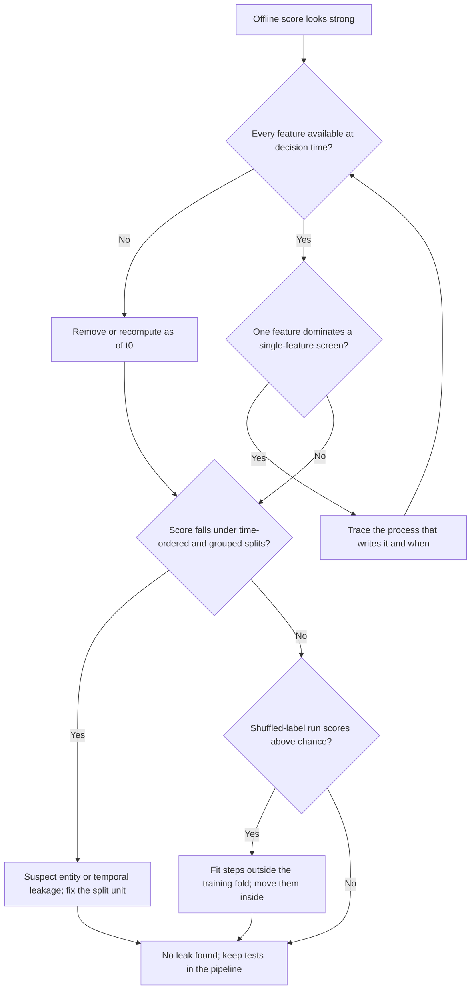

The flow is ordered from cheapest and most decisive to most expensive. Its terminal node says "no leak found", never "no leak": the checks reduce risk and cannot certify absence. That is why the first question is an audit against the contract and not a statistical test, and why a recurring suite in the training pipeline, not a one-time review, is the durable control.

The script below runs three of the checks on a synthetic subscription dataset in which `cancel_reason_flag` is deliberately written after the outcome and `app_version` drifts with the calendar. The decision-time availability of each feature is declared as a lag in days relative to $t_0$.

```python
import numpy as np
import pandas as pd
from sklearn.ensemble import HistGradientBoostingClassifier
from sklearn.metrics import roc_auc_score
from sklearn.model_selection import cross_val_predict

rng = np.random.default_rng(11)
n = 6000
month = rng.integers(0, 12, n)
tenure = rng.integers(1, 60, n)
usage = rng.normal(size=n)
y = (rng.random(n) < 1 / (1 + np.exp(-(-1.5 - 0.02 * tenure - 0.4 * usage)))).astype(int)
df = pd.DataFrame({
    "tenure": tenure,
    "usage": usage,
    "app_version": month + rng.normal(0, 0.3, n),
    "cancel_reason_flag": np.where(y == 1, rng.random(n) < 0.9, rng.random(n) < 0.02).astype(int),
})
available_at = {"tenure": -1, "usage": -1, "app_version": -1, "cancel_reason_flag": 20}  # days relative to decision time

def auc_either_way(target, col):
    a = roc_auc_score(target, col)
    return max(a, 1 - a)

print("single-feature AUC:", {c: round(auc_either_way(y, df[c]), 3) for c in df})
late = (month >= 9).astype(int)
print("time-separability AUC:", {c: round(auc_either_way(late, df[c]), 3) for c in df})
adv = cross_val_predict(HistGradientBoostingClassifier(), df, late, cv=5, method="predict_proba")[:, 1]
print("adversarial AUC:", round(roc_auc_score(late, adv), 3))

tr, te = month < 9, month >= 9
def holdout_auc(cols):
    m = HistGradientBoostingClassifier().fit(df.loc[tr, cols], y[tr])
    return roc_auc_score(y[te], m.predict_proba(df.loc[te, cols])[:, 1])
legal = [c for c, lag in available_at.items() if lag <= 0]
print("all features:", round(holdout_auc(list(df)), 3), "| available at t0 only:", round(holdout_auc(legal), 3))
```

The output was:

```text
single-feature AUC: {'tenure': 0.614, 'usage': 0.603, 'app_version': 0.512, 'cancel_reason_flag': 0.95}
time-separability AUC: {'tenure': 0.502, 'usage': 0.503, 'app_version': 1.0, 'cancel_reason_flag': 0.5}
adversarial AUC: 0.999
all features: 0.958 | available at t0 only: 0.585
```

Three readings follow. The single-feature screen isolates `cancel_reason_flag` at 0.95 against 0.60 to 0.61 for the others, and the availability lag of 20 days confirms why. The adversarial check separates early from late rows almost perfectly because of `app_version`, which is legitimately known at $t_0$ but is a calendar proxy; a tree model can use it to learn period-specific behavior that will not carry to a later period. Finally, the ablation shows the cost of honesty: the held-out AUC falls from 0.958 to 0.585 once only decision-time features remain. The honest value is the one a launch decision should use, and it is also the number a team is least inclined to look for.

## 7. Splitting Strategies for Honest Evidence

### 7.1 A split is an assertion about deployment

A partition into training, validation, and test sets is more than bookkeeping. It asserts that the held-out rows relate to the training rows the way tomorrow's requests will relate to everything the system has seen. If production predicts next month from past months, the held-out rows must come from later months. If production serves entities never seen before, the held-out rows must come from entities absent from training. A split that fails this resemblance still produces a number, and that number is then read as a forecast. [CH06 — Model Evaluation, Validation, and Selection](CH06_Model_Evaluation_Validation_and_Selection.md) owns cross-validation procedure, metrics, and uncertainty; this section owns how the rows are cut so that those procedures measure the right thing.

### 7.2 Strategy families

| Strategy | Assertion about deployment | Valid when | Hazard if misused |
|---|---|---|---|
| Random | Future rows are exchangeable with past rows | Rows are independent and the population is stable | Inflates scores for ordered or clustered data |
| Stratified random | Same as random, with class proportions preserved | Rare classes would otherwise be unevenly represented | Does not fix dependence between rows |
| Grouped | Deployment sees new entities | One entity yields many correlated rows | Leaves temporal leakage if time also matters |
| Temporal | Deployment predicts the future from the past | Behavior or data drifts over time | Fewer recent rows for training; seasonal coverage may be partial |
| Grouped and temporal | New entities, later time | Both forms of dependence exist | Smaller usable data; most conservative estimate |

Stratification matters for rare outcomes because sampling noise in the class count can dominate. With 500 test rows and 2% prevalence, the expected number of positives is $500 \times 0.02 = 10$ with a binomial standard deviation of $\sqrt{500 \times 0.02 \times 0.98} \approx 3.1$, so a plain random draw can easily yield 5 or 15 positives and make recall noisy. Stratifying by class fixes the count near 10, but it does not make the metric precise; interval estimation belongs to CH06.

### 7.3 Cutoffs, purge gaps, and windows

A temporal split is defined by cutoffs on **decision time** $t_0$, not on the time at which a row was ingested. Training rows have $t_0 \le c_{\text{train}}$ and test rows have $t_0 > c_{\text{test}}$. The two cutoffs must be separated by at least the label horizon $H$ so that no training label is computed from a period that overlaps the test period:

$$
c_{\text{test}} \;\ge\; c_{\text{train}} + H
$$

The unused interval is a **purge gap**. A related device in k-fold schemes where training data may sit on both sides of a test fold is an **embargo**, a buffer after the test fold in which training rows are also dropped, because those rows' features can carry information about test-period behavior. Scikit-learn's `TimeSeriesSplit` exposes a `gap` argument for the purge in forward-chaining splits.

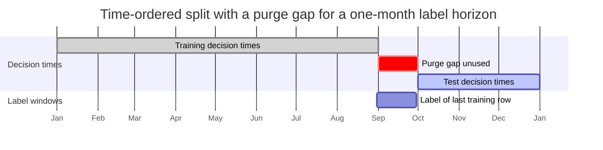

The diagram is illustrative. The last training decision on 31 August has a label window that closes on 30 September, which is before the first test decision. Without the gap, a training row decided on 20 September would have a label window reaching into October, and the model would be fitted on outcomes drawn from the test period. A validation window, when used, sits between training and test with its own gap of at least $H$, and the final model may be refitted on training plus validation data only after selection is complete.

### 7.4 Worked example: how much a random split flatters

This example is **illustrative**; the numbers are chosen so the arithmetic can be checked, and no measurement is implied. A renewal model is built from twelve months of data with 2,000 decisions per month and a label horizon of one month. Behavior drifts, so a model fitted on past months loses accuracy on later ones.

- **Random split.** Rows from all twelve months are shuffled and 20% are held out. Held-out rows have training neighbors from the same weeks, the same promotions, and often the same accounts. Suppose accuracy is 0.90.
- **Time split.** Months 1 to 8 train the model, month 9 is the purge gap, and months 10, 11, and 12 are the test set. Suppose accuracy is 0.86, 0.83, and 0.80 in the three months.

With equal monthly volume, the time-split estimate is $(0.86 + 0.83 + 0.80)/3 = 0.83$. The random-split estimate overstates it by $0.90 - 0.83 = 0.07$, which is $0.07/0.83 \approx 8\%$ in relative terms. Two effects produce the gap: the model is interpolating within regimes it has already seen, and some held-out rows are near-copies of training rows from the same entity (Section 6.4). The per-month pattern matters too. Accuracy falls by about 3 points per month of distance from the cutoff, so the 0.83 average describes the first quarter after training and not a stable steady state. A deployment plan should therefore state how often the model is refitted and monitor the same decay in production, which is owned by [CH29](CH29_MLOps_and_LLMOps.md).

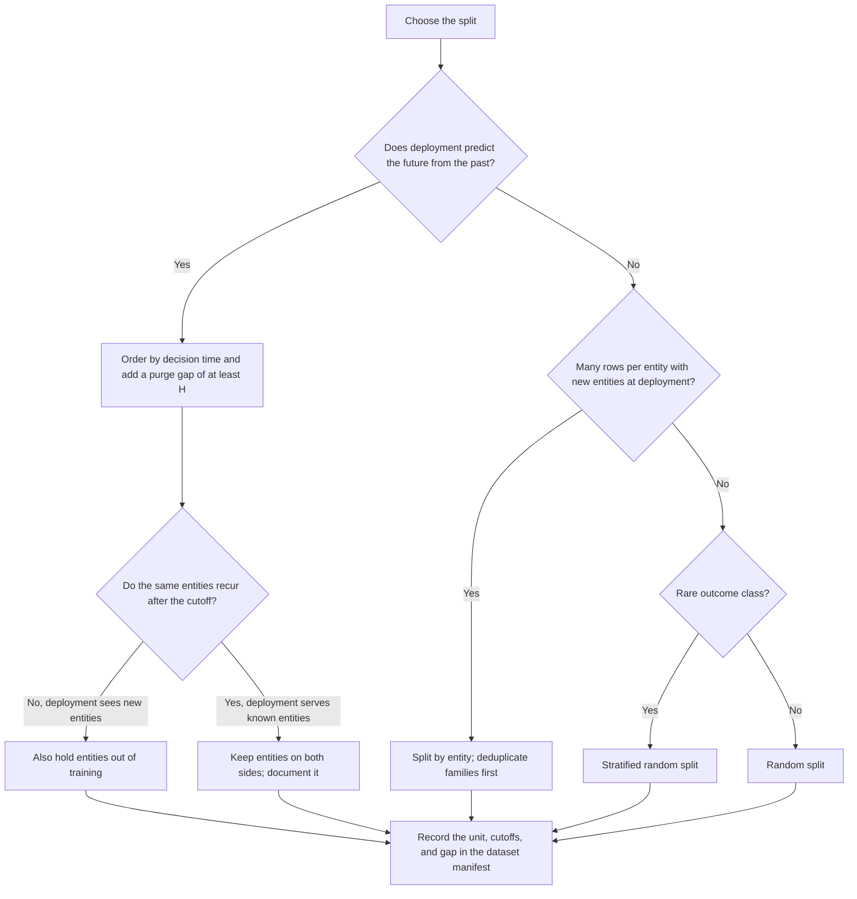

The decision flow shows that "random" is the conclusion of several questions answered in the negative, not a default. It also shows an often-missed branch: if production genuinely serves known entities, such as renewals of existing accounts, then keeping entities on both sides is the honest simulation, and holding them out would measure a harder task than deployment presents. The choice must be recorded in the manifest, because a number without its split definition cannot be compared with any other.

### 7.5 Nested protocol at a high level

Choosing a model, tuning hyperparameters, and estimating final performance on the same partitions reuses information (Section 6.6). The standard remedy is a nested arrangement: an inner loop selects among candidates using only training data, and an outer loop estimates the performance of the whole selection procedure on data that selection never saw. For temporal data both loops are time-ordered, so the outer folds are rolling origins, each training on an expanding window and testing on the period just after a purge gap. The preparation implication is that every fitted transform lives inside the inner loop's training fold, a requirement Section 6.5 already motivated. Procedure, fold counts, and uncertainty reporting are specified in CH06.

## 8. Label Maturity and Class Imbalance

### 8.1 Label delay and maturity

A label is an observation produced by a process, and the process takes time. A churn label needs the renewal window to close, a fraud label needs chargebacks to arrive, and a default label needs the repayment horizon to elapse. A row is **mature** when its label can no longer change for the reasons that matter. Treating an immature row as a negative confuses "not observed yet" with "did not occur", and the error is biased in a specific direction: it removes positives, and it removes them most from the most recent data.

When outcomes arrive after a variable delay, choose a maturity wait $W$ from the delay distribution so that nearly all eventual labels have arrived: the smallest $W$ with $P(\text{delay} \le W) \ge 1 - \epsilon$. The following delay profile for a chargeback label is illustrative:

| Days after transaction | Share of eventual labels that have arrived |
|---|---|
| 30 | 55% |
| 60 | 85% |
| 90 | 97% |
| 120 | 99% |

If the true fraud rate is 2%, labelling after 30 days observes $0.02 \times 0.55 = 1.1\%$, after 90 days $0.02 \times 0.97 = 1.94\%$, and after 120 days $1.98\%$. A wait of 90 days leaves a 3% relative error, which is acceptable only if the decision cost allows it. The wait also sets how stale the training data is: a model trained on mature labels is blind to the most recent $W$ days.

### 8.2 Right-censoring and a worked maturity example

An observation is **right-censored** when the follow-up ended before the event could be seen. Immature rows are censored, not negative. The Kaplan-Meier estimator (Kaplan and Meier, 1958) is the classical way to estimate event probabilities from censored data, and survival models build on the same idea; this chapter needs only the consequence for dataset construction.

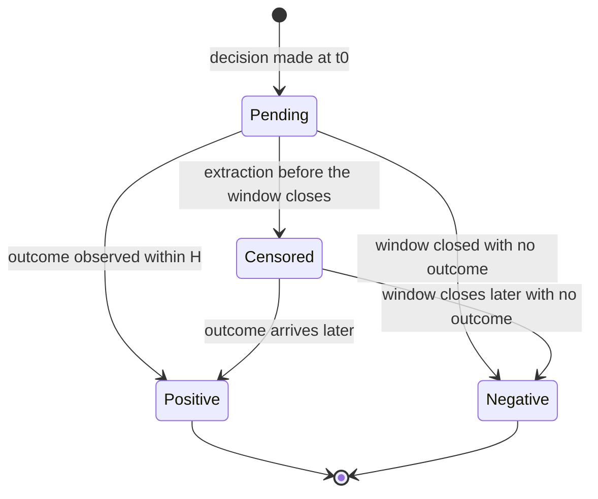

The lifecycle makes "Censored" a first-class state with exits to both outcomes. A pipeline that has only two states silently converts every pending row into a negative.

The worked example is **illustrative** and rests on a stated assumption. Data is extracted on a fixed date. Accounts were decided at a rate of 100 per day for the last 120 days, so there are 12,000 accounts. The label is "cancels within $H = 60$ days of the decision". Suppose the true 60-day cancellation rate is 10% and that cancellations are spread uniformly over the 60 days.

- Accounts decided more than 60 days before extraction are mature: $60 \times 100 = 6{,}000$ accounts, with $6{,}000 \times 0.10 = 600$ positives.
- The other 6,000 are immature, with ages uniform between 0 and 60 days, so on average half of their eventual cancellations have occurred. Observed positives are about $6{,}000 \times 0.10 \times 0.5 = 300$.

The naive dataset shows $(600 + 300)/12{,}000 = 7.5\%$ instead of 10%, an understatement of 25%. The recent 60 days show about 5% and would look as if retention had improved. A time-ordered test set drawn from those days would report a distorted prevalence and distorted precision, and a model trained on them as negatives would learn to score recent-looking accounts low. Three remedies exist: truncate the dataset at the extraction date minus $H$ and accept the staleness; keep censored rows out of the training and test sets until they mature; or use a survival formulation that uses partial follow-up explicitly. All three begin by recording each row's maturity state.

### 8.3 Why accuracy misleads under imbalance

When one class is rare, the proportion of correct predictions mostly measures the majority class. The following is **illustrative** and fully recomputable. Take 10,000 rows with 2% prevalence, so 200 positives and 9,800 negatives. A model flags positives with a true positive rate of 0.60 and a false positive rate of 0.03.

| | Predicted positive | Predicted negative |
|---|---|---|
| Actual positive (200) | TP $= 0.60 \times 200 = 120$ | FN $= 80$ |
| Actual negative (9,800) | FP $= 0.03 \times 9{,}800 = 294$ | TN $= 9{,}506$ |

Accuracy is $(120 + 9{,}506)/10{,}000 = 0.9626$, which is lower than the 0.98 achieved by a constant model that never predicts a positive. Yet the model is useful: precision is $120/414 \approx 0.290$ against a base rate of 0.02, a lift of about 14.5, and recall is 0.60. Their harmonic mean, the F1 score, is $2 \times 0.290 \times 0.60/(0.290 + 0.60) \approx 0.391$. Note also that false positives (294) outnumber true positives (120) despite a 3% false positive rate, because negatives are 49 times as common as positives. Metric choice and uncertainty are owned by CH06; the preparation point is that partitions must preserve natural prevalence so that these numbers mean something.

### 8.4 Resampling, class weights, and threshold moves

Three levers address imbalance, and they act at different points.

| Lever | What changes | Effect on probabilities | Main risks |
|---|---|---|---|
| Class weights | Loss contribution of each class | Scores are shifted toward the weighted prior | Unstable with extreme weights; needs recalibration |
| Oversampling the minority | Training distribution | Same prior shift as weighting | Duplicates can cross a split; synthetic points may be unrealistic |
| Undersampling the majority | Training distribution | Same prior shift; fewer rows | Discards information; higher variance |
| Moving the threshold | Only the decision rule | None; probabilities stay calibrated | Does not change what the model learns |

Weighting and resampling alter the effective class prior seen during training. If positives are weighted by $w$ (or the negatives are kept with probability $\beta$), the posterior odds the model learns relate to the true odds by a constant factor: $\text{odds}_{\text{train}} = w \times \text{odds}_{\text{true}}$ for weighting, and $\text{odds}_{\text{train}} = \text{odds}_{\text{true}}/\beta$ for undersampling. The true odds are recovered by dividing the training odds by $w$, or multiplying them by $\beta$. Take 2% prevalence and a model trained on a balanced sample (weights $w = 0.98/0.02 = 49$) that outputs $p_{\text{train}} = 0.80$. The training odds are $0.80/0.20 = 4$, so the true odds are $4/49 \approx 0.0816$ and the true probability is $0.0816/1.0816 \approx 0.0755$. A score that reads as 80% corresponds to about 7.5% in production. Using it as a probability inflates expected workload and expected benefit by more than tenfold. The identity assumes a well-specified, flexible model; regularized or misspecified models can distort calibration beyond a prior shift, so recheck calibration on natural-prevalence data. [CH03](CH03_Regression_and_Classification.md) owns calibration methods and threshold selection from costs.

SMOTE, the Synthetic Minority Over-sampling Technique of Chawla, Bowyer, Hall, and Kegelmeyer (2002), creates new minority examples by interpolating between neighbors. It is one oversampling method among several, and the same discipline applies to all of them: split first, resample only inside training folds, and keep validation and test partitions at natural prevalence. Duplicating or synthesizing rows before a random split places copies or near-copies on both sides of the boundary, which is the entity leakage of Section 6.4 created by the preparation step itself.

### 8.5 Evaluating under imbalance

Evaluate at natural prevalence and report quantities tied to the decision. The Precision-Recall (PR) curve is more informative than the Receiver Operating Characteristic curve at low prevalence, because precision responds directly to the false-positive count that dominates the cost of review; its no-skill baseline is the prevalence (0.02 here), not 0.5. Recall at a fixed review capacity, precision among the top $k$ scored cases, and expected cost at the chosen threshold map directly onto operational limits. Record the original class counts and the sampling configuration in the dataset manifest, so a reader can reconstruct deployment prevalence from a resampled training set.

### 8.6 Label noise

Labels are produced by people, rules, or delayed processes, and some are wrong. Under imbalance a small noise rate matters a great deal, because it flips a large number of negatives relative to the positives. Suppose 2% of cases are truly positive and each label is flipped independently with probability $\rho = 0.01$. The observed positive rate is $0.02 \times 0.99 + 0.98 \times 0.01 = 0.0296$, which is 48% higher than the truth, and only $0.0198/0.0296 \approx 67\%$ of observed positives are genuine. Even a perfect model that flags exactly the true positives would then measure a precision of 0.99 and a recall of only 0.67 against the noisy labels. [CH01](CH01_Machine_Learning_Foundations.md) (Section 5.4) described this ceiling on achievable accuracy. Practical responses are to audit a sample against adjudicated outcomes to estimate $\rho$, to avoid tuning thresholds against labels known to be noisy at the decision boundary, and to treat a score that exceeds the measured noise ceiling as a warning of leakage and not as a triumph.

## 9. Feature Engineering and Temporal Correctness

Feature engineering is the construction of model inputs from raw records. Under the prediction-time contract of Section 3, every feature is a function of what the system knew at decision time $t_0$, so the craft has a second, less glamorous half: reconstructing that knowledge faithfully for every historical training row. A clever feature built from a join that peeks at the future is worse than no feature, because it raises the offline score and lowers production performance. This section covers the joins and windows that decide temporal correctness, the safe form of label-derived encodings, the common derived-feature families, embeddings and feature stores at an architectural level, and a decision table that ties each feature type to its leakage risk.

### 9.1 Point-in-time (as-of) joins

A **point-in-time join**, also called an **as-of join**, attaches to each decision row $(e, t_0)$ the most recent version of a feature that the system could already see at $t_0$. Two timestamps are easy to confuse. The **event time** says when something happened in the world; the **recorded time** (or availability time) says when the system could first read the value. Section 6.3 showed that a filter on event time alone admits records that were not yet ingested. The join key must therefore be the recorded time, and the comparison must be strictly or non-strictly backward according to a stated rule.

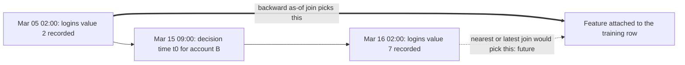

The diagram shows one account with three moments in time order. The older value is staler, ten days old at $t_0$, but it is the only one the production system could have read. The newer value is closer to $t_0$ in absolute distance and more accurate about the account's behavior around the decision, which is exactly why it leaks: it was computed from activity after the decision. The architectural implication is that the freshness of a historical feature is part of the training data. If the feature was ten days stale in production, it must be ten days stale in training, or the model learns to rely on precision that serving cannot deliver.

The example below is constructed so every output can be checked by hand. Three decisions are matched to a table of weekly-login counts for two accounts. The first block reproduces two leaky joins, the second the correct backward join with the two choices of `allow_exact_matches`, and the third adds a staleness limit.

```python
import pandas as pd

decisions = pd.DataFrame({
    "account": ["A", "A", "B"],
    "t0": pd.to_datetime(["2025-03-10 09:00", "2025-03-20 09:00", "2025-03-15 09:00"]),
}).sort_values("t0")
usage = pd.DataFrame({
    "account": ["A", "A", "A", "B", "B"],
    "recorded_at": pd.to_datetime(["2025-03-01 02:00", "2025-03-10 09:00", "2025-03-18 02:00",
                                   "2025-03-05 02:00", "2025-03-16 02:00"]),
    "weekly_logins": [4, 6, 9, 2, 7],
}).sort_values("recorded_at")  # merge_asof needs both sides sorted by the time key

def show(df):
    print(df.sort_values(["account", "t0"]).to_string(index=False), "\n")

# Leaky 1: take each account's latest value as of extraction
latest = usage.groupby("account", as_index=False).last()[["account", "weekly_logins"]]
show(decisions.merge(latest, on="account"))
# Leaky 2: nearest recorded value in either direction
show(pd.merge_asof(decisions, usage, left_on="t0", right_on="recorded_at", by="account", direction="nearest"))
# Correct: backward only, with and without a record stamped exactly at t0
for exact in (True, False):
    print("allow_exact_matches =", exact)
    show(pd.merge_asof(decisions, usage, left_on="t0", right_on="recorded_at", by="account",
                       direction="backward", allow_exact_matches=exact))
# Correct plus a staleness limit; values older than 7 days become missing
print("tolerance 7 days, exact matches disallowed")
show(pd.merge_asof(decisions, usage, left_on="t0", right_on="recorded_at", by="account",
                   direction="backward", allow_exact_matches=False, tolerance=pd.Timedelta("7D")))
```

The printed output was:

```text
account                  t0  weekly_logins
      A 2025-03-10 09:00:00              9
      A 2025-03-20 09:00:00              9
      B 2025-03-15 09:00:00              7

account                  t0         recorded_at  weekly_logins
      A 2025-03-10 09:00:00 2025-03-10 09:00:00              6
      A 2025-03-20 09:00:00 2025-03-18 02:00:00              9
      B 2025-03-15 09:00:00 2025-03-16 02:00:00              7

allow_exact_matches = True
account                  t0         recorded_at  weekly_logins
      A 2025-03-10 09:00:00 2025-03-10 09:00:00              6
      A 2025-03-20 09:00:00 2025-03-18 02:00:00              9
      B 2025-03-15 09:00:00 2025-03-05 02:00:00              2

allow_exact_matches = False
account                  t0         recorded_at  weekly_logins
      A 2025-03-10 09:00:00 2025-03-01 02:00:00              4
      A 2025-03-20 09:00:00 2025-03-18 02:00:00              9
      B 2025-03-15 09:00:00 2025-03-05 02:00:00              2

tolerance 7 days, exact matches disallowed
account                  t0         recorded_at  weekly_logins
      A 2025-03-10 09:00:00                 NaT            NaN
      A 2025-03-20 09:00:00 2025-03-18 02:00:00            9.0
      B 2025-03-15 09:00:00                 NaT            NaN
```

Reading the results:

- **The latest-value join is the leaky pattern most often shipped by accident.** Account A's first decision, on March 10, receives the value 9 that was only recorded on March 18, and account B receives 7 recorded the day after its decision. The join looks reasonable because it is simple and every row finds a match.
- **The nearest join is also leaky.** For account B it picks the March 16 record because it is 17 hours away, while the legitimate March 5 record is ten days away. `direction="nearest"` has no place in a training-set construction path.
- **Backward joins respect the contract, and `allow_exact_matches` is a policy decision and not a technicality.** With `True`, account A's March 10 decision at 09:00 receives the value recorded at exactly 09:00. That is legitimate only if the pipeline guarantees the value was readable before the prediction was made. A feature written by a batch job and a request served in the same instant is a race, so the conservative setting is `False`, optionally with an explicit processing lag subtracted from $t_0$. The two settings change A's first row from 6 to 4, a one-third difference in an input that reflects a single boundary convention.
- **The `by` argument is what makes the join per entity.** Without it, `merge_asof` matches on time alone and attaches whichever account's record is nearest, silently mixing entities. Both frames must also be sorted on the time key and have identical key dtypes, or the call raises an error.
- **A tolerance converts staleness into missingness.** With a 7-day limit, A's first row and B's row become missing, because their latest legitimate records are nine and ten days old. That is a modelling decision: serving must apply the same limit and the same missing-value policy of Section 5, or the model sees populated values in training that production cannot supply.

Versioned sources deserve one more rule. If a source overwrites a field in place when a correction arrives, as-of reconstruction is impossible, because the earlier value is gone. Keep each version with its valid-from and recorded-at timestamps, and join on recorded time, so that "as known then" and "as corrected later" are both retrievable and the training set uses the former.

### 9.2 Window aggregations and the off-by-one hazard

A **trailing-window feature** summarizes a fixed span before the decision, such as orders in the previous seven days. With window length $w$ and event times $\tau(e)$, the leakage-safe form is half-open at the decision time:

$$
x_{\text{win}}(t_0) = \sum_{e:\; t_0 - w \,\le\, \tau(e) \,<\, t_0} v(e)
$$

The upper bound is strict. An inclusive bound at $t_0$ admits events that occurred at the decision instant or, when events are stored in day buckets, the entire decision day, most of which has not yet happened. The same hazard appears at the lower bound as an off-by-one in the other direction, where a window one day too short or too long changes the feature definition silently between training and serving.

The worked example uses a daily order count for one account over ten days, with the decision at the start of day 10. Day 10's count, 5, is a spike that occurs after the decision.

| Day | 1 | 2 | 3 | 4 | 5 | 6 | 7 | 8 | 9 | 10 |
|---|---|---|---|---|---|---|---|---|---|---|
| Orders | 2 | 0 | 1 | 3 | 0 | 2 | 4 | 1 | 2 | 5 |

The correct seven-day feature at the start of day 10 covers days 3 to 9: $1 + 3 + 0 + 2 + 4 + 1 + 2 = 13$. The inclusive version covers days 4 to 10: $3 + 0 + 2 + 4 + 1 + 2 + 5 = 17$. The leaky value is 4 higher (about 31%) because it gains day 10's 5 orders and loses day 3's single order. If the label is something that follows a burst of activity, such as a support escalation, this feature carries part of the answer.

```python
import pandas as pd

days = pd.date_range("2025-01-01", periods=10, freq="D")
orders = pd.Series([2, 0, 1, 3, 0, 2, 4, 1, 2, 5], index=days)
features = pd.DataFrame({
    "closed_right": orders.rolling("7D").sum(),                # (t-7D, t] includes day 10: leaky
    "closed_left": orders.rolling("7D", closed="left").sum(),  # [t-7D, t) excludes day 10: correct
    "row_window_shifted": orders.rolling(7).sum().shift(1),    # correct only if no day is missing
})
print(features.tail(3))
```

```text
            closed_right  closed_left  row_window_shifted
2025-01-08          11.0         12.0                12.0
2025-01-09          13.0         11.0                11.0
2025-01-10          17.0         13.0                13.0
```

The last row reproduces the hand computation, 17 for the inclusive window and 13 for the half-open one. Three hazards sit behind the one-line difference:

- **Default window closure.** A time-based rolling window in pandas is closed on the right by default, which includes the current row. Code that is correct for descriptive analytics becomes leaky when each row's timestamp is a decision time.
- **Row-based windows assume no gaps.** `rolling(7)` counts seven rows, which equals seven days only if every day is present. A missing day silently stretches the window to eight calendar days.
- **Buckets and zones.** A daily total labelled with the day's date is complete only at the end of that day, and the day boundary depends on the time zone in which the bucket was cut. Section 10 returns to this as a source of training-serving skew.

Two construction rules follow. First, compute the feature for each training row at that row's own $t_0$, never once at an extraction date, because an extraction-date window reflects a single "now" for rows decided months apart. Second, make sure the label window $(t_0, t_0 + H]$ begins where the feature window ends. Feature and label windows that touch with no overlap and no gap are the cleanest statement of the contract.

### 9.3 Target and leave-one-out encoding, done safely

Section 6.2 showed that naive target encoding writes each row's label into its own feature, and that leave-one-out encoding moves the label into the feature in reverse. The safe construction has three parts, restated here as an engineering checklist and not rederived.

1. **Out-of-fold computation for training rows.** The fold unit must match the split unit: group folds when entities repeat, forward-chaining folds when time matters. A row is encoded only from folds that exclude it, and validation, test, and serving rows use statistics from the whole training partition.
2. **Smoothing.** Blend a category's mean with the overall mean using the pseudo-count form $\tilde{\mu}_c = (n_c \bar{y}_c + m \bar{y})/(n_c + m)$ from Section 6.2, so rare categories fall back toward the prior.
3. **Mature labels only.** Statistics may use only rows whose labels were mature at the time the encoding is computed (Section 8.1), or recent immature rows drag every category toward zero.

For temporal data the strictest form is a **past-only expanding encoding**, in which each row sees only rows with earlier decision times. The following illustrative walk-through uses overall prior $0.30$ and pseudo-count $m = 2$ for one category whose four rows have labels $1, 0, 1, 1$ in time order.

| Row | History before it | $n$ | Positives | Encoding $(s + 2 \times 0.30)/(n + 2)$ |
|---|---|---|---|---|
| 1 | none | 0 | 0 | $0.60/2 = 0.300$ |
| 2 | label 1 | 1 | 1 | $1.60/3 \approx 0.533$ |
| 3 | labels 1, 0 | 2 | 1 | $1.60/4 = 0.400$ |
| 4 | labels 1, 0, 1 | 3 | 2 | $2.60/5 = 0.520$ |

No row's label influences its own value, and the first row correctly falls back to the prior because nothing was known. The cost is that early rows receive noisier encodings than late rows, so the training distribution of the feature differs from serving, where the full history is available. Out-of-fold encoding trades some of that mismatch for stability, and the choice should be justified with a time-ordered validation run, not asserted.

### 9.4 Time, ratio, interaction, and binning features

Derived features add domain knowledge that a model with limited capacity or data cannot easily discover. Each family helps in specific circumstances and carries its own hazard.

| Family | Typical construction | Helps when | Hazard and safeguard |
|---|---|---|---|
| Calendar parts | Hour, day of week, month, holiday flag | Behavior has daily, weekly, or annual rhythm | Zone-dependent boundaries; compute in one declared zone |
| Elapsed time | Tenure, days since last event | Recency or age matters | Measured to the extraction date instead of $t_0$ |
| Cyclic encoding | Sine and cosine of a periodic quantity | Linear or distance-based models need adjacency of 23:00 and 00:00 | Period must be exact; adds two columns |
| Ratio | Spend per order, share of usage in a category | The relationship between two raw quantities matters | Zero denominators; noisy ratios from small counts |
| Interaction | Product or conjunction of two features | A linear model must capture joint effects | Combinatorial growth; trees learn many automatically |
| Binning | Quantile or domain-defined buckets | Nonlinear effects for a linear model; outlier robustness | Information loss; edges are fitted state |
| Count or recency flags | Number of events, indicator of any event | Rare events are informative | Window definition per Section 9.2 |

Three small calculations show why details matter. A raw hour feature treats 23 and 0 as 23 units apart. Encoding hour $h$ as $(\sin(2\pi h/24), \cos(2\pi h/24))$ puts hour 0 at $(0, 1)$, hour 12 at $(0, -1)$, and hour 23 at about $(-0.259, 0.966)$. The Euclidean distance between hours 0 and 23 becomes about $0.261$, while hours 0 and 12 are $2.0$ apart, so adjacency is represented correctly.

A raw ratio hides how much evidence supports it. One order out of two and fifty out of one hundred both give $0.5$. With a smoothed rate $(k + 1)/(n + 4)$, which is a prior of $0.25$ with weight 4, they become $2/6 \approx 0.333$ and $51/104 \approx 0.490$, and a case with no observations returns the prior, $1/4 = 0.25$, instead of a division error. The prior and weight are fitted state.

A quantile binning of a feature into four buckets uses the training quartiles as edges, so edges are state. A production value outside the training range lands in the first or last bucket, which is the intended behavior only if the buckets are open-ended; closed edges would drop or error on it. Interactions deserve more caution than their popularity suggests. A product of two features multiplies their missingness (a missing factor makes the product missing), and a feature built from a label-derived quantity inherits its leakage risk, however many steps of arithmetic follow.

### 9.5 Embeddings as features

An embedding maps text, an image, or an identifier to a dense vector learned by another model; [CH16 — Embeddings and Semantic Representations](CH16_Embeddings_and_Semantic_Representations.md) owns what the vectors mean and how they are compared. As a feature source, an embedding is fitted state with its own history, which brings four preparation obligations.

- **Version the embedding model with the artifact.** Replacing the embedding model changes the geometry of the whole feature space, so a downstream model trained on the old vectors cannot read the new ones. Treat an embedding upgrade like a schema break, with retraining and revalidation.
- **Keep the labelled evaluation data out of any fine-tuning.** If the encoder was adapted on rows that are later used for evaluation, the leakage is Section 6.5's preprocessing contamination with a larger model inside the loop.
- **Apply point-in-time rules to the source content.** The vector for a document must be computed from the document as it existed at $t_0$, not from a version edited later.
- **Account for what the encoder already knows.** A pretrained encoder may reflect text written after a historical $t_0$, which matters when backtesting a past decision. Whether this affects a given case depends on the encoder's training data, which is often not fully documented, so treat backtests that rely on pretrained representations as an upper bound until a clean time-ordered check says otherwise.

Dimensionality is the remaining design choice. A hundred-dimensional vector appended to a few dozen tabular features can dominate the input and overwhelm a small sample, so reduction, regularization, or a separate model stage that feeds a compact score into the main model are common alternatives. The comparison should be made on time-ordered validation data like any other feature decision.

### 9.6 Feature stores and the offline/online consistency contract

A **feature store** is a shared system that holds feature definitions, computes feature values, and serves them in two ways: as history for building training sets, and as the latest value for a live request. The idea is architectural and does not depend on a product. Its value is to turn the contract of this chapter into infrastructure: one registered definition, one version, retrieval that respects time, and a place where the freshness and ownership of each feature are written down.

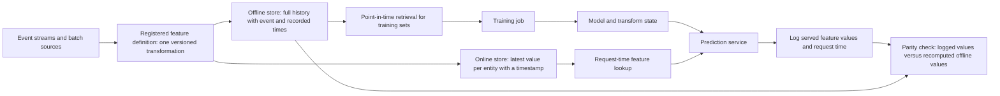

The diagram has two paths that both start from the same definition node. That shared origin is the point: the offline path optimizes for correct history, and the online path optimizes for low latency, but a change to the definition reaches both. The logging edge closes the loop. Recomputing a served request's features from the offline store at that request's time and comparing them with what was actually served is the most direct measurement of training-serving skew available, and it turns a vague worry into a number that can be alerted on.

The **offline/online consistency contract** can be stated as a short list of properties that a feature must satisfy:

1. **Single definition.** The offline and online values come from the same transformation or from implementations verified equivalent by a parity test (Section 4.5).
2. **Same semantic time.** A value is keyed by the same time notion in both paths, and offline retrieval is as-of the recorded time (Section 9.1).
3. **Bounded freshness.** The online value is no older than a stated limit, and training reproduces the staleness that production actually exhibits.
4. **Same defaults.** Missing, unseen, and out-of-range values map to the same replacement in both paths (Section 5).
5. **Same version.** The model records which feature definition versions it was trained on, and serving refuses mismatches.
6. **Observable.** Served values are logged with timestamps so parity can be audited after the fact.

Several alternatives exist, and none is free. Computing every feature in the request path from raw events avoids stale values but can be slow and duplicates logic. Precomputing everything in batch is simple and fast to serve but limits freshness to the batch interval. Training on logged served features removes skew for the features logged, though it limits history to the period since logging began and can feed back the model's own influence on what gets logged. A store is a worthwhile investment when many models share features, when freshness or point-in-time correctness is demanding, or when ownership and lineage need a single home. For a single model with a few daily features, a shared function and a parity test are often enough. Platform-level placement of such components is discussed in [AI Data Architecture and Preparation Boundaries](../17_AI_Architecture/CH04_AI_Data_Architecture_and_Preparation_Boundaries.md), and how definitions, lineage, and release gates are operated belongs to [CH29 — MLOps and LLMOps](CH29_MLOps_and_LLMOps.md).

### 9.7 Decision table: feature type, leakage risk, safeguard

| Feature type | Characteristic leakage risk | Safeguard |
|---|---|---|
| Raw operational field | Written after or because of the outcome | Availability audit against the contract; ask who writes it and when |
| Status or flag field | Assigned by staff after review of the case | Exclude fields whose population depends on the label |
| Slowly changing attribute (plan, segment) | Snapshot-today join attaches later edits | As-of join on recorded time with versioned history |
| Trailing-window aggregate | Inclusive upper bound; windows measured to extraction date | Half-open window at each row's own $t_0$; unit tests on boundaries |
| Count, recency, and elapsed-time feature | Reference point is today instead of $t_0$ | Compute against $t_0$; keep one reference-time parameter |
| Target or label-statistic encoding | Row's label enters its own feature | Out-of-fold or past-only, smoothed, mature labels only (Section 6.2) |
| Fitted scaling, binning, imputation | Statistics from evaluation rows | Fit inside the training fold; ship state with the model |
| Ratio or interaction | Inherits the risk of each input | Audit inputs; guard zero denominators |
| Calendar or time-index feature | Period proxy lets the model memorize regimes | Prefer cyclic parts over a running index; check with a time-ordered split |
| Embedding or learned score from another model | Upstream model trained on evaluation rows or on later data | Record upstream training data and version; keep evaluation rows out of it |
| Third-party enrichment | Provider back-fills or revises history | Request vintage dates; store received-at timestamps |

Every row ends in the same move: identify when the information first existed for the production system and prove the training pipeline did not use it earlier. Section 10 turns to what happens after the pipeline is correct on paper, namely whether production keeps behaving like the data the model was trained on.

## 10. Training-Serving Skew, Data Quality, Lineage, and Shift

Section 9 made features correct at construction time. Three things can still go wrong afterwards, and each calls for a different control. The feature code that runs in production can differ from the code that built the training set, which is **training-serving skew** and is a defect. The data arriving at the pipeline can be wrong or malformed, which is a **data-quality** failure and is a defect in a source or a process. And the world the data describes can change, which is **shift** and is not a defect at all, but a fact that decides when the model's validation evidence has expired. Mixing the three leads to the wrong remedy: retraining on a corrupted feed bakes the corruption into the next model, and "fixing" a real population change in the feature code hides it.

### 10.1 Causes of training-serving skew

Let $r$ be one raw record and let $\phi_{\text{train}}$ and $\phi_{\text{serve}}$ be the feature computations in the two paths. Skew exists when $\phi_{\text{train}}(r) \ne \phi_{\text{serve}}(r)$ for the same record at the same decision time. It differs from drift in being deterministic: the same input produces different vectors, so it can be found with a test and removed by engineering, whereas drift describes a change in the population over time and cannot be removed.

| Cause | Mechanism | Illustrative example | How it shows up |
|---|---|---|---|
| Duplicate implementations | Feature logic written twice, in a batch job and in a request handler | A bucketing rule uses `<` in one and `<=` in the other | Disagreement concentrated at boundary values |
| Different defaults | Each path fills gaps or unseen categories differently | Training fills a gap with the median; the handler passes null through | Parity failures only on records with gaps |
| Time zone, calendar, and rounding | A date, day boundary, or truncation is computed in different zones or ways | Date difference taken in Coordinated Universal Time (UTC) offline and in local time online | Off-by-one values near midnight |
| Stale features | Serving reads a value of a different age than training assumed | Training uses a value computed at $t_0$; serving reads a nightly value up to a day old | Offline scores exceed online scores steadily |
| Missing-value encoding | A sentinel, null, or indicator is treated differently | Training uses $-1$ for a gap; serving sends a blank the library reads as zero | Prediction shifts for records with gaps |
| Corrected versus first-arrival data | Training uses later, corrected records; serving sees the first version | A value is revised a week after arrival | Offline quality exceeds online quality |
| Library and version differences | Defaults change between releases | A rounding or ordering default differs | Small unexplained differences |

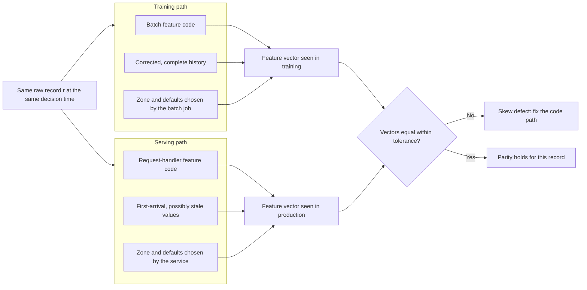

The map makes the structure of the problem visible: every box on the left has a counterpart on the right, and each pair is a place where the two paths can disagree. The architectural remedy is not to review each pair more carefully but to remove pairs, by making one box serve both paths, and to measure the remaining ones with the comparison at the bottom, which can be run offline on recorded requests.

**Worked example (illustrative).** A feature, `tenure_days`, is the number of days between signup and decision. One record has signup at 2025-03-01 23:30 UTC and decision at 2025-03-10 01:00 UTC.

- The training job takes the difference of UTC calendar dates: March 10 minus March 1 gives 9.
- The service converts both timestamps to the customer's local time at UTC$-8$ before taking calendar dates: March 1 at 15:30 and March 9 at 17:00, so the difference is 8.
- Elapsed time floored to whole days is $8.0625 \to 8$; rounding gives 8 as well, but an elapsed time of 8.6 days would floor to 8 and round to 9.

Suppose, hypothetically, that the model's score is $\sigma(-2 + 0.3 \times \text{tenure\_days})$ with $\sigma$ the logistic function. The trained path yields $\sigma(0.7) \approx 0.668$ and the served path $\sigma(0.4) \approx 0.599$, a gap of about 7 percentage points for a one-day difference. If signup and decision times of day were independent and uniform, the local date would differ from the UTC date for the 8 hours between 00:00 and 08:00 UTC, which is $1/3$ of the day. The date difference then disagrees whenever exactly one of the two endpoints falls in that window, which has probability $2 \times \tfrac{1}{3} \times \tfrac{2}{3} = 4/9 \approx 44\%$. That fraction is an assumption of the example, not a measurement, but it shows how a convention that looks harmless on one record changes the input for a large share of a population. No exception is raised and no schema check fails, because both values are valid integers.

### 10.2 One implementation, shared through the fitted pipeline artifact

The most reliable way to remove skew is to have one implementation. In practice that means three rules.

- **One function, two callers.** The batch job and the request handler both call the same feature function. If the serving language differs from the training language, either generate one implementation from the other or verify the pair with a parity test over recorded records; do not trust code review to keep two hand-written versions aligned.
- **Make time an input.** A feature function that reads the current clock internally cannot be reproduced for a historical $t_0$. Pass the decision time as a parameter so training supplies the historical value and serving supplies the request time. Specify the time zone explicitly inside the function and never inherit it from the host.
- **Ship the transformation with the model.** Fitted state (Section 4) and the feature function version are part of the artifact that the registry promotes. The service then loads one thing, and a mismatched model and transform cannot be deployed together by accident.

The sketch below shows the pattern with plain pandas. The function takes the decision time as data, forces UTC, and is called once on a batch and once per record to emulate request handling.

```python
import numpy as np
import pandas as pd

def build_features(raw: pd.DataFrame) -> pd.DataFrame:
    out = pd.DataFrame(index=raw.index)
    elapsed = pd.to_datetime(raw["decided_at"], utc=True) - pd.to_datetime(raw["signup_at"], utc=True)
    out["tenure_days"] = np.floor(elapsed / pd.Timedelta(days=1)).astype(int)
    out["amount_per_order"] = raw["amount"] / raw["orders"].clip(lower=1)
    out["amount_missing"] = raw["amount"].isna().astype(int)
    return out

raw = pd.DataFrame({
    "signup_at": ["2025-03-01 23:30", "2025-02-10 08:00"],
    "decided_at": ["2025-03-10 01:00", "2025-03-10 01:00"],
    "amount": [120.0, None],
    "orders": [4, 0],
})
batch = build_features(raw)
online = pd.concat([build_features(raw.iloc[[i]]) for i in range(len(raw))])  # one request at a time
print(batch)
pd.testing.assert_frame_equal(batch, online)
print("parity ok")
```

```text
   tenure_days  amount_per_order  amount_missing
0            8              30.0               0
1           27               NaN               1
parity ok
```

The tenure values 8 and 27 follow from the elapsed times of 8.06 and 27.71 days. The second row shows the missing-value policy being exercised: `amount_per_order` stays missing and `amount_missing` records the gap, so the choice of what to do about it is made later, in one place. The test passes because both paths use the same function and the same time rule. It would not catch a different upstream source feeding the service, a stale lookup, or a library upgrade, which is why the parity check on recorded real requests from Section 9.6 remains necessary after the unit test is green.

### 10.3 Data contracts and validation checks

A **data contract** is an explicit, versioned agreement between the team that produces a dataset and the team that consumes it. It states the schema, the meaning and unit of each field, the allowed values, the expected freshness, the owner, and the action taken when a delivery breaks the agreement. For a learned system it is the data-side counterpart of the feature contract of Section 3: it makes "what the input is allowed to look like" a testable object instead of a shared assumption. Validation is the mechanical enforcement of the contract at the boundary where data enters a training or serving pipeline.

| Check | Question | Example rule | Typical severity |
|---|---|---|---|
| Schema | Are the columns and types as agreed? | `orders_7d` is an integer column | Hard failure |
| Range | Are values within physical or business limits? | $0 \le \text{amount} \le 10{,}000$ | Hard failure |
| Null rate | Is the share of missing values within its limit? | Null rate of `amount` at most 2% | Hard failure above the limit |
| Uniqueness | Are keys unique? | One row per account and `as_of` | Hard failure |
| Freshness | Is the newest record recent enough? | Newest `as_of` within 26 hours | Hard failure |
| Distribution | Has the shape of a column moved from its reference? | Mean within 25% of the training mean | Warning |
| Relationship | Do totals reconcile and do labels behave by cohort? | Daily totals match the source's control totals | Hard or warning by rule |

Severity is the central design choice. A missing key, an impossible value, or an incompatible type makes a record unusable and should block or quarantine it. A statistical change, such as a drifting mean, is information to investigate and not proof of a defect, so it should raise a warning and an owner notification without stopping the pipeline. Limits come from two places: business rules, and the training data itself, where the observed null rate and range set the baseline that production is held to. The following checker uses plain pandas, returns hard failures and warnings separately, and is exercised on three constructed batches.

```python
import numpy as np
import pandas as pd
from pandas.api import types as pdt

CONTRACT = {
    "key": ["account_id", "as_of"],
    "dtypes": {"account_id": pdt.is_string_dtype, "as_of": pdt.is_datetime64_any_dtype,
               "orders_7d": pdt.is_integer_dtype, "amount": pdt.is_float_dtype},
    "ranges": {"orders_7d": (0, 500), "amount": (0.0, 10_000.0)},
    "max_null_rate": {"orders_7d": 0.0, "amount": 0.02},
    "max_age": pd.Timedelta("26h"),
    "reference_mean": {"amount": (120.0, 0.25)},  # (training mean, tolerated relative change)
}

def validate(df, contract, now):
    """Return (hard_failures, warnings); hard failures should stop or quarantine the batch."""
    absent = [c for c in contract["dtypes"] if c not in df.columns]
    if absent:
        return [f"missing columns: {absent}"], []
    hard, warn = [], []
    for col, is_ok in contract["dtypes"].items():
        if not is_ok(df[col]):
            hard.append(f"{col}: unexpected dtype {df[col].dtype}")
    dup = int(df.duplicated(contract["key"]).sum())
    if dup:
        hard.append(f"{dup} duplicate key rows")
    for col, (lo, hi) in contract["ranges"].items():
        bad = int((df[col].notna() & ~df[col].between(lo, hi)).sum())
        if bad:
            hard.append(f"{col}: {bad} rows outside [{lo}, {hi}]")
    for col, limit in contract["max_null_rate"].items():
        rate = df[col].isna().mean()
        if rate > limit:
            hard.append(f"{col}: null rate {rate:.2f} exceeds {limit}")
    age = now - df["as_of"].max()
    if age > contract["max_age"]:
        hard.append(f"stale: newest as_of is {age} old")
    for col, (ref, tol) in contract["reference_mean"].items():
        change = abs(df[col].mean() - ref) / ref
        if change > tol:
            warn.append(f"{col}: mean moved {change:.0%} from reference")
    return hard, warn

now = pd.Timestamp("2025-03-10 12:00")
def frame(ids, asof, orders, amount):
    return pd.DataFrame({"account_id": ids, "as_of": pd.to_datetime([asof] * len(ids)),
                         "orders_7d": orders, "amount": amount})

ok = frame(["a1", "a2", "a3", "a4"], "2025-03-10 02:00", [3, 0, 12, 5], [100.0, 140.0, 95.0, 130.0])
drifted = frame(["a1", "a2", "a3", "a4"], "2025-03-10 02:00", [3, 0, 12, 5], [200.0, 210.0, 190.0, 220.0])
broken = frame(["a1", "a1", "a3", "a4"], "2025-03-08 02:00", [3, 3, 900, 5], [10000.5, 140.0, np.nan, 130.0])
for name, df in [("ok", ok), ("drifted", drifted), ("broken", broken)]:
    print(name, validate(df, CONTRACT, now))
```

```text
ok ([], [])
drifted ([], ['amount: mean moved 71% from reference'])
broken (['1 duplicate key rows', 'orders_7d: 1 rows outside [0, 500]', 'amount: 1 rows outside [0.0, 10000.0]', 'amount: null rate 0.25 exceeds 0.02', 'stale: newest as_of is 2 days 10:00:00 old'], ['amount: mean moved 2753% from reference'])
```

The first batch passes cleanly. The second is a valid delivery whose mean amount has moved by $(205 - 120)/120 \approx 71\%$, so it publishes with a warning. The third trips five hard failures at once: a repeated key, an out-of-range count, an out-of-range amount, a null rate of $1/4$, and a feed that is more than two days old. Two limits of this approach deserve attention. A mean-based distribution check misses changes that preserve the mean, and a range check misses a unit change that stays inside the range. Switching an amount from dollars to cents moves values inside a wide range but multiplies the mean by 100, which the distribution warning would catch and the range check might not. Contracts therefore need several kinds of check, and each is an assertion that someone has to own and revise when the business changes.

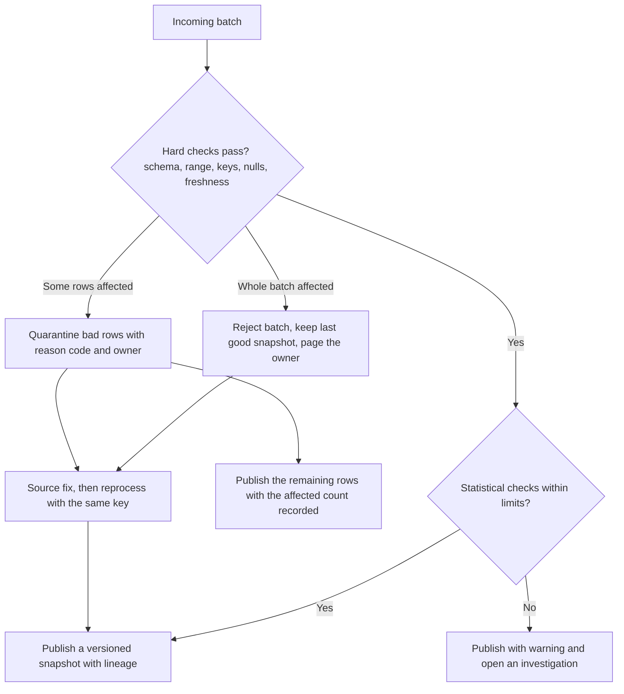

The gate separates three outcomes that a single pass/fail signal would blur. A fully bad delivery stops, because publishing its remainder would give consumers a dataset that is silently incomplete. Isolated bad rows are held back and counted, so the published snapshot says exactly how many were excluded. A statistical anomaly publishes with a warning, because blocking on every fluctuation trains operators to ignore the gate. Section 10.7 treats the quarantine and fix branches in operational detail.

### 10.4 Measuring drift: Population Stability Index and the Kolmogorov-Smirnov statistic

Validation checks ask whether a batch is well-formed. Drift measures ask whether a well-formed batch still resembles the data the model was trained on. Both compare a **reference** sample, normally the training data, with a **current** sample from production. Two measures are widely used for a single feature.

**Population Stability Index (PSI).** Partition the feature into $B$ bins using edges fitted on the reference data, for example its quartiles, and let $e_i$ and $a_i$ be the shares of the reference (expected) and current (actual) samples in bin $i$. Then:

$$
\text{PSI} = \sum_{i=1}^{B} \left(a_i - e_i\right)\ln\frac{a_i}{e_i}
$$

Every term is non-negative, because $(a_i - e_i)$ and $\ln(a_i/e_i)$ always have the same sign, so PSI is zero only when the two histograms agree. Writing the sum out shows that $\text{PSI} = \sum_i a_i \ln(a_i/e_i) + \sum_i e_i \ln(e_i/a_i)$, the sum of the Kullback-Leibler divergence in both directions, which is why the measure is symmetric in the two samples. Categorical features use their categories as bins, and a numeric feature's bin edges are fitted state that must be stored and reused, not recomputed on each batch.

**Worked example (illustrative).** A feature's training quartiles define four bins, so $e_i = 0.25$ for each. A production window has shares $0.15, 0.20, 0.30, 0.35$. The computation, one bin at a time:

| Bin | $e_i$ | $a_i$ | $a_i - e_i$ | $a_i / e_i$ | $\ln(a_i/e_i)$ | Term |
|---|---|---|---|---|---|---|
| 1 | 0.25 | 0.15 | $-0.10$ | 0.60 | $-0.5108$ | $0.0511$ |
| 2 | 0.25 | 0.20 | $-0.05$ | 0.80 | $-0.2231$ | $0.0112$ |
| 3 | 0.25 | 0.30 | $+0.05$ | 1.20 | $+0.1823$ | $0.0091$ |
| 4 | 0.25 | 0.35 | $+0.10$ | 1.40 | $+0.3365$ | $0.0336$ |

The terms are, for example, $(-0.10) \times (-0.5108) = 0.05108$ and $(0.10) \times 0.3365 = 0.03365$. Their sum is $0.0511 + 0.0112 + 0.0091 + 0.0336 = 0.1050$. A direct computation of the same sum gives $0.10500$, and the KL decomposition gives the same value, which confirms the arithmetic.

Practitioners often quote rule-of-thumb bands for interpreting PSI: below about $0.1$ is read as little change, roughly $0.1$ to $0.25$ as a moderate change worth investigating, and above about $0.25$ as a large change. Treat these as **heuristics**, not statistical tests with guaranteed error rates. This example lands at $0.105$, just inside the middle band, and a different bin count or edge choice would move it across the line, so a single number near a boundary says little. Three further cautions apply.

- **Empty bins make the formula undefined.** If a bin has $a_i = 0$, then $\ln(0)$ diverges. A common patch replaces zeros with a small floor and renormalizes, but the result then depends on the floor. With actual shares $0, 0.3, 0.3, 0.4$ and a floor of $10^{-4}$, the index comes out near $2.04$, dominated by the empty bin, and a different floor gives a different value. Coarser bins or a wider-minimum count per bin avoid the problem.
- **Sampling noise adds to PSI even with no real change.** For small differences the term is approximately $(a_i - e_i)^2/e_i$, which suggests a no-change expectation near $(B-1)(1/n_a + 1/n_e)$ for sample sizes $n_a$ and $n_e$. For $B = 4$ and 300 rows each, that is $3 \times (2/300) = 0.02$. A quick simulation with samples of 300 drawn twice from the same normal distribution gave a mean of about $0.020$ and a 95th percentile of about $0.053$ for the seed used, consistent with the approximation. Alerts on small production windows will therefore fire on noise more often than the bands suggest.
- **A large PSI is a reason to look, not a verdict.** It says the input distribution moved. It does not say the model got worse, because the feature may carry little weight or the shift may fall where the model is already well supported.

**Kolmogorov-Smirnov (KS) statistic.** For a numeric feature, compare the empirical cumulative distribution functions (CDFs) of the two samples. The KS statistic is the largest vertical gap between them:

$$
D = \sup_{x}\,\left|F_{\text{ref}}(x) - F_{\text{cur}}(x)\right|
$$

A tiny case shows the idea. For reference values $\{1,2,3,4\}$ and current values $\{2,3,4,5\}$, the CDFs differ by $0.25$ at $x = 1$, $2$, $3$, and $4$, so $D = 0.25$: the whole current sample sits one unit to the right and the gap never exceeds a quarter of the mass. $D$ lies between 0 and 1 and needs no binning, which is its advantage over PSI. It responds most to shifts near the middle of the distribution and is less sensitive to changes confined to the tails. It assumes a continuous variable, so heavy ties make it conservative. With large samples even tiny differences become statistically significant, so the magnitude of $D$ read against a business threshold is usually more useful than a p-value. When hundreds of features are monitored, some will exceed any threshold by chance, so alerting rules should prioritize features by their importance to the model.

Neither measure sees interactions between features. A shift in the joint distribution can leave every one-dimensional histogram unchanged. A complementary check is the adversarial classifier of Section 6.7, which trains a model to distinguish reference rows from current rows and treats high separability as evidence of shift. Whichever measure is used, compute it on the score distribution as well as on the inputs, because the score is the single quantity the decision actually consumes.

### 10.5 Covariate, label, and concept shift: what each implies

[CH01 — Machine Learning Foundations](CH01_Machine_Learning_Foundations.md), Section 9, in its discussion of distribution shift, gave the formal conditions for covariate shift, label shift, and concept drift. The table below translates them into what can be detected and what must be done.

| Shift | Evidence available without labels | Implication for the model | Typical response |
|---|---|---|---|
| Covariate: input distribution moves, $P(y \mid x)$ holds | Feature drift measures (PSI, KS) rise | Errors rise where training data was thin; ranking may hold up | Add data covering the new region; reweight cautiously |
| Label (prior): base rate moves, $P(x \mid y)$ holds | Score and predicted-positive rates move | Probabilities are miscalibrated though ranking may survive | Adjust prior odds or recalibrate; revisit thresholds |
| Concept: $P(y \mid x)$ itself changes | None directly; features can look stable | The same input now deserves a different answer | New labels and retraining; reweighting cannot repair it |

Two points govern retraining decisions. First, **drift alone is not a trigger**. A retraining decision needs evidence that quality has degraded or will degrade, usually from mature labels (Section 8.1), a delayed quality metric, or a proxy such as an agreed-upon review sample. Second, **bad data looks like shift**. A broken source or a changed unit produces a dramatic PSI, and retraining on that feed teaches the model the defect. The first branch of any drift response is therefore to rule out a data-quality or pipeline cause.

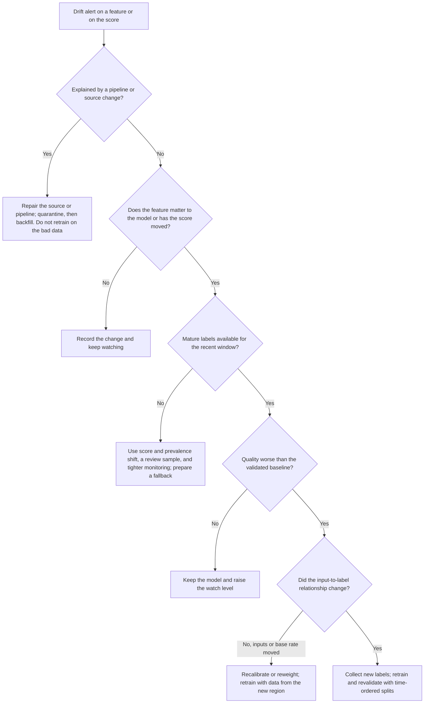

The tree ends in retraining only after four filters, and each branch has a distinct cost. The expensive actions, retraining and revalidation, are reserved for cases where the evidence points to the relationship between inputs and outcomes, and the cheaper actions, such as recalibration or a watch level, absorb the rest. When retraining is chosen, the training window is itself a decision: an expanding window keeps old behavior that may no longer apply, while a short sliding window discards rare events. Compare both on a time-ordered validation split. Alert thresholds, ownership, and the release path for the retrained model are operated through [CH29 — MLOps and LLMOps](CH29_MLOps_and_LLMOps.md).

### 10.6 Lineage and versioning of datasets and features

**Lineage** is the recorded chain from a model back to the data and code that produced it, and forward from a piece of data to everything built on it. Its practical value appears at two moments. When a model misbehaves, backward lineage answers "which data and transformations produced this?" When a source turns out to be wrong, forward lineage answers "which datasets, features, and models are affected?" Without a recorded chain, both questions are answered by memory and archaeology.

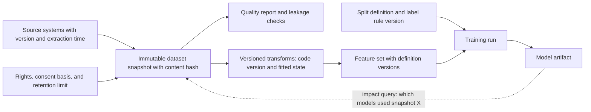

The solid edges are what gets recorded at build time, and the dotted edge is the query that makes the record useful later. The design rule it illustrates is that every node is immutable and addressed by an identifier: new data creates a new snapshot, a changed transform creates a new version, and nothing is edited in place. A training script that reads "the latest table" cannot be reproduced, while one that reads a named snapshot can.

A dataset manifest, kept next to the snapshot, captures the fields a reviewer needs. The following illustrative JavaScript Object Notation (JSON) manifest uses invented identifiers:

```json
{
  "snapshot_id": "renewals-2025-03-10-v2",
  "content_hash": "sha256:<digest of the stored files>",
  "sources": [{"name": "billing_events", "extracted_at": "2025-03-10T02:00:00Z", "source_version": "2025-03-09"}],
  "label_rule": {"event": "cancellation", "horizon_days": 60, "matured_before": "2025-01-09"},
  "split": {"unit": "account", "train_through": "2024-12-31", "purge_gap_days": 60, "test_from": "2025-03-01"},
  "class_counts": {"positive": 5400, "negative": 94600},
  "sampling": "none; natural prevalence preserved in validation and test",
  "transform_version": "features-v14",
  "quality_report": "reports/2025-03-10/validation.json",
  "rights": {"basis": "see governance record", "retain_until": "2026-03-10"}
}
```

The content hash lets a reader verify that the files are the ones described. The label rule and split definition make a reported metric interpretable. The class counts and sampling note let someone reconstruct deployment prevalence from a resampled training set (Section 8.4). Feature definitions should be versioned in the same way: a change to a window length, a fill value, or a unit is a new version with a new identifier, and a model records exactly which versions it consumed.

### 10.7 Remediating bad source data

When validation, a drift alert, or a downstream complaint shows that a source delivered wrong data, four tools are available, and they are used in order.

- **Quarantine** isolates the suspect rows or batch so that no training or serving path consumes them. It is reversible and buys time. Each quarantined record needs a reason code, an owner, a retention limit, a repair path, and a reprocessing key. Without those, the quarantine becomes a shadow data store, and because difficult examples disappear from training it also becomes a source of selection bias, so track the quarantine rate by cohort and time.
- **Correction** repairs the data when the fix is known and certain, either at the source or by a documented deterministic rule. If the rule is a guess, exclude the rows instead.
- **Backfill** recomputes the affected datasets and features over the repaired history. It must be idempotent, keyed so that rerunning it cannot double-count, and it must produce a new snapshot instead of overwriting the old one.
- **Restatement** publishes the corrected history and tells consumers what changed. It is a communication task as much as a data task.

**Worked scenario (illustrative).** A source switches an `amount` field from dollars to cents for three days before anyone notices. The pipeline runs 20,000 rows a day and the training window covers 90 days, so there are $1{,}800{,}000$ rows, of which $60{,}000$ are affected, a share of $p = 60{,}000/1{,}800{,}000 = 1/30 \approx 3.3\%$. Values in those rows are 100 times too large, so the contaminated mean is

$$
\bar{x}_{\text{observed}} = (1 - p)\,\mu + p \cdot 100\,\mu = \mu\left(1 + 99p\right) = \mu\left(1 + 3.3\right) = 4.3\,\mu
$$

A defect touching only 3.3% of rows more than quadruples the mean. The standard deviation inflates as well, so the fitted standardization state of Section 4 is badly off and every clean row maps to a compressed standardized value. The distribution check of Section 10.3 would catch this, and the range check might not, because individual values can stay inside a wide range.

The response follows the four tools. The three days are quarantined at once. The producing team confirms the unit change, which makes a deterministic correction (divide by 100 for the affected window) defensible, and the rule is recorded with the snapshot. The affected window is backfilled and published as a new snapshot version, with the old one marked superseded and kept for audit. Forward lineage then gives the impact list: any model fitted on the old snapshot is a candidate for retraining, and predictions made on the three affected days used contaminated online features. Whether to re-score or reverse decisions made on those predictions is a business question that the lineage record at least makes answerable.

A **restatement notice** should state what was wrong and over which dates, the size of the change, the snapshot and feature versions that replace the old ones, which models, metrics, and dashboards were affected, and what each consumer must do. If corrections change historical labels or features, rebuild the affected evaluation window and do not combine old and new interpretations under a single dataset name: a metric reported against a restated window and one reported against the original are different experiments. Reprocessing should preserve both the original source version and the transformation version that produced the repaired record. Alerts should name the responsible source or transformation owner, since a generic "pipeline failed" signal does not tell anyone what to repair.

### 10.8 Privacy and rights touchpoints

Consent, licensing, provenance, and deletion obligations are owned by [CH30 — AI Data Governance, Privacy, and Provenance](CH30_AI_Data_Governance_Privacy_and_Provenance.md), and the architectural placement of the corresponding controls by the privacy and governance chapter of Part 17, [AI Safety, Security, Privacy, and Governance Architecture](../17_AI_Architecture/CH12_AI_Safety_Security_Privacy_and_Governance_Architecture.md). The legal specifics differ by jurisdiction and use and are outside the scope of this chapter. The data-preparation pipeline touches those obligations at several points, which is the reason lineage matters beyond debugging.

- **Collection and minimization.** A feature that is not needed should not be ingested, since every stored field becomes something to protect, retain, and possibly delete. Record the purpose of each source in the feature contract.
- **Propagation of deletion and correction requests.** A request about one person has to reach raw data, snapshots, features, embeddings, and training sets that include that person. Forward lineage is what makes the search feasible, and whether an already-trained model must be retrained is a policy decision for the governance process, not a default.
- **Retention beyond the main store.** Quarantine areas, superseded snapshots, and logs of served features hold the same personal data as the production tables and need retention limits and access controls of their own.
- **Proxies for sensitive attributes.** A feature may encode a protected attribute indirectly, and the point-in-time and leakage audits of this chapter do not detect that. Review sensitive-attribute proxies as part of the feature contract, with the fairness and safety analysis owned elsewhere.
- **Logged inputs.** The served feature values logged for parity checks (Section 9.6) are personal data whenever the features are, so treat the log as a governed dataset.

### 10.9 Section summary

Training-serving skew, bad data, and shift are separate problems with separate owners. Skew is removed by sharing one implementation and measured with parity tests on recorded requests. Bad data is caught by contract checks at the boundary, held in quarantine with an owner, and repaired by correction, backfill, and a clear restatement. Shift is measured with PSI, the KS statistic, and score and outcome monitors, and it triggers retraining only after a data-quality cause has been ruled out and quality has degraded. Lineage connects the three, because it answers the question every incident ends with: what else is affected?

## 11. Failure Scenarios, Testing, and Common Mistakes

Data-preparation failures share one property: they rarely raise an exception. A leaky split, a changed fill value, or a shifted category list all produce a valid number and a plausible prediction. The mechanisms were developed in Sections 4 to 10; this section collects them as what a reviewer or an on-call engineer actually observes, and then turns each into something a pipeline can test automatically.

### 11.1 A catalogue of failures

| Failure | Symptom | How it is detected | Mitigation |
|---|---|---|---|
| Post-outcome field or label proxy | Offline score implausibly high; one feature dominates | Availability audit, single-feature screen, and ablation to decision-time features (Section 6.7) | Per-feature prediction-time contract; exclude fields whose population depends on the label (Sections 3 and 6.6) |
| Preprocessing contamination | Strong validation score that does not reappear on later data | Shuffled-label run of the whole pipeline; compare with a fit-inside-the-fold refit (Section 6.5) | Split first; one pipeline object fitted inside each training fold (Section 4.4) |
| Label-statistic encoding | Large gap between training and held-out score | Score the encoded column alone on training and held-out rows (Section 6.2) | Out-of-fold or past-only smoothed encoding (Section 9.3) |
| Temporal leakage | Random-split score far above time-split score | Re-split by decision time with a purge gap; unit tests on as-of joins (Sections 7.3 and 9.1) | As-of joins on recorded time; half-open windows at each row's own $t_0$ (Section 9.2) |
| Entity or duplicate leakage | Score collapses under a grouped split | Grouped re-split; count duplicate families that span partitions (Section 6.4) | Split by the deployment unit; cluster near-duplicates before splitting |
| Resampling before the split | Copies of test rows sit in training; test prevalence is no longer the natural one | Disjointness test on content hashes; compare test class counts with deployment prevalence | Resample only inside the training fold (Section 8.4) |
| Over-aggressive deduplication | Rare-class rows or legitimate repeat events vanish; prevalence moves | Class counts and removal rate by class and cohort, before and after | Deduplicate on the full identity of an observation, including event time; publish removal rates |
| Label delay misused | Recent periods look better than they are; prevalence falls toward the present | Maturity state per row; prevalence by age of decision date (Section 8.2) | Truncate at extraction date minus $H$, or hold censored rows out until they mature (Section 8.1) |
| Training-serving skew | Offline quality above online quality; parity failures at boundary values | Parity test on recorded requests (Sections 10.1 and 10.2) | One shared feature function with decision time as an input |
| Silent null-handling change | Missing share or imputed share moves; scores cluster near the fill value | Per-feature missing-rate and null-rate contract checks (Sections 5.4 and 10.3) | Treat a collection change as a feature change; per-request missing policy |
| Unseen categories | All-zero encoded rows; rising unseen rate | Unseen-value counter at serving (Section 4.3) | Dedicated bucket, reject-and-route, or a retrained vocabulary |
| Distribution drift | PSI or KS rises; delayed-label quality decays | Distribution measures, score monitors, mature-label quality (Sections 10.4 and 10.5) | Rule out a source defect first; recalibrate or retrain per the flow of Section 10.5 |

Two rows deserve arithmetic, because their symptoms are easy to miss. Both examples are **illustrative**.

**Resampling before the split.** Take 10,000 rows with 500 positives. A team balances the classes by adding three extra copies of every positive, giving $500 \times 4 = 2{,}000$ positive rows and $9{,}500 + 2{,}000 = 11{,}500$ rows in total, and only then makes a random 80/20 split. A positive row that lands in the test set has three copies, and each copy independently lands in training with probability 0.8. The probability that none does is $0.2^3 = 0.008$, so $1 - 0.008 = 99.2\%$ of test positives have an identical twin in training. The model is graded on rows it has memorized. The test prevalence has also moved from 5% to $2{,}000/11{,}500 \approx 17.4\%$, so precision and recall figures no longer describe deployment. The same copies-across-the-boundary mechanism is the entity leakage of Section 6.4, created by the preparation step.

**Over-aggressive deduplication.** Suppose 10,000 customers each contribute four monthly rows, and the positive rate is 2%, 2%, 3%, and 5% in months 1 to 4 because cancellations concentrate late. The full table holds $40{,}000$ rows and $200 + 200 + 300 + 500 = 1{,}200$ positives, a prevalence of $1{,}200/40{,}000 = 3.0\%$. A cleanup step that "removes duplicates" by customer identifier alone keeps one row per customer, say the first. That leaves $10{,}000$ rows and $200$ positives, a prevalence of $2.0\%$, and only $200/1{,}200 \approx 16.7\%$ of the positives survive. The rows removed were not duplicates of an observation; they were later observations of the same customer. The defect is invisible in the schema, and it shows up only in class counts by cohort and in a removal rate that nobody recorded.

A related silent failure is a null-handling change upstream. If a source begins sending empty strings where it used to send nulls, a null-rate check that counts only true nulls still passes, an imputer that fills only nulls leaves the blanks alone, and an encoder treats the empty string as a new category. Each component behaves correctly by its own rules. Contracts must therefore define what "missing" means at the boundary, not only how much of it is allowed.

### 11.2 Data tests that run on every build

A failure that raises no exception must be turned into one by a test. Four gates cover the catalogue, and each sits where its defect first becomes observable.

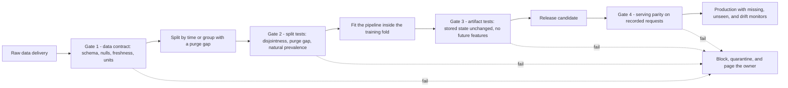

The diagram shows that testing is not a single end-of-pipeline review. Gate 1 is the data contract of Section 10.3 and stops bad deliveries before they are split. Gates 2 and 3 are cheap, deterministic tests that run on every training build and fail it. Gate 4 compares what production computed with what the offline path computes and is the only one that needs recorded real requests. The monitors after the last gate are not tests but the continuing evidence that the earlier gates still hold, and their operation belongs to [CH29 — MLOps and LLMOps](CH29_MLOps_and_LLMOps.md).

The following illustrative `pytest`-style functions implement three of the gates for a toy pipeline. Each test is a plain function with no fixtures, so it can also be called directly in a notebook, and the standardizer, the as-of lookup, and the data are all constructed for the example.

```python
import hashlib
import pickle

import numpy as np
import pandas as pd


class Standardizer:
    """Fitted state lives in mean_ and scale_; transform never changes it."""

    def fit(self, x):
        self.mean_, self.scale_ = float(np.mean(x)), float(np.std(x))
        return self

    def transform(self, x):
        return (np.asarray(x, dtype=float) - self.mean_) / self.scale_


def content_hash(df, cols):
    return df[cols].astype(str).agg("|".join, axis=1).map(lambda s: hashlib.sha256(s.encode()).hexdigest())


def as_of_value(records, account, t0):
    """Latest value recorded at or before t0, else None."""
    seen = records[(records.account == account) & (records.recorded_at <= t0)]
    return None if seen.empty else seen.sort_values("recorded_at").value.iloc[-1]


def test_serving_applies_stored_state_unchanged():
    fitted = Standardizer().fit(np.array([10.0, 12.0, 14.0, 16.0, 18.0]))
    served = pickle.loads(pickle.dumps(fitted))  # what the registry ships with the model
    batch = np.array([30.0, 32.0])
    np.testing.assert_allclose(served.transform(batch), fitted.transform(batch))
    assert served.transform([30.0])[0] > 5  # the shift stays visible, as in Section 4.2
    served.transform(batch)
    served.transform([30.0])  # a one-row request must not refit anything
    assert served.mean_ == 14.0 and abs(served.scale_ - 8 ** 0.5) < 1e-12


def test_no_feature_recorded_after_decision_time():
    records = pd.DataFrame({
        "account": ["a", "a", "a"],
        "recorded_at": pd.to_datetime(["2025-03-01", "2025-03-09", "2025-03-12"]),
        "value": [1.0, 2.0, 99.0],
    })
    t0 = pd.Timestamp("2025-03-10")
    assert as_of_value(records, "a", t0) == 2.0  # the 12 March record is invisible at t0
    later = pd.DataFrame({"account": ["a"], "recorded_at": [pd.Timestamp("2025-04-30")], "value": [-5.0]})
    assert as_of_value(pd.concat([records, later]), "a", t0) == 2.0  # adding future data changes nothing
    assert as_of_value(records, "a", pd.Timestamp("2025-02-01")) is None
    table = pd.DataFrame({
        "decision_time": pd.to_datetime(["2025-03-10", "2025-03-11"]),
        "feature_recorded_at": pd.to_datetime(["2025-03-09", "2025-03-11"]),
    })
    assert (table.feature_recorded_at <= table.decision_time).all()


def test_split_is_disjoint_and_purged():
    horizon = pd.Timedelta(days=60)
    rows = pd.DataFrame({
        "account": list("abcdef"),
        "decision_time": pd.to_datetime(["2024-10-01", "2024-11-15", "2024-12-31", "2025-03-01", "2025-03-15", "2025-04-01"]),
        "x": [1, 2, 3, 4, 5, 6],
    })
    train = rows[rows.decision_time <= "2024-12-31"]
    test = rows[rows.decision_time >= "2025-03-01"]
    assert set(train.account).isdisjoint(test.account)  # same entity never on both sides
    assert set(content_hash(train, ["x"])).isdisjoint(content_hash(test, ["x"]))  # same content under another identifier
    assert train.decision_time.max() + horizon <= test.decision_time.min()  # purge gap of at least H
```

All three functions pass as written. The first asserts that a serialized copy of the fitted state gives the same numbers as the original, that the production value 30 still standardizes to $16/\sqrt{8} \approx 5.66$, and that serving a batch or a single request leaves the state untouched, which would fail if the transform refitted on its input. The second is a metamorphic test: appending a record dated after $t_0$ must not change the answer, which fails if the lookup filters on event time or on nothing. The third checks entity disjointness, content disjointness under different identifiers, and the purge gap of Section 7.3, where $2024\text{-}12\text{-}31 + 60$ days is exactly $2025\text{-}03\text{-}01$ and the boundary case is therefore allowed.

A test is only as good as its ability to fail, so run each against a deliberately broken version at least once. Dropping the `recorded_at <= t0` filter makes the second test fail on the 99.0 record, and raising the horizon to 90 days, as a longer label window would, fails the third because the last training label window would then close on 31 March. The serialization call is used only to show a round trip; load only artifacts that your own pipeline produced, because deserializing untrusted pickle data can execute arbitrary code. Statistical checks such as drift measures (Section 10.4) need tolerances and belong in monitors; the structural properties above are exact and belong in the build.

### 11.3 Anti-patterns

| Anti-pattern | Why it fails | Instead |
|---|---|---|
| Fitting scalers, imputers, or selectors on the full table "for convenience" | Evaluation rows shape the input representation, and the shift monitor loses its reference (Section 4.2) | Split first; fit inside the training fold; ship the state |
| Random split of ordered or grouped data | Rewards interpolation and memorization of entities (Sections 6.4 and 7.4) | Split by decision time or by entity, with a purge gap |
| Treating "no longer null" as "fixed" | Filling hides absence, and the model cannot tell filled from observed (Section 5.2) | Indicator plus a monitored missing rate |
| Resampling or deduplicating before the split | Copies cross the boundary, or hard rows disappear and prevalence moves (Section 11.1) | Resample only in the training fold; deduplicate on full identity |
| Two hand-written implementations of one feature | Disagreement at boundaries is silent (Section 10.1) | One function with decision time as input, plus a parity test |
| Reading "the latest table" in training | The run cannot be reproduced, and restated values leak into history (Section 10.6) | Named immutable snapshots; as-of retrieval on recorded time |
| Filtering on event time alone | Records not yet ingested at $t_0$ are admitted (Section 6.3) | Filter on availability time |
| Alerting on every drift measure | Operators learn to ignore the alert, and small samples fire on noise (Section 10.4) | Prioritize by feature importance; require quality evidence before retraining |
| Retraining to fix a data defect | The new model learns the defect (Section 10.5) | Quarantine, correct, and backfill first (Section 10.7) |
| Celebrating a score above the label-noise ceiling | The excess is leakage, not skill (Section 8.6) | Audit availability and re-split before reporting |
| A single-pass preparation notebook with no checks | Every defect in this section is invisible in a green run | Contracts and the gates above, run on every build |

## 12. Trade-off Analysis and Decision Framework

Sections 4 to 10 each offered several options. This section states what should decide among them. The pattern is the same throughout: every choice encodes an assumption about deployment, so write the assumption down, choose the cheapest option consistent with it, and name the evidence that would reverse the choice.

### 12.1 Impute, add an indicator, or drop

The mechanics are in Section 5. The table below orders the choice by what is known about the missingness.

| Situation | Preferred handling | Why | What would change the choice |
|---|---|---|---|
| Value is structurally absent (no purchase history yet) | Encode the state explicitly (zero count or a none category) plus an indicator | The absence is a fact, not a gap | The state itself becomes unstable or ambiguous |
| Rare gaps, plausibly unrelated to the outcome | Training median or mode | Cheap, and little is lost | Production missing rate rises above the training rate |
| Missing rate differs by outcome or segment | Statistic plus an indicator | Absence carries signal | The collection process changes, so the indicator means something new |
| Material gaps predictable from other recorded features | Model-based imputation fitted on training rows | Better than a constant, with no use of the label | The extra fitted state is not worth its versioning and monitoring cost |
| Very high missing rate and weak signal | Drop the feature | Monitoring and variance cost exceed what it adds | The feature becomes mandatory or gets collected reliably |
| Few incomplete rows in training, MCAR plausible | Drop those training rows | No imputed values to maintain | Serving still receives such requests, so a serving policy is needed anyway |

Two asymmetries drive the table. Dropping rows is purely a training-time decision, whereas the serving path must answer every request, so any option that works only by removing rows leaves the serving question open. And an indicator is not free: it adds a column, a monitored rate, and a dependence on the collection process staying stable. Choose it when absence is plausibly informative and the extra column can be monitored.

### 12.2 Resample, weight, or move the threshold

| Lever | Choose when | Cost and risk | Probabilities afterwards |
|---|---|---|---|
| Move the threshold | Ranking at natural prevalence is adequate and error costs are known | No change to training; needs calibrated scores to set the threshold from costs | Unchanged |
| Class weights | The learner under-fits the minority and no data change is wanted | Extreme weights destabilize fitting; recalibration needed | Shifted toward the weighted prior |
| Undersample the majority | Majority volume dominates training cost | Discards information and raises variance; the keep rate must be recorded | Shifted; recover with the keep rate (Section 8.4) |
| Oversample or synthesize the minority | Few positive rows and weights are not enough | Copies can cross a split; synthetic rows may be unrealistic | Shifted |

The cheapest lever is the one that changes nothing about the data. The following worked example is **illustrative**. A model scores 10,000 rows with 2% prevalence, so 200 positives and 9,800 negatives. A missed positive costs 25 units and a false alarm costs 1 unit. Moving the threshold along the same model gives three operating points; the first is the one analysed in Section 8.3.

| Threshold | True positive rate | False positive rate | Missed positives | False alarms | Cost $= 25 \times \text{missed} + 1 \times \text{alarms}$ |
|---|---|---|---|---|---|
| High | 0.60 | 0.03 | 80 | $0.03 \times 9{,}800 = 294$ | $2{,}000 + 294 = 2{,}294$ |
| Middle | 0.80 | 0.10 | 40 | $0.10 \times 9{,}800 = 980$ | $1{,}000 + 980 = 1{,}980$ |
| Low | 0.90 | 0.25 | 20 | $0.25 \times 9{,}800 = 2{,}450$ | $500 + 2{,}450 = 2{,}950$ |

The middle point is cheapest, and no retraining was involved. With calibrated probabilities the cost-optimal threshold is $c_{\text{FP}}/(c_{\text{FP}} + c_{\text{FN}}) = 1/26 \approx 0.038$, where $c_{\text{FP}}$ and $c_{\text{FN}}$ denote the false-alarm and missed-positive costs; [CH03](CH03_Regression_and_Classification.md) owns calibration and threshold selection. If the model cannot rank positives well, no threshold rescues it, and that is the case in which the data levers earn their cost.

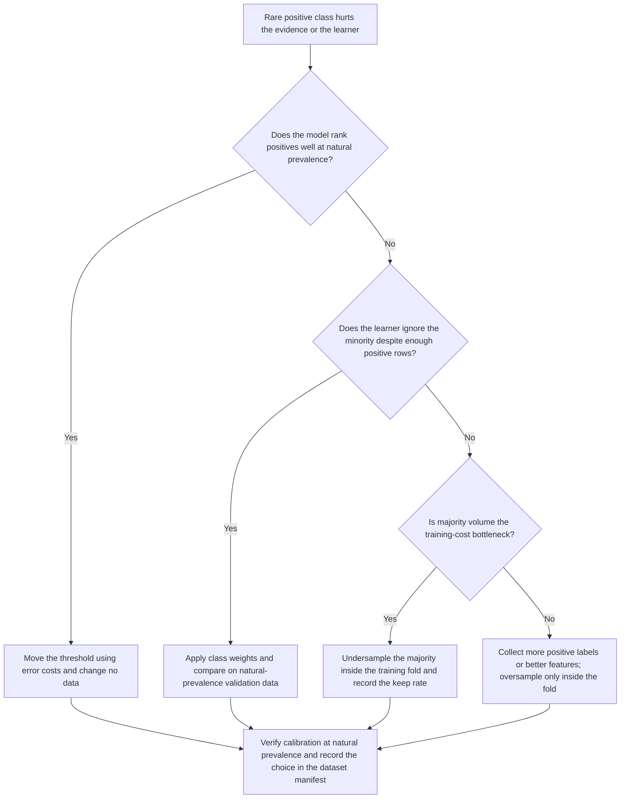

The first question separates a decision-rule problem from a learning problem, and many apparent imbalance problems turn out to be the former, a default threshold applied to scores whose useful range sits elsewhere. Every branch ends at the same node: whichever lever is used, the evaluation partitions stay at natural prevalence, and the sampling configuration is recorded so that a reader can reconstruct what the deployed probabilities mean.

### 12.3 Random, temporal, or grouped split

Section 7.4 gave the flow for choosing a split unit. The table adds the price of each choice, because a more honest split is also a smaller and noisier one.

| Deployment situation | Split | Price paid | Evidence that would change the choice |
|---|---|---|---|
| Rows independent, population stable, no ordering | Random, stratified for rare classes | Cheapest and most data-efficient | Score under a time-ordered split falls well below the random one |
| Predicts the future from the past | Temporal with a purge gap of at least $H$ | Recent rows are held out; seasonal coverage may be partial | Behavior proves stable across periods, so a longer training window helps |
| Many rows per entity, new entities at deployment | Grouped by entity, duplicates clustered first | Effective sample size falls to the number of entities | Deployment turns out to serve known entities |
| New entities and later time | Grouped and temporal | Smallest usable data; most conservative estimate | Either dependence is shown to be absent |
| Known entities recur at deployment | Entities on both sides, with the choice documented | Looks leaky but matches the task | The product starts onboarding new entities |

The grouped row has a precise cost. In the entity experiment of Section 6.4, 200 customers each carry one label across 2,000 rows, so the evidence contains 200 independent labels and not 2,000. Any interval around the grouped score should reflect 200 units, and that smaller effective sample is the real price of an honest estimate.

### 12.4 Centralised feature store or per-model pipelines

Section 9.6 defined the feature store and its consistency contract. Whether to build one is an economic and organizational decision, summarized conceptually below.

| Dimension | Centralised feature store | Per-model pipelines |
|---|---|---|
| Cost | Fixed platform build and operation cost; marginal cost of a new model is low | No platform cost; every model pays for its own feature code, backfills, and serving path |
| Consistency | One definition feeds training and serving, and parity is checkable in one place | Consistency depends on a parity test per model and on discipline across copies |
| Ownership | Each shared feature needs a named owner, a version policy, and a change process that consumers accept | Owned locally with full autonomy, but "the same" feature can acquire different meanings in different models |
| Time to first model | Slower, because the platform must exist | Fastest for the first model |
| Blast radius | A faulty shared definition reaches every consumer | A defect stays inside one model |
| Point-in-time correctness | Built into retrieval once, if the store keeps recorded times | Each pipeline must implement as-of joins correctly |

A simple illustrative cost model shows where the balance tips. Assume each model uses 30 features, of which 20 are shared by every model, so a store lets the models share them. Measure effort in "feature-definition equivalents" and assume, as an invented figure, that building and running the store costs the equivalent of 40 definitions. Per-model pipelines cost $30k$ for $k$ models. The store costs $20 + 10k + 40$.

| Models $k$ | Per-model: $30k$ | Store: $20 + 10k + 40$ |
|---|---|---|
| 1 | 30 | 70 |
| 3 | 90 | 90 |
| 4 | 120 | 100 |
| 10 | 300 | 160 |

The break-even is at three models, and the store is cheaper from the fourth, under these assumptions. The model is crude. It ignores that duplicated definitions are also duplicated chances for skew, which favors the store, and that a shared definition concentrates the blast radius, which favors isolation. The practical rule is to start with a shared function and a parity test, and to move to a store when several models share features, when freshness or point-in-time retrieval is demanding, or when ownership and lineage need one home. Platform placement is covered in [AI Data Architecture and Preparation Boundaries](../17_AI_Architecture/CH04_AI_Data_Architecture_and_Preparation_Boundaries.md), and release gates and operation in [CH29](CH29_MLOps_and_LLMOps.md).

## 13. Illustrative Composite Case Study (Hypothetical)

The following case is **hypothetical**. It is not drawn from a real organization or incident and reports no measurement; every figure is invented so that the arithmetic can be checked by hand. It shows how a leakage-inflated metric can be discovered by re-evaluating on a time-ordered split, and what remediation looks like.

### 13.1 Setting

A business-to-business supplier wants to predict which invoices will be paid late so that a collections team can review them before the due date. The prediction unit is an invoice, the decision time $t_0$ is the issue date, and the invoice is due 30 days after issue. The label is "paid more than 30 days after the due date", so the horizon is $H = 60$ days. Treat months as 30-day periods.

- The history holds 24 months at 10,000 invoices each, so 240,000 invoices. Assume the late rate is a constant 6%, giving 600 late invoices per month.
- The team can review the top 5% of invoices by score, so the headline metric is recall at that capacity.
- Features include invoice amount, customer tenure, late payments in the prior 90 days, a customer-level encoding of lateness (`customer_late_rate`), and `collections_stage`, a field the collections system writes once an invoice is overdue.

### 13.2 How the inflated number was found

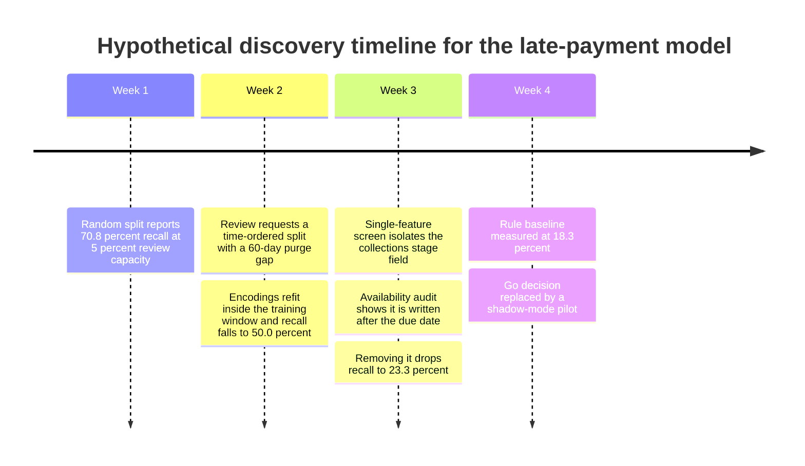

The timeline compresses four weeks into four steps, and the table gives the evidence at each one. The time-ordered evaluation trains on months 1 to 18, leaves months 19 and 20 unused (two 30-day months, exactly $H$), and tests on months 21 to 24. The rule baseline ranks invoices by the number of late payments in the prior 90 days, with ties broken arbitrarily.

| Evaluation | Test invoices (late) | Flagged at 5% | Late among flagged | Precision | Recall |
|---|---|---|---|---|---|
| Random 80/20 split, all features | 48,000 (2,880) | 2,400 | 2,040 | $2{,}040/2{,}400 = 85.0\%$ | $2{,}040/2{,}880 \approx 70.8\%$ |
| Time-ordered split, fit inside training window, all features | 40,000 (2,400) | 2,000 | 1,200 | $1{,}200/2{,}000 = 60.0\%$ | $1{,}200/2{,}400 = 50.0\%$ |
| Same split, `collections_stage` removed | 40,000 (2,400) | 2,000 | 560 | $560/2{,}000 = 28.0\%$ | $560/2{,}400 \approx 23.3\%$ |
| Rule baseline, same split | 40,000 (2,400) | 2,000 | 440 | $440/2{,}000 = 22.0\%$ | $440/2{,}400 \approx 18.3\%$ |

The random-split row is the number that nearly drove a go decision. Two defects were behind it. First, `customer_late_rate` had been computed over all 24 months before any split, so each invoice's own outcome was part of its customer's encoding (Section 6.2), and the random split then placed the same customers on both sides (Section 6.4). Rebuilding the pipeline so that the encoding is fitted only on the training window removed that contamination and recall fell by about 20.8 points. The two test sets differ in size and period, so this figure shows that something was wrong, not an exact attribution.

Second, a single-feature screen (Section 6.7) showed `collections_stage` far ahead of every other feature. Asking when the field is written exposed the cause: it is populated only after an invoice is overdue, so it is available no earlier than 30 days after $t_0$, and a production request at issue time would never carry it. Both training and test rows contained it, so the time-ordered split alone could not expose it. Only the availability audit did. Removing it dropped recall by a further 26.7 points.

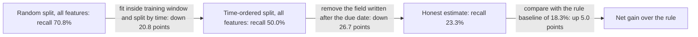

The two drops sum to $20.8 + 26.7 = 47.5$ points, and $70.8 - 47.5 = 23.3$. The diagram makes the review's central point visible: the honest figure is one-third of the original headline, and the margin over the simple rule is 5.0 points, not 52.5.

### 13.3 What the decision looked like before and after

Assume, as invented figures, that each review costs 4 units and each late invoice caught is worth 40 units, and consider the 2,000 reviews that four months of capacity allow, which cost $2{,}000 \times 4 = 8{,}000$.

| Basis | Late invoices caught | Value $= 40 \times \text{caught}$ | Net of review cost |
|---|---|---|---|
| Claim from the random split ($0.85 \times 2{,}000$) | 1,700 | 68,000 | 60,000 |
| Honest model estimate | 560 | 22,400 | 14,400 |
| Rule baseline | 440 | 17,600 | 9,600 |

The claim overstated the net benefit by $60{,}000/14{,}400 \approx 4.2$ times. The decision-relevant quantity is the model's gain over the rule, $14{,}400 - 9{,}600 = 4{,}800$ per four months, which is also $120 \times 40$ from the 120 extra invoices caught. If running the model costs 3,000 units per four months, the net gain over the rule is $4{,}800 - 3{,}000 = 1{,}800$. That is positive and small, and well inside the uncertainty of a single four-month test window, so the decision moves from "launch" to "shadow-mode pilot".

### 13.4 Remediation steps

1. Freeze the launch decision and publish the honest estimate next to the rule baseline.
2. Rebuild the split by decision time with a purge gap of at least $H$, and record the unit, cutoffs, and gap in the dataset manifest (Section 10.6).
3. Replace the customer encoding with a smoothed, past-only encoding fitted inside the training window (Section 9.3).
4. Record an availability lag for every feature, remove `collections_stage`, and add the no-future-feature and split-disjointness tests of Section 11.2 to the build.
5. Add the contract and parity gates of Section 11.2, with monitors for missing rate, unseen values, and drift (Section 10).
6. Run the model in shadow mode, and compare predictions with outcomes only after the 60-day maturity wait of Section 8.1.

The lesson generalizes beyond invoices. An architect who asks "evaluated how, and on which split?" before accepting a number, and who requires an availability lag per feature, would have caught both defects before the launch discussion.

## 14. Architect Review Checklist

Use the list as a gate before accepting a data-preparation design or a reported evaluation. Each check can be answered with a document, a test, or a named owner, and each carries the reason it is asked.

**Contract and framing**

- The prediction unit, decision time, label horizon, and action are written down. Every later check refers back to them (Section 3).
- Each feature has a declared availability lag and a named process that writes it, and none is available after $t_0$. Post-outcome fields look innocuous and are found only by asking (Sections 6.6 and 6.7).
- Each feature has a name, type, unit, owner, freshness limit, and version. A feature is an interface, and an unowned interface drifts (Sections 3 and 9.6).

**Transformations and missing values**

- All fitted state (statistics, vocabularies, bin edges, fill values) comes from the training partition and ships with the model. The deployable artifact is the pair of transform state and model (Section 4.4).
- An unseen-category policy exists and the unseen rate is counted at serving. Silent all-zero vectors are the default otherwise (Section 4.3).
- Each feature has a missingness hypothesis, an indicator or fallback decision, and a per-request missing policy. Production will not miss values the way training did (Sections 5.1 and 5.4).
- Structural absences are encoded as states and not filled. Filling asserts a history that never happened (Section 5.3).

**Splits, labels, and leakage**

- The split unit and cutoffs match deployment, the purge gap is at least $H$, and both are in the dataset manifest. This also confirms that the evaluation split represents the intended deployment population (Sections 7.1 and 7.3).
- Entities and near-duplicate families sit on one side of the split, unless deployment genuinely serves known entities. Memorization otherwise masquerades as skill (Sections 6.4 and 7.4).
- Only mature labels are used, and censored rows are tracked as a state. Pending rows are not negatives (Sections 8.1 and 8.2).
- Label-statistic encodings are out-of-fold or past-only and smoothed. A row's label must not feed its own feature (Sections 6.2 and 9.3).
- A leakage suite runs on every build: availability audit, shuffled-label run, grouped and time-ordered re-splits. One-time reviews decay (Sections 6.7 and 11.2).
- The test set is used once for the final estimate; selection happens elsewhere ([CH06](CH06_Model_Evaluation_Validation_and_Selection.md)). Each look leaks information (Section 6.6).

**Imbalance and evaluation**

- Validation and test partitions keep natural prevalence, resampling happens only inside training folds, and the sampling is recorded. Otherwise the metric describes a population production never sees (Sections 8.4 and 8.5).
- Scores used as probabilities are recalibrated at natural prevalence. Weighting and resampling shift the prior ([CH03](CH03_Regression_and_Classification.md) and Section 8.4).
- The metric is tied to the decision or review capacity, and the label-noise ceiling is estimated. A score above the ceiling signals leakage (Sections 8.5 and 8.6).

**Training-serving consistency**

- One feature function serves training and serving, with decision time as an input. Two implementations disagree silently (Section 10.2).
- A parity test runs on recorded real requests, and served feature values are logged. Skew is deterministic, so it is measurable (Sections 9.6 and 10.1).

**Data quality, lineage, and shift**

- A data contract is enforced at the boundary with hard and soft severities. Hard failures block, and statistical changes warn (Section 10.3).
- Datasets are immutable snapshots with versioned transforms and an impact query. Incidents end with "what else is affected?" (Section 10.6).
- Drift measures cover important features and the score, and a source-defect check precedes any retraining. Bad data looks like shift (Sections 10.4 and 10.5).
- Quarantine, correction, backfill, and restatement have owners. Without them, quarantine becomes a shadow data store (Section 10.7).
- Rights, retention, and deletion propagation are agreed with the governance process ([CH30](CH30_AI_Data_Governance_Privacy_and_Provenance.md) and Section 10.8). Lineage is what makes the obligations feasible.

**Decisions and ownership**

- Each trade-off of Section 12 is recorded as a decision with the evidence that would reverse it. Unrecorded assumptions cannot be revisited.
- Every reported metric travels with its split definition, a baseline, and an interval. A number without them cannot be compared (Section 13 and [CH06](CH06_Model_Evaluation_Validation_and_Selection.md)).

## 15. Interview Questions

1. **Why must a scaler be fitted only after the split?** Fitting on evaluation rows lets them shape the input representation, so the held-out score is no longer a forecast, and it also hides shift. With training values $10$ to $18$ and later values $30$ and $32$, training-only statistics standardize the later values to about $5.66$ and $6.36$, while all-rows statistics give $1.38$ and $1.63$ and conceal the shift (Section 4.2).
2. **Distinguish training-serving skew from drift.** Skew is deterministic: the same record yields different feature vectors in the two paths, so it is a defect found with a parity test and removed by sharing one implementation. Drift is a change in the population over time, which cannot be removed and is measured and managed (Sections 10.1 and 10.4).
3. **A feature is built from "all payments up to the decision date". Where can temporal leakage hide?** In filtering on event time instead of availability time: a payment made on day 28 and recorded on day 31 is wrongly visible to a decision on day 30. Other routes are snapshot-today joins, in-place restatements, and windows with inclusive upper bounds (Section 6.3).
4. **Why can recent data make a model look better than it is?** Immature rows are censored, not negative. In the worked example, 12,000 accounts with a true 10% rate show only 7.5% positives at extraction because the most recent 6,000 are half observed, so recent periods look healthier. Truncate at extraction minus $H$, or hold censored rows out (Section 8.2).
5. **Why does leave-one-out target encoding leak?** The encoding of row $i$ is $(s_c - y_i)/(n_c - 1)$, a strictly decreasing function of its own label within a category. For labels $1, 1, 0, 0, 0$, positives encode to $0.25$ and negatives to $0.50$, so a flexible model can read the label off the feature. Use out-of-fold or past-only smoothed encoding (Section 6.2).
6. **A model trained on a class-balanced sample outputs 0.80. What is the real probability at 2% prevalence?** Balancing multiplies the odds by $0.98/0.02 = 49$. Training odds of $4$ become $4/49 \approx 0.0816$, a probability of about $0.075$. Using $0.80$ as a probability overstates it more than tenfold, so recalibrate on natural-prevalence data (Section 8.4).
7. **When is a grouped split the right choice, and what does it cost?** When deployment serves entities the model has not seen. In the synthetic experiment of Section 6.4 the random split scored an AUC of 0.867 and the grouped split 0.460 on labels unrelated to the features. The cost is effective sample size: 200 customers means 200 independent labels, not 2,000 rows (Section 12.3).
8. **A model reports an AUC of 0.97. What do you do first?** Suspect the evaluation before celebrating. Audit each feature's availability against the contract, run a single-feature screen, re-split by time and entity, and run a shuffled-label check. In the Section 6.7 example the audit moved held-out AUC from 0.958 to 0.585, and the second number was the honest one.
9. **Production starts missing a feature 40% of the time, up from under 1%. Why does an indicator column not rescue the model?** The model never saw the indicator active often enough to learn a response, and imputation turns the affected requests into plausible-looking constants. Monitor the missing rate, define a per-request fallback or abstain policy before launch, and treat the change as a feature change (Section 5.4).
10. **When is a feature store worth building?** When several models share features, when freshness or point-in-time retrieval is demanding, or when ownership and lineage need one home. In the illustrative cost model of Section 12.4 the break-even is three models. For one or two models a shared function plus a parity test is usually enough.

## 16. Hands-on Exercises

All five run in a notebook with NumPy, pandas, and scikit-learn. Every dataset is synthetic, so the numbers are illustrative; the starter code was run and produced the values quoted.

### 16.1 Fit the scaler on the wrong rows

**Goal.** Reproduce the worked example of Section 4.2 and see how fitting on all rows hides a shift.

**Steps.** Compute standardized values for the two later observations using statistics from the training rows only, then using all seven rows.

```python
import numpy as np

train = np.array([10, 12, 14, 16, 18], dtype=float)
later = np.array([30, 32], dtype=float)

mu, sigma = train.mean(), train.std()  # population standard deviation (ddof=0)
print("train-only:", ((later - mu) / sigma).round(2))

allrows = np.concatenate([train, later])
print("all rows:  ", ((later - allrows.mean()) / allrows.std()).round(2))
```

Then add a check that flags any standardized value with absolute value above 4, and apply it under both fits.

**Observe.** The values should be about $5.66$ and $6.36$ for the first fit and $1.38$ and $1.63$ for the second. Only the train-only fit trips the check. Explain why the fitted $\mu$ and $\sigma$ belong to the model artifact (Section 4.4).

### 16.2 Make leave-one-out encoding leak

**Goal.** Show that leave-one-out target encoding leaks the label even when labels are pure noise (Section 6.2).

**Steps.** First verify the algebra on the five-row category. Then encode 1,000 training rows from 400 categories with leave-one-out, fit a gradient boosting classifier on the category code and the encoding, and score it on held-out rows encoded with the full training mean per category.

```python
import numpy as np

y = np.array([1, 1, 0, 0, 0])
loo = (y.sum() - y) / (len(y) - 1)
print(loo)  # positives encode lower than negatives within the category
```

For the second step use `GradientBoostingClassifier` and `roc_auc_score`, with labels drawn as `rng.integers(0, 2, n)` so that nothing can legitimately predict them.

**Observe.** The printed array is `[0.25 0.25 0.5 0.5 0.5]`. With the seed `default_rng(1)` and the split above, the training AUC was about 0.87 and the held-out AUC about 0.49. Repeat with the out-of-fold smoothed encoding from Section 6.2 and confirm that the encoded value alone scores near 0.5 on the rows that built it.

### 16.3 Count immature rows as negatives

**Goal.** Measure how label maturity biases the observed positive rate (Section 8.2).

**Steps.** Simulate 100 accounts per day for 120 days. Each account cancels with probability $0.10$ at a delay uniform on $[0, 60)$ days. A cancellation is visible only if the delay does not exceed the account's age at extraction.

```python
import numpy as np

rng = np.random.default_rng(0)
age = np.repeat(np.arange(120), 100)          # days since decision, 12,000 accounts
event = rng.random(age.size) < 0.10
delay = rng.uniform(0, 60, age.size)
seen = event & (delay <= age)                  # pending rows silently become negatives

print(seen.mean(), seen[age >= 60].mean(), seen[age < 60].mean())
```

Then plot the observed rate by age bucket and repeat with a pipeline that drops rows with `age < 60`.

**Observe.** Expect roughly $0.075$ overall, $0.10$ for rows older than the horizon, and $0.05$ for the recent rows, in line with the arithmetic of Section 8.2. The recent days look like a retention improvement that does not exist. Dropping immature rows restores the rate but leaves the model blind to the most recent 60 days.

### 16.4 Recalibrate after rebalancing

**Goal.** Convert a score from a class-balanced model back to a probability at natural prevalence (Section 8.4).

**Steps.** Implement the correction as division of the training odds by the weight $w = \frac{1-\pi}{\pi}$, where $\pi$ is the true prevalence. Sweep $\pi$ from $0.005$ to $0.20$ for a score of $0.80$. Then train a logistic regression on a 50/50 undersampled synthetic set, apply the correction, and compare it with the observed positive rate among natural-prevalence rows with similar scores.

```python
def recalibrate(p_train, w):
    odds = p_train / (1 - p_train) / w
    return odds / (1 + odds)

print(recalibrate(0.80, 49))  # prevalence 2% gives w = 0.98 / 0.02 = 49
```

**Observe.** The call prints about $0.0755$. The corrected probability rises with prevalence, and the correction is close to exact only when the model is flexible and well specified. Record any gap you find on the natural-prevalence check, since it marks the point where a separate calibration step is needed ([CH03](CH03_Regression_and_Classification.md)).

### 16.5 Join by event time and by availability time

**Goal.** Expose temporal leakage from filtering on event time (Section 6.3) and repair it with the as-of semantics of Section 9.1.

**Steps.** Build a payments table in which each row has an event day, a recorded day, and an amount. Sum the payments visible to a decision at day 30 by event day and then by recorded day.

```python
import pandas as pd

pay = pd.DataFrame({
    "event_day": [10, 20, 28],
    "recorded_day": [11, 22, 31],
    "amount": [50, 70, 100],
})
decision_day = 30
print(pay[pay.event_day <= decision_day].amount.sum())      # leaks the day-28 payment
print(pay[pay.recorded_day <= decision_day].amount.sum())   # what the system knew
```

Next, create several decision days per customer and rewrite the feature with `pd.merge_asof` keyed on the recorded day, then add an assertion that no joined row has a recorded day after its decision day.

**Observe.** The first sum is $220$ and the second is $120$. The $100$-unit difference is the payment recorded after the decision. The assertion should pass for the as-of join and fail for the event-time filter.

## 17. Design and Architecture Review Questions

Each question has no single correct answer. A reference outline follows it, and a strong response states the assumptions that would change the conclusion.

1. **A fraud team receives chargeback labels with a long delay and wants to retrain weekly on the freshest data. How should it handle label maturity?** The tension is between label completeness and staleness (Sections 8.1 and 8.2). *Reference outline:* Choose a maturity wait from the delay distribution, accepting a stated relative error, since a wait that is too short undercounts positives and biases recent periods toward looking healthy. Keep censored rows out of training and evaluation until they mature, track them as a state, and consider a survival formulation if the staleness cost is too high. Fresh but immature rows remain useful for monitoring features and score drift, where no label is needed. Record the wait and its measured error in the dataset manifest and revisit it if the delay profile changes.

2. **A retention model will score both returning customers and newly acquired ones. Which split should define the headline evaluation?** The deployment mix determines what an honest estimate is (Sections 7.1 and 12.3). *Reference outline:* Use a temporal split with a purge gap of at least the label horizon, because predictions are made forward in time. Report the returning and new groups as separate strata, with new customers evaluated by entity-grouped partitions so that memorization does not inflate their score. The price is a smaller effective sample for the new-customer stratum, so its interval will be wider, and that width is information and not a defect. If most traffic comes from known entities, the headline can weight the strata by the deployment mix, provided the weighting is documented.

3. **Training runs in a batch analytics engine and serving runs in a low-latency service written in another language. Should the team adopt a feature store?** The decision is economic and organizational as much as technical (Sections 9.6, 10.2, and 12.4). *Reference outline:* Count the models and the share of features they have in common, because the illustrative break-even in Section 12.4 depends on those inputs. With one or two models, a shared transformation artifact and a parity test on recorded requests usually gives most of the consistency at lower cost. A store becomes attractive when several models share features, when point-in-time retrieval or freshness is demanding, or when ownership and lineage need a single home. Name the cost of the choice: a store concentrates the blast radius of a faulty definition and needs owners and a change process.

4. **A team balances a 0.5% positive class by oversampling before splitting, then reports probabilities to finance for expected-loss estimates. What is wrong, and how would you repair it?** Two separate defects are present (Sections 6.4 and 8.4). *Reference outline:* Resampling before the split places copies on both sides of the boundary, so the evaluation measures memorization and not generalization. Resampling also shifts the class prior, so scores from a rebalanced model overstate probabilities and any expected-loss figure built on them. Repair by splitting first, resampling only inside training folds, evaluating at natural prevalence, and recalibrating on natural-prevalence data before finance sees a probability. If only ranking or a threshold is needed, moving the threshold avoids the prior shift altogether.

5. **An upstream team changes a field from dollars to cents without notice, and a drift alert fires a week later. Design the controls that would have caught it earlier and the response that follows.** The problem spans contracts, monitoring, and remediation (Sections 10.3, 10.5, and 10.7). *Reference outline:* A data contract at the boundary with hard severities for units and ranges, and soft severities for distribution shifts, would catch the change on arrival. Distribution checks matter because a wide value range can hide a 100-fold change on a minority of rows. The response is quarantine, a documented deterministic correction if the producer confirms the change, a backfill into a new snapshot, and a restatement notice. Retraining is a later step taken only after confirming that the data defect, and not a genuine population shift, caused the alert, and lineage supplies the impact list of affected models.

6. **A customer withdraws consent, and the person's records appear in raw data, snapshots, features, and a trained model. What must the data-preparation design provide?** The design must make the obligation feasible without prescribing the legal outcome (Sections 10.6 and 10.8). *Reference outline:* Forward lineage from the raw record to snapshots, feature tables, embeddings, and training sets is the prerequisite, because without it the affected artifacts cannot even be listed. Quarantine areas, superseded snapshots, and served-feature logs hold the same data and need retention limits and deletion paths of their own. Whether an already-trained model must be retrained is a policy decision for the governance process in [CH30](CH30_AI_Data_Governance_Privacy_and_Provenance.md), informed by lineage and by the model's size and retraining cost. The architect's contribution is to ensure that the question can be answered quickly and with evidence.

## 18. Summary

Data preparation is part of the model, and the chapter's six outcomes summarize how to reason about it.

1. **The contract.** Write down the prediction unit, decision time, feature availability, and label horizon, and audit every feature against them (Section 3).
2. **Fitted state.** Stateless transformations travel with code, while fitted statistics, vocabularies, and fill values come from the training partition and ship with the model. Fitting on the wrong rows both contaminates evaluation and hides shift (Section 4).
3. **Missing values.** Classify the mechanism, expect each strategy to distort the data, and define a per-request policy because production will miss values differently from training (Section 5).
4. **Leakage.** Target encoding, temporal joins, duplicates, contaminated preprocessing, and post-outcome fields each leak by a different route, and a build-time test suite exposes them (Section 6 and Section 11.2).
5. **Splits, maturity, and imbalance.** The split is an assertion about deployment. Use purge gaps for label horizons, treat immature rows as censored, and keep evaluation at natural prevalence (Sections 7 and 8).
6. **Contracts and shift.** Feature contracts carry point-in-time semantics, owners, lineage, and quality gates, and drift triggers revalidation only after a data defect is ruled out (Sections 9 and 10).

Key decision heuristics:

- Ask "known when, and by which process?" about every feature.
- Split first, fit second, and resample only inside training folds.
- Match the split unit to deployment, and price the honesty in effective sample size.
- Share one feature implementation before building a platform.
- Treat a surprisingly high score as a leakage hypothesis until tests say otherwise.
- Record each trade-off with the evidence that would reverse it.
