# Regression and Classification

Part: [16 — Artificial Intelligence, Machine Learning, and Generative AI](PART_OVERVIEW.md) · Status: Drafted

## 1. Introduction

Regression predicts a numeric target such as a duration, a quantity, or an amount; classification estimates membership in one or more classes. Both produce outputs that feed downstream decisions, so model choice, thresholding, and monitoring should reflect error costs, base rates, calibration, and deployment constraints. The simplest models for each task, the linear model for regression and the logistic model for classification, are the subject of this chapter.

Their importance to a solution architect is out of proportion to their simplicity. A linear or logistic model is usually the first rung of the baseline ladder introduced in [CH01 — Machine Learning Foundations](CH01_Machine_Learning_Foundations.md): the model that every more complex proposal must beat by enough to justify its cost. It is cheap to train and serve, its behavior can be inspected, and its failure modes are understood well enough to be diagnosed rather than guessed at. That last property makes it the best teaching vehicle for what failure means in any learned component. A regression fitted on a narrow range of inputs and queried outside it, a coefficient read as a cause, and a forecast of totals biased by a transformation are not exotic problems; they are the ordinary failure modes that an architect should be able to recognize in a design review before they reach production.

This chapter owns linear regression, logistic regression, regularization as applied to these models, decision boundaries, calibration and threshold selection from costs, and multiclass decisions. It deliberately reuses rather than repeats results from neighbouring chapters. The ownership boundaries are:

- Empirical risk minimization, the derivations of squared error and log loss from maximum likelihood, gradient descent, the bias-variance decomposition, the baseline ladder, and the cost-based threshold derivation belong to [CH01 — Machine Learning Foundations](CH01_Machine_Learning_Foundations.md). This chapter recaps each in a few sentences and applies it.
- Missing values, categorical encoding, split construction, and leakage belong to [CH02 — Data Preparation, Feature Engineering, and Leakage](CH02_Data_Preparation_Feature_Engineering_and_Leakage.md). Feature scaling appears here only for its effect on coefficients and conditioning.
- Tree-based models and ensembles, the usual alternative when relationships are strongly non-linear, belong to [CH04 — Decision Trees and Ensemble Learning](CH04_Decision_Trees_and_Ensemble_Learning.md).
- Validation design, metrics, confidence intervals, calibration methods, and model selection belong to [CH06 — Model Evaluation, Validation, and Selection](CH06_Model_Evaluation_Validation_and_Selection.md). Residual diagnostics in this chapter check a fitted model's assumptions; they do not replace out-of-sample evidence.
- Neural networks, which generalize the linear score with learned layers, belong to [CH07 — Deep Learning Foundations](CH07_Deep_Learning_Foundations.md).
- Machine Learning Operations (MLOps), meaning the lifecycle, monitoring, and rollback of models in production, belongs to [CH29 — MLOps and LLMOps](CH29_MLOps_and_LLMOps.md). Production system composition and governance belong to Part 17, starting with [AI Workload Qualification and Architecture Foundations](../17_AI_Architecture/CH01_AI_Workload_Qualification_and_Architecture_Foundations.md).

After studying this chapter, a reader should be able to:

1. Derive the ordinary least squares (OLS) estimator both from the normal equations and from geometric projection, and reproduce a small fit by hand.
2. State the assumptions behind a linear model, map each to the failure it causes, and choose the diagnostic that exposes it.
3. Interpret a coefficient correctly as a conditional association, and recognize collinearity, extrapolation, and transformation bias in a proposed regression.
4. Explain logistic regression as a model whose log-odds are linear in the features, and how it is fitted.
5. Choose and justify regularization, and explain how it changes coefficients and the decision boundary.
6. Turn a probability into a decision using calibration, error costs, review capacity, and an abstention option.

## 2. Background

The models in this chapter predate computing by two centuries. Their history is short but explains three recurring ideas: fitting as error minimization, regression as a statement about conditional averages, and shrinkage as a deliberate trade of bias for stability.

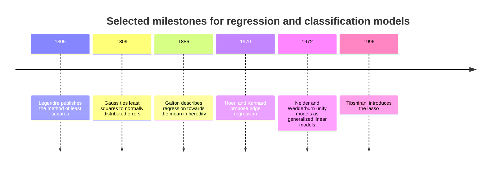

Adrien-Marie Legendre published the method of least squares in 1805 as a method for fitting astronomical observations, and Carl Friedrich Gauss connected it in 1809 to normally distributed measurement errors, which is the link to the maximum likelihood derivation in [CH01](CH01_Machine_Learning_Foundations.md). Francis Galton's studies of inherited traits in the 1880s gave regression its name: the observation that offspring of unusually tall parents tended to be closer to the average than their parents is the origin of regression to the mean. The phenomenon is a property of imperfect correlation, not of any biological force pulling values back, and it still produces misleading conclusions whenever a group is selected for an extreme measurement and then re-measured.

John Nelder and Robert Wedderburn (1972) unified linear regression, logistic regression, and Poisson regression as generalized linear models (GLMs): a linear score, a distribution for the target, and a link function that relates the score to the target's mean. This is why the pairing of squared error with an identity link and of log loss with the logistic link recurs throughout this chapter. Arthur Hoerl and Robert Kennard (1970) proposed ridge regression to stabilize coefficient estimates when features are nearly collinear, and Robert Tibshirani (1996) introduced the lasso (least absolute shrinkage and selection operator), whose penalty can set coefficients exactly to zero. Both are examples of regularization, a deliberate bias introduced to reduce variance.

## 3. Linear Regression

Linear regression models a numeric target as a weighted sum of features plus noise. It is the foundation for the rest of the chapter because logistic regression, regularization, and neural-network layers all reuse the same linear score $x^\top\beta$. This section builds the model from its assumptions, derives the estimator two ways, works a complete numeric example, and then examines how the fit fails in practice.

### 3.1 Model and assumptions

For $n$ examples and $p$ features, the model is

$$
y_i = \beta_0 + \beta_1 x_{i1} + \dots + \beta_p x_{ip} + \varepsilon_i, \qquad\text{or in matrix form}\qquad y = X\beta + \varepsilon
$$

where $X$ is the $n \times (p+1)$ design matrix whose first column is all ones (for the intercept $\beta_0$), $\beta$ is the coefficient vector, and $\varepsilon$ is the noise. [CH01](CH01_Machine_Learning_Foundations.md) writes the same model as $\hat{y} = w^\top x + b$; here the intercept is folded into $\beta$ to keep the matrix algebra compact. The model is linear in the coefficients, not necessarily in the raw inputs: a squared feature, a logarithm, or a product of two features can be added as an extra column and the model remains linear in $\beta$.

The assumptions that make OLS behave well are listed below. Which of them matter depends on the purpose: the first four govern the quality of coefficient estimates and standard errors, and the last governs whether predictions remain valid after deployment.

1. **Linearity.** The conditional mean of the target is $E[y \mid x] = x^\top\beta$ for the chosen columns.
2. **Zero-mean errors given the features.** Nothing omitted from the model is systematically related to both the features and the target. This is the assumption that fails when a confounder is missing.
3. **Constant variance and uncorrelated errors.** Every observation has noise of the same size, and one observation's error carries no information about another's.
4. **No exact linear dependence among columns.** If a column is a combination of others, $X$ does not have full column rank and the coefficients are not uniquely determined.
5. **Serving data resembles training data.** The inputs at prediction time come from the population the model was fitted on, which is the distribution-shift condition from [CH01 Section 9.6](CH01_Machine_Learning_Foundations.md).

Normally distributed errors are not required for OLS to be a sensible estimator. They matter mainly for exact small-sample intervals, which belong to [CH06](CH06_Model_Evaluation_Validation_and_Selection.md). Under assumptions 1 to 4 (with errors of zero mean), the Gauss-Markov theorem states that OLS is the best linear unbiased estimator (BLUE): among all unbiased estimators that are linear in $y$, it has the smallest variance. The qualifier "unbiased" matters, because a deliberately biased estimator such as ridge regression can achieve lower total error when features are correlated, which is the bias-variance trade-off from [CH01](CH01_Machine_Learning_Foundations.md).

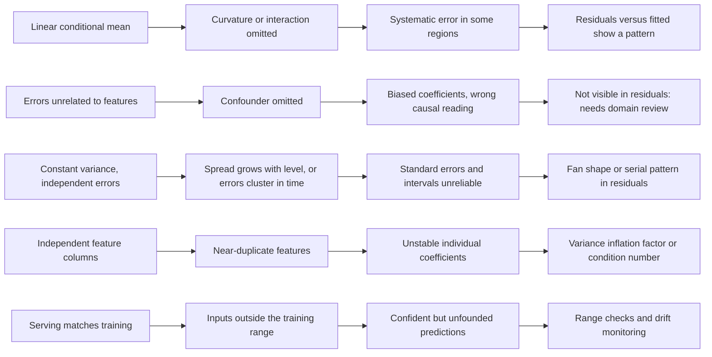

The map shows two practical implications. First, each assumption fails in its own way, and only some failures are visible in the residuals: a missing confounder (assumption 2) leaves residuals that look perfectly well behaved, so no plot can substitute for domain review of what the model omits. Second, the cheap checks sit at different points in the lifecycle. Residual and collinearity diagnostics run at training time; range checks and drift monitors run at serving time and are the architect's responsibility, because the model itself will never object to an input it was not trained on.

### 3.2 OLS via the normal equations

OLS chooses the coefficients that minimize the sum of squared residuals. [CH01 Section 7.1](CH01_Machine_Learning_Foundations.md) showed that this is also the maximum likelihood estimate under Gaussian noise, so here the derivation is purely algebraic. Let $S(\beta)$ denote the sum of squared residuals (the residual sum of squares, RSS):

$$
S(\beta) = (y - X\beta)^\top (y - X\beta) = y^\top y - 2\beta^\top X^\top y + \beta^\top X^\top X \beta
$$

The gradient with respect to $\beta$ is $-2X^\top y + 2X^\top X\beta$. Setting it to zero gives the **normal equations**:

$$
X^\top X\,\hat\beta = X^\top y
$$

If $X$ has full column rank, $X^\top X$ is invertible and the solution is unique:

$$
\hat\beta = (X^\top X)^{-1} X^\top y
$$

The stationary point is a minimum, and the only one, because the Hessian (matrix of second derivatives) is $2X^\top X$, and for any vector $v$ the quadratic form $v^\top X^\top X v = \lVert Xv\rVert^2$ is non-negative, and strictly positive for $v \neq 0$ when columns are independent. Convexity is why OLS has a closed form and why gradient descent from any starting point reaches the same answer ([CH01 Section 8.9](CH01_Machine_Learning_Foundations.md) compares the two routes).

Under assumptions 1 to 4 the estimator has covariance $\sigma^2 (X^\top X)^{-1}$, where $\sigma^2$ is the noise variance. It is estimated by $\hat\sigma^2 = \mathrm{RSS}/(n - p - 1)$. The maximum likelihood estimate in CH01 divides by $n$ instead; dividing by $n-p-1$ corrects for the $p+1$ degrees of freedom used up by fitting the coefficients. The matrix $(X^\top X)^{-1}$ is the quantity to watch: it is large exactly when columns are nearly dependent, which is the origin of the multicollinearity problem in Section 3.7.

In practice, library routines do not form $(X^\top X)^{-1}$. Forming $X^\top X$ squares the condition number of the problem, so a modestly ill-conditioned $X$ becomes badly conditioned. NumPy's `lstsq` uses a singular value decomposition (SVD) and other solvers use an orthogonal-triangular (QR) factorization; both avoid the squaring. The normal-equation form remains the right one for derivations and hand calculation, as in Section 3.4.

### 3.3 OLS as geometric projection

The same answer follows from geometry, and the geometric view explains behaviors that the algebra hides. Treat the target vector $y$ as a single point in $n$-dimensional space. The columns of $X$ span a subspace of at most $p+1$ dimensions, containing every prediction vector the model can produce. Fitting means finding the point $\hat y = X\hat\beta$ in that subspace closest to $y$. The closest point is the orthogonal projection, so the residual vector $r = y - \hat y$ must be perpendicular to every column of $X$:

$$
X^\top r = X^\top (y - X\hat\beta) = 0 \quad\Longleftrightarrow\quad X^\top X\hat\beta = X^\top y
$$

These are the normal equations again, now with a meaning: the residuals are uncorrelated with every feature, and because one column is all ones, the residuals sum to zero. The projection can be written as a matrix, the **hat matrix** $H$:

$$
\hat y = Hy, \qquad H = X(X^\top X)^{-1}X^\top
$$

$H$ is symmetric and satisfies $H^2 = H$ (projecting twice changes nothing), and its trace equals $p+1$, the number of fitted parameters. Its diagonal entries $h_{ii}$, the **leverages**, satisfy $1/n \le h_{ii} \le 1$ for a model with an intercept, and $\hat y_i = \sum_j h_{ij} y_j$, so $h_{ii}$ measures how much observation $i$'s own label controls its own fitted value. Because $\hat y \perp r$, Pythagoras gives $\lVert y\rVert^2 = \lVert\hat y\rVert^2 + \lVert r\rVert^2$. After centering $y$, this becomes the decomposition of total variation into explained and unexplained parts, so that $R^2 = 1 - \mathrm{RSS}/\mathrm{TSS}$ (the coefficient of determination, with TSS the total sum of squares about the mean) is the fraction of variation captured.

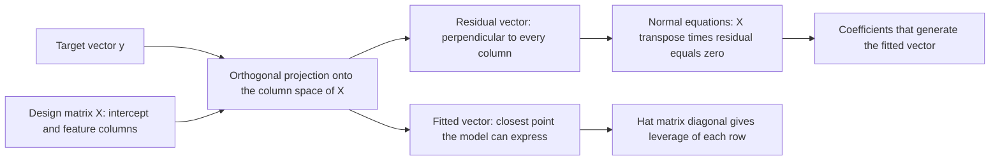

Two practical consequences follow from the picture. First, the fitted values depend only on the *subspace* spanned by the columns, not on how its basis is written. Rescaling a feature, shifting it by a constant, or replacing two columns with two independent mixtures of them changes the coefficients but leaves $\hat y$, the residuals, and $R^2$ unchanged. Section 3.7 uses this to explain unstable coefficients under collinearity, where the subspace is well determined but the basis is not, and Section 3.9 uses it to explain why scaling does not change an OLS prediction. Second, leverage depends only on $X$, never on $y$. A row can be identified as potentially influential before any label is observed, which makes leverage a property of the data-collection design as well as of the fit.

### 3.4 A worked example by hand and in code

Take five synthetic observations, labelled **illustrative** and not drawn from any real system, chosen so that every step can be checked by hand: $x = 1, 2, 3, 4, 5$ and $y = 2.1, 3.9, 6.2, 7.8, 10.1$. With one feature the design matrix has columns of ones and $x$.

**Normal equations.** Here $n = 5$, $\sum x = 15$, $\sum x^2 = 1+4+9+16+25 = 55$, $\sum y = 30.1$, and $\sum xy = 2.1 + 7.8 + 18.6 + 31.2 + 50.5 = 110.2$. Therefore

$$
X^\top X = \begin{bmatrix} 5 & 15 \\ 15 & 55 \end{bmatrix}, \qquad X^\top y = \begin{bmatrix} 30.1 \\ 110.2 \end{bmatrix}, \qquad \det(X^\top X) = 5\cdot 55 - 15^2 = 50
$$

$$
\hat\beta = \frac{1}{50}\begin{bmatrix} 55 & -15 \\ -15 & 5 \end{bmatrix}\begin{bmatrix} 30.1 \\ 110.2 \end{bmatrix} = \frac{1}{50}\begin{bmatrix} 1655.5 - 1653 \\ -451.5 + 551 \end{bmatrix} = \begin{bmatrix} 0.05 \\ 1.99 \end{bmatrix}
$$

**Centered check.** With $\bar x = 3$ and $\bar y = 6.02$, the sum of centered cross-products is $S_{xy} = (-2)(2.1) + (-1)(3.9) + 0 + (1)(7.8) + (2)(10.1) = 19.9$ and $S_{xx} = 4+1+0+1+4 = 10$. The slope is $19.9/10 = 1.99$ and the intercept is $6.02 - 1.99\cdot 3 = 0.05$, matching the matrix route.

**Fit quality.** The fitted values are $2.04, 4.03, 6.02, 8.01, 10.00$, so the residuals are $0.06, -0.13, 0.18, -0.21, 0.10$. They sum to zero, and $\sum x_i r_i = 0.06 - 0.26 + 0.54 - 0.84 + 0.50 = 0$, confirming orthogonality. Then $\mathrm{RSS} = 0.0036 + 0.0169 + 0.0324 + 0.0441 + 0.0100 = 0.107$ and $\mathrm{TSS} = 15.3664 + 4.4944 + 0.0324 + 3.1684 + 16.6464 = 39.708$, giving $R^2 = 1 - 0.107/39.708 \approx 0.9973$. The noise variance estimate is $\hat\sigma^2 = 0.107/3 \approx 0.0357$, so the standard error of the slope is $\sqrt{\hat\sigma^2/S_{xx}} \approx 0.0597$ and that of the intercept is $\sqrt{\hat\sigma^2(1/5 + 9/10)} \approx 0.198$.

**Leverage.** For one feature, $h_{ii} = 1/n + (x_i - \bar x)^2 / S_{xx}$, giving $0.6, 0.3, 0.2, 0.3, 0.6$, which sum to $2$, the number of parameters.

**Influence.** Lowering the last label by $5.1$ changes the slope by $(x_5 - \bar x)\Delta y / S_{xx} = 2(-5.1)/10 = -1.02$, from $1.99$ to $0.97$. The same change applied to the middle label (where $x = \bar x$) leaves the slope at $1.99$ and shifts only the intercept, by $-5.1/5 = -1.02$, to $-0.97$. Equal-sized label changes have different effects because the endpoints have three times the leverage of the center.

The following code reproduces each number with NumPy (a Python numerical array library) and scikit-learn (a Python machine learning library).

```python
import numpy as np
from sklearn.linear_model import LinearRegression

x = np.array([1.0, 2.0, 3.0, 4.0, 5.0])
y = np.array([2.1, 3.9, 6.2, 7.8, 10.1])
X = np.column_stack([np.ones_like(x), x])  # design matrix with intercept column

A, c = X.T @ X, X.T @ y
beta = np.linalg.solve(A, c)  # normal equations; solve is preferred to inv
print("X^T X =", A.tolist(), " X^T y =", np.round(c, 6).tolist())
print("beta (intercept, slope) =", np.round(beta, 4))

resid = y - X @ beta
print("residuals =", np.round(resid, 2))
print("residuals sum to 0:", np.isclose(resid.sum(), 0), "| X^T r = 0:", np.allclose(X.T @ resid, 0))
rss = resid @ resid
tss = ((y - y.mean()) ** 2).sum()
print(f"RSS={rss:.3f} TSS={tss:.3f} R2={1 - rss / tss:.4f}")

H = X @ np.linalg.inv(A) @ X.T  # hat (projection) matrix
print("leverage =", np.round(np.diag(H), 2), " trace =", round(np.trace(H), 6))

sk = LinearRegression().fit(x.reshape(-1, 1), y)
print("sklearn:", round(sk.intercept_, 4), round(sk.coef_[0], 4))

# Influence: shift one label by -5.1 and refit.
for idx in (4, 2):
    y2 = y.copy()
    y2[idx] -= 5.1
    b2 = np.linalg.solve(A, X.T @ y2)
    print(f"label {idx + 1} shifted by -5.1 -> intercept={b2[0]:.2f} slope={b2[1]:.2f}")
```

Output from running the code:

```text
X^T X = [[5.0, 15.0], [15.0, 55.0]]  X^T y = [30.1, 110.2]
beta (intercept, slope) = [0.05 1.99]
residuals = [ 0.06 -0.13  0.18 -0.21  0.1 ]
residuals sum to 0: True | X^T r = 0: True
RSS=0.107 TSS=39.708 R2=0.9973
leverage = [0.6 0.3 0.2 0.3 0.6]  trace = 2.0
sklearn: 0.05 1.99
label 5 shifted by -5.1 -> intercept=2.09 slope=0.97
label 3 shifted by -5.1 -> intercept=-0.97 slope=1.99
```

The hand calculation, the normal-equation solve, and scikit-learn agree, and the influence experiment matches the leverage prediction. The practical lesson of the last two lines is that a fit's sensitivity to a bad label depends on *where* in feature space the label sits, which is why Section 3.6 treats leverage as a first-class diagnostic.

### 3.5 Interpreting coefficients, and its limits

A coefficient $\beta_j$ is the expected change in the target for a one-unit increase in feature $j$ *with the other features in the model held fixed*. In the worked example, $1.99$ is the average increase in $y$ per unit of $x$ within the observed range. Four limits apply.

- **Conditional, not causal.** The coefficient describes association in the training data given the other columns. If an omitted variable drives both a feature and the target, the coefficient absorbs its effect. Consider an illustrative model of monthly support cost with a feature for the number of agents assigned to an account. The coefficient may be positive because large teams are assigned to demanding accounts, not because agents create cost. Reverse causality and selection produce similar artifacts. Establishing that changing a feature changes the outcome requires an intervention or a defensible causal design, such as the randomized comparison described in [A/B Testing](../02_Design_Thinking_and_Product_Management/CH27_A_B_Testing.md).
- **"Held fixed" may not exist in the data.** If two features always move together, the data contain no examples that vary one while the other is constant, and the partial effect is not identified by evidence. Section 3.7 shows what this does to coefficient stability.
- **Units determine magnitude.** A coefficient scales inversely with its feature's units. Coefficients on raw features cannot be compared by size; coefficients on features standardized to unit standard deviation express the effect of a one-standard-deviation change and are more comparable, although still unreliable under collinearity.
- **The intercept may be meaningless.** It is the prediction at all features zero, which may lie far outside the data. Centering features makes the intercept the prediction at average inputs.

Statistical significance does not mean importance, and a small coefficient on a feature with a large range can matter more than a large coefficient on a narrow one. Report coefficients with their units, the population they describe, and a warning against causal use unless the design supports it.

### 3.6 Residual diagnostics

A **residual** $r_i = y_i - \hat y_i$ is the model's observed error on training row $i$. Residuals are not the true errors $\varepsilon_i$, since fitting forces them to be orthogonal to the features, but they are the available evidence about whether the assumptions hold. Their variance is $\sigma^2(1 - h_{ii})$, so high-leverage rows have smaller residuals; the standardized residual $r_i/(\hat\sigma\sqrt{1-h_{ii}})$ corrects for this. The standard plots are residuals versus fitted values and residuals versus each feature, plus residuals versus time or row order when the data have one. Four patterns matter.

**Non-linearity.** A curved residual pattern means the mean is not linear in the chosen columns. For the line $y = x^2$ fitted with a straight line on nine equally spaced points from $0$ to $4$, the residuals are $u^2 - 5/3$, where $u = x - 2$ is the distance from the center. That gives $+2.33$ at both ends and $-1.67$ in the middle: a U shape. The straight line under-predicts at the extremes and over-predicts at the center, and a larger sample would not remove the bias. Responses include adding a squared term, an interaction, or a spline basis; transforming a feature or the target; or moving to a model family that learns the shape, such as the trees in [CH04](CH04_Decision_Trees_and_Ensemble_Learning.md).

**Heteroscedasticity.** A fan shape, with residual spread growing or shrinking with the fitted value, violates constant variance. Under assumptions 1 and 2 the coefficients remain unbiased, but OLS is no longer the minimum-variance estimator, and the usual standard errors and prediction intervals are wrong in a position-dependent way: too wide where noise is small and too narrow where it is large. In the simulation below the noise standard deviation is $0.3x$, and the fitted slope is close to the true $2.0$ while the residual spread roughly quadruples from the lowest to the highest bin. Responses include modelling the log of the target, weighted least squares that downweights noisy rows, heteroscedasticity-robust standard errors, or explicitly modelling the spread, for example with quantile regression.

**Dependence.** Residuals that drift with time, or that cluster by customer, region, or device, violate independence. Observations from the same group carry shared information, so the effective sample size is smaller than the row count, and a random validation split can leak that shared information. The data-splitting remedy belongs to [CH02](CH02_Data_Preparation_Feature_Engineering_and_Leakage.md); the modelling remedy is to include group or time structure explicitly.

**Leverage and influence.** A row with high leverage is far from the others in feature space and can pull the fit toward itself. It is *influential* only if its label is also inconsistent with the trend of the other rows. Section 3.4 showed the mechanism: the same label change moved the slope by $1.02$ at an endpoint and by $0$ at the center. Cook's distance combines leverage and residual size into one influence score, and a common screening heuristic flags $h_{ii} > 2(p+1)/n$. Neither is a test. An influential row may be a data-entry error, a different population, or the most informative point in the sample. Inspect it, check how the fit changes without it as a sensitivity analysis, and consider a robust loss such as Huber ([CH01 Section 7.3](CH01_Machine_Learning_Foundations.md)) rather than deleting it because it is inconvenient.

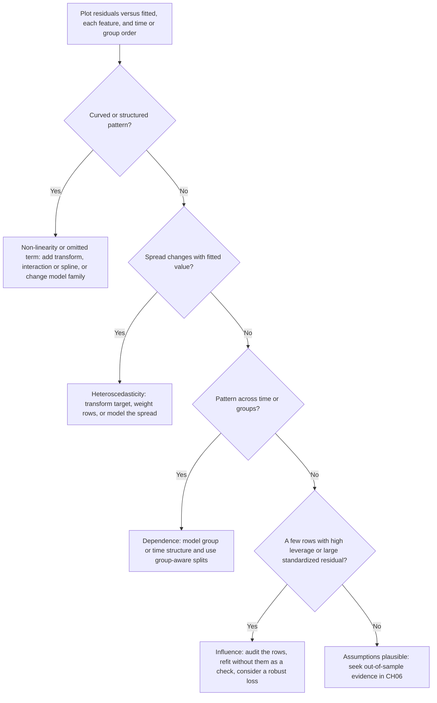

The decision tree is ordered by what to rule out first, because the problems interact. Curvature can masquerade as heteroscedasticity, and a few influential rows can create apparent curvature, so a remedy for one pattern should be followed by re-plotting rather than assumed to be complete. A clean set of plots shows only that this training sample gives no visible evidence against the assumptions; it does not show that the model will generalize, which is why the last node defers to [CH06](CH06_Model_Evaluation_Validation_and_Selection.md).

```python
import numpy as np

rng = np.random.default_rng(3)
n = 2000
x = rng.uniform(1, 10, n)
y = 2.0 * x + rng.normal(0, 0.3 * x)  # noise standard deviation grows with x
b1, b0 = np.polyfit(x, y, 1)
r = y - (b0 + b1 * x)
print(f"slope={b1:.3f} (true value 2.0)")
for lo, hi in ((1, 3), (3, 5), (5, 7), (7, 10)):
    k = (x >= lo) & (x < hi)
    print(f"x in [{lo},{hi}): residual sd={r[k].std():.2f}  (true sd between {0.3 * lo:.1f} and {0.3 * hi:.1f})")

xc = np.linspace(0, 4, 9)
yc = xc ** 2  # curved truth fitted with a straight line
c1, c0 = np.polyfit(xc, yc, 1)
print("line fit to y = x^2, residuals:", np.round(yc - (c0 + c1 * xc), 3))
```

Output from running the code:

```text
slope=2.019 (true value 2.0)
x in [1,3): residual sd=0.64  (true sd between 0.3 and 0.9)
x in [3,5): residual sd=1.22  (true sd between 0.9 and 1.5)
x in [5,7): residual sd=1.89  (true sd between 1.5 and 2.1)
x in [7,10): residual sd=2.60  (true sd between 2.1 and 3.0)
line fit to y = x^2, residuals: [ 2.333  0.583 -0.667 -1.417 -1.667 -1.417 -0.667  0.583  2.333]
```

The slope is recovered despite the unequal noise, which illustrates why heteroscedasticity is often a problem of uncertainty statements rather than of point predictions. A single constant interval width would therefore misstate risk across the range.

### 3.7 Multicollinearity

Multicollinearity means that two or more feature columns are nearly linear combinations of each other. If the dependence is exact, such as a column that always equals the sum of two others, $X$ loses full column rank, $X^\top X$ cannot be inverted, and the coefficients are not uniquely defined; a solver will either fail or silently return one of infinitely many equally good answers (NumPy's `lstsq` returns the one with the smallest norm). The more common case in practice is *near* dependence, where a unique solution exists but is numerically and statistically fragile. Examples are two sensors measuring the same quantity, a price in two currencies, or a total alongside its components.

The damage is visible in the covariance formula from Section 3.2. For coefficient $j$,

$$
\operatorname{Var}(\hat\beta_j) = \frac{\sigma^2}{S_{jj}}\cdot \mathrm{VIF}_j, \qquad \mathrm{VIF}_j = \frac{1}{1 - R_j^2}
$$

where $S_{jj} = \sum_i (x_{ij} - \bar x_j)^2$ is the spread of feature $j$ and $R_j^2$ is the $R^2$ obtained by regressing feature $j$ on all the *other* features. The **variance inflation factor** (VIF) is the multiplier on the variance relative to a design in which feature $j$ is uncorrelated with the rest. Its square root is the multiplier on the standard error. With $R_j^2 = 0.99$ the VIF is $100$ and the standard error is ten times larger than it would otherwise be. Because $R_j^2$ comes from a multi-variable regression, the VIF detects dependence among three or more columns that no pairwise correlation reveals. Thresholds such as 5 or 10 are screening conventions, not theorems. What matters is whether the coefficient uncertainty is large enough to harm the decision the model supports.

**Worked example (illustrative simulation).** Let $x_1$ be standard normal and $x_2 = x_1 + 0.1\,\eta$ with $\eta$ standard normal noise, so the two features have correlation about $0.995$. The target is $y = 1\cdot x_1 + 1\cdot x_2 + \varepsilon$ with noise standard deviation $1$, so the true coefficients are $(1, 1)$. The code draws $1000$ independent samples of $100$ rows, fits OLS to each, and records the coefficients and two predictions.

```python
import numpy as np
from sklearn.linear_model import LinearRegression, Ridge

rng = np.random.default_rng(7)

def sample(n=100, noise_x=0.1):
    x1 = rng.normal(0, 1, n)
    x2 = x1 + rng.normal(0, noise_x, n)  # near-duplicate of x1
    y = 1.0 * x1 + 1.0 * x2 + rng.normal(0, 1.0, n)  # true coefficients (1, 1)
    return np.column_stack([x1, x2]), y

def vif(X):
    out = []
    for j in range(X.shape[1]):
        others = np.delete(X, j, axis=1)
        r2 = LinearRegression().fit(others, X[:, j]).score(others, X[:, j])
        out.append(1.0 / (1.0 - r2))
    return np.round(out, 1)

X, y = sample(100)
print("corr(x1, x2) =", round(np.corrcoef(X.T)[0, 1], 4), " VIF =", vif(X))
print("diag of inverse correlation matrix =", np.round(np.diag(np.linalg.inv(np.corrcoef(X.T))), 1))

b1s, b2s, p_in, p_out, r_b1 = [], [], [], [], []
q_in, q_out = np.array([[1.0, 1.0]]), np.array([[1.0, -1.0]])
for _ in range(1000):
    X, y = sample(100)
    m = LinearRegression().fit(X, y)
    b1s.append(m.coef_[0]); b2s.append(m.coef_[1])
    p_in.append(m.predict(q_in)[0]); p_out.append(m.predict(q_out)[0])
    r_b1.append(Ridge(alpha=10.0).fit(X, y).coef_[0])
b1s, b2s = np.array(b1s), np.array(b2s)
print("true coefficients (1, 1)")
print(f"b1: mean={b1s.mean():.2f} sd={b1s.std():.2f} range=[{b1s.min():.2f}, {b1s.max():.2f}]")
print(f"b2: mean={b2s.mean():.2f} sd={b2s.std():.2f}")
print(f"corr(b1, b2) across resamples = {np.corrcoef(b1s, b2s)[0, 1]:.3f}")
print(f"b1+b2: mean={np.mean(b1s + b2s):.2f} sd={np.std(b1s + b2s):.2f}")
print(f"b1-b2: mean={np.mean(b1s - b2s):.2f} sd={np.std(b1s - b2s):.2f}")
print(f"variance ratio var(b1-b2)/var(b1+b2) = {np.var(b1s - b2s) / np.var(b1s + b2s):.0f}")
print(f"prediction at (1, 1), inside the data cloud: mean={np.mean(p_in):.2f} sd={np.std(p_in):.2f}")
print(f"prediction at (1, -1), breaks the correlation: mean={np.mean(p_out):.2f} sd={np.std(p_out):.2f}")
print(f"ridge(alpha=10) b1: mean={np.mean(r_b1):.2f} sd={np.std(r_b1):.2f}")
```

Output from running the code:

```text
corr(x1, x2) = 0.9951  VIF = [103.2 103.2]
diag of inverse correlation matrix = [103.2 103.2]
true coefficients (1, 1)
b1: mean=1.01 sd=1.04 range=[-1.88, 4.19]
b2: mean=1.00 sd=1.04
corr(b1, b2) across resamples = -0.995
b1+b2: mean=2.00 sd=0.10
b1-b2: mean=0.01 sd=2.08
variance ratio var(b1-b2)/var(b1+b2) = 422
prediction at (1, 1), inside the data cloud: mean=2.00 sd=0.15
prediction at (1, -1), breaks the correlation: mean=0.01 sd=2.07
ridge(alpha=10) b1: mean=0.95 sd=0.07
```

Four observations follow. First, the estimator is still unbiased: the average of $\hat\beta_1$ across samples is $1.01$. Collinearity inflates variance, not bias. Second, a single fit is nearly useless for reading individual coefficients: the standard deviation of $\hat\beta_1$ is $1.04$, matching the formula's prediction of about $\sqrt{101/99} \approx 1.01$, and individual estimates range from $-1.88$ to $4.19$ around a truth of $1$, including the wrong sign. Third, the two coefficients are almost perfectly negatively correlated ($-0.995$). Whatever one gains the other loses, so their *sum* is well determined (standard deviation $0.10$) while their *difference* is not ($2.08$). For standardized features with correlation $r$, the variance ratio of difference to sum is $(1+r)/(1-r) \approx 399$, close to the observed $422$. Fourth, predictions are stable only where the data are informative. At $(1, 1)$, along the direction in which the features actually move together, the prediction is $2.00$ with standard deviation $0.15$. At $(1, -1)$, a combination the training data almost never contains, the standard deviation is $2.07$, as large as the coefficient noise itself.

This is the geometry of Section 3.3 in action. The fitted *subspace* is well determined, but the two columns are nearly the same direction, so the data cannot say how to split a weight between them. Collinearity is a hidden form of extrapolation: a query that breaks the correlation structure of the training data is outside the model's support even though each feature value, taken alone, lies within its training range.

The remedies depend on the purpose of the model.

- **Prediction within the training distribution.** Often no remedy is needed. The predictions above are stable at $(1, 1)$. The risk is a serving population in which the features decouple, which a drift monitor on the *relationship* between features can catch and a monitor on each feature alone cannot.
- **Interpretation of individual coefficients.** Merge the columns into one meaningful quantity (an average, a ratio, or a domain-defined composite), drop one with a documented reason, or report only the well-determined combination, such as the sum. Gathering data that separates the features is the only fix that adds information.
- **Stability of predictions and coefficients.** Ridge regression, introduced in Section 2 and treated in the regularization discussion later in this chapter, adds $\lambda\lVert\beta\rVert^2$ to the loss and trades a small bias for a large variance reduction; here the standard deviation of $\hat\beta_1$ falls from $1.04$ to $0.07$. That result is flattered by the setup, because the true coefficients are equal and ridge's pull toward an even split happens to be correct. If the truth were $(2, 0)$, ridge would shrink toward $(1, 1)$ and carry a persistent bias. Choose $\lambda$ by validation, as [CH06](CH06_Model_Evaluation_Validation_and_Selection.md) describes. Dimensionality-reduction methods that replace correlated columns with a few uncorrelated combinations are the subject of [CH05](CH05_Unsupervised_Learning_and_Representation_Reduction.md).

Reporting the VIF alongside any table of coefficients is a cheap discipline: it tells a reader how much weight each individual coefficient can bear before anyone interprets it.

Reporting the VIF alongside any table of coefficients is a cheap discipline: it tells a reader how much weight each individual coefficient can bear before anyone interprets it.

### 3.8 Scaling, extrapolation, and target transforms

Three practical decisions around a linear model sit outside the algebra of the fit but determine whether its output can be trusted: how features are scaled, how far from the training data it is queried, and whether the target is transformed.

**Feature scaling.** By the projection view of Section 3.3, OLS predictions depend only on the column space of $X$. Multiplying a column by a constant, or shifting it, changes its coefficient (inversely, and for the intercept respectively) and leaves the fitted values, residuals, and $R^2$ unchanged. Scaling is therefore irrelevant to an *unpenalized* OLS prediction, and it matters in three other places:

- **Penalized fits.** A ridge or lasso penalty acts on the size of the coefficients, which depends on units. A feature expressed in small units needs a large coefficient and is penalized more, so the penalty shrinks features unevenly according to an arbitrary choice of unit.
- **Iterative optimization.** The conditioning argument of [CH01 Section 8.5](CH01_Machine_Learning_Foundations.md) applies: features on very different scales produce a large condition number, force a small learning rate, and slow gradient descent along the flattest direction.
- **Coefficient comparison.** Only coefficients on standardized features are comparable by size, with the collinearity caveat of Section 3.7.

The code below fits the same data twice, once with age in years and once in centuries, a deliberately extreme unit change.

```python
import numpy as np
from sklearn.linear_model import LinearRegression, Ridge
from sklearn.preprocessing import StandardScaler

rng = np.random.default_rng(11)
n = 200
income_k = rng.normal(60, 15, n)  # thousands of currency units
age = rng.normal(40, 10, n)  # years
y = 0.05 * income_k + 0.30 * age + rng.normal(0, 1.0, n)
A = np.column_stack([income_k, age])  # age in years
B = np.column_stack([income_k, age / 100.0])  # age in centuries: same information, 100x smaller scale

for name, mdl in (("OLS", LinearRegression()), ("Ridge(alpha=50)", Ridge(alpha=50))):
    mdl.fit(A, y); coef_a, pred_a = mdl.coef_.copy(), mdl.predict(A)
    mdl.fit(B, y); coef_b, pred_b = mdl.coef_.copy(), mdl.predict(B)
    print(f"{name:16s} age coefficient per year: {coef_a[1]:.4f} vs {coef_b[1] / 100:.4f} from the rescaled column;"
          f" max |prediction difference| = {np.abs(pred_a - pred_b).max():.3f}")

sa, sb = StandardScaler().fit(A), StandardScaler().fit(B)
pa = Ridge(alpha=50).fit(sa.transform(A), y).predict(sa.transform(A))
pb = Ridge(alpha=50).fit(sb.transform(B), y).predict(sb.transform(B))
print("Ridge after standardizing: max |prediction difference| =", f"{np.abs(pa - pb).max():.1e}")
```

Output from running the code:

```text
OLS              age coefficient per year: 0.3034 vs 0.3034 from the rescaled column; max |prediction difference| = 0.000
Ridge(alpha=50)  age coefficient per year: 0.3026 vs 0.0116 from the rescaled column; max |prediction difference| = 10.370
Ridge after standardizing: max |prediction difference| = 3.6e-15
```

OLS is exactly invariant. Ridge is not: in the centuries parametrization the coefficient has to be 100 times larger to do the same work, so the penalty crushes it and the age effect drops from $0.30$ to $0.012$ per year, shifting predictions by more than ten units in this example. Standardizing removes the dependence on the unit choice. The scaler's mean and standard deviation must be computed on training data only and stored with the model, which is the leakage rule from [CH02](CH02_Data_Preparation_Feature_Engineering_and_Leakage.md).

**Extrapolation.** A fitted line is defined for every input, but it is supported by evidence only near the training data. Two mechanisms make the error grow. The first is statistical: the variance of the prediction at a new point $x_0$ depends on its leverage,

$$
h_0 = \frac{1}{n} + \frac{(x_0 - \bar x)^2}{S_{xx}}, \qquad \operatorname{se}(\hat y_0) = \hat\sigma\sqrt{h_0}
$$

which grows quadratically with the distance from the center of the training data. For the five-point fit of Section 3.4 ($\hat\sigma^2 \approx 0.0357$, $\bar x = 3$, $S_{xx} = 10$), the standard error of the fitted mean is $0.084$ at $x_0 = 3$, $0.146$ at $x_0 = 5$ (the edge of the data), $0.426$ at $x_0 = 10$, and $2.81$ at $x_0 = 50$. The second mechanism is not captured by any interval: the model form may simply be wrong outside the sampled range. The following simulation fits a straight line on $x \in [0, 10]$ to a relationship that saturates at $10$, which the analyst does not know.

```python
import numpy as np

rng = np.random.default_rng(11)
x = np.linspace(0, 10, 50)
truth = lambda t: 10 * (1 - np.exp(-t / 5))  # saturating relationship, unknown to the analyst
y = truth(x) + rng.normal(0, 0.3, x.size)
slope, intercept = np.polyfit(x, y, 1)
print(f"line fitted on x in [0, 10]: intercept={intercept:.3f} slope={slope:.3f}")
for x0 in (5, 10, 20, 40):
    print(f"x0={x0:>2}: line={intercept + slope * x0:6.2f}  truth={truth(x0):5.2f}")

# Leverage of a new point for the five-point fit of Section 3.4: h0 = 1/n + (x0 - mean)^2 / Sxx
sigma2, n5, xbar, sxx = 0.107 / 3, 5, 3.0, 10.0
for x0 in (3, 5, 10, 50):
    h0 = 1 / n5 + (x0 - xbar) ** 2 / sxx
    print(f"x0={x0:>2}: h0={h0:6.2f}  se(mean)={np.sqrt(sigma2 * h0):.3f}  se(new)={np.sqrt(sigma2 * (1 + h0)):.3f}")
```

Output from running the code:

```text
line fitted on x in [0, 10]: intercept=1.619 slope=0.799
x0= 5: line=  5.61  truth= 6.32
x0=10: line=  9.60  truth= 8.65
x0=20: line= 17.59  truth= 9.82
x0=40: line= 33.56  truth=10.00
x0= 3: h0=  0.20  se(mean)=0.084  se(new)=0.207
x0= 5: h0=  0.60  se(mean)=0.146  se(new)=0.239
x0=10: h0=  5.10  se(mean)=0.426  se(new)=0.466
x0=50: h0=221.10  se(mean)=2.808  se(new)=2.815
```

Inside the range the line is a reasonable summary, off by under one unit. At $x_0 = 20$ it predicts $17.59$ against a true $9.82$, and at $x_0 = 40$ it predicts $33.56$ for a quantity that cannot exceed $10$. A statistical interval based on $h_0$ would not have flagged this, because it assumes the linear form holds everywhere. The defense is architectural, not statistical: record the training range of every feature (and of the joint distribution, given Section 3.7), reject or flag out-of-range requests, and clip or route them to a fallback rather than answering confidently. The distribution-shift monitoring in [CH01 Section 9.6](CH01_Machine_Learning_Foundations.md) and the lifecycle in [CH29](CH29_MLOps_and_LLMOps.md) cover the production side.

**Target transforms and back-transformation bias.** Modelling $\ln y$ instead of $y$ is a common remedy for positive, right-skewed targets, multiplicative effects, and spread that grows with the level (the fan shape of Section 3.6). Coefficients then act multiplicatively: a coefficient $\beta_j$ on the log scale means that a one-unit increase in feature $j$ multiplies the typical outcome by $e^{\beta_j}$. The trap is the return trip. If $\ln y = \mu + \varepsilon$ with symmetric zero-mean noise, then $e^{\mu}$ estimates the *median* of $y$, not its *mean*. Because the exponential function is convex, noise stretches the upper tail more than it compresses the lower one, so $E[e^{\varepsilon}] > 1$. For Gaussian noise with standard deviation $s$,

$$
E[y \mid x] = e^{\mu}\,e^{s^2/2}
$$

A two-outcome example shows the mechanism. Let $\mu = 3$ and let the log-outcome be $\mu \pm 0.8$ with equal probability. The outcomes are $e^{2.2} \approx 9.03$ and $e^{3.8} \approx 44.70$, whose mean is $26.86$. The naive back-transformed prediction is $e^3 \approx 20.09$, which is $25\%$ too low. (With Gaussian rather than two-point noise the factor is $e^{0.32} \approx 1.377$, giving $27.66$.) The correction matters most when predictions are *summed*, for example to forecast total demand or revenue, because the bias is systematic and accumulates rather than averaging out. A correction can be taken from the normal formula above, which needs Gaussian, constant-variance noise, or from **smearing** (Duan's estimator), which multiplies by the average of $e^{r_i}$ over the residuals $r_i$ and needs only that residuals have the same distribution at every $x$.

```python
import numpy as np
from sklearn.linear_model import LinearRegression

mu, s = 3.0, 0.8  # two equally likely outcomes on the log scale: mu - s and mu + s
lo, hi = np.exp(mu - s), np.exp(mu + s)
print(f"outcomes {lo:.2f} and {hi:.2f}: true mean={(lo + hi) / 2:.2f}  exp(mu)={np.exp(mu):.2f}  exp(mu + s^2/2)={np.exp(mu + s * s / 2):.2f}")

rng = np.random.default_rng(5)
n = 200000
x = rng.uniform(0, 2, n)
y = np.exp(1.0 + 0.5 * x + rng.normal(0, 0.8, n))  # log y is linear in x with Gaussian noise
m = LinearRegression().fit(x.reshape(-1, 1), np.log(y))
fit_log = m.predict(x.reshape(-1, 1))
res = np.log(y) - fit_log
print("log-scale fit:", np.round([m.intercept_, m.coef_[0]], 3), " residual sd:", round(res.std(), 3))
variants = {
    "naive exp(prediction)": np.exp(fit_log),
    "normal correction exp(s^2/2)": np.exp(fit_log) * np.exp(res.var() / 2),
    "smearing mean(exp(residual))": np.exp(fit_log) * np.mean(np.exp(res)),
}
for name, p in variants.items():
    print(f"{name:30s} total ratio to actual = {p.sum() / y.sum():.3f}")
print("share of observations below the naive prediction:", round(float(np.mean(y < variants["naive exp(prediction)"])), 3))
```

Output from running the code:

```text
outcomes 9.03 and 44.70: true mean=26.86  exp(mu)=20.09  exp(mu + s^2/2)=27.66
log-scale fit: [1.   0.5] residual sd: 0.798
naive exp(prediction)          total ratio to actual = 0.728
normal correction exp(s^2/2)   total ratio to actual = 1.001
smearing mean(exp(residual))   total ratio to actual = 1.000
share of observations below the naive prediction: 0.499
```

The log-scale fit recovers the true coefficients $(1.0, 0.5)$, yet the naive back-transformed total is $27\%$ short of the actual total ($0.728$, close to $e^{-0.32} \approx 0.726$), and the naive prediction sits at the median: $49.9\%$ of observations fall below it. Both corrections remove the bias. The decision rule is to match the transform to the quantity the business needs. If it needs a typical value (a median delivery time), the naive back-transform is correct and arguably better than a mean that a few extremes inflate. If it needs an expected value or a total, apply a correction, or fit the mean directly with a generalized linear model whose log link avoids the back-transformation altogether, as Section 4.6 shows. Two further cautions apply. A log transform requires strictly positive targets, and substituting $\ln(y+1)$ for zeros changes the meaning of the coefficients. And an error metric computed on the log scale measures relative error, which may not be the cost the business bears; evaluate on the scale of the decision, as [CH06](CH06_Model_Evaluation_Validation_and_Selection.md) recommends.

### 3.9 When linear regression is the right tool

Linear regression is the right first model more often than its simplicity suggests, and the wrong final model less often than enthusiasm for complex models suggests. The decision comes down to what the problem needs from the model. The heuristics below are starting points for a design review, not rules.

Prefer a linear model when most of the following hold:

- **The target is numeric and roughly unbounded**, and its conditional mean is plausibly linear in the features or becomes linear after one or two engineered terms (a log, a square, a ratio).
- **Explanation is part of the requirement.** A reviewer, an auditor, or a downstream team must see how each input moves the output, with the cautions of Section 3.5 attached.
- **Data are scarce relative to the number of features.** A model with $p+1$ parameters has low variance when $n \gg p$, and regularization (Section 5) extends this to $p$ close to $n$.
- **Serving cost matters.** Prediction is one dot product; the artifact is a vector of numbers that can be stored in a configuration file, ported to any language, and reviewed line by line.
- **A baseline is needed.** Whatever else is built, [CH01](CH01_Machine_Learning_Foundations.md) requires a baseline ladder, and a linear model is the natural rung above a constant or a heuristic.

Equally important is what a linear model cannot do by itself:

- **Learn interactions and thresholds.** "The effect of price depends on region" or "risk jumps above a limit" must be added by hand as product or indicator columns. Tree-based models in [CH04](CH04_Decision_Trees_and_Ensemble_Learning.md) find such structure automatically.
- **Represent saturation, periodicity, or non-monotone effects** without engineered terms, as the extrapolation example of Section 3.8 shows.
- **Learn its own representation** from raw images, audio, text, or long sequences. That is the role of the neural networks in [CH07](CH07_Deep_Learning_Foundations.md), whose final layers are often a linear model on learned features.
- **Respect the target's range or distribution.** An unbounded line predicts negative counts and probabilities above one. Counts, positive skewed amounts, and binary outcomes call for the model family of Section 4.
- **Establish causes.** Coefficients describe association under the training distribution, however narrow their standard errors.
- **Give honest uncertainty when noise is not constant**, unless the spread is modelled as well.

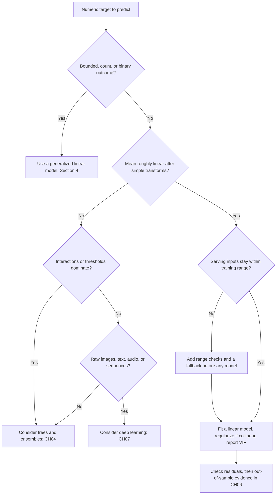

The flowchart orders the questions by how cheaply each is answered. Whether the target is bounded, a count, or binary is known from the problem statement; linearity is checked with residual plots; the serving range is an operational property. Note that the path to a non-linear model begins with a *reason* (interactions, thresholds, raw perceptual input), not with a preference for flexibility. A linear model that loses to a tree ensemble by a margin too small to matter for the decision usually remains the better system, because it is simpler to monitor, explain, and roll back. If the gain is large, the comparison itself is useful evidence about where the structure lies.

## 4. Logistic Regression and the Generalized Linear Model View

Section 3 ended with a list of targets a straight line cannot respect: probabilities, counts, and positive skewed amounts. This section keeps the linear score $z = x^\top\beta$ but changes what the score means. Instead of predicting the target's mean directly, the score is passed through a **link function** that maps it onto the range the target actually occupies. For a binary label this gives logistic regression; the same idea, with other links and noise distributions, gives the generalized linear model (GLM) family of Section 4.6.

The loss is not new here. [CH01 Section 7.2](CH01_Machine_Learning_Foundations.md) derives log loss as the negative log-likelihood (NLL) of a Bernoulli label, and [CH01 Section 8.2](CH01_Machine_Learning_Foundations.md) covers gradient descent. This section recaps those results only as far as needed to study the *structure* of the problem: why the logistic link is natural, what the fitting algorithm looks like, and which numerical and interpretive traps follow.

### 4.1 From log-odds to the logistic link

A probability $p$ lies in $(0, 1)$, but a linear score $z$ ranges over the whole real line. Some transformation $g$ must connect them: $g(p) = z$. Three requirements narrow the choice. The map must be increasing, so that a larger score means a higher probability; it must send $(0,1)$ onto all of $\mathbb{R}$; and it should make the model's parameters interpretable. The **odds** achieve the first step of this:

$$
\text{odds} = \frac{p}{1-p} \in (0, \infty), \qquad \text{log-odds (logit)} = \ln\frac{p}{1-p} \in (-\infty, \infty)
$$

The odds map $(0,1)$ onto the positive reals, and the logarithm maps those onto the whole line. Assuming the log-odds are linear, $\ln\frac{p}{1-p} = z$, and solving for $p$ gives the inverse:

$$
\frac{p}{1-p} = e^{z} \;\Longrightarrow\; p = e^{z}(1-p) \;\Longrightarrow\; p\,(1 + e^{z}) = e^{z} \;\Longrightarrow\; p = \frac{e^{z}}{1+e^{z}} = \frac{1}{1+e^{-z}}
$$

This is the **logistic (sigmoid) function**, written $p = \sigma(z)$. Three properties are used repeatedly. It is symmetric, $\sigma(-z) = 1 - \sigma(z)$, so flipping the sign of the score swaps the classes. Its derivative is expressed through its own value, because differentiating $(1+e^{-z})^{-1}$ gives

$$
\frac{d\sigma}{dz} = \frac{e^{-z}}{(1+e^{-z})^2} = \sigma\,(1-\sigma)
$$

which peaks at $0.25$ when $p = 0.5$ and vanishes as $p$ approaches $0$ or $1$. And every unit of score multiplies the odds by the same factor $e$, which is the interpretability property that Section 4.3 uses.

| Score $z$ | Odds $e^{z}$ | Probability $\sigma(z)$ |
|---:|---:|---:|
| −4 | 0.0183 | 0.0180 |
| −2 | 0.1353 | 0.1192 |
| 0 | 1.0000 | 0.5000 |
| 2 | 7.3891 | 0.8808 |
| 4 | 54.5982 | 0.9820 |

The table shows saturation: moving the score from $2$ to $4$ multiplies the odds by $e^{2} \approx 7.39$ but moves the probability by only $0.101$, while moving it from $-2$ to $0$ moves the probability by $0.381$. Equal steps in score are equal in log-odds, not in probability.

Why the logit and not another map from $(0,1)$ to $\mathbb{R}$? The probit (the inverse normal cumulative distribution function) behaves similarly in practice. The logit has a justification from Bayes' rule. Let the class prior be $\pi = P(y=1)$. Then

$$
\ln\frac{P(y=1\mid x)}{P(y=0\mid x)} = \ln\frac{p(x\mid y=1)}{p(x\mid y=0)} + \ln\frac{\pi}{1-\pi}
$$

If each class generates features from a Gaussian with its own mean $\mu_1, \mu_0$ and a shared covariance $\Sigma$, the log likelihood ratio is exactly linear in $x$:

$$
\ln\frac{p(x\mid y=1)}{p(x\mid y=0)} = (\mu_1 - \mu_0)^\top \Sigma^{-1} x - \tfrac{1}{2}\left(\mu_1^\top \Sigma^{-1}\mu_1 - \mu_0^\top \Sigma^{-1}\mu_0\right)
$$

So the log-odds are linear in $x$ with slope $\Sigma^{-1}(\mu_1 - \mu_0)$ and an intercept that contains the log prior odds. Logistic regression assumes this linear form of the log-odds without assuming the Gaussian shape, which is why it also fits many non-Gaussian features, such as binary indicators. Two consequences matter later: the prior enters *only* the intercept (Section 4.5), and the slopes depend on how far apart the classes are relative to their spread.

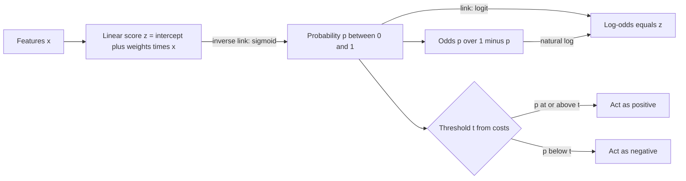

The flow separates three things that are often conflated. The score $z$ is where the model is linear and where coefficients live; the probability $p$ is what a calibration check or a cost rule consumes; and the action comes only after a threshold. Because the sigmoid is monotone, any threshold on $p$ is a threshold on $z$ ($z \ge \ln\frac{t}{1-t}$), so ranking quality is decided entirely by the linear score, while the *scale* of $z$ decides whether the probabilities are trustworthy. Sections 4.4 and 4.5 show two ways that scale can go wrong: coefficients that inflate without limit, and an intercept that encodes the wrong base rate.

### 4.2 Fitting: gradient, Hessian, convexity, and iteratively reweighted least squares

For labels $y_i \in \{0,1\}$ and scores $z_i = x_i^\top\beta$, the Bernoulli log-likelihood simplifies. Since $\ln p_i = z_i - \ln(1+e^{z_i})$ and $\ln(1-p_i) = -\ln(1+e^{z_i})$,

$$
\ell(\beta) = \sum_{i=1}^{n}\left[\, y_i \ln p_i + (1-y_i)\ln(1-p_i) \,\right] = \sum_{i=1}^{n}\left[\, y_i z_i - \ln\left(1+e^{z_i}\right) \right]
$$

The NLL of CH01 is $-\ell(\beta)$. Differentiating with respect to a score gives $y_i - \sigma(z_i) = y_i - p_i$, so the **gradient** is

$$
\nabla \ell(\beta) = X^\top (y - p)
$$

This has the same shape as the OLS normal equations in Section 3.2: the fit is stationary when the residuals $y - p$ are orthogonal to every column of $X$. With an intercept column this means the predicted probabilities sum to the observed positive count, a calibration-in-the-large property that holds for any unpenalized fit. Differentiating again, and using $\partial p_i/\partial\beta = p_i(1-p_i)\,x_i$ from Section 4.1, gives the **Hessian**

$$
\nabla^2 \ell(\beta) = -X^\top W X, \qquad W = \mathrm{diag}\left(p_1(1-p_1), \dots, p_n(1-p_n)\right)
$$

**Convexity.** For any vector $v$, $v^\top X^\top W X v = \sum_i w_i\,(x_i^\top v)^2 \ge 0$, where each weight satisfies $0 < w_i \le 1/4$. So $-\ell$ has a positive semi-definite Hessian everywhere, and strictly positive definite when $X$ has full column rank, because every $w_i$ is strictly positive. The NLL is therefore convex and has at most one minimizer, and any method that finds a stationary point has found the global answer. The caveat is the word "at most": convexity guarantees uniqueness, not existence. Section 4.4 shows data for which the minimizer does not exist.

**Newton's method and IRLS.** Newton's method updates $\beta \leftarrow \beta + (X^\top W X)^{-1} X^\top (y - p)$. Regrouping the update shows what it is. Define the *working response* $\tilde z = X\beta + W^{-1}(y - p)$, which is the current score corrected by a linearized step toward the label. Then

$$
\beta_{\text{new}} = (X^\top W X)^{-1} X^\top W \tilde z
$$

which is a *weighted* least-squares solution of exactly the form derived in Section 3.2. Iteratively reweighted least squares (IRLS) is therefore Newton's method read as a repeated weighted regression: compute $p$, form $W$ and $\tilde z$, solve a weighted OLS problem, and repeat until the step is negligible. The weights $p_i(1-p_i)$ are largest for rows near the decision boundary and tiny for confidently classified rows, so the fit is driven by the ambiguous rows.

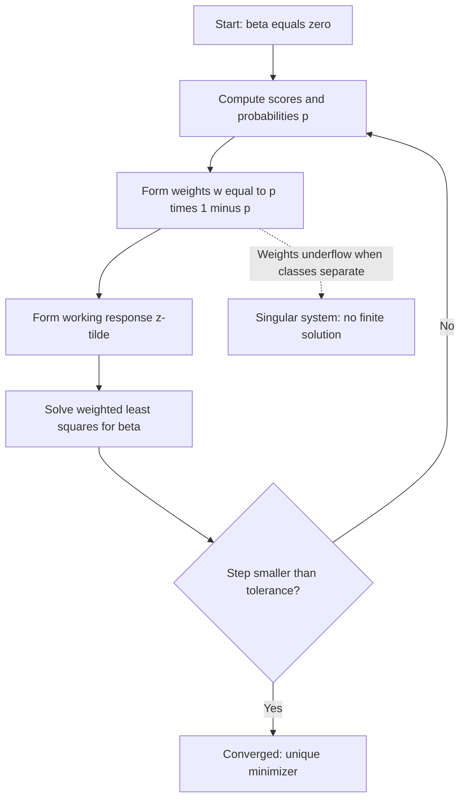

The loop explains the algorithm's operating profile. Each pass costs one weighted regression, about $O(np^2 + p^3)$ operations, and near the optimum Newton's method converges quadratically, so well-behaved problems need only a handful of passes. The cost is the $p \times p$ solve, which is why very wide models use the first-order methods of [CH01 Sections 8.6 and 8.7](CH01_Machine_Learning_Foundations.md) instead. The dotted edge is the failure path: when the data allow a perfect split, the weights collapse and the system becomes singular rather than converging.

The code below implements IRLS in NumPy on synthetic data, labelled **illustrative**, and checks it against scikit-learn with the penalty disabled (`C=np.inf`).

```python
import numpy as np
from sklearn.linear_model import LogisticRegression

rng = np.random.default_rng(7)
n = 2000
x1 = rng.normal(size=n)
x2 = rng.normal(size=n)
beta_true = np.array([-0.5, 1.2, -0.8])
X = np.column_stack([np.ones(n), x1, x2])
y = rng.binomial(1, 1 / (1 + np.exp(-X @ beta_true)))

def loglik(beta):
    z = X @ beta
    return float(np.sum(y * z - np.logaddexp(0, z)))

beta = np.zeros(3)
for it in range(1, 9):
    p = 1 / (1 + np.exp(-(X @ beta)))
    W = p * (1 - p)
    grad = X.T @ (y - p)
    H = X.T @ (X * W[:, None])  # X^T W X without forming diag(W)
    step = np.linalg.solve(H, grad)
    beta = beta + step
    print(f"iter {it}: loglik={loglik(beta):.6f} max|step|={np.abs(step).max():.2e}")
    if np.abs(step).max() < 1e-10:
        break

sk = LogisticRegression(C=np.inf, tol=1e-12, max_iter=1000).fit(X[:, 1:], y)
print("IRLS   :", np.round(beta, 6))
print("sklearn:", np.round(np.r_[sk.intercept_, sk.coef_[0]], 6))
print("max abs difference:", f"{np.abs(beta - np.r_[sk.intercept_, sk.coef_[0]]).max():.1e}")
print("true   :", beta_true, " positives:", int(y.sum()), "of", n)
print("Hessian eigenvalues (all > 0):", np.round(np.linalg.eigvalsh(H), 2))
```

Output from running the code:

```text
iter 1: loglik=-1052.626587 max|step|=8.63e-01
iter 2: loglik=-1030.012099 max|step|=3.06e-01
iter 3: loglik=-1029.344179 max|step|=6.47e-02
iter 4: loglik=-1029.343326 max|step|=2.42e-03
iter 5: loglik=-1029.343326 max|step|=3.23e-06
iter 6: loglik=-1029.343326 max|step|=5.76e-12
IRLS   : [-0.513249  1.23594  -0.829662]
sklearn: [-0.513249  1.23594  -0.829662]
max abs difference: 5.8e-08
true   : [-0.5  1.2 -0.8]  positives: 797 of 2000
Hessian eigenvalues (all > 0): [177.89 338.26 359.47]
```

The two implementations agree to $5.8\times10^{-8}$, the accuracy of the library's iterative solver. The step sizes show quadratic convergence: after the third pass each step is of the order of the square of the previous one ($6.5\times10^{-2}$, then $2.4\times10^{-3}$, then $3.2\times10^{-6}$, then $5.8\times10^{-12}$). The fitted coefficients differ from the true values by sampling noise, which is the expected behaviour with $n=2000$. The positive Hessian eigenvalues confirm strict convexity for this dataset.

### 4.3 Interpreting coefficients: odds ratios, marginal effects, and non-collapsibility

Section 3.5's cautions (conditional, not causal; units set magnitude; the intercept may be meaningless) apply unchanged. What changes is the scale. A logistic coefficient $\beta_j$ is the change in *log-odds* per unit of feature $j$ with the others held fixed. Exponentiating gives the **odds ratio**:

$$
\frac{\text{odds at } x_j + 1}{\text{odds at } x_j} = \frac{e^{z + \beta_j}}{e^{z}} = e^{\beta_j}
$$

The ratio is the same wherever you start, which is what makes it easy to state. A probability change is not the same everywhere.

**Worked example (illustrative).** Suppose a churn model has been fitted with score $z = -2.0 + 0.9F - 0.05T$, where $F$ is a flag for a support ticket in the last month and $T$ is tenure in months. The odds ratio for the flag is $e^{0.9} \approx 2.46$: holding tenure fixed, a ticket multiplies the odds of churn by about $2.46$. Each extra month of tenure multiplies the odds by $e^{-0.05} \approx 0.951$ (a $4.9\%$ reduction), and twelve months by $e^{-0.6} \approx 0.549$. The same coefficient implies very different probability changes depending on the baseline:

| Tenure $T$ | $p$ without ticket | $p$ with ticket | Difference | Ratio of probabilities | Odds ratio |
|---:|---:|---:|---:|---:|---:|
| 0 | 0.1192 | 0.2497 | 0.1305 | 2.10 | 2.46 |
| 10 | 0.0759 | 0.1680 | 0.0921 | 2.21 | 2.46 |
| 40 | 0.0180 | 0.0431 | 0.0251 | 2.40 | 2.46 |

The odds ratio is constant across rows, by construction. The absolute effect, the **marginal effect**, changes by a factor of five between the first and last rows, and the ratio of probabilities lies between them. For a continuous feature the marginal effect is the derivative $\partial p/\partial x_j = \beta_j\, p(1-p)$. For tenure at $T = 10$ without a ticket this is $-0.05 \times 0.0759 \times 0.9241 \approx -0.0035$ per month, and its magnitude can never exceed $|\beta_j|/4$, reached at $p = 0.5$. Two practical rules follow. When the event is rare, odds ratios and probability ratios are close, so reading an odds ratio as "times as likely" is tolerable. When the event is common, the odds ratio overstates the probability ratio and the reading misleads. And a decision about *workload or cost* depends on the absolute effect, so a report should show predicted probabilities for named example profiles or an average marginal effect, not only $e^{\beta}$.

**Non-collapsibility.** Odds ratios have a subtle property that linear coefficients lack. In a linear model with an independent extra feature, the coefficient on the first feature does not change when the second is added. In a logistic model it does, even with no confounding. Take an illustrative case in which $X$ and $Z$ are independent binary variables, each equal to $1$ with probability $0.5$, and the true model is $\text{logit}\,p = -1 + X + 2Z$. The odds ratio for $X$ is $e^{1} \approx 2.72$ within every level of $Z$. Averaging over $Z$ gives $P(y{=}1 \mid X{=}1) = 0.5\,\sigma(0) + 0.5\,\sigma(2) \approx 0.6904$ and $P(y{=}1 \mid X{=}0) = 0.5\,\sigma(-1) + 0.5\,\sigma(1) = 0.5$, so the marginal odds ratio is $(0.6904/0.3096)/1 \approx 2.23$. Nothing is wrong with either number; they answer different questions, one conditional on $Z$ and one averaged over it. The practical consequences are conceptual rather than computational: odds ratios from models with different covariates are not comparable, a coefficient that shifts after adding an unrelated predictor is not evidence of confounding, and any claim about the effect on a *population* should be computed by averaging predicted probabilities with the feature set to each value, then comparing those averages.

### 4.4 Decision-boundary geometry and perfect separation

A classifier acts when the probability reaches a threshold $t$. Because the sigmoid is monotone, $p \ge t$ is equivalent to $z \ge \ln\frac{t}{1-t}$. For $t = 0.5$ the right side is zero, so the **decision boundary** is the set of points where $\beta_0 + w^\top x = 0$, with $w$ the slope vector: a straight line in two features, a plane in three, a hyperplane in general. The boundary is always linear in the input space; a different threshold moves it to a parallel hyperplane at score $\ln\frac{t}{1-t}$ without rotating it. The signed distance from a point to the $t = 0.5$ boundary is $z / \lVert w \rVert$, so the score is a distance in units of $1/\lVert w\rVert$. The direction of $w$ sets *where* the boundary lies; its length sets how sharply probability changes across it. Doubling every coefficient leaves every decision at $t = 0.5$ unchanged but pushes all probabilities toward $0$ and $1$, which is why a model can rank perfectly while being badly miscalibrated.

The boundary is linear in $x$ but the model need only be linear in $\beta$. Adding columns for squares and products gives, for two features,

$$
z = \beta_0 + \beta_1 x_1 + \beta_2 x_2 + \beta_3 x_1^2 + \beta_4 x_2^2
$$

whose $z = 0$ set is an ellipse or hyperbola in $(x_1, x_2)$. With $\beta_3 = \beta_4 = 1$, $\beta_1 = \beta_2 = 0$ and $\beta_0 = -4$ it is the circle $x_1^2 + x_2^2 = 4$. Everything in Sections 4.2 and 4.3 still holds, since the extra columns are just more columns of $X$. The price is the usual one: more parameters, more variance, and a greater chance of the separation problem below. Learning such features automatically is the role of the trees in [CH04](CH04_Decision_Trees_and_Ensemble_Learning.md) and the neural networks in [CH07](CH07_Deep_Learning_Foundations.md).

**Perfect separation.** If some hyperplane puts every positive on one side and every negative on the other, the data are *linearly separable*. Then Section 4.2's "at most one minimizer" has no minimizer at all. Scaling the separating coefficients by $c > 1$ pushes every $p_i$ closer to its label, so the log-likelihood increases with $c$ and approaches its supremum of zero as $c \to \infty$, without reaching it. The code runs two views of this on a six-point dataset (illustrative, with the classes split at $x = 0$): unpenalized Newton steps, and an L2-penalized fit with the penalty progressively weakened. In scikit-learn, `C` is the inverse of the penalty weight.

```python
import numpy as np
from sklearn.linear_model import LogisticRegression

x = np.array([-3.0, -2.0, -1.0, 1.0, 2.0, 3.0])
y = np.array([0, 0, 0, 1, 1, 1])  # perfectly separated at x = 0
X = np.column_stack([np.ones_like(x), x])

beta = np.zeros(2)
for it in range(1, 21):
    p = 1 / (1 + np.exp(-(X @ beta)))
    W = p * (1 - p)
    # 1e-12 jitter only keeps the solve defined once W underflows toward zero
    beta = beta + np.linalg.solve(X.T @ (X * W[:, None]) + 1e-12 * np.eye(2), X.T @ (y - p))
    z = X @ beta
    if it in (1, 2, 3, 5, 10, 15, 20):
        print(f"iter {it:2d}: slope={beta[1]:7.4f} loglik={np.sum(y * z - np.logaddexp(0, z)):.2e}")

print()
for C in (0.01, 0.1, 1, 10, 100, 1e3, 1e4, 1e6):
    m = LogisticRegression(C=C, tol=1e-10, max_iter=10000).fit(x.reshape(-1, 1), y)
    print(f"C={C:>9g}: slope={m.coef_[0, 0]:7.4f} p(x=1)={m.predict_proba([[1.0]])[0, 1]:.6f}")
```

Output from running the code:

```text
iter  1: slope= 0.8571 loglik=-1.19e+00
iter  2: slope= 1.4754 loglik=-5.38e-01
iter  3: slope= 2.1959 loglik=-2.38e-01
iter  5: slope= 3.9920 loglik=-3.73e-02
iter 10: slope= 8.9606 loglik=-2.57e-04
iter 15: slope=13.9604 loglik=-1.73e-06
iter 20: slope=18.9604 loglik=-1.17e-08

C=     0.01: slope= 0.0561 p(x=1)=0.514017
C=      0.1: slope= 0.3634 p(x=1)=0.589853
C=        1: slope= 1.1044 p(x=1)=0.751084
C=       10: slope= 2.2948 p(x=1)=0.908442
C=      100: slope= 3.9462 p(x=1)=0.981038
C=     1000: slope= 5.8392 p(x=1)=0.997097
C=    10000: slope= 7.8441 p(x=1)=0.999608
C=    1e+06: slope= 12.0219 p(x=1)=0.999994
```

The unpenalized slope grows by about $1.0$ per iteration (from $13.96$ at iteration 15 to $18.96$ at iteration 20) while the log-likelihood creeps toward zero: the algorithm never converges, it only stops when a limit is reached. The penalized fits show the same drift as the penalty is relaxed. The slope rises from $0.056$ to $12.0$, and the model's probability at $x = 1$ moves from $0.514$ to $0.999994$, a near-certainty built from three examples per class. The intercept is zero by symmetry in this dataset and is omitted from the printout.

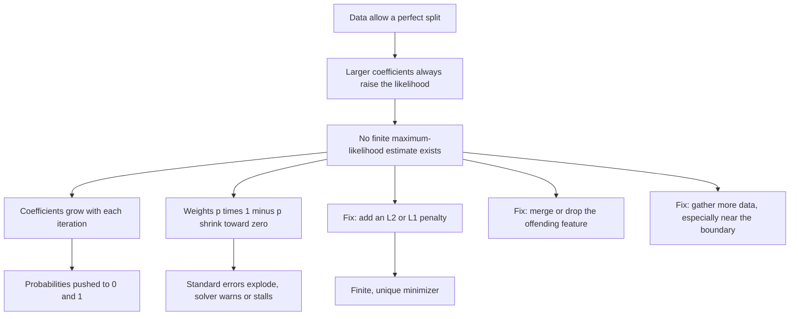

The diagram shows why separation is dangerous rather than merely inconvenient. The *ranking* produced by the unpenalized fit may be perfectly good, but the probabilities are not: they are as extreme as the iteration count allows, so any cost-based threshold (see Section 7.2 below) and the calibration checks in [CH06](CH06_Model_Evaluation_Validation_and_Selection.md) are meaningless on top of them. Separation is also more common than intuition suggests. It appears when $n$ is small relative to $p$, when the positive class is rare, and when a categorical level (a single account type, say) contains only one class. A solver that stops silently at its iteration limit returns a coefficient that depends on that limit, not on the data. Operationally, treat huge coefficients, convergence warnings, and probabilities saturated at $0$ or $1$ as a signal to inspect the data before trusting the fit.

**Why regularization fixes it.** Adding an L2 penalty, $-\ell(\beta) + \tfrac{\lambda}{2}\lVert w\rVert^2$ (usually leaving the intercept unpenalized), makes the objective strictly convex *and* grows without bound as $\lVert w \rVert \to \infty$. The two pulls balance at a finite point, so a unique minimizer exists even for separable data, which is what the shrinking-penalty column above shows. The penalty is a deliberate bias, the trade described in [CH01](CH01_Machine_Learning_Foundations.md): the coefficients become smaller than the unpenalized estimate, probabilities less extreme, and the cost is a possible loss of sharpness. How strongly to penalize, and the difference between L1 and L2, are covered in Section 5; the strength should be chosen with validation data, not by eye. Because the penalty acts on coefficient size, features must be on comparable scales before it is applied (see Section 5.4). Penalized likelihood corrections such as Firth's method and a Bayesian prior on coefficients serve the same purpose in statistical practice.

### 4.5 Intercept and base-rate shift

Section 4.1 showed that the class prior enters the log-odds only through an additive term. Write the posterior log-odds under a training prior $\pi_{1}^{\text{tr}} = P_{\text{tr}}(y=1)$:

$$
z_{\text{tr}}(x) = \ln\frac{p(x\mid y=1)}{p(x\mid y=0)} + \ln\frac{\pi_{1}^{\text{tr}}}{1-\pi_{1}^{\text{tr}}}
$$

Suppose the data seen at deployment come from the *same* class-conditional distributions $p(x\mid y)$ but a different positive rate $\pi_{1}^{\text{dep}}$. The likelihood-ratio term is unchanged and only the prior term differs, so the deployment score is the training score plus a constant:

$$
z_{\text{dep}}(x) = z_{\text{tr}}(x) + \underbrace{\ln\frac{\pi_{1}^{\text{dep}}}{1-\pi_{1}^{\text{dep}}} - \ln\frac{\pi_{1}^{\text{tr}}}{1-\pi_{1}^{\text{tr}}}}_{\text{log prior-odds ratio}}
$$

This is **prior shift** (also called label shift or prior-probability shift). The correction touches the intercept alone: every slope, every ranking of rows, and therefore every ranking metric stays the same, while every probability moves. In odds form the correction multiplies the odds by the ratio of deployment prior odds to training prior odds.

**Worked example (illustrative).** A model is trained on a resampled set with $\pi_{1}^{\text{tr}} = 0.5$ and later deployed where the positive rate is $\pi_{1}^{\text{dep}} = 0.02$. The training prior log-odds are $\ln(0.5/0.5) = 0$ and the deployment prior log-odds are $\ln(0.02/0.98) = -3.8918$, so the correction is $-3.8918$. A row scored $z_{\text{tr}} = 1$ has a raw probability $\sigma(1) = 0.7311$ and a corrected probability $\sigma(1 - 3.8918) = \sigma(-2.8918) = 0.0526$. The odds check agrees: the raw odds $e^{1} = 2.7183$ times the prior-odds ratio $(0.02/0.98)/1 = 0.020408$ give $0.05548$, and $0.0526/(1-0.0526) = 0.05548$.

| Training score $z_{\text{tr}}$ | Raw probability | Corrected probability at $\pi_{1}^{\text{dep}} = 0.02$ |
|---:|---:|---:|
| −1 | 0.2689 | 0.0075 |
| 0 | 0.5000 | 0.0200 |
| 1 | 0.7311 | 0.0526 |
| 2 | 0.8808 | 0.1310 |
| 3 | 0.9526 | 0.2907 |

The row with $z_{\text{tr}} = 0$ is the cleanest reading: a model that sees a coin-flip case at a balanced prior should say $0.02$, the base rate, at the deployment prior. The corrected probabilities are far lower than the raw ones, and a threshold of $0.5$ that is sensible at the training prior would almost never fire at deployment (it needs $z_{\text{tr}} \ge 3.89$).

The same algebra explains a common practice. Undersampling the majority class to speed up training, or reweighting classes, changes the effective training prior. If the negatives are kept with probability $r$, the training positive odds grow by $1/r$, so the intercept learned on the subsample is too high by about $\ln(1/r)$ and the correction is $\ln r$ (in the limit of a well-specified model). The code below simulates this on synthetic data, keeping all positives and $5\%$ of negatives. The expected correction is $\ln 0.05 = -2.996$; the code computes it from the observed rates, so it differs slightly.

```python
import numpy as np
from sklearn.linear_model import LogisticRegression

def logit(p):
    return np.log(p / (1 - p))

rng = np.random.default_rng(11)
n = 400_000
X = rng.normal(size=(n, 2))
y = rng.binomial(1, 1 / (1 + np.exp(-(-4.5 + X @ np.array([1.5, -1.0])))))

def fit(X, y):
    return LogisticRegression(C=np.inf, tol=1e-10, max_iter=1000).fit(X, y)

full = fit(X, y)
keep = (y == 1) | (rng.random(n) < 0.05)  # keep all positives, 5% of negatives
sub = fit(X[keep], y[keep])
shift = logit(y.mean()) - logit(y[keep].mean())

print(f"positive rate: full={y.mean():.4f} subsample={y[keep].mean():.4f} rows kept={keep.sum()}")
print("full     intercept, slopes:", np.round(np.r_[full.intercept_, full.coef_[0]], 3))
print("subsamp. intercept, slopes:", np.round(np.r_[sub.intercept_, sub.coef_[0]], 3))
print(f"log-odds correction={shift:.3f} corrected intercept={sub.intercept_[0] + shift:.3f}")
p_raw = sub.predict_proba(X)[:, 1]
p_fix = 1 / (1 + np.exp(-(sub.decision_function(X) + shift)))
print(f"mean predicted p: raw={p_raw.mean():.4f} corrected={p_fix.mean():.4f} actual={y.mean():.4f}")
```

Output from running the code:

```text
positive rate: full=0.0392 subsample=0.4521 rows kept=34681
full     intercept, slopes: [-4.508  1.515 -1.   ]
subsamp. intercept, slopes: [-1.503  1.517 -0.985]
log-odds correction=-3.007 corrected intercept=-4.510
mean predicted p: raw=0.2731 corrected=0.0389 actual=0.0392
```

The slopes of the two fits agree within sampling noise, as the theory predicts, and the intercept moves from $-1.503$ to $-4.510$ after the correction, matching the full-data value of $-4.508$. Uncorrected, the subsample model predicts an average probability of $0.273$ for a population whose true rate is $0.039$, a seven-fold overstatement. After the correction the mean is $0.0389$.

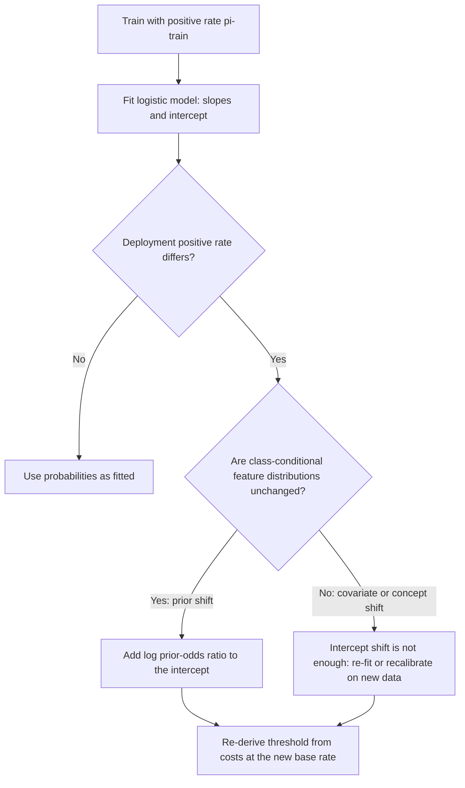

The diagram's decision point is the assumption, not the arithmetic. The correction is exact only when $p(x\mid y)$ is stable, which holds for a pure change in how often the event occurs and fails when the *kinds* of positives change. Three implications follow. First, ranking metrics such as the area under the receiver operating characteristic (ROC) curve do not move under prior shift, but precision, expected cost, and the right threshold all do (see Section 7), so a model that "still ranks well" can still flood a review queue. Second, a base rate that is a *design* choice (resampling) must be recorded with the model so the correction can be applied at serving time; this is a metadata item for the model registry covered in [CH29](CH29_MLOps_and_LLMOps.md). Third, when a model must be recalibrated rather than corrected analytically, the methods in [CH06](CH06_Model_Evaluation_Validation_and_Selection.md) apply.

### 4.6 The GLM family view

Linear and logistic regression are two instances of one construction with three parts: a **linear predictor** $z = x^\top\beta$, a **conditional distribution** for the target with mean $\mu$, and a **link function** $g$ with $g(\mu) = z$. The distribution is restricted to the **exponential family**, whose densities (or mass functions) can be written

$$
f(y;\theta,\phi) = \exp\left\{ \frac{y\,\theta - b(\theta)}{a(\phi)} + c(y,\phi) \right\}
$$

where $\theta$ is the natural parameter, $\phi$ a dispersion parameter, and $b$ a function that characterizes the family. Two identities follow for every member: the mean is $\mu = b'(\theta)$ and the variance is $a(\phi)\,b''(\theta)$. Because $\mu$ determines $\theta$, the variance is a function of the mean, $\operatorname{Var}(y) = \phi\,V(\mu)$, and this **variance function** $V$ is what distinguishes the members.

| Target and family | Typical use | Variance function $V(\mu)$ | Canonical link $g(\mu)$ | Link in common practice |
|---|---|---|---|---|
| Gaussian | Real-valued measurement | $1$ | Identity, $\mu$ | Identity |
| Bernoulli | Binary label | $\mu(1-\mu)$ | Logit, $\ln\frac{\mu}{1-\mu}$ | Logit |
| Poisson | Non-negative counts | $\mu$ | Log, $\ln\mu$ | Log |
| Gamma | Positive, right-skewed amounts | $\mu^{2}$ | Inverse, $-1/\mu$ | Log |

The **canonical link** is the one that sets $g(\mu) = \theta$. With it, the score equals the natural parameter and the log-likelihood gradient takes the familiar form

$$
\nabla \ell(\beta) = \frac{1}{a(\phi)}\, X^\top (y - \mu)
$$

which is the normal-equation shape of Section 3.2 and the logistic gradient of Section 4.2. The consequences carry over: the likelihood is concave in $\beta$, Newton's method becomes IRLS with weights that depend on $\mu$, and with an intercept the fitted means sum to the observed total. Non-canonical links are legitimate (the log link for a Gamma target is the usual choice) but give up some of this structure, so a solver may need more care.

**Poisson regression for counts.** For a count $y \in \{0,1,2,\dots\}$ with mean $\mu$, the Poisson log-likelihood per row is $y\ln\mu - \mu - \ln y!$, and the canonical log link gives $\mu = e^{z}$. Three properties make it the right default for counts. Predictions are positive by construction. A coefficient is *multiplicative*: a one-unit increase in $x_j$ multiplies the expected count by $e^{\beta_j}$, a **rate ratio**, in the same way an odds ratio acts in Section 4.3. And the variance rises with the mean, which a constant-variance regression would ignore. For events observed over different exposures (customer-months, requests, units of traffic) a model of the *rate* uses the log exposure as an **offset**, a term added to $z$ with its coefficient fixed at one: $\ln\mu = \ln(\text{exposure}) + x^\top\beta$. The Poisson assumption $\operatorname{Var}(y) = \mu$ is strict. When the data are more variable than that (**overdispersion**), the point estimates remain useful but standard errors are too small; the fixes are a dispersion-adjusted (quasi-Poisson) fit or a negative binomial model, which this chapter names but does not develop, and excess zeros call for a separate zero-inflation component.

**Gamma regression for positive skewed targets.** For a strictly positive target whose spread grows with its level, such as a duration or a monetary amount, the Gamma family has $V(\mu) = \mu^{2}$: the standard deviation is proportional to the mean, a constant **coefficient of variation**. With a log link, $\mu = e^{z}$, coefficients are again multiplicative. This is not the same as ordinary regression on $\ln y$. The log-target model of Section 3.8 estimates the mean of $\ln y$, and exponentiating its prediction gives a median-like quantity that understates the mean unless a correction is applied. The Gamma model with a log link estimates $\ln E[y]$ directly, so $e^{z}$ is the conditional mean and totals computed by summing predictions are not systematically biased by the transformation. A Gamma target cannot be zero; a target with a mass at zero needs a two-part or Tweedie-type model.

**Choosing among them.** Decide from the target and from how its variance behaves, not from the library's defaults.

| Situation | Reasonable first choice | Watch for |
|---|---|---|
| Real-valued, roughly constant spread | Gaussian, identity (OLS) | Heteroscedasticity, outliers (Section 3.6) |
| Binary outcome | Bernoulli, logit | Separation (Section 4.4), base rate (Section 4.5) |
| Event counts, possibly with exposure | Poisson, log, offset for exposure | Overdispersion, excess zeros |
| Positive amount, spread grows with level | Gamma, log | Zeros, extreme tails |
| Non-negative target of unknown shape | Compare via cross-validated deviance | A good score does not validate the variance assumption |

The code fits a Poisson model to synthetic counts (**illustrative**; true intercept $0.3$, slopes $0.5$ and $-0.4$), shows that the log link keeps predictions positive when a straight-line fit does not, and checks the variance assumption with the Pearson dispersion, the sum of $(y_i - \hat\mu_i)^2/\hat\mu_i$ divided by the residual degrees of freedom, which is near $1$ when the Poisson variance holds. Setting `alpha=0` turns off scikit-learn's L2 penalty so that the fit is the plain maximum-likelihood estimate.

```python
import numpy as np
from sklearn.linear_model import PoissonRegressor, LinearRegression

rng = np.random.default_rng(3)
n = 5000
X = rng.normal(size=(n, 2))
y = rng.poisson(np.exp(0.3 + 0.5 * X[:, 0] - 0.4 * X[:, 1]))  # true intercept 0.3, slopes 0.5 and -0.4

pois = PoissonRegressor(alpha=0, tol=1e-10, max_iter=1000).fit(X, y)
ols = LinearRegression().fit(X, y)
mu_hat = pois.predict(X)

print("poisson intercept, slopes:", np.round(np.r_[pois.intercept_, pois.coef_], 3))
print("rate ratios exp(slope):", np.round(np.exp(pois.coef_), 3))
print(f"mean(y)={y.mean():.4f} mean(fitted)={mu_hat.mean():.4f}")
print(f"negative predictions: OLS={(ols.predict(X) < 0).sum()} of {n}, Poisson={(mu_hat < 0).sum()}")
print(f"Pearson dispersion: {np.sum((y - mu_hat) ** 2 / mu_hat) / (n - 3):.3f}")
```

Output from running the code:

```text
poisson intercept, slopes: [ 0.322  0.495 -0.39 ]
rate ratios exp(slope): [1.641 0.677]
mean(y)=1.6974 mean(fitted)=1.6974
negative predictions: OLS=275 of 5000, Poisson=0
Pearson dispersion: 1.000
```

The coefficients recover the generating values to within sampling noise. The mean of the fitted values equals the mean of the observed counts exactly ($1.6974$), the canonical-link property stated above. The straight-line fit predicts a negative count for $275$ of $5000$ rows ($5.5\%$), which is impossible for a count and would break any downstream capacity calculation; the Poisson fit produces none. The Pearson dispersion of $1.000$ is expected here because the data were generated from a Poisson distribution; on real counts a value well above $1$ is the signal for overdispersion.

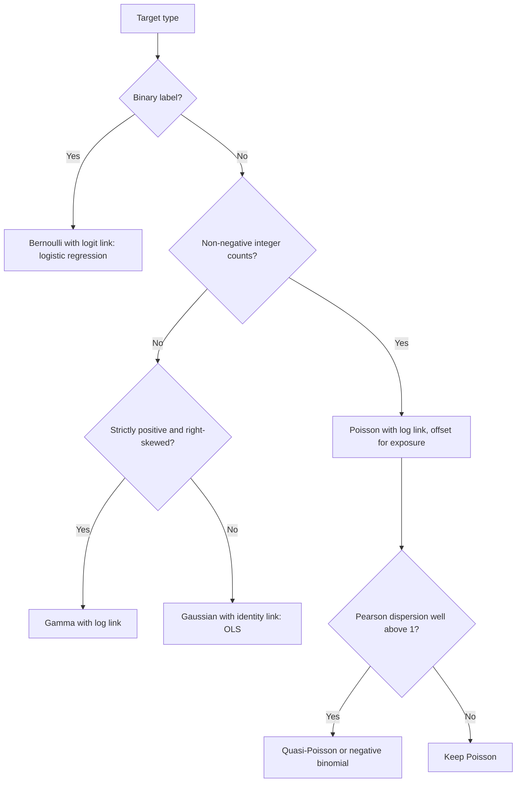

The diagram turns the family choice into two questions about the target and one diagnostic about its variance. For an architect the practical gain is that the *loss function is specified by the target type*: training a squared-error model on counts or positive amounts, which is what a default regressor does, is a silent choice of the Gaussian family and its constant-variance assumption. The same property applies to larger models, since gradient-boosted trees ([CH04](CH04_Decision_Trees_and_Ensemble_Learning.md)) and neural networks ([CH07](CH07_Deep_Learning_Foundations.md)) can be trained with the Poisson, Gamma, or Bernoulli deviance as the loss, which keeps the target's range and variance structure while changing the form of $z$.

## 5. Regularization

Sections 3.7 and 4.4 each ended with the same remedy: add a penalty on the size of the coefficients. This section treats that remedy on its own terms. A **regularized** fit minimizes the data loss plus a penalty,

$$
\hat\beta_{\lambda} = \arg\min_{\beta}\; \mathcal{L}(\beta) + \lambda\,R(w),
$$

where $\mathcal{L}$ is squared error for regression or log loss for classification, $w$ holds the slopes, $R$ measures their size, and $\lambda \ge 0$ sets the strength. The sections below cover why the penalty helps, how its shape changes the solution, a probabilistic reading, the scale dependence that makes preprocessing part of the model, how $\lambda$ is chosen, and what sparsity can and cannot tell you.

### 5.1 Why regularize

Three distinct problems motivate a penalty, and a single mechanism addresses all of them.

- **Variance.** The bias-variance tradeoff from [CH01](CH01_Machine_Learning_Foundations.md) says that an unbiased fit can still generalize poorly if small changes in the training sample move the coefficients a lot. A penalty accepts a little bias in return for a larger drop in variance.
- **Ill-conditioning.** When features are nearly collinear (Section 3.7), $X^\top X$ has an eigenvalue close to zero, the coefficient variance along that direction is enormous, and the solution is numerically fragile.
- **Perfect separation.** In logistic regression, separable data have no finite maximizer of the likelihood (Section 4.4), so the unpenalized coefficients grow without bound as the optimizer runs on.

For squared error with an $\ell_2$ penalty (**ridge regression**), minimize $\lVert y_c - X_c w\rVert^2 + \lambda\lVert w\rVert^2$, where the subscript $c$ marks centered data. Setting the gradient to zero gives

$$
w_{\lambda} = (X_c^\top X_c + \lambda I)^{-1} X_c^\top y_c, \qquad b = \bar y - \bar x^\top w_{\lambda}.
$$

Centering is how the intercept $b$ escapes the penalty: with centered columns the intercept is recovered from the means afterward, so only the slopes are shrunk. For any $\lambda > 0$ the matrix $X_c^\top X_c + \lambda I$ is positive definite, so it is invertible even if $X_c^\top X_c$ is singular. Write the eigendecomposition $X_c^\top X_c = V D V^\top$ with eigenvalues $d_i$. In the eigenvector coordinates, ridge multiplies the $i$th OLS coefficient by $d_i/(d_i+\lambda)$ and its variance (for noise variance $\sigma^2$) becomes $\sigma^2 d_i/(d_i+\lambda)^2$. Directions with large $d_i$, which the data pin down well, are barely touched; directions with small $d_i$, which the data barely constrain, are shrunk almost to zero.

**Worked example (illustrative).** Six rows, two features, the second roughly twice the first, so the features are nearly collinear. The code below computes the closed form for $\lambda \in \{0, 1, 10\}$.

```python
import numpy as np

X = np.array([[1.0, 2.0], [2.0, 3.9], [3.0, 6.1], [4.0, 8.0], [5.0, 10.1], [6.0, 11.9]])
y = np.array([3.1, 4.9, 7.2, 8.8, 11.1, 13.0])

Xc, yc = X - X.mean(axis=0), y - y.mean()  # centering leaves the intercept unpenalized
G, c = Xc.T @ Xc, Xc.T @ yc
print("X^T X (centered):", G.tolist(), " X^T y:", np.round(c, 2).tolist())
print("eigenvalues:", np.round(np.linalg.eigvalsh(G), 4), " condition number:", round(np.linalg.cond(G), 1))

for lam in (0, 1, 10):
    M = np.linalg.inv(G + lam * np.eye(2))
    w = M @ c
    b = y.mean() - X.mean(axis=0) @ w
    rss = np.sum((yc - Xc @ w) ** 2)
    var = np.diag(M @ G @ M)  # coefficient variances for unit noise variance
    print(f"lambda={lam:>2}  w={np.round(w, 4)}  b={b:.4f}  |w|={np.linalg.norm(w):.4f}  RSS={rss:.4f}  var(w)={np.round(var, 4)}")
```

Output from running the code:

```text
X^T X (centered): [[17.5, 35.0], [35.0, 70.04]]  X^T y: [34.85, 69.74]
eigenvalues: [8.0000e-03 8.7532e+01]  condition number: 10945.5
lambda= 0  w=[-0.0086  1.    ]  b=1.0467  |w|=1.0000  RSS=0.0670  var(w)=[100.0571  25.    ]
lambda= 1  w=[0.3905 0.7893]  b=1.1248  |w|=0.8806  RSS=0.0775  var(w)=[0.0085 0.0105]
lambda=10  w=[0.357  0.7152]  b=1.7607  |w|=0.7994  RSS=0.7987  var(w)=[0.0019 0.0074]
```

A hand check of the $\lambda = 1$ row confirms the code. The matrix $X_c^\top X_c + I$ is $\begin{psmallmatrix}18.5 & 35\\ 35 & 71.04\end{psmallmatrix}$ with determinant $18.5 \times 71.04 - 35^2 = 89.24$, so $w_1 = (71.04 \times 34.85 - 35 \times 69.74)/89.24 = 0.3905$, matching the output.

Read the table in four steps. The unpenalized fit is condition number $10{,}945$: one eigenvalue is $0.008$, so it assigns $w = (-0.0086,\ 1.00)$ and the variance (at unit noise) of $w_1$ is about $100$. At $\lambda = 1$ the weight spreads across the two redundant features, $(0.39,\ 0.79)$, and the unit-noise variances fall from $(100.06,\ 25.0)$ to $(0.0085,\ 0.0105)$, a reduction of three to four orders of magnitude. The condition number drops to about $88$ at $\lambda = 1$ and about $9.7$ at $\lambda = 10$. The price is fit: the residual sum of squares (RSS) rises from $0.067$ to $0.078$ at $\lambda = 1$ (about 16 percent) and to $0.80$ at $\lambda = 10$ (about twelve-fold). The fitted intercept rises as the slopes shrink, because $b = \bar y - \bar x^\top w$ must compensate.

The shrinkage is not uniform. The well-determined combination $w_1 + 2w_2$ (the direction along which the two features move together) is $1.991$ at $\lambda = 0$, $1.969$ at $\lambda = 1$, and $1.787$ at $\lambda = 10$, so it barely moves at $\lambda = 1$. What changed is the poorly determined split of that combined effect between the two features, which is exactly the part the data could not identify. The practical consequence is that a modest penalty buys stability at almost no cost in predictions, while a large one begins to bias the well-determined directions too. In production terms, a ridge model is the safer default whenever feature collinearity cannot be removed by design, because its coefficients do not swing when the training window shifts.

### 5.2 L2 versus L1 geometry

Two penalties dominate practice. The **$\ell_2$ penalty** $\lVert w\rVert_2^2 = \sum_j w_j^2$ is ridge. The **$\ell_1$ penalty** $\lVert w\rVert_1 = \sum_j \lvert w_j\rvert$ gives the least absolute shrinkage and selection operator (lasso). The two behave differently, and the difference is visible in a picture. Penalized fitting is equivalent to constrained fitting: minimize $\mathcal{L}(w)$ subject to $R(w) \le t$, with a smaller budget $t$ corresponding to a larger $\lambda$. The loss has elliptical contours centered on the unpenalized solution. The solution is the first contour that touches the feasible region.

- The $\ell_2$ region is a disc (a ball in higher dimensions). It has no corners, so the touching point is generic and almost never lies on an axis. Coefficients shrink toward zero but stay nonzero.
- The $\ell_1$ region is a diamond (a cross-polytope in higher dimensions). Its corners sit on the axes, where coordinates are exactly zero, and an expanding ellipse often reaches a corner first. In many dimensions the region has many low-dimensional faces on which several coordinates vanish together.

An algebraic reading gives the same answer. At $w_j = 0$ the derivative of the $\ell_2$ penalty is $2\lambda w_j = 0$, so any nonzero loss gradient pushes the coefficient off zero. The $\ell_1$ penalty has slope $\pm\lambda$ arbitrarily close to zero, so a coefficient stays at exactly zero whenever the loss gradient at zero has magnitude at most $\lambda$. Only features whose correlation with the current residual is strong enough to beat the threshold enter the model.

The orthonormal-design case ($X^\top X = I$) makes the contrast exact. With objectives $\tfrac12\lVert y - Xw\rVert^2 + \lambda\lVert w\rVert_1$ and $\tfrac12\lVert y - Xw\rVert^2 + \tfrac{\lambda}{2}\lVert w\rVert_2^2$, each coefficient is a function of its OLS value $\hat w_j$ alone: ridge divides by $1+\lambda$, and the lasso applies **soft-thresholding**, $\operatorname{sign}(\hat w_j)\max(\lvert\hat w_j\rvert - \lambda, 0)$. The **elastic net** combines both penalties, $\lambda_1\lVert w\rVert_1 + \tfrac{\lambda_2}{2}\lVert w\rVert_2^2$, and in this setting soft-thresholds by $\lambda_1$ and then divides by $1+\lambda_2$.

| OLS value $\hat w_j$ | Ridge, $\lambda = 1$ | Lasso, $\lambda = 1$ | Elastic net, $\lambda_1 = 0.5$, $\lambda_2 = 1$ |
|---:|---:|---:|---:|
| 3.0 | 1.50 | 2.00 | 1.25 |
| 1.5 | 0.75 | 0.50 | 0.50 |
| 0.8 | 0.40 | 0 | 0.15 |
| 0.3 | 0.15 | 0 | 0 |
| −0.6 | −0.30 | 0 | −0.05 |
| −2.0 | −1.00 | −1.00 | −0.75 |

The table shows the structural difference (values are illustrative inputs, and each output follows from the formula above). Ridge scales every coefficient by the same factor, so small coefficients stay nonzero and large ones lose the most in absolute terms. The lasso subtracts a constant, zeroes the three smallest values, and shrinks the large ones by a fixed amount rather than a fixed fraction. The elastic net zeroes fewer coefficients here only because this setting uses a smaller threshold $\lambda_1$; its $\ell_2$ term then shrinks the survivors. With correlated features it also tends to keep groups of related features together, while the lasso tends to pick one of them arbitrarily (Section 5.6).

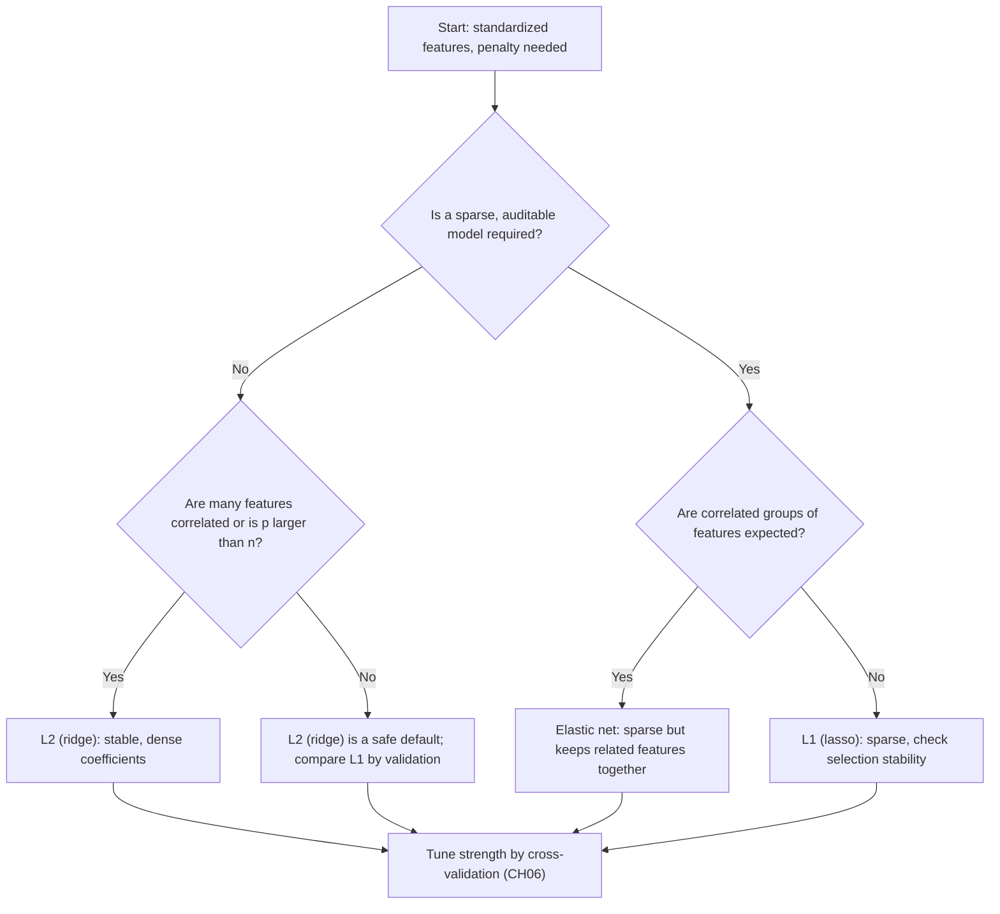

The flowchart puts the *requirement* ahead of the algorithm. If nothing demands a short feature list, ridge is usually the lower-risk choice because it never discards information and its predictions are the most stable under collinearity. If a sparse model is a product requirement, such as a smaller serving payload, fewer upstream data dependencies, or a reviewable scorecard, then the lasso or elastic net is chosen for that reason, and the stability check of Section 5.6 becomes mandatory rather than optional. The elastic net's second hyperparameter doubles the tuning grid, which is a cost the lasso and ridge do not carry. The flowchart does not replace validation; it only orders the candidates worth validating.

### 5.3 The Bayesian view

A penalty can be read as a prior belief about the coefficients. Take the Gaussian noise model of Section 3.1, $y_i \mid x_i, w \sim \mathcal{N}(x_i^\top w + b,\ \sigma^2)$, and place independent priors on the slopes. The **maximum a posteriori (MAP)** estimate maximizes the posterior $p(w\mid \text{data}) \propto p(\text{data}\mid w)\,p(w)$, which is the same as minimizing the negative log posterior:

$$
-\ln p(w\mid \text{data}) = \frac{1}{2\sigma^2}\lVert y - Xw\rVert^2 - \ln p(w) + \text{const}.
$$

**Gaussian prior gives ridge.** Let $w_j \sim \mathcal{N}(0, \tau^2)$ independently, so $-\ln p(w) = \frac{1}{2\tau^2}\lVert w\rVert_2^2 + \text{const}$. Multiplying the objective by $2\sigma^2$ gives

$$
\lVert y - Xw\rVert^2 + \frac{\sigma^2}{\tau^2}\lVert w\rVert_2^2, \qquad \lambda = \frac{\sigma^2}{\tau^2}.
$$

**Laplace prior gives lasso.** Let $w_j$ follow a Laplace distribution with density $\frac{1}{2s}e^{-\lvert w_j\rvert/s}$, so $-\ln p(w) = \frac{1}{s}\lVert w\rVert_1 + \text{const}$. The same multiplication gives

$$
\lVert y - Xw\rVert^2 + \frac{2\sigma^2}{s}\lVert w\rVert_1, \qquad \lambda = \frac{2\sigma^2}{s}.
$$

The Laplace density has a sharp peak at zero and heavier tails than the Gaussian, which is the probabilistic counterpart of the diamond's corners: it concentrates prior mass on "exactly irrelevant" while tolerating a few large coefficients. As a numeric reading, if the noise variance is $\sigma^2 = 1$ then the ridge strength $\lambda = 10$ used in Section 5.1 corresponds to a prior standard deviation $\tau = \sqrt{1/10} \approx 0.316$ on each slope: the model is told, before seeing data, that slopes are typically a third of a standardized unit or less.

For logistic regression there is no $\sigma^2$, and the same step applied to the negative log-likelihood (NLL) of Section 4.2 gives the penalty $\frac{1}{2\tau^2}\lVert w\rVert_2^2$. In scikit-learn's convention the objective is $\tfrac12\lVert w\rVert_2^2 + C\sum_i \ell_i$, so the inverse-strength parameter $C$ equals the prior variance $\tau^2$ when the likelihood is summed over rows.

Three implications follow. First, $\lambda$ is a statement about prior scale relative to noise, so stronger noise (larger $\sigma^2$) calls for stronger shrinkage, and the effect of a fixed prior fades as $n$ grows because the likelihood sums over rows while the prior does not. Second, the lasso solution is the posterior *mode*, not the posterior mean. Under a Laplace prior the posterior has no point mass at zero, so the posterior mean is not sparse; sparsity is a property of the point estimate. Third, the prior reading offers a way to set $\lambda$ from domain knowledge when data are scarce, though in most pipelines $\lambda$ is tuned empirically (Section 5.5).

### 5.4 Scaling interaction

OLS is invariant to the units of a feature: dividing a column by $c$ multiplies its coefficient by $c$ and leaves the predictions unchanged (Section 3.8). A penalty is not invariant, because it sums coefficient sizes without regard to what the features measure. A feature recorded in thousands of dollars has a small coefficient per unit and pays almost nothing; the same feature in dollars has a coefficient a thousand times smaller and pays even less; a ratio between 0 and 1 needs a large coefficient and pays a lot. The penalty therefore ranks features by their arbitrary units before it ever looks at their evidence. Three rules follow.

- **Standardize first.** Subtract the training mean and divide by the training standard deviation so every feature has unit scale, then penalize. The scaler is fit on training data only and stored with the model, as in the leakage rule of [CH02](CH02_Data_Preparation_Feature_Engineering_and_Leakage.md).
- **Never penalize the intercept.** The intercept absorbs the target's origin (regression) or the base rate (classification, Section 4.5). Shrinking it toward zero would make predictions depend on where the target is measured from. Centering (Section 5.1) achieves this for ridge; in scikit-learn the lbfgs solver for logistic regression and the `Ridge` and `Lasso` estimators leave it unpenalized, whereas the `liblinear` solver treats the intercept as one more penalized weight.
- **Convert back for reporting.** Coefficients per standard deviation are comparable across features; a per-unit coefficient is the standardized one divided by the feature's training standard deviation.

The example below is illustrative. Two features have different units: income in thousands of dollars (standard deviation about $20$) and a ratio (standard deviation about $0.1$). The target is built so that one standard deviation of the ratio matters $1.0$ and one standard deviation of income matters $0.3$, plus noise, and the lasso is fit with the same $\alpha = 0.5$ with and without scaling.

```python
import numpy as np
from sklearn.linear_model import Lasso
from sklearn.pipeline import make_pipeline
from sklearn.preprocessing import StandardScaler

rng = np.random.default_rng(5)
n = 500
income_k = rng.normal(60, 20, n)  # thousands of dollars, sd about 20
rate = rng.normal(0.5, 0.1, n)  # a ratio, sd about 0.1
X = np.column_stack([income_k, rate])
sd = X.std(axis=0)
y = 0.3 * (income_k - 60) / 20 + 1.0 * (rate - 0.5) / 0.1 + rng.normal(0, 1, n)  # effect per sd: 0.3 and 1.0

raw = Lasso(alpha=0.5).fit(X, y)
std = make_pipeline(StandardScaler(), Lasso(alpha=0.5)).fit(X, y)
print("feature sd:", np.round(sd, 3))
print("lasso raw units    coef per unit:", np.round(raw.coef_, 4), " per 1 sd:", np.round(raw.coef_ * sd, 3))
print("lasso standardized coef per 1 sd:", np.round(std[-1].coef_, 3))
print("true effect per 1 sd: [0.3 1. ]")
```

Output from running the code:

```text
feature sd: [19.178  0.103]
lasso raw units    coef per unit: [0.0141 0.    ]  per 1 sd: [0.271 0.   ]
lasso standardized coef per 1 sd: [0.    0.498]
true effect per 1 sd: [0.3 1. ]
```

The two fits select opposite features. In raw units the ratio's coefficient would have to be large to matter, the penalty is expensive for it, and the lasso sets it to zero while keeping income, the weaker feature. After standardizing, the stronger feature survives and income is dropped. Neither fit recovers the true effects exactly, because the penalty shrinks what it keeps (the surviving $0.498$ is about half of $1.0$ at this $\alpha$). The point is that the *selection* itself was decided by units in the first fit.

The refined pipeline below shows where each step sits and what must travel with the model.

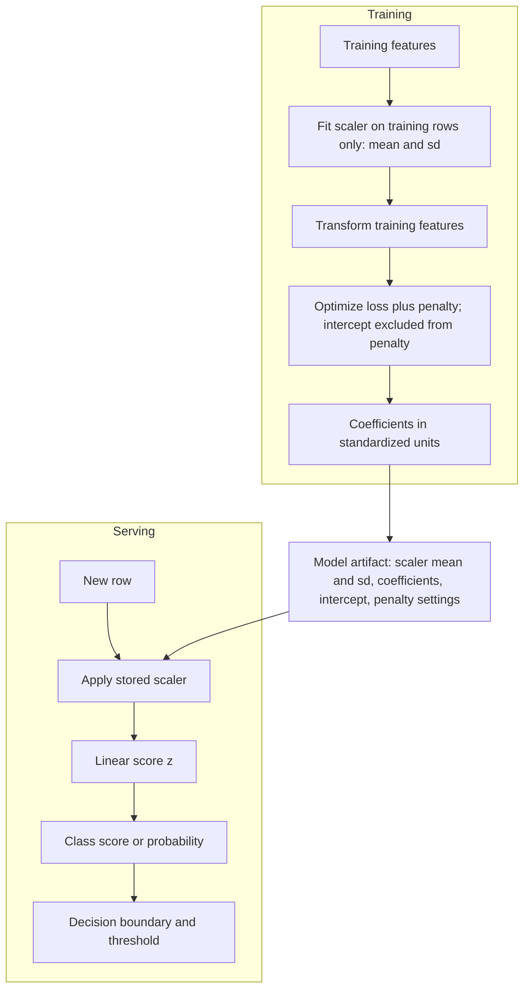

The diagram makes the scaler part of the model rather than a notebook step. A serving path that recomputes means and standard deviations from the incoming batch, or applies a scaler that was refit on a later training window with a different coefficient set, silently changes both the scores and the effective penalty relationship the coefficients were fit under. The practical controls are to version the scaler together with the coefficients and to test that a stored artifact reproduces its training-time predictions on a fixed reference batch. Standardizing also changes how penalized coefficients are interpreted in reports, so state which units a coefficient table uses.

### 5.5 Choosing the strength and regularization paths

The strength $\lambda$ (called `alpha` in scikit-learn's regression estimators and inverted into `C` for logistic regression) is a hyperparameter: it cannot be fit by minimizing the penalized training loss, because that always prefers $\lambda = 0$. It is chosen by held-out performance. The methodology, including cross-validation, nested validation, and why the test set must stay untouched, belongs to [CH06 Model Evaluation, Validation, and Selection](CH06_Model_Evaluation_Validation_and_Selection.md) and is not repeated here. What is specific to regularization is the shape of the search.

- **Search on a logarithmic grid.** The effect of $\lambda$ is multiplicative, so candidate values should be spaced by factors (for example $10^{-4}$ to $10^{2}$), not by equal steps.
- **Know the grid's ends.** For the lasso there is a smallest value that zeroes every coefficient: $\lambda_{\max} = \max_j \lvert x_j^\top y_c\rvert / n$ for standardized features and a centered target, in scikit-learn's scaling. Grids start there and descend. For ridge there is no such ceiling, so confirm the best value is not at either edge of the grid.
- **Put the scaler inside the validation loop.** The scaler and the penalty are both fit on the training portion of each fold, or the scaler leaks information from the validation rows.
- **Refit and record.** After choosing $\lambda$, refit on the whole training set and store $\lambda$ with the model; revisit it when the training window or the feature set changes, since the right strength depends on $n$ and on the noise level (Section 5.3).

A **regularization path** is the full set of solutions as $\lambda$ varies, and for the lasso it can be computed efficiently by warm-starting each fit from the previous one. Reading a path is informative even when a library picks $\lambda$ for you. The code below is illustrative: six standardized features, of which the target depends on the first three (effects $3.0$, $1.5$, $0.5$) and the last three are noise.

```python
import numpy as np
from sklearn.linear_model import lasso_path
from sklearn.preprocessing import StandardScaler

rng = np.random.default_rng(8)
n, names = 200, ["f0", "f1", "f2", "f3", "f4", "f5"]
X = StandardScaler().fit_transform(rng.normal(size=(n, 6)))
y = 3.0 * X[:, 0] + 1.5 * X[:, 1] + 0.5 * X[:, 2] + rng.normal(0, 2, n)  # f3-f5 are noise
yc = y - y.mean()

alphas, coefs, _ = lasso_path(X, yc, alphas=[1.5, 1.0, 0.5, 0.2, 0.05])
print("alpha_max =", round(np.abs(X.T @ yc).max() / n, 4))
print("alpha  " + "  ".join(f"{k:>6}" for k in names))
for a, c in zip(alphas, coefs.T):
    print(f"{a:5.2f}  " + "  ".join(f"{v:6.3f}" for v in c))
```

Output from running the code (a `-0.000` is a signed zero):

```text
alpha_max = 3.2057
alpha      f0      f1      f2      f3      f4      f5
 1.50   1.706   0.000   0.000   0.000  -0.000  -0.000
 1.00   2.209   0.421   0.000   0.000  -0.000  -0.000
 0.50   2.717   0.929   0.090   0.000  -0.000  -0.000
 0.20   3.033   1.245   0.416   0.000  -0.076  -0.000
 0.05   3.191   1.398   0.586   0.043  -0.230  -0.040
```

Above $\alpha_{\max} = 3.21$ every coefficient is zero. As $\alpha$ falls, features enter in the order of their strength, f0 then f1 then f2, and the three noise features enter only at the small values, where they carry small nonzero coefficients. The path suggests how to read a chosen $\lambda$: a value near $0.5$ keeps the three informative features and excludes the noise here, while the smallest value starts fitting noise. Real data rarely separate this cleanly, and the path shows how much of a feature's apparent importance depends on $\lambda$. Two architectural points follow. A tuned $\lambda$ is a measured value on one dataset and must be re-estimated when the data change. And when several $\lambda$ values perform within noise of one another, choosing the more strongly regularized one gives a simpler model that is usually cheaper to explain and monitor.

### 5.6 Sparsity and feature-selection caveats

A lasso fit that zeroes most coefficients looks like an answer to "which features matter?". It is not, for two separate reasons.

**Instability under correlated features.** When two features carry nearly the same signal, the lasso needs only one of them, and which one it keeps can flip with small changes in the sample. The code below is illustrative. Two features are noisy copies of one underlying signal (correlation about $0.99$), a third is independent and weaker, and the target depends on the signal and on the third feature. It refits the lasso and the elastic net on $300$ bootstrap resamples and records how often each feature is selected.

```python
import numpy as np
from sklearn.linear_model import Lasso, ElasticNet
from sklearn.preprocessing import StandardScaler

rng = np.random.default_rng(21)
n = 150
base = rng.normal(size=n)
x1 = base + 0.1 * rng.normal(size=n)  # x1 and x2 are noisy copies of one underlying signal
x2 = base + 0.1 * rng.normal(size=n)
x3 = rng.normal(size=n)  # independent, weaker signal
X = StandardScaler().fit_transform(np.column_stack([x1, x2, x3]))
y = 2.0 * base + 0.5 * x3 + rng.normal(0, 1, n)
print("corr(x1, x2) =", round(np.corrcoef(X[:, 0], X[:, 1])[0, 1], 3))

B = 300
models = {"lasso": Lasso(alpha=0.2), "enet": ElasticNet(alpha=0.2, l1_ratio=0.5)}
for name, mdl in models.items():
    coefs = []
    for _ in range(B):
        i = rng.integers(0, n, n)  # bootstrap resample
        coefs.append(mdl.fit(X[i], y[i] - y[i].mean()).coef_)
    c = np.array(coefs)
    sel = (c != 0).mean(axis=0)
    only1 = np.mean((c[:, 0] != 0) & (c[:, 1] == 0))
    only2 = np.mean((c[:, 0] == 0) & (c[:, 1] != 0))
    both = np.mean((c[:, 0] != 0) & (c[:, 1] != 0))
    print(f"{name:5s} selection frequency [x1 x2 x3] = {np.round(sel, 2)}  only x1={only1:.2f} only x2={only2:.2f} both={both:.2f}")
    print(f"      coef x1: mean={c[:, 0].mean():.3f} sd={c[:, 0].std():.3f}   x2: mean={c[:, 1].mean():.3f} sd={c[:, 1].std():.3f}")
```

Output from running the code:

```text
corr(x1, x2) = 0.991
lasso selection frequency [x1 x2 x3] = [0.99 0.61 1.  ]  only x1=0.39 only x2=0.01 both=0.60
      coef x1: mean=1.479 sd=0.444   x2: mean=0.354 sd=0.436
enet  selection frequency [x1 x2 x3] = [1. 1. 1.]  only x1=0.00 only x2=0.00 both=1.00
      coef x1: mean=0.984 sd=0.064   x2: mean=0.859 sd=0.061
```

The lasso's choice between the two copies is unstable: $x_2$ is selected in only $61$ percent of resamples and the individual coefficients have standard deviations around $0.44$, as large as their means. The coefficients' *sum* is stable ($1.479 + 0.354 = 1.833$), because the data identify the shared signal but not the split. The elastic net retains both features in every resample and splits the weight, $0.984$ and $0.859$, with standard deviations near $0.06$, and the sum $1.843$ agrees. The bootstrap resamples a single dataset, so the lasso's preference for $x_1$ here reflects that dataset; a fresh sample could favor $x_2$. Instability across resamples is the warning, not the particular winner.

**Selection is not causal importance.** The target above depends on the underlying signal, and neither $x_1$ nor $x_2$ is that signal; both are proxies. A sparse model that keeps $x_1$ and drops $x_2$ has made a predictive economy, not a statement about mechanism. The same applies in the other direction: a feature set to zero may be an important driver whose information is already carried by a retained correlated feature, so a zero coefficient does not show irrelevance. Three practices follow.

1. Treat the set of selected features as a property of the sample and the penalty. Check how stable it is across bootstrap or cross-validation resamples before committing to a feature list, and report selection frequencies rather than a single list.
2. When features come in correlated groups, either use the elastic net, merge or choose group representatives on domain grounds before fitting, or report the group's combined effect rather than per-feature coefficients.
3. Do not use coefficients of a penalized model as causal effects or as a feature-importance ranking for decisions about interventions. Penalization biases the retained coefficients toward zero (the surviving $0.498$ in Section 5.4), and predictive association does not identify what would change if the feature were changed. Causal claims need designed comparisons, as in [Experimentation](../02_Design_Thinking_and_Product_Management/CH26_Experimentation.md).

Sparsity still has real engineering value: fewer inputs mean fewer upstream dependencies to maintain and monitor, and a smaller serving payload. Choose it for those reasons and verify its stability, and keep claims about *why* the model predicts what it does separate from the fact that it predicts.


## 6. Multiclass Classification

Sections 4 and 5 treated a two-outcome label. When one of $K > 2$ mutually exclusive classes must be chosen, the logistic model generalizes in a way that keeps its best property: the gradient of the loss with respect to each score is still "prediction minus target". This section derives that result, works one three-class example by hand, compares the three standard ways to build a multiclass model from binary pieces, and separates multi-class from multi-label problems.

### 6.1 Softmax and its cross-entropy gradient

Give each class $k$ a linear score $z_k = w_k^\top x + b_k$. The **softmax** converts the score vector into a probability vector:

$$
p_k = \frac{e^{z_k}}{\sum_{j=1}^{K} e^{z_j}}, \qquad p_k > 0, \qquad \sum_k p_k = 1.
$$

Two properties matter. First, softmax is unchanged when a constant $c$ is added to every score, because $e^{c}$ cancels from numerator and denominator. Only score *differences* carry information, so a softmax model has $K-1$ identifiable score functions, and an unpenalized fit is not unique (adding the same vector to every $w_k$ leaves all probabilities unchanged). An $\ell_2$ penalty from Section 5 removes the ambiguity by choosing the smallest-norm representative. Implementations also exploit the invariance: subtracting $\max_j z_j$ before exponentiating prevents overflow without changing the result. Second, for $K=2$ softmax collapses to the logistic function of Section 4.1: $p_1 = e^{z_1}/(e^{z_0}+e^{z_1}) = \sigma(z_1 - z_0)$.

For one example with one-hot target $y$ (so $y_k = 1$ for the true class $c$ and $0$ otherwise), the negative log-likelihood is the **cross-entropy**

$$
\mathcal{L} = -\sum_{k} y_k \ln p_k = -\ln p_c = -z_c + \ln\sum_{j} e^{z_j}.
$$

Differentiate with respect to a score $z_k$. The first term contributes $-\mathbb{1}[k=c]$, which equals $-y_k$. The derivative of the log-sum-exp term is $e^{z_k}/\sum_j e^{z_j} = p_k$. Therefore

$$
\frac{\partial \mathcal{L}}{\partial z_k} = p_k - y_k, \qquad \frac{\partial \mathcal{L}}{\partial w_k} = (p_k - y_k)\,x.
$$

This is the same form as the binary gradient $y_i - p_i$ of Section 4.2, up to sign convention, and it is the signature of a canonical link in the GLM view of Section 4.6. The Hessian of $\mathcal{L}$ with respect to the scores is $\operatorname{diag}(p) - pp^\top$, which is positive semi-definite, so the multiclass loss is convex in the weights just as the binary loss is. Two consequences follow. The gradient components sum to zero across classes, since $\sum_k p_k = \sum_k y_k = 1$, so what the update does is move probability mass between classes rather than create it. And a confidently wrong prediction produces a gradient of magnitude near one on both the favored wrong class and the true class, so the loss does not saturate the way squared error on probabilities would.

### 6.2 A worked three-class example

Take scores $z = (2,\ 1,\ -1)$ and true class 2 (so $y = (0, 1, 0)$). The softmax computation is:

| Class | Score $z_k$ | $e^{z_k}$ | $p_k$ | $y_k$ | $p_k - y_k$ |
|---:|---:|---:|---:|---:|---:|
| 1 | 2 | 7.3891 | 0.7054 | 0 | +0.7054 |
| 2 | 1 | 2.7183 | 0.2595 | 1 | −0.7405 |
| 3 | −1 | 0.3679 | 0.0351 | 0 | +0.0351 |
| Sum | | 10.4752 | 1.0000 | 1 | 0.0000 |

The loss is $-\ln 0.2595 = 1.3490$. Subtracting the maximum score $2$ gives scores $(0, -1, -3)$ and the same probabilities, confirming shift invariance. A central finite-difference check of the loss with respect to each score returned $(0.7054, -0.7405, 0.0351)$, matching $p - y$.

Reading the gradient: the model favors class 1 and the label is class 2, so gradient descent will lower $z_1$ with weight $0.7054$, raise $z_2$ with weight $0.7405$, and barely touch $z_3$ because the model already regards it as unlikely ($0.0351$). The update is proportional to how wrong each class probability is, which is why softmax training self-focuses on the confusions that matter most.

### 6.3 One-vs-rest, one-vs-one, and multinomial

Three strategies produce a $K$-class predictor from linear scores.

- **One-vs-rest** (also called one-vs-all) trains $K$ binary classifiers, each separating class $k$ from all other classes, and predicts the class whose classifier gives the largest score. Every classifier sees all $n$ rows, so total training touches about $Kn$ rows. The $K$ outputs are fit independently, so they need not sum to one. If the three scores of Section 6.2 came from independent sigmoids, they would give $(0.8808, 0.7311, 0.2689)$, which sums to $1.8808$; renormalizing gives $(0.4683, 0.3887, 0.1430)$, which is a different, flatter distribution than the softmax $(0.7054, 0.2595, 0.0351)$. A "rest" class that merges heterogeneous classes is also often a harder, less coherent target, and with many classes each binary problem is heavily imbalanced.
- **One-vs-one** trains $K(K-1)/2$ classifiers, one per pair, each on only the rows of its two classes, and predicts by voting. With $K=10$ that is $45$ classifiers. If classes are balanced, each classifier sees about $2n/K$ rows and total training touches about $(K-1)n$ rows, so it is cheaper than one-vs-rest per classifier but has more models to store and serve. Votes are not probabilities, and a pair classifier is asked to vote on rows from classes it never saw. Ties are possible.
- **Multinomial** (softmax regression) fits all classes jointly in one convex objective, as in Section 6.1. Its probabilities are coupled and sum to one by construction, one training run replaces $K$ or $K(K-1)/2$, and the regularization of Section 5 applies to the joint weights.

| Aspect | One-vs-rest | One-vs-one | Multinomial |
|---|---|---|---|
| Models trained | $K$ | $K(K-1)/2$ | 1 |
| Rows per model | $n$ | about $2n/K$ | $n$ |
| Output | $K$ independent scores | Pairwise votes | Coupled probabilities summing to 1 |
| Probability quality | Needs renormalization and calibration | Needs coupling and calibration | Direct, then calibrate (Section 8) |
| Main risk | Imbalanced, incoherent "rest" | Many models; votes on unseen classes | Needs a differentiable joint model |

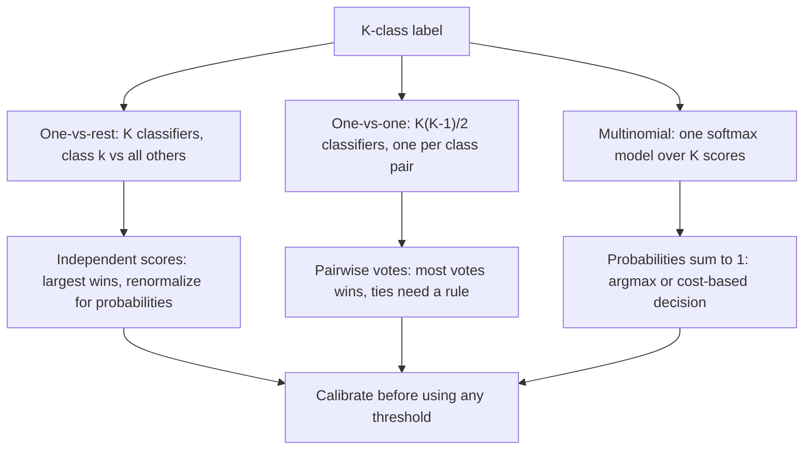

The diagram shows that the strategies differ in what they hand to the decision layer. Only the multinomial branch emits a coherent probability vector directly. The other two emit scores or votes that must be converted and then calibrated before a cost-based threshold (Section 7) means anything. Choose multinomial when the base model supports it and the classes are mutually exclusive. Choose one-vs-rest when the base learner is inherently binary and $K$ is modest. Choose one-vs-one when the base learner scales badly in $n$ (so many small problems are cheaper than a few large ones), and treat its scores as votes, not probabilities.

### 6.4 Multi-label versus multi-class, and class priors

**Multi-class** means exactly one label per row, so softmax is correct: probability mass must be shared. **Multi-label** means each row may carry any subset of $K$ labels (for example, tags on a support ticket). The right model is $K$ independent sigmoids trained with a summed binary cross-entropy, one decision threshold per label, and per-label evaluation. Applying softmax to a multi-label problem forces labels to compete for mass, so a ticket that is truly about both billing and login cannot score high on both. Applying independent sigmoids to a single-label problem permits the nonsensical output "none" or "all of them" unless the decision rule forbids it. The label definition, not the model family, decides which is correct.

**Class priors** affect multiclass models the same way they affect binary ones in Section 4.5. The class prior enters each score as an additive $\ln \pi_k$. If a model is trained at priors $\pi^{\text{tr}}$ and deployed where the classes are $\pi^{\text{dep}}$ with unchanged $p(x \mid y)$, the corrected probabilities are

$$
p_k^{\text{dep}}(x) = \frac{p_k(x)\,\pi_k^{\text{dep}}/\pi_k^{\text{tr}}}{\sum_j p_j(x)\,\pi_j^{\text{dep}}/\pi_j^{\text{tr}}}.
$$

**Worked example (illustrative).** Reuse $p = (0.7054, 0.2595, 0.0351)$, now assuming the model was trained with equal priors $(1/3, 1/3, 1/3)$ and deployed where the class frequencies are $(0.2, 0.7, 0.1)$. The unnormalized products $p_k\,\pi_k^{\text{dep}}$ are $(0.14108, 0.18165, 0.00351)$ with sum $0.32624$, so the corrected probabilities are $(0.4324, 0.5568, 0.0108)$. The arg max moves from class 1 to class 2, so the *decision* changes with no change to the model. The implication is that a class mix recorded at training time must travel with the model, and that deployed class frequencies, not training ones, define the probabilities used downstream.

## 7. From Probabilities to Decisions

A probability estimate is not a decision. A decision needs a rule that turns $p$ into an action, and the rule should reflect the relative cost of the two error types, the cost of acting at all, review capacity, and what the action does to later outcomes. This section covers the confusion matrix and the quantities it implies, the cost-based threshold and its extensions, the case where capacity rather than cost fixes the operating point, and decision rules with more than two outcomes. Throughout, the running example is an illustrative fraud screen: $100{,}000$ transactions a day, of which $1{,}470$ are fraudulent, scored by a calibrated model. All figures are invented for arithmetic and are not measurements of any real system.

### 7.1 The confusion matrix and the metrics it implies

Fix a threshold $t$ and flag a row when $p \ge t$. Comparing flags with outcomes gives four counts: true positives (TP, flagged and positive), false positives (FP, flagged and negative), false negatives (FN, not flagged but positive), and true negatives (TN, not flagged and negative). They sum to $n$. Four rates are defined from them:

$$
\text{precision} = \frac{TP}{TP+FP}, \quad
\text{recall} = \frac{TP}{TP+FN}, \quad
\text{specificity} = \frac{TN}{TN+FP}, \quad
F_{\beta} = \frac{(1+\beta^{2})\,\text{precision}\cdot\text{recall}}{\beta^{2}\,\text{precision}+\text{recall}}.
$$

Recall is also called sensitivity or the true positive rate; $1 - \text{specificity}$ is the false positive rate. $F_1$ (where $\beta = 1$) is the harmonic mean of precision and recall, and $F_\beta$ weights recall $\beta$ times as heavily as precision. None of these rates uses the cost of an error, and $F_\beta$ ignores TN entirely.

For the running example at $t = 0.1$ (counts derived in Section 7.2), $TP = 900$, $FP = 1{,}600$, $FN = 570$, and $TN = 96{,}930$. Then precision is $900/2{,}500 = 0.36$, recall is $900/1{,}470 = 0.6122$, specificity is $96{,}930/98{,}530 = 0.9838$, and $F_1 = 0.4534$ (and $F_2 = 0.5370$, which rewards the recall-heavy operating point).

How these move with the threshold is the content of the next sections. Because the set flagged at a higher threshold is a subset of the set flagged at a lower one, raising $t$ can only remove TP and FP. So recall never rises and specificity never falls as $t$ increases. Precision has no such guarantee for an arbitrary score, but for a calibrated model precision at $t$ is the mean of $p$ over the flagged rows, so it is at least $t$ and tends to rise. Precision also depends on prevalence $\pi$ through

$$
\text{precision} = \frac{\text{TPR}\cdot \pi}{\text{TPR}\cdot \pi + \text{FPR}\,(1-\pi)},
$$

whereas recall and specificity do not. Holding the example's $\text{TPR} = 0.6122$ and $\text{FPR} = 0.0162$ fixed, precision is $0.36$ at $\pi = 1.47\%$ and $0.8666$ at ten times that prevalence, so "precision of a model" is meaningless without the population. This is the same prior-shift mechanism as Section 4.5, and it is why metric comparisons across populations need care. Which of these metrics to optimize, how to estimate them with uncertainty, and how to select between models are owned by [CH06](CH06_Model_Evaluation_Validation_and_Selection.md).

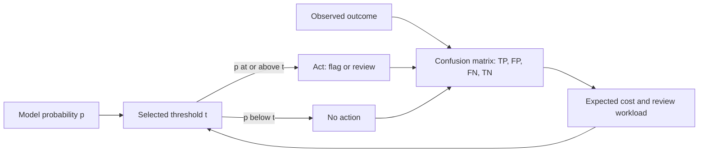

The diagram's feedback edge is the discipline: the threshold is a parameter of the decision policy, set from observed cost and workload, not a constant inherited from the default of $0.5$. Changing $t$ moves the counts in the confusion matrix, and the counts feed the cost figure that justifies the next change.

### 7.2 Cost-based thresholds

[CH01 Section 7.4](CH01_Machine_Learning_Foundations.md) derived the rule. For a calibrated probability $p$, flagging a row has expected error cost $(1-p)\,C_{FP}$ and not flagging has expected error cost $p\,C_{FN}$, so flag when $p > t^{*} = C_{FP}/(C_{FP}+C_{FN})$. With $C_{FP}=1$ and $C_{FN}=9$ this gives $t^{*}=0.1$. The rule assumes calibrated probabilities (Section 8) and constant error costs.

The two-cost form hides two things that real policies must state. **The action itself costs something**, whatever the outcome (a reviewer's time, a customer's friction). **A caught positive has a benefit**, and that benefit is not the same number as the cost of missing one. Let $c$ be the cost of acting on one row, and $L$ the loss avoided when a true positive is acted on (the same loss is incurred when it is missed). Relative to doing nothing, flagging a true positive is worth $L - c$, flagging a negative costs $c$, and not flagging is worth $0$. The expected value of flagging a row with probability $p$ is

$$
p\,(L - c) - (1-p)\,c = pL - c,
$$

so flag when $p > c/L$. This is the CH01 rule with $C_{FP} = c$ and $C_{FN} = L - c$, because the regret of failing to flag a positive is $L - c$, not $L$. If the action recovers only a fraction $\rho$ of the loss, the threshold is $c/(\rho L)$. If $L$ varies by row (a transaction amount), the threshold varies too, $t(x) = c/L(x)$, and the policy should rank by expected value $pL(x) - c$, not by $p$ alone.

**Worked example (illustrative).** Take $L = \$200$ per fraud and $c = \$5$ per review, so $t^{*} = 5/200 = 0.025$. Assume the model is calibrated, so the observed fraud rate in each score bin matches the bin's scores. The bins and the expected value of flagging one row in each ($= \text{rate} \times 200 - 5$) are:

| Score bin | Transactions | Frauds | Fraud rate | Value per flag |
|---|---:|---:|---:|---:|
| $\ge 0.5$ | 500 | 400 | 0.800 | +\$155.00 |
| 0.3 to 0.5 | 500 | 200 | 0.400 | +\$75.00 |
| 0.1 to 0.3 | 1,500 | 300 | 0.200 | +\$35.00 |
| 0.05 to 0.1 | 2,000 | 150 | 0.075 | +\$10.00 |
| 0.025 to 0.05 | 3,000 | 105 | 0.035 | +\$2.00 |
| 0.01 to 0.025 | 10,000 | 150 | 0.015 | −\$2.00 |
| below 0.01 | 82,500 | 165 | 0.002 | −\$4.60 |

Flagging every row at or above a threshold gives the following daily net value, computed as $200 \times TP - 5 \times \text{flagged}$ and measured against flagging nothing:

| Threshold $t$ | Flagged | TP | FP | Precision | Recall | Net value per day |
|---:|---:|---:|---:|---:|---:|---:|
| 0.5 | 500 | 400 | 100 | 0.800 | 0.272 | \$77,500 |
| 0.3 | 1,000 | 600 | 400 | 0.600 | 0.408 | \$115,000 |
| 0.1 | 2,500 | 900 | 1,600 | 0.360 | 0.612 | \$167,500 |
| 0.05 | 4,500 | 1,050 | 3,450 | 0.233 | 0.714 | \$187,500 |
| 0.025 | 7,500 | 1,155 | 6,345 | 0.154 | 0.786 | \$193,500 |
| 0.01 | 17,500 | 1,305 | 16,195 | 0.075 | 0.888 | \$173,500 |
| flag all | 100,000 | 1,470 | 98,530 | 0.015 | 1.000 | −\$206,000 |

Check one row: at $t = 0.1$, $200 \times 900 - 5 \times 2{,}500 = 180{,}000 - 12{,}500 = 167{,}500$. The maximum is at $t = 0.025 = c/L$, as the theory says: each added bin down to $0.025$ has positive value per flag and each bin below it has negative value. Three observations follow. First, the optimum flags $7{,}500$ rows at a precision of only $0.154$; when acting is cheap relative to the loss avoided, a low-precision operating point is the correct one. Second, the curve is flat near the top (moving from $0.05$ to $0.025$ adds $3.2\%$) but steep far away: the "accurate-looking" threshold $0.5$ earns $77{,}500$, about $60\%$ below the optimum. Third, the optimum is sensitive to the cost ratio. If the review cost doubles to $c = \$10$, then $t^{*} = 0.05$, and recomputing the nets gives $\$165{,}000$ at $t = 0.05$ versus $\$156{,}000$ at $0.025$ and $\$155{,}000$ at $0.1$, so the maximum moves to $0.05$. All of this holds only while the probabilities are calibrated, costs are stable, and flagging does not change the behavior of the population being scored.

### 7.3 Capacity-constrained thresholds

Review capacity often binds before the cost-optimal threshold does. Suppose the team can review $M = 2{,}500$ transactions a day, but the cost-optimal threshold $t^{*} = 0.025$ flags $N = 7{,}500$. The cost-optimal policy is infeasible, and the effective operating point is whatever threshold flags $M$ rows. When every row has the same loss $L$, maximizing $\sum_i (p_i L - c)\,f_i$ subject to $\sum_i f_i \le M$ over flags $f_i \in \{0,1\}$ is solved by flagging the $M$ highest-scoring rows, so the capacity-constrained rule is "top $M$ by score", equivalent to a threshold equal to the $M$th-highest score. Here that threshold is $0.1$. If $L$ varies by row, rank by $p_i L_i$ instead. In general the operating threshold is the larger of $t^{*}$ and the $M$th-highest score.

| Quantity | Cost-optimal ($t = 0.025$) | Capacity-constrained ($t = 0.1$) |
|---|---:|---:|
| Rows flagged | 7,500 | 2,500 |
| Frauds caught (TP) | 1,155 | 900 |
| Frauds missed (FN) | 315 | 570 |
| Precision | 0.154 | 0.360 |
| Recall | 0.786 | 0.612 |
| Net value per day | \$193,500 | \$167,500 |
| Loss from missed frauds | \$63,000 | \$114,000 |

The capacity constraint costs $\$26{,}000$ a day ($13.4\%$ of the optimum). The residual risk is $570 - 315 = 255$ additional missed frauds and $\$51{,}000$ more unrecovered loss, concentrated in the $5{,}000$ rows with scores between $0.025$ and $0.1$, whose fraud rate is $255/5{,}000 = 0.051$. The $5{,}000$ forgone reviews are worth $2{,}000 \times \$10 + 3{,}000 \times \$2 = \$26{,}000$, which is also a price: it tells the owner what additional review capacity is worth per day before its own cost. State both operating points side by side, so the gap is a visible, owned decision rather than an implicit default, and manage the unreviewed band through other controls (automated secondary checks, post-hoc sampling, insurance, or accepted loss) rather than assuming it away.

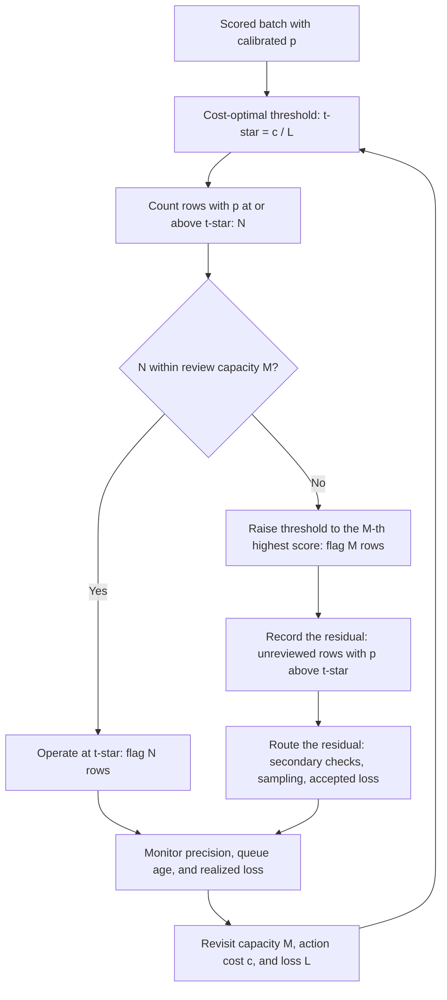

The diagram makes the constraint a branch in the policy, not an afterthought, and its feedback edge closes the loop with the price of capacity. A fixed *threshold* and a fixed *quota* behave differently when conditions change. Under prior shift (Section 4.5), a fixed threshold sends a larger or smaller queue to reviewers with the same per-row standards, so workload becomes the variable. A fixed quota keeps the workload constant but lets the threshold drift, so the same score may be reviewed on one day and ignored on another. A quota in a streaming system also needs an estimate of the daily score distribution to set the cutoff in advance. Many teams combine them: a floor at $t^{*}$ so no flagged row is below the cost-optimal bar, and a cap at $M$ with an alert when the cap binds for several consecutive days.

### 7.4 Review bands, abstention, and segment thresholds

A single threshold forces every row into one of two actions, but a third action is often available: send the row to a slower, more accurate process (a human reviewer, a secondary model, a step-up check) or **abstain** from deciding automatically. Adding that action turns one threshold into two. Let the three actions be approve, review, and decline, and let the review cost $c$ be paid regardless of outcome, with the reviewer assumed to decide correctly (an idealization). For a calibrated probability $p$ of the positive class (fraud), the expected costs are

$$
\mathbb{E}[\text{cost}_{\text{approve}}] = pL, \qquad
\mathbb{E}[\text{cost}_{\text{review}}] = c, \qquad
\mathbb{E}[\text{cost}_{\text{decline}}] = (1-p)\,d,
$$

where $L$ is the loss from approving a fraud and $d$ is the cost of wrongly declining a legitimate transaction. Review beats approving when $c < pL$, and review beats declining when $c < (1-p)d$, so the policy is

$$
p < t_{\text{lo}} = \frac{c}{L} \Rightarrow \text{approve}, \qquad
t_{\text{lo}} \le p \le t_{\text{hi}} = 1 - \frac{c}{d} \Rightarrow \text{review}, \qquad
p > t_{\text{hi}} \Rightarrow \text{decline}.
$$

The review band $[t_{\text{lo}}, t_{\text{hi}}]$ exists only when $t_{\text{lo}} < t_{\text{hi}}$, that is, when $c\,(1/L + 1/d) < 1$. If reviewing costs more than the cheaper wrong decision would on average, the band is empty and the problem collapses to the single threshold of Section 7.2. The lower edge is the same $c/L$ as before; the new element is the upper edge, which removes the rows so clearly positive that reviewing them wastes the reviewer's time.

**Worked example (illustrative).** Reuse the bins of Section 7.2 with $L = \$200$ and $c = \$5$, and let a wrongful decline cost $d = \$10$ (lost sale and customer friction). Then $t_{\text{lo}} = 5/200 = 0.025$ and $t_{\text{hi}} = 1 - 5/10 = 0.5$. The bin counts partition as follows.

| Action | Score range | Transactions | Frauds | Legitimate | Cost |
|---|---|---:|---:|---:|---:|
| Decline | $p > 0.5$ | 500 | 400 | 100 | $100 \times \$10 = \$1{,}000$ |
| Review | $0.025 \le p \le 0.5$ | 7,000 | 755 | 6,245 | $7{,}000 \times \$5 = \$35{,}000$ |
| Approve | $p < 0.025$ | 92,500 | 315 | 92,185 | $315 \times \$200 = \$63{,}000$ |
| Total | | 100,000 | 1,470 | 98,530 | \$99,000 |

The review band holds $500 + 1{,}500 + 2{,}000 + 3{,}000 = 7{,}000$ rows and $200 + 300 + 150 + 105 = 755$ frauds. The two-way policy of Section 7.2 at $t = 0.025$ reviews $7{,}500$ rows and approves the same $315$ frauds, so its cost under this accounting is $7{,}500 \times \$5 + 315 \times \$200 = \$100{,}500$ (equivalent to the net value of $\$193{,}500$ against a do-nothing loss of $1{,}470 \times \$200 = \$294{,}000$). The three-way policy costs $\$99{,}000$, a saving of $\$1{,}500$ a day, which is exactly the $500$ top-bin rows costing $\$2{,}500$ to review and only $\$1{,}000$ to decline. The gain is small in this example because the upper bin is small; the review queue shrinks by $6.7\%$, and the benefit grows when the model is confident about many rows and reviewer time is scarce.

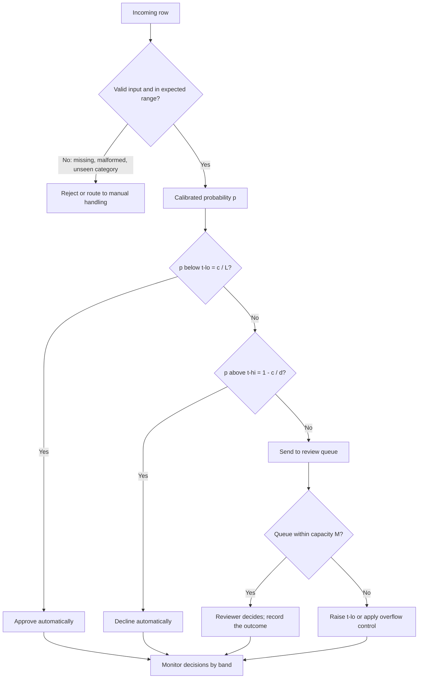

The diagram makes the abstain action a first-class branch, with its own capacity check and an explicit route for inputs the model should not score at all (missing fields, unseen categories, or rows far outside the training distribution). Reviewed outcomes are the only labels the band produces unbiased by the automatic policy, so recording them has value beyond the decision itself: they are the cheapest source of fresh labels for recalibration (Section 8) and for checking whether $t_{\text{lo}}$ and $t_{\text{hi}}$ still sit where costs say they should. Auto-approved and auto-declined rows yield labels only through later outcomes, which may be censored (a declined transaction never reveals whether it was fraud), so the approve and decline bands need periodic sampled review to avoid a feedback loop in which the policy never sees its own mistakes. When capacity $M$ binds, apply Section 7.3 to the band: the effective lower edge rises to the $M$th-highest score in the band region, and the overflow rows go to approve or to a cheaper secondary check.

**Multiclass abstention.** The same logic extends to $K$ classes. Choosing the class with the largest probability is optimal only when every wrong class costs the same and abstaining is not allowed. In general choose the action $a$ that minimizes $\sum_k C_{a,k}\,p_k$, where $C_{a,k}$ is the cost of action $a$ when the true class is $k$, and treat "review" as one more row of the cost matrix. Illustrative example with two classes, urgent and routine, and $p = (0.3, 0.7)$: labelling a message urgent when it is routine costs $1$, labelling it routine when it is urgent costs $10$, and review costs $0.5$. Expected costs are $0.7 \times 1 = 0.7$ for "urgent", $0.3 \times 10 = 3.0$ for "routine", and $0.5$ for review. The argmax rule would answer "routine", the cost-sensitive rule without review answers "urgent", and with review available the cheapest action is review. Ties, unknown classes, and out-of-distribution inputs need explicit rules in the policy, not implicit fallbacks. Whether the probabilities are trustworthy enough for any of this is the question of Section 8 and [CH06](CH06_Model_Evaluation_Validation_and_Selection.md).

**Segment-specific thresholds.** The cost formulas show that thresholds should differ across rows whenever $L$, $c$, or $d$ differ. If the loss scales with a transaction amount, $t(x) = c/L(x)$: with $c = \$5$ the threshold is $0.025$ at $L = \$200$, $0.1$ at $L = \$50$, and $0.005$ at $L = \$1{,}000$. A row with $p = 0.05$ has expected value $0.05 \times 200 - 5 = +\$5$ to flag in the first segment and $0.05 \times 50 - 5 = -\$2.50$ in the second. Segment thresholds are also used when a separate review team has its own capacity or when the model's calibration differs by segment. In the latter case the root cause is miscalibration, and the better repair is per-segment recalibration (Section 8) rather than per-segment threshold tuning that hides the error. Segment thresholds fit on a small segment inherit the estimation noise of that segment, so tie them to a cost figure and a sample-size check, as covered in [CH06](CH06_Model_Evaluation_Validation_and_Selection.md).

**Fairness caution.** Threshold differences justified by *action cost* (the value at risk, the review price) are a different kind of decision from threshold differences chosen to equalize error rates between demographic groups, or set by attributes that proxy for them. The second kind can change who bears errors, may be constrained or prohibited by law and policy depending on the domain, and requires an explicit owner, not a modeling default. Do not introduce group-specific thresholds for fairness reasons, and do not omit them where governance requires them, without that review. The definitions of group fairness criteria, their trade-offs, and the approval process live in [CH31](CH31_Responsible_AI_and_Safety_Governance.md); this chapter's contribution is only that the threshold is a policy parameter with consequences that must be audited by segment.

## 8. Calibration

Every threshold in Section 7 is derived by treating a score of $0.1$ as a $10\%$ chance of the positive class. That treatment is justified only if the scores are **calibrated**. This section defines the property, shows how to see it, explains which models tend to have it and which do not, describes the two standard repairs, and covers how calibration breaks when the base rate moves. The metrics and the statistical methodology for estimating calibration with uncertainty are owned by [CH06](CH06_Model_Evaluation_Validation_and_Selection.md); the focus here is the modelling consequences.

### 8.1 What calibrated means, reliability diagrams, and expected calibration error

A probabilistic classifier with output $\hat p(x)$ is **calibrated** when, among all rows that receive the score $q$, a fraction $q$ are positive:

$$
\mathbb{P}\bigl(y = 1 \mid \hat p(x) = q\bigr) = q \quad \text{for all } q \in [0,1].
$$

Two weaker properties are often checked first. *Calibration in the large* says the average predicted probability equals the observed positive rate. *Calibration slope* says that regressing the outcome on the logit of the score gives a slope near $1$; a slope below $1$ means the scores are too extreme and a slope above $1$ means they are not extreme enough. Full calibration implies both and is stronger than either.

A **reliability diagram** visualizes the property. Partition the scores into $B$ bins, and for each bin $b$ plot the mean predicted probability $\bar p_b$ against the observed positive fraction $\bar y_b$. A calibrated model lies on the diagonal. Points above the diagonal mean the model under-predicts in that bin (observed rate higher than score), points below mean it over-predicts. The **expected calibration error** (ECE) condenses the diagram into one number, the bin-size-weighted average gap:

$$
\text{ECE} = \sum_{b=1}^{B} \frac{n_b}{n}\,\bigl|\bar y_b - \bar p_b\bigr|,
$$

where $n_b$ is the number of rows in bin $b$ and $n = \sum_b n_b$. The sum has the units of probability, so an ECE of $0.03$ means that on average the score is off by three percentage points.

Three cautions apply. First, the value depends on the binning (the number of bins, equal-width versus equal-count) and is biased when bins hold few rows, so a small ECE on a small test set is weak evidence; choices of binning, smoothing, and confidence intervals are the subject of [CH06](CH06_Model_Evaluation_Validation_and_Selection.md). Second, the absolute value hides the direction of the error, which the diagram keeps. Third, calibration is not accuracy: a model that always outputs the base rate $\pi$ is perfectly calibrated and has no discriminating power. A calibrated model that ranks poorly and a sharp model that is miscalibrated are different failures, and scoring rules such as the Brier score and log loss reward both properties together, which is why Section 8.4 reports them alongside ECE.

The link to Section 7 is direct. Suppose a policy flags at $t = 0.1$ because $c/L = 0.1$. If the rows scored between $0.1$ and $0.2$ in fact turn out positive only $4\%$ of the time (a pattern seen in the reliability table of Section 8.4 for an uncalibrated forest), then flagging them costs more than it recovers, and the cost-optimal threshold on the raw scores is not $0.1$. Calibration is therefore a precondition of the cost rule, not a separate nicety.

### 8.2 Which models are calibrated, and why

Calibration is a by-product of the loss, the model class, the regularization, and the training length, not a guarantee of the algorithm. Logistic regression is the model most likely to be reasonably calibrated out of the box, for two reasons that follow from Section 4.2. First, the fitting equations $\sum_i (y_i - p_i) = 0$ and $\sum_i x_{ij}(y_i - p_i) = 0$ hold at the unpenalized optimum, so with an intercept the average predicted probability equals the observed rate on the training data and the residuals are orthogonal to every feature. Second, log loss is a proper scoring rule: its expected value is minimized by the true conditional probability, so if the model class contains the truth, minimizing it recovers calibrated probabilities. The caveat is the condition. If the true log-odds are not linear in the features, the fit is the best linear approximation and the tails can be miscalibrated even though the average is not. Logistic regression is "reasonably calibrated", not "calibrated".

| Model family | Typical tendency | Mechanism | Practical note |
|---|---|---|---|
| Unpenalized logistic regression | Close to calibrated in the large; tails depend on specification | Score equations and a proper loss | Check slope and tails, especially with interactions the model omits |
| Heavily L2- or L1-regularized logistic regression | Often under-confident (slope above 1) | The penalty shrinks coefficients (Section 5), pulling scores toward the intercept | Weaker regularization or recalibration |
| Bagged trees and random forests | Under-confident at the extremes: scores rarely near 0 or 1 | Averaging many trees' votes pulls predictions toward the middle | Reliability curves tend to be S-shaped |
| Boosted trees | Depends on loss, rounds, and shrinkage; can be over-confident when run long on log loss | Each round pushes scores further from the prior | Early stopping on a held-out loss limits it |
| Neural networks | Often over-confident when trained long on log loss | Capacity lets the model fit labels, driving scores toward 0 and 1 | Weight decay, early stopping, and recalibration all change the picture |
| Margin scorers (support-vector machines) | Not probabilities at all | Scores are distances from a boundary | Always map through a calibrator |

These tendencies are empirical regularities reported in the literature (for example Niculescu-Mizil and Caruana, 2005, for tree ensembles and Guo and colleagues, 2017, for deep networks), and they depend on data, tuning, and training procedure, so they are hypotheses to test, not facts to assume. The experiment of Section 8.4 shows both directions on one synthetic problem: the random forest is the sharper and better-scoring model yet has the larger calibration error, and the logistic model is closer to calibrated but scores worse on Brier score and log loss. A model with a high ranking quality can still fail the cost rule of Section 7.2, which is why ranking quality and calibration are checked separately in [CH06](CH06_Model_Evaluation_Validation_and_Selection.md).

### 8.3 Repair methods: Platt scaling and isotonic regression

Both repairs learn a monotone map $g$ from the model's raw score $s(x)$ (a margin, a logit, or a probability) to a corrected probability $g(s)$. Because $g$ is monotone, the ranking of rows is preserved, and a strictly increasing $g$ leaves ranking metrics unchanged.

**Platt scaling** (Platt, 1999) fits a sigmoid with two parameters on the calibration data:

$$
g(s) = \sigma(a\,s + b) = \frac{1}{1 + e^{-(a s + b)}},
$$

by minimizing log loss over $(a, b)$. The slope $a$ stretches or shrinks the score (an $a < 1$ corrects over-confidence, an $a > 1$ under-confidence) and $b$ shifts it. For an illustrative fitted pair $a = 0.8$, $b = -0.2$, a raw logit of $s = 2$ becomes $\sigma(0.8 \times 2 - 0.2) = \sigma(1.4) = 0.8022$. With two parameters the method has low variance and works with a few hundred calibration rows, but it can only repair distortions that are sigmoid-shaped in the score.

**Isotonic regression** fits a non-decreasing step function $g$ that minimizes $\sum_i (y_i - g(s_i))^2$, with no assumed shape. The standard algorithm, pool adjacent violators, scans the rows in score order and averages neighbouring outcomes whenever the fitted values would decrease. Tiny example: six calibration rows in increasing score order with outcomes $0,1,0,0,1,1$. The pair $(1,0)$ violates monotonicity and pools to $0.5, 0.5$; the next value $0$ now falls below $0.5$, so the three rows pool to $(1+0+0)/3 = 1/3$. The fitted values are $0,\ \tfrac13,\ \tfrac13,\ \tfrac13,\ 1,\ 1$. The flexibility is the strength and the risk. It can fix any monotone distortion, but with few rows it memorizes noise, it outputs plateaus (ties), and it can output exactly $0$ or $1$, which makes log loss unbounded if a later row of the opposite class lands there; implementations clip, and the clipping value then matters.

| Situation | Prefer |
|---|---|
| Few calibration rows (hundreds), or a sigmoid-shaped distortion | Platt scaling |
| Many calibration rows (thousands of positives and negatives), irregular distortion | Isotonic regression |
| Raw scores are margins, not probabilities | Platt scaling first |
| Need strictly preserved ranking without ties | Platt scaling |
| Multiclass neural network | One-parameter temperature scaling (divide logits by a fitted $T$) before richer maps |

The rules of thumb give a starting point; the choice is made by comparing log loss, Brier score, and ECE on data used for neither fitting stage, per [CH06](CH06_Model_Evaluation_Validation_and_Selection.md).

**Fit the calibrator on held-out data.** The calibrator must be fit on rows that the base model did not train on. A flexible model has partly memorized its training labels, so on training rows its scores are more extreme than they will be on new data. A calibrator fit there learns that the scores deserve trust and leaves them extreme, or learns a map that is wrong for unseen rows. The experiment in Section 8.4 shows the damage: an isotonic map fit on the training rows leaves test log loss at $2.5387$, against $0.2405$ when fit on held-out calibration rows. The data therefore needs three parts, one to fit the model, one to fit the calibrator, and one to evaluate the whole pipeline, or cross-fitting inside the training data so each row's score comes from a model that did not see it.

### 8.4 A calibration workflow and a runnable example

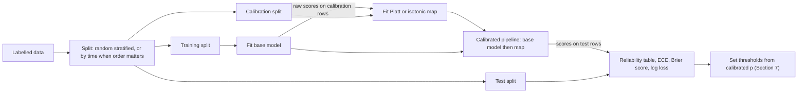

The three splits have different jobs: the training split fits the model, the calibration split fits only the two-parameter or monotone map, and the test split is touched once to judge the whole pipeline. If the data has a time order, split by time so the calibration and test rows come after the training rows, because calibration drifts with the population (data splitting and leakage are the subject of [CH02](CH02_Data_Preparation_Feature_Engineering_and_Leakage.md)). When data is scarce, the alternative is cross-fitting, which `CalibratedClassifierCV` does by default: each calibrator is fit on the fold its base model did not see. The example below uses the explicit three-way split and wraps the fitted forest in `FrozenEstimator` (scikit-learn 1.6 or later) so that the calibrator is the only thing fit on the calibration rows. In the installed version a frozen estimator gets one calibrator fit on all calibration rows. The data are synthetic and the numbers illustrative; the program was run once, and its output is reproduced below.

```python
import numpy as np
from sklearn.datasets import make_classification
from sklearn.model_selection import train_test_split
from sklearn.linear_model import LogisticRegression
from sklearn.ensemble import RandomForestClassifier
from sklearn.calibration import CalibratedClassifierCV
from sklearn.frozen import FrozenEstimator
from sklearn.metrics import brier_score_loss, log_loss

X, y = make_classification(n_samples=30000, n_features=20, n_informative=8,
                           n_redundant=4, flip_y=0.05, class_sep=0.8, random_state=0)
X_tr, X_tmp, y_tr, y_tmp = train_test_split(X, y, test_size=0.5, random_state=0, stratify=y)
X_cal, X_te, y_cal, y_te = train_test_split(X_tmp, y_tmp, test_size=0.6, random_state=1, stratify=y_tmp)
print("train/calibration/test:", len(y_tr), len(y_cal), len(y_te))

def bins(y_true, p, k=10):
    idx = np.minimum((p * k).astype(int), k - 1)
    return [(idx == b) for b in range(k)]

def ece(y_true, p, k=10):
    return sum(m.mean() * abs(y_true[m].mean() - p[m].mean()) for m in bins(y_true, p, k) if m.any())

def report(name, p):
    print(f"{name:28s} Brier={brier_score_loss(y_te, p):.4f} "
          f"LogLoss={log_loss(y_te, p):.4f} ECE={ece(y_te, p):.4f}")

lr = LogisticRegression(max_iter=1000).fit(X_tr, y_tr)
rf = RandomForestClassifier(n_estimators=200, random_state=0).fit(X_tr, y_tr)
p_rf = rf.predict_proba(X_te)[:, 1]

report("logistic (raw)", lr.predict_proba(X_te)[:, 1])
report("random forest (raw)", p_rf)
for method in ["sigmoid", "isotonic"]:
    cal = CalibratedClassifierCV(FrozenEstimator(rf), method=method).fit(X_cal, y_cal)
    report(f"forest + {method}", cal.predict_proba(X_te)[:, 1])
bad = CalibratedClassifierCV(FrozenEstimator(rf), method="isotonic").fit(X_tr, y_tr)
report("forest + isotonic (train)", bad.predict_proba(X_te)[:, 1])

print("\nreliability of the raw forest (test set)")
print("bin        n   mean_p  observed")
for b, m in enumerate(bins(y_te, p_rf)):
    if m.any():
        print(f"{b/10:.1f}-{(b+1)/10:.1f} {m.sum():5d}   {p_rf[m].mean():.3f}    {y_te[m].mean():.3f}")
```

Output:

```text
train/calibration/test: 15000 6000 9000
logistic (raw)               Brier=0.1294 LogLoss=0.4151 ECE=0.0276
random forest (raw)          Brier=0.0720 LogLoss=0.2683 ECE=0.0638
forest + sigmoid             Brier=0.0655 LogLoss=0.2381 ECE=0.0076
forest + isotonic            Brier=0.0660 LogLoss=0.2405 ECE=0.0131
forest + isotonic (train)    Brier=0.0780 LogLoss=2.5387 ECE=0.0753

reliability of the raw forest (test set)
bin        n   mean_p  observed
0.0-0.1  1971   0.050    0.027
0.1-0.2  1184   0.140    0.039
0.2-0.3   649   0.242    0.105
0.3-0.4   404   0.344    0.225
0.4-0.5   288   0.444    0.396
0.5-0.6   258   0.547    0.624
0.6-0.7   320   0.647    0.741
0.7-0.8   494   0.751    0.891
0.8-0.9  1031   0.855    0.945
0.9-1.0  2401   0.949    0.968
```

Reading the output. The raw forest scores better than logistic regression on Brier score ($0.0720$ against $0.1294$) and log loss ($0.2683$ against $0.4151$) but has the larger ECE ($0.0638$ against $0.0276$). The reliability table shows the pattern: below $0.5$ the forest's scores exceed the observed rate (mean score $0.140$ against an observed $0.039$ in the $0.1$ to $0.2$ bin) and above $0.5$ they fall short (mean score $0.751$ against $0.891$), the S-shape of an under-confident averaged ensemble. A sigmoid on the score can straighten exactly that shape, and the sigmoid map cuts ECE from $0.0638$ to $0.0076$ and improves both scoring rules (Brier $0.0720$ to $0.0655$, log loss $0.2683$ to $0.2381$). Isotonic regression gives a similar result ($0.0131$, $0.0660$, $0.2405$). With one split and $6{,}000$ calibration rows the difference between the two repairs is within what a different seed could change, and a defensible choice needs the uncertainty analysis of [CH06](CH06_Model_Evaluation_Validation_and_Selection.md); the lesson is that either repair removes most of the calibration error. The last line is the negative control. Isotonic regression fit on the training rows, where the forest has already memorized the labels, gives a test log loss of $2.5387$ and an ECE of $0.0753$, worse than doing nothing. Fitting the calibrator on rows the model has not seen is not a refinement but the point of the exercise.

### 8.5 Calibration under base-rate shift

A calibrator is fit to one population, and its map encodes that population's positive rate. Section 4.5 (Intercept and base-rate shift) showed that if the class-conditional distributions $p(x \mid y)$ stay fixed and only the prior changes, the posterior log-odds move by a constant, the log prior-odds ratio, and nothing else changes. The same holds for a calibrated probability: define $\operatorname{logit}(q) = \ln\frac{q}{1-q}$, and a calibrated score $q$ fitted at positive rate $\pi_{\text{cal}}$ becomes $\operatorname{logit}(q) + \operatorname{logit}(\pi_{\text{dep}}) - \operatorname{logit}(\pi_{\text{cal}})$ at deployment rate $\pi_{\text{dep}}$. This is a Platt map whose slope is fixed at $1$ and whose intercept is the only parameter, so it can be estimated from the new positive rate alone, without labels for individual rows.

**Worked example (illustrative).** A calibrator is fit on rows with $\pi_{\text{cal}} = 0.10$ and the model is deployed where $\pi_{\text{dep}} = 0.05$. The shift is $\operatorname{logit}(0.05) - \operatorname{logit}(0.10) = -2.9444 - (-2.1972) = -0.7472$. A row calibrated at $q = 0.20$ has $\operatorname{logit}(0.20) = -1.3863$, so its corrected logit is $-1.3863 - 0.7472 = -2.1335$ and its corrected probability is $1/(1 + e^{2.1335}) = 0.1059$. The odds check agrees: the odds $0.25$ times the prior-odds ratio $(0.05/0.95)/(0.10/0.90) = 0.4737$ give $0.1184$, and $0.1184/1.1184 = 0.1059$. A score that read $20\%$ is now about $10.6\%$, and any threshold derived under the old rate (Section 7.2) now sits at the wrong place on the probability scale.

Two limits matter. First, the correction is valid only for pure prior shift. If the feature distribution within a class changes (covariate shift) or the relationship between features and label changes (concept shift), the intercept shift is not enough, and the calibrator must be refit on recent labelled data. Second, labels often arrive late, so in the interval before they do the positive rate is estimated from proxies and the correction inherits that uncertainty. Monitor the reliability table by time window and segment, track the realized positive rate against $\pi_{\text{cal}}$, and re-estimate on a schedule tied to how fast the population moves; evaluation under change is treated in [CH06](CH06_Model_Evaluation_Validation_and_Selection.md).

## 9. Class Imbalance at the Model Level

When one class is rare, the default fit is dominated by the common class and the default threshold of $0.5$ almost never fires, so a model that ranks well can still produce no positive predictions. How to build, split, and sample imbalanced data without leakage is owned by [CH02](CH02_Data_Preparation_Feature_Engineering_and_Leakage.md); this section covers only what each remedy does to the fitted model and its probabilities, because the choice decides whether the output of Section 8 can still be read as a probability.

### 9.1 Three levers and their effect on calibration

There are three common remedies, and they act at different places in the pipeline.

| Lever | What changes | Effect on probabilities | How to recover calibrated $p$ |
|---|---|---|---|
| Move the threshold | Only the decision rule | None: the model is fit on the true distribution | Nothing to recover; use the cost threshold of Section 7.2 |
| Class weights | The loss: positives count $w$ times in $\sum_i w_i \ell_i$ | Scores shift by roughly $\ln w$ in log-odds | Odds correction (Section 9.2), or recalibrate on held-out data |
| Resampling (random over- or under-sampling) | The training distribution | Same as weights: undersampling negatives to a kept fraction $r$ shifts by $-\ln r$ | The same prior correction, or recalibrate on unmodified data |
| Synthetic oversampling (for example the synthetic minority oversampling technique, SMOTE) | The training distribution, with new minority points | Not a pure prior shift | Calibrate on held-out unmodified data |

Moving the threshold is the lever that leaves calibration intact, and for a well-specified logistic model it is nearly equivalent in effect to the others, as Section 9.2 shows: weighting changes the intercept and barely moves the slopes, so it reorders almost nothing. Weights and resampling earn their place when the *fit itself* is the problem, for example when a flexible model or a heavily regularized one (Section 5) otherwise spends its capacity on the majority class, or when training time on the full data is prohibitive. They change the objective the optimizer sees, at the price of distorting the probabilities, so any policy that uses probabilities afterwards must undo or re-fit the distortion. Random undersampling is the same idea as the training subsample of Section 4.5: keeping a fraction $r$ of negatives multiplies the training odds by $1/r$, so the correction subtracts $\ln(1/r)$ from the log-odds. Synthetic oversampling creates positives that did not occur, which changes the distribution of positives and not only the prior, so an odds factor does not restore calibration and a held-out recalibration on unmodified data is needed.

Two further rules follow. First, resample or weight only inside the training fold, never before the split, so evaluation data keeps the deployment prior (the leakage hazards are in [CH02](CH02_Data_Preparation_Feature_Engineering_and_Leakage.md)). Second, discrimination metrics such as the area under the ROC curve do not change under a pure prior shift (Section 4.5), but precision, expected cost, and the threshold do, so a threshold tuned on weighted scores must be restated in the deployment scale before use.

### 9.2 A worked example: weighted training and the odds correction

Weighting each positive by $w$ in the log loss is, for a model that fits the data, the same as training on a population in which every positive appears $w$ times. The class-conditional distributions are unchanged and the prior odds are multiplied by $w$, which is the prior shift of Section 4.5 with a log prior-odds ratio of $\ln w$. The weighted model's log-odds are therefore the true log-odds plus $\ln w$:

$$
z_{w}(x) = z(x) + \ln w, \qquad
\text{odds}(x) = \frac{\text{odds}_{w}(x)}{w}, \qquad
p(x) = \frac{p_{w}}{p_{w} + w\,(1 - p_{w})},
$$

where $p_w$ is the weighted model's probability and $p$ is the probability for the real population. The last expression follows from $p = \text{odds}/(1+\text{odds})$ with $\text{odds} = p_w / \bigl(w(1-p_w)\bigr)$. The correction depends only on $w$, not on the base rate.

**Hand arithmetic (illustrative, $w = 49$).** A weighted score $p_w = 0.6$ has odds $1.5$; dividing by $49$ gives odds $0.030612$, so $p = 0.030612/1.030612 = 0.0297$. The shortcut gives the same value: $0.6/(0.6 + 49 \times 0.4) = 0.6/20.2 = 0.0297$. A score of $p_w = 0.5$ maps to $0.5/(0.5 + 24.5) = 0.02$, so the weighted model's midpoint corresponds to a $2\%$ real chance, which is why a threshold of $0.5$ on weighted scores flags far too many rows relative to the real prior. The cost threshold of Section 7.2, $t^{*} = 0.025$ on the real scale, becomes $49 \times 0.025/(1 - 0.025 + 49 \times 0.025) = 1.225/2.2 = 0.5568$ on the weighted scale.

The program below checks this on synthetic data whose true log-odds are linear, so the model is well specified. It fits an unweighted and a weighted logistic regression (the penalty is made negligible with a large `C` so the comparison isolates the weights) and applies the correction. The data are synthetic and the output is from the single run reproduced here.

```python
import numpy as np
from sklearn.linear_model import LogisticRegression
from sklearn.metrics import log_loss

rng = np.random.default_rng(0)
n, w = 200000, 49.0
X = rng.normal(size=(n, 3))
z = -4.0 + X @ np.array([1.0, -0.8, 0.5])
y = (rng.random(n) < 1 / (1 + np.exp(-z))).astype(int)
half = n // 2
Xtr, ytr, Xte, yte = X[:half], y[:half], X[half:], y[half:]

plain = LogisticRegression(C=1e6, max_iter=2000).fit(Xtr, ytr)
wtd = LogisticRegression(C=1e6, max_iter=2000, class_weight={0: 1.0, 1: w}).fit(Xtr, ytr)
p_plain = plain.predict_proba(Xte)[:, 1]
p_w = wtd.predict_proba(Xte)[:, 1]
p_fix = p_w / (p_w + w * (1 - p_w))

print(f"test positive rate {yte.mean():.4f}")
for name, p in [("unweighted", p_plain), ("weighted raw", p_w), ("weighted corrected", p_fix)]:
    print(f"{name:19s} mean p={p.mean():.4f}  log loss={log_loss(yte, p):.4f}")
print(f"intercept shift {wtd.intercept_[0] - plain.intercept_[0]:.3f}  vs ln(49) = {np.log(w):.3f}")
print(f"slope shift     {np.abs(wtd.coef_ - plain.coef_).max():.3f}")
for pw in [0.1, 0.2, 0.5, 0.6, 0.9, 0.99]:
    print(f"p_w={pw:<5} -> p={pw / (pw + w * (1 - pw)):.4f}")
print(f"threshold 0.025 on corrected p = {w * 0.025 / (1 - 0.025 + w * 0.025):.4f} on weighted p")
```

Output:

```text
test positive rate 0.0396
unweighted          mean p=0.0384  log loss=0.1361
weighted raw        mean p=0.4811  log loss=0.7751
weighted corrected  mean p=0.0381  log loss=0.1361
intercept shift 3.904  vs ln(49) = 3.892
slope shift     0.014
p_w=0.1   -> p=0.0023
p_w=0.2   -> p=0.0051
p_w=0.5   -> p=0.0200
p_w=0.6   -> p=0.0297
p_w=0.9   -> p=0.1552
p_w=0.99  -> p=0.6689
threshold 0.025 on corrected p = 0.5568 on weighted p
```

Reading the output. The raw weighted model reports a mean probability of $0.4811$ against a true positive rate of $0.0396$ and a log loss of $0.7751$ against $0.1361$, so as a probability it is badly wrong. After the correction its mean probability is $0.0381$ and its log loss is $0.1361$, matching the unweighted model to four decimals. The mechanism is visible in the fitted parameters: the intercept moved by $3.904$, close to $\ln 49 = 3.892$, while the largest slope change was $0.014$. The correction is the same function whatever the data, and the table shows its shape: it compresses the weighted scale heavily, mapping a weighted score of $0.9$ to $0.1552$ and $0.99$ to $0.6689$. In this setting weighting delivered nothing the threshold alone would not have, because both models rank rows almost identically.

**When the correction is not enough.** The identity $z_w = z + \ln w$ holds when the logistic model can represent the true log-odds. A separate check on synthetic `make_classification` data with a $2\%$ positive class (10 features, 5 informative, `random_state=3`) showed the limit: the intercept moved by $3.058$ rather than $3.892$, the corrected weighted model had a mean probability of $0.0163$ against a true rate of $0.0200$, and its log loss was $0.0747$ against $0.0671$ for the unweighted fit. When the model is misspecified, weights also change the slopes, trading fit across the score range, and the odds correction repairs the average only approximately. The dependable remedy is the one of Section 8.3: hold out data with the true class distribution and fit a Platt or isotonic map on the weighted model's scores. The practice that follows is to choose the lever by the goal. Use a threshold move when only the operating point is in question, use weights or resampling when the fit itself must change, and in every case verify calibration on unweighted held-out data before probabilities feed the cost rule of Section 7.

## 10. Failure Scenarios and Common Mistakes

The models of this chapter fail in predictable ways, and each failure has a cheap signature if someone looks for it. The catalogue below collects the failures developed in Sections 3 to 9, so a design review can walk down it instead of rediscovering each item after launch. The scenarios are generic patterns, not reports of particular systems.

### 10.1 Failure catalogue

| Failure | Symptom | Detection | Mitigation |
|---|---|---|---|
| Coefficient over-interpretation (Sections 3.5, 4.3) | A coefficient is quoted as "the effect of" a feature, and an intervention based on it does nothing or reverses | Check the VIF and sign stability across resamples; ask whether the feature can be changed independently of the others | Report coefficients as conditional associations; use designed experiments or causal analysis for effects |
| Collinearity (Section 3.7) | Large, unstable coefficients with offsetting signs, yet good predictions | VIF well above 10; coefficients that swing between folds | Drop or combine features, regularize, and report predictions rather than individual coefficients |
| Extrapolation (Section 3.8) | Absurd or negative predictions for inputs outside the training range | Compare each input with the training range; compute leverage (Section 3.8) | Guard inputs, clip or refuse out-of-range requests, and fall back to a rule |
| Unscaled penalised features (Section 5.4) | Coefficients shrunk unevenly: features measured in small units are barely penalised and large-unit features are crushed | Compare standard deviations of features; inspect the regularization path | Standardize inside the training fold before penalising, and keep the scaler with the model |
| Perfect or quasi-separation (Section 4.4) | Coefficients grow without bound, the solver warns, probabilities are exactly 0 or 1 | Coefficient magnitudes rise as the iteration limit or $C$ grows | Regularize, collect or merge sparse categories, and check for a leaking feature |
| Uncalibrated scores used as probabilities (Section 8) | Reported $0.2$ corresponds to an observed rate of another value; cost thresholds misfire | Reliability diagram and ECE on held-out data | Fit Platt or isotonic maps on held-out data, and monitor calibration |
| Threshold set on training data | The operating point looks excellent offline and the flagged volume or precision differs live | Compare the metrics at the chosen threshold on training and untouched data | Choose $t$ from costs on validation data, report on separate test data (Section 7) |
| Base-rate shift (Sections 4.5, 8.5) | Flagged volume and precision move while ranking quality does not | Track the score distribution and observed rate by period, and compare with the training prior | Prior-odds correction, recalibration, and a threshold stated in costs, not in scores |
| Imbalance weights leaking into probabilities (Section 9) | Mean predicted probability far above the observed rate after weighting or resampling | Mean score versus observed rate on unweighted held-out data | Odds correction or a calibration map on unweighted data; judge by log loss on true-prior data |
| Leakage through preprocessing ([CH02](CH02_Data_Preparation_Feature_Engineering_and_Leakage.md)) | Validation scores far above any live result; encoders or scalers fitted on all rows | Refit the pipeline inside each fold and compare; audit the order of fit steps | Put every fitted transform in a pipeline fitted on the training fold only |
| Ignoring review capacity (Section 7.3) | The queue grows daily, ageing items are skipped, and nominal recall is not realized | Queue length, age, and the gap between flagged volume and capacity $M$ | Quota or cap with an alert, a stated residual-risk policy, and a priced capacity decision |

### 10.2 A symptom-to-cause diagnosis tree

When a deployed model "got worse", the first question is which quantity moved: the ranking, the probability scale, or the workload.

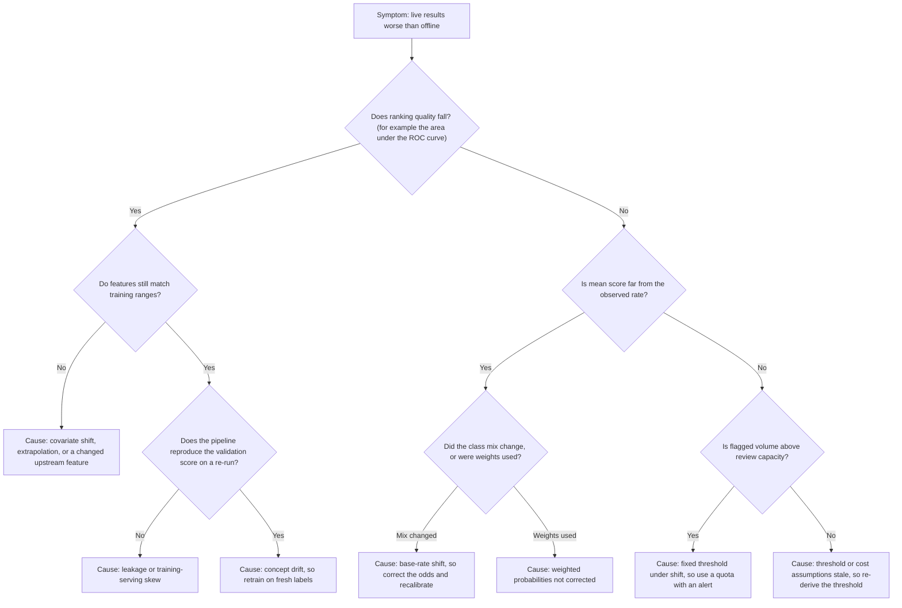

The tree separates failures that need retraining (the "ranking falls" branch) from those that need only a repair of the output layer (the "ranking holds" branch). Ranking quality that holds while the probability scale or the queue moves points to the cheap fixes of Sections 7 to 9: recalibration, odds correction, or a new threshold. A ranking that falls points at the data or the world, and retraining a model on contaminated or shifted data without finding the cause usually reproduces the failure. The order of the questions matters because the label-free checks (feature ranges, score distribution, flagged volume) are available immediately, while the checks that need outcomes wait for labels.

### 10.3 Anti-patterns

- **Default threshold.** Shipping $t = 0.5$ because that is the library default, with no cost or capacity argument.
- **Accuracy on imbalanced data.** Reporting accuracy when a constant "negative" prediction scores almost as well.
- **Resample, then split.** Balancing or scaling before the train-test split, so evaluation rows leak into training.
- **Statistical significance as importance.** Selecting features by $p$-values or by surviving an L1 penalty and calling them the "drivers".
- **Probability from `predict_proba` without checking it.** Treating the output of any classifier as calibrated because the method name says probability.
- **One global threshold, forever.** Never revisiting $t$ when costs, capacity, or the base rate change.
- **Complexity without a baseline.** Proposing a boosted or neural model without the logistic baseline of [CH01](CH01_Machine_Learning_Foundations.md) beside it.
- **No owner for the policy.** A threshold, review band, or abstention rule with no named person accountable for the cost figures behind it.

## 11. Trade-off Analysis and Decision Framework

Choosing a model family is a decision about cost and risk as much as accuracy. The comparison below sets the models of this chapter beside the families of [CH04](CH04_Decision_Trees_and_Ensemble_Learning.md) and [CH07](CH07_Deep_Learning_Foundations.md). The entries are general tendencies, not measurements; a particular dataset can reverse any of them, and the way to find out is the evaluation design of [CH06](CH06_Model_Evaluation_Validation_and_Selection.md).

### 11.1 Comparison across the dimensions that matter in production

| Dimension | Linear / logistic (unpenalised) | Regularized linear / logistic | Tree models and ensembles (CH04) | Neural networks (CH07) |
|---|---|---|---|---|
| Interpretability | Highest: one coefficient per feature, with the collinearity caveat | High: coefficients are shrunk and, with L1, sparse; stability caveats of Section 5.6 | Single tree readable; ensembles need post-hoc explanation tools | Lowest: explanation is approximate and indirect |
| Data needs | Few rows; needs more rows than features and little collinearity | Handles many features and few rows better | Moderate; copes with interactions and non-linearity without manual features | Typically the most, unless pretrained components are reused |
| Non-linearity and interactions | Only those the analyst adds as features | Same as unpenalised | Learned automatically within the data's support | Learned, including representations from raw inputs |
| Probability calibration | Often good when the model is roughly right (Section 8.2) | Good to fair; heavy shrinkage tends toward under-confidence (Section 8.2) | Commonly needs a calibration step, with the form of the distortion varying by method (Section 8.2) | Often needs calibration; confidence can run high |
| Extrapolation behaviour | Extends the line, so confident and possibly wrong (Section 3.8) | Same, with damped slopes | Piecewise constant, so flat beyond the data | Unpredictable outside the training distribution |
| Serving latency and cost | Lowest: a dot product | Lowest | Low to moderate, rising with ensemble size | Moderate to high; may need accelerators |
| Maintenance burden | Low: few knobs, easy to diff and debug | Low: one extra hyperparameter to tune | Moderate: more hyperparameters, more drift surface | Highest: training infrastructure, versioning, and monitoring |
| Typical failure to watch | Misspecification, collinearity, separation | Unscaled features, over-shrinkage | Overfitting, calibration, unstable importances | Overconfidence, data hunger, silent skew |

No column wins everywhere. A model with better ranking quality is worth its cost only if the decision is sensitive to that gain, which is the question the cost-based thresholds of Section 7 answer in money.

### 11.2 A decision flowchart for choosing a model family

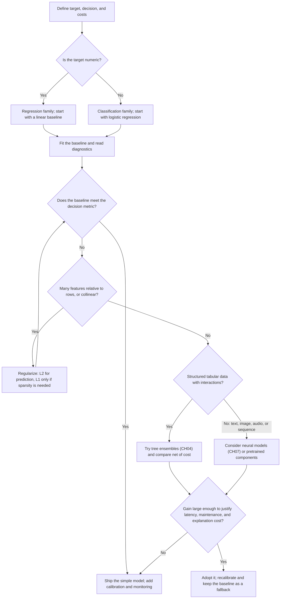

The loop through regularization comes before any change of family, because many apparent failures of a linear model are conditioning or variance problems rather than a need for greater capacity. The final gate is a net-of-cost comparison against the baseline, and the baseline stays in service as the fallback and as the monitoring reference even when a more complex model is adopted.

### 11.3 When the simple model wins

A linear or logistic model is the correct final answer, and not a stepping stone, when most of these hold:

- **The signal is close to additive on a sensible scale.** After a log transform, a few interaction terms, or binned features, the residuals show no structure.
- **Explanations or coefficients are a requirement.** An auditor, regulator, or operations team needs to see why a score moved, and a reason code from a coefficient is enough.
- **Data is scarce or labels are delayed.** Few rows favour few parameters, and a model that retrains in seconds is easy to refresh when labels trickle in.
- **Latency, cost, or portability is tight.** A dot product runs in a database, an edge device, or a rules engine with no model server.
- **The gain from a complex model is below the decision's resolution.** If the cost-based comparison of Section 7.2 moves the expected value by less than the cost of the extra system, the extra system loses.
- **Stability matters more than the last point of accuracy.** Retraining should change coefficients slightly, so changes are reviewable.

The inverse also holds: when the data are images, text, or long sequences, or when strong interactions dominate and a linear model with hand-built features plateaus visibly below the decision's needs, a richer family earns its place.

## 12. Illustrative Composite Case Study

### 12.1 Scenario: a fraud screen when the base rate doubles

This is a hypothetical composite built to tie the chapter together; it describes no real organization, and every figure is invented for arithmetic. It continues the running example of Section 7. A calibrated logistic model scores $100{,}000$ transactions a day. A fraud costs $L = \$200$, a review costs $c = \$5$, and the team can review $M = 2{,}500$ rows a day, so the pre-shift operating point is $t = 0.1$ (Section 7.3), which flags $2{,}500$ rows, catches $900$ of $1{,}470$ frauds, and nets $\$167{,}500$ a day.

Assume that the fraud prevalence then doubles from $1.47\%$ to $2.94\%$, so there are $2{,}940$ frauds a day, while the way fraudulent and legitimate rows are scored, $p(x \mid y)$, is unchanged. This is the pure prior shift of Section 4.5: the odds of every row are multiplied by

$$
k = \frac{0.0294/0.9706}{0.0147/0.9853} = 2.0303.
$$

Frauds in every score bin double, and legitimate rows scale by $97{,}060/98{,}530$. Counts are rounded to whole rows.

| Score bin | Rows | Frauds | Observed rate | Rate before shift | Value per flag |
|---|---:|---:|---:|---:|---:|
| $\ge 0.5$ | 898 | 800 | 0.891 | 0.800 | +\$173.17 |
| 0.3 to 0.5 | 696 | 400 | 0.575 | 0.400 | +\$109.94 |
| 0.1 to 0.3 | 1,782 | 600 | 0.337 | 0.200 | +\$62.34 |
| 0.05 to 0.1 | 2,122 | 300 | 0.141 | 0.075 | +\$23.28 |
| 0.025 to 0.05 | 3,062 | 210 | 0.069 | 0.035 | +\$8.72 |
| 0.01 to 0.025 | 10,003 | 300 | 0.030 | 0.015 | +\$1.00 |
| below 0.01 | 81,437 | 330 | 0.004 | 0.002 | −\$4.19 |
| Total | 100,000 | 2,940 | 0.0294 | 0.0147 | |

The value per flag is $200 \times \text{rate} - 5$. Four policies can now be compared on this population, each with net value computed as $200 \times TP - 5 \times \text{flagged}$:

| Policy | Flagged | TP | Missed | Precision | Recall | Net value per day |
|---|---:|---:|---:|---:|---:|---:|
| A. Unchanged threshold $t = 0.1$ | 3,376 | 1,800 | 1,140 | 0.533 | 0.612 | \$343,120 |
| B. Quota of top $2{,}500$ (cut inside the 0.1 to 0.3 bin, rate assumed uniform there) | 2,500 | about 1,505 | about 1,435 | about 0.602 | about 0.512 | about \$288,510 |
| C. Unchanged cost threshold $t = 0.025$ | 8,560 | 2,310 | 630 | 0.270 | 0.786 | \$419,200 |
| D. Corrected cost optimum (all bins down to 0.01) | 18,563 | 2,610 | 330 | 0.141 | 0.888 | \$429,185 |

Check A: $200 \times 1{,}800 - 5 \times 3{,}376 = 360{,}000 - 16{,}880 = 343{,}120$. Check D: $200 \times 2{,}610 - 5 \times 18{,}563 = 522{,}000 - 92{,}815 = 429{,}185$. Doing nothing now loses $2{,}940 \times 200 = \$588{,}000$ a day against $\$294{,}000$ before.

Five lessons follow, each tied to a section of the chapter.

1. **Ranking is unchanged, so ranking metrics do not alarm.** Recall at each threshold is identical to the pre-shift table ($0.272$, $0.408$, $0.612$, and so on), so the area under the ROC curve is unchanged. A dashboard built only on ranking quality would stay green.
2. **Calibration fails in a recognizable pattern.** Observed rates exceed scores in every bin, by $1.11$ times at the top and about $2.0$ times at the bottom, approaching $k$ where scores are small and odds approximate probabilities. Multiplying odds by $k$ maps the bin edges $0.1$ and $0.3$ to $0.184$ and $0.465$ (Section 4.5), which bracket the observed rate of $0.337$ for the $0.1$ to $0.3$ bin. Without the correction, every cost threshold is applied to probabilities that are about half the truth.
3. **A fixed threshold turns the shift into a queue.** Policy A sends $3{,}376$ rows to reviewers against a capacity of $2{,}500$, a $35\%$ overrun, which is the first label-free alarm, visible a day after the shift while labels are still delayed.
4. **The corrected cost optimum is far beyond capacity.** The threshold $c/L = 0.025$ corresponds to an old score of $0.0125$, inside the $0.01$ to $0.025$ bin, whose average value per flag is positive. Policy D therefore wants $18{,}563$ reviews, $7.4$ times capacity. Against it, the quota of Policy B loses about $\$140{,}675$ a day, $5.4$ times the $\$26{,}000$ gap of Section 7.3, equal to roughly $\$8.76$ per review not performed. That figure is the price of capacity, and it should be on the owner's table.
5. **Capacity is a business decision, with options.** Raise reviewers, add the cheaper secondary check or review band of Section 7.4 for the middle bins, or accept the loss of about $\$287{,}000$ a day from missed frauds in Policy B. The data do not choose among them; the cost figures and the owner do.

Two caveats apply. The doubling is an assumption, and a real shift also changes the kinds of positives (Section 4.5), which breaks the pure-odds correction and calls for the held-out recalibration of Section 8.5. The prevalence estimate itself needs labels, for example from sampled reviews of the approved band, so a monitoring plan has to budget for them.

### 12.2 Architect review checklist

**Framing and data**

- The target, prediction unit, decision time, and action are written down, and the error costs ($c$, $L$, $d$) have a named owner.
- A simple baseline exists, and a more complex model must beat it net of cost (Section 11).
- Splits respect time and groups, and every fitted transform is inside the training fold ([CH02](CH02_Data_Preparation_Feature_Engineering_and_Leakage.md)).

**Model**

- Residual diagnostics, VIF, and leverage have been reported for regression, and out-of-range inputs are guarded (Section 3).
- For classification, separation and convergence have been checked, and features are scaled before any penalty (Sections 4.4 and 5.4).
- Regularization strength was chosen on held-out data and the coefficients are described as associations, not effects.

**Probabilities and decisions**

- Calibration is measured on data with the deployment class mix, and the repair method and its refresh schedule are named (Section 8).
- Weights or resampling, if used, are corrected or recalibrated before probabilities feed any cost rule (Section 9).
- The threshold comes from costs, with the capacity-constrained alternative stated beside it and the residual risk priced (Sections 7.2 and 7.3).
- The review band, abstention, and handling of invalid or out-of-distribution inputs are explicit (Section 7.4).
- Any segment-specific threshold has a cost justification, and any fairness-driven difference has an owner and a governance review.

**Operations**

- Monitoring covers the score distribution, observed rate, queue length and age, precision, and recall by segment, with alerts that do not depend only on delayed labels.
- A fallback model or rule exists, and rollback and retraining triggers are defined (see [CH29](CH29_MLOps_and_LLMOps.md)).
- The base-rate assumption is recorded with the model and re-estimated on a schedule (Sections 4.5 and 8.5).
- Final test data was not used for threshold or model selection.

## 13. Interview Questions

1. **Why is OLS a projection, and what does it buy you?** The fitted vector $X\hat\beta$ is the orthogonal projection of $y$ onto the column space of $X$, so the residual is orthogonal to every column and $X^\top r = 0$ (Section 3.3). It explains the normal equations and why an intercept makes residuals sum to zero.
2. **Two features are almost duplicates. The coefficients are huge with opposite signs, but predictions are fine. Why?** Collinearity inflates coefficient variance by the VIF while the fitted values, which depend on the combination, remain stable (Section 3.7). Predict from the model, but do not interpret the coefficients individually. Drop or combine features, or regularize.
3. **How do you read a logistic coefficient?** A one-unit rise in the feature adds $\beta_j$ to the log-odds, holding the other features fixed, so odds are multiplied by $e^{\beta_j}$. The effect on probability depends on the starting point, and odds ratios are non-collapsible: omitting a feature changes them even without confounding (Section 4.3).
4. **Training logistic regression gives enormous coefficients and a convergence warning. What is happening?** Likely perfect or quasi-separation: a direction exists that classifies the training data without error, so the likelihood has no finite maximum (Section 4.4). Regularize, merge sparse categories, and check for a feature that encodes the label.
5. **Contrast L1 and L2 penalties and say when you would use each.** L2 shrinks all coefficients smoothly and handles correlated features by spreading weight. L1 can set coefficients exactly to zero but selects arbitrarily among correlated features and is unstable (Sections 5.2 and 5.6). Use L2 for prediction by default and L1 only when sparsity is a requirement. Standardize first (Section 5.4).
6. **You trained with class weights of 49 on the positive class. Are the probabilities usable?** Not directly: the weights add $\ln 49$ to the log-odds. Correct with $p = p_w / (p_w + (1 - p_w)\,w)$, or fit a calibration map on unweighted held-out data, which is also the safer choice when the model is misspecified (Section 9.2).
7. **How do you choose a classification threshold?** From costs on calibrated probabilities: flag when $p > c/L$ for action cost $c$ and avoided loss $L$ (Section 7.2), then check whether review capacity binds, in which case flag the top $M$ rows and price the residual (Section 7.3).
8. **A model's ranking quality is unchanged but live precision dropped. What do you suspect?** Base-rate shift: ranking metrics do not move under pure prior shift, but precision, calibration, and the cost-optimal threshold do (Sections 4.5 and 12.1). Check the observed rate against the training prior.
9. **What is calibration, and how do you check and repair it?** Among rows scored $p$, a fraction $p$ should be positive. Check with a reliability diagram and ECE on held-out data, and repair with Platt or isotonic maps fitted on separate data (Section 8).
10. **When would you refuse to replace a logistic model with gradient-boosted trees?** When the gain does not change decisions enough to pay for extra latency, maintenance, calibration work, and loss of simple explanations, as in Section 11.3. Compare in money with the cost-based rule, not only on a ranking metric.

## 14. Hands-on Exercises

The starter code needs NumPy, and Exercises 2 to 4 use scikit-learn. It was run with NumPy 2.5.3 and scikit-learn 1.9.1, and the stated outputs are what those runs printed.

1. **Fit OLS from the normal equations and check the projection.** Solve for $\hat\beta$, confirm that $X^\top r$ is zero up to rounding, and compute the leverage of a new point far from the data.

    ```python
    import numpy as np

    x = np.array([1, 2, 3, 4, 5.0]); y = np.array([2.1, 3.9, 6.2, 7.8, 10.1])
    X = np.column_stack([np.ones_like(x), x])
    beta = np.linalg.solve(X.T @ X, X.T @ y)
    resid = y - X @ beta
    print(beta, np.round(X.T @ resid, 10), np.allclose(beta, np.linalg.lstsq(X, y, rcond=None)[0]))
    x0 = 20.0
    h0 = 1 / len(x) + (x0 - x.mean()) ** 2 / ((x - x.mean()) ** 2).sum()
    print(h0)
    ```

    The output is `[0.05 1.99]`, zeros, `True`, and a leverage of $29.1$ for $x_0 = 20$. Interpret that leverage and explain what a guard on inputs should do.

2. **Watch separation happen.** Fit a logistic model on four perfectly separable points with increasing $C$ (weaker regularization) and watch the slope grow.

    ```python
    import numpy as np
    from sklearn.linear_model import LogisticRegression

    xs = np.array([[-2], [-1], [1], [2.0]]); ys = np.array([0, 0, 1, 1])
    for C in [1, 100, 1e4, 1e6]:
        print(C, round(LogisticRegression(C=C, max_iter=10_000).fit(xs, ys).coef_[0, 0], 3))
    ```

    The slopes printed were $1.007$, $3.945$, $7.545$, and $8.832$. Explain why they never settle, and add one noisy point that overlaps the classes to see them stabilize.

3. **Sweep a cost threshold.** With scores that are calibrated by construction, find the threshold that maximizes net value for $L = 200$ and $c = 5$, and confirm it sits near $c/L$.

    ```python
    import numpy as np

    rng = np.random.default_rng(0)
    p = rng.beta(0.5, 20, 200_000); y = rng.random(p.size) < p
    L, c = 200, 5
    for t in [0.01, 0.025, 0.05, 0.1, 0.2]:
        flag = p >= t
        print(t, flag.sum(), L * (y & flag).sum() - c * flag.sum())
    ```

    The best net value printed was $443{,}500$ at $t = 0.025$. Add a review capacity $M$ and show how the answer changes when $M$ is below the flagged count, as in Section 7.3.

4. **Undo class weighting.** Train a logistic model on a $2\%$ positive synthetic set with the positive class weighted by $49$, then use the correction below to recover probabilities and compare mean probability and log loss with an unweighted fit (Section 9.2).

    ```python
    def to_true_scale(p_w, w):
        return p_w / (p_w + (1 - p_w) * w)

    print(round(to_true_scale(0.5568, 49), 4), round(to_true_scale(0.9, 49), 4))
    ```

    It prints `0.025 0.1552`, matching the table of Section 9.2. Measure whether the correction is exact on data where the logistic form is misspecified.

5. **Reproduce the base-rate shift table.** Rebuild the policy rows of Section 12.1 from the bin counts, then vary the prevalence multiplier and find the multiplier at which the unchanged threshold $t = 0.1$ first overloads a capacity of $2{,}500$.

    ```python
    import numpy as np

    rows = np.array([898, 696, 1782, 2122, 3062, 10003, 81437])
    frauds = np.array([800, 400, 600, 300, 210, 300, 330])
    flagged, tp = rows.cumsum(), frauds.cumsum()
    for i in (2, 4, 5):
        print(flagged[i], tp[i], 200 * tp[i] - 5 * flagged[i])
    ```

    The rows printed are $(3376, 1800, 343120)$, $(8560, 2310, 419200)$, and $(18563, 2610, 429185)$. For the extension, scale the fraud counts of the three top bins and the legitimate counts in proportion to a prevalence you choose.

## 15. Design and Architecture Review Questions

Each scenario below is illustrative and invented for practice; none describes a real system. A reference answer outline follows each one. Strong answers state the trade-off and the evidence that would settle it, not just a preference.

**Question 1. Thresholds versus capacity.** A calibrated fraud model implies a cost-based threshold of $c/L = 0.025$, but that threshold would flag several times what the review team can handle in a day. Management proposes either hiring until the threshold is affordable or raising the threshold until the queue fits. Which do you recommend?

*Reference answer outline.* Raising the threshold until the queue fits is not a free choice: it silently accepts the missed-fraud loss that the cost rule priced. Flag the top $M$ rows by score as a quota, then compute the daily value forgone relative to the unconstrained optimum and divide it by the reviews not performed (Section 7.3). That figure is the price of capacity and belongs on the owner's table. Options include more reviewers, a cheaper secondary check for the middle score bins, or a review band (Section 7.4). The data cannot choose among them; the cost figures can inform the decision.

**Question 2. Calibration after retraining.** A team retrains a logistic model on a newer window and reuses the previous Platt map and the previous threshold, because the ranking metric looks unchanged. What is the risk, and what do you require before release?

*Reference answer outline.* A calibration map describes one fitted model on one population, and a retrained model has different scores even when its ranking matches. Reusing the old map can place the threshold at the wrong point on the probability scale (Section 8.4). Require a fresh calibration set drawn after the training rows, with the deployment class mix, and compare log loss and expected calibration error (ECE) before and after repair. State the threshold in costs, not in score values, so it is re-derived rather than copied. Record the refresh schedule with the model.

**Question 3. Base-rate shift.** After a product change, the observed positive rate is believed to have doubled. Precision has fallen and the queue has grown, yet offline ranking quality looks the same. Describe your response.

*Reference answer outline.* Ranking quality does not move under a pure prior shift, but precision, calibration, and the cost-optimal threshold do (Section 4.5). Multiply the odds by the estimated shift factor, then re-derive the threshold on the corrected probabilities (Section 8.5). Estimate the new rate from labels, for example sampled reviews of the approved band, rather than assuming the doubling. If the kinds of positives changed as well, the pure-odds correction no longer holds and recalibration on fresh labelled data is needed. Alert on observed rate against the stored training prior.

**Question 4. Interpretability demands.** An approver requires a reason for every decline and prefers a boosted ensemble that scores slightly better offline. Do you accept the ensemble?

*Reference answer outline.* First ask whether the gain changes decisions enough to pay for extra explanation work, calibration, and maintenance, by comparing both models net of cost (Section 11.3). A standardized, regularized logistic model offers per-feature contributions, but those are conditional associations and must not be presented as causes (Section 3.5). If L1 is used for sparsity, check selection stability across resamples (Section 5.6). If the ensemble wins clearly, plan post-hoc explanations and keep the logistic model as the fallback and monitoring reference.

**Question 5. Imbalance weighting.** With a $1\%$ positive rate, an engineer sets a class weight of $99$ on positives to raise recall, then feeds the output into the cost rule unchanged. What is wrong, and what are the alternatives?

*Reference answer outline.* Weighting multiplies the prior odds by $w$, so scores shift by about $\ln w$ in log-odds and no longer read as probabilities (Section 9.2). Applying the cost threshold to them flags far too many rows. Either correct with the odds formula or fit a Platt or isotonic map on held-out data with the true class mix. Moving the threshold alone leaves calibration intact and is nearly equivalent in effect for a well-specified model. Weight only inside the training fold, and report metrics on unweighted data.

**Question 6. Model-family choice.** A tabular problem has about forty numeric features and suspected interactions. One engineer wants a neural network; another wants a regularized logistic baseline. How do you decide?

*Reference answer outline.* Fit the baseline first, read its diagnostics, and regularize before changing family, because many failures are variance or conditioning problems (Section 11.2). If interactions matter, try tree ensembles before neural networks for structured tabular data. Compare every candidate net of cost with calibrated probabilities on untouched data, including latency and maintenance. Adopt a more complex model only if the gain exceeds the decision's resolution, and keep the baseline in service as the fallback.

## 16. Summary

This chapter built regression and classification from the ground up so that each design decision can be traced to evidence. Outcome 1 is covered by the normal equations and the projection view (Sections 3.2 to 3.4). Outcome 2 maps assumptions to diagnostics and failures (Section 3.6). Outcome 3 rests on conditional-association reading, collinearity, extrapolation, and transformation bias (Sections 3.5, 3.7, and 3.8). Outcome 4 explains logistic regression through log-odds, its fitting loop, separation, and the base rate (Section 4). Outcome 5 covers regularization, its geometry, and the scaling and selection caveats (Section 5). Outcome 6 turns probabilities into decisions through calibration, cost-based and capacity-constrained thresholds, review bands, and abstention (Sections 7 and 8), with imbalance handling and model-family choice in Sections 9 and 11.

Key decision heuristics:

- Start with a linear or logistic baseline, and require any more complex model to beat it net of cost.
- Read coefficients as conditional associations, never as causes.
- Guard inputs against extrapolation, and report predictions rather than individual coefficients under collinearity.
- Standardize before penalizing, and choose the penalty strength on held-out data.
- Treat scores as probabilities only after checking calibration on data with the deployment class mix.
- Derive thresholds from costs, check whether capacity binds, and price the residual risk.
- After class weights or base-rate shifts, correct the odds or recalibrate before applying a cost rule.
- Judge ranking, calibration, and decisions separately, and keep the baseline as the fallback.
