# Decision Trees and Ensemble Learning

Part: [16 — Artificial Intelligence, Machine Learning, and Generative AI](PART_OVERVIEW.md) · Status: Revised (in-depth rewrite)

## 1. Introduction

A decision tree answers a prediction question by asking a short sequence of yes-or-no questions about the input. An ensemble combines many such trees, or many other models, so that the combination is more accurate and more stable than any member. For structured (tabular) data, meaning rows of mixed numeric and categorical columns such as a loan application, an insurance claim, or a payment transaction, tree ensembles are the default strong model. In most production tabular problems, a gradient-boosted tree model is the first serious challenger to the logistic-regression baseline from [CH03 — Regression and Classification](CH03_Regression_and_Classification.md), and it frequently wins.

This matters to a solution architect for reasons beyond accuracy. A tree ensemble needs little feature scaling, accepts missing values in several libraries, captures interactions without hand-built crossing features, and trains in minutes on millions of rows. It also has failure modes that a linear model does not: it cannot extrapolate beyond the training range, it can memorize high-cardinality identifiers, its probabilities are often miscalibrated, its feature importances mislead when features are correlated, and its serialized form can leak information about the training data. An architect who knows the mechanism can predict which of these will bite in a given system and can write the review questions that expose them early.

This chapter owns the following material: impurity measures and the Classification and Regression Trees (CART) algorithm, pruning, bagging and random forests, AdaBoost, gradient boosting as functional gradient descent, second-order boosting, the differences among XGBoost, LightGBM, and CatBoost, stacking, tuning and early stopping, monotonic constraints, tree-specific feature importance, ensemble calibration, quantile prediction, extrapolation failure, target-encoding leakage, tree deployment, and tree-specific security and drift concerns. It recaps neighbouring topics briefly and links to the chapters that own them.

| Topic | Owner | What this chapter does with it |
| --- | --- | --- |
| Empirical risk, loss functions, bias-variance decomposition, baseline ladder | [CH01 — Machine Learning Foundations](CH01_Machine_Learning_Foundations.md) | Recaps in a few sentences, then applies to trees and ensembles |
| Missing-value imputation, categorical encoding, leakage, temporal splits | [CH02 — Data Preparation, Feature Engineering, and Leakage](CH02_Data_Preparation_Feature_Engineering_and_Leakage.md) | Shows what changes when the model is a tree: native missing handling, tree-friendly encodings, target-encoding leakage |
| Logistic regression, calibration concepts, threshold selection from costs | [CH03 — Regression and Classification](CH03_Regression_and_Classification.md) | Uses as the baseline and as the calibration reference; does not re-derive |
| Cross-validation, metrics, confidence intervals, calibration methods, model comparison | [CH06 — Model Evaluation, Validation, and Selection](CH06_Model_Evaluation_Validation_and_Selection.md) | Names the tree-specific hazards (early-stopping reuse, out-of-bag error); defers the general method |
| Neural networks for tabular data | [CH07 — Deep Learning Foundations](CH07_Deep_Learning_Foundations.md) | Compares them with boosted trees at decision level only |
| Serving optimization and batching | [CH28 — Inference Optimization and Model Serving](CH28_Inference_Optimization_and_Model_Serving.md) | Covers tree-specific latency and format choices |
| Model lifecycle, monitoring, rollback | [CH29 — MLOps and LLMOps](CH29_MLOps_and_LLMOps.md) | Covers what to monitor for a tree model |
| Privacy and governance of training data | [CH30 — AI Data Governance, Privacy, and Provenance](CH30_AI_Data_Governance_Privacy_and_Provenance.md) | Covers leakage through the model artifact |
| Responsible AI, fairness, and explanation duties | [CH31 — Responsible AI and Safety Governance](CH31_Responsible_AI_and_Safety_Governance.md) | Covers tree-specific interpretability limits |

After studying this chapter, a reader should be able to:

1. Compute Gini impurity, entropy, information gain, and variance reduction by hand, and run the CART split search step by step on a small table.
2. Explain how trees split numeric and categorical features, how they handle missing values, and how cost-complexity pruning chooses a subtree.
3. Show why a single tree has high variance, and derive the variance of an averaged ensemble as a function of tree variance, correlation, and ensemble size.
4. Describe AdaBoost and derive gradient boosting, including shrinkage, subsampling, and second-order leaf weights, from a loss function.
5. Choose among XGBoost, LightGBM, and CatBoost using their actual mechanisms: histogram splits, growth policy, categorical handling, and target statistics.
6. Tune a boosted model with early stopping without contaminating the final evaluation, and apply monotonic constraints where domain rules require them.
7. Diagnose feature-importance, calibration, imbalance, extrapolation, and target-leakage problems in a tree ensemble.
8. Plan deployment, monitoring, and threat modeling for a tree model, and decide when a neural network is worth considering instead.

## 2. Background

Tree-based prediction has three lineages that merged in the 1990s and 2000s. The first is statistical: Morgan and Sonquist (1963) described automatic interaction detection, a method that recursively split survey data to explain a numeric outcome. The second is machine learning: Ross Quinlan's ID3 (1986) and C4.5 (1993) built classifiers using entropy-based splitting. The third unified the two: Leo Breiman, Jerome Friedman, Richard Olshen, and Charles Stone published *Classification and Regression Trees* in 1984, which introduced the CART algorithm, the Gini criterion, cost-complexity pruning, and surrogate splits. Most modern tree learners descend from CART.

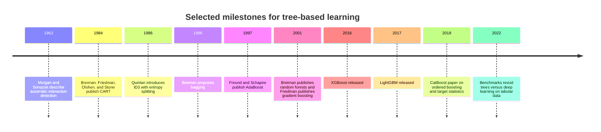

A single tree was recognized early as unstable. Breiman (1996) showed that averaging trees fitted to bootstrap resamples (bagging) reduces variance, and his random forests (2001) added feature subsampling to decorrelate the trees. In the same period Freund and Schapire (1997) introduced AdaBoost, which reweights training examples so that each new learner concentrates on the examples the ensemble currently gets wrong. Friedman, Hastie, and Tibshirani (2000) interpreted AdaBoost as stagewise fitting of an additive model under exponential loss, and Friedman (2001) generalized the idea to gradient boosting with any differentiable loss. The engineering generation followed: XGBoost (Chen and Guestrin, 2016), LightGBM (Ke and colleagues, 2017), and CatBoost (Prokhorenkova and colleagues, 2018) made gradient-boosted decision trees (GBDT) fast enough to train on hundreds of millions of rows and added the handling of missing values and categorical features that real tables need.

Two facts frame the rest of the chapter. First, the history is a sequence of fixes for a single weakness: a deep tree has low bias but very high variance. Bagging and random forests cut variance by averaging. Boosting instead keeps each tree shallow, so each has high bias and low variance, and reduces bias by adding trees sequentially. Second, the same family keeps winning on tabular benchmarks. Grinsztajn, Oyallon, and Varoquaux (2022) report that tree-based models remain state of the art on medium-sized tabular data of around ten thousand samples even before accounting for their speed advantage, and Section 29 returns to what that does and does not imply.

## 3. The Decision Tree Model

### 3.1 A tree is a piecewise-constant function

A decision tree maps an input vector $x$ to a prediction by routing it from the root through internal nodes to a leaf. Each internal node holds a test on one feature, for example "income is at most 57.5" for a numeric feature or "region is in {B, C}" for a categorical one. Each leaf holds a prediction: a class distribution for classification or a number for regression. The tree therefore divides the feature space into axis-aligned boxes, one per leaf, and predicts a constant inside each box. Written as a formula, a tree with $T$ leaves is

$$
f(x) = \sum_{j=1}^{T} w_j \,\mathbf{1}[x \in R_j]
$$

where $R_j$ is the region of leaf $j$, $w_j$ is the value stored in that leaf, and $\mathbf{1}[\cdot]$ equals 1 when its argument is true and 0 otherwise. The regions are disjoint and cover the whole space, so exactly one term is non-zero for any input.

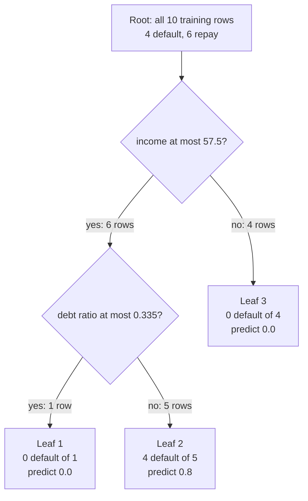

The diagram shows the tree that the greedy algorithm grows on the ten-row loan table used throughout Sections 4 to 8, stopped at depth 2. Each row of the table falls into exactly one leaf. The leaf prediction for a classification tree is the fraction of training rows in the leaf that are positive. That fraction is an estimate of the class probability inside the box, based only on the rows that landed there, which is the first hint that tree probabilities are noisy when leaves are small (Section 20).

### 3.2 What a tree can and cannot represent

A tree can represent any function of the inputs to arbitrary accuracy if it is allowed to grow deep enough, because enough boxes approximate any shape. Three properties follow from the piecewise-constant, axis-aligned structure and affect design decisions later.

- **Interactions come for free.** A split on feature B below a split on feature A is, by construction, an interaction: the effect of B is allowed to differ depending on A. A linear model needs the product $x_A x_B$ added by hand.
- **Monotonic transformations of a feature do not matter.** A split asks whether $x_j \le t$. Replacing $x_j$ with $\log x_j$ changes the threshold but not which rows go left, so scaling, standardizing, and log-transforming numeric inputs does not change a tree's predictions. This is why trees need little numeric preprocessing.
- **Diagonal boundaries are expensive and extrapolation is impossible.** A boundary such as $x_1 + x_2 > 1$ is approximated by a staircase of axis-aligned steps, and a tree outside the training range simply returns the value of the nearest box (Section 24).

The same structure explains the main weakness. The tree chooses its splits greedily from the training sample, and a handful of rows can change an early split, which changes everything below it. Section 9 develops this as a variance problem.

## 4. Impurity Measures

At each node the algorithm must decide which test to apply. It scores each candidate test by how much the test reduces a measure of disorder in the rows, called impurity, and applies the test with the largest reduction. This section defines the standard impurity measures for classification and regression and computes each by hand on a small table.

### 4.1 The worked table

Ten loan applicants have two numeric features, annual income in thousands and debt-to-income ratio (dti), one categorical feature, region, and a binary label for whether they defaulted.

| id | income | dti | region | default |
| --- | --- | --- | --- | --- |
| 1 | 25 | 0.45 | A | 1 |
| 2 | 32 | 0.40 | B | 1 |
| 3 | 38 | 0.41 | A | 0 |
| 4 | 41 | 0.50 | C | 1 |
| 5 | 48 | 0.30 | B | 0 |
| 6 | 55 | 0.37 | A | 1 |
| 7 | 60 | 0.25 | C | 0 |
| 8 | 72 | 0.20 | B | 0 |
| 9 | 80 | 0.38 | A | 0 |
| 10 | 95 | 0.15 | C | 0 |

Four of the ten applicants defaulted, so the positive fraction is $p = 0.4$. The script [01_cart_by_hand.py](../code/python/decision-trees-chapter/01_cart_by_hand.py) reproduces every number in Sections 4 to 8.

### 4.2 Gini impurity

For a node containing examples of $K$ classes with class proportions $p_1, \dots, p_K$, the Gini impurity is

$$
G = 1 - \sum_{k=1}^{K} p_k^2
$$

It equals the probability that two examples drawn at random with replacement from the node belong to different classes, which is also the probability that a random example is misclassified if it is labeled by a random draw from the node's class distribution. A pure node has $G = 0$. For two classes with positive fraction $p$, $G = 2p(1-p)$, which peaks at $0.5$ when $p = 0.5$.

For the full table, $p = 0.4$ and $G = 1 - (0.4^2 + 0.6^2) = 1 - (0.16 + 0.36) = 0.48$.

### 4.3 Entropy and information gain

Entropy comes from information theory. For the same class proportions,

$$
H = -\sum_{k=1}^{K} p_k \log_2 p_k
$$

with the convention $0 \log 0 = 0$. It measures the average number of bits needed to encode the class of a randomly chosen example given the distribution. For the full table, $H = -(0.4 \log_2 0.4 + 0.6 \log_2 0.6) = 0.4(1.3219) + 0.6(0.7370) = 0.5288 + 0.4422 = 0.9710$ bits. The maximum for two classes is 1 bit at $p = 0.5$.

The reduction in entropy produced by a split is the information gain. If a split sends $n_L$ of $n$ examples to the left child and $n_R$ to the right, then

$$
\mathrm{IG} = H_{\text{parent}} - \left( \frac{n_L}{n} H_L + \frac{n_R}{n} H_R \right)
$$

where $H_L$ and $H_R$ are the child entropies. The Gini decrease is defined the same way, with $G$ replacing $H$. Both are the parent impurity minus the size-weighted average of child impurities. The weighting matters: a split that isolates one pure example and leaves the other nine untouched barely changes the weighted average, which is why a naive "purest child" criterion would pick bad splits.

### 4.4 A split computed by hand

Take the candidate test "income at most 57.5". The left child holds ids 1 to 6 and the right child holds ids 7 to 10.

- Left child: six rows, four defaults, so $p = 4/6 = 2/3$. Gini is $1 - (4/9 + 1/9) = 4/9 = 0.4444$. Entropy is $-(\tfrac{2}{3}\log_2\tfrac{2}{3} + \tfrac{1}{3}\log_2\tfrac{1}{3}) = 0.9183$ bits.
- Right child: four rows, zero defaults, so both impurities are 0.
- Weighted Gini is $0.6(0.4444) + 0.4(0) = 0.2667$, so the Gini decrease is $0.48 - 0.2667 = 0.2133$.
- Weighted entropy is $0.6(0.9183) + 0.4(0) = 0.5510$, so the information gain is $0.9710 - 0.5510 = 0.4200$ bits.

Now take "income at most 35", which sends ids 1 and 2 left (both defaults) and the other eight right (two defaults). The left child is pure. The right child has $p = 0.25$, so its Gini is $1 - (0.0625 + 0.5625) = 0.375$ and its entropy is $0.8113$ bits. Weighted Gini is $0.2(0) + 0.8(0.375) = 0.3000$, a decrease of $0.18$. Weighted entropy is $0.8(0.8113) = 0.6490$, an information gain of $0.3219$ bits. The first split is better by both criteria.

The script scores all nine thresholds. The three best by Gini decrease are 57.5 (0.2133), 35.0 (0.1800), and 44.5 (0.1633), followed by 66.0 (0.1371). By information gain the best three are 57.5 (0.4200), 35.0 (0.3219), and 66.0 (0.2813), with 44.5 fourth (0.2564). The two criteria agree on the winner and disagree on the order of the runners-up, which is typical: they usually pick the same split, and the choice between them rarely changes model quality much.

### 4.5 Why not misclassification error

The most direct impurity is the misclassification rate of the node, $1 - \max_k p_k$. It is a poor splitting criterion because it is insensitive to changes that do not alter the majority class. On the ten-row table, three different thresholds, 35.0, 44.5, and 57.5, each leave exactly two of ten rows on the minority side of a child, so each has misclassification error $0.2$ and the criterion cannot tell them apart. The 35.0 split isolates a pure group of two. The 57.5 split isolates a pure group of four. The 44.5 split produces two impure children. Gini and entropy are strictly concave in the class proportion, so they reward a split that makes children purer even when the majority label does not change. That reward is what lets the tree keep making progress toward pure leaves. Misclassification error remains the natural measure for pruning and evaluation (Section 8), where the goal is the final error rate, not the search direction.

### 4.6 Variance reduction for regression

For a numeric target, a node predicts the mean of its rows, and the natural impurity is the variance of the target within the node, which is the mean squared error of that prediction. A split's score is the variance reduction

$$
\Delta = \operatorname{Var}(\text{parent}) - \left( \frac{n_L}{n}\operatorname{Var}(L) + \frac{n_R}{n}\operatorname{Var}(R) \right)
$$

with variances computed using divisor $n$ (the population form). This equals the reduction in sum of squared errors divided by $n$.

A five-row example: $x = 1, 2, 3, 4, 5$ and $y = 10, 12, 11, 30, 33$. The mean is $96/5 = 19.2$ and the sum of squared deviations is $84.64 + 51.84 + 67.24 + 116.64 + 190.44 = 510.8$, so the variance is $102.16$. Splitting after $x = 3$ gives a left child $\{10, 12, 11\}$ with mean 11 and squared deviations $1 + 1 + 0 = 2$ (variance $0.6667$), and a right child $\{30, 33\}$ with mean 31.5 and squared deviations $2.25 + 2.25 = 4.5$ (variance $2.25$). Weighted variance is $0.6(0.6667) + 0.4(2.25) = 0.4 + 0.9 = 1.3$, so $\Delta = 102.16 - 1.3 = 100.86$. Splitting after $x = 2$ instead leaves $\{11, 30, 33\}$ on the right with mean $24.67$ and squared deviations $284.67$, for a total child sum of squared errors (SSE) of $286.67$ and a much smaller reduction. The algorithm picks the split after $x = 3$.

Variance reduction is the squared-error special case of a general principle. For any loss, a split is scored by how much it lowers the total loss when each child predicts its own optimal constant. Section 14 uses exactly this idea with gradients, which is how boosted trees choose splits for losses such as logistic loss.

### 4.7 Comparing the criteria

| Criterion | Task | Definition | Practical note |
| --- | --- | --- | --- |
| Gini decrease | Classification | $G_{\text{parent}} - \sum_c \frac{n_c}{n} G_c$ | Default in CART and scikit-learn; cheap to compute because it has no logarithm |
| Information gain | Classification | $H_{\text{parent}} - \sum_c \frac{n_c}{n} H_c$ | Tends to favor splits that create many small children when used on categorical features |
| Gain ratio | Classification | Information gain divided by the entropy of the split proportions | Quinlan's correction in C4.5 for multiway splits; penalizes splits that fan out widely |
| Variance reduction | Regression | $\operatorname{Var}_{\text{parent}} - \sum_c \frac{n_c}{n}\operatorname{Var}_c$ | Equivalent to maximizing the drop in squared error |
| Loss-based gain | Any differentiable loss | Gradient and Hessian sums (Section 14) | Used by boosted trees so one tree learner serves every loss |
| Misclassification error | Classification | $1 - \max_k p_k$ | Poor for choosing splits; fine for pruning and reporting |

Choosing between Gini and entropy is rarely a tuning lever worth the time. If both are available, keep the library default and spend effort on depth, leaf size, and regularization. The quantity that does matter is that the criterion be a strictly concave function of the class proportion so that it keeps rewarding progress.

## 5. The CART Algorithm Step by Step

CART builds a binary tree by recursive partitioning. The procedure below is the whole algorithm, and the ten-row table runs through it in this section.

### 5.1 The procedure

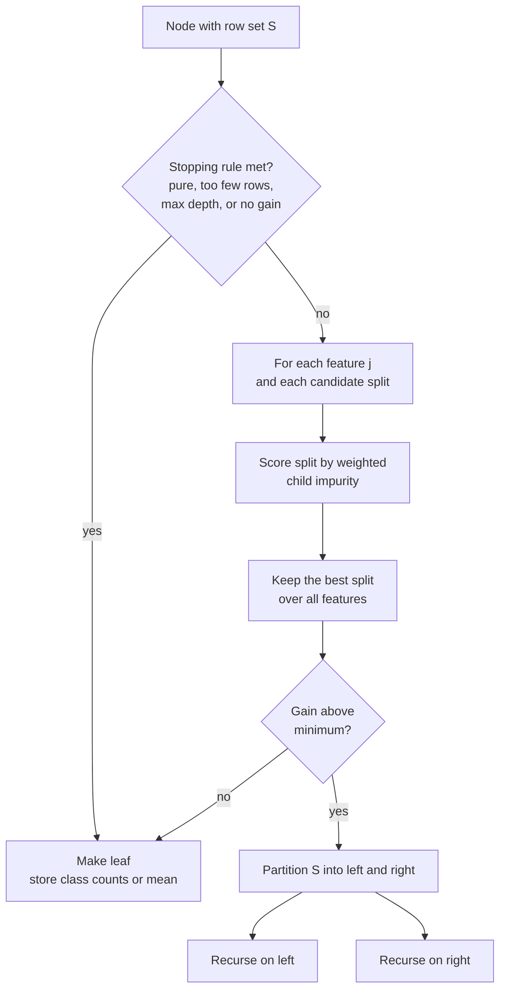

The flowchart is the complete training procedure. The expensive part is the inner loop: for every feature and every candidate threshold, compute child impurities. A stopping rule ends the recursion, and the growth stage is followed by an optional pruning stage (Section 8). Because the split at each node is chosen without looking ahead, the algorithm is greedy. It finds the best single split at each step, not the best tree. Finding the globally optimal tree is NP-complete (Hyafil and Rivest, 1976), which is why every practical learner is greedy.

### 5.2 Running it on the table

**Root.** All ten rows, four defaults, Gini 0.48. The algorithm evaluates thresholds on income and on dti. For income, the candidate thresholds are the midpoints between adjacent sorted values: 28.5, 35.0, 39.5, 44.5, 51.5, 57.5, 66.0, 76.0, and 87.5. The weighted child Gini values for these are 0.4000, 0.3000, 0.4190, 0.3167, 0.4000, 0.2667, 0.3429, 0.4000, and 0.4444. The minimum, 0.2667, is at 57.5. The dti feature is scanned too, and it produces a tie. The test "dti at most 0.335" puts the four lowest-dti rows (ids 10, 8, 7, and 5, all repayers) on the left and the remaining six rows (four defaults) on the right, which gives the same weighted Gini of $0.6 \times 0.4444 = 0.2667$. Ties are real in small tables and in tables with duplicated or coarse features. Implementations break them by a fixed rule, such as keeping the first best split found with features scanned in column order, or by a random choice in forests. The script scans income first, so the root split is "income at most 57.5". The left child receives ids 1 to 6 (four defaults, two repayers) and the right child receives ids 7 to 10 (all repayers). The right child is pure and becomes a leaf.

**Left child of the root.** Six rows, Gini $0.4444$. Candidate splits now use only these six rows. The best one is "dti at most 0.335", which isolates id 5 (dti 0.30, repaid) from the other five rows (four defaults and one repayer, id 3). Weighted child Gini is $\tfrac{1}{6}(0) + \tfrac{5}{6}(0.32) = 0.2667$. The five-row child has $p = 0.8$, so $G = 1 - (0.64 + 0.04) = 0.32$.

**Depth limit.** If the maximum depth is 2, growth stops here. The tree has three leaves: id 5 alone (prediction 0.0), ids 1, 2, 3, 4, 6 (prediction 0.8), and ids 7 to 10 (prediction 0.0). This is the tree in the diagram of Section 3.1.

**Growing to purity.** If growth continues, the five-row node splits on income at 35.0 into ids 1 and 2 (both defaults, pure) and ids 3, 4, 6, which hold two defaults and one repayer (Gini $0.4444$). The final split on income at 39.5 separates id 3 from ids 4 and 6. The result is a five-leaf tree with zero training error. It has fit the training table perfectly, including the fact that id 3 (income 38, dti 0.41) repaid while id 4 (income 41, dti 0.50) and id 6 (income 55, dti 0.37) defaulted, a pattern that could easily be noise in ten rows.

### 5.3 Computational cost

For $n$ rows, $p$ features, and a tree of depth $d$, the naive implementation sorts each feature at each node. Presorting or a single global sort that is partitioned as the tree grows lowers the cost to roughly $O(p \, n \log n)$ per level for the sorting step and $O(p \, n)$ per level for the scan, so growing a balanced tree to depth $d$ costs about $O(d \, p \, n)$ after the initial sort. Histogram-based learners (Section 15) replace the sort with bucketing and cut the per-level scan to $O(p \cdot \text{bins})$ after one pass to fill the buckets. The practical conclusion is that growing one tree is cheap, and the cost of ensembles comes from growing hundreds or thousands of them.

### 5.4 What the stopping rules control

Every stopping rule is a limit on variance. A maximum depth caps the number of regions at $2^d$. A minimum number of rows per leaf prevents leaves built on two or three examples, where the leaf estimate has high variance. A minimum gain threshold prevents splits whose improvement is within sampling noise. A cap on the number of leaves bounds model size directly. Without these limits the tree grows until every leaf is pure, which gives zero training error and, on noisy data, poor generalization. Section 8 explains the alternative to stopping early, which is to grow a large tree and prune it back using a principled criterion.

## 6. Numeric and Categorical Splits

The previous section scored a split once it existed. This section covers how candidate splits are generated, which differs for numeric and categorical features and has consequences for speed, bias, and overfitting.

### 6.1 Numeric features

For a numeric feature, a candidate split is a threshold $t$ with the test $x_j \le t$. Only thresholds that change the partition matter, so the algorithm sorts the rows by $x_j$ and considers a boundary between each pair of adjacent rows that have different values. With $m$ distinct values there are $m-1$ candidates. By convention the threshold is the midpoint between the two adjacent values, which is why the ten-row table produces 28.5, 35.0, 39.5, and so on. Some libraries store the lower of the two values or a bin edge instead. This matters only at serving time, when a value lands exactly on a stored threshold, and it is one reason to compare predictions across a model conversion (Section 25).

The scan is efficient. After sorting, the algorithm walks through the rows from smallest to largest and moves one row at a time from the right child to the left child, updating running class counts (or running sums of gradients and Hessians). The impurity of both children after each move follows from the counts in constant time. One sort plus one pass evaluates every threshold of a feature, so scoring all $m-1$ candidates costs $O(n \log n)$ for the sort and $O(n)$ for the pass.

Two refinements recur in practice.

- **Ties in feature values.** Rows with equal values must stay together, so the boundary is skipped between them. A feature with only a few distinct values, such as a count from 0 to 4, has only a few thresholds.
- **Binning.** Instead of every midpoint, the learner can replace each feature by a small number of bins (commonly 255 or 256 bins) built from feature quantiles, and consider only bin boundaries. This loses a little resolution and gains a large speedup and some regularization. Section 15 explains why every modern boosting library does this.

### 6.2 The multiple-comparison bias

A feature offers as many chances to find a good split as it has candidate thresholds. A continuous noise feature with 1,000 distinct values offers 999 thresholds, each of which can produce a small apparent gain by chance, and the algorithm keeps the largest. A binary noise feature offers exactly one. Even when both are unrelated to the target, the continuous one is more likely to win a split because it holds more lottery tickets. Strobl, Boulesteix, Zeileis, and Hothorn (2007) documented this selection bias for impurity-based variable importance in random forests, and Hothorn, Hornik, and Zeileis (2006) proposed conditional inference trees that use permutation tests to choose the split feature without this bias. The practical lessons are:

- Treat impurity-based importance of high-cardinality and continuous features with suspicion (Section 19).
- Do not add identifier-like columns (account number, order id, free-text hash) to a tree model; they provide many thresholds, little signal, and a large chance of a spurious split.
- Use a minimum gain and a minimum leaf size so that a tiny improvement from a lucky threshold does not qualify.

### 6.3 Categorical features

A categorical feature with $k$ levels, such as region with levels A, B, and C, has no natural order. There are four ways a tree can use it.

**Ordinal coding.** Map levels to integers and treat the result as numeric. This imposes an arbitrary order, and a threshold on the integer groups levels by their code, not by any property of the data. It works acceptably only when the codes are meaningful (for example, education level) and often hurts otherwise.

**One-hot coding.** Create one binary column per level. Each split isolates a single level against all others, so a tree needs several splits to group two levels. With high cardinality this produces very sparse columns, deep trees, and weak per-level splits, because a rare level offers a split with a tiny child. One-hot coding is a safe default for low cardinality, say up to roughly ten levels, and is what some libraries do by default below a threshold (Section 15).

**Native partition splits.** The test is "the level is in subset $S$", and the learner searches over subsets. A feature with $k$ levels has $2^{k-1} - 1$ distinct binary partitions, which is infeasible to enumerate for large $k$. For a binary classification target or a regression target, Breiman and colleagues (1984) proved that the optimal partition under Gini or squared error is found by sorting the levels by their mean target value and considering only the $k-1$ thresholds along that sorted order (the result goes back to Fisher, 1958). The search then costs a sort and a scan, the same as for a numeric feature. For a multiclass target no such shortcut exists, and libraries use heuristics.

**Target encoding.** Replace each level by a statistic of the target for that level (Section 23). This reduces the feature to a numeric column and enables the standard threshold search, at the price of a serious leakage risk if done naively.

The ten-row table shows the native partition. Region A has default rate $2/4 = 0.5$, region B has $1/3$, and region C has $1/3$. Sorting by rate gives B and C (tied) before A, so the two candidate partitions are $\{B\}$ versus $\{C, A\}$ and $\{B, C\}$ versus $\{A\}$. The first has weighted Gini $0.4762$. The second has left child $\{B, C\}$ (six rows, two defaults, Gini $0.4444$) and right child $\{A\}$ (four rows, two defaults, Gini $0.5$), so the weighted Gini is $0.6(0.4444) + 0.4(0.5) = 0.4667$. Region reduces the root Gini only from $0.48$ to $0.4667$, which is far weaker than income at $0.2667$, as expected for a label that does not depend strongly on region.

### 6.4 High-cardinality categoricals overfit

The sorted-by-mean shortcut has a hidden cost. When $k$ is large and many levels contain only a few rows, the mean target of a level is a noisy estimate, and sorting by noisy means then thresholding produces a partition that fits the noise. A user identifier with 10,000 levels and 2 rows per level lets the tree isolate groups of users that happen to share labels. The model's training error falls and its generalization does not. Libraries add controls for this: a minimum number of rows required in each side of a categorical group, a smoothing term added to level statistics, a cap on the number of levels allowed in the left subset, and a rule that lumps rare levels together. LightGBM exposes `min_data_per_group`, `cat_smooth`, `cat_l2`, and `max_cat_threshold` for this purpose, and the defaults are not designed for very high cardinality. For identifiers with more than a few hundred levels, decide deliberately: drop the column, aggregate levels to a coarser category, or use an encoding with built-in protection against leakage (Section 23).

### 6.5 Multiway splits and oblique splits

ID3 and C4.5 split a categorical feature into one child per level. This fragments the data quickly, because a feature with eight levels divides a node into eight small children, and information gain favors such splits since more children usually means purer children. Quinlan's gain ratio divides the gain by the entropy of the split proportions to penalize this. CART avoids the issue by allowing only binary splits, and a binary tree can still express a multiway test with several nested splits. Oblique trees split on a linear combination of features, which captures diagonal boundaries at the price of a harder search and loss of the monotonic-transformation invariance. They are used in research and some specialized libraries but are not mainstream production tools.

## 7. Missing Values

Real tables have missing entries. [CH02](CH02_Data_Preparation_Feature_Engineering_and_Leakage.md) owns the taxonomy of missingness and the general imputation methods. This section covers what a tree adds: three native mechanisms, each with its own failure modes.

### 7.1 Why trees can do better than imputation

A linear model needs a number in every cell, so missing values must be filled before fitting. A tree only needs to route each row down one branch at each node, so it can treat "missing" as information. The mechanisms are listed from oldest to newest.

### 7.2 Surrogate splits

CART handles missing values with surrogate splits. After choosing a primary split, the algorithm searches the other features for splits that most closely reproduce the same partition of the rows. At prediction time, a row whose primary feature is missing is routed by the best surrogate whose feature is present, and if every surrogate is missing the row goes to the child that holds more training rows.

The quality of a surrogate is its agreement with the primary split: the fraction of rows that both send to the same side. The baseline is the majority rule, which agrees with the primary split on the fraction of rows in the larger child. On the ten-row table, the primary split is "income at most 57.5", which sends six rows left and four right, so the majority rule agrees on $0.6$. Consider the candidate surrogate "dti at most 0.335", which sends ids 5, 7, 8, and 10 left. The two splits agree on id 5 (both left) and id 9 (both right) and disagree on the other eight rows, an agreement of $0.2$. CART also allows the surrogate direction to flip, so the test "dti above 0.335 goes left" has agreement $1 - 0.2 = 0.8$. It disagrees with the primary split only on ids 5 and 9. Since $0.8$ beats the baseline of $0.6$, it is a useful surrogate: a row with unknown income but a known dti is routed by dti with 80 percent agreement. A surrogate whose agreement does not exceed the majority baseline carries no information and is discarded.

Surrogate splits are statistically principled, require no assumption about why the data are missing beyond the correlation structure, and make a single CART tree usable on incomplete data. Their drawbacks are cost (a second search at every node) and complexity in serialized models. They appear in classical tree implementations such as R's `rpart` and are rare in the gradient-boosting libraries.

### 7.3 Learned default direction

XGBoost and LightGBM use a cheaper rule. During the split search at each node, the learner evaluates every candidate threshold twice, once with all rows whose value is missing sent left and once with them sent right, and records the better direction as the default direction of that split. The split therefore carries a threshold and a learned direction for missing values.

On the ten-row table, suppose the income of ids 6 and 9 is unknown, and the split is "income at most 57.5". The known rows are ids 1, 2, 3, 4, 5 on the left (three defaults) and ids 7, 8, 10 on the right (no defaults). Sending the two missing rows left makes a left child of seven rows with four defaults (Gini $24/49 = 0.4898$) and a pure right child of three rows, for a weighted Gini of $0.7(0.4898) = 0.3429$. Sending them right makes a left child of five rows with three defaults (Gini $0.48$) and a right child of five rows with one default (Gini $0.32$), for a weighted Gini of $0.5(0.48) + 0.5(0.32) = 0.40$. Left is better, so the default direction for this split is left. Note what the algorithm has done: it learned that missing income behaves, on average, like a low-income applicant, but only because the two missing rows contain one default and one repayer, which is a small, noisy sample.

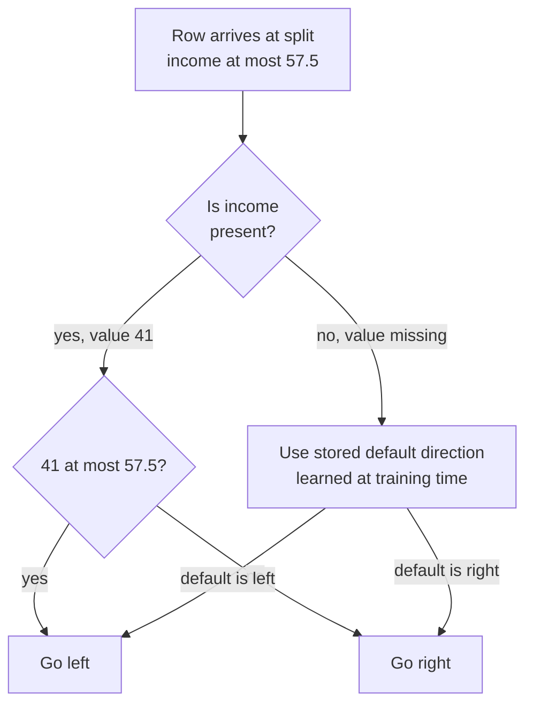

The diagram shows prediction-time routing. A present value follows the threshold test, and a missing value follows the direction stored in the node. Two consequences matter for systems. First, the direction is fixed at training time from the missing pattern seen then. If the production pipeline starts producing missing values for a feature that was always present in training, there was no training evidence for that feature at that node, and the behavior depends on a library-specific fallback; test it rather than assume. Second, if an upstream change starts filling nulls with a sentinel such as 0 or -1, the sentinel is no longer missing, so it follows the threshold test and may land in an unintended region. Missing-value handling is a contract between the data pipeline and the model, and it belongs in the model's input schema checks.

### 7.4 Missing as its own category or value

CatBoost treats numeric NaN through its `nan_mode` setting, by default treating NaN as smaller than every other value, with alternatives to treat it as larger or to forbid it. For categorical features, a missing value is simply another level, which the categorical machinery then handles. scikit-learn added native missing-value support to its tree estimators in recent releases (decision trees first, then random forests and others), and its `HistGradientBoosting` models have supported NaN for longer. Library behavior changes between versions, so verify the version you deploy.

### 7.5 Missingness is information, and a leakage path

Because a tree can route missing rows, it can also learn from the missingness pattern, which is useful and dangerous. It is useful when missingness reflects a real process, for example that applicants without a stated income tend to be self-employed. It is dangerous when missingness is created after the outcome, for example when a field is filled in only by a collections process that begins after delinquency. Then "field present" is a proxy for the label, and the model scores brilliantly offline and fails online, where the field is never present at decision time. The check is the same as for any feature: for each feature, ask whether it is available, with the same meaning and the same fill rate, at the moment of prediction. Compare the missing fraction per feature between training and serving, and between classes, as a standing monitor (Section 28).

### 7.6 Choosing a strategy

| Situation | Reasonable choice | Reason |
| --- | --- | --- |
| Gradient-boosted model, moderate missingness, missingness plausibly informative | Native handling, no imputation | The learned direction uses the pattern directly |
| Random forest in a library without native support | Impute with median or a sentinel plus a missing indicator | Keeps the information while satisfying the library |
| Single interpretable CART tree | Surrogate splits where available | Gives deterministic, explainable routing |
| Model must also run in a system that cannot represent NaN | Explicit sentinel plus indicator, documented in the feature schema | Avoids silent dependence on library NaN rules |
| Missingness differs between training and serving | Fix the pipeline first | No tree mechanism rescues a changed missingness mechanism |

## 8. Stopping, Pruning, and Cost-Complexity

### 8.1 Pre-pruning versus post-pruning

Two strategies control tree size. Pre-pruning stops growth early with a rule: maximum depth, minimum rows per leaf, minimum gain, or maximum number of leaves. It is cheap but shortsighted, because a split with small immediate gain may enable a valuable split below it. The standard example is exclusive-or: two features $A$ and $B$ where the label is 1 when exactly one of them is on. A split on $A$ alone yields no gain, since each child still has half of each class, yet after splitting on $A$ the split on $B$ is perfect. A pre-pruning rule that demands a minimum gain would refuse the first split and never find the structure. Post-pruning grows a large tree first and removes branches afterward, so it can keep a weak split that has strong descendants.

### 8.2 Cost-complexity pruning

Breiman and colleagues (1984) defined a one-parameter family of subtrees. For a tree $T$ with $|T|$ leaves and a resubstitution error $R(T)$ (the training misclassification rate or the training squared error), the cost-complexity measure is

$$
R_\alpha(T) = R(T) + \alpha \, |T|
$$

where $\alpha \ge 0$ is the price of one extra leaf. When $\alpha = 0$ the full tree wins because it has the lowest training error. As $\alpha$ rises, extra leaves become expensive, and the minimizer shrinks. The key theorem is that as $\alpha$ increases from zero, the minimizing subtree changes only at a finite set of breakpoints and forms a nested sequence $T_0 \supset T_1 \supset \dots \supset \{\text{root}\}$. The nested sequence is found by weakest-link pruning.

For any internal node $t$, let $T_t$ be the subtree rooted at $t$ and $R(t)$ the error if $t$ were replaced by a leaf. Collapsing $t$ adds error $R(t) - R(T_t)$ and removes $|T_t| - 1$ leaves, so the cost per removed leaf is

$$
g(t) = \frac{R(t) - R(T_t)}{|T_t| - 1}
$$

The weakest link is the node with the smallest $g(t)$, because it buys the least training-error reduction per leaf. Prune it, recompute, and repeat until only the root remains.

### 8.3 The ten-row table, pruned

The fully grown tree has five leaves and no training errors. Errors below are counted in rows, with $R$ equal to the count divided by 10.

| Step | Leaves | Training errors | Weakest link collapsed | $\alpha$ at collapse |
| --- | --- | --- | --- | --- |
| $T_0$ | 5 | 0 of 10 | Node holding ids 1, 2, 3, 4, 6 (4 defaults, 1 repayer) | 0.05 |
| $T_1$ | 3 | 1 of 10 | Node holding ids 1 to 6 | 0.10 |
| $T_2$ | 2 | 2 of 10 | Root | 0.20 |
| $T_3$ | 1 | 4 of 10 | none | none |

The arithmetic for the first row is: the node with ids 1, 2, 3, 4, 6 would make 1 error as a leaf (it predicts default and id 3 repaid), and its subtree makes 0, with 3 leaves, so $g = (0.1 - 0) / (3 - 1) = 0.05$. The node with ids 3, 4, 6 has $g = (0.1 - 0)/(2-1) = 0.10$, which is larger, so the five-row node is weaker and goes first. After that collapse, the node of ids 1 to 6 would make 2 errors as a leaf and its subtree makes 1, with 2 leaves, so $g = (0.2 - 0.1)/1 = 0.10$. Finally the root would make 4 errors and the two-leaf tree makes 2, so $g = (0.4 - 0.2)/1 = 0.20$. The $T_1$ tree is the depth-2 tree shown in Section 3.1. The script prints this table.

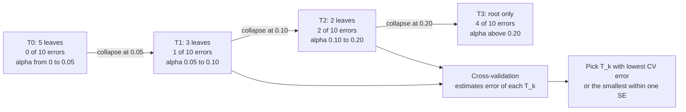

The diagram shows the nested sequence and how a subtree is selected. Pruning does not use the training error to choose among the sequence, because the training error always favors $T_0$. It estimates each candidate's error by cross-validation, where the folds regrow trees and the same $\alpha$ values are applied, and then picks the best. Breiman's one-standard-error rule picks the smallest tree whose cross-validated error is within one standard error of the minimum, which leans toward simplicity because the error curve is typically flat near the minimum. With ten rows nothing here is statistically meaningful, and the exercise shows the mechanics only.

### 8.4 Where pruning fits today

Cost-complexity pruning is the standard method for a single tree and is exposed as `ccp_alpha` in scikit-learn. Ensembles mostly do not prune. Random forests grow deep trees and rely on averaging to control variance. Gradient-boosting libraries grow shallow trees and control size with depth or leaf limits, with a minimum-gain threshold that plays the pre-pruning role, and XGBoost applies a post-hoc pruning of splits whose gain falls below the threshold. For a single tree used as an interpretable model, pruning is the main tool, and it is worth also constraining depth for readability: a tree with 40 leaves is a model, not an explanation.

## 9. Why a Single Tree Has High Variance

### 9.1 Instability from greedy choice

The high-variance property of trees has three causes. First, the splits are hard decisions. A small change in the training sample can switch which feature wins at a node, and every split below is then recomputed on a different set of rows, so the change propagates. Second, the leaf estimates are averages over few rows deep in the tree. Third, the greedy search chooses the best of many candidates, which inflates the apparent quality of the winner on the sample (Section 6.2).

The ten-row table demonstrates the first cause. The root split is already a near-tie: "income at most 57.5" and "dti at most 0.335" both have weighted Gini $0.2667$. Flip the label of a single applicant, id 6 (income 55, dti 0.37), from default to repayment, so there are three defaults rather than four. The best root split then becomes "income at most 44.5", tied with "dti at most 0.39". The income split sends ids 1 to 4 left with three defaults of four (Gini $0.375$) and ids 5 to 10 right with none, for a weighted Gini of $0.4(0.375) = 0.15$. One changed label out of ten moved the root threshold from 57.5 to 44.5 and rearranged the left and right populations. In a real dataset with thousands of rows the effect of one row is much smaller at the root, but the same mechanism operates at deeper nodes where the row counts are small, and an analyst who retrains monthly sees feature thresholds and importances reshuffle.

### 9.2 The variance of a leaf

A leaf with $n$ rows estimates a class probability $\hat{p}$ with standard error $\sqrt{\hat{p}(1-\hat{p})/n}$. For the leaf of five rows with $\hat{p} = 0.8$, the standard error is $\sqrt{0.8 \times 0.2 / 5} = 0.179$, so the plausible true default probability ranges widely, from roughly 0.45 to 1.0 at two standard errors. A deep tree has many such leaves. The model's prediction for a new applicant is the estimate of whichever small leaf they land in, so the prediction inherits this noise. A leaf of fifty rows has a standard error of $0.057$ at the same $\hat{p}$. This is the arithmetic behind `min_samples_leaf`: raising the minimum leaf size lowers leaf variance at the price of coarser regions (more bias).

### 9.3 Bias, variance, and depth

The standard bias-variance trade-off from [CH01](CH01_Machine_Learning_Foundations.md) applies with tree depth as the complexity dial. A depth-1 tree (a stump) has very high bias because it can only produce two values. A fully grown tree has low bias and the highest variance. The best single tree is usually in between, which is why a single tree is rarely the final model for accuracy. Single trees remain useful for three reasons: they are the building block for ensembles, they are the easiest model to explain when kept small, and they provide a quick, scale-free feature-interaction probe during exploration.

### 9.4 Two structural limits

Two other weaknesses are bias, not variance, and persist even for stable trees. A tree is piecewise constant, so a smooth relationship such as $y = 2x + 1$ is approximated by a staircase, with the step height set by the leaf size. And a tree with axis-aligned splits needs many splits to represent a diagonal boundary: to separate the region $x_1 + x_2 > 1$ from its complement within a unit square to a small error, the staircase needs a number of steps that grows as the error shrinks. Ensembles reduce variance but do not remove the staircase. Boosting removes some of it by adding many staircases whose sum is smoother, and a linear model, a neural network, or engineered features such as $x_1 + x_2$ handle diagonals directly.

## 10. Bagging

### 10.1 The idea

Bagging, short for bootstrap aggregating (Breiman, 1996), fits the same learner on many resampled versions of the training set and averages the results. The resampling is the bootstrap: draw $n$ rows from the $n$ available, with replacement, so some rows appear several times and others not at all. Each bootstrap sample yields one tree. For regression the ensemble predicts the average of the trees. For classification it predicts the majority vote or, usually better, the average of the trees' class-probability estimates.

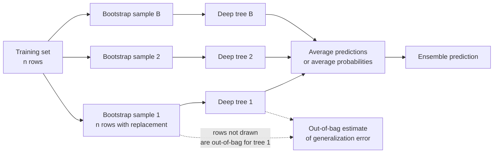

The diagram shows the two products of bagging. The solid path produces the prediction. The dotted path shows that the rows left out of each bootstrap sample form a free validation set for that tree (Section 10.4). Because the trees are independent given the data, they can be trained in parallel, which makes bagging easy to scale across cores or machines.

### 10.2 What a bootstrap sample looks like

The probability that a particular row is not drawn in any one of $n$ draws is $(1 - 1/n)^n$, which approaches $e^{-1} \approx 0.368$ as $n$ grows. So a bootstrap sample contains about $63.2$ percent of the distinct training rows, and the remaining $36.8$ percent are out-of-bag for that tree. For the ten-row table the exact figures are $(0.9)^{10} = 0.3487$ out-of-bag and $0.6513$ in-bag, so a bootstrap sample holds about 6.5 distinct rows out of 10. The script confirms the large-$n$ result: with $n = 300$ the average out-of-bag fraction per tree is $0.366$ against the theoretical $0.367$.

### 10.3 Why averaging reduces variance: the formula

Let $B$ trees produce predictions $\hat{f}_1(x), \dots, \hat{f}_B(x)$ at a fixed input $x$. Treat each as a random variable whose randomness comes from the training sample and from the tree's own randomization (the bootstrap draw and any feature sampling). Suppose each has variance $\sigma^2$ and each pair has correlation $\rho$. The variance of the average is

$$
\operatorname{Var}\!\left(\frac{1}{B}\sum_{b=1}^{B}\hat{f}_b\right)
= \frac{1}{B^2}\left[\,B\sigma^2 + B(B-1)\rho\sigma^2\,\right]
= \rho\,\sigma^2 + \frac{1-\rho}{B}\,\sigma^2
$$

The first step expands the variance of a sum into $B$ variance terms and $B(B-1)$ covariance terms, each equal to $\rho\sigma^2$. The second step collects terms. The formula has two parts. The second part, $(1-\rho)\sigma^2/B$, shrinks to zero as $B$ grows. The first part, $\rho\sigma^2$, does not depend on $B$. So averaging more trees removes the independent portion of the variance and leaves the correlated portion. Two consequences follow.

- If the trees were independent ($\rho = 0$) the variance would fall as $\sigma^2/B$ and could be made arbitrarily small.
- The gain from additional trees saturates at $\rho\sigma^2$. When $\rho$ is large, a hundred trees buy little more than ten.

The bias of the average equals the common bias of its members, because the expectation of an average of identically distributed variables is the common expectation. Averaging therefore does not reduce bias. It works well when the base learner has low bias and high variance, which is exactly a deep tree. For a stable learner, whose predictions barely change across bootstrap samples, $\sigma^2$ is already small and bagging adds nothing, which is why bagging helps trees and does nothing for linear regression with many rows.

A caution on what $\rho$ means. It is the correlation between two trees' predictions across repeated draws of the training set and the trees' own randomization, not the correlation between two trees fitted to the same data. Given a fixed dataset, bootstrap-trained trees are independent and identically distributed, so their conditional correlation is zero. The unconditional correlation is positive because all trees are built from the same underlying data distribution and the same strong features.

### 10.4 Measured on a simulated problem

The script [02_bagging_variance.py](../code/python/decision-trees-chapter/02_bagging_variance.py) draws 30 training sets of 300 rows from a known function plus noise with standard deviation 1.0 and measures prediction variance and squared bias at 60 fixed test points. Trees are grown to depth 8. Results in the following table are averages over the test points.

| Model | Variance | Squared bias | Sum |
| --- | --- | --- | --- |
| Single deep tree | 8.04 | 5.83 | 13.87 |
| Bagging, 25 trees | 1.43 | 5.71 | 7.14 |
| Random forest, 25 trees, 2 of 6 features per split | 0.94 | 6.40 | 7.34 |

Bagging cut the variance from $8.04$ to $1.43$ and left bias essentially unchanged ($5.83$ to $5.71$), which halved the expected squared error excluding noise. The script then estimates $\sigma^2$ and $\rho$ directly: build two trees on each of 100 training sets, compute the variance of a single tree across training sets and the covariance between the two trees. For bagging it finds $\sigma^2 = 8.86$ and $\rho = 0.132$. The formula predicts a variance of $0.132 \times 8.86 + 0.868 \times 8.86 / 25 = 1.17 + 0.31 = 1.47$ for 25 trees, and the measured variance of the 25-tree average is $1.46$. The formula describes the measurement well.

The same estimates show the diminishing return in $B$. With $\sigma^2 = 8.86$ and $\rho = 0.132$, the variance of the average is $1.17 + 7.69/B$. That is $8.86$ for one tree, $2.71$ for five, $1.48$ for twenty-five, $1.25$ for one hundred, and $1.17$ in the limit. Going from 25 to 100 trees buys $0.23$ of variance, and going from 100 to infinity buys $0.08$. The first tens of trees do almost all the work.

### 10.5 Out-of-bag error

Each row is out-of-bag for about 36.8 percent of the trees. Averaging only those trees' predictions for that row gives an out-of-bag prediction that the row never influenced, and the error of these predictions across all rows is the out-of-bag (OOB) error. It behaves like a leave-one-out estimate that comes free with training, with no separate validation set and no refits.

In the script, a 60-tree random forest trained on 300 rows has a training mean squared error of $1.99$ (misleadingly low, since each row was in-bag for most trees), an OOB mean squared error of $8.39$, and a mean squared error of $9.17$ on 600 held-out rows drawn from the same process. The OOB figure is close to the held-out figure, and the training figure is not. Three limitations apply.

- The estimate assumes rows are independent and identically distributed. If rows are grouped (several transactions per customer) or ordered in time, a row's out-of-bag prediction is made by trees that were trained on its siblings or its future, and OOB error is optimistic. Use a grouped or temporal split from [CH06](CH06_Model_Evaluation_Validation_and_Selection.md) instead.
- Each OOB prediction averages only about 37 percent of the trees, so it is slightly noisier, and for small $B$ slightly pessimistic, compared with the full ensemble.
- Any step done on the full data before the forest, such as selecting features by their relationship to the label, leaks into the OOB estimate just as it would into any validation estimate.

### 10.6 Bagging variants

| Variant | Resampling | Use |
| --- | --- | --- |
| Bagging | Bootstrap rows, all features | Variance reduction of unstable learners |
| Pasting and subbagging | Subsample rows without replacement (for example 50 percent) | Cheaper per tree; often as good, and easier to analyze |
| Random subspace (Ho, 1998) | Random feature subsets per tree, all rows | Decorrelates trees when many features are redundant |
| Random forest | Bootstrap rows and random feature subset at every split | The standard decorrelated tree ensemble (Section 11) |
| Extremely randomized trees | Random thresholds as well as random features (Geurts, Ernst, and Wehenkel, 2006) | Lower variance and faster training at some bias cost |

## 11. Random Forests

### 11.1 Algorithm

A random forest (Breiman, 2001) is bagging of deep trees with one change: at every split, the tree considers only a random subset of $m$ of the $p$ features and picks the best split among them. The full procedure is:

1. For $b = 1, \dots, B$, draw a bootstrap sample of the rows.
2. Grow a tree on the sample. At each node, draw $m$ features at random without replacement, find the best split among those features only, and split.
3. Grow to a small minimum leaf size, with no pruning.
4. Predict by averaging the $B$ trees (probabilities or numeric values) or by majority vote.

Breiman's suggested defaults were $m = \sqrt{p}$ for classification and $m = p/3$ for regression. Library defaults differ: scikit-learn's classifier uses the square root, and its regressor uses all features by default in current releases, which makes it a plain bagged-tree ensemble unless `max_features` is set. Check the default of the library you use.

### 11.2 Why feature subsampling helps

Without feature sampling, bagged trees share their strongest splits. If one feature dominates, most bootstrap trees put it at the root, then the same second-level split, and the trees look alike. High $\rho$ in the formula of Section 10.3 caps the benefit of averaging. Restricting each split to a random subset means the dominant feature is unavailable at a fraction $1 - m/p$ of nodes, which forces trees to find alternative splits and makes their errors less correlated. Lower $\rho$ means lower ensemble variance at any $B$.

The price is bias. A tree restricted to $m$ features cannot always take the best split, so each tree is individually a little worse. Smaller $m$ lowers $\rho$ and raises bias. The correct $m$ balances these, and it depends on how many features carry signal.

The simulation shows this trade-off, and it also shows that random forests are not always better than bagging. In the script, five of six features carry signal and the sixth is noise. Choosing $m=2$ of 6 cut the variance from $1.43$ to $0.94$ (and $\rho$ from $0.132$ to $0.052$) but raised squared bias from $5.71$ to $6.40$, so the total went from $7.14$ to $7.34$, slightly worse. With few features and most informative, forcing a split among two random candidates often picks a weak feature. On a table with hundreds of correlated columns, the balance reverses. Treat `max_features` as a hyperparameter to tune, with candidates such as $\sqrt{p}$, $p/3$, and $p/2$, not as a given.

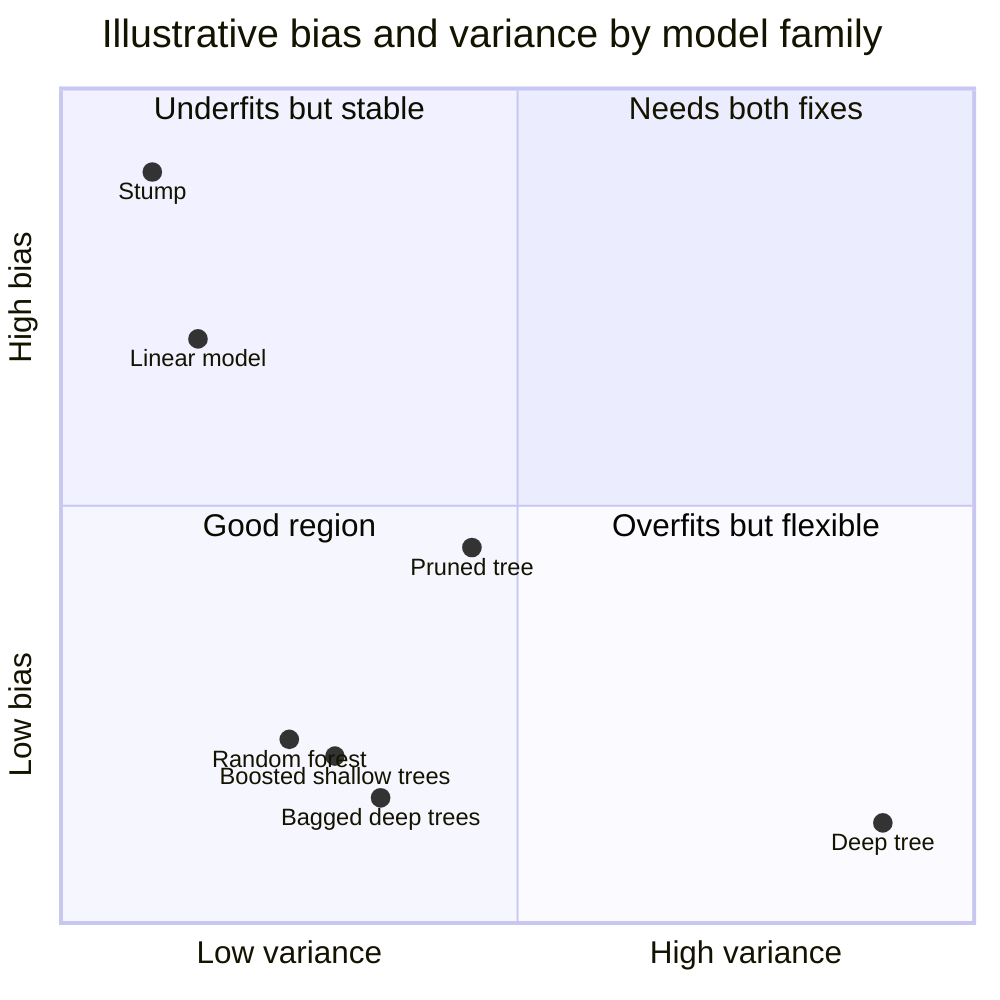

The chart is a qualitative placement, not measured data. Moving from a deep tree to a bagged ensemble shifts the model left (variance falls) at about the same height (bias is unchanged). Boosting shallow trees starts from the high-bias, low-variance corner of the stump and moves downward as rounds accumulate. These two motions are the two ensemble strategies of this chapter, and the figure explains why the two families have different tuning priorities: for forests, control variance through $m$ and leaf size, and for boosting, control bias through the number of rounds and then guard against variance through shrinkage and regularization.

### 11.3 Hyperparameters that matter

| Hyperparameter | Effect | Typical guidance |
| --- | --- | --- |
| Number of trees $B$ | Lowers variance with diminishing return; no overfitting from more trees | Use a few hundred; increase until OOB error plateaus; memory and latency grow linearly |
| `max_features` $m$ | Trades correlation against per-tree bias | Tune among $\sqrt{p}$, $p/3$, $p/2$, and $p$ |
| Minimum samples per leaf | Smooths leaf estimates | 1 for clean data; 3 to 20 or more for noisy labels; also shrinks the model |
| Maximum depth | Caps complexity and size | Often unlimited; set when model size or latency matters |
| `max_samples` (bootstrap fraction) | Lower fraction gives more diverse and faster trees | 0.5 to 1.0; useful for very large $n$ |
| Class weights | Changes the effective loss | See imbalance (Section 21); distorts probabilities |

A random forest cannot overfit by adding trees in the sense that adding trees makes the generalization error diverge: Breiman proved that the error converges as $B$ grows. A forest can still overfit by being too deep for noisy data, which shows up as OOB error that is far worse than a regularized alternative.

### 11.4 Where random forests are weak

- **Probabilities.** Averaging leaf fractions from deep trees yields coarse probabilities. Leaves that are pure produce 0 or 1, so the ensemble probability is close to a vote fraction. The forest pushes probabilities away from 0 and 1 because the averaging includes trees that disagree, a distortion that Niculescu-Mizil and Caruana (2005) documented, so calibration is usually needed (Section 20).
- **Size.** A fully grown tree on $n$ rows with distinct feature vectors has up to $n$ leaves. A bootstrap sample has about $0.632n$ distinct rows, so with $n = 100{,}000$ and $B = 500$ the forest can hold on the order of $3 \times 10^7$ leaves. That is hundreds of megabytes to gigabytes in memory and a slow single-row prediction compared with shallow boosted trees. Section 25 puts numbers on this.
- **Extrapolation and smooth trends.** The same piecewise-constant limits as for a single tree (Section 24).
- **Accuracy ceiling.** On many tabular tasks a tuned gradient-boosted model beats a forest by a modest margin, because boosting reduces bias while a forest cannot.

Forests remain the right first ensemble when tuning time is short, when the data are noisy, when OOB error is a convenient built-in validation, and when insensitivity to hyperparameter choices matters more than the last percent of accuracy.

## 12. AdaBoost

### 12.1 From averaging to sequencing

Bagging builds learners independently and averages them. Boosting builds learners one after another, each aimed at what the previous ones got wrong. AdaBoost (adaptive boosting; Freund and Schapire, 1997) is the first practical boosting algorithm, and it is the cleanest way to see the idea. It uses labels $y_i \in \{-1, +1\}$ and weak learners $h_m(x) \in \{-1, +1\}$, which here are depth-one trees called decision stumps.

The algorithm keeps a weight $w_i$ on each training example, starting at $1/n$.

1. Fit a weak learner $h_m$ minimizing the weighted error $\varepsilon_m = \sum_i w_i \, \mathbf{1}[h_m(x_i) \ne y_i]$.
2. Compute the learner's vote weight $\alpha_m = \tfrac{1}{2}\ln\frac{1-\varepsilon_m}{\varepsilon_m}$. A learner no better than chance ($\varepsilon_m = 0.5$) gets $\alpha_m = 0$, and a better learner gets a larger positive weight.
3. Update the example weights: $w_i \leftarrow w_i \exp(-\alpha_m y_i h_m(x_i)) / Z_m$, where $Z_m$ is the normalizer that makes the weights sum to one. Misclassified examples ($y_i h_m(x_i) = -1$) are multiplied up. Correct examples are multiplied down.
4. After $M$ rounds, predict $\operatorname{sign}\big(\sum_m \alpha_m h_m(x)\big)$.

### 12.2 A worked run

Ten points with $x = 1, \dots, 10$ and labels $+,+,+,-,-,-,+,+,+,-$ cannot be separated by any single threshold. The script runs AdaBoost with stumps that test $x > t$ in either orientation.

**Round 1.** All weights are $0.1$. The best stump predicts $+$ for $x \le 3.5$ and $-$ for $x > 3.5$. It is wrong at $x = 7, 8, 9$, so $\varepsilon_1 = 0.3$ and $\alpha_1 = \tfrac12 \ln(0.7/0.3) = \tfrac12(0.8473) = 0.4236$. The wrong points are multiplied by $e^{0.4236} = 1.5275$ and the right points by $e^{-0.4236} = 0.6547$, giving unnormalized weights $0.1528$ and $0.0655$. The normalizer is $Z_1 = 3(0.1528) + 7(0.0655) = 0.9165$. The new weights are $0.1667$ for each of the three wrong points and $0.0714$ for each of the seven others. Note that the three previously wrong points now carry exactly half of the total weight, $3 \times 0.1667 = 0.5$. This is a general property of the update: after reweighting, the previous learner has weighted error exactly one half, so it is useless on the new distribution and the next learner must find different information.

**Round 2.** The best stump on the new weights predicts $+$ for $x \le 9.5$ and $-$ for $x = 10$. It is wrong at $x = 4, 5, 6$, each with weight $0.0714$, so $\varepsilon_2 = 0.2143$, $\alpha_2 = \tfrac12\ln(0.7857/0.2143) = 0.6496$, and $Z_2 = 0.8207$.

**Round 3.** After renormalizing, the weights are about $0.0455$ on $x = 1, 2, 3, 10$, $0.1667$ on $x = 4, 5, 6$, and $0.1061$ on $x = 7, 8, 9$. The best stump predicts $-$ for $x \le 6.5$ and $+$ above. It is wrong at $x = 1, 2, 3$ and $x = 10$, so $\varepsilon_3 = 4(0.0455) = 0.1818$, $\alpha_3 = 0.7520$, and $Z_3 = 0.7714$.

After round 1 the ensemble misclassifies three points. After round 2 it still misclassifies three, because $0.6496 - 0.4236 > 0$ favors the second stump wherever the two disagree. After round 3 it misclassifies none. No single stump got better than 30 percent error, yet the weighted vote of three stumps separates the data perfectly. This is boosting: a sequence of weak learners, each forced to attend to the failures of its predecessors, combined with weights that reflect each learner's reliability.

### 12.3 Why the formulas have that shape

The update rules come from fitting an additive model $F_m = F_{m-1} + \alpha h_m$ by minimizing the exponential loss $\sum_i \exp(-y_i F(x_i))$ stage by stage (Friedman, Hastie, and Tibshirani, 2000). At stage $m$ the loss is $\sum_i w_i \exp(-\alpha y_i h(x_i))$, where $w_i \propto \exp(-y_i F_{m-1}(x_i))$ is the weight each example has accumulated. Splitting the sum into correct and incorrect examples gives $e^{-\alpha}(1-\varepsilon) + e^{\alpha}\varepsilon$. Setting the derivative with respect to $\alpha$ to zero gives $e^{2\alpha} = (1-\varepsilon)/\varepsilon$, which is the formula for $\alpha_m$. Substituting back gives the minimum value $Z = 2\sqrt{\varepsilon(1-\varepsilon)}$. The training error of the final classifier is bounded by the product of the normalizers: in the example, $0.9165 \times 0.8207 \times 0.7714 = 0.580$, a bound that is loose here but shrinks geometrically whenever each learner beats chance by a margin $\gamma_m = \tfrac12 - \varepsilon_m$, because $Z_m \le \exp(-2\gamma_m^2)$.

### 12.4 Strengths and weaknesses

AdaBoost is simple, needs one hyperparameter (the number of rounds) beyond the weak learner, and often shows a surprising resistance to overfitting on clean data. Its weaknesses define why the field moved on. The exponential loss grows quickly for confidently wrong examples, so the weights of mislabeled examples keep growing round after round, and the later learners spend capacity fitting label noise. Its raw scores are not probabilities, and mapping them to probabilities needs calibration. And it fits one specific loss. Friedman's gradient boosting (next section) generalizes the same sequential idea to any differentiable loss, including the logistic loss, which is more tolerant of noise and produces calibrated-in-principle probabilities. AdaBoost is therefore best understood as the exponential-loss special case of gradient boosting.

## 13. Gradient Boosting as Functional Gradient Descent

### 13.1 From parameters to functions

Ordinary gradient descent (see [CH01](CH01_Machine_Learning_Foundations.md)) minimizes a loss over a parameter vector $\theta$ by repeating $\theta \leftarrow \theta - \eta \nabla_\theta L$. Friedman (2001) observed that the same step works when the thing being optimized is the prediction function itself. Write the training loss as

$$
L(F) = \sum_{i=1}^{n} \ell\big(y_i, F(x_i)\big)
$$

and regard the $n$ numbers $F(x_1), \dots, F(x_n)$ as the parameters. The gradient of $L$ with respect to these numbers has one entry per training row. The negative gradient entry is the pseudo-residual

$$
r_{im} = -\left.\frac{\partial \ell(y_i, F(x_i))}{\partial F(x_i)}\right|_{F = F_{m-1}}
$$

evaluated at the current model $F_{m-1}$. Moving each $F(x_i)$ along $r_{im}$ would lower the loss on the training rows, but it would define the new function only at the training points. To generalize to new inputs, fit a weak learner (a small regression tree) to the pseudo-residuals, so the tree learns a smooth, region-based approximation to the negative gradient. The tree plays the role of the gradient, and adding it to the model is a descent step in function space.

### 13.2 The algorithm

The generic gradient-boosting algorithm for a loss $\ell$, with learning rate $\nu$ and $M$ rounds, is:

1. Initialize with the best constant, $F_0(x) = \arg\min_{c} \sum_i \ell(y_i, c)$.
2. For $m = 1, \dots, M$:
    1. Compute the pseudo-residuals $r_{im}$ for every row.
    2. Fit a regression tree to the targets $r_{im}$. Its leaves define regions $R_{jm}$.
    3. For each leaf, find the best constant by a one-dimensional search, $\gamma_{jm} = \arg\min_\gamma \sum_{x_i \in R_{jm}} \ell\big(y_i, F_{m-1}(x_i) + \gamma\big)$.
    4. Update $F_m(x) = F_{m-1}(x) + \nu \sum_j \gamma_{jm}\,\mathbf{1}[x \in R_{jm}]$.
3. Output $F_M$.

The tree structure is chosen by least-squares fit to the gradients, and the leaf values are then re-optimized for the actual loss. This two-step design is the reason one tree learner serves every loss.

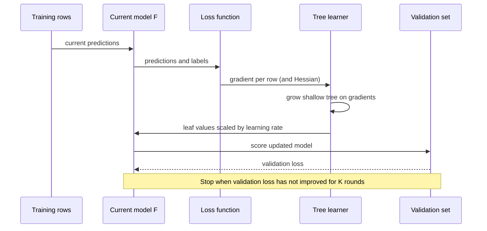

The sequence shows that every round recomputes gradients against the current model, which is why boosting is inherently sequential across trees, in contrast to bagging. Parallelism in boosting is inside a round: the split search over features and rows. The validation check at the end of each round is what makes early stopping cheap (Section 17).

### 13.3 Squared loss: fitting residuals

For squared error, $\ell = \tfrac12 (y - F)^2$, the negative gradient is $r = y - F$. The pseudo-residual is the ordinary residual, which gives the intuitive description of boosting as repeatedly fitting a tree to what the model still gets wrong. The initial constant is the mean of $y$.

Apply this to the five-row regression table from Section 4.6: $x = 1,\dots,5$ and $y = 10, 12, 11, 30, 33$. The initial prediction is the mean $19.2$, so the residuals are $-9.2, -7.2, -8.2, 10.8, 13.8$ with sum of squares $510.8$. The best stump splits after $x = 3$. Its leaf values are the mean residuals, $(-9.2 - 7.2 - 8.2)/3 = -8.2$ on the left and $(10.8 + 13.8)/2 = 12.3$ on the right. With learning rate $\nu = 0.5$, the new predictions are $19.2 + 0.5(-8.2) = 15.1$ on the left and $19.2 + 0.5(12.3) = 25.35$ on the right. The new residuals are $-5.1, -3.1, -4.1, 4.65, 7.65$ with sum of squares $26.01 + 9.61 + 16.81 + 21.6225 + 58.5225 = 132.575$. With $\nu = 1$ the sum would be $6.5$, the within-leaf scatter alone. A step of $\nu = 0.5$ removed about 74 percent of the error, not all of it. If the next stump picks the same split, the offsets $4.1$ and $6.15$ halve again to $2.05$ and $3.075$, and the sum of squares drops to $6.5 + 3(2.05)^2 + 2(3.075)^2 = 38.0$. Each round multiplies the between-leaf offset by $(1 - \nu)$, so the error approaches the within-leaf floor geometrically, and a deeper tree or a different split lowers that floor.

### 13.4 Other losses

The pseudo-residual changes with the loss, and the rest of the algorithm does not.

| Loss | $\ell(y, F)$ | Pseudo-residual | Leaf value | Typical use |
| --- | --- | --- | --- | --- |
| Squared error | $\tfrac12(y-F)^2$ | $y - F$ | Mean of residuals | Regression with Gaussian-like noise |
| Absolute error | $\lvert y - F \rvert$ | $\operatorname{sign}(y - F)$ | Median of residuals | Regression tolerant of outliers |
| Huber | Quadratic near zero, linear beyond $\delta$ | Clipped residual | Approximate median-mean | Outlier-tolerant regression |
| Quantile at level $\tau$ | Pinball loss (Section 22) | $\tau$ or $\tau - 1$ | Residual quantile | Prediction intervals |
| Logistic (binary) | $-y\log p - (1-y)\log(1-p)$, $p = \sigma(F)$ | $y - p$ | Newton step (Section 14) | Binary classification with probabilities |
| Exponential | $\exp(-yF)$ with $y \in \{-1,+1\}$ | $y\,e^{-yF}$ | Weighted vote | AdaBoost |
| Poisson, Gamma, Tweedie | Deviance with log link | Link-scale gradient | Newton step | Counts, severities, insurance |

For binary logistic loss, $F$ is the log-odds, so the model output must be passed through the sigmoid $p = 1/(1 + e^{-F})$ to give a probability. The pseudo-residual $y - p$ is the gap between the label and the current predicted probability. A prediction of $p = 0.9$ for a positive row gives a small residual of $0.1$, and for a negative row a large residual of $-0.9$. For multiclass problems with the softmax link, the algorithm fits one tree per class per round, so the model has $K$ trees per round and training and prediction cost scale with $K$.

### 13.5 Shrinkage

The learning rate $\nu \in (0, 1]$ scales each tree's contribution. Friedman found empirically that small values, such as $\nu \le 0.1$, nearly always give better test error than $\nu = 1$ for the same model class, at the price of needing more rounds. The rationale is that each tree is a noisy, high-variance estimate of the gradient, because it is a greedy tree fit to a finite sample. A full step trusts the noise completely. A small step commits only a fraction of the estimated improvement, so that errors in individual trees are averaged over many rounds, which has a bagging-like effect on variance.

The script [03_gradient_boosting.py](../code/python/decision-trees-chapter/03_gradient_boosting.py) fits depth-3 trees with squared loss on a simulated problem (300 training rows, 150 validation rows, 600 test rows, noise variance $0.25$) and stops each configuration at its best validation round. Errors are reported as mean squared error (MSE).

| Learning rate | Best round | Validation MSE | Test MSE at best round | Test MSE at round 400 |
| --- | --- | --- | --- | --- |
| 1.0 | 6 | 0.566 | 0.541 | 0.684 |
| 0.3 | 22 | 0.325 | 0.351 | 0.409 |
| 0.1 | 76 | 0.297 | 0.352 | 0.392 |
| 0.03 | 268 | 0.299 | 0.345 | 0.349 |

Three patterns are typical. Going from $\nu = 1$ to $\nu = 0.3$ cuts test error from $0.541$ to $0.351$, while going from $0.3$ to $0.03$ changes it by only $0.006$ while multiplying the number of rounds by twelve. So the return is front-loaded: pick a small enough rate, often $0.05$ to $0.1$, and spend remaining effort elsewhere. The product of rate and best round is roughly constant ($6$, $6.6$, $7.6$, and $8.0$), which is a useful rule: halving the learning rate roughly doubles the rounds needed. Finally, the last column shows the cost of not stopping: with $\nu = 1$ the test error at round 400 is $0.684$ against $0.541$ at the best round, because the model has fitted noise, whereas the smallest rate is flat across the run ($0.345$ at best, $0.349$ at 400). Small rates make the stopping round forgiving, which is an operational benefit as well as a statistical one.

### 13.6 Subsampling

Friedman (2002) added stochastic gradient boosting: at each round, fit the tree on a random subsample of the rows (typically 50 to 80 percent, drawn without replacement). This introduces randomness between trees that lowers their correlation, acts as regularization, and speeds up each round. In the script, with $\nu = 0.1$ and depth-3 trees, subsampling half of the rows each round lowered test MSE from $0.352$ to $0.320$ and validation MSE from $0.297$ to $0.277$. This is one run on one dataset, so treat the size of the gain as illustrative and the direction as typical. The libraries also subsample columns, per tree, per level, or per node, with the same effect on correlation, and column subsampling is a hedge against a few dominant features.

### 13.7 Tree depth sets the interaction order

A tree of depth $d$ can represent interactions among at most $d$ features along a root-to-leaf path. Boosting stumps ($d = 1$) produces an additive model $F(x) = \sum_j f_j(x_j)$ with a separate shape function per feature, since each stump involves one feature. Depth 2 allows pairwise interactions, and so on. Typical production settings use depth 3 to 8, and the right value reflects the interaction order in the data: if interactions beyond order three do not exist, deeper trees add variance without reducing bias. A cheap and informative experiment is to compare depth 1 (additive), depth 2, and depth 4 on a held-out set. If depth 1 is close to depth 4, the problem is nearly additive and an interpretable additive model may suffice.

### 13.8 What boosting optimizes, and where it overfits

Training loss decreases monotonically with each round, since each step is a descent step on that loss. Validation loss typically falls and then rises as the model starts fitting noise. Boosting therefore has an explicit complexity control that bagging lacks: the number of rounds. The three regularizers (rounds, shrinkage, and tree depth) interact, which is why they are tuned together. Boosting also amplifies label noise more than bagging does. Rows with wrong labels keep producing large gradients, so later trees spend leaves on them. Logistic and Huber losses limit this effect compared with exponential and squared loss, and outlier-tolerant objectives, clean labels, and larger minimum leaf sizes limit it further.

## 14. Second-Order Boosting

### 14.1 The objective with a Taylor expansion

Friedman's algorithm fits the tree structure to first-order information (the gradient) and then fixes the leaf values by a line search. Chen and Guestrin (2016) built XGBoost around a cleaner idea: use the second-order Taylor expansion of the loss to choose both the structure and the leaf values in closed form, and add an explicit penalty on tree complexity.

At round $m$ the learner adds a tree $f$ to the model $F_{m-1}$ by minimizing

$$
\mathcal{L}^{(m)} = \sum_{i=1}^{n} \ell\big(y_i, F_{m-1}(x_i) + f(x_i)\big) + \Omega(f), \qquad \Omega(f) = \gamma\,T + \tfrac12 \lambda \sum_{j=1}^{T} w_j^2
$$

where $T$ is the number of leaves, $w_j$ the value of leaf $j$, $\gamma$ the penalty per leaf, and $\lambda$ an L2 penalty on leaf values. Define for each row the gradient and Hessian of the loss with respect to the current prediction,

$$
g_i = \left.\frac{\partial \ell(y_i, \hat{y})}{\partial \hat{y}}\right|_{\hat{y} = F_{m-1}(x_i)}, \qquad h_i = \left.\frac{\partial^2 \ell(y_i, \hat{y})}{\partial \hat{y}^2}\right|_{\hat{y} = F_{m-1}(x_i)}
$$

A second-order expansion in the new tree's output gives $\ell(y_i, F_{m-1} + f) \approx \ell(y_i, F_{m-1}) + g_i f(x_i) + \tfrac12 h_i f(x_i)^2$. The first term is constant in $f$ and can be dropped. Because $f(x_i) = w_j$ for rows $x_i$ in leaf $j$, group the sum by leaf, and let $G_j = \sum_{i \in R_j} g_i$ and $H_j = \sum_{i \in R_j} h_i$. Then

$$
\tilde{\mathcal{L}}^{(m)} = \sum_{j=1}^{T}\left[ G_j w_j + \tfrac12 (H_j + \lambda) w_j^2 \right] + \gamma\,T
$$

Each leaf contributes an independent quadratic in $w_j$. Setting the derivative to zero gives the optimal leaf weight and the resulting objective value:

$$
w_j^{*} = -\frac{G_j}{H_j + \lambda}, \qquad \tilde{\mathcal{L}}^{*} = -\frac12 \sum_{j=1}^{T} \frac{G_j^2}{H_j + \lambda} + \gamma\,T
$$

The objective value of a fixed tree structure is a sum over leaves of a score $G_j^2/(H_j + \lambda)$. This is the structure score, and it is what the split search maximizes. When a leaf splits into left and right children, the gain is

$$
\text{Gain} = \frac12\left[ \frac{G_L^2}{H_L + \lambda} + \frac{G_R^2}{H_R + \lambda} - \frac{(G_L + G_R)^2}{H_L + H_R + \lambda} \right] - \gamma
$$

A split is worth making only if the gain is positive, which is how $\gamma$ acts as a pruning threshold.

### 14.2 Special cases show the unity

For squared loss $\ell = \tfrac12(y - \hat{y})^2$, the gradient is $g_i = \hat{y}_i - y_i = -r_i$ and the Hessian is $h_i = 1$. With $\lambda = 0$ the leaf weight is $w = \sum r_i / n_j$, the mean residual, and $G^2/H = (\sum r_i)^2 / n_j$, so the gain is the between-leaf sum of squares, exactly the variance reduction of Section 4.6 up to a constant. Second-order boosting with squared loss reproduces the classical regression tree on residuals.

For logistic loss with $p = \sigma(\hat{y})$, $g_i = p_i - y_i$ and $h_i = p_i(1 - p_i)$. The Hessian is largest ($0.25$) when the model is uncertain ($p = 0.5$) and approaches zero for confident predictions. So uncertain rows contribute most to the leaf's $H$, and a leaf of confidently classified rows has a small $H$ regardless of how many rows it contains.

### 14.3 A hand-checkable round

Six rows with feature values $x = 1, \dots, 6$ and labels $0, 0, 1, 0, 1, 1$. The initial prediction is the log-odds of the base rate $3/6$, which is $0$, so $p_i = 0.5$ for all rows. Then $g_i = p_i - y_i = (0.5, 0.5, -0.5, 0.5, -0.5, -0.5)$ and $h_i = 0.25$ for all rows. The totals are $G = 0$ and $H = 1.5$. The script evaluates the five candidate thresholds.

With $\lambda = 0$, the split after $x = 2$ has $G_L = 1.0$, $H_L = 0.5$, $G_R = -1.0$, $H_R = 1.0$. The gain is $\tfrac12(1.0^2/0.5 + 1.0^2/1.0 - 0) = \tfrac12(2 + 1) = 1.5$. The split after $x = 4$ ties at $1.5$ with $G_L = 1.0, H_L = 1.0$ and $G_R = -1.0, H_R = 0.5$. The other three splits have gains $0.6$, $0.333$, and $0.6$. The leaf weights for the split after $x = 2$ are $w_L = -1.0/0.5 = -2.0$ and $w_R = 1.0/1.0 = +1.0$.

With $\lambda = 1$, the same split has gain $\tfrac12(1.0/1.5 + 1.0/2.0) = \tfrac12(0.6667 + 0.5) = 0.5833$, and the leaf weights shrink to $w_L = -1.0/1.5 = -0.6667$ and $w_R = 1.0/2.0 = 0.5$. The L2 penalty reduced the leaf weights to one third and one half of their unregularized values. The leaf with the smaller $H$ (here, the left leaf with two rows and $H_L = 0.5$) is shrunk more, as the formula $G/(H+\lambda)$ implies.

With a learning rate of $0.3$, the new log-odds for the left rows are $0.3 \times (-0.6667) = -0.2$, so $p = \sigma(-0.2) = 0.450$, and for the right rows $0.3 \times 0.5 = 0.15$, so $p = 0.537$. Without regularization ($\lambda = 0$) the moves are larger: $p = 0.354$ for the left rows and $p = 0.574$ for the right. A single round moves the probabilities modestly, and many rounds accumulate the signal. Note also that the split search finds a tie between the two best thresholds. The implementation keeps the first.

### 14.4 Regularization parameters in plain terms

- **$\lambda$** shrinks leaf weights toward zero and, because it appears in the denominators of the gain, discourages splits that create leaves with small $H$.
- **$\gamma$** (the minimum split loss) sets the least gain that justifies a split. A split with positive loss reduction below $\gamma$ is not made.
- **`min_child_weight`** requires a minimum sum of Hessians $H$ in each child. For squared loss $h_i = 1$ and the quantity equals the row count. For logistic loss it is the sum of $p(1-p)$, so a leaf with 100 rows that are all confidently predicted ($p \approx 0.01$) has $H \approx 0.99$ and fails a threshold of 1 even though it contains many rows. This is a frequent source of confusion when tuning on imbalanced data: the same setting that means "at least 5 rows" for regression means "at least 5 units of uncertainty mass" for classification.
- **`max_delta_step`** caps the leaf weight and helps logistic regression on extremely imbalanced data, where $H$ is near zero and $G/(H+\lambda)$ can explode.

### 14.5 Why second-order and its limits

Using curvature gives a Newton step instead of a gradient step: for losses with strong curvature differences across rows, such as logistic loss, it converges in fewer rounds and gives principled leaf values from a single closed-form expression. It also gives one formula that works for any twice-differentiable convex loss, so custom objectives need only supply $g$ and $h$. The limits are that $h_i$ must be positive for the leaf formula to describe a minimum (for non-convex custom losses the implementation clamps or modifies $h$), and that losses with zero second derivative almost everywhere, such as absolute error and the pinball loss, need a separate leaf-update rule (a median or quantile of residuals in the leaf). Recent XGBoost releases rework their quantile and absolute-error objectives for this reason, a reminder to pin library versions and re-check objective behavior when upgrading.

## 15. XGBoost, LightGBM, and CatBoost

The three libraries implement the same family: gradient boosting with trees as weak learners. The differences are in how they search for splits, how they grow trees, how they treat categorical features, and how they avoid the biases that arise when the same data produce both the gradients and the model. Library versions and defaults change, so the statements below describe mechanisms and the defaults at the time of writing (late 2026) that you should confirm against the documentation of the version you deploy. At the time of writing XGBoost is in its 3.x series, with release notes at the [XGBoost documentation](https://xgboost.readthedocs.io/).

### 15.1 Histogram-based split finding

The exact greedy algorithm of Section 5 sorts every feature at every node. For large data this is the bottleneck. The histogram method, now the default in all three libraries, replaces it with three steps.

1. **Bin once.** Before training, compute quantile-based bin edges per feature (255 or 256 bins by default) and replace every value with its bin index, stored in one byte.
2. **Accumulate histograms.** At each node, for each feature, sum the gradients and Hessians of the node's rows into per-bin totals. This is one pass over the node's rows per feature.
3. **Scan the bins.** Run the split-gain formula along the bins, as the sorted scan did along sorted values.

A small example makes the third step concrete. Suppose a node's rows fall into four bins of one feature with the following gradient and Hessian totals, and $\lambda = 1$.

| Bin | 0 | 1 | 2 | 3 | Total |
| --- | --- | --- | --- | --- | --- |
| $G$ | 2 | 1 | -3 | -4 | -4 |
| $H$ | 3 | 2 | 2 | 3 | 10 |

The parent score is $G^2/(H+\lambda) = 16/11 = 1.4545$. Splitting after bin 0 gives $G_L = 2$, $H_L = 3$ and $G_R = -6$, $H_R = 7$, so the gain is $\tfrac12(4/4 + 36/8 - 1.4545) = \tfrac12(1 + 4.5 - 1.4545) = 2.023$. Splitting after bin 1 gives $G_L = 3$, $H_L = 5$ and $G_R = -7$, $H_R = 5$, so the gain is $\tfrac12(9/6 + 49/6 - 1.4545) = \tfrac12(1.5 + 8.1667 - 1.4545) = 4.106$. Splitting after bin 2 gives $G_L = 0$, $H_L = 7$ and $G_R = -4$, $H_R = 3$, so the gain is $\tfrac12(0 + 16/4 - 1.4545) = 1.273$. The best split is after bin 1.

The method has three advantages. The scan costs $O(\text{bins})$ per feature instead of $O(n)$. Memory falls because bin indices fit in a byte. And the histogram subtraction trick halves the work: once a parent's histogram and one child's histogram are known, the sibling's histogram is the parent's minus the child's, so only the smaller child needs a pass over the data. The costs are a small loss of split resolution (a threshold can sit only at a bin edge) and sensitivity to the binning for features with extreme skew. The loss of resolution acts as mild regularization and rarely hurts accuracy. For features with fewer than the maximum bins of distinct values, binning is lossless.

### 15.2 Level-wise versus leaf-wise growth

A tree learner must decide which node to split next. A level-wise (depth-wise) learner splits every node at the current depth before moving down, so it produces balanced trees up to `max_depth`. A leaf-wise (best-first) learner always splits the leaf whose best split has the largest gain anywhere in the tree, until a leaf budget is reached.

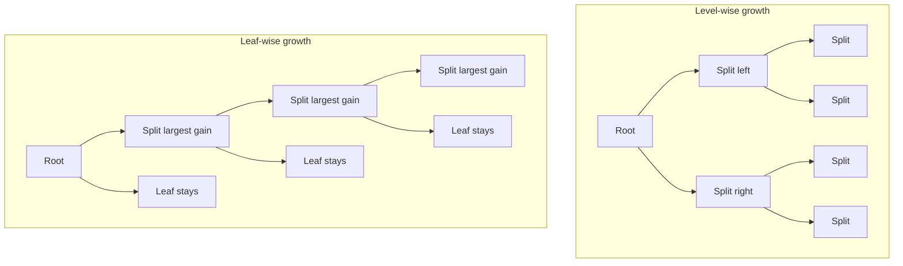

For the same number of leaves, a leaf-wise tree reaches a lower training loss because it spends splits where they matter and none on regions that are already well fit. The cost is shape: leaf-wise trees can become deep and unbalanced, with long chains in a high-gain region, and on small datasets they overfit faster. This is why LightGBM's main complexity control is `num_leaves` (default 31), supplemented by `max_depth` and `min_data_in_leaf` (default 20), and why an XGBoost-style `max_depth` carries over poorly: a LightGBM tree with `num_leaves` of 255 and no depth limit is not equivalent to depth 8. XGBoost defaults to depth-wise growth with `max_depth` 6 and offers `grow_policy` set to `lossguide` for leaf-wise growth. A practical rule when moving between libraries is to match the number of leaves per tree, then retune depth and minimum leaf size.

### 15.3 XGBoost

XGBoost (eXtreme Gradient Boosting) popularized the regularized second-order objective of Section 14 and engineered it for scale.

- **Sparsity-aware splits.** The learned default direction (Section 7.3) handles missing values and sparse inputs such as one-hot columns in one mechanism: only non-missing entries are visited, so cost scales with the number of non-zero entries.
- **Tree methods.** `hist` is the default in current releases (histogram-based, running on a central processing unit (CPU) or a graphics processing unit (GPU)), `approx` is a sketch-based method, and `exact` is the sorted greedy algorithm for small data.
- **Categorical features.** XGBoost supports native partition-based splits on categorical columns, enabled by marking a column as categorical, with one-hot splitting for low cardinality controlled by `max_cat_to_onehot`. Release notes for the 3.x series describe a re-coder that stores category mappings in the model so that categorical encodings stay consistent at inference, and later 3.x releases changed defaults for categorical support. Verify the behavior in the version you deploy.
- **Distributed and out-of-core training.** XGBoost supports distributed training on Spark, Dask, and other frameworks, and GPU training including external-memory modes, which matters when data exceed GPU memory.
- **Defaults** at the time of writing: `eta` (learning rate) 0.3, `max_depth` 6, `lambda` 1, `gamma` 0, `min_child_weight` 1. The default learning rate is high by the guidance of Section 13.5, so lowering it with more rounds and early stopping is a standard first change.

### 15.4 LightGBM

LightGBM (Light Gradient Boosting Machine; Ke and colleagues, 2017) combines histograms with leaf-wise growth and two additional speedups.

- **Gradient-based One-Side Sampling (GOSS).** Rows with large gradients contribute most to the split gain, so GOSS keeps all large-gradient rows and a random sample of small-gradient rows, upweighting the sample to keep gain estimates approximately unbiased. This reduces the rows per round.
- **Exclusive Feature Bundling (EFB).** Sparse features that are rarely non-zero at the same time are merged into a single feature by offsetting their bin ranges. Finding the optimal bundling is NP-hard, and the paper uses a greedy graph-coloring approximation. This reduces the feature count for sparse, high-dimensional inputs.
- **Categorical features.** LightGBM finds the best partition by sorting categories by their accumulated gradient statistic (the Fisher-style shortcut of Section 6.3 applied to the gradient and Hessian sums), with regularization parameters `cat_smooth`, `cat_l2`, `min_data_per_group`, and `max_cat_threshold` to limit overfitting on rare levels.
- **Defaults** at the time of writing: `num_leaves` 31, `learning_rate` 0.1, `min_data_in_leaf` 20, `max_bin` 255. The [LightGBM documentation](https://lightgbm.readthedocs.io/en/latest/Features.html) describes the histogram method and leaf-wise growth.

GOSS and EFB are optional, and a default model does not necessarily exercise both. LightGBM's typical advantage is training speed on large, wide data on CPU. Its typical hazard is overfitting small data with too many leaves.

### 15.5 CatBoost

CatBoost (Categorical Boosting; Prokhorenkova and colleagues, 2018) differs from the other two in its tree shape and in two techniques aimed at bias.

- **Symmetric (oblivious) trees.** In the default tree shape, every node at the same depth uses the same feature and threshold, so a depth-$d$ tree is defined by $d$ (feature, threshold) pairs and has $2^d$ leaves addressed by a $d$-bit index. This is a strong regularizer, since the tree cannot adapt its splits to sub-regions, and it makes inference fast and cache-friendly: evaluate $d$ comparisons, form a bit index, look up the leaf. The cost is reduced flexibility, which on some datasets raises bias.
- **Ordered target statistics for categorical features.** Naively replacing a category by its mean target leaks the row's own label into its feature (Section 23). CatBoost computes the statistic for each row from only the rows that precede it in a random permutation, with a prior, which gives each row a feature value that does not depend on its own label. Several permutations are used, and combinations of categorical features are also built greedily.
- **Ordered boosting.** In ordinary boosting the gradients for a row are computed from a model that was trained on that same row, which biases the gradient estimates (a form of target leakage called prediction shift). Ordered boosting trains supporting models on preceding rows in a permutation so that the gradient for row $i$ comes from a model that has not seen row $i$. It costs more computation and, per the authors, helps most on small datasets. The CatBoost default for the boosting scheme depends on dataset size.
- **Defaults** at the time of writing include symmetric trees with depth 6 and automatic learning-rate selection from the dataset size. Check the documentation for the version in use.

### 15.6 Choosing among them

| Dimension | XGBoost | LightGBM | CatBoost |
| --- | --- | --- | --- |
| Split search | Histogram (default), exact and approximate also available | Histogram | Histogram on quantized features |
| Tree growth | Depth-wise default, leaf-wise option | Leaf-wise | Symmetric (oblivious) default, other policies available |
| Missing values | Learned default direction | Learned default direction | NaN treated as minimum or maximum, or forbidden |
| Categorical features | Native partitions, one-hot below a size threshold | Native partitions with sorted gradient statistics | Ordered target statistics and feature combinations |
| Distinct strength | Ecosystem, distributed and GPU maturity, regularized objective | Speed on large data, GOSS and EFB | Categorical-heavy and small data, default quality, fast inference |
| Main hazard | High default learning rate; categorical behavior varies by version | Overfitting with large `num_leaves` on small data | Slower training; fewer tuning knobs for edge cases |

Published comparisons give mixed rankings that depend on dataset and tuning effort. A defensible procedure is to pick one library as the default for a platform (to limit operational variety), tune it well, and run the other two as a challenger on the first project of each new data type. On categorical-heavy data, include CatBoost in the comparison. If training time dominates, include LightGBM. If serving across multiple runtimes dominates, check which library has the better converter or compiler for your serving stack (Section 25). Differences among tuned libraries are usually smaller than differences caused by feature quality and validation design.

## 16. Stacking and Blending

### 16.1 The idea

Bagging averages models of the same kind with equal weights, and boosting adds models in sequence. Stacking (Wolpert, 1992) combines models of different kinds by learning how to weight them. The base models (level 0) might be a gradient-boosted tree, a random forest, a regularized logistic regression, and a neural network. A meta-model (level 1) takes their predictions as inputs and learns the final prediction, typically a regularized linear or logistic model with non-negative weights.

The gain comes from diversity. For two models whose errors have equal variance $\sigma^2$ and correlation $\rho$, the variance of their average is $\tfrac{1}{2}(1 + \rho)\sigma^2$, the $B = 2$ case of the formula in Section 10.3. If the errors are 0.9 correlated, averaging reduces the variance by 5 percent, and if they are 0.5 correlated, by 25 percent. Two gradient-boosted models with different seeds are nearly perfectly correlated and stacking them adds almost nothing. A boosted tree and a linear model on the same features are less correlated, because they make different kinds of mistakes: the tree misses smooth global trends, and the linear model misses interactions.

### 16.2 The leakage trap and the out-of-fold construction

The meta-model must be trained on predictions that the base models made on rows they did not train on. If it were trained on in-sample predictions, a deep tree would appear nearly perfect (its training predictions are close to the labels), and the meta-model would learn to trust it completely. The standard construction uses $K$-fold out-of-fold predictions.

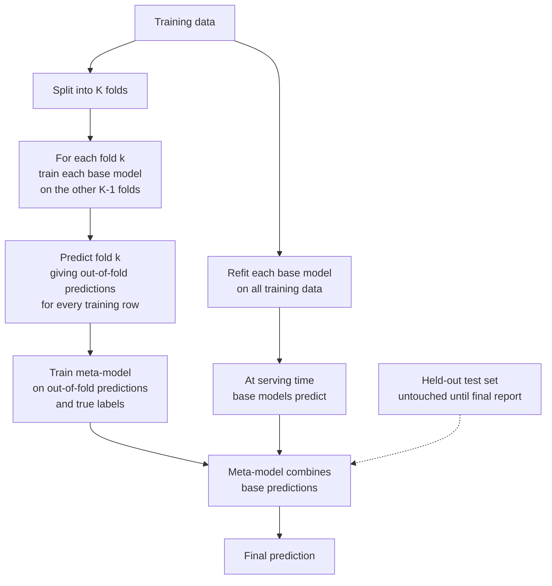

The diagram shows two pipelines that share the training data. The left one builds the training table for the meta-model from out-of-fold predictions, so each of its rows reflects a base-model prediction made without seeing the row. The right one refits each base model on all the data for serving. A subtle mismatch results: the refit base models are slightly stronger than the fold models that produced the meta-model's training inputs, so the meta-model's weights are slightly conservative. This is usually acceptable. The held-out test set is used once, at the end.

Blending is the cheaper variant: instead of $K$ folds, hold out a fixed portion of the training data (say 20 percent), train base models on the rest, and train the meta-model on the held-out predictions. It is simpler and avoids the leakage trap, but it wastes data and gives a noisier meta-model. For temporal data, the out-of-fold construction must respect time (forward-chaining folds), or the meta-model learns from the future.

### 16.3 When stacking pays for itself in production

Stacking multiplies serving cost, deployment surface, and monitoring burden by the number of base models, and it makes explanations harder. A typical improvement over the best single tuned gradient-boosted model is small. Whether it is worth it depends on what a unit of accuracy is worth. In a high-value, high-volume decision (card fraud, ad ranking), a small relative gain in ranking quality can repay a larger serving footprint. In a low-volume decision it will not. A reasonable rule is to stack only after the single-model pipeline is mature and well monitored, to prefer two or three diverse base models over ten similar ones, to cap the meta-model's capacity (a non-negative linear blend is hard to overfit), and to measure the incremental gain with a confidence interval over folds or time windows, not a single split. A simple average of two or three well-chosen models, with no learned meta-model, captures most of the gain and removes the meta-model as a failure point.

## 17. Hyperparameter Tuning and Early Stopping

### 17.1 Which hyperparameters matter, and in what order

A boosted tree has many settings, and they are not equally important. A practical order for gradient boosting is:

1. **Learning rate and number of rounds.** Fix a moderate learning rate (0.05 to 0.1) and let early stopping choose the rounds. Lower the rate at the end for the final fit.
2. **Tree complexity.** Depth or leaf count: the interaction order and the single largest bias-variance dial.
3. **Leaf-size controls.** Minimum rows per leaf or minimum Hessian sum per child, which set leaf variance (Section 9.2).
4. **Row and column subsampling.** Typical values are 0.5 to 1.0 for rows and 0.3 to 1.0 for columns.
5. **Regularization.** The $\lambda$ and $\gamma$ penalties of Section 14, which matter more on noisy or small data.
6. **Categorical-handling parameters,** for datasets with high-cardinality categories (Section 6.4).

| Setting | Typical search range | Effect of increasing | Notes |
| --- | --- | --- | --- |
| Learning rate | 0.02 to 0.3 (log scale) | Faster fit, higher variance | Fix early, lower at the end |
| Depth (depth-wise) | 3 to 10 | More interactions, more variance | Depth 6 is a common starting point |
| Number of leaves (leaf-wise) | 8 to 256 | Same | Not equivalent to depth; limit `max_depth` too |
| Minimum child weight or rows | 1 to 100 (log scale) | Smoother leaves, more bias | Sums of Hessians for classification |
| Row subsample | 0.5 to 1.0 | Less correlation, more bias | 0.7 to 0.8 is a common value |
| Column subsample | 0.3 to 1.0 | Same | Helps with many correlated features |
| L2 penalty $\lambda$ | 0 to 100 (log scale) | Smaller leaf weights | Matters for small $H$ leaves |
| Minimum split gain $\gamma$ | 0 to 10 | Fewer splits | Scale depends on the loss |

The ranges are starting points, not guarantees. They depend on data size and loss scale.

### 17.2 Search strategy

Grid search wastes trials on unimportant dimensions: with a few important dimensions among many, random search covers the important ones more densely (Bergstra and Bengio, 2012). Bayesian optimization and tree-structured Parzen estimators concentrate later trials where earlier ones scored well. Successive halving and Hyperband stop poor trials early, which fits boosting naturally because the validation curve is available after every round. A budget of 50 to 200 trials is typical for a tuned production model; more trials show diminishing returns and increase the selection bias discussed next.

### 17.3 Early stopping without contaminating the final estimate

Early stopping picks the number of rounds by watching a validation metric and stopping when it has not improved for a set number of rounds (the patience), then keeping the best iteration. It is the cheapest and most effective regularizer for boosting, and it uses data in a way that is easy to get wrong. The validation set influences the model through the stopping round, so its score is no longer an unbiased estimate of generalization. The same applies to hyperparameter choice: the more configurations compared on the same validation set, the larger the optimistic bias of the best one. If 100 configurations are equal in true quality and their validation scores differ only by noise with standard deviation $s$, the best of them is expected to score about $2.5 s$ above the true value (the expected maximum of 100 independent standard normals is about 2.5). The configurations are correlated in practice, so the real inflation is smaller, but it is not zero.

A protocol that avoids the problem has three roles for data:

- **Training data** fits the trees.
- **Validation data** selects the stopping round and compares hyperparameters. It may be reused during tuning, and its score is treated as biased.
- **Test data** is touched once, after all choices are fixed, and gives the reported estimate.

If data are scarce, use cross-validation for tuning, with early stopping inside each training fold against a validation slice carved from that fold, and keep an outer test set or an outer cross-validation loop for the final estimate. [CH06](CH06_Model_Evaluation_Validation_and_Selection.md) covers nested cross-validation in general. For temporal data, the validation set must come after the training set in time, and the test set after the validation set.

After choosing hyperparameters and the best iteration $k^*$, refit on training plus validation data with a fixed number of rounds, commonly $k^*$ scaled up by 5 to 20 percent because the model sees more data, and with no early stopping, because there is no validation set left to watch. Record the choice and rationale.

### 17.4 Choosing the metric and the patience

Early stopping should monitor a metric aligned with how the model will be used. Log loss is a good default when probabilities matter, since it rewards calibration and is smooth. The area under the receiver operating characteristic (ROC) curve (AUC) or a ranking metric is appropriate when only ordering matters, but a model stopped on AUC can be badly calibrated and needs calibration afterward (Section 20). A business metric such as expected cost at a threshold is noisy and a poor stopping signal, so use it for model selection, not for the stopping rule. Patience should be large enough to ride out noise in the validation curve: roughly 50 to 200 rounds at a learning rate of 0.05, with proportionally more for lower rates. Plot the validation curve at least once per project. A curve that is flat for hundreds of rounds shows that the number of rounds is not the binding constraint, and one that is jagged shows that the validation set is too small.

### 17.5 Reproducibility

Boosted models are deterministic given a seed on a single thread, but multi-threaded and GPU training sum floating-point values in varying orders in the histogram accumulation, so two runs can differ in the last digits and occasionally in a chosen split. Record seeds, library and hardware versions, the bin edges produced from the training data, and the full parameter dictionary. When comparing two models, run several seeds and compare distributions, because the seed-to-seed spread on a modest dataset is often as large as the difference between two reasonable configurations.

## 18. Monotonic Constraints

### 18.1 Why constraints are needed

A flexible model can learn relationships that contradict domain knowledge or law. A credit model might show a default probability that rises slightly when income rises in some narrow band because the training data happen to contain a few unusual applicants there. A reviewer cannot defend that to a customer or a regulator. A monotonic constraint forces the model to be non-decreasing, or non-increasing, in a named feature, holding the others fixed. Such constraints encode a prior that the training data cannot be trusted to provide, and they remove a class of spurious wiggles caused by sampling noise.

### 18.2 How trees enforce them

Enforcing monotonicity in a single tree requires every leaf on the "greater" side of a split on feature $j$ to have a value at least as large as every leaf on the "lesser" side. During the split search for a constrained feature, the learner rejects any split whose left leaf value (for an increasing constraint) exceeds its right leaf value. That is necessary but not sufficient, because a later split deeper in the left subtree could produce a leaf that exceeds a leaf in the right subtree. So the learner propagates bounds downward: after accepting a split with left value $a$ and right value $b$, it caps all leaf values in the left subtree at the midpoint $(a + b)/2$ and floors all in the right subtree at the same value (the exact bound rule varies by library). Every leaf in the left subtree is then at most the midpoint, and every leaf in the right subtree is at least the midpoint, so the ordering holds across the whole tree. A sum of monotone trees is monotone, so a boosted ensemble in which every tree respects the constraint is monotone as well, and a random forest is monotone for the same reason.

XGBoost, LightGBM, and CatBoost all accept a per-feature constraint vector with values $+1$, $-1$, or $0$ for increasing, decreasing, or unconstrained. LightGBM offers several enforcement methods (`basic`, `intermediate`, and `advanced`) that trade training speed against how tightly the bounds are propagated, with the looser methods losing some accuracy. A constraint on feature $j$ is a statement about changing $x_j$ alone: the model's output can still decrease as $x_j$ increases if other features change at the same time, which is what a real applicant history does.

### 18.3 Costs, benefits, and tests

Constraints reduce the model's flexibility, so training fit falls. When the constraint is true in the population, validation performance often holds or improves slightly because the constrained model has less room to fit noise. When the constraint is false, it hurts. Age and risk are often U-shaped, income and risk are monotone for a consumer lender but may not be for a lender to small businesses, and a count of "recent inquiries" can be non-monotone because zero inquiries can indicate a thin file. Apply constraints only where the monotone relationship is a documented rule, and measure the accuracy cost on a time-based split.

Constraints are testable, and the test should run in the model's release pipeline. For each constrained feature, take a sample of real rows, sweep that feature across a grid of values while holding the others fixed, and assert that the prediction is non-decreasing (or non-increasing) in the sweep. A failure indicates a library bug, a pipeline mismatch such as a preprocessing step that reverses the sign, or a conversion error when exporting the model to a different runtime. Post-hoc calibration by Platt scaling or isotonic regression is a monotone function of the score, so it preserves the property.

## 19. Feature Importance

### 19.1 Why importance is a trap

After training, someone will ask which features matter. The honest answer depends on the definition, because there are at least three, and they disagree whenever features are correlated, vary in cardinality, or interact. A ranking presented without its method is not evidence.

### 19.2 Impurity-based (gain) importance

The default importance in tree libraries sums, for each feature, the impurity decrease (or the gain of Section 14) over all splits that use it, weighted by the number of rows at the node. It is free after training and normalizes to a share. It has three known flaws.

- **It is computed on training data.** A feature that the model has used to memorize noise appears important, even if it has no predictive value on new data. Overfit models rank noise features highly.
- **It favors high-cardinality and continuous features** because they offer more candidate splits (Section 6.2).
- **It splits credit among correlated features arbitrarily.** If two features carry the same information, whichever wins a given split takes the credit at that split. Across a forest the credit is shared in an unpredictable way, so each can look half as important as the pair deserves, or one can dominate by chance.

Libraries also expose count-based variants (how many times a feature is used in a split) and cover (the number of rows affected). These measure usage, not contribution to accuracy.

### 19.3 Permutation importance

Permutation importance (introduced by Breiman, 2001, in its out-of-bag form, and generalized by Fisher, Rudin, and Dominici, 2019) measures the damage done when a feature is made uninformative. The procedure is:

1. Compute a metric (AUC, log loss, mean squared error) of the trained model on a held-out set.
2. For feature $j$, randomly shuffle its column across the rows, breaking its link to the label, and recompute the metric.
3. The importance is the drop in the metric. Repeat the shuffle several times and report the mean and spread.

It is model-agnostic, measured on data the model did not train on, and tied to a metric you care about. Its flaw is the treatment of correlated features. Shuffling one feature of a correlated pair creates rows that never occur in reality (a customer with a high income and a low-income-implied spending pattern), and the model, which can also read the twin feature, loses little. Suppose features $A$ and $A'$ are near duplicates and the baseline AUC is 0.85. Permuting $A$ alone might lower it to 0.84, permuting $A'$ alone to 0.84, but permuting both together to 0.78. Each feature looked unimportant individually, and the pair is among the most important in the model. These numbers are illustrative of the mechanism, not measured.

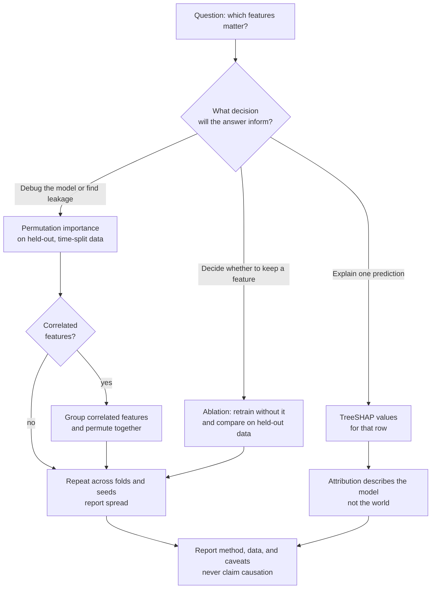

The diagram turns the choice of method into a decision. Each method answers a different question, so the first step is to state the decision the importance will inform. Grouping correlated features before permutation is the main correction. Retraining without a feature (drop-column importance, or ablation) answers "what do we lose without it" directly, at the price of one refit per feature, and also understates the importance of a feature that has a substitute.

### 19.4 SHAP values: a recap

SHAP (SHapley Additive exPlanations; Lundberg and Lee, 2017) assigns each feature an additive contribution to a single prediction using Shapley values from cooperative game theory: the average marginal effect of adding the feature across all orders in which features could be added. For tree ensembles, TreeSHAP computes these values exactly in polynomial time by exploiting the tree structure (Lundberg and colleagues, 2020), which is why SHAP is practical on boosted trees. The contributions sum to the difference between the prediction and a baseline expectation, on the log-odds scale for a logistic model. Averaging the absolute values over a dataset gives a global importance that, unlike gain importance, is based on how the model behaves on the evaluated rows.

Three cautions apply. SHAP values explain the model, not the world: a large contribution means the model relies on the feature, which says nothing about whether intervening on it would change the outcome. The values depend on how missing features are defined (the interventional versus path-dependent variants give different answers for correlated features). And when features are correlated, the credit is shared in ways that can mislead a reader into thinking either feature alone is dispensable. [CH31 — Responsible AI and Safety Governance](CH31_Responsible_AI_and_Safety_Governance.md) covers explanation duties in more depth.

### 19.5 Using importance well

- Use importance first as a leakage detector. A feature with implausibly high importance on a hard problem, such as a field populated only after the outcome, is the most common source of an offline-online gap (see Section 23 for the target-encoding case).
- Compute permutation importance on a held-out, time-ordered set and repeat across folds. Importance that changes sharply between folds is unstable and should not be reported as a ranking.
- Do not select features by importance and then evaluate on the same data. Do the selection inside the training loop of the validation scheme.
- Never read importance as a causal effect. A model may rely on a feature that is a proxy for a protected attribute, or for the decision process itself, without any causal relationship to the outcome.

## 20. Calibration of Ensembles

### 20.1 What can go wrong

A calibrated model's predicted probability matches the observed frequency: among rows scored 0.2, about 20 percent are positive. [CH03](CH03_Regression_and_Classification.md) introduces calibration and threshold selection, and [CH06](CH06_Model_Evaluation_Validation_and_Selection.md) covers the evaluation methods. This section covers how ensembles differ.

- **Random forests** average leaf frequencies from deep trees. Scores rarely reach 0 or 1 because some trees disagree, so the forest tends to be underconfident at the extremes, with a reliability curve shaped like a sigmoid. Niculescu-Mizil and Caruana (2005) documented this pattern for bagged trees and random forests and found it common to boosted trees trained with margin-based losses.
- **Boosted trees with logistic loss** optimize a proper scoring rule, so early-stopped models are often reasonably calibrated. Run long enough, the training loss drives scores toward the extremes on training data, and the model becomes overconfident on new data. The degree depends on the learning rate, the rounds, and the regularization.
- **AdaBoost** produces margin scores that are not probabilities. They are monotone in the true probability and need a mapping.
- **Small leaves** make probabilities noisy: a leaf with three rows cannot produce a reliable estimate (Section 9.2).
- **Training choices** distort calibration deliberately: class weights, `scale_pos_weight`, undersampling, and early stopping on AUC (Section 21).

### 20.2 Calibration methods

The standard fixes learn a monotone map from score to probability on held-out data that the model did not train on.

| Method | What it fits | Strengths | Weaknesses |
| --- | --- | --- | --- |
| Platt scaling | Logistic regression of the label on the score (2 parameters) | Stable on small calibration sets; fits sigmoid-shaped distortions | Cannot fix other distortions |
| Isotonic regression | Monotone step function | Flexible; fits any monotone distortion | Overfits when positives are few; produces ties and flat regions |
| Temperature or logit scaling | A scale on log-odds | One parameter; keeps ranking and ties | Fixes only uniform over- or under-confidence |
| Intercept (prior) shift | Adds a constant to the log-odds | Fixes a changed base rate | Fixes only the base rate |

A rule of thumb is to use Platt or logit scaling when the calibration set has fewer than a few thousand positives, and isotonic regression when it has many more. Fit the calibrator on data that is separate from the data used for training and for early stopping, or use out-of-fold predictions, and evaluate the calibrated model on a third set. If the same validation set drives early stopping, model selection, and calibration, the reported calibration quality is optimistic.

### 20.3 A base-rate shift worked through

A fraud model trained when the fraud rate was 2 percent now runs in a period where the rate is 1 percent, and the features have not otherwise drifted. A transaction with an old-model probability of $p = 0.10$ has odds $0.10/0.90 = 0.1111$. A prior shift multiplies the odds by the ratio of the new prior odds to the old prior odds, which is $(0.01/0.99)/(0.02/0.98) = 0.010101/0.020408 = 0.4949$. The updated odds are $0.1111 \times 0.4949 = 0.0550$, which corresponds to $p = 0.0550/1.0550 = 0.0521$. Without the correction, every alert would be overestimated by about a factor of two, and a threshold on the probability would fire too often. In log-odds terms the correction is adding a constant, which is why an intercept shift is the first thing to try when the base rate moves and the ranking is stable. It is the wrong fix if the features' relationship to the label has changed.

### 20.4 Consequences for decisions

Monotone calibration leaves the ordering unchanged (isotonic regression can create ties), so AUC is unchanged by Platt scaling and affected only slightly by isotonic regression, while log loss and the Brier score improve when the mapping was wrong. Calibration matters whenever the probability itself is used: expected-cost thresholds, pricing, capital provisioning, or a downstream system that multiplies probabilities. If only the ranking is used, such as a fixed review capacity of the top 500 items per day, calibration is cosmetic. Monitor calibration in production through the reliability curve on matured labels, as part of Section 28.

## 21. Imbalanced Data

### 21.1 Why trees need attention here

When positives are rare, say 0.5 percent of rows, accuracy is meaningless, and tree learners face practical issues. Leaves with few positives have noisy estimates. Gradient statistics are dominated by the negative class, and with logistic loss most rows have small Hessians, so Hessian-based minimum-weight rules reject splits that isolate a few positives (Section 14.4). The deeper the tree, the more likely each leaf holds no positives at all.

### 21.2 Options and trade-offs

| Approach | What it does | Effect on probabilities | When it helps |
| --- | --- | --- | --- |
| Do nothing, then move the threshold | Train with plain loss; pick the decision threshold from costs | Preserved (probabilities remain calibratable) | Often adequate when there are enough positives in absolute terms |
| Class weights or `scale_pos_weight` | Multiplies the loss on positives | Inflated; must be corrected | Few positives, and ranking is the main goal |
| Undersample negatives | Drops a fraction of majority rows | Inflated; correctable by formula | Very large data; speeds training |
| Oversample positives or synthetic minority oversampling technique (SMOTE) | Duplicates or interpolates positives | Inflated; trees may memorize duplicates | Rarely for trees; interpolated points can be unrealistic |
| Focal or custom loss | Downweights easy examples | Distorted | Extreme imbalance where easy negatives dominate |
| Balanced bagging | Undersamples per tree inside the ensemble | Inflated | Random forests with a small positive class |

The decision depends on the use. If the score will feed a threshold or an expected-cost rule, preserve the probabilities or correct them afterward. If only the ranking matters, reweighting is acceptable. Resampling is evidence-dependent: it sometimes improves minority-class recall and sometimes only shifts the threshold. Test it against the plain-loss baseline with a threshold chosen on the validation set, not with a default 0.5 cutoff.

### 21.3 Correcting probabilities after reweighting or resampling

Suppose negatives were undersampled so that each negative was kept with probability $\beta$. A model trained on the sample estimates $p_s$, the probability under the sampled distribution. Dal Pozzolo and colleagues (2015) give the correction

$$
p = \frac{\beta\,p_s}{\beta\,p_s - p_s + 1}
$$

For $\beta = 0.1$ and $p_s = 0.5$, the corrected probability is $0.05 / (0.05 - 0.5 + 1) = 0.05/0.55 = 0.0909$. The model's 50 percent score corresponds to a true probability of about 9 percent. For a positive-class weight $w$, the model's odds are inflated by approximately $w$, so true odds are about model odds divided by $w$. With $w = 99$ (a 1 percent positive rate reweighted to parity) and a model output of $0.6$, the model odds are $1.5$, the true odds are $1.5/99 = 0.01515$, and the true probability is about $0.0149$. A threshold of 0.5 on the reweighted score (model odds of 1) is a threshold of $1/99$ in odds, or 1 percent, on the true probability. This is useful but not intended, so state which scale a threshold refers to.

### 21.4 Splitting, metrics, and label delay

Preserve the class balance in every split and make sure each validation fold has enough positives to estimate the metric. A fold with 8 positives gives a recall estimate near 50 percent with a standard error of $\sqrt{0.5 \times 0.5 / 8} = 0.177$, about 18 percentage points. Use precision-recall metrics and expected cost, not accuracy or ROC alone (see [CH06](CH06_Model_Evaluation_Validation_and_Selection.md)). For problems with delayed labels, such as fraud confirmed weeks after a transaction, recent rows are labeled negative only because the label has not arrived yet. Training on them teaches the model that recent patterns are safe. Define a label maturity window, exclude rows younger than the window from training and evaluation, and monitor the share of labels still pending.

## 22. Quantile Regression and Prediction Intervals

### 22.1 Why a point prediction is not enough

A model that predicts a mean claim cost of 1,500 gives a reserving team little to work with if the cost distribution is skewed and the 90th percentile is 4,200. Many decisions depend on a quantile or an interval: staffing to a high percentile of demand, pricing to a loss quantile, or flagging a prediction as unreliable when the interval is wide. Tree ensembles can produce these in three ways: by optimizing a quantile loss, by reading the distribution out of a forest, and by wrapping any point model in a conformal procedure.

### 22.2 The pinball loss

The loss whose minimizer is the $\tau$-quantile of the conditional distribution (the value below which a fraction $\tau$ of outcomes fall) is the pinball loss

$$
\rho_\tau(u) = u\,\big(\tau - \mathbf{1}[u < 0]\big), \qquad u = y - \hat{y}
$$

It penalizes under-prediction ($u > 0$) by $\tau$ per unit and over-prediction by $1 - \tau$ per unit. For $\tau = 0.9$ with $y = 10$: a prediction of 8 gives $u = 2$ and loss $2 \times 0.9 = 1.8$, while a prediction of 12 gives $u = -2$ and loss $-2 \times (0.9 - 1) = 0.2$. Under-prediction is nine times as costly, so the minimizer sits high in the distribution. The loss has zero second derivative almost everywhere, so second-order leaf weights (Section 14) do not apply. Libraries set leaf values to the $\tau$-quantile of the residuals in each leaf, and they expose the loss as `quantile` in scikit-learn's gradient boosting and LightGBM (parameter `alpha`) and as a quantile objective in XGBoost (parameter `quantile_alpha`). Recent XGBoost versions can fit several quantile levels in one model.

Training a separate model for each of the 10th, 50th, and 90th percentiles can produce quantile crossing, where the predicted 10th percentile exceeds the predicted 50th for some input. Fix it by sorting the predicted quantiles per row at inference, which can only help the pinball loss, or by fitting jointly where supported. Check how often crossing occurs, because a high rate indicates that the models are poorly fit or the data are too sparse for the tails.

### 22.3 Quantile regression forests

A quantile regression forest (Meinshausen, 2006) keeps all the training responses in each leaf instead of their mean. To predict a quantile for a new row, collect the training rows that share a leaf with it in each tree, weight each by how often (and how exclusively) it co-occurs, and compute the weighted empirical quantile of their responses. The forest is trained once for the mean objective and serves any quantile. The cost is memory (leaves hold the training responses) and the privacy note of Section 27: the model artifact contains training labels.

### 22.4 Conformal prediction for a calibrated interval

Quantile models give intervals with no coverage guarantee, and in practice they are often too narrow on new data. Split conformal prediction wraps any point model and provides finite-sample marginal coverage under a weak assumption (that calibration and test rows are exchangeable).

1. Split off a calibration set that the model did not train on.
2. Compute a nonconformity score for each calibration row, for example $s_i = |y_i - \hat{y}_i|$.
3. With $n$ calibration rows and target miscoverage $\alpha$, take $\hat{q}$ as the $\lceil (n+1)(1-\alpha) \rceil$-th smallest score.
4. Predict the interval $\hat{y}(x) \pm \hat{q}$.

For $n = 999$ and $\alpha = 0.1$, the rank is $\lceil 1000 \times 0.9 \rceil = 900$, so $\hat{q}$ is the 900th smallest absolute residual. The intervals contain the truth for at least 90 percent of new rows on average. The width is constant, which is a weakness when noise varies across the input space. Conformalized quantile regression (Romano, Patterson, and Candès, 2019) fixes this by using the quantile model's own interval and scoring by $s_i = \max(\hat{q}_{lo}(x_i) - y_i,\; y_i - \hat{q}_{hi}(x_i))$. The final interval is $[\hat{q}_{lo}(x) - \hat{q},\; \hat{q}_{hi}(x) + \hat{q}]$. It inherits adaptive width from the quantile model and the coverage guarantee from the conformal step.

Know what the guarantee does not say. It is marginal, averaged over all rows, so it can hold overall while failing badly for a segment (new customers, a rare product). It assumes exchangeability, which drift and temporal ordering violate. And a variance estimate from an ensemble describes uncertainty about the model, not the irreducible noise in the outcome, so a prediction interval for an individual outcome must be wider than a confidence interval for the mean. Check coverage by segment and by time window on matured outcomes, and treat a coverage drop as a drift alarm (Section 28).

## 23. High-Cardinality Categoricals and Target-Encoding Leakage

### 23.1 The method and its appeal

Target encoding replaces each level of a categorical feature by a statistic of the label for that level, usually the smoothed mean (Micci-Barreca, 2001):

$$
\tilde{x}_c = \frac{n_c\,\bar{y}_c + a\,\bar{y}}{n_c + a}
$$

where $n_c$ is the number of training rows in level $c$, $\bar{y}_c$ their mean label, $\bar{y}$ the overall mean, and $a$ a smoothing weight that pulls rare levels toward the prior. It compresses a feature with thousands of levels into one numeric column, which tree splits handle easily, and it is the idea behind the ordered statistics of CatBoost (Section 15.5).

### 23.2 The leak

If the statistic for a training row includes that row's own label, the feature contains the answer. With a level that has one training row, the unsmoothed encoding equals that row's label exactly. With two or three rows, it is still strongly correlated with the row's label. The tree then finds the feature extremely predictive during training, and at serving time, where the label is unknown and the level statistic comes from other rows, the apparent signal disappears.

The script [04_target_encoding_leakage.py](../code/python/decision-trees-chapter/04_target_encoding_leakage.py) builds the clearest case. A categorical feature with 400 levels is generated with no relationship to a label that has a 20 percent base rate. There are 1,000 training rows (2.5 per level on average) and 4,000 test rows. The area under the ROC curve (AUC) of the encoded value used alone as a score is:

| Encoding | Training AUC | Test AUC |
| --- | --- | --- |
| Naive mean of all training rows in the level | 0.890 | 0.511 |
| Naive, smoothed with $a = 10$ | 0.884 | 0.510 |
| Out-of-fold (5 folds), $a = 10$ | 0.497 | 0.510 |
| Ordered, prior weight 1 | 0.496 | 0.511 |

A feature with no information reaches an AUC of 0.89 on the training data under naive encoding, and smoothing barely helps because each row's own label still contributes heavily when levels are small. A model trained on this column would put its best splits there and report excellent training performance. On new rows the AUC is 0.51, the value for a coin flip. The out-of-fold and ordered encodings report 0.50 on training data, correctly saying that the feature has no signal.

### 23.3 Leakage in validation, and the leave-one-out trap

If the encoding is computed on the full dataset before splitting into training and validation folds, the validation rows' labels are inside the statistics, and cross-validation reports the same inflated performance. The encoder must be fitted inside each training fold and applied to the validation fold, as any other learned preprocessing step (see [CH02](CH02_Data_Preparation_Feature_Engineering_and_Leakage.md)).

Leave-one-out encoding, which sets each row's value to the mean label of the other rows in its level, looks safe and is not. For a level with $n$ rows and label sum $S$, row $i$ receives $(S - y_i)/(n-1)$. Within a level, rows with $y_i = 1$ get a lower value than rows with $y_i = 0$, so the encoded value is a deterministic, decreasing function of the label, and a tree can read the label from it. Use K-fold (out-of-fold) encoding, ordered statistics, or noise injection.

### 23.4 Safe practice

- Fit the encoding on training data only, with out-of-fold values for training rows and full-training-data values for validation, test, and serving rows.
- For temporal data, compute each row's statistic from earlier rows only.
- Smooth toward the prior, and map unseen levels to the prior at serving time.
- Treat the level-to-statistic table as a versioned model artifact, deployed together with the trees, because a mismatch between the table and the trees silently changes predictions.
- Prefer libraries' built-in handling (CatBoost's ordered statistics, native categorical splits in LightGBM and XGBoost) when it is adequate, and apply the cardinality guidance of Section 6.4 before encoding anything.
- Consider label-free encodings (frequency or count encoding, or hashing) for identifier-like columns, though these can still capture identifiers that act as proxies.

## 24. Extrapolation Failure

A tree predicts the value of a leaf. For an input beyond the range seen in training, the row falls in the outermost region along that feature, and the prediction equals the value of that boundary region. A tree ensemble therefore extrapolates as a constant. The script [03_gradient_boosting.py](../code/python/decision-trees-chapter/03_gradient_boosting.py) trains a boosted model with 300 rounds on 200 points from $y = 2x + 1$ plus noise, with $x$ between 0 and 10, and compares it with an ordinary least-squares line fitted to the same points.

| $x$ | Truth | Boosted trees | Linear fit |
| --- | --- | --- | --- |
| 2 | 5 | 5.25 | 5.07 |
| 5 | 11 | 11.00 | 11.03 |
| 9 | 19 | 19.09 | 18.98 |
| 10 | 21 | 20.80 | 20.97 |
| 12 | 25 | 20.80 | 24.95 |
| 15 | 31 | 20.80 | 30.91 |
| 20 | 41 | 20.80 | 40.85 |

Inside the training range both models are accurate. Outside it, the boosted model returns 20.80 forever, and at $x = 20$ the error is more than 20 units, half the true value. The training and validation scores of the tree model would have looked excellent, because the validation set came from the same range.

This failure appears in real systems through four routes. A target with a trend (revenue, prices, demand) is forecast with a calendar or time-index feature, and the model flattens the trend after the last training date. A feature that grows over time (nominal amounts under inflation, user counts) moves out of its training range. New customer segments produce feature combinations never seen. And a dynamic sensor input exceeds historical extremes. In classification the effect is milder, since probabilities saturate, but a trending risk factor still gives stale scores.

Mitigations, in order of preference:

1. **Change the target.** Predict a ratio, a growth rate, or a residual from a simple baseline (for example, the last-year value or a fitted trend), so the tree learns a quantity that is stationary and bounded, and add the baseline back.
2. **Use a model that extrapolates for the part that needs it.** Start boosting from a linear model's predictions (an initial score or base margin), so trees fit the nonlinear remainder. LightGBM also offers linear trees, which fit a linear model in each leaf. Both give linear behavior outside the range.
3. **Normalize features** into scale-free forms such as per-capita values, ratios, or ranks within a period.
4. **Guard at serving time.** Record per-feature training ranges or quantiles (for example, the 0.1th and 99.9th percentiles), flag or clip out-of-range inputs, and count violations as a monitored signal (Section 28).
5. **Switch the model class** for tasks that are mostly trend extrapolation, where time-series or linear models are the right tool.

## 25. Model Size, Inference Latency, and Deployment

### 25.1 Model size arithmetic

A tree node stores a feature index, a threshold, and child references. A compact layout uses 4 bytes for the feature, 4 for the threshold (float32), and 4 for each of two child indices, 16 bytes per internal node, and 4 bytes for a leaf value. A full depth-6 tree has 63 internal nodes and 64 leaves, so $63 \times 16 + 64 \times 4 = 1{,}264$ bytes. A boosted model with 500 such trees occupies about 632 KB. A leaf-wise tree with 255 leaves has 254 internal nodes, so $254 \times 16 + 255 \times 4 = 5{,}084$ bytes, and 2,000 of them take about 10 MB. A random forest of 500 fully grown trees on 100,000 rows, with about 63,000 leaves per tree, takes about $63{,}000 \times 16 + 63{,}000 \times 4 = 1.26$ MB per tree, or 630 MB for the forest. Multiclass or probability-vector leaves multiply the leaf storage by the number of classes. In-memory structures in general-purpose libraries carry extra per-node statistics (impurity, sample counts), so actual memory can be several times larger. The point is the ratio: shallow boosted ensembles are one to two orders of magnitude smaller than deep forests with the same accuracy.

### 25.2 Latency

Scoring one row traverses each tree from root to leaf. The work is proportional to the number of trees times the average depth. For 500 trees at depth 6, that is 3,000 node visits. If each visit costs a few nanoseconds when the model is cache-resident (an assumption to measure, not a guarantee), the tree evaluation takes roughly 10 to 20 microseconds. Real latency is almost always dominated by something else: the Python or remote procedure call (RPC) overhead (tens to hundreds of microseconds), feature computation, and feature-store lookups (milliseconds). Optimizing the tree engine without profiling the request path is effort spent on the wrong stage. The cases where tree evaluation does matter are very high-throughput batch scoring and low-latency, high-fan-out cases such as scoring thousands of candidates per request for ranking.

When it matters, the options are:

- **Reduce the model.** Fewer, shallower trees; prune low-gain trees; distill.
- **Batch.** Vectorized scoring of many rows amortizes call overhead and uses CPU caches better.
- **Compile.** Tools generate native code or optimized traversals for a trained ensemble (Treelite and lleaves for CPU, and GPU inference through the RAPIDS Forest Inference Library). Research on fast traversal (QuickScorer; Lucchese and colleagues, 2015) reorders computation to avoid branch mispredictions.
- **Pick a symmetric-tree model.** CatBoost's oblivious trees need only a bit-index lookup per tree, which is naturally fast.

### 25.3 Portable formats and conversion hazards

Open Neural Network Exchange (ONNX) is a portable model format. Its `ai.onnx.ml` domain contains a `TreeEnsemble` operator for tree models, and per the ONNX 1.24 documentation the older `TreeEnsembleRegressor` and `TreeEnsembleClassifier` operators are deprecated in favor of it. Converters exist for scikit-learn, XGBoost, and LightGBM (the `sklearn-onnx` and `onnxmltools` projects), and ONNX Runtime executes the result on CPU. Native model files (XGBoost's JSON or binary formats, LightGBM's text format, CatBoost's native format) are safer than Python pickles and are the format to archive.

Conversion introduces three risks that a deployment test must cover.

- **Precision.** Training thresholds are often float64 values, and converted models may store float32. A feature value within float32 rounding of a threshold can route to the other child. Predictions agree for nearly all rows, and the rare differing rows lie close to a decision boundary. The `sklearn-onnx` documentation discusses this for LightGBM. Test parity on a large sample and examine the rows that disagree.
- **Feature handling.** Native categorical splits, missing-value direction, and linear trees may not be supported by every converter. Verify with test rows that contain missing values and each categorical level, including unseen ones.
- **Output transformation.** The base score, the sigmoid or softmax, and the class-label ordering are separate from the trees. A converted model that returns margins instead of probabilities is a common error.

A parity test belongs in the release pipeline: score a fixed golden dataset (including edge cases) with the training-environment model and the serving runtime, and fail the release if the maximum absolute probability difference exceeds a tolerance such as $10^{-5}$ or if the decision flips on more than a small fraction of rows near the threshold.

### 25.4 The deployable bundle

The artifact that serves predictions is more than the trees. It includes the feature schema and ordering, the preprocessing (encoders, bin or category mappings, imputation values), the tree model, the calibrator, the decision threshold, and the training-range statistics used for guards. These must be versioned and deployed together, with one identifier recorded in every prediction log. A threshold that was tuned on calibrated probabilities from one model version is wrong when applied to the output of another. [CH28](CH28_Inference_Optimization_and_Model_Serving.md) covers serving optimization and [CH29](CH29_MLOps_and_LLMOps.md) covers the lifecycle.

## 26. Interpretability Limits

A single shallow tree is as interpretable as a model gets: a person can read the rules. That claim needs qualification. The tree explains how the model computed a prediction (the path), not why the outcome happens. Its thresholds are chosen greedily from a sample, and a retrained tree on a bootstrap sample may use different features and cutoffs (Section 9.1), so the rules are one of many near-equivalent descriptions. A tree with 40 or more leaves is not readable. And the readability does not extend to an ensemble of hundreds of trees, which is a sum of a very large number of small rules.

For ensembles, explanations are produced after training, each with limits.

- **Feature attributions (SHAP).** They explain a single prediction's drivers relative to a baseline (Section 19.4). They describe the model, not causal levers.
- **Partial dependence and individual conditional expectation (ICE).** They show the average or per-row response to varying one feature. With correlated features they average over unrealistic combinations, and with strong interactions the average hides the structure that ICE curves reveal. Accumulated local effects reduce the correlation problem.
- **Counterfactual explanations.** They answer "what is the smallest change that would flip the decision", which is what an affected person needs. The search must respect immutable and unactionable features and the requirement that the counterfactual be realistic.
- **Surrogate models.** A small tree fit to the ensemble's predictions can approximate its behavior. Report its fidelity (agreement with the ensemble on held-out rows) and treat low fidelity as a sign that the explanation is a story.
- **Reason codes.** Many regulated decisions require specific reasons for an adverse outcome. For example, US credit rules require the principal reasons for an adverse action. Reason-code logic must be deterministic, validated, and stable, which constrains the method (Section 18 monotonic models make reason codes more defensible).

Two structural facts limit all of these. First, many models with different structure can reach the same accuracy (the Rashomon effect), so an explanation of one is not a statement about the data. Second, an explanation is only as stable as the model: retraining can change attributions even when accuracy is unchanged, so explanation stability across retrains and seeds is a testable property and belongs in the release checklist. When the requirement is a model whose structure is the explanation, the better choice is an inherently interpretable model such as an explainable boosting machine, which is a boosted ensemble restricted to depth-1 trees plus selected pairwise terms (Section 13.7), so the final model is a sum of per-feature curves that can be plotted and audited. The accuracy cost relative to a deep boosted model is problem-dependent and often small on data with weak high-order interactions. [CH31](CH31_Responsible_AI_and_Safety_Governance.md) covers the governance side.

## 27. Security and Privacy

### 27.1 Threat model

A tree model faces threats at several points: the prediction interface, the stored artifact, the training pipeline, and the feedback loop. Because tree models are small, fast, and often exposed as an unauthenticated internal scoring endpoint, they receive less scrutiny than large models. That makes them easy targets.

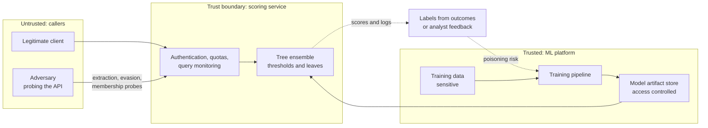

The diagram places the scoring service on the boundary. Everything on the left can be attacker-controlled, including the inputs, the query volume, and, through feedback, some of the labels. The artifact store and the training data are inside the trusted zone and carry sensitive derived information, covered below. The dotted feedback edge is the least visible path: if the labels used for retraining are influenced by the model's own decisions or by users, an adversary can steer the next model.

### 27.2 Model extraction and evasion

Tramèr, Zhang, Juels, Reiter, and Ristenpart (2016) showed that models offered through prediction application programming interfaces (APIs) can be reconstructed from queries, and that decision trees are especially exposed when the API returns confidence values or identifiers of the leaf reached, because each query reveals which region of the feature space the input belongs to. An attacker who can query thousands of times can recover the split structure of a small tree. Even with only labels returned, an attacker can fit a surrogate model, and the surrogate suffices to plan evasion.

Evasion is the attack that matters most for decision systems such as fraud and abuse detection. Kantchelian, Tygar, and Joseph (2016) formalized the evasion of tree ensembles: find the smallest change to an input that flips the ensemble's decision, which is a combinatorial but tractable problem for ensembles of moderate size. An attacker who learns that a fraud model flags transactions above a threshold on one feature can stay just below it. Defenses combine technical and operational controls.

- Authenticate and rate-limit callers, and apply quotas per principal.
- Return the minimum needed: a decision or a coarse band, not raw probabilities or leaf identifiers.
- Monitor for extraction patterns such as systematic grid sweeps of one feature, many near-duplicate queries, and queries clustered around the decision boundary.
- Use features that are expensive for an adversary to manipulate, and monotonic constraints (Section 18), which bound how an input change can move the score.
- Do not rely on secrecy of the model. Assume that the decision logic will eventually be learned, and design the system to remain acceptable when it is.

### 27.3 Membership inference and artifact leakage

Membership inference (Shokri, Stronati, Song, and Shmatikov, 2017) tests whether a specific record was in the training data, typically from the model's confidence: models behave more confidently on rows they were trained on. Deep, unpruned trees and forests with a minimum leaf size of one are the most exposed, since a training row may have its own leaf whose prediction is the row's label exactly. Regularization that limits memorization (larger leaves, shrinkage, subsampling) reduces the leak, and so does limiting what the API returns. Where a formal privacy guarantee is required, differentially private training of tree ensembles is an active research area, and its accuracy cost must be measured for the use case. [CH30](CH30_AI_Data_Governance_Privacy_and_Provenance.md) covers data governance.

The stored model is also derived data. Several features of tree artifacts make this concrete.

- With `min_samples_leaf` of one, a leaf's value can be a single training row's label, and a split threshold the midpoint between two individual training values. A text dump of the trees therefore exposes approximate values of individual records.
- Quantile forests keep the training responses.
- Target-encoding tables hold label rates per level, and when levels are small (a user or account identifier), a rate over one or two rows is a label.
- Categorical level lists can reveal customer-specific identifiers.

Treat the artifact as sensitive: restrict access, encrypt at rest, exclude it from public repositories and tickets, and review debug dumps. Never load pickles from untrusted sources: Python's `pickle` and `joblib` formats can execute arbitrary code on load, so prefer native model formats and verify provenance and integrity of artifacts.

### 27.4 Poisoning

An adversary who can inject labeled rows can shift a tree's splits. A few rows in a rare region of feature space, with flipped labels, can create a leaf that classifies a chosen pattern the way the attacker wants, especially when the minimum leaf size is small. Controls include minimum leaf sizes, holding out and reviewing the data that originates from user feedback, anomaly checks on the training set, and comparison of a candidate model's predictions against the champion's on a curated regression set before release.

## 28. Drift and Monitoring

### 28.1 What changes and how it shows

A deployed tree model degrades for three distinct reasons. Covariate shift is a change in the distribution of inputs $P(x)$ while the relationship $P(y \mid x)$ holds. Label (prior) shift is a change in the base rate $P(y)$. Concept drift is a change in $P(y \mid x)$ itself, for example when fraudsters adapt to the model. Each calls for a different response: covariate shift may need only a range check and a recalibration, a base-rate shift may need only an intercept update (Section 20.3), and concept drift needs retraining with new labels. Monitoring must distinguish them, which is why a single "model accuracy" gauge is insufficient.

### 28.2 Signals to monitor

| Signal | What it detects | Notes |
| --- | --- | --- |
| Per-feature distribution (population stability index, Kolmogorov-Smirnov test) | Covariate shift | Compare production windows to the training distribution |
| Missing rate and out-of-range rate per feature | Pipeline breaks, extrapolation risk | Section 7.3 and Section 24 |
| Unseen categorical-level share | New entities, encoder staleness | Rising share means the encoding table is stale |
| Score distribution | Any upstream or model change | Cheap, immediate, label-free |
| Leaf or path occupancy for key trees | Regional shift in feature space | Share of traffic reaching each leaf, compared to training |
| Calibration on matured labels | Prior shift, concept drift | Reliability curve, expected calibration error |
| Business metric at threshold | Impact | Alert rate, precision of reviewed alerts |
| Coverage of prediction intervals | Quantile and conformal validity | Section 22 |

The population stability index compares two binned distributions with expected shares $e_i$ and actual shares $a_i$:

$$
\mathrm{PSI} = \sum_i (a_i - e_i)\ln\frac{a_i}{e_i}
$$

For five equal bins in training ($e_i = 0.2$) and production shares of $0.10, 0.15, 0.20, 0.25, 0.30$, the terms are $0.0693$, $0.0144$, $0$, $0.0112$, and $0.0405$, so PSI $= 0.135$. Common rules of thumb from credit scoring treat values below 0.1 as small, 0.1 to 0.25 as moderate, and above 0.25 as large. They are conventions to calibrate against your data, and they depend on the binning and sample size. PSI says that a feature has moved, not that the model has degraded. Rank features by the product of their drift and their importance to prioritize attention, with the cautions of Section 19.

### 28.3 Delay and the proxy problem

Labels often arrive late: loan defaults after months, fraud confirmation after weeks. Performance metrics therefore lag. Label-free signals (feature drift, score drift, leaf occupancy) give early warning, and matured-label metrics confirm. Plan for both, and record the label delay in the monitoring design, because an alert on accuracy computed over immature labels is an alert about the delay.

### 28.4 Response states

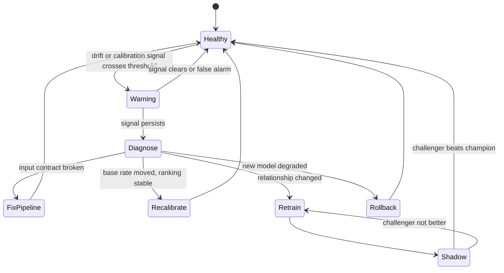

The state diagram makes the response ladder explicit. Diagnosis comes before action, because retraining on corrupted inputs bakes the corruption into the model. Retraining ends in a shadow stage where the challenger scores live traffic without acting, and promotion needs evidence that it beats the champion on matured outcomes. Tree libraries support cheap refreshes: LightGBM can refit leaf values on new data while keeping the structure, and XGBoost can continue training from an existing model, but a refreshed model should go through the same validation as a full retrain. [CH29](CH29_MLOps_and_LLMOps.md) covers pipelines, registries, and rollback.

## 29. Tabular Deep Learning versus Gradient-Boosted Trees

### 29.1 What the evidence says

The question of whether neural networks have overtaken boosted trees on tabular data has produced a large literature with a mixed message. Grinsztajn, Oyallon, and Varoquaux (2022) benchmarked tree-based and neural models across many datasets with extensive hyperparameter search and reported that tree-based models remain state of the art on medium-sized data (around 10,000 samples) even before counting their speed advantage. They traced the gap to inductive biases: neural networks lean toward smooth functions while tabular targets are often irregular, they are more affected by uninformative features, and they assume a rotation invariance that does not hold when each column has its own meaning. Shwartz-Ziv and Armon (2022) reached a similar conclusion on datasets not used in the original neural-network papers, and found that an ensemble of both families performed best. Other work narrows the gap: attention-based architectures such as the Feature Tokenizer plus Transformer (Gorishniy and colleagues, 2021) are competitive on some benchmarks, and McElfresh and colleagues (2023) found that neural networks can beat boosted trees on certain dataset types and that the choice of hyperparameters often matters more than the model family.

A newer development is tabular foundation models. TabPFN (Hollmann and colleagues, Nature, 2025) is a transformer pretrained on synthetic tabular tasks that makes predictions in a single forward pass through in-context learning, without gradient training on the target data. Its authors report that it outperforms prior methods on datasets with up to 10,000 samples, with much less training time. Independent assessments have examined those claims, so treat them as reported results to verify on your data and constraints, such as sample limits, inference cost, and licensing, at the time you read this.

### 29.2 Decision criteria

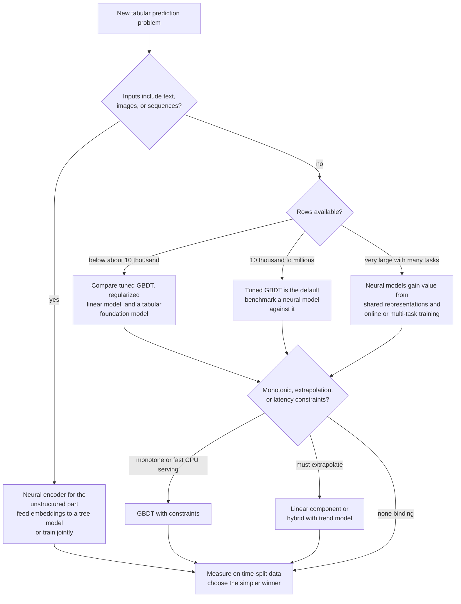

The flowchart is a procedure, not a verdict. The default for plain tabular data of moderate size remains a tuned gradient-boosted model, and a neural alternative should be tried when there is a reason: unstructured inputs, very large data with several related tasks, a need for end-to-end differentiable pipelines, or learned entity embeddings shared across models. Hybrid designs are common and effective. A neural encoder can turn text or images into embeddings that a tree model consumes, and, in the other direction, He and colleagues (2014) showed that using the leaf indices of a boosted-tree model as input features to a logistic regression works well for click prediction. When two models are close, choose the one that is cheaper to serve, easier to monitor, and supported by your platform. [CH07](CH07_Deep_Learning_Foundations.md) covers neural network training.

## 30. Quality-Attribute Scenarios

Scenarios turn the failure modes of this chapter into testable requirements. Each states a stimulus, the response the system should produce, and a measure that decides whether it did. The figures are illustrative and should be replaced by values from your own service-level objectives.

| Scenario | Stimulus | Expected response | Measure |
| --- | --- | --- | --- |
| Upstream feature outage | A device-fingerprint feed fails and the feature is missing on 40 percent of requests | The model routes missing values through learned default directions, raises an alert within minutes, and the decision policy stays inside its guardrails | Alert rate stays within a pre-agreed band of baseline, and no crash or null-handling error occurs |
| Input out of training range | A transaction amount ten times the training maximum arrives | The guard flags the request, clips or routes it to review, and counts the event | 100 percent of out-of-range requests are flagged, and the flag rate is a monitored metric |
| Base-rate shift | The fraud rate halves in a month | Calibration monitor detects the miscalibration on matured labels and the intercept update restores calibration | Expected calibration error returns below its limit within one release cycle |
| Concept drift | Adversaries adapt, and recall at fixed review capacity falls by 5 points | Weekly challenger evaluation identifies the loss, and the champion is replaced after shadow validation | Time from detection to promoted challenger is under a stated number of days |
| Extraction attempt | A caller issues 50,000 queries sweeping one feature across a grid | Rate limits trigger, the principal is throttled, and the pattern is logged for review | Throttle occurs before a stated query budget is exceeded |
| Serving regression after conversion | A model is exported to a portable format for a new runtime | The parity test blocks the release if outputs differ beyond tolerance | Maximum probability difference below tolerance, and decision flips limited to boundary rows |
| Retrain regression | A scheduled retrain produces a model with worse calibration | The release gate rejects it using a curated regression set and calibration check | No promoted model fails the gate, and rejected candidates are recorded |
| Latency under load | Peak traffic doubles | Scoring latency stays inside budget with the model resident in memory | p99 scoring latency below the budget at twice normal throughput |

## 31. Comparison of Alternatives

| Model | Typical accuracy on tabular data | Variance | Tuning effort | Probability quality | Size and latency | Interpretability | Extrapolation | Categorical and missing data |
| --- | --- | --- | --- | --- | --- | --- | --- | --- |
| Logistic or linear model | Baseline; strong if effects are additive | Low | Low | Good when well specified | Tiny, fastest | High (coefficients) | Linear trend continues | Needs encoding and imputation |
| Single pruned tree | Modest | High | Low | Poor, coarse | Tiny | High if small | None | Surrogates or native handling |
| Random forest | Good; strong out of the box | Low | Low | Needs calibration | Large if deep | Low | None | Library-dependent |
| Extremely randomized trees | Good; sometimes better on noisy data | Lowest of the forests | Low | Needs calibration | Large | Low | None | Library-dependent |
| AdaBoost | Good on clean data | Moderate | Low | Poor without calibration | Small | Low | None | Library-dependent |
| Gradient-boosted trees | Usually best on mid-sized tabular data | Moderate | Moderate | Good with logistic loss, check it | Small to moderate | Low, explained post hoc | None | Strong native support |
| Boosted trees with monotone constraints | Slightly below unconstrained, or equal | Moderate | Moderate | Good | Small | Moderate (monotone shapes) | None | Strong native support |
| Explainable boosting machine | Often close to boosted trees when interactions are weak | Moderate | Moderate | Good | Small | High (per-feature curves) | None | Needs handling |
| Stacked ensemble | Slightly above best member | Lower | High | Needs checking | Sum of members | Low | Depends on members | Depends on members |
| Neural network for tabular data | Competitive on large data or with unstructured inputs | Moderate | High | Needs calibration | Moderate, GPU-friendly | Low | Smooth, can extrapolate | Needs encoding |
| Tabular foundation model | Reported strong on small data | Not applicable | Low | Check | Heavy inference | Low | Unclear | Handles some natively |

The entries are qualitative tendencies and not guarantees. The decisive columns for an architect are usually size and latency, interpretability, extrapolation, and the cost of maintaining the pipeline, because the accuracy differences among the strong candidates are often smaller than the uncertainty of the estimate.

## 32. Case Study: Card-Not-Present Fraud Scoring

All figures in this case study are invented for teaching. They show how the reasoning and arithmetic work and are not benchmarks.

### 32.1 Context and cost model

A payments company processes about 1,300,000 card-not-present transactions per day, and 0.4 percent are fraudulent, so there are about $1{,}300{,}000 \times 0.004 = 5{,}200$ fraudulent transactions per day. An undetected fraud costs 85 on average. A manual review costs 3 and resolves the case correctly. Declining a legitimate transaction costs 12 in lost sales and customer friction. For a transaction with fraud probability $p$, the expected cost of each action is:

- Approve: $85\,p$.
- Review: $3$.
- Decline: $12\,(1 - p)$.

Review beats approval when $85p > 3$, so $p > 0.0353$. Decline beats review when $12(1-p) < 3$, so $p > 0.75$. The policy is therefore: approve below 3.53 percent, review between 3.53 and 75 percent, and decline above 75 percent, provided the scores are calibrated. Analysts can review at most 4,000 transactions per day. In the test period about 4,900 transactions per day exceeded 3.53 percent, so capacity binds and the effective review cutoff is the day's 4,000th-highest score. This changes what the model must do well. Calibration matters for the 75 percent decline rule and for monitoring, and ranking quality at the top of the list decides the value of the 4,000 reviews. [CH03](CH03_Regression_and_Classification.md) and [CH06](CH06_Model_Evaluation_Validation_and_Selection.md) cover the threshold and metric logic.

### 32.2 Data, labels, and leakage controls

Fraud labels arrive through chargebacks, which can take up to 45 days. A transaction younger than 45 days is labeled non-fraud mostly because the label has not arrived (Section 21.4). The team defines a maturity window of 45 days, trains on months 1 to 6 using only rows older than the window at the time of extraction, validates on month 7, and tests on month 8. Features are computed as of the transaction time through point-in-time joins, which prevents leakage of later activity into velocity features such as counts of transactions per card in the last hour and last day. The team reviews every feature with the availability question of Section 7.5: a field called "dispute_opened" was excluded because it exists only after the outcome. Merchant identifier has about 400,000 levels, and the team replaces it with CatBoost-style ordered target statistics computed in time order for the CatBoost candidate, and with a frequency encoding plus a merchant-category feature for the others (Section 23).

### 32.3 Candidates and decisions

The team compares five candidates on the month-8 test set, with hyperparameters tuned on month 7. The reported metric is the recall at the 4,000 highest-scored transactions per day, because that is the operating point. These results are illustrative.

| Candidate | Recall at 4,000 reviews | Frauds caught per day (of 5,200) | Daily net saving: caught $\times$ 85 $-$ 4,000 $\times$ 3 |
| --- | --- | --- | --- |
| Logistic regression with binned features (baseline) | 52.0 percent | 2,704 | 217,840 |
| Random forest, 500 trees | 63.0 percent | 3,276 | 266,460 |
| LightGBM, unconstrained | 71.0 percent | 3,692 | 301,820 |
| LightGBM with monotone constraints on 4 features | 70.0 percent | 3,640 | 297,400 |
| Stack of LightGBM and logistic regression | 71.5 percent | 3,718 | 304,030 |

The arithmetic for the baseline is $2{,}704 \times 85 = 229{,}840$, less $4{,}000 \times 3 = 12{,}000$, which is $217{,}840$. Moving from the baseline to unconstrained LightGBM adds $301{,}820 - 217{,}840 = 83{,}980$ per day, about 30.7 million per year. The gap between the random forest and the boosted models is large enough to matter, and consistent with the expectation that boosting reduces the bias a forest cannot (Section 11.4).

**Decision 1: reject the stack.** It adds 26 caught frauds per day over unconstrained LightGBM, or $26 \times 85 = 2{,}210$ per day, about 0.8 million per year. In exchange the service would carry two models, two feature paths, a meta-model, and a more complex release process. The team judges the gain smaller than the uncertainty of the estimate (Section 16.3) and records the option to revisit it once the single-model pipeline is stable.

**Decision 2: accept the monotone-constrained model.** The constraints cost 1 point of recall, or 52 frauds per day, about 1.6 million per year if real. Suppose a paired comparison across the 31 test days finds that the difference is within day-to-day variation. That finding is assumed for this illustration, and in a real review it must be computed, because it is the evidence that supports the decision. The team accepts the cost for three reasons. The constrained model has no pockets in which a higher count of failed authentication attempts lowers the score, which an adversary could find by probing (Section 27.2). Reason codes are defensible. And the constraint removes a source of instability between retrains (Section 18). The constraints apply to the count of failed authentications in the last hour (increasing), the transaction velocity in the last 24 hours (increasing), the account age (decreasing), and the number of prior successful transactions with the merchant (decreasing). Features such as amount are left unconstrained because the relationship is not monotone.

### 32.4 Training choices

The team uses a learning rate of 0.05 and early stopping on log loss with a patience of 100 rounds, validating on month 7. A random search over 120 configurations covers leaves, minimum rows per leaf, row and column subsampling, and the $\lambda$ penalty. Because the positive class is 0.4 percent, a minimum Hessian sum per leaf would reject leaves of confidently classified negatives, so they set the minimum on row count (`min_data_in_leaf` of 200) and keep the Hessian minimum low (Section 14.4). They train with plain log loss and no class weights. A one-to-ten undersampling experiment with probability correction (Section 21.3) trains six times faster, and its recall at 4,000 reviews differs from the plain model by less than the seed-to-seed spread of 0.3 points, so they keep the simpler setup. The final model is refit on months 1 to 7 with the stopped round count scaled by 10 percent (Section 17.3).

Calibration uses isotonic regression fitted on an out-of-fold calibration slice of month 7 rather than on the same rows used for early stopping, because one month contains about 156,000 fraud cases, far above the few thousand positives that justify isotonic over Platt scaling (Section 20.2). The reliability curve on month 8 is within the target band. The 75 percent decline rule is only enabled after the check that, among month-8 transactions scored above 75 percent, the observed fraud rate is between 70 and 80 percent.

### 32.5 Validation beyond the headline number

The team runs the checks this chapter recommends before release.

- **Segments.** Recall at the operating point for new accounts, high-value transactions, and each merchant category, to catch a segment where the model is poor even though the average is fine.
- **Extrapolation guard.** Amounts above the 99.9th training percentile are flagged and routed to review (Section 24), because the trees would score any such amount exactly like the largest amount seen in training.
- **Adversarial sweep.** For each feature, a grid sweep over 200 sampled fraudulent transactions confirms monotone behavior for constrained features and identifies score cliffs for the others. Two cliffs are found at round-number amounts and added to the monitoring list.
- **Importance review.** Permutation importance on month 8, grouped by correlated families (device features, velocity features), is stable across five bootstrap resamples. No single feature exceeds a plausibility bound set with the fraud analysts, which would have signaled leakage.
- **Parity.** The native LightGBM model and the compiled serving artifact agree to within $10^{-6}$ in probability on a 200,000-row golden set that includes missing values and unseen merchant categories.

### 32.6 Serving, security, and monitoring

The model has 1,200 trees with 64 leaves each, and by the arithmetic of Section 25.1 each tree takes about 1.3 KB, so the model is about 1.5 MB. Scoring takes a fraction of a millisecond, and the budget of 50 ms at p99 is spent mostly on feature lookups (20 to 30 ms). The team therefore invests in feature-store latency instead of tree compilation. The deployable bundle contains the model, the calibrator, the thresholds, the feature schema, and the training-range guard table, under a single version recorded in every decision log.

Callers receive a decision and reason codes. Raw probabilities are not returned, and the endpoint is authenticated with per-client quotas and an alert on grid-sweep patterns (Section 27.2). Model files are encrypted at rest, and no text dumps are written to tickets, because with a minimum leaf of 200 rows the leaves hold aggregates, but the merchant frequency table and thresholds are still derived from customer data (Section 27.3).

Monitoring uses the table of Section 28.2: weekly PSI on the top 30 features, score-distribution alerts, daily alert-rate tracking against the review capacity, share of unseen merchants, and calibration on 45-day matured labels. A challenger is retrained weekly and run in shadow for two weeks before promotion. Interval predictions are not part of this system.

### 32.7 What the case shows

The model was chosen on expected cost at the operating point, not on AUC, and the cost model fixed the thresholds before any model was trained. The most accurate candidate was not selected, because a small accuracy difference was worth less than lower operational and security risk. The dominant risks were data issues (label delay, feature availability, target-encoding leakage) and not algorithm choice. Those checks are the content of the design-review checklist below.

## 33. Common Mistakes

| Mistake | Cause | Consequence | Fix |
| --- | --- | --- | --- |
| Reporting the early-stopping validation score as the final estimate | The validation set chose the stopping round and hyperparameters | Optimistic performance; the offline-online gap | Hold out a test set touched once (Section 17.3) |
| Target-encoding before splitting | Encoding fitted on all rows | Inflated validation score and a useless feature (Section 23) | Fit inside each training fold; use out-of-fold or ordered statistics |
| Reading gain importance as causal or as a ranking of value | Impurity importance is biased and computed on training data | Wrong features pursued or removed | Use held-out permutation importance with grouping (Section 19) |
| Reweighting classes and then thresholding at 0.5 | Training weights inflate probabilities | Alert volume far above plan | Correct probabilities or select the threshold on calibrated validation scores (Section 21.3) |
| Random split on time-ordered or grouped data | Convenience | Leakage; OOB and cross-validation scores optimistic | Temporal or grouped splits (Section 10.5) |
| Copying `max_depth` into a leaf-wise library | Assuming depth means the same thing | Overfitting from deep, unbalanced trees | Match leaves per tree and cap depth (Section 15.2) |
| Treating `min_child_weight` as a row count for classification | It is a Hessian sum | Leaves of confident rows rejected, or too-small leaves allowed | Understand the quantity (Section 14.4) |
| Forecasting a trend with a tree on a time index | Trees extrapolate as constants | Flat forecasts after the last training date | Detrend, add a linear component, or change the model (Section 24) |
| Trusting an exported model without a parity test | Float precision, feature handling, and output transform differ | Silent prediction changes in production | Golden-set parity test in the release pipeline (Section 25.3) |
| Loading a pickle from an untrusted source | Convenience | Arbitrary code execution | Use native formats and verify provenance (Section 27.3) |
| Using a very deep forest with minimum leaf one for a sensitive dataset | Default settings | Large artifact; memorization; membership leakage | Set leaf size and depth; review artifact exposure (Sections 25 and 27) |
| One-hot encoding a high-cardinality category for a forest | Habit | Sparse, deep, weak splits and large memory | Native categorical handling or a grouped encoding (Section 6.3) |
| Ignoring unseen categories and out-of-range values at serving | Training-only thinking | Arbitrary routing; silent degradation | Defaults for unseen levels; range guards; monitoring (Section 28) |

## 34. Design-Review Checklist

Use these questions in a review of a tree-based model. A "no" or "unknown" is a finding to resolve or accept explicitly.

### 34.1 Problem and data

- Is the decision, its cost structure, and the operating threshold or capacity stated before model selection?
- Are labels mature, and is the label delay handled in training and evaluation?
- Is every feature available, with the same meaning and fill rate, at prediction time? Are missing-value patterns reviewed for leakage?
- Are splits temporal or grouped where the data are time-ordered or grouped?

### 34.2 Model

- Is there a documented baseline (linear model) and a justification for each increase in complexity?
- Are tree depth or leaf count, leaf-size controls, and regularization tuned together, with early stopping on a validation set separate from the final test set?
- Are categorical features handled with a method that prevents target leakage, and is the cardinality guidance applied?
- Are monotonic constraints applied where domain rules require them, and tested by sweeps?
- Is the learning rate small enough that the number of rounds is not a fragile choice?

### 34.3 Evaluation

- Is performance reported at the operating point, with an interval over time windows or folds?
- Are calibration, segment-level results, and extrapolation behavior checked?
- Is feature importance computed on held-out data, grouped for correlated features, and not described as causal?
- Is the explanation method validated for stability across retrains?

### 34.4 Deployment and operations

- Is the deployable bundle (model, preprocessing, calibrator, threshold, guards) versioned as one unit, with the version in every log record?
- Is there a parity test for any model conversion or compilation, and a latency measure on the real request path?
- Are drift, missing-rate, out-of-range, unseen-level, score, and matured-label calibration monitored, with a response ladder?
- Is there a champion-challenger process and a rollback plan?

### 34.5 Security and privacy

- Are scoring queries authenticated, rate-limited, and monitored for extraction patterns, and does the response expose only what callers need?
- Is the artifact treated as sensitive data, stored with access control, and loaded only from trusted formats?
- Is retraining data screened for poisoning, and are minimum leaf sizes set to limit the influence of a few rows?

## 35. Exercises

1. **Impurity by hand.** A node has 30 positive and 70 negative examples. A split sends 25 positives and 15 negatives left, and 5 positives and 55 negatives right. Compute the Gini impurity of the parent and of each child, the weighted child impurity, and the Gini decrease. Then compute the parent's entropy.
2. **Variance of an ensemble.** Trees have prediction variance $\sigma^2 = 4$ and pairwise correlation $\rho = 0.25$. Compute the variance of an average of 50 trees and the limit as $B \to \infty$. How many trees bring the reducible term $(1-\rho)\sigma^2/B$ below 10 percent of the limit?
3. **AdaBoost reweighting.** With ten equally weighted examples, a stump misclassifies two of them. Compute $\varepsilon$, $\alpha$, the multipliers applied to correct and incorrect examples, and the normalized weights. What is the total weight on the two errors afterward?
4. **Second-order boosting.** A leaf has $G = -3.0$ and $H = 2.5$, with $\lambda = 1.5$. Compute the leaf weight. A candidate split gives $G_L = -2.0, H_L = 1.5$ and $G_R = -1.0, H_R = 1.0$ with $\gamma = 0.2$. Compute the gain and decide whether to split.
5. **Learning rate and rounds.** A model with learning rate 0.1 stops best at round 80. Predict the best round for rate 0.02, and explain which hyperparameters you would hold fixed when comparing the two.
6. **Probability correction.** Negatives are kept with probability $\beta = 0.05$, and the model outputs 0.4 on a validation row. Compute the corrected probability. A different model used `scale_pos_weight` $= 49$ and output 0.5. Compute its corrected probability.
7. **Target encoding.** A team encodes a customer-identifier column with the mean fraud rate over all training rows and sees validation AUC rise from 0.80 to 0.93. Explain what is probably happening, how you would confirm it, and two ways to fix it.
8. **Extrapolation guard.** A demand model uses units sold per week as a feature, trained on weeks with up to 400 units. Design the guard, the monitoring signal, and the fallback for a week with 900 units. Which model change would remove the underlying problem?
9. **Selection under constraints.** An insurer needs a claims-severity model that gives the 90th percentile of cost, is explainable to regulators, and must score 5,000 claims per second on CPU. Choose a model family and justify the choice using the criteria of Section 29.2 and Section 31.

### 35.1 Answer outlines

1. Parent Gini is $1 - (0.09 + 0.49) = 0.42$ and entropy is $0.3(1.737) + 0.7(0.515) = 0.881$ bits. Left has 40 examples with $p = 0.625$, Gini $1 - (0.3906 + 0.1406) = 0.4688$. Right has 60 examples with $p = 1/12$, Gini $1 - (0.0069 + 0.8403) = 0.1528$. Weighted Gini is $0.4(0.4688) + 0.6(0.1528) = 0.2792$. The decrease is $0.42 - 0.2792 = 0.1408$.
2. Variance is $0.25 \times 4 + 0.75 \times 4 / 50 = 1 + 0.06 = 1.06$, and the limit is $1$. The reducible term is below 10 percent of the limit when $0.75 \times 4 / B \le 0.1$, so $B \ge 30$.
3. $\varepsilon = 0.2$, $\alpha = \tfrac12 \ln 4 = 0.6931$. Errors are multiplied by $e^{0.6931} = 2$ and correct examples by $0.5$. Unnormalized: each error $0.2$, each correct $0.05$; sums $0.4 + 0.4 = 0.8 = Z$. Normalized: each error $0.25$, each correct $0.0625$. The two errors carry total weight $0.5$, as in Section 12.2.
4. $w = 3.0/(2.5 + 1.5) = 0.75$. Gain $= \tfrac12[4/(1.5+1.5) + 1/(1.0+1.5) - 9/(2.5+1.5)] - 0.2 = \tfrac12[1.3333 + 0.4 - 2.25] - 0.2 = -0.2583 - 0.2 = -0.458$. The gain is negative, so do not split.
5. Rate times rounds is roughly constant, so about $80 \times 0.1 / 0.02 = 400$ rounds, with caution. Hold fixed the depth, minimum leaf size, subsampling, and the validation set and early-stopping patience (scaled with the rate).
6. $p = 0.05 \times 0.4 / (0.05 \times 0.4 - 0.4 + 1) = 0.02/0.62 = 0.0323$. For the weighted model, odds $= 1$, divided by 49 gives $0.0204$, so $p = 0.0200$.
7. A customer identifier has few rows per level, so a naive mean target includes the row's own label (Section 23.2). Confirm by computing the encoding out-of-fold or on a time-later set and by checking that the importance of the feature collapses. Fix it with out-of-fold or ordered encoding, or drop the column and use aggregates that exclude the current row's label.
8. Guard: store the training range (for example the 99.9th percentile of 400) and flag requests above it; log and count them. Signal: out-of-range rate per feature. Fallback: clip to the range and route to a human or a rule, or use a linear or ratio-based estimate. Model change: predict a ratio to a baseline or add a linear component (Section 24).
9. Gradient-boosted trees with a quantile objective for the 90th percentile (with monotone constraints where justified), possibly conformalized, or an explainable boosting machine if per-feature curves are needed. Both serve quickly on CPU at 5,000 claims per second. A neural model adds cost without clear benefit for moderate tabular data. Validate the interval coverage by segment.

## 36. Summary

A decision tree divides the feature space into boxes by greedily choosing the split that most reduces an impurity measure. Gini impurity, entropy, and variance reduction are three versions of the same idea, and loss-based gain in boosted trees generalizes it. Single trees are unstable, because greedy choices and small leaves amplify sampling noise, so the field moved to ensembles. Bagging and random forests average deep trees, and the variance of the average is $\rho\sigma^2 + (1-\rho)\sigma^2/B$, which explains why feature subsampling helps and why extra trees give diminishing returns. Boosting builds shallow trees in sequence, each fitting the gradient of the loss, and shrinkage, subsampling, and early stopping control its overfitting. The second-order view gives closed-form leaf weights $-G/(H+\lambda)$ and a gain formula that serve any twice-differentiable loss. XGBoost, LightGBM, and CatBoost differ in split search, tree growth, categorical handling, and bias control, and the differences matter most for categorical-heavy and small or very large data.

The rest of the chapter concerns what goes wrong in practice. Early stopping and hyperparameter choice use up the validation set. Target encoding leaks unless it is fitted out of fold. Importance rankings mislead when features are correlated. Ensemble probabilities need calibration, and class weights distort them. Trees extrapolate as constants. Model artifacts are large for deep forests, need parity tests when converted, and carry training information that attackers and privacy reviewers care about. A deployed model needs monitoring that separates covariate shift, base-rate shift, and concept drift. For plain tabular data of moderate size, a well-tuned boosted tree is the benchmark any alternative must beat, and the choice among strong candidates should come from cost at the operating point, operational risk, and the constraints of the system.

## 37. Code Examples

The scripts use only the Python standard library (Python 3.8 or later) and print the numbers quoted in this chapter. They were run with Python 3.14 while writing the chapter. Scripts 02 and 03 import the small helper `tinytree.py` in the same folder.

- [01_cart_by_hand.py](../code/python/decision-trees-chapter/01_cart_by_hand.py) computes Gini, entropy, and information gain for every threshold of the ten-row table, the categorical partition, the greedy CART tree, the weakest-link pruning table, the AdaBoost run, the label-flip instability, the surrogate agreement, and the missing-value default direction.
- [02_bagging_variance.py](../code/python/decision-trees-chapter/02_bagging_variance.py) measures variance and bias for a single tree, bagging, and a random forest, estimates $\sigma^2$ and $\rho$ and checks the variance formula, and compares out-of-bag error with held-out error.
- [03_gradient_boosting.py](../code/python/decision-trees-chapter/03_gradient_boosting.py) works one logistic boosting round on six rows with and without $\lambda$, measures shrinkage and subsampling effects with early stopping, and demonstrates extrapolation failure against a linear fit.
- [04_target_encoding_leakage.py](../code/python/decision-trees-chapter/04_target_encoding_leakage.py) compares naive, smoothed, out-of-fold, and ordered target encodings on a noise-only categorical feature.
- [tinytree.py](../code/python/decision-trees-chapter/tinytree.py) is the gradient-and-Hessian regression tree shared by scripts 02 and 03.

The next chapter, [CH05 — Unsupervised Learning and Representation Reduction](CH05_Unsupervised_Learning_and_Representation_Reduction.md), covers methods for data without labels, and [CH06](CH06_Model_Evaluation_Validation_and_Selection.md) develops the validation and selection methods used throughout this chapter.
