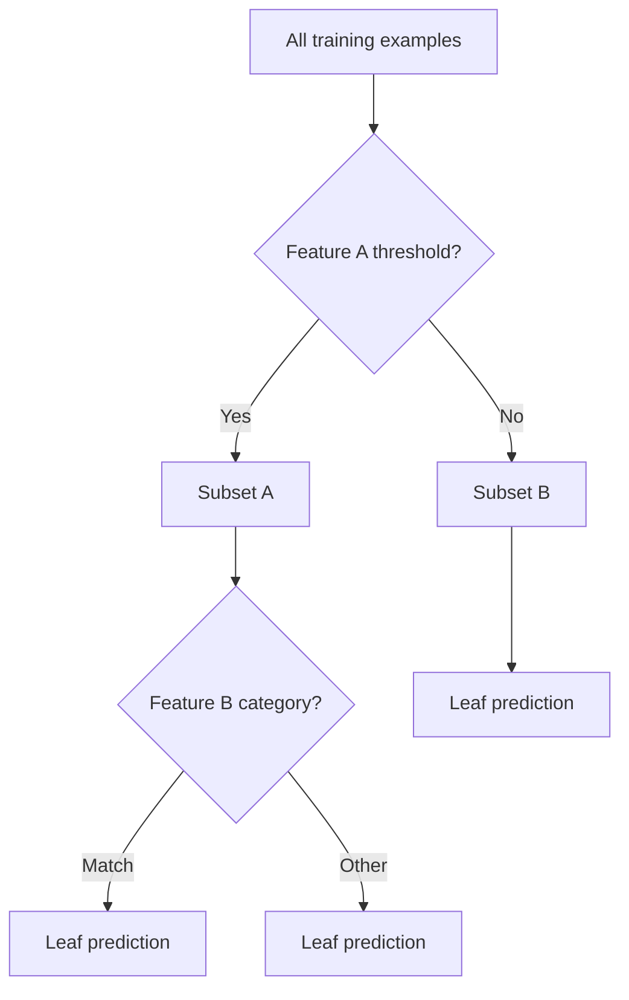
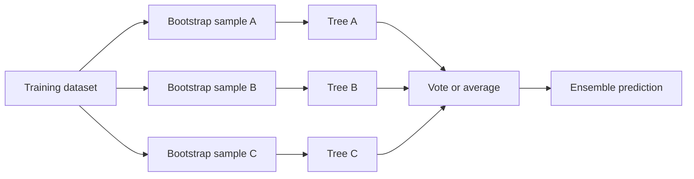
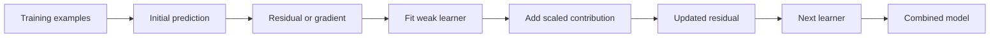
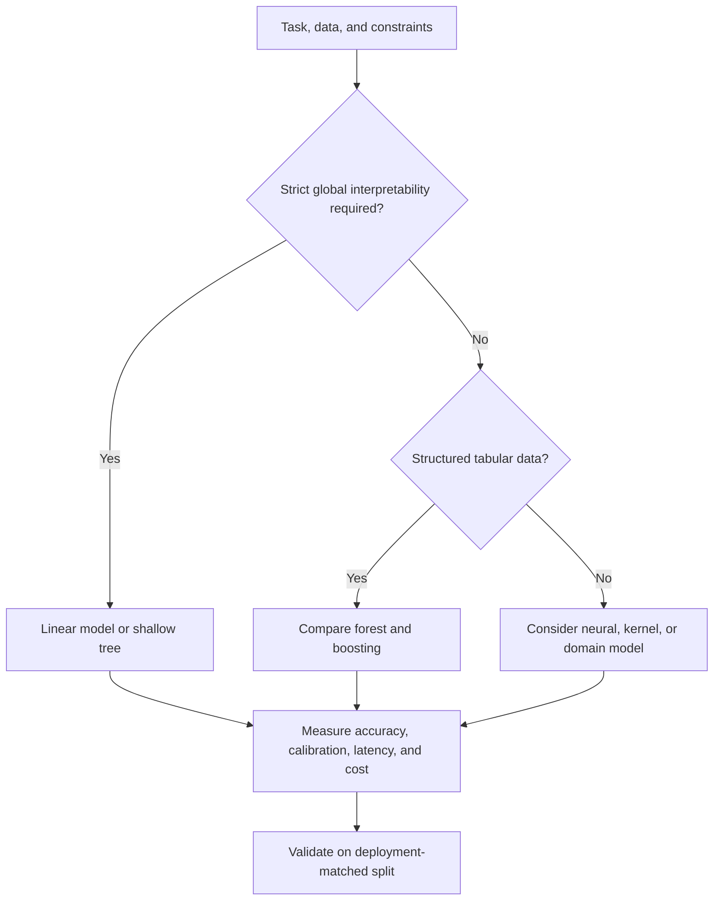
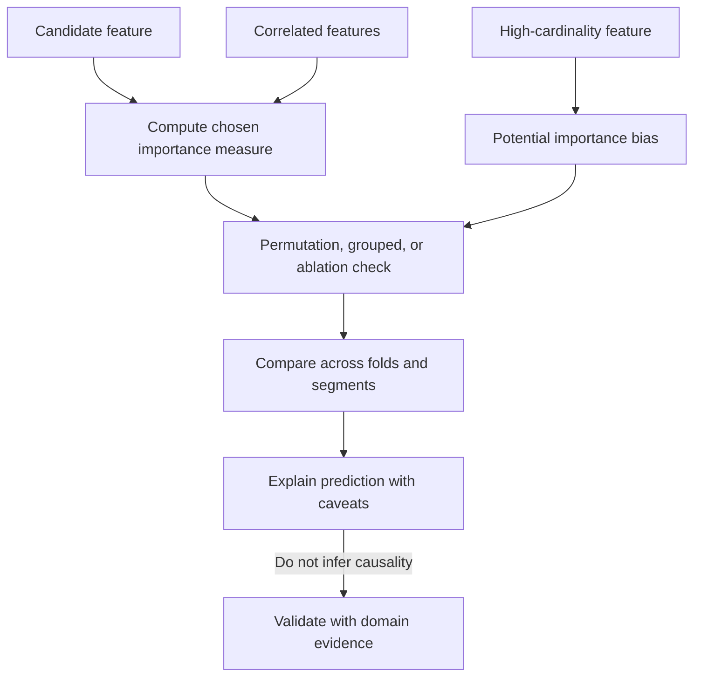

# Decision Trees and Ensemble Learning

Part: [16 — Artificial Intelligence, Machine Learning, and Generative AI](PART_OVERVIEW.md)

Decision trees partition feature space through sequential tests and make predictions from resulting leaves. Ensembles combine multiple learners to improve stability or predictive power. Trees are intuitive but can overfit; ensembles reduce some errors while increasing complexity and making interpretation less direct.

## Tree Splits, Depth, and Pruning

At a node, a tree evaluates candidate feature splits and chooses one that reduces impurity or prediction loss. Classification commonly uses Gini impurity or entropy; regression uses a variance or loss reduction. Recursive splitting continues until a stopping rule, then leaf values provide predictions.

For a classification node with class proportions $p_k$, Gini impurity is $1-\sum_k p_k^2$; entropy is $-\sum_k p_k\log p_k$. A candidate split is useful when the weighted impurity of its children is lower than the parent's. The tree searches feature thresholds or category partitions, scores their reduction, and chooses the best permitted split. This greedy local choice is computationally practical, but it does not guarantee a globally optimal tree. High-cardinality features can offer many chances to find a spurious split, so minimum leaf size, depth limits, and pruning are controls on variance rather than cosmetic simplification.

Deep trees can memorize noisy examples. Limit depth, minimum leaf size, or minimum split gain; prune using validation evidence. A single tree can be unstable: small data changes may produce different early splits. Explainability is local and conditional on the training distribution.

A worked comparison makes the selection criterion concrete. Suppose a node has 100 examples, 60 positive and 40 negative, giving parent Gini impurity $1-(0.6^2+0.4^2)=0.48$. Split A sends 50 examples to each child: one child is 40 positive/10 negative (impurity $1-(0.8^2+0.2^2)=0.32$), the other is 20 positive/30 negative (impurity $1-(0.4^2+0.6^2)=0.48$). The weighted child impurity is $0.5(0.32)+0.5(0.48)=0.40$, an impurity reduction of $0.08$. Split B instead sends 90 examples to one child (58 positive/32 negative, impurity $\approx0.452$) and 10 to the other (2 positive/8 negative, impurity $0.32$); its weighted impurity is $0.9(0.452)+0.1(0.32)=0.4388$, a reduction of only about $0.041$. The tree prefers split A because it reduces impurity more, even though split B isolates a smaller, purer group. This is exactly why a single greedy criterion can under-value a split that would be valuable for a specific minority segment, and why reviewing per-segment leaf composition — not only the chosen split sequence — matters for a fairness- or cost-sensitive application.

## Bagging and Random Forests

Bagging trains models on bootstrap samples and combines predictions, reducing variance when learners are diverse. Random forests add feature subsampling at splits to reduce correlation among trees. Classification commonly aggregates votes or probabilities; regression averages predictions. Out-of-bag examples can provide a useful estimate, but do not replace a deployment-matched evaluation design.

More trees generally improve stability up to a point but increase inference time, memory, and operational cost. Feature importance may be biased by cardinality or correlated features. Use permutation or grouped analysis carefully and avoid treating importance as causal explanation.

## Boosting and Error Correction

Boosting builds learners sequentially; each focuses on residual error or gradients from the current ensemble. Gradient boosting can model nonlinear interactions effectively on tabular data. Learning rate, tree depth, number of rounds, regularization, and sampling control fit and overfitting. Early stopping requires a validation set that is not reused for final unbiased evaluation.

Boosting can be sensitive to label noise and leakage. Tune depth and learning rate together and evaluate calibration where probabilities drive decisions. Compare against simpler baselines and consider inference constraints.

In gradient boosting, each new learner approximates the negative gradient of the current loss with respect to the ensemble prediction. A simplified additive update is $F_m(x)=F_{m-1}(x)+\eta h_m(x)$, where $h_m$ is the next fitted learner and $\eta$ is its contribution scale. Smaller steps often require more rounds but can improve control; deeper learners capture richer interactions and can overfit faster. Early stopping selects the round using validation evidence, so repeated experimentation against that same set can itself overfit the selection criterion. Random forests instead fit trees largely independently and average them; their variance reduction depends on both tree diversity and the correlation among errors.

## Feature Importance and Model Choice

Tree ensembles can capture nonlinear boundaries with limited feature scaling, making them strong baselines for many structured datasets. They may be less suitable for extrapolation beyond observed ranges or where strict monotonic behavior, compact serving, or transparent coefficients are required. Feature importance depends on method and correlation structure; explain prediction behavior with appropriate local or counterfactual tools rather than a global ranking alone.

## Worked Case and Review Checklist

A credit-risk team compares logistic regression, a shallow tree, a random forest, and gradient boosting. The deeper ensembles improve ranking but are less transparent and require more careful calibration. The team selects a constrained boosting model after testing time-based data splits, calibration, subgroup behavior, and inference latency, then uses human review for borderline high-impact cases.

Review split design, split criteria, depth, pruning, ensemble diversity, boosting schedule, validation reuse, calibration, feature-importance limitations, latency and memory cost, drift, and decision explainability. CH06 owns detailed model comparison and confidence analysis.

## Questions and Summary

1. Draw recursive splitting and describe what a leaf prediction represents.
2. Compare bagging and boosting by training order, variance, and sensitivity to noise.
3. Why can a feature-importance ranking be biased or non-causal?
4. Design a validation approach for early stopping without contaminating the final test set.
5. Select between a shallow tree and boosting under latency and explanation constraints.

Trees partition feature space; bagging stabilizes diverse models, and boosting corrects successive errors. Their flexibility can improve tabular prediction but introduces overfitting, calibration, explanation, and resource trade-offs. Choose using deployment-matched evidence. Do not rely on a single score or importance chart.
