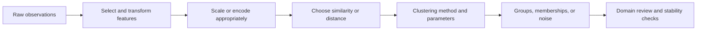
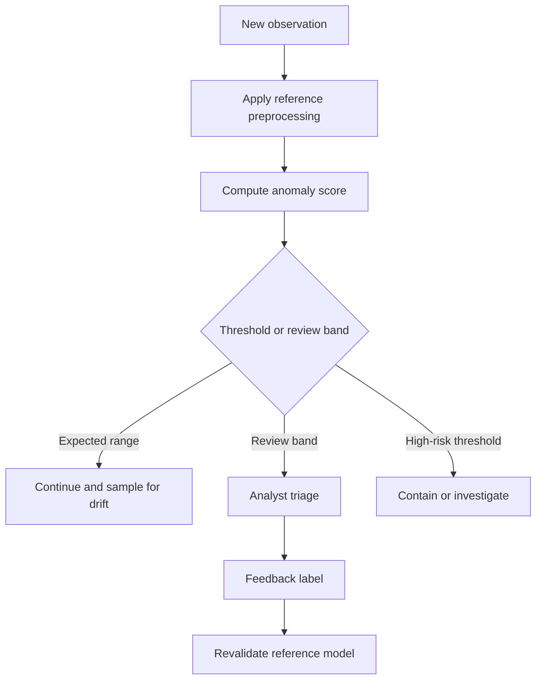
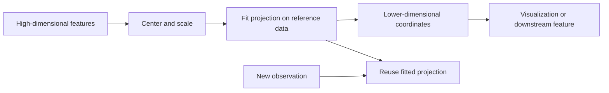
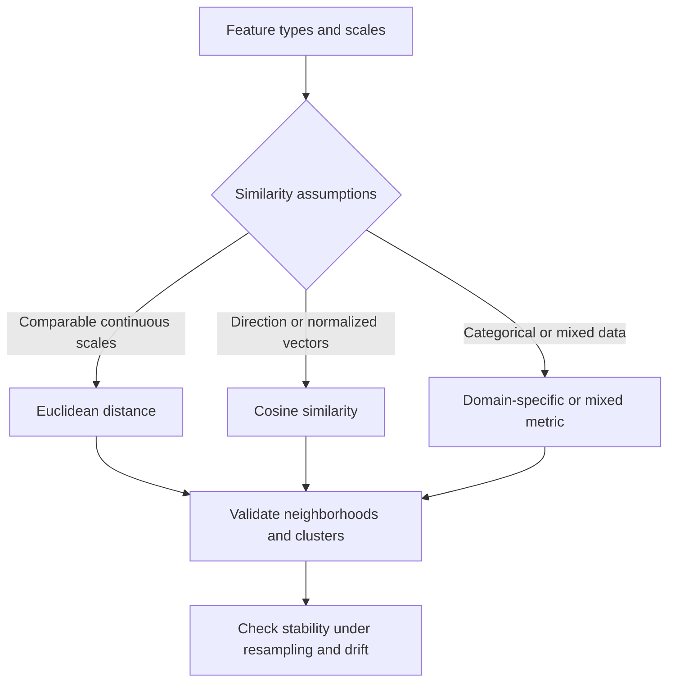
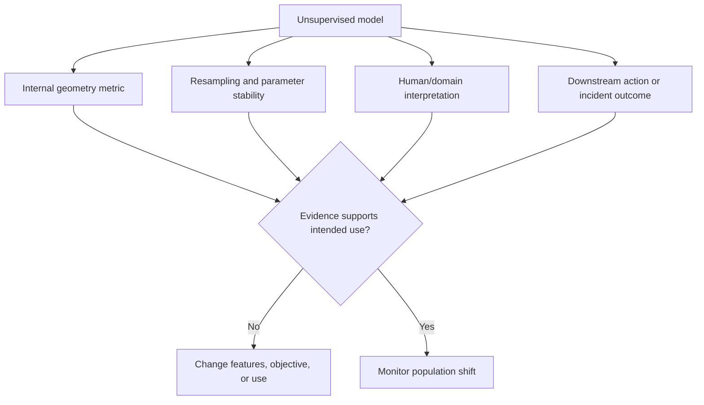

# Unsupervised Learning and Representation Reduction

Part: [16 — Artificial Intelligence, Machine Learning, and Generative AI](PART_OVERVIEW.md)

Unsupervised learning looks for structure in data without a supplied target label. Clustering groups examples by a chosen similarity measure; anomaly detection finds examples unlike an expected population; dimensionality reduction constructs a lower-dimensional representation. These methods can reveal patterns, but a cluster is not automatically a real-world class and an anomaly is not necessarily harmful.

This chapter owns clustering, anomaly detection, distance choice, representation reduction, and evaluation without labels. [CH06 — Model Evaluation](CH06_Model_Evaluation_Validation_and_Selection.md) owns general model evaluation; [CH02 — Data Preparation](CH02_Data_Preparation_Feature_Engineering_and_Leakage.md) owns preparation and leakage controls.

## Distance, Scale, and Clustering

Clustering depends on a representation and similarity measure. Euclidean distance can be dominated by large-scale features; categorical, sparse, or mixed data may need other measures. Normalize only using training or reference data and preserve the fitted transform. Algorithms such as k-means favor roughly spherical clusters and require a chosen cluster count; hierarchical methods expose nested structure but can be expensive; density methods can identify irregular clusters and noise but depend on neighborhood parameters.

K-means alternates assignment of each point to its nearest centroid with recomputation of centroids, reducing the within-cluster squared-distance objective $\sum_i\|x_i-\mu_{c_i}\|^2$. It can converge to a local minimum, so initialization and repeated starts affect the result; the objective also favors similarly sized, roughly spherical groups. Agglomerative hierarchical clustering repeatedly merges the closest clusters according to a linkage rule such as single, complete, or average linkage. The linkage choice changes whether chains, compact groups, or balanced clusters are favored, while the dendrogram lets an analyst choose a cut after fitting. Neither algorithm discovers “the correct number” of business segments without an external decision criterion.

Cluster assignments can change with random initialization, sample composition, or a small parameter change. Compare stability across resamples and inspect representative examples. Do not interpret cluster labels as ordered or semantically meaningful unless domain evidence supports that interpretation.

## Density and Anomaly Detection

An anomaly detector estimates deviation from a reference population, not maliciousness. Isolation methods, density estimates, reconstruction error, and rule-based baselines have different assumptions. Rare legitimate behavior can be flagged, while a novel attack may resemble normal traffic. Set thresholds using labeled incidents or a human review process, and account for false-positive handling capacity.

Isolation Forest assigns shorter path lengths to points that random feature splits isolate quickly; it is efficient for broad tabular data but depends on sampled feature ranges and may miss anomalies that are dense but behaviorally harmful. Local Outlier Factor compares a point's local density with its neighbors and can reveal local deviations, but scores become difficult to compare across regions with different densities. Reconstruction-error methods flag inputs the learned representation reproduces poorly, which can fail when an outlier is still easy to reconstruct. Anomaly scores from these methods have different scales and meanings; do not compare or threshold them as though they were calibrated probabilities.

If alerts are acted on automatically, define safe limits, appeal or reversal, audit, and drift checks. A threshold that was calibrated on yesterday's population can overload responders after a traffic or product change.

## Dimensionality Reduction and Representation

High-dimensional data can be difficult to visualize and may make distance less meaningful. Principal Component Analysis (PCA) finds orthogonal directions of high variance under a linear projection; nonlinear methods can preserve local neighborhoods for visualization but may distort global distances. Fit projections on an appropriate reference set and do not infer causal structure from a two-dimensional plot.

Representation reduction for visualization differs from compression for downstream modeling. Validate that the reduced representation preserves the properties needed by the task, and account for information loss. Record transform version and fit population to prevent train/serve mismatch.

PCA centers the feature matrix and projects onto eigenvectors of its covariance matrix, ordered by explained variance. Keeping the largest components minimizes squared reconstruction error among linear projections of the same dimension, but high variance is not necessarily predictive or decision-relevant. Nonlinear visualization methods such as t-SNE and UMAP emphasize local neighborhoods; apparent distances between separated plotted groups may not represent global distances in the original space. Fit and reuse the same projection for comparable samples, and never infer a stable taxonomy from a single visualization.

## Evaluation Without Labels and Distribution Shift

Internal metrics such as silhouette score or density criteria measure geometric properties, not business usefulness. Validate with domain review, known outcomes where available, stability, and downstream impact. For anomaly detection, use incident labels and review workload; for clustering, test whether groups support a decision or process improvement.

For a point $i$, silhouette score compares its average distance $a(i)$ to members of its own cluster with the lowest average distance $b(i)$ to another cluster: $s(i)=(b(i)-a(i))/\max(a(i),b(i))$. Values near one indicate geometric separation under the selected metric, values near zero indicate a boundary point, and negative values suggest a closer alternative cluster. A high silhouette score can still reward an unhelpful partition, and the score changes with scaling and distance choice. Use it to compare candidate geometries, then validate stability and downstream value with domain evidence.

Monitor feature distributions and assignment rates. A shift can invalidate centroids, neighborhood density, or anomaly thresholds even when input schema is unchanged. Define retraining or re-baselining triggers and preserve the previous model for comparison.

## Worked Case and Review Checklist

A payment platform clusters merchant transaction patterns to find operational segments and uses an anomaly score to queue suspicious activity for review. The team normalizes amounts by currency and compares cluster stability across months. It evaluates anomaly thresholds against known fraud cases and review capacity. Clusters inform analysis but do not directly block transactions; high-risk actions require a separate decision policy.

Review representation, distance, scaling, algorithm assumptions, parameter stability, label-free metrics, human interpretation, downstream use, alert capacity, drift, transform version, and consequences of false positives and negatives.

## Questions and Summary

1. When can Euclidean distance produce misleading clusters?
2. Distinguish a statistical anomaly from a harmful event.
3. What does a two-dimensional nonlinear projection preserve, and what may it distort?
4. Design evaluation evidence for a clustering result without ground-truth labels.
5. Define a safe response when an anomaly score exceeds a high threshold.

Unsupervised methods organize or score data according to chosen representations and assumptions. Their outputs require stability, domain, and outcome validation; internal scores alone do not establish usefulness. Monitor population shift and keep consequential actions behind an explicit policy and review path.
