# Unsupervised Learning and Representation Reduction

Part: [16 — Artificial Intelligence, Machine Learning, and Generative AI](PART_OVERVIEW.md) · Status: Revised (in-depth rewrite)

## 1. Introduction

Unsupervised learning looks for structure in data that has no target column. Clustering groups examples that look alike under a chosen similarity, density estimation and anomaly detection describe what a normal example looks like and flag departures from it, and dimensionality reduction builds a smaller description of each example that keeps what a later step needs. Self-supervised learning, which is the bridge from this chapter to the embeddings of [CH16 — Embeddings and Semantic Representations](CH16_Embeddings_and_Semantic_Representations.md), invents a target from the data itself. None of these methods is told what the right answer is, so every one of them embeds assumptions about what "alike", "normal", and "important" mean, and those assumptions are the architect's responsibility.

For a solution architect the practical stakes are different from supervised learning in one respect. A supervised model has a held-out label that says whether it is right. An unsupervised result usually has no such label, so a wrong result looks identical to a right one: a clustering always returns clusters, a projection always returns a scatter plot, and an anomaly detector always ranks something as most unusual. The discipline of this chapter is therefore the discipline of evidence. Each method section states what the method assumes, how it fails, and what evidence short of labels can show that it is useful for a decision.

This chapter owns:

- Distance and similarity measures, and the curse of dimensionality.
- Partitioning, hierarchical, density-based, mixture-model, and spectral clustering.
- Linear and nonlinear dimensionality reduction (Principal Component Analysis, kernel PCA, t-distributed Stochastic Neighbor Embedding, and Uniform Manifold Approximation and Projection) and autoencoder representations.
- Anomaly and novelty detection, evaluation without labels, topic models, and association rules.
- Self-supervised and contrastive learning as the route to embeddings, semi-supervised learning, and weak supervision.
- Distribution shift detection on unlabeled data, plus the privacy, fairness, and production consequences of all of the above.

It recaps and links rather than re-teaches these topics, which belong elsewhere:

| Topic | Owner | What this chapter does with it |
| --- | --- | --- |
| Empirical risk, maximum likelihood, bias and variance, the baseline ladder | [CH01 — Machine Learning Foundations](CH01_Machine_Learning_Foundations.md) | Uses the likelihood view for Gaussian mixtures and the baseline ladder for anomaly detection |
| Scaling, encoding, missing values, leakage, split construction | [CH02 — Data Preparation, Feature Engineering, and Leakage](CH02_Data_Preparation_Feature_Engineering_and_Leakage.md) | Shows how each choice changes distances and clusters, without teaching the mechanics |
| Linear and logistic models, regularization | [CH03 — Regression and Classification](CH03_Regression_and_Classification.md) | Uses ridge as the contrast to PCA truncation |
| Trees, ensembles, random forests | [CH04 — Decision Trees and Ensemble Learning](CH04_Decision_Trees_and_Ensemble_Learning.md) | Builds on the tree-splitting idea for isolation forests |
| Cross-validation, precision and recall, Precision-Recall (PR) curves, thresholds | [CH06 — Model Evaluation, Validation, and Selection](CH06_Model_Evaluation_Validation_and_Selection.md) | Applies them to anomaly detection and cluster validation |
| Neural networks, backpropagation, training loops | [CH07 — Deep Learning Foundations](CH07_Deep_Learning_Foundations.md) | Uses them as given when defining autoencoders |
| Generative models (GANs, diffusion) | [CH11](CH11_Generative_Adversarial_Networks.md) and [CH12](CH12_Diffusion_Models.md) | Mentions the Variational Autoencoder (VAE) as a bridge only |
| Embedding models, similarity search, text and image embeddings | [CH16 — Embeddings and Semantic Representations](CH16_Embeddings_and_Semantic_Representations.md) | Explains the training signal (contrastive learning) and the clustering of embeddings |
| Vector indexes and approximate nearest neighbors (ANN) | [CH26 — Vector Databases for AI Retrieval](CH26_Vector_Databases_for_AI_Retrieval.md) | Recaps what is needed for scaling neighbor-based methods |
| Monitoring, retraining pipelines, rollback | [CH29 — MLOps and LLMOps](CH29_MLOps_and_LLMOps.md) | Owns the statistics for detecting shift on unlabeled data and hands operational wiring to CH29 |
| Privacy law, data governance, provenance | [CH30 — AI Data Governance, Privacy, and Provenance](CH30_AI_Data_Governance_Privacy_and_Provenance.md) | Names the clustering-specific risks |
| Fairness definitions and responsible-AI governance | [CH31 — Responsible AI and Safety Governance](CH31_Responsible_AI_and_Safety_Governance.md) | Names the clustering-specific risks |

After studying this chapter, a reader should be able to:

1. Choose a distance or similarity for a given feature type, and predict how it fails.
2. Demonstrate the curse of dimensionality with numbers and state what it changes about neighbor-based methods.
3. Derive Lloyd's algorithm, the Expectation-Maximization (EM) updates for a Gaussian mixture, and Principal Component Analysis in two ways, and reproduce a small example by hand.
4. Pick between k-means, hierarchical, density-based, mixture, and spectral clustering from the shape of the data and the use of the output.
5. Read a t-SNE or UMAP plot without drawing the conclusions these plots are known to invite.
6. Build an anomaly detector, choose its threshold from review capacity, and evaluate it when labels are scarce.
7. Validate a clustering without ground truth, and detect distribution shift on unlabeled inputs.
8. Specify the production behavior of an unsupervised component, including stable cluster identifiers across refits.

## 2. Background

### 2.1 What "no labels" does and does not mean

An unsupervised problem supplies examples $x_1, \dots, x_n$ in some feature space, with no associated targets $y_i$. The goal is to learn something about the distribution $p(x)$ or about the geometry of the set of points. That something takes one of four forms. A partition assigns each example to a group. A density model assigns each example a likelihood, so unusual examples have low likelihood. A representation maps each $x$ to a smaller or more useful vector $z$. A rule or topic summarizes co-occurrence. The four forms overlap: a Gaussian mixture is at once a clustering, a density model, and, through its responsibilities, a representation.

"No labels" does not mean "no supervision". Choices made before the algorithm runs carry human intent: which features to include, how to scale them, which distance to use, how many clusters to ask for, and what to do with the output. A segmentation built from purchase counts will group people by purchasing behavior; the same people grouped by device and region would give different groups, and neither is the true grouping. Whenever this chapter says a method "finds" structure, read it as "finds structure of the kind its objective rewards, in the representation it was given".

### 2.2 Historical orientation

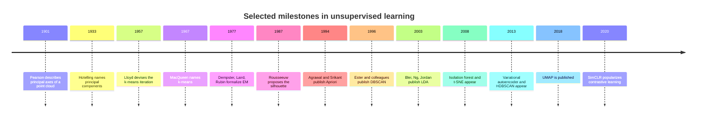

Karl Pearson (1901) described fitting lines and planes of closest fit to points, and Harold Hotelling (1933) developed principal components as the uncorrelated linear combinations of maximum variance; these are the two derivations of PCA given in section 11. Stuart Lloyd devised the alternating assignment and update procedure in 1957, though it appeared in print only in 1982, and James MacQueen (1967) gave the method its name. Arthur Dempster, Nan Laird, and Donald Rubin (1977) showed that a family of iterative procedures were all instances of one algorithm, EM. Peter Rousseeuw (1987) introduced the silhouette. Rakesh Agrawal and Ramakrishnan Srikant (1994) published the Apriori algorithm for association rules. Martin Ester, Hans-Peter Kriegel, Jörg Sander, and Xiaowei Xu (1996) published DBSCAN (Density-Based Spatial Clustering of Applications with Noise). David Blei, Andrew Ng, and Michael Jordan (2003) published Latent Dirichlet Allocation. Fei Tony Liu, Kai Ming Ting, and Zhi-Hua Zhou (2008) published isolation forest, and Laurens van der Maaten and Geoffrey Hinton (2008) published t-SNE. Diederik Kingma and Max Welling (2013) introduced the variational autoencoder, and Ricardo Campello, Davoud Moulavi, and Jörg Sander (2013) introduced HDBSCAN (Hierarchical DBSCAN). Leland McInnes, John Healy, and James Melville (2018) published UMAP. Ting Chen and colleagues (2020) published SimCLR (a simple framework for contrastive learning of visual representations).

The pattern across this history is that the older methods (PCA, k-means, EM, hierarchical clustering) are still the first things to try. They are cheap, well understood, and have closed-form or monotone-convergent algorithms. The newer methods mostly address one specific failure of an older one: DBSCAN handles shapes that k-means cannot, t-SNE preserves local neighborhoods that PCA flattens, isolation forest avoids the distance computations that fail in high dimensions, and contrastive learning produces the representation in which a simple distance becomes meaningful.

### 2.3 A map of the methods

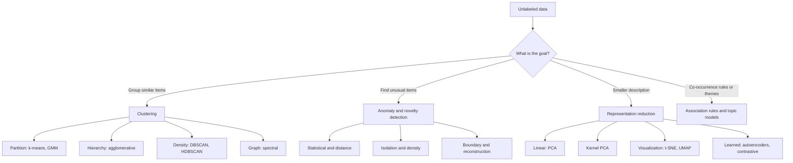

The diagram is the table of contents of the chapter in decision form. The first question is the use of the output, because the use determines the evaluation: a clustering used to organize a human review queue needs different evidence from one used as a feature for a downstream model. The second question is the shape and scale of the data, and the third is the cost of being wrong. The sections that follow take the branches in turn, starting with the component every branch depends on, the measure of similarity.

## 3. Distance and Similarity Measures

Every method in this chapter, except those that work from a probability model alone, depends on a notion of how far apart two examples are. A distance is not a fact about the data. It is a modeling decision, and choosing it badly is the most common cause of clustering results that look plausible and mean nothing.

### 3.1 What a distance must provide

A function $d(x, y)$ is a metric if it is non-negative, zero only when $x = y$, symmetric, and satisfies the triangle inequality $d(x, z) \le d(x, y) + d(y, z)$. Many useful dissimilarities violate one of these properties, and the violation matters only when an algorithm relies on it. Hierarchical clustering with Ward linkage and k-means both assume squared Euclidean geometry. Tree-based nearest-neighbor indexes (k-d trees, ball trees) rely on the triangle inequality to prune the search. A similarity such as cosine is converted to a distance by $1 - \cos$, which is not a metric because it can violate the triangle inequality, though the angular distance $\arccos(\cos)$ is. This matters when a library silently builds a ball tree on a non-metric dissimilarity and returns approximate or wrong neighbors.

### 3.2 Euclidean and Minkowski distances

For $x, y \in \mathbb{R}^p$ the Minkowski distance of order $q$ is

$$
d_q(x, y) = \left( \sum_{j=1}^{p} |x_j - y_j|^q \right)^{1/q}
$$

with $q = 2$ giving the Euclidean distance, $q = 1$ the Manhattan distance, and $q \to \infty$ the Chebyshev distance (the largest coordinate difference). Euclidean distance matches the intuition of straight-line distance and is the geometry assumed by k-means, PCA, and Gaussian models with spherical covariance. It has two weaknesses that drive most failures.

First, it is not invariant to scale. Consider three customers described by age in years and annual income in dollars: $A = (30, 50{,}000)$, $B = (60, 50{,}100)$, $C = (31, 52{,}000)$. Customer $A$ and customer $C$ are the same age and have similar incomes; $B$ is thirty years older. The raw Euclidean distances are

$$
d(A, B) = \sqrt{30^2 + 100^2} = \sqrt{10{,}900} \approx 104.4, \qquad d(A, C) = \sqrt{1^2 + 2000^2} \approx 2000.0
$$

so $B$ is about nineteen times closer to $A$ than $C$ is, and the nearest neighbor of $A$ is a person thirty years older. The income column, in units that are larger by three or four orders of magnitude, has swallowed the age column. Standardize each feature by its standard deviation, say 10 years for age and 10,000 dollars for income, and the distances become

$$
d(A, B) = \sqrt{(30/10)^2 + (100/10000)^2} \approx 3.00, \qquad d(A, C) = \sqrt{(1/10)^2 + (2000/10000)^2} = \sqrt{0.05} \approx 0.224
$$

and the nearest neighbor of $A$ is now $C$. The rule from [CH02](CH02_Data_Preparation_Feature_Engineering_and_Leakage.md) applies: fit the scaling on reference data only and keep the fitted parameters with the model. Standardization is itself a choice, not a neutral step. It gives each feature unit variance, which also amplifies noisy features equally with informative ones. When some features are known to matter more, weighting them explicitly is more honest than relying on whatever variance they happened to have.

Second, Euclidean distance treats every feature as independent and equally scaled in all directions. If two features are strongly correlated, they count the same underlying quantity twice. This is the motivation for the Mahalanobis distance.

### 3.3 Manhattan distance and fractional norms

Manhattan distance sums absolute differences. It is less sensitive than Euclidean distance to a single large coordinate difference, because a deviation enters linearly rather than quadratically, and it often behaves better when data contain many weakly informative features or heavy-tailed noise. It is the natural distance for the k-medians objective, whose cluster center is the coordinate-wise median and is correspondingly less pulled by outliers than a mean. Aggarwal, Hinneburg, and Keim (2001) examined how lower values of $q$, including fractional values below 1, retain more contrast between near and far points in high dimension than $q = 2$. Fractional norms are not metrics and are rarely supported by indexes, so they are mainly a diagnostic and a reason to try Manhattan before reaching for something exotic.

### 3.4 Cosine similarity and angular distance

For vectors $x$ and $y$, cosine similarity is

$$
\cos(x, y) = \frac{x^\top y}{\lVert x \rVert \, \lVert y \rVert}
$$

and compares direction while ignoring length. It is the standard measure for text term-frequency vectors and for learned embeddings, where the length of a vector often reflects how many words a document has or how confident an encoder was, not what the document is about. The two-feature example in the code, $x = (1, 2)$ and $y = (2, 4)$, has cosine similarity exactly 1 and Euclidean distance $\sqrt 5 \approx 2.236$: they point the same way, but one is twice as long.

Cosine similarity relates to Euclidean distance on unit-length vectors by $\lVert x - y \rVert^2 = 2 - 2\cos(x, y)$ when $\lVert x \rVert = \lVert y \rVert = 1$. This is why normalizing vectors to unit length and then running k-means (spherical k-means is the formal version) is a reasonable way to cluster by cosine similarity, and why a vector index can store normalized embeddings and use the inner product.

Cosine fails in three situations. When length carries meaning (for example, a customer who spends ten times as much is different, not the same), discarding it hides the signal. When all vectors share a large common component, such as a dominant mean vector in some embedding models, all pairs look similar and cosine loses contrast; centering the vectors first or removing top principal components restores it. And cosine is undefined for the zero vector, which appears for an empty document or a customer with no events and must be handled explicitly rather than propagating a division by zero.

### 3.5 Mahalanobis distance

The Mahalanobis distance of a point $x$ from a distribution with mean $\mu$ and covariance $\Sigma$ is

$$
d_M(x) = \sqrt{(x - \mu)^\top \Sigma^{-1} (x - \mu)}
$$

where $\Sigma^{-1}$ is the inverse covariance (precision) matrix. Its meaning comes from whitening. Write the eigendecomposition $\Sigma = U \Lambda U^\top$ with orthogonal $U$ and diagonal $\Lambda$. The transformed variable $w = \Lambda^{-1/2} U^\top (x - \mu)$ has identity covariance, and $\lVert w \rVert^2 = (x - \mu)^\top \Sigma^{-1} (x - \mu)$. So Mahalanobis distance is the Euclidean distance after rotating onto the principal axes and rescaling each axis to unit variance. It is invariant to any invertible linear change of units, which fixes both weaknesses of Euclidean distance at once: scale, and correlation.

A numeric example shows the effect. Let two features have unit variance and correlation $0.9$, so $\Sigma = \begin{pmatrix} 1 & 0.9 \\ 0.9 & 1 \end{pmatrix}$, $\det \Sigma = 1 - 0.81 = 0.19$, and $\Sigma^{-1} = \frac{1}{0.19}\begin{pmatrix} 1 & -0.9 \\ -0.9 & 1 \end{pmatrix}$. Take $\mu = 0$ and two points, $a = (1, 1)$ and $b = (1, -1)$. Both are $\sqrt 2 \approx 1.414$ from the origin in Euclidean terms. Then

$$
d_M(a)^2 = \frac{1}{0.19}\left(1 + 1 - 2(0.9)(1)(1)\right) = \frac{0.2}{0.19} \approx 1.053, \qquad d_M(b)^2 = \frac{1}{0.19}\left(1 + 1 + 1.8\right) = 20
$$

so $d_M(a) \approx 1.026$ and $d_M(b) \approx 4.472$. The point $a$ lies along the direction in which the two features move together, so it is ordinary; $b$ has the two features disagreeing strongly, which almost never happens when they are 0.9 correlated, so it is far out. Euclidean distance sees no difference between them. This is the reason Mahalanobis distance is the classical tool for multivariate outliers (section 15.2). For Gaussian data in $p$ dimensions, $d_M^2$ follows a chi-square distribution with $p$ degrees of freedom, so a cutoff has a probabilistic meaning. For $p = 2$ the survival function is $e^{-x/2}$, giving a 99th percentile of $-2\ln(0.01) \approx 9.21$.

Mahalanobis distance has its own failure modes. It needs a covariance estimate, which requires more samples than features and is unstable when features are nearly collinear (the inverse amplifies noise in the smallest eigenvalues). Shrinkage estimators such as Ledoit-Wolf, or computing the distance in a PCA-reduced space, stabilize it. It is also sensitive to the contamination it is meant to detect: if outliers are in the sample used to estimate $\mu$ and $\Sigma$, they inflate the covariance and mask themselves. Outlier-resistant estimators such as the Minimum Covariance Determinant address this. And it assumes a single elliptical population, so a mixture of two well-separated groups will have a covariance spanning both and will rate the gap between them as unremarkable.

### 3.6 Set and binary measures: Jaccard and Hamming

For two sets $A$ and $B$ the Jaccard similarity is

$$
J(A, B) = \frac{|A \cap B|}{|A \cup B|}
$$

and the Jaccard distance is $1 - J$, which is a true metric. It is the natural measure for sparse binary data such as the set of products in a basket, the set of tags on an item, or the set of words in a short document. Take the baskets $A = \{\text{milk}, \text{bread}, \text{eggs}\}$ and $B = \{\text{bread}, \text{eggs}, \text{jam}, \text{tea}\}$. The intersection has 2 items and the union has 5, so $J = 2/5 = 0.4$.

The reason to prefer Jaccard over Euclidean on sparse binary vectors is that it ignores joint absence. If the catalog has 100,000 products, two baskets both lack almost every product. Euclidean distance and Hamming distance (the count of differing positions) between two small baskets are tiny and nearly identical for any pair, because they are dominated by the many positions where both are zero. Jaccard counts only the items that appear in at least one basket. It fails in the opposite direction when absence is informative, for example when "did not buy" is itself the signal, and when set sizes differ greatly: a large basket that contains a small one entirely has a low Jaccard similarity, which is correct for "same basket" and wrong for "contains". For that case, the overlap coefficient $|A \cap B| / \min(|A|, |B|)$ answers the question being asked. For very large sets, MinHash estimates Jaccard similarity from small fixed-size signatures, which is how near-duplicate detection scales.

### 3.7 Edit distance and sequence measures

The Levenshtein edit distance between two strings is the minimum number of single-character insertions, deletions, and substitutions that transform one into the other, computed by dynamic programming in $O(|s||t|)$ time. For "kitten" and "sitting" the distance is 3: substitute k with s, substitute e with i, and insert g. It suits names, product codes, and typo detection. It fails to capture meaning (it rates "car" and "cat" as closer than "car" and "automobile"), counts a transposition of two letters as two edits, and treats every position as equally important. Variants address these: the Damerau variant counts transpositions as one edit, Jaro-Winkler weights early matches for names, and token-based measures ignore word order. For time series, Dynamic Time Warping aligns sequences that are stretched or shifted in time before comparing them, at quadratic cost. For anything where meaning matters more than spelling, an embedding model from [CH16](CH16_Embeddings_and_Semantic_Representations.md) followed by cosine similarity replaces edit distance.

### 3.8 Mixed data: Gower distance and encoding choices

Real tables mix numeric, binary, and categorical columns. Three approaches exist. One-hot encode the categories and use a numeric distance, which makes a high-cardinality column dominate by the number of columns it adds unless it is down-weighted. Use Gower's coefficient, which computes a per-feature dissimilarity (a range-normalized absolute difference for numbers, a 0-or-1 mismatch for categories), then averages them with optional weights; it needs a precomputed pairwise matrix, so it is quadratic in memory. Or move to an algorithm built for the data type, such as k-modes for categorical data, which uses the mismatch count and picks the most frequent category as the center. None of these resolves the underlying question of whether a unit of difference in income is comparable to a unit of difference in region. That comparison is a business judgment, and the clustering inherits it.

### 3.9 How the metric changes the neighborhood

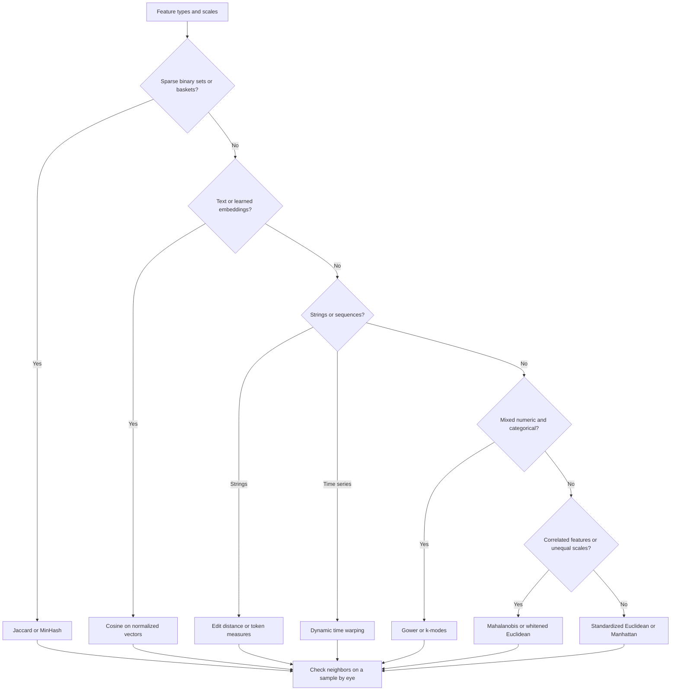

The decision tree starts with the data type because the type usually settles the choice. It ends in a manual check, because no rule replaces looking at the nearest neighbors of fifty random items and asking whether a domain expert would agree that they are similar. That check is cheap, it catches scale errors, constant columns, identifier columns that leaked in, and encodings that made two unlike items close, and it should be a gate before any clustering result is discussed.

A short list of practical rules follows from the above. Standardize or whiten numeric features unless their native units are comparable. Normalize before cosine when length is noise, and not when it is signal. Prefer Jaccard for sparse sets and edit distance only for spelling-level similarity. Treat any metric on more than a few dozen raw features with suspicion, which is the subject of the next section.

## 4. The Curse of Dimensionality

The phrase covers several separate effects that all follow from one fact: volume grows exponentially with dimension, so any fixed amount of data becomes sparse. The effects matter to this chapter because most unsupervised methods use distances or densities, and both degrade.

### 4.1 Volume concentrates in the corners and the shell

Consider the unit cube $[0, 1]^p$ and the ball of radius $0.5$ centered in it, which is the largest ball that fits. In two dimensions the ball occupies $\pi / 4 \approx 78.5\%$ of the square. The volume of a $p$-dimensional ball of radius $r$ is $\pi^{p/2} r^p / \Gamma(p/2 + 1)$, where $\Gamma$ is the gamma function, so the ball-to-cube ratio is

$$
\frac{V_{\text{ball}}}{V_{\text{cube}}} = \frac{\pi^{p/2}}{\Gamma(p/2 + 1)} \, 0.5^{\,p}
$$

and the numbers the script prints are:

| Dimension $p$ | Ball volume as a fraction of the cube | Fraction of the cube within 0.05 of any face |
| --- | --- | --- |
| 2 | 0.785 | 0.190 |
| 3 | 0.524 | 0.271 |
| 10 | $2.49 \times 10^{-3}$ | 0.651 |
| 20 | $2.46 \times 10^{-8}$ | 0.878 |
| 50 | $1.54 \times 10^{-28}$ | 0.995 |

The last column is $1 - 0.9^p$, the probability that at least one coordinate of a uniform point lies in the outer 5% on either side. At $p = 50$ essentially every point is near a face, and essentially none is near the center. A hypersphere of neighbors around a query then contains almost no data unless it is made so large that it is no longer local. The practical consequence is that the data live near the boundary and in the corners, where a "neighborhood" has no intuitive meaning.

### 4.2 Distance concentration

The second effect is that distances between random points become nearly equal. For $p$ independent features, the squared distance between two points is a sum of $p$ terms. Its mean grows in proportion to $p$ and its standard deviation grows in proportion to $\sqrt p$, so the relative spread shrinks as $1/\sqrt p$. Beyer, Goldstein, Ramakrishnan, and Shaft (1999) formalized this: under broad conditions, the ratio of the farthest to the nearest neighbor distance tends to 1 as dimension grows, so "nearest neighbor" stops being meaningful.

The demonstration in [01_distance_and_dimensionality.py](../code/python/unsupervised-chapter/01_distance_and_dimensionality.py) draws 500 uniform points and one query, repeats 20 times, and averages the relative contrast $(d_{\max} - d_{\min}) / d_{\min}$:

| Dimension $p$ | Average relative contrast |
| --- | --- |
| 2 | 46.6 |
| 10 | 2.54 |
| 100 | 0.406 |
| 1000 | 0.114 |

At $p = 1000$ the farthest point is only 11% farther than the nearest. The two-dimensional average is dominated by occasional queries with a very close neighbor (a small $d_{\min}$ inflates the ratio), so read it as "large", not as a precise expectation. The contrast shrinks in step with the $1/\sqrt p$ rule: from $p = 100$ to $p = 1000$ the dimension grows tenfold and the contrast falls by a factor of 3.6, close to $\sqrt{10} \approx 3.16$ given sampling noise. The numbers describe uniform random data; real data usually have far lower intrinsic dimension, which is why neighbor methods still work on images and text.

### 4.3 Intrinsic dimension and why real data survive

What matters is not the number of columns but the intrinsic dimension: how many degrees of freedom the data actually have. A 1,000-column table where most columns are linear combinations of ten underlying factors lies near a ten-dimensional subspace, and distances computed within that subspace remain informative. Images of a rotating object have intrinsic dimension near the number of rotation parameters, however many pixels they contain. Methods that exploit this are the subject of the dimensionality-reduction sections. A rough estimate of intrinsic dimension comes from the number of principal components needed to explain most variance, or from how the number of neighbors within radius $r$ grows with $r$ (it grows as $r^{d}$, where $d$ is the intrinsic dimension).

The damage is worst when the dimensions are independent and uninformative. Adding 990 irrelevant noise columns to 10 informative ones keeps the intrinsic dimension at 1,000 and drowns the signal: the squared distance between two points is the informative part plus the noise part, and the noise part, summed over 990 columns, has a far larger mean and a spread that hides the informative part. This is the reason feature selection and weighting are not optional for distance-based clustering.

### 4.4 Consequences for the methods in this chapter

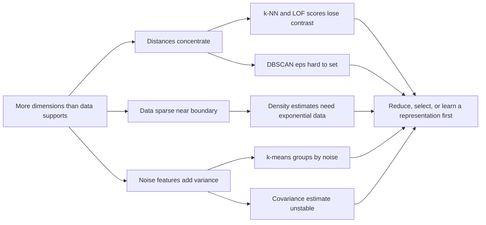

The diagram links causes to consequences and consequences to one remedy. Neighbor-based methods such as k-NN, Local Outlier Factor, and DBSCAN lose contrast between near and far. Density estimation needs data that grows exponentially with dimension to keep the same accuracy. K-means still runs, but the objective is dominated by noise dimensions and the clusters it returns separate on them. Covariance estimation needs $n \gg p$ and produces a nearly singular matrix otherwise. The remedies fall into three groups: reduce dimension with PCA or an autoencoder before measuring distances, select or weight features by domain knowledge, or switch to a method that does not rely on full-space distances, such as isolation forests (section 15.3) or a subspace method. A good working habit is to compute the distance-contrast statistic on one's own data, in the representation about to be used, before choosing an algorithm. If the contrast is small, fix the representation first.

Two caveats apply. Concentration is a statement about independent coordinates; strongly structured data may show good contrast even in many dimensions. And the effect is not an argument for always reducing dimension: reduction discards information, and a reduction fitted without regard to the task can remove the very directions that separate the groups of interest. Section 11.6 returns to this.

## 5. K-Means Clustering

K-means is the default partitioning method. It is fast, easy to explain, and has a clear objective, which is also the source of its limits. Understanding its derivation tells the reader precisely when to trust it.

### 5.1 The objective

Given points $x_1, \dots, x_n \in \mathbb{R}^p$ and a number of clusters $k$, k-means seeks an assignment $c_i \in \{1, \dots, k\}$ and centroids $\mu_1, \dots, \mu_k$ that minimize the within-cluster sum of squares (also called inertia):

$$
J(c, \mu) = \sum_{i=1}^{n} \lVert x_i - \mu_{c_i} \rVert^2
$$

The objective is a statement about compactness: it measures how tightly points hug their centroids in squared Euclidean distance. A partition with lower $J$ is "better" only in that sense. Two identities help interpret it. The total sum of squares around the global mean splits into a within-cluster part and a between-cluster part, $\text{TSS} = J + \sum_k n_k \lVert \mu_k - \bar{x} \rVert^2$, so minimizing $J$ is the same as maximizing the spread of the centroids weighted by cluster size. And $J$ always decreases when $k$ increases (a new centroid can only help), reaching zero at $k = n$, which is why $J$ alone cannot choose $k$.

### 5.2 Lloyd's algorithm and why it converges

Lloyd's algorithm alternates two steps, each of which is an exact minimization over one block of variables with the other held fixed.

**Assignment step.** With centroids fixed, the objective is a sum of independent terms, one per point, so each point should be given to the nearest centroid: $c_i = \arg\min_k \lVert x_i - \mu_k \rVert^2$. This cannot raise $J$.

**Update step.** With assignments fixed, the objective for cluster $k$ is $\sum_{i : c_i = k} \lVert x_i - \mu_k \rVert^2$. Setting the gradient with respect to $\mu_k$ to zero gives $-2 \sum_{i : c_i = k} (x_i - \mu_k) = 0$, so

$$
\mu_k = \frac{1}{n_k} \sum_{i : c_i = k} x_i
$$

the mean of the members, where $n_k$ is the cluster size. The objective is convex in $\mu_k$, so the mean is the global minimizer for that block. This also cannot raise $J$.

Because $J$ is non-negative and never increases, and because there are only finitely many partitions of $n$ points into $k$ groups, the algorithm must stop. It stops at a fixed point in which no assignment changes. That fixed point is a local minimum with respect to these two moves, not a global minimum. The exact problem is NP-hard in general, so no polynomial-time algorithm for the global optimum is known. The number of iterations in the worst case can be large, and Vattani (2011) showed a family of planar inputs where it is exponential, but in practice convergence takes tens of iterations on typical data. Arthur, Manthey, and Röglin (2009) explained this gap with a smoothed analysis showing polynomial expected iterations under small random perturbation.

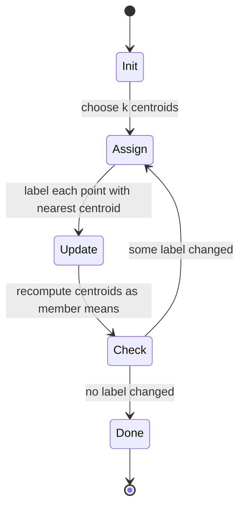

The state diagram is the entire algorithm. Two practical points follow from it. The initialization state decides which local minimum the loop falls into. And the "no label changed" test is the correct stopping rule; stopping on a small change in $J$ is a common speed-up (a tolerance parameter in most libraries) that can end the loop earlier than a true fixed point.

### 5.3 A worked example

Seven points: $A = (1, 1)$, $B = (1.5, 2)$, $C = (3, 4)$, $D = (5, 7)$, $E = (3.5, 5)$, $F = (4.5, 5)$, $G = (3.5, 4.5)$, with $k = 2$ and initial centroids at $A$ and $D$. [02_kmeans_em_dbscan.py](../code/python/unsupervised-chapter/02_kmeans_em_dbscan.py) reproduces the steps.

*Iteration 1, assignment.* Squared distances to $A$ and $D$: $B$ is $0.25 + 1 = 1.25$ from $A$ and $12.25 + 25 = 37.25$ from $D$, so it goes to $A$. $E$ is $6.25 + 16 = 22.25$ from $A$ and $2.25 + 4 = 6.25$ from $D$, so it goes to $D$. Point $C$ is $4 + 9 = 13$ from both, a tie, which the code breaks toward the lower index. The result is $\{A, B, C\}$ and $\{D, E, F, G\}$.

*Iteration 1, update.* The first centroid is $((1 + 1.5 + 3)/3, (1 + 2 + 4)/3) = (1.833, 2.333)$. The second is $((5 + 3.5 + 4.5 + 3.5)/4, (7 + 5 + 5 + 4.5)/4) = (4.125, 5.375)$. The objective is the sum over clusters. For the first cluster: $A$ contributes $0.833^2 + 1.333^2 = 2.472$, $B$ contributes $0.222$, $C$ contributes $4.139$, subtotal $6.833$. For the second: $D$ contributes $3.406$, $E$ $0.531$, $F$ $0.281$, $G$ $1.156$, subtotal $5.375$. So $J = 12.208$.

*Iteration 2, assignment.* Point $C$ is now $1.361 + 2.778 = 4.139$ from the first centroid and $1.266 + 1.891 = 3.156$ from the second, so it moves to the second cluster. New clusters are $\{A, B\}$ and $\{C, D, E, F, G\}$, with centroids $(1.25, 1.5)$ and $(3.9, 5.1)$ and $J = 8.525$. A third assignment pass changes nothing, so the algorithm stops.

The example shows the three behaviors that matter: $J$ falls monotonically ($12.208$ to $8.525$), the tie at $C$ is resolved arbitrarily and could have led elsewhere with another rule, and the final centroid $(3.9, 5.1)$ is not a data point.

### 5.4 Initialization and k-means++

A poor start can strand the algorithm in a bad local minimum, for example two initial centroids inside the same true cluster while another cluster has none. The simplest remedy is to run the algorithm from several random starts and keep the lowest $J$. A better remedy is k-means++ (Arthur and Vassilvitskii, 2007), which chooses the first centroid uniformly at random, then chooses each later centroid with probability proportional to the squared distance to the nearest centroid already chosen:

$$
\Pr(\text{choose } x_i) = \frac{D(x_i)^2}{\sum_{j} D(x_j)^2}, \qquad D(x) = \min_{\text{chosen } \mu} \lVert x - \mu \rVert
$$

This spreads the seeds apart while keeping randomness, so a distant outlier is likely but not certain to be chosen. In the seven-point example with the first centroid at $A$, the squared distances to $A$ are $0$, $1.25$, $13$, $52$, $22.25$, $28.25$, and $18.5$ for $A$ through $G$, summing to $135.25$. Point $D$ is picked with probability $52 / 135.25 \approx 0.384$, while $B$, right next to $A$, is picked with probability $1.25 / 135.25 \approx 0.009$. The authors proved that the expected cost of the seeding alone is within a factor of $O(\log k)$ of the optimal clustering cost, a guarantee that uniform random seeding lacks. Libraries use k-means++ by default and run several restarts (the exact defaults vary by library and version, so check yours).

The same property is a weakness with outliers: because far-away points are favored, a single extreme outlier can capture a centroid, leaving one cluster with one member. Remove or cap outliers before clustering, or use k-medians or k-medoids.

### 5.5 What k-means assumes, and where it fails

The update step is the Euclidean mean, and the assignment step is nearest centroid, which carves space into Voronoi cells with straight boundaries midway between centroids. Combined, these impose the following assumptions, each with a characteristic failure.

- **Spherical, equally scaled clusters.** The objective treats every direction equally, so an elongated cluster is cut across its length. Two parallel elongated clusters may be sliced the wrong way.
- **Similar cluster sizes and densities.** K-means cuts a large, spread-out cluster into pieces to reduce $J$ while merging nearby small clusters. A cluster with 10,000 points will often attract extra centroids from a cluster with 100 points.
- **Convex clusters.** A ring, a crescent, or nested shapes cannot be separated by Voronoi cells. In the script, two concentric rings of 100 points each, with radii 1 and 3, give a k-means purity of $0.525$ for $k = 2$, little better than chance, while DBSCAN with a suitable radius recovers both rings (section 8).
- **Sensitivity to outliers.** The mean is not resistant, so a few extreme points drag a centroid and consume a cluster.
- **Sensitivity to scale and irrelevant features.** All of section 3 and section 4 applies.
- **Hard assignment.** Every point is assigned to exactly one cluster with no measure of confidence, so a point midway between two centroids looks the same as one at a center.
- **A fixed, user-chosen $k$.** The method has no notion of "no cluster here".

Related methods relax one assumption each. K-medoids (Partitioning Around Medoids) restricts centers to actual data points and works with any dissimilarity matrix, at higher cost. K-medians uses Manhattan distance and coordinate-wise medians. K-modes handles categorical data. Gaussian mixtures (section 9) allow per-cluster shape, size, and soft membership. Spherical k-means uses cosine geometry. Kernel k-means and spectral clustering (section 10) handle nonconvex shapes by changing the geometry.

### 5.6 Scale and variants

Each Lloyd iteration computes $n \times k$ distances in $p$ dimensions, so it costs $O(nkp)$. For 50 million vectors of 128 dimensions and $k = 1000$, one iteration is $50 \times 10^6 \times 1000 \times 128 = 6.4 \times 10^{12}$ multiply-add operations (the distance computations dominate). Mini-batch k-means (Sculley, 2010) updates centroids from small random batches with per-centroid learning rates, trading a slightly higher $J$ for a large speed-up and a memory footprint independent of $n$. Triangle-inequality accelerations (Elkan, Hamerly) give exact Lloyd results with fewer distance evaluations. For data too large for one machine, the distance step distributes naturally, and the update step is a reduction over partial sums. Section 23 returns to costs.

## 6. Choosing the Number of Clusters

There is no automatic way to find "the" number of clusters, and the question is often ill-posed: the data may have structure at several scales (customer types, and subtypes within each), or none at all. The decision combines statistical evidence and a purpose. Every criterion below produces a candidate list for a human to judge.

### 6.1 The elbow method

Plot $J$ against $k$ and look for the bend after which additional clusters give diminishing returns. On the three-blob example in the script (150 points, three Gaussian clusters with centers at $(0, 0)$, $(6, 0)$, and $(3, 5)$ and unit standard deviation, best of ten k-means++ restarts), the values are:

| $k$ | Inertia $J$ | Silhouette |
| --- | --- | --- |
| 1 | 2106.9 | undefined |
| 2 | 1187.1 | 0.471 |
| 3 | 294.9 | 0.685 |
| 4 | 251.6 | 0.560 |
| 5 | 213.3 | 0.451 |
| 6 | 178.1 | 0.352 |

Going from $k = 2$ to $k = 3$ removes $(1187.1 - 294.9) / 1187.1 \approx 75\%$ of the inertia; going from $k = 3$ to $k = 4$ removes only $(294.9 - 251.6) / 294.9 \approx 15\%$. The elbow is at $k = 3$, matching the generating process. The method fails when the curve is smooth with no visible bend, which is typical of real data without well-separated clusters, and the eye can see an elbow in noise. Treat it as a heuristic.

### 6.2 The silhouette and other internal indices

The average silhouette (section 16.1) peaks at $k = 3$ here, at $0.685$. It gives a quantitative target and a per-point diagnostic, though it favors compact, convex clusters for the same reason k-means does. The Calinski-Harabasz index (ratio of between-cluster to within-cluster dispersion, scaled by degrees of freedom) and the Davies-Bouldin index (average similarity between each cluster and its most similar neighbor, lower is better) play the same role. When several indices agree, confidence in the candidate rises. When they disagree, the data probably do not have a single natural partition.

### 6.3 The gap statistic and information criteria

The gap statistic (Tibshirani, Walther, and Hastie, 2001) compares $\log J$ to its expected value under a reference distribution with no cluster structure (uniform over the data's bounding box or principal-component box), and picks the smallest $k$ whose gap is within one standard error of the next. It is more principled than the elbow because it states a null, at the cost of Monte Carlo simulation. For mixture models, the Bayesian Information Criterion (BIC) and Akaike Information Criterion penalize log-likelihood by the number of parameters (section 9.6), giving a likelihood-based answer that respects model complexity.

### 6.4 Stability and purpose

A good $k$ is one for which the clusters are reproducible: if the data are resampled, clusters should reappear. Section 16.3 describes stability checks. The last criterion is purpose. A marketing team that can run five campaigns does not need 40 segments, however good the silhouette, and a segmentation that tells a fraud team nothing actionable is not improved by a tidier curve. State the decision the clusters feed, bound $k$ by what that decision can use, and choose within the bound using the evidence above. If the evidence is flat, choose the smallest $k$ that the downstream use supports and document that it was a choice.

## 7. Hierarchical Clustering

Hierarchical clustering produces a tree of nested partitions rather than one partition, deferring the choice of $k$ until after fitting. Agglomerative (bottom-up) clustering is the common form: start with each point as its own cluster, and repeatedly merge the two closest clusters until one remains. Divisive (top-down) clustering splits instead and is rarer because the search space for splits is larger.

### 7.1 Linkage: defining the distance between clusters

The algorithm needs a distance between sets of points, called the linkage. Let $A$ and $B$ be clusters and $d$ a point-to-point distance.

| Linkage | Distance between $A$ and $B$ | Behavior |
| --- | --- | --- |
| Single | $\min_{a, b} d(a, b)$ | Merges through any close pair; follows chains and thin bridges, finds elongated or nonconvex shapes, and is prone to chaining |
| Complete | $\max_{a, b} d(a, b)$ | Merges only if every pair is close; makes compact, similar-diameter clusters and is sensitive to outliers |
| Average (UPGMA) | $\frac{1}{|A||B|} \sum d(a, b)$ | Compromise between the two; the common default for general similarity matrices |
| Ward | Increase in within-cluster sum of squares from merging | Minimizes the k-means objective greedily; yields balanced, compact clusters; needs Euclidean distance |
| Centroid | $d(\mu_A, \mu_B)$ | Can produce inversions, where a later merge is at a lower height than an earlier one |

Ward's criterion has a closed form: merging clusters of sizes $n_A$ and $n_B$ with centroids $\mu_A$ and $\mu_B$ raises the sum of squares by $\frac{n_A n_B}{n_A + n_B} \lVert \mu_A - \mu_B \rVert^2$. It explains why Ward behaves like k-means: both minimize the same squared-error objective, one greedily across a hierarchy and the other by iteration for a fixed $k$. All the linkages above can be updated after a merge by the Lance-Williams recurrence from the old distances, without revisiting the raw data.

### 7.2 A worked example of single and complete linkage

Take five points on a line: $0, 1, 3, 7, 9$.

*Single linkage.* The closest pair is $\{0, 1\}$ at distance 1; merge. The next closest are $\{0, 1\}$ to $3$ (the nearest members are 1 and 3, distance 2) and $7$ to $9$ (distance 2). Merge both at height 2. The remaining two clusters, $\{0, 1, 3\}$ and $\{7, 9\}$, are joined at the distance of their closest members, $7 - 3 = 4$.

*Complete linkage.* Merge $\{0, 1\}$ at 1. Then $\{7, 9\}$ is at 2, while $3$ to $\{0, 1\}$ is $\max(3, 2) = 3$, so merge $\{7, 9\}$ at 2, then $3$ into $\{0, 1\}$ at height 3. The final merge is at the distance of the farthest members, $9 - 0 = 9$.

Both give the same final two-cluster cut here, but the merge heights differ (final height 4 versus 9), and with data containing a bridge of points between two groups, single linkage would merge the groups early while complete linkage would not. This sensitivity is the reason to look at several linkages on the same data and to prefer the one whose clusters match the use.

### 7.3 The dendrogram and choosing a cut

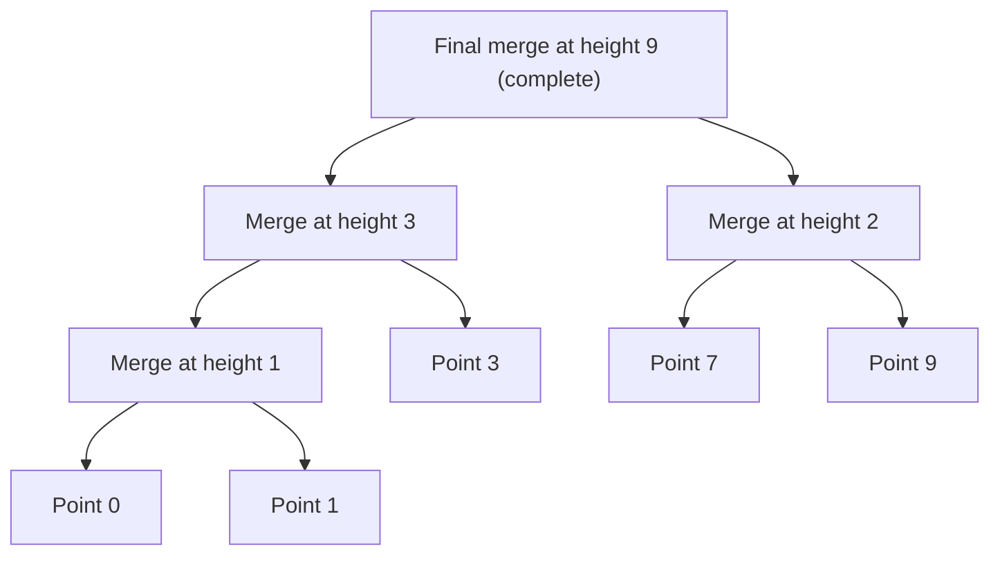

The tree above is the complete-linkage dendrogram for the five points. The vertical axis of a conventional dendrogram is the merge height, so a long vertical gap before a merge signals two groups that are far apart relative to their internal spread; cutting in that gap yields the partition. Cutting between height 3 and height 9 produces the two clusters $\{0, 1, 3\}$ and $\{7, 9\}$. The cophenetic correlation, the correlation between the original pairwise distances and the heights at which pairs first join, measures how faithfully the tree represents the data, and a low value says the hierarchy is a poor summary.

### 7.4 Costs and when to use it

A naive implementation is $O(n^3)$ time and $O(n^2)$ memory for the distance matrix, and optimized versions reach $O(n^2)$ time for most linkages, which restricts use to tens of thousands of points. A common production pattern is to compress first, for example with mini-batch k-means into a few hundred centroids, and run the hierarchy on the centroids. Hierarchical clustering suits taxonomy building, gene-expression-like analyses, and exploratory work where the analyst wants to look at several granularities. It cannot undo an early bad merge, and it provides no way to assign a new point to a cluster without choosing a rule (for example, assigning to the nearest cluster by the same linkage), so it is less natural for online serving than k-means or a mixture model.

## 8. Density-Based Clustering: DBSCAN and HDBSCAN

Density-based methods define a cluster as a dense region separated from other dense regions by sparse ones. They find arbitrarily shaped clusters, label sparse points as noise instead of forcing them into a cluster, and do not need $k$. The cost is that "dense" requires parameters that interact with scale.

### 8.1 DBSCAN definitions

DBSCAN has two parameters: a radius $\varepsilon$ and a minimum point count $m$ (often called min_samples). The $\varepsilon$-neighborhood of a point is every point within distance $\varepsilon$, including itself in most implementations. Points fall into three types:

- A **core point** has at least $m$ points in its $\varepsilon$-neighborhood.
- A **border point** is not core but lies in the neighborhood of a core point.
- A **noise point** is neither.

Two core points are directly connected if they are within $\varepsilon$. A cluster is a maximal set of core points connected through chains of such links, plus the border points attached to them. The algorithm scans points, and for each unvisited core point grows a cluster by repeatedly adding the neighborhoods of core points it reaches.

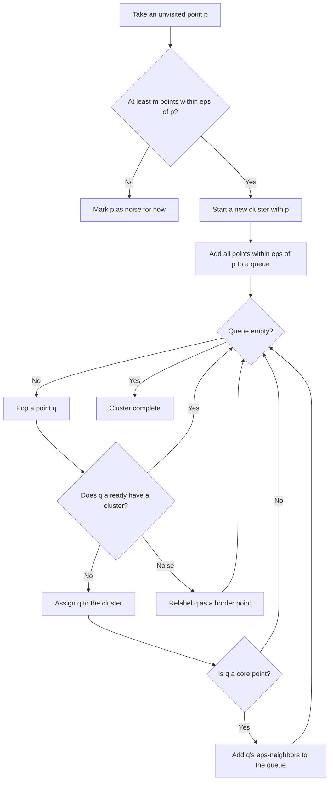

The flowchart shows why noise points can later become border points: a point first marked as noise may turn out to lie near a core point reached later. It also shows the one asymmetry of the method. Core and noise points get unique labels, but a border point near two clusters is given to whichever cluster reaches it first, so border assignments depend on scan order. With a spatial index, DBSCAN costs about $O(n \log n)$ in low dimension and degrades toward $O(n^2)$ as the index loses effectiveness at high dimension.

### 8.2 Choosing the parameters

The parameter $m$ sets how much support makes a region dense. A widely used guideline is $m \ge p + 1$ and commonly $m = 2p$ (Sander and colleagues, 1998), with larger values for noisy data. The parameter $\varepsilon$ is chosen from the k-distance plot: compute each point's distance to its $m$-th nearest neighbor, sort in descending order, and look for the knee. Points left of the knee are in sparse regions and become noise; points to the right belong to clusters. The knee is a judgment call, and a small shift in $\varepsilon$ can change the count of clusters substantially.

The script shows this. Two concentric rings of 100 points each, radii 1 and 3, with Gaussian noise of 0.08, are clustered with $m = 5$. With $\varepsilon = 0.5$ the inner ring is dense enough, but the outer ring has spacing near $2\pi \cdot 3 / 100 \approx 0.19$ plus noise, and some stretches have fewer than five points within 0.5, so the ring fragments: 8 clusters and 8 noise points, though every cluster is pure with respect to the ring it came from. With $\varepsilon = 1.0$ the result is two clusters and no noise, which matches the construction. Purity is $1.0$ in both runs, which is why purity against known labels is a poor guard against over-fragmentation; a number of clusters that disagrees with the expected structure is the signal. The gap between the rings is 2, so any $\varepsilon$ in a wide range around 1 works here; with a small gap or uneven spacing, the working range shrinks to nothing.

### 8.3 Where DBSCAN fails

A single $\varepsilon$ applies everywhere, so DBSCAN cannot handle clusters of very different densities: an $\varepsilon$ that separates two dense clusters leaves a sparse cluster labeled as noise, and an $\varepsilon$ large enough to capture the sparse cluster merges the dense ones. Distance concentration (section 4) makes the $\varepsilon$ choice delicate in high dimension, because almost all pairwise distances fall in a narrow band. Border-point assignment is order dependent. And a thin bridge of points between clusters can chain them together, the same failure as single linkage; indeed DBSCAN with $m = 1$ is equivalent to single linkage cut at $\varepsilon$.

### 8.4 HDBSCAN

HDBSCAN (Campello, Moulavi, and Sander, 2013) removes the global $\varepsilon$ and builds a hierarchy of DBSCAN results across all values of $\varepsilon$, then extracts the most persistent clusters. The construction has four steps.

1. **Core distance.** For each point, $\text{core}_m(a)$ is the distance to its $m$-th nearest neighbor. In dense regions it is small, in sparse regions large.
2. **Mutual reachability distance.** $d_{\text{mreach}}(a, b) = \max\{\text{core}_m(a), \text{core}_m(b), d(a, b)\}$. This pushes points in sparse regions farther from everything, which makes isolated points separate from clusters at lower thresholds and stops thin bridges from linking dense regions.
3. **Minimum spanning tree and hierarchy.** Build the minimum spanning tree of the complete graph under $d_{\text{mreach}}$. Removing edges in descending weight order gives a single-linkage hierarchy under the transformed distance, equivalent to running DBSCAN at every $\varepsilon$.
4. **Condense and select.** Discard splits where a side has fewer than min_cluster_size points, treating them as points falling out of the cluster, then pick the set of non-overlapping clusters that maximizes total stability. A cluster's stability is the sum over its points of $\lambda_{\text{leave}} - \lambda_{\text{birth}}$, where $\lambda = 1 / \varepsilon$ is the density level at which the cluster appears or the point leaves it. Clusters that exist over a wide range of density levels are stable.

The practical result is a method that finds clusters of varying density, labels the rest as noise, needs essentially one main parameter (min_cluster_size) plus min_samples, and provides a membership strength per point and an outlier score based on how late a point joins a cluster (the GLOSH score). Its costs are the minimum spanning tree computation, roughly $O(n \log n)$ with tree-based acceleration in low dimension and $O(n^2)$ otherwise, and some sensitivity to min_samples. HDBSCAN is available as a separate package and, in scikit-learn, as an estimator added in version 1.3; verify the current version and its default parameters before relying on a result. OPTICS (Ankerst and colleagues, 1999) produces a similar reachability ordering and is another way to see a range of densities at once.

Density methods suit spatial data, anomalies defined as "not in any dense region", and clustering of low-dimensional embeddings (a common recipe is to reduce embeddings with UMAP and then cluster with HDBSCAN, with the warnings of section 13). They are a poor fit when every item must belong to a group, as in a customer-segmentation scheme where each customer needs a treatment; in that case use noise as a signal to inspect, not as a segment.

## 9. Gaussian Mixture Models and the EM Algorithm

A Gaussian mixture model (GMM) describes data as drawn from one of $K$ Gaussian components, with the component identity hidden. It generalizes k-means in three ways: components have their own covariance, components have their own weight, and membership is a probability. It is also the standard example of a latent-variable model fitted by EM, which reappears in topic models (section 17) and other settings.

### 9.1 The model and the likelihood

Let $z_i \in \{1, \dots, K\}$ be the hidden component of example $i$. The model is

$$
p(x) = \sum_{k=1}^{K} \pi_k \, \mathcal{N}(x \mid \mu_k, \Sigma_k), \qquad \pi_k \ge 0, \quad \sum_k \pi_k = 1
$$

where $\pi_k$ is the mixing weight, $\mu_k$ the mean, and $\Sigma_k$ the covariance of component $k$. The log-likelihood of the data is

$$
\ell(\theta) = \sum_{i=1}^{n} \log \sum_{k=1}^{K} \pi_k \, \mathcal{N}(x_i \mid \mu_k, \Sigma_k)
$$

with $\theta$ the collection of all parameters. The logarithm of a sum has no closed-form maximizer, because the sum sits inside the logarithm and couples all components. If the $z_i$ were observed, the complete-data log-likelihood $\sum_i \log \pi_{z_i} + \log \mathcal{N}(x_i \mid \mu_{z_i}, \Sigma_{z_i})$ would separate by component and be easy to maximize. EM exploits this.

### 9.2 Derivation of EM

Introduce any distribution $q_i(k)$ over the component of example $i$. By Jensen's inequality for the concave logarithm,

$$
\log \sum_k \pi_k \mathcal{N}(x_i \mid \mu_k, \Sigma_k) = \log \sum_k q_i(k) \frac{\pi_k \mathcal{N}(x_i \mid \mu_k, \Sigma_k)}{q_i(k)} \;\ge\; \sum_k q_i(k) \log \frac{\pi_k \mathcal{N}(x_i \mid \mu_k, \Sigma_k)}{q_i(k)}
$$

The right side is a lower bound on the log-likelihood (the evidence lower bound, which reappears for the VAE in section 14). Equality holds when the ratio inside the logarithm is the same for every $k$, which happens exactly when $q_i(k)$ is the posterior probability of component $k$ given $x_i$:

$$
\gamma_{ik} = q_i(k) = \frac{\pi_k \mathcal{N}(x_i \mid \mu_k, \Sigma_k)}{\sum_j \pi_j \mathcal{N}(x_i \mid \mu_j, \Sigma_j)}
$$

This quantity, the responsibility of component $k$ for example $i$, defines the **E-step**: compute $\gamma_{ik}$ using the current parameters. It makes the bound tight at the current $\theta$. The **M-step** maximizes the bound over $\theta$ with $\gamma$ fixed. Dropping terms that do not depend on $\theta$, that means maximizing

$$
Q(\theta) = \sum_{i=1}^{n} \sum_{k=1}^{K} \gamma_{ik} \left[ \log \pi_k + \log \mathcal{N}(x_i \mid \mu_k, \Sigma_k) \right]
$$

For the mean, differentiate with respect to $\mu_k$ and set to zero. The Gaussian log-density derivative gives $\sum_i \gamma_{ik} \Sigma_k^{-1}(x_i - \mu_k) = 0$, so with $N_k = \sum_i \gamma_{ik}$ (the effective number of points in component $k$),

$$
\mu_k = \frac{1}{N_k} \sum_{i} \gamma_{ik} x_i, \qquad \Sigma_k = \frac{1}{N_k} \sum_i \gamma_{ik} (x_i - \mu_k)(x_i - \mu_k)^\top
$$

The covariance formula follows from the same step with respect to $\Sigma_k^{-1}$. For the weights, add a Lagrange multiplier $\lambda$ for the constraint $\sum_k \pi_k = 1$ and differentiate: $\sum_i \gamma_{ik} / \pi_k + \lambda = 0$, so $\pi_k = -N_k / \lambda$. Summing over $k$ and using $\sum_k N_k = n$ gives $\lambda = -n$ and

$$
\pi_k = \frac{N_k}{n}
$$

These are weighted versions of the ordinary sample mean, covariance, and proportion, with soft counts in place of hard ones. Because the E-step makes the bound touch the likelihood and the M-step raises the bound, the likelihood never decreases: $\ell(\theta^{(t+1)}) \ge Q(\theta^{(t+1)}) \ge \ell(\theta^{(t)})$ up to the constant terms. The sequence converges to a stationary point, usually a local maximum, which is why initialization matters again.

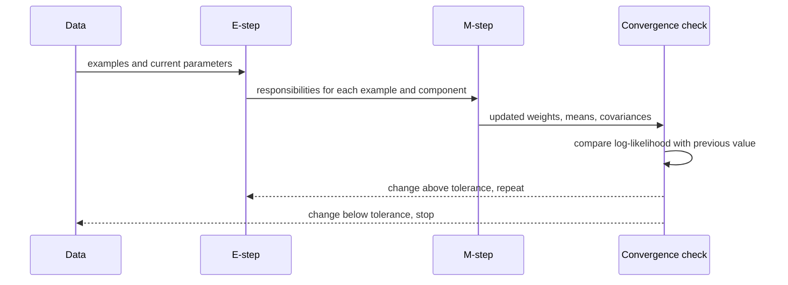

The sequence diagram shows the loop as a message exchange. The data never change; only the parameters and responsibilities do. The same structure, with different formulas, applies to every EM algorithm: a hidden-variable posterior in the E-step and a closed-form (or easy) maximization in the M-step.

### 9.3 A worked example

[02_kmeans_em_dbscan.py](../code/python/unsupervised-chapter/02_kmeans_em_dbscan.py) fits a two-component, one-dimensional mixture to seven values: $1.0, 1.2, 0.8, 4.0, 4.3, 3.7, 2.5$. The start is $\mu = (0, 5)$, $\sigma = (1, 1)$, $\pi = (0.5, 0.5)$.

*E-step for $x = 1.0$.* The density of component 1 is $\mathcal{N}(1 \mid 0, 1) = e^{-0.5}/\sqrt{2\pi} \approx 0.24197$, and of component 2 is $\mathcal{N}(1 \mid 5, 1) = e^{-8}/\sqrt{2\pi} \approx 0.000134$. Weighted by $\pi = 0.5$ each, the unnormalized responsibilities are $0.12099$ and $0.0000669$, so $\gamma_{\cdot 1} = 0.12099 / 0.12106 \approx 0.9994$. The other points on the left have responsibilities near 1 for component 1 and the points near 4 have responsibilities near 1 for component 2. The point $x = 2.5$ is equidistant from both means, so its responsibilities are exactly $0.5$ and $0.5$.

*M-step.* The soft count for component 1 is $N_1 = 0.9994 + 0.9985 + 0.9998 + 0.0006 + 0.0001 + 0.0025 + 0.5 \approx 3.501$, and the weighted sum of $x$ is $0.9994 + 1.1982 + 0.7998 + 0.0024 + 0.0004 + 0.0093 + 1.25 \approx 4.2595$, so $\mu_1 = 4.2595 / 3.501 \approx 1.217$. The script reports $\mu = (1.217, 3.784)$, $\sigma = (0.552, 0.576)$, $\pi = (0.500, 0.500)$ and a log-likelihood of $-10.015$ after one iteration.

*Convergence.* After 50 iterations the parameters are $\mu = (1.000, 3.624)$, $\sigma = (0.163, 0.685)$, $\pi = (0.428, 0.572)$ and the log-likelihood is $-7.751$. The weight $0.428 \approx 3/7$ shows that the ambiguous point $2.5$ has been absorbed entirely by the second component, whose larger variance $0.685$ reflects the extra spread. A hard-assignment method has no such way of expressing that the point was ambiguous at the start and the model's answer depends on the rest of the data.

### 9.4 Covariance structure and the number of parameters

The covariance of each component can be restricted. A **spherical** covariance $\sigma_k^2 I$ gives round components of different sizes. A **diagonal** covariance allows axis-aligned ellipses. A **tied** covariance shares one full matrix across components, giving the same shape everywhere. A **full** covariance gives each component its own orientation and shape. With $p$ features, $K$ components, and full covariances, the free parameters are $K p$ means, $K p (p + 1)/2$ covariance entries, and $K - 1$ weights. For $p = 10$ and $K = 5$ that is $50 + 275 + 4 = 329$ parameters, which needs a large sample to estimate stably; a diagonal model has $50 + 50 + 4 = 104$. The choice is the same bias-variance trade-off as elsewhere: more flexible shapes fit better and generalize worse when data are limited.

K-means is the limiting case of a GMM with equal spherical covariances $\sigma^2 I$ and equal weights as $\sigma^2 \to 0$: the responsibilities become hard 0-or-1 assignments to the nearest mean, and the M-step becomes the centroid update. This explains why k-means inherits the equal-size, spherical assumptions that a full-covariance GMM relaxes.

### 9.5 Failure modes

The likelihood is unbounded. If a component's mean sits exactly on one data point and its variance shrinks to zero, the density at that point goes to infinity, and the log-likelihood goes with it, giving a degenerate "best" solution. In practice, this shows up as a component with a tiny covariance capturing one or two points, particularly with full covariances and small samples. The standard defense is to add a small regularization term to the diagonal of each covariance (a reg_covar parameter in common libraries), to initialize from k-means, and to reject solutions with components of very small weight. The other failures are the local maxima already mentioned, which are handled with multiple restarts, slow convergence when components overlap heavily, and the sensitivity to model misspecification: if the true clusters are not Gaussian, a GMM will use several components to approximate one non-Gaussian cluster, and the component count then reflects shape rather than group count.

### 9.6 Choosing the number of components

Held-out log-likelihood is the direct answer for a density model. Alternatively, information criteria penalize the training likelihood by complexity. With $q$ free parameters and $n$ examples,

$$
\text{BIC} = q \ln n - 2 \ell(\hat\theta), \qquad \text{AIC} = 2q - 2 \ell(\hat\theta)
$$

and lower is better. BIC penalizes complexity more heavily for realistic $n$ and tends to favor fewer components, so it is the common choice when the aim is interpretable clusters; AIC fits predictive density more closely. Both assume the model family is correct, so they identify the number of Gaussians needed to describe the density, which need not equal the number of meaningful groups. A GMM is a good choice when soft assignments or per-cluster shape matters, when a density estimate is needed (for example, as an anomaly score $-\log p(x)$), or when sampling is wanted; k-means is a better choice for speed and simplicity at large scale.

## 10. Spectral Clustering

Spectral clustering handles clusters of arbitrary shape by turning the data into a graph and clustering using the eigenvectors of a matrix built from that graph. Where k-means asks "which points are near the same center", spectral clustering asks "which sets of points are well connected internally and weakly connected to everything else".

### 10.1 The graph and the Laplacian

Build a similarity graph with one node per example and an edge weight $w_{ij}$ for similar pairs. Common choices are a $k$-nearest-neighbor graph (connect each point to its neighbors), an $\varepsilon$-neighborhood graph, or a fully connected graph with Gaussian weights $w_{ij} = \exp(-\lVert x_i - x_j \rVert^2 / 2\sigma^2)$. Let $W$ be the weight matrix and $D$ the diagonal degree matrix with $D_{ii} = \sum_j w_{ij}$. The unnormalized graph Laplacian is $L = D - W$. Its central property is

$$
f^\top L f = \frac{1}{2} \sum_{i, j} w_{ij} (f_i - f_j)^2
$$

for any vector $f$ of node values. The quantity is small when nodes joined by heavy edges have similar values. Therefore the eigenvectors with the smallest eigenvalues are the smoothest functions on the graph, and they are constant within well-connected groups. In particular, the eigenvalue 0 appears once for every connected component, and its eigenvectors are indicator vectors of those components.

### 10.2 Why the eigenvectors give a cut

Partitioning the graph into two sets $A$ and $\bar{A}$ so that few edge weights cross the cut is the minimum-cut idea, but it favors cutting off single isolated nodes. The normalized cut penalizes this by dividing by the size (volume) of each side. Minimizing the normalized cut exactly is NP-hard. Relaxing the discrete indicator vector to a real vector turns it into an eigenvalue problem, and the solution is the eigenvector of the normalized Laplacian with the second-smallest eigenvalue, the Fiedler vector. The sign (or a threshold) on its entries gives the two groups. For $k$ clusters, use the first $k$ eigenvectors and cluster the rows with k-means.

The algorithm of Ng, Jordan, and Weiss (2001) is:

1. Build $W$ and the degree matrix $D$, and form the normalized matrix $D^{-1/2} W D^{-1/2}$.
2. Compute its $k$ largest eigenvectors (equivalently, the $k$ smallest eigenvectors of $I - D^{-1/2} W D^{-1/2}$) and stack them as columns of an $n \times k$ matrix.
3. Normalize each row to unit length.
4. Run k-means on the $n$ rows and assign each original point the label of its row.

The reason for step 4 is that in the eigenvector space, points that were connected by chains in the original space, even in a ring, become compact blobs that k-means can separate.

### 10.3 A small example

Take a path graph of four nodes, $1 - 2 - 3 - 4$, with unit weights. Its Laplacian has eigenvalues $2 - 2\cos(j\pi / 4)$ for $j = 0, 1, 2, 3$, which are $0$, $0.586$, $2$, and $3.414$. The eigenvector for the second-smallest eigenvalue $0.586$ is proportional to $(\cos(\pi/8), \cos(3\pi/8), -\cos(3\pi/8), -\cos(\pi/8)) = (0.924, 0.383, -0.383, -0.924)$. Splitting by sign gives $\{1, 2\}$ and $\{3, 4\}$, cutting the middle edge, which is the minimum-cost balanced cut of a path. The eigenvalue $0$ appears once because the graph is connected. If the middle edge were removed, the eigenvalue $0$ would appear twice, with the two components as its indicator eigenvectors.

### 10.4 Choosing k, parameters, and costs

The eigengap heuristic picks $k$ where the sorted eigenvalues of the Laplacian jump: if the first $k$ are near zero and the $(k+1)$-th is clearly larger, there are about $k$ weakly connected groups. The graph construction is the main tuning decision. With a Gaussian kernel, $\sigma$ must be larger than the typical within-cluster spacing and smaller than the between-cluster gap, much like DBSCAN's $\varepsilon$. A $k$-nearest-neighbor graph adapts to varying density better than a fixed-radius graph, and its sparsity helps cost.

A dense eigendecomposition is $O(n^3)$ time and $O(n^2)$ memory, which limits it to a few thousand points. With a sparse neighbor graph, iterative eigensolvers (Lanczos methods, available as ARPACK) compute a few eigenvectors in near-linear time in the number of edges, and the Nystrom approximation extends the method to larger sets. Spectral clustering has no natural out-of-sample rule, so a new point cannot be assigned without recomputing the embedding or approximating it with a neighbor-based extension, which is a significant limit for serving. It is also sensitive to noise edges that bridge clusters and to the choice of similarity. Use it for moderate-sized data with nonconvex clusters when a graph is natural, such as image segmentation, community detection, and clustering on a precomputed affinity matrix. For large data, cluster in the reduced-dimension space produced by an embedding instead.

## 11. Principal Component Analysis

PCA is the workhorse of linear dimensionality reduction. It is derived from three viewpoints that give the same answer: maximum variance, minimum reconstruction error, and the singular value decomposition. This section works through the first and third and states the second, then runs a numeric example.

### 11.1 Setting up

Let $X$ be the $n \times p$ data matrix with each column centered to zero mean. The sample covariance matrix is

$$
S = \frac{1}{n - 1} X^\top X
$$

a symmetric positive semidefinite $p \times p$ matrix whose diagonal holds the variances and whose off-diagonal entries hold the covariances. A unit vector $w$ defines a one-dimensional projection, giving each example the score $x_i^\top w$. The variance of these scores is

$$
\frac{1}{n - 1} \sum_i (x_i^\top w)^2 = w^\top S w
$$

### 11.2 Derivation one: maximize variance

The first principal component is the unit vector that maximizes the variance of the projection:

$$
\max_{w} \; w^\top S w \quad \text{subject to} \quad w^\top w = 1
$$

Form the Lagrangian $\mathcal{L}(w, \lambda) = w^\top S w - \lambda (w^\top w - 1)$ and set the gradient to zero: $2 S w - 2\lambda w = 0$, so

$$
S w = \lambda w
$$

Thus $w$ must be an eigenvector of $S$, and the variance it achieves is $w^\top S w = \lambda w^\top w = \lambda$. To maximize the variance, take the eigenvector with the largest eigenvalue $\lambda_1$. The second component maximizes variance subject to being orthogonal to the first; the same argument with an extra constraint shows it is the eigenvector of the second-largest eigenvalue. Because $S$ is symmetric, its eigenvectors are orthogonal, so the constraints are satisfied automatically and the components are $w_1, \dots, w_p$ with $\lambda_1 \ge \dots \ge \lambda_p \ge 0$. The total variance $\text{tr}(S) = \sum_j \lambda_j$ is split exactly among the components, so the fraction explained by component $j$ is $\lambda_j / \sum_l \lambda_l$.

### 11.3 Derivation two: minimize reconstruction error

Alternatively, project each example onto a $k$-dimensional subspace with orthonormal basis $W_k = [w_1, \dots, w_k]$ and reconstruct as $\hat{x}_i = W_k W_k^\top x_i$. The squared error is $\lVert x_i - \hat{x}_i \rVert^2 = \lVert x_i \rVert^2 - \lVert W_k^\top x_i \rVert^2$, because the projection and its residual are orthogonal. Summing over examples, the first term is fixed, so minimizing error is the same as maximizing the captured variance $\sum_i \lVert W_k^\top x_i \rVert^2$. Both viewpoints lead to the top $k$ eigenvectors. The minimum total squared error is $(n - 1) \sum_{j > k} \lambda_j$, the variance in the discarded directions. This is Pearson's original "line of closest fit" idea.

### 11.4 Derivation three: the singular value decomposition

The singular value decomposition (SVD) factors the centered data matrix as $X = U \Sigma V^\top$, where $U$ ($n \times p$) and $V$ ($p \times p$) have orthonormal columns and $\Sigma$ is diagonal with singular values $\sigma_1 \ge \dots \ge \sigma_p \ge 0$. Then

$$
X^\top X = V \Sigma^\top U^\top U \Sigma V^\top = V \Sigma^2 V^\top
$$

so the right singular vectors in $V$ are the eigenvectors of $X^\top X$, hence of $S$, and the eigenvalues are $\lambda_j = \sigma_j^2 / (n - 1)$. The scores (the projected data) are $X V = U \Sigma$. The Eckart-Young theorem states that keeping the top $k$ singular values gives the best rank-$k$ approximation of $X$ in squared Frobenius error, which restates the minimum-reconstruction result without reference to a covariance. In practice, libraries compute PCA through the SVD of $X$ and not through an eigendecomposition of $X^\top X$. Forming $X^\top X$ squares the condition number, losing numerical precision for small singular values, and for $n \ll p$ the SVD avoids building a $p \times p$ matrix. For very large matrices, randomized SVD (Halko, Martinsson, and Tropp, 2011) approximates the top components with a few passes over the data, and incremental PCA processes the data in batches.

### 11.5 A worked example

[03_pca_by_hand.py](../code/python/unsupervised-chapter/03_pca_by_hand.py) uses ten two-dimensional points that are widely used in PCA tutorials: $(2.5, 2.4)$, $(0.5, 0.7)$, $(2.2, 2.9)$, $(1.9, 2.2)$, $(3.1, 3.0)$, $(2.3, 2.7)$, $(2.0, 1.6)$, $(1.0, 1.1)$, $(1.5, 1.6)$, $(1.1, 0.9)$.

*Center.* The means are $1.81$ and $1.91$, so the first point becomes $(0.69, 0.49)$.

*Covariance.* With $n - 1 = 9$, the script gives

$$
S = \begin{pmatrix} 0.6166 & 0.6154 \\ 0.6154 & 0.7166 \end{pmatrix}
$$

The two features are strongly positively correlated (correlation $0.6154 / \sqrt{0.6166 \times 0.7166} \approx 0.926$).

*Eigenvalues.* For a $2 \times 2$ matrix the eigenvalues solve $\lambda^2 - \text{tr}(S)\lambda + \det(S) = 0$ with trace $1.3332$ and determinant $0.6166 \times 0.7166 - 0.6154^2 \approx 0.0631$. The discriminant term is $\sqrt{0.6666^2 - 0.0631} = \sqrt{0.3812} \approx 0.6174$, so $\lambda_1 = 0.6666 + 0.6174 = 1.2840$ and $\lambda_2 = 0.6666 - 0.6174 \approx 0.0491$. The first component explains $1.2840 / 1.3332 = 96.3\%$ of the variance and the second $3.7\%$.

*Eigenvectors.* The eigenvector for $\lambda_1$ solves $(S - \lambda_1 I)w = 0$, which gives direction $(0.6154, 1.2840 - 0.6166) = (0.6154, 0.6674)$, normalized to $w_1 = (0.6779, 0.7352)$. The second is orthogonal, $w_2 = (-0.7352, 0.6779)$.

*Project.* The score of the first point on component 1 is $0.69 \times 0.6779 + 0.49 \times 0.7352 \approx 0.828$. The ten scores are $0.828, -1.778, 0.992, 0.274, 1.676, 0.913, -0.099, -1.145, -0.438, -1.224$.

*Reconstruction.* Keeping only component 1, the total squared reconstruction error is $0.4418$, equal to $(n - 1)\lambda_2 = 9 \times 0.0491$, confirming section 11.3.

*SVD route.* Power iteration on the centered matrix gives $\sigma_1 = 3.3994$, and $\sigma_1^2 / 9 = 1.2840 = \lambda_1$, with the same $w_1$ up to sign. The sign of a principal component is arbitrary (both $w$ and $-w$ solve the eigenproblem), so a test that compares components across refits must compare up to sign.

The final step of the script shows the scaling problem. Multiplying the second feature by 1000, as if it were recorded in different units, makes the first principal component point almost exactly along that feature, $(0.0009, 1.0000)$, with 100.00% of the variance. PCA on raw covariance simply finds the column with the largest numeric variance. When features are in different units, standardize first, which is the same as running PCA on the correlation matrix.

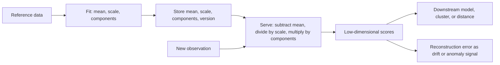

The pipeline above is the contract for using PCA in production. The fit happens once, on reference data, and everything it learns (means, scales, components) is stored with a version. Serving applies the stored transform and never refits. A transform fitted on a different sample, or an unscaled input where scaling was used during the fit, produces plausible-looking but wrong scores, which is a common train-serve mismatch. The reconstruction error of new data against the stored components is a free monitoring signal: if it rises, the new data have variance in directions the reference components discarded.

### 11.6 Choosing the number of components, and when PCA misleads

Several criteria exist and none is decisive. The scree plot shows eigenvalues in decreasing order, and an elbow marks a drop to noise-level components. A cumulative-variance threshold, commonly 90% or 95%, is easy to explain but arbitrary. The Kaiser rule keeps components with eigenvalue above 1 on standardized data, which means components that explain more than one original feature, and tends to retain too many when $p$ is large. Parallel analysis compares eigenvalues to those of random data of the same shape and keeps those that exceed them. Cross-validated reconstruction error holds out entries of the data, reconstructs them, and picks the $k$ with the lowest held-out error. When PCA is a preprocessing step, the best criterion is the downstream task: pick the $k$ that maximizes validation performance of the model that follows.

PCA misleads in a few known ways. High variance is not the same as relevance: if the directions that separate classes have low variance and a nuisance direction (for example, overall brightness or customer size) has high variance, the top components capture the nuisance and the discarded ones hold the signal. Supervised alternatives such as partial least squares or linear discriminant analysis target the signal directly. PCA is linear and cannot unroll a curved structure. It is sensitive to outliers, because squared deviations weight extremes heavily, and outlier-resistant PCA variants or prior outlier removal help. Its components are mixtures of all original features, so loadings are hard to interpret; sparse PCA adds an L1 penalty for interpretability. Whitening, which divides each score by $\sqrt{\lambda_j}$ to give unit variance, equalizes the scale of components, and also amplifies noise in the low-variance components, so it is helpful for some downstream models and harmful for others. As with all fitted transformations, fit PCA on training data only, or the held-out data leak into the components ([CH02](CH02_Data_Preparation_Feature_Engineering_and_Leakage.md)).

For contrast with a supervised linear method: ridge regression from [CH03](CH03_Regression_and_Classification.md) shrinks coefficients along principal directions in proportion to $\lambda_j / (\lambda_j + \alpha)$, so it dampens low-variance directions smoothly where PCA regression truncates them sharply. Both rely on the same eigenstructure.

## 12. Kernel PCA

Standard PCA finds linear structure. Kernel PCA (Scholkopf, Smola, and Muller, 1998) applies PCA in a feature space defined by a kernel function, which lets it capture curved structure without computing the feature map.

### 12.1 The idea

Suppose a nonlinear map $\phi$ sends each $x$ to a high-dimensional (possibly infinite-dimensional) feature space where the structure becomes linear. PCA there would diagonalize the covariance of the $\phi(x_i)$, but one never forms $\phi$. Instead, the eigenvectors of the feature-space covariance are linear combinations $\sum_i \alpha_i \phi(x_i)$, and the coefficients $\alpha$ solve an eigenproblem on the kernel matrix $K_{ij} = k(x_i, x_j) = \phi(x_i)^\top \phi(x_j)$. The steps are:

1. Compute the $n \times n$ kernel matrix $K$.
2. Center it in feature space: $\tilde{K} = K - \mathbf{1}_n K - K \mathbf{1}_n + \mathbf{1}_n K \mathbf{1}_n$, where $\mathbf{1}_n$ is the $n \times n$ matrix with all entries $1/n$. Without this step the data are not centered in the feature space and the first component captures the mean.
3. Find the top eigenvectors $\alpha^{(j)}$ of $\tilde{K}$ with eigenvalues $\nu_j$, scaled so that the feature-space component has unit norm ($\alpha^{(j)} / \sqrt{\nu_j}$).
4. The projection of a point $x$ onto component $j$ is $\sum_i \alpha_i^{(j)} \tilde{k}(x_i, x)$, with the kernel values centered consistently.

Common kernels are the radial basis function (RBF) kernel $k(x, y) = \exp(-\gamma \lVert x - y \rVert^2)$, the polynomial kernel, and the sigmoid kernel. The RBF kernel's width parameter $\gamma$ controls locality: a large $\gamma$ makes each point similar only to its immediate neighbors, giving a nearly identity kernel matrix and components with no structure; a small $\gamma$ makes all points similar, and the method approaches linear PCA.

### 12.2 When it helps and its limits

The classic demonstration is two concentric rings. Linear PCA leaves them overlapping because both rings are centered at the origin with the same variance direction. With an RBF kernel of suitable width, the leading kernel components separate the rings so that a linear boundary in the first two components distinguishes them. The same idea underlies spectral clustering, which can be read as kernel PCA on a normalized affinity matrix.

The limits are practical. The kernel matrix is $n \times n$, so memory and the eigendecomposition scale as $O(n^2)$ and $O(n^3)$, and large problems require approximations such as the Nystrom method or random Fourier features. Projecting a new point needs the kernel against all $n$ training points, so serving cost grows with the training set. The pre-image problem makes reconstruction awkward: a point in the feature space does not generally correspond to any point in the input space, so inverting the map requires approximation. The width $\gamma$ and the number of components are hard to choose without labels, and a reconstruction-based criterion does not apply directly. For these reasons, kernel PCA is used for moderate-sized problems, as a preprocessing step for a kernel or linear model, and as a conceptual route to spectral and manifold methods (Isomap, locally linear embedding). For larger data, an autoencoder (section 14) learns a nonlinear representation by gradient training and handles new points at constant cost.

## 13. t-SNE and UMAP: Nonlinear Embeddings for Visualization

PCA preserves large-variance directions, which usually means large-scale structure. Two nonlinear methods, t-distributed Stochastic Neighbor Embedding (t-SNE) and Uniform Manifold Approximation and Projection (UMAP), instead preserve neighborhoods, and they produce the two-dimensional scatter plots seen in most embedding and single-cell analyses. They are valuable and routinely misread. This section explains the mechanism so that the warnings in section 13.4 follow from it.

### 13.1 How t-SNE works

t-SNE (van der Maaten and Hinton, 2008) converts distances in the original space into neighbor probabilities, does the same in the low-dimensional map, and moves the map points until the two sets of probabilities agree.

**High-dimensional affinities.** For each point $i$ define the conditional probability that $i$ would pick $j$ as a neighbor, under a Gaussian centered at $x_i$:

$$
p_{j \mid i} = \frac{\exp(-\lVert x_i - x_j \rVert^2 / 2\sigma_i^2)}{\sum_{k \ne i} \exp(-\lVert x_i - x_k \rVert^2 / 2\sigma_i^2)}
$$

The bandwidth $\sigma_i$ is set per point by a binary search so that the entropy $H(P_i)$ of this distribution yields a user-chosen perplexity, $\text{Perp} = 2^{H(P_i)}$. Perplexity is an effective number of neighbors: if $p_{j \mid i}$ were uniform over $m$ points, then $H = \log_2 m$ and the perplexity would be exactly $m$. A dense region therefore gets a narrow Gaussian and a sparse region gets a wide one, so every point sees about the same number of neighbors. The affinities are then symmetrized, $p_{ij} = (p_{j \mid i} + p_{i \mid j}) / 2n$.

**Low-dimensional affinities.** For map points $y_i$, use a Student t-distribution with one degree of freedom (a Cauchy distribution):

$$
q_{ij} = \frac{(1 + \lVert y_i - y_j \rVert^2)^{-1}}{\sum_{k \ne l} (1 + \lVert y_k - y_l \rVert^2)^{-1}}
$$

The heavy tail is the central design choice. In high dimension a point can have many moderately distant neighbors, but a two-dimensional map has much less room at moderate distance (the crowding problem). Heavy tails let moderately dissimilar points sit far apart on the map without a large penalty, which gives clusters room to separate.

**Objective and gradient.** Minimize the Kullback-Leibler divergence $C = \sum_{i \ne j} p_{ij} \log (p_{ij} / q_{ij})$ by gradient descent. The gradient with respect to $y_i$ is

$$
\frac{\partial C}{\partial y_i} = 4 \sum_{j} (p_{ij} - q_{ij}) (y_i - y_j) \left(1 + \lVert y_i - y_j \rVert^2\right)^{-1}
$$

Read it as forces: when $p_{ij} > q_{ij}$ (the points are neighbors in the data but too far on the map) it pulls them together, and when $p_{ij} < q_{ij}$ it pushes them apart. The KL divergence is asymmetric, and this shapes everything. Placing neighbors far apart (large $p$, small $q$) is penalized heavily, while placing non-neighbors close together (small $p$, large $q$) is penalized lightly. Local neighborhoods are therefore preserved, and the relationship between far-apart groups is not.

The objective is not convex, so results depend on initialization and random seed. Common practice adds an early exaggeration phase (multiplying $p_{ij}$ by a constant such as 12 for the first iterations) so clusters form compactly before fine adjustment, and uses the Barnes-Hut approximation to reduce cost from $O(n^2)$ to $O(n \log n)$. Fast variants (FIt-SNE) exist, and packages such as openTSNE can place new points into an existing embedding. Perplexity values between 5 and 50 are typical in the original paper, and sensible values depend on the dataset size: a perplexity close to the size of a true cluster blurs it into its neighbors.

### 13.2 How UMAP works

UMAP (McInnes, Healy, and Melville, 2018) is grounded in topological ideas, but its working algorithm is graph based and close in spirit to t-SNE.

1. **Fuzzy neighbor graph.** For each point find its $n_{\text{neighbors}}$ nearest neighbors. Define the edge weight $w_{j \mid i} = \exp(-(d(x_i, x_j) - \rho_i) / \sigma_i)$, where $\rho_i$ is the distance to $i$'s nearest neighbor and $\sigma_i$ is chosen so the weights sum to $\log_2 n_{\text{neighbors}}$. Subtracting $\rho_i$ guarantees that every point is fully connected to at least one neighbor, which prevents isolated points even in sparse regions.
2. **Symmetrize.** Combine the directed weights by the fuzzy union $w_{ij} = w_{j \mid i} + w_{i \mid j} - w_{j \mid i} w_{i \mid j}$.
3. **Layout.** Initialize the low-dimensional points (by default with a spectral embedding of the graph, the Laplacian eigenvectors of section 10) and optimize the cross-entropy between the high-dimensional weights and low-dimensional weights $v_{ij} = (1 + a \lVert y_i - y_j \rVert^{2b})^{-1}$ by stochastic gradient descent, with attractive forces along graph edges and repulsive forces on randomly sampled non-neighbors. The constants $a$ and $b$ are fitted from the `min_dist` parameter.

Two parameters dominate. `n_neighbors` (default 15 in umap-learn at the time of writing) controls the balance between local and global structure: small values emphasize fine local detail and fragmentation, large values merge detail into broad structure. `min_dist` (default 0.1) controls how tightly points pack in the map, which affects visual compactness but not neighbor structure. UMAP scales better than classic t-SNE, offers a transform method for new points, supports other metrics (cosine is common for embeddings), and has parametric versions that learn a neural network encoder. Verify defaults against the documentation of the installed version.

The popular claim that UMAP preserves global structure better than t-SNE needs qualification. Kobak and Linderman (2021) showed that much of the observed difference comes from initialization, not from the objective: t-SNE initialized with PCA, and UMAP initialized randomly, behave much like each other with the roles reversed. Treat "UMAP preserves global structure" as "UMAP with its default spectral initialization tends to preserve coarse layout", not as a guarantee.

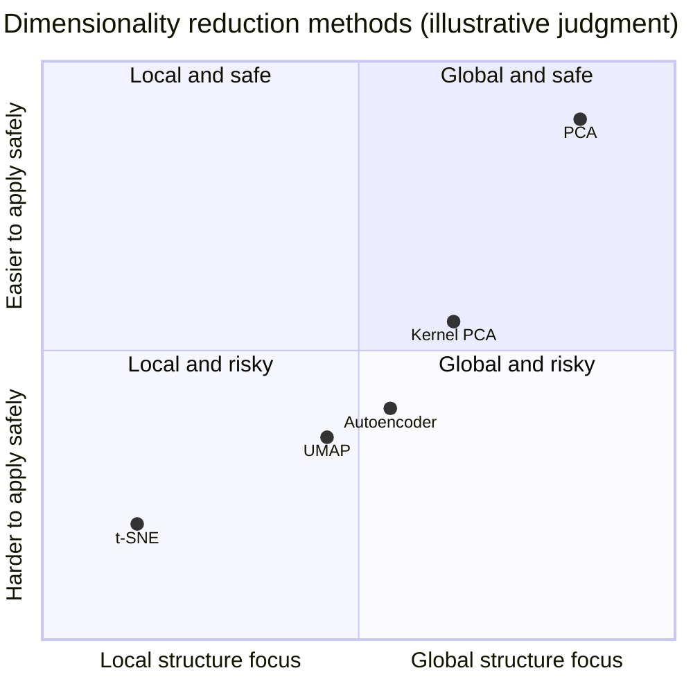

The chart is a judgment, not a measurement. PCA is deterministic, invertible in the sense of reconstruction, applies to new points as a matrix multiply, and its global distances mean something, so it is easy to apply safely. t-SNE keeps local neighborhoods and gives up the rest, with seed and parameter dependence, which makes it the riskiest to interpret. UMAP sits between. The vertical axis is about the risk of drawing wrong conclusions, not about computation: all of these run on a laptop for moderate data.

### 13.3 Where each method fits

Use PCA when the goal is a deterministic, reusable, explainable reduction for downstream computation, noise reduction, or a first look at the data. Use t-SNE or UMAP for exploratory visualization of high-dimensional embeddings, to ask whether obviously related items group together and to find surprising neighborhoods. Use UMAP when a transform for new data is needed, or when the dataset is large. Use none of these 2-D maps as a final product for a statistical claim. A common production recipe applies PCA to 30 to 50 components first to remove noise and speed up neighbor search, then t-SNE or UMAP on those components.

### 13.4 How these plots are misread

Each warning below follows from the mechanisms above. These are the errors a reviewer should look for in any report that presents a projection.

1. **Cluster sizes mean nothing.** t-SNE's per-point bandwidths equalize local density, and UMAP's local normalization does the same. A tight cluster and a diffuse cluster can look equal in area, and the area of a cluster in the map says nothing about its spread or its count.
2. **Distances between clusters mean little.** The KL objective barely penalizes the map distance between non-neighbors, so two clusters far apart may be more similar than two that are close. The same holds for the relative layout of groups.
3. **Density in the map is not density in the data.** Both methods spread dense regions and compress sparse ones.
4. **Apparent structure can come from the parameters.** At low perplexity or small `n_neighbors`, random noise breaks into small "clusters". A uniform random Gaussian cloud, embedded with a small perplexity, produces blobs. Always rerun with several parameter values and several seeds, and trust only the structure that persists.
5. **Axes and orientation are arbitrary.** Rotating or reflecting the map leaves the objective unchanged, and the axes have no meaning. Two runs of the same data look different.
6. **Local neighbors can be wrong in both directions.** Points close in the plot may be far in the data (false neighbors from compression), and true neighbors may be torn apart onto opposite sides of the map. Neighborhood preservation can be measured with trustworthiness and continuity scores or with the fraction of each point's true $k$ nearest neighbors that remain among its map neighbors; report the number with the plot.
7. **Embeddings are not stable across datasets.** Fitting on January and on February produces maps that cannot be overlaid. To compare periods, fit once on a reference set and transform the rest (supported by UMAP and by openTSNE), or compare in the original space.
8. **Clusters found in the 2-D map are hypotheses.** Running a clustering algorithm on the 2-D coordinates inherits all the distortions above. Cluster in a higher-dimensional space (the PCA components, or a 10 to 50 dimensional UMAP), and use the 2-D map only to display the result.
9. **Outliers and batch effects can dominate.** If a technical difference such as data source or time period separates the groups, the map will show it as clean clusters, which look like discoveries.
10. **A plot is not evidence of a taxonomy.** The earlier sections on validation, stability, and downstream tests apply to any claim derived from the map.

A reasonable minimum standard for a published or decision-driving projection is: a stated method, version, parameters, seed, and preprocessing; a sweep over at least two parameter values; a neighborhood-preservation score; and a caution on the figure that sizes and distances are not interpretable.

## 14. Autoencoders and Variational Autoencoders

An autoencoder is a neural network trained to reproduce its input through a narrow internal layer. The narrow layer is the learned representation. Neural-network mechanics (layers, backpropagation, optimizers) belong to [CH07](CH07_Deep_Learning_Foundations.md); this section uses them as given.

### 14.1 The plain autoencoder

An encoder $f_\phi$ maps $x$ to a code $z = f_\phi(x)$ of dimension $d < p$, and a decoder $g_\theta$ maps back, $\hat{x} = g_\theta(z)$. Training minimizes the reconstruction loss, for continuous data typically $\sum_i \lVert x_i - g_\theta(f_\phi(x_i)) \rVert^2$. The bottleneck forces the network to keep the information needed to rebuild the input and discard the rest.

The link to PCA is exact in the linear case. An autoencoder with linear encoder and decoder trained with squared error learns a subspace equal to the span of the top $d$ principal components (Baldi and Hornik, 1989), though not necessarily the orthogonal components themselves, because any invertible mixing of the code gives the same reconstruction. Nonlinear activations let the network represent curved manifolds that PCA flattens, which is the reason to use one. The price is a non-convex training problem, tuning, and a representation without the ordering and interpretability of principal components.

A bottleneck is not the only regularizer. An overcomplete autoencoder (code larger than input) can learn the identity function and learn nothing, so it needs another constraint:

- **Denoising autoencoders** (Vincent and colleagues, 2008) corrupt the input and train the network to reconstruct the clean version, which forces it to learn structure instead of copying.
- **Sparse autoencoders** penalize the activation of the code so that few units are active per example.
- **Contractive autoencoders** penalize the sensitivity of the code to small input changes.

Architecture follows the data: fully connected for tabular data, convolutional for images, and recurrent or transformer encoders for sequences.

### 14.2 The variational autoencoder

A plain autoencoder's code space has holes: points between two codes need not decode to anything meaningful. The variational autoencoder (Kingma and Welling, 2013) makes the code space a probability distribution so that it is smooth and can be sampled.

The encoder outputs the parameters of a distribution over codes, $q_\phi(z \mid x) = \mathcal{N}(\mu_\phi(x), \text{diag}(\sigma_\phi^2(x)))$. The decoder defines $p_\theta(x \mid z)$. The prior is $p(z) = \mathcal{N}(0, I)$. The goal is to maximize $\log p_\theta(x)$, which is intractable, but it decomposes as

$$
\log p_\theta(x) = \underbrace{\mathbb{E}_{q_\phi(z \mid x)}\left[\log p_\theta(x \mid z)\right] - \text{KL}\left(q_\phi(z \mid x) \,\Vert\, p(z)\right)}_{\text{ELBO}} + \text{KL}\left(q_\phi(z \mid x) \,\Vert\, p_\theta(z \mid x)\right)
$$

Because the last KL term is non-negative, the ELBO (evidence lower bound) is a lower bound on the log-likelihood, the same bound that EM tightens in section 9.2. In EM the E-step sets $q$ to the exact posterior; here the posterior is intractable, so a neural network $q_\phi$ approximates it, and both networks are trained together by maximizing the ELBO.

The first term rewards reconstruction. The second term pulls each encoded distribution toward the prior and keeps the code space organized and continuous. For Gaussian $q$ and prior the KL term has a closed form:

$$
\text{KL} = \frac{1}{2} \sum_{j=1}^{d} \left(\mu_j^2 + \sigma_j^2 - \ln \sigma_j^2 - 1\right)
$$

Check it on one dimension: with $\mu = 0$ and $\sigma^2 = 1$ the encoded distribution equals the prior and the term is $\frac12 (0 + 1 - 0 - 1) = 0$. With $\mu = 1$ and $\sigma^2 = 0.5$ it is $\frac12 (1 + 0.5 + 0.6931 - 1) \approx 0.597$, a positive penalty for a shifted, narrowed code.

Sampling $z$ from $q_\phi$ blocks gradient flow through the random draw. The reparameterization trick writes $z = \mu + \sigma \odot \varepsilon$ with $\varepsilon \sim \mathcal{N}(0, I)$, which moves the randomness to an input and leaves $\mu$ and $\sigma$ differentiable.

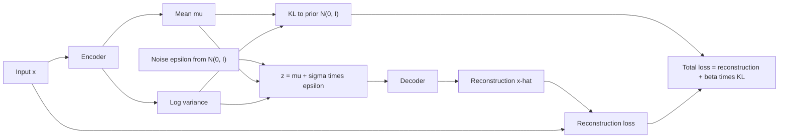

The diagram shows two outputs from the encoder, a mean and a variance, and two loss terms feeding one objective. The weight $\beta$ in front of the KL term (the beta-VAE of Higgins and colleagues, 2017) trades reconstruction quality for a more regular, and often more disentangled, code. Setting $\beta = 1$ recovers the ELBO.

### 14.3 Using these models as representation learners

For representation learning, take the encoder output (for a VAE, the mean $\mu$) as the feature vector for clustering, visualization, or a downstream supervised model. Check three things before trusting it. First, whether the code preserves the properties the task needs: reconstruct a few examples and compare, and test a simple classifier on the code. Second, whether the code has collapsed: a VAE can suffer posterior collapse, where the decoder is powerful enough to ignore $z$, the KL term goes to zero, and the code carries no information; the check is that the KL is positive and that the code changes with the input. Third, whether pixel-wise or feature-wise reconstruction error is the right notion of similarity: a squared-error loss on images favors blurry outputs and rewards matching bright backgrounds, so the code may encode lighting and not objects. In many modern pipelines, pretrained encoders and contrastive objectives (section 18) have replaced autoencoders as the source of embeddings, because they give codes organized by meaning. Autoencoders remain useful for tabular data, sensor signals, anomaly detection, and cases with no suitable pretrained model. Generative adversarial networks and diffusion models, which push the generative side much further, are the subject of [CH11](CH11_Generative_Adversarial_Networks.md) and [CH12](CH12_Diffusion_Models.md).

## 15. Anomaly and Novelty Detection

Anomaly detection identifies examples that differ from an expected population. It is among the most requested and most frequently disappointing uses of unsupervised learning, because the word "anomaly" hides three different things: a statistical rarity, an error in the data, and a harmful event. A detector finds the first. Turning it into the third needs context, thresholds, and a review process.

### 15.1 Framing

Distinguish two settings. In **outlier detection** the training data may contain anomalies, and the task is to find them, as in cleaning a dataset or looking back through historical transactions. In **novelty detection** the training data are assumed clean, and the task is to flag new examples unlike anything seen, as in monitoring a machine that has run in healthy condition. The same algorithm behaves differently in each: a method that tolerates contamination is needed for the first, and for the second any contamination in training is absorbed as normal.

Anomalies come in three kinds. A **point anomaly** is a single unusual example, such as a payment 50 times the customer's average. A **contextual anomaly** is unusual only in its context, such as a temperature of 25 degrees Celsius in January, normal in July. A **collective anomaly** is a group of examples that are individually ordinary but jointly unusual, such as a long run of small identical transactions. Point detectors miss the other two unless the context or the window is built into the features.

Three questions precede any method. What is the base rate of the event of interest? A detector flagging 0.2% of events against a true rate of 0.1% cannot exceed 50% precision at full recall, and usually much less. What does a flag cost, in analyst minutes and customer friction? And what is the cost of a miss? These come from the business, and they determine the threshold more than the algorithm does.

### 15.2 Statistical and distance-based baselines

The simplest detector flags values far from the mean in standard deviations, the z-score. It has a built-in weakness: the outlier inflates the mean and standard deviation used to judge it. For $n$ observations, the largest possible z-score computed from the sample mean and standard deviation is $(n - 1) / \sqrt{n}$, and for $n = 10$ that is $2.85$, so a rule of "flag above 3" can never fire on a sample of ten. The script's sample $10, 11, 9, 10, 12, 10, 11, 9, 10, 100$ has mean $19.2$ and standard deviation $28.4$, so the value 100 gets a z-score of only $2.84$. This is masking.

The fix is to use estimates that outliers do not move. Replace the mean with the median and the standard deviation with the median absolute deviation (MAD), the median of $|x_i - \text{median}|$. For this sample the median is $10$ and the MAD is $1$, so the modified z-score $0.6745 (x - \text{median}) / \text{MAD}$ for 100 is $60.7$, an unmistakable flag. (The constant 0.6745 makes the MAD comparable to a standard deviation for normal data.) The interquartile range rule, flagging values beyond 1.5 times the IQR from the quartiles, is a similarly resistant alternative.

For multivariate data, flag by Mahalanobis distance (section 3.5) with a chi-square cutoff. For two features, the 99th percentile of $d_M^2$ is $9.21$, so a point with $d_M > 3.03$ is flagged at 1%. Use an outlier-resistant covariance estimate (Minimum Covariance Determinant) when contamination is possible. For time series, model trend and seasonality first, then flag on the residuals; a raw value that follows a weekly cycle will otherwise generate a flag every Monday. These baselines are cheap, explainable, and often competitive, and per the baseline ladder of [CH01](CH01_Machine_Learning_Foundations.md) every more elaborate detector should have to beat them.

### 15.3 Isolation forest

Isolation forest (Liu, Ting, and Zhou, 2008) builds on the observation that anomalies are few and different, so they are easy to separate from the rest. It builds many random trees. Each tree is grown on a small random subsample by choosing a random feature and a random split value between that feature's minimum and maximum, recursively, until each point is isolated or a depth limit is reached. A point in a sparse region is isolated after few splits, and a point in a dense region needs many. The anomaly score depends on the average path length $E[h(x)]$ over the trees:

$$
s(x, \psi) = 2^{-E[h(x)] / c(\psi)}, \qquad c(\psi) = 2 H(\psi - 1) - \frac{2(\psi - 1)}{\psi}, \qquad H(i) \approx \ln i + 0.5772
$$

where $\psi$ is the subsample size and $c(\psi)$ is the average path length of an unsuccessful search in a binary search tree, used to normalize the score. Scores near 1 indicate anomalies, scores well below 0.5 indicate normal points, and scores near 0.5 everywhere mean the data have no distinct anomalies. For $\psi = 64$, $c = 2(\ln 63 + 0.5772) - 2(63)/64 = 9.4406 - 1.9688 = 7.472$.

[04_anomaly_and_drift.py](../code/python/unsupervised-chapter/04_anomaly_and_drift.py) builds 100 trees on 500 two-dimensional standard normal points, with subsamples of 64, and scores three query points: the center $(0, 0)$ scores $0.413$, the edge $(2, 2)$ scores $0.681$, and the far point $(6, 6)$ scores $0.724$. The ordering is right and the values are not probabilities. Note that the score for $(6, 6)$ is not much above $(2, 2)$: the random splits are drawn within the range of the subsample, so once a point is outside the data it is isolated at the first split, and the score saturates. The script uses a depth limit of $\lceil \log_2 \psi \rceil = 6$ with the leaf-size correction $c$, as in the paper.

Why it works at scale: it uses small subsamples (the paper used 256 points per tree by default and 100 trees), which both reduces cost to roughly linear in the number of points and reduces masking and swamping, since the subsample contains fewer anomalies to hide behind each other. It needs no distance computations, so it avoids the worst of the curse of dimensionality, and it handles mixed scales reasonably because splits are per feature. Its weaknesses: the axis-parallel splits create artifacts (score bands aligned with axes), which the extended isolation forest addresses with random hyperplanes; irrelevant features dilute the signal; contextual anomalies are invisible unless context is encoded; and the contamination parameter used by libraries to turn scores into labels is a quantile assumption, not an estimate.

### 15.4 Local Outlier Factor

Local Outlier Factor (Breunig, Kriegel, Ng, and Sander, 2000) compares a point's local density with that of its neighbors, so it can flag a point that is unremarkable globally but sparse relative to its surroundings. Fix $k$. Define:

- the $k$-distance of $b$, $\text{kd}(b)$, as the distance to its $k$-th nearest neighbor;
- the reachability distance $\text{rd}(a, b) = \max\{\text{kd}(b), d(a, b)\}$, which smooths very small distances;
- the local reachability density $\text{lrd}(a) = 1 / \text{mean}_{b \in N_k(a)} \text{rd}(a, b)$;
- the local outlier factor $\text{LOF}(a) = \text{mean}_{b \in N_k(a)} \text{lrd}(b) / \text{lrd}(a)$.

A value near 1 means the point is as dense as its neighbors, and a value well above 1 means it is sparser than they are.

A small example: points $0, 1, 2, 3, 10$ on a line, with $k = 2$. The $k$-distances are $2, 1, 1, 2, 8$. For the point 10, the two nearest are 3 and 2 at distances 7 and 8, and $\text{rd}(10, 3) = \max(\text{kd}(3), 7) = 7$ and $\text{rd}(10, 2) = \max(1, 8) = 8$, so $\text{lrd}(10) = 2 / 15 = 0.133$. For the point 0, the neighbors 1 and 2 have $\text{rd} = \max(1, 1) = 1$ and $\max(1, 2) = 2$, so $\text{lrd}(0) = 2 / 3 = 0.667$, and the other four points also have $\text{lrd} = 0.667$. Then $\text{LOF}(10) = \text{mean}(0.667, 0.667) / 0.133 = 5.0$ while the others have $\text{LOF} = 1.0$.

LOF is the tool for data with clusters of different densities, where a global distance threshold fails. Its limits are the cost of nearest-neighbor search (an approximate neighbor index helps at scale; see [CH26](CH26_Vector_Databases_for_AI_Retrieval.md)), degraded contrast in high dimension, sensitivity to $k$ (too small makes noise look anomalous, too large averages away local anomalies), and the absence of a universal threshold: a LOF of 1.5 may be extreme in one dataset and routine in another. Fitting on clean data and scoring new points (novelty mode) must be selected explicitly in libraries, because default behavior scores only the training data.

### 15.5 One-class support vector machine

The one-class SVM (Scholkopf and colleagues, 2001) maps data through a kernel and finds a function that is positive on a small region containing most of the training data and negative elsewhere. In the standard formulation it separates the mapped data from the origin with maximum margin. The parameter $\nu \in (0, 1]$ is an upper bound on the fraction of training points treated as outliers and a lower bound on the fraction of support vectors, which gives it a more interpretable knob than most detectors. With an RBF kernel the method is equivalent to support vector data description, which finds the smallest enclosing sphere in feature space.

It is attractive for novelty detection with small, clean, low-dimensional training sets. It is sensitive to the kernel width $\gamma$ (small gives an overly smooth boundary, large overfits and flags everything unseen), to feature scaling, and to contamination in training, and it scales poorly, with training time between quadratic and cubic in the number of examples. For large data, isolation forest or a reconstruction-based method is usually the better choice.

### 15.6 Reconstruction error

Any model that compresses and reconstructs gives an anomaly score: the error between an input and its reconstruction. With PCA this is the distance from the point to the principal subspace (the squared prediction error used in industrial process monitoring), computed as $\lVert x - W_k W_k^\top x \rVert^2$ for centered $x$. With an autoencoder it is the loss function itself. The premise is that the model learned the normal structure and reconstructs normal examples well and abnormal examples poorly.

The premise fails in three ways. A model with high capacity reconstructs everything well, anomalies included (the identity-function failure). An anomaly may lie within the span of the learned subspace, differing in a direction the model reconstructs without error, such as unusual but large-magnitude values along a principal axis; combining reconstruction error with a distance within the subspace (Hotelling's $T^2$ on the scores) covers both. And reconstruction error depends on input magnitude, so a high-variance feature dominates it unless features are standardized. More generally, deep generative models can assign higher likelihood to some out-of-distribution inputs than to training data (Nalisnick and colleagues, 2019), so a likelihood threshold from a flexible model is not guaranteed to flag novelty. The remedy is to validate the detector against known anomalies, not to assume the premise.

### 15.7 Choosing a threshold

Every detector outputs a score. Turning scores into actions requires a threshold, and this decision matters more than the algorithm. Four approaches exist.

**Capacity-based.** Start from the number of items a team can review per day and set the threshold at that rank. In the script, a stream of 100,000 scored events with a review capacity of 200 per period sets the threshold at the top 0.2%, which for standard-normal scores is $2.883$. If the true event rate is 0.1% (100 true events) and this review band captures 60% of them, then $60$ true events are among $200$ reviewed, so precision is $0.30$. Doubling the true rate to 0.2% with the same detector quality doubles the true events captured to 120, and precision rises to $0.60$; the detector did not improve, the base rate did. This is the dependence on prevalence that [CH06](CH06_Model_Evaluation_Validation_and_Selection.md) formalizes with the PR curve.

**Quantile-based.** Set the threshold at a percentile of scores on recent normal data. This keeps the alert rate constant by construction, which is useful for operations but hides a real increase in anomalies.

**Cost-based.** If the cost of a missed event and of a false alarm can be estimated, choose the threshold that minimizes expected cost on labeled examples, as derived in [CH01](CH01_Machine_Learning_Foundations.md).

**Statistical tail models.** Extreme value theory fits a generalized Pareto distribution to the upper tail of normal scores and sets the threshold at a desired false alarm probability. It extrapolates beyond observed data and rests on assumptions of stationarity.

Whichever is used, prefer two bands to one line. A high band triggers automatic containment under a policy with audit and reversal, a middle band routes to human review, and the rest passes. Re-baseline the threshold as the population shifts (section 20), because a threshold calibrated on last quarter's traffic can flood reviewers after a product launch.

### 15.8 Evaluating a detector with few labels

Labels for anomalies are rare, biased, and late. Rare, because the event is rare. Biased, because the known incidents are those that earlier controls already caught. Late, because a chargeback or a failure may arrive weeks after the event. Several strategies make the best of this.

- **Stratified review.** Have analysts label a random sample from each score band (top 0.1%, next 1%, middle, bottom). The top band's precision estimates false-alarm burden; the lower bands show what is being missed, with the caveat that the low-score sample is large for a small number of positives.
- **Precision at $k$.** Report the fraction of true anomalies among the top $k$ reviewed, where $k$ is the review capacity, in preference to AUC, since only the top of the ranking is actionable.
- **Injection tests.** Insert synthetic anomalies of known type (a scaled value, a swapped feature, a replayed sequence) and measure the detection rate. This tests sensitivity to specific failure types and says nothing about the unknown ones.
- **Baseline comparison.** Compare against a simple rule or a MAD-based z-score on the same review capacity. If the model does not catch more true events than the rule at equal workload, it is not earning its cost.
- **Label maturity.** Define when a label is final (for example 90 days after the transaction), and compute metrics only on matured data, or the recent period looks better than it is.
- **Feedback loop.** Record every analyst decision. After enough labels accumulate, train a supervised model on them, using the unsupervised score as one feature, with the caution that the labeled set is biased toward what the detector selected for review. This is the semi-supervised step of section 19.

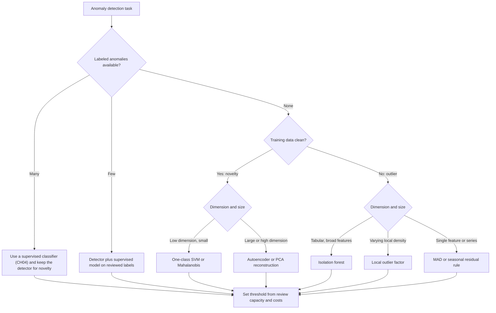

The decision tree starts with labels, because even a few hundred reviewed events change the right approach. It does not recommend one best detector. The leaf choices reflect the failure modes above: distance-based methods for low dimension, isolation and reconstruction for high dimension, local-density methods when density varies. All branches converge on the same step, the threshold, because that is where the operating consequences are set.

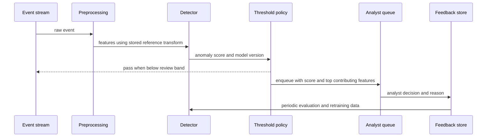

The sequence shows what the architecture needs around the model: a stored preprocessing transform, a model version attached to every score so decisions can be audited, an explanation to speed review (such as the features contributing most to the score), and a feedback store that closes the loop. A detector deployed without the last two components cannot be evaluated or improved.

## 16. Validating Clusters Without Labels

A clustering algorithm returns groups whether or not groups exist. Validation asks four separate questions, and a result should answer all four before it drives a decision. Is there structure at all? Is the structure geometrically good under the chosen metric? Would it reappear on different data? Is it useful for the purpose? The first three are statistical, and the fourth is the one that matters.

### 16.1 The silhouette

For point $i$ in cluster $C$, let $a(i)$ be the mean distance from $i$ to the other members of $C$, and $b(i)$ the smallest mean distance from $i$ to the members of any other cluster. The silhouette (Rousseeuw, 1987) is

$$
s(i) = \frac{b(i) - a(i)}{\max\{a(i), b(i)\}} \in [-1, 1]
$$

A value near 1 says the point is much closer to its own cluster than to the nearest alternative, near 0 says it sits on a boundary, and a negative value says another cluster is closer. A cluster with a single member gets $s = 0$ by convention.

A worked example uses one-dimensional points in two clusters, $\{1, 2\}$ and $\{8, 9, 10\}$.

- Point 1: $a = |1 - 2| = 1$, and $b = (7 + 8 + 9)/3 = 8$, so $s = (8 - 1)/8 = 0.875$.
- Point 2: $a = 1$, $b = (6 + 7 + 8)/3 = 7$, so $s = 6/7 = 0.857$.
- Point 8: $a = (1 + 2)/2 = 1.5$, $b = (7 + 6)/2 = 6.5$, so $s = 5/6.5 = 0.769$.
- Point 9: $a = (1 + 1)/2 = 1$, $b = (8 + 7)/2 = 7.5$, so $s = 6.5/7.5 = 0.867$.
- Point 10: $a = (2 + 1)/2 = 1.5$, $b = (9 + 8)/2 = 8.5$, so $s = 7/8.5 = 0.824$.

The mean silhouette is $4.192 / 5 = 0.838$. Kaufman and Rousseeuw (1990) suggested reading averages above 0.7 as strong structure, 0.5 to 0.7 as reasonable, 0.25 to 0.5 as weak, and below 0.25 as no substantial structure; treat those bands as rough conventions. On the three-blob data from section 6, the mean silhouette is $0.471$ at $k = 2$, $0.685$ at $k = 3$, and $0.560$ at $k = 4$. It peaks at the generating value.

Limits matter more than the bands. The silhouette needs all pairwise distances, so it costs $O(n^2)$ and is often computed on a sample. It uses mean distances, so it favors compact, convex clusters and penalizes ring or elongated clusters that DBSCAN would legitimately find. It depends on the metric and scaling, so values cannot be compared across different feature sets. It is also computed per point, so it is useful beyond the average: a histogram of $s(i)$ by cluster shows which clusters are tight and which are mixtures, and a cluster with many negative values is a candidate to split or merge.

### 16.2 Davies-Bouldin and Calinski-Harabasz

The Davies-Bouldin index averages, over clusters, the worst-case ratio of within-cluster scatter to between-cluster separation:

$$
\text{DB} = \frac{1}{k} \sum_{i=1}^{k} \max_{j \ne i} \frac{s_i + s_j}{d(c_i, c_j)}
$$

where $s_i$ is the mean distance of the members of cluster $i$ to its centroid $c_i$. Lower is better, and 0 is the lower bound. For the example clusters above, $s_1 = 0.5$ (the centroid is $1.5$), $s_2 = 2/3$ (the centroid is $9$), and the centroid distance is $7.5$, so $\text{DB} = (0.5 + 0.667) / 7.5 = 0.156$.

The Calinski-Harabasz index is the ratio of between-cluster to within-cluster dispersion, each divided by its degrees of freedom:

$$
\text{CH} = \frac{B / (k - 1)}{W / (n - k)}
$$

with $W$ the within-cluster sum of squares (the k-means inertia) and $B = \text{TSS} - W$. Higher is better. On the three-blob data, $\text{TSS} = 2106.9$ (the inertia at $k = 1$), and so $\text{CH}$ is $919.8 / (1187.1 / 148) \approx 114.7$ at $k = 2$, $1812.0/2 \div 294.9/147 \approx 451.6$ at $k = 3$, and $1855.3/3 \div 251.6/146 \approx 358.9$ at $k = 4$. The index peaks at 3, in agreement with the silhouette. Like the silhouette, it favors convex clusters, and it tends to increase with $k$ on structureless data of high dimension.

### 16.3 Stability

A cluster that exists only in one sample is a statistic, not a finding. Stability asks how much the partition changes when the data or the procedure is perturbed. The usual protocol:

1. Draw two bootstrap or subsample sets from the data, overlapping on a shared subset of points.
2. Cluster each set with the same settings.
3. Compare the two labelings on the shared points with the adjusted Rand index (ARI).
4. Repeat 20 to 100 times and look at the distribution.

The ARI corrects the Rand index for chance agreement. It uses the contingency table of the two labelings, with cell counts $n_{ij}$, row sums $a_i$, and column sums $b_j$:

$$
\text{ARI} = \frac{\sum_{ij} \binom{n_{ij}}{2} - \left[\sum_i \binom{a_i}{2} \sum_j \binom{b_j}{2}\right] / \binom{n}{2}}{\frac{1}{2}\left[\sum_i \binom{a_i}{2} + \sum_j \binom{b_j}{2}\right] - \left[\sum_i \binom{a_i}{2} \sum_j \binom{b_j}{2}\right] / \binom{n}{2}}
$$

It is 1 for identical partitions, near 0 for random agreement, and can be negative. For example, compare labelings $A = (0,0,0,1,1,1)$ and $B = (0,0,1,1,1,1)$ of six points. The cluster sizes give $\sum_i \binom{a_i}{2} = 3 + 3 = 6$ and $\sum_j \binom{b_j}{2} = 1 + 6 = 7$. The pairs placed together in both labelings number $\sum \binom{n_{ij}}{2} = 1 + 0 + 0 + 3 = 4$. With $\binom{6}{2} = 15$, the numerator is $4 - 6 \times 7 / 15 = 1.2$ and the denominator is $\frac12 (13) - 2.8 = 3.7$, so $\text{ARI} = 0.324$. Moving a single point out of 6 already drops agreement to 0.32, which shows how harsh the index is on small samples; with hundreds of points a few moves change the value little.

Three kinds of perturbation matter. Resampling stability tells whether the structure is a property of the population. Seed stability tells whether the algorithm lands in the same optimum (low seed stability on k-means means increase restarts or fix the seed and record it). Parameter stability tells whether neighboring values of $k$, $\varepsilon$, or perplexity give similar partitions. Hennig (2007) proposed per-cluster stability using the Jaccard similarity of each cluster to its best match in the resampled clustering, which identifies stable clusters inside an otherwise unstable partition, often the useful result: two stable segments and a diffuse remainder. For a production check, compare consecutive monthly refits on the shared customers, and report the ARI and the fraction of members that changed cluster.

### 16.4 Tendency, external labels, and a null

Before clustering, test for clustering tendency. The Hopkins statistic compares nearest-neighbor distances from random points in the data space with those from sampled data points; values near 0.5 indicate uniform randomness and values near 1 indicate clusterable data. A more general null is to generate data with no cluster structure but the same marginals (permute each column independently, or sample from a Gaussian with the data's covariance), run the same pipeline, and compare the validation scores. If the real silhouette is not clearly above the null's, the clustering is describing the algorithm and not the data.

If some labels exist, even partial, they provide external validation. Purity, the fraction of items belonging to the majority class of their cluster, is intuitive but rises with the number of clusters (it equals 1 when each point is its own cluster); this is the effect in section 8.2, where eight pure fragments scored the same as two. Normalized mutual information and ARI correct for this. A partial label set can be used even though it is not the target of the clustering: do the clusters concentrate known categories, such as known fraud cases or known product families?

### 16.5 Downstream and human evaluation

Geometric scores and stability establish that the partition is real. They do not show it is useful. Use evidence tied to the purpose:

- **Outcome separation.** Check whether the clusters differ on an outcome not used to form them: churn, margin, response to a campaign, defect rate. Compute the share of the outcome variance explained by cluster membership (eta squared) or the lift between the best and worst cluster. If segments do not differ on any outcome the business cares about, they are not useful as segments, however clean.
- **Intervention test.** The strongest evidence is a randomized comparison: treat clusters differently and measure the result against a control ([CH06](CH06_Model_Evaluation_Validation_and_Selection.md) covers online experiments).
- **Predictive value.** If the clusters are used as features, compare a downstream model with and without them on held-out data.
- **Human interpretability.** Show analysts a random sample from each cluster and ask them to name it, and test whether a different analyst picks the same name for another sample (a variant of word-intrusion tests for topics, section 17.3). A cluster that nobody can describe cannot be acted on.
- **Cost of error.** What happens when an item lands in the wrong cluster? If the answer is "nothing" for a marketing newsletter and "a blocked payment" for a risk tier, the required evidence differs by orders of magnitude.

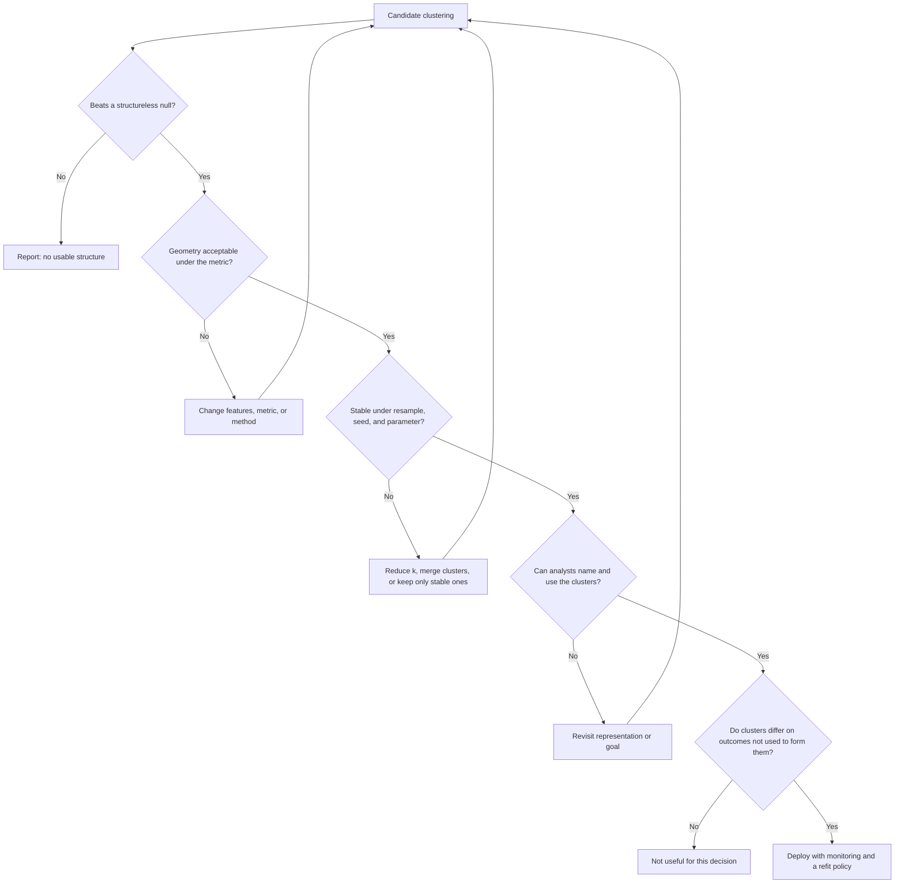

The flowchart orders the checks from cheapest to most expensive and from most mechanical to most contextual, and it has two exits with no deployment. Those exits are the point. Having a defined way to conclude "no usable structure" or "not useful for this decision" prevents a team from keeping the first plausible partition.

## 17. Topic Models and Association Rules

Two older families summarize co-occurrence. Topic models describe documents as mixtures of themes. Association rules describe items that appear together. Both remain useful for exploration and as interpretable baselines against embedding methods.

### 17.1 Latent Dirichlet Allocation

Latent Dirichlet Allocation (LDA; Blei, Ng, and Jordan, 2003) is a generative model of a corpus. It assumes there are $K$ topics, each a probability distribution over the vocabulary, and each document is a mixture of topics. The generative story is:

1. For each topic $k$, draw a word distribution $\phi_k \sim \text{Dirichlet}(\beta)$.
2. For each document $d$, draw topic proportions $\theta_d \sim \text{Dirichlet}(\alpha)$.
3. For each word position in $d$, draw a topic $z \sim \text{Categorical}(\theta_d)$, then a word $w \sim \text{Categorical}(\phi_z)$.

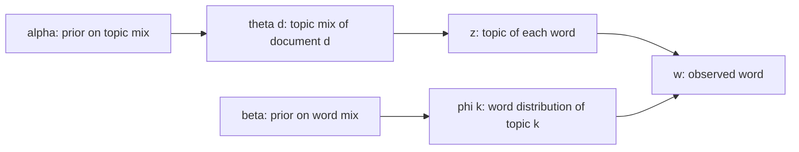

Only the words $w$ are observed. Inference recovers the $\phi_k$ (the topics), the $\theta_d$ (what each document is about), and the assignments $z$. The two main inference approaches are collapsed Gibbs sampling (Griffiths and Steyvers, 2004), which resamples each word's topic given all others, and variational inference (Blei and colleagues, 2003; online variants by Hoffman and colleagues, 2010 for large corpora). The probability of a word in a document is $p(w \mid d) = \sum_k \theta_{dk} \phi_{kw}$. For example, if a document has $\theta = (0.7, 0.3)$ over a sports topic and a finance topic, and the word "match" has probability $0.05$ in the sports topic and $0.001$ in the finance topic, then $p(\text{match} \mid d) = 0.7 \times 0.05 + 0.3 \times 0.001 = 0.0353$.

The Dirichlet parameters have interpretable effects. A small $\alpha$ (below 1) makes each document concentrate on a few topics, and a small $\beta$ makes each topic concentrate on a few words. Choosing them is part of tuning, and many libraries learn $\alpha$ from the data.

### 17.2 Practical limits of LDA

LDA works with a bag of words, so word order and phrases are lost unless bigrams are added. It performs poorly on short texts such as tweets or search queries, where each document has too few words to estimate a mixture. It needs careful preprocessing: stop-word removal, lemmatization, and removing both very frequent words and very rare ones, because a single high-frequency word that was not filtered can dominate several topics. Results vary with the random seed, and the same corpus yields different topics on different runs, so fix seeds and compare topic sets by overlap. The number of topics $K$ is a free parameter that must be chosen. Non-negative matrix factorization is a related, deterministic alternative that factors a document-term matrix, and often gives comparable topics with faster fitting.

Embedding-based approaches now often replace LDA for exploratory topic discovery: embed documents with a sentence encoder ([CH16](CH16_Embeddings_and_Semantic_Representations.md)), reduce dimension, cluster with a density method (section 8.4), and describe each cluster by its most distinctive terms. BERTopic is a well-known package that follows this recipe. These methods capture meaning that bag-of-words ignores and handle short texts better, with the trade-offs of every embedding pipeline in this chapter: the clusters inherit the metric, the reduction, and the density parameters, and they assign each document to one topic unless a soft assignment is added.

### 17.3 Evaluating topics

Perplexity on held-out documents is the standard likelihood measure, and it is a poor guide to usefulness: Chang and colleagues (2009) found that models with better held-out likelihood often produced topics that humans found less coherent. Coherence measures score whether a topic's top words tend to appear together in a reference corpus (UMass, NPMI, and related variants); they correlate better with human judgment. The most reliable check is human: a word-intrusion test shows an analyst the top five words of a topic plus one word drawn from another topic and asks which is the intruder, and a topic is coherent when people find the intruder reliably. For decisions, apply the validation of section 16 as well: can the topic labels be named, do they stay stable across refits, and do they differ on outcomes such as ticket resolution time or customer satisfaction?

### 17.4 Association rules

Association rule mining finds item sets that occur together often in transactions, such as the products in a basket or the events in a session. Let $N$ be the number of transactions. For item sets $X$ and $Y$:

- **Support** $\text{supp}(X) = |\{t : X \subseteq t\}| / N$, the fraction of transactions containing $X$.
- **Confidence** of the rule $X \Rightarrow Y$ is $\text{supp}(X \cup Y) / \text{supp}(X)$, the estimated $P(Y \mid X)$.
- **Lift** is $\text{supp}(X \cup Y) / (\text{supp}(X) \, \text{supp}(Y))$, the ratio of the observed co-occurrence to that expected under independence.

A worked example: of 10 transactions, 6 contain bread, 5 contain milk, and 4 contain both. Then $\text{supp}(\text{bread}) = 0.6$, $\text{supp}(\text{milk}) = 0.5$, and $\text{supp}(\text{bread, milk}) = 0.4$. The rule bread $\Rightarrow$ milk has confidence $0.4 / 0.6 = 0.667$ and lift $0.4 / (0.6 \times 0.5) = 1.333$. The reverse rule milk $\Rightarrow$ bread has confidence $0.4 / 0.5 = 0.8$ and the same lift. A lift above 1 means the items appear together more than independence predicts. A lift of 1 means no association, and a rule can have high confidence with lift 1 when the consequent is simply very common: if 95% of baskets contain bags, then "anything $\Rightarrow$ bags" has confidence near 95% and tells nothing.

The Apriori algorithm (Agrawal and Srikant, 1994) exploits downward closure: every subset of a frequent item set is frequent, so if $\{A, B\}$ is infrequent, no larger set containing it can be frequent. It generates candidate sets level by level, prunes those with an infrequent subset, and counts the survivors in a pass over the data. FP-growth (Han, Pei, and Yin, 2000) avoids candidate generation by compressing transactions into a prefix tree and mining it recursively, which is faster on dense data. The runtime depends sharply on the minimum support: halving it can multiply the number of frequent sets by orders of magnitude.

Pitfalls recur. Mining produces thousands of rules, most of them trivial or redundant, so rank by lift and filter by domain relevance. Many of the apparent patterns are chance when thousands of candidate rules are tested, which is the multiple-comparison problem; require minimum support in absolute counts, and validate on a later period. Association is not causation: a rule that diapers co-occur with a snack says nothing about the effect of promoting either. Time and sequence matter, so sequential pattern mining extends the idea to ordered events. Typical uses are cross-sell recommendations, bundle design, store layout, and finding co-occurring alerts or log events. Where scale and personalization matter, matrix factorization or learned embeddings generally outperform rules, which makes rules the baseline and the explanation layer.

## 18. Self-Supervised and Contrastive Learning: The Bridge to Embeddings

Self-supervised learning creates labels from the data itself and trains a model to predict them. Nothing in the data is annotated by a person, yet the training problem is supervised, and the useful by-product is a representation. Most embeddings in [CH16](CH16_Embeddings_and_Semantic_Representations.md) and the language models of [CH10](CH10_Transformers_and_Attention.md) and [CH15](CH15_Large_Language_Model_Fundamentals_and_Inference.md) are trained this way. The topic belongs in an unsupervised chapter because it solves the problem the earlier sections kept hitting: a good representation makes a simple distance meaningful, and a self-supervised objective can produce one without labels.

### 18.1 Pretext tasks

A pretext task is chosen so that solving it forces the model to learn something general. Examples include predicting a masked word from its context, predicting the next word, predicting the rotation applied to an image, filling in a masked image patch, reconstructing a corrupted input (the denoising autoencoder of section 14), and deciding whether two crops come from the same image. Which task is chosen determines what the representation encodes. A model trained to predict image rotation must learn object orientation cues, and may ignore texture.

### 18.2 Contrastive learning and the InfoNCE loss

Contrastive methods learn an encoder such that two views of the same item (a positive pair) have similar embeddings, and views of different items (negatives) have dissimilar embeddings. Take an anchor $z_i$, its positive $z_i^+$, and a set of negatives $\{z_k^-\}$, all unit-normalized. The InfoNCE loss (van den Oord, Li, and Vinyals, 2018) is

$$
\mathcal{L}_i = -\log \frac{\exp(\text{sim}(z_i, z_i^+) / \tau)}{\exp(\text{sim}(z_i, z_i^+) / \tau) + \sum_k \exp(\text{sim}(z_i, z_k^-) / \tau)}
$$

where $\text{sim}$ is the cosine similarity and $\tau > 0$ is the temperature. It is a softmax cross-entropy that asks the model to pick the positive out of a set of candidates, so training pushes the positive's score above the negatives'.

A numeric example, with the similarities already divided by $\tau$: suppose the positive scores $2.0$ and the three negatives score $0, 0, 1$. The numerator is $e^{2} = 7.389$ and the denominator is $7.389 + 1 + 1 + 2.718 = 12.107$, so the probability assigned to the positive is $0.610$ and the loss is $-\ln 0.610 = 0.494$. If training raises the positive's score to $4.0$, the numerator is $54.60$ and the denominator is $59.32$, so the probability is $0.920$ and the loss falls to $0.083$. A model that scored all four candidates equally would have probability $1/4$ for the positive and a loss of $\ln 4 = 1.386$, so values above that mean the positive is ranked worse than chance.

The temperature controls the focus. Small $\tau$ sharpens the softmax, so the loss is dominated by the hardest negatives (the ones most similar to the anchor), which gives useful gradients but amplifies the effect of false negatives. Large $\tau$ treats all negatives alike. Typical values are in the range 0.05 to 0.5, tuned on the task.

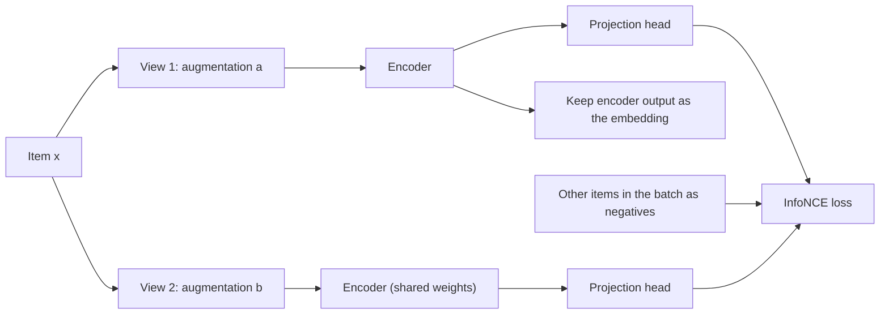

The diagram shows the SimCLR recipe (Chen and colleagues, 2020): create two augmented views of each item, encode both with the same network, apply a small projection head, and compute the loss against every other item in the batch as a negative. After training, the projection head is discarded and the encoder output is used as the embedding, because the head's output is shaped for invariance to the augmentations and discards information the encoder retains.

### 18.3 Variants and the role of augmentation

Several designs address the cost of negatives or avoid them. SimCLR needs large batches to supply enough negatives. MoCo (He and colleagues, 2020) keeps a queue of embeddings from a slowly updated momentum encoder so that the number of negatives does not depend on the batch size. CLIP (Radford and colleagues, 2021) applies a symmetric InfoNCE to image-text pairs, where the paired caption is the positive and the other captions in the batch are negatives, which yields a shared embedding space for text and images (see [CH16](CH16_Embeddings_and_Semantic_Representations.md) and [CH23](CH23_Multimodal_Generative_AI.md)). Sentence-embedding methods such as SimCSE (Gao, Yao, and Chen, 2021) use two dropout-noised passes of the same sentence as the positive pair. BYOL (Grill and colleagues, 2020) and related methods train without negatives by predicting one view's embedding from another using an asymmetric architecture, which prevents the trivial solution in which every input maps to the same vector (representation collapse).

Augmentations define what the representation will ignore. If color jitter is a strong augmentation, the encoder learns to be invariant to color, which is useful for object recognition and harmful if color is the signal, as in ripeness grading. For tabular data, text, and time series, the choice of augmentation (dropout of features, token masking, window cropping) is the main design problem and often the main reason a contrastive approach disappoints. A second risk is the false negative: two different items in a batch that really belong to the same class are pushed apart. The risk rises when batches are large relative to the number of classes.

### 18.4 What this means for clustering and for the architect

Self-supervised encoders turn the unstructured inputs of this chapter into vectors where the distances of section 3 are more meaningful. The usual production pattern is to take a pretrained embedding model, validate that neighbors are sensible for the domain, cluster or index the vectors, and fine-tune only when the domain differs enough to justify the cost. Evaluating a representation is done with downstream probes: train a linear classifier on frozen embeddings (the linear probe), measure $k$-nearest-neighbor accuracy, measure retrieval recall, or measure clustering agreement with held-out labels. Pretraining cost and the data used raise governance questions, covered in section 22 and in [CH30](CH30_AI_Data_Governance_Privacy_and_Provenance.md). The retrieval side, indexing embeddings at scale, belongs to [CH26](CH26_Vector_Databases_for_AI_Retrieval.md).

## 19. Semi-Supervised Learning and Weak Supervision

Labels are rarely absent entirely. A team usually has a small labeled set, a large unlabeled set, and a collection of rules or proxies that carry partial information. Semi-supervised learning uses the unlabeled data to improve a supervised model, and weak supervision manufactures noisy labels from heuristics. Both sit between this chapter and [CH03](CH03_Regression_and_Classification.md) and [CH04](CH04_Decision_Trees_and_Ensemble_Learning.md).

### 19.1 Assumptions that make unlabeled data useful

Unlabeled data help only if the marginal distribution $p(x)$ carries information about the label. Three assumptions are standard. Under the **smoothness** assumption, nearby points share labels. Under the **cluster** assumption, points in the same cluster share labels, so decision boundaries should pass through low-density regions. Under the **manifold** assumption, the data lie near a low-dimensional manifold, and distances along it are what matter. When none of these holds, for example when the label depends on a subtle feature unrelated to the main variation of the data, unlabeled data add nothing, and can mislead.

### 19.2 Methods

**Self-training (pseudo-labeling).** Train a model on the labeled set, predict labels for the unlabeled set, add the predictions above a confidence threshold to the training set, and retrain. It is simple and works with any classifier. Its main risk is confirmation bias: the model's early errors become training labels and reinforce themselves. Illustrative arithmetic: with 200 labeled examples and 20,000 unlabeled, a threshold of 0.95 accepts 6,000 pseudo-labeled examples. If those pseudo-labels are 92% correct, then 480 are wrong, more than twice the size of the original labeled set. Calibration of the confidence ([CH06](CH06_Model_Evaluation_Validation_and_Selection.md)) therefore decides whether the method helps. Keep a validation set of true labels untouched by pseudo-labeling, and track its metric across rounds.

**Label propagation.** Build a similarity graph over labeled and unlabeled points (as in section 10), and let labels diffuse along edges. With a normalized affinity matrix $S$ and an initial label matrix $Y$, iterate $F \leftarrow \alpha S F + (1 - \alpha) Y$ (Zhou and colleagues, 2004), which converges to a smooth labeling that matches the known labels. It uses the cluster and manifold assumptions directly and is sensitive to the graph construction.

**Consistency regularization.** Penalize a model for changing its prediction when an unlabeled input is perturbed. FixMatch (Sohn and colleagues, 2020) combines this with pseudo-labels: predict on a weakly augmented view, keep the confident label, and train the model to predict it from a strongly augmented view.

**Co-training.** Train two models on different feature views and let each label data for the other (Blum and Mitchell, 1998), under the assumption that the views are independently sufficient.

**Embeddings plus few labels.** The practical pattern today is to obtain embeddings from a self-supervised encoder (section 18), then train a simple classifier on the few labels, possibly with label propagation in embedding space. This is often more effective than elaborate semi-supervised algorithms on raw features.

Active learning is a neighbor of these methods: instead of using unlabeled data passively, the system picks the examples whose labels are most informative (for example, those with the highest model uncertainty) and sends them to annotators. It spends the labeling budget where it matters most, at the cost of a sampling bias to correct when estimating performance.

Semi-supervised learning can also hurt. If the unlabeled data contain classes absent from the labeled data, or come from a different population, pseudo-labels assign them to wrong classes. If classes are imbalanced, confidence thresholds favor the majority class. Always compare to a supervised baseline trained on the labeled data alone; if the gain is within noise, drop the complexity.

### 19.3 Weak supervision

Weak supervision (Ratner and colleagues, 2016, as data programming; the Snorkel system, 2017) replaces hand labeling with labeling functions: small programs that look at an example and either output a label or abstain. They encode patterns, keyword lists, existing models, knowledge-base lookups (distant supervision), and rules from domain experts. Individually they are noisy, partial, and sometimes conflicting. A **label model** estimates each function's accuracy and the correlations among them from the pattern of agreements and disagreements, without ground truth, and combines the votes into a probabilistic label for each example. A discriminative end model is then trained on these probabilistic labels and can generalize beyond what the rules cover.

Consider a fraud example. One function labels a transaction fraudulent if a chargeback arrived within 30 days; a second if the device was seen on a previously confirmed fraudulent account; a third labels it legitimate if the account is over two years old and the merchant is one the customer used before; each abstains otherwise. The function statistics that matter are **coverage** (the fraction of examples with a vote), **overlap** (the fraction with two or more votes), and **conflict** (the fraction where votes disagree). Naive majority voting counts correlated functions twice; the label model down-weights them.

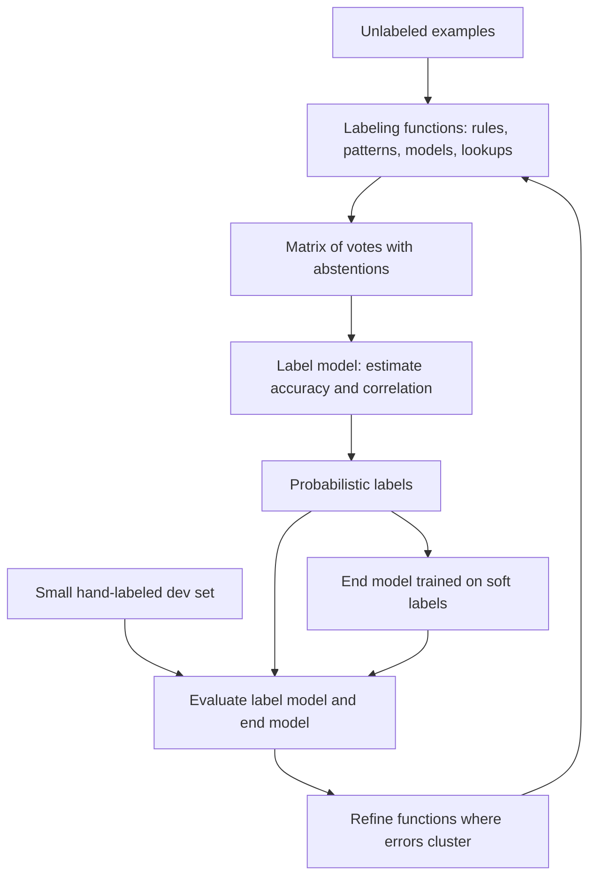

The pipeline's loop is the working method. A small hand-labeled development set is still required to measure how good the weak labels are, and an iteration cycle inspects errors and adds or fixes functions. Weak supervision shifts effort from labeling examples to writing and auditing rules. Its risks are that the rules encode biases of whoever wrote them, that the end model can only learn what the rules can express, and that a labeling function derived from the same signal as a feature leaks it into the target. Audit the functions as code, version them with the data, and record which function set produced each training label, as part of the provenance practices of [CH30](CH30_AI_Data_Governance_Privacy_and_Provenance.md).

## 20. Drift Detection and Monitoring Unlabeled Data

A deployed unsupervised model, and a supervised model whose labels arrive late, faces a population that changes. The only fully available evidence at serving time is the inputs and the model's own outputs. This section teaches the statistics for detecting change in those, which this chapter owns. The operational wiring of alerts, retraining pipelines, and rollbacks belongs to [CH29](CH29_MLOps_and_LLMOps.md).

### 20.1 Kinds of shift, and what is visible without labels

Let $x$ be the input and $y$ the target. Three changes are distinguished.

- **Covariate shift:** $p(x)$ changes while $p(y \mid x)$ stays the same. A new customer segment appears, a sensor is replaced, a marketing channel adds traffic.
- **Prior (label) shift:** $p(y)$ changes while $p(x \mid y)$ stays the same. The fraud rate doubles.
- **Concept drift:** $p(y \mid x)$ changes. The same inputs now mean something different, as when fraudsters adapt.

Without labels, only changes in $p(x)$ and in the model's outputs are directly observable. Concept drift is invisible by definition, since it needs $y$; the unlabeled signals are proxies that suggest it. This is the reason that monitoring plans pair unlabeled drift statistics with delayed-label metrics and business KPIs. For an unsupervised model there is no $y$ at all, and the equivalent concern is whether the learned structure (centroids, density, principal subspace, thresholds) still describes the population.

Shifts also differ in time pattern. A **sudden** shift occurs at a point, such as a schema change or a new app release. A **gradual** shift is a slow mix of old and new. **Incremental** drift moves steadily. **Recurring** shift returns with a season or a day of week, and it must not be treated as drift if the reference window covers the cycle.

### 20.2 Univariate statistics

**Population Stability Index (PSI).** Bin the reference distribution (commonly by its deciles or at natural categories), compute the reference proportions $r_b$ and current proportions $c_b$ per bin, and sum:

$$
\text{PSI} = \sum_b (c_b - r_b) \ln \frac{c_b}{r_b}
$$

This equals the sum of the two KL divergences between the binned distributions, $\text{KL}(c \Vert r) + \text{KL}(r \Vert c)$, so it is symmetric and non-negative. With five bins, reference $(0.10, 0.20, 0.40, 0.20, 0.10)$ and current $(0.05, 0.15, 0.35, 0.25, 0.20)$, the bin terms are $0.0347$, $0.0144$, $0.0067$, $0.0112$, and $0.0693$, so $\text{PSI} = 0.136$. The first term, for example, is $(0.05 - 0.10) \ln(0.05/0.10) = (-0.05)(-0.693) = 0.0347$. Credit-risk practice popularized thresholds of 0.1 and 0.25 (below 0.1 stable, 0.1 to 0.25 moderate, above 0.25 major). These come from convention, not from a probability model, so use them as a starting point and calibrate against a history of what shifts mattered. PSI depends on the number of bins and fails when a bin is empty in one distribution (the logarithm is undefined), so add a small constant or merge bins.

**Kolmogorov-Smirnov (KS) test.** The two-sample KS statistic is the largest vertical gap between the empirical cumulative distribution functions, $D = \sup_x |F_{\text{ref}}(x) - F_{\text{cur}}(x)|$. It needs no binning and applies to continuous data. At significance 0.05 the critical value is approximately $1.358 \sqrt{(n + m)/(nm)}$, which for $n = m = 500$ is $0.086$. In the script, samples of 500 from a standard normal were compared with samples of 500 from a normal with shifted mean:

| Mean shift (in standard deviations) | KS statistic | MMD squared (200 per sample) |
| --- | --- | --- |
| 0.0 | 0.042 | 0.0028 |
| 0.2 | 0.088 | 0.0044 |
| 0.5 | 0.182 | 0.0498 |
| 1.0 | 0.410 | 0.2350 |

A shift of 0.2 standard deviations sits just over the critical value, a shift of 0.5 is clearly detected, and the null case (0.042) is under it. The test has a sample-size problem in the other direction. With $n = m = 100{,}000$ the critical value falls to $1.358 \sqrt{2 / 100{,}000} \approx 0.0061$, so a trivial difference becomes statistically significant. Large production volumes make significance tests cry wolf; report an effect size (the KS statistic, PSI, or a distance in natural units) and alert on size, not on a p-value alone.

**Other choices.** The chi-square test and PSI suit categorical features. The Jensen-Shannon divergence is a bounded symmetric variant of KL. The Wasserstein (earth mover's) distance in one dimension is the area between the two cumulative distribution functions and is expressed in the units of the feature, which makes thresholds easy to explain ("the median order value moved by about 4 dollars").

### 20.3 Multivariate statistics

Univariate checks miss changes in the relationships between features. Two correlated features can each keep their marginal distribution while the correlation reverses.

**Maximum Mean Discrepancy (MMD).** With a kernel $k$,

$$
\text{MMD}^2(P, Q) = \mathbb{E}\, k(x, x') + \mathbb{E}\, k(y, y') - 2\, \mathbb{E}\, k(x, y)
$$

for $x, x' \sim P$ and $y, y' \sim Q$. With a characteristic kernel such as the RBF, it is zero exactly when $P = Q$ (Gretton and colleagues, 2012). The estimate from samples is the same formula with sample averages. The p-value comes from a permutation test: shuffle the pooled samples, recompute the statistic many times, and see where the observed value falls. Its cost is quadratic in the sample size, so subsample to a few thousand points. The kernel bandwidth matters; the median pairwise distance is a common default.

**Classifier two-sample test.** Label reference rows 0 and current rows 1, train a classifier to separate them, and measure held-out AUC (Lopez-Paz and Oquab, 2017). An AUC near 0.5 means the two periods are indistinguishable. An AUC of 0.7 means there is a systematic difference, and the classifier's feature importances point to where. It is simple, uses any classifier, handles mixed feature types, and localizes drift.

**Representation-space checks.** For embeddings, compare the mean vectors, the covariance, or MMD between periods in the embedding space. For this chapter's models, three more signals are specific. Track the **assignment shares** of a clustering model, the fraction of traffic assigned to each cluster, and compute the PSI on them: a cluster that doubles its share, or a new region with no centroid nearby, is a direct sign that the structure is stale. Track the **distance to the assigned centroid** (or the reconstruction error of the PCA or autoencoder), since a rising distribution means the new data fall outside what the model describes. Track the **anomaly score rate**: the fraction above the review threshold. A rate that triples without an incident is more likely drift than an attack.

### 20.4 Many features, many windows, many tests

Monitoring 50 features at a 5% level per feature each day is almost certain to alert. The probability of at least one false alert in a day, if features are independent and nothing changed, is $1 - 0.95^{50} = 0.923$. Options: apply a Bonferroni correction (a per-feature level of $0.05 / 50 = 0.001$), control the false discovery rate with Benjamini-Hochberg, aggregate into a single multivariate test, require the alert to persist for several consecutive windows, and set thresholds on effect size. Rank features by importance to the model, so that drift in a feature the model barely uses does not page anyone.

Window design is part of the method. The **reference** window can be the training data (fixed) or a trailing period (rolling). A fixed reference detects any departure from the design assumptions but alerts forever after a permanent change, until the model is refit and the reference is replaced; a rolling reference tracks gradual drift and hides it. The **current** window needs enough samples for the test to have power (a few hundred to a few thousand per bin), and for low-traffic systems may need days. Compare like with like: compare Monday to Mondays when the system has a weekly cycle. Delay between event and data availability (late-arriving records) can create false drift in the most recent window, so evaluate windows only after their data are complete.

### 20.5 From detection to response

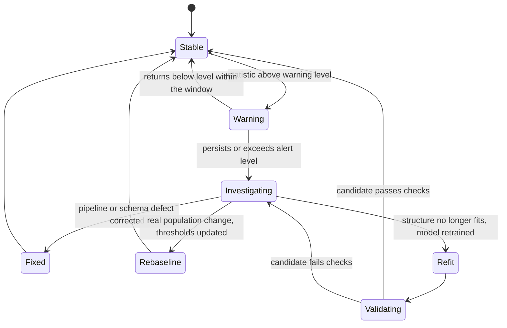

The state machine records a rule that saves many incidents: investigate before refitting. Most drift alerts in practice are data defects (a unit change, a renamed field, a null that became zero, a duplicated feed), and refitting on a defect bakes it into the model. Check data quality statistics first: null rates, ranges, cardinalities, schema versions. Only when the data are correct and the change is real is the choice among accepting the new population (re-baselining the thresholds), refitting, or redesigning the feature set. A refit candidate is validated against the old model on the same period (see section 23.3) before it replaces anything. Keep the previous model and reference statistics so that the decision can be reversed.

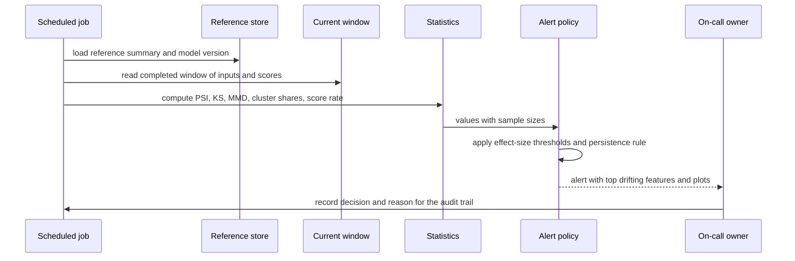

Reference summaries (bin edges, quantiles, a sample of embeddings) should be stored with the model version at training time, because recomputing them later from "current" data silently changes what is being compared. The job reads only completed windows, reports sample sizes next to every statistic so that a reviewer can discount a noisy one, and logs each decision and its reason.

## 21. Case Studies

The three cases below use illustrative numbers, chosen to show the decisions and the evidence, not to report measured results. Each names the alternatives that were rejected and why.

### 21.1 Customer segmentation for a retailer

**Situation.** A retailer with 400,000 active customers wants segments that marketing can use for different email and offer strategies. Marketing can run at most six distinct programs. There are no segment labels.

**Representation.** The team built 14 features per customer from 12 months of orders: recency in days, order count, total spend, average basket value, share of spend in each of six product categories, discount share, return rate, and weekend share. Spend and order count were heavy-tailed, so they were log transformed. Values were clipped at the 99.5th percentile so that a few business accounts did not dominate. All features were standardized with parameters fitted on the reference snapshot. A Euclidean distance check on 50 random customers and their five nearest neighbors found that a column holding a customer ID prefix had leaked in and was grouping customers by sign-up cohort, and it was removed. PCA kept 7 components explaining 90% of variance, which removed redundancy among the six category shares.

**Candidates.** K-means with $k$ from 3 to 10 (best of 20 k-means++ restarts), a Gaussian mixture with diagonal covariance, agglomerative clustering with Ward linkage on a 2,000-point sample of centroids, and DBSCAN. The simple baseline was a rule-based Recency-Frequency-Monetary (RFM) segmentation using quintile cutoffs.

**Evidence.** The silhouette peaked at $k = 5$ with a value of $0.31$, which falls in the weak-to-reasonable range because customer behavior is continuous, not clustered. The gap statistic and Calinski-Harabasz agreed on 5 within one step. Bootstrap stability gave a median ARI of $0.88$ over 50 pairs. The mixture model produced a similar partition (ARI $0.81$ against k-means) without a visible gain in any outcome, so the team kept k-means for its simpler serving. DBSCAN put 94% of customers in one cluster, as expected for density that varies smoothly. On a held-out outcome, 12-month repeat-purchase rate, the five segments ranged from $18\%$ to $71\%$, while the RFM baseline's best and worst quintile groups ranged from $27\%$ to $64\%$; the new segments separated outcomes more widely and, more usefully, identified a discount-driven group that RFM mixed into the middle. A randomized email test gave segment-specific offers to half of each segment: two segments showed a relative conversion gain, and three showed no difference, so the team funded programs for those two and left the others on the default.

**Decisions and guardrails.** The team shipped five segments with names produced from the centroid profiles and from sampled customers, and reviewed the names for stereotyping. They checked that no protected attribute was an input and that the composition of segments by age band was not strongly skewed. Sizes were reported as ranges of at least 50 customers for any breakdown. A quarterly refit with persistent segment identifiers (section 23.4) and a monthly assignment-share PSI check (section 20.3) were put in place. **Rejected:** more segments than six (marketing could not act on them), DBSCAN (no density separation), and a pure RFM scheme (kept as the comparison baseline in the quarterly review).

### 21.2 Fraud triage on a payment platform

**Situation.** A platform processes about 100,000 card payments per day. Confirmed fraud arrives as chargebacks 30 to 90 days late, so the labeled history is thin, old, and biased toward what earlier rules caught. Analysts can review 200 cases per day. Rules already catch the known patterns.

**Design.** The team used an isolation forest on engineered features (amount relative to the customer's trailing median, merchant category novelty, device and location novelty, velocity counts over several windows, hour-of-day relative to the customer's habit) as a novelty detector alongside the rules, not instead of them. Features were computed from the customer's history, so that "unusual for this customer" is encoded in the features and the detector does not need to understand context. The score feeds two bands: the top 0.05% goes to a temporary hold with a customer step-up challenge, and the next 0.15% goes to the analyst queue, filling the 200 per day. This reflects the principle in section 15.7 of two bands with a different action for each.

**Evidence and alternatives.** An autoencoder was tried first and rejected because its reconstruction error was dominated by transaction amount: high-value legitimate purchases scored as most anomalous, and the review queue filled with them. Local Outlier Factor gave good rankings in offline tests but needed a neighbor search over the full customer history at scoring time, exceeding the latency budget. The isolation forest scored in under a millisecond per event. Evaluation used three sources: matured chargebacks (labels older than 90 days) to estimate recall of known fraud, a stratified analyst review of 300 cases per band per month for precision, and injected synthetic patterns (replayed device identifiers, rapid small-amount testing) for sensitivity. In the review band, analyst-confirmed precision was about $0.30$, consistent with the arithmetic of section 15.7: with 100 true cases per day and 60% captured among 200 reviews, 60 of 200 reviews are true positives. A rule-only baseline at the same review capacity caught fewer cases in the new-pattern strata.

**Operations.** Every flag stored the model version, the score, and the three largest contributing features. Analyst decisions were logged as labels. After three months, the team trained a supervised gradient-boosted model ([CH04](CH04_Decision_Trees_and_Ensemble_Learning.md)) on reviewed and matured labels, with the isolation score as an input feature, and kept the detector for novel patterns that the supervised model has not seen. Because the reviewed set is biased toward the detector's own choices, the supervised model's recall estimates were checked against a small random sample of unreviewed events. A drift job tracked the flag rate and the score distribution weekly, with holiday weeks compared against the same weeks a year earlier.

### 21.3 Predictive maintenance on industrial pumps

**Situation.** A plant operates 400 pumps with vibration and temperature sensors. Over three years, only six pump failures were recorded with usable sensor history, which is far too few to train a failure classifier. Maintenance can inspect a pump on 72 hours' notice, and the tolerated false alarm rate is about one per pump per month.

**Design.** The approach is novelty detection trained on healthy operation. Features from each 10-minute window include root-mean-square vibration, kurtosis, and spectral energy in bands around the rotation frequency and its harmonics, plus temperature. Operation varies with load and speed, so a window is only comparable to others in the same regime: the team assigned each window to one of six operating regimes by clustering load and speed (k-means with $k = 6$, selected by the elbow and confirmed by plant engineers), then fitted PCA and a Mahalanobis model per regime on healthy windows. The anomaly score is the Hotelling $T^2$ within the subspace plus the reconstruction error outside it (section 15.6), combined by taking the larger of the two, each scaled by its healthy 99.9th percentile.

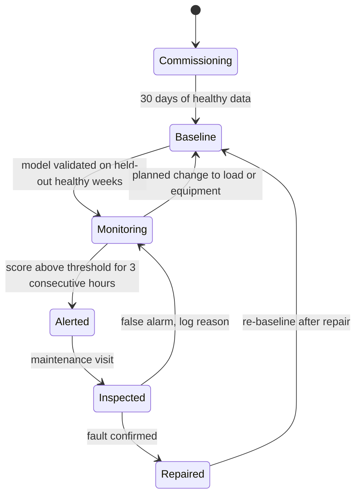

The state diagram shows the lifecycle choices that matter. A pump's normal behavior changes after a repair or a bearing replacement, so the baseline must be rebuilt and the old model retired, or the new healthy behavior will look anomalous. Requiring three consecutive hours above threshold suppresses single-window spikes. Every false alarm is logged with a reason that feeds back into the features.

**Evidence and alternatives.** The threshold was set as the 99.9th percentile of healthy validation scores, which yielded about one false alarm per pump per month in a replay of two healthy years. On the six historical failures, replaying the recorded data showed alerts at least 72 hours before failure on four, and later or not at all on two; with six events, the estimate of detection rate ($4/6$) has a very wide uncertainty, which the team reported as such. A supervised classifier was rejected for lack of failure examples, a one-class SVM for its training cost across 400 pumps by six regimes, and a deep autoencoder was kept as a candidate for later because its reconstruction error was not better than PCA on the available data (the baseline-ladder rule: do not adopt a more complex model that does not beat the simpler one). Seasonal ambient temperature moved the healthy baseline by a small amount each summer, which the team handled by including temperature as a regime variable and by quarterly re-baselining. The result is a decision-support alert for a human inspector, not an automatic shutdown.

### 21.4 Lessons that recur

Across the three cases the work that mattered was outside the algorithm choice: constructing features that carry context (customer history, operating regime), checking neighbors by eye, defining what evidence counts without labels (outcomes, matured chargebacks, replayed failures), fitting the action to the confidence (two bands, human inspection), and building the lifecycle (refit, re-baseline, ID stability). Each case also kept a simple baseline in view, and in two of three the more elaborate model lost to it.

## 22. Privacy and Fairness Consequences

Unsupervised methods are sometimes treated as safer than supervised ones because they use no labels about people. This is wrong in both privacy and fairness terms. A cluster assignment or an anomaly flag is new information about a person, produced by the system, and it can be as consequential as a label.

### 22.1 Privacy

**Clusters and scores are profiling.** Assigning a customer to a segment, or giving an employee an anomaly score, creates a new personal data element. In the European Union's General Data Protection Regulation (GDPR), profiling is defined in Article 4(4) as automated processing of personal data to evaluate personal aspects, and Article 22 restricts decisions based solely on automated processing that have legal or similarly significant effects. Whether a particular segmentation triggers these provisions is a legal determination that depends on use, so involve counsel and see [CH30](CH30_AI_Data_Governance_Privacy_and_Provenance.md). The architectural point is that a segment ID stored on a customer record is personal data with its own purpose, retention, and access rules.

**Sensitive attributes are inferred.** Excluding a sensitive attribute from the features does not stop clusters from reflecting it. Purchase categories, locations, names, device types, and timing patterns correlate with health, religion, income, and family status, and an unsupervised method will organize the data along those correlations without being told to. A segment named "new parents" or a cluster of pharmacy purchases is an inference about health or family status. Audit clusters by cross-tabulating them against sensitive attributes where lawfully held, and review the top features of each cluster for proxies.

**Small clusters expose individuals.** A centroid is a mean of its members. When a cluster has two members, its profile nearly reveals both; when it has one, it is that person's data. Reports, dashboards, and model artifacts that expose centroids or per-cluster statistics should enforce a minimum cluster size (a floor such as 20 to 50 members, chosen with the privacy team), merge or suppress small clusters, and treat the smallest ones as outliers to be handled under the stricter rules.

**Models retain data.** Several methods in this chapter store training records as part of the model. Local Outlier Factor and any nearest-neighbor detector keep the reference points; a support vector machine keeps support vectors, which are training rows; DBSCAN cannot score a new point without the core points; a Gaussian mixture or a k-means model keeps only summaries, which leak less but not nothing. Embedding models can be attacked by membership inference and, for generative decoders, by attempts to recover training examples. Differentially private variants of k-means and PCA exist and trade accuracy for a formal bound; evaluate them where regulations or data sensitivity call for it. A request to erase a person's data raises the question of whether a stored model still contains them, so record which models trained on which data (provenance, [CH30](CH30_AI_Data_Governance_Privacy_and_Provenance.md)) and decide whether erasure triggers a refit.

**Purpose creep.** An anomaly detector built for fraud or machine health is easily pointed at employees' behavior or at customers' private patterns. State the purpose in the model's documentation, restrict access to the scores, and require review before a new use.

### 22.2 Fairness

**Rare means anomalous.** Anomaly detectors flag what is uncommon in the training population. Members of a minority group, speakers of a minority language, people using assistive technology, and customers with unusual but legitimate patterns are uncommon by construction and tend to score high. A density-based or reconstruction-based detector trained mostly on one group reconstructs that group well and others poorly, so its error rate differs by group. The consequence in a fraud or abuse setting is that one group is flagged, challenged, or blocked more often for behavior that is not harmful.

**Clusters need not respect groups.** Standard clustering optimizes compactness and says nothing about group balance. Fair clustering research formalizes constraints: Chierichetti and colleagues (2017) introduced fairness for clustering, requiring each cluster to contain a balanced proportion of a protected attribute, and later work studies the cost of that constraint and objectives such as equalizing the average cost across groups (socially fair k-means, Ghadiri and colleagues, 2021). These constraints are appropriate when clusters allocate something people care about (a service tier, an outreach program), and may be inappropriate when the clusters merely describe behavior.

**Representation can fail unevenly.** PCA and autoencoders fit to a majority-heavy sample spend their capacity on the directions of greatest variance, which are those of the majority, so reconstruction quality and downstream accuracy can be lower for minority groups. A retention rule that keeps components explaining 95% of overall variance does not bound the loss per group.

**What to do.** Measure, don't assume. For any consequential use, report flag rates, review outcomes, and false-positive rates by group where group data are available and lawful to use for auditing; compare reconstruction error and nearest-neighbor quality by group; examine cluster composition. Decide in advance which disparities need action. Prefer a human review step with an appeal path to automatic action. Keep segment names descriptive and neutral, since a label like "low-value" can steer treatment by itself. Link these checks to the governance process in [CH31](CH31_Responsible_AI_and_Safety_Governance.md), and record the decisions in the model's documentation.

## 23. Production Considerations

An unsupervised model in production is a versioned artifact, a data pipeline, and a set of downstream contracts. Most of the production problems in this chapter come from the contracts, not from the algorithm.

### 23.1 Fit offline, assign online

The common architecture separates a batch fit from a stateless online assignment. The fit job reads a reference snapshot, builds the preprocessing transform and the model, computes reference statistics (feature histograms, score quantiles, cluster shares), runs validation, and writes one versioned bundle. The online service loads the bundle and applies it: transform the features with the stored parameters, then assign to the nearest centroid, compute the mixture responsibilities, or score for anomaly. Assignment to one of $k$ centroids costs $O(kp)$; with $k = 1000$ and $p = 128$ that is about 128,000 multiply-adds, which is a fraction of a millisecond on a CPU. The bundle should include the code version or a container image, because a change in a library's default (for example, a new initialization method) can change refit results, and the transform parameters, so that training and serving apply identical preprocessing ([CH02](CH02_Data_Preparation_Feature_Engineering_and_Leakage.md)). Methods without a natural assignment rule (hierarchical, spectral, t-SNE) are usually kept offline for analysis, with a nearest-centroid or k-nearest-neighbor classifier trained on their output if online use is needed.

### 23.2 Scaling

The table gives approximate costs. Use it to decide whether to subsample, approximate, or compress.

| Method | Fit time | Memory | New-point cost | Scaling note |
| --- | --- | --- | --- | --- |
| K-means (Lloyd) | $O(n k p t)$ for $t$ iterations | $O(np + kp)$ | $O(kp)$ | Mini-batch variant has memory independent of $n$ |
| Gaussian mixture (full) | $O(n k p^2 t)$ | $O(np + kp^2)$ | $O(kp^2)$ | Diagonal covariance cuts the $p^2$ factor |
| Agglomerative | $O(n^2)$ to $O(n^3)$ | $O(n^2)$ | None built in | Cluster centroids of a compressed sample |
| DBSCAN | $O(n \log n)$ with a low-dimension index | $O(n)$ | Needs core points | Degrades to $O(n^2)$ in high dimension |
| HDBSCAN | $O(n \log n)$ to $O(n^2)$ | $O(n)$ | Approximate prediction | Dominated by the spanning tree |
| Spectral | $O(n^3)$ dense, near-linear in edges with sparse solvers | $O(n^2)$ dense | None built in | Use the sparse neighbor graph |
| PCA (SVD) | $O(n p^2)$, less with randomized SVD | $O(np)$ | $O(pd)$ | Incremental variant for streaming |
| t-SNE | $O(n \log n)$ with Barnes-Hut | $O(n)$ | Not built in | Run on a sample or on PCA output |
| UMAP | Near-linear in practice, measure on your data | $O(n)$ | Supported | Approximate neighbor search dominates |
| Isolation forest | $O(t \psi \log \psi)$ | $O(t \psi)$ | $O(t \log \psi)$ | Fits on subsamples, scoring parallel |
| LOF | Neighbor search dominates | $O(n)$ | Neighbor search | Approximate neighbors help |

Worked arithmetic for a large k-means fit: $n = 50 \times 10^6$ vectors of $p = 128$ and $k = 1000$. One Lloyd iteration is $50 \times 10^6 \times 1000 \times 128 = 6.4 \times 10^{12}$ multiply-adds. At a sustained $5 \times 10^{10}$ multiply-adds per second on one vectorized core (an assumed figure to be measured on the actual hardware), that is $128$ seconds per iteration, and 20 iterations take about 43 minutes; on 32 cores with good parallel efficiency, about 80 seconds in total. The data in float32 occupy $50 \times 10^6 \times 128 \times 4 \text{ bytes} = 25.6$ GB, which fits in the memory of one large machine but not of a small one. The mini-batch variant streams the data in batches and needs memory for the centroids and one batch.

Approximate nearest neighbors help where a method is dominated by neighbor search: building the neighborhood graph for UMAP and LOF, assigning points to many centroids, and computing HDBSCAN core distances on high-dimensional embeddings. Index families (graph-based such as HNSW, inverted-file with quantization) and their recall-latency trade-offs are the subject of [CH26](CH26_Vector_Databases_for_AI_Retrieval.md). The recap relevant here is that an approximate index returns most but not all true neighbors, so the downstream method sees a slightly different graph. Measure the neighbor recall on a sample against exact search, and check that cluster assignments or anomaly rankings are insensitive to it (compare the ARI or the rank correlation of the exact and approximate pipelines) before accepting a speed-up.

### 23.3 Retraining cadence and validating a refit

Refit on a schedule and on a trigger. A schedule (monthly, quarterly) bounds staleness and keeps the process rehearsed. Triggers (a drift alert that persisted after the data were verified, a business change such as a new product line, a failed health check) cover events between schedules. Pick the cadence by the rate of change and the cost of churn: a segmentation that drives monthly campaigns can refit quarterly, a fraud detector facing adaptive adversaries may need weekly threshold updates and monthly refits, and a machine-health model refits when the machine is repaired.

A refit candidate should go through the same gates as any release. First, it is trained on a reference window that has been checked for data defects and for contamination by incidents (training an anomaly detector on a period that contained an outage teaches it that outages are normal). Second, it is compared to the incumbent on the same recent period, with the metrics for its purpose: for clustering, the silhouette on the same metric, the stability across bootstrap samples, and outcome separation on a held-out outcome; for anomaly detection, precision at the review capacity on matured labels, the injected-pattern detection rate, and the flag rate. Third, the assignment churn is measured: the fraction of items whose cluster changes and the ARI between the old and new partitions. A low ARI on a stable population is a warning that the fit is unstable, not a sign that the world changed. Fourth, the candidate runs in shadow mode, computing assignments or scores alongside the incumbent without acting on them, for a defined period, and the differences are reviewed. Fifth, the release is staged and reversible: keep the previous bundle, and keep the ability to switch back.

### 23.4 Cluster-ID stability across refits

K-means and most clustering algorithms number clusters arbitrarily. After a refit, the cluster that was 3 may be 0, and a dashboard, a CRM campaign, or a downstream model keyed to the ID will silently misbehave. Stability needs an explicit identity layer.

The standard approach is to match new clusters to old ones after each refit, using the data both have seen. Build the contingency table of old-cluster membership against new-cluster membership on the shared items, and find the one-to-one matching that maximizes the total overlap (the Hungarian algorithm solves this assignment problem). A worked example with three old clusters $A$, $B$, $C$ and three new clusters 0, 1, 2:

| Old \ New | 0 | 1 | 2 | Old size |
| --- | --- | --- | --- | --- |
| A | 4 | 92 | 4 | 100 |
| B | 68 | 6 | 6 | 80 |
| C | 3 | 2 | 55 | 60 |

The matching $A \to 1$, $B \to 0$, $C \to 2$ gives an overlap of $92 + 68 + 55 = 215$ of $240$ items, or $89.6\%$ retained, with 25 items (10.4%) changing cluster. The identity pairing $A \to 0$, $B \to 1$, $C \to 2$ would give only $4 + 6 + 55 = 65$, and would therefore report that three quarters of the population moved when almost none did. For each matched pair, check the Jaccard similarity: new cluster 1 has $92 + 6 + 2 = 100$ members, the overlap with $A$ is 92, and the union is $100 + 100 - 92 = 108$, so the Jaccard similarity is $0.852$. Define a rule such as "inherit the old ID when the Jaccard similarity is at least 0.5, otherwise issue a new ID". Splits (one old cluster dividing into two new ones), merges, births, and deaths are then recorded explicitly: one child inherits the ID and the other gets a new ID with a lineage link to its parent, a merge keeps the larger parent's ID and records the other as retired into it, and retired IDs are never reused.

```mermaid
erDiagram
    MODEL_VERSION ||--|{ CLUSTER_VERSION : defines
    PERSISTENT_CLUSTER ||--o{ CLUSTER_VERSION : realized_as
    CLUSTER_VERSION ||--o{ ASSIGNMENT : has_members
    CLUSTER_VERSION ||--o{ LINEAGE : child_of
    LINEAGE }o--|| CLUSTER_VERSION : parent
    MODEL_VERSION {
        string version_id
        date trained_on
        string reference_window
        string bundle_hash
    }
    PERSISTENT_CLUSTER {
        string stable_id
        string display_name
        string status
    }
    CLUSTER_VERSION {
        string cluster_index
        int size
        float jaccard_to_parent
    }
    ASSIGNMENT {
        string entity_id
        float distance
        datetime assigned_at
    }
```

The entity-relationship diagram shows the identity layer. The algorithm's internal index (`cluster_index`) is meaningful only inside one model version. The persistent cluster carries the stable identifier and the business name, and each model version realizes it through a cluster version. Lineage links record splits and merges, and each assignment stores the distance so that borderline items can be identified. Downstream systems should key on the `stable_id` and never on the raw index.

A second source of churn is per-item flapping. A customer near the boundary between two clusters may switch back and forth between refits, or between daily recomputations, and trigger different treatments each time. Add hysteresis: keep the previous assignment unless the new best cluster is closer by a margin (for example, the distance to the new centroid is less than 0.9 times the distance to the current one), and record the assignment time so that treatments can require a minimum tenure. Warm-starting the refit from the previous centroids reduces churn and speeds convergence, with the trade-off that the new fit inherits the old fit's local optimum, so run an unconstrained fit as a comparison on a schedule. For anomaly detectors, the same issue appears as score scale: after a refit, a score of 0.7 may mean something different, so thresholds are re-derived from the review capacity or from percentile targets and not copied.

### 23.5 Testing and observability

Test the component as software and as a statistical object. As software: with a fixed seed the fit is reproducible; the stored transform, applied to a golden sample, matches stored expected outputs (a regression test that catches silent changes in the library or preprocessing); inputs with missing columns, unseen categories, and zero vectors produce defined behavior; and the assignment service returns the same result as the offline pipeline on the same rows. As a statistical object: invariance checks (permuting the input rows does not change the partition, up to labeling), a sanity check that clustering a shuffled copy of the data gives much lower validation scores than the real data (the null of section 16.4), and a regression check that the fit's silhouette, stability, and outcome separation have not fallen below an agreed floor. In production, log the model version, the assigned cluster, the distance to it, and the anomaly score on every call (or on a sample), aggregate them into the monitoring statistics of section 20, and keep a sampled set of cases for periodic human review. The incident that a team most wants a record of is the one nobody reported, such as a silent shift in segment sizes after an upstream change, and that record exists only if the assignment shares were logged.

## 24. Failure Modes and Quality-Attribute Scenarios

The table converts the failure modes of the chapter into testable scenarios. Each has a stimulus, an expected response, and a measure.

| Quality attribute | Stimulus | Expected response | Measure |
| --- | --- | --- | --- |
| Correctness under data defect | An upstream team changes a monetary column from dollars to cents | Drift job detects the shift, blocks automatic refit, and pages the data owner | Alert within one monitoring window and no refit on the defective window |
| Stability | Quarterly refit on a population that did not change | Persistent IDs are inherited for at least 95% of segment members | Retained overlap and ARI between consecutive fits above agreed floors |
| Statistical validity | A refit candidate has a higher silhouette but lower outcome separation | The release gate rejects it | Gate compares outcome separation, not only geometry |
| Capacity | Anomaly rate triples during a promotion | Review band is capped at analyst capacity, with overflow handled by a defined policy | Queue length at or below capacity and no silent drops |
| Latency | Assignment traffic doubles | Stateless service scales out without refit | p99 assignment latency under the budget, for example 20 ms |
| Privacy | A dashboard filters to a segment with 3 members | Report suppresses the segment or merges it | No breakdown shown below the minimum cluster size |
| Fairness | Flag rate for a monitored group is twice the overall rate | Audit job reports the disparity and blocks promotion until reviewed | Disparity metric computed per release with owner sign-off |
| Reversibility | New model increases false alarms | Previous bundle restored | Rollback completes within the agreed time and the model version in logs matches |

## 25. Comparison of Methods

| Method | Assumes | Strengths | Weaknesses | Handles new points | Typical use |
| --- | --- | --- | --- | --- | --- |
| K-means | Convex, similar-size, spherical clusters | Fast, simple, scalable | Needs $k$, sensitive to scale and outliers | Yes (nearest centroid) | Segmentation, vector quantization |
| Gaussian mixture | Mixture of Gaussians | Soft membership, shape, density | Local optima, singularities, needs many samples for full covariance | Yes (responsibilities) | Soft segmentation, density-based anomaly |
| Agglomerative | A meaningful linkage | Hierarchy, no $k$ in advance | Quadratic cost, no undo | Not directly | Taxonomy, exploration on small data |
| DBSCAN | A single density level | Arbitrary shape, noise label | $\varepsilon$ sensitive, varying density fails | Approximate | Spatial and low-dimensional data |
| HDBSCAN | Density varies | Varying density, stable clusters, outlier scores | Parameters still matter, cost | Approximate | Clustering of embeddings after reduction |
| Spectral | A good affinity graph | Nonconvex shapes | Cubic dense cost, no out-of-sample | Not directly | Graphs, image segmentation, moderate data |
| PCA | Linear structure, variance is relevant | Deterministic, fast, invertible | Linear, scale dependent | Yes | Preprocessing, denoising, reconstruction score |
| Kernel PCA | Chosen kernel fits structure | Curved structure | Quadratic memory, pre-image problem | Yes, with kernel evaluation | Moderate-size nonlinear reduction |
| t-SNE | Neighborhoods matter | Strong local visualization | Seed and parameter dependent, no global meaning | Not by default | Exploratory plots |
| UMAP | Data on a manifold | Scalable, transform, local-global balance | Defaults shape the look, same warnings as t-SNE | Yes | Plots and reduction before clustering |
| Autoencoder | Network can capture structure | Nonlinear, flexible | Tuning, identity risk, not interpretable | Yes | Tabular, sensor, image representation, anomaly |
| Isolation forest | Anomalies are few and different | Fast, no distances, scalable | Axis-parallel artifacts, score not a probability | Yes | Tabular anomaly detection |
| LOF | Local density comparison | Handles varying density | Neighbor cost, $k$ sensitive | Yes in novelty mode | Local outliers in moderate data |
| One-class SVM | Region of normal data | Interpretable $\nu$, kernel | Scales poorly, kernel sensitive | Yes | Novelty detection on small clean sets |

The table is a starting point for a design review and not a ranking. The sections above give the conditions under which each entry holds, and the strongest recommendation is the baseline ladder: begin with the cheapest method that fits the use (standardize, PCA, k-means or a MAD-based z-score), and move up only when its measured failure justifies the added cost, operational burden, and loss of interpretability.

## 26. Common Mistakes

- **Clustering raw, unscaled features.** Cause: the largest-unit column controls the distance. Consequence: the clusters reproduce one column, and the team reports them as segments. Check neighbors by eye and standardize or weight deliberately.
- **Treating an elbow or a silhouette peak as the true number of clusters.** Cause: the criteria are heuristics about geometry. Consequence: a count that does not match any decision. Choose $k$ within what the downstream use supports, and show stability.
- **Reading a t-SNE or UMAP plot as a map.** Cause: sizes, distances, and densities are artifacts of the method. Consequence: wrong claims about how similar or large groups are. Apply the warnings of section 13.4 and report neighborhood preservation.
- **Fitting preprocessing or PCA on all data, including serving data.** Cause: convenience. Consequence: leakage, and a transform that cannot be reproduced at serving time. Fit on reference data and store the parameters.
- **Setting an anomaly threshold from a quantile with no link to capacity or cost.** Cause: using the library's contamination default. Consequence: alert floods or silence. Derive the threshold from review capacity and costs, and re-derive it after refits.
- **Training an anomaly detector on data that contains the incidents.** Cause: no incident filter on the training window. Consequence: the detector learns the incident as normal. Screen the window, and use outlier-resistant methods when contamination is unavoidable.
- **Using purity or training likelihood as proof of quality.** Cause: both rise with model complexity. Consequence: over-fragmented clusters and overfit mixtures. Use stability, held-out likelihood, and outcome tests.
- **Refitting in response to every drift alert.** Cause: alerts are treated as reasons to retrain. Consequence: defects are baked into the model. Investigate data quality first.
- **Keying downstream systems to the raw cluster index.** Cause: the algorithm's labels look like identifiers. Consequence: broken campaigns and dashboards after a refit. Use persistent IDs with lineage.
- **Excluding sensitive attributes and assuming the result is fair.** Cause: proxies. Consequence: clusters and flags that track protected groups. Audit outcomes by group.
- **Skipping the simple baseline.** Cause: preference for sophisticated methods. Consequence: complexity without benefit. Keep the baseline ladder in every review.

## 27. Design-Review Checklist

- [ ] The decision the output supports is written down, with the cost of a wrong cluster or flag.
- [ ] Features were chosen and scaled deliberately, with transform parameters stored and versioned.
- [ ] The distance or similarity was justified for the data type, and neighbors were inspected on a sample.
- [ ] The distance-contrast statistic was checked, and dimension reduction or feature selection was considered.
- [ ] A simple baseline (rules, MAD-based z-score, PCA plus k-means) is part of the comparison.
- [ ] The method's assumptions (shape, density, size) were checked against the data, and the failure modes were considered.
- [ ] The number of clusters or the density parameters were chosen with several criteria plus stability, and the choice is documented.
- [ ] Validation includes a structureless null, stability under resampling and seed, and an outcome or human test.
- [ ] Any 2-D projection is labeled with its method, parameters, seed, and a warning, and no claim rests on it alone.
- [ ] Anomaly thresholds are tied to review capacity and cost, with two bands and a defined action for each.
- [ ] Anomaly evaluation uses matured labels, stratified review, and injected cases, and compares against a rule baseline.
- [ ] Drift monitoring covers inputs, scores, cluster shares, and data quality, with effect-size thresholds and persistence rules.
- [ ] A refit gate compares the candidate with the incumbent, measures churn, and includes a shadow period and rollback.
- [ ] Persistent cluster IDs with lineage are in place, and downstream systems key on them.
- [ ] Minimum cluster size, sensitive-attribute proxies, and group-wise error rates were reviewed, with governance sign-off.
- [ ] The bundle records the model version, code version, reference window, and provenance of training data.

## 28. Exercises

1. **Scale and neighbors.** Customers $A = (25, 40{,}000)$, $B = (55, 40{,}300)$, and $C = (26, 43{,}000)$ have age in years and income in dollars. (a) Compute the raw Euclidean distances $d(A, B)$ and $d(A, C)$ and name the nearest neighbor of $A$. (b) Standardize with standard deviations of 12 years and 15,000 dollars and repeat. (c) State what this implies for k-means.

2. **Mahalanobis.** Two standardized features have correlation $0.8$. Compute the Mahalanobis distance of $(1, 1)$ and $(1, -1)$ from the origin, and compare with their Euclidean distance.

3. **Lloyd by hand.** Points on a line: $1, 2, 3, 10, 11, 12$ with $k = 2$ and initial centroids $1$ and $2$. Run Lloyd's algorithm to convergence and give the final partition and inertia. Then explain what k-means++ would change about the initialization.

4. **EM step.** A two-component, one-dimensional mixture has $\mu = (0, 4)$, $\sigma = (1, 1)$, $\pi = (0.5, 0.5)$. Compute the responsibility of component 2 for $x = 3$, then say which way the M-step moves $\mu_2$ because of this point.

5. **PCA.** A centered dataset has covariance eigenvalues $4.0$, $0.9$, $0.1$. (a) What fraction of variance does each component explain? (b) How many components reach 90%? (c) What is the total squared reconstruction error per example (the mean over examples of the squared norm of the residual) when keeping one component, assuming the covariance uses the same normalization?

6. **Reading a plot.** A colleague shows a UMAP plot with five clean blobs of very different sizes and claims there are five customer segments, with segment 3 "twice as far" from segment 1 as from segment 2. List four things you would ask for before accepting the claim.

7. **Threshold from capacity.** An anomaly detector scores 250,000 events per day. Analysts can review 500 per day. True anomalies occur at a rate of 0.04%. (a) What fraction of events does the review band cover? (b) If the detector captures 70% of true anomalies in the review band, what are the precision and the number of true anomalies missed per day? (c) If the base rate doubles and the detector is unchanged, what happens to precision?

8. **ID stability.** Old clusters $P$ (200 members), $Q$ (100), and new clusters 0, 1 have overlaps $P \cap 0 = 30$, $P \cap 1 = 160$, $Q \cap 0 = 85$, $Q \cap 1 = 5$ (some old members left the system). Find the matching, the retained fraction, and decide the ID rule for each pair using a Jaccard threshold of 0.5. State what you would log.

9. **Drift alerts.** A model monitors 40 features daily with a KS test at the 5% level. (a) What is the probability of at least one false alert on a day with no change? (b) Propose two changes that reduce alert noise without hiding real drift, and say what each costs.

### Answers

1. (a) $d(A, B) = \sqrt{30^2 + 300^2} = \sqrt{90{,}900} \approx 301.5$ and $d(A, C) = \sqrt{1^2 + 3000^2} \approx 3000.0$, so $B$, 30 years older, is the nearest neighbor. (b) Standardized: $d(A, B) = \sqrt{(30/12)^2 + (300/15000)^2} = \sqrt{6.25 + 0.0004} \approx 2.500$ and $d(A, C) = \sqrt{(1/12)^2 + (3000/15000)^2} = \sqrt{0.00694 + 0.04} \approx 0.217$, so $C$ is nearest. (c) K-means uses the same Euclidean geometry, so without scaling it would cluster on income alone.

2. $\Sigma^{-1} = \frac{1}{1 - 0.64} \begin{pmatrix} 1 & -0.8 \\ -0.8 & 1 \end{pmatrix}$ with $1/0.36 = 2.778$. For $(1, 1)$: $2.778 \times (1 + 1 - 1.6) = 1.111$, so $d_M = 1.054$. For $(1, -1)$: $2.778 \times (1 + 1 + 1.6) = 10.0$, so $d_M = 3.162$. Both have Euclidean distance $1.414$. The point along the correlation direction is ordinary, and the point against it is far out.

3. First assignment: centroids $1$ and $2$; points $1, 2$ are at distance $0$, so $1$ goes to centroid 1; $2$ to centroid 2; $3$ is closer to $2$; $10, 11, 12$ also go to centroid 2 (it is closer than $1$). Clusters $\{1\}$ and $\{2, 3, 10, 11, 12\}$ with centroids $1$ and $7.6$. Second pass: $2$ is at distance $1$ from centroid 1 and $5.6$ from 7.6, so it moves; $3$ is at distance $2$ versus $4.6$, so it moves; $10$ is $9$ versus $2.4$, stays. Clusters $\{1, 2, 3\}$ and $\{10, 11, 12\}$, centroids $2$ and $11$. Third pass: no changes. Inertia $= (1 + 0 + 1) + (1 + 0 + 1) = 4$. The poor start (two centroids on the left) still converged here, but could be stuck in other layouts. K-means++ would pick the second centroid with probability proportional to squared distance from the first. If the first centroid is $1$, a point such as 12 (squared distance 121) would be chosen with probability $121 / (0 + 1 + 4 + 81 + 100 + 121) = 0.394$, and one of $\{10, 11, 12\}$ with total probability $302 / 307 = 0.984$.

4. Component 1 density at $3$: $e^{-4.5}/\sqrt{2\pi} = 0.01111/2.5066 = 0.004432$; component 2 density at $3$: $e^{-0.5}/\sqrt{2\pi} = 0.24197$. With equal weights, $\gamma_2 = 0.24197 / (0.24197 + 0.004432) = 0.9820$. The M-step weights $x = 3$ almost fully into component 2, so $\mu_2$ moves down from $4$ toward $3$ in proportion to this point's weight among component 2's members.

5. (a) Total $5.0$, so $80\%$, $18\%$, $2\%$. (b) Two components reach $98\%$, one reaches only $80\%$, so two. (c) The discarded variance is $0.9 + 0.1 = 1.0$ per example, in the covariance normalization.

6. Ask for the parameters, seed, and preprocessing; a sweep over `n_neighbors` and `min_dist` and several seeds showing the five groups persist; a neighborhood-preservation score; the clustering result computed in a higher-dimensional space (not on the 2-D coordinates), and its stability and outcome separation. The relative size and the distance between blobs are not interpretable, so the "twice as far" claim should be withdrawn or tested in the original space.

7. (a) $500 / 250{,}000 = 0.2\%$. (b) True anomalies per day $= 250{,}000 \times 0.0004 = 100$. Captured $= 70$, so precision $= 70 / 500 = 0.14$, and $30$ are missed. (c) With a base rate of 0.08% there are 200 true anomalies per day, and the same recall gives 140 captured and a precision of $0.28$; precision doubles though the detector has not changed.

8. Matching $P \to 1$ (160) and $Q \to 0$ (85) gives a total overlap of $245$ of $300$ original members, $81.7\%$ retained (the alternative gives $30 + 5 = 35$). New cluster 1 has $160 + 5 = 165$ members, so for $P$ the Jaccard similarity is $160 / (200 + 165 - 160) = 160 / 205 = 0.78$. New cluster 0 has $30 + 85 = 115$ members, and for $Q$ it is $85 / (100 + 115 - 85) = 85 / 130 = 0.65$. Both exceed 0.5, so both inherit their old IDs. Log the old and new model versions, the contingency table, the matching, each Jaccard value, the number of members that left, joined, and moved, and the ID decision.

9. (a) $1 - 0.95^{40} = 1 - 0.1285 = 0.871$. (b) Apply a multiple-testing correction (Bonferroni gives a per-feature level of $0.05 / 40 = 0.00125$, at the cost of reduced power for small real drifts), and require an effect-size floor plus persistence over several windows (at the cost of detection delay). Weighting by feature importance is another option and costs a missed alert on low-importance features.

## 29. Summary

Unsupervised learning finds structure in data without a target, and every result depends on assumptions the practitioner chose: the features, the scale, the distance, and the objective. Euclidean distance depends on units and ignores correlation, cosine ignores length, Mahalanobis whitens, Jaccard ignores joint absence, and edit distance sees spelling and not meaning. In high dimension distances concentrate (the relative contrast between the farthest and nearest neighbor fell from about 46 at two dimensions to 0.11 at a thousand for uniform data), so representation matters more than the algorithm.

K-means minimizes within-cluster squared distance with Lloyd's alternation, converges to a local optimum, benefits from k-means++, and assumes convex, similar-size clusters. Hierarchical clustering defers the choice of $k$ and depends on linkage. DBSCAN and HDBSCAN find arbitrary shapes and noise but depend on density parameters. Gaussian mixtures fitted by EM add soft assignment and shape, with the likelihood-increasing derivation from Jensen's inequality and the singularity risk. Spectral clustering clusters the eigenvectors of a graph Laplacian. PCA is the top eigenvectors of the covariance, which equals the right singular vectors of the centered data, and it maximizes variance and minimizes reconstruction error at the same time. Kernel PCA adds curvature at quadratic cost. t-SNE and UMAP preserve neighborhoods and distort sizes, distances, and densities, so plots are hypotheses. Autoencoders and VAEs learn nonlinear codes, and contrastive learning builds the embeddings that make distance meaningful.

Anomaly detection ranks departures from a reference, and the threshold is a decision about review capacity, cost, and base rate, so it comes from the operation and not the algorithm. Clusters are validated by comparison with a null, geometry, stability, human interpretability, and downstream outcomes; no single internal index suffices. Topic models and association rules summarize co-occurrence, and semi-supervised and weak-supervision methods stretch few labels. Without labels, drift is measured on inputs and outputs (PSI, KS, MMD, cluster shares), interpreted by effect size, and investigated as a possible data defect before any refit. Cluster assignments and anomaly flags are personal data and can encode proxies for protected groups. Production use needs versioned bundles, offline fit with online assignment, gated refits, shadow runs, and persistent cluster identities with lineage.

## 30. Code Examples

The scripts use only the Python standard library (version 3.14 was used to produce the quoted output) and print results that this chapter quotes.

- [01_distance_and_dimensionality.py](../code/python/unsupervised-chapter/01_distance_and_dimensionality.py) computes Euclidean, cosine, Mahalanobis, Jaccard, and edit distances on small examples, and demonstrates distance concentration and the cube-versus-ball volume ratios.
- [02_kmeans_em_dbscan.py](../code/python/unsupervised-chapter/02_kmeans_em_dbscan.py) implements Lloyd's algorithm with k-means++, the silhouette, EM for a one-dimensional Gaussian mixture, and DBSCAN, and compares k-means and DBSCAN on concentric rings.
- [03_pca_by_hand.py](../code/python/unsupervised-chapter/03_pca_by_hand.py) computes PCA from the covariance matrix and from the SVD route on ten points, checks the reconstruction-error identity, and shows the effect of rescaling a feature.
- [04_anomaly_and_drift.py](../code/python/unsupervised-chapter/04_anomaly_and_drift.py) computes Local Outlier Factor, silhouette and Davies-Bouldin by hand, single and complete linkage, z-score versus MAD scores, a small isolation forest, PSI, the KS statistic, MMD, and a review-capacity threshold.

## 31. References and Further Reading

Method papers cited above, by first author and year: Pearson (1901), Hotelling (1933), Lloyd (1957, published 1982), MacQueen (1967), Dempster, Laird, and Rubin (1977), Rousseeuw (1987), Agrawal and Srikant (1994), Ester and colleagues (1996, DBSCAN), Scholkopf and colleagues (1998, kernel PCA; 2001, one-class SVM), Breunig and colleagues (2000, LOF), Ng, Jordan, and Weiss (2001, spectral clustering), Tibshirani, Walther, and Hastie (2001, gap statistic), Blei, Ng, and Jordan (2003, LDA), Arthur and Vassilvitskii (2007, k-means++), Liu, Ting, and Zhou (2008, isolation forest), van der Maaten and Hinton (2008, t-SNE), Kingma and Welling (2013, VAE), Campello, Moulavi, and Sander (2013, HDBSCAN), McInnes, Healy, and Melville (2018, UMAP), Chen and colleagues (2020, SimCLR), and Kobak and Linderman (2021, initialization in t-SNE and UMAP).

Documentation to consult for the library behavior that changes between versions:

- [umap-learn parameters guide](https://umap-learn.readthedocs.io/en/latest/parameters.html) for `n_neighbors` and `min_dist` and their defaults at the time of writing.
- [scikit-learn HDBSCAN reference](https://scikit-learn.org/stable/modules/generated/sklearn.cluster.HDBSCAN.html), which documents the estimator included in scikit-learn since version 1.3.
- [scikit-learn clustering guide](https://scikit-learn.org/stable/modules/clustering.html) and [outlier and novelty detection guide](https://scikit-learn.org/stable/modules/outlier_detection.html) for estimator parameters and current defaults; verify them against the installed version before reproducing any result in this chapter.

Related chapters: [CH01](CH01_Machine_Learning_Foundations.md), [CH02](CH02_Data_Preparation_Feature_Engineering_and_Leakage.md), [CH06](CH06_Model_Evaluation_Validation_and_Selection.md), [CH16](CH16_Embeddings_and_Semantic_Representations.md), [CH26](CH26_Vector_Databases_for_AI_Retrieval.md), [CH29](CH29_MLOps_and_LLMOps.md), [CH30](CH30_AI_Data_Governance_Privacy_and_Provenance.md), and [CH31](CH31_Responsible_AI_and_Safety_Governance.md).
