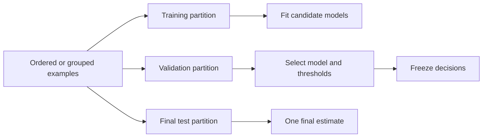
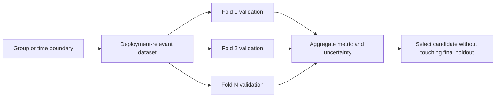
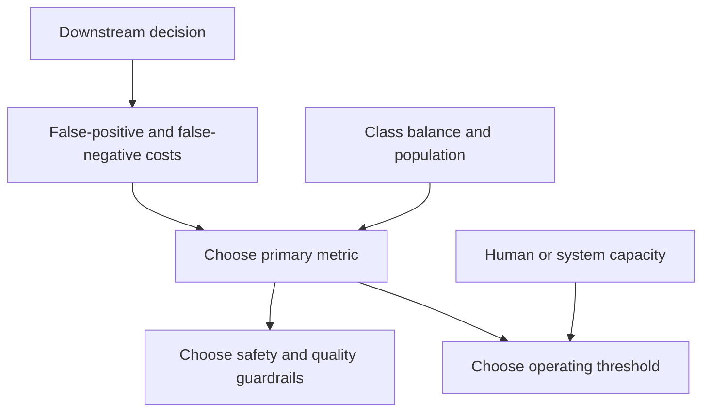
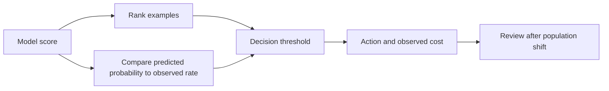
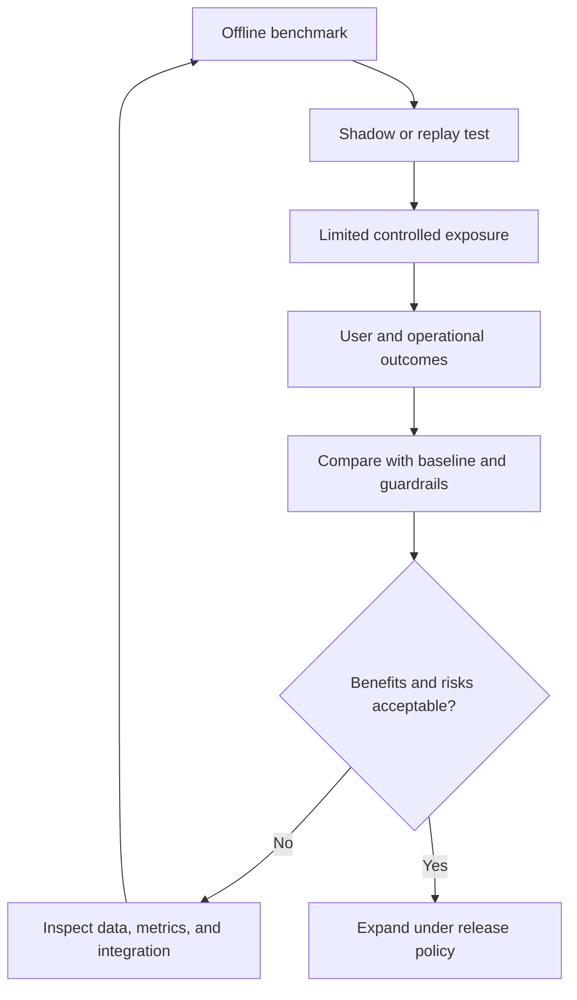

# Model Evaluation, Validation, and Selection

Part: [16 — Artificial Intelligence, Machine Learning, and Generative AI](PART_OVERVIEW.md)

Model evaluation estimates how a candidate behaves on data representative of intended use. The estimate is only meaningful when the split matches deployment, the metric matches decision cost, and uncertainty is reported. Reusing test data for tuning turns it into training feedback and makes the final score optimistic.

This chapter owns validation design, metric selection, calibration, uncertainty, baselines, model comparison, and offline-to-online gaps. [CH02 — Data Preparation](CH02_Data_Preparation_Feature_Engineering_and_Leakage.md) owns data leakage and preparation mechanics; Part 07 owns general statistical foundations. [CH03 — Regression and Classification](CH03_Regression_and_Classification.md) owns model and operating-threshold mechanics.

## Baselines and Data Splits

Start with a simple baseline: majority class, last observed value, linear model, or existing rule. It helps determine whether complexity adds value. Separate training data for parameter fitting, validation data for model and threshold decisions, and a final test set for a limited unbiased estimate. For temporal predictions, split by time; for repeated users or devices, group related examples so they do not leak across partitions.

Cross-validation can reduce dependence on one random split when data are independent and identically distributed. Grouped or temporal folds are necessary when examples share users, time, sites, or repeated entities. A random split of time-dependent data may estimate an easier problem than the actual deployment distribution.

## Metrics and Error Costs

Choose a metric from the decision. Accuracy can hide poor performance on rare classes. Precision asks how many predicted positives are correct; recall asks how many actual positives are found. ROC and precision-recall curves show threshold trade-offs, with precision-recall often more informative for highly imbalanced problems. Regression metrics such as mean absolute error and root mean square error weight errors differently.

Do not optimize a single metric without guardrails. A model can improve recall by flagging nearly everything, overwhelming review operations. Report confusion counts and performance by relevant segment so aggregate improvement does not hide concentrated harm.

For binary decisions, precision is $TP/(TP+FP)$ and recall is $TP/(TP+FN)$, where $TP$, $FP$, and $FN$ count true positives, false positives, and false negatives. The $F_1$ score, $2PR/(P+R)$, summarizes precision $P$ and recall $R$ but hides their separate costs. Receiver Operating Characteristic (ROC) curves compare true-positive and false-positive rates over thresholds; precision-recall (PR) curves expose how precision changes as recall rises and are often more diagnostic when positives are rare. Choose the metric for the decision and prevalence, and retain the underlying counts so a summary score remains interpretable.

Prevalence changes what a given precision means. Consider a fraud classifier evaluated on 10,000 transactions where 100 (1%) are actually fraudulent. A model with 90% recall finds 90 of those 100. If it also flags 900 legitimate transactions as false positives, precision is $90/(90+900)\approx9\%$: the review queue would be over 90% false alarms despite "90% recall" sounding strong in isolation. Report both prevalence and the confusion counts behind any percentage, and size the review-capacity conversation around the absolute false-positive count a threshold produces, not the recall figure alone.

## Ranking, Calibration, and Uncertainty

Ranking quality and probability calibration are distinct. A model may order cases correctly while its probabilities are systematically overconfident. Calibration matters when scores drive decisions, capacity allocation, or expected-loss calculations. Use calibration data that remain separate from the final test set.

Report uncertainty from finite samples, repeated splits, or bootstrap intervals when appropriate. Small subgroup samples yield unstable estimates; show sample counts and avoid claiming parity from a wide confidence interval. Statistical uncertainty covers sample variation only. It does not account for later distribution shift or defective labels.

Model comparisons should use the same held-out examples so paired differences are not confounded by different sample difficulty. For independent cases, bootstrap the evaluation unit and recompute the metric difference; for repeated customers or time-dependent observations, resample groups or time blocks rather than individual rows. When many hyperparameters or candidates are tried, a single validation set becomes an adaptive resource. Use nested cross-validation for small independent datasets or a separate final time period for temporal prediction, and record how many selection decisions used each partition. A small score difference within sampling uncertainty is not evidence that the more complex model is better.

## Offline-to-Online Validation

Offline metrics do not prove production value. Inputs may arrive late, features may differ, users may change behavior in response to predictions, and systems may fail under real latency and traffic constraints. Validate integration, latency, resource use, fallback, monitoring, and human override in addition to predictive quality.

Do not let the final test set become a repeated decision dashboard. If many candidates are tested against it, the team adapts to its peculiarities. Preserve a holdout or use a time-based prospective evaluation for consequential decisions.

## Worked Case and Review Checklist

A fraud model is trained on historical transactions, with customer groups held out across partitions and a time-based final test. The team compares against a rules baseline, evaluates precision-recall and expected loss, calibrates scores, and tests thresholds against analyst capacity. Before rollout, it runs shadow evaluation, checks inference latency, and validates false-positive rates by region and customer segment.

A concrete nested-validation detail: with 40 candidate hyperparameter configurations tried against one validation set of 2,000 transactions, the best-performing configuration is selected partly on validation-set noise, not purely on true generalization — a phenomenon sometimes called selection bias from multiple comparisons. The team mitigates this with 5-fold nested cross-validation for hyperparameter selection and reserves a separate, never-tuned-against time period as the final test. When the selected configuration's nested-validation score and final-test score diverge by more than the expected sampling noise, that gap itself is evidence of overfitting to the validation procedure, not only to the training data.

Review split logic, leakage, baseline, metric rationale, thresholds, calibration, sample size, uncertainty, segment performance, repeated test use, integration behavior, latency, fallback, and online feedback plan.

## Questions and Summary

1. Choose a split strategy for repeated customers and future-time prediction.
2. Why can accuracy be misleading for rare events?
3. Distinguish ranking quality from calibration.
4. Define a baseline and guardrail set for a high-impact classifier.
5. Design a staged offline-to-online evaluation that avoids repeated test-set tuning.

Evaluation is an experimental design problem as much as a metric calculation. Match partitions to deployment, protect the final holdout, align metrics and thresholds with consequences, quantify uncertainty, and verify online behavior before broad release. Report both quality and operating cost.
