# Model Evaluation, Validation, and Selection

Part: [16 — Artificial Intelligence, Machine Learning, and Generative AI](PART_OVERVIEW.md) · Status: Revised (in-depth rewrite)

## 1. Introduction

A trained model is a hypothesis about the future, and evaluation is the experiment that tests it. Almost every costly failure of a machine learning (ML) system that was "validated" before launch traces back to a flaw in that experiment rather than in the model: a test set that shared customers with the training set, a metric that rewarded the wrong behavior, a threshold chosen on data that had already been used to pick the model, a comparison whose difference was smaller than the noise, or an offline score that said nothing about what happened after users saw the predictions. The models in this book are mostly interchangeable at the margin. The quality of the evidence used to choose between them is not.

A solution architect rarely computes the metrics personally, but the architect owns the decisions that determine whether the metrics can be trusted. Which data is held out, and who is allowed to look at it? How many times may a team query the final test set? Which error is more expensive, and does the chosen threshold reflect that? How large must an evaluation set be before a one-point difference means anything? Which slices must be reported, and what happens when a model passes offline and fails online? These are architecture and governance questions as much as statistics questions, because the answers are enforced by data pipelines, access controls, experiment platforms, release gates, and review checklists.

After studying this chapter, a reader should be able to:

1. Explain the hold-out principle, why a test set is consumed by use, and how to budget its use.
2. Choose among hold-out, k-fold, stratified, group, repeated, time-series (rolling-origin), and nested cross-validation for a given data-generating process, and name the leakage trap each one prevents or introduces.
3. Derive every common binary-classification metric from the confusion matrix, and show with arithmetic how prevalence (the base rate) changes precision, the F-score, and the Matthews correlation coefficient while leaving recall and specificity unchanged.
4. Interpret Receiver Operating Characteristic (ROC) and precision-recall (PR) curves and the area under each, and explain when the ROC curve misleads.
5. Select regression, probabilistic, and ranking metrics that match a decision, and identify the failure mode of each (for example, why Mean Absolute Percentage Error (MAPE) is biased and why R-squared can be negative).
6. Diagnose and repair miscalibration with Platt scaling, isotonic regression, and temperature scaling; measure it with reliability diagrams and Expected Calibration Error (ECE); and produce prediction sets with split conformal prediction.
7. Choose a decision threshold from error costs and operating capacity.
8. Quantify uncertainty with Wilson and bootstrap intervals, compare models with McNemar's test, the paired bootstrap, and the corrected resampled t-test, and size an evaluation set before collecting it.
9. Recognize selection bias from many comparisons and keep a final estimate honest.
10. Evaluate slices, fairness, distribution-shift behavior, label noise, and label delay.
11. Bridge offline evaluation to online outcomes with shadow mode, canary release, A/B testing, interleaving, and off-policy (counterfactual) estimation.
12. Design metrics that resist Goodhart effects and write an evaluation report and model card that a reviewer can act on.

### 1.1 Scope and ownership

This chapter owns validation design, metric selection, calibration, uncertainty, model comparison, and the offline-to-online gap for predictive models. It reuses rather than repeats the material that neighbouring chapters own.

| Topic | Owner | Treatment here |
|---|---|---|
| Leakage mechanics, preprocessing fit-on-train rules, split construction as a data-preparation step | [CH02 — Data Preparation, Feature Engineering, and Leakage](CH02_Data_Preparation_Feature_Engineering_and_Leakage.md) | Recap plus the evaluation-side traps (group, time, tuning leakage) |
| Loss functions, cost-based threshold derivation, regularization, logistic and linear models | [CH01 — Machine Learning Foundations](CH01_Machine_Learning_Foundations.md) and [CH03 — Regression and Classification](CH03_Regression_and_Classification.md) | Applied to selecting thresholds and scoring rules |
| Tree ensembles and their probability outputs | [CH04 — Decision Trees and Ensemble Learning](CH04_Decision_Trees_and_Ensemble_Learning.md) | Calibration of their scores |
| Clustering and anomaly-score validation without labels | [CH05 — Unsupervised Learning and Representation Reduction](CH05_Unsupervised_Learning_and_Representation_Reduction.md) | Not covered; this chapter assumes labels exist |
| Retrieval and Retrieval-Augmented Generation (RAG) evaluation | [CH19 — Retrieval Quality and RAG Evaluation](CH19_Retrieval_Quality_and_RAG_Evaluation.md) | Ranking metrics are taught here; RAG-specific scoring is owned there |
| Large language model (LLM) output evaluation, guardrails, hallucination testing | [CH24 — Generative AI Evaluation, Guardrails, and Hallucinations](CH24_Generative_AI_Evaluation_Guardrails_and_Hallucinations.md) | Recap and link only (Section 17) |
| Model lifecycle, promotion, monitoring, rollback | [CH29 — MLOps and LLMOps](CH29_MLOps_and_LLMOps.md) | Evaluation evidence required for promotion |
| Responsible AI governance and fairness policy | [CH31 — Responsible AI and Safety Governance](CH31_Responsible_AI_and_Safety_Governance.md) | Fairness metrics and their incompatibilities |
| Experiment design, power analysis, sequential testing for product experiments | [CH26 — Experimentation](../02_Design_Thinking_and_Product_Management/CH26_Experimentation.md) and [CH27 — A/B Testing](../02_Design_Thinking_and_Product_Management/CH27_A_B_Testing.md) | Applied to model launches; full treatment is there |

## 2. The Hold-Out Principle and Why Test Sets Are Consumed

### 2.1 What generalization error is, and what an estimate of it needs

A model $f$ is trained on a finite sample, but the quantity that matters is its expected loss on the population of future cases it will meet:

$$
R(f) = \mathbb{E}_{(x,y)\sim D}\left[\ell(f(x), y)\right]
$$

where $D$ is the deployment distribution of inputs $x$ and true outcomes $y$, and $\ell$ is a loss (for example, 1 if the prediction is wrong and 0 if it is right). [CH01](CH01_Machine_Learning_Foundations.md) calls the average of $\ell$ over the training sample the empirical risk and shows why it is optimistic: the parameters were chosen to make it small on exactly those points. The training error therefore measures how well the model memorized, not how well it will generalize.

The hold-out principle is the cheapest remedy. Set aside examples that played no part in choosing the model, evaluate once, and treat the average loss on them as an estimate of $R(f)$. If the held-out set has $m$ examples drawn independently from $D$ and $f$ was fixed before looking at them, then the held-out average $\hat{R}$ is an unbiased estimate of $R(f)$ and, for a bounded loss, its standard error shrinks as $1/\sqrt{m}$. For a 0/1 loss with true error rate $p$, the standard error is $\sqrt{p(1-p)/m}$. A held-out set of 2,000 examples and a true error of 10 percent gives $\sqrt{0.1\times0.9/2000}\approx0.0067$, so a 95 percent interval is about $\pm1.3$ percentage points. That arithmetic is the first thing to compute when someone reports "accuracy improved from 90.0 to 90.8 on the test set": the improvement is smaller than the sampling noise of either number.

Three conditions are hidden inside the phrase "unbiased estimate". Each is a way the principle is violated in practice.

1. **Independence from fitting.** No decision that shaped the model (parameters, features, hyperparameters, architecture, threshold, early-stopping epoch, data cleaning rule) may have used the held-out examples.
2. **Representativeness.** The held-out examples must be drawn from the distribution the deployed model will face, not the distribution that was convenient to collect.
3. **Independence among examples.** The standard-error formula assumes the $m$ examples are independent. Repeated measurements of the same customer, device, patient, or document violate it, and so does a time series with autocorrelation.

### 2.2 Training, validation, and test roles

A single hold-out set cannot serve two purposes. If you use it to choose between candidates and then report the winner's score on it, the score is optimistic, because the winner was selected for scoring well on that particular sample. The standard remedy separates three roles.

| Partition | Used for | May influence | Reported as |
|---|---|---|---|
| Training | Fitting parameters | Parameters | Never as a generalization estimate |
| Validation (development) | Choosing features, hyperparameters, architecture, calibration, threshold | Every design decision | Internal signal, expected to be optimistic |
| Test | One final estimate of the chosen system | Nothing | The number that goes in the report |

The roles describe what data may do, not how it is stored. In a rolling-origin evaluation (Section 3.6) the same month can be test data in one fold and training data in another. What matters is that, for each reported number, there is a clear answer to the question "which data influenced the choices that produced this model, and does this number's data overlap it?"

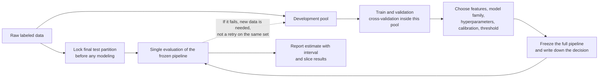

The diagram shows the workflow that the rest of the chapter refines. The test partition is carved out first and physically separated, for example by placing it in a storage location whose access is logged and limited to the evaluation role. All tuning happens inside the development pool, where cross-validation reuses the same examples for training and validation. The pipeline is frozen, including preprocessing, calibration, and threshold, before the test set is touched. The dashed edge is the rule that protects the whole scheme: a failed final evaluation does not authorize another round of tuning against the same test examples. The honest options are to collect fresh test data, to report the failure, or to accept that the test set has become part of the development pool and the final estimate must now come from new data.

### 2.3 How a test set gets consumed

A test set does not wear out through use in the physical sense. It becomes a biased measuring instrument because each query that influences a later decision leaks a small amount of information about its specific examples into the model-building process. Three mechanisms matter.

**Selection among many candidates.** Suppose $m$ candidate models are evaluated on the same $n$ examples and the best is reported. Even if every candidate has the same true accuracy, the maximum of $m$ noisy estimates exceeds the truth. With independent Gaussian noise of standard deviation $\sigma$ per estimate, the expected maximum is bounded by roughly $\sigma\sqrt{2\ln m}$. Take $n=500$ validation examples and $m=40$ equally useless models whose true accuracy is 0.50. The standard deviation of each accuracy estimate is $\sqrt{0.5\times0.5/500}=0.0224$. The bound is $0.0224\times\sqrt{2\ln40}=0.0224\times2.72=0.061$, and the exact expected maximum of 40 standard normals is about $2.16$ standard deviations, which gives $0.0224\times2.16\approx0.048$. The script [`02_cross_validation_and_leakage.py`](../code/python/model-evaluation-chapter/02_cross_validation_and_leakage.py) simulates exactly this and prints a mean best-of-40 validation accuracy of 0.548 against 0.500 on fresh data, so the "winner" looks almost five points better than a coin flip when it is a coin flip. The bias grows with the number of candidates and shrinks with the number of examples.

**Adaptive reuse.** The effect is not limited to a formal grid search. A data scientist who looks at test errors, notices that a certain pattern is mislabeled, adds a feature to fix it, and re-evaluates has used the test set as a training signal. Each individual step is reasonable. The accumulated process has fitted the test set. Dwork and colleagues (2015) formalized this adaptivity problem and proposed the "reusable holdout", a differential-privacy-based mechanism that answers a bounded number of queries with noise, see [Dwork et al., "The reusable holdout"](https://arxiv.org/abs/1411.2664). The practical lesson is simpler: the number and kind of queries made against a test set is a budget, and the budget should be recorded.

**Community-level reuse.** A benchmark that a whole field optimizes against for years is a test set that has been queried millions of times. Recht and colleagues (2019) built new test sets for the CIFAR-10 and ImageNet benchmarks following the original collection procedures and found that accuracy of the same models dropped noticeably (roughly 3 to 15 percentage points on ImageNet depending on the model), see [Recht et al., "Do ImageNet Classifiers Generalize to ImageNet?"](https://arxiv.org/abs/1902.10811). The relative ranking of models mostly held, which suggests that adaptive overfitting was a smaller effect than the shift between old and new data, but the absolute numbers did not transfer. For an enterprise, the equivalent is a "golden set" that every team tunes against for two years. Treat it as a regression suite, not as an estimate of present quality.

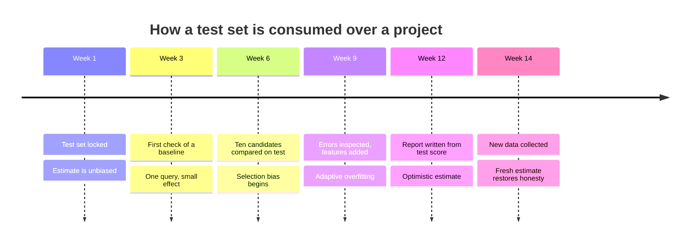

The timeline illustrates that bias accumulates gradually and that no single event announces it. Nothing in the metric output changes at week 6 or week 9. The only defense is process: a test-query log, a policy that the test set is evaluated once per release candidate, and fresh data for the final number whenever a result will drive a consequential decision.

### 2.4 Budgeting test-set use

A practical policy has four parts.

1. **Count queries.** Maintain a log of every evaluation run against the test partition, with the model version, the date, and the person or job that ran it. The log makes adaptivity visible to a reviewer.
2. **Separate the "leaderboard" from the "final exam".** Give the team a development-grade validation partition for iteration and a locked partition for release decisions. If the team needs a third signal for sanity checks, create a small "dev-test" set that is expected to be overfit and is never cited as an estimate.
3. **Refresh by time.** For data that arrives continuously, the freshest period after the freeze date is the best test set because no one has used it. A prospective evaluation on data that did not exist at tuning time cannot have been overfit, which is why time-based final tests are recommended for consequential systems.
4. **Refuse the retry.** If the frozen pipeline fails the release criteria on the test set, the correct response is an incident review of the development process, not another tuning cycle on the same data.

The cost of this discipline is statistical power: examples set aside for the test partition are not available for training. For small datasets (a few thousand labeled examples), resampling methods such as nested cross-validation (Section 3.8) recover efficiency by letting every example serve in every role at different times without ever letting a single decision see its own evaluation data.

### 2.5 Sizing the partitions

There is no universal split ratio. The right allocation follows from three quantities: the number of examples needed for a precise enough estimate, the number needed to train, and the number needed for tuning and calibration.

For the test set, work backwards from the width of the interval you need. If the headline metric is a proportion near $p$ and you need a 95 percent half-width $h$, then $m\approx z^2p(1-p)/h^2$ with $z=1.96$. For $p=0.9$ and $h=0.02$ that is 865 examples. For $p=0.5$ it is 2,401. For a rare-event metric such as recall, the relevant count is the number of positives, not the total. To estimate a recall near 0.8 to within $\pm5$ points you need about 246 positive examples; at 1 percent prevalence that implies roughly 24,600 total examples. Many teams discover at this point that their "test set" of 10,000 transactions contains 100 fraud cases and supports only a very wide recall interval (about $\pm8$ points at recall 0.8).

For the training set, the learning curve (Section 11.3) shows whether more data would help. For the validation set, the same noise arithmetic applies to every decision made with it: if two candidates differ by one point and the validation interval is $\pm1.3$ points, the validation set cannot tell them apart and the selection is partly random.

A frequent default is 60/20/20 or 70/15/15. These are conventions, not rules. A project with 2 million labeled examples and a 1 percent positive rate might use 98 percent for training and development and 2 percent (40,000 examples, 400 positives) for test, because the absolute number of positives in the test set, not the fraction, determines precision. A project with 3,000 examples cannot afford a separate validation partition at all and should use cross-validation within the development pool and a small locked test set.

## 3. Resampling Methods and Cross-Validation

When data are scarce, a single validation split is noisy and wasteful. Cross-validation (CV) reuses data by rotating which part is held out. Every variant is a way of constructing training and evaluation partitions so that the evaluation partition resembles the future deployment case. The right variant depends on the data-generating process, and the wrong variant can produce estimates that are wrong by tens of percentage points, as the worked examples below show.

### 3.1 k-fold cross-validation

In $k$-fold CV, the development data are divided at random into $k$ roughly equal folds. For each fold $i$, the model is trained on the other $k-1$ folds and evaluated on fold $i$. The CV estimate is the mean of the $k$ fold scores:

$$
\hat{R}_{CV} = \frac{1}{k}\sum_{i=1}^{k} \hat{R}_i
$$

where $\hat{R}_i$ is the loss on fold $i$ for the model that did not see fold $i$. Each example is used for evaluation exactly once and for training $k-1$ times.

**Choosing $k$.** The choice trades bias against variance and cost.

- Small $k$ (for example 2 or 3) trains each model on a small fraction of the data. The model is weaker than the final model will be, so the estimate is pessimistically biased, but it is cheap.
- Large $k$ trains on nearly all the data, so bias is small, but the training sets of different folds overlap heavily, so the fold scores are strongly correlated and the average has high variance relative to how many fits you paid for. The limit $k=n$ is leave-one-out CV (LOOCV), which is nearly unbiased but expensive and can have high variance for unstable learners.
- Five or ten folds are the usual compromise. Hastie, Tibshirani, and Friedman discuss the bias-variance behavior of the choice in *The Elements of Statistical Learning*, and the empirical advice of 5 or 10 folds rests on that analysis.

A caution about the standard error: the $k$ fold scores are not independent because the training sets overlap, so the naive standard error $s/\sqrt{k}$ understates the true uncertainty of the CV estimate. Bengio and Grandvalet (2004) showed that no unbiased estimator of the variance of $k$-fold CV exists. Report the fold scores, treat the spread as a rough guide, and use the corrected tests in Section 10 when comparing models.

**Where all the pre-processing goes.** Any step whose parameters are learned from data (imputation values, scaling, target encoding, feature selection, dimension reduction, oversampling) must be fitted inside each training fold and applied to the held-out fold. Fitting it once on the full development pool leaks the held-out fold's information into the training procedure. [CH02](CH02_Data_Preparation_Feature_Engineering_and_Leakage.md) owns the mechanics; the evaluation consequence is that the unit being cross-validated is the whole pipeline, not the final estimator. In scikit-learn this is the purpose of the `Pipeline` object passed to `cross_val_score`.

```text
Fold layout, 5-fold CV (T = train, V = validate):

  Fold 1:  V  T  T  T  T
  Fold 2:  T  V  T  T  T
  Fold 3:  T  T  V  T  T
  Fold 4:  T  T  T  V  T
  Fold 5:  T  T  T  T  V
           each column is one fifth of the development pool
```

### 3.2 Stratified k-fold

When the target is imbalanced, a random fold can contain too few positives or none at all. Suppose a dataset of 1,000 examples has 20 positives and 5-fold CV splits it randomly. The number of positives in a validation fold of 200 follows a hypergeometric distribution with mean 4 and a standard deviation of roughly 1.8, so some folds will have 1 or 2 positives and recall on those folds is meaningless. Stratified $k$-fold fixes this by assigning examples to folds so that each fold preserves the overall class proportions: exactly 4 positives per fold in this case. It removes a source of variance at no cost, so it is the default for classification.

Stratification can be applied to a continuous target by binning it into quantiles and stratifying on the bin, and to multi-label problems with iterative stratification algorithms. It is not a substitute for grouping: stratifying on the label does nothing to keep a customer's rows together.

### 3.3 Repeated k-fold and bootstrap

A single run of $k$-fold CV depends on the random assignment of examples to folds. Repeated $k$-fold runs the whole procedure $r$ times with different shuffles and averages all $r\times k$ scores. It reduces the variance that comes from the partition, though not the variance that comes from the finite sample itself: repeating the procedure cannot create information that the data do not contain. Repetition is valuable when the dataset is small and the estimate is unstable, and when comparing two close candidates, because it lets you use the same fold structure for both.

The bootstrap resamples the development pool with replacement to build training sets, and uses the roughly 36.8 percent of examples left out of each resample (the out-of-bag examples) for evaluation. The fraction follows from $(1-1/n)^n\to e^{-1}\approx0.368$. Out-of-bag evaluation is pessimistic because each bootstrap training set contains only about 63.2 percent distinct examples. The ".632 estimator" (Efron 1983) and ".632+" (Efron and Tibshirani 1997) blend the out-of-bag error with the optimistic resubstitution error to correct this. In modern practice, plain repeated stratified $k$-fold is more common for model selection and the bootstrap is used mainly for uncertainty intervals (Section 10.2).

### 3.4 Group k-fold: when examples are not independent

Standard CV assumes that examples are independent draws from the population. If several rows belong to the same customer, device, patient, store, document, or session, rows from one group are similar to each other for reasons that have nothing to do with the prediction task. A model that sees some of a group's rows during training can recognize the group and use that recognition to score its other rows. If production traffic consists of new groups, the evaluation measured the wrong thing.

The worked example in [`02_cross_validation_and_leakage.py`](../code/python/model-evaluation-chapter/02_cross_validation_and_leakage.py) makes the effect visible. There are 200 customers with 10 rows each. Every customer has a stable numeric fingerprint (a feature value that stays within $\pm0.02$ of the customer's own offset), and the label is a coin flip made once per customer. By construction, nothing in the feature predicts the label of a new customer. A one-nearest-neighbour classifier evaluated by random 5-fold CV reaches an accuracy of 0.794, because for most validation rows the nearest training row belongs to the same customer and carries the same label. When the folds are formed by customer (group $k$-fold), accuracy falls to 0.568, close to the 0.50 that a model with no real signal should get. Random folding overstated the accuracy by about 23 points and would have led a team to ship a model that has no skill on new customers.

Group $k$-fold assigns whole groups to folds. Two refinements matter.

- **Stratified group $k$-fold** tries to preserve class proportions while keeping groups intact. Exact balance is not always possible when groups differ in size and label mix, so check the achieved proportions.
- **The grouping unit must match the deployment unit.** If the product scores new customers, group by customer. If it scores new transactions for known customers, grouping by customer would be pessimistic and random or time-based splits are more faithful. If the data contain two overlapping hierarchies (patients and hospitals), choose the one along which the model will be asked to generalize, and say so in the report. Leave-one-group-out CV, in which each group is a fold, is the natural form when groups are few and large, such as hospitals or countries.

Group leakage is easy to miss because the leakage key is often not a column. Near-duplicate documents, the same product listed by many sellers, frames from the same video, and images derived from the same original by augmentation all form implicit groups. Deduplicate or cluster by similarity before splitting, and treat a suspiciously high validation score as a prompt to look for such links.

### 3.5 Leakage traps beyond grouping

Several other leakage paths appear specifically at the evaluation stage, even when the feature pipeline looks clean.

| Trap | Mechanism | Symptom | Prevention |
|---|---|---|---|
| Preprocessing fitted on all data | Scaler, imputer, encoder, or selector learned from validation rows | Optimistic CV, gap on fresh data | Fit inside each fold; wrap in a pipeline |
| Feature selection before CV | Choosing the 20 best of 5,000 features using all labels | Strongly optimistic estimate with many features and few rows | Perform selection inside the CV loop |
| Tuning on the evaluation fold | Hyperparameters chosen by the same folds that produce the reported score | Optimistic by the selection bias of Section 2.3 | Nested CV (Section 3.8) |
| Target leakage | A feature that encodes the label or is recorded after the outcome | Near-perfect scores; feature importance dominated by one column | Define each feature's availability time at prediction time |
| Oversampling before splitting | Synthetic or duplicated minority rows end up in both train and validation | Inflated minority recall | Oversample only the training fold |
| Duplicates across splits | Identical or near-identical rows in train and test | Optimistic scores on memorizing models | Deduplicate before splitting |
| Time travel | Future rows in training when predicting the past | Optimistic on temporal data | Time-ordered splits |
| Label leakage via aggregates | Group-level statistics (for example, mean target by customer) computed with the validation labels | High scores that disappear in production | Compute target aggregates strictly from training data |

The common thread is the question of Section 2.1: which data influenced the choices that produced this model? Whenever the answer includes the evaluation fold, the number is biased.

### 3.6 Time-series cross-validation (rolling origin)

When observations are ordered in time and the model will predict the future, random folds put future observations in the training set for a past validation point. That is both unrealistic, because the future would not be available in production, and leaky, because autocorrelation, seasonality, and regime changes mean that nearby times resemble each other. The evaluation should mimic the deployment: train on the past, predict the future.

Rolling-origin (also called forward-chaining or walk-forward) evaluation uses a sequence of cutoffs. At each origin $t$, train on data up to $t$ (an expanding window) or on the most recent $w$ periods (a sliding window), then evaluate on the next $h$ periods (the horizon). Hyndman and Athanasopoulos describe this as "time series cross-validation" in *Forecasting: Principles and Practice*. For twelve months of data with a six-month initial window and a two-month horizon, the script prints these splits:

```text
train months 1-6   test months 7-8
train months 1-8   test months 9-10
train months 1-10  test months 11-12
```

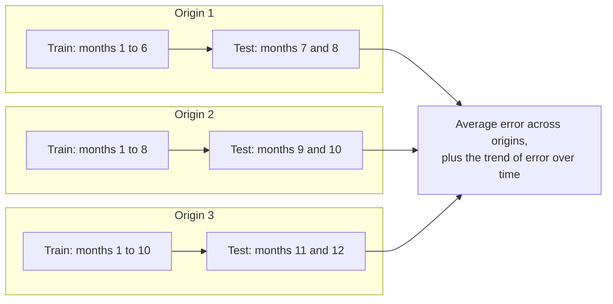

The diagram shows three origins with an expanding training window. Averaging across origins gives a more stable estimate than a single cutoff, and the trend of error across origins is itself informative: errors that grow at later origins suggest a drifting relationship that a static model will not track. The design choices are the following.

- **Expanding versus sliding window.** An expanding window uses all history and suits stable relationships. A sliding window drops old data and suits relationships that drift, at the cost of fewer training examples. Compare both when drift is plausible.
- **Gap (embargo).** If features are computed from a trailing window or the label takes time to realize, a model trained up to time $t$ may have been trained on labels that are not yet knowable at $t$, or on features that overlap the test period. Insert a gap between the end of training and the start of testing at least as long as the label delay or the feature window. Lopez de Prado calls the practice of purging overlapping samples and adding an embargo "purged cross-validation" for financial applications.
- **Horizon matching.** Evaluate at the horizon that the product uses. A model that forecasts one day ahead well may be poor at seven days, and averaging the two hides it.
- **Seasonality.** With yearly seasonality, a test period that does not span a full cycle can miss the hardest or easiest season. Make sure at least one origin tests each season that matters, or report the seasonal breakdown.
- **Panel data.** For many series (stores by day), combine time and group: split by time, and decide separately whether new series (cold-start stores) are in scope, in which case also hold out groups.

Random shuffling is acceptable for time-ordered data only when there is strong evidence that the process is stationary and the rows are exchangeable, which for production business data is rare. In scikit-learn, `TimeSeriesSplit` implements expanding-window splits with optional `gap` and `test_size` parameters (see the [scikit-learn cross-validation guide](https://scikit-learn.org/stable/modules/cross_validation.html)); verify the current signature in the installed version.

### 3.7 Choosing a split strategy

The choice follows from three questions about the deployment: Will the model score new groups, or known ones? Will it predict the future, or the present? Is the data small enough that a single split is too noisy?

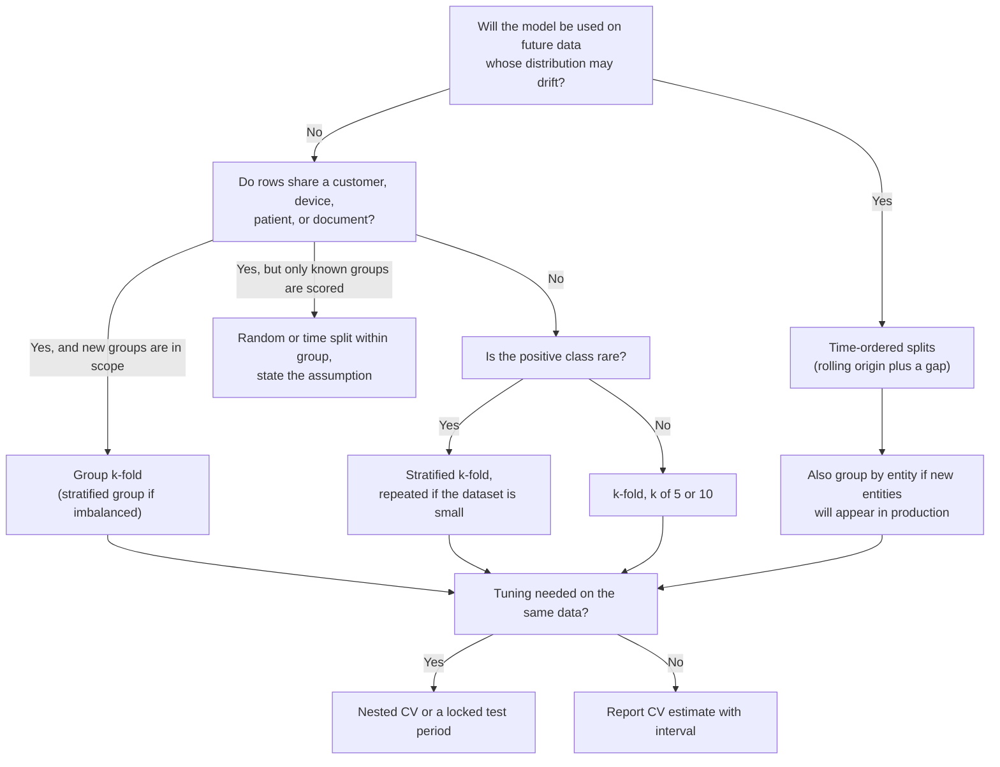

The decision tree puts the most dangerous mismatch first. Time and groups dominate the choice because errors there are large (the 23-point inflation above), whereas stratification and the choice of $k$ change estimates by small amounts. The final branch connects to the tuning problem: any time the data that select a model also produce the number reported for it, the estimate needs nesting or a locked period.

### 3.8 Nested cross-validation

Plain CV answers "how well does this fixed configuration generalize?" Model selection asks a different question: "how well does the *procedure* of trying many configurations and keeping the best one generalize?" If the same folds are used to pick a hyperparameter setting and to report the score of the winner, the reported score is subject to the selection bias of Section 2.3. Varma and Simon (2006) demonstrated this bias empirically on small-sample problems, and Cawley and Talbot (2010) discussed it as a source of over-fitting in model selection.

Nested CV separates the two jobs with two loops.

- The **outer loop** splits the development data into $K_{out}$ folds. For each outer fold, it holds out the fold as an evaluation set.
- The **inner loop** runs on the outer training portion only. It splits that portion into $K_{in}$ folds, evaluates each candidate configuration, and picks the best.
- The chosen configuration is refitted on the full outer training portion and scored on the held-out outer fold. The outer scores are averaged.

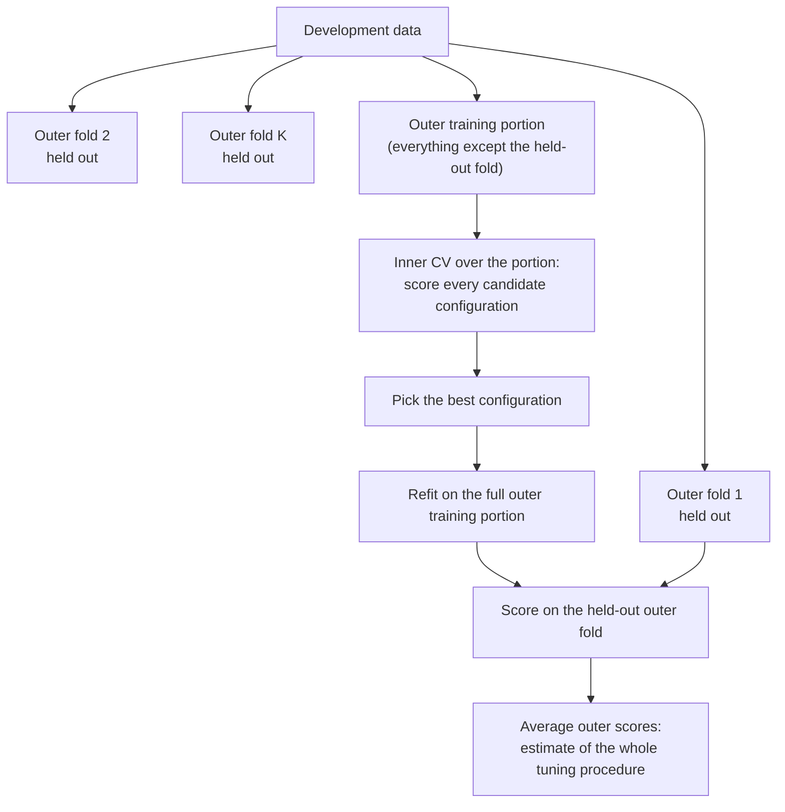

The nested estimate evaluates the procedure. Its outer score is not the score of any single model, because different outer folds may select different hyperparameters. That is a feature, not a flaw: it tells you what to expect from running the full procedure on the entire development pool and deploying the result. To obtain the model to deploy, run the inner selection once on all development data and refit.

The cost is multiplicative. With a 5-fold outer loop, a 5-fold inner loop, and 40 configurations, the number of model fits is $5\times(5\times40+1)=1{,}005$, against 200 for a single non-nested search with 5 folds. For deep models or large data this is often unaffordable, in which case the practical substitute is a temporal or otherwise locked final test period, which provides the same protection against selection bias at the cost of one extra partition.

The size of the effect depends on dataset size, number of configurations, and signal strength. With thousands of examples, a handful of configurations, and a strong signal, nested and plain CV give nearly the same number, and the extra computation is not worth it. With a few hundred examples, dozens of configurations, and weak signal, the difference can be several points. Use nested CV when data are small and the search is large, and when the reported number will be used to make an irreversible decision.

### 3.9 Cost of resampling and a note on reproducibility

Every fold is a separate training run, so a 10-fold repeated three times is 30 fits per candidate. When training is expensive, there are three standard economies: evaluate on a subsample of the data for early elimination of poor candidates (successive halving), use fewer folds for coarse screening and more for the finalists, and reuse the same fold assignment across candidates so that comparisons are paired. Fix random seeds for the fold assignment and record them with the results. The learner's own randomness (initialization, bagging, dropout) is a second source of variance. When the differences you care about are small, repeat training with several seeds per fold and treat the seed-to-seed spread as part of the noise. Bouthillier and colleagues (2021) showed that ignoring such sources of variance in benchmark comparisons leads to unreliable conclusions.

## 4. The Confusion Matrix and Its Derived Metrics

Most classification metrics are functions of four counts. Choosing a metric is choosing which function of those counts the decision cares about, so the counts come first.

### 4.1 The four counts

For a binary classifier that outputs a hard label after a threshold, every evaluated example falls into one of four cells.

```text
                       Actual positive    Actual negative
Predicted positive         TP                 FP
Predicted negative         FN                 TN
```

TP (true positives) are positives correctly flagged. FP (false positives) are negatives incorrectly flagged, also called false alarms or Type I errors. FN (false negatives) are positives missed, also called misses or Type II errors. TN (true negatives) are negatives correctly passed. Let $P=TP+FN$ be the number of actual positives, $N=FP+TN$ the number of actual negatives, and $n=P+N$. The prevalence (base rate) is $\pi=P/n$.

The matrix has two natural normalizations. Dividing by the **column** (actual class) gives rates that describe the classifier's behavior on each kind of case and do not depend on how common each kind is: the true positive rate (TPR, also called recall or sensitivity) $TP/P$, the false negative rate $FN/P=1-TPR$, the true negative rate (TNR, specificity) $TN/N$, and the false positive rate (FPR) $FP/N=1-TNR$. Dividing by the **row** (predicted class) gives quantities that describe what a flagged or unflagged case means and do depend on prevalence: the positive predictive value (PPV, precision) $TP/(TP+FP)$, the negative predictive value (NPV) $TN/(TN+FN)$, and the false discovery rate $FP/(TP+FP)=1-PPV$.

This split is the most useful single idea in the topic. Column rates characterize the classifier. Row rates characterize the classifier in a particular population. A report that states precision without prevalence has told the reader nothing portable.

### 4.2 Worked example: the fraud queue

Take the fraud scenario used throughout: 10,000 transactions, 100 of them fraud ($\pi=1\%$). A model flags 990 transactions. Of those, 90 are fraud, so $TP=90$, $FP=900$, $FN=10$, and $TN=10{,}000-990-10=9{,}000$. Running the code in [`01_metrics_and_base_rates.py`](../code/python/model-evaluation-chapter/01_metrics_and_base_rates.py) gives the following values, which can be checked by hand.

| Metric | Formula | Arithmetic | Value |
|---|---|---|---|
| Accuracy | $(TP+TN)/n$ | $(90+9000)/10000$ | 0.909 |
| Recall (TPR) | $TP/P$ | $90/100$ | 0.900 |
| Specificity (TNR) | $TN/N$ | $9000/9900$ | 0.909 |
| Precision (PPV) | $TP/(TP+FP)$ | $90/990$ | 0.091 |
| NPV | $TN/(TN+FN)$ | $9000/9010$ | 0.999 |
| Balanced accuracy | $(TPR+TNR)/2$ | $(0.900+0.909)/2$ | 0.905 |
| $F_1$ | $2TP/(2TP+FP+FN)$ | $180/1090$ | 0.165 |
| $F_2$ | $5TP/(5TP+4FN+FP)$ | $450/1390$ | 0.324 |
| MCC | see below | $801{,}000/2{,}971{,}700$ | 0.270 |

Accuracy of 0.909 and recall of 0.900 look healthy, while 91 percent of the flagged transactions are legitimate. A trivial model that flags nothing has accuracy $9900/10000=0.99$, higher than this model's, and recall of zero. Accuracy is a poor guide whenever one class dominates, because it counts the abundant class's correct answers as heavily as the scarce class's.

### 4.3 Precision, recall, and the F-scores

Precision answers "of what I flagged, how much was real?" Recall answers "of what was real, how much did I flag?" They pull in opposite directions as the threshold moves: lowering the threshold flags more cases, which raises recall and usually lowers precision. The $F_\beta$ score combines them into a single number using a weighted harmonic mean:

$$
F_\beta = \frac{(1+\beta^2)\,P\,R}{\beta^2 P + R} = \frac{(1+\beta^2)\,TP}{(1+\beta^2)\,TP + \beta^2\,FN + FP}
$$

where $P$ is precision, $R$ is recall, and $\beta$ states how many times more important recall is than precision. The second form follows by substituting $P=TP/(TP+FP)$ and $R=TP/(TP+FN)$ and simplifying; it is the form to use in code because it avoids a division by zero when no positives are predicted. For $\beta=1$ the weights are equal and $F_1=2TP/(2TP+FP+FN)$. For the fraud queue, $F_1=180/(180+10+900)=0.165$ and $F_2=450/(450+40+900)=0.324$, and the larger $\beta$ rewards the model for its 90 percent recall.

Why a harmonic mean rather than an arithmetic mean? The harmonic mean is dominated by the smaller of its inputs. A model with precision 0.01 and recall 1.0 (flag everything) has an arithmetic mean of 0.505, which looks acceptable, and an $F_1$ of $2\times0.01\times1/(1.01)=0.0198$, which correctly signals uselessness.

Three properties of $F_\beta$ limit its use.

1. **It ignores true negatives.** TN does not appear in the formula. Two classifiers with the same TP, FP, and FN but different TN get the same $F_1$. That is acceptable when negatives are an uninteresting infinite background, as in retrieval, and a problem when correctly clearing negatives has value.
2. **It depends on which class is called positive.** Swapping the labels changes $F_1$. For a symmetric problem such as sentiment polarity, the choice is arbitrary; report both or use a symmetric metric.
3. **It hides the trade-off.** One value cannot say whether the model achieved it through high precision or high recall, and the two have different operational costs. Always report the underlying counts next to any $F$ score.

### 4.4 Specificity, balanced accuracy, informedness, and Cohen's kappa

Specificity $TN/N$ matters when false alarms have a cost, which is nearly always. Balanced accuracy, $(TPR+TNR)/2$, averages the per-class recalls so each class counts equally regardless of its size. For the fraud queue it is 0.905, close to the accuracy of 0.909 here, but unlike accuracy it cannot be inflated by the majority class. A model that always predicts the majority class has balanced accuracy of exactly 0.5, the same as random guessing, which is a useful property: 0.5 always means "no skill".

Youden's $J$ statistic, or informedness, is $TPR+TNR-1$. It equals balanced accuracy rescaled so that 0 means no skill and 1 means perfect: $J=2\times\text{balanced accuracy}-1$. For the fraud queue, $J=0.900+0.909-1=0.809$. Its geometric meaning is the vertical distance from the ROC curve to the diagonal, which is why the threshold that maximizes $J$ is a common (though cost-blind) choice on a ROC curve.

Cohen's kappa measures agreement beyond chance. With observed agreement $p_o$ (accuracy) and chance agreement $p_e=\sum_c p_{pred,c}\,p_{act,c}$, kappa is $(p_o-p_e)/(1-p_e)$. For the fraud queue, $p_{pred,pos}=990/10000=0.099$ and $p_{act,pos}=0.01$, so $p_e=0.099\times0.01+0.901\times0.99=0.8930$ and $\kappa=(0.909-0.8930)/(1-0.8930)=0.150$. Kappa is low because most of the apparent accuracy is what chance would produce given the skewed classes. It also depends on prevalence and on the marginal distribution of the predictions, so it is not a stable property of the classifier.

### 4.5 Matthews correlation coefficient

The Matthews correlation coefficient (MCC) is the Pearson correlation between the predicted and actual binary labels:

$$
\text{MCC} = \frac{TP\cdot TN - FP\cdot FN}{\sqrt{(TP+FP)(TP+FN)(TN+FP)(TN+FN)}}
$$

where all four cell counts appear. It ranges from $-1$ to $+1$; 0 means the predictions are uncorrelated with the truth. It is high only if the classifier does well on all four cells, which is what makes it more informative than $F_1$ when classes are imbalanced. Chicco and Jurman (2020) argue this case in detail for binary classification, though the conclusion is not universal: MCC is a single summary of a particular symmetric kind of agreement and shares the limitation that it hides the cost asymmetry.

For the fraud queue the numerator is $90\times9000-900\times10=801{,}000$. The denominator is $\sqrt{990\times100\times9900\times9010}=\sqrt{8.83\times10^{12}}\approx2.97\times10^6$, so MCC $=0.270$. A useful identity is that $\text{MCC}^2=J\times M$ where $J=TPR+TNR-1$ is informedness and $M=PPV+NPV-1$ is markedness. Here $M=0.091+0.999-1=0.090$ and $\sqrt{0.809\times0.090}=0.270$. The identity shows what MCC penalizes: the model is informative about the label (high $J$) but its alarms are not trustworthy (low $M$), and MCC lands between.

When a classifier predicts only one class, the denominator is zero and the coefficient is conventionally set to 0. This is another way MCC handles the degenerate "flag everything" model that fools precision-oriented summaries: precision 0.01, recall 1.0, accuracy 0.01, and MCC 0.

### 4.6 Base-rate effects, worked numerically

Recall and specificity are properties of the classifier. Precision is a property of the classifier and the population. By Bayes' theorem:

$$
\text{PPV} = \frac{\pi\cdot TPR}{\pi\cdot TPR + (1-\pi)\cdot FPR}
$$

where $\pi$ is the prevalence. The next table fixes a classifier with TPR 0.90 and FPR 0.05 (so TNR 0.95) and varies prevalence, using 100,000 cases at each prevalence. These are the values printed by the script.

| Prevalence | Positives | TP | FP | Precision | MCC | Balanced accuracy | Accuracy |
|---|---|---|---|---|---|---|---|
| 50% | 50,000 | 45,000 | 2,500 | 0.947 | 0.851 | 0.925 | 0.925 |
| 10% | 10,000 | 9,000 | 4,500 | 0.667 | 0.746 | 0.925 | 0.945 |
| 1% | 1,000 | 900 | 4,950 | 0.154 | 0.360 | 0.925 | 0.950 |
| 0.1% | 100 | 90 | 4,995 | 0.018 | 0.122 | 0.925 | 0.950 |

Balanced accuracy is constant at 0.925 because it is built from column rates. Accuracy barely moves and creeps up as the positive class shrinks, which is the opposite of the experience of the people reviewing the alerts. Precision falls from 0.947 to 0.018, so at 0.1 percent prevalence 98 of every 100 alerts are false. The false positive count is nearly constant (about 5,000) because it is dominated by the 5 percent of the large negative class that triggers an alarm, and that count is what sizes the review team.

Two practical consequences follow.

- **A model validated on a balanced benchmark cannot be handed to a population with a different prevalence and keep its precision.** If the evaluation set was built by down-sampling negatives to make the classes balanced (common in data preparation), the evaluation estimates TPR and FPR correctly but produces a precision that is wrong for production. Either evaluate on a sample that preserves production prevalence, or reweight the counts: multiply the FP and TN counts by the down-sampling factor before computing row-based metrics.
- **Prevalence shifts move precision even when the model is unchanged.** If fraud triples from 1 percent to 3 percent with TPR 0.90 and FPR 0.05 unchanged, precision rises from $0.009/(0.009+0.0495)=0.154$ to $0.027/(0.027+0.0485)=0.358$. A drop in precision after a campaign that reduces fraud is the same effect in reverse and does not by itself mean the model degraded. Monitoring should track TPR and FPR where labels are available, or the prevalence of positive predictions and the alert yield, rather than precision alone.

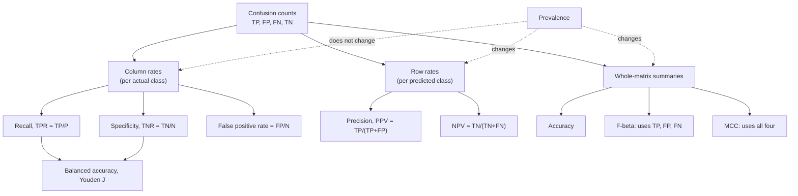

The diagram shows where prevalence enters. It reaches every metric in the row-rate and whole-matrix branches and leaves the column-rate branch untouched. When reviewing an evaluation, trace each reported number back to its branch before accepting it as a property of the model.

### 4.7 Multiclass and multilabel averaging

With more than two classes, per-class precision, recall, and $F_1$ are computed one-versus-rest and then averaged. The averaging method is a decision, not a detail.

- **Micro averaging** pools the counts across classes before computing the metric. For single-label multiclass problems, micro-averaged precision, recall, and $F_1$ all equal accuracy, and large classes dominate.
- **Macro averaging** computes the metric for each class and takes the unweighted mean, so every class counts equally regardless of size. It exposes poor performance on rare classes.
- **Weighted averaging** weights each class by its support. It resembles micro averaging and can hide the same problem.

Take three classes with 900, 90, and 10 examples and recalls of 0.95, 0.70, and 0.30. The correct counts are $855$, $63$, and $3$, a total of 921 out of 1,000, so micro recall (accuracy) is 0.921 and the support-weighted recall is also 0.921. The macro recall is $(0.95+0.70+0.30)/3=0.650$. If the rare class corresponds to the cases that matter most, the macro figure is the honest one and the 0.921 conceals that the model finds only 3 of 10 critical cases. The confusion matrix itself, kept as an $K\times K$ table, shows which classes are confused with which and often suggests a hierarchy or a label merge that a single scalar cannot.

Multilabel problems, where each example can carry several labels, use per-label binary metrics with the same averaging choices, plus example-based measures such as the Jaccard index between predicted and actual label sets, and exact-match ratio, which is strict and usually very low.

### 4.8 Choosing the primary metric

The primary metric should be a monotone function of the decision's value, which requires first writing down the decision.

- If a false negative costs much more than a false positive (cancer screening, fraud on large transactions, safety systems), recall at an acceptable false positive volume is the right frame: report recall at a fixed review capacity or at a fixed FPR, not an unconstrained $F_1$.
- If a false positive carries the larger cost (an automatic account closure, an automated legal notice), report precision at a minimum recall.
- If classes are balanced and errors cost the same, accuracy is acceptable, and so are log loss and the area under the ROC curve (AUC, Section 5.2).
- If the problem is a ranking one (a finite set of alerts to review, a top-$k$ recommendation), use a ranking metric (Section 9.1) rather than a thresholded one.
- If an operating constraint exists (analysts can review 300 items per day), report precision@300 and recall@300, not a global metric.

Whatever is chosen, record the counts, the prevalence of the evaluation set, and the threshold, because those are required to translate the result into the production population.

## 5. ROC Curves, PR Curves, and the Area Under Them

A classifier that produces a score has a different confusion matrix at every threshold. Curves summarize that family.

### 5.1 Constructing the curves

Sort the evaluation examples by score from highest to lowest. Start with a threshold above the highest score, so nothing is flagged and the point is $(FPR,TPR)=(0,0)$. Lower the threshold past one example at a time (past a block of tied scores together), updating TP or FP according to the example's true label. Each position yields a confusion matrix. The ROC curve plots TPR against FPR. The precision-recall curve plots precision against recall (which is TPR). Both curves are monotone in recall, since recall can only rise as the threshold falls, but precision need not be monotone: a newly flagged negative lowers it and a newly flagged positive raises it, so the PR curve has a saw-tooth shape.

```text
A tiny example: positives 0.9, 0.6, 0.4; negatives 0.7, 0.3, 0.2, 0.1

threshold  flagged             TP FP   TPR    FPR    precision
  >0.9     none                 0  0   0.00   0.00     -
  0.9      0.9                  1  0   0.33   0.00    1.00
  0.7      0.9, 0.7             1  1   0.33   0.25    0.50
  0.6      0.9, 0.7, 0.6        2  1   0.67   0.25    0.67
  0.4      ... plus 0.4         3  1   1.00   0.25    0.75
  0.1      everything           3  4   1.00   1.00    0.43
```

The ROC points as the threshold falls through all seven scores are $(0,0)$, $(0,0.33)$, $(0.25,0.33)$, $(0.25,0.67)$, $(0.25,1.0)$, $(0.5,1.0)$, $(0.75,1.0)$, and $(1.0,1.0)$. The area under this staircase is $0.25\times0.333+0.75\times1.0=0.833$, which agrees with the rank interpretation in the next section.

### 5.2 The meaning of AUC

The area under the ROC curve (ROC-AUC, or AUROC) has a probabilistic meaning: it is the probability that a randomly chosen positive example receives a higher score than a randomly chosen negative example (ties count one half). This equals the normalized Mann-Whitney $U$ statistic. For the tiny example there are $3\times4=12$ positive-negative pairs. The positive scoring 0.9 beats all four negatives; the positive at 0.6 beats 0.3, 0.2, and 0.1 (three); the positive at 0.4 beats 0.3, 0.2, and 0.1 (three). That is $4+3+3=10$ wins out of 12 pairs, so $\text{AUC}=10/12=0.833$.

This interpretation clarifies what AUC does and does not tell you.

- It measures **ranking**, so it is invariant to any monotone transformation of the scores. Squaring or log-scaling the scores changes nothing, which also means AUC says nothing about calibration. A model with perfect ranking and useless probabilities has AUC 1.0.
- It is **threshold-free**, which is convenient for comparison and a drawback for decisions, because it averages over thresholds that will never be used. A model can improve AUC through the low-recall region and not improve the part of the curve where the product operates. Restricting to a region (partial AUC, or recall at a fixed FPR) addresses this.
- It is **independent of prevalence**, because TPR and FPR are column rates. This is a virtue for comparing models across populations and a vice when you need to know the user-visible alert quality.
- Under the equal-variance binormal model, in which scores are normal with unit variance and the positive mean is $d$ above the negative mean, $\text{AUC}=\Phi(d/\sqrt{2})$, where $\Phi$ is the standard normal cumulative distribution function. For $d=2$, $\Phi(1.414)=0.921$. The script's simulation gives 0.922.

An AUC of 0.5 means no ranking skill, and values below 0.5 mean the ranking is inverted (flip the sign of the score). Rules of thumb that label 0.7 "acceptable" or 0.9 "excellent" are domain-blind. An AUC of 0.75 is outstanding in some clinical risk problems and unacceptable in others where cheap features already give 0.9.

### 5.3 Where ROC misleads

The same classifier, scored on a population with 50 percent positives and one with 1 percent positives, has an identical ROC curve and the same AUC of 0.922 in the simulation. Its precision-recall behavior is very different. The script reports average precision (AP, the area under the PR curve computed as a step-wise sum) of 0.922 at 50 percent prevalence and 0.266 at 1 percent, where the no-skill baseline for AP is the prevalence itself (0.50 and 0.01). Both results are legitimate. They answer different questions: AUC says the model ranks well, and AP at 1 percent says that at the recall levels you would want, many of the flagged cases are false.

The mechanism is the FPR denominator. FPR divides false positives by the number of negatives, which is huge when positives are rare. A model that flags 5 percent of 99,000 legitimate transactions produces 4,950 false alarms, yet its ROC curve registers only 0.05 on the FPR axis, a small move. The corresponding movement in precision is large. ROC curves therefore look excellent for any classifier with a low FPR even when the absolute number of false positives is operationally unaffordable.

Saito and Rehmsmeier (2015) argued that the PR curve is the more informative of the two for imbalanced data and demonstrated this on binary classifiers, see [Saito and Rehmsmeier, PLOS ONE 2015](https://doi.org/10.1371/journal.pone.0118432). A later critique argues that the area under the PR curve is not inherently superior, because it weights improvements at high-score regions more than improvements elsewhere and prevalence changes its value without changing the model, so the choice should follow the decision, not a slogan (McDermott and colleagues, 2024). Reading both curves, along with the confusion counts at the intended operating point, is more informative than choosing one.

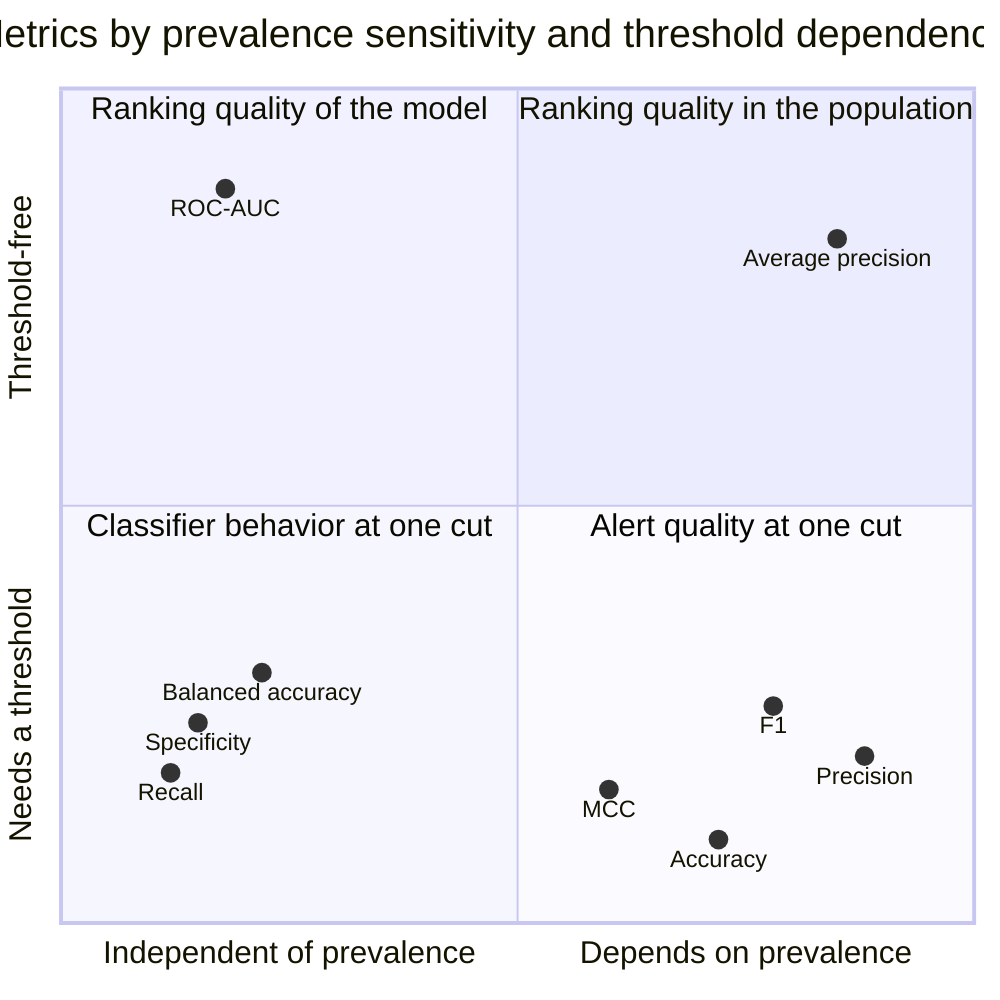

The quadrant chart is a map for selecting a metric. Recall, specificity, and balanced accuracy describe a model at one threshold without regard to prevalence. Precision, $F_1$, accuracy, and MCC describe that threshold in the evaluated population. ROC-AUC is the prevalence-free ranking summary, and average precision is the prevalence-aware one. A review should ask for one metric from the quadrant that matches the decision and the counts to reconstruct the rest.

### 5.4 Practical points on curves

- **Interpolation.** Linear interpolation between points is correct on a ROC curve, because a randomized mixture of two classifiers achieves any point on the segment joining them. It is not correct on a PR curve, where the segment is not achievable; Davis and Goadrich (2006) explain why PR-space interpolation must be done in confusion-matrix space. This is the reason for the step-wise definition of AP that scikit-learn's `average_precision_score` uses instead of a trapezoidal area, and it is why the trapezoid result and AP can differ.
- **Ties.** Many tied scores (common with decision trees, small ensembles, and rounded scores) must be processed as a block; processing them in an arbitrary order draws the curve optimistically or pessimistically.
- **Confidence bands.** A single curve from a finite sample is noisy, especially in the high-threshold region where it rests on few positives. Bootstrap the curve (resampling groups when appropriate) and show a band.
- **Convex hull.** If a ROC curve has concave regions, a better operating point may be achieved by randomizing between two thresholds; the ROC convex hull gives the achievable frontier for cost-based selection.
- **Multiclass.** One-versus-rest or one-versus-one curves with macro averaging extend ROC-AUC. The result depends on the averaging and on class imbalance, so report which was used.
- **Comparing curves.** Curves that cross mean neither model dominates. The better model depends on the operating region, and the correct comparison is at the threshold or recall the product will use, ideally with an interval on the difference (Section 10).

## 6. Regression Metrics

Regression metrics are summaries of the residuals $e_i=y_i-\hat{y}_i$, where $y_i$ is the true value, $\hat{y}_i$ is the prediction, and $n$ is the number of evaluated examples. The loss function determines which property of the conditional distribution the model is estimating, and the evaluation metric should agree with the decision cost, not with whichever loss was convenient for training.

### 6.1 Absolute and squared error

The mean absolute error (MAE) is $\frac{1}{n}\sum|e_i|$. The mean squared error (MSE) is $\frac{1}{n}\sum e_i^2$, and the root mean squared error (RMSE) is $\sqrt{\text{MSE}}$, which puts the error back in the units of the target. The two differ in how they treat large errors. MSE squares each residual, so one error of 10 counts as much as 100 errors of 1.

Take five residuals $(1,1,1,1,10)$. The MAE is $14/5=2.8$. The MSE is $(4+100)/5=20.8$ and the RMSE is $\sqrt{20.8}=4.56$. The single large error moves RMSE far more than MAE (an RMSE/MAE ratio of 1.63 here; the ratio is 1 when all absolute errors are equal and grows with heavy tails). This ratio is a quick diagnostic of the residual distribution.

The loss also decides what the optimal prediction is. Minimizing expected squared error yields the conditional mean. Minimizing expected absolute error yields the conditional median. For a right-skewed target such as order value or claim size, the mean is larger than the median, so a model tuned for RMSE and one tuned for MAE give systematically different predictions, and each looks bad under the other's metric. Choose the metric by asking what the decision needs. Budgeting and totals need the mean, because sums of means are means of sums. A typical-case estimate, such as "how long will this particular delivery take", is often better served by the median. If outliers are noise, an RMSE-based comparison will be dominated by them, and a Huber loss (quadratic for small errors, linear beyond a threshold $\delta$) or MAE gives a more stable comparison.

### 6.2 Percentage errors and why MAPE misleads

The mean absolute percentage error (MAPE), $\frac{100}{n}\sum|e_i/y_i|$, is popular because it is scale-free and easy for stakeholders to read. It has four defects that make it unsuitable as a sole metric.

1. **Undefined or explosive near zero.** If any true value is 0 the metric is undefined, and values near zero produce enormous percentages that dominate the average.
2. **Asymmetric.** Over-forecasts and under-forecasts of the same absolute size receive different penalties. If the actual is 100 and the forecast is 150, the error is 50 percent. If the actual is 150 and the forecast is 100, it is 33.3 percent. Under-forecasting is capped at 100 percent error while over-forecasting is unbounded.
3. **Biases the optimum low.** Because errors are divided by the actual value, low-valued actuals carry more weight. Suppose demand is equally likely to be 50 or 150. The mean is 100. The expected MAPE of a forecast $f$ between 50 and 150 is $0.5\cdot\frac{f-50}{50}+0.5\cdot\frac{150-f}{150}=\frac{f}{150}$, which is smallest at $f=50$ (a MAPE of 33.3 percent) and equals 66.7 percent at the mean $f=100$. A model trained or selected to minimize MAPE learns to forecast low, which in inventory terms means stockouts.
4. **Averages unequal stakes.** A 20 percent error on a $10 item counts the same as a 20 percent error on a $10,000 item.

Alternatives that address some of these defects:

| Metric | Definition | Addresses | Remaining limitation |
|---|---|---|---|
| Weighted absolute percentage error (WAPE) | $\sum\lvert e_i\rvert/\sum\lvert y_i\rvert$ | Zero and near-zero actuals; weights by volume | Large items dominate |
| Symmetric MAPE (sMAPE) | mean of $2\lvert e_i\rvert/(\lvert y_i\rvert+\lvert\hat{y}_i\rvert)$ | Boundedness | Still asymmetric in a different way; poorly behaved at zero |
| Mean absolute scaled error (MASE), Hyndman and Koehler (2006) | MAE divided by the in-sample MAE of a naive forecast | Scale-free; comparable across series; a value above 1 is worse than the naive method | Needs a naive reference and a training history |
| Root mean squared log error (RMSLE) | RMSE of $\log(1+y)$ and $\log(1+\hat{y})$ | Relative error on skewed targets | Penalizes under-prediction more than over-prediction |
| Quantile (pinball) loss | See Section 6.4 | Asymmetric cost | Needs a target quantile |

MASE is a good default for forecasting across many series because it is interpretable (relative to a seasonal-naive baseline) and does not blow up near zero.

### 6.3 R-squared and its limits

The coefficient of determination is

$$
R^2 = 1 - \frac{\sum_i (y_i-\hat{y}_i)^2}{\sum_i (y_i-\bar{y})^2}
$$

where $\bar{y}$ is the mean of the true values being evaluated. It compares the model's squared error with that of a constant predictor equal to the mean. It is 1 for a perfect fit and 0 for a model no better than predicting the mean. On training data fitted by least squares with an intercept it cannot be negative. On held-out data it can, because the model's predictions can be worse than the mean.

A concrete case: the model was trained on data with a mean of 5 and predicts a constant 5. The held-out targets are $6,8,10$, with mean 8. The residual sum of squares is $1+9+25=35$. The total sum of squares around the held-out mean is $4+0+4=8$. Then $R^2=1-35/8=-3.375$. The model is much worse than predicting the held-out mean, which the model does not know. The negative value is also a warning about shift: the held-out distribution differs from the training one.

The limits of $R^2$ to remember:

- **It depends on the variance of the target in the evaluation set.** The same absolute errors give a high $R^2$ on a wide-ranging sample and a low one on a narrow one. $R^2$ values from different datasets, cohorts, or time windows are not comparable.
- **It is not a bias detector.** A model with a systematic offset can still have a high $R^2$ if the predictions track the truth's shape. Check the calibration of the predictions by regressing the truth on the prediction: the slope should be near 1 and the intercept near 0.
- **A high $R^2$ does not imply useful error size.** An $R^2$ of 0.95 on house prices with a standard deviation of $200{,}000$ implies residual standard deviation of about $\sqrt{0.05}\times200{,}000\approx44{,}700$, which may be larger than the tolerance for the business decision. State the error in units.
- **Adjusted $R^2$ and information criteria are in-sample tools.** For a held-out evaluation the penalties for parameter count are not needed, because out-of-sample error already accounts for overfitting.
- **Misleading on non-stationary series.** A series with a trend yields a high $R^2$ for almost any model that follows the trend. Compare with a naive forecast (last value) instead of the mean.

### 6.4 Quantile (pinball) loss and asymmetric costs

When the cost of over- and under-prediction differ, predict a quantile instead of the mean. The pinball loss for quantile level $\tau\in(0,1)$ is

$$
\rho_\tau(u) = \begin{cases} \tau\,u & u \ge 0 \\ (\tau-1)\,u & u<0 \end{cases}, \qquad u = y-\hat{y}
$$

where $u>0$ means under-prediction. At $\tau=0.5$ it is half the absolute error. At $\tau=0.9$, an under-prediction of 20 units costs $0.9\times20=18$, and an over-prediction of 20 costs $0.1\times20=2$, so the loss pushes the prediction up until 90 percent of outcomes fall below it. Formally, the minimizer of the expected pinball loss is the $\tau$-quantile $q$ with $F(q)=\tau$, where $F$ is the distribution function of $y$ given $x$. The proof differentiates $\mathbb{E}[\rho_\tau(y-q)]$ with respect to $q$, which gives $F(q)-\tau$, and sets it to zero.

This connects to cost. In a newsvendor setting with a margin lost per unit of unmet demand $c_u$ (underage cost) and a cost per unsold unit $c_o$ (overage cost), the optimal stock level is the demand quantile at $\tau=c_u/(c_u+c_o)$. With $c_u=\$9$ and $c_o=\$1$ the optimal quantile is 0.9. A model evaluated by RMSE would be chosen on a criterion that ignores the 9-to-1 cost ratio. The same ratio gives the classification threshold of Section 9.2, since the underlying principle is identical.

Two evaluation checks are specific to quantile and interval forecasts. Coverage: the fraction of outcomes below the predicted $\tau$-quantile should be close to $\tau$ (a 90 percent prediction interval should contain about 90 percent of outcomes). The interval score (Gneiting and Raftery, 2007) combines width and coverage, penalizing misses in proportion to their distance; it prevents a model from winning by returning infinitely wide intervals. The continuous ranked probability score (CRPS) generalizes MAE to full predictive distributions.

### 6.5 Regression evaluation in practice

Report at least one scale-dependent error (MAE or RMSE in the units of the target), one relative or scaled error (WAPE or MASE), and the error of a naive baseline on the same data. Break errors out by magnitude of the target, because errors of regression models are commonly heteroscedastic: a delivery-time model may have a 2-minute MAE on short trips and 20 minutes on long ones, and the average hides both. Check bias separately by reporting the mean signed error, which should be near zero unless asymmetric loss was intended. When predictions will be summed (revenue forecasts for a region), evaluate the aggregate error at the level of the decision, since independent errors partly cancel in sums and correlated errors do not; a model with poor per-item MAPE can have an excellent total, and the reverse is possible.

## 7. Probabilistic Scoring and Calibration

Thresholded metrics judge a decision. Probabilistic metrics judge the numbers behind the decision. When a score is used to estimate a risk, compute an expected cost, allocate a limited resource, or feed another model, the probability itself must be right, and ranking quality (AUC) alone does not establish that.

### 7.1 Proper scoring rules: log loss and Brier score

A scoring rule assigns a penalty to a predicted probability $\hat{p}$ once the outcome $y\in\{0,1\}$ is known. A rule is **proper** if the expected penalty is minimized when the forecaster reports the true probability. Accuracy of thresholded labels is not a proper rule for probabilities: a model that outputs 0.51 and one that outputs 0.99 for the same positive case get the same credit. The two proper rules in everyday use are the following.

Log loss (cross-entropy, negative log likelihood):

$$
\text{LL} = -\frac{1}{n}\sum_{i=1}^{n}\left[y_i\ln\hat{p}_i + (1-y_i)\ln(1-\hat{p}_i)\right]
$$

Brier score (Brier, 1950):

$$
\text{BS} = \frac{1}{n}\sum_{i=1}^{n}(\hat{p}_i-y_i)^2
$$

where $\hat{p}_i$ is the predicted probability of the positive class for example $i$. Lower is better for both. [CH01](CH01_Machine_Learning_Foundations.md) derives log loss as the negative log likelihood of a Bernoulli model, which is why it is also the training loss for logistic regression and neural classifiers.

A five-example illustration, printed by the script: true labels $(1,0,1,0,1)$ and predictions $(0.9,0.2,0.6,0.4,0.05)$. The per-example log losses are $0.105$, $0.223$, $0.511$, $0.511$, and $2.996$, for a mean of $0.869$. The Brier terms are $0.01$, $0.04$, $0.16$, $0.16$, and $0.9025$, for a mean of $0.2545$. The last example, a confident miss (probability 0.05 assigned to an event that occurred), contributes 2.996 of the 4.346 total log loss (69 percent) but only 0.9025 of the 1.2725 total Brier (71 percent). The two rules differ in how they treat extremes: log loss is unbounded, since predicting 0 for an event that happens costs infinity, whereas the Brier score is capped at 1 per example. Log loss therefore punishes overconfidence much more severely and is sensitive to a few catastrophic errors; Brier is more tolerant and has a direct interpretation as mean squared error of the probability. Implementations clip probabilities (for example to $[10^{-15},1-10^{-15}]$) to avoid infinities, and the clipping value changes the score, so record it.

Reference points make the numbers readable. A predictor that always outputs the prevalence $\pi$ has Brier score $\pi(1-\pi)$ and log loss equal to the entropy $-\pi\ln\pi-(1-\pi)\ln(1-\pi)$. At $\pi=0.01$ these are $0.0099$ and $0.0560$. A fraud model with log loss 0.05 therefore adds almost nothing over a constant prediction, though 0.05 looks small in isolation. The Brier skill score, $1-\text{BS}/\text{BS}_{ref}$ with the constant predictor as reference, expresses this on a scale where 0 means no gain over the base rate and 1 is perfect. Always report proper scores relative to the prevalence baseline.

Brier score has a classical decomposition (Murphy, 1973) into reliability, resolution, and uncertainty: $\text{BS}=\text{reliability}-\text{resolution}+\text{uncertainty}$. Uncertainty is $\pi(1-\pi)$ and depends only on the data. Reliability measures miscalibration (lower is better). Resolution measures how far the forecasts' conditional outcome rates differ from the base rate (higher is better); it is the sharpness that is actually useful. The decomposition makes plain that a good score requires both calibration and discrimination: the constant prevalence predictor is perfectly calibrated and has zero resolution.

### 7.2 What calibration means and how to see it

A probabilistic classifier is **calibrated** if, among all cases to which it assigns probability $p$, the fraction that are positive is $p$. Formally $P(Y=1\mid\hat{p}=p)=p$ for all $p$. A calibrated model that says "30 percent" is right about 30 percent of the time.

The **reliability diagram** (calibration plot) is the standard visualization. Sort the predictions into bins (for example ten equal-width bins in probability), and for each bin plot the mean predicted probability on the horizontal axis against the observed fraction of positives on the vertical axis. A calibrated model lies on the diagonal. Points below the diagonal mean the model over-predicts (it says 0.9, reality is 0.8) and points above it mean it under-predicts. A sigmoid-shaped deviation, with low predictions too low and high ones too high in reality terms, is the signature of an overconfident model. A histogram of predictions along the bottom of the plot is essential, because a bin with few points is unreliable.

The script generates scores that are overconfident by construction: the true log-odds are $z$, and the model reports $2.5z$. On 20,000 test examples the reliability table has the following shape.

| Bin | Count | Mean predicted | Observed rate |
|---|---|---|---|
| [0.0, 0.1) | 5,566 | 0.028 | 0.166 |
| [0.3, 0.4) | 899 | 0.349 | 0.437 |
| [0.6, 0.7) | 892 | 0.652 | 0.559 |
| [0.9, 1.0) | 5,645 | 0.972 | 0.830 |

The model says 2.8 percent for the lowest bin and the actual rate is 16.6 percent. It says 97.2 percent for the top bin and the actual rate is 83.0 percent. Ranking is unaffected, since the transformation is monotone, so ROC-AUC would be identical to that of the calibrated version. A fraud team that read "97 percent" as a probability would badly misjudge expected losses.

The **Expected Calibration Error (ECE)** summarizes the diagram as the weighted average gap:

$$
\text{ECE} = \sum_{b=1}^{B}\frac{n_b}{n}\,\left|\text{acc}(b)-\text{conf}(b)\right|
$$

where $B$ is the number of bins, $n_b$ is the number of examples in bin $b$, $\text{acc}(b)$ is the observed positive fraction in the bin, and $\text{conf}(b)$ is the mean predicted probability in the bin. For the overconfident model, the script prints an ECE of 0.1349.

ECE has known weaknesses that matter when it is used as a release criterion.

- **Binning sensitivity.** The value changes with the number of bins and with equal-width versus equal-mass binning. Equal-width bins leave most of the mass in the extreme bins for confident models, so those bins dominate. Report the binning scheme and prefer equal-mass bins or kernel-smoothed estimators when a single number gates a release.
- **Sampling noise.** A bin with $n_b$ examples has observed-rate noise of about $\sqrt{p(1-p)/n_b}$. On a small test set, ECE of a perfectly calibrated model is positive simply from noise; compare it with the ECE obtained by resampling labels from the model's own probabilities.
- **It averages away local error.** A model badly miscalibrated in a rare but important region (the high-risk tail) can have a small ECE. Check tail bins explicitly.
- **Binary versus multiclass.** For multiclass problems the common "top-label ECE" checks only the confidence of the predicted class; class-wise calibration examines each class's probability.

Calibration is **not** accuracy and not discrimination. Calibration is a property of how probabilities relate to frequencies. A model can be perfectly calibrated and useless (constant prevalence), or highly discriminative and badly calibrated (the example above). Proper scores such as log loss and Brier capture both, and the Murphy decomposition separates them.

### 7.3 Why models are miscalibrated

Different learners fail in characteristic ways, which suggests which correction to try.

- **Logistic regression** fitted by maximum likelihood is well calibrated in-sample when the model form is right, and loses calibration when regularization is strong (it shrinks towards the base rate) or when the true relationship is non-linear.
- **Naive Bayes** is overconfident because it multiplies per-feature likelihoods as if they were independent, so correlated evidence is counted repeatedly.
- **Support vector machines** produce margins, not probabilities; any probability is a post-hoc mapping.
- **Random forests and bagged trees** average the votes of many trees, which pulls probabilities away from 0 and 1 (an average cannot be 0 unless every tree agrees), so they tend to be underconfident at the extremes. Boosted trees and support vector machines show a similar sigmoid-shaped reliability curve. Niculescu-Mizil and Caruana (2005) documented these patterns empirically and showed how Platt scaling and isotonic regression repair them.
- **Deep neural networks** trained to low loss often become overconfident: Guo and colleagues (2017) found that modern deep networks were considerably more miscalibrated than earlier, shallower ones, and traced part of this to high capacity, little regularization, and training past the point where validation loss rises, see [Guo et al., "On Calibration of Modern Neural Networks"](https://arxiv.org/abs/1706.04599). Temperature scaling was proposed there as a remedy.
- **Resampled or reweighted training sets.** If negatives were undersampled or classes weighted to ease training, the model's probabilities describe the resampled world. This is a calibration error of a different kind, because it is a known, correctable shift in the base rate.

A worked prior correction illustrates the last point. Suppose only 10 percent of negatives were kept in training, so the training data were enriched with positives, and the model outputs $\hat{p}=0.50$ on a case. The model's odds are $0.5/0.5=1$. Because negatives were kept with probability $r=0.1$, the model's odds are inflated by $1/r$ relative to the real world, so the corrected odds are $1\times r=0.1$ and the corrected probability is $0.1/1.1=0.091$. A score of 50 percent from the enriched model means 9.1 percent in production. Applying the correction before thresholding changes which cases are flagged. If the correction is not applied and a threshold of 0.5 is chosen on the enriched validation set, the deployed system will behave as if the base rate were much higher than it is.

### 7.4 Calibration methods

All post-hoc calibrators learn a monotone map from the model's raw score to a calibrated probability, using held-out data that were not used to fit the model.

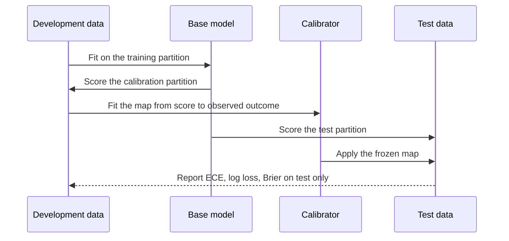

The sequence emphasizes the data discipline. The calibration partition is a separate slice of the development data, disjoint from the training partition, because a model's scores on its own training data are overconfident, and fitting a calibrator on them learns nothing useful. The calibrator is frozen before the test partition is scored. When data are scarce, cross-fitting avoids a separate split: train several models on different folds, score each on its held-out fold, fit one calibrator on the pooled out-of-fold scores, and use the ensemble of models. In scikit-learn, `CalibratedClassifierCV` does this with `cv` folds. Passing an already fitted estimator through `cv="prefit"` was deprecated in version 1.6 in favor of wrapping the fitted estimator in `FrozenEstimator`; check the documentation of the installed version, since the removal of the older form has been reported in later releases.

**Platt scaling** (Platt, 1999) fits a logistic regression on the raw score $s$:

$$
\hat{p} = \sigma(a\,s + b) = \frac{1}{1+e^{-(a s+b)}}
$$

where $a$ and $b$ are two scalar parameters fitted by minimizing log loss on the calibration data. It is a parametric correction assuming the miscalibration is sigmoidal in the score. It needs few data (a few hundred examples are often enough), preserves ranking when $a>0$, and cannot fix a non-monotone or irregular distortion. In the script, the raw logits were 2.5 times too large, and Platt scaling recovers $a=0.40$ (the exact inverse is $1/2.5=0.40$) and $b\approx0$.

**Temperature scaling** is the one-parameter special case for logits $z$: divide by a scalar $T>0$ before the sigmoid or softmax, $\hat{p}=\sigma(z/T)$ or $\text{softmax}(z/T)$. $T>1$ softens (reduces confidence); $T<1$ sharpens. Because dividing by $T$ does not change the order of logits, the predicted class (argmax), the accuracy, and the AUC are unchanged. It cannot change which cases are flagged at a threshold of 0.5 in the binary case with zero bias, but it changes which cases clear other thresholds. The fit is a one-dimensional convex minimization of log loss on the calibration set. The script finds $T=2.56$ against the true value 2.5. Guo and colleagues found it the simplest effective fix for neural networks. Richer variants, vector scaling and matrix scaling, add per-class parameters and risk overfitting when the number of classes is large relative to the calibration data.

**Isotonic regression** (Zadrozny and Elkan, 2002) fits a non-decreasing step function from score to outcome using the pool-adjacent-violators algorithm (PAVA). The method sorts examples by score and walks through them; whenever the running average outcome decreases from one block to the next (a violation of monotonicity), it merges the two blocks into one with the pooled average. The result is a piecewise-constant map. It makes no assumption about the shape of the distortion, which makes it more flexible than Platt scaling, and also more prone to overfitting. With a few hundred calibration points, the step function chases noise; with thousands, it generally matches or beats Platt. It also produces ties (many scores map to the same probability), which flattens the ranking and can lower AUC slightly. Clip its output away from 0 and 1 before computing log loss.

Results on the overconfident test set (20,000 examples; calibrators fitted on separate data, Platt on 4,000 examples), as printed by [`04_calibration_and_thresholds.py`](../code/python/model-evaluation-chapter/04_calibration_and_thresholds.py):

| Method | Log loss | Brier | ECE |
|---|---|---|---|
| Raw (overconfident) | 0.6773 | 0.2005 | 0.1349 |
| Temperature scaling (T = 2.56) | 0.5321 | 0.1787 | 0.0052 |
| Platt scaling (a = 0.40, b = 0.00) | 0.5322 | 0.1788 | 0.0081 |
| Isotonic regression | 0.5330 | 0.1790 | 0.0080 |

All three calibrators cut the log loss by about 0.145 and the ECE from 0.135 to below 0.01. Their agreement is expected: the distortion here is exactly a scaling of the logit, so the one-parameter method is the correct model and the more flexible methods give nothing extra while costing a little (isotonic's log loss is slightly worse). With a real distortion that is not a pure scaling, such as a tree ensemble's, isotonic can win. Choose by the following guidance.

| Situation | Preferred method | Reason |
|---|---|---|
| Neural network, softmax logits, moderate data | Temperature scaling | One parameter, no change to accuracy, hard to overfit |
| Small calibration set (under about 1,000) | Platt scaling or temperature scaling | Parametric and stable |
| Large calibration set, irregular distortion (tree ensembles) | Isotonic regression | Flexible enough to fix any monotone distortion |
| Multiclass, few data per class | Temperature scaling, or one-versus-rest Platt with normalization | Avoids many parameters |
| Known sampling-rate change | Prior (odds) correction | The error is known, not learned |
| Different groups, different miscalibration | Per-group calibrator, with a minimum group size | See Section 12 |

### 7.5 Calibration in practice

- **Evaluate calibration on data the calibrator never saw.** A calibrator fitted and evaluated on the same data will look perfect.
- **Calibration decays.** When the base rate or the feature distribution shifts, the map is stale. Track a running ECE or the ratio of predicted to observed positives when labels are available, and refit on a schedule.
- **Calibrate where decisions are made.** If the product only acts on the top 1 percent, calibration in the 0.0 to 0.5 range is irrelevant, and the tail bins should be examined.
- **Calibration and fairness interact.** Calibrating on pooled data can leave a minority group miscalibrated. Section 12 covers this.
- **Calibration is not uncertainty.** A calibrated 0.5 can mean "I know the true chance is a coin flip" or "I have no idea". Probabilities do not distinguish aleatoric from epistemic uncertainty; use ensembles, conformal sets, or abstention rules where that distinction matters.

## 8. Conformal Prediction

Calibration gives a probability that is right on average. A decision maker sometimes wants a guarantee about a single prediction: "the true label is in this set with 90 percent probability." Conformal prediction (Vovk, Gammerman, and Shafer, 2005) provides such a guarantee without assumptions about the model or the data distribution, other than exchangeability: the calibration examples and the new example must be statistically interchangeable. Angelopoulos and Bates (2021) give an accessible introduction, see [A Gentle Introduction to Conformal Prediction](https://arxiv.org/abs/2107.07511).

### 8.1 Split conformal prediction for classification

The split conformal procedure needs a trained model and a calibration set of $n$ labeled examples that the model did not train on.

1. Define a nonconformity score $s(x,y)$ that is large when the label $y$ looks unlikely for input $x$. A common choice is $s(x,y)=1-\hat{p}(y\mid x)$, where $\hat{p}(y\mid x)$ is the model's probability for class $y$.
2. Compute the score of the true label for every calibration example, giving $s_1,\dots,s_n$.
3. Choose the miscoverage level $\alpha$ (for a 90 percent guarantee, $\alpha=0.1$). Let $q$ be the $\lceil(n+1)(1-\alpha)\rceil$-th smallest of the $n$ scores. The $(n+1)$ in the rank is the finite-sample correction that makes the guarantee exact.
4. For a new input $x$, return the prediction set $C(x)=\{y : s(x,y)\le q\}$, the set of all labels whose score does not exceed $q$.

The guarantee is that $P(Y_{new}\in C(X_{new}))\ge1-\alpha$, where the probability is over the random draw of both the calibration set and the new example. It is a **marginal** guarantee: it holds on average over inputs, not for every individual $x$.

Worked case from the script: $n=2000$ calibration examples and $\alpha=0.1$. The rank is $\lceil2001\times0.9\rceil=1801$, so $q$ is the 1,801st smallest score. The script, using the overconfident model of Section 7, finds $q=0.899$, which means any class to which the model gives probability of at least $1-0.899=0.101$ enters the set. On 20,000 test examples, empirical coverage is 0.905 (the guarantee is at least 0.90), and the mean set size is 1.44. In a binary problem, the sets have size 1 or 2 (the more probable class always has probability at least 0.5 and a score at most 0.5, so the set is never empty). A mean of 1.44 means about 44 percent of cases return both labels and 56 percent return a single label. The set size is the useful signal: singleton sets are confident decisions, and the two-label sets are the cases to route to a human or to defer.

Notice that conformal prediction did not require recalibrating the overconfident model. Its coverage is valid even for a badly miscalibrated score, because the threshold $q$ is learned from the calibration set. What miscalibration costs is efficiency: a worse score gives larger sets for the same coverage.

### 8.2 Extensions and limits

- **Class-conditional (Mondrian) conformal.** The marginal guarantee can hide a poor coverage on a rare class: 90 percent overall coverage is consistent with 50 percent coverage on the positives. Computing a separate $q$ for each class gives the guarantee within each class, at the cost of needing enough calibration examples per class.
- **Adaptive sets.** Scores that sum the probabilities of the most likely classes until the true class is covered (adaptive prediction sets) yield sets whose size adapts to difficulty, giving better conditional behavior than the $1-\hat{p}$ score for multiclass problems with many classes.
- **Regression.** Conformalized quantile regression (Romano, Patterson, and Candès, 2019) turns any quantile regressor into intervals with a finite-sample marginal coverage guarantee by calibrating the interval width with held-out residuals.
- **Not conditional on the input.** There is no distribution-free way to guarantee coverage at every input; "the model is less reliable for this subgroup" is not ruled out by the marginal statement. Check coverage per slice.
- **Exchangeability fails under shift.** A calibration set from last year and traffic from a shifted population invalidate the guarantee. Monitoring empirical coverage on freshly labeled data detects this, and weighted conformal methods can correct known covariate shift.
- **Labels needed.** The calibration data must be labeled, ideally recent, and large enough that $\lceil(n+1)(1-\alpha)\rceil\le n$, which requires $n\ge(1-\alpha)/\alpha$; for $\alpha=0.05$ at least 19 examples, though in practice hundreds are needed for a stable $q$.

Conformal prediction is complementary to calibration. Calibration says how often to trust the number. A conformal set says how many answers are needed to be right with a stated frequency, which maps naturally to workflows such as "automate when the set is a singleton, escalate otherwise".

## 9. Ranking Metrics and Threshold Selection

### 9.1 Ranking metrics

When the output is an ordered list (search results, recommendations, fraud alerts sorted by risk), the quality of the order matters, particularly near the top, where a user or analyst looks first.

**Precision@k and recall@k.** Precision@k is the fraction of the top $k$ items that are relevant. Recall@k is the fraction of all relevant items that appear in the top $k$. Both are easy to interpret, tied to a real capacity (an analyst reviews 300 items), and blind to order within the top $k$ and beyond it.

**Average precision (AP) and mean average precision (MAP).** For a single ranked list with $R$ relevant items in total, AP averages the precision at the rank of each relevant item:

$$
\text{AP} = \frac{1}{R}\sum_{k=1}^{n} P@k\cdot \text{rel}_k
$$

where $\text{rel}_k\in\{0,1\}$ indicates that the item at rank $k$ is relevant. MAP is the mean of AP over queries or users. Take a ranked list with relevance $(1,0,1,0,0,1)$ and $R=3$. The relevant items sit at ranks 1, 3, and 6, with precisions $1/1$, $2/3$, and $3/6$, so $\text{AP}=(1+0.667+0.5)/3=0.722$. A second query with relevance $(0,1,0,1)$ and $R=2$ has precisions $1/2$ and $2/4$ at ranks 2 and 4, so $\text{AP}=0.5$. The MAP over the two queries is $(0.722+0.5)/2=0.611$.

**Mean reciprocal rank (MRR).** For each query, take the reciprocal of the rank of the first relevant item and average over queries. If the first relevant results appear at ranks 1, 4, and 2 for three queries, $\text{MRR}=(1+0.25+0.5)/3=0.583$. MRR fits tasks with one right answer (question answering, known-item search, autocomplete), and it ignores everything after the first hit.

**Normalized discounted cumulative gain (NDCG).** When relevance is graded (0 to 3, say) and rank position matters, NDCG (Järvelin and Kekäläinen, 2002) applies a logarithmic position discount:

$$
\text{DCG@}k = \sum_{i=1}^{k}\frac{2^{rel_i}-1}{\log_2(i+1)}, \qquad \text{NDCG@}k = \frac{\text{DCG@}k}{\text{IDCG@}k}
$$

where $rel_i$ is the graded relevance of the item at position $i$ and IDCG is the DCG of the ideal ordering. Take four items ranked in the order of relevance $(3,2,0,1)$. The discounted gains are $7/1=7.000$, $3/1.585=1.893$, $0/2=0$, and $1/2.322=0.431$, so $\text{DCG@4}=9.323$. The ideal order is $(3,2,1,0)$ with gains $7.000$, $1.893$, $1/2=0.500$, and $0$, so $\text{IDCG@4}=9.393$. Then $\text{NDCG@4}=9.323/9.393=0.993$. The model put the grade-1 item one slot too low, a small penalty because the discount at positions 3 and 4 is mild. If the grade-3 item had been placed last, DCG would drop sharply.

| Metric | Relevance | Order sensitivity | Typical use |
|---|---|---|---|
| Precision@k, recall@k | Binary | Only the top-$k$ boundary | Fixed review capacity |
| AP, MAP | Binary | All ranks, favoring early hits | Retrieval, alert prioritization |
| MRR | Binary | First hit only | Single-answer tasks |
| NDCG@k | Graded | Strong at the top | Search, recommendation with graded labels |

Practical cautions: the metrics need relevance judgments that cover the retrieved items, and unjudged items are usually counted as irrelevant, which penalizes new systems that retrieve unjudged but relevant items. In recommendation, logged feedback is biased by what the old system showed (Section 14.5). Cutoff $k$ should reflect user behavior, not convenience. For RAG pipelines, the retrieval metrics are the same but the judging protocol and downstream answer evaluation belong to [CH19](CH19_Retrieval_Quality_and_RAG_Evaluation.md).

### 9.2 Choosing a threshold from costs

A calibrated model gives a probability $p$ that the case is positive. A decision rule converts it into an action. Let $c_{FP}$ be the cost of acting on a negative, $c_{FN}$ the cost of failing to act on a positive, and assume correct decisions cost nothing. Flagging a case with probability $p$ has expected cost $(1-p)\,c_{FP}$. Not flagging has expected cost $p\,c_{FN}$. Flag when the first is smaller:

$$
(1-p)\,c_{FP} < p\,c_{FN} \;\Longleftrightarrow\; p > t^{*} = \frac{c_{FP}}{c_{FP}+c_{FN}}
$$

[CH01](CH01_Machine_Learning_Foundations.md) derives the same rule, and with non-zero costs for correct decisions the numerator is $c_{FP}-c_{TN}$ and the denominator adds $c_{FN}-c_{TP}$. With equal costs $t^*=0.5$. If a miss costs ten times a false alarm, $t^*=1/11=0.091$. If it costs fifty times, $t^*=1/51=0.020$. The threshold is valid only if $p$ is calibrated, which is a strong reason to calibrate: a threshold of 0.091 applied to overconfident scores flags the wrong cases.

The script confirms the rule on calibrated scores, searching thresholds from 0.01 to 0.99 on 20,000 test examples:

| Cost ratio $c_{FP}:c_{FN}$ | Theoretical $t^*$ | Empirical best $t$ | FP | FN | Total cost |
|---|---|---|---|---|---|
| 1 : 1 | 0.500 | 0.51 | 2,619 | 2,786 | 5,405 |
| 1 : 10 | 0.091 | 0.12 | 8,438 | 114 | 9,578 |
| 1 : 50 | 0.020 | 0.02 | 9,979 | 2 | 10,079 |

The empirical values are close but not identical because the cost curve is flat near its minimum (a threshold of 0.12 and one of 0.09 differ by little in total cost) and the sample is finite. The numbers also show what asymmetric costs do: moving from 1:1 to 1:50 cuts misses from 2,786 to 2, and raises the false alarms from 2,619 to 9,979, so the system flags about half of all cases. Whether that is acceptable depends on whether somebody can process that many alerts, which is the next constraint.

A worked monetary example (illustrative figures): a manual review costs 5 USD and a missed fraud costs 200 USD on average. The cost-optimal threshold is $5/205=0.0244$, so any transaction with a calibrated fraud probability above 2.4 percent should be reviewed. If the model puts 6 percent of volume above that threshold and the team can review only 3 percent, the cost-optimal policy is infeasible and the real decision is how to ration the capacity.

### 9.3 Thresholds from capacity

Many systems face a hard limit on the number of positive actions per day: analysts, support staff, call-center minutes, delivery slots, or downstream rate limits. The constrained problem is to choose the $k$ items with the highest expected benefit, which for a calibrated model with constant costs means the $k$ highest scores. The threshold is then a **quantile of the score distribution**, not a fixed value.

Illustrative arithmetic: a bank processes 50,000 transactions per day with 0.5 percent fraud (250 cases). Analysts can review 300 per day. The top 300 scores contain 180 fraud cases. Then precision@300 is $180/300=0.60$ and recall@300 is $180/250=0.72$. The remaining 70 fraud cases per day are missed and cost $70\times\$200=\$14{,}000$ per day, while 120 reviews of legitimate transactions cost $120\times\$5=\$600$. In this regime, the economically better lever is not a better threshold but more review capacity or a cheaper review step, because the marginal reviewed case is worth much more than its cost. Evaluate the marginal value: with a precision of 0.30 in ranks 250 to 300, each added review yields $0.30\times\$200-\$5=\$55$ in expected net value, which supports hiring.

Quantile thresholds have a useful property and a trap. They are insensitive to calibration drift, because they always flag the same number of cases. They are sensitive to prevalence: if fraud doubles, the same capacity leaves more fraud unreviewed, and a fixed-quantile policy hides the problem unless prevalence is also monitored.

### 9.4 Practical threshold procedure

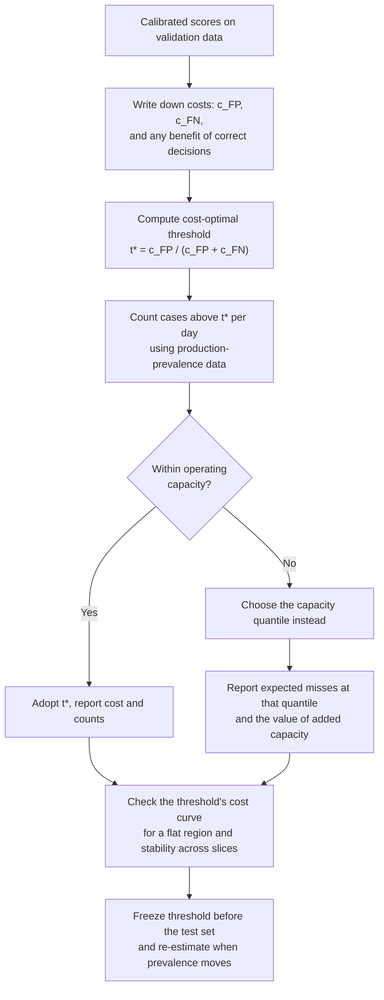

The flowchart orders the decisions that are often reversed in practice. Teams commonly tune a threshold to hit a satisfying $F_1$ on the test set, which both ignores costs and consumes the test set. The procedure instead starts from costs, checks feasibility against capacity, examines the flatness of the cost curve (a flat minimum means small errors in costs or calibration are harmless), and freezes the threshold on validation data. The test set then evaluates the whole frozen decision rule, including the threshold, once.

Three refinements apply. First, when the costs are uncertain, plot total cost as a function of threshold for a range of plausible cost ratios and choose a threshold that is not terrible under any of them. Second, **decision curve analysis** (Vickers and Elkin, 2006) plots net benefit $=TP/n-(FP/n)\cdot\frac{t}{1-t}$ against the threshold $t$, where the odds $t/(1-t)$ convert false positives into units of true positives. For the fraud queue ($TP=90$, $FP=900$, $n=10{,}000$) at a threshold of 0.10 the net benefit is $0.009-0.09\times0.111=-0.001$, which is below the net benefit of zero for "review nothing", so at that implied cost ratio the model is worse than doing nothing. At $t=0.0244$ (the 5 USD versus 200 USD case), the weight is $0.0244/0.9756=0.025$, so net benefit is $0.009-0.09\times0.025=0.00675$, positive. The method makes the dependence of the verdict on the cost ratio visible without choosing a single ratio. Third, in scikit-learn, `TunedThresholdClassifierCV` and `FixedThresholdClassifier` (introduced in version 1.5, verify in the installed release) wrap a classifier so that the threshold is tuned by cross-validation against a chosen metric or fixed at a cost-derived value, which keeps threshold selection inside the resampling loop.

## 10. Uncertainty, Model Comparison, and Selection Bias

A metric computed on a finite sample is an estimate. The question that gates a decision is almost never "what is the number?" but "how much could it differ from the truth, and is the difference between these two numbers larger than that?"

### 10.1 Sources of uncertainty

| Source | What varies | Covered by a test-set interval? |
|---|---|---|
| Test sampling | Which examples were drawn | Yes |
| Training randomness | Seeds, initialization, data order, bagging | No; repeat training with several seeds |
| Training sample | Which examples were in the training set | No; resample the training data (CV, bootstrap) |
| Split choice | Which examples landed in which fold | Partly; repeated CV |
| Label noise | Errors in the reference labels | No (Section 13.2) |
| Distribution shift | Future differs from the evaluation data | No (Section 13.1) |
| Selection among candidates | Winner's curse | No (Section 10.6) |

An interval from the test set covers only the first row. This is worth saying explicitly in a report: "the 95 percent interval covers test-sample variation and does not include variation from retraining or from shift."

### 10.2 Intervals for proportions: Wilson versus Wald

For an accuracy, recall, precision, or error rate computed as $k$ successes out of $n$, the textbook (Wald) interval is $\hat{p}\pm z\sqrt{\hat{p}(1-\hat{p})/n}$ with $z=1.96$ for 95 percent. It is simple and unreliable when $n$ is small or $\hat{p}$ is near 0 or 1. The Wilson score interval (Wilson, 1927) inverts the score test and behaves well in those cases:

$$
\frac{\hat{p}+\frac{z^2}{2n}\;\pm\; z\sqrt{\frac{\hat{p}(1-\hat{p})}{n}+\frac{z^2}{4n^2}}}{1+\frac{z^2}{n}}
$$

where $\hat{p}=k/n$. It never leaves $[0,1]$, is asymmetric near the boundaries, and has coverage close to nominal for small samples.

Values printed by [`03_intervals_and_model_comparison.py`](../code/python/model-evaluation-chapter/03_intervals_and_model_comparison.py):

| Data | Wilson 95% interval | Wald 95% interval | Comment |
|---|---|---|---|
| 9 of 10 | (0.596, 0.982) | (0.714, 1.086) | Wald exceeds 1 and is too narrow |
| 90 of 100 | (0.826, 0.945) | (0.841, 0.959) | Similar at moderate $n$ |
| 0 of 50 | (0.000, 0.071) | (0.000, 0.000) | Wald claims certainty from zero events |

The last row matters in safety contexts. Observing zero failures in 50 trials does not show that the failure rate is zero; a plausible upper bound is about 7 percent (Wilson) or, by the "rule of three", about $3/n=6$ percent. To claim a failure rate below 0.1 percent with 95 percent confidence after observing no failures, about 3,000 trials are needed. Teams frequently overlook this when validating rare-event safeguards.

**Which count is the denominator?** An interval on recall uses the number of actual positives as $n$. An interval on precision uses the number of flagged cases. An interval on the false positive rate uses the number of negatives. A model evaluated on 10,000 transactions with 100 frauds has a recall interval based on $n=100$ (at recall 0.9 the Wilson interval is roughly 0.83 to 0.95), not $n=10{,}000$. Reporting the interval on the right denominator is the single most useful habit for rare-event problems.

### 10.3 The bootstrap for arbitrary metrics

For metrics that are not simple proportions (AUC, $F_1$, MAE, NDCG, expected cost), the bootstrap (Efron, 1979) supplies an interval without a formula.

1. From the $n$ evaluation examples, draw $n$ examples with replacement.
2. Compute the metric on this resample.
3. Repeat $B$ times (1,000 to 10,000).
4. Take the 2.5th and 97.5th percentiles of the $B$ values as a 95 percent percentile interval.

The distribution of the resampled metric approximates its sampling distribution. A few details determine whether the answer is trustworthy.

- **Resample the independent unit.** If rows are grouped by customer, session, or device, resample whole groups. Resampling rows when groups exist treats correlated rows as independent and gives intervals that are too narrow, often by a factor of two or more when groups are large. For time-dependent data, use a block bootstrap that resamples contiguous blocks.
- **Resample the evaluation set, not the model.** The bootstrap interval of the test set describes test-sampling uncertainty. To include training uncertainty, retrain on each bootstrap training sample, which costs $B$ fits.
- **Percentile intervals are biased for skewed statistics at small $n$.** Bias-corrected and accelerated (BCa) intervals correct some of this. With hundreds of examples and a smooth metric, plain percentile intervals are adequate.
- **Bootstrap fails for extremes and tiny samples.** A maximum, a rare-class recall with five positives, and thresholds chosen on the same data are poorly approximated.
- **Compute the full pipeline per replicate.** If the threshold was chosen on validation data, hold it fixed on the test bootstrap. If a metric is computed at a threshold chosen to achieve a target recall on the same sample, the threshold must be re-chosen within each resample to capture its uncertainty.

### 10.4 Paired comparison of two models

Two models evaluated on the same test examples have correlated errors: both fail on the same hard cases. The uncertainty of the *difference* is smaller than the uncertainty of either accuracy, and a method that ignores the pairing wastes that information and loses power.

Suppose models A and B are evaluated on the same $n=1{,}000$ cases. Accuracy of A is 0.881 and of B is 0.883. The unpaired standard error of each accuracy is $\sqrt{0.88\times0.12/1000}\approx0.0102$, so the unpaired standard error of the difference would be $\sqrt{2}\times0.0102\approx0.0145$, giving an interval of about $\pm0.028$. That is far too wide to detect a 0.2-point difference, and also the wrong calculation. Build the table of agreement instead. Let $b$ be the number of cases where only B is right and $c$ the number where only A is right (the **discordant** pairs). In the script's simulation, $b=20$ and $c=18$. Cases where both are right or both wrong do not distinguish the models.

The difference in accuracy is $(b-c)/n=2/1000=0.002$. Treat the per-case difference $d_i\in\{-1,0,+1\}$; its mean is $(b-c)/n$ and its variance is $(b+c)/n-((b-c)/n)^2$. The standard error of the mean difference is therefore

$$
\text{SE} = \frac{\sqrt{(b+c)-(b-c)^2/n}}{n} = \frac{\sqrt{38-0.004}}{1000} = 0.00616
$$

and the 95 percent interval is $0.002\pm1.96\times0.00616$, or $(-0.010,+0.014)$. The paired bootstrap, which resamples the cases and recomputes the difference each time, gives $(-0.0100,+0.0140)$ in the script, matching to the printed precision. The interval spans zero comfortably: the data do not show that B is better. The pairing cut the half-width from about 0.028 to 0.012.

**McNemar's test** formalizes this for two classifiers on one test set. Under the null hypothesis that the models have equal error rates, each discordant case is equally likely to favor either model, so $b$ follows a binomial distribution with $b+c$ trials and probability 0.5. The exact two-sided $p$-value for $b=20$, $c=18$ is 0.871, nowhere near the 0.05 level. The common chi-square approximation is $(|b-c|-1)^2/(b+c)=1/38=0.026$ with one degree of freedom. Use the exact version when $b+c$ is below about 25.

McNemar's test answers a narrow question: do these two *fitted models* differ on *this test population*? It does not account for how the models would vary if retrained on different training data. Dietterich (1998) analyzed this and other tests for comparing classifiers and recommended McNemar's test when only one training run is feasible and a $5\times2$ cross-validation test when retraining is cheap.

### 10.5 Comparing learning procedures: the corrected resampled t-test

If the question is whether learning procedure A beats procedure B in general (not just these two fitted models), each must be retrained on multiple training sets. The naive approach runs repeated random splits, computes the score difference on each, and applies a paired $t$-test to the $J$ differences. This is invalid because the training sets overlap, so the differences are positively correlated, and the variance of their mean is badly underestimated. Nadeau and Bengio (2003) proposed a correction: replace the variance of the mean difference $s^2/J$ with $\left(\frac{1}{J}+\frac{n_{test}}{n_{train}}\right)s^2$, where $s^2$ is the sample variance of the $J$ differences, $n_{train}$ is the size of each training set, and $n_{test}$ the size of each test set.

The script applies it to $J=10$ random 80/20 splits of $n=1{,}000$ examples, with accuracy differences $(0.012,0.020,-0.004,0.015,0.008,0.018,0.002,0.011,0.016,0.007)$. The mean is 0.0105 and the sample standard deviation is 0.0075.

- Naive $t=0.0105/\sqrt{s^2/10}=4.45$. With 9 degrees of freedom, the two-sided 5 percent critical value is 2.262, so the naive test declares a clear win.
- The correction factor is $\frac{1}{10}+\frac{200}{800}=0.35$, 3.5 times the naive $1/J=0.10$. The corrected $t=0.0105/\sqrt{0.35\,s^2}=4.45/\sqrt{3.5}=2.38$. It still exceeds 2.262, but only barely, and the evidence is much weaker than the naive figure suggested.

The principle is that more splits shrink the naive standard error toward zero while the real uncertainty is bounded below by the finite size of the dataset. The $n_{test}/n_{train}$ term supplies that floor. When comparing across many datasets or tasks, the Wilcoxon signed-rank test on per-dataset scores is recommended over repeated $t$-tests (Demšar, 2006).

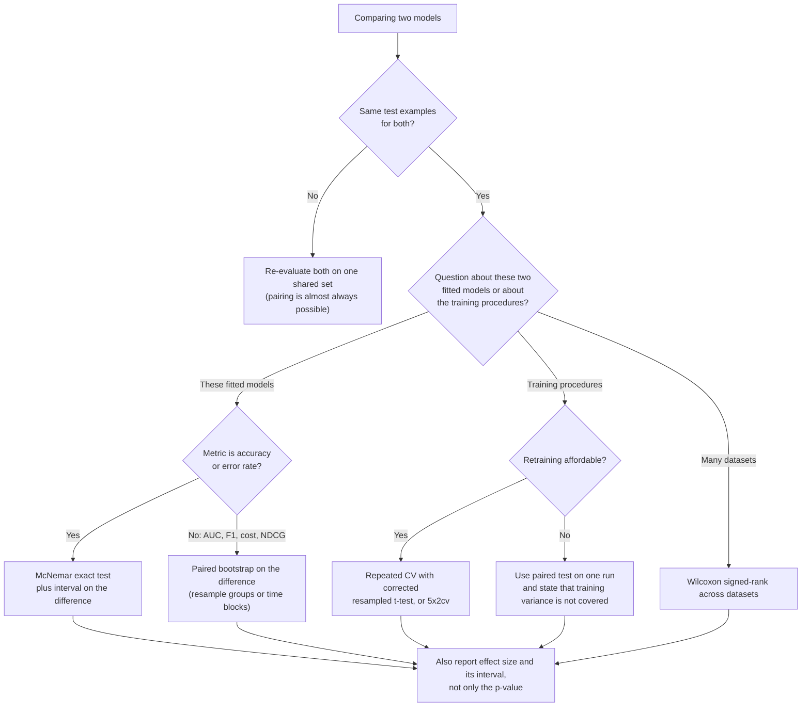

The decision tree makes the choice depend on the question being asked, not on a habit. It shows the common error at the first node: comparing models on different samples when a shared sample is available. Every branch ends with an interval on the effect size, since a $p$-value alone does not say whether a difference matters.

### 10.6 Multiple comparisons and selection bias

Comparing one pair of models at the 5 percent level gives a 5 percent chance of a false positive. Comparing $m$ pairs, or choosing the best of $m$ candidates, changes the arithmetic. If 40 candidates with no real differences are each compared with a baseline at the 5 percent level, the probability that at least one looks significant is $1-0.95^{40}=0.871$. Teams searching over hyperparameters, feature sets, preprocessing variants, and architectures run through dozens to thousands of comparisons, most of which are not recorded.

Two distinct problems occur.

1. **Inflated false-positive rate for hypothesis tests.** Corrections control it. The Bonferroni correction tests each comparison at $\alpha/m$ (here $0.05/40=0.00125$). The Holm step-down procedure is uniformly more powerful with the same family-wise guarantee. The Benjamini-Hochberg procedure controls the false discovery rate, the expected fraction of declared wins that are false, which is the right target when many comparisons are expected to include some real effects. [CH27 — A/B Testing](../02_Design_Thinking_and_Product_Management/CH27_A_B_Testing.md) treats these corrections in the experimentation setting.
2. **Winner's curse for the reported score.** The best of $m$ noisy estimates is biased upward even if no hypothesis test is run (Section 2.3). Corrections for tests do not fix this, because the problem is the value reported, not the decision to declare significance. The remedies are structural: evaluate the winner on data that took no part in selecting it (a locked test period, or the outer loop of nested CV), and report that number.

Practical rules for selection:

- **Count the search.** Record how many configurations were evaluated against each partition. The count belongs in the evaluation report.
- **Prefer the simplest model within noise of the best.** The one-standard-error rule (Breiman and colleagues, 1984; used widely with regularization paths) chooses the simplest model whose CV score is within one standard error of the best. It encodes the fact that differences below the noise level do not justify extra complexity.
- **Do not select on slices of the test set.** Observing that a model wins on 3 of 12 slices and then reporting those 3 is the same inflation in another form.
- **Pre-specify the primary metric and comparison.** Decide before looking which metric and which comparison determine the choice. The remaining analyses are exploratory and labeled as such. The informal process of making data-dependent analysis choices is sometimes called the garden of forking paths, and it multiplies the effective number of comparisons without any counter that shows it.

### 10.7 Statistical power and sample size

Power is the probability that a test detects a real difference of a given size. A low-powered evaluation is the mirror image of a false positive problem: real improvements are called "no difference", and teams discard good ideas or accept a worse model because the evaluation could not tell.

For a single metric, the half-width formula gives the sample size for a target precision: $n=z^2p(1-p)/h^2$. The values in the script are 865 examples for $\pm2$ points at $p=0.9$, 2,401 at $p=0.5$, and 246 positives for a recall interval of $\pm5$ points at recall 0.8.

For a paired comparison of two classifiers, the relevant quantities are the true difference in accuracy $\delta$ and the **discordance rate** $\psi=(b+c)/n$, the fraction of cases on which the models disagree on correctness. A standard approximation for McNemar's test, for two-sided level $\alpha$ and power $1-\beta$, is

$$
n \approx \frac{\left(z_{\alpha/2}\sqrt{\psi} + z_{\beta}\sqrt{\psi-\delta^2}\right)^2}{\delta^2}
$$

where $z_{\alpha/2}=1.96$ for $\alpha=0.05$ and $z_\beta=0.8416$ for 80 percent power. To detect an improvement of $\delta=0.02$ when the models disagree on 10 percent of cases ($\psi=0.10$): $1.96\sqrt{0.10}=0.620$, $0.8416\sqrt{0.10-0.0004}=0.266$, and $(0.620+0.266)^2/0.0004=1{,}960$. With a discordance rate of 20 percent (more different models), the requirement doubles to about 3,920. With only 1,000 test cases and $\psi=0.10$, the smallest difference reliably detected is about $2.8\sqrt{0.10/1000}=0.028$, almost 3 points. The time to ask this is before the evaluation set is built: if the planned improvement is 1 point and the test set has 1,000 cases, no analysis of the results will settle the question.

Three consequences follow.

1. **Small improvements need large evaluation sets, and the requirement grows as $1/\delta^2$.** Halving the detectable difference quadruples the sample.
2. **Models that are similar are easier to compare.** A small discordance rate means the difference is determined by few cases, which lowers the required $n$. Two very different models need more data for the same $\delta$.
3. **Subgroup claims need subgroup power.** A claim about a slice with 80 examples has the intervals of an 80-example study, regardless of the size of the overall test set.

## 11. Baselines, Learning Curves, and Error Analysis

### 11.1 The baseline ladder and dummy models

A metric value has no meaning without a reference. The baseline ladder, from [CH01](CH01_Machine_Learning_Foundations.md), gives an ordered set of references that every more complex model must beat.

1. **Dummy (trivial) predictors.** For classification: always predict the majority class, predict the class prior, or predict randomly in proportion to the prior. For regression: predict the training mean or median. For time series: repeat the last value (naive) or the value from the same period last season (seasonal naive). These cost nothing and set the floor.
2. **Existing process.** The rule, heuristic, spreadsheet, or human process in use today. Beating the dummy but not the incumbent has no business value.
3. **Simple model.** A regularized linear or logistic model with sensible features, or a small tree. If it comes within noise of the complex model, the simple one is usually the better engineering choice (cheaper, more interpretable, easier to monitor).
4. **Human performance or inter-annotator agreement.** Where labels come from judgments, the agreement between independent annotators bounds what any model can measure. A model "outperforming" humans on a label set whose annotators agree with each other 85 percent of the time is partly fitting annotator quirks.

The numbers for the 1 percent prevalence problem are instructive. The majority-class predictor has accuracy 0.99 and recall 0. A "stratified" dummy that guesses positive with probability 0.01 independently has accuracy $0.01^2+0.99^2=0.9802$, precision 0.01, recall 0.01. A constant prevalence predictor has log loss 0.0560 and Brier score 0.0099. The fraud model of Section 4 (accuracy 0.909) is therefore *less* accurate than the majority baseline and more useful, which is exactly why accuracy cannot be compared to baselines blindly: pair each baseline with the metric that makes it meaningful.

**Permutation and negative-control checks.** Two cheap tests expose a broken evaluation pipeline. First, retrain the full pipeline on shuffled labels and evaluate on the real validation labels; the score must fall to the dummy level. If it does not, something in the pipeline has access to the validation labels (leakage in preprocessing or splitting). Second, add a column of random noise as a feature; it should receive negligible importance and should not improve validation scores. Both tests take minutes and would have caught many production incidents.

### 11.2 How much better is better enough?

Beating a baseline by a statistically detectable margin is necessary and not sufficient. The improvement must pay for the added complexity: training and serving cost, latency, monitoring burden, and explanation difficulty. Express the gain in decision units. A model that raises recall at a fixed review capacity from 0.72 to 0.75 catches 3 more frauds per 100 at the operating point. At 250 frauds per day and 200 USD each, that is $0.03\times250\times200=1{,}500$ USD per day, or roughly 547,500 USD per year (illustrative). Compare with the extra serving and maintenance cost. Equivalent translations exist for every metric, and an evaluation report should include one.

### 11.3 Learning curves

A learning curve plots the training score and the validation score as a function of the number of training examples (using the same validation set at every size). Its shape diagnoses which problem the model has.

| Pattern | Training error | Validation error | Diagnosis | Remedy |
|---|---|---|---|---|
| High bias (underfitting) | High | High, close to training | Model class too limited or features uninformative | Richer features or model; more data will not help |
| High variance (overfitting) | Low | High, large gap | Model fits noise | More data, regularization, simpler model |
| Healthy and data-limited | Rising slowly | Falling slowly, gap closing | Still improving with data | More data pays |
| Plateau | Flat | Flat | Irreducible noise or label ceiling | Better labels or features, not more rows |

Illustrative numbers: a classifier trained on 500, 1,000, 2,000, and 4,000 examples has training errors of 0.02, 0.03, 0.05, and 0.07 and validation errors of 0.20, 0.16, 0.13, and 0.11. The gap shrinks from 0.18 to 0.04 and validation error is still falling by about 0.02 per doubling. Extrapolating a power-law fit suggests that doubling to 8,000 examples might reach 0.09 to 0.10, which gives the team a basis to decide whether labeling 4,000 more examples (at a known cost per label) will pay off. Learning curves answer the most expensive question in an ML project, "should we collect more data?", with a plot instead of a guess.

Complementary plots: a **validation curve** varies one hyperparameter (tree depth, regularization strength) and plots training and validation score, showing where overfitting begins; and an **epoch curve** for iterative training plots both losses against epochs to choose early stopping. [CH07](CH07_Deep_Learning_Foundations.md) covers the deep-learning version of these diagnostics.

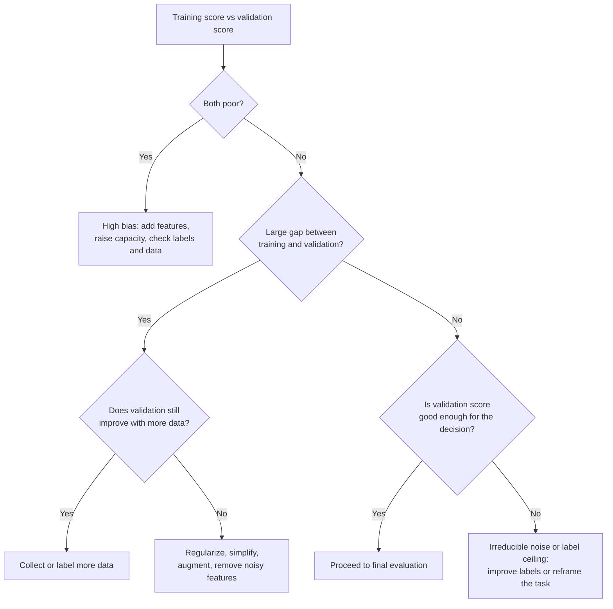

The decision tree turns the learning-curve table into an action sequence. Its most useful branch is the one that separates "more data helps" from "more data will not help", which prevents the common waste of buying labels for a model that is limited by its features or by label noise.

### 11.4 Error analysis

Aggregate metrics tell you how much the model fails. Error analysis tells you why, and therefore what to do next. It is a structured manual procedure.

1. **Sample.** Draw a random sample of errors (100 to 300 is usually enough) from the validation set. Stratify by error type (false positives and false negatives separately) and include the highest-confidence errors, which are the most informative.
2. **Categorize.** Read each error and assign a cause from an evolving taxonomy: label wrong, label ambiguous, input quality poor, feature missing, rare pattern, out-of-scope input, data pipeline defect.
3. **Quantify.** Count categories. Estimate the potential gain from fixing each: removing the category entirely bounds the improvement.
4. **Prioritize** by frequency times fixability.
5. **Verify** with a targeted change, evaluated on fresh validation data.

Illustrative example: of 200 sampled errors from a document classifier, 80 (40 percent) are label errors on inspection, 50 (25 percent) are inherently ambiguous documents, 40 (20 percent) are missing a feature the model could be given (such as a header), and 30 (15 percent) are rare formats. If the error rate is 10 percent, fixing the label errors in the evaluation set raises measured accuracy by roughly 4 points without touching the model (the 40 percent of errors that were not the model's fault), and building the missing feature could remove up to 2 points. The analysis moved the team's next quarter from "try a bigger model" to "clean labels, add a feature".

Rules for doing it safely: perform error analysis on the validation set, not the test set, because every insight drawn from specific test examples is an adaptive query (Section 2.3). Keep the taxonomy and counts as part of the evaluation record. Look at errors by slice and by confidence: a model that is confidently wrong on a coherent cluster of cases has a systematic problem, whereas scattered low-confidence errors are noise. Tools that cluster error examples in an embedding space can surface such clusters, with the caveat that the clusters need to be checked by a person.

## 12. Slice-Based and Fairness-Aware Evaluation

### 12.1 Why aggregates hide failures

An average over a population gives each case equal weight, so a minority group's failures are diluted by the majority's successes. A concrete illustration: a model update improves accuracy on the majority slice (90 percent of traffic) from 0.92 to 0.94 and degrades the minority slice (10 percent) from 0.85 to 0.75. Overall accuracy before is $0.9\times0.92+0.1\times0.85=0.913$ and after is $0.9\times0.94+0.1\times0.75=0.921$. The aggregate rises by 0.8 points while one in ten users sees a ten-point drop. An evaluation that reports only the aggregate approves this change.

Slices to report are of three kinds.

- **Predefined slices from the product and the risk model:** region, language, device, customer tier, new versus returning users, product category, time of day, data source, and any attribute tied to legal or ethical risk.
- **Data-quality slices:** records with missing fields, low-quality images, short texts, or out-of-vocabulary inputs.
- **Discovered slices:** subsets found by examining errors, for example by training a shallow decision tree to predict whether the model errs, or by clustering errors. Discovered slices are hypotheses to validate on fresh data, since searching many subsets will always find some where the model looks bad by chance.

### 12.2 Slice sample sizes and the multiple-slice problem

Every slice is a small evaluation set with its own interval. A slice of 80 cases with observed accuracy 0.85 has a Wilson interval of about (0.76, 0.91). That interval cannot distinguish a slice with accuracy 0.78 from one with 0.90, and it is a poor basis for either alarm or reassurance. Report counts and intervals for every slice, mark slices below a minimum size as "insufficient data" instead of printing a point estimate, and never read "no significant gap" from a wide interval as evidence of parity.

Testing many slices is itself a multiple-comparison problem. If 50 slices are each tested against the overall rate at the 5 percent level and nothing is wrong, about $50\times0.05=2.5$ slices will be flagged by chance. Use a false discovery rate correction for discovery analyses, or distinguish pre-registered slices (tested without correction because there are few and they matter) from exploratory ones. Intersectional slices (region by device by language) multiply the count quickly and shrink each cell, which pushes toward model-based approaches (hierarchical models that borrow strength across cells) or targeted data collection.

### 12.3 Fairness metrics as slice comparisons

Fairness-aware evaluation computes the confusion-matrix metrics of Section 4 within each group defined by a protected or sensitive attribute $A$ and compares them. The common criteria are:

| Criterion | Condition | Expressed with |
|---|---|---|
| Demographic (statistical) parity | $P(\hat{y}=1\mid A=a)$ equal across groups | Selection rate |
| Equal opportunity (Hardt, Price, and Srebro, 2016) | TPR equal across groups | Recall |
| Equalized odds | TPR and FPR both equal | Recall and false positive rate |
| Predictive parity | PPV equal across groups | Precision |
| Calibration within groups | $P(Y=1\mid\hat{p}=p,A=a)=p$ for all $a$ | Reliability diagram per group |

These criteria encode different ideas of fairness and **cannot in general be satisfied together**. Kleinberg, Mullainathan, and Raghavan (2016) and Chouldechova (2017) showed that when the base rates differ between groups, a classifier cannot simultaneously have equal false positive and false negative rates and equal predictive values, except in trivial cases such as perfect prediction. See [Chouldechova, "Fair prediction with disparate impact"](https://arxiv.org/abs/1610.07524) and [Kleinberg et al.](https://arxiv.org/abs/1609.05807).

The arithmetic is a direct consequence of Bayes' rule in Section 4.6. Take two groups with base rates 20 percent (group A) and 5 percent (group B), and a classifier with the same TPR of 0.80 and FPR of 0.10 in both, so equalized odds holds. The PPV in group A is $0.20\times0.80/(0.20\times0.80+0.80\times0.10)=0.16/0.24=0.667$. In group B it is $0.05\times0.80/(0.05\times0.80+0.95\times0.10)=0.04/0.135=0.296$. A flagged person in group B is less than half as likely to be a true positive as one in group A, so predictive parity fails. To equalize PPV, the error rates would have to differ. Neither choice is neutral, and the choice is a value judgment about which error matters more in context.

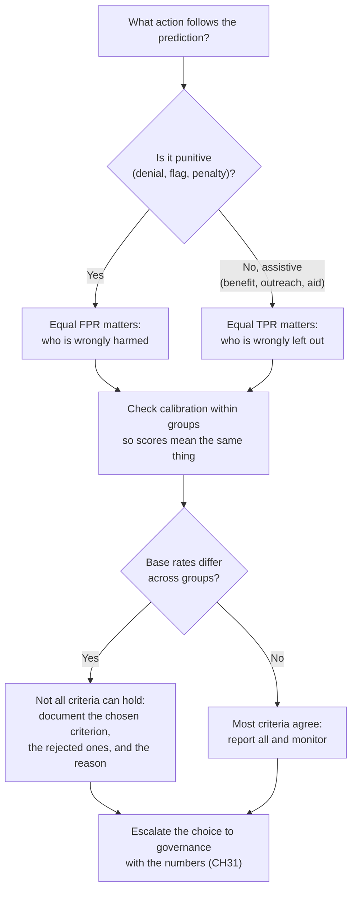

The decision tree starts from the action, not the metric, because the harm profile of the action determines which error is the one to equalize. It ends at governance because the tension among criteria is a policy decision that an evaluation can inform and cannot settle. [CH31 — Responsible AI and Safety Governance](CH31_Responsible_AI_and_Safety_Governance.md) owns the policy lifecycle.

### 12.4 Practical issues in fairness evaluation

- **The label may be the bias.** Obermeyer and colleagues (2019) analyzed a widely used health risk score that used past healthcare cost as a proxy for health need; because less money was spent on the same level of illness for Black patients, the score under-ranked them for extra care even though it was well calibrated for the cost label it had been given. Evaluation against the training label would have shown no problem. Check whether the label measures the quantity the decision cares about, and evaluate against an independent outcome where possible.
- **Measurement of the attribute.** Evaluation needs the group attribute, but collecting it may be restricted by privacy law or policy, and inferring it from proxies introduces error and its own harms. Where the attribute cannot be held, options include holding it only in a controlled evaluation environment, using voluntarily provided self-reports, or testing on synthetic or audit datasets. Involve privacy and legal teams before collecting. [CH30 — AI Data Governance, Privacy, and Provenance](CH30_AI_Data_Governance_Privacy_and_Provenance.md) covers the data-governance side.
- **Uncertainty on gaps.** A gap in TPR between two groups of 120 and 3,000 cases has an interval dominated by the small group. Report the gap with an interval, not as a point.
- **Group-specific thresholds.** Equalizing error rates by setting a different threshold per group can reduce disparities in measured error and may be restricted by law in some domains because it treats people differently on a protected attribute. Treat it as a design option requiring legal review, not a default fix.
- **Intersections and small groups.** Evaluate intersections of the attributes that matter where sample size permits, and flag when it does not.
- **Fairness is not a one-time check.** Group base rates and error rates drift. Track them with the monitoring described in [CH29](CH29_MLOps_and_LLMOps.md).

## 13. Distribution Shift, Label Noise, and Label Delay

A validation score estimates future performance only if the future resembles the evaluation data and the evaluation labels are right and available. This section covers the three ways those assumptions fail and how to test for them before deployment.

### 13.1 Types of shift and how to evaluate for them

Let $P(x)$ be the distribution of inputs and $P(y\mid x)$ the relationship between inputs and outcomes. Three kinds of change matter.

| Shift | What changes | Example | Effect on a fixed model |
|---|---|---|---|
| Covariate shift | $P(x)$, with $P(y\mid x)$ fixed | A new region with more rural customers | Accuracy changes with the mix of easy and hard inputs; the model's rule is still right |
| Prior (label) shift | $P(y)$, with $P(x\mid y)$ fixed | Fraud rate triples after a campaign | Precision and calibration change; TPR and FPR do not (Section 4.6) |
| Concept drift | $P(y\mid x)$ | Customers change what a purchase pattern means after a policy change | The learned rule is wrong; retraining is needed |

In real data these occur together. The evaluation techniques differ by what is knowable before launch.

**Temporal holdout.** The most direct test is the one already recommended: train on the past, evaluate on a later period. A model whose error rises in later folds of a rolling-origin evaluation (Section 3.6) shows drift in the data. Report the metric per period, not only the average.

**Held-out domains.** If the product will expand to new sites, hospitals, countries, or devices, hold out entire domains rather than random rows, and report performance on the held-out ones. The WILDS benchmark collection (Koh and colleagues, 2021) packages datasets with such domain shifts and showed large drops from in-distribution to out-of-distribution accuracy for standard methods, see [Koh et al., "WILDS"](https://arxiv.org/abs/2012.07421). In an enterprise, "leave one customer, tenant, or site out" is the equivalent for a multi-tenant system.

**Importance weighting for known covariate shift.** If the target population's input distribution is known or can be sampled (unlabeled data from the new setting), reweight the labeled evaluation examples by $w(x)=P_{target}(x)/P_{source}(x)$. The weight can be estimated with a domain classifier trained to distinguish source from target inputs. A worked case: the evaluation set is 80 percent urban and 20 percent rural; the target population is 50/50. The model's accuracy is 0.95 on urban cases and 0.80 on rural cases. On the source mix the accuracy is $0.8\times0.95+0.2\times0.80=0.920$. On the target mix it is $0.5\times0.95+0.5\times0.80=0.875$. Importance weights are $0.5/0.8=0.625$ for urban and $0.5/0.2=2.5$ for rural, and the weighted estimate is $(0.8\times0.625\times0.95+0.2\times2.5\times0.80)/(0.8\times0.625+0.2\times2.5)=(0.475+0.400)/1.000=0.875$, which recovers the target accuracy from the source sample. The price is variance: the rural cases carry weight 2.5 each, so the effective sample size falls. The estimate is only valid when the target inputs lie within the support of the source inputs; a target region with no source examples cannot be reweighted into existence.

**Stress tests and perturbation suites.** Evaluate on systematically altered inputs and report the degradation curve (the metric as a function of perturbation severity), not a single number. Hendrycks and Dietterich (2019) provide corruption and perturbation benchmarks for image classifiers, see [Hendrycks and Dietterich](https://arxiv.org/abs/1903.12261). For tabular and text models the equivalents are: set each feature to missing in turn to test the model's behavior during a feature outage; add noise or rounding to numeric features; apply plausible unit changes; swap category values; paraphrase or add typos to text. Ribeiro and colleagues (2020) proposed behavioral testing for language models (CheckList): minimum functionality tests, invariance tests (changing a name should not change a sentiment label), and directional tests (adding a negative phrase should not raise a positive score). The same ideas apply to any model, and they are cheap to automate as part of a regression suite.

**Underspecification.** D'Amour and colleagues (2020) showed that models with essentially identical held-out performance can behave differently on stress tests and deployment shifts, because the training problem has many solutions that fit the data equally well. Practical implication: a validation score is not enough to choose among near-ties, and a stress-test suite and several training seeds give additional information about which near-tie is safer.

**Selective prediction and abstention.** If the product can defer uncertain cases to a human or a fallback, evaluate the model with a risk-coverage curve: the error rate on the accepted cases as a function of the fraction of cases accepted. Illustrative arithmetic: a model has an error rate of 10 percent overall. If the 20 percent of cases with the lowest confidence are routed to humans, and the error rate on the remaining 80 percent is 5 percent, then overall automated accuracy is 95 percent at 80 percent coverage, and the human workload is 20 percent of cases. The calibration quality of the confidence score (Section 7) and conformal sets (Section 8) decide how well this works.

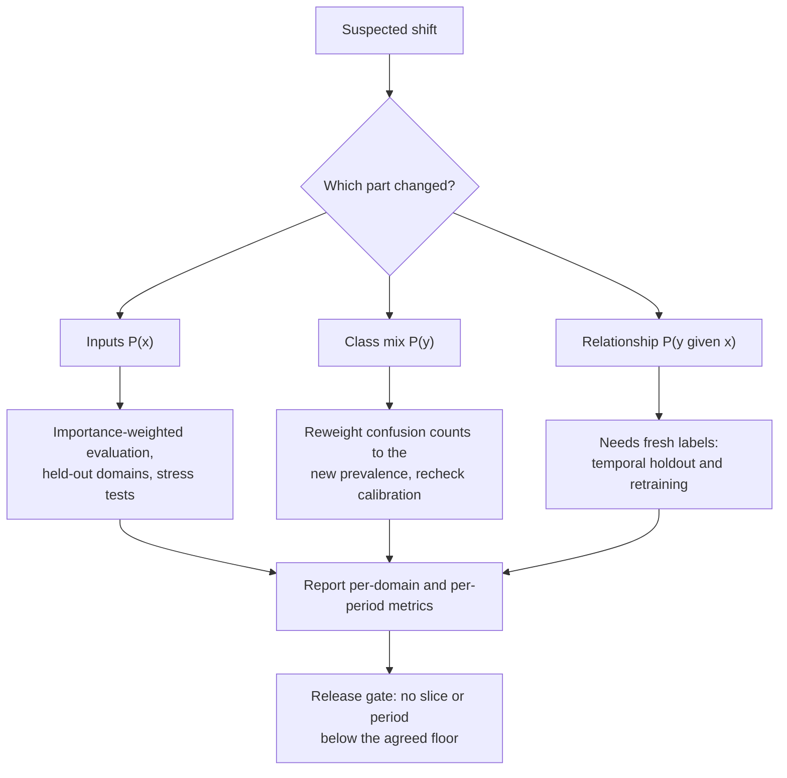

The flowchart turns the shift taxonomy into evaluation actions. The first two branches can be examined with unlabeled target data and reweighting. The third cannot be diagnosed without fresh labels, which is the reason concept drift is the most expensive to detect and why label delay (Section 13.3) is an architectural concern.

### 13.2 Label noise in the evaluation set

Evaluation compares predictions with reference labels, and the reference labels have errors. If a fraction $\eta$ of labels is flipped independently of the features (symmetric noise) and the model's true accuracy is $a$, the measured accuracy is

$$
a_{obs} = a(1-\eta) + (1-a)\eta = \eta + a(1-2\eta)
$$

where the second term counts correct predictions that were scored correct and the first counts wrong predictions that were scored correct because the label was also wrong (for a binary problem). With $\eta=0.10$, a model with true accuracy 0.95 measures 0.860, and one with true accuracy 0.93 measures 0.844. A perfect model measures 0.90. Two effects follow. The ceiling is $1-\eta$, so a model cannot be shown to exceed it. And differences are compressed by the factor $1-2\eta=0.8$: a true two-point gap appears as 1.6 points, which makes real improvements harder to detect (the sample-size arithmetic of Section 10.7 should use the observed gap).

Noise is rarely symmetric. Labels for rare classes are often missed, so positives are labeled negative more often than the reverse. If 20 of 100 true positives are labeled negative in the evaluation set, a model that correctly flags them is charged with false positives, lowering measured precision and distorting the ranking among models, with the better recall-oriented model penalized.

Northcutt, Athalye, and Mueller (2021) estimated label errors in the test sets of ten widely used benchmarks and found an average of about 3.4 percent, and showed that for some benchmarks the model ranking changes when the corrected labels are used, see [Pervasive Label Errors in Test Sets](https://arxiv.org/abs/2103.14749). The practical points are the following.

- Treat evaluation labels as measurements with a quality level. Estimate it by double-annotating a sample and computing inter-annotator agreement (Cohen's kappa, Section 4.4, or raw agreement), and report the implied ceiling.
- Spend labeling budget on the **test** set first. Noise in training labels degrades a model gradually, while noise in test labels degrades the decision about whether to ship.
- Review the highest-confidence disagreements between the model and the label, which are disproportionately label errors. Confident-learning methods automate the ranking of suspect labels. Never silently relabel the test set after seeing model outputs; relabel by adjudication with a documented process and re-evaluate all candidates on the revised labels.
- Where annotators legitimately disagree, a single "gold" label is a fiction. Use multiple labels per item, evaluate against the distribution of annotator votes, or report the metric against several annotator subsets.

### 13.3 Label delay and censoring

In many systems the true outcome arrives long after the prediction: a chargeback 30 to 90 days after a card payment, loan default over 12 months or more, customer churn at the end of a contract, a clinical outcome after follow-up. This breaks evaluation in three ways.

1. **Recent performance is unknown.** The most recent predictions have no labels yet, so any metric on the latest cohort understates positives.
2. **Early labels are biased.** Outcomes that become known quickly differ from those that arrive late. Frauds caught by the model are confirmed immediately (the transaction is blocked and investigated), while frauds the model missed surface only when the cardholder disputes the charge.
3. **Metrics computed on immature cohorts look better than reality.** Take a cohort with 200 actual frauds, of which the model catches 100 (true recall 0.50). The 100 caught cases are labeled at once. Of the 100 missed, only 10 have been reported by day 14. The evaluator sees 110 labeled frauds, of which 100 were caught, and computes recall of $100/110=0.91$. The true recall is 0.50. The measured value improves because the denominator is incomplete in a way correlated with the model's own behavior.

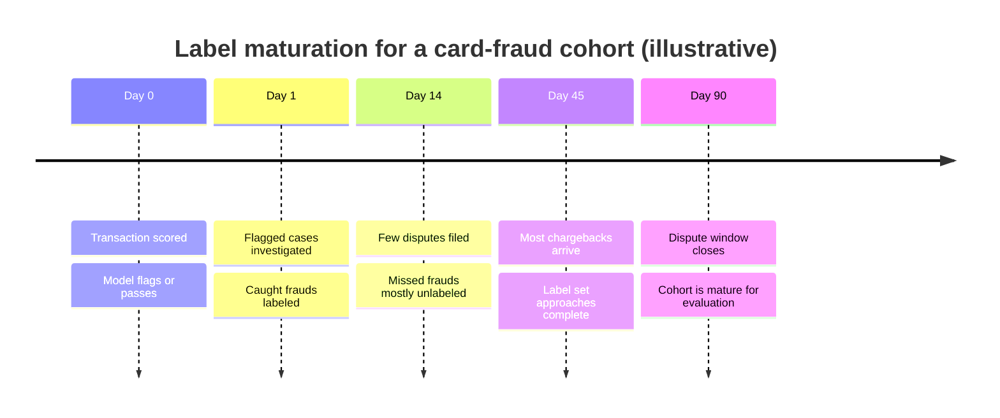

The timeline shows why the evaluation cohort must be older than the maturity window of its labels. Remedies:

- **Evaluate on mature cohorts only.** Choose the cohort age at which, say, 95 percent of eventual labels have arrived, using the observed label-arrival curve. Evaluating a model trained in March on data labeled by July means the freshest trustworthy evaluation is always months old; the architecture must accept that lag and plan for it with prospective shadow evaluation (Section 14.2).
- **Estimate the arrival curve.** Track the fraction of final labels available at each age, per segment. Use it to correct recent counts, with the correction's uncertainty stated.
- **Use leading indicators for monitoring, and validate them.** Alert rate, score distribution, and short-horizon proxy labels (for example, early payment default) can warn before true labels arrive, but each proxy must be shown to predict the final label.
- **Mind the selective labels problem.** For decisions that prevent outcomes (a declined loan never defaults, a blocked transaction never shows whether it would have been fraud), outcomes are observed only for the cases the old system approved. A new model is evaluated on a population shaped by the old model's decisions. Section 14.5 describes counterfactual approaches, and in practice a small randomized exploration slice is the cleanest remedy.

## 14. From Offline Evaluation to Online Outcomes

An offline metric is a prediction about online value. It can be wrong for reasons that no offline procedure can detect, so consequential models need online evidence. The discipline is to climb a ladder of increasing exposure, stopping each step when the evidence is insufficient.

### 14.1 Why offline and online disagree

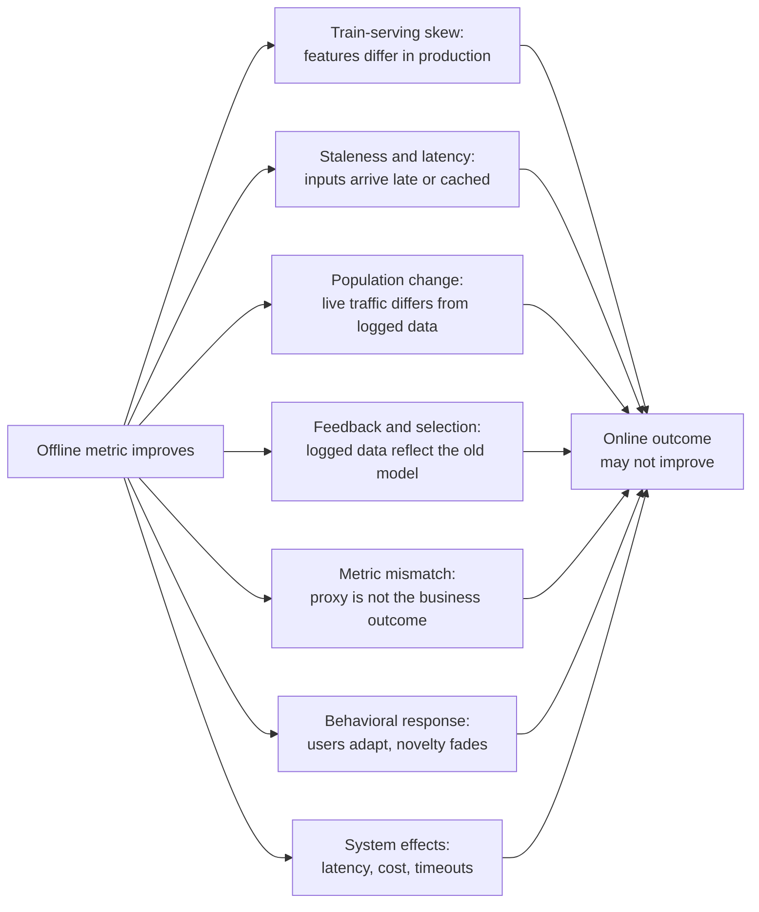

The diagram lists the structural reasons for an offline-online gap, each of which suggests a different test.

- **Train-serving skew.** A feature is computed one way in the offline pipeline and another in the serving path (different time windows, different null handling, a join that is available in batch but not in real time). Test by logging production features and comparing their distributions with offline features, and by replaying logged requests through both paths. [CH02](CH02_Data_Preparation_Feature_Engineering_and_Leakage.md) covers the feature-consistency mechanisms.
- **Staleness and latency.** An offline evaluation uses the value of a feature at label time; production may only have yesterday's value. A model that is accurate with fresh features and slow with stale ones loses the gain.
- **Population change.** The logged data came from users reached by the old system. New traffic sources, a marketing push, or a different mix change the inputs.
- **Feedback loops and selection.** In recommendation, the logged clicks occurred on items the old recommender showed. A new recommender that shows different items gets no feedback on them offline, so offline evaluation favors models similar to the logging policy.
- **Metric mismatch.** Predicting clicks accurately is not the same as increasing purchases or satisfaction. The proxy may even be anti-correlated with the goal at the margin (Section 15).
- **Behavioral response.** Users react to the system: they game rules, learn to ignore alerts, and respond to novelty with short-lived engagement that fades. Fraudsters adapt to a new detector, so its observed performance decays as they find evasions.
- **System effects.** A model that adds 200 ms of latency can lose more in conversions than it gains in relevance.

The mitigation is the rollout ladder below, plus an explicit **offline-online correlation check**: for past launches, record the offline metric change and the online outcome change, and compute the rank correlation across launches. If offline changes predicted online changes poorly, the offline metric needs redesign, and one should not trust it for the next decision.

### 14.2 The rollout ladder: replay, shadow, canary, experiment

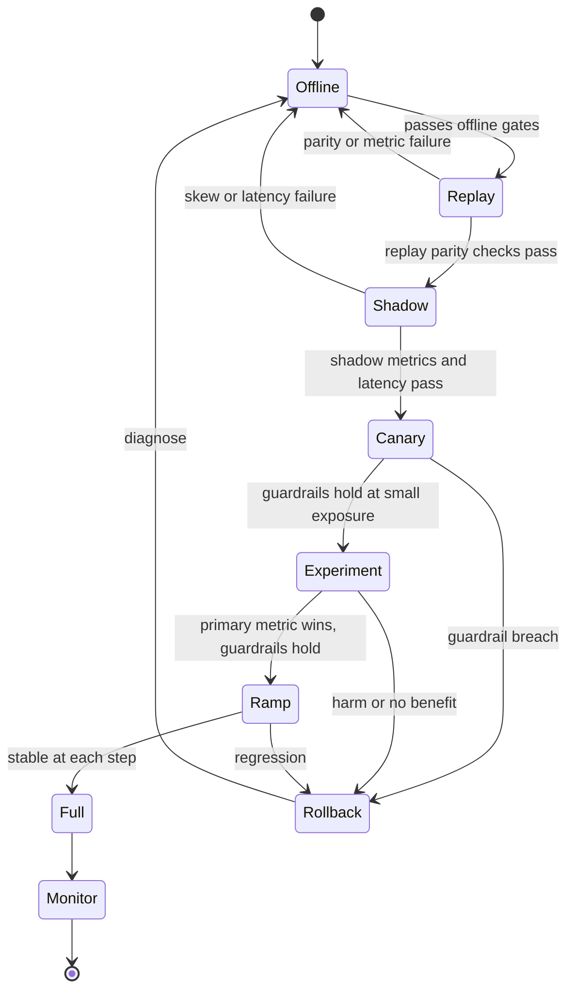

The state diagram shows that every rung has an exit back to diagnosis, and that failure should lead to learning rather than a retry with a looser gate. Each step answers a different question.

**Replay (backtest).** Run the candidate on logged historical requests through the production code path, not the research notebook. It tests that the serving implementation produces the same predictions as the offline evaluation (parity), catches feature-pipeline bugs, and measures latency and cost on realistic payloads. It cannot show how users respond.

**Shadow mode.** The candidate receives live production traffic and produces predictions that are logged and compared with the incumbent's, but they do not affect any user or decision. Shadow mode tests live feature availability, latency at production load, error and timeout rates, and the distribution of scores and decisions (for example, "the candidate would flag 3.1 percent of transactions against the incumbent's 2.4 percent"). It also produces a prospective evaluation set: once labels mature, the shadow predictions can be scored on data that no one tuned against, which is the cleanest estimate of out-of-sample performance. What it cannot show is the causal effect of acting on predictions, because nothing was acted on, and cases that the incumbent blocked have no observed counterfactual outcome.

**Canary release.** A small slice of real traffic (commonly 1 to 5 percent) is served by the candidate, with automated comparison against the incumbent's metrics and a pre-agreed rollback rule. The goal is to detect harm quickly and with limited blast radius, not to prove benefit. At 1 percent of 2 million daily requests, a canary sees 20,000 requests a day, enough to detect a doubling of a 2 percent error rate within hours, and far too few to detect a 2 percent relative change in conversion. Guardrails and thresholds for rollback must be written before the canary starts. [CH29](CH29_MLOps_and_LLMOps.md) owns the promotion and rollback mechanics.

**Controlled experiment.** Randomized A/B testing estimates the causal effect on business outcomes. It is the only step that measures whether the model improves the thing the organization wants.

**Ramp.** If the experiment succeeds, exposure increases in stages (for example 10, 25, 50, 100 percent) with monitoring at each stage and the previous model kept deployable for fast rollback.

### 14.3 A/B testing for models

[CH26 — Experimentation](../02_Design_Thinking_and_Product_Management/CH26_Experimentation.md) and [CH27 — A/B Testing](../02_Design_Thinking_and_Product_Management/CH27_A_B_Testing.md) own the statistics of controlled experiments. The points specific to evaluating models are as follows.

- **Randomize on the right unit.** Randomize by user, account, or device rather than by request, so that one user does not see both models and learn from the contrast. When behavior is shared (marketplaces, social feeds, fraud rings), the units interfere with one another and cluster-level randomization is needed.
- **Pre-register primary, secondary, and guardrail metrics.** The primary metric is the decision criterion. Guardrails (latency, error rate, complaints, cost, fairness gaps, retention) must not worsen beyond a stated bound. Everything else is exploratory.
- **Size the experiment in advance.** For a baseline conversion of 5 percent and a minimum detectable effect of 0.2 percentage points (a 4 percent relative lift) at 5 percent significance and 80 percent power, the two-sample formula $n=2\,(z_{\alpha/2}+z_{\beta})^2\,\bar{p}(1-\bar{p})/\delta^2$ gives $2\times7.85\times0.0475/0.002^2\approx186{,}000$ users per arm. With 100,000 eligible users a day split evenly (50,000 per arm per day), that is about four days; round up to complete weeks to cover day-of-week effects.
- **Check sample ratio mismatch (SRM).** If a 50/50 split produces 50.8/49.2 on 400,000 users, a chi-square test flags a bug in assignment or logging, and the results cannot be trusted until it is explained.
- **Beware novelty and primacy effects.** A new ranking can attract curiosity clicks for a week that decay afterward, or be penalized while users adapt. Run long enough to see stabilization, and examine the effect over time.
- **Cover label delay.** If the outcome (a return, a default) matures after 60 days, the experiment's read-out either waits or uses a validated short-horizon surrogate.
- **Reduce variance with pre-experiment covariates.** Controlled-experiment using pre-experiment data (CUPED; Deng and colleagues, 2013) adjusts the metric by a pre-period covariate and can shrink confidence intervals, which shortens experiments.
- **Avoid peeking.** Stopping when the interim p-value dips below 0.05 inflates the false positive rate. Use sequential tests designed for continuous monitoring.

Kohavi, Tang, and Xu (2020) is the standard practitioner reference on trustworthy online controlled experiments.

### 14.4 Interleaving for ranking systems

Ranking changes (search, recommendations, feeds) are hard to A/B test because the metrics are noisy and per-user effects are small. Interleaving compares two rankers within the same result list: the lists from rankers A and B are merged, and user clicks are credited to the ranker that contributed the clicked item. In team-draft interleaving (Radlinski, Kurup, and Joachims, 2008), the two rankers alternately pick their highest-ranked item not already shown, with a coin flip deciding who picks first in each round, which prevents positional advantage for either.

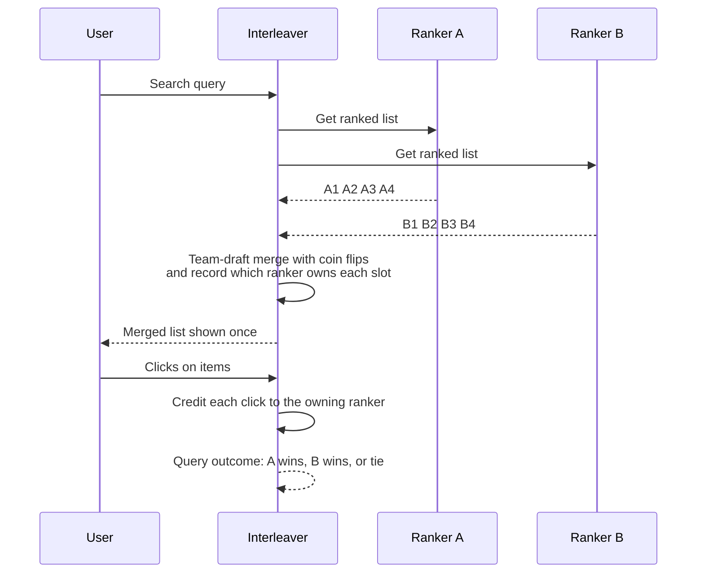

The sequence shows that both candidates compete in front of the same user at the same moment, so differences between users, times, and queries cancel. Each query is scored as an A win, a B win, or a tie by comparing the number of clicks credited to each ranker, and the test is a sign test on the decisive queries. As an illustration, suppose 1,000 queries produce 330 A wins, 270 B wins, and 400 ties. The decisive queries number 600. Under the null hypothesis of no difference, A wins half of them, with standard deviation $\sqrt{600\times0.25}=12.2$. The observed 330 is $30/12.2=2.45$ standard deviations above 300, a two-sided p-value of about 0.014. The sensitivity of interleaving is generally reported to be much higher than that of a parallel A/B comparison of the same click metrics, so it needs far less traffic to detect preference differences, as discussed by Chapelle and colleagues (2012). The limits: it measures preference expressed through clicks, not downstream outcomes like purchases or long-term satisfaction, and it applies only where results can be merged into one list. Use it as a fast filter for ranking changes, followed by an A/B test of the survivors on business metrics.

### 14.5 Off-policy and counterfactual evaluation (conceptual)

Interleaving and A/B tests require live exposure. Off-policy evaluation (OPE) estimates how a new decision policy would have performed using only data logged under an old policy. It matters wherever exposure is costly or risky (lending, medical, large recommendation systems) and addresses the feedback problem of Section 14.1.

**The setup.** For each logged decision, the data contain the context $x_i$ (user, features), the action $a_i$ the old (logging) policy took, the probability $\mu(a_i\mid x_i)$ with which it chose that action (the **propensity**), and the observed reward $r_i$. A new target policy $\pi$ chooses actions with probability $\pi(a\mid x)$. The aim is to estimate the average reward $V(\pi)$ that $\pi$ would have earned.

**Direct method.** Fit a model of expected reward given context and action, then evaluate $\pi$ by plugging in its actions. This is simple but inherits the bias of the reward model, which is least accurate for actions the logging policy rarely took, and those are the ones where the new policy differs.

**Inverse propensity scoring (IPS).** Reweight the logged outcomes by how much more (or less) likely the target policy is to take the logged action than the logging policy was:

$$
\hat{V}_{IPS}(\pi) = \frac{1}{n}\sum_{i=1}^{n} \frac{\pi(a_i\mid x_i)}{\mu(a_i\mid x_i)}\,r_i
$$

where $n$ is the number of logged decisions. If $\pi$ is deterministic, $\pi(a_i\mid x_i)$ is 1 when the target policy would have chosen the logged action and 0 otherwise, so only agreeing records contribute, each upweighted by $1/\mu$. IPS is unbiased provided that the logging policy gave every action the target policy might take a non-zero probability (**positivity** or overlap) and the logged propensities are correct. It can have very high variance when propensities are small.

A worked case (illustrative): $n=1{,}000$ logged decisions. The target policy agrees with the logged action in 300 of them, and in those the logging propensity was 0.2, so each carries weight $1/0.2=5$. Of the 300, 60 earned reward 1. The IPS estimate is $60\times5/1000=0.30$. The self-normalized variant divides by the sum of weights rather than $n$: $\sum w_ir_i/\sum w_i=300/1500=0.20$. The two differ because the weights sum to 1,500 against an expected value of $n=1{,}000$ (the expected weight under correct propensities is 1), a sign that this sample happened to over-represent agreement; the self-normalized estimator corrects for that at the price of slight bias, and is usually lower in variance. The **effective sample size** $(\sum w_i)^2/\sum w_i^2=1500^2/(300\times25)=300$ shows that only the 300 agreeing records carry information, however many were logged.

**Variance control and doubly robust estimation.** Clipping large weights trades a little bias for much lower variance. The doubly robust estimator (Dudík, Langford, and Li, 2011) combines a reward model with IPS corrections and is unbiased if either the reward model or the propensities are correct, which is why it is the common practical choice.

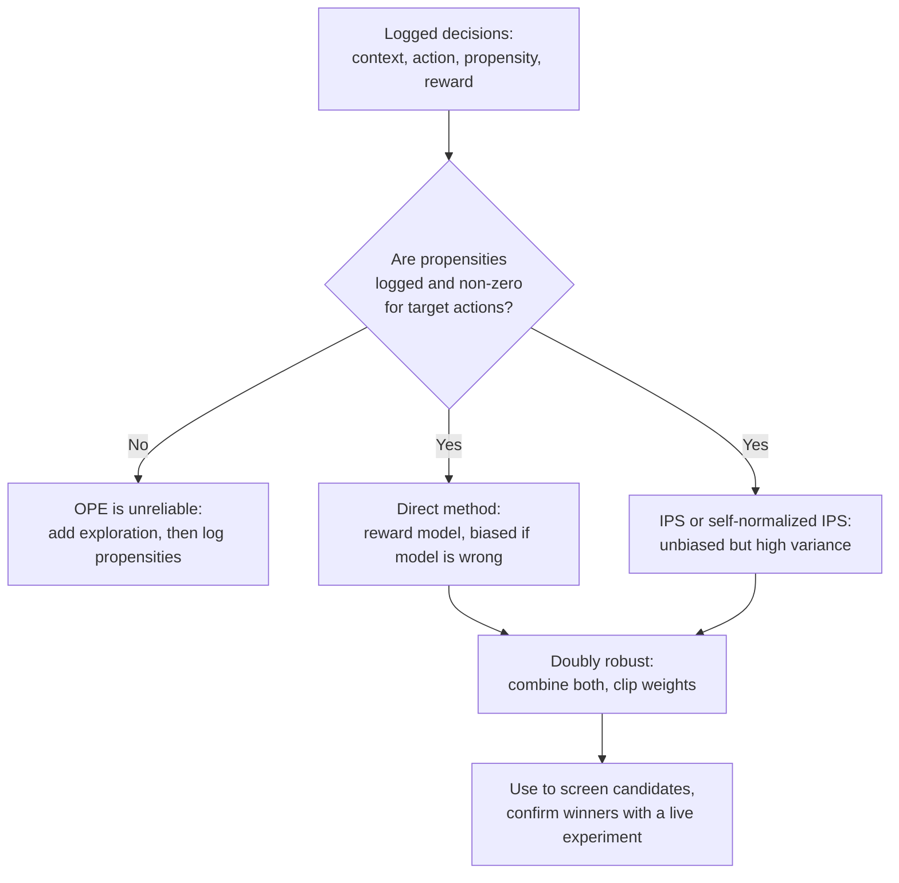

The flowchart shows the architectural requirement hidden in a statistical method: OPE works only if the production system **logs the propensity** of each decision, together with the context and model version, and only if the logging policy explored enough to cover what the new policy would do. A deterministic incumbent that never tries alternatives cannot support counterfactual evaluation of anything different from itself. Maintaining a small randomized exploration slice (for example 1 percent of traffic chooses an action uniformly among eligible ones) is the standard way to buy that capability, at a measurable cost in short-term outcomes. Treat OPE as a screening tool that reduces the number of candidates needing live tests, not as a replacement for them, because assumptions of stable propensities, no interference, and sufficient overlap rarely hold exactly.

## 15. Metric Design, Goodhart Effects, and Guardrails

### 15.1 Goodhart's law

Goodhart's law is usually quoted in Marilyn Strathern's formulation: when a measure becomes a target, it ceases to be a good measure. In ML it operates through several mechanisms.

1. **Proxy divergence.** The measurable quantity (clicks, accuracy on a benchmark, tickets closed) correlates with the real goal under the old policy, and the correlation breaks when the system optimizes the proxy directly. Optimizing click-through promotes sensational content; optimizing time-on-site promotes compulsion; optimizing ticket closures encourages closing tickets without solving problems.
2. **Gaming by the model.** A system optimizing a metric finds the cheapest way to raise it, including ways nobody intended. A model rewarded for recall learns to flag everything.
3. **Gaming by the organization.** Teams with targets tuned to a metric clean the test set, change thresholds, or exclude hard cases from the evaluation.
4. **Shift induced by the optimization.** The act of deploying a model changes behavior and therefore the data, so the metric measured next quarter is not the metric measured last quarter.

A worked example of a gameable composite: a team defines a single score $S=0.7\times\text{recall}+0.3\times\text{precision}$ for a fraud model. The flag-everything model has recall 1.0 and precision 0.01, so $S=0.70+0.003=0.703$. The fraud model of Section 4 has recall 0.90 and precision 0.091, so $S=0.63+0.027=0.657$. The degenerate model wins. A weighted sum of rates that ignores volume does not encode the cost of reviewing 10,000 transactions to find 100 frauds. The fix is to express the objective in the units of the decision: expected cost (review cost times flags plus loss times misses), or a constrained form such as "maximize recall subject to at most 300 flags per day".

### 15.2 A metric hierarchy

A metric system has layers with different roles.

| Layer | Purpose | Examples | Property needed |
|---|---|---|---|
| Business outcome | What the organization wants | Revenue retained, losses avoided, patient outcomes | Measured online, slow, noisy |
| Primary offline metric | Fast decision criterion for model changes | Expected cost, recall at fixed capacity, NDCG@10 | Validated against the business outcome |
| Guardrails | Prevent harm while optimizing the primary | Latency p95, false-positive rate, per-slice recall, cost per prediction, complaint rate | Hard bounds, checked automatically |
| Diagnostics | Explain changes | Confusion counts, calibration, error categories | Not used for the decision |

Guardrails differ from primary metrics in how they are used: a primary metric is maximized, a guardrail is a constraint. A model that improves the primary but breaches a guardrail is rejected or sent back, not accepted with a note. Typical guardrails for a prediction service are latency and cost per request, error and timeout rates, the false positive volume (so the review queue does not overflow), a minimum recall on each critical slice, a calibration bound (ECE below a stated value), and a fairness gap bound with an interval.

### 15.3 Properties of a good metric

- **Aligned.** It moves with the real objective. Validate this: track how offline changes have predicted online outcomes in the past (the correlation check of Section 14.1).
- **Sensitive.** It detects the changes that matter within the available sample (Section 10.7).
- **Hard to game.** It cannot be improved by a degenerate behavior. Combine it with guardrails that would catch the degenerate behavior.
- **Interpretable.** Stakeholders can state what a one-unit change means in decision terms.
- **Stable.** It does not depend on arbitrary choices such as bin counts or label ordering.
- **Cheap and fast.** It can run on every candidate, because slow metrics are skipped under schedule pressure.

Prefer constraints to weights when the stakeholders disagree about the exchange rate between objectives. A weighted sum requires a number that nobody can defend, while a constraint ("recall at least 0.85 and no slice below 0.75") expresses a requirement that each stakeholder can inspect.

### 15.4 Reviewing metrics over time

Metrics need maintenance. Re-validate the metric against outcomes when the product, population, or adversaries change. Keep a held-back set of evaluation data and an independent audit sample (for example, human review of a random sample of production decisions) that the optimization does not touch, so drift between the metric and reality is visible. When a metric has been the target for a long time, search explicitly for gaming: unusual score distributions, a growing share of cases excluded from evaluation, suspiciously uniform improvements.

## 16. Evaluation Reports and Model Cards

The evaluation is only useful if its evidence can be read, checked, and reused by people who did not run it: the architect signing off, the risk reviewer, the on-call engineer, and the team that inherits the model.

### 16.1 What an evaluation report contains

1. **Decision and intended use.** What action the model drives, for whom, and what is out of scope.
2. **Data and splits.** Sources, time range, size, prevalence, how the split was made (random, group, time) and why, leakage checks performed, label source and quality (agreement, ceiling), known gaps.
3. **Baselines.** Dummy, incumbent, simple model, with the same metrics.
4. **Primary result with uncertainty.** Metric, counts behind it, interval, and the interval's scope (Section 10.1).
5. **Operating point.** Threshold, derivation (costs or capacity), and resulting confusion counts and volumes in production terms.
6. **Calibration.** Reliability diagram, ECE with binning stated, proper scores against the prevalence baseline.
7. **Slices and fairness.** Per-slice metrics with counts and intervals, the chosen fairness criterion and why.
8. **Stress and shift tests.** Degradation curves, held-out domain or period results.
9. **Comparison.** Paired differences with intervals, the number of candidates considered, and the selection procedure (nested CV, locked test).
10. **Test-set use log.** How many times each partition was queried.
11. **Online plan.** Shadow criteria, canary guardrails and rollback rule, experiment design and size, monitoring and label-delay plan.
12. **Limitations and open risks.** What the evidence does not cover.
13. **Reproducibility.** Code and data versions, seeds, environment, and how to rerun.
14. **Decision record.** Reviewers, decision, and conditions.

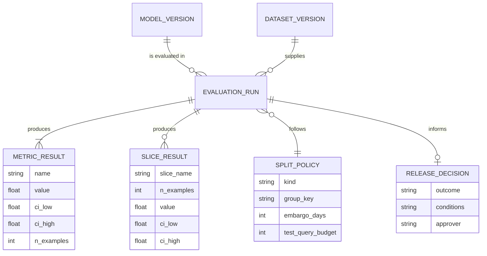

The entity-relationship diagram shows the evaluation record as structured data rather than a slide deck. Storing runs this way makes the test-query budget auditable (count runs against a locked split), lets reviewers diff two model versions on the same dataset version, and ties the release decision back to the evidence. [CH29](CH29_MLOps_and_LLMOps.md) places this record in the model registry and promotion workflow.

### 16.2 Model cards and datasheets

A model card (Mitchell and colleagues, 2019) is a short, standardized document that travels with a model, see [Model Cards for Model Reporting](https://arxiv.org/abs/1810.03993). Its proposed sections are: model details, intended use (and out-of-scope use), relevant factors (groups, environments, instrumentation), metrics, evaluation data, training data, quantitative analyses (disaggregated by the factors), ethical considerations, and caveats and recommendations. The aim is that someone deciding whether to use the model in a new setting can see what it was tested on and where it was not tested. Datasheets for datasets (Gebru and colleagues) play the same role for the data: motivation, composition, collection process, preprocessing, uses, and maintenance.

A model card is a summary, not the evidence. Link it to the full evaluation record and version it with the model: a card that describes version 3 but accompanies version 5 misleads.

### 16.3 Acceptance criteria as a release gate

Turn the evaluation into an explicit gate agreed before the result is known. An illustrative gate for the fraud model:

| Criterion | Threshold | Evidence |
|---|---|---|
| Expected cost per 10,000 transactions | At least 15 percent below the incumbent, lower bound of the 95 percent interval above 0 percent savings | Paired bootstrap on the locked time-based test |
| Recall at 300 flags per day | At least 0.70 | Test set, interval reported |
| ECE (equal-mass bins) | Below 0.02 | Test set |
| Recall in each region with at least 200 positives | No lower than 0.60 | Slice table with intervals |
| p95 latency | At most 50 ms | Shadow mode at production load |
| Shadow decision-rate difference from incumbent | Within 1 percentage point of expected | Two weeks of shadow traffic |

Writing the gate before the evaluation prevents moving the goalposts. When the model fails a criterion, the decision record states whether the criterion is waived, by whom, and with what mitigation.

## 17. Evaluating Language-Model Outputs: Recap and Boundary

The principles in this chapter (protect the final holdout, match the metric to the decision, report uncertainty, compare models on shared examples, and verify online) apply unchanged to systems built on large language models (LLMs). What changes is the measurement: outputs are open-ended text with no single reference label, so evaluation relies on task-specific rubrics, reference-based and reference-free scoring, human review, and model-based judges whose own agreement with humans must be measured. New risks appear, among them benchmark contamination (test items present in training data), sensitivity to prompt wording, non-deterministic outputs, and hallucination.

[CH24 — Generative AI Evaluation, Guardrails, and Hallucinations](CH24_Generative_AI_Evaluation_Guardrails_and_Hallucinations.md) owns the techniques for generative output quality, grounding, safety, red teaming, and release criteria. [CH19 — Retrieval Quality and RAG Evaluation](CH19_Retrieval_Quality_and_RAG_Evaluation.md) owns the evaluation of retrieval and RAG answers, using the ranking metrics taught in Section 9.1. When an LLM is used inside a predictive pipeline as a classifier or extractor with a defined label set (for example, routing support tickets), the confusion-matrix, calibration, and comparison methods of this chapter apply directly to its labels.

## 18. Implementation Patterns

The mechanisms above are short in code. The risk is in wiring: which data reach which step. These sketches show the shapes, and the runnable scripts in the code folder (Section 27) implement the metrics from scratch using only the standard library.

### 18.1 Leakage-safe cross-validation

Wrap every learned preprocessing step in a pipeline and let the splitter, not the analyst, decide which rows each step sees. Choose the splitter from Section 3.7.

```python
from sklearn.model_selection import StratifiedGroupKFold, TimeSeriesSplit, cross_validate
from sklearn.pipeline import make_pipeline
from sklearn.preprocessing import StandardScaler
from sklearn.linear_model import LogisticRegression

model = make_pipeline(StandardScaler(), LogisticRegression(max_iter=1000))

# New customers appear in production: split by customer, keep class balance.
cv_group = StratifiedGroupKFold(n_splits=5, shuffle=True, random_state=0)
res = cross_validate(model, X, y, groups=customer_id, cv=cv_group,
                     scoring=["average_precision", "roc_auc", "neg_log_loss"])

# Future data are scored: expanding window with a gap for label delay (rows sorted by time).
cv_time = TimeSeriesSplit(n_splits=4, gap=60 * rows_per_day)
res_t = cross_validate(model, X, y, cv=cv_time, scoring="average_precision")
```

The scaler is fitted on each training fold only because it sits inside the pipeline. The `gap` argument of `TimeSeriesSplit` is expressed in samples, not days, so it needs converting from the label-delay window; verify the parameters in the installed version. For nested validation of a search, place the search object inside the outer loop:

```python
from sklearn.model_selection import GridSearchCV, StratifiedKFold, cross_val_score

search = GridSearchCV(model, {"logisticregression__C": [0.01, 0.1, 1, 10]},
                      cv=StratifiedKFold(5, shuffle=True, random_state=1),
                      scoring="average_precision")
nested = cross_val_score(search, X, y, cv=StratifiedKFold(5, shuffle=True, random_state=2),
                         scoring="average_precision")
```

Passing group labels through both loops requires metadata routing in recent scikit-learn releases; consult the documentation for the installed version before combining groups with nested search.

### 18.2 Calibration and a cost-based threshold

```python
from sklearn.calibration import CalibratedClassifierCV
from sklearn.model_selection import FixedThresholdClassifier

# Cross-fitted isotonic calibration: each base model is calibrated on rows it did not train on.
calibrated = CalibratedClassifierCV(estimator=base_model, method="isotonic", cv=5)
calibrated.fit(X_dev, y_dev)

# Decision rule from costs: flag when calibrated probability exceeds c_fp / (c_fp + c_fn).
t_star = 5 / (5 + 200)
decider = FixedThresholdClassifier(calibrated, threshold=t_star,
                                   response_method="predict_proba")
```

`FixedThresholdClassifier` and `TunedThresholdClassifierCV` appeared in scikit-learn 1.5 (verify in your version). `CalibratedClassifierCV` with `cv=5` fits five base models and averages their calibrated outputs, which makes the final object an ensemble. If the base model was already fitted on a separate training set and only the calibrator is to be fitted, wrap it in `FrozenEstimator` (introduced in 1.6) instead of the older prefit option, and keep the calibration data disjoint from the training data. Fit the calibrator on the development data only, and score the locked test set after the threshold is frozen.

### 18.3 Paired bootstrap by group

The paired bootstrap of the difference in a metric resamples groups, then recomputes the metric for both models on the same resampled rows.

```python
import numpy as np

def paired_group_bootstrap(metric, y, p_a, p_b, groups, reps=2000, seed=0):
    rng = np.random.default_rng(seed)
    ids = np.unique(groups)
    index_by_group = {g: np.flatnonzero(groups == g) for g in ids}
    diffs = []
    for _ in range(reps):
        sampled = rng.choice(ids, size=len(ids), replace=True)
        rows = np.concatenate([index_by_group[g] for g in sampled])
        diffs.append(metric(y[rows], p_b[rows]) - metric(y[rows], p_a[rows]))
    return np.percentile(diffs, [2.5, 97.5])
```

The function draws customers, not rows, so repeated customers stay together. The pairing is preserved because both models are scored on the same rows in each replicate. The standard-library version in [`03_intervals_and_model_comparison.py`](../code/python/model-evaluation-chapter/03_intervals_and_model_comparison.py) shows the row-level form.

## 19. Operating Evaluation: Cost, Security, Privacy, and Governance

Evaluation assets are production assets. They cost money, contain sensitive data, and decide releases.

### 19.1 Compute and wall-clock cost of resampling

Resampling multiplies training cost. A nested search with a 5-fold outer loop, a 5-fold inner loop, and 40 configurations needs $5\times(5\times40+1)=1{,}005$ fits (Section 3.8). If one fit on 20 million rows takes 2 hours, that is 2,010 core-hours, about 84 days sequentially. On 21 parallel workers it is about 4 days, and at an illustrative 0.05 USD per core-hour the compute is about 100 USD. The binding constraint is time to answer, not money, and the usual response is to substitute a locked test period for nested CV and to screen configurations on a subsample with successive halving. Account for the multiplication before promising a "rigorous" evaluation to a project plan.

### 19.2 Evaluating when labels are expensive

When a label costs real effort (a clinician review, a fraud investigation), evaluating on a simple random sample wastes labels on easy negatives. At 0.5 percent prevalence, 3,000 random labels contain about 15 positives, and a recall estimate from 15 positives has a 95 percent interval about 50 points wide. The alternative is **stratified sampling with known inclusion probabilities**: split the population by model score, label different fractions of each stratum, and weight each labeled case by the inverse of its inclusion probability (a Horvitz-Thompson estimate).

Worked example (illustrative): 1 million cases are split by score into a top stratum of 10,000, a middle stratum of 90,000, and a low stratum of 900,000. Label 1,000 cases from each stratum at random. The labeled positives are 290, 31, and 1 respectively. Scaling each stratum's positive rate to its size gives estimated positives of $10{,}000\times0.29=2{,}900$, $90{,}000\times0.031=2{,}790$, and $900{,}000\times0.001=900$, a total of 6,590. If the top stratum is the set the model flags, recall is $2{,}900/6{,}590=0.44$ and precision is 0.29.

The warning is in the low stratum, which contributes 900 estimated positives from a single labeled positive. The Wilson interval for 1 out of 1,000 is (0.0002, 0.0056), which translates into between about 160 and 5,080 positives among the 900,000 low-score cases. Recall then ranges from $2{,}900/(2{,}900+2{,}790+160)=0.50$ down to $2{,}900/(2{,}900+2{,}790+5{,}080)=0.27$. Recall depends on how many positives the model misses, and the misses hide in the biggest stratum where the rate is smallest. Allocate more labels to the low stratum than its risk suggests, and report intervals that propagate the stratum uncertainty. Stratified evaluation lets 3,000 labels do the work of tens of thousands, and it needs the sampling design recorded so that weights can be recomputed.

### 19.3 Access control and integrity of evaluation data

- **Lock the test set.** Store the test partition where only the evaluation role and automated release jobs can read it, log every access, and make the query log part of the evaluation record (Section 2.4). Developers read aggregate results, not individual test rows, when adaptive overfitting is a concern.
- **Version everything.** The evaluation outcome is a function of the dataset version, label version, code, split seed, and metric definition. Store them together so that a result can be reproduced and disputed.
- **Protect against contamination.** Ensure the test data do not flow into training through feature stores, shared caches, labeling-tool feedback, or data refreshes that re-ingest "golden" examples. A periodic check that test identifiers are absent from the training corpus is cheap insurance.
- **Guard against tampering and drift in the metric code.** A silent change of a metric implementation (a clipping constant, a handling of ties) moves numbers without moving the model. Pin metric code to a version and test it with fixed examples such as those in the scripts.

### 19.4 Privacy and sensitive attributes

Evaluation data are often the most sensitive data in the project: real outcomes joined with identifiers and, for fairness analysis, protected attributes. Apply the least-privilege and retention principles from [CH30 — AI Data Governance, Privacy, and Provenance](CH30_AI_Data_Governance_Privacy_and_Provenance.md). Specific points:

- Collect protected attributes for evaluation only where there is a lawful basis and a stated purpose, store them separately from model features, and prevent them from reaching the training pipeline unless the design intends it.
- Small slices can identify individuals. Suppress or aggregate slice results below a minimum count when reports are broadly shared.
- Prediction logs kept for monitoring and counterfactual evaluation contain inputs and outcomes; they inherit the retention and deletion obligations of the source data.
- Shadow mode processes live personal data with a model that does not yet have a release approval. Treat it as production processing for access control and purpose limitation.

### 19.5 Observability of evaluation itself

Monitor the evaluation system as a service. Useful signals are the age of the newest mature label cohort, the share of predictions with a label, the count of test-set queries per release, the runtime of the evaluation suite, the width of the main metric intervals over time (a widening interval signals a shrinking effective sample), and the agreement between offline and online changes for each launch. [CH29](CH29_MLOps_and_LLMOps.md) and the observability material in Part 14 describe how these signals reach dashboards and alerts.

## 20. Failure Modes and Quality-Attribute Scenarios

The table gives stimulus-response-measure scenarios for evaluation as an architectural capability. Each is a testable requirement on the evaluation process.

| Quality attribute | Stimulus | Expected response | Measure |
|---|---|---|---|
| Validity | A new customer cohort appears in production | Evaluation uses group-based splits for customer-level generalization | Estimated accuracy within the sampling interval of the post-launch accuracy for new customers |
| Integrity | A developer tunes against the locked test set | Access log and query budget flag the run; the result is excluded from the report | 100 percent of test queries logged; any query beyond budget triggers review |
| Sensitivity | A candidate is 1 point better than the incumbent | The evaluation can detect a 1-point paired difference | Test size at least the paired-power requirement; interval half-width below 0.5 point |
| Timeliness | Labels mature in 60 days | A release decision uses a mature cohort or a validated surrogate | Cohort age at least the 95th percentile label delay |
| Safety | A new model regresses on a high-risk slice | Release is blocked by slice gate | Every critical slice has a minimum count and a recall floor with an interval |
| Calibration | Prevalence doubles | Alert yield change is detected, thresholds are re-derived from costs | Alert yield deviation alarm within 24 hours; threshold review within one week |
| Reproducibility | A reviewer re-runs last quarter's evaluation | Same dataset, code, and seed produce the same metrics | Reproduced values match to the printed precision |
| Online correctness | The candidate has train-serving skew | Replay parity or shadow comparison catches it before exposure | Parity mismatch rate below an agreed bound before canary |
| Fairness | A group-level gap exceeds the agreed bound | Gate fails and escalates to governance | Gap and its interval reported for every defined group with sufficient data |

Common failure chains are worth naming because each links a design omission to a specific consequence.

- Random folding of repeated-customer data, plus a high validation score, plus no group check, leads to a launch in which accuracy on new customers is 20 points lower than reported (Section 3.4).
- A large hyperparameter search, plus tuning and reporting on the same validation set, plus no locked period, yields a winner's-curse estimate that fails to reproduce (Section 2.3).
- A threshold chosen to maximize $F_1$ on the test set, plus no cost analysis, yields an operating point that overloads the review team or misses the losses that matter (Section 9).
- Evaluation on an immature cohort, plus labels that arrive faster for caught cases, yields an inflated recall figure (Section 13.3).
- A balanced evaluation set built by down-sampling negatives, plus precision read as production precision, yields a ten-fold overestimate of alert quality (Section 4.6).

## 21. Choosing Methods: A Comparison

| Decision | Options | Choose when | Cost | Main risk |
|---|---|---|---|---|
| Split | Random hold-out | Large, independent, stationary data | Lowest | Leakage if groups or time exist |
| | Stratified k-fold | Imbalanced independent rows | Low | Ignores groups |
| | Group k-fold | New groups in production | Medium | Fewer groups per fold, higher variance |
| | Rolling origin | Forecasting, drift | Medium to high | Fewer training rows at early origins |
| | Nested CV | Small data, large search | Very high | Compute; complexity |
| | Locked final period | Any consequential release | One extra partition | Uses data for no training |
| Metric (classification) | Accuracy | Balanced classes, equal costs | None | Misleading when rare |
| | F-score | Positive class matters, TN irrelevant | None | Ignores TN, threshold-dependent |
| | MCC, balanced accuracy | Imbalance, single-number summary | None | Hides cost asymmetry |
| | ROC-AUC | Compare ranking across populations | Low | Hides alert volume under imbalance |
| | Average precision | Rare positives, population-specific | Low | Prevalence-dependent |
| | Log loss or Brier | Probabilities drive decisions | Low | Sensitive to extremes (log loss) |
| | Expected cost | Costs known | Requires cost estimates | Cost errors propagate |
| Calibration | Temperature scaling | Neural network logits | Very low | Only one-parameter shape |
| | Platt scaling | Small data, sigmoid distortion | Very low | Misfit for irregular shapes |
| | Isotonic regression | Large calibration set | Low | Overfits small data, ties |
| Uncertainty | Wilson interval | Proportions | None | Independent examples only |
| | Bootstrap | Any metric | Moderate | Unit of resampling must be right |
| | Conformal prediction | Need coverage guarantees | Requires calibration set | Marginal, not conditional |
| Comparison | McNemar | Two fitted models, error rate | None | Ignores training variance |
| | Paired bootstrap | Any metric | Moderate | Same caution as bootstrap |
| | Corrected resampled t-test | Learning procedures | Many fits | Approximate |
| Online | Shadow | Safe parity and latency check | Low | No effect measurement |
| | Canary | Fast harm detection | Low | Underpowered for benefit |
| | A/B test | Causal benefit | High | Time, traffic, interference |
| | Interleaving | Ranking changes | Moderate | Clicks only |
| | Off-policy evaluation | Costly or risky exposure | Needs logged propensities | Overlap and variance |

The table is a reference for design reviews. It is not a recipe: the right entry in each block follows from the deployment questions of Section 3.7 and the decision costs of Section 9.

## 22. Worked Case Study: Evaluating a Card-Fraud Model

The following case is illustrative. Figures are invented for teaching and chosen to be internally consistent.

### 22.1 Situation and constraints

A payments company scores about 83,000 card transactions per day. Fraud prevalence is 0.5 percent, so roughly 415 fraudulent transactions occur daily. A fraud analyst team can review 500 flagged transactions per day. A review costs 5 USD and an undetected fraud costs 200 USD on average. Chargeback labels mature over about 60 days. Customers have many transactions each, and new cardholders join continuously. The incumbent is a rules engine. The proposal is a gradient-boosted tree model (the model family is taught in [CH04](CH04_Decision_Trees_and_Ensemble_Learning.md)).

### 22.2 Decisions and rejected alternatives

**Data split.** Rejected: a random 80/20 row split, which would place a customer's transactions on both sides and reward memorizing customer behavior (Section 3.4). Adopted: a time-based design with group awareness. Training uses months 1 to 6. Months 7 and 8 are skipped so that every training label has matured by the time the validation period starts (the embargo of Section 3.6). Validation (months 9 and 10) is used for tuning, calibration, and thresholds. Months 12 to 14 are locked as the test period, with month 11 left unused to let the validation-period labels mature. Cardholder is the resampling unit for all intervals. The test period contains about 7.5 million transactions and roughly 37,500 frauds.

**Primary metric and operating point.** Rejected: accuracy (the majority baseline scores 99.5 percent), ROC-AUC alone (it hides review volume), and $F_1$ maximized on the test set (it ignores costs and consumes the test set). Adopted: recall at the 500-flags-per-day capacity, with expected cost in USD per day as the decision metric, and average precision, calibration error, and latency as guardrails or diagnostics. The cost threshold would be $5/205=0.0244$ in calibrated probability, but the model flags about 1,900 transactions per day above it, far above capacity, so the capacity quantile (500 flags per day) governs.

**Candidates.** Rules baseline, logistic regression, and gradient-boosted trees with 36 hyperparameter configurations tried on the validation period. A sequence neural network was rejected after a prototype matched the trees within noise at about ten times the serving cost.

**Selection protocol.** Nested CV would need over a thousand fits on tens of millions of rows (Section 19.1), so it was rejected. The locked test period provides protection against the winner's curse at the cost of one partition. The test period is queried once per release candidate and the queries are logged.

### 22.3 Offline results

Per-day figures at the 500-flag capacity on the test period (illustrative):

| Model | Frauds caught per day | Recall@500 | Precision@500 |
|---|---|---|---|
| Rules baseline | 170 | 0.410 | 0.340 |
| Logistic regression | 235 | 0.566 | 0.470 |
| Gradient-boosted trees | 290 | 0.699 | 0.580 |

The gain of trees over logistic regression is $290/415-235/415=0.133$ in recall. A cardholder-level paired bootstrap with 2,000 replicates gives a 95 percent interval of roughly (0.095, 0.172) for the difference, entirely above zero, so the gain is not a sampling artifact. In money, 55 more frauds caught per day at 200 USD each is 11,000 USD per day. The tuned configuration scored 0.72 recall@500 on the validation period and 0.70 on the test period. A gap of 0.02 is consistent with the selection bias expected from trying 36 configurations on a finite validation period, and it confirms that quoting the validation figure would have overstated the result.

**Calibration.** Class weights used in training distort the probabilities. Isotonic regression fitted on the validation period (about 5 million transactions, so enough data for a flexible calibrator) reduced equal-mass-bin ECE from 0.031 to 0.004 on the test period. The cost threshold computed from the calibrated scores is meaningful.

**Marginal capacity analysis.** At the cost threshold of 0.0244, the model flags 1,900 transactions per day and catches about 357 frauds (recall 0.86). The additional 1,400 reviews beyond the 500-flag capacity catch 67 more frauds (357 minus 290). Their value is $67\times200=13{,}400$ USD against a review cost of $1{,}400\times5=7{,}000$ USD, a net gain of 6,400 USD per day. The marginal precision of those added reviews is $67/1400=0.048$, above the break-even 0.0244. The evaluation therefore yields a staffing recommendation, not only a model verdict.

### 22.4 Slice, shift, and fairness results

| Region | Frauds in test | Recall@500-equivalent | 95% interval (Wilson) |
|---|---|---|---|
| North America | 16,000 | 0.71 | (0.70, 0.72) |
| Europe | 14,000 | 0.72 | (0.71, 0.73) |
| Asia-Pacific | 7,200 | 0.64 | (0.63, 0.65) |
| Latin America | 210 | 0.52 | (0.45, 0.59) |

Latin America has 210 frauds in the test period, just above the gate's minimum of 200 for a slice to be judged, and its recall of 0.52 fails the gate floor of 0.60 even at the interval's upper end. Because the interval is wide (n = 210), the team also cannot claim that other regions are better with confidence: they treat it as a failure to investigate. Error analysis on validation data shows that Latin American transactions rely on a merchant-category feature with a different coding scheme. The options considered were to ship without Latin America (rules remain in place there), to waive the gate, or to fix the feature. The team chose the first as a condition of release and scheduled the fix.

Performance across test months 12, 13, and 14 was 0.71, 0.70, and 0.69. The drift of about one point per month is small and is recorded as a monitoring item with a retraining trigger.

### 22.5 Online validation

**Replay.** Replaying logged requests through the production code found 3 percent of requests with different feature values from offline. The cause was train-serving skew: a velocity feature (transactions in the last 24 hours) was a calendar-day window offline and a rolling window in production. The offline pipeline was changed to the rolling definition and the model was retrained and re-evaluated on the locked test period (a new candidate, so a new query logged).

**Shadow.** Two weeks of shadow traffic confirmed p95 latency of 41 ms against the 50 ms gate, and showed that the candidate would flag the same share of transactions as predicted offline. Scored on matured labels, the shadow predictions gave recall@500 of 0.69, matching the offline test.

**Canary.** 2 percent of traffic for three days, with automatic rollback if the false decline rate rose by more than 0.1 percentage points or p95 latency exceeded 50 ms. No breach occurred.

**Experiment.** Randomized by cardholder for four weeks, sized to detect a 10 percent relative reduction in fraud losses per 1,000 transactions. Because chargebacks take 60 days, the read-out used analyst-confirmed fraud plus 14-day chargebacks as a surrogate that had been validated on historical data (correlation with 60-day loss of 0.93 across past weeks, an illustrative figure), with a final read-out at 60 days. The primary metric fell by 17 percent with a 95 percent interval of 9 to 24 percent, and guardrails held. To keep the ability to evaluate future models counterfactually, the team added a randomized exploration slice, approving 0.5 percent of transactions below 50 USD without model-based blocking, with the propensity logged.

### 22.6 What the evidence supports

The evidence supports shipping the model to North America, Europe, and Asia-Pacific with the rules engine retained in Latin America, and recommends increasing review capacity within a measured range. It does not support claims about performance on Latin America, about performance beyond month 14 without retraining, or about the effect on customer experience beyond the false decline guardrail. Each of these limits is recorded in the model card and the decision record. The most valuable process decisions were the group-and-time split, the cost-and-capacity analysis, the replay that found the skew, and the locked test period, rather than any modeling choice.

## 23. Common Mistakes

| Mistake | Cause | Consequence |
|---|---|---|
| Reporting accuracy on imbalanced data | Familiarity; default metric | A trivial model looks excellent; real failures hidden |
| Random split with repeated entities | Treating rows as independent | Optimistic estimate; failure on new customers |
| Fitting scalers, imputers, or feature selection before splitting | Convenience | Leakage; optimistic scores |
| Tuning thresholds on the test set | Wanting a good-looking number | Test set consumed; optimistic estimate |
| Choosing the best of many candidates on one validation set | No nested design | Winner's curse |
| Reading precision from a down-sampled balanced evaluation set | Mixing up row and column rates | Precision overestimated many-fold in production |
| Treating ROC-AUC as sufficient for rare events | AUC is prevalence-free | Unaffordable false-alarm volumes |
| Maximizing $F_1$ without costs | Single-number habit | Threshold unrelated to the decision |
| Interpreting uncalibrated scores as probabilities | Score looks like a probability | Wrong expected-cost calculations and thresholds |
| Comparing models by non-overlapping point estimates | No intervals, no pairing | Declaring noise a win or losing a real win |
| Naive $t$-test on repeated random splits | Overlapping training sets | Variance understated; false significance |
| Reporting a slice result from tiny samples | No sample counts | False alarms or false reassurance |
| Evaluating on immature cohorts | Label delay ignored | Inflated recall; bias from early labels |
| Trusting a benchmark after years of tuning | Community-level reuse | Estimates do not transfer |
| Optimizing a proxy until it diverges | Goodhart effect | Metric improves, outcome does not |
| Skipping shadow or replay | Confidence in offline score | Train-serving skew reaches users |
| Deciding on p-value only | Equating significance with importance | Tiny effects shipped, or large effects dismissed for low power |
| Hiding the number of experiments run | No logging | Reviewer cannot judge selection bias |

## 24. Design-Review Checklist

Data and splits

- Is the unit of generalization (new customer, new period, new site) written down, and does the split match it?
- Are repeated entities grouped and time-dependent data split in time, with a gap at least as long as the label delay?
- Is every learned preprocessing step fitted inside the training fold only?
- Were duplicates and near-duplicates removed across partitions?
- Is the test partition locked, access-controlled, and queried through a logged budget?

Metrics and thresholds

- Is the primary metric derived from the decision and its costs, with guardrails that block degenerate solutions?
- Are confusion counts and prevalence reported with every percentage?
- Is the threshold derived from calibrated scores and costs or from capacity, and frozen before the test set?
- Is calibration measured on data the calibrator never saw, with the binning scheme stated?

Uncertainty and comparison

- Does every headline number have an interval on the right denominator (positives for recall) and the right resampling unit?
- Are model comparisons paired, with an effect-size interval?
- Is the number of candidates and tuning rounds recorded, with selection bias addressed by nesting or a locked period?
- Was the evaluation sized in advance for the improvement that matters?

Stress tests, slices, and fairness

- Are slices defined before the analysis, with counts and intervals, and low-count slices marked rather than reported?
- Has the fairness criterion been chosen from the action's harm profile, with incompatible criteria documented?
- Are stress tests (missing features, corruptions, held-out domains or periods) in the suite?
- Is label quality measured, and is the label a valid proxy for the outcome?

Online and operations

- Is there a replay or shadow stage that checks parity, latency, and decision rates before exposure?
- Are canary guardrails and the rollback rule written before the canary starts?
- Is the experiment sized, randomized on the right unit, and covered for label delay?
- Is the offline-to-online correlation of the metric tracked across launches?
- Are propensities logged if counterfactual evaluation will be needed?
- Is the evaluation record versioned and linked to a model card with limitations?

## 25. Exercises

1. **Split design.** A subscription company wants to predict churn within 30 days for each active subscriber using monthly snapshots over 24 months. Customers appear in many snapshots. New customers join each month. Design the validation split, and state two leakage risks and how you would guard against each.

2. **Base rate arithmetic.** A screening test has recall 0.95 and specificity 0.98. Compute precision when prevalence is 2 percent and when it is 0.2 percent. How many false positives per 100,000 screened in each case?

3. **MCC and F1.** A model on 1,000 cases with 50 positives yields TP = 40, FP = 60, FN = 10, TN = 890. Compute precision, recall, specificity, $F_1$, balanced accuracy, and MCC. Then compute the same for a model that flags every case.

4. **ROC versus PR.** Two models have identical ROC-AUC of 0.90 on a dataset with 0.5 percent positives. Explain why their average precision may differ widely, and what you would report to decide between them for a 200-flags-per-day review team.

5. **Calibration and threshold.** A calibrated model gives probabilities. A missed positive costs 40 and a false alarm costs 2. Derive the threshold. If the model was trained on data where positives were oversampled by a factor of 5 (negatives unchanged), what correction should be applied to a raw score of 0.60 before applying the threshold?

6. **Interval and sample size.** A safety classifier made no failures on 200 test trials. Give an approximate 95 percent upper bound on its failure rate. How many failure-free trials would be needed to bound the rate below 0.1 percent?

7. **Paired comparison.** Models A and B are evaluated on the same 2,000 cases. They disagree on correctness for 160 cases, B being right in 100 and A being right in 60. Compute the accuracy difference, its 95 percent interval from the paired standard error, and the exact McNemar test's qualitative verdict.

8. **Offline-online gap.** A recommender's offline NDCG@10 rose by 4 percent but an A/B test shows no change in purchases. List four hypotheses, and for each name the data or test that would distinguish it.

### 25.1 Answer outlines

1. Split by time (train on earlier snapshots, validate on later ones) with a gap of at least the 30-day label window so that no training label depends on the validation period. Because new customers will appear, also group by customer so that a customer's snapshots do not appear on both sides in the same fold, or evaluate separately on customers unseen in training. Leakage risks: (a) snapshots of the same customer on both sides, guarded by grouping; (b) features computed from data after the snapshot date, such as cancellation-related support tickets filed after the prediction date, guarded by timestamp checks on every feature. Churn labels for the most recent 30 days are not yet known and must be excluded.

2. Precision = $\pi\cdot0.95/(\pi\cdot0.95+(1-\pi)\cdot0.02)$. At $\pi=0.02$: $0.019/(0.019+0.0196)=0.492$. At $\pi=0.002$: $0.0019/(0.0019+0.01996)=0.0869$. False positives per 100,000: $0.98\times0.02\times100{,}000=1{,}960$ at 2 percent; $0.998\times0.02\times100{,}000=1{,}996$ at 0.2 percent. Nearly constant false positives, collapsing precision.

3. Model: precision 40/100 = 0.40; recall 40/50 = 0.80; specificity 890/950 = 0.937; $F_1=80/(80+60+10)=0.533$; balanced accuracy $(0.80+0.937)/2=0.868$; MCC numerator $40\times890-60\times10=35{,}000$, denominator $\sqrt{100\times50\times950\times900}=\sqrt{4.275\times10^9}=65{,}383$, so MCC = 0.535. Flag-all: TP = 50, FP = 950, precision 0.05, recall 1.0, specificity 0, $F_1=0.095$, balanced accuracy 0.50, MCC = 0 (zero denominator conventionally 0).

4. ROC-AUC averages over thresholds and divides false positives by the large negative count, so a small FPR still means many false alarms at 0.5 percent prevalence. Average precision reflects the precision available at the recall levels reached and can differ widely between models with the same AUC, particularly in the high-score region. For a 200-flags-per-day team, report precision@200 and recall@200 (or expected cost at that capacity) with intervals, and show PR curves with the operating region marked.

5. $t^*=2/(2+40)=0.0476$. Oversampling positives by a factor of 5 inflates the odds by 5, so the corrected odds are the raw odds divided by 5. Raw odds are $0.6/0.4=1.5$; corrected odds are 0.3; corrected probability $0.3/1.3=0.231$. Since 0.231 exceeds 0.0476, flag. (If the correction had not been applied, the threshold would still flag, but costs computed from the uncorrected probability would be wrong.)

6. By the rule of three, the upper bound is about $3/200=1.5$ percent. The Wilson upper bound for 0 of 200 is about 1.9 percent. To bound below 0.1 percent, about $3/0.001=3{,}000$ failure-free trials are needed.

7. Difference $=(100-60)/2000=0.02$. Standard error $=\sqrt{160-40^2/2000}/2000=\sqrt{159.2}/2000=12.62/2000=0.00631$. Interval $0.02\pm1.96\times0.00631=(0.0076,0.0324)$. The interval excludes zero. The exact McNemar test with 160 discordant pairs and 100 versus 60 gives a two-sided p-value of about 0.002, so B is credibly better on this test population. Whether the gain is large enough to matter is a separate question.

8. Hypotheses: (a) Offline labels (clicks) are a poor proxy for purchases; check by correlating offline gains with online outcomes across past launches. (b) Train-serving skew; compare production feature distributions and replay parity. (c) Feedback and selection bias in logged data favoring the old policy; use off-policy estimates with propensities or an interleaving test. (d) The A/B test was underpowered or too short; compute the minimum detectable effect and check novelty effects over time. Also consider latency added by the new model reducing conversions (check the latency guardrail).

## 26. Summary

Evaluation is an experiment on a model, and its validity depends on design choices that an architect controls: which data are held out and protected, how splits mirror deployment, which metric encodes the decision, how uncertainty is measured, and how offline evidence is tested against reality.

The hold-out principle gives an unbiased estimate only for a model chosen without using the test data, and each query that informs a later decision consumes some of that independence. Cross-validation reuses data, but its form must follow the data-generating process: group folds for repeated entities, rolling origin for time, nested loops when the same data select and score. A leaky split can inflate an estimate by tens of points, as the 0.794 versus 0.568 example showed.

Metrics come from the confusion matrix, and the column rates (recall, specificity) describe the classifier while the row rates (precision, predictive value) depend on prevalence: the same classifier has precision 0.947, 0.154, or 0.018 as prevalence falls from 50 percent to 1 percent to 0.1 percent. ROC-AUC is prevalence-free and can look excellent when the false alarm volume is unaffordable; average precision and counts at the operating point show the cost. Regression, probabilistic, and ranking metrics each have a specific failure mode (MAPE's low bias, R-squared's dependence on variance, log loss's sensitivity to confident errors, NDCG's need for graded judgments), and the metric should be chosen from the decision.

Calibration makes scores usable as probabilities and is repaired by temperature, Platt, or isotonic maps fitted on separate data. Conformal prediction adds coverage guarantees. Thresholds follow from costs ($t^*=c_{FP}/(c_{FP}+c_{FN})$) or capacity.

Every number needs an interval on the right denominator and unit. Comparisons should be paired. Repeated testing and many candidates inflate false positives and bias winners, so count the search and use nested or locked evaluation. Size evaluations for the effect that matters.

Real performance also depends on slices, shift, label quality, and label delay, which require stress tests, mature cohorts, and honest uncertainty. Offline metrics are hypotheses about online value, to be tested by replay, shadow mode, canary release, controlled experiments, interleaving, and counterfactual estimates when exposure is costly. Metrics should be designed against Goodhart effects with guardrails, and the evidence should be recorded in a reviewable evaluation report and model card tied to a release gate.

## 27. Code Examples

All scripts use only the Python standard library (tested with Python 3.14) and print the values quoted in this chapter. Each has a matching `.out.txt` file with the recorded output.

- [`01_metrics_and_base_rates.py`](../code/python/model-evaluation-chapter/01_metrics_and_base_rates.py) computes the confusion-matrix metrics for the fraud queue, the base-rate table, ROC-AUC and average precision at two prevalences, and log loss and Brier score.
- [`02_cross_validation_and_leakage.py`](../code/python/model-evaluation-chapter/02_cross_validation_and_leakage.py) shows random versus group cross-validation on customer-persistent data, the winner's curse from selecting among 40 useless models, and the rolling-origin split layout.
- [`03_intervals_and_model_comparison.py`](../code/python/model-evaluation-chapter/03_intervals_and_model_comparison.py) implements Wilson and Wald intervals, McNemar's exact test, a paired bootstrap, the corrected resampled t-test, and sample-size arithmetic.
- [`04_calibration_and_thresholds.py`](../code/python/model-evaluation-chapter/04_calibration_and_thresholds.py) fits temperature, Platt, and isotonic calibrators to an overconfident model, measures ECE, builds split conformal sets, and finds cost-based thresholds.
