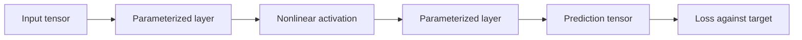
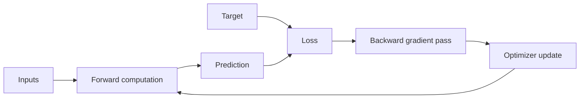
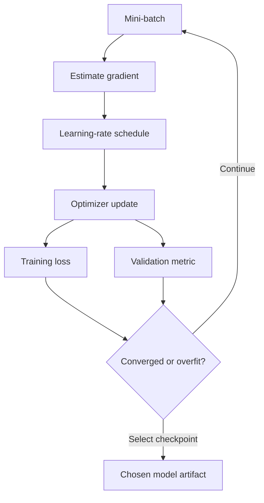
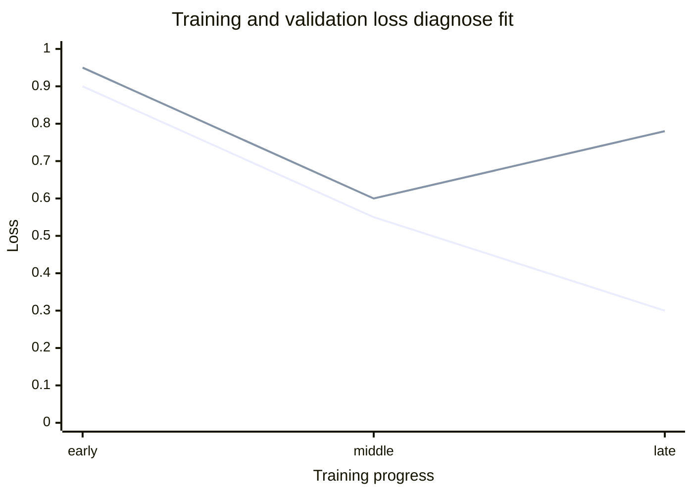
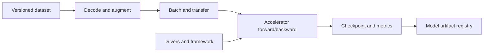

# Deep Learning Foundations

Part: [16 — Artificial Intelligence, Machine Learning, and Generative AI](PART_OVERVIEW.md)

Deep learning trains layered neural networks to transform inputs into useful representations and outputs. Each layer applies parameterized operations and nonlinearities; training adjusts parameters to reduce a loss. Its flexibility supports complex patterns but demands data, compute, careful optimization, and validation. CH08–CH10 cover major architecture families.

## Tensors, Layers, and Forward Pass

A tensor is a multidimensional array with shape, data type, and device placement. A layer maps an input tensor to an output using parameters and an operation such as matrix multiplication, convolution, or normalization. Nonlinear activations allow compositions to represent functions that a single linear transformation cannot.

Shape errors, dtype mismatch, device transfer, and batch layout are common implementation failures. Track shape and units through the forward pass. A model's output layer and loss must match the task; a probability-producing output should not be assumed calibrated without evaluation.

## Loss, Gradients, and Backpropagation

The loss function quantifies the training objective. A gradient indicates how a small parameter change affects loss. Backpropagation applies the chain rule from output to earlier layers, computing gradients efficiently through the computation graph. The optimizer uses gradients to update parameters. Vanishing or exploding gradients can prevent useful learning in deep or recurrent networks.

Gradient checks on small models can detect implementation errors. Track gradient norms, activation distributions, and loss by stage when training diverges. Gradient clipping, normalization, residual connections, or initialization can help, but diagnose the failure before applying techniques blindly.

A numeric gradient check validates an analytic implementation against a simple finite-difference estimate: for a parameter $w$ and small $h$, $\frac{\partial L}{\partial w}\approx\frac{L(w+h)-L(w-h)}{2h}$. Running this on a handful of parameters in a small model and comparing against the backpropagation-computed gradient (they should agree to several significant figures for a correct implementation and a reasonably sized $h$, such as $10^{-4}$ in double precision) catches sign errors, transposed matrices, and incorrect chain-rule steps before a large, expensive training run is wasted chasing a bug that looks like a modeling problem.

For a layer with pre-activation $z_l=W_lh_{l-1}+b_l$ and activation $h_l=\sigma_l(z_l)$, backpropagation computes the local error and propagates it through the transpose of the next layer's weights:

$$
\delta_l=(W_{l+1}^{T}\delta_{l+1})\odot\sigma_l'(z_l)
$$

The parameter gradient is then an outer product between this error and the previous layer's activation. Repeating the recurrence multiplies many weight matrices and activation derivatives. If their effective magnitudes are mostly below one, early gradients shrink; if mostly above one, they can grow rapidly. This explains why depth, activation, initialization, and normalization interact rather than acting as independent tuning knobs.

When training stalls, compare the training-loss curve with the validation-loss curve. Both flat from the start can indicate a learning rate, gradient-flow, data, or implementation problem. Training loss falling while validation degrades suggests overfitting or a split mismatch. Sudden non-finite loss points toward numerical instability, invalid labels, or an excessive update. Inspect per-layer gradient norms and activation ranges to localize the failure before changing optimizer or architecture. Residual connections provide shorter gradient paths; clipping bounds large updates but cannot restore a gradient that has already vanished.

## Optimization, Regularization, and Generalization

Stochastic gradient descent and adaptive optimizers differ in update scaling and convergence behavior. Learning rate often dominates stability; schedules can reduce it as training progresses. Batch size affects gradient noise, memory, throughput, and generalization. Regularization includes weight penalties, dropout, data augmentation, early stopping, and architectural constraints.

Momentum accumulates a moving direction, $v_t=\mu v_{t-1}+g_t$, then updates parameters by $w_{t+1}=w_t-\eta v_t$; this can smooth noisy gradients and accelerate progress along consistent directions. Adam instead tracks first and second gradient moments and scales each coordinate by its estimated magnitude, which can help when features or gradients have different scales. Adaptive updates do not remove learning-rate sensitivity or guarantee better generalization. Decoupled weight decay applies shrinkage separately from the adaptive gradient update; treating decay and loss regularization as identical can be incorrect for adaptive optimizers. Compare optimizers under the same data split, budget, and stopping rule, then retain the full configuration with the checkpoint.

Monitor both training and validation curves. A falling training loss with worsening validation quality suggests overfitting or distribution mismatch. Early stopping selects a checkpoint using validation evidence; repeated tuning on a small validation set can also overfit that set.

The illustrated training curve continues downward while validation loss rises, a common overfitting signal. Curves are diagnostic evidence; confirm with deployment-matched data and the task metric.

## Training Systems and Accelerators

Training workloads use CPU, graphics processing units (GPUs), or other accelerators. Throughput depends on model size, batch size, data pipeline, interconnect, precision, and memory. A fast accelerator can sit idle while data loading or preprocessing is slow. Profile the end-to-end training pipeline before scaling hardware.

Mixed precision can improve throughput and memory use but requires numerical validation. Distributed training adds communication, synchronization, checkpoint, and failure complexity. Save checkpoints with model weights, optimizer state where needed, data/version references, code, and configuration.

## Worked Case and Review Checklist

A team trains a classifier on tabular embeddings with a small neural network. It verifies tensor shapes, compares against logistic regression, tracks train and validation loss, clips unstable gradients after diagnosing spikes, and profiles the input pipeline. The selected checkpoint is packaged with its preprocessing and model configuration, then evaluated on a protected holdout.

The profiling step found a concrete bottleneck worth naming: the accelerator sat idle roughly 40% of each training step waiting on CPU-side image decoding and augmentation, even though GPU utilization during the compute-bound portion looked healthy. Moving augmentation to a prefetching worker pool and caching decoded tensors removed most of that idle time, cutting wall-clock epoch time by nearly a third without any model change. This is the common shape of a "slow training" complaint that gets misattributed to the model or optimizer when the actual bottleneck is upstream of the accelerator entirely.

Review tensor shapes and dtypes, architecture/loss match, gradient health, optimizer and schedule, regularization, train/validation split, reproducibility, profiling, checkpoint contents, and resource cost.

## Questions and Summary

1. Draw the forward pass and backward gradient flow for a two-layer model.
2. What symptoms distinguish underfitting, overfitting, and optimization failure?
3. Why can increasing batch size affect more than memory use?
4. Identify bottlenecks in a training path where a GPU is underutilized.
5. What artifacts are necessary to reproduce or resume training?

Deep learning composes parameterized tensor operations and learns them through gradients and optimization. Successful training depends on stable optimization, appropriate regularization, representative validation, reproducible artifacts, and measured compute/data pipelines. Model complexity is justified only when it improves the deployment objective over simpler baselines.
