# Deep Learning Foundations

Part: [16 — Artificial Intelligence, Machine Learning, and Generative AI](PART_OVERVIEW.md) · Status: Revised (in-depth rewrite)

## 1. Introduction

Deep learning trains layered, differentiable functions called neural networks. Each layer applies a parameterized linear map followed by a nonlinearity, and a training procedure adjusts millions or billions of parameters to reduce a loss measured on examples. The idea is old, the machinery is now standard, and nearly every system discussed later in this book, from image classifiers to large language models, is trained with the procedures taught here. A solution architect does not need to write a training loop every day. An architect does need to read a training plan and say whether it will fit in memory, whether its learning rate and precision choices are plausible, whether a bad curve points to the data or the optimizer, and what a failed run will cost.

This chapter is the foundation for [CH08 — Convolutional Neural Networks](CH08_Convolutional_Neural_Networks.md), [CH09 — Recurrent Neural Networks and LSTM](CH09_Recurrent_Neural_Networks_and_LSTM.md), [CH10 — Transformers and Attention](CH10_Transformers_and_Attention.md), and everything built on them. It teaches the training mechanics that are the same across architectures: how a network computes a prediction, how the gradient of the loss is obtained by backpropagation, how optimizers and schedules use that gradient, why initialization and normalization matter, how regularization and batch size shape generalization, how numerical precision and hardware set the limits of what can be trained, and how to debug a run that does not learn.

### 1.1 Ownership and scope

Neighbouring chapters own several topics that this chapter touches. They are recapped briefly and linked, not re-taught.

| Topic | Owner | What this chapter does with it |
| --- | --- | --- |
| Empirical risk minimization, maximum-likelihood derivation of squared error and log loss, plain gradient descent, bias-variance decomposition | [CH01 — Machine Learning Foundations](CH01_Machine_Learning_Foundations.md) | Recaps in one or two sentences, then extends to mini-batches, adaptive methods, and deep networks |
| Linear and logistic regression as single-layer models | [CH03 — Regression and Classification](CH03_Regression_and_Classification.md) | Treats them as the one-layer special case of the networks here |
| Splits, leakage, metric choice, confidence intervals, model selection | [CH06 — Model Evaluation, Validation, and Selection](CH06_Model_Evaluation_Validation_and_Selection.md) | Uses the validation discipline; does not re-derive it |
| Convolution, recurrence, attention, and their architecture-specific gradient issues | [CH08](CH08_Convolutional_Neural_Networks.md), [CH09](CH09_Recurrent_Neural_Networks_and_LSTM.md), [CH10](CH10_Transformers_and_Attention.md) | Stays architecture-neutral: dense layers, residual connections, and normalization only |
| Large language model (LLM) training stages, decoding, and context | [CH15 — Large Language Model Fundamentals and Inference](CH15_Large_Language_Model_Fundamentals_and_Inference.md) | Supplies the optimizer, precision, and memory vocabulary that chapter assumes |
| Parameter-efficient adaptation (low-rank adaptation, LoRA, and related methods) | [CH20 — Fine-Tuning, PEFT, and LoRA](CH20_Fine_Tuning_PEFT_and_LoRA.md) | Explains why full fine-tuning memory is large, which motivates that chapter |
| Inference optimization and serving | [CH28 — Inference Optimization and Model Serving](CH28_Inference_Optimization_and_Model_Serving.md) | Mentions only where training and serving numerics must agree |
| Training pipelines, experiment tracking, model registry, rollback | [CH29 — MLOps and LLMOps](CH29_MLOps_and_LLMOps.md) | Lists what a checkpoint must contain; leaves lifecycle to that chapter |
| Platform composition and cost decisions for AI workloads | [AI Cost, Performance, and Sustainability Decisions](../17_AI_Architecture/CH14_AI_Cost_Performance_and_Sustainability_Decisions.md) | Provides the arithmetic (memory, FLOPs, throughput) that those decisions rest on |

### 1.2 Reader outcomes

After studying this chapter, a reader should be able to:

1. Describe a multilayer perceptron (MLP) as a composition of affine maps and nonlinearities, count its parameters, and state what universal approximation does and does not promise.
2. Compare activation functions by their derivatives and explain which gradient pathologies each one causes or avoids.
3. Derive backpropagation in matrix form, work it by hand on a two-layer network, and explain how reverse-mode automatic differentiation generalizes it to any computation graph.
4. Derive the softmax cross-entropy gradient and choose a loss for regression, classification, imbalance, and outliers.
5. Argue for Xavier or He initialization from a variance calculation, and explain where batch, layer, root-mean-square, and group normalization are used.
6. Write the update rules for stochastic gradient descent (SGD), momentum, Nesterov momentum, RMSProp, Adam, and AdamW, and say when each fails.
7. Set a learning-rate schedule with warmup, find a learning rate with a range test, and reason about batch size, gradient noise, accumulation, and clipping.
8. Compute GPU memory for parameters, gradients, optimizer state, and activations for a 1-billion-parameter model, and explain mixed precision, loss scaling, and activation checkpointing.
9. Read a complete PyTorch training loop with validation and checkpointing, and list what must be saved to resume or reproduce a run.
10. Debug a run systematically, diagnose fit from learning curves, and plan a hyperparameter search.

## 2. Background

### 2.1 A short history

The history matters to an architect for one reason: each wave of progress came from a bottleneck being removed, not from a new idea about intelligence. The recurring bottlenecks were optimization, data, and compute, and they are still the three things a project must budget.

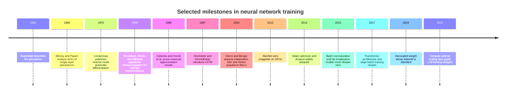

Frank Rosenblatt described the perceptron in 1958 as a trainable threshold unit. Marvin Minsky and Seymour Papert (1969) showed that a single layer of such units cannot compute some simple functions, the exclusive-or (XOR) function being the standard example, and the field's attention moved elsewhere for years. The remedy, stacking layers, was known; what was missing was a practical way to train the hidden layers. Seppo Linnainmaa (1970) described reverse-mode automatic differentiation, and Paul Werbos (1974) and then David Rumelhart, Geoffrey Hinton, and Ronald Williams (1986) showed that the same recursion trains the hidden layers of a network. Backpropagation is therefore an application of the chain rule organized to reuse intermediate results, and that is exactly how the derivation in Section 7 is presented.

Training deep networks stayed difficult through the 1990s and 2000s. Sepp Hochreiter (1991) and Yoshua Bengio and colleagues (1994) analyzed vanishing gradients: repeated multiplication by small derivatives starves early layers of signal. The 2010 to 2015 period removed the obstacles one at a time. Xavier Glorot and Yoshua Bengio (2010) gave a variance argument for initialization. Vinod Nair and Geoffrey Hinton (2010) popularized the rectified linear unit (ReLU). Alex Krizhevsky, Ilya Sutskever, and Geoffrey Hinton (2012) trained a deep convolutional network on graphics processing units (GPUs) and won the ImageNet benchmark by a wide margin. Diederik Kingma and Jimmy Ba (2014) published Adam, Nitish Srivastava and colleagues (2014) published dropout, Sergey Ioffe and Christian Szegedy (2015) published batch normalization, and Kaiming He and colleagues (2015) published both a rectifier-aware initialization and residual connections (2016). Ilya Loshchilov and Frank Hutter (2017, published 2019) separated weight decay from the adaptive update, giving AdamW. These contributions are the standard toolkit that the rest of the chapter explains.

### 2.2 What changed in practice

Two shifts separate current practice from textbooks of fifteen years ago. First, scale moved from a design option to the main design variable. Jared Kaplan and colleagues (2020) reported smooth power-law relations between loss and model size, data, and compute for language models, and Jordan Hoffmann and colleagues (2022) refined the compute-optimal ratio of data to parameters. Whatever the exact exponents turn out to be for a given domain, the planning consequence is stable: the cost of a run is dominated by arithmetic and memory that can be computed in advance, which is why this chapter spends several sections on that arithmetic. Second, the same small set of components, a normalization layer, a residual connection, an AdamW optimizer, a warmup-then-decay schedule, mixed precision, and gradient clipping, appears in almost every serious recipe. Knowing why each is there is more useful than memorizing any single recipe, because the recipe changes with the architecture while the reasons do not.

## 3. From Perceptron to Multilayer Perceptron

### 3.1 The perceptron

A perceptron computes a weighted sum of its inputs and applies a threshold. For an input vector $x\in\mathbb{R}^d$, weights $w\in\mathbb{R}^d$, and bias $b\in\mathbb{R}$:

$$
\hat{y} = \begin{cases} 1 & \text{if } w^\top x + b > 0\\ 0 & \text{otherwise}\end{cases}
$$

The score $w^\top x + b$ is the same linear score used by linear and logistic regression in [CH03](CH03_Regression_and_Classification.md). The perceptron differs only in the output: a hard threshold instead of a probability. The set of points where $w^\top x + b = 0$ is a hyperplane, so a perceptron can separate two classes only if some hyperplane separates them. Data with that property is called linearly separable.

Rosenblatt's learning rule updates weights only on mistakes. For a training example $(x, t)$ with target $t\in\{0,1\}$ and prediction $\hat{y}$, set $w \leftarrow w + (t-\hat{y})\,x$ and $b \leftarrow b + (t-\hat{y})$. A correct prediction changes nothing. A false negative adds the input to the weights, which raises the score for that input; a false positive subtracts it. The perceptron convergence theorem states that if the data are linearly separable, this rule reaches a separating hyperplane after a finite number of mistakes.

A worked run on the logical AND function shows the mechanics. The four examples are $(0,0)\to0$, $(0,1)\to0$, $(1,0)\to0$, and $(1,1)\to1$, presented in that order each epoch, starting from $w=(0,0)$ and $b=0$, with the rule "output 1 if the score is strictly greater than zero".

- Epoch 1. The first three examples score $0$, so the prediction is 0 and matches the targets. The fourth, $(1,1)$, also scores $0$ and is predicted 0, but its target is 1. The error is $t-\hat{y}=1$, so $w\leftarrow(1,1)$ and $b\leftarrow1$. One mistake.
- Epoch 2. Example $(0,0)$ scores $1$, predicted 1, target 0: error $-1$, so $b\leftarrow0$. Example $(0,1)$ scores $1$, predicted 1, target 0: error $-1$, so $w\leftarrow(1,0)$ and $b\leftarrow-1$. Continuing in the same way ends the epoch at $w=(2,1)$ and $b=0$, after three mistakes.
- Epochs 3, 4, and 5 make three, two, and one mistakes while the weights settle.
- Epoch 6 makes no mistakes, with $w=(2,1)$ and $b=-2$. Checking: $(1,1)$ scores $2+1-2=1>0$; $(0,1)$ scores $-1$; $(1,0)$ scores $0$; $(0,0)$ scores $-2$. All four are classified correctly.

The perceptron's limit is geometric. XOR labels $(0,1)$ and $(1,0)$ as 1 and $(0,0)$ and $(1,1)$ as 0. No single line separates these two pairs, because the two positive points lie on opposite corners of the unit square and the midpoint of that segment, $(0.5,0.5)$, is also the midpoint of the segment between the two negative points. Any hyperplane that puts both positive points on its positive side must put $(0.5,0.5)$ there too, and then it cannot put both negative points on the negative side. This is the content of the 1969 critique.

### 3.2 Hidden layers solve XOR

Adding a hidden layer changes the geometry: the hidden layer re-represents the input so that the output layer's job becomes linearly separable. The smallest example is a two-unit ReLU hidden layer. Let $h_1=\max(0, x_1+x_2)$ and $h_2=\max(0, x_1+x_2-1)$, and let the output be $y=h_1-2h_2$. The four inputs give:

| $x_1$ | $x_2$ | $h_1$ | $h_2$ | $y=h_1-2h_2$ |
| --- | --- | --- | --- | --- |
| 0 | 0 | 0 | 0 | 0 |
| 0 | 1 | 1 | 0 | 1 |
| 1 | 0 | 1 | 0 | 1 |
| 1 | 1 | 2 | 1 | 0 |

The hidden layer maps the four points into a space where $(1,1)$ lands at $(h_1,h_2)=(2,1)$ and the others land on the axis $h_2=0$. A line through the output weights then separates them. This is a hand-built network; the point is that the nonlinearity (here the clipping at zero in ReLU) is what makes the stack more expressive than one layer. Without the nonlinearity, two stacked linear maps $W_2(W_1x)$ equal one linear map $(W_2W_1)x$, and depth would add nothing.

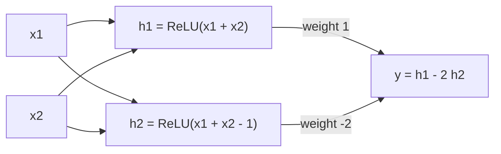

The diagram shows the smallest network that computes XOR. Each hidden unit is a perceptron-like detector (a weighted sum and a nonlinearity), and the output combines them. Learned networks discover such arrangements by gradient descent instead of by hand, but the structure is the same: hidden units define useful intermediate features, and later layers combine them. The architectural implication is that depth buys feature composition, while width buys the number of features available at each level.

### 3.3 The multilayer perceptron

A multilayer perceptron stacks $L$ layers. With input $h_0=x$, layer $l$ computes

$$
z_l = W_l h_{l-1} + b_l, \qquad h_l = \sigma_l(z_l), \qquad l=1,\dots,L
$$

where $W_l\in\mathbb{R}^{n_l\times n_{l-1}}$ is the weight matrix, $b_l\in\mathbb{R}^{n_l}$ is the bias vector, $z_l$ is the pre-activation, $\sigma_l$ is a nonlinearity applied elementwise, and $h_l$ is the activation. The last layer usually omits the nonlinearity, or uses one matched to the loss (a sigmoid for binary probabilities, or softmax for class probabilities), and its output $z_L$ is called the logits when it feeds a softmax. In deep learning libraries the layer $z=Wh+b$ is called a linear or dense or fully connected layer.

Training processes many examples at once. Stacking $B$ examples as rows of a matrix $H_{l-1}\in\mathbb{R}^{B\times n_{l-1}}$ gives $Z_l = H_{l-1}W_l^\top + b_l^\top$, with the bias broadcast across rows. Batched matrix multiplication is the reason GPUs are effective: the work is one large, regular matrix product per layer instead of many small vector products.

```text
Shapes through a batch of B = 32 examples in a 784 -> 512 -> 256 -> 10 MLP

input   H0 : (32, 784)
layer 1 W1 : (512, 784)   b1 : (512,)   Z1 = H0 W1^T + b1  -> (32, 512)   H1 = act(Z1)
layer 2 W2 : (256, 512)   b2 : (256,)   Z2 = H1 W2^T + b2  -> (32, 256)   H2 = act(Z2)
layer 3 W3 : (10, 256)    b3 : (10,)    Z3 = H2 W3^T + b3  -> (32, 10)    logits
loss      : scalar (mean over the 32 rows)
```

The parameter count follows directly. Layer 1 has $784\times512+512=401{,}920$ parameters, layer 2 has $512\times256+256=131{,}328$, and layer 3 has $256\times10+10=2{,}570$, for a total of $535{,}818$. Two observations carry over to every architecture. Parameters are dominated by the largest weight matrices, so the first wide layer here holds three quarters of the model. And the compute per example is roughly two floating-point operations (FLOPs) per weight in the forward pass (one multiply and one add), so this model costs about $2\times535{,}818\approx1.07$ million FLOPs per example forward, ignoring biases and activations. Section 16 extends this accounting to a billion-parameter model.

Shape errors are the most common implementation failure in this stage. A useful discipline is to write the expected shape next to every tensor in the forward pass, as above, and to assert shapes in code at layer boundaries. Mismatched broadcasting does not always raise an error: adding a vector of shape $(32,)$ to a matrix of shape $(32,1)$ silently produces a $(32,32)$ matrix in NumPy-style broadcasting, which then trains and produces a plausible-looking but wrong loss. Reducing over the wrong axis, for example averaging a loss over the class axis instead of the batch axis, has the same character.

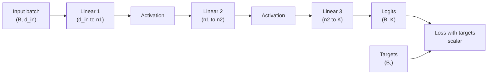

The diagram is the forward pass and loss for a three-layer MLP. Every arrow carries a tensor with a known shape, and every box is either a parameterized linear map or a parameter-free nonlinearity. Everything the rest of the chapter does, from backpropagation to memory accounting, operates on this structure: the forward pass produces activations that must be stored, the loss produces the first gradient, and the backward pass walks the arrows in reverse.

### 3.4 Representation learning in one paragraph

A linear model fixes the features and learns the weights. A multilayer network learns the features. The hidden activations $h_1,\dots,h_{L-1}$ are a learned representation of the input, and the last layer is a linear (or logistic) model on that representation. This is why the earlier chapters on feature engineering ([CH02](CH02_Data_Preparation_Feature_Engineering_and_Leakage.md)) matter less for images, text, and audio, where the network builds its own features from raw inputs, and still matter for small tabular data, where gradient-boosted trees ([CH04](CH04_Decision_Trees_and_Ensemble_Learning.md)) frequently match or beat networks with far less tuning. A neural network is the right tool when the input has structure a network can exploit, when there is enough data to learn features, and when the accuracy gain justifies the added training cost and operational weight.

## 4. Universal Approximation, and What It Does Not Promise

### 4.1 The theorem

George Cybenko (1989) proved that finite sums of the form $\sum_{j=1}^{N}\alpha_j\,\sigma(w_j^\top x+b_j)$, with $\sigma$ a sigmoid, can approximate any continuous function on a compact set (a closed, bounded region of input space) to any desired accuracy. Kurt Hornik, Maxwell Stinchcombe, and Halbert White (1989) and Hornik (1991) extended the result to a broad class of activation functions, and Moshe Leshno and colleagues (1993) showed that a continuous activation yields universal approximation if and only if it is not a polynomial. The statement is about a network with one hidden layer and enough hidden units. In plain terms: for any continuous target function, any error tolerance $\varepsilon$, and any bounded input region, there exists a one-hidden-layer network whose output is within $\varepsilon$ of the target everywhere in that region.

An intuition for why this is true comes from ReLU networks in one dimension. A sum of shifted ReLU units is a continuous piecewise-linear function, and each additional unit adds one more breakpoint. A continuous function on an interval can be approximated by a piecewise-linear one with enough breakpoints, to any tolerance. Higher dimensions follow the same logic with more bookkeeping.

### 4.2 What the theorem does not say

The theorem is an existence statement about expressiveness. A practitioner should be able to list exactly what it leaves open.

1. **It does not bound the width.** The number of hidden units needed can grow exponentially with the input dimension for generic functions. "Enough units" can mean more than any machine can hold. Andrew Barron (1993) gave approximation rates for functions with a particular smoothness property that do not depend badly on dimension, but those rates apply to a restricted function class.
2. **It does not say gradient descent will find the weights.** The theorem asserts that good weights exist. Training minimizes a non-convex loss with a local procedure, and nothing in the theorem guarantees that the procedure reaches the approximating solution, or reaches it in reasonable time.
3. **It does not address generalization.** Approximating a function on the training set, or on all of a compact set, is a different statement from predicting well on unseen draws of a data distribution from a finite sample. Matching a training set exactly is easy for large networks, as the random-label experiments in Section 21 show, and says little about test performance.
4. **It does not favour shallow over deep.** The result is about one hidden layer. There are function families that deep networks represent with polynomially many units where a shallow network needs exponentially many, which is part of why depth is used, but the theorem does not tell a designer how to choose depth for a task. Depth also changes optimization: a deep composition has a different loss surface than a wide shallow one.
5. **It is silent on data and noise.** The target is assumed to be a fixed continuous function. Real labels are noisy, inputs are finite precision numbers drawn from unknown distributions, and the "function" being learned is a conditional distribution.
6. **It does not constrain robustness or extrapolation.** Outside the compact region, or in regions with no training data, the approximating network can behave arbitrarily. A ReLU network extrapolates linearly along rays, which is a property of the architecture, not evidence about the true function.

The practical reading is modest. Universal approximation removes one objection, that a network family might be too weak to represent the target at all, and then hands the burden to data, optimization, and generalization. When a proposal says "neural networks can approximate any function, so this will work", the design review should replace that sentence with the questions that matter: how much data, what architecture prior, which optimizer and budget, and what held-out evidence.

### 4.3 Depth versus width in practice

A one-hidden-layer network with a million units is a legitimate universal approximator and a poor engineering choice for most tasks. Deep networks compose features: edges into textures into parts into objects for images, characters into words into phrases for text. Composition lets later layers reuse earlier features across many inputs and gives the model a built-in bias toward hierarchical structure. The cost of depth is a harder optimization problem (gradients must pass through many layers, Section 7.7) and a larger activation memory footprint (Section 16). Residual connections and normalization, introduced later in the chapter, are the techniques that make depth trainable. Width has different costs: the parameter count and per-layer compute grow with the square of width for dense layers, and very wide layers are the ones that dominate memory.

A decision rule that works in practice is to start from a published architecture for the data type, change one thing at a time, and treat depth and width as hyperparameters tuned against validation evidence, subject to a latency and memory budget fixed in advance. The architecture chapters ([CH08](CH08_Convolutional_Neural_Networks.md), [CH09](CH09_Recurrent_Neural_Networks_and_LSTM.md), [CH10](CH10_Transformers_and_Attention.md)) give the structured priors that make that search tractable.

## 5. Activation Functions and Their Gradients

The activation function supplies the nonlinearity that makes depth useful, and its derivative is multiplied into the gradient at every layer during backpropagation. A good activation therefore does two jobs. It must shape the function the layer can represent, and it must pass gradient to earlier layers without shrinking or inflating it. This section compares the common choices on both counts. Derivatives are the key quantity, because Section 7 shows that the gradient reaching layer $l$ contains a product of one activation derivative per layer above it.

### 5.1 Sigmoid and tanh

The logistic sigmoid is $\sigma(z)=1/(1+e^{-z})$. Its output lies in $(0,1)$, which makes it the natural final-layer choice for a probability, and its derivative has a convenient closed form:

$$
\sigma'(z)=\sigma(z)\,\bigl(1-\sigma(z)\bigr)
$$

The derivative peaks at $z=0$ with value $0.25$ and falls off quickly on both sides: $\sigma'(2)=0.105$, $\sigma'(4)=0.0177$, and $\sigma'(-6)=0.00247$. Two properties made sigmoid a poor hidden-layer activation in deep networks. First, the maximum slope is $0.25$, so even in the best case each layer multiplies the backward signal by at most a quarter times the weight magnitude. For ten layers with weights of magnitude about one, the factor is $0.25^{10}\approx9.5\times10^{-7}$, so the first layer's gradient is about a million times smaller than the last layer's. Second, the output is always positive, so the inputs to the next layer are not centered at zero. For a neuron whose inputs are all positive, the gradients with respect to its incoming weights all share the sign of the neuron's error signal. The weights are then pushed together in one direction, and training zigzags.

The hyperbolic tangent is a rescaled sigmoid: $\tanh(z)=2\sigma(2z)-1$, with output in $(-1,1)$ and derivative $\tanh'(z)=1-\tanh^2(z)$. Its maximum slope is $1$ at zero, which is four times larger than sigmoid's, and its output is centered at zero. Both advantages made tanh the preferred hidden activation before ReLU. It still saturates: $\tanh'(1)=0.420$ and $\tanh'(2)=0.0707$. A unit whose pre-activation is large in magnitude passes almost no gradient, and a saturated unit has an output stuck near $\pm1$ whatever the small changes in its weights. Recurrent networks ([CH09](CH09_Recurrent_Neural_Networks_and_LSTM.md)) and the gates of long short-term memory (LSTM) cells still use sigmoid and tanh by design, because bounded outputs are the goal there.

### 5.2 The ReLU family

The rectified linear unit is $\mathrm{ReLU}(z)=\max(0,z)$, with derivative $1$ for $z>0$ and $0$ for $z<0$ (the value at exactly zero is a convention, usually taken as zero). ReLU became the default hidden activation after 2010 for three reasons. It is cheap, a comparison and a select. It does not saturate for positive inputs, so a unit that is active passes gradient at full strength, which removes the multiplicative shrinkage of sigmoid. And it produces sparse activations, since roughly half the units of a layer are zero for a typical input under symmetric initialization.

The cost is the dying ReLU problem. If a unit's pre-activation is negative for every training example, its output is zero and its gradient is zero, so none of its incoming weights or bias is updated, and it stays negative. A large learning rate that pushes a bias strongly negative, or a bad initialization, can kill a large share of units. The chapter's worked example shows the effect in miniature: with the weights of Section 7.3 and the input $x=(-1,-2)$, both pre-activations are negative ($-1.2$ and $-2.1$), both hidden outputs are zero, and the gradient to every first-layer weight is zero for that example. A single dead example is normal. A unit that is dead for all examples is a lost parameter, and monitoring the fraction of units that are always zero is a standard diagnostic.

Several variants keep a small gradient on the negative side.

- **Leaky ReLU** (Andrew Maas, Awni Hannun, and Andrew Ng, 2013) uses $\max(\alpha z, z)$ with a small fixed slope such as $\alpha=0.01$ for negative inputs.
- **Parametric ReLU** (He and colleagues, 2015) learns $\alpha$ as a parameter.
- **Exponential linear unit** (ELU; Djork-Arné Clevert, Thomas Unterthiner, and Sepp Hochreiter, 2015) uses $\alpha(e^{z}-1)$ for negative inputs, which is smooth and pushes mean activations toward zero.
- **Scaled ELU** (SELU; Günter Klambauer and colleagues, 2017) scales ELU with fixed constants so that, under specific conditions, activations self-normalize. It requires a particular initialization and architecture, and it is rarely chosen in current practice.

These variants cost little and sometimes help in small networks. In large architectures they have mostly been displaced by the smooth activations below, and the choice is made by the reference architecture rather than by a fresh experiment.

### 5.3 GELU and SiLU

The Gaussian error linear unit (GELU; Dan Hendrycks and Kevin Gimpel, 2016) multiplies the input by the probability that a standard normal variable is below it:

$$
\mathrm{GELU}(z)=z\,\Phi(z), \qquad \Phi(z)=\tfrac12\Bigl(1+\mathrm{erf}\bigl(z/\sqrt2\bigr)\Bigr)
$$

where $\Phi$ is the standard normal cumulative distribution function. For large positive $z$ it behaves like the identity, for large negative $z$ it goes to zero, and near zero it is smooth. Unlike ReLU it has a small negative dip, with $\mathrm{GELU}(-1)=-0.1587$ and $\mathrm{GELU}(-3)=-0.004$, and a nonzero gradient on the negative side. A widely used fast approximation replaces $\Phi$ with a tanh expression, $0.5z\bigl(1+\tanh(\sqrt{2/\pi}(z+0.044715z^3))\bigr)$, which gives $0.8412$ at $z=1$ against the exact $0.8413$. GELU is the activation in the original Bidirectional Encoder Representations from Transformers (BERT) and in Generative Pre-trained Transformer (GPT) style models.

The sigmoid linear unit (SiLU, also called Swish; the work of Prajit Ramachandran, Barret Zoph, and Quoc Le in 2017 searched for it automatically, and Stefan Elfwing and colleagues described it earlier) is $z\,\sigma(z)$. It resembles GELU closely: $\mathrm{SiLU}(1)=0.7311$ against $\mathrm{GELU}(1)=0.8413$, a visible but small difference, and both dip below zero for negative inputs. SiLU is cheaper to compute because it uses only a sigmoid.

The table gives values and derivatives at a few points, computed from the formulas above. Derivatives matter most, since backpropagation uses them.

| $z$ | Sigmoid $\sigma'$ | Tanh $\tanh'$ | ReLU $'$ | GELU $z\Phi(z)$ | GELU $'$ | SiLU $z\sigma(z)$ | SiLU $'$ |
| --- | --- | --- | --- | --- | --- | --- | --- |
| $-3$ | 0.045 | 0.0099 | 0 | $-0.0040$ | $-0.0119$ | $-0.1423$ | $-0.0881$ |
| $-1$ | 0.197 | 0.420 | 0 | $-0.1587$ | $-0.0833$ | $-0.2689$ | $0.0723$ |
| $0$ | 0.250 | 1.000 | undefined (0 by convention) | $0$ | $0.5$ | $0$ | $0.5$ |
| $1$ | 0.197 | 0.420 | 1 | $0.8413$ | $1.0833$ | $0.7311$ | $0.9277$ |
| $3$ | 0.045 | 0.0099 | 1 | $2.996$ | $1.0119$ | $2.8577$ | $1.0881$ |

Two features of the table deserve attention. The smooth activations have derivatives slightly above one for moderate positive inputs ($1.083$ for GELU at $z=1$), which is harmless; the derivative returns to one for large inputs. And their derivatives are small but nonzero for moderately negative inputs, so a unit with a mildly negative pre-activation can recover, which is the reason they are favoured in architectures deep enough that a dying-unit failure would be hard to detect.

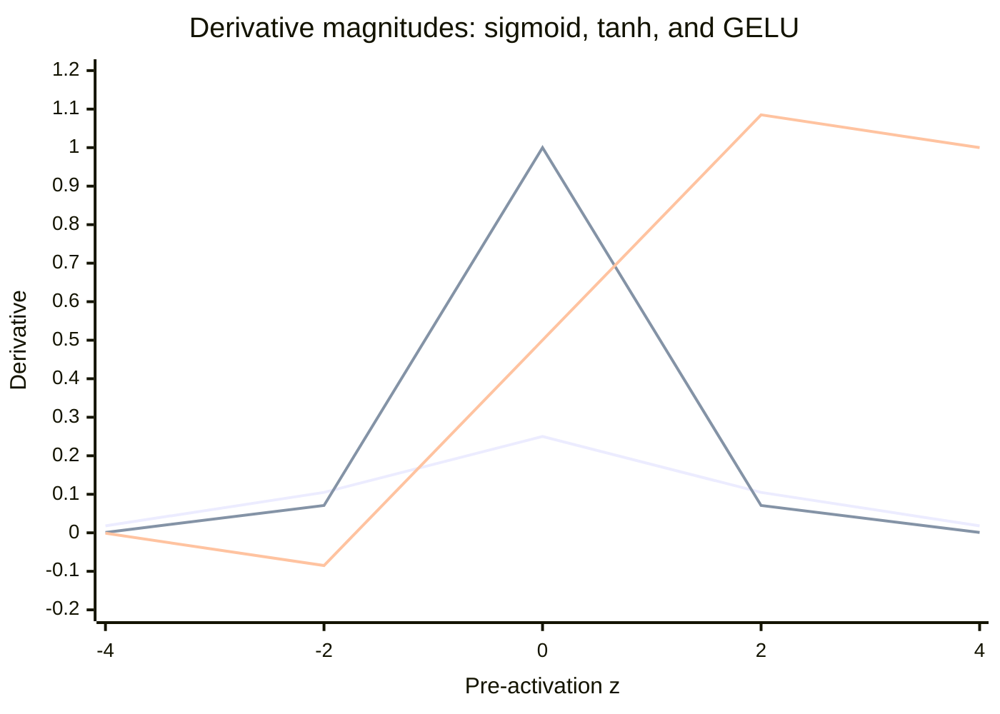

The three lines, in order, are the derivatives of sigmoid (peak $0.25$), tanh (peak $1.0$), and GELU (about $1$ for positive inputs). The first two collapse toward zero on both sides of the origin, which is the saturation that starves earlier layers. GELU keeps a derivative near one over the whole positive range. The implication for architects is that the choice of activation interacts with depth: a saturating activation is acceptable in a shallow network or inside a gate, and a non-saturating one is the default when many layers must pass gradient.

### 5.4 Gated activations: GLU and SwiGLU

Modern transformer feed-forward blocks often replace a plain activation with a gated one. A gated linear unit (GLU; Yann Dauphin and colleagues, 2017) multiplies two linear projections of the input, one of which is passed through a nonlinearity and acts as a gate. Noam Shazeer (2020) compared variants and found that the combination with SiLU as the gate, called SwiGLU (a Swish-gated linear unit), improved language-model quality at matched compute in his experiments. For input $x$ and weight matrices $W$, $V$, and $W_2$:

$$
\mathrm{FFN}_{\mathrm{SwiGLU}}(x)=\bigl(\mathrm{SiLU}(xW)\odot (xV)\bigr)\,W_2
$$

where $\odot$ is elementwise multiplication. A standard transformer feed-forward block has two matrices of shapes $d\times4d$ and $4d\times d$, which is $8d^2$ weights. The gated block has three matrices, so to keep the same parameter count the hidden width is reduced from $4d$ to $\tfrac83d$: three matrices of $d\times\tfrac83d$ give $3\cdot\tfrac83d^2=8d^2$. Families such as Llama use this arrangement, usually rounding the hidden width to a hardware-friendly multiple. The gate lets the network modulate each hidden feature by a learned, input-dependent factor, which gives it more expressive interaction between features than a pointwise activation of a single projection.

The architectural point is that "which activation" is no longer always a pointwise function: the gate adds a matrix and changes the parameter accounting. When reading a model card that lists a hidden size, check whether the feed-forward block is gated before estimating parameters and memory.

### 5.5 Choosing an activation

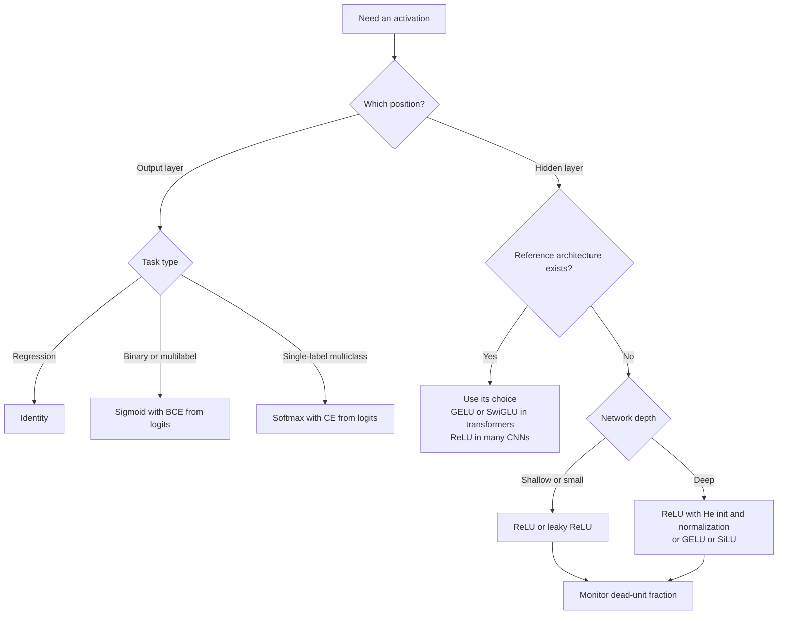

The decision tree separates the output layer, which is dictated by the task and loss, from hidden layers, which are dictated by the reference architecture first and by depth second. Two cautions complete the rule. Changing the hidden activation changes the correct initialization (He initialization assumes ReLU, Section 9), so the two choices must move together. And for the output layer, frameworks provide loss functions that take logits and apply the sigmoid or softmax internally in a numerically stable way (Section 6.3). Applying the sigmoid or softmax in the model and then a loss that expects logits is a common bug that trains slowly and gives a plausible but wrong curve.

## 6. The Forward Pass and Loss Functions

### 6.1 The forward pass as the first half of training

The forward pass evaluates the composition $\hat{y}=f_L(\cdots f_2(f_1(x)))$ and then the loss $\mathcal{L}(\hat{y},y)$ on a mini-batch. Two features matter beyond the arithmetic. First, the forward pass must remember what backpropagation will need. The derivative of ReLU needs the sign of $z$, the derivative of a product needs both factors, and the weight gradient of a linear layer needs that layer's input. These saved tensors, the activations, are the dominant memory cost during training and are quantified in Section 16. Second, the loss reduces the batch to a scalar. If it averages over examples (the default in most libraries), the gradient is the average of per-example gradients, and the learning rate has a batch-size-independent meaning. If it sums, the effective learning rate scales with batch size. Mixing the two conventions when changing batch size or combining losses from several tasks is a frequent cause of runs that suddenly need a different learning rate.

[CH01](CH01_Machine_Learning_Foundations.md) derived squared error from Gaussian noise and log loss from Bernoulli likelihood. The rest of this section applies those results to networks, adds the multiclass case, and works the gradient that dominates classification training.

### 6.2 Matching the output layer to the loss

The output activation and the loss are chosen together, and the pairing determines both the interpretation of the output and the form of the gradient.

| Task | Output layer | Loss | Output means |
| --- | --- | --- | --- |
| Regression | Identity (no activation) | Mean squared error (MSE), mean absolute error (MAE), or Huber | Predicted conditional mean (MSE), median (MAE) |
| Binary classification | One logit with sigmoid | Binary cross-entropy (BCE) | Probability of the positive class |
| Single-label multiclass | $K$ logits with softmax | Categorical cross-entropy | Probabilities summing to one |
| Multilabel classification | $K$ logits, each with sigmoid | Sum of $K$ BCE terms | $K$ independent probabilities |
| Dense detection with extreme imbalance | Sigmoid per location and class | Focal loss | Probability with reduced weight on easy examples |

The distinction between single-label and multilabel matters in practice. Softmax forces the classes to compete, so raising one probability lowers the others, which is correct when exactly one class is true. For tags where several may apply, a softmax output makes it impossible to express two high probabilities, and independent sigmoids are appropriate.

### 6.3 Softmax and numerical stability

For logits $z\in\mathbb{R}^K$, softmax converts scores into probabilities:

$$
p_k=\frac{e^{z_k}}{\sum_{j=1}^{K}e^{z_j}}
$$

The probabilities are positive and sum to one, and adding the same constant to every logit does not change them. That invariance is the key to stable computation. With logits $(1000, 1001)$, evaluating $e^{1000}$ overflows a 64-bit float, giving infinity and then not-a-number. Subtracting the maximum first gives exponents $(-1, 0)$ and probabilities $(0.2689, 0.7311)$. Cross-entropy needs $\log p_k$, and computing it as $\log(\mathrm{softmax}(z)_k)$ risks taking the log of an underflowed zero. The stable form uses the log-sum-exp function:

$$
\log p_k=z_k-\mathrm{LSE}(z), \qquad \mathrm{LSE}(z)=m+\log\sum_{j}e^{z_j-m},\quad m=\max_j z_j
$$

For the same logits the maximum is $m=1001$, so $\mathrm{LSE}=1001+\log(1+e^{-1})=1001.3133$. Then $\log p_2=1001-1001.3133=-0.3133$ and $\log p_1=1000-1001.3133=-1.3133$, which exponentiate to $0.7311$ and $0.2689$. No intermediate value overflows. This is why library cross-entropy functions take raw logits and not probabilities: `torch.nn.CrossEntropyLoss` expects logits and combines the log-softmax and the negative log-likelihood, and `torch.nn.BCEWithLogitsLoss` does the same for the sigmoid case. Passing probabilities to a function that expects logits applies the softmax twice. The loss still decreases, because the double softmax is a monotonic distortion, but the model is trained on the wrong objective and its outputs are poorly calibrated.

### 6.4 The softmax cross-entropy gradient

For a one-hot target $y$ (a vector with a single 1 at the true class), the cross-entropy loss is $\mathcal{L}=-\sum_k y_k\log p_k$. The gradient with respect to the logits has a remarkably simple form, and deriving it once shows why this loss pairs so well with softmax.

Start with the derivative of the softmax. For $p_k=e^{z_k}/S$ with $S=\sum_j e^{z_j}$, the quotient rule gives, for $k=j$, $\partial p_k/\partial z_k=p_k(1-p_k)$, and for $k\ne j$, $\partial p_k/\partial z_j=-p_kp_j$. Both cases combine into

$$
\frac{\partial p_k}{\partial z_j}=p_k(\delta_{kj}-p_j)
$$

where $\delta_{kj}$ equals $1$ when $k=j$ and $0$ otherwise. By the chain rule, $\partial\mathcal{L}/\partial z_j=\sum_k(\partial\mathcal{L}/\partial p_k)(\partial p_k/\partial z_j)$ with $\partial\mathcal{L}/\partial p_k=-y_k/p_k$. Substituting:

$$
\frac{\partial\mathcal{L}}{\partial z_j}=-\sum_k\frac{y_k}{p_k}\,p_k(\delta_{kj}-p_j)=-\sum_k y_k\delta_{kj}+p_j\sum_k y_k=-y_j+p_j
$$

because $\sum_k y_k\delta_{kj}=y_j$ and $\sum_k y_k=1$. The result is

$$
\boxed{\;\frac{\partial\mathcal{L}}{\partial z}=p-y\;}
$$

The gradient is the predicted probability vector minus the target vector. The same expression arises for the sigmoid with binary cross-entropy: with $p=\sigma(z)$ and $\mathcal{L}=-[y\log p+(1-y)\log(1-p)]$, the factor $\sigma'(z)=p(1-p)$ cancels the denominators and leaves $p-y$. Both are instances of the canonical link in generalized linear models noted in [CH03](CH03_Regression_and_Classification.md).

A worked example uses logits $z=(2.0,\,1.0,\,0.1)$ and true class $1$ (the first). The exponentials are $e^{2.0}=7.389$, $e^{1.0}=2.718$, and $e^{0.1}=1.105$, which sum to $11.212$. The probabilities are $p=(0.659,\,0.2424,\,0.0986)$. The loss is $-\ln0.659=0.4170$. The gradient is $p-y=(0.659-1,\,0.2424,\,0.0986)=(-0.341,\,0.2424,\,0.0986)$. The script [01_backprop_and_autodiff.py](../code/python/deep-learning-chapter/01_backprop_and_autodiff.py) checks this against a finite-difference estimate, and the two agree to four decimals.

Three properties of this gradient guide practice. The components sum to zero, because $\sum_jp_j=\sum_jy_j=1$, so a gradient step shifts probability mass between classes without changing the total logit shift. The magnitude is bounded: each component lies in $[-1,1]$, so the loss cannot produce an exploding gradient at the logits however wrong the prediction. And the gradient on the true class is $-(1-p_{\text{true}})$, which stays close to $-1$ when the model is confidently wrong. Compare squared error applied to a sigmoid output, where $\mathcal{L}=\tfrac12(p-y)^2$ gives $\partial\mathcal{L}/\partial z=(p-y)\,p(1-p)$. If the model predicts $p=0.0001$ for a true label $y=1$, the squared-error gradient is $(-0.9999)(0.0001)(0.9999)\approx-10^{-4}$, while the cross-entropy gradient is $-0.9999$. The squared-error loss gives a confidently wrong model almost no gradient to correct itself, because the sigmoid saturates. That is the practical reason classification uses cross-entropy.

### 6.5 The loss at initialization

A model with small random weights outputs logits near zero, so its softmax is nearly uniform with $p_k\approx1/K$, and its cross-entropy is $-\ln(1/K)=\ln K$. For $K=10$ classes the expected initial loss is $\ln10=2.303$; for $K=1000$ it is $\ln1000=6.908$. This gives the first and cheapest debugging check (Section 20): measure the loss on the first batch before any update. A value far above $\ln K$, such as $50$, means the initial logits are large and confident, which points to a bad initialization scale, an unnormalized input, or a bug in the output layer. A value far below $\ln K$ on a balanced problem suggests label leakage into the inputs. The check costs one forward pass and catches a large class of bugs before any training time is spent.

### 6.6 Regression losses: MSE, MAE, and Huber

[CH01](CH01_Machine_Learning_Foundations.md) showed that squared error corresponds to a Gaussian noise model and estimates the conditional mean, and that absolute error estimates the median. In neural networks the practical difference is the gradient. The MSE gradient with respect to the prediction is proportional to the residual $r=\hat{y}-y$, so large residuals produce large gradients, and a few mislabeled or heavy-tailed examples can dominate a batch. The MAE gradient has constant magnitude, which resists outliers but gives no signal about how close the prediction is, and its gradient flips sign abruptly at zero, which makes convergence noisy.

The Huber loss (Peter Huber, 1964) is quadratic near zero and linear beyond a threshold $\delta$:

$$
\ell_\delta(r)=\begin{cases}\tfrac12r^2 & |r|\le\delta\\ \delta\bigl(|r|-\tfrac12\delta\bigr) & |r|>\delta\end{cases}
$$

Its gradient is $r$ for small residuals and $\pm\delta$ for large ones, so the gradient magnitude is bounded by $\delta$. With $\delta=1$, a residual of $0.5$ costs $0.125$ under Huber and also $0.125$ under half-squared error. A residual of $3$ costs $2.5$ under Huber against $4.5$ under half-squared error, and a residual of $10$ costs $9.5$ against $50$. The outlier at $10$ contributes five times less loss and, more importantly, a gradient of $1$ instead of $10$. The threshold $\delta$ is in the units of the target, so it must be chosen after standardizing the target or set from the scale of typical residuals, for example the median absolute error of a baseline model. Huber is a sensible default for regression targets with occasional bad labels or heavy tails, and it avoids the unscaled-gradient spikes that sometimes trigger divergence.

### 6.7 Focal loss for extreme imbalance

When one class is very rare and examples are plentiful, as in dense object detection where most image regions are background, the many easy negatives can dominate the summed loss even if each contributes little. Tsung-Yi Lin and colleagues (2017) proposed the focal loss, which scales the cross-entropy by a factor that shrinks for well-classified examples. With $p_t$ the model's probability for the true class,

$$
\mathrm{FL}(p_t)=-(1-p_t)^{\gamma}\log p_t
$$

where $\gamma\ge0$ is the focusing parameter; $\gamma=0$ recovers cross-entropy. Take $\gamma=2$. An easy example with $p_t=0.9$ has cross-entropy $-\ln0.9=0.1054$ and focal loss $(0.1)^2\times0.1054=0.00105$, a reduction by a factor of $100$. A hard example with $p_t=0.1$ has cross-entropy $2.3026$ and focal loss $(0.9)^2\times2.3026=1.865$, reduced by only a factor of $1.23$. An example at $p_t=0.5$ is reduced fourfold. The effect is to redirect gradient toward the examples the model still gets wrong. A class-balancing weight $\alpha$ is often added as well.

Focal loss is a specialized tool. It helps when the imbalance is extreme, easy examples are numerous, and the task is dense prediction. For ordinary tabular or text classification with moderate imbalance, class weights, resampling, or moving the decision threshold using the cost analysis of [CH06](CH06_Model_Evaluation_Validation_and_Selection.md) are simpler and less likely to harm calibration. Focal loss tends to produce probabilities that are not calibrated, since it deliberately down-weights confident correct predictions, so a model trained with it needs recalibration before its scores are interpreted as probabilities.

### 6.8 Practical points that cause bugs

- **Reduction and masking.** A loss over variable-length sequences must mask padding positions and decide whether to average over tokens or over sequences. The two choices weight long and short sequences differently and interact with gradient accumulation (Section 14.3).
- **Class weights.** Passing per-class weights changes the effective data distribution. They must be applied consistently in training and in the validation loss, or the curves will not be comparable.
- **Multi-task losses.** When a network optimizes several losses, their scales set the relative gradient contributions. A loss in the thousands will swamp one near one. Normalize each term or learn the weights deliberately, and log each term separately.
- **Loss versus metric.** The training loss is a differentiable surrogate. Accuracy, F1, or business cost can change differently from the loss, and the model-selection decision should be made on the deployment metric (see [CH06](CH06_Model_Evaluation_Validation_and_Selection.md)), with the loss used for optimization and diagnosis.

## 7. Backpropagation

Training needs the gradient of the loss with respect to every parameter. A modern network has millions to billions of parameters, so the method for obtaining that gradient has to cost about as much as evaluating the network a small number of times, not once per parameter. Backpropagation does this by applying the chain rule from the output toward the input and reusing each intermediate result. This section derives it in matrix form, works a complete example by hand, and ends with the way repeated multiplication produces vanishing and exploding gradients.

### 7.1 Why not finite differences

The central finite-difference estimate $\partial\mathcal{L}/\partial w\approx[\mathcal{L}(w+h)-\mathcal{L}(w-h)]/(2h)$ requires two forward passes for each parameter. For a model with $P$ parameters that is $2P$ passes per gradient: about $1.07\times10^6$ passes for the 535,818-parameter MLP above, and $2\times10^9$ for a one-billion-parameter model. Backpropagation computes all $P$ partial derivatives in one backward pass costing about twice a forward pass. Finite differences remain useful for one purpose, which is testing a backpropagation implementation on a few parameters (Section 8.7).

### 7.2 Derivation in matrix form

Consider one example. The forward pass is $z_l=W_lh_{l-1}+b_l$ and $h_l=\sigma_l(z_l)$ for $l=1,\dots,L$ with $h_0=x$, followed by a scalar loss $\mathcal{L}$. Define the error signal at layer $l$ as the gradient of the loss with respect to that layer's pre-activation:

$$
\delta_l \equiv \frac{\partial\mathcal{L}}{\partial z_l}\in\mathbb{R}^{n_l}
$$

The derivation has three steps, each one an application of the chain rule.

**Step 1: the output layer.** The error signal at the top, $\delta_L=\partial\mathcal{L}/\partial z_L$, depends on the loss and output activation. For softmax cross-entropy or sigmoid with binary cross-entropy it equals $p-y$ (Section 6.4). For identity output with half squared error it equals $\hat{y}-y$.

**Step 2: parameters from the error signal.** Layer $l$ affects the loss only through $z_l$. Component $i$ of $z_l$ is $z_{l,i}=\sum_jW_{l,ij}h_{l-1,j}+b_{l,i}$, so $\partial z_{l,i}/\partial W_{l,ij}=h_{l-1,j}$ and $\partial z_{l,i}/\partial b_{l,i}=1$. Therefore

$$
\frac{\partial\mathcal{L}}{\partial W_{l,ij}}=\delta_{l,i}\,h_{l-1,j}\quad\Longrightarrow\quad \frac{\partial\mathcal{L}}{\partial W_l}=\delta_l\,h_{l-1}^\top,\qquad \frac{\partial\mathcal{L}}{\partial b_l}=\delta_l
$$

The weight gradient is the outer product of the layer's error signal (shape $n_l\times1$) and its input activation (shape $1\times n_{l-1}$), which has the same shape as $W_l$. In words: a weight is adjusted in proportion to how wrong the neuron it feeds is and how active the input it carries was.

**Step 3: propagate the error one layer down.** The activation $h_{l-1}$ affects the loss through $z_l=W_lh_{l-1}+b_l$, so $\partial z_{l,i}/\partial h_{l-1,j}=W_{l,ij}$ and

$$
\frac{\partial\mathcal{L}}{\partial h_{l-1}}=W_l^\top\delta_l
$$

The elementwise activation $h_{l-1}=\sigma_{l-1}(z_{l-1})$ then multiplies by its derivative, componentwise because each output depends only on the matching input:

$$
\boxed{\;\delta_{l-1}=\bigl(W_l^\top\delta_l\bigr)\odot\sigma_{l-1}'(z_{l-1})\;}
$$

This is the backpropagation recurrence. Starting at $\delta_L$ and applying it for $l=L,L-1,\dots,2$ yields every $\delta_l$, and Step 2 turns each into parameter gradients. Notice that the backward pass multiplies by the transpose $W_l^\top$ of the same matrix the forward pass used, so the information flows backward through the same connections with the same weights.

**Batched form.** For a batch of $B$ examples with activations $H_{l-1}\in\mathbb{R}^{B\times n_{l-1}}$ and error signals $\Delta_l\in\mathbb{R}^{B\times n_l}$ (rows are examples), the recurrence and gradients become matrix products:

$$
\Delta_{l-1}=\bigl(\Delta_lW_l\bigr)\odot\sigma_{l-1}'(Z_{l-1}),\qquad \frac{\partial\mathcal{L}}{\partial W_l}=\Delta_l^\top H_{l-1},\qquad \frac{\partial\mathcal{L}}{\partial b_l}=\mathbf{1}^\top\Delta_l
$$

If the loss is the mean over the batch, the $1/B$ factor is already included in $\Delta_L$, so no further division appears. If it is a sum, the factor is absent and the gradient grows with $B$. The gradient with respect to $W_l$ sums the per-example outer products, which is a single matrix multiplication and therefore efficient on a GPU.

**Cost.** Each layer's backward pass contains two matrix products, $\Delta_lW_l$ for the input gradient and $\Delta_l^\top H_{l-1}$ for the weight gradient, each the same size as the forward product $H_{l-1}W_l^\top$. The forward pass costs about $2P$ FLOPs per example (a multiply and an add for each weight), and the backward pass costs about $4P$. Together they cost $6P$ FLOPs per example, which is the origin of the rule $6ND$ used in Section 16 for the training compute of a model with $N$ parameters on $D$ examples or tokens. The first layer's input gradient $\Delta_0$ is not needed when the input is data, so its product is skipped. That saves a small part of the first layer's work and does not change the rule meaningfully.

### 7.3 A complete worked example

The network has two inputs, two ReLU hidden units, and one sigmoid output, trained with binary cross-entropy on one example. Parameters and data:

$$
W_1=\begin{pmatrix}0.5&0.4\\0.3&0.8\end{pmatrix},\ b_1=\begin{pmatrix}0.1\\-0.2\end{pmatrix},\ W_2=\begin{pmatrix}0.6&-0.7\end{pmatrix},\ b_2=0.05,\ x=\begin{pmatrix}1\\2\end{pmatrix},\ y=1
$$

**Forward pass.** The first-layer pre-activations are

$$
z_1=W_1x+b_1=\begin{pmatrix}0.5\cdot1+0.4\cdot2+0.1\\0.3\cdot1+0.8\cdot2-0.2\end{pmatrix}=\begin{pmatrix}1.4\\1.7\end{pmatrix}
$$

Both are positive, so ReLU passes them through: $h=(1.4,\,1.7)^\top$. The output pre-activation is $z_2=0.6\cdot1.4+(-0.7)\cdot1.7+0.05=0.84-1.19+0.05=-0.30$. The probability is $p=\sigma(-0.30)=1/(1+e^{0.30})=1/(1+1.34986)=0.42556$. The loss is $-\ln0.42556=0.85436$, which is higher than the chance value $\ln2=0.693$ because the network leans toward the wrong answer.

**Backward pass.** Each line below applies one formula from Section 7.2.

1. Output error: $\delta_2=p-y=0.42556-1=-0.57444$.
2. Output-layer gradients: $\partial\mathcal{L}/\partial W_2=\delta_2h^\top=(-0.57444\cdot1.4,\ -0.57444\cdot1.7)=(-0.80422,\ -0.97655)$ and $\partial\mathcal{L}/\partial b_2=-0.57444$.
3. Error at the hidden activations: $W_2^\top\delta_2=(0.6\cdot(-0.57444),\ -0.7\cdot(-0.57444))=(-0.34467,\ 0.40211)$.
4. Multiply by the ReLU derivative. Both pre-activations are positive, so $\sigma'=(1,1)$ and $\delta_1=(-0.34467,\ 0.40211)$.
5. First-layer gradients: $\partial\mathcal{L}/\partial W_1=\delta_1x^\top$, which is
$$
\begin{pmatrix}-0.34467\cdot1&-0.34467\cdot2\\0.40211\cdot1&0.40211\cdot2\end{pmatrix}=\begin{pmatrix}-0.34467&-0.68933\\0.40211&0.80422\end{pmatrix}
$$
and $\partial\mathcal{L}/\partial b_1=\delta_1=(-0.34467,\ 0.40211)$.

**Interpretation.** Every output-layer weight has a negative gradient, so increasing it lowers the loss, which makes sense because the target is $1$ and the model predicts $0.43$. The first hidden unit has a positive output weight ($0.6$), so raising its activation helps and its incoming weights have negative gradients too. The second hidden unit has a negative output weight ($-0.7$), so raising its activation hurts; its incoming weights therefore have positive gradients, and a gradient step lowers them. Backpropagation has assigned each weight a signed share of the blame.

**One update.** With learning rate $\eta=0.1$ and the rule $w\leftarrow w-\eta\,\partial\mathcal{L}/\partial w$, the parameters become $W_2=(0.6804,\ -0.6023)$, $b_2=0.1074$, $W_1=\begin{pmatrix}0.5345&0.4689\\0.2598&0.7196\end{pmatrix}$, and $b_1=(0.1345,\ -0.2402)$. Recomputing the forward pass with these values gives a loss of $0.54502$, down from $0.85436$. The decrease confirms that the gradient points in a useful direction, though one step on one example says nothing about generalization.

**A dead unit.** Keep the weights but present the input $x=(-1,-2)$. The pre-activations are $(-1.2,\,-2.1)$, both ReLU outputs are zero, the output is $p=\sigma(0.05)=0.5125$ and the loss is $0.6685$. In the backward pass the ReLU derivatives are zero, so $\delta_1=0$ and every first-layer gradient is zero for this example: the example teaches the hidden layer nothing, and only $b_2$ receives a gradient. This is dying ReLU seen at the scale of one input.

The script [01_backprop_and_autodiff.py](../code/python/deep-learning-chapter/01_backprop_and_autodiff.py) reproduces every number in this section: it computes the forward and manual backward passes, rebuilds the computation with a scalar autodiff engine, and compares all nine parameter gradients against central finite differences. The largest relative difference is $3.5\times10^{-10}$.

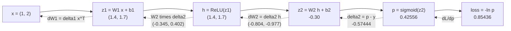

Solid arrows are the forward pass, and dashed arrows carry the gradient in the reverse direction. The diagram makes three points that generalize. The backward pass visits the same nodes in reverse order, so it cannot start before the forward pass finishes. Each backward step needs a value saved from the forward pass (the ReLU gate needs the sign of $z_1$, and the weight gradients need $h$ and $x$). And the cost of the backward pass is set by the same matrix shapes as the forward pass, which is why a backward pass costs a small multiple of a forward one and not an additional order of magnitude.

### 7.4 Gradient check as a test

Any hand-derived or custom gradient should be tested against a numerical one. The recipe is to perturb one parameter by $\pm h$ with $h\approx10^{-6}$ in 64-bit floats, compute the central difference, and compare with the analytic value using the relative difference $|a-n|/\max(|a|,|n|,\epsilon)$. Values below $10^{-6}$ indicate agreement. Values near $10^{-2}$ or above indicate a bug, most commonly a sign error, a missing transpose, a forgotten activation derivative, or a reduction over the wrong axis. In 32-bit floats the finite difference itself is noisy, so a relative difference near $10^{-3}$ may be rounding and not a bug, which is why gradient checks run in double precision on a tiny model. Non-smooth points need care: a ReLU input within $h$ of zero straddles the kink and the numeric estimate is wrong there, so check at random points that are unlikely to be near a kink.

### 7.5 Where the memory goes

Step 3 of the derivation needs $\sigma'(z_{l-1})$, which depends on $z_{l-1}$ or $h_{l-1}$, and Step 2 needs $h_{l-1}$. Therefore the forward pass must keep, for every layer, the tensors the backward pass will read. For a batch of $B$ examples and a layer of width $n_l$ that is $B\cdot n_l$ numbers per saved tensor, summed over layers. This is the activation memory, and it grows with batch size, sequence length, and depth, while parameter memory does not. Many training failures reported as "out of memory" are activation failures that a smaller micro-batch or activation checkpointing (Section 16.5) cures, and not a parameter-count problem.

### 7.6 Residual connections and the gradient path

A residual block (He and colleagues, 2016) computes $h_l=h_{l-1}+F_l(h_{l-1})$, where $F_l$ is a small stack of layers. Its Jacobian is $I+\partial F_l/\partial h_{l-1}$, where $I$ is the identity matrix. Back-propagating through many blocks multiplies such factors, and expanding the product gives a sum over paths in which some paths skip every $F_l$ and carry the gradient through the identity unchanged. As a result, the gradient reaching early layers always has a component that does not decay with depth, whatever the weights of the $F_l$ are. This is the main reason residual networks, and transformers, which are built from residual blocks, can be hundreds of layers deep. The identity term is the precise meaning of the common statement that residual connections provide shorter gradient paths. Residual networks are not free of gradient problems, since the other paths still scale with the weights and the branch outputs add variance with depth, which is one reason the normalization placement of Section 10.5 matters.

### 7.7 Vanishing and exploding gradients

Unrolling the recurrence of Section 7.2 gives the error signal at layer $l$ as a product over the layers above it:

$$
\delta_l=\Bigl(\prod_{k=l+1}^{L}\operatorname{diag}\bigl(\sigma_{k-1}'(z_{k-1})\bigr)W_k^\top\Bigr)\delta_L
$$

This is a product of $L-l$ Jacobian-like factors. If each factor changes the norm of a vector by a typical gain $g$, the norm of $\delta_l$ behaves like $g^{L-l}$ times the norm of $\delta_L$. With $g<1$ it shrinks geometrically, and with $g>1$ it grows geometrically. With scalar gains, $0.9^{50}=0.0052$, $0.9^{100}=2.7\times10^{-5}$, and $1.1^{50}=117$. A per-layer gain only ten percent away from one produces gradients that differ by two to five orders of magnitude between the top and bottom of a deep network.

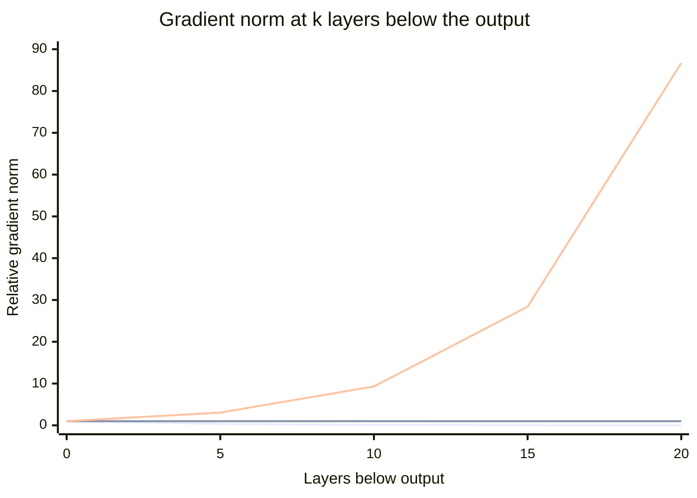

The three lines show a per-layer gain of $0.8$ (vanishing, the bottom line), $1.0$ (stable), and $1.25$ (exploding). Twenty layers at gain $0.8$ leave a gradient of $0.8^{20}=0.0115$, and twenty at $1.25$ give $86.7$. Real networks have a spread of gains that varies by layer and by input, but the geometric character is the same: small per-layer biases compound with depth.

The two failure modes look different in training logs.

- **Vanishing.** The loss decreases slowly or not at all. Gradient norms for early layers are orders of magnitude below those of late layers. Early layers barely change, so the network behaves like a shallow one on top of random features. No error is raised.
- **Exploding.** The loss spikes or becomes `inf` or `nan`. Gradient norms jump by orders of magnitude. A single large update can push weights into a region where activations saturate or overflow, after which the run rarely recovers.

Sources of the gain include the activation derivative (maximum $0.25$ for sigmoid), the weight scale (set by initialization, Section 9), and the interaction of many weight matrices, which can have large singular values in some directions. Remedies address one source each, and they are best understood as a set that is usually applied together.

| Remedy | Mechanism | Primary effect |
| --- | --- | --- |
| Non-saturating activation (ReLU, GELU) | Derivative near one for active units | Less vanishing from the activation |
| Variance-preserving initialization (Xavier, He) | Weight scale chosen so signals keep their variance | Gain near one at the start of training |
| Normalization (batch, layer, RMS) | Re-centers and rescales activations at each layer | Keeps pre-activations in a good range during training |
| Residual connections | Identity term in the Jacobian | Gradient path whose gain does not depend on depth |
| Gating (LSTM, GLU) | Learned multiplicative paths near one | Controlled gain for long sequences, see [CH09](CH09_Recurrent_Neural_Networks_and_LSTM.md) |
| Gradient clipping | Bounds the update norm | Contains explosions; cannot repair vanishing |
| Lower learning rate and warmup | Smaller steps while statistics are unsettled | Avoids divergence from early large updates |

The last two rows deserve emphasis. Clipping and a lower learning rate limit the damage from large gradients, but they cannot restore a gradient that has already vanished, because a vanished gradient is small and not large. Diagnose which regime the run is in before choosing a remedy; Section 20 gives the procedure.

## 8. Reverse-Mode Automatic Differentiation and Computation Graphs

Section 7 derived backpropagation for a stack of dense layers. Real models contain convolutions, attention, normalization, branching, and custom operations, and nobody derives their gradients by hand for every new architecture. Automatic differentiation (autodiff, AD) is the general method that produces exact gradients for any program built from differentiable primitives. Backpropagation is its reverse-mode special case applied to a neural network.

### 8.1 Three ways to get a derivative

| Method | How it works | Accuracy | Cost for $P$ parameters | Typical use |
| --- | --- | --- | --- | --- |
| Numerical (finite differences) | Evaluate the function at perturbed inputs | Approximate, limited by $h$ and rounding | $2P$ forward evaluations | Testing implementations |
| Symbolic | Manipulate an algebraic expression to produce a derivative expression | Exact | Expression can grow enormously ("expression swell") | Computer algebra systems |
| Automatic | Apply the chain rule to the sequence of primitive operations actually executed | Exact up to floating-point rounding | One backward pass, a small multiple of one forward pass | All deep learning frameworks |

Autodiff differentiates the program that was run, not a formula. It evaluates a derivative at a specific input, using the known derivative rule of each primitive operation, and combines them by the chain rule. Control flow such as loops and conditionals is handled naturally because the executed path is what gets recorded.

### 8.2 Computation graphs

A computation graph is a directed acyclic graph whose nodes are operations (add, multiply, matrix multiply, ReLU, exponential) and whose edges are the tensors passed between them. The graph for the worked example in Section 7.3 has a node for each of the matrix products, additions, the ReLU, the sigmoid, and the log. Each node knows two things: how to compute its output from its inputs, and how to turn a gradient on its output into gradients on its inputs.

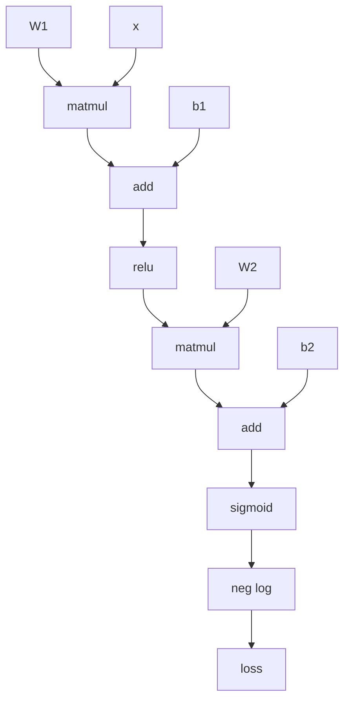

The graph is the object the framework builds as the forward pass runs. Leaf nodes (`W1`, `b1`, `W2`, `b2`, `x`) are inputs; parameters are the leaves for which gradients are requested. Every internal node stores the small amount of information its backward rule needs, and the whole structure is kept alive until the backward pass consumes it. The implication is that the graph is memory. Holding a reference to a loss tensor across training steps, for example by appending it to a Python list for logging, keeps the whole graph alive and leaks memory step after step. Logging `loss.item()` or `loss.detach()` avoids that.

### 8.3 Forward mode and reverse mode

Consider a function $f:\mathbb{R}^n\to\mathbb{R}^m$ with Jacobian matrix $J\in\mathbb{R}^{m\times n}$. The two modes of autodiff compute different products with $J$.

- **Forward mode** propagates a tangent vector $v\in\mathbb{R}^n$ alongside the values and yields the Jacobian-vector product $Jv$ in one pass. To obtain the full Jacobian it must be run $n$ times, once per input direction.
- **Reverse mode** records the computation, then propagates an adjoint (cotangent) vector $u\in\mathbb{R}^m$ backward and yields the vector-Jacobian product $u^\top J$ in one pass. The full Jacobian needs $m$ passes, once per output.

Training has one scalar loss, so $m=1$, and the vector-Jacobian product with $u=1$ is exactly the gradient with respect to all $n$ parameters. One reverse pass delivers all $n=10^9$ partial derivatives. Forward mode would need $10^9$ passes. The general result (often called the cheap gradient principle) is that the reverse pass costs a bounded constant multiple of the forward evaluation, independent of $n$. For dense layers the multiple is about two, as Section 7.2 showed. When the number of outputs is large and the number of inputs is small, forward mode wins, which is why it appears in applications such as computing Jacobians of small systems or Hessian-vector products, and not in network training.

### 8.4 The reverse-mode algorithm

Let each node $v$ have an adjoint $\bar{v}=\partial\mathcal{L}/\partial v$. The algorithm is:

1. Run the forward pass in topological order, storing the values the backward rules need, and record the graph.
2. Set $\bar{\mathcal{L}}=1$ and all other adjoints to zero.
3. Visit nodes in reverse topological order. For each node $v$ with inputs $u_1,\dots,u_k$, compute the contribution to each input's adjoint using the local rule and **add** it: $\bar{u}_i \mathrel{+}= \bar{v}\,\partial v/\partial u_i$.
4. After the sweep, the adjoints of the leaf parameters are the gradients.

The accumulation in step 3 is the detail that makes branching correct. If a value is used twice, the total derivative is the sum over both uses, by the multivariate chain rule. Consider $y=x\cdot x+x$ at $x=3$. The graph has a multiply node using $x$ twice and an add node using the product and $x$ again. The product node receives adjoint $\bar{p}=1$ from the add and passes $\bar{p}\cdot x=3$ to each of its two multiplication inputs, so $x$ receives $3+3=6$ from the multiply. The add node also sends $1$ directly to $x$. The total is $6+1=7=2x+1$ at $x=3$. A framework that assigned instead of accumulated would keep only the last contribution it wrote, a wrong value such as $3$ or $1$. This accumulation is also why PyTorch's `.grad` fields accumulate across multiple `backward()` calls by default (Section 8.6).

The following minimal engine, which is the one in the example script, shows how little code the algorithm needs for scalar values. Each operation stores its inputs and a closure that pushes its output adjoint to its inputs.

```python
class Value:
    def __init__(self, data, parents=(), backward=lambda: None):
        self.data, self.grad = data, 0.0
        self._parents, self._backward = parents, backward

    def __mul__(self, other):
        out = Value(self.data * other.data, (self, other))
        def _bw():                                  # local rule: d(ab)/da = b, d(ab)/db = a
            self.grad  += other.data * out.grad     # accumulate, never assign
            other.grad += self.data  * out.grad
        out._backward = _bw
        return out

    def backward(self):
        order, seen = [], set()
        def visit(v):                               # depth-first topological sort
            if id(v) not in seen:
                seen.add(id(v))
                for p in v._parents:
                    visit(p)
                order.append(v)
        visit(self)
        self.grad = 1.0                             # d(loss)/d(loss)
        for v in reversed(order):
            v._backward()
```

The listing is abridged to the multiplication operation and the traversal. The full file adds addition, ReLU, exponential, logarithm, and reciprocal, which is enough to express the sigmoid and the cross-entropy of Section 7.3. Production frameworks implement the same idea with tensors instead of scalars, so each local rule is a vector-Jacobian product on arrays, and a matrix multiply's rule is the pair of matrix products from Section 7.2.

### 8.5 What each primitive stores and why fused operations exist

Each primitive's backward rule defines what the forward pass must save. Addition saves nothing. Multiplication saves both operands. A matrix multiply saves both operands (the input for the weight gradient, the weight for the input gradient). ReLU saves a mask or the input sign. Softmax saves its output. This is why a tensor operation's memory cost on the backward pass cannot be judged from its output size alone.

Fused operations combine several primitives into one kernel with a hand-derived backward. The most important is the cross-entropy computed from logits: its backward is the simple $p-y$ of Section 6.4, instead of a backward through a softmax, a log, and a gather, which would be slower and less accurate. Other examples are fused layer normalization and fused attention kernels (FlashAttention; Tri Dao and colleagues, 2022), which avoid storing the full attention matrix and recompute pieces during the backward pass, trading arithmetic for memory. Fusion therefore matters for both speed and memory, and it is the first place to look when a framework implementation is slower than expected.

### 8.6 PyTorch semantics an engineer must know

The following behaviours of PyTorch's autograd cause most of the confusing bugs. They apply with minor syntax differences to other define-by-run frameworks.

- **`requires_grad` marks leaves for which gradients are computed.** Parameters have it set by default. Inputs normally do not.
- **`loss.backward()` accumulates into `.grad`.** It adds to the existing value. The training loop must clear gradients each step, with `optimizer.zero_grad(set_to_none=True)`, or the update will use the sum of all previous steps' gradients. This accumulation is a feature when deliberately used for gradient accumulation (Section 14.3).
- **`torch.no_grad()` and `torch.inference_mode()` disable graph construction.** Use one of them for validation and inference. It saves the activation memory and speeds up the pass. Forgetting it during validation silently builds a graph and may exhaust memory.
- **`.detach()` cuts a tensor from the graph.** The result shares data but carries no gradient history. It is the right way to store values for logging, and it is the means of stopping gradients in constructions such as target networks.
- **`retain_graph=True` keeps the graph after a backward call.** The default frees it to save memory, so calling `backward()` twice on the same graph raises an error. Needing it is usually a sign that two losses should be summed and back-propagated once.
- **In-place operations can corrupt saved tensors.** Autograd tracks a version counter on each tensor and raises an error at backward time if a tensor needed by the backward pass was modified in place. The error message points at the modified tensor.
- **Non-differentiable operations break the chain.** `argmax`, rounding, and integer indexing produce zero or undefined gradients. A model that is trained through such an operation receives no learning signal from it. Workarounds such as the straight-through estimator replace the backward rule with the identity for that operation, and should be used knowingly.
- **Frameworks differ in graph timing.** PyTorch builds the graph dynamically as Python runs ("define-by-run"), which makes debugging with ordinary print statements possible. JAX traces a function into a graph and compiles it, which gives optimization opportunities and requires pure functions. PyTorch's `torch.compile` captures the graph for optimization while preserving the define-by-run interface. The numerical results should agree; differences in speed and in debugging experience are the practical consequences.

### 8.7 Gradient checking of framework code

Autodiff gives exact derivatives of the operations as implemented, so gradient bugs in framework code come from custom operations and from wrong forward definitions. PyTorch provides `torch.autograd.gradcheck`, which compares analytic and numerical Jacobians for a function, and it expects double-precision inputs. Use it whenever a custom `torch.autograd.Function` is written. For a whole model, the cheaper tests are behavioural: the loss at initialization should equal $\ln K$ (Section 6.5), and the model should be able to overfit one batch (Section 20.1). A passing gradient check on a custom operation plus a model that overfits one batch rules out most gradient bugs.

## 9. Weight Initialization

Training starts from random weights, and where it starts decides whether the first thousand steps are productive. Section 7.7 showed that gradients scale geometrically with depth. Initialization sets the starting gain of every layer, so a bad choice produces a network in which signals vanish or explode before any learning happens. This section derives a rule for the weight scale from a variance argument, tests it on a deep network, and lists the practical conventions.

### 9.1 Why not zeros, and why not any random numbers

Setting all weights to the same value, zero or otherwise, makes every hidden unit in a layer compute the same function. Their error signals are then identical, their gradients are identical, and they stay identical after every update. The layer behaves as a single unit repeated many times. This is the symmetry problem, and random initialization exists to break it. Biases can safely start at zero because the weights already differ. A common exception is the final bias of a classifier on a heavily imbalanced problem, which can be set to the log-odds of the base rate so that the initial loss starts near the entropy of the labels and not much higher.

Random is not enough, because the scale matters. Suppose each weight is drawn independently from a normal distribution with standard deviation $0.01$. A layer with $64$ inputs then multiplies the typical signal by roughly $0.01\sqrt{64}=0.08$, and thirty such layers multiply it by $0.08^{30}\approx10^{-33}$. If the standard deviation is $1$, the per-layer factor is $8$, and thirty layers give $8^{30}\approx10^{27}$, before the activation changes anything. The goal is a scale for which the per-layer factor is approximately one.

### 9.2 The variance argument (Xavier or Glorot)

Consider one layer $z=Wh$ with $n_{\text{in}}$ inputs and ignore the bias. Assume the weights $w_{ij}$ are independent, have zero mean and variance $\sigma_w^2$, and are independent of the inputs $h_j$, which are independent with zero mean and common variance $\operatorname{Var}(h)$. Then each output $z_i=\sum_{j=1}^{n_{\text{in}}}w_{ij}h_j$ has

$$
\operatorname{Var}(z_i)=\sum_{j=1}^{n_{\text{in}}}\operatorname{Var}(w_{ij}h_j)=n_{\text{in}}\,\sigma_w^2\,\operatorname{Var}(h)
$$

To keep the variance of the pre-activations constant from layer to layer in the forward pass, require $n_{\text{in}}\sigma_w^2=1$, that is $\sigma_w^2=1/n_{\text{in}}$.

The backward pass has the mirror-image structure. By the recurrence of Section 7.2, the gradient with respect to an input $h_j$ is $\sum_iw_{ij}\delta_i$, a sum over the $n_{\text{out}}$ outputs. Under the same independence assumptions, $\operatorname{Var}(\partial\mathcal{L}/\partial h_j)=n_{\text{out}}\sigma_w^2\operatorname{Var}(\delta)$, which stays constant if $\sigma_w^2=1/n_{\text{out}}$. The two requirements agree only for square layers. Xavier Glorot and Yoshua Bengio (2010) took the harmonic compromise:

$$
\sigma_w^2=\frac{2}{n_{\text{in}}+n_{\text{out}}}
$$

Equivalent uniform form: a uniform distribution on $[-a,a]$ has variance $a^2/3$, so $a=\sqrt{6/(n_{\text{in}}+n_{\text{out}})}$. For a $4096\times4096$ layer, the Xavier variance is $2/8192$ and the standard deviation is $1/64=0.015625$.

The derivation assumed that the activation acts like the identity near zero, which is a fair approximation for tanh with small pre-activations and wrong for ReLU, where half the signal is discarded.

### 9.3 He initialization for ReLU

For a ReLU unit $h=\max(0,z)$ with $z$ symmetric around zero, the output is zero half the time and equals $z$ the other half, so $\mathbb{E}[h^2]=\tfrac12\operatorname{Var}(z)$. The second moment of the next layer's input is therefore half the variance of the previous pre-activation, and the forward relation becomes $\operatorname{Var}(z_l)=n_{\text{in}}\sigma_w^2\cdot\tfrac12\operatorname{Var}(z_{l-1})$. Keeping the variance constant requires

$$
\sigma_w^2=\frac{2}{n_{\text{in}}}
$$

This is the rule of He and colleagues (2015). Choosing $n_{\text{in}}$ ("fan-in mode") preserves forward variance, and choosing $n_{\text{out}}$ ("fan-out mode") preserves backward variance. For a $784\to512$ layer the He standard deviation is $\sqrt{2/784}=0.0505$, against $\sqrt{1/784}=0.0357$ for the fan-in Xavier variant and $\sqrt{2/(784+512)}=0.0393$ for Glorot. Using the Xavier scale with ReLU shrinks the second moment by a factor of two at every layer, and the signal after $L$ layers shrinks by $2^{-L/2}$ in amplitude, which for thirty layers is $2^{-15}\approx3\times10^{-5}$.

### 9.4 An experiment on a thirty-layer network

The script [02_init_and_gradient_flow.py](../code/python/deep-learning-chapter/02_init_and_gradient_flow.py) builds a plain network with thirty layers of width $64$, no normalization, no residual connections, and eight random inputs. It measures the root-mean-square (RMS) of the activations in the forward pass and of the gradient signal at the pre-activations in the backward pass, at layers $1$, $5$, $10$, $20$, and $30$. The top-layer gradient starts with RMS near one.

| Setting | Forward RMS at layers 1, 5, 10, 20, 30 | Backward RMS at layers 1, 5, 10, 20, 30 |
| --- | --- | --- |
| tanh, $\mathcal{N}(0,0.01^2)$ | $7.9\!\times\!10^{-2}$, $2.9\!\times\!10^{-6}$, $8.7\!\times\!10^{-12}$, $1.0\!\times\!10^{-22}$, $1.2\!\times\!10^{-33}$ | $1.2\!\times\!10^{-32}$, $4.4\!\times\!10^{-28}$, $1.0\!\times\!10^{-22}$, $9.1\!\times\!10^{-12}$, $1.0$ |
| tanh, Xavier (std $1/\sqrt{64}$) | $0.63$, $0.31$, $0.20$, $0.17$, $0.15$ | $0.11$, $0.37$, $0.44$, $0.61$, $0.98$ |
| tanh, $\mathcal{N}(0,1)$ | $0.95$ at every reported layer | $4.9\!\times\!10^{7}$, $8.1\!\times\!10^{6}$, $3.1\!\times\!10^{5}$, $253$, $0.24$ |
| ReLU, Xavier-scale (std $1/\sqrt{64}$) | $0.72$, $0.16$, $0.037$, $8.6\!\times\!10^{-4}$, $2.6\!\times\!10^{-5}$ | $2.1\!\times\!10^{-5}$, $8.5\!\times\!10^{-5}$, $6.3\!\times\!10^{-4}$, $0.023$, $0.72$ |
| ReLU, He (std $\sqrt{2/64}$) | $1.03$, $0.91$, $1.17$, $0.88$, $0.85$ | $0.50$, $0.49$, $0.64$, $0.74$, $0.72$ |

Four observations follow, and each matches the derivation.

1. **Too small collapses both directions.** With standard deviation $0.01$ the forward signal falls to $10^{-33}$ and the gradient at the first layer is $10^{-32}$. Nothing below the top layers can learn.
2. **Xavier with tanh is nearly stable.** The forward RMS declines gently from $0.63$ to $0.15$ because tanh saturates and compresses large values, and the backward signal is within an order of magnitude from top to bottom. This is the setting for which the rule was derived.
3. **Too large explodes the backward pass and saturates the forward pass.** With standard deviation one, tanh outputs sit near $\pm0.95$ (saturated), yet the backward signal grows to $4.9\times10^7$ at the first layer because the weight gain of eight per layer outweighs the small saturated derivatives. A saturated forward pass does not imply a vanishing backward pass.
4. **ReLU needs the factor of two.** With Xavier scale, the forward RMS decays by about $1/\sqrt2$ per layer (the measured $2.6\times10^{-5}$ after thirty layers matches $2^{-15}\approx3\times10^{-5}$) and the backward signal falls to $2\times10^{-5}$ at the first layer. He initialization holds the forward RMS between $0.85$ and $1.17$ and the backward RMS between $0.49$ and $0.74$ for all thirty layers.

The experiment is a toy: it uses random inputs, no learning, and a plain stack. The conclusion that transfers is the method. Initialization can be tested without training by pushing a batch through the untrained network and looking at per-layer activation and gradient scales.

### 9.5 Conventions in practice

- **Library defaults.** PyTorch's `nn.Linear` initializes weights from a uniform distribution of bound $1/\sqrt{n_{\text{in}}}$ (a variance of $1/(3n_{\text{in}})$), which is smaller than He and Xavier scales. The default works for shallow networks and is one reason a deep plain ReLU stack built from defaults can train poorly. Verify the current default in the documentation for the installed version before relying on it, and call `torch.nn.init.kaiming_normal_` or `xavier_uniform_` explicitly when depth or activation demands it.
- **Transformers.** Many implementations initialize weights from a normal distribution with a small fixed standard deviation, for example $0.02$ as in the GPT-2 code, and scale the output projection of each residual branch by $1/\sqrt{2L}$ for $L$ layers (the GPT-2 paper describes scaling the weights of residual layers at initialization). The scaling keeps the total variance added by $L$ residual branches from growing with depth.
- **Zero-initialized residual branches.** Setting the last weight (or normalization scale) of each residual branch to zero makes every block start as the identity, so the network begins as a shallow one and the early updates are well-behaved. Goyal and colleagues (2017) used zero initialization for the final batch-normalization scale in each residual block for large-batch training. Fixup initialization (Hongyi Zhang, Yann Dauphin, and Tengyu Ma, 2019) develops this into a method for training residual networks without normalization.
- **Orthogonal initialization.** Andrew Saxe, James McClelland, and Surya Ganguli (2014) showed that orthogonal weight matrices preserve norms exactly in linear networks, and orthogonal initialization is common in recurrent networks and some reinforcement-learning policies.
- **Pretrained weights.** When fine-tuning, keep pretrained layers as loaded and initialize only new layers, such as a classification head. A freshly initialized head produces a large, random loss and gradients that can damage the pretrained features during the first steps, which is one reason fine-tuning recipes use a smaller learning rate for pretrained layers or warm up the head first ([CH20](CH20_Fine_Tuning_PEFT_and_LoRA.md)).
- **Normalization reduces sensitivity but does not remove the issue.** Layer norm and batch norm rescale activations, so the exact scale matters less, but the gradient scale and the residual-branch variance still depend on initialization.

The check for any new architecture is cheap: count the loss on the first batch (it should be near $\ln K$), print the standard deviation of activations at each layer for one forward pass, and print the gradient norm per layer after one backward pass. Layers whose statistics are orders of magnitude from their neighbours are the place to look.

## 10. Normalization Layers

Normalization layers rescale activations inside the network. They are the second main reason deep networks became easy to train, after residual connections, and every transformer contains them. The family has four common members that differ in which axes the statistics are computed over. That one choice determines whether the layer depends on the batch, whether it behaves differently at training and inference, and where it is used.

### 10.1 Why normalize

Ioffe and Szegedy (2015) motivated batch normalization by "internal covariate shift", the idea that the distribution of each layer's inputs keeps changing as earlier layers update. Later work by Shibani Santurkar and colleagues (2018) found that batch normalization does not necessarily reduce that shift, and argued instead that it makes the loss surface smoother, so gradients are more predictive and larger learning rates are stable. The explanation is still discussed, and the observed effects are not in doubt:

- training tolerates larger learning rates and is less sensitive to initialization,
- activations stay in a range where nonlinearities have useful derivatives,
- gradient scale becomes less dependent on weight scale, and
- for batch norm specifically, the noise from batch statistics acts as a mild regularizer.

### 10.2 Batch normalization

For a feature (a channel, in a convolutional network) and a mini-batch of values $x_1,\dots,x_m$ of that feature, batch normalization computes

$$
\mu_B=\frac1m\sum_ix_i,\qquad \sigma_B^2=\frac1m\sum_i(x_i-\mu_B)^2,\qquad \hat{x}_i=\frac{x_i-\mu_B}{\sqrt{\sigma_B^2+\epsilon}},\qquad y_i=\gamma\hat{x}_i+\beta
$$

where $\epsilon$ (typically $10^{-5}$) prevents division by zero and $\gamma$ and $\beta$ are learned per-feature scale and shift. The learned parameters let the layer recover the identity transform if that is best, so normalization does not reduce what the network can represent.

A worked example uses one feature with a batch of four values $(1,2,3,6)$. The mean is $\mu_B=(1+2+3+6)/4=3$. The variance is $\sigma_B^2=\bigl((-2)^2+(-1)^2+0^2+3^2\bigr)/4=14/4=3.5$. With $\epsilon=10^{-5}$ the denominator is $\sqrt{3.50001}=1.8708$. The normalized values are $\hat{x}=(-1.069,\,-0.5345,\,0,\,1.6036)$, which have mean zero and variance close to one.

Two behaviours make batch normalization the layer with the most operational surprises.

1. **It uses different statistics at training and inference.** During training it normalizes with the current batch's statistics and also updates running averages of the mean and variance, typically with momentum $0.1$ in PyTorch. At inference it uses the running averages, so that an example's output does not depend on the other examples in its batch. The model must therefore be switched between modes (`model.train()` and `model.eval()`). Forgetting `model.eval()` at validation uses batch statistics from the validation batch, giving noisy or biased results that depend on batch composition. Forgetting `model.train()` after validation freezes the running statistics.
2. **It couples the examples in a batch.** The output for one example depends on the others in its batch. With a small batch the statistics are noisy, and with a batch of one the variance is zero. Training with a batch size below about 16 per device frequently degrades batch-normalized networks. For distributed training, each device computes statistics on its own shard by default, and synchronized batch norm gathers statistics across devices at a communication cost. The coupling also complicates methods that assume independent examples, such as per-example gradients for differential privacy and some contrastive objectives, because information can leak between examples through the batch statistics.

For sequence models, batch statistics over padded variable-length data are awkward, and per-position statistics differ, which pushed the field toward the per-example normalizations below.

### 10.3 Layer normalization

Jimmy Ba, Jamie Kiros, and Geoffrey Hinton (2016) proposed layer normalization, which computes the mean and variance across the features of a single example:

$$
\mu=\frac1d\sum_{j=1}^dx_j,\qquad \sigma^2=\frac1d\sum_{j=1}^d(x_j-\mu)^2,\qquad y_j=\gamma_j\frac{x_j-\mu}{\sqrt{\sigma^2+\epsilon}}+\beta_j
$$

with learned $\gamma$ and $\beta$ of length $d$. The statistics come from one example, so the layer is independent of batch size, behaves identically at training and inference, and handles variable-length sequences without special treatment. These properties made it the standard for recurrent and transformer models. Applied to the same four numbers $(1,2,3,6)$ treated as the features of one example, it gives the same normalized vector as the batch norm example above, $(-1.069,-0.5345,0,1.6036)$. The arithmetic is identical and only the axis differs.

### 10.4 RMS normalization

Biao Zhang and Rico Sennrich (2019) observed that the re-centering step may be unnecessary and proposed root-mean-square layer normalization, which divides by the RMS of the features and has no mean subtraction and usually no bias:

$$
y_j=g_j\,\frac{x_j}{\operatorname{RMS}(x)},\qquad \operatorname{RMS}(x)=\sqrt{\frac1d\sum_{j=1}^dx_j^2+\epsilon}
$$

For $x=(1,2,3,6)$ the mean square is $(1+4+9+36)/4=12.5$, the RMS is $3.5355$, and the output is $(0.2828,\,0.5657,\,0.8485,\,1.6971)$ before the gain $g$. The ordering and shape of the vector are preserved, only the scale is fixed. The saving is a reduction in computation and memory traffic, which matters because normalization layers are memory-bound (Section 17), and the reported quality is comparable to layer normalization. RMS normalization is used in the Llama family and several other large language models. Newer PyTorch releases provide `torch.nn.RMSNorm`; check that the installed version includes it, or implement it in a few lines.

### 10.5 Group normalization, and where each is used

Yuxin Wu and Kaiming He (2018) proposed group normalization for the setting in which batch statistics are unreliable, such as detection and segmentation with large images and small batches. It divides the channels into $G$ groups and computes statistics within each group for each example, over the group's channels and spatial positions. It is independent of the batch like layer norm and respects channel structure like batch norm. Two limits recover other layers: one group containing all channels is layer normalization over channels and positions, and one channel per group is instance normalization (Dmitry Ulyanov, Andrea Vedaldi, and Victor Lempitsky, 2016), which is common in style-transfer and some generative models.

```text
Activation tensor of shape (N, C, H, W): N examples, C channels, H x W positions.
A statistic (mean, variance) is computed over the axes marked with an x.

                N (examples)   C (channels)   H, W (positions)
Batch norm          x               .               x           one set of stats per channel
Layer norm          .               x               x           one set per example
Instance norm       .               .               x           one set per example and channel
Group norm (G)      .          x (within group)     x           one set per example and group
```

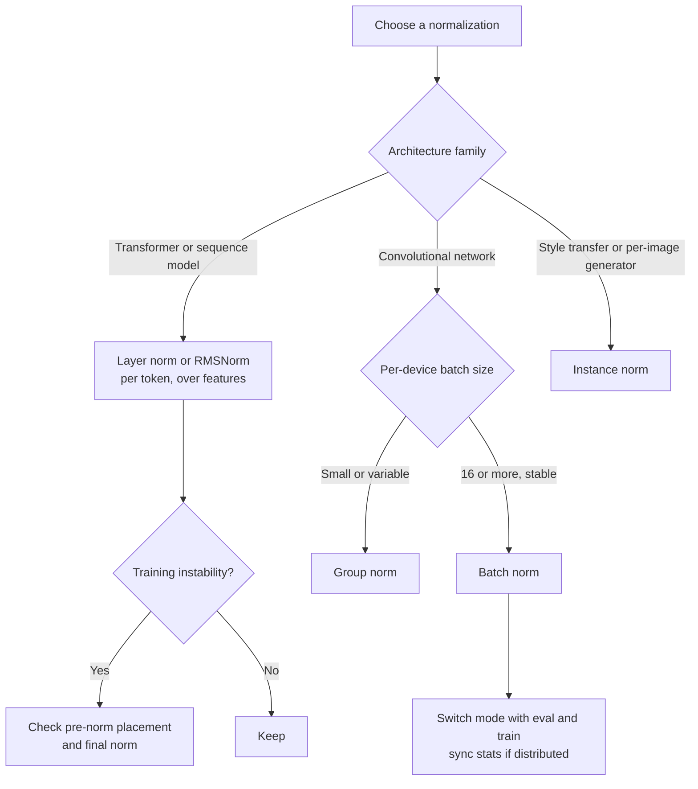

Placement also matters. The original transformer applied normalization after each residual addition ("post-norm"). Ruibin Xiong and colleagues (2020) showed that post-norm leads to large gradients near the output at initialization and requires a careful warmup, while placing the normalization inside the residual branch ("pre-norm") gives well-behaved gradients and allows training without warmup in their experiments. Most current large models use pre-norm and add a final normalization before the output head. Post-norm can reach slightly better quality when it trains, which is why the choice remains a design decision and not a settled matter.

### 10.6 Operational notes

- **Evaluation mode.** Whenever a model contains batch normalization or dropout, evaluation and inference must call `model.eval()`. A unit test that compares model outputs for the same input alone and inside a batch will fail for a batch-normalized model that is wrongly in training mode.
- **Weight decay.** Do not apply weight decay to normalization scale and shift parameters or to biases. They are not weights in the sense of the regularizer, and decaying them toward zero fights the normalization. Standard recipes put them in a separate parameter group with decay zero (Section 18).
- **Precision.** Normalization statistics are sensitive to rounding. Mixed-precision frameworks keep the reduction in FP32 even when activations are 16-bit, and a custom kernel that does not do so can produce silent quality loss (Section 15).
- **Fine-tuning with small batches.** Batch norm with a small fine-tuning batch gives noisy statistics that can damage a pretrained model. Freeze the batch-norm layers in evaluation mode, or use a model that has group or layer normalization.
- **Inference cost.** Batch norm at inference is a fixed per-channel scale and shift and can be folded into the preceding convolution or linear layer, costing nothing. Layer norm and RMSNorm cannot be folded because their statistics depend on the input, so they remain separate, memory-bound operations that serving stacks fuse into neighbouring kernels ([CH28](CH28_Inference_Optimization_and_Model_Serving.md)).

## 11. Optimizers

An optimizer turns gradients into parameter updates. [CH01](CH01_Machine_Learning_Foundations.md) introduced gradient descent and a first look at momentum and adaptive methods. This section writes out the update rules precisely, shows each on one test problem so that the differences are measured and not asserted, and states where each method fails.

### 11.1 The test problem

The script [03_optimizers_compared.py](../code/python/deep-learning-chapter/03_optimizers_compared.py) minimizes $f(w)=\tfrac12\bigl(w_1^2+100\,w_2^2\bigr)$ from $w=(1,1)$ and counts steps until $f<10^{-6}$. The Hessian has eigenvalues $1$ and $100$, so the condition number is $100$: the surface is a steep, narrow valley. Plain gradient descent is stable only for learning rates below $2/\lambda_{\max}=2/100=0.02$, and at the largest stable rate the slow direction ($w_1$) contracts by a factor $1-\eta\cdot1$ per step, so progress along it is slow. This shape of problem, a steep direction coupled with a shallow one, is what ill-conditioned neural-network loss surfaces look like locally.

### 11.2 Stochastic gradient descent

Let $g_t=\nabla_w\mathcal{L}_{B_t}(w_t)$ be the gradient on mini-batch $B_t$. SGD updates

$$
w_{t+1}=w_t-\eta\,g_t
$$

With a mini-batch, $g_t$ is a noisy but unbiased estimate of the full-data gradient. Two properties dominate its behaviour. It is stable only if the learning rate is below roughly $2/\lambda_{\max}$, where $\lambda_{\max}$ is the largest curvature, and it converges at a rate set by the smallest curvature, so ill-conditioning forces a choice between instability and slowness. On the test problem, $\eta=0.01$ needs $653$ steps; $\eta=0.019$ needs $343$; $\eta=0.021$ diverges, with $f$ reaching $10^{12}$. At exactly $\eta=0.02$ the steep coordinate is multiplied by $1-0.02\cdot100=-1$ each step, so it flips sign without shrinking and $f$ stays at $50$ indefinitely. The table of $f$ after $100$ steps shows the cliff.

| Learning rate | $f$ after 100 steps |
| --- | --- |
| 0.001 | 0.409 |
| 0.005 | 0.184 |
| 0.010 | 0.067 |
| 0.015 | 0.024 |
| 0.019 | 0.011 |
| 0.020 | 50.0 |
| 0.021 | $9.5\times10^{9}$ |

Progress improves smoothly as the rate rises toward the limit, and then the run fails at once. This asymmetry is why learning-rate selection (Section 12) looks for the largest stable rate and then backs off.

### 11.3 Momentum

Boris Polyak (1964) proposed adding a velocity that accumulates past gradients. In the convention used by PyTorch and by this chapter:

$$
v_{t+1}=\mu\,v_t+g_t,\qquad w_{t+1}=w_t-\eta\,v_{t+1}
$$

where $\mu\in[0,1)$ is the momentum coefficient, typically $0.9$. In directions where the gradient keeps the same sign, the velocity builds up toward $g/(1-\mu)$, an effective step ten times larger for $\mu=0.9$. In directions where the gradient alternates sign, as along the steep axis of the valley, the contributions cancel and the oscillation is damped. On the test problem, momentum with $\eta=0.01$ and $\mu=0.9$ reaches the target in $138$ steps against $653$ for plain SGD at the same rate, a factor of $4.7$. Note the interaction with the learning rate: the effective step for a consistent gradient is $\eta/(1-\mu)$, so changing $\mu$ from $0.9$ to $0.99$ without changing $\eta$ multiplies the effective rate by ten.

### 11.4 Nesterov momentum

Yurii Nesterov (1983) proposed evaluating the gradient at the position the momentum is about to carry the parameters to, which lets the method correct course earlier. In the formulation used by Ilya Sutskever and colleagues (2013) and implemented in the script:

$$
\tilde{w}_t=w_t-\eta\mu\,v_t,\qquad v_{t+1}=\mu\,v_t+\nabla\mathcal{L}(\tilde{w}_t),\qquad w_{t+1}=w_t-\eta\,v_{t+1}
$$

On the test problem it reaches the target in $62$ steps, against $138$ for classical momentum. For smooth convex problems Nesterov's method has a provably better convergence rate. For stochastic mini-batch training of neural networks the benefit is smaller and not guaranteed, and it is a cheap option to try when SGD with momentum is the chosen optimizer. Library implementations rearrange the algebra, so the exact update differs in form while remaining in the same family.

### 11.5 Adaptive learning rates: AdaGrad and RMSProp

Momentum fixes one direction of trouble, oscillation. The other is that different parameters need different step sizes: a weight for a rare feature sees a small gradient rarely, and a bias for a common one sees large gradients all the time. AdaGrad (John Duchi, Elad Hazan, and Yoram Singer, 2011) divides each coordinate's step by the root of the sum of its past squared gradients. The sum only grows, so steps shrink toward zero over a long run, which suits sparse convex problems and stalls deep-network training. RMSProp (introduced in a 2012 lecture by Tijmen Tieleman and Geoffrey Hinton) replaces the sum with an exponential moving average:

$$
s_{t+1}=\rho\,s_t+(1-\rho)\,g_t^{\,2},\qquad w_{t+1}=w_t-\eta\,\frac{g_t}{\sqrt{s_{t+1}}+\epsilon}
$$

with $\rho\approx0.9$ and operations elementwise. Dividing by the running RMS of the gradient makes each coordinate move by about $\eta$ per step regardless of its gradient scale, which equalizes the steep and shallow directions. On the test problem RMSProp with $\eta=0.01$ reaches the target in $137$ steps. It lacks momentum and bias correction, and with a fixed learning rate its steps do not shrink near the optimum because the normalization keeps the step size near $\eta$, which causes jitter around the minimum.

### 11.6 Adam

Kingma and Ba (2014) combined momentum on the gradient with RMSProp-style scaling and added a correction for the initial bias of the averages. With first-moment estimate $m_t$ and second-moment estimate $v_t$, initialized at zero:

$$
m_t=\beta_1m_{t-1}+(1-\beta_1)g_t,\qquad v_t=\beta_2v_{t-1}+(1-\beta_2)g_t^{\,2}
$$

$$
\hat{m}_t=\frac{m_t}{1-\beta_1^{\,t}},\qquad \hat{v}_t=\frac{v_t}{1-\beta_2^{\,t}},\qquad w_t=w_{t-1}-\eta\,\frac{\hat{m}_t}{\sqrt{\hat{v}_t}+\epsilon}
$$

The defaults are $\beta_1=0.9$, $\beta_2=0.999$, and $\epsilon=10^{-8}$. Large language model recipes commonly lower $\beta_2$ to $0.95$ (the GPT-3 and Llama reports state $\beta_1=0.9$ and $\beta_2=0.95$), because with $0.999$ the second-moment average adapts slowly to the changes in gradient scale that occur during training.

**Why the bias correction.** Because $m_0=v_0=0$, the early averages are biased toward zero. After one step $m_1=(1-\beta_1)g_1=0.1\,g_1$, a tenth of the true gradient, and $v_1=0.001\,g_1^2$. Dividing by $1-\beta_1^t$ and $1-\beta_2^t$ undoes the bias exactly when the gradient is constant. A two-step example with $g_1=0.4$ and $g_2=0.2$ shows the arithmetic.

- Step 1: $m_1=0.04$, $v_1=0.001\cdot0.16=0.00016$, $\hat{m}_1=0.04/0.1=0.4$, $\hat{v}_1=0.00016/0.001=0.16$, so $\hat{m}_1/\sqrt{\hat{v}_1}=0.4/0.4=1.0$. The first update has magnitude exactly $\eta$ in the direction of the gradient's sign, whatever the gradient's scale.
- Step 2: $m_2=0.9\cdot0.04+0.1\cdot0.2=0.056$, $v_2=0.999\cdot0.00016+0.001\cdot0.04=0.00019984$, $\hat{m}_2=0.056/0.19=0.2947$, $\hat{v}_2=0.00019984/0.001999=0.09997$, so the ratio is $0.2947/0.3162=0.932$. The step is slightly smaller than $\eta$ because the newer gradient was smaller than the first.

Two practical consequences follow. Adam's per-coordinate step is bounded by roughly $\eta$ in magnitude, so $\eta$ has the units of a parameter change and is relatively insensitive to the gradient's scale. And early in training, when $\hat{v}$ is estimated from few samples, steps can be erratic, which is part of the reason warmup is used (Section 12.2). On the test problem Adam with $\eta=0.1$ reaches the target in $82$ steps and with $\eta=0.01$ in $305$ steps.

**Cost and failure modes.** Adam keeps two extra tensors, $m$ and $v$, the size of the parameters. That is the optimizer-state term in the memory accounting of Section 16. Known failure modes are these.

- **Non-convergence in constructed cases.** Sashank Reddi, Satyen Kale, and Sanjiv Kumar (2018) gave convex examples in which Adam fails to converge because the second-moment average forgets large gradients, and proposed AMSGrad, which keeps a running maximum. In practice this rarely decides a deep-learning outcome, but it shows that Adam's convergence is not guaranteed.
- **Generalization gap on some tasks.** Ashia Wilson and colleagues (2017) reported that adaptive methods can reach lower training loss yet worse test accuracy than SGD with momentum on some image problems. Results depend on tuning and architecture, so treat it as a reason to compare, not a rule.
- **Loss spikes.** If a coordinate has had tiny gradients for a long time, $\hat{v}$ is tiny, and a sudden large gradient produces an update much larger than $\eta$ (the ratio $\hat{m}/\sqrt{\hat{v}}$ can be far above one). Large-model training logs often show such spikes, which motivate a smaller $\beta_2$, gradient clipping, and lower peak learning rates.
- **Sensitivity of $\epsilon$.** When $\epsilon$ is comparable to $\sqrt{\hat{v}}$ the update becomes closer to SGD with momentum. In half precision, $\epsilon=10^{-8}$ underflows, so optimizer states are kept in FP32.
- **Memory.** Two additional full-size states per parameter.

### 11.7 AdamW: decoupled weight decay

L2 regularization adds $\tfrac\lambda2\|w\|^2$ to the loss, so the gradient gains a term $\lambda w$. For plain SGD this is the same as shrinking the weights by a factor each step, because the update is $w\leftarrow w-\eta(g+\lambda w)=(1-\eta\lambda)w-\eta g$. With $\eta=0.1$ and $\lambda=0.01$, each step multiplies the weights by $0.999$.

In Adam the equivalence breaks. If $\lambda w$ is added to the gradient before the adaptive scaling, it is divided by $\sqrt{\hat{v}}$ along with the rest, so the effective decay for a weight depends on the history of that weight's gradients. Loshchilov and Hutter (2019) proposed decoupling the decay from the gradient-based update:

$$
w_t=w_{t-1}-\eta\left(\frac{\hat{m}_t}{\sqrt{\hat{v}_t}+\epsilon}+\lambda\,w_{t-1}\right)
$$

The script demonstrates the difference with two weights whose loss gradients (pushing the weight upward) are $-1$ and $-5$, with $\lambda=0.1$. The equilibrium of "loss plus L2 penalty" is where the loss gradient is balanced by $\lambda w$, so $w^*=-g/\lambda=(10,\,50)$. Adam with the penalty in the loss converges to exactly $(10.0,\,50.0)$: the penalty works as an L2 regularizer, but the per-coordinate normalization means a weight with a large gradient history is decayed less in proportion to its size. AdamW converges to $(10.0,\,10.0)$. Its steady state is where the normalized update of about $\eta$ is balanced by $\eta\lambda w$, which gives $w\approx1/\lambda$ for both weights regardless of the gradient scale. In AdamW the decay strength is uniform across parameters and is not a function of the loss, which makes it easier to reason about and tune.

Typical settings are $\lambda$ between $0.01$ and $0.1$ for AdamW (the PyTorch default is $0.01$), applied to weight matrices and not to biases or normalization parameters. The per-step decay is $\eta\lambda$, so the decay rate follows the learning-rate schedule. Changing the peak learning rate by a factor changes the total decay applied over the run, a coupling that matters when a recipe is moved to a different learning rate.

### 11.8 Other optimizers, briefly

- **Adafactor** (Noam Shazeer and Mitchell Stern, 2018) stores a factored approximation of the second moment (row and column statistics for each matrix), which cuts optimizer memory substantially and was designed for large models.
- **Lion** (Xiangning Chen and colleagues, 2023) was found by program search, uses the sign of an interpolated momentum, and stores one state per parameter instead of two.
- **LARS** (Yang You, Igor Gitman, and Boris Ginsburg, 2017) and **LAMB** (You and colleagues, 2019) scale each layer's update by the ratio of weight norm to gradient norm to make very large batch sizes trainable.
- **8-bit optimizers** (Tim Dettmers and colleagues, 2021) quantize the Adam states to reduce memory.
- Newer second-order and orthogonalizing methods are an active research area; evaluate any of them against a tuned AdamW on the task before adopting one.

### 11.9 Summary and selection

| Optimizer | State per parameter | Update idea | Main strength | Main weakness |
| --- | --- | --- | --- | --- |
| SGD | 0 | Step against gradient | Simple, strong generalization on many vision tasks | Slow on ill-conditioned problems, learning rate must be tuned carefully |
| SGD + momentum | 1 | Accumulate velocity | Damps oscillation, faster | Extra hyperparameter, interacts with learning rate |
| Nesterov | 1 | Gradient at look-ahead point | Corrects course sooner | Gain over momentum is modest in stochastic settings |
| RMSProp | 1 | Divide by running RMS of gradient | Per-parameter scaling | No bias correction, jitter near optimum |
| Adam | 2 | Momentum plus RMS scaling plus bias correction | Fast, tolerant of gradient scale | Spikes, coupled L2, generalization gap in some tasks |
| AdamW | 2 | Adam with decoupled decay | Standard for transformers, clean regularization | Same memory as Adam, decay tied to learning rate |

| Measured on the test problem ($f<10^{-6}$ from $(1,1)$) | Steps |
| --- | --- |
| SGD, $\eta=0.01$ | 653 |
| SGD, $\eta=0.019$ | 343 |
| SGD, $\eta=0.021$ | diverged |
| Momentum ($\eta=0.01$, $\mu=0.9$) | 138 |
| Nesterov ($\eta=0.01$, $\mu=0.9$) | 62 |
| RMSProp ($\eta=0.01$) | 137 |
| Adam ($\eta=0.1$) | 82 |
| Adam ($\eta=0.01$) | 305 |

These counts hold for this quadratic. They illustrate mechanisms, not a ranking for neural networks, where noise, non-convexity, and the learning-rate schedule dominate. The decision rule used in practice is short. Use AdamW for transformers and most new architectures, with $\beta_2$ near $0.95$ to $0.999$, weight decay near $0.01$ to $0.1$, and a warmup-plus-decay schedule. Use SGD with momentum and a step or cosine schedule for convolutional image classifiers when the reference recipe does, and when the budget allows tuning. When memory for optimizer state is the binding constraint, consider Adafactor, an 8-bit optimizer, or sharding the state across devices (Section 23). Whatever the choice, compare optimizers under the same data split, budget, and stopping rule, and store the full optimizer configuration with the checkpoint.

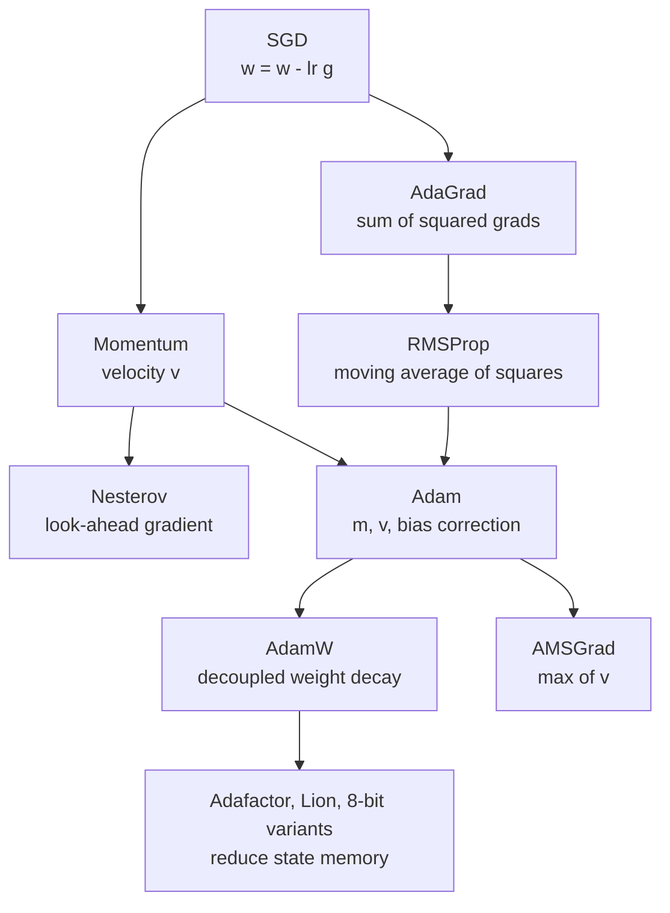

The family tree shows that every method is SGD plus one or two ideas: accumulate direction (momentum), rescale per coordinate (RMSProp), or both (Adam). Later additions fix specific problems, namely coupled decay (AdamW), non-convergence (AMSGrad), and memory (Adafactor and others).

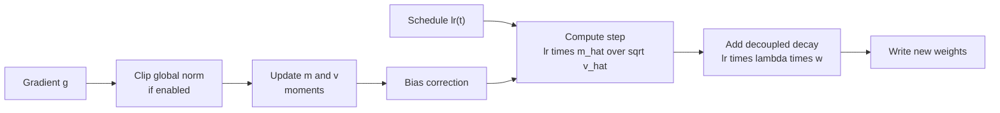

The second diagram is the order of operations in one AdamW step with clipping and a schedule. The order matters: clipping acts on the raw gradient before the moments are updated, so a clipped spike does not poison $v$ for hundreds of steps, and the schedule scales both the gradient step and the decay.

## 12. Learning-Rate Schedules, Warmup, and the Range Test

The learning rate is the single most influential hyperparameter in most training runs. Section 11 showed why: too high diverges, too low wastes the budget, and the stable region shifts as training proceeds. A schedule changes the rate over the run so that early steps make fast progress and late steps settle.

### 12.1 Why the rate should change

Mini-batch gradients are noisy, and with a constant step size the parameters keep jittering around a minimum at a distance proportional to $\eta$ times the gradient noise. A large rate explores quickly and cannot settle; a small rate settles and moves slowly. Starting high and ending low gets both. Practitioners observe the effect directly in step-decay schedules: the training loss falls abruptly each time the rate is cut, because the noise floor drops. A related effect is the large gain in final loss from the last 10 to 20 percent of training, when the rate is annealed toward a small value.

### 12.2 Warmup

Warmup raises the rate from near zero to its peak over the first $W$ steps, for example linearly: $\eta_t=\eta_{\max}\,t/W$ for $t<W$. Three reasons explain its widespread use.

1. **Adaptive statistics are unreliable at first.** In the first steps Adam's second-moment estimate $\hat{v}$ is built from few gradients and can be too small for some coordinates, so the effective step is too large. Liu and colleagues (2020) analyzed the variance of the adaptive rate early in training and proposed a rectified variant (RAdam); a short warmup achieves much of the same effect.
2. **Random initial weights and large early gradients.** Early gradients can be large and inconsistent. A small rate lets the network move to a region where gradients are better behaved before taking large steps.
3. **Large batches need it.** Goyal and colleagues (2017) used five epochs of linear warmup when scaling the batch size, because the linear scaling rule gives a rate that is unstable at initialization.

Warmup lengths differ by setting: a few hundred steps for small models, a few thousand steps for large language models (many reported recipes use roughly $1$ to $2$ thousand steps, or about $0.1$ to $1$ percent of training). A useful heuristic is that if the loss spikes or diverges in the first hundred steps and a lower peak rate works, then warmup, a lower peak rate, or both are indicated.

### 12.3 Decay shapes

| Schedule | Formula idea | Typical use | Note |
| --- | --- | --- | --- |
| Constant | $\eta_t=\eta$ | Quick experiments, sweeps | Leaves loss on the table at the end |
| Step decay | Multiply by $\gamma$ (for example $0.1$) at fixed epochs | Older CNN recipes | Sudden drops, requires choosing the epochs |
| Exponential | $\eta_t=\eta_0\gamma^t$ | Smooth reduction | Decay speed is tied to $\gamma$ choice |
| Linear to zero | Linearly down to $0$ or a floor | BERT-style fine-tuning | Simple, no extra hyperparameter |
| Inverse square root | $\eta_t\propto1/\sqrt{t}$ after warmup | Original transformer (Vaswani and colleagues, 2017) | No fixed horizon needed |
| Cosine | Half-cosine from peak to floor | Default for many vision and language recipes | Needs the total step count in advance |
| Cosine with restarts | Cosine repeated, resetting to the peak | Anytime snapshots, ensembling | More hyperparameters |
| One-cycle | Rise then fall in one cycle with high peak | Fast training budgets (Smith and Topin, 2019) | Sensitive to the peak |
| Warmup, stable, decay | Warmup, hold constant, then a short decay | Long runs whose length is unknown or extended | Reported in recent open language-model recipes; allows resuming and extending from the stable phase |

Ilya Loshchilov and Frank Hutter (2016) introduced the cosine schedule (with warm restarts) and it is now the most common default. With a warmup of $W$ steps, total steps $T$, peak rate $\eta_{\max}$, and floor $\eta_{\min}$:

$$
\eta_t=\begin{cases}\eta_{\max}\dfrac{t}{W} & t<W\\[2mm] \eta_{\min}+\tfrac12\bigl(\eta_{\max}-\eta_{\min}\bigr)\Bigl(1+\cos\bigl(\pi\,\tfrac{t-W}{T-W}\bigr)\Bigr) & t\ge W\end{cases}
$$

A worked case uses a peak $\eta_{\max}=3\times10^{-4}$, floor $\eta_{\min}=0.1\,\eta_{\max}=3\times10^{-5}$, $W=2{,}000$, and $T=100{,}000$ steps. At step $500$ the rate is $3\times10^{-4}\times500/2000=7.5\times10^{-5}$, and at step $1{,}000$ it is $1.5\times10^{-4}$. At step $26{,}000$ the progress fraction is $24{,}000/98{,}000=0.245$, the cosine term is $\cos(0.245\pi)=0.7187$, and the rate is $3\times10^{-5}+0.5\times2.7\times10^{-4}\times1.7187=2.62\times10^{-4}$. At step $51{,}000$ the progress is exactly $0.5$, the cosine is zero, and the rate is $3\times10^{-5}+1.35\times10^{-4}=1.65\times10^{-4}$. At step $75{,}000$ it is $7.1\times10^{-5}$, and at step $100{,}000$ it equals the floor $3\times10^{-5}$.

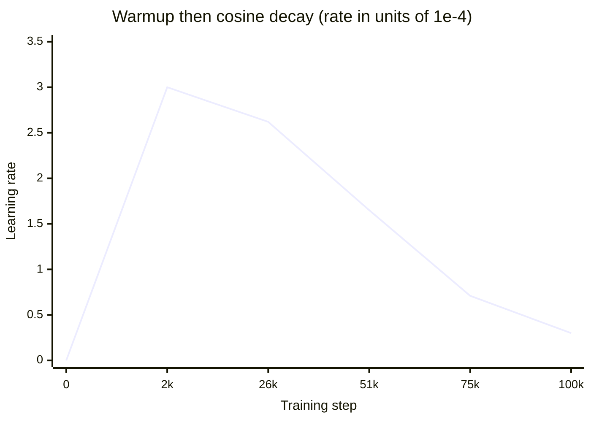

The plot shows the ramp over the first two thousand steps, a slow decline while the rate is still high, and a faster fall in the second half. The floor of $10$ percent of the peak is a common choice, and decaying to exactly zero is also used. Because the cosine schedule needs $T$ in advance, a run that must be extended past $T$ cannot simply continue, and the restart introduces a loss bump. That constraint is the reason warmup-stable-decay schedules and plain constant-plus-cooldown are used when the budget is uncertain. The schedule state (the current step) must be stored in the checkpoint, otherwise a resumed run restarts at warmup.

### 12.4 The learning-rate range test

Leslie Smith (2017) proposed a quick experiment to find the usable range. Train for a short time while increasing the rate from a very small value to a large one, typically exponentially over a few hundred to a few thousand steps, and record the loss at each rate. Plot loss against the logarithm of the rate.

The shape has three regions. At low rates the loss barely moves. As the rate rises the loss falls fastest. At some point the loss reaches a minimum and then rises and diverges. The conventional reading is to choose a peak rate somewhat below the minimum, on the part of the curve where the loss is still dropping steeply, commonly a factor of $3$ to $10$ below the rate at the minimum.

An illustrative range test for an Adam-trained MLP, with values chosen to show the typical shape and not measured on a particular dataset:

| Learning rate | Smoothed loss |
| --- | --- |
| $10^{-5}$ | 2.30 |
| $3.2\times10^{-5}$ | 2.29 |
| $10^{-4}$ | 2.20 |
| $3.2\times10^{-4}$ | 1.75 |
| $10^{-3}$ | 1.10 |
| $3.2\times10^{-3}$ | 0.82 |
| $10^{-2}$ | 0.95 |
| $3.2\times10^{-2}$ | 2.40 |
| $10^{-1}$ | diverged |

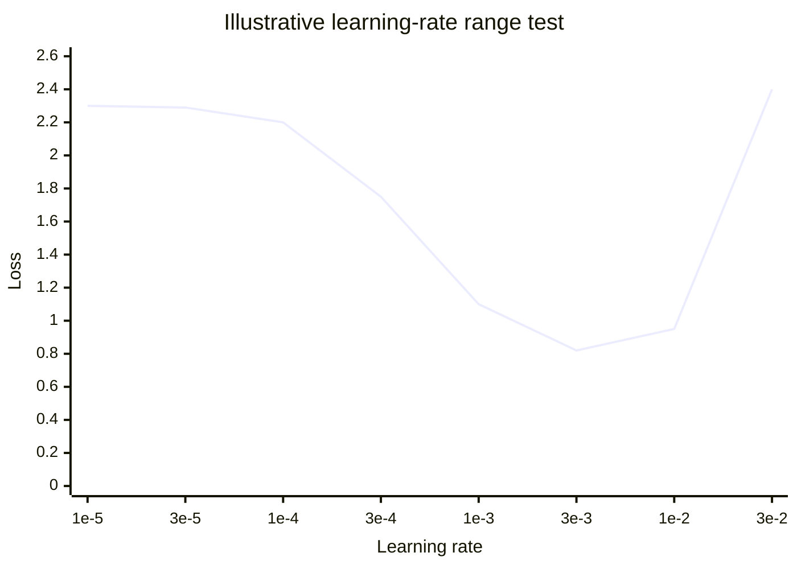

Reading this curve: the loss falls steepest between $3\times10^{-4}$ and $3\times10^{-3}$ and is minimal near $3\times10^{-3}$. A peak around $10^{-3}$ is a reasonable first choice, about a factor of three below the minimum. The test has limits that should be stated whenever its result is used.

- It measures the best rate for the first few hundred steps from initialization, which may differ from the best rate for the whole run. Late in training smaller rates are often needed, which is what the decay phase provides.
- It depends on batch size and the optimizer, and must be rerun when either changes.
- A loss that is noisy at the early steps needs smoothing before reading a minimum, such as an exponential moving average.
- With a warmup in place, the test should use the same warmup structure, or the high-rate region will fail for reasons unrelated to the true limit.

The range test is a cheap screen that narrows a sweep from five orders of magnitude to one. The final value is chosen by comparing a few full or shortened runs at rates around the estimate (Section 22).

## 13. Regularization

[CH01](CH01_Machine_Learning_Foundations.md) introduced regularization as any change that reduces generalization error, even at the cost of training error. Deep networks have far more parameters than training examples in many applications, and they can fit random labels (Section 21.3), so regularization is not optional. This section covers the main techniques, how each works, and how they interact. No single technique dominates, and the most effective ones depend on the data type.

### 13.1 L2 penalty versus weight decay

An L2 penalty adds $\tfrac\lambda2\|w\|^2$ to the loss, producing a gradient term $\lambda w$. Weight decay is the operation of shrinking the weights by a fixed factor each step: $w\leftarrow(1-\eta\lambda)w-\eta g$. For SGD these are algebraically identical, as Section 11.7 showed, and the two names are used interchangeably. For adaptive optimizers they differ: an L2 term inside the gradient is rescaled by the adaptive denominator, while decoupled weight decay in AdamW is not. The difference changes the effective regularization per parameter, so a $\lambda$ tuned for one does not transfer to the other, and a library's `weight_decay` argument means different things in different optimizers. The safe habit is to use AdamW's decoupled decay for adaptive training and to read the documentation of any optimizer whose decay semantics are not clear.

Weight decay shrinks weights toward zero, reducing the capacity to fit noise through large weights. Two details matter for deep networks. Weights followed by a normalization layer are scale-invariant, since rescaling them does not change the normalized output, so decay does not limit the function they represent. It instead reduces their norm over time, which increases the effective learning rate of those weights (Twan van Laarhoven, 2017). This means weight decay and learning rate interact strongly in normalized networks, and tuning one without the other can mislead. And decay should not be applied to biases or normalization parameters (Section 18.3).

### 13.2 Dropout

Dropout (Srivastava and colleagues, 2014) randomly sets each hidden unit to zero with probability $p$ during training, using a new random mask for every example and step. The network cannot rely on any single unit, which discourages co-adaptation, the situation in which units correct each other's errors in a way that works only on the training set. Training with dropout can be seen as training an ensemble of exponentially many thinned subnetworks that share weights, and the full network at inference approximates averaging their predictions.

To keep the expected activation unchanged, implementations use inverted dropout: during training the surviving units are scaled by $1/(1-p)$, and at inference the layer is the identity. For $p=0.1$ the scale is $1.111$. A worked example: an activation vector $(2,1,4,3)$ with $p=0.5$ and a sampled mask $(1,0,1,0)$ becomes $(2,0,4,0)\times2=(4,0,8,0)$. Averaged over masks, each element has expected value equal to its original value, for example $0.5\times(2\times2)+0.5\times0=2$ for the first element.

Practical guidance:

- **Typical rates.** Rates of $0.1$ to $0.5$ are common on fully connected layers of classifiers. Transformer implementations commonly use $0.1$ for attention and feed-forward dropout in fine-tuning. Large language model pretraining on far more tokens than parameters often uses $0$ because the model sees most data once and overfitting is not the limiting factor.
- **Dropout only helps when overfitting is the problem.** A model that underfits becomes worse. Use the learning curves of Section 21 to decide.
- **Interaction with batch normalization.** Dropout before batch normalization shifts the variance of activations between training and inference, which can hurt (Xiang Li and colleagues, 2019, on the disharmony between the two). Place dropout after the normalization, or use only one of them.
- **Eval mode.** As with batch norm, `model.eval()` disables dropout. Forgetting it adds random noise to validation metrics.
- **Variants.** Stochastic depth (Gao Huang and colleagues, 2016) drops entire residual blocks, and DropPath is a related layer in vision transformers. Spatial dropout drops whole feature maps in convolutional networks, because adjacent pixels are correlated and dropping single ones adds little noise.

### 13.3 Early stopping

Early stopping monitors a validation metric during training and returns the parameters from the best epoch or step, stopping when the metric has not improved for a set number of evaluations (the patience). It constrains the effective capacity by limiting how far the weights move from their initialization. Implementation points:

- Evaluate at a regular interval and keep the best checkpoint on disk, restoring it at the end. The last checkpoint is not necessarily the best one.
- Use a minimum-improvement threshold so that noise in a small validation set does not extend the run indefinitely.
- Remember that the validation set is consumed by the selection. Many evaluations on a small set overfit that set, so report the final number on a separate test set ([CH06](CH06_Model_Evaluation_Validation_and_Selection.md)).
- With a decaying schedule such as cosine, the late phase with a small rate often improves the validation loss, so stopping early on a plateau at a high rate discards the gain from annealing. Combine early stopping with schedules deliberately: stop only if the metric is clearly degrading, and select the best checkpoint.

### 13.4 Data augmentation

Augmentation enlarges the effective training set by applying label-preserving transformations to training inputs. For images these include random crops, flips, color jitter, and rotations; for audio, time shifting and masking of spectrogram regions; for text, back-translation and token masking or substitution. Mixup (Hongyi Zhang and colleagues, 2018) trains on convex combinations of pairs of inputs and labels, and CutMix (Sangdoo Yun and colleagues, 2019) pastes a patch from one image into another and mixes labels in proportion to the area. These methods are strong regularizers and often yield more than any change to the model for image tasks with limited data. Rules:

- **Label preservation depends on the task.** A horizontal flip is safe for object categories and wrong for text recognition or for a model that must tell left from right. A rotation turns a digit 6 into a 9.
- **Augment after splitting, and only the training split.** Augmented copies of one source example must stay on the same side of the split, or the validation set leaks ([CH02](CH02_Data_Preparation_Feature_Engineering_and_Leakage.md)). Validation and test data use deterministic preprocessing.
- **It costs input-pipeline time.** Augmentation runs on the CPU unless moved to the GPU, and is a frequent cause of an idle accelerator (Section 17.4).
- **Distribution match.** Augmentations should resemble variation seen in deployment. Strong augmentations unrelated to deployment conditions waste capacity.

[CH08](CH08_Convolutional_Neural_Networks.md) treats augmentation for vision in detail.

### 13.5 Label smoothing

Label smoothing (Christian Szegedy and colleagues, 2016) replaces the one-hot target with a softened version: with smoothing parameter $\varepsilon$ and $K$ classes, the target is $y'_k=(1-\varepsilon)\,y_k+\varepsilon/K$. For $K=10$ and $\varepsilon=0.1$ the true class gets $0.9+0.01=0.91$ and each other class gets $0.01$. The cross-entropy gradient remains $p-y'$ by the derivation of Section 6.4, so the model is pushed toward $0.91$ for the true class and no further. Without smoothing, the loss is minimized only as the true-class logit goes to infinity relative to the others, so the logits grow without bound and the model becomes overconfident. With smoothing the target logit gap is finite: the optimum satisfies $\ln(0.91/0.01)=\ln91=4.51$.

Two consequences matter in practice. First, the minimum attainable training loss is no longer zero. It equals the entropy of the smoothed target, $-(0.91\ln0.91+9\times0.01\ln0.01)=0.0858+0.4145=0.50$. A training curve that plateaus near $0.50$ is therefore healthy, and training-loss values cannot be compared between runs with different $\varepsilon$. Second, label smoothing often improves calibration and accuracy on image and translation tasks, and it can reduce the usefulness of a model as a teacher in knowledge distillation (Rafael Müller, Simon Kornblith, and Geoffrey Hinton, 2019), because the logits of the incorrect classes carry less information about similarity between classes.

### 13.6 Other regularizers and their relatives

- **Weight averaging.** An exponential moving average (EMA) of the weights, or stochastic weight averaging (Pavel Izmailov and colleagues, 2018), smooths the trajectory and often gives a model with better validation metrics than the last iterate at no inference cost. The averaged weights, not the raw ones, should be evaluated and exported, and the averaging state belongs in the checkpoint.
- **Architectural constraints.** Parameter sharing (convolution, recurrence) and smaller models reduce capacity by design.
- **Gradient noise and small batches.** The noise of small-batch SGD acts as an implicit regularizer (Section 14), which is one explanation for the generalization gap sometimes seen at very large batch sizes.
- **Ensembling.** Averaging several independently trained models reduces variance reliably at the price of $k$ times the training and serving cost, a trade-off that [CH04](CH04_Decision_Trees_and_Ensemble_Learning.md) treats for trees.
- **More data.** Where available, additional labeled data or self-supervised pretraining outperforms most regularizers, and the regularizers above compensate when it is not.

### 13.7 Choosing among them

| Symptom (from curves) | First levers | Second levers | Do not use |
| --- | --- | --- | --- |
| Large train-validation gap, small data | Augmentation, weight decay, smaller model | Dropout, label smoothing, early stopping, EMA | More capacity |
| Large gap, large data | Weight decay, stronger augmentation | Dropout on heads, data cleaning | Training longer without checks |
| Both losses high and close | More capacity, longer training, higher learning rate | Better features, architecture change | Stronger regularization |
| Validation noisy, unstable | Lower learning rate, larger batch, EMA | Clipping, checks for label noise | Early stopping on one noisy point |

The order of operations in a project is also fixed by cost: first improve and clean data, then add augmentation, then tune weight decay and learning rate together, then add dropout or label smoothing if the gap remains. Every tuned regularizer consumes validation information, so keep the number of trials documented.

## 14. Batch Size, Gradient Noise, Accumulation, and Clipping

### 14.1 Gradient noise and batch size

A mini-batch gradient $g_B=\frac1B\sum_{i=1}^{B}\nabla\ell_i$ is an average of per-example gradients. If per-example gradients have a coordinate-wise standard deviation $\sigma$ and the examples are sampled independently, the average has standard deviation $\sigma/\sqrt{B}$. With $\sigma=2$, a batch of $64$ gives a noise standard deviation of $0.25$ per coordinate, a batch of $256$ gives $0.125$, and a batch of $1024$ gives $0.0625$. Quadrupling the batch halves the noise. The cost of computing the gradient, however, grows linearly with $B$, so larger batches give diminishing returns per example processed.

The consequence is a regime structure. Where the gradient noise is large relative to the true gradient, doubling the batch size nearly halves the number of steps needed, so larger batches are almost a free speedup. Where noise is already small relative to the true gradient, a larger batch just repeats the same direction and the steps needed do not fall. Sam McCandlish and colleagues (2018) defined the gradient noise scale as the ratio of the trace of the per-example gradient covariance to the squared norm of the true gradient, and showed that it predicts the largest useful batch size, called the critical batch size. They observed that it grows as the loss falls, so late training tolerates larger batches than early training. Christopher Shallue and colleagues (2019) found a similar pattern across workloads: perfect scaling up to a workload-dependent batch size, then diminishing returns, with the transition depending on the model, data, and optimizer. The practical rule is that a batch larger than the critical size spends hardware without reducing training time, so hardware sized for very large batches should be justified by a measurement of the scaling curve and not an assumption.

### 14.2 Scaling the learning rate with batch size

When the batch grows by a factor $k$ and the number of steps shrinks by $k$, the rate must change too. Goyal and colleagues (2017) used the linear scaling rule for SGD with momentum: multiply the learning rate by $k$, with warmup. For ResNet-50 on ImageNet they used a rate of $0.1\times B/256$, so a batch of $256$ uses $0.1$ and a batch of $8{,}192$ uses $3.2$, with five epochs of linear warmup, and they matched the accuracy of the small-batch baseline. The reasoning is that one step at batch $kB$ should move the weights about as far as $k$ steps at batch $B$, whose gradients are similar. The rule is an approximation that fails at very large $k$.

For Adam-type optimizers, whose update magnitude does not scale with the gradient the same way, a square-root rule ($\eta\propto\sqrt{k}$) has been proposed and studied (for example, Malladi and colleagues, 2022), and practice varies. Treat both rules as starting points to be validated with a short sweep.

A worked case. A baseline trains ImageNet-sized data (1.28 million images) with batch $256$ and learning rate $0.1$, which is $1.28\times10^6/256=5{,}000$ steps per epoch. Moving to a batch of $2{,}048$ (a factor $k=8$) gives $625$ steps per epoch and, by the linear rule, a learning rate of $0.8$ with a warmup of several epochs. If the hardware scales well, each step takes about the same time and an epoch takes one eighth as long. At $8{,}192$ the epoch is $156$ steps. Beyond the critical batch size, the model needs more epochs to reach the same accuracy, so the net speedup is less than $32\times$.

Some research reports that large batches generalize worse, with the explanation that they converge to sharper minima (Nitish Keskar and colleagues, 2017). Later studies found that much of the gap closes with learning-rate scaling, warmup, and longer training, so a "generalization gap" observed at a large batch should first be checked against a tuned learning rate and enough steps.

### 14.3 Gradient accumulation

When the desired batch does not fit in device memory, split it into $k$ micro-batches, run forward and backward on each, and let the gradients accumulate in `.grad` before one optimizer step. Because the gradient is linear in the loss, the sum of micro-batch gradients equals the gradient of the summed loss, which equals the full-batch gradient when each micro-batch loss is divided by $k$.

```python
accum_steps = 16                       # micro-batches per optimizer step
optimizer.zero_grad(set_to_none=True)
for i, (x, y) in enumerate(loader):
    loss = loss_fn(model(x), y) / accum_steps   # scale so the sum is a mean
    loss.backward()                              # adds into .grad
    if (i + 1) % accum_steps == 0:
        torch.nn.utils.clip_grad_norm_(model.parameters(), 1.0)
        optimizer.step()
        scheduler.step()               # one scheduler step per optimizer step
        optimizer.zero_grad(set_to_none=True)
```

The global batch is the product of micro-batch size, accumulation steps, and the number of data-parallel devices. With a micro-batch of $8$, $16$ accumulation steps, and $8$ devices, the global batch is $8\times16\times8=1{,}024$. Accumulation trades time for memory: the arithmetic is the same, and it is run in $k$ sequential parts, so throughput per example is unchanged while activation memory is that of one micro-batch. Points that go wrong:

- **Missing division by $k$** inflates the gradient by $k$ and acts as a learning rate $k$ times larger.
- **Batch-dependent layers.** Batch norm computes statistics per micro-batch, so accumulation does not reproduce a larger-batch run when the model uses it. Layer norm models are unaffected.
- **Variable-length data.** If micro-batches contain different numbers of tokens, averaging per-micro-batch means weights short sequences more than the full-batch mean would. Normalize by the total token count across the accumulation window to match a single large batch.
- **Data-parallel synchronization.** In distributed data parallel training, each backward would trigger gradient communication. The `no_sync()` context manager of PyTorch's DistributedDataParallel skips it for all but the last micro-batch.
- **Counters.** Learning-rate schedules, logging, and checkpoint intervals count optimizer steps, not micro-batches.

### 14.4 Gradient clipping

Clipping bounds the update when a gradient is unusually large. Clipping by value truncates each component to $[-c,c]$, which changes the gradient's direction. Clipping by global norm rescales the whole gradient vector only when its norm exceeds a threshold $c$:

$$
g\leftarrow g\cdot\min\!\left(1,\ \frac{c}{\|g\|_2}\right)
$$

so the direction is preserved. With $c=1$ and a gradient of norm $12$, every component is multiplied by $1/12=0.0833$. A gradient of norm $0.7$ is unchanged. The method was proposed for recurrent networks by Razvan Pascanu, Tomas Mikolov, and Yoshua Bengio (2013), and clipping the global norm at $1.0$ is a common default for transformer training.

How to use it well:

- **Log the pre-clip norm.** It is the most informative training health signal, and a sustained rise precedes many divergences. If clipping triggers on most steps, the learning rate is too high or something is wrong, and the clip is hiding the symptom.
- **Clip on the true gradient.** With mixed precision and loss scaling, unscale gradients before clipping (Section 15.3), otherwise the threshold is applied to a scaled number.
- **Use the global norm over all parameters,** not per tensor, so relative magnitudes between layers are retained. In sharded training the norm must be reduced across the shards.
- **Skip non-finite steps.** If the norm is `inf` or `nan`, skip the update and, with mixed precision, let the scaler reduce its scale. Clipping a `nan` gradient does not repair it.
- **Clipping contains an explosion but not a vanishing gradient,** as Section 7.7 stressed.

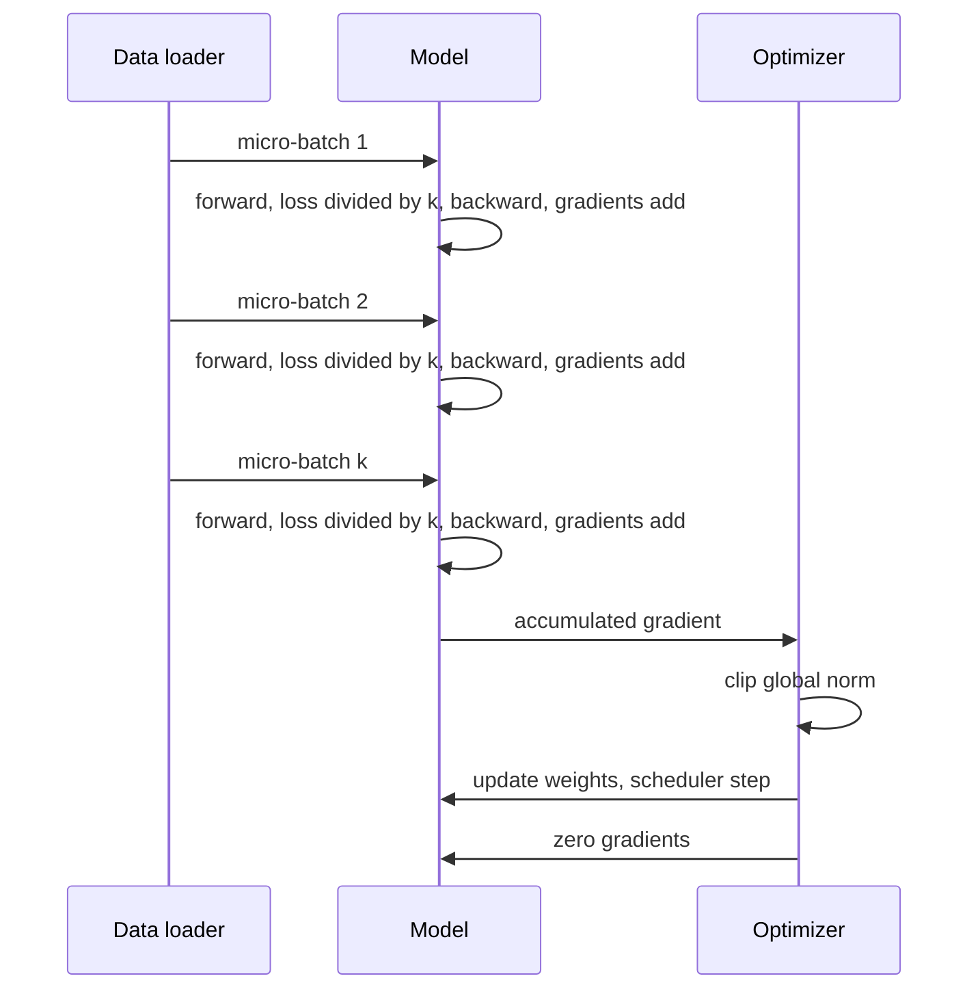

The sequence shows one optimizer step built from $k$ micro-batches. Gradient memory holds one copy throughout, while activation memory is freed after each micro-batch. The implication for capacity planning is that accumulation raises the effective batch for free in memory and in arithmetic, at the cost of a proportionally longer step, which is why it is the first tool used when a recipe needs a larger batch than the device can hold.

## 15. Mixed Precision, Loss Scaling, and Low-Precision Formats

Numerical precision is a hardware and memory decision, but it changes training dynamics, so a design review must address it. Lower-precision arithmetic is faster and uses less memory, and it introduces rounding, underflow, and overflow that full precision hides. This section explains the formats, the mixed-precision recipe, loss scaling, and the extension to 8-bit floating point.

### 15.1 Number formats

A floating-point number stores a sign, an exponent that sets the range, and a mantissa that sets the precision. The formats used in training differ in how many bits go to each.

| Format | Bits (sign, exponent, mantissa) | Largest finite value | Smallest normal | Relative spacing near 1 | Notes |
| --- | --- | --- | --- | --- | --- |
| FP32 | 1, 8, 23 | about $3.4\times10^{38}$ | about $1.2\times10^{-38}$ | $2^{-23}\approx1.2\times10^{-7}$ | Reference format |
| TF32 | 1, 8, 10 (stored in 32 bits) | same range as FP32 | same as FP32 | $2^{-10}$ | Tensor-core mode on NVIDIA Ampere and later, FP32 range with reduced precision in matmul |
| FP16 | 1, 5, 10 | $65{,}504$ | $2^{-14}\approx6.1\times10^{-5}$ | $2^{-10}\approx9.8\times10^{-4}$ | Narrow range, needs loss scaling |
| BF16 | 1, 8, 7 | about $3.4\times10^{38}$ | about $1.2\times10^{-38}$ | $2^{-7}\approx7.8\times10^{-3}$ | FP32 range, low precision |
| FP8 E4M3 | 1, 4, 3 | 448 | $2^{-6}$ | $2^{-3}$ | More precision, less range |
| FP8 E5M2 | 1, 5, 2 | $57{,}344$ | $2^{-14}$ | $2^{-2}$ | More range, less precision |

In the table, FP32, FP16, and FP8 mean 32-bit, 16-bit, and 8-bit floating point, and TF32 is NVIDIA's TensorFloat-32 matrix-multiply mode. FP16 subnormal numbers extend the range down to $2^{-24}\approx5.96\times10^{-8}$ with reduced precision. The 16-bit brain floating-point format (BF16) was designed by Google for machine-learning accelerators and keeps the exponent width of FP32 while cutting the mantissa to seven bits (Dhiraj Kalamkar and colleagues, 2019, studied it for training). Its range equals FP32's, so overflow and underflow are rare, and its precision is poor: BF16 can represent only about two to three significant decimal digits.

The script [04_memory_and_precision.py](../code/python/deep-learning-chapter/04_memory_and_precision.py) rounds real numbers to these formats. Three results show the character of each:

- A value of $1.001$ becomes $1.0009765625$ in FP16 and exactly $1.0$ in BF16. BF16's spacing near one is $2^{-7}=0.0078125$, so $1.004$ rounds to $1.0078125$ and any change smaller than about $0.004$ at that magnitude is lost.
- $1000.3$ becomes $1000.5$ in FP16 and $1000.0$ in BF16.
- $10^{-30}$ is $0$ in FP16 (underflow) and about $9.98\times10^{-31}$ in BF16, and $10^{5}$ is infinity in FP16 (overflow) and $99{,}840$ in BF16.

FP16 trades range for precision, BF16 trades precision for range, and the training consequence follows. FP16 needs a mechanism to keep small values from vanishing (loss scaling). BF16 does not, but is more likely to lose small updates to rounding.

### 15.2 The mixed-precision recipe

Paulius Micikevicius and colleagues (2018) described mixed-precision training, and the structure persists in current frameworks.

1. Keep a master copy of the weights in FP32.
2. For each step, cast the weights to the low-precision format for the forward and backward passes. Matrix multiplications and convolutions run on tensor cores in the low-precision format and accumulate partial sums in FP32.
3. Compute gradients in low precision, apply them to the FP32 master weights, and let the optimizer update FP32 state.
4. Keep numerically sensitive operations in FP32: reductions such as softmax normalizers, layer-norm statistics, the loss, and the optimizer update.
5. With FP16, scale the loss to keep small gradients representable (Section 15.3).

The reasons the master weights must be FP32 are the rounding properties above. A typical late-training update is a small fraction of the weight, for example a change of $10^{-4}$ on a weight near $1$. In BF16 the spacing near one is $0.0078$, so that update rounds to zero, and the weight never changes. In FP16 the spacing near one is $0.00098$, which also loses it. Accumulating in FP32 keeps the small updates, and the cast to the low-precision copy happens after accumulation.

The same logic applies to accumulation inside operations. A sum of $10{,}000$ copies of $10^{-4}$ should be $1.0$. The script accumulates it in FP16 rounding and gets $0.25$, because once the running sum reaches $0.25$ the spacing of FP16 values there is $2^{-12}=0.000244$, and half of that, $0.000122$, exceeds the increment $0.0001$, so each addition rounds back to the same value. Tensor cores avoid this by accumulating in FP32, and a hand-written kernel that accumulates in 16 bits reproduces the stall.

In PyTorch, the recipe is implemented by `torch.autocast`, which selects a dtype per operation (matrix multiplications low precision, reductions and losses FP32), and in the FP16 case by a gradient scaler. A minimal form for BF16 is:

```python
for x, y in loader:
    x, y = x.to(device, non_blocking=True), y.to(device, non_blocking=True)
    with torch.autocast(device_type="cuda", dtype=torch.bfloat16):
        loss = loss_fn(model(x), y)        # matmuls in BF16, reductions in FP32
    loss.backward()                        # parameters stay FP32, grads are FP32
    torch.nn.utils.clip_grad_norm_(model.parameters(), 1.0)
    optimizer.step()
    optimizer.zero_grad(set_to_none=True)
```

With autocast the parameters stay FP32 and only the operation inputs are cast, so this form keeps FP32 master weights without a separate copy. Frameworks for very large models also offer "pure BF16" training where the stored weights are BF16, which halves weight memory and requires attention to rounding of updates (stochastic rounding or Kahan-style compensation), so it is a deliberate choice and not a default.

### 15.3 Loss scaling for FP16

Gradients in deep networks are often very small. A gradient of $10^{-8}$ is below FP16's smallest subnormal ($5.96\times10^{-8}$), so it converts to exactly zero, and the corresponding weight stops learning. The script confirms: $10^{-8}$ in FP16 is $0.0$.

Loss scaling multiplies the loss by a constant $S$ before the backward pass. By linearity of the chain rule, every gradient is multiplied by $S$, which shifts the whole gradient distribution up into the representable range. Before the optimizer step the gradients are divided by $S$ (in FP32) to recover the true values. With $S=1024$ the gradient $10^{-8}$ becomes $1.025\times10^{-5}$ in FP16 and unscales to $1.001\times10^{-8}$. With $S=65{,}536$ it becomes $6.55\times10^{-4}$, a normal FP16 number, and unscales to $9.997\times10^{-9}$.

The scale cannot be arbitrarily large, because large gradients overflow: a gradient of $2.0$ multiplied by $65{,}536$ is $131{,}072$, which exceeds the FP16 maximum and becomes infinity. The standard solution is dynamic loss scaling, which adapts the scale during training.

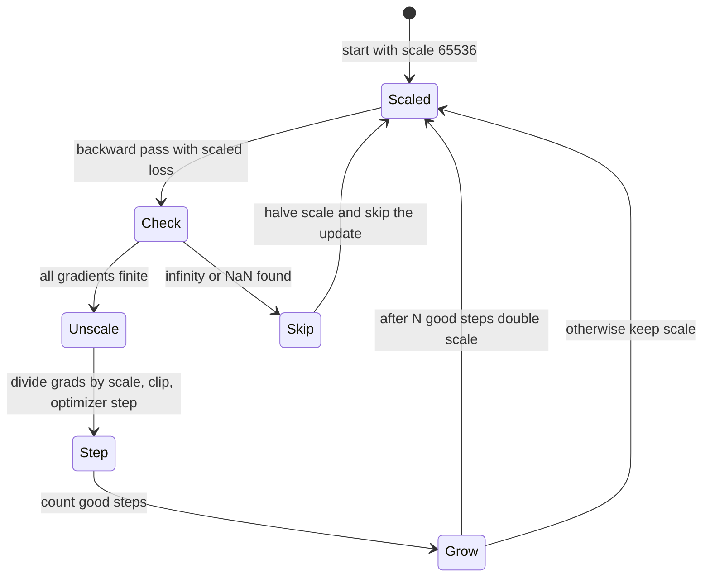

The scaler starts high, checks the gradients after each backward pass, and when any is non-finite it skips that update and halves the scale. After a run of successful steps (often 2,000) it doubles the scale to probe for headroom. Two operational points follow. Occasional skipped steps at the start of training are normal. A scale that keeps collapsing toward 1 signals real instability, such as a genuine gradient overflow caused by a high learning rate, and the fix is not the scaler. And gradient clipping must be applied after unscaling, otherwise the threshold compares against a number inflated by the scale. In PyTorch the scaler is `torch.amp.GradScaler`, used with `scaler.scale(loss).backward()`, `scaler.unscale_(optimizer)` before clipping, and `scaler.step(optimizer)` followed by `scaler.update()`. Older code uses `torch.cuda.amp.GradScaler`; check the documentation for the installed version.

BF16 shares the FP32 range, so $10^{-8}$ is representable and loss scaling is generally unnecessary. This is the main reason BF16 became the default on hardware that supports it (NVIDIA Ampere and later, Google tensor processing units, and recent AMD accelerators). FP16 remains in use on older GPUs, where it is the only fast 16-bit option.

### 15.4 FP8 training

NVIDIA's Hopper generation added tensor-core support for two 8-bit formats, E4M3 and E5M2, described in the paper by Paulius Micikevicius and colleagues (2022). A common arrangement uses E4M3 for weights and activations in the forward pass, where precision matters more, and E5M2 for gradients, where range matters more. Eight-bit formats have so little range that each tensor needs its own scale factor, chosen from the recent maximum absolute value (the amax) of the tensor, so that its values fit the format. NVIDIA's Transformer Engine library implements this per-tensor scaling for supported layers. The DeepSeek-V3 technical report (DeepSeek-AI, 2024) describes a large-scale training run with FP8 mixed precision and finer-grained scaling, with the master weights, optimizer states, and sensitive operations kept in higher precision.

At the time of writing, FP8 matrix-multiply peak throughput is about twice the BF16 figure on the same Hopper-class GPU according to NVIDIA's published specifications, and 4-bit formats have appeared on newer hardware and in research. Verify the current peak numbers and format support in the datasheet for the target accelerator, because they change with each hardware generation. The caution for planning is that realized speedup is less than the peak ratio, since non-matrix operations, scaling overhead, and communication do not speed up, and FP8 training recipes need validation against a BF16 baseline for the same architecture and data, including loss curves over the first part of training and downstream evaluation at the end.

### 15.5 Numerical hazards and how to test for them

- **Softmax and exponentials.** $e^{12}$ already exceeds the FP16 maximum, so softmax must subtract the maximum first and run in FP32 where needed (Section 6.3).
- **Large activations.** Some transformer layers develop activation outliers with magnitude in the hundreds, which sit uncomfortably close to FP16 limits and degrade 8-bit quantization at inference.
- **Epsilon constants.** An $\epsilon=10^{-8}$ in a normalization or optimizer underflows to zero in FP16 and removes the protection against division by zero. Use larger values or keep those operations in FP32.
- **Reductions.** Summing many values in low precision loses accuracy. Reductions across the batch, loss sums, and gradient all-reduces are often done in FP32 or with higher-precision accumulators.
- **Detection.** Log the fraction of steps skipped by the scaler, the maximum absolute activation per layer, and the gradient norm. A `nan` source can be localized with `torch.autograd.set_detect_anomaly(True)`, which is slow and meant for debugging only.
- **Validation of a precision change.** Train the same model, seed, and data order in FP32 (or BF16) and in the target precision for a few thousand steps. The loss curves should match within run-to-run noise, which is measured by repeating the baseline with two seeds. A consistent gap, or a divergence late in training, indicates a numerics problem.

## 16. GPU Memory Accounting and Activation Checkpointing

Whether a model can be trained on a given device is arithmetic that can be done on paper before any hardware is requested. Four categories of data occupy accelerator memory during training: parameters, gradients, optimizer state, and activations. The first three scale with the number of parameters. Activations scale with the batch, the sequence length, and the depth. This section computes each for a one-billion-parameter model.

### 16.1 The four buckets

- **Parameters.** The weights the model has. Stored in FP32, or in a 16-bit working copy plus an FP32 master copy in mixed precision.
- **Gradients.** One value per trainable parameter, held between the backward pass and the optimizer step.
- **Optimizer state.** For AdamW, a first moment $m$ and a second moment $v$ per parameter, normally FP32. For SGD with momentum, one velocity per parameter. For plain SGD, none.
- **Activations.** The tensors saved in the forward pass for use in the backward pass (Section 7.5), plus the logits and loss.

Added to these are items that are easy to forget: the CUDA context and framework overhead (hundreds of megabytes to over a gigabyte per process), temporary workspaces for kernels, communication buffers in distributed training, and allocator fragmentation. A prudent plan leaves at least $10$ to $20$ percent of device memory unaccounted for these.

### 16.2 Parameters, gradients, and optimizer state for N = 1 billion

Let $N=10^9$ parameters. With bytes per element of 4 for FP32 and 2 for FP16 or BF16, the memory follows from counting copies.

**Pure FP32 with AdamW.** Weights $4N$, gradients $4N$, first moment $4N$, second moment $4N$, which sums to $16N=16$ GB ($14.90$ GiB).

**Mixed precision with BF16 working weights, FP32 master weights, and AdamW.** The BF16 working copy of the weights takes $2N$ bytes, the BF16 gradients $2N$, the FP32 master weights $4N$, and the FP32 moments $4N+4N$. The sum is again $16N$ bytes, or $16$ GB. This surprises people who expect mixed precision to halve the model-state memory: it does not, because the optimizer needs the full-precision copies. Mixed precision reduces the activation memory and raises the arithmetic throughput, while the state memory stays at about sixteen bytes per parameter. (When PyTorch autocast is used with FP32 parameters and no separate working copy, the arrangement is the first row's $16N$ with transient 16-bit casts.)

| Component (N = 1e9) | Pure FP32 AdamW | Mixed BF16 + FP32 master AdamW |
| --- | --- | --- |
| Working weights | 4 GB | 2 GB (BF16) |
| Gradients | 4 GB | 2 GB (BF16) |
| Master weights | none (weights are the master) | 4 GB (FP32) |
| Adam first moment $m$ | 4 GB | 4 GB |
| Adam second moment $v$ | 4 GB | 4 GB |
| Total | 16 GB (14.90 GiB) | 16 GB (14.90 GiB) |

Other optimizers change the multiplier. FP32 SGD with momentum needs $12$ bytes per parameter ($12$ GB at $N=10^9$). An 8-bit Adam variant stores the moments in one byte each. Pure BF16 training with BF16 moments uses about $8$ bytes per parameter, at the numerical risk discussed in Section 15.2. For inference only, BF16 weights take $2N=2$ GB.

The sixteen-byte rule scales linearly and quickly exceeds a single device:

| Model size | State memory at 16 bytes per parameter | Fits one 80 GB GPU for state alone? |
| --- | --- | --- |
| 1 billion | 16 GB | Yes |
| 7 billion | 112 GB | No |
| 13 billion | 208 GB | No |
| 70 billion | 1.12 TB | No, needs sharding across many devices |

### 16.3 Activation memory

Activation memory depends on the architecture, but the transformer case is common enough to compute. Vijay Korthikanti and colleagues (2022) derived the memory a transformer layer stores for the backward pass. With 16-bit activations, sequence length $s$, micro-batch size $b$, hidden size $h$, and $a$ attention heads, one layer stores approximately

$$
s\,b\,h\left(34+5\,\frac{a\,s}{h}\right)\ \text{bytes}
$$

The term $34\,sbh$ covers the linear layers, normalizations, dropout masks, and nonlinearities. The term $5as^2b$ comes from the attention score and probability matrices, which are $s\times s$ per head, and it grows with the square of the sequence length. The estimate assumes a standard attention implementation that materializes those matrices.

Take a transformer with $L=20$ layers, $h=2048$, $a=16$ heads, $s=2048$, and $b=4$. The non-embedding parameter count is about $12Lh^2=12\times20\times2048^2=1.007\times10^9$, so this is a one-billion-parameter model. Per layer, $sbh=2048\times4\times2048=16{,}777{,}216$, and $5as/h=5\times16\times2048/2048=80$. The multiplier is $34+80=114$, giving $1.9125\times10^9$ bytes $=1.78$ GiB per layer, and $35.6$ GiB for twenty layers. That is more than twice the entire parameter-and-optimizer state of $14.9$ GiB.

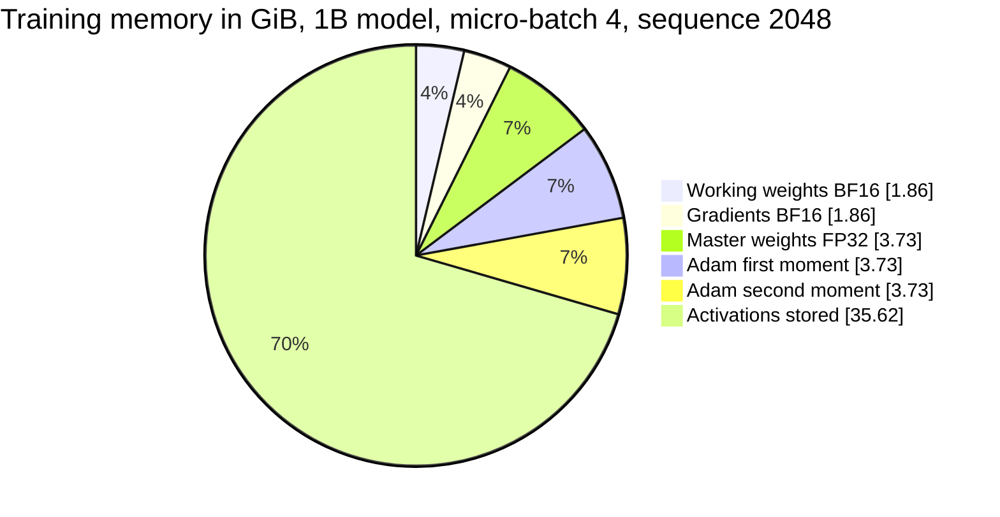

The chart makes the central planning point: for this configuration activations, not the model state, are the largest item, and they are the item that the batch size and sequence length control. A team that sizes hardware from the parameter count alone will underestimate memory by a factor of three here.

### 16.4 Checking whether the plan fits

Adding the pieces: state $14.9$ GiB plus activations $35.6$ GiB is $50.5$ GiB, plus the logits (for a vocabulary of $32{,}000$ and FP32 logits, $4\times2048\times32000\times4$ bytes is about $1.0$ GB, with another copy for the softmax gradient) and overhead. It fits an 80 GB-class GPU at a micro-batch of $4$. At a micro-batch of $8$ the activations double to $71.2$ GiB and the total is $86.2$ GiB, which does not fit. At a sequence length of $4096$ with $b=4$ the multiplier becomes $34+5\times16\times4096/2048=194$, and the per-layer activation is $6.06$ GiB, which is $3.4$ times the $s=2048$ figure for twice the tokens, showing the quadratic attention term. The script [04_memory_and_precision.py](../code/python/deep-learning-chapter/04_memory_and_precision.py) reproduces the state and activation figures.

### 16.5 Activation checkpointing

Activation checkpointing (also called gradient checkpointing or rematerialization) trades computation for memory. Instead of saving every intermediate tensor, the forward pass saves only the inputs to selected segments of the network. During the backward pass, when a segment's gradients are needed, its forward computation is rerun from the saved input to regenerate the intermediate tensors, which are used and then freed. Tianqi Chen and colleagues (2016) analyzed the approach and showed that choosing about $\sqrt{n}$ checkpoints for an $n$-layer network reduces activation memory from $O(n)$ to $O(\sqrt{n})$ at the cost of about one additional forward pass.

For the example transformer, checkpointing every layer stores only that layer's input, which is $2sbh=2\times2048\times4\times2048=33.5$ MB ($0.031$ GiB) per layer, or $0.62$ GiB for twenty layers. Peak activation memory is that plus the full activations of one layer being recomputed ($1.78$ GiB), which is $2.41$ GiB, down from $35.6$ GiB, a reduction by a factor of nearly fifteen.

The cost is arithmetic. A normal step costs one forward unit plus about two backward units, three in total. With full recomputation the forward is run twice, so a step costs four units, an increase of about $33$ percent. Selective recomputation (Korthikanti and colleagues, 2022) recomputes only the memory-heavy, compute-light parts, namely the attention score computation. It removes the $5as/h$ term, dropping the multiplier from $114$ to $34$ and the activation total from $35.6$ GiB to $10.6$ GiB, at a small compute overhead because attention scores are cheap to recompute relative to the matrix multiplications. Fused attention kernels such as FlashAttention (Tri Dao and colleagues, 2022) achieve the same memory saving by never storing the score matrix and recomputing it block by block in the backward pass, so on current stacks that use them the $5as/h$ term is already absent.

In PyTorch, `torch.utils.checkpoint.checkpoint(fn, *args, use_reentrant=False)` wraps a function so that its internals are recomputed in the backward pass. Pitfalls:

- Random operations such as dropout must reproduce the same mask during recomputation. PyTorch saves and restores the random number generator state by default.
- Layers with side effects, such as updating batch-norm running statistics, run twice.
- Checkpointing saves nothing if applied to a tiny segment, and gains most when applied to blocks that hold many large intermediates.
- Throughput drops by roughly the recompute fraction. If the run was limited by memory, which forced a tiny micro-batch with poor hardware utilization, the larger micro-batch checkpointing allows can recover more than the recompute costs.

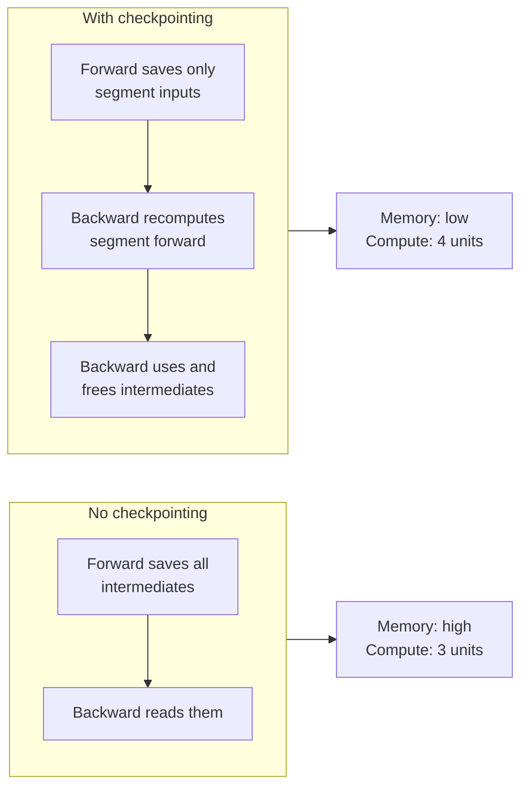

The diagram contrasts the two flows. The checkpointed version inserts a recompute stage into the backward pass. The trade is fixed and quantifiable, which is why a review can ask for the numbers: memory saved in gibibytes against the percentage added to step time.

### 16.6 Other levers, in the order they are usually tried

| Lever | Memory effect | Cost or risk |
| --- | --- | --- |
| Smaller micro-batch with gradient accumulation | Activations scale down proportionally | Longer step time; batch-norm statistics per micro-batch |
| Mixed precision (BF16) | Halves activations; state unchanged | Numerical care (Section 15) |
| Fused or flash attention | Removes the quadratic attention-score term | Needs a supporting kernel and hardware |
| Activation checkpointing | Activations by 5 to 15 times in the example | About 33 percent more compute (full), less with selective |
| Sharding optimizer state, gradients, and parameters across devices (Zero Redundancy Optimizer, ZeRO, or Fully Sharded Data Parallel, FSDP) | State divided by the number of devices | Communication, more complex failures (Section 23) |
| 8-bit or factored optimizers | Optimizer state by 2 to 4 times | Quality validation |
| Offloading to host memory or NVMe | Large reductions in device memory | Transfer bandwidth becomes the bottleneck |
| Shorter sequences or truncated context | Linear and quadratic savings | Task impact |

Sharding follows the accounting of the Zero Redundancy Optimizer (Samyam Rajbhandari and colleagues, 2020). With $K=12$ bytes per parameter of optimizer state in mixed precision and $N_d$ data-parallel devices, sharding the optimizer state gives $2N+2N+12N/N_d$ bytes per device, sharding gradients too gives $2N+14N/N_d$, and sharding the parameters as well gives $16N/N_d$. For $N=10^9$ and $N_d=8$ these are $5.5$ GB, $3.75$ GB, and $2.0$ GB per device against $16$ GB unsharded.

### 16.7 Compute and time: the 6ND estimate

Section 7.2 gave about $2$ FLOPs per parameter per token for the forward pass and $4$ for the backward pass, so training costs about $6ND$ FLOPs for a model of $N$ parameters and $D$ tokens (or examples). The estimate ignores attention FLOPs that depend on sequence length and is accurate to within tens of percent for transformer models whose context is short relative to $h$. For $N=10^9$ and $D=20\times10^9$ tokens (twenty tokens per parameter, close to the compute-optimal ratio reported by Hoffmann and colleagues, 2022), the total is $6\times10^9\times2\times10^{10}=1.2\times10^{20}$ FLOPs.

The wall-clock time depends on the fraction of the accelerator's peak that the run achieves, called model FLOPs utilization (MFU). The PaLM paper (Aakanksha Chowdhery and colleagues, 2022) popularized the term. Using BF16 dense peaks of $312$ teraFLOPs per second for an A100 and $989$ for an H100 SXM (NVIDIA's published figures at the time of writing; verify for the actual hardware), and an assumed MFU of $40$ percent, which is a good figure for a well-tuned run and illustrative only:

| Accelerator | Peak BF16 dense | MFU 30 percent | MFU 40 percent |
| --- | --- | --- | --- |
| A100 | 312 TFLOPS | 356 GPU-hours | 267 GPU-hours |
| H100 SXM | 989 TFLOPS | 112 GPU-hours | 84 GPU-hours |

At 40 percent MFU an H100 processes $989\times10^{12}\times0.4/(6\times10^{9})\approx65{,}900$ tokens per second for this model. At an assumed price of three dollars per GPU-hour, which is a placeholder to be replaced by the actual contract, the H100 run costs about $253$ dollars of compute, and on eight GPUs with ideal scaling it takes about $10.5$ hours. Real runs are less efficient than this once failures, evaluation, restarts, and communication are counted, so plan with a margin and measure MFU on a short trial. The cost decisions built on this arithmetic are the subject of [AI Cost, Performance, and Sustainability Decisions](../17_AI_Architecture/CH14_AI_Cost_Performance_and_Sustainability_Decisions.md).

## 17. Hardware Basics: Memory Hierarchy, Tensor Cores, and Data Pipelines

A training step is limited by whichever of three things is slowest: arithmetic, memory movement, and the supply of data. Reading a profile requires a small model of each.

### 17.1 The GPU memory hierarchy

A GPU has several levels of memory with very different speeds and sizes. The numbers below are orders of magnitude from vendor specifications at the time of writing and differ by model, so verify against the datasheet of the target device.

| Level | Typical size | Typical bandwidth | Role |
| --- | --- | --- | --- |
| Registers and shared memory (static random-access memory, SRAM) per streaming multiprocessor | Hundreds of kilobytes per multiprocessor | Highest, tens of TB/s aggregate | Working tiles of a kernel |
| L2 cache | Tens of megabytes (for example 40 MB on A100, 50 MB on H100) | Several TB/s | Shared across multiprocessors |
| High-bandwidth memory (HBM) | 40 to 192 GB | About 2.0 TB/s (A100 80 GB), 3.35 TB/s (H100 SXM) | Parameters, activations, optimizer state |
| GPU-to-GPU link (NVLink) | not applicable | About 600 GB/s (A100), 900 GB/s (H100) per GPU, total | Gradient and activation exchange within a node |
| Host link (Peripheral Component Interconnect Express, PCIe) | Host memory is hundreds of GB | About 32 GB/s (PCIe Gen4 x16), 64 GB/s (Gen5) per direction | Data from CPU to GPU |
| Network between nodes | not applicable | Tens of GB/s (for example 400 Gb/s is 50 GB/s per link) | Multi-node training |
| Storage | TB to PB | Highly variable, GB/s for local NVM Express (NVMe) drives, less over network file systems | Datasets and checkpoints |

Each step down the table loses roughly an order of magnitude of bandwidth. The central performance idea follows: a computation is fast when its data stays in the upper levels, and slow when it repeatedly goes to a lower one. Most kernel optimization, including operator fusion and FlashAttention, is about keeping data in SRAM longer.

### 17.2 Tensor cores

Modern NVIDIA GPUs contain tensor cores, units that perform a small matrix multiply-accumulate on tiles in one instruction, taking low-precision inputs and accumulating in FP32. They supply most of the arithmetic throughput. For an A100, the BF16 tensor-core peak is $312$ TFLOPS dense and the ordinary FP32 peak without tensor cores is $19.5$ TFLOPS, a ratio of sixteen. For an H100 SXM the dense BF16 peak is $989$ TFLOPS and the FP32 peak is about $67$. A training program that does not use tensor cores, because it runs in plain FP32 without TF32, or uses dimensions that do not map onto tiles, forgoes more than an order of magnitude of throughput.

Practical consequences: use BF16 or FP16 (or TF32 for FP32 models), keep matrix dimensions multiples of $8$, and preferably $64$ or $128$, for the best tile utilization (this is why vocabularies are often padded to a multiple of $64$), and avoid tiny batch or hidden sizes, where the kernel launch overhead dominates the arithmetic.

### 17.3 Compute-bound versus memory-bound

The roofline model says an operation's attainable throughput is the lesser of the peak arithmetic rate and the product of its arithmetic intensity (FLOPs per byte moved from memory) and the memory bandwidth. The ridge point, where the two limits meet, is the peak FLOPs divided by the bandwidth:

$$
I_{\text{ridge}}=\frac{\text{peak FLOP/s}}{\text{bandwidth in bytes/s}}
$$

For an A100 80 GB this is $312\times10^{12}/2.039\times10^{12}=153$ FLOPs per byte. For an H100 SXM it is $989\times10^{12}/3.35\times10^{12}=295$. Operations with intensity below the ridge point are memory-bound, and those above are compute-bound.

The intensity of a BF16 matrix multiply of an $M\times K$ matrix by a $K\times N$ matrix is $2MKN$ FLOPs over $2(MK+KN+MN)$ bytes of traffic:

| Shape ($M$, $K$, $N$) | FLOPs per byte | Regime on A100 or H100 |
| --- | --- | --- |
| 8, 4096, 4096 | 8.0 | Memory-bound |
| 128, 4096, 4096 | 120.5 | Memory-bound on both (below 153 and 295) |
| 2048, 4096, 4096 | 1024 | Compute-bound |
| 8192, 8192, 8192 | 2731 | Compute-bound |

An elementwise operation such as adding two BF16 tensors does one FLOP for six bytes (two reads and one write of two bytes each), an intensity of $0.17$, far below any ridge point. Layer norm, softmax, dropout, GELU, and residual additions are all memory-bound.

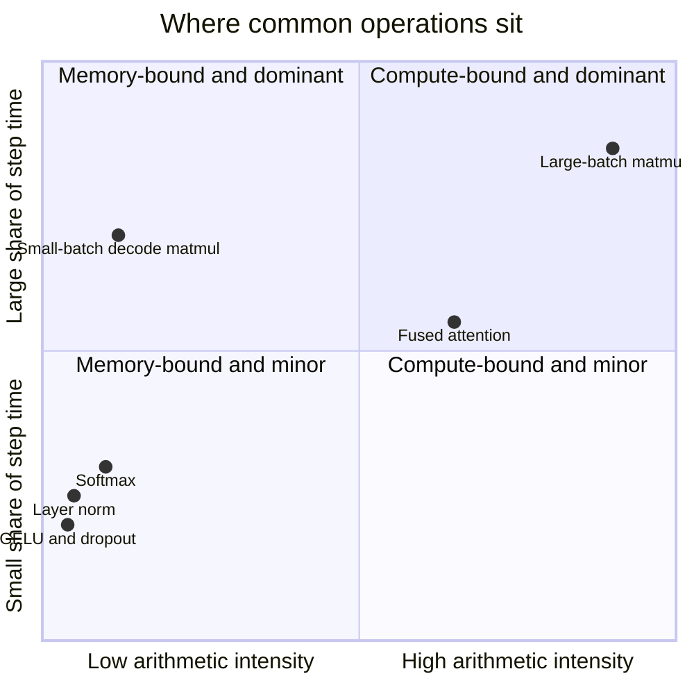

The placement is qualitative, drawn from the arithmetic above. The lesson for training is that the large matrix multiplications are compute-bound and dominate, while the many small elementwise operations are memory-bound and, left unfused, can take a surprising share of time because each one reads and writes the full activation tensor. Compilers such as `torch.compile` fuse chains of elementwise operations into one kernel to cut those round trips. The lesson for serving is different. Autoregressive decoding processes few tokens at once, so its matrix multiplications sit at the top left, memory-bound, which is why inference optimization ([CH28](CH28_Inference_Optimization_and_Model_Serving.md)) concentrates on batching, caching, and quantization.

### 17.4 Data-loading bottlenecks

The accelerator is idle whenever the next batch is not ready. The input pipeline has stages, each of which can be the slowest:

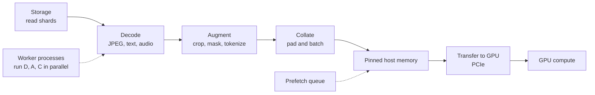

The workers decode, augment, and collate in parallel and fill a prefetch queue, so that transfer and computation for batch $t$ overlap with preparation of batch $t+1$. A worked example, with illustrative numbers: a GPU step on a batch of $256$ images takes $0.25$ s, so the accelerator needs $256/0.25=1{,}024$ images per second. If one CPU worker can decode and augment $200$ images per second, then $1024/200=5.1$, so at least six workers are needed just to match the GPU, and eight give headroom. With only two workers the supply is $400$ images per second, a batch takes $0.64$ s to prepare, and the GPU computes for $0.25$ s of every $0.64$ s, a utilization of $39$ percent. With four workers the supply is $800$ per second, the batch takes $0.32$ s, and utilization is $78$ percent. The GPU in this pipeline is the same, and the training time differs by a factor of two.

Typical fixes, in the order that tends to pay:

1. **Use more worker processes** (`num_workers` in the PyTorch `DataLoader`) and `persistent_workers=True` so that they are not respawned each epoch, and raise the prefetch depth.
2. **Pin memory and use non-blocking transfers** (`pin_memory=True`, `tensor.to(device, non_blocking=True)`) so host-to-device copies overlap with computation.
3. **Reduce per-sample cost.** Store data in a form that is cheap to read: pre-decoded or lower-resolution images, pre-tokenized text, or sharded sequential formats (such as WebDataset tar shards, TFRecord, or Parquet and Arrow) instead of millions of small files, for which metadata lookups dominate on network file systems.
4. **Move augmentation to the GPU** with libraries such as NVIDIA DALI or Kornia when the CPU is the limit.
5. **Cache** decoded or preprocessed data on local NVMe when the dataset fits and the storage is remote.
6. **Shuffle wisely.** Shuffling across shards with a bounded buffer provides randomness without random reads over the entire dataset.

The first diagnostic is to time the loader alone: iterate through it without the model and measure samples per second. If that rate is below the GPU's demand, the loader is the bottleneck, and no model change will help. Profile the full step with `torch.profiler`, and look for gaps between kernels on the GPU timeline. The utilization figure reported by `nvidia-smi` measures the fraction of time at least one kernel was running, so a GPU can show $90$ percent "utilization" while using a small part of its arithmetic capacity. Throughput in samples or tokens per second, and MFU, are the honest measures. A common finding in practice is that a "slow training" complaint is attributed to the model or optimizer when the accelerator is simply idle for a large fraction of each step waiting for data. Fixing the pipeline can cut epoch time by a third or more without touching the model.

## 18. A Complete Training Loop with Validation and Checkpointing

The components described so far fit together in one loop. This section shows a complete PyTorch implementation, then explains the decisions in it. The code was written for PyTorch 2.x, and PyTorch was not installed in the environment where this chapter was prepared, so the listing has been checked by reading and has not been executed. Treat it as a template to run on a small problem (Section 20) before relying on it. The runnable scripts in the code folder use only the Python standard library.

### 18.1 The loop

```python
import math, os, random
import numpy as np
import torch
import torch.nn.functional as F

def set_seed(seed: int) -> None:
    random.seed(seed); np.random.seed(seed)
    torch.manual_seed(seed); torch.cuda.manual_seed_all(seed)

def make_param_groups(model, weight_decay):
    decay, no_decay = [], []
    for p in model.parameters():
        if p.requires_grad:
            (decay if p.ndim >= 2 else no_decay).append(p)   # biases, norm scales are 1-D
    return [{"params": decay, "weight_decay": weight_decay},
            {"params": no_decay, "weight_decay": 0.0}]

def lr_factor(step, warmup, total, min_ratio=0.1):
    if step < warmup:
        return (step + 1) / warmup
    progress = (step - warmup) / max(1, total - warmup)
    return min_ratio + (1 - min_ratio) * 0.5 * (1 + math.cos(math.pi * progress))

@torch.no_grad()
def evaluate(model, loader, device):
    model.eval()
    loss_sum, correct, n = 0.0, 0, 0
    for x, y in loader:
        x, y = x.to(device, non_blocking=True), y.to(device, non_blocking=True)
        with torch.autocast(device_type=device.type, dtype=torch.bfloat16,
                            enabled=(device.type == "cuda")):
            logits = model(x)
        loss_sum += F.cross_entropy(logits.float(), y, reduction="sum").item()
        correct += (logits.argmax(dim=-1) == y).sum().item()
        n += y.numel()
    model.train()
    return loss_sum / n, correct / n

def save_checkpoint(path, model, opt, sched, step, best_val, cfg):
    state = {
        "model": model.state_dict(), "optimizer": opt.state_dict(),
        "scheduler": sched.state_dict(), "step": step, "best_val": best_val, "config": cfg,
        "rng": {"python": random.getstate(), "numpy": np.random.get_state(),
                "torch": torch.get_rng_state(),
                "cuda": torch.cuda.get_rng_state_all() if torch.cuda.is_available() else None},
    }
    tmp = path + ".tmp"
    torch.save(state, tmp)
    os.replace(tmp, path)            # atomic rename: a crash never leaves a half-written file

def train(model, train_loader, val_loader, cfg, device):
    model.to(device).train()
    opt = torch.optim.AdamW(make_param_groups(model, cfg["weight_decay"]),
                            lr=cfg["lr"], betas=(0.9, 0.95), eps=1e-8)
    sched = torch.optim.lr_scheduler.LambdaLR(
        opt, lambda s: lr_factor(s, cfg["warmup"], cfg["total_steps"]))
    step, best_val, bad_evals, micro = 0, float("inf"), 0, 0

    if os.path.exists(cfg["last_ckpt"]):                       # resume
        ck = torch.load(cfg["last_ckpt"], map_location=device, weights_only=False)
        model.load_state_dict(ck["model"]); opt.load_state_dict(ck["optimizer"])
        sched.load_state_dict(ck["scheduler"]); step, best_val = ck["step"], ck["best_val"]

    opt.zero_grad(set_to_none=True)
    while step < cfg["total_steps"]:
        for x, y in train_loader:
            x, y = x.to(device, non_blocking=True), y.to(device, non_blocking=True)
            with torch.autocast(device_type=device.type, dtype=torch.bfloat16,
                                enabled=(device.type == "cuda")):
                logits = model(x)
            loss = F.cross_entropy(logits.float(), y) / cfg["accum"]
            loss.backward()
            micro += 1
            if micro % cfg["accum"]:
                continue

            grad_norm = torch.nn.utils.clip_grad_norm_(model.parameters(), cfg["clip"])
            if torch.isfinite(grad_norm):                      # skip poisoned updates
                opt.step()
            opt.zero_grad(set_to_none=True)
            sched.step(); step += 1

            if step % cfg["log_every"] == 0:
                print(f"step {step} loss {loss.item() * cfg['accum']:.4f} "
                      f"gnorm {grad_norm.item():.3f} lr {sched.get_last_lr()[0]:.2e}")
            if step % cfg["eval_every"] == 0:
                val_loss, val_acc = evaluate(model, val_loader, device)
                print(f"step {step} val_loss {val_loss:.4f} val_acc {val_acc:.4f}")
                if val_loss < best_val - cfg["min_delta"]:
                    best_val, bad_evals = val_loss, 0
                    save_checkpoint(cfg["best_ckpt"], model, opt, sched, step, best_val, cfg)
                else:
                    bad_evals += 1
                save_checkpoint(cfg["last_ckpt"], model, opt, sched, step, best_val, cfg)
                if bad_evals >= cfg["patience"]:
                    return best_val
            if step >= cfg["total_steps"]:
                break
    return best_val
```

### 18.2 What each part is doing

**Seeding** (`set_seed`) fixes the sources of randomness the training process controls, which Section 19 shows is necessary and not sufficient for repeatable runs.

**Parameter groups** (`make_param_groups`) apply weight decay only to tensors with two or more dimensions, which are weight matrices and embeddings. One-dimensional tensors are biases and the scale and shift parameters of normalization layers, which should not be decayed (Section 13.1). Some recipes also exclude embeddings from decay; the rule is a convention, so check the reference recipe.

**The schedule** (`lr_factor` through `LambdaLR`) multiplies the optimizer's base rate by the warmup-then-cosine factor of Section 12.3. The scheduler is stepped once per optimizer step, not once per micro-batch.

**Autocast** runs the forward pass in BF16 on a GPU while parameters stay FP32. The loss is computed from `logits.float()` so the softmax and logarithm run in FP32 (Section 15.2). With FP16 instead of BF16, add a gradient scaler as in Section 15.3.

**Accumulation** divides the loss by `cfg["accum"]` and calls `backward()` each micro-batch, but clips and steps only once every `accum` micro-batches (Section 14.3). The `micro` counter persists across the inner `for` loop, so a dataset epoch that ends in the middle of an accumulation window carries the partial window into the next epoch. That is acceptable for a template and a point to handle deliberately in production.

**Clipping and the finite check.** `clip_grad_norm_` returns the pre-clip global norm, which is both logged and used to skip a step whose gradient is `inf` or `nan`. This protects the weights and optimizer state from a single poisoned update. With a gradient scaler, the scaler performs the skip itself.

**Evaluation** uses `torch.no_grad` (through the decorator) and `model.eval()`, restores `model.train()` afterwards, sums the loss with `reduction="sum"` and divides by the total count so that the result does not depend on the batch size or the size of the last partial batch, and keeps a separate counter for accuracy. Validation uses the same preprocessing as inference and no augmentation.

**Early stopping and best checkpoint.** The best checkpoint is saved when validation loss improves by more than `min_delta`. The last checkpoint is saved at every evaluation so that an interrupted run can resume. The run ends when `patience` consecutive evaluations fail to improve.

**Atomic checkpoint writes.** `save_checkpoint` writes to a temporary file and renames it, so a crash during the write leaves the previous checkpoint intact. A file that is half written is otherwise the usual way a resumable run becomes unresumable.

### 18.3 What a checkpoint must contain

A checkpoint that holds only the model weights is enough for inference and not enough to continue training. The set of items needed to resume or reproduce a run is:

| Item | Why it is needed |
| --- | --- |
| Model weights | The model itself |
| Optimizer state (moments, step counters) | Without it the next steps behave like a cold start and the loss often jumps |
| Scheduler state or the step counter | Otherwise the run restarts at warmup or at the wrong point of decay |
| Gradient scaler state (FP16) | The current scale and growth counter |
| EMA or averaged weights, if used | Often the weights that are actually evaluated |
| Step, epoch, and data-loader position | To avoid repeating or skipping data; a stateful sampler is needed for exact resumption |
| Random number generator states (Python, NumPy, PyTorch CPU and CUDA) | To continue the same random stream |
| Configuration and hyperparameters | To know what produced the model |
| Code version (commit hash) and library versions | Behaviour changes with versions |
| Data version or manifest hash, and preprocessing code version | To tie the model to its training data ([CH02](CH02_Data_Preparation_Feature_Engineering_and_Leakage.md), [CH30](CH30_AI_Data_Governance_Privacy_and_Provenance.md)) |
| Validation metrics at save time | To choose among checkpoints without reloading each |

Keep the last few checkpoints plus the best one, because a late divergence can corrupt the latest. Test resumption: train for 100 steps in one process, and separately for 50 steps, stop, resume, and run 50 more. The loss curves should agree to within the nondeterminism level of the platform. A resume test that is run once before a long job saves a great deal of lost compute.

A security note belongs with the loading call. `torch.load` unpickles Python objects, and unpickling a file from an untrusted source can execute arbitrary code. The loading call above uses `weights_only=False` because the checkpoint contains random generator states and optimizer objects, which is acceptable only for files the training system itself wrote. Load third-party weights with `weights_only=True` or a format designed for tensors alone, such as safetensors, and treat model artifacts as executable content when they come from outside the organization.

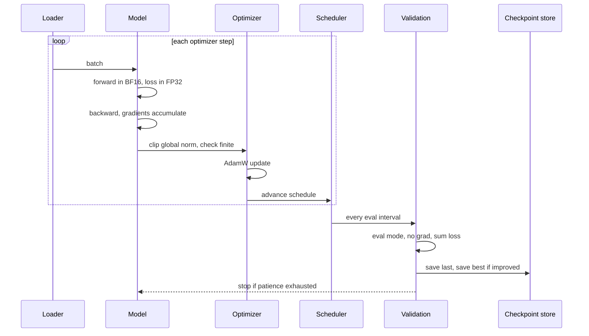

The sequence shows the control flow of the template. Training steps form an inner loop, validation and checkpointing happen at intervals, and early stopping is the only path that ends the run before the step budget. Each arrow is a place where a bug has an observable signature, which Section 20 turns into a checklist.

## 19. Reproducibility and Nondeterminism

Two runs with the same code and the same seed often produce different results. Understanding why separates reproducibility that a team can achieve from reproducibility it cannot, and tells it what to record.

### 19.1 Sources of variation

1. **Random number streams.** Initial weights, data shuffling, augmentation, dropout masks, and sampling all use random numbers. Seeding Python, NumPy, and PyTorch (CPU and each GPU) fixes the main streams. Data-loader worker processes have their own generators, which need a `worker_init_fn` or a seeded `generator` argument to be repeatable and to avoid all workers producing identical augmentations.
2. **Floating-point non-associativity.** Floating-point addition is not associative, so a sum depends on the order of its terms. In FP32 with a spacing of $8$ at $10^8$, $(10^8+1)-10^8=0$ because $10^8+1$ rounds back to $10^8$, while $(10^8-10^8)+1=1$. A parallel reduction that adds partial sums in a different order on different runs gives slightly different totals.
3. **Nondeterministic GPU kernels.** Some operations use atomic additions whose order depends on thread timing, such as scatter and index-add operations and the backward passes of some embedding and convolution implementations. Library autotuning (for example `torch.backends.cudnn.benchmark = True`) may select different algorithms between runs.
4. **Hardware and software differences.** A different GPU model, driver, CUDA or cuDNN version, or PyTorch version may select different kernels with different rounding. Results rarely transfer bit-for-bit between them.
5. **Distributed training.** The reduction order in all-reduce, the number of devices (which changes batch composition and accumulation), and per-device random streams all matter.
6. **Mixed precision and low-precision formats** amplify small differences, because rounding is coarser.
7. **Resumption.** Resuming without data-loader position and random states changes the data order after the restart.

Small differences do not stay small. Training is a chaotic process in the sense that tiny perturbations early in training grow, so two runs that differ by one rounding error at step 10 typically differ visibly in the weights by step 10,000, though their final loss values are statistically similar.

### 19.2 Two kinds of reproducibility

**Bitwise reproducibility** means identical weights from identical inputs on the same hardware and software stack. It is worth having while debugging, since it lets a failure be replayed. PyTorch offers `torch.use_deterministic_algorithms(True)`, which makes nondeterministic operations raise an error or use deterministic variants, and `torch.backends.cudnn.deterministic = True` with `benchmark = False`. Some CUDA versions also require the environment variable `CUBLAS_WORKSPACE_CONFIG=:4096:8`. The cost is lower throughput for some operations and errors for operations without a deterministic implementation. Consult the PyTorch reproducibility notes for the installed version for the exact list.

**Statistical reproducibility** means that repeating the experiment gives results from the same distribution. It is the realistic goal for production work: the claim "this recipe reaches $X$ validation accuracy" holds as a mean and a spread across seeds, not as one number. An improvement smaller than the seed-to-seed standard deviation is not evidence. If the standard deviation across seeds is $0.4$ accuracy points and a change shows $+0.3$, the difference is within noise, and even the mean of five seeds has a standard error of $0.4/\sqrt5=0.18$ points. Detecting a $0.3$ point change reliably needs more seeds, a lower-variance protocol, or a larger evaluation set.

### 19.3 What to record

Record the commit hash of the code, the full configuration, the seed, the data version, the container image digest or the exact versions of Python, PyTorch, CUDA, and the driver, the hardware type and count, and the non-default environment variables. Keep the training logs and metrics with the checkpoint. These make a run reconstructable, and they are what [CH29](CH29_MLOps_and_LLMOps.md) formalizes into lineage records. Where a regulation or a customer requires repeatability, determine which of the two kinds is meant before promising it.

## 20. A Systematic Debugging Checklist

Most failed training runs are not exotic. They come from a bug in the data, the loss, or the loop, and the symptoms (a flat loss, `nan`, poor accuracy) are identical across causes. The practical approach is to run checks in order of increasing cost and decreasing probability of finding something, so that each check eliminates a class of causes. Andrej Karpathy's "A Recipe for Training Neural Networks" (2019) popularized much of this sequence, and the version here adds the arithmetic from earlier sections.

### 20.1 The ordered checks

```mermaid
flowchart TD
    A["Training run misbehaves"] --> B["1. Inspect data<br/>samples, labels, shapes, ranges"]
    B --> C["2. Check loss at initialization<br/>expect ln K"]
    C -->|"far from ln K"| C1["Fix init, output scale,<br/>label mapping, loss input"]
    C -->|"ok"| D["3. Overfit one small batch<br/>no aug, no dropout, no decay"]
    D -->|"cannot reach near zero loss"| D1["Bug in model, loss, optimizer,<br/>labels, or learning rate"]
    D -->|"ok"| E["4. Check gradients<br/>all params have finite nonzero grads"]
    E -->|"zero or None grads"| E1["Detached graph, frozen params,<br/>wrong zero_grad placement"]
    E -->|"ok"| F["5. Check batch independence<br/>and train versus eval mode"]
    F --> G["6. Train on full data, small model<br/>read train and val curves"]
    G --> H["7. Sweep learning rate<br/>then add capacity and regularization"]
    H --> I["8. Compare with a simple baseline"]
```

**1. Inspect the data.** Look at actual examples after preprocessing, the labels attached to them, tensor shapes, value ranges, and class counts. Confirm that training and validation use the same preprocessing. Many "model problems" are label-mapping errors, mismatched normalization, or leakage ([CH02](CH02_Data_Preparation_Feature_Engineering_and_Leakage.md)).

**2. Check the loss at initialization.** For $K$-class cross-entropy with a balanced problem the first-step loss should be close to $\ln K$ ($2.303$ for ten classes, $6.908$ for a thousand). A much larger value points to large initial logits, a missing normalization, or a double softmax. A value much lower suggests label information leaking into the input. For a regression model initialized to output near zero, the first loss should be near the variance of the target. Add the initial output bias for imbalanced data and the expected loss changes accordingly.

**3. Overfit one small batch.** Take $8$ to $32$ examples, switch off augmentation, dropout, and weight decay, and train on them repeatedly. A correct model, loss, and optimizer should drive the loss near zero within a few hundred steps, because a network with more parameters than the batch has numbers can memorize it. Outcomes:

- The loss does not move: the learning rate is wrong, the optimizer is not holding the parameters (a common slip is constructing it before moving the model to the device or before a parameter is created), `zero_grad` is in the wrong place, gradients are detached, or the labels are random.
- The loss decreases and stalls well above zero: the model is too small for the batch, a mask or padding bug caps the achievable accuracy, the learning rate is too low or too high at the end, or an activation has saturated.
- The loss goes to `nan`: the learning rate is too high, an input contains non-finite values, or an operation such as a logarithm or division is unprotected.

This test takes minutes and removes most implementation bugs. Do not move on until it passes.

**4. Check gradient flow.** After one backward pass, every trainable parameter should have a gradient that is not `None`, is finite, and is not exactly zero. Print per-layer gradient norms. Also compute the update-to-weight ratio, $\|\eta\,\Delta\|/\|w\|$, for each layer. A rule of thumb is that this ratio should be around $10^{-3}$ for most layers: a ratio of $10^{-6}$ means the layer barely learns, and $10^{-1}$ means it is thrashing. It is a heuristic, not a law, and it is most useful for spotting a layer that differs from the rest by orders of magnitude.

```python
def grad_report(model, lr):
    for name, p in model.named_parameters():
        if p.grad is None:
            print(f"{name:40s} NO GRAD"); continue
        g, w = p.grad.norm().item(), p.norm().item()
        print(f"{name:40s} |g| {g:9.3e}  |w| {w:9.3e}  lr|g|/|w| {lr * g / (w + 1e-12):9.3e}")
```

**5. Check batch independence and modes.** In evaluation mode, the output for one example must not depend on the other examples in its batch. Compute the output for example $0$ alone, then in a batch of $8$ with different companions, and compare. A failure indicates batch statistics in use (batch norm in training mode), a reduction over the wrong axis, or a masking error that lets information flow between examples or from future tokens to past ones. Also confirm that `model.train()` and `model.eval()` are called where intended.

**6. Train on the full data with a small model** and read the training and validation curves (Section 21). Scale up the model only after the small one learns.

**7. Tune the learning rate,** using the range test of Section 12.4, then add capacity and regularization one at a time, recording the effect of each.

**8. Compare with a simple baseline** from the ladder in [CH01](CH01_Machine_Learning_Foundations.md): a majority class, a linear or logistic model, or a tree ensemble. A neural network that does not clearly beat a gradient-boosted tree on tabular data either has a problem or does not belong in the design.

### 20.2 Symptom to likely cause

| Symptom | Likely causes | First check |
| --- | --- | --- |
| Loss `nan` or `inf` at step 0 | Bad input values, log of zero, divide by zero, huge initial scale | Print min, max, and finiteness of inputs and first logits |
| Loss `nan` after many steps | Learning rate too high, loss spike, FP16 overflow, data outlier | Pre-clip gradient norm history; save and inspect the batch at the spike |
| Loss flat at $\ln K$ | No learning: lr too low or too high, frozen or detached parameters, dead activations, scale of inputs | Overfit-one-batch test; per-layer gradient norms |
| Loss decreases, accuracy at chance | Metric computed on wrong tensor, label order mismatch, evaluation preprocessing differs | Compute accuracy on the training batch; compare label encodings |
| Loss decreases then spikes | Learning rate too high late, no warmup, rare bad batch, Adam second-moment collapse | Gradient norm plot; lower peak rate; check clipping; inspect batch |
| Validation much worse from the start | Distribution or preprocessing mismatch, leakage in training, batch-norm eval mode | Run the training set through the evaluation path and compare |
| Validation better than training | Dropout and augmentation active in training only, training loss averaged over a changing model | Compare under identical evaluation settings |
| Train loss falls, validation rises | Overfitting, or validation set drift | Regularization and early stopping (Sections 13 and 21) |
| Memory grows every step | A tensor holding the graph is kept (for example appending `loss`), missing `no_grad` | Log `loss.item()`, wrap evaluation in `no_grad` |
| Step time fluctuates, GPU idle | Data loading, synchronization, CPU-GPU transfers | Time the loader alone; profile (Section 17.4) |
| Results differ run to run by more than expected | Unseeded workers, nondeterministic ops, small validation set | Seed audit; repeat with fixed seed; widen the evaluation set |

### 20.3 Instrumentation to build in from the start

Log, at each step or at a fixed interval: the training loss, the learning rate, the pre-clip gradient norm, the step time and throughput, peak device memory, and for mixed precision the number of skipped steps. Log at evaluation: validation loss and the task metric. Keep per-layer activation and gradient statistics available on demand through forward and backward hooks. When a spike occurs, save the offending batch, the step number, and the random state so that the event can be replayed. A dashboard that shows these on one screen turns most diagnoses into reading.

## 21. Diagnosing Under- and Over-Fitting, and the Generalization Puzzles

### 21.1 Reading the learning curves

The relationship between training and validation loss over time is the primary diagnostic. [CH01](CH01_Machine_Learning_Foundations.md) introduced learning curves as a function of data size. Here the horizontal axis is training progress, and the patterns are as follows.

```mermaid
xychart-beta
    title "Overfitting: training loss falls while validation loss turns up"
    x-axis "Training progress" ["early", "middle", "late", "later"]
    y-axis "Loss" 0 --> 1.1
    line [0.90, 0.55, 0.30, 0.08]
    line [0.95, 0.60, 0.66, 0.85]
```

The first line is the training loss and the second the validation loss. Both fall early, validation reaches a minimum around the middle, and afterwards training continues down while validation rises. The best checkpoint is the one at the validation minimum, and the gap after it is the cost of continuing. The curve is illustrative; real curves are noisier, and the minimum must be judged against the noise in the validation estimate.

| Pattern | Training loss | Validation loss | Interpretation | Typical remedy |
| --- | --- | --- | --- | --- |
| Healthy | Falls steadily, then flattens | Tracks training with a small gap | Good fit | Continue, anneal the rate |
| Underfitting (high bias) | High and flat | High, close to training | Model or optimization limits fit | More capacity, longer training, higher or better-scheduled rate, better features |
| Overfitting (high variance) | Low and falling | Falls, then rises; large gap | Memorizing training specifics | More data, augmentation, weight decay, dropout, early stopping, smaller model |
| Optimization failure | Flat from the start, or erratic | Same | Learning is not happening | Debug (Section 20), learning rate, init, gradient flow |
| Instability | Spikes or oscillates | Spikes | Step too large or bad batches | Lower rate, warmup, clipping, data check |
| Distribution mismatch | Low | High from the start | Validation differs from training | Check the split and preprocessing before touching the model |
| Noisy validation | Smooth | Jagged | Small or unrepresentative validation set | Larger validation set, smoothing, repeated evaluation |

```mermaid
flowchart TD
    S["Read the curves"] --> Q1{"Is training loss<br/>near the achievable floor?"}
    Q1 -->|"No"| Q2{"Is it falling at all?"}
    Q2 -->|"No"| O1["Optimization failure<br/>debug, lr, init, gradients"]
    Q2 -->|"Slowly"| O2["Underfit or lr too low<br/>capacity, lr, training length"]
    Q1 -->|"Yes"| Q3{"Gap to validation large?"}
    Q3 -->|"Large"| Q4{"Gap there from step one?"}
    Q4 -->|"Yes"| O3["Split or preprocessing mismatch"]
    Q4 -->|"Grows with training"| O4["Overfit<br/>regularize, more data, stop earlier"]
    Q3 -->|"Small"| O5["Good fit<br/>decide on metric and cost"]
```

The decision tree starts from the question of whether training loss is near what is achievable, since a validation gap cannot be diagnosed until the training fit is understood. The achievable floor is not known exactly, so use a proxy: the label noise rate if estimated, a human-level error rate, or the loss of a much larger model. The size of the gap that is acceptable is judged against the deployment metric and cost, not against zero. For example, a training loss of $0.05$ against a validation loss of $0.60$ shows a gap of $0.55$ and an overfit model, while a gap of $0.02$ at training loss $0.45$ shows a model limited by capacity, features, or noise in the labels (the avoidable-bias versus variance reading from [CH01](CH01_Machine_Learning_Foundations.md)).

### 21.2 Caution about curves

A curve is evidence, not a verdict. A validation set that is small gives a wide error bar on every point. A validation set that has been used for many decisions has been fitted to by the tuning process ([CH06](CH06_Model_Evaluation_Validation_and_Selection.md)). Training loss measured on augmented, dropout-perturbed batches is not comparable with validation loss measured clean, so a validation loss below the training loss early in training is normal. And a loss and a metric can diverge: accuracy can keep improving while the loss rises if the model becomes overconfident on its errors, which is the signature of poor calibration. Confirm any conclusion with deployment-matched data and the task metric.

### 21.3 Why classical intuition is incomplete

Classical learning theory says that models with capacity much larger than the data fit noise and generalize poorly. Deep networks routinely contradict this. Chiyuan Zhang, Samy Bengio, Moritz Hardt, Benjamin Recht, and Oriol Vinyals (2017) trained standard image-classification networks on data with randomly shuffled labels and found that they reached zero training error, though no pattern could be learned and test accuracy was at chance. The same architecture on true labels generalizes well. Two conclusions follow. The network has enough capacity to memorize, so capacity alone does not explain good generalization on real data. And bounds based only on the size of the hypothesis class are too loose to explain the observed behaviour. Explanations that are actively studied include the implicit bias of gradient descent toward simple solutions, the structure of real data, and the role of initialization and architecture. None is settled.

### 21.4 Double descent

The classical bias-variance picture predicts a U-shaped test error as model size grows. Mikhail Belkin, Daniel Hsu, Siyuan Ma, and Soumik Mandal (2019) described a double-descent curve: as capacity increases past the interpolation threshold, where the model first becomes able to fit the training set exactly, test error peaks and then decreases again. Preetum Nakkiran and colleagues (2019) showed the effect in deep networks and found that it can also occur as a function of the number of training epochs and, in some settings, as a function of the amount of data, so that more data can temporarily hurt.

```mermaid
xychart-beta
    title "Double descent (schematic)"
    x-axis "Model capacity" ["low", "growing", "threshold", "past", "large"]
    y-axis "Test error" 0 --> 1
    line [0.60, 0.35, 0.80, 0.45, 0.30]
```

The schematic curve falls, rises to a peak near the point where capacity matches the number of examples, and falls again. [CH01](CH01_Machine_Learning_Foundations.md) introduced the phenomenon with caution, and the practical reading from deep learning is as follows.

- The peak is most pronounced when labels are noisy, because fitting the noise exactly costs the most there. Regularization, such as weight decay or early stopping, reduces or removes the peak in many experiments.
- Operating far past the threshold with a large over-parameterized model is the norm in deep learning, and the larger model often does better. It does not follow that bigger is always better, and every size increase carries a compute and memory cost.
- Epoch-wise double descent means that stopping early at the first minimum may be worse than training longer in some noisy-label settings. The remedy for that decision is the same as everywhere: choose by validation evidence on deployment-matched data.
- The phenomenon does not appear in every setting, and a design should not rely on a second descent that it has not observed for its own data.

Related observations include grokking (Alethea Power and colleagues, 2022), in which validation accuracy on some small algorithmic tasks jumps long after training accuracy reached 100 percent, and the miscalibration of modern networks (Chuan Guo and colleagues, 2017), which tend to be overconfident and are often fixed with a single temperature parameter fitted on validation data ([CH06](CH06_Model_Evaluation_Validation_and_Selection.md)). The theme across them is that training loss alone says little about what a deployed model will do, which is why Section 20 insists on separate evaluation evidence.

## 22. Hyperparameter Search

### 22.1 Which hyperparameters matter

Hyperparameters are not equally influential. In most deep learning runs the learning rate dominates, followed by batch size and schedule (warmup length and decay shape), then weight decay and architecture dimensions, then the rest. Search effort is best spent in that order.

| Hyperparameter | Typical search range (illustrative starting points) | Scale for sampling |
| --- | --- | --- |
| Peak learning rate | $10^{-5}$ to $10^{-2}$ for AdamW, $10^{-2}$ to $1$ for SGD with momentum | Log-uniform |
| Weight decay (AdamW) | $0$ to $0.1$ | Log-uniform on nonzero values, plus zero |
| Warmup length | $0.5$ to $5$ percent of training steps | Linear |
| Batch size | Fixed by memory and throughput, then scale the rate | Powers of two |
| Dropout | $0$ to $0.3$ | Linear |
| Adam $\beta_2$ | $0.95$ to $0.999$ | Closer to one is sampled on the $1-\beta_2$ log scale |
| Label smoothing | $0$ to $0.1$ | Linear |
| Width, depth | Constrained by latency and memory budgets | Discrete |

The ranges are starting points only. Use the range test (Section 12.4) to narrow the learning rate, then search the neighbourhood.

### 22.2 Grid, random, and adaptive search

Grid search tries every combination on a lattice. With two hyperparameters and a $3\times3$ grid it runs nine trials but tests only three distinct values of each. If one hyperparameter matters much more than the other, the grid wastes most of its budget re-testing the same value of the important one. Random search (James Bergstra and Yoshua Bengio, 2012) draws each trial's values independently, so nine trials test nine distinct values of every hyperparameter. When a few hyperparameters dominate, as they usually do, random search finds good settings with fewer trials than a grid.

A worked case. Sample the learning rate log-uniformly over three decades, $10^{-5}$ to $10^{-2}$. Suppose good values occupy one half-decade. That region has probability $0.5/3=1/6$ of containing any single trial. With $20$ independent trials the probability that none lands in it is $(5/6)^{20}=0.026$, so there is a $97$ percent chance that at least one trial does. A search that is coarse in learning rate and still finds the good region is cheap; the same search on a linear scale from $10^{-5}$ to $10^{-2}$ would put about 90 percent of its trials above $10^{-3}$.

Adaptive methods use the results so far to choose the next trial. Bayesian optimization with surrogate models (the tree-structured Parzen estimator in Optuna and similar tools) concentrates samples where results have been good. Successive halving and Hyperband (Lisha Li and colleagues, 2017) start many trials with a small budget, discard the worst, and give the survivors more. Population-based training (Max Jaderberg and colleagues, 2017) evolves hyperparameters during one training run. These methods help most when each trial is expensive and the search space is large, and they all inherit the weaknesses below.

### 22.3 Pitfalls

- **Short-run proxies mislead.** Rankings at $5$ percent of the training budget may not hold at full length. The optimal learning rate usually decreases as the model grows and as training lengthens, so a setting found on a small proxy model may need adjusting. Maximal update parametrization (μP; Greg Yang and colleagues, 2021) is a research approach that makes optimal hyperparameters such as the learning rate approximately transferable across model widths, and it is worth knowing for large-scale work. Where it is not used, validate on at least two scales.
- **Seed noise.** Compare configurations by their means over several seeds when the differences are small (Section 19.2), or the search ends up selecting luck.
- **Validation overfitting.** The best of $N$ trials on a validation set is optimistically biased, and the bias grows with $N$. Keep a final untouched test set ([CH06](CH06_Model_Evaluation_Validation_and_Selection.md)) and record the number of trials.
- **Interacting settings.** Learning rate, weight decay, batch size, and warmup are not independent. Change them together by rule (the scaling rules of Section 14.2), not one at a time through a stale optimum.
- **Cost.** Each trial has the cost computed in Section 16.7. A 200-trial search of a run costing $253$ dollars is not free, so cap the budget from the value of the improvement and prefer short, informative trials.
- **Reproducibility of the winner.** Store the exact configuration, seed, and data version of the chosen trial, then rerun it once to confirm.

## 23. A Short Introduction to Distributed Training

Training often needs more than one accelerator, either because the model state does not fit on one (Section 16.2) or because the run would take too long. This section introduces the simplest form, data parallelism, recaps the other forms, and points to where later chapters take up their consequences. It is an orientation, and does not replace a distributed-systems treatment.

### 23.1 Data parallelism

In data parallel training, $P$ devices each hold a complete copy of the model. The global batch is split into $P$ shards. Each device runs the forward and backward pass on its shard and obtains a local gradient. The devices then average their gradients with an all-reduce operation, so every device ends up with the same averaged gradient, applies the same optimizer step, and the replicas stay identical. Because the average of the shard gradients is the gradient of the global batch (when shards are equal-sized), the result matches single-device training with the global batch, up to floating-point ordering.

```mermaid
sequenceDiagram
    participant G0 as GPU 0
    participant G1 as GPU 1
    participant G2 as GPU 2
    participant G3 as GPU 3
    Note over G0,G3: Each holds the same weights and a different data shard
    G0->>G0: forward and backward on shard 0
    G1->>G1: forward and backward on shard 1
    G2->>G2: forward and backward on shard 2
    G3->>G3: forward and backward on shard 3
    G0->>G3: all-reduce average of gradients (ring)
    G1->>G0: all-reduce average of gradients (ring)
    Note over G0,G3: Every GPU now holds the same averaged gradient
    G0->>G0: identical optimizer step
    G1->>G1: identical optimizer step
    G2->>G2: identical optimizer step
    G3->>G3: identical optimizer step
```

The diagram shows a step in four stages: independent compute, a communication step that is the only coupling between devices, and identical updates. The all-reduce is where scaling is won or lost.

**Communication cost.** The ring all-reduce algorithm, used by NCCL (the NVIDIA Collective Communications Library) and similar libraries, passes data around a ring of devices so that each device sends and receives $2\frac{P-1}{P}S$ bytes in total, where $S$ is the size of the data being reduced. For BF16 gradients of a one-billion-parameter model, $S=2$ GB. With $P=8$ each device moves $2\times\frac78\times2=3.5$ GB per step. At an assumed effective bus bandwidth of $200$ GB/s within a node that takes $17.5$ ms, and at an assumed $25$ GB/s effective across nodes it takes $140$ ms. These bandwidths are illustrative and depend on the interconnect. The per-device volume barely grows with $P$, since $2(P-1)/P$ tends to $2$, which is the reason ring all-reduce scales well in device count. Latency grows with $P$ and affects small messages more.

**Overlap.** Frameworks start communication before the backward pass is finished. PyTorch's DistributedDataParallel (Shen Li and colleagues, 2020) groups gradients into buckets, with a default bucket size on the order of tens of megabytes, and launches an all-reduce for each bucket as soon as its gradients are ready, while the backward pass continues with earlier layers. If a step has $400$ ms of compute, most of a $17.5$ ms all-reduce is hidden. If the communication time exceeds the compute time it is exposed and efficiency falls. Scaling efficiency is the measured throughput on $P$ devices divided by $P$ times the single-device throughput: eight devices delivering $7.2$ times the throughput have a $90$ percent efficiency.

A minimal launch pattern uses one process per GPU:

```python
# torchrun --nproc_per_node=8 train.py
import os, torch, torch.distributed as dist
from torch.nn.parallel import DistributedDataParallel as DDP
from torch.utils.data import DataLoader, DistributedSampler

dist.init_process_group(backend="nccl")
local_rank = int(os.environ["LOCAL_RANK"])
torch.cuda.set_device(local_rank)
model = DDP(build_model().cuda(local_rank), device_ids=[local_rank])
sampler = DistributedSampler(dataset, shuffle=True)
loader = DataLoader(dataset, batch_size=micro_batch, sampler=sampler, num_workers=8)
for epoch in range(num_epochs):
    sampler.set_epoch(epoch)           # different shuffle each epoch, same across ranks
    ...                                # training loop as in Section 18; only rank 0 writes checkpoints
```

### 23.2 Consequences to plan for

- **Effective batch size.** The global batch is the product of the per-device micro-batch, the accumulation steps, and $P$. Adding devices increases the batch unless the micro-batch is reduced, so the learning rate and warmup must be revisited (Section 14.2).
- **Batch-dependent layers.** Batch norm statistics are computed per device by default. Use synchronized batch norm, or normalizations that do not depend on the batch.
- **Data sharding.** `DistributedSampler` gives each rank a distinct slice, and it needs `set_epoch` so the order changes across epochs.
- **Checkpoints and logging.** Typically only one rank writes checkpoints and logs, with a barrier to keep ranks in step. Checkpoint load and save times at scale become a significant cost.
- **Failures.** The probability that some device fails during a long job rises with $P$. Frequent checkpoints, elastic launchers that can restart with a changed worker count, and monitoring for stragglers (one slow device slows every step) become requirements.
- **Determinism.** Section 19 sources multiply: the device count itself changes the results.

### 23.3 When data parallelism is not enough

Every replica holds the full model state, so data parallelism requires $16N$ bytes (Section 16.2) plus activations on each device. A one-billion-parameter model needs 16 GB and fits. A seven-billion-parameter model needs 112 GB and does not fit in 80 GB. The remedies divide the state:

| Strategy | What is divided | Communication | When it applies |
| --- | --- | --- | --- |
| Data parallel (DDP) | The batch | One gradient all-reduce per step | Model state fits on one device |
| Sharded data parallel (ZeRO stages 1 to 3, Fully Sharded Data Parallel) | Optimizer state, gradients, then parameters, across data-parallel ranks | All-gather of parameters and reduce-scatter of gradients per layer | State does not fit, but each layer does; the default next step |
| Tensor parallel | Individual weight matrices across devices | All-reduces inside each layer; needs fast links | Layers too large for one device; typically within a node |
| Pipeline parallel | Layers across devices, in stages | Activations between stages; idle "bubbles" | Very deep models across nodes |
| Sequence or context parallel | The sequence dimension | Attention exchanges | Very long sequences |
| Expert parallel | Experts of mixture-of-experts layers | All-to-all token routing | Sparse mixture-of-experts models |

Large language model training combines several of these (for example tensor parallelism inside a node, pipeline parallelism across nodes, and sharded data parallelism across the rest), and the combination is chosen from the memory arithmetic of Section 16 and the bandwidth ladder of Section 17.1: the most communication-hungry strategies go on the fastest links. The training mechanics of those large systems for language models are taken up in [CH15 — Large Language Model Fundamentals and Inference](CH15_Large_Language_Model_Fundamentals_and_Inference.md) and the adaptation methods that avoid most of the state in [CH20 — Fine-Tuning, PEFT, and LoRA](CH20_Fine_Tuning_PEFT_and_LoRA.md). Serving-side parallelism is covered in [CH28 — Inference Optimization and Model Serving](CH28_Inference_Optimization_and_Model_Serving.md), the lifecycle around training jobs in [CH29 — MLOps and LLMOps](CH29_MLOps_and_LLMOps.md), and the platform and cost decisions in Part 17 ([AI Platform and Model Lifecycle Architecture](../17_AI_Architecture/CH10_AI_Platform_and_Model_Lifecycle_Architecture.md) and [AI Cost, Performance, and Sustainability Decisions](../17_AI_Architecture/CH14_AI_Cost_Performance_and_Sustainability_Decisions.md)).

## 24. Security, Privacy, and Governance Consequences

Training is a data-processing and code-execution activity with its own risks. Some are specific to deep learning, and an architect should be able to name them in a review.

- **Model artifacts are executable content.** Checkpoints saved with Python's pickle mechanism can run arbitrary code when loaded (Section 18.3). Load external weights with tensor-only formats or `weights_only=True`, verify checksums and signatures of downloaded artifacts, and keep third-party checkpoints out of environments that hold credentials or production data. A pretrained model is a supply-chain dependency in the same way a library is.
- **Training data is memorized to some degree.** Large networks can reproduce rare training sequences. Nicholas Carlini and colleagues (2021) extracted verbatim training examples from a language model by querying it. A model trained on personal, confidential, or licensed data may therefore disclose it. Mitigations are deduplication, removal of sensitive fields before training, limits on output exposure, and, where the guarantee is needed, differentially private training. Differentially private SGD (Martín Abadi and colleagues, 2016) clips each example's gradient to a bound and adds calibrated noise. It requires per-example gradients, which makes batch normalization (whose output couples examples) unsuitable, costs accuracy and compute, and gives a quantified privacy budget in exchange. Governance of rights and deletion across datasets and derived models belongs to [CH30 — AI Data Governance, Privacy, and Provenance](CH30_AI_Data_Governance_Privacy_and_Provenance.md).
- **Data poisoning and backdoors.** An attacker who can alter a fraction of training data or a pretrained checkpoint can implant behaviour that appears only on a trigger input. Controls are provenance for data and weights, access control on training data stores, anomaly checks on label distributions, and evaluation on held-out trigger-style probes.
- **Secrets and sensitive values in logs and checkpoints.** Configuration files, environment dumps, and batches saved for debugging (Section 20.3) can contain credentials or personal data. Apply the same retention and access rules to experiment logs as to the data.
- **Compute is an attack surface and an asset.** Training clusters hold valuable data and expensive accelerators. Use least-privilege access, separate environments by data sensitivity, and account for jobs, since stolen GPU time is a common abuse.
- **Environmental and cost governance.** A run's energy use follows from the GPU-hours of Section 16.7 and the power draw of the hardware. Track GPU-hours per experiment, and require a stated budget for searches (Section 22), because unconstrained sweeps are the largest avoidable cost in many teams.
- **Responsible use.** Choices of data, loss, and evaluation determine whom a model works for. Impact assessment, fairness evidence, and human oversight are the subject of [CH31 — Responsible AI and Safety Governance](CH31_Responsible_AI_and_Safety_Governance.md), and the composed controls of a production AI system are in Part 17 ([AI Safety, Security, Privacy, and Governance Architecture](../17_AI_Architecture/CH12_AI_Safety_Security_Privacy_and_Governance_Architecture.md)).

## 25. Operations, Testing, and Failure Scenarios

### 25.1 Testing training code

Training code deserves tests because its failures are silent: a bug produces a model, not an exception. A practical suite, cheapest first:

1. **Shape and dtype tests.** A forward pass on a small random batch returns the expected shape, dtype, and device, and no `nan`.
2. **Loss-at-initialization test.** The first loss is within a tolerance of $\ln K$ (Section 6.5).
3. **Overfit-one-batch smoke test.** Run in continuous integration on a tiny model and batch for a few hundred steps. The loss must fall below a threshold (Section 20.1). It catches broken optimizers, detached graphs, and wrong losses.
4. **Gradient test.** Every trainable parameter gets a finite, nonzero gradient after one backward pass. Custom operations pass `gradcheck` in double precision (Section 8.7).
5. **Mode and independence test.** Evaluation outputs for one example are identical alone and in a batch (Section 20.1).
6. **Checkpoint round trip and resume test.** Save, load into a fresh process, and confirm identical outputs. Compare an uninterrupted run with a stopped and resumed one (Section 18.3).
7. **Determinism test, where promised.** Two runs with the same seed and a deterministic configuration produce identical losses for the first steps (Section 19.2).
8. **Data tests.** Schema, value-range, label-distribution, and split-disjointness checks on every dataset version ([CH02](CH02_Data_Preparation_Feature_Engineering_and_Leakage.md)).
9. **Throughput regression test.** Samples per second and peak memory for a fixed configuration stay within a band, which catches accidental slowdowns such as a lost `pin_memory` or a dtype change.

### 25.2 Observability for training jobs

A training job is a long-running batch process, and it should be monitored like one. Emit step-level metrics (loss, learning rate, gradient norm, throughput, memory, skipped steps) to a time-series system, and alert on conditions rather than on watching a console: a non-finite loss, a gradient norm above a multiple of its recent median, throughput falling below a fraction of baseline, a stalled step counter, a GPU error or missing device, and a checkpoint that has not been written within its expected interval. Link every run to its configuration, code, and data versions so that an alert leads to the full context ([CH29](CH29_MLOps_and_LLMOps.md)). For cloud and cluster operations, add budget alarms keyed to GPU-hours.

### 25.3 Failure scenarios with measurable responses

| Scenario | Stimulus | Expected response | Measure |
| --- | --- | --- | --- |
| Loss divergence | Loss becomes non-finite at step 12,400 | Alert fires, run halts or skips the update, last good checkpoint is intact, batch and RNG state are saved for replay | Time to detect under 5 minutes; no checkpoint corruption; replay reproduces the spike |
| Node failure in a data-parallel job | One of 8 GPUs fails at hour 6 | Job restarts from the last checkpoint with an elastic launcher or replacement node | Lost work at most one checkpoint interval (for example 30 minutes); resumed loss continues the curve within noise |
| Input pipeline regression | A code change makes augmentation 3 times slower | Throughput alert triggers before the run wastes hours | Throughput below 80 percent of baseline raises an alert within 10 minutes |
| Silent preprocessing mismatch | Validation preprocessing differs from serving | Evaluation through the serving path shows the gap in pre-release testing | Metric difference between the training-code path and the serving path under an agreed tolerance |
| Corrupted checkpoint | Storage fault during a write | Atomic write and verification detect and fall back | Previous checkpoint loads; verification checksum recorded for each file |
| Cost overrun in a search | A sweep spawns many long trials | Budget cap stops new trials | GPU-hours consumed never exceed the approved budget by more than 5 percent |

## 26. Alternatives and Trade-offs

| Decision | Options | Prefer when | Cost of the choice |
| --- | --- | --- | --- |
| Model family for tabular data | Gradient-boosted trees, logistic regression, neural network | Trees or linear models are the default; a network when representations must be learned or inputs are unstructured | Networks need more tuning, data, and compute for gains that are often absent ([CH04](CH04_Decision_Trees_and_Ensemble_Learning.md)) |
| Optimizer | SGD with momentum, AdamW, Adafactor, 8-bit Adam | AdamW as default for transformers; SGD for vision recipes that call for it; factored or 8-bit when optimizer memory binds | Memory (2 states for Adam), tuning effort, generalization behaviour |
| Precision | FP32, TF32, BF16, FP16 with scaling, FP8 | BF16 on hardware that supports it; FP16 on older GPUs; FP8 only after validation | FP16 adds scaler logic; FP8 adds per-tensor scaling and validation work |
| Normalization | Batch, layer, RMS, group | Layer or RMS for transformers; batch for large-batch CNNs; group for small batches | Batch norm couples examples and modes; RMS gives up centering |
| Memory strategy | Smaller micro-batch, checkpointing, sharding, offload | Cheapest first: micro-batch with accumulation, then flash attention, then selective checkpointing, then sharding | Time (recompute, communication), complexity, failure modes |
| Batch size | Small versus large | Small for noise-driven regularization and low memory; large for throughput up to the critical batch | Learning-rate retuning; diminishing returns beyond the critical size |
| Schedule | Cosine, linear, warmup-stable-decay | Cosine for a fixed budget; warmup-stable-decay when the budget may change | Total steps must be known for cosine |
| Parallelism | DDP, sharded data parallel, tensor and pipeline | DDP while state fits; sharding next; model parallelism for very large models | Communication, engineering effort, debugging difficulty |
| Build versus adapt | Train from scratch, fine-tune, use an API | Adapt or use an API unless data, domain, or control require training ([CH20](CH20_Fine_Tuning_PEFT_and_LoRA.md)) | Training from scratch needs data, compute, and expertise that most projects do not need |

## 27. Worked Case Study: Training a One-Billion-Parameter Domain Language Model

This is an illustrative composite, not a report of a real project, and the numbers marked illustrative are placeholders chosen to be internally consistent with the arithmetic of this chapter.

**Situation.** A company with a large archive of technical documents wants a 1-billion-parameter decoder-only transformer pretrained on $20$ billion tokens of its own domain text, to serve as a base for later fine-tuning. It has one node of eight 80 GB H100-class GPUs for two weeks and a requirement to deliver a resumable, reproducible training record. The decisions follow.

**Decision 1: does the model state fit, and does data parallelism suffice?** The configuration is $L=20$, $h=2048$, $16$ heads, a vocabulary of $32{,}000$, and a sequence length of $2048$. Non-embedding parameters are $12Lh^2=1.007\times10^9$. State at $16$ bytes per parameter is about $16$ GB ($14.9$ GiB), so each GPU can hold a full replica. Plain data parallelism suffices, and the rejected alternative is sharded data parallel, which would add communication to save memory that is not scarce.

**Decision 2: memory per GPU.** With a micro-batch of $4$ sequences, Section 16.3 gives $35.6$ GiB of activations for a standard attention implementation, a total of $50.5$ GiB. The team uses a fused attention kernel, which removes the $5as/h$ term and brings activations to about $10.6$ GiB, so the total is about $25.5$ GiB plus overhead, which allows a micro-batch of $8$ at about $36$ GiB. Rejected: full activation checkpointing, which would add about $33$ percent to compute for memory that is not binding. Selective recomputation is held in reserve.

**Decision 3: precision.** BF16 autocast with FP32 parameters and optimizer state. Rejected: FP16 with loss scaling, because the hardware supports BF16 and the scaler adds failure modes. Deferred: FP8, because the schedule leaves no time for the validation it needs.

**Decision 4: batch and schedule.** Micro-batch $8$ sequences of $2048$ tokens is $16{,}384$ tokens per device. Eight devices give $131{,}072$ tokens, and $4$ accumulation steps give a global batch of $524{,}288$ tokens (about $0.5$ million). For $20\times10^9$ tokens the run needs $20\times10^9/524{,}288\approx38{,}147$ optimizer steps. AdamW with $\beta=(0.9,0.95)$, weight decay $0.1$ on matrices only, clip at $1.0$, linear warmup over $400$ steps, cosine decay to $10$ percent of the peak. Pre-norm RMSNorm and SwiGLU feed-forward blocks follow the reference architecture.

**Decision 5: the learning rate.** A range test and then three short runs on $1.5$ billion tokens at peaks of $10^{-4}$, $3\times10^{-4}$, and $10^{-3}$ were compared (illustrative results): validation loss $3.41$, $3.22$, and diverged at step $900$. The team chose $3\times10^{-4}$, noting that the optimum for the full run may shift lower and that a second short run at $2\times10^{-4}$ would be affordable if early instability appeared.

The team collected the following validation evidence before starting the long run.

1. The loss at initialization was $10.37$ against the expected $\ln32000=10.373$, which confirms the output scale and loss wiring.
2. Overfitting one batch of 16 sequences drove the loss below $0.05$ within 300 steps.
3. A resume test compared 200 uninterrupted steps with $100+100$ steps through a checkpoint. Loss curves matched within the run-to-run variation measured by two seeds of the uninterrupted run.
4. A throughput test measured about $62{,}000$ tokens per second per GPU (illustrative), which corresponds to an MFU of about $38$ percent from $62{,}000\times6\times10^9/989\times10^{12}$. Data loading was checked by iterating the loader alone, which delivered over $1{,}000{,}000$ tokens per second per node (illustrative), about twice the $496{,}000$ tokens per second the GPUs consume.
5. A BF16 versus FP32 comparison on the first 2,000 steps of a smaller configuration showed matching curves within seed noise.

**Planning numbers.** At $62{,}000$ tokens per second per GPU and eight GPUs, the throughput is $496{,}000$ tokens per second, and $20\times10^9$ tokens take $4.03\times10^4$ seconds, about $11.2$ hours. With evaluation, checkpoint writes, restarts, and a 30 percent margin the team budgets 16 hours of node time, a small fraction of the two-week allocation, which leaves room for a second run if the first reveals a configuration problem. Checkpoints every 30 minutes cap lost work at that interval.

**Operations.** Pre-clip gradient norm, loss, learning rate, throughput, and skipped steps are plotted per step with alerts on non-finite loss and a gradient norm above five times its trailing median. Rank 0 writes atomic checkpoints with the full state list of Section 18.3. Data versions, code commit, container digest, and seeds are recorded with the run.

**What the case shows.** Every decision was made with arithmetic before any compute was spent. The largest saving was avoiding a more complex parallelism strategy that the numbers did not require. The largest risk, the learning rate, was reduced by short runs and monitored during the long one. The alternatives rejected, sharding, full checkpointing, FP16, and FP8, each had a stated condition under which it would be reconsidered.

## 28. Common Mistakes

| Mistake | Cause | Consequence |
| --- | --- | --- |
| Applying softmax in the model and then a loss that expects logits | Misreading the loss function's contract | Wrong objective, slow training, poor calibration |
| Forgetting `model.eval()` for validation | No separation of modes in the code | Noisy or biased validation metrics from dropout and batch norm |
| Not clearing gradients each step | `zero_grad` missing or misplaced | Gradients from all prior steps accumulate; divergence |
| Evaluating without `no_grad` | Reusing the training path | Memory growth, slower validation, possible out-of-memory |
| Keeping the loss tensor in a list for logging | Appending `loss` and not `loss.item()` | The graph is kept alive and memory grows each step |
| Using default initialization for a deep ReLU stack | Trusting library defaults | Vanishing signal; flat loss for the first many steps |
| Sizing GPUs from parameter count alone | Ignoring activations and optimizer state | Out-of-memory at the planned batch; a plan wrong by a factor of 3 |
| Decaying biases and normalization parameters | One parameter group for everything | Weaker normalization behaviour, small quality loss |
| Switching from SGD to Adam and keeping L2 in the loss | Treating L2 and weight decay as identical | Regularization strength depends on gradient history |
| Scaling the batch without retuning the learning rate or warmup | Treating batch size as a throughput knob only | Divergence or a generalization gap that is blamed on large batches |
| Comparing models from single runs | Ignoring seed variance | Declaring noise as improvement |
| Tuning many times on one validation set and reporting it | Repeated selection on the same data | Optimistic estimates of the final quality |
| Saving only model weights | Treating a checkpoint as an inference artifact | The run cannot be resumed or audited |
| Debugging at full scale first | Skipping the small-scale checks | Days lost on bugs that the one-batch test finds in minutes |
| Trusting `nvidia-smi` utilization | Misreading a coarse metric | A GPU that is 90 percent "busy" and well below its throughput capability |
| Loading untrusted pickle checkpoints | Convenience | Arbitrary code execution inside the training environment |

## 29. Design-Review Checklist

- The problem justifies a neural network over a simpler baseline, and the baseline results are on record.
- The output layer, loss, and metric match the task, and the loss is computed from logits in a numerically stable way.
- The loss at initialization matches the expected value, and a single small batch can be overfit.
- Initialization matches the activation (He for ReLU-like, Xavier for tanh-like), and residual branches are scaled or zero-initialized where the architecture calls for it.
- The normalization layer matches the architecture and batch size, and train and eval modes are handled.
- The optimizer, its hyperparameters, and the decay semantics (decoupled or not) are stated, and decay excludes biases and normalization parameters.
- A learning-rate schedule with warmup is defined from the total step budget, and the peak was chosen by a range test or sweep.
- Batch size, accumulation, and the number of devices produce the intended global batch, and the learning rate is consistent with it.
- Gradient clipping is configured, and the pre-clip norm is logged.
- The precision plan is explicit (BF16, FP16 with scaler, or FP8 with validation), with master weights and sensitive operations in FP32.
- A memory budget accounts for parameters, gradients, optimizer state, activations, and overhead, with at least 10 to 20 percent margin.
- A compute and time estimate ($6ND$ with an MFU assumption) and a cost estimate exist, with a measured throughput from a short trial.
- The input pipeline was timed alone and is not the bottleneck.
- Checkpoints contain the full state list, are written atomically, and a resume test passed.
- Reproducibility level is stated (bitwise or statistical), seeds are controlled, and the environment is recorded.
- Learning curves are monitored, with a plan for under- and over-fitting, and the final claim is supported by held-out evidence and multiple seeds.
- Security controls cover artifact loading, data access, logging of sensitive values, and (where needed) privacy-preserving training.
- Alerts and runbooks exist for divergence, node failure, throughput regression, and checkpoint failure.

## 30. Exercises

1. **Backpropagation by hand.** A single logistic neuron has $z=wx+b$ with $w=0.5$, $b=-1$, input $x=2$, target $y=1$, and binary cross-entropy loss. Compute $p$, the loss, $\partial\mathcal{L}/\partial z$, $\partial\mathcal{L}/\partial w$, and $\partial\mathcal{L}/\partial b$.
2. **Softmax gradient.** For logits $(0,0,0)$ and target class $2$ (the second), compute the probabilities, the loss, and the gradient with respect to the logits. What is the sum of the gradient components, and why?
3. **Initialization.** A 20-layer ReLU network has width $256$ in every layer. What standard deviation does He initialization give? If instead the Xavier-scale $1/\sqrt{256}$ is used, by what factor does the signal amplitude shrink after 20 layers, and what does that do to the gradient at the first layer?
4. **Adam bias correction.** With $\beta_1=0.9$, $\beta_2=0.999$ and a constant gradient $g=2$ at every step, compute $\hat{m}_t/\sqrt{\hat{v}_t}$ for $t=1$ and $t=2$. What does the result imply about the size of Adam's early updates?
5. **Memory budget.** A 3-billion-parameter model is trained with mixed-precision AdamW. How much memory do parameters, gradients, and optimizer state need in total, and how much per GPU if ZeRO stage 3 shards them across 8 GPUs? Is activation memory included in either number?
6. **Batch and learning rate.** A recipe uses batch $128$ and learning rate $3\times10^{-4}$ with AdamW. A cluster supports a micro-batch of $16$ on each of 4 GPUs. How many accumulation steps give a global batch of $512$? What learning rate do the linear and square-root rules suggest, and which would you try first?
7. **Debugging.** A ten-class classifier shows a training loss stuck at $2.30$ after 2,000 steps, and accuracy near $10$ percent. List the checks you would run, in order, and what each outcome would tell you.
8. **Data pipeline.** A GPU consumes $2{,}000$ images per second. Each CPU worker prepares $250$ images per second. How many workers are needed, and what is the GPU utilization with 5 workers?
9. **Design review.** A proposal trains a 7-billion-parameter model on a single 80 GB GPU with AdamW and a batch of 32 sequences of length 2048. Identify the problems and list two ways to make the plan feasible.

The answers and outlines below are numbered to match the exercises.

1. $z=0.5\cdot2-1=0$, so $p=\sigma(0)=0.5$ and the loss is $-\ln0.5=0.6931$. $\partial\mathcal{L}/\partial z=p-y=-0.5$. $\partial\mathcal{L}/\partial w=(p-y)x=-1.0$. $\partial\mathcal{L}/\partial b=-0.5$. A gradient step increases both $w$ and $b$.
2. $p=(1/3,1/3,1/3)$. The loss is $\ln3=1.0986$. The gradient is $p-y=(0.333,-0.667,0.333)$. The components sum to zero because both $p$ and $y$ sum to one.
3. $\sqrt{2/256}=0.0884$. With std $1/16=0.0625$ the amplitude falls by $1/\sqrt2$ per layer, $2^{-10}\approx9.8\times10^{-4}$ over 20 layers, and the backward signal falls by a similar factor, so the first layer's gradient is about three orders of magnitude smaller than the last layer's. Section 9.4 shows the same effect measured.
4. $t=1$: $m_1=0.2$, $\hat{m}_1=2$, $v_1=0.004$, $\hat{v}_1=4$, ratio $1$. $t=2$: $m_2=0.38$, $\hat{m}_2=0.38/0.19=2$, $v_2=0.007996$, $\hat{v}_2=0.007996/0.001999=4$, ratio $1$. With a constant gradient the bias-corrected ratio is exactly one, so every early update has magnitude $\eta$ per coordinate, whatever the gradient's scale. This is one reason for warmup.
5. $16\times3\times10^9=48$ GB for parameters, gradients, and optimizer state together (16 bytes per parameter). With ZeRO stage 3 over 8 GPUs, $6$ GB per GPU. Activations are not included in either number and must be added, plus overhead (Section 16).
6. $512/(16\times4)=8$ accumulation steps. The linear rule gives $3\times10^{-4}\times4=1.2\times10^{-3}$; the square-root rule gives $3\times10^{-4}\times2=6\times10^{-4}$. Start with the square-root value for AdamW with a warmup, and run a short sweep around it.
7. Check data and labels first (inspect examples; confirm labels are not shuffled relative to inputs). Confirm the loss starts near $\ln10=2.30$, as expected, so the flat loss means learning is not happening at all. Run the overfit-one-batch test. Print gradient norms per layer and confirm parameters are in the optimizer and gradients are not detached. Check the learning rate with a range test. Check for dead activations and saturation. Check that the metric uses the right tensors. The outcome of the one-batch test splits bugs in the model, loss, and optimizer from data problems.
8. $2000/250=8$ workers. With 5 workers the supply is $1{,}250$ per second, so utilization is $1250/2000=62.5$ percent.
9. State alone needs about $7\times10^9\times16=112$ GB, which exceeds 80 GB, before activations ($32\times2048$ tokens per step is large). Feasible options: shard the state across several GPUs with ZeRO or FSDP (for example across 8 GPUs, $14$ GB of state each), or use parameter-efficient fine-tuning if the goal is adaptation ([CH20](CH20_Fine_Tuning_PEFT_and_LoRA.md)), or an 8-bit optimizer with BF16 weights plus offloading. Also reduce micro-batch with accumulation, and use fused attention and checkpointing for activations.

## 31. Summary

Deep learning trains compositions of affine maps and nonlinearities by gradient descent. A network gains its power from nonlinear depth, as the XOR example shows, and the universal approximation theorem guarantees only that a good function exists, not that training finds it, that it generalizes, or that it is small. Backpropagation is the chain rule organized so that one backward pass, costing about twice a forward pass, produces every gradient, and reverse-mode automatic differentiation extends it to any computation graph. The softmax cross-entropy gradient $p-y$ is why classification uses cross-entropy, and the factor of activation derivatives and weights multiplied across layers is why gradients vanish or explode.

Whether training works depends on a few components that work together. Variance-preserving initialization (He for ReLU, Xavier for tanh) sets the starting gain of every layer, normalization and residual connections keep it near one during training, and optimizers with momentum and per-coordinate scaling make progress on ill-conditioned problems. AdamW with warmup and a cosine decay is the common default, with the peak learning rate chosen by a range test. Batch size sets gradient noise, accumulation decouples the batch from memory, clipping contains spikes, and regularization (decoupled weight decay, dropout, augmentation, label smoothing, early stopping) is chosen by what the learning curves show.

Numbers decide feasibility. Mixed-precision AdamW needs about sixteen bytes per parameter for state, activations often exceed that, and checkpointing, fused attention, and sharding trade compute or communication for memory. Training cost is about $6ND$ FLOPs, realized at a fraction of peak that the roofline and the input pipeline determine. Reliable practice means checking the pipeline before the model (loss at initialization, overfit one batch, gradient norms), saving complete and atomic checkpoints, recording the environment, treating seed variance honestly, and tracking cost. Distributed data parallelism extends the loop across devices with a gradient all-reduce, and larger models add sharding and model parallelism. A neural network is justified when it beats simpler baselines on deployment-matched evidence by enough to cover its training and operating cost.

## 32. Code Examples

The scripts use only the Python standard library, were run in the authoring environment, and print the numbers quoted in this chapter.

- [01_backprop_and_autodiff.py](../code/python/deep-learning-chapter/01_backprop_and_autodiff.py) computes the worked example of Section 7.3 by hand-derived backpropagation and with a scalar reverse-mode autodiff engine, checks nine gradients against finite differences, and verifies the softmax cross-entropy gradient.
- [02_init_and_gradient_flow.py](../code/python/deep-learning-chapter/02_init_and_gradient_flow.py) measures forward activation and backward gradient scales in a thirty-layer plain network under small, Xavier, He, and oversized initializations for tanh and ReLU (Section 9.4).
- [03_optimizers_compared.py](../code/python/deep-learning-chapter/03_optimizers_compared.py) implements SGD, momentum, Nesterov, RMSProp, Adam, and AdamW on an ill-conditioned quadratic, shows the learning-rate stability cliff, and contrasts L2-in-the-loss with decoupled weight decay (Section 11).
- [04_memory_and_precision.py](../code/python/deep-learning-chapter/04_memory_and_precision.py) computes the memory accounting for a one-billion-parameter model, activation memory under three policies, the $6ND$ time estimate, roofline ridge points, and real FP16 and BF16 rounding, underflow, loss scaling, and accumulation stall (Sections 15 to 17).

The PyTorch listings in Sections 8, 14, 15, 18, and 23 are illustrative templates. PyTorch was not available in the authoring environment, so they were checked by reading and not run.

## 33. Sources and Further Reading

Items marked "verify" depend on hardware or library versions that change. Check the current documentation before relying on them.

### 33.1 Foundations and optimization

- Rumelhart, Hinton, and Williams (1986), backpropagation, and Cybenko (1989), [Approximation by superpositions of a sigmoidal function](https://link.springer.com/article/10.1007/BF02551274).
- Kingma and Ba (2014), [Adam: A Method for Stochastic Optimization](https://arxiv.org/abs/1412.6980), and Loshchilov and Hutter (2019), [Decoupled Weight Decay Regularization](https://arxiv.org/abs/1711.05101).
- Reddi, Kale, and Kumar (2018), [On the Convergence of Adam and Beyond](https://arxiv.org/abs/1904.09237), and Wilson and colleagues (2017), [The Marginal Value of Adaptive Gradient Methods](https://arxiv.org/abs/1705.08292).
- Loshchilov and Hutter (2016), [SGDR: Stochastic Gradient Descent with Warm Restarts](https://arxiv.org/abs/1608.03983), and Smith (2017), [Cyclical Learning Rates for Training Neural Networks](https://arxiv.org/abs/1506.01186).
- Goyal and colleagues (2017), [Accurate, Large Minibatch SGD](https://arxiv.org/abs/1706.02677), and McCandlish and colleagues (2018), [An Empirical Model of Large-Batch Training](https://arxiv.org/abs/1812.06162).

### 33.2 Initialization, activations, and normalization

- He and colleagues (2015), [Delving Deep into Rectifiers](https://arxiv.org/abs/1502.01852), and He and colleagues (2016), [Deep Residual Learning](https://arxiv.org/abs/1512.03385).
- Hendrycks and Gimpel (2016), [Gaussian Error Linear Units](https://arxiv.org/abs/1606.08415), and Shazeer (2020), [GLU Variants Improve Transformer](https://arxiv.org/abs/2002.05202).
- Ioffe and Szegedy (2015), [Batch Normalization](https://arxiv.org/abs/1502.03167); Ba, Kiros, and Hinton (2016), [Layer Normalization](https://arxiv.org/abs/1607.06450); Zhang and Sennrich (2019), [Root Mean Square Layer Normalization](https://arxiv.org/abs/1910.07467); Wu and He (2018), [Group Normalization](https://arxiv.org/abs/1803.08494); Xiong and colleagues (2020), [On Layer Normalization in the Transformer Architecture](https://arxiv.org/abs/2002.04745).

### 33.3 Precision, memory, and scale

- Micikevicius and colleagues (2018), [Mixed Precision Training](https://arxiv.org/abs/1710.03740), and Micikevicius and colleagues (2022), [FP8 Formats for Deep Learning](https://arxiv.org/abs/2209.05433).
- Korthikanti and colleagues (2022), [Reducing Activation Recomputation in Large Transformer Models](https://arxiv.org/abs/2205.05198); Chen and colleagues (2016), [Training Deep Nets with Sublinear Memory Cost](https://arxiv.org/abs/1604.06174); Rajbhandari and colleagues (2020), [ZeRO](https://arxiv.org/abs/1910.02054); Dao and colleagues (2022), [FlashAttention](https://arxiv.org/abs/2205.14135).
- Hoffmann and colleagues (2022), [Training Compute-Optimal Large Language Models](https://arxiv.org/abs/2203.15556), and Li and colleagues (2020), [PyTorch Distributed](https://arxiv.org/abs/2006.15704).
- NVIDIA [H100](https://www.nvidia.com/en-us/data-center/h100/) and [A100](https://www.nvidia.com/en-us/data-center/a100/) pages for peak throughput and memory bandwidth (verify for the target device).

### 33.4 Generalization

- Zhang and colleagues (2017), [Understanding Deep Learning Requires Rethinking Generalization](https://arxiv.org/abs/1611.03530); Belkin and colleagues (2019), [Reconciling Modern Machine-Learning Practice and the Bias-Variance Trade-off](https://arxiv.org/abs/1812.11118); Nakkiran and colleagues (2019), [Deep Double Descent](https://arxiv.org/abs/1912.02292).

### 33.5 Practice

- Karpathy (2019), [A Recipe for Training Neural Networks](https://karpathy.github.io/2019/04/25/recipe/).
- PyTorch documentation (verify for the installed version): [reproducibility notes](https://pytorch.org/docs/stable/notes/randomness.html), [automatic mixed precision](https://pytorch.org/docs/stable/amp.html), [activation checkpointing](https://pytorch.org/docs/stable/checkpoint.html), [DistributedDataParallel notes](https://pytorch.org/docs/stable/notes/ddp.html), and [AdamW](https://pytorch.org/docs/stable/generated/torch.optim.AdamW.html).
