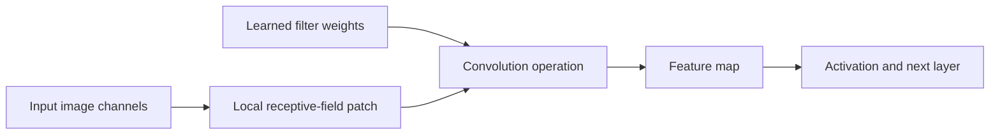
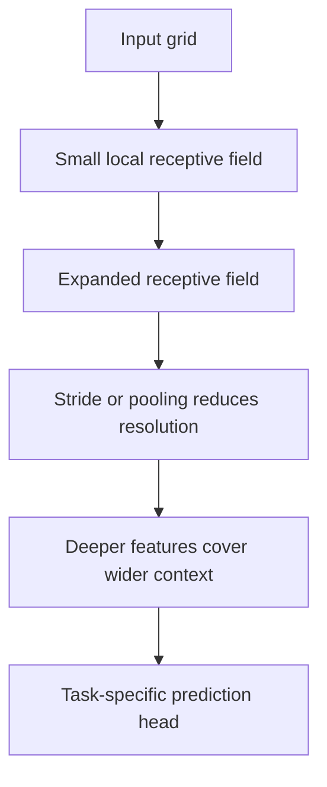
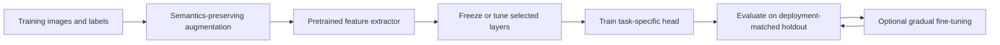
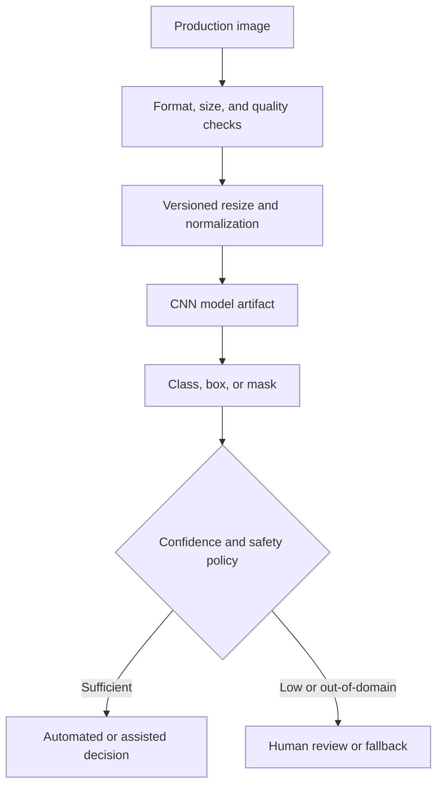
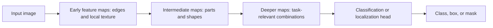

# Convolutional Neural Networks (CNNs)

Part: [16 — Artificial Intelligence, Machine Learning, and Generative AI](PART_OVERVIEW.md)

Convolutional Neural Networks (CNNs) exploit local spatial structure by applying shared filters across an input. They are effective for images and other grid-like signals where nearby values have meaningful relationships. Architecture choices determine receptive field, resolution, compute, and sensitivity to translation or scale.

## Convolution, Filters, and Feature Maps

A convolution kernel combines a local input patch with learned weights to produce a feature-map value. Stride controls movement; padding controls output size and boundary behavior; channels represent input and learned feature dimensions. Weight sharing reduces parameters compared with a dense connection from every pixel to every output.

Convolution is translation-equivariant under idealized conditions: shifting the input shifts the feature map. Pooling or striding can provide some local invariance, but may discard precise location. Data augmentation can improve robustness to transformations only when those transformations preserve label meaning.

Weight sharing is the reason convolution scales to large images where a fully connected layer would not. A $224\times224\times3$ input connected densely to a modest 1000-unit layer would need $224\times224\times3\times1000\approx150$ million parameters for that single layer alone. A convolutional layer with sixty-four $3\times3$ filters over three input channels needs only $3\times3\times3\times64=1{,}728$ weights (plus biases), applied at every spatial position regardless of image size. This is not merely an efficiency convenience: it is what makes the parameter count independent of input resolution and lets a filter learned in one image region generalize to the same pattern appearing elsewhere, which a dense layer cannot do without seeing that exact position during training.

For an input height $H$, kernel size $K$, padding $P$, stride $S$, and dilation $D$, the output height is $\left\lfloor\frac{H+2P-D(K-1)-1}{S}\right\rfloor+1$; width follows the same calculation. Stride greater than one downsamples the map, padding determines how borders are treated, and dilation spaces kernel taps to enlarge the receptive field without adding kernel weights. These settings affect whether small defects survive, how many activation values must be stored, and whether feature-map dimensions align for skip connections. Work through shapes at every stage before training; a model that runs can still silently discard the spatial resolution required by its task.

For a $224\times224$ input, a $3\times3$ kernel with unit dilation, padding one, and stride two produces a $112\times112$ map. A second stride-two stage produces $56\times56$, cutting spatial activations to one quarter before accounting for channels. Receptive field and spatial jump can be tracked recursively: $j_l=j_{l-1}S_l$ and $r_l=r_{l-1}+(K_l-1)D_lj_{l-1}$, starting with $j_0=r_0=1$. The jump is the input-pixel spacing between neighboring outputs; the receptive field is the input span contributing to one output. This lets an architect test whether a feature can see the full defect or whether successive downsampling erases its location.

## Receptive Field and Architecture Depth

Each layer's receptive field is the input region affecting one activation. Stacking convolutions expands it; stride and pooling reduce spatial resolution while increasing effective context. Architecture selection balances spatial detail, receptive field, parameter count, and compute.

Too much downsampling can erase small objects; insufficient receptive field can miss global structure. Use an architecture that matches object scale and output granularity, and inspect activation maps or errors by region when performance is uneven.

## Training, Augmentation, and Transfer Learning

Image augmentation creates transformed examples such as crops, flips, color changes, or noise. Apply transformations that preserve the target semantics; flipping a medical image or map may alter meaning. Normalization statistics and class sampling should be fit and recorded as part of the pipeline.

Transfer learning can reduce labeled-data needs but inherits source-domain bias and licensing constraints. Freeze layers initially when the target dataset is small, then selectively fine-tune using a lower learning rate. Compare against training from scratch only when data and compute justify it.

The pretrained backbone expects a particular channel order, value range, normalization, and input resolution; violating that contract can erase the expected benefit before learning begins. A common staged procedure first freezes the backbone and trains a task head, then unfreezes selected later blocks with a lower learning rate while monitoring validation behavior. Earlier layers often encode generic edges and textures, while later layers are more task-specific, but this is a heuristic rather than a guarantee. Select the unfreeze boundary using target data and compute budget. Compare variants on the same deployment-matched split and training budget so a longer fine-tuning run is not mistaken for a better architecture.

## Vision Evaluation and Failure Modes

Classification metrics may hide poor performance on small or underrepresented classes. Object detection and segmentation need localization-sensitive metrics and error inspection. Evaluate robustness across lighting, orientation, device, geography, and image quality relevant to production. Monitor distribution drift and image preprocessing parity between training and inference.

Feature maps are learned responses, not guaranteed human-interpretable concepts. Inspect errors and activation behavior as diagnostic evidence, not as a causal explanation.

## Worked Case and Review Checklist

A visual inspection model detects defects on a manufacturing line. The team selects input resolution from defect size, uses augmentation only for realistic camera variation, fine-tunes a pretrained backbone, and evaluates class recall by line and lighting condition. Low-confidence or out-of-domain images route to human inspection. Preprocessing version and model digest are deployed together.

The resolution choice in this case was derived from a concrete measurement, not a default: the smallest defect of interest spanned roughly 15 pixels at the camera's native resolution, and after calculating the network's effective downsampling factor of 16x through its pooling stages, the team confirmed that a defect that size would collapse to under one pixel in the final feature map if the input were downsized below about 480 pixels on the short edge. That calculation — defect size divided by total stride, compared against one feature-map pixel — is what set the minimum acceptable input resolution, rather than picking a resolution for GPU-memory convenience and hoping defects remained visible.

Review input resolution, labels, augmentation validity, receptive field, downsampling, domain shift, per-class and per-condition performance, inference latency, confidence handling, preprocessing parity, licensing, and fallback.

## Questions and Summary

1. Explain how stride and padding affect feature-map size and spatial detail.
2. Draw receptive-field growth through a stack of convolution layers.
3. Which image augmentations would be unsafe for a task with orientation-dependent labels?
4. Design a transfer-learning evaluation that detects source-domain bias.
5. How should a vision system handle low-confidence or out-of-domain inputs?

CNNs use shared local filters to learn spatial representations. Their behavior depends on receptive field, resolution, augmentation, and domain fit. Validate the complete image-to-decision pipeline across representative conditions and preserve human or deterministic fallbacks for uncertain inputs.
