# Convolutional Neural Networks (CNNs)

Part: [16 — Artificial Intelligence, Machine Learning, and Generative AI](PART_OVERVIEW.md) · Status: Revised (in-depth rewrite)

## 1. Introduction

A Convolutional Neural Network (CNN) is a neural network whose layers apply the same small learned filter at every position of a grid-shaped input. The grid is usually an image, but it can be a spectrogram, a sensor trace, a medical volume, or a video clip. The design rests on two observations about such data. First, nearby values are related far more strongly than distant ones, so a unit that looks at a small neighbourhood captures most of the useful structure. Second, a pattern that is informative in one place, such as an edge, a texture, or a scratch on a metal surface, is usually informative in other places too, so the detector for that pattern should be shared across positions rather than learned separately for each one.

These two observations turn into a concrete engineering advantage. A model that shares a filter across positions has a parameter count that does not depend on the input size, spends its compute on local arithmetic that hardware executes efficiently, and generalizes a pattern learned in one region to every other region. For roughly a decade, from the 2012 ImageNet result to the early 2020s, CNNs were the default architecture for almost every visual task. Transformer-based vision models now compete with and sometimes beat them at large scale, yet CNNs remain the practical choice in a very large share of deployed systems, because they are small, fast on commodity and embedded hardware, data-efficient, and well understood.

For a solution architect the chapter matters for four reasons. The first is cost: whether a model fits on a camera, a phone, or a single graphics processing unit (GPU) depends on arithmetic that can be done on paper before any training starts, and this chapter teaches that arithmetic. The second is correctness: a vision system fails in ways that ordinary accuracy numbers hide, such as a defect that vanishes after downsampling, a classifier that recognizes the scanner instead of the disease, or a detector that behaves differently on a night shift. The third is risk: image models process faces, medical scans, and surveillance footage, so privacy, bias, and regulatory constraints are part of the design and not an afterthought. The fourth is lifecycle: the labeled data that feeds a vision model is usually its most expensive input, and decisions about labeling, augmentation, and transfer learning dominate the project budget more often than the choice of architecture does.

### 1.1 Scope and ownership

This chapter owns the convolution operation and its variants, receptive-field analysis, the CNN architecture lineage, transfer learning and augmentation for images, the structure and metrics of detection and segmentation, and CNN-specific deployment choices. It reuses material from neighbouring chapters instead of repeating it.

| Topic | Owner | How this chapter uses it |
| --- | --- | --- |
| Backpropagation, optimizers, initialization, regularization, training-curve diagnosis | [CH07 — Deep Learning Foundations](CH07_Deep_Learning_Foundations.md) | Assumed. This chapter applies them to convolutional layers and adds batch normalization behaviour specific to CNNs. |
| Metrics, validation splits, confidence intervals, calibration | [CH06 — Model Evaluation, Validation, and Selection](CH06_Model_Evaluation_Validation_and_Selection.md) | Assumed. This chapter adds the localization-sensitive metrics used by detection and segmentation. |
| Leakage, split construction, class imbalance in data preparation | [CH02 — Data Preparation, Feature Engineering, and Leakage](CH02_Data_Preparation_Feature_Engineering_and_Leakage.md) | Recapped. Patient-level and session-level splitting is applied to images. |
| Attention and the transformer | [CH10 — Transformers and Attention](CH10_Transformers_and_Attention.md) | Recapped only to compare Vision Transformers (ViTs) with CNNs. |
| Diffusion models, whose denoising network is a U-Net | [CH12 — Diffusion Models](CH12_Diffusion_Models.md) | Mentioned where the U-Net appears. |
| Image-text models and multimodal systems | [CH23 — Multimodal Generative AI](CH23_Multimodal_Generative_AI.md) | Mentioned as an alternative for open-vocabulary tasks. |
| General fine-tuning and parameter-efficient adaptation | [CH20 — Fine-Tuning, PEFT, and LoRA](CH20_Fine_Tuning_PEFT_and_LoRA.md) | This chapter owns only CNN transfer-learning mechanics. |
| Serving, batching, and inference optimization in general | [CH28 — Inference Optimization and Model Serving](CH28_Inference_Optimization_and_Model_Serving.md) | This chapter explains quantization, pruning, and distillation as they apply to CNNs. |
| Lifecycle, monitoring, and rollback | [CH29 — MLOps and LLMOps](CH29_MLOps_and_LLMOps.md) | Recapped for drift monitoring of image inputs. |
| Data rights, privacy, and provenance | [CH30 — AI Data Governance, Privacy, and Provenance](CH30_AI_Data_Governance_Privacy_and_Provenance.md) | Applied to image and face data. |
| Fairness, impact assessment, human oversight | [CH31 — Responsible AI and Safety Governance](CH31_Responsible_AI_and_Safety_Governance.md) | Applied to face-related and medical use. |
| System composition and trust boundaries for AI products | [Part 17, AI Workload Qualification and Architecture Foundations](../17_AI_Architecture/CH01_AI_Workload_Qualification_and_Architecture_Foundations.md) | This chapter describes the model component only. |

### 1.2 Reader outcomes

After studying this chapter, a reader should be able to:

1. Compute the output shape, parameter count, and multiply-accumulate count of any convolutional layer, and use the numbers to compare designs before training.
2. Track the receptive field and spatial stride through a network layer by layer and decide whether a given object or defect is visible to the final features.
3. Explain what pooling, $1\times1$, depthwise-separable, grouped, dilated, and transposed convolutions do, and choose among them for a cost or accuracy goal.
4. Explain why batch normalization and residual connections make deep networks trainable, and recognize the failure modes of each.
5. Place each major architecture, from LeNet to ConvNeXt, in a lineage by the problem it solved, and choose between a CNN and a Vision Transformer for a given data and hardware situation.
6. Design a classification pipeline, a transfer-learning schedule, and an augmentation policy, and justify each against the deployment data.
7. Describe object detection and segmentation systems, compute Intersection over Union (IoU), apply non-maximum suppression, and read mean average precision (mAP).
8. Use interpretability and robustness tools without over-reading them.
9. Plan labeling, deployment optimization, privacy, bias, and regulatory controls for medical, industrial, and face-related applications.

## 2. Background

The ideas behind CNNs are older than the deep learning boom, and the timeline explains why they work the way they do. The structure came from neuroscience and from handwriting recognition, the training method came from backpropagation, and the scale that made the approach dominant came from graphics processing units and large labeled datasets.

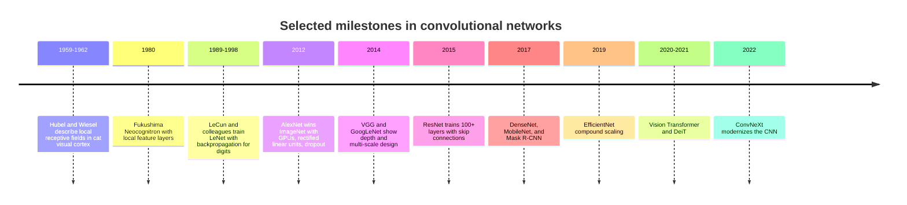

David Hubel and Torsten Wiesel reported in the early 1960s that neurons in the cat's visual cortex respond to stimuli in a small region of the visual field and that some respond to edges of a particular orientation. Kunihiko Fukushima's Neocognitron (1980) turned this into a layered model with local feature detectors and tolerance to small shifts. Yann LeCun and colleagues combined the structure with backpropagation to read handwritten digits and cheques in the late 1980s and 1990s; the 1998 paper by LeCun, Bottou, Bengio, and Haffner describing LeNet-5 is the standard reference. The idea then lay mostly dormant for a decade because larger problems needed more data and compute than were available, and because support vector machines and hand-designed features were competitive on benchmarks of the time.

In 2012 Alex Krizhevsky, Ilya Sutskever, and Geoffrey Hinton trained a network now called AlexNet on two GPUs and reduced the top-5 error rate on the ImageNet Large Scale Visual Recognition Challenge from about 26 percent for the next-best entry to about 15 percent. That result convinced the field that learned features beat hand-designed ones given enough data. The following years are the architecture lineage in Section 11: each step solved a specific obstacle, such as the cost of large kernels, the difficulty of optimizing deep stacks, the parameter bloat of dense layers, or the need to run on phones.

The pattern behind these milestones is worth keeping in mind. Progress came less from new mathematics than from engineering that made optimization easier (rectified linear units, normalization, skip connections), made the arithmetic cheaper (small kernels, bottlenecks, separable convolutions), and made data go further (augmentation, pretraining). Those three themes organize most of the design decisions in this chapter.

## 3. Images as Tensors

A CNN consumes numbers, so the first design decision concerns how a physical image becomes a tensor. Mistakes here are among the most common causes of silent accuracy loss, because a network trained on one representation and served on another still produces confident outputs.

### 3.1 Shape, layout, and data type

A digital image is a grid of pixels. A grayscale image has one value per pixel. A colour image in the Red Green Blue (RGB) model has three values per pixel, one per channel. A single image is therefore a three-dimensional tensor with a height $H$, a width $W$, and a channel count $C$. Deep learning libraries batch images, so the tensor handed to a network has four dimensions: batch size $N$, plus the three image dimensions.

Two layouts are in common use. The layout called NCHW orders dimensions as batch, channels, height, width; it is the default in PyTorch. The layout called NHWC orders them as batch, height, width, channels; it is the default in TensorFlow and is often faster on mobile and tensor-core hardware. The layouts hold identical numbers and differ only in memory order, which matters in two ways. A model trained in one layout and exported for a runtime that expects another needs an explicit transpose, and forgetting it can produce a model that runs without error and outputs nonsense. Also, the cost of converting layouts at runtime is a real part of inference latency on some accelerators, which is why deployment tools often rewrite the layout of the whole graph once, ahead of time.

```text
One RGB image, height 4, width 5, stored as uint8 (0 to 255)

NCHW (channels first)                 NHWC (channels last)
shape [1, 3, 4, 5]                    shape [1, 4, 5, 3]

channel R: 4 x 5 grid                 pixel (0,0): [R G B]
channel G: 4 x 5 grid                 pixel (0,1): [R G B]
channel B: 4 x 5 grid                 ...
                                      pixel (3,4): [R G B]

Same 60 numbers, different order in memory.
```

The data type matters for both storage and arithmetic. Cameras and image files normally hold 8 bits per channel (values 0 to 255, type `uint8`). Medical images often hold 12 or 16 bits per pixel, so a computed tomography (CT) scan stores values in Hounsfield units across a range of several thousand, and treating it as 8-bit silently destroys contrast. Networks compute in 32-bit or 16-bit floating point, so the data pipeline converts and scales.

A few sizes anchor intuition. A $224\times224$ RGB image holds $224\times224\times3=150{,}528$ values. Stored as 8-bit integers that is 150,528 bytes; as 32-bit floats it is 602,112 bytes. A batch of 256 such images in 32-bit floats occupies $256\times602{,}112=154{,}140{,}672$ bytes, which is 147 mebibytes, before a single activation is stored. A 12-megapixel photograph of $4000\times3000$ pixels holds $36{,}000{,}000$ bytes as 8-bit RGB, so a network that sees $224\times224$ crops is working with under half a percent of the original pixels. A CT volume of $512\times512$ pixels per slice and 300 slices holds $78{,}643{,}200$ voxels, which at 16 bits each is 157,286,400 bytes, about 150 mebibytes for one patient study. These numbers explain why input resolution is a first-class architectural parameter, discussed again in Section 13 and in the case study of Section 27.

### 3.2 Normalization and colour handling

Raw pixel values from 0 to 255 are poor inputs for gradient-based training, so images are scaled to a small range and then often standardized per channel:

$$
\tilde{x}_{c} = \frac{x_{c}/255 - \mu_{c}}{\sigma_{c}}
$$

where $x_c$ is the 8-bit value in channel $c$, and $\mu_c$ and $\sigma_c$ are the mean and standard deviation of that channel. Libraries that ship models pretrained on ImageNet commonly use $\mu=(0.485, 0.456, 0.406)$ and $\sigma=(0.229, 0.224, 0.225)$ for red, green, and blue. These constants belong to the pretrained model, not to the framework. A pretrained backbone expects exactly the preprocessing it was trained with, including channel order (RGB versus the Blue Green Red order used by the OpenCV library), value range, normalization constants, and interpolation method used for resizing. Violating any of these usually does not raise an error. It degrades accuracy by an amount that is hard to attribute, because the network still produces plausible outputs.

Some models absorb normalization into the first layer, others expect it outside the model. For production the safest rule is to treat preprocessing as part of the model artifact: version it, test it, and ship it with the weights, so the training and serving paths run the same code. Section 13 shows this as a pipeline, and the training-serving skew it prevents is a theme of [CH29 — MLOps and LLMOps](CH29_MLOps_and_LLMOps.md).

Colour handling needs a deliberate decision rather than a default. Some tasks depend on colour (ripeness, tissue staining, warning lights) and others are hurt by it (a model that learns the colour of a particular camera). Converting to grayscale removes two thirds of the input values and also removes a source of spurious cues. Colour spaces other than RGB, such as Hue Saturation Value (HSV), can make brightness changes easier to model in augmentation. Medical, satellite, and industrial data often have more than three channels (multispectral bands, thermal plus visible, or depth), and pretrained weights built for three channels need their first layer adapted, either by copying the weights across the new channels and rescaling, or by training that layer from scratch while keeping the rest.

### 3.3 Why a plain dense network is the wrong model

The simplest way to feed an image to a network is to flatten it to a vector of 150,528 numbers and use fully connected layers. That works for tiny images, and early neural-network experiments on $28\times28$ digits used exactly this approach. For realistic images it fails for two separate reasons that the rest of the chapter builds on.

The first is cost. A single fully connected layer from the 150,528 inputs of a $224\times224$ colour image to 1,000 outputs needs $150{,}528\times1{,}000=150{,}528{,}000$ weights plus 1,000 biases, a total of 150,529,000 parameters, for one layer. A layer that kept the spatial resolution and produced 64 feature maps of the same $224\times224$ size would need $150{,}528\times3{,}211{,}264\approx4.8\times10^{11}$ weights, which does not fit in any memory. The second reason is statistical. A dense layer has no notion that two pixels are neighbours, so it must learn from scratch that a diagonal edge at the top left and the same edge at the bottom right are the same pattern. With no shared structure, it needs training examples that show every pattern at every position. Convolution removes both obstacles at once by restricting each unit to a local patch and reusing the same weights everywhere.

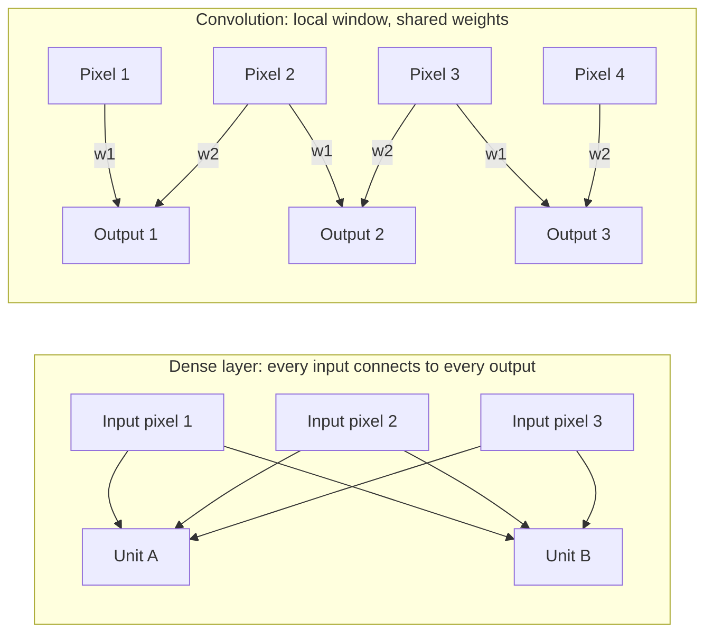

The diagram contrasts the two connection patterns on a toy one-dimensional input. In the dense layer each of the three inputs connects to both units, and each connection has its own weight, so the number of weights is the product of input and output sizes. In the convolutional layer each output sees only two neighbouring inputs and the weights `w1` and `w2` are reused at every position, so the number of weights is just the window size no matter how long the input is. The implication for design is that a convolutional layer's parameters depend on the kernel size and channel counts, not on the image size, which is why a network trained on $224\times224$ crops can often be run on a $1024\times1024$ image without any change in its parameter count (although its behaviour at the new scale needs checking).

## 4. The Convolution Operation

This section develops the operation in four steps: a one-channel example worked by hand, the extension to many channels, the geometry that sets the output size, and the relation between what libraries compute and what mathematics calls convolution.

### 4.1 A single kernel on a single channel

Take a grayscale image $x$ and a small grid of weights $k$ called a kernel or filter, of size $K\times K$. The output at position $(i,j)$ is the sum of products between the kernel and the patch of the image it covers:

$$
y_{i,j} = b + \sum_{a=0}^{K-1}\sum_{b'=0}^{K-1} k_{a,b'}\; x_{i+a,\,j+b'}
$$

where $b$ is a scalar bias added to the sum (the primed index $b'$ avoids a clash with the bias symbol). The kernel slides over the image, and the grid of outputs is a feature map. Each output value measures how well the local patch matches the pattern stored in the kernel.

A concrete example uses a $5\times5$ image and the $3\times3$ Sobel kernel that responds to vertical edges. The code in [02_conv_from_scratch.py](../code/python/cnn-chapter/02_conv_from_scratch.py) computes this example; the image rows are `[1,2,0,1,3]`, `[0,1,3,1,2]`, `[2,1,0,0,1]`, `[1,3,2,1,0]`, `[0,1,1,2,2]`, and the kernel rows are `[1,0,-1]`, `[2,0,-2]`, `[1,0,-1]`. For the top-left output the covered patch is rows `[1,2,0]`, `[0,1,3]`, `[2,1,0]`. Multiplying element by element and summing row by row gives

- row 1: $1\cdot1+2\cdot0+0\cdot(-1)=1$
- row 2: $0\cdot2+1\cdot0+3\cdot(-2)=-6$
- row 3: $2\cdot1+1\cdot0+0\cdot(-1)=2$

so $y_{0,0}=1-6+2=-3$. The script prints the full $3\times3$ feature map:

```text
 -3.0   2.0  -2.0
  0.0   4.0   1.0
 -1.0   4.0   2.0
```

A cleaner view of what the kernel detects comes from a synthetic image whose left four columns are 0 and right four columns are 1. Sliding the same kernel along one row gives `[0, 0, -4, -4, 0, 0]`: zero where the patch is uniform and $-4$ at the two positions straddling the step. The magnitude 4 is the sum of the kernel's positive weights ($1+2+1$) times the intensity step of 1, and the sign says which direction the step goes. A kernel is a template, and the feature map reports where the template matches. A CNN's contribution is that the templates are not designed by hand. They are the weights learned by backpropagation, and different kernels in the same layer specialize to different patterns: oriented edges, colour blobs, and small textures in the first layer of an image network.

### 4.2 Many channels in, many channels out

A real layer has $C_{in}$ input channels and $C_{out}$ output channels. Each output channel has its own kernel, and that kernel has depth $C_{in}$: it is a $K\times K\times C_{in}$ block that spans all input channels at once. The output at channel $o$ and position $(i,j)$ is

$$
y_{o,i,j} = b_o + \sum_{c=0}^{C_{in}-1}\sum_{a=0}^{K-1}\sum_{b'=0}^{K-1} W_{o,c,a,b'}\; x_{c,\,i+a,\,j+b'}
$$

where $W$ is the weight tensor of shape $C_{out}\times C_{in}\times K\times K$ and $b_o$ is the bias of output channel $o$. This is a sum over channels as well as over space, so each output value combines information from every input channel in a local window. The number of learned parameters is

$$
\text{params} = C_{out}\,(C_{in}K^2+1)
$$

counting one bias per output channel. For the first layer of a typical network with $C_{in}=3$, $K=3$ and $C_{out}=64$, that is $64\times(3\times9+1)=1{,}792$ parameters, which the script confirms. The number is the same for a $32\times32$ image and a $2000\times2000$ image, which is the weight-sharing property of Section 5.

Stacking such layers builds a hierarchy. Early layers see raw pixels and learn edges and colour contrasts. Later layers see the maps produced by earlier layers, so their templates are combinations of lower-level patterns: corners, then textures, then object parts. The depth of the hierarchy and the growth of what each unit can see is the receptive-field analysis of Section 6.

### 4.3 Stride, padding, dilation, and the output size

Three settings control the geometry. The stride $S$ is the step the kernel takes between positions. With $S=1$ the kernel visits every position; with $S=2$ it skips every other one, so the output has about half the height and width. Padding $P$ adds a border of zeros (or reflected or replicated pixels) around the input, so the kernel can be centred on edge pixels and the output does not shrink. Dilation $D$ spaces the kernel taps apart: with $D=2$ a $3\times3$ kernel samples pixels two apart, covering a $5\times5$ area while still having nine weights.

For input length $H$ along one axis, kernel size $K$, padding $P$ on each side, stride $S$, and dilation $D$, the output length is

$$
H_{out} = \left\lfloor \frac{H + 2P - D(K-1) - 1}{S} \right\rfloor + 1
$$

The derivation is direct. The dilated kernel spans $D(K-1)+1$ input positions. With padding the padded input has length $H+2P$. The first kernel placement starts at position 0 and each subsequent placement shifts by $S$, so the number of placements is one plus the number of whole steps that fit in the remaining room, $(H+2P-D(K-1)-1)/S$, rounded down. The floor reflects that a partial placement past the edge is not computed.

Seven worked cases appear in the output of [01_shapes_params_flops.py](../code/python/cnn-chapter/01_shapes_params_flops.py):

| Input $H$ | $K$ | $P$ | $S$ | $D$ | Arithmetic | Output |
| --- | --- | --- | --- | --- | --- | --- |
| 224 | 7 | 3 | 2 | 1 | $\lfloor(224+6-6-1)/2\rfloor+1=\lfloor111.5\rfloor+1$ | 112 |
| 112 | 3 | 1 | 2 | 1 | $\lfloor(112+2-2-1)/2\rfloor+1=\lfloor55.5\rfloor+1$ | 56 |
| 32 | 5 | 0 | 1 | 1 | $\lfloor(32-4-1)/1\rfloor+1$ | 28 |
| 224 | 3 | 1 | 1 | 1 | $\lfloor(224+2-2-1)/1\rfloor+1$ | 224 |
| 7 | 3 | 0 | 1 | 2 | $\lfloor(7-4-1)/1\rfloor+1$ | 3 |
| 10 | 3 | 0 | 2 | 1 | $\lfloor(10-2-1)/2\rfloor+1=\lfloor3.5\rfloor+1$ | 4 |
| 224 | 11 | 2 | 4 | 1 | $\lfloor(224+4-10-1)/4\rfloor+1=\lfloor54.25\rfloor+1$ | 55 |

Several lessons sit inside the table. Row 4 shows "same" padding: for an odd kernel with stride 1 and dilation 1, choosing $P=(K-1)/2$ keeps the output equal to the input. Row 6 shows a floor that discards information: with $H=10$, $K=3$, and $S=2$, the last placement would need columns 9 to 11 and column 10 does not exist, so the final input column never contributes to any output. This is harmless in a classifier but can matter in a segmentation network where every pixel must be accounted for, and it is why many designs choose input sizes divisible by the network's total stride. Row 7 is the first layer of AlexNet in the form used by common implementations, a large $11\times11$ kernel with stride 4 that reduces the 224-pixel input to 55 in one step, which is the early-downsampling trade-off that later architectures reconsidered.

Padding mode is itself a decision. Zero padding is the default and is cheap, but it injects a constant border that the network can detect, and in small images or tight crops it lets the network learn absolute position, partly undermining equivariance. Reflect or replicate padding avoids an artificial boundary. In practice the difference is small for large images and noticeable for small ones, such as patches of $64\times64$ pixels from a defect inspection camera.

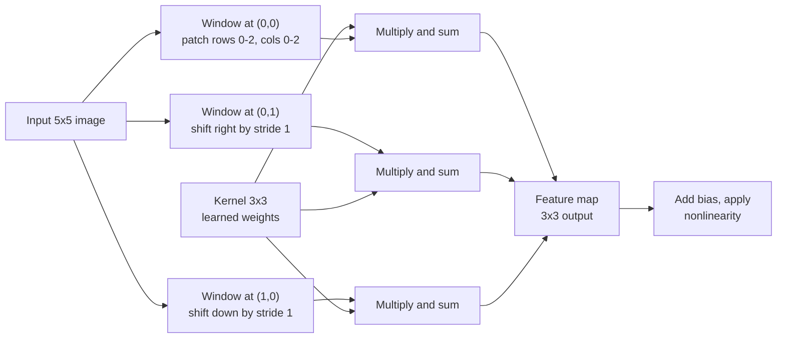

The diagram shows the same kernel reused at three window positions, each producing one entry of the feature map. The shared kernel node is the point: only one set of nine weights exists, and the loop over positions is where the cost comes from. In implementation the loop is not executed literally; libraries rewrite convolution as a large matrix multiplication (a method called im2col) or use frequency-domain and Winograd transforms, and hardware executes these efficiently. As a consequence, the arithmetic count in Section 5 predicts relative cost well but measured latency also depends on memory traffic and kernel selection, a point revisited in Section 22.

### 4.4 Cross-correlation versus convolution

Strictly, mathematical convolution flips the kernel before sliding it, while the formula above does not flip. What deep-learning libraries compute is therefore cross-correlation, although they call it convolution. The script prints both on the same image, and the true convolution (kernel flipped in both axes) gives exactly the negated values for this antisymmetric Sobel kernel: for example, the top-left output is $+3$ instead of $-3$. For learned kernels the distinction is irrelevant, because the network can learn the flipped kernel just as easily; training would simply find the flipped weights. It matters when importing a hand-designed filter from signal-processing code, where one convention may be reversed, and when reading papers that derive properties of convolution with the flip. This chapter uses the library convention and says "convolution" for it.

### 4.5 Counting parameters and arithmetic

Two quantities summarize a layer's cost. The parameter count measures memory for weights, as in the formula of Section 4.2. The arithmetic count measures computation. One multiply-accumulate (MAC) is one multiplication added to a running sum, and one floating-point operation (FLOP) is one addition or multiplication, so a MAC is conventionally counted as two FLOPs. Papers and tools are inconsistent about whether they report "FLOPs" meaning MACs or true FLOPs, so read the definition before comparing numbers. For a convolution that outputs a map of $H_{out}\times W_{out}$ positions,

$$
\text{MACs} = C_{out}\,C_{in}\,K^2\,H_{out}\,W_{out}
$$

Every output value needs $C_{in}K^2$ MACs, and there are $C_{out}H_{out}W_{out}$ output values. Worked example: a $3\times3$ convolution from 64 to 128 channels producing a $56\times56$ map has $128\times64\times9=73{,}728$ weights, plus 128 biases for 73,856 parameters, and $73{,}728\times56\times56=231{,}211{,}008$ MACs. The same layer would have the same 73,856 parameters on a $224\times224$ map but sixteen times the MACs, 3,699,376,128. This is the central asymmetry of CNNs: parameter count is independent of resolution while compute scales with it. A first-layer convolution with few parameters can therefore dominate runtime, and a later layer with many parameters can be cheap, because late feature maps are small. Section 5.3 uses the asymmetry to explain why VGG-16 stores most of its weights in layers that perform almost none of its arithmetic.

## 5. Weight Sharing, Equivariance, and Cost

The defining property of a convolutional layer is that one set of weights is applied at every position. This section states precisely what that buys, what it does not buy, and what the arithmetic looks like for complete networks.

### 5.1 Weight sharing and translation equivariance

A function $f$ is translation equivariant if shifting the input and then applying the function gives the same result as applying the function and then shifting the output: $f(T_\delta x)=T_\delta f(x)$, where $T_\delta$ is a shift by $\delta$ pixels. A convolution has this property by construction, because the same kernel is evaluated at every location, so the response to a pattern depends on the pattern and not on where it sits. The script in [02_conv_from_scratch.py](../code/python/cnn-chapter/02_conv_from_scratch.py) verifies this on a ten-by-ten image containing a small block. It shifts the block two columns to the right, convolves both versions, and checks that the second feature map is the first one shifted by two columns, ignoring the border columns that the shift pushes beyond the edge. The check prints `True`.

Equivariance has a practical consequence for learning. If the network learns a detector for a hairline crack from examples in which cracks appear in the upper half of the part, the same detector applies, with no extra training, to cracks in the lower half. A dense layer would need examples at each position. This is why a convolutional model can be trained on far fewer images than a dense model for the same spatial task: each example contributes evidence about the shared filter at every location it covers, and the number of effective training samples per weight is multiplied by the number of positions.

Equivariance is idealized, and the idealization breaks in four places that an engineer should expect.

- **Borders.** Padding adds artificial values at the edge, so outputs near the boundary differ from outputs in the interior. The equivariance check above has to exclude border columns for this reason.
- **Stride.** With stride 2, a one-pixel shift of the input changes which positions the kernel visits, so the output is not a shifted copy of the original but a different sample of the underlying map. Equivariance holds only for shifts that are multiples of the cumulative stride. Azulay and Weiss (2019) showed that a one-pixel shift can change the predicted class of an image classifier, and Zhang (2019) proposed blurring before downsampling to restore shift stability.
- **Global layers.** A fully connected layer after the convolutional stack, or a flatten operation, sees position directly, so the final classifier is not equivariant.
- **Other transformations.** Convolution is equivariant to translation only. Rotation, scaling, flipping, and perspective change all alter the pattern the kernel sees, and the network has to learn them from data or augmentation, which is why Section 15 exists.

### 5.2 Equivariance versus invariance

Classification needs invariance, not equivariance: an image of a cat shifted ten pixels is still a cat, and the output label should not move. A CNN reaches invariance by combining equivariant convolutions with operations that discard position, namely pooling and the final global averaging or dense layer. Equivariance is what keeps the position information through the middle of the network, which detection and segmentation need, and invariance is what a classifier adds at the end. The difference is one of design intent and sets the structure of the task heads: a classifier throws position away by global pooling, a detector keeps the spatial grid and predicts boxes at each grid cell, and a segmentation network keeps a full-resolution grid and predicts a label per pixel.

### 5.3 Parameter and arithmetic accounting for complete networks

The formulas of Section 4 extend to whole networks by summing over layers. Two networks, VGG-16 (Simonyan and Zisserman, 2014) and ResNet-50 (He et al., 2015), show how different the profiles can be. The numbers below are computed by the layer-by-layer accounting in [01_shapes_params_flops.py](../code/python/cnn-chapter/01_shapes_params_flops.py) and match the counts published for the torchvision implementations at the time of writing.

| Quantity | VGG-16 | ResNet-50 |
| --- | --- | --- |
| Convolutional parameters | 14,714,688 | 23,508,032 (stem and four stages) |
| Fully connected parameters | 123,642,856 (three layers) | 2,049,000 (one layer) |
| Total parameters | 138,357,544 | 25,557,032 |
| Convolutional MACs per $224\times224$ image | 15,346,630,656 | 4,087,136,256 |
| Total MACs per image | 15,470,264,320 | 4,089,184,256 |
| Share of parameters in fully connected layers | 89.4 percent | 8.0 percent |

Two observations follow from the table. First, in VGG-16 the three dense layers at the end hold 89.4 percent of the parameters but perform only 123,633,664 of the 15.47 billion MACs, about 0.8 percent. The first dense layer alone connects the flattened $7\times7\times512=25{,}088$ values to 4,096 units, for $25{,}088\times4{,}096+4{,}096=102{,}764{,}544$ parameters, and it is applied once per image, whereas each convolutional weight is applied at hundreds or thousands of positions. Parameters measure memory and arithmetic measures time, and a convolutional network concentrates the arithmetic in the early, high-resolution layers while a dense classifier concentrates the memory at the end. ResNet-50 removes most of the imbalance by replacing the flatten-plus-dense head with global average pooling (Section 7.3), leaving a single 2,048-to-1,000 layer. It has 5.4 times fewer parameters and 3.8 times fewer MACs than VGG-16 (138.4 million over 25.6 million; 15.47 billion over 4.09 billion) while achieving higher accuracy.

Second, the stage-by-stage view of ResNet-50 shows that parameters grow with depth while arithmetic stays almost level. The four residual stages hold 215,808, 1,219,584, 7,098,368, and 14,964,736 parameters, so the last stage has 69 times the parameters of the first. Yet each stage does roughly comparable arithmetic, because channel counts double while the spatial area quarters at each stage boundary. The product of channel width squared and spatial area, which governs MACs for a fixed kernel, is therefore close to constant across stages (a doubling of channels multiplies $C_{in}C_{out}$ by four and a halving of both spatial dimensions divides $H_{out}W_{out}$ by four). This design rule, double the channels whenever the resolution halves, goes back to VGG and is reused by most later CNNs. It keeps compute balanced across depth.

A third quantity matters in practice and is often forgotten: activation memory. Training stores every layer's output for the backward pass, and inference needs at least the largest live tensors. The first convolution of ResNet-50 produces $64\times112\times112=802{,}816$ values, which as 32-bit floats is 3,211,264 bytes or 3.06 mebibytes per image. VGG-16's first convolution produces $64\times224\times224=3{,}211{,}264$ values, or 12.25 mebibytes per image. Multiply by batch size and by the number of layers kept for backpropagation, and activation memory, not weight memory, decides the largest trainable batch on a given GPU. It also explains why high-resolution tasks such as segmentation of large images use small batches or gradient checkpointing, which recomputes activations instead of storing them.

## 6. Receptive Field Analysis

The receptive field of a unit is the region of the input that can influence its value. It determines what a network is able to see: a unit whose receptive field is $11\times11$ pixels cannot respond to a defect that is 50 pixels long as a whole, whatever its weights.

### 6.1 Computing receptive field and jump layer by layer

Two quantities are tracked while moving through the layers. The jump $j_l$ is the distance, in input pixels, between the centres of two adjacent units in layer $l$. The receptive field $r_l$ is the side length, in input pixels, of the region feeding one unit in layer $l$. Starting from the input, where each pixel is its own unit, $j_0=1$ and $r_0=1$. For a layer with kernel size $K_l$, stride $S_l$, and dilation $D_l$,

$$
r_l = r_{l-1} + (K_l - 1)\,D_l\,j_{l-1}, \qquad j_l = j_{l-1}\,S_l
$$

The recursion says that a layer widens the receptive field by $(K_l-1)D_l$ steps of the previous layer, and each step is as large as the previous jump. Strides multiply the jump for every later layer, so downsampling early makes all later growth faster. Padding does not enter the formula because it shifts the centre positions without changing the size of the region.

A simple case is three stride-1 $3\times3$ convolutions in a row. With $j=1$ throughout, each adds $(3-1)\cdot1\cdot1=2$, so the fields are 3, 5, and 7. This equals the receptive field of one $7\times7$ convolution, but the stack of three $3\times3$ layers uses $3\times9=27$ weights per input-output channel pair against 49 for the single large kernel, and it inserts two additional nonlinearities, which let the stack represent more complex functions. This is the argument VGG made for using small kernels exclusively.

A realistic stack with downsampling shows the effect of strides. The following table follows ten layers in the style of VGG (two convolutions, a $2\times2$ stride-2 pool, two convolutions, a pool, three convolutions, a pool), printed by the receptive-field routine in the first script.

| Layer | Kernel | Stride | Jump after layer | Receptive field after layer |
| --- | --- | --- | --- | --- |
| input | none | none | 1 | 1 |
| conv1 | 3 | 1 | 1 | 3 |
| conv2 | 3 | 1 | 1 | 5 |
| pool1 | 2 | 2 | 2 | 6 |
| conv3 | 3 | 1 | 2 | 10 |
| conv4 | 3 | 1 | 2 | 14 |
| pool2 | 2 | 2 | 4 | 16 |
| conv5 | 3 | 1 | 4 | 24 |
| conv6 | 3 | 1 | 4 | 32 |
| conv7 | 3 | 1 | 4 | 40 |
| pool3 | 2 | 2 | 8 | 44 |

Compare conv3, which adds 4 pixels to the field (two steps of size 2), with conv1, which adds 2. The same $3\times3$ kernel contributes more context after downsampling, because each of its taps now spans a larger input distance. This is the mechanism by which deeper layers gain context cheaply, and it is also the mechanism by which resolution is lost. After pool3 the jump is 8: adjacent units are eight input pixels apart, so the feature map is one eighth the input resolution in each direction, and a defect narrower than about eight pixels could fall between sampling positions unless its response is spread over the receptive field.

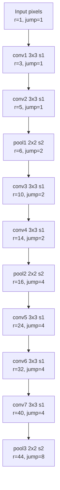

The diagram labels each stage with its receptive field and jump. Read down the chain and note how the receptive field grows linearly inside a block of stride-1 layers (by 2 times the current jump per layer) and the jump doubles at each pooling step. The practical reading is a two-part test for any architecture: the receptive field at the last feature map should cover the object or the context the decision needs, and the jump at that map should be small enough that the smallest object of interest still spans at least one unit.

### 6.2 A deeper network and the limits of the nominal field

Applying the recursion to ResNet-50, counting the $7\times7$ stem, the max pool, and every $3\times3$ convolution on the main path (the $1\times1$ convolutions add nothing to the field), the fields after the stem, after the max pool, and after each stage are 7, 11, 35, 91, 267, and 427 pixels, with jumps of 2, 4, 4, 8, 16, and 32. The final feature map of a $224\times224$ input is therefore $224/32=7$ units on a side, each with a nominal receptive field of 427 pixels, larger than the whole 224-pixel image. The result looks implausible until one notices what it means: the nominal field is the full extent of input positions that have a nonzero connection path to the unit, and it exceeds the image, so in the last stage every unit can in principle depend on every pixel (with zero padding supplying the rest of the region).

The nominal field overstates what a unit actually uses. Luo, Li, Urtasun, and Zemel (2016) showed that the influence of input pixels on a unit is concentrated in a central region and falls off roughly like a Gaussian, so the effective receptive field is a fraction of the nominal one. The reason is arithmetic: a pixel at the edge of the nominal field reaches the unit through very few paths and with products of many small weights, whereas a central pixel reaches it through many paths. The effective field grows more slowly than the nominal one with depth, and training tends to enlarge it. The practical lesson is to treat the computed number as an upper bound. If an application requires context at a given scale, such as an inspection that must compare a feature to a part boundary 200 pixels away, a nominal field of 200 is not enough, and one should verify with a gradient-based influence map (the gradient of a central unit with respect to the input) that the network does use that region.

### 6.3 Growing the field without losing resolution

A network can enlarge its field in four ways: more layers, larger kernels, more downsampling, and dilation. Each costs something different.

- More layers add depth, parameters, and latency. The growth is linear in depth for stride-1 layers.
- Larger kernels grow the field quadratically in cost. A $7\times7$ kernel has about 5.4 times the weights of a $3\times3$. Recent designs such as ConvNeXt (Section 11.9) use $7\times7$ depthwise kernels, which are cheap because depthwise layers have no cross-channel weights.
- More downsampling grows the field and shrinks the compute, at the cost of resolution. It is the cheapest option and the one that destroys small objects.
- Dilation spaces the kernel taps. Stacking $3\times3$ convolutions with dilations 1, 2, 4, and 8 gives fields 3, 7, 15, and 31 with only 36 weights per channel pair and no loss of resolution, as printed by the script. This is the approach used in WaveNet for audio and in DeepLab for segmentation. Its known weakness is the gridding artifact: with a single large dilation rate a kernel samples only a sparse lattice of the input, so some pixels never contribute. Using a mix of rates, as in the 1, 2, 4, 8 stack, reduces the effect, and Yu and Koltun (2016) and later work gave guidance for choosing rates.

The following rule translates the analysis into a design check. Let $s_{min}$ be the smallest feature size of interest in input pixels, $s_{ctx}$ the context size the decision needs, $j_L$ the final jump, and $r_L$ the final receptive field. The design is plausible if $s_{min}\gtrsim j_L$ (the feature spans at least one final unit) and $r_L\gtrsim s_{ctx}$ (the unit can see the context). The case study in Section 27.1 applies this check to a defect that would otherwise vanish.

## 7. Pooling and Downsampling

Pooling reduces the spatial size of a feature map by summarizing each small window with a single number. It serves three purposes: lowering compute and activation memory in later layers, enlarging the receptive field cheaply (Section 6), and giving the network some tolerance to small shifts.

### 7.1 Max, average, and strided alternatives

Max pooling takes the maximum value in each window. For a $2\times2$ window with stride 2, a $4\times4$ map becomes $2\times2$. The script pools the map with rows `[1,3,2,0]`, `[4,2,1,1]`, `[0,1,5,2]`, `[2,2,3,4]` and returns `[[4,2],[2,5]]`: the maximum of each quadrant. Max pooling keeps the strongest response in a window, which suits feature maps where a large value means "the pattern is here" and the exact position within the window is unimportant. Average pooling takes the mean of each window, keeps more of the total activation, and is smoother. A window of size $K$ and stride $S$ follows the same output-size formula as convolution, with no padding unless specified, and pooling has no learned parameters.

A third option replaces pooling with a convolution that has stride 2. Springenberg et al. (2015) showed that a network using only strided convolutions can match one with pooling, since a learned downsampling can in principle choose what to keep. Most modern architectures use strided convolutions inside stages, and keep a single max pool in the stem (ResNet) or a patchifying strided convolution (ConvNeXt). Max pooling has the advantage of being parameter-free and of introducing a strongly nonlinear selection. Strided convolutions have the advantage of being learned and of avoiding the hard discard of non-maximal activations.

### 7.2 What pooling gives, and what it takes away

Pooling provides local invariance, and the script shows the limit exactly. A single bright activation (value 9) at row 1, column 1 of a $4\times4$ map pools to the top-left cell. Moving the peak to row 0, column 0 gives the same pooled map, so the output is invariant to that shift. Moving the peak to row 1, column 2 changes which window contains it, so the pooled map changes: the peak now appears in the top-right cell. The invariance holds only within a window; across a window boundary the output moves. After several pooling stages the invariance region grows, but it never becomes exact, and as mentioned in Section 5.1, the lack of exact shift invariance in downsampled networks has measurable effects on classification stability.

Pooling also destroys position. A fully pooled feature map can say "an edge was present somewhere in this window" but not where. This is acceptable for classification and harmful for localization tasks, where the position of the object or the boundary of a region is the output. Detection and segmentation networks therefore avoid aggressive pooling or restore resolution later (Sections 16 and 17). A related failure for small objects is that max pooling can erase a faint small response in favour of a stronger neighbour in the same window, so a weak defect adjacent to a bright texture can disappear after the first pooling stage.

### 7.3 Global average pooling and the classifier head

Global average pooling reduces each channel's entire feature map to a single number, the mean over all positions. Lin, Chen, and Yan (2013) introduced it in the "Network in Network" paper as a replacement for the flatten-plus-dense head. If the final feature map is $7\times7\times2048$, global average pooling gives a 2,048-vector, and a single linear layer maps it to class scores. The benefits are as follows.

- **Parameters.** The head has $2048\times1000+1000=2{,}049{,}000$ parameters instead of the 123.6 million of VGG-16's three dense layers.
- **Resolution independence.** The head does not depend on the feature-map size, so the same trained weights process a $320\times320$ input (a $10\times10$ final map) without a shape error. The averaged statistics are still computed at a scale the network may not have seen, so accuracy at different resolutions has to be measured.
- **Interpretability.** Each channel contributes to the class score through its spatial mean, which is the basis of class activation mapping (Section 19).

Global average pooling is an invariant summary. It throws away where features occurred, so it cannot count objects reliably or check spatial arrangement, which matters for tasks such as verifying that two components are in the correct positions relative to each other. Such tasks keep spatial information longer or use attention.

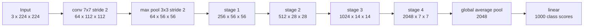

The diagram shows tensor shapes through a ResNet-50 forward pass. The channel count rises from 3 to 2,048 while the spatial size falls from 224 to 7, so the information content per position grows and the number of positions shrinks. The total number of activation values drops from 802,816 after the first convolution to 100,352 at the last stage ($2048\times7\times7$), and the single pooled vector holds 2,048. The implication for design is that the early stages dominate memory traffic and the late stages dominate parameters, which is the pattern an optimizer for deployment has to address in different ways: quantize and fuse the early layers for bandwidth, and prune or share late layers for size.

## 8. Convolution Variants

The standard convolution mixes spatial and channel information in a single operation, and many of the most useful designs separate or restrict these two jobs. This section covers the variants a practitioner meets in real architectures: $1\times1$, depthwise, pointwise and separable, grouped, dilated, and transposed convolutions.

### 8.1 The $1\times1$ convolution

A $1\times1$ convolution has kernel size 1, so each output depends on a single spatial position and on all input channels. It performs the same linear map across channels at every position, like a fully connected layer applied to each pixel's channel vector independently. It has $C_{out}(C_{in}+1)$ parameters. Its role is channel mixing: it changes the number of channels, recombines features across channels, and adds a nonlinearity when followed by an activation.

Its most important application is the bottleneck. A residual block that applies a $3\times3$ convolution directly to 256 channels has $256\times256\times9=589{,}824$ weights. The bottleneck design of ResNet-50 first reduces to 64 channels with a $1\times1$ layer ($256\times64=16{,}384$ weights), applies the $3\times3$ convolution at 64 channels ($64\times64\times9=36{,}864$), and expands back to 256 with another $1\times1$ ($64\times256=16{,}384$). The total is 69,632 weights, 11.8 percent of the direct design, and the arithmetic falls by the same ratio at a fixed spatial size. The reduction works because the expensive spatial convolution runs in a narrow channel space and the cheap pointwise layers do the width change. The cost of the bottleneck is that the information passing through the narrow stage is limited to 64 channels, a design choice that works well at scale but that MobileNetV2 later inverted (Section 8.2).

A $1\times1$ convolution is also how a classifier head is made "fully convolutional". A dense layer applied to a $7\times7\times512$ map can be rewritten as a $7\times7$ convolution with as many output channels as classes, and a dense layer after that as a $1\times1$ convolution. A network built this way can be applied to a larger image and returns a spatial map of class scores instead of one vector, which was the key step in fully convolutional networks for segmentation (Section 17) and in efficient sliding-window evaluation (Section 16.1).

### 8.2 Depthwise and depthwise-separable convolution

A depthwise convolution applies one $K\times K$ filter per input channel, with no mixing between channels. It has $C\cdot K^2$ weights for $C$ channels. A pointwise convolution is a $1\times1$ convolution. A depthwise-separable convolution applies a depthwise convolution followed by a pointwise convolution, factoring the joint spatial-and-channel operation into a spatial step and a channel step. Howard et al. (2017) built MobileNet on this factorization, drawing on earlier work by Sifre and by Chollet's Xception.

The saving is easy to derive. A standard $K\times K$ convolution from $C_{in}$ to $C_{out}$ channels has $K^2C_{in}C_{out}$ weights and, at a map of $H\times W$, $K^2C_{in}C_{out}HW$ MACs. The separable version has $K^2C_{in}+C_{in}C_{out}$ weights and $(K^2C_{in}+C_{in}C_{out})HW$ MACs. The ratio of separable to standard cost is

$$
\frac{K^2C_{in}+C_{in}C_{out}}{K^2C_{in}C_{out}} = \frac{1}{C_{out}}+\frac{1}{K^2}
$$

With $K=3$ and $C_{out}=128$ that ratio is $1/128+1/9=0.1189$. The script verifies it for a $128\to128$ layer on a $28\times28$ map: the standard convolution has 147,456 weights and 115,605,504 MACs; the depthwise stage has 1,152 weights and 903,168 MACs; the pointwise stage has 16,384 weights and 12,845,056 MACs; the separable pair totals 17,536 weights and 13,748,224 MACs, which is 0.1189 of the standard cost. For $3\times3$ kernels the saving is therefore 8 to 9 times, and it approaches the kernel area as the channel count grows, since the pointwise term vanishes.

The saving in arithmetic does not translate one-for-one into saving in time. A depthwise convolution performs very little arithmetic per value loaded from memory: each output needs only 9 MACs for a $3\times3$ kernel, and the data movement for the feature map is the same as for a standard convolution. Its arithmetic intensity, the ratio of operations to bytes moved, is low, so on GPUs and other wide-parallel hardware depthwise layers are limited by memory bandwidth, not by compute, and the measured speedup is often well below the MAC ratio. On mobile CPUs with small vector units the gain is closer to the arithmetic estimate. The lesson is to measure latency on the target hardware (Section 22.4) and to treat MAC counts as a guide only.

MobileNetV2 (Sandler et al., 2018) added the inverted residual with a linear bottleneck: it expands a narrow input by a factor (typically 6) with a $1\times1$ convolution, applies a depthwise $3\times3$ convolution in the wide space, and projects back down with a $1\times1$ convolution that has no activation. The skip connection links the narrow ends. This inverts the ResNet bottleneck because the depthwise convolution is cheap enough to run on the wide tensor, and the narrow ends make the skip connection and stored activations small. The missing activation after the projection avoids destroying information in a low-dimensional space.

### 8.3 Grouped convolution

A grouped convolution splits the input channels into $G$ groups and convolves each group separately with its own filters, so the weight count is divided by $G$: $C_{out}(C_{in}/G)K^2$. The setting $G=1$ is the standard convolution and $G=C_{in}=C_{out}$ is the depthwise convolution. For the $128\to128$ layer above, four groups give 36,864 weights, a quarter of the 147,456 of the standard layer. AlexNet used two groups for a practical reason, to split the model across two GPUs with little memory each, and ResNeXt (Xie et al., 2017) revived the idea as a way to increase width ("cardinality") at a fixed cost, finding that more groups of narrower paths gave better accuracy than a wider single path at the same parameter count. Groups cut cross-channel interaction inside the layer, which is why architectures follow a grouped layer with a $1\times1$ convolution or a channel shuffle (ShuffleNet) to mix information back.

### 8.4 Dilated convolution

A dilated, or atrous, convolution spaces its taps by the dilation rate $D$. A $3\times3$ kernel with $D=2$ covers a $5\times5$ area with nine weights, which is the single-layer version of the receptive-field growth of Section 6.3. Its main use is dense prediction, where the network needs a large field without reducing resolution. In DeepLab, the last stages of a classification backbone have their strides removed and dilations raised to compensate, so the final map keeps 1/8 or 1/16 of the input resolution instead of 1/32. The cost is that the later layers now run on larger maps, so compute rises. The known artifact is gridding, discussed above.

### 8.5 Transposed convolution

A transposed convolution, sometimes called a deconvolution (a misleading name, since it does not invert a convolution), increases spatial size. Each input value multiplies the whole kernel and the scaled kernel is added into the output at a position spaced by the stride. The output size, for input $H$, kernel $K$, stride $S$, padding $P$, and no output padding, is

$$
H_{out} = (H-1)S - 2P + D(K-1) + 1
$$

For $H=7$, $K=4$, $S=2$, $P=1$ the result is $6\cdot2-2+3+1=14$, a clean doubling; $K=2$, $S=2$, $P=0$ on $H=14$ gives 28, another clean doubling; and $K=3$, $S=2$, $P=1$ on $H=7$ gives 13, one short of the doubling, which is why implementations expose an output-padding argument.

The script demonstrates the main pitfall with a $2\times2$ input `[[1,2],[3,4]]`, a $3\times3$ kernel of ones, and stride 2. The output is $5\times5$ and the contributions overlap unevenly: the centre cell receives 10 (the sum of all four inputs) while corner and edge cells receive 1, 2, 3, or 4 from a single input. When the kernel size is not divisible by the stride, some output cells are covered by more kernel taps than others, producing the checkerboard pattern seen in generated images and segmentation masks (Odena, Dumoulin, and Olah, 2016). Two remedies are common: choose the kernel size divisible by the stride (a $4\times4$ kernel with stride 2), or upsample with nearest-neighbour or bilinear interpolation followed by an ordinary convolution, which separates the resizing from the learned filtering. Segmentation networks (Section 17) and the U-Net inside diffusion models ([CH12](CH12_Diffusion_Models.md)) use both patterns.

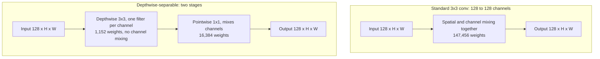

The diagram separates the two jobs of a convolution. The standard layer handles both with one large weight tensor, while the separable layer assigns the spatial job to a cheap per-channel filter and the channel job to a $1\times1$ layer. The implication is that separable convolution assumes spatial and cross-channel correlations can be modelled independently, an assumption that is usually good enough in the middle of a network and weaker in the first layer, where the input has only three channels and a standard convolution is cheap anyway. That is why MobileNet keeps its first layer as a standard convolution.

## 9. Normalization and Activations in CNNs

A deep stack of convolutions is hard to train for reasons covered in [CH07 — Deep Learning Foundations](CH07_Deep_Learning_Foundations.md): activations and gradients can shrink or grow layer by layer, and the scale of each layer's input shifts as earlier weights change. Two components made CNNs of 50 and more layers routine. Batch normalization (this section) stabilizes the scale of activations, and residual connections (Section 10) give gradients a short path. CH07 owns the general theory of initialization and optimization, so this section explains only what is specific to convolutional layers.

### 9.1 Batch normalization in a convolutional layer

Batch normalization (BN), introduced by Sergey Ioffe and Christian Szegedy in 2015, standardizes each channel of a layer's output using statistics computed over the current mini-batch, then restores representational freedom with a learned scale and shift. For a convolutional layer the statistics are computed per channel over the batch and all spatial positions. For channel $c$, with $m$ values (the batch size $N$ times $H\times W$ positions),

$$
\mu_c=\frac{1}{m}\sum_{i=1}^{m}x_{i}, \qquad \sigma_c^2=\frac{1}{m}\sum_{i=1}^{m}(x_{i}-\mu_c)^2, \qquad \hat{x}_{i}=\frac{x_{i}-\mu_c}{\sqrt{\sigma_c^2+\epsilon}}, \qquad y_{i}=\gamma_c\hat{x}_{i}+\beta_c
$$

where $\epsilon$ is a small constant (such as $10^{-5}$) that prevents division by zero, and $\gamma_c$ and $\beta_c$ are trainable per-channel parameters. A worked example with one channel and eight values $[2,4,4,4,5,5,7,9]$, as printed by the second script: the mean is 5, the variance is $(9+1+1+1+0+0+4+16)/8=4$, the standard deviation is 2, and the normalized values are $[-1.5,-0.5,-0.5,-0.5,0,0,1,2]$. With $\gamma=1.5$ and $\beta=0.5$ they become $[-1.75,-0.25,-0.25,-0.25,0.5,0.5,2.0,3.5]$. At a $56\times56$ feature map with batch size 32, each channel's statistics average $32\times56\times56=100{,}352$ values, which makes the estimates stable. The same layer trained with batch size 2 averages 6,272 values per channel; for a $7\times7$ map the figure falls to 98 values, and the statistics become noisy. The parameter overhead is small: two trainable numbers per channel ($\gamma$ and $\beta$) plus two non-trainable running statistics. BN accounts for 53,120 of ResNet-50's 25,557,032 parameters.

Why does it help? The original paper argued that it reduces "internal covariate shift", meaning the drift of each layer's input distribution during training. Santurkar, Tsipras, Ilyas, and Madry (2018) argued from experiments that the benefit comes mainly from making the loss surface smoother, so gradients are more predictive and larger learning rates are stable. The two explanations differ in mechanism, and the practical consequences agree: a network with BN tolerates higher learning rates, depends less on careful initialization, trains faster, and gets a mild regularizing effect from the noise in batch statistics. Convolution, then BN, then a Rectified Linear Unit (ReLU) is the standard ordering in ResNet-style blocks. A convolution followed by BN does not need its own bias, because BN's $\beta$ subsumes it, so implementations commonly disable it, as in the ResNet-50 count above, which has no bias on convolutions.

### 9.2 Training versus inference, and what goes wrong

During training BN uses the statistics of the current batch. At inference the batch may contain one image, or its composition may be arbitrary, so BN instead uses running averages of the statistics collected during training, typically an exponential moving average, $\mu_{run}\leftarrow(1-m)\mu_{run}+m\mu_{batch}$ with momentum $m$ such as 0.1. This distinction creates the most common BN failures.

- **Wrong mode at inference.** If a model is left in training mode when served, each request's output depends on the other images in its batch. A single-image request normalizes an image with its own statistics, which destroys the signal. Accuracy collapses unpredictably and non-deterministically, and the bug does not appear in unit tests that use batches resembling the training data.
- **Stale or mismatched running statistics.** The running averages reflect the training distribution. If the deployment images differ in brightness or sensor noise, the stored statistics no longer match, and predictions degrade even though the weights are good. Recomputing BN statistics on a few hundred unlabeled deployment images, without changing weights, is a cheap and often effective adaptation (the idea behind "adaptive batch normalization" and test-time adaptation).
- **Small batches.** Detection and segmentation models trained on large images often fit only 2 to 4 images per GPU. The batch statistics then become noisy and training degrades. Remedies are synchronized BN, which pools statistics across GPUs; freezing BN to the pretrained statistics and training only $\gamma$ and $\beta$ or nothing; or replacing BN with a batch-independent normalization.
- **Fine-tuning with a changed batch size.** A pretrained backbone fine-tuned with BN in training mode at batch size 8 updates its running statistics from noisy estimates, which can undo the pretrained calibration. A frequent practice is to keep BN layers in evaluation mode during early fine-tuning.
- **Mixed-domain batches.** If a batch mixes images of very different statistics (day and night cameras), BN averages them and normalizes each poorly. Per-domain batches or normalization layers that do not mix examples avoid this.

BN can be removed from an inference graph entirely. After training, the normalization is a fixed affine map per channel, and a convolution followed by an affine map is itself a convolution. If a convolution has weight $w$ and bias $b$, and BN has running mean $\mu$, running variance $\sigma^2$, scale $\gamma$, and shift $\beta$, define $s=\gamma/\sqrt{\sigma^2+\epsilon}$. The fused layer has weight $w'=sw$ and bias $b'=(b-\mu)s+\beta$. The script checks this numerically: with $w=0.8$, $b=0.1$, $\mu=0.5$, $\sigma^2=4$, $\gamma=1.5$, $\beta=0.5$ and input $x=3$, the unfused path and the fused path both give 1.999998. Inference frameworks do this fusion automatically, which removes a memory-bound operation per layer, one reason a trained CNN is faster to serve than the training-time graph suggests.

### 9.3 Alternatives to batch normalization

Several normalizations avoid the batch dependence by computing statistics over different groups of the same tensor. Layer normalization normalizes over all channels and positions of a single example, and is standard in transformers and in ConvNeXt. Group normalization (Wu and He, 2018) divides channels into groups, for example 32, and normalizes within each group per example; it performs close to BN at large batches and keeps working at batch size 1 or 2, which is why it is common in detection and segmentation. Instance normalization normalizes each channel of each example, and is used in style transfer where per-image contrast is nuisance information. Some architectures train without any normalization layer by controlling the scale analytically, as in normalizer-free networks (Brock et al., 2021), which matter when the batch is too small for BN and the cost of other normalizations is a concern.

The choice follows a rule of thumb. Use BN when training with a batch of at least 16 to 32 per device and a classification-style objective, and expect the best accuracy-per-cost. Use group or layer normalization when batches are small, when each example must be processed independently (online learning or per-patient models), or when following a transformer-style design. In every case, verify that the serving path matches the training-time mode.

### 9.4 Activation functions

After each normalized convolution an element-wise nonlinearity makes the stack more than a single linear map. The ReLU, $\max(0,x)$, was a central ingredient of AlexNet: it is cheap, its gradient is 1 for positive inputs (so it does not saturate like sigmoid or tanh), and it produces sparse activations. Its weakness is that a unit whose input is negative for every example has zero gradient and stops learning, the "dying ReLU" problem, made more likely by large learning rates. Leaky ReLU and Parametric ReLU keep a small slope for negative inputs. Smooth variants used in newer networks include the Gaussian Error Linear Unit (GELU), used by ViTs and ConvNeXt, and SiLU (also called Swish, $x\,\sigma(x)$), used by EfficientNet. MobileNetV3 uses a piecewise-linear approximation, hard-swish, because the sigmoid is expensive on mobile hardware. ReLU6, which clips at 6, was used in MobileNets because a bounded range makes 8-bit quantization more accurate (Section 22.1). The activation rarely decides a project, but it affects deployment: some accelerators implement ReLU for free by fusing it with the convolution, while others need a lookup table or a slow path for smooth activations.

## 10. Residual Connections

A residual connection adds a layer's input to its output. Introduced by Kaiming He, Xiangyu Zhang, Shaoqing Ren, and Jian Sun in the 2015 ResNet paper, it allowed training of networks with 50, 101, and 152 layers, and even over 1,000 layers in experiments, and the idea now appears in almost every deep architecture, including transformers.

### 10.1 The degradation problem

The motivating observation was surprising. On CIFAR-10 and ImageNet, a plain stack of 56 layers had higher training error than a 20-layer stack, not just higher test error. A deeper model contains the shallower one as a special case (let the extra layers compute the identity), so the deeper model's best achievable training error cannot be worse. The observed degradation therefore reflected an optimization failure, not overfitting: the solver could not find the identity mapping through a stack of nonlinear layers, even though it exists. The authors called this the degradation problem and stated it separately from vanishing gradients, which BN and good initialization had already largely addressed.

### 10.2 The residual formulation

Instead of asking a stack of layers to learn a desired mapping $H(x)$ directly, a residual block asks it to learn the difference $F(x)=H(x)-x$ and outputs $y=x+F(x)$. If the best choice is close to the identity, the optimizer only has to drive $F$ toward zero, which is much easier than assembling an identity from nonlinear layers. When the input and output shapes differ, the skip path uses a $1\times1$ convolution (a projection shortcut) to match channels and, with stride 2, to match spatial size. ResNet-50 uses projection shortcuts in the first block of each of its four stages and identity shortcuts elsewhere.

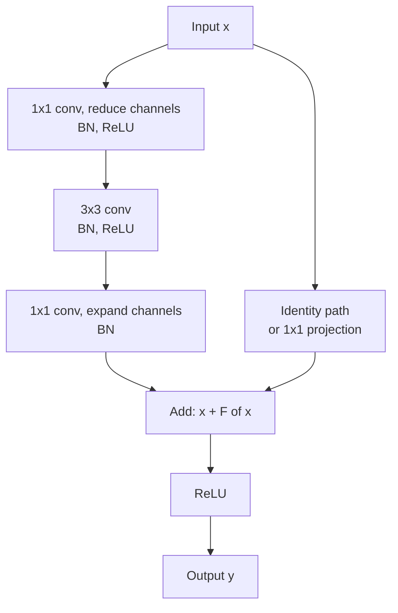

The diagram shows a ResNet bottleneck block. The right-hand path is the residual function $F(x)$ and the identity path carries $x$ unchanged to the addition. The implication is that the block's default behaviour is to pass its input through, and the convolutions contribute a correction. Gradients flow back through the addition to both paths, so the identity path gives every earlier layer a direct route to the loss.

### 10.3 Why gradients behave better

Consider a chain of residual blocks with $x_{l+1}=x_l+F_l(x_l)$. Unrolling from layer $l$ to a later layer $L$ gives

$$
x_L = x_l + \sum_{i=l}^{L-1} F_i(x_i)
$$

Now differentiate the loss with the chain rule:

$$
\frac{\partial \mathcal{L}}{\partial x_l} = \frac{\partial \mathcal{L}}{\partial x_L}\left(1 + \frac{\partial}{\partial x_l}\sum_{i=l}^{L-1}F_i(x_i)\right)
$$

The first term, $\partial\mathcal{L}/\partial x_L$, reaches layer $l$ unchanged, independent of any weights in between. In a plain network the gradient is a product of layer Jacobians, and if each Jacobian has a typical gain $g$, the gradient over $n$ layers scales as $g^n$. With $g=0.9$ and $n=50$, that is $0.9^{50}\approx0.005$; with $g=1.1$ it is about 117. In the residual network each block contributes a factor $(1+\epsilon)$ with $\epsilon$ small, so over 50 blocks with $\epsilon=0.01$ the factor is $1.01^{50}\approx1.64$. The sums replace the products, which is the core reason depth becomes trainable. This is an illustrative calculation of typical gains, not a measurement, but it matches the observed behaviour that gradient norms in residual networks vary much less with depth.

Three complementary views appear in the literature. Veit, Wilber, and Belongie (2016) observed that a residual network behaves like an ensemble of many shallow paths of different lengths, since each block can be taken or skipped: $n$ blocks define $2^n$ paths, and deleting a single block from a trained ResNet degrades accuracy only modestly, while deleting a layer from a VGG-style network is catastrophic. They also found that most of the gradient comes from relatively short paths. Li, Xu, Taylor, Studer, and Goldstein (2018) visualized loss surfaces and found that skip connections make the landscape of deep networks much smoother and less chaotic. The third view is initialization: Goyal et al. (2017) set the last BN scale $\gamma$ in each residual branch to zero at the start, so every block begins as an exact identity and the network starts as a shallow one that deepens as training proceeds. That small change stabilized training at large batch sizes.

### 10.4 Variants and limits

Pre-activation ResNet (He et al., 2016) moves BN and ReLU before the convolutions, so the skip path carries a pure identity from input to output with no nonlinearity on the shortcut, which helps for very deep networks. Stochastic depth (Huang et al., 2016) randomly drops entire residual branches during training, acting as a regularizer and shortening effective depth, and is used in EfficientNet and ConvNeXt as the "drop path" rate. Wide ResNets (Zagoruyko and Komodakis, 2016) show that widening a shallower network can match a deeper one with better hardware efficiency, since wide layers parallelize well. Residual connections add a cost: the input must be kept in memory until the addition, and the two paths must have the same shape. On memory-limited devices, the skip tensor extends the lifetime of an activation, which affects peak memory more than parameter counts do.

Two caveats prevent over-claiming. Skip connections make depth trainable, but they do not make additional depth useful: the gains from ResNet-50 to ResNet-152 are small in accuracy relative to the near-tripling of compute (about 3 times the MACs), and depth beyond a few hundred layers brought little. And the variance of the sum grows with the number of blocks if no normalization controls it, which is why BN or scaling factors accompany residual designs.

## 11. The Architecture Lineage

Knowing what each famous architecture contributed is more useful than memorizing layer tables. Each answers a specific obstacle and leaves a design principle that is still used. The numbers quoted for parameters, arithmetic, and accuracy are the ones reported in the papers or the common library implementations at the time of writing; treat them as approximate and verify against the model card or the library you deploy.

### 11.1 LeNet-5 (LeCun et al., 1998)

LeNet-5 read $32\times32$ grayscale digits with two convolution-and-subsampling stages followed by dense layers, about 60,000 parameters in total. The first layer used six $5\times5$ kernels, giving $32-5+1=28$ pixel maps with $6\times(25+1)=156$ parameters. It established the template of convolution, nonlinearity, subsampling, repeated, then a classifier. Its contribution is conceptual: weight sharing and local connectivity with end-to-end training could replace hand-designed features. It was deployed to read cheque amounts at scale, an early example of a CNN in a regulated production setting.

### 11.2 AlexNet (Krizhevsky, Sutskever, and Hinton, 2012)

AlexNet has five convolutional layers and three dense layers, about 61 million parameters, most of them in the dense layers. It combined several ingredients that each mattered: ReLU activations for faster training, dropout in the dense layers, heavy data augmentation (random crops and flips and colour changes), training on two GPUs, and a large first-layer kernel with stride 4. It reduced the ImageNet top-5 error from about 26 percent to about 15 percent. The lesson is that compute and data scale, together with practical training tricks, made deep convolutional networks work. Its weakness was parameter bloat in the dense head and an architecture designed around a 2012 GPU memory limit.

### 11.3 VGG (Simonyan and Zisserman, 2014)

VGG replaced large kernels with stacks of $3\times3$ convolutions, argued in Section 6.1, and built the network from a repeated block pattern of two to four convolutions followed by a $2\times2$ max pool, doubling channels after each pool from 64 to 512. VGG-16 has 13 convolutional layers and 3 dense layers, 138,357,544 parameters, and 15.47 billion MACs per image. Its contribution is a simple, uniform design that is easy to reason about and extend, and VGG features became a standard backbone for transfer learning, style transfer, and perceptual losses. Its weakness is cost: Section 5.3 showed that nearly nine-tenths of its parameters sit in the dense head, and the early layers run at high resolution with many channels. It is rarely the right choice for a new deployment, though it remains a baseline for perceptual-loss computations.

### 11.4 Inception and GoogLeNet (Szegedy et al., 2014 and later)

GoogLeNet (the 2014 ImageNet Large Scale Visual Recognition Challenge winner) introduced the Inception module, which computes $1\times1$, $3\times3$, and $5\times5$ convolutions and a pooling branch in parallel on the same input and concatenates the results, so the network chooses the scale of the features it needs. To keep the cost down it used $1\times1$ convolutions to reduce channels before the larger kernels, the first large-scale use of the bottleneck idea, and replaced the dense head with global average pooling. The network had about 7 million parameters, far fewer than AlexNet or VGG, at greater depth. Later versions factorized a $5\times5$ convolution into two $3\times3$ layers, factorized $n\times n$ into $1\times n$ followed by $n\times1$ (a $7\times7$ becomes $1\times7$ then $7\times1$, 14 weights per channel pair instead of 49), added BN, and introduced label smoothing. Inception-ResNet and Xception then combined the module with residual connections and depthwise-separable convolutions. The principle that outlived the details is multi-branch design with cheap channel reduction.

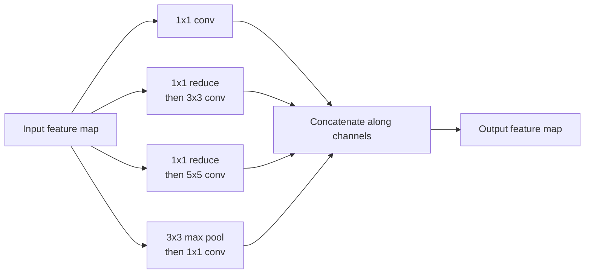

The diagram shows an Inception module with dimension reduction. Four branches see the same input at different effective scales, and their outputs are stacked as channels. The implication is that the network learns how much capacity to give to each scale, at the price of a more complicated graph, and irregular branches are harder to optimize for hardware than the uniform blocks of VGG or ResNet.

### 11.5 ResNet (He et al., 2015)

ResNet is the architecture that made depth routine, using the residual blocks of Section 10. ResNet-50 uses bottleneck blocks arranged as $[3,4,6,3]$ across four stages, with 25.56 million parameters and 4.09 billion MACs, as computed in Section 5.3. The original ResNet-50 reaches about 76 percent top-1 accuracy on ImageNet with the 2015 training recipe, and Wightman, Touvron, and Jégou (2021) showed that the same architecture trained with a modern recipe (longer schedule, stronger augmentation, label smoothing, mixup and CutMix, better regularization) exceeds 80 percent. This is a standing warning for architecture comparisons: a large part of the progress credited to architectures was training-recipe progress. ResNet remains the default baseline, the most widely pretrained family, and a sensible first choice when there is no strong reason to pick something else.

### 11.6 DenseNet (Huang et al., 2017)

DenseNet connects each layer to all later layers within a block by concatenating, not adding, the feature maps. A layer receives the channels of all earlier layers, and each layer adds only a small number of new channels, the growth rate $k$ (32 in the larger variants). If a block starts with $k_0$ channels, layer $l$ sees $k_0+k(l-1)$ input channels. The design encourages feature reuse, gives short gradient paths, and needs fewer parameters per layer: DenseNet-121 has about 8 million parameters and under 3 billion MACs, comparable in accuracy to a much larger ResNet. The cost is memory. Concatenation copies tensors, and the number of stored feature maps grows quadratically with block depth, so DenseNets are often slower in practice and use more training memory than their parameter counts suggest. This is a clear instance where parameter count and MACs mislead about resource use.

### 11.7 MobileNet (Howard et al., 2017; Sandler et al., 2018; Howard et al., 2019)

MobileNetV1 built the whole network from depthwise-separable convolutions (Section 8.2), with a width multiplier and a resolution multiplier that trade accuracy for cost in a controlled way. It has about 4.2 million parameters and 569 million MACs. MobileNetV2 added inverted residuals with linear bottlenecks, reaching about 3.4 million parameters and 300 million MACs at higher accuracy. MobileNetV3 used neural architecture search to tune the layout for mobile hardware, added squeeze-and-excitation blocks (a small gating network that reweights channels using a global summary), and used hard-swish. The contribution is a family and a method: design with a latency target on the target device, not a parameter count. These networks are the usual starting point for phone and embedded deployment.

### 11.8 EfficientNet (Tan and Le, 2019)

Before EfficientNet, practitioners scaled a network by increasing depth, width, or input resolution separately. Tan and Le observed that the three interact (higher resolution needs more depth for the receptive field and more width to capture finer patterns) and proposed compound scaling with a single coefficient $\phi$:

$$
\text{depth}\propto\alpha^{\phi},\qquad \text{width}\propto\beta^{\phi},\qquad \text{resolution}\propto\gamma^{\phi},\qquad \alpha\beta^{2}\gamma^{2}\approx 2
$$

Compute grows with depth, with width squared, and with resolution squared, so the constraint makes each increment of $\phi$ about double the arithmetic. They found $\alpha=1.2$, $\beta=1.1$, and $\gamma=1.15$ by a small search on a baseline network (EfficientNet-B0, found by architecture search using MobileNet-style blocks with squeeze-and-excitation), and $1.2\times1.1^2\times1.15^2=1.92$, close to 2. The paper reports B0 at about 5.3 million parameters and 0.39 billion MACs with 77.1 percent top-1 accuracy, and the largest model, B7, at about 66 million parameters with accuracy above 84 percent. The contribution is the principle that scaling should be coordinated, and a family with a clean cost ladder. A practical caveat is that depthwise convolutions and the swish activation are memory-bound and slow to train relative to their MAC counts, which EfficientNetV2 (Tan and Le, 2021) addressed with fused convolutions in the early stages and progressive increases in image size during training.

### 11.9 ConvNeXt (Liu et al., 2022)

By 2021 Vision Transformers and Swin Transformers had overtaken ResNets on benchmarks. Zhuang Liu and colleagues asked how much of the gap came from the attention mechanism and how much from the modern training recipe and design details. They started with a ResNet-50 trained with a transformer-style recipe and applied changes step by step: a "patchify" stem (a $4\times4$ convolution with stride 4), a changed stage ratio $[3,3,9,3]$, depthwise $7\times7$ convolutions, an inverted bottleneck (wide hidden layer, as in transformers and MobileNetV2), fewer activation and normalization layers, GELU in place of ReLU, and Layer Normalization in place of BN. The resulting ConvNeXt-T has about 28 million parameters and about 4.5 billion FLOPs and reaches about 82 percent ImageNet top-1, matching Swin-T at a similar cost. A follow-up, ConvNeXt V2 (Woo et al., 2023), combined the architecture with masked-autoencoder pretraining. The finding is that CNNs had not reached their ceiling: much of the transformer's advantage came from design and training choices that can be transplanted into a convolutional network. For an architect, the result supports a pragmatic stance: choose by measured accuracy and latency on the task and hardware, not by fashion.

### 11.10 Summary table and a selection tree

| Architecture | Year | Key idea | Params (approx.) | Compute (approx. MACs) | Use today |
| --- | --- | --- | --- | --- | --- |
| LeNet-5 | 1998 | Conv, subsample, train end-to-end | 60 thousand | under 1 million | Teaching, tiny inputs |
| AlexNet | 2012 | ReLU, dropout, GPUs, augmentation | 61 million | about 0.7 billion | Historical |
| VGG-16 | 2014 | Uniform $3\times3$ stacks | 138 million | 15.5 billion | Perceptual loss, legacy backbones |
| GoogLeNet / Inception | 2014 | Multi-scale branches, $1\times1$ reduction | 7 million (v1) | about 1.5 billion (v1) | Occasional |
| ResNet-50 | 2015 | Residual connections, bottleneck | 25.6 million | 4.09 billion | Default baseline |
| DenseNet-121 | 2017 | Concatenative feature reuse | 8 million | under 3 billion | Medical imaging, small data |
| MobileNetV2 | 2018 | Inverted residual, depthwise | 3.4 million | 300 million | Phones, embedded |
| EfficientNet-B0 | 2019 | Compound scaling | 5.3 million | 0.39 billion | Efficient mid-size |
| ConvNeXt-T | 2022 | Transformer-era CNN | 28 million | 4.5 billion | High-accuracy CNN |

Values for AlexNet and GoogLeNet MACs are rounded estimates; the others are the figures stated above. The point of the table is the progression of ideas, not exact figures.

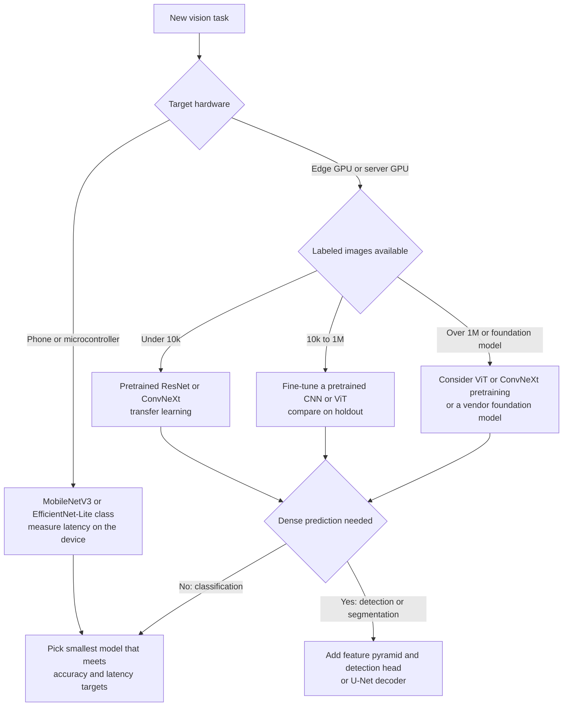

The decision tree starts from the hardware limit, because the deployment device constrains the answer more firmly than benchmark accuracy does, and then branches on data volume. It recommends a pretrained backbone in almost every path, since training from scratch needs more data than most teams have (Section 14). The final branch reminds that dense tasks need an additional head or decoder. The tree is a starting heuristic and not a rule: the right way to settle a close choice is to fine-tune two or three candidates on the same data and split with the same budget and compare accuracy, latency, and memory on the target device.

## 12. Vision Transformers and the CNN Versus ViT Trade-off

The Vision Transformer (ViT) of Dosovitskiy and colleagues (2020) applies a standard transformer encoder to an image treated as a sequence of patches. The transformer itself, including self-attention, positional encoding, and multi-head layers, is taught in [CH10 — Transformers and Attention](CH10_Transformers_and_Attention.md). This section recaps only what is needed to compare it with a CNN.

### 12.1 How a ViT sees an image

A ViT divides the image into non-overlapping patches, for example $16\times16$ pixels, flattens each patch, and applies a learned linear projection to produce a token. For a $224\times224$ input with $16\times16$ patches there are $14\times14=196$ tokens, plus one learnable classification token, giving 197. Each token receives a learned position embedding so the model knows where the patch came from. The sequence passes through a stack of transformer layers, and the output of the classification token feeds a linear classifier. The patch projection is mathematically a convolution with kernel size 16 and stride 16, with $16\times16\times3\times768+768=590{,}592$ parameters for a 768-wide base model (ViT-B/16, about 86 million parameters in total). So even a ViT begins with one convolutional layer, and the rest of the model contains no convolutions.

In every transformer layer each token attends to every other token. The attention matrix per head has $N^2$ entries for $N$ tokens, 38,809 for 197 tokens. Doubling the side length of the image quadruples the token count and multiplies attention cost by about sixteen. At $384\times384$ pixels with the same patch size, $N=577$, the matrix per head has 332,929 entries, 8.6 times more than at 224. At $1024\times1024$ it is 4,097 tokens, and the matrix has 16,785,409 entries per head. High resolution is therefore expensive for plain ViTs, which is why windowed attention (Swin) and hierarchical designs exist. A CNN's cost grows linearly with the number of pixels.

### 12.2 Inductive bias and data

A CNN builds in two assumptions: locality (units look at neighbourhoods) and weight sharing (the same filter everywhere), plus a hierarchy of growing receptive fields. These are inductive biases, constraints that reduce what the model must learn from data. A ViT builds in almost none beyond the patch grid. Attention can model any pairwise interaction, local or global, from the first layer, but it has to learn locality instead of getting it by design.

The consequence is a dependence on data scale. The original ViT paper found that trained on ImageNet-1k alone, ViTs underperformed comparable ResNets, but pretrained on larger datasets (ImageNet-21k with about 14 million images, or the proprietary JFT-300M with about 300 million) and then fine-tuned, they matched or exceeded the best CNNs at lower training compute. Touvron et al. (2021) showed with DeiT that a ViT can be trained on ImageNet-1k alone to above 80 percent top-1 with strong augmentation, regularization, and distillation from a CNN teacher, so the data requirement is partly a recipe requirement. Self-supervised pretraining at scale, such as DINO and DINOv2, and image-text pretraining such as CLIP, which are discussed in [CH23](CH23_Multimodal_Generative_AI.md), have given ViTs a large ecosystem of general-purpose pretrained features. At the time of writing many publicly available foundation vision backbones are ViTs.

### 12.3 Trade-off analysis

| Dimension | CNN | ViT |
| --- | --- | --- |
| Data needed to train from scratch | Moderate; priors help small datasets | High without strong recipe or pretraining |
| Compute scaling with resolution | Linear in pixels | Quadratic in tokens for global attention; linear for windowed variants |
| Dense prediction | Natural; feature pyramid from strides | Needs hierarchical variant or adapter for multi-scale features |
| Hardware support at the edge | Excellent: mature kernels, fusion, int8 | Improving; attention and LayerNorm/softmax are harder to quantize and fuse on some runtimes |
| Pretrained ecosystem | Large, mature | Very large and growing, especially self-supervised and image-text |
| Behaviour on shift | Texture-leaning (Geirhos et al., 2019), sensitive to corruption | Reported to rely more on shape and to tolerate some corruptions better, but evidence is mixed and depends on the training recipe |
| Resolution flexibility | Works at new resolution with BN statistics caveat | Needs position-embedding interpolation |
| Interpretability tools | Grad-CAM, saliency mature | Attention maps and attribution methods; caveats apply |

The comparison supports a few decision heuristics.

- Under tight latency or memory limits on an edge device, a quantized CNN is usually the lower-risk option, because runtimes and accelerators are tuned for convolution.
- With a large labeled dataset, a strong accelerator budget, and an objective where global context matters, a ViT or a hybrid is a reasonable choice, and its pretrained representations can transfer widely.
- With little labeled data, start from a pretrained model of either family and fine-tune. Which family transfers better depends on the domain and the pretraining; compare both rather than assuming.
- For dense prediction, use a hierarchical backbone (a CNN, ConvNeXt, or Swin) so that multi-scale features come for free.
- Treat head-to-head benchmark claims with suspicion unless training recipes, pretraining data, resolution, and hardware are matched. ConvNeXt's result (Section 11.9) is the standard demonstration that the recipe can matter as much as the architecture.

Hybrid designs close the gap from both sides. Convolutional stems in front of a transformer give it locality early (Xiao et al., 2021 report that replacing the patchify stem with a few stride-2 convolutions improves optimization stability), and convolution-style components appear in many efficient vision transformers. For the purposes of this chapter, a CNN remains the right default for constrained-hardware deployments, while the ViT is a serious alternative whenever large-scale pretraining is available.

## 13. The Image Classification Pipeline and Its Metrics

Image classification assigns one label, or a set of labels, to a whole image. It is the simplest vision task and the base for everything else in the chapter: detection and segmentation reuse its backbones, its training tricks, and most of its failure modes. A classification system is a pipeline, and the model is one stage of it.

### 13.1 Pipeline stages and where they fail

The stages are image capture, validation, preprocessing, model inference, post-processing, and decision. Each stage has a way to fail silently.

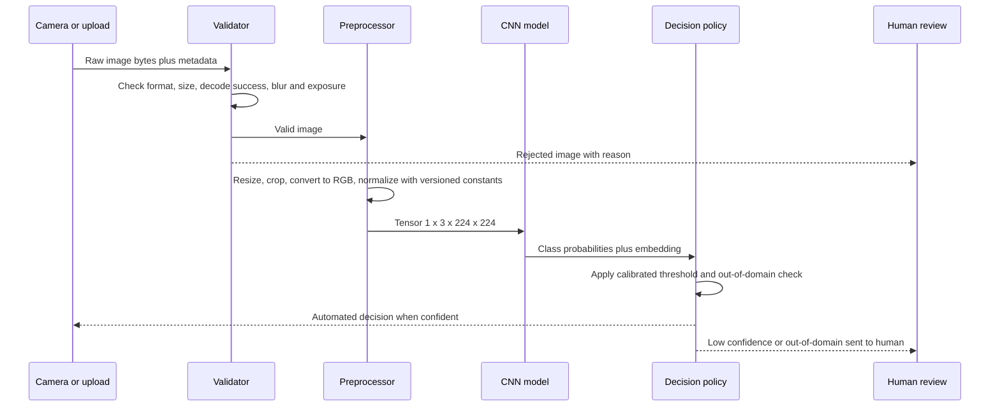

The sequence diagram shows the path of one request. The validator rejects images that cannot be decoded, are too small, or are blurred or badly exposed, and sends them to a human or asks for a retake instead of producing a confident guess. The preprocessor must apply the same operations as training, in the same order, with the same constants. The decision policy converts probabilities into actions using a threshold chosen from error costs (the cost-based derivation is in [CH01](CH01_Machine_Learning_Foundations.md) and the calibration in [CH06](CH06_Model_Evaluation_Validation_and_Selection.md)), and it can abstain. The design implication is that rejection and abstention are first-class outcomes with their own volume and capacity: if 8 percent of images go to human review and one reviewer handles 400 images a day, the staffing follows from the arrival rate, not from the model's accuracy.

Preprocessing details are the most frequent source of training-serving skew. Examples include resizing with a different interpolation (bilinear versus bicubic versus nearest) or a different library (the same nominal "resize" in two libraries can differ in anti-aliasing), reading Joint Photographic Experts Group (JPEG) files with a different decoder that produces slightly different pixel values, cropping the centre in one path and resizing the whole image in the other, and losing the Exchangeable Image File Format (EXIF) orientation tag so that rotated phone photographs arrive sideways. Each can reduce accuracy by several points with no error message. The countermeasure is to run a parity test: pass a fixed set of images through the training preprocessor and the serving preprocessor and require near-identical tensors (an absolute difference below a small tolerance), and run it in the release pipeline.

### 13.2 A training recipe

A standard supervised recipe for a CNN classifier, with the reasoning for each element, is as follows. The optimization theory is in [CH07](CH07_Deep_Learning_Foundations.md).

- **Loss.** Softmax cross-entropy over the classes for single-label tasks, and independent sigmoid with binary cross-entropy for multi-label tasks, where an image can have several labels (a chest X-ray with several findings). Using softmax for a multi-label problem forces the probabilities to compete, which is wrong when labels co-occur.
- **Label smoothing.** Replace the one-hot target with a softened one: the true class gets $1-\epsilon+\epsilon/K$ and every other class gets $\epsilon/K$. With $\epsilon=0.1$ and $K=1000$ classes the true class target is $0.9001$ and each other class $0.0001$. It reduces overconfidence, though it also distorts the logits in ways that hurt distillation and some calibration measures.
- **Optimizer and learning rate.** Stochastic gradient descent (SGD) with momentum 0.9 and weight decay around $10^{-4}$ for ResNet-style networks, with an initial rate of 0.1 for a batch of 256; Goyal et al. (2017) showed the linear scaling rule, learning rate proportional to batch size, works up to a point if combined with a warm-up of a few epochs. AdamW is more common for ViTs and ConvNeXt. These are starting points to adjust and not constants.
- **Schedule.** A cosine decay of the learning rate to near zero, after a linear warm-up, is a common and forgiving default. Step decay (divide by 10 at fixed epochs) is the older equivalent.
- **Regularization.** Weight decay, augmentation (Section 15), label smoothing, stochastic depth for deeper models, and early stopping on a validation split. Dropout is rarely needed in modern CNNs with BN and global average pooling.
- **Mixed precision.** Computing forward and backward passes in 16-bit floating point with a 32-bit master copy of the weights roughly doubles throughput on modern GPUs and halves activation memory; use loss scaling for 16-bit float to avoid underflow in gradients. CH07 explains the numerics.
- **Exponential moving average (EMA) of weights.** Keeping a running average of the weights, and evaluating that average, often gives a small free gain and smoother validation curves.
- **Train-test resolution discrepancy.** Touvron et al. (2019) noted that random-resized-crop augmentation makes objects appear larger in training than in a centre-cropped test image, so testing at a somewhat higher resolution than training, or fine-tuning briefly at the test resolution, can raise accuracy at no training cost. It is a reminder that "input resolution" has separate training and serving settings.

### 13.3 Metrics for classification

Top-1 accuracy is the fraction of images whose highest-probability class is correct, and top-5 accuracy is the fraction whose correct class is among the five highest. Top-5 is informative on tasks with many similar classes (1,000 ImageNet categories include over a hundred dog breeds), and meaningless for tasks with two or three classes. For real applications aggregate accuracy hides the important structure, so a more complete evaluation includes:

- **Per-class precision, recall, and F1.** Report them with the number of examples behind each, because a recall of 0.85 on 20 examples is a weak statement. With 17 of 20 detected the 95 percent Wilson interval for recall is about 0.64 to 0.95. Interval methods are in [CH06](CH06_Model_Evaluation_Validation_and_Selection.md).
- **Confusion matrix.** It shows which classes are confused, which points to data problems (two labels that are really one), taxonomy problems, and missing visual information.
- **Macro versus micro averaging.** Micro averages weight each image equally, so rare classes barely move the number, and macro averages weight each class equally. Use macro or per-class numbers when rare classes matter.
- **Slice metrics.** Compute the same metrics separately by camera, site, lighting, time of day, device, patient subgroup, and image quality. A model with 95 percent accuracy overall and 78 percent on the night shift is not a 95 percent model. The slices should be defined from how the product will be used, not from convenience.
- **Calibration.** Guo, Pleiss, Sun, and Weinberger (2017) showed that modern deep networks tend to be overconfident, with predicted probabilities higher than observed accuracy. Reliability diagrams and the expected calibration error quantify it, and temperature scaling (dividing logits by a scalar fitted on a validation set) is a simple, effective fix. Calibration matters whenever a threshold on confidence decides between automation and review.
- **Statistical uncertainty.** With 500 test images and an observed accuracy of 0.90, the standard error is $\sqrt{0.9\times0.1/500}=0.0134$, so the 95 percent interval is about $\pm2.6$ percentage points. Two models that differ by one point on this set are not distinguishable. Use paired tests on the same images, or a larger test set, when comparing candidates.

Benchmark labels are not perfect. Studies of ImageNet's validation labels found that a few percent of images have errors or multiple valid labels (for example, Northcutt, Athalye, and Mueller, 2021, reported label errors across several common test sets, and Beyer et al., 2020, argued for multi-label re-annotation of ImageNet). The practical consequence is that differences of a fraction of a percent on such benchmarks reflect noise and label ambiguity as much as model quality. The same holds for in-house labels, which is why Section 21 treats labeling quality as a first-order concern.

## 14. Transfer Learning and Fine-Tuning

Training a CNN from scratch typically needs hundreds of thousands to millions of labeled images. Most applications have hundreds to tens of thousands. Transfer learning resolves the mismatch by starting from a network pretrained on a large source task and adapting it to the target task. [CH20](CH20_Fine_Tuning_PEFT_and_LoRA.md) owns general fine-tuning and parameter-efficient methods; this section covers the mechanics specific to CNNs.

### 14.1 Why transfer works, and when it does not

The first layers of an image-trained CNN learn oriented edges, colour opponents, and small textures. Middle layers learn combinations such as corners, repeated patterns, and parts. The last layers learn features tied to the source label set. Yosinski, Clune, Bengio, and Lipson (2014) measured this: features from early layers transfer between tasks with little loss, while the transferability of later layers falls as the source and target tasks diverge. The usual heuristic is therefore that earlier layers are general and later layers are specific. It is a heuristic and not a guarantee, because the boundary between general and specific depends on how far the target domain is from the source.

Transfer helps most when the target data are scarce and the domain resembles the source (everyday photographs). It helps less when the domain is far from the source: Raghu, Zhang, Kleinberg, and Bengio (2019) studied medical imaging and found that transfer from ImageNet gave modest gains at best, that much of the benefit came from better scaling of weights and convergence speed rather than reuse of features, and that smaller, simpler networks trained from scratch could match large pretrained ones. Kornblith, Shlens, and Le (2019) found that, across many tasks, networks with higher ImageNet accuracy generally transferred better when fine-tuned, but the correlation was weak for some fixed-feature settings. The decision to use a pretrained backbone should be made empirically on the target data, including a from-scratch baseline when the domain is unusual (microscopy, radar, multispectral satellite bands).

### 14.2 The three strategies

**Feature extraction.** Freeze the entire pretrained backbone, remove its classifier, and train only a new head on the extracted features, typically a linear layer or logistic regression on the pooled embedding. Because the backbone is fixed, features can be computed once and cached, so training takes seconds to minutes even for large backbones. For a ResNet-50 and 10,000 images the extraction pass costs about $10{,}000\times4.09\times10^{9}=4.09\times10^{13}$ MACs once, after which experiments on the head are almost free. Feature extraction is the right first experiment: it is cheap, has few hyperparameters, and sets a floor. Its limits are that augmentation can no longer be applied on the fly (unless features are recomputed for each augmented copy) and that features cannot adapt to the target domain.

**Partial unfreezing.** Freeze the early layers and train the later stages together with the head. This lets higher-level features adapt while preserving the general low-level ones, and it reduces both the risk of overfitting a small dataset and the compute per step. For ResNet-50 the boundary is usually a stage boundary. The four stages hold 215,808, 1,219,584, 7,098,368, and 14,964,736 parameters. A new five-class head has $2048\times5+5=10{,}245$ parameters, 0.04 percent of the model. Unfreezing stage 4 as well makes $14{,}964{,}736+10{,}245=14{,}974{,}981$ parameters trainable, 58.6 percent of the model by count. Because compute per stage is roughly balanced (Section 5.3), freezing the stem and stages 1 to 3 means backpropagation covers about a quarter of the convolutional layers. Treating the backward pass as costing about twice a forward pass, the training cost per image becomes roughly $1+2\times0.25=1.5$ forward-pass units instead of $3$ for full fine-tuning, about half. This is an illustrative estimate, but the direction is reliable: freezing the early stages saves compute and memory, since their activations need not be stored for the backward pass.

**Full fine-tuning.** Train all layers, starting from pretrained weights, at a low learning rate. It gives the highest ceiling when there is enough data to adapt every layer and the domain gap is meaningful, and it carries the greatest risk of forgetting useful features and overfitting.

| Target data | Domain close to source | Domain far from source |
| --- | --- | --- |
| Small (under about 1,000 images per task) | Feature extraction, then maybe unfreeze the last stage | Feature extraction on several backbones; consider in-domain self-supervised pretraining |
| Medium (thousands to tens of thousands) | Partial unfreezing, last one or two stages | Fine-tune most layers with a low learning rate; also test from scratch with a small network |
| Large (hundreds of thousands) | Full fine-tuning | Full fine-tuning or training from scratch; compare |

The table gives starting points; the actual boundary depends on the model, augmentation, and noise in labels, and should be located experimentally.

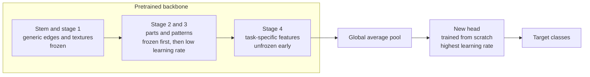

The diagram annotates the layers of a ResNet-style backbone with the freeze policy. The head has random initialization and learns quickly, so it takes the largest learning rate. Late stages adapt to the target and take a smaller one, and early stages stay frozen or receive a tiny rate. The implication is that the unfreeze boundary is a hyperparameter with a cost-benefit: each additional unfrozen stage adds trainable parameters, training compute, and overfitting risk, and the returns depend on how far the target is from the source.

### 14.3 Learning rates, batch normalization, and schedules

Learning-rate choices decide whether fine-tuning works.

- **Head versus backbone.** A common rule is to give the backbone a learning rate 10 to 100 times lower than the head. For SGD, a head rate of 0.01 and a backbone rate of $10^{-3}$ to $10^{-4}$ are typical; for Adam, a head rate of $10^{-3}$ and a backbone rate of $10^{-5}$ to $10^{-4}$. A backbone rate as high as training from scratch overwrites the pretrained features within a few hundred steps, which is called catastrophic forgetting.
- **Discriminative (layer-wise) rates.** Assign geometrically decreasing rates from the head to the stem, for example multiplying by 0.1 per stage or by 0.7 to 0.9 per layer group. This follows the generality heuristic: the deeper the layer, the more it can change.
- **Warm-up.** Start with a very small learning rate and increase it over the first epoch or few hundred steps. The new head is random and produces large, noisy gradients that would otherwise flow into the backbone and damage it.
- **Staged schedule.** Train the head alone for a few epochs with the backbone frozen, then unfreeze selected stages and continue at lower rates. This protects the backbone from the noisy early gradients of a random head.
- **Batch normalization.** Decide explicitly whether BN layers stay in evaluation mode (using the pretrained running statistics) or train. For small target datasets and small batches, keeping BN in evaluation mode during the early stage avoids corrupting the statistics with noisy estimates. When the domain differs strongly in brightness or contrast from the source, updating BN statistics only, with weights frozen, is a cheap partial adaptation.
- **Weight decay and early stopping.** Use the same weight decay as the pretraining recipe or a smaller one; choose the stopping epoch on the validation split, not the test split.

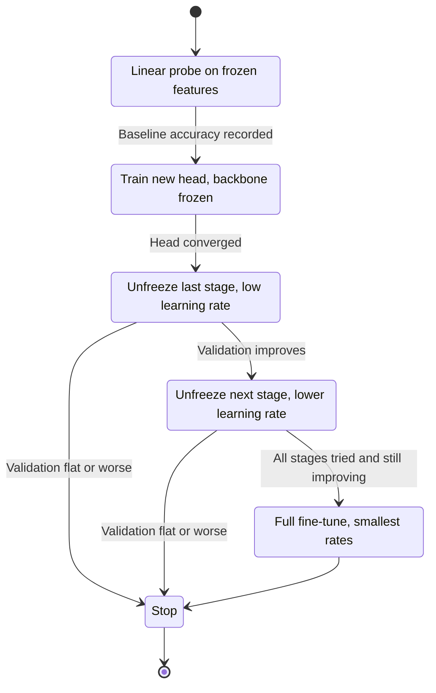

The state diagram describes a gradual-unfreezing procedure with an explicit stopping rule at each step. Each transition requires measured improvement on the validation split, so the process stops as soon as additional unfreezing no longer pays. The usual implementation records the variant, the data version, the learning rates, and the budget for each state, so that the comparison between variants is controlled. The common error is to compare a short feature-extraction run with a long full fine-tune and credit the architecture, when the difference is the training budget.

### 14.4 Risks inherited from the source

A pretrained backbone brings baggage.

- **Source-domain bias.** If the pretraining data under-represent a population, setting, or device, the features encode that gap. A skin-lesion classifier built on features from photographs of light-skinned people may perform worse on darker skin even if the fine-tuning set is balanced. Evaluate by subgroup (Section 23).
- **Licensing and terms.** The ImageNet dataset is distributed under terms that limit use to non-commercial research and education; whether weights trained on it may be used in a commercial product is a legal question that many organizations resolve with counsel. Pretrained weights have their own licenses, which range from permissive to restrictive or non-commercial. Treat the weights as a dependency whose license is recorded in the model card and reviewed.
- **Contamination.** Web-scale pretraining sets can contain your test images (public datasets, scraped medical images). Report results on data created after the pretraining cutoff or held privately when this matters.
- **Supply chain.** Model files can execute code when loaded if they use an unsafe serialization format. Prefer weight formats that do not execute code, and obtain models from verified sources (Section 23).
- **Preprocessing contract.** The backbone expects the specific input normalization of Section 3.2. Record it with the model.

When the domain is far from the source and labeled data are limited, in-domain self-supervised pretraining on unlabeled images (for example masked-image or contrastive objectives) can close part of the gap before the supervised fine-tune. It requires large amounts of unlabeled data and compute, and it is a project in itself, so reserve it for cases where unlabeled data are plentiful (a hospital archive, a line camera that has recorded years of normal parts) and labeled data are not.

## 15. Data Augmentation and the Input Distribution

Augmentation generates additional training examples by applying label-preserving transformations to existing ones. It serves three purposes: it enlarges the effective dataset, it teaches invariances the architecture lacks (rotation, scale, lighting), and it regularizes the model. Understanding it as a statement about the input distribution is what separates useful augmentation from harmful augmentation.

### 15.1 Augmentation as a change to the training distribution

Let $P_{train}$ be the distribution of training images and $P_{deploy}$ the distribution of images the system will see. Without augmentation the model fits $P_{train}$, and any gap between it and $P_{deploy}$ appears as a generalization error. Augmentation replaces $P_{train}$ with a broader distribution $P_{aug}$ produced by applying random transformations $T$ drawn from a chosen family. The aim is for $P_{aug}$ to cover $P_{deploy}$ while keeping each transformed image's label correct. Three conditions follow.

1. **Label preservation.** For every transformation in the family, the label of $T(x)$ must equal the label of $x$. A horizontal flip preserves "cat" and destroys "6" versus "9" or the left-right laterality marker in a chest X-ray.
2. **Coverage.** The family should span the variation in deployment: camera angles, lighting, scale, sensor noise, compression artifacts. Variation that never occurs wastes capacity, and variation that occurs but is not simulated leaves a gap.
3. **Realism.** Transformed images should lie on the manifold of plausible images. Extreme transformations produce samples unlike anything in deployment, which waste capacity or teach spurious cues (a strong blur may teach "blurry means class A" if class A images are blurrier).

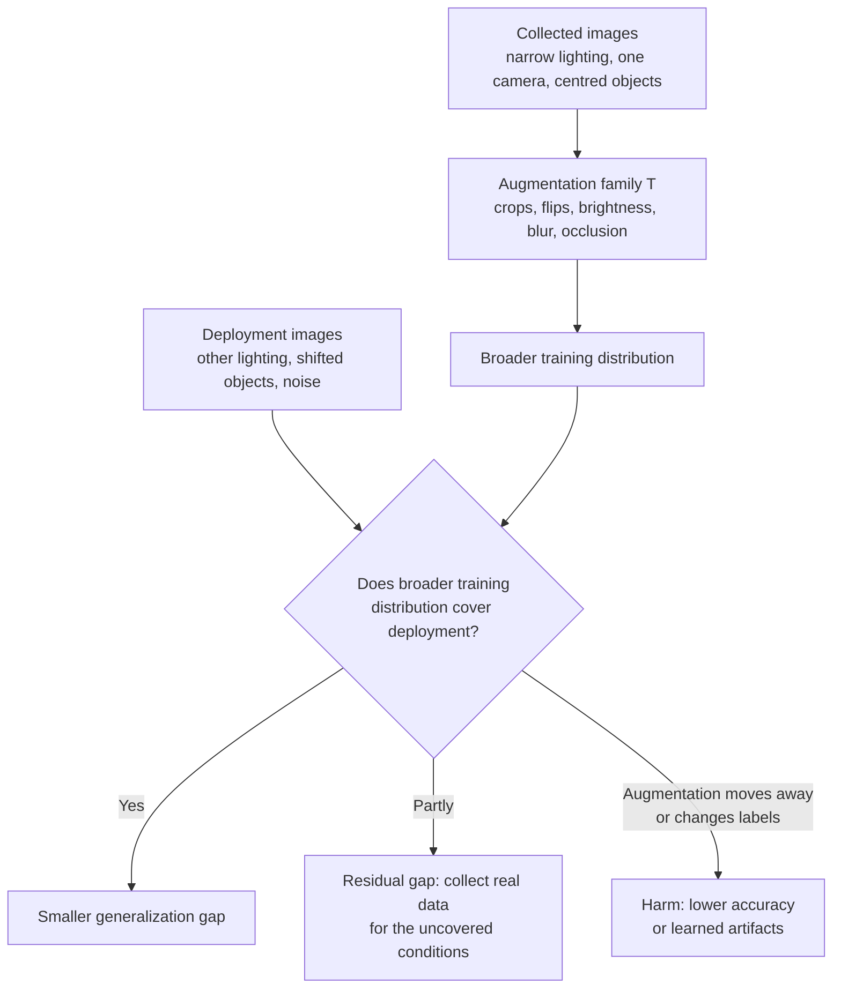

The diagram frames the decision as a comparison between three distributions. The key branch is the bottom one: augmentation can make things worse when it produces samples outside deployment or alters labels. Another consequence is that augmentation cannot invent variation that the family does not model. A model trained on one camera with brightness jitter will not generalize to a different sensor's colour response or noise pattern, so cross-device generalization needs data from multiple devices, not only more jitter.

### 15.2 Geometric transformations

Geometric augmentations move pixels. The standard set includes horizontal flips, random-resized crops (the ImageNet recipe samples a crop covering 8 to 100 percent of the area with aspect ratio between 3/4 and 4/3, then resizes it to the network input), small rotations, translations, shears, perspective warps, and elastic deformations. Each has a validity condition tied to the task.

- **Horizontal flip.** Valid for natural-scene classification and most object detection. Invalid for text, digits where chirality matters, left-right anatomical findings, traffic signs that differ by direction, and satellite imagery with a fixed sun direction that carries information.
- **Vertical flip and 90-degree rotations.** Valid for overhead imagery, microscopy, and many industrial parts where the orientation is arbitrary. Invalid for upright scenes.
- **Random crops and scale changes.** Valid when the object remains in the crop. A crop can remove a small defect and leave an image labelled "defective" with no defect visible, which teaches the model to flag texture instead of the defect. Crop selection must be defect-aware for small targets, for example by centring crops on annotated regions with jitter.
- **Elastic deformation.** Valuable in biomedical segmentation, where tissue shapes vary smoothly, and central to the original U-Net training (Ronneberger et al., 2015). Invalid where straight lines are meaningful, such as measurements of geometry.
- **Translation.** Gives some shift robustness even to a stride-based network (Section 5.1), because the model sees objects at many phases of the stride.

### 15.3 Photometric and noise transformations

Photometric augmentations change pixel values without moving them: brightness, contrast, saturation, and hue jitter, grayscale conversion, gamma changes, blur, additive Gaussian noise, and simulated compression artifacts. They model changes in light, sensors, and encoding. They are invalid when colour or absolute intensity carries the label (a stain intensity, a thermal temperature, a warning-light colour, Hounsfield units in CT). In CT the intensity scale has physical meaning, so brightness jitter should be replaced by realistic variation such as window changes and noise at dose-dependent levels. The magnitude should be chosen from measurements: if exposure varies by about $\pm1$ stop across shifts, the brightness range should be roughly that and not several times larger.

### 15.4 Occlusion: cutout and random erasing

Cutout (DeVries and Taylor, 2017) and random erasing (Zhong et al., 2020) zero or fill a random rectangle in the image. They force the model to use multiple cues instead of one discriminative patch and make it tolerant to partial occlusion. They can erase the evidence of the label, so for tasks with a single small cue (a defect) they can generate false-negative training samples: the label says "defect" and the defect has been erased. Restrict erasing to non-annotated regions or use it with small areas.

### 15.5 Mixing images: mixup and CutMix

Mixup (Zhang, Cisse, Dauphin, and Lopez-Paz, 2018) trains on convex combinations of pairs of images and of their labels:

$$
\tilde{x}=\lambda x_i+(1-\lambda)x_j,\qquad \tilde{y}=\lambda y_i+(1-\lambda)y_j,\qquad \lambda\sim\text{Beta}(\alpha,\alpha)
$$

where $y$ are one-hot label vectors and $\alpha$ controls how strongly the images mix (small $\alpha$ such as 0.2 keeps most samples close to one of the two originals). With $\lambda=0.7$ for a "cat" image and a "dog" image, the target is 0.7 cat, 0.3 dog, 0 other, as the script prints. Mixup encourages linear behaviour between examples, smooths decision boundaries, and tends to improve calibration; the images themselves are ghostly overlays that never occur in deployment.

CutMix (Yun et al., 2019) pastes a rectangular patch from one image onto another and mixes the labels in proportion to the patch area. The patch has area ratio $1-\lambda$, so the label weight of the pasted image is the fraction of pixels it covers. Pasting a $112\times112$ patch onto a $224\times224$ image covers $12{,}544$ of $50{,}176$ pixels, so $\lambda=1-0.25=0.75$ for the base image and 0.25 for the pasted one. To realize a sampled $\lambda=0.3$ the patch side is $\sqrt{1-0.3}\times224\approx187.4$ pixels, almost the whole image, because the pasted region must cover 70 percent of the area. Because the images are locally realistic, CutMix avoids the unnatural blends of mixup and forces the model to localize the evidence. Both methods are standard in modern ImageNet recipes. Neither is safe by default for tasks with small localized evidence: a pasted patch that covers a defect on the base image leaves the label weight unchanged while the evidence is gone.

### 15.6 Automated policies

Hand-selecting transformations and magnitudes is a search problem. AutoAugment (Cubuk et al., 2019) searched for policies with reinforcement learning and required thousands of GPU hours. RandAugment (Cubuk et al., 2020) reduced the search to two numbers: how many transformations $N$ to apply from a fixed list and a single shared magnitude $M$. TrivialAugment (Müller and Hutter, 2021) removed even those by sampling one transformation and its magnitude at random for each image, and performed comparably. AugMix (Hendrycks et al., 2020) mixes chains of augmentations and adds a consistency loss to improve corruption robustness. For a new task, RandAugment or TrivialAugment with the task-specific invalid operations removed (no flips for oriented text, no colour operations for stained tissue) is a strong, cheap baseline, and the remaining effort goes into verifying label preservation by visual inspection of augmented samples.

### 15.7 Policy by task

| Task | Typically valid | Typically invalid or risky |
| --- | --- | --- |
| Natural-image classification | Random-resized crop, flip, colour jitter, RandAugment, mixup, CutMix | Extreme crops that remove the object |
| Handwritten digits | Small rotations, shifts, elastic distortion | Flips, large rotations (6 versus 9) |
| Chest X-ray | Small rotation and scale, mild contrast and noise | Horizontal flip (laterality, device markers), strong cutout |
| Histology slides | Flips, 90-degree rotations, stain-colour augmentation, elastic | Heavy geometric distortion of cell shape |
| Satellite or aerial | Flips, rotations, scale | Colour changes that mimic different bands |
| Manufacturing defects | Small shifts, lighting variation matched to the line, noise | Crops that remove the defect, mixup on subtle defects |
| Faces | Mild crop, brightness, small rotation | Aggressive colour change that alters skin tone representation |

### 15.8 Operating augmentation in practice

Augmentation is applied only to training data. Validation and test images receive only the deterministic preprocessing, so metrics reflect deployment. Data loading can become the bottleneck, since decoding images and applying transformations on the central processing unit (CPU) may starve the GPU. Training throughput should be profiled, and the remedies are more loader workers, decoding with hardware accelerators or GPU libraries, caching decoded images, and moving transformations onto the GPU. Test-time augmentation (TTA) averages predictions over several transformed copies of the input, typically flips and crops. It gives a small accuracy gain at a multiple of the inference cost, so it suits offline batch scoring and not a latency-limited service.

Synthetic data extends augmentation. Pasting object cutouts onto new backgrounds (copy-paste augmentation, Ghiasi et al., 2021), rendering from three-dimensional models, or generating images with a diffusion model can produce rare cases such as defect types that occur once in a million parts. The risks are a domain gap between synthetic and real images, which can lead a model to learn rendering artifacts, and leakage if a generative model was trained on images that overlap the evaluation set. Evaluate on real held-out data only, and measure the contribution of synthetic data by ablation.

## 16. Object Detection

Classification answers "what is in this image". Detection answers "what is where": it returns a set of bounding boxes, each with a class label and a confidence score. The number of objects varies from image to image, which makes the output a variable-size set and changes how models are built, trained, and evaluated.

### 16.1 From sliding windows to shared computation

The simplest detector slides a window over the image at several positions and scales, and classifies each crop with a CNN. The arithmetic shows why this fails. On a $640\times480$ image with a $64\times64$ window and stride 8, there are $73\times53=3{,}869$ positions for one window size. If each crop were classified by ResNet-50 at 4.09 billion MACs, one scale would cost $3{,}869\times4.09\times10^9\approx1.6\times10^{13}$ MACs. Running ResNet-50 once on the whole $640\times480$ image costs about $4.09\times10^9\times(640\times480)/(224\times224)=2.5\times10^{10}$ MACs, roughly 630 times less. Neighbouring windows overlap heavily, so most of that work is repeated.

The fix is to exploit the property of Section 8.1: a network made only of convolutions can process an image of any size and return a spatial map in which each cell summarizes one window of the input. A single pass computes what the sliding window recomputed thousands of times. OverFeat (Sermanet et al., 2013) used this to detect efficiently, and every modern detector inherits the principle: compute backbone features once, then attach cheap per-location heads.

### 16.2 The R-CNN family: region proposals plus classification

R-CNN (Girshick et al., 2014) used a classical algorithm, selective search, to propose about 2,000 candidate regions per image, warped each to a fixed size, and ran a CNN on each, then classified with support vector machines and refined boxes with regression. It was accurate and slow: tens of seconds per image, with the CNN run 2,000 times. Fast R-CNN (Girshick, 2015) ran the backbone once on the whole image and extracted a fixed-size feature for each proposal by region-of-interest (RoI) pooling from the shared feature map, making training and inference an order of magnitude faster. Faster R-CNN (Ren et al., 2015) removed selective search by adding a Region Proposal Network (RPN), a small convolutional head that predicts, at every position of the feature map, whether each of several anchor boxes contains an object and how to adjust it. The proposals then pass to the second stage, which classifies and refines them. Mask R-CNN (He et al., 2017) added a mask branch per region and replaced RoI pooling by RoIAlign, which uses bilinear interpolation instead of rounding coordinates to the grid; the rounding had been a source of misalignment of up to a few feature-map cells, which matters for pixel-accurate masks. Feature Pyramid Networks (FPN, Lin et al., 2017) built a multi-scale feature hierarchy by combining deep, semantically strong, low-resolution features with shallow, high-resolution ones, so small objects are detected on fine maps and large objects on coarse maps. FPN is now a standard component.

Two-stage detectors first narrow the search to likely regions, then examine them closely. They tend to be the more accurate choice when precision of localization matters and latency permits, and they are the usual basis of instance segmentation.

### 16.3 One-stage detectors and anchor-free designs

One-stage detectors predict boxes and classes directly from the feature maps in one pass, without a separate proposal stage. The Single Shot MultiBox Detector (SSD, Liu et al., 2016) predicts from several feature maps of different scales. YOLO ("You Only Look Once", Redmon et al., 2016) divided the image into a grid and let each cell predict boxes, an objectness score, and class probabilities. Successive YOLO versions were released by different groups and organizations, adding multi-scale heads, better backbones, improved training recipes, and anchor-free prediction, so "YOLO" now denotes a design family and not one fixed model, and results depend on which version and codebase is meant. A deployment consideration is licensing: some widely used YOLO implementations are released under copyleft licenses (for example the GNU Affero General Public License) with separate commercial terms, and the license of the exact code and weights should be checked before building a product on them.

An anchor-based head makes dense predictions. For a $640\times640$ input with prediction strides of 8, 16, and 32, the feature maps are $80\times80$, $40\times40$, and $20\times20$, giving $6{,}400+1{,}600+400=8{,}400$ cells. With three anchors per cell, a single image yields $3\times8{,}400=25{,}200$ candidate boxes, each with 4 coordinates, an objectness score, and class scores. Nearly all of them are background, and many of the rest overlap each other, so two problems follow: extreme class imbalance in the loss and duplicate detections in the output. Section 16.4 addresses the first and Section 16.5 the second.

Anchor-free detectors (FCOS, Tian et al., 2019; CenterNet, Zhou et al., 2019) drop predefined boxes and predict, for each location, the distances to the box edges or the box centre and size. They remove anchor hyperparameters but still rely on dense predictions and, in most cases, post-processing. Detection Transformer (DETR, Carion et al., 2020) treats detection as set prediction with a transformer decoder and a bipartite matching loss that assigns each ground-truth box to exactly one prediction, which removes the need for non-maximum suppression; later real-time variants such as RT-DETR (Zhao et al., 2023) improved latency. Transformer detectors are an active alternative, but CNN-based detectors with mature export paths remain common on edge devices.

```mermaid
flowchart TD
    subgraph TwoStage["Two-stage: Faster R-CNN style"]
        A1["Image"] --> A2["Backbone plus FPN<br/>multi-scale features"]
        A2 --> A3["Region proposal network<br/>anchors scored as object or not"]
        A3 --> A4["RoIAlign<br/>fixed-size feature per proposal"]
        A4 --> A5["Class and box refinement head"]
        A5 --> A6["Non-maximum suppression"]
    end
    subgraph OneStage["One-stage: YOLO or SSD style"]
        B1["Image"] --> B2["Backbone plus neck<br/>multi-scale features"]
        B2 --> B3["Dense head at every cell<br/>box, objectness, class"]
        B3 --> B4["Confidence filter then<br/>non-maximum suppression"]
    end
```

The diagram contrasts the pipelines. The two-stage path has an explicit "where might objects be" step, so its second stage evaluates a few hundred candidates carefully. The one-stage path evaluates every grid cell directly, which makes it simpler and faster but gives it a harder imbalance problem. In both, the backbone and the multi-scale neck do most of the work, and the choice between them is mostly a choice of head, latency budget, and accuracy requirement.

### 16.4 Anchors, box parametrization, and class imbalance

An anchor is a reference box of a given size and aspect ratio centred at a grid location. Instead of predicting a box from nothing, the network predicts offsets relative to an anchor, which is an easier regression target. A common parametrization for anchor $(x_a,y_a,w_a,h_a)$ and target box $(x,y,w,h)$ is

$$
t_x=\frac{x-x_a}{w_a},\quad t_y=\frac{y-y_a}{h_a},\quad t_w=\ln\frac{w}{w_a},\quad t_h=\ln\frac{h}{h_a}
$$

The division makes the targets independent of anchor size, and the logarithm makes width and height errors symmetric (twice as wide and half as wide are equally far from the anchor). During training each anchor is assigned as positive if its IoU with some ground-truth box exceeds a threshold (such as 0.7 in the original RPN), negative if its IoU is below another (such as 0.3), and ignored in between. Anchor shapes should match the data. If the objects are tall and thin, as with some standing defects or pedestrians, default anchors of aspect ratio 1:1 waste capacity, and anchor sizes can be fitted with k-means clustering on the training boxes.

Class imbalance is severe in dense detection: of 25,200 candidate boxes, perhaps a few dozen contain objects. Cross-entropy summed over all candidates is dominated by the huge number of easy negatives. Focal loss (Lin et al., 2017, introduced with RetinaNet) multiplies the cross-entropy by a factor that shrinks for well-classified examples:

$$
\text{FL}(p_t)=-(1-p_t)^{\gamma}\ln p_t
$$

where $p_t$ is the predicted probability of the true class and $\gamma$ is a focusing parameter, commonly 2. Take an easy negative with $p_t=0.9$: cross-entropy is $-\ln0.9=0.105$, and focal loss is $(0.1)^2\times0.105=0.00105$, a hundred times smaller. A hard example with $p_t=0.1$ has cross-entropy 2.303 and focal loss $(0.9)^2\times2.303=1.865$, barely reduced. With 100,000 easy negatives and ten hard positives, the plain cross-entropy total is about $100{,}000\times0.105=10{,}536$ from negatives against $10\times2.303=23$ from positives, so gradients are almost entirely from easy negatives. Under focal loss the negatives total about 105 and the positives about 19, which restores balance. Alternatives are hard-negative mining (keep only the highest-loss negatives, for example three per positive, as in SSD) and sampling a fixed positive-to-negative ratio per image (as in Faster R-CNN).

### 16.5 IoU, non-maximum suppression, and mean average precision

**Intersection over Union.** For two boxes, IoU is the area of their intersection divided by the area of their union. For two $100\times100$ boxes, one at $(0,0)$ and one offset by $(50,50)$, the intersection is $50\times50=2{,}500$ and the union is $10{,}000+10{,}000-2{,}500=17{,}500$, so IoU is $0.143$. Shifting the second box by only 10 pixels gives intersection $90\times90=8{,}100$, union $11{,}900$, and IoU 0.681. A box covering exactly the left half of the first has intersection 5,000 and union 10,000, so IoU is 0.5. IoU is symmetric, between 0 and 1, and scale-invariant, but it is not scale-neutral in its sensitivity: shifting a $10\times10$ box by 2 pixels in each direction gives IoU 0.471, while the same shift on a $100\times100$ box gives 0.924 (printed by [03_detection_metrics.py](../code/python/cnn-chapter/03_detection_metrics.py)). Small objects are penalized heavily for small pixel errors, so a detector's quality on small objects depends on the output stride as well as on features.

```text
IoU illustration (two 100 x 100 boxes offset by 50 pixels in x and y)

   +-----------+
   |    A      |
   |      +----+------+     intersection = 50 x 50 = 2,500
   |      |////|      |     union        = 10,000 + 10,000 - 2,500 = 17,500
   +------+----+      |     IoU          = 2,500 / 17,500 = 0.143
          |       B   |
          +-----------+
```

**Non-maximum suppression.** A dense detector fires on neighbouring cells and anchors for the same object, so the raw output contains clusters of overlapping boxes. Non-maximum suppression (NMS) keeps the highest-scoring box, removes every other box whose IoU with it exceeds a threshold, and repeats on the remaining boxes. The script uses six boxes of one class: the top box with score 0.95, a second at 0.90 with IoU 0.871 to it, a box at 0.80 with IoU 0.538, a distant box at 0.85, a near duplicate at 0.40 with IoU 0.747, and a box at 0.70 with IoU 0.25. With an NMS threshold of 0.5 the kept scores are 0.95, 0.85, and 0.70; with a threshold of 0.7 the 0.80 box survives as well, giving four detections. A low threshold removes duplicates but also removes real neighbouring objects in crowded scenes, such as people standing close together or parts on a conveyor lying side by side. A high threshold keeps more duplicates, which appear as false positives. Soft-NMS (Bodla et al., 2017) decays the scores of overlapping boxes instead of deleting them; on the same example the rescored values are 0.95, 0.85, 0.618, 0.251, 0.086, and 0.015, so the weaker boxes remain but with low scores that a later confidence threshold can remove. NMS runs per class, is sequential, and is typically executed on the CPU or as a separate kernel, which makes it a measurable part of end-to-end latency on edge devices. Models exported to some runtimes fold NMS into the graph, and others require a separate post-processing step.

**Average precision and mean average precision.** To score a detector, predictions are matched to ground-truth boxes. A prediction is a true positive (TP) if its IoU with an unmatched ground-truth box of the same class is at least a threshold (commonly 0.5), and every ground-truth box can be matched once; otherwise it is a false positive (FP). Sorting predictions by descending confidence and walking down the list yields a precision-recall curve. The average precision (AP) is the area under the precision-recall curve after replacing precision by its running maximum from the right (the precision envelope), which removes the zigzag.

A worked example: two images contain four ground-truth boxes in total, and the detector returns seven predictions. Sorted by score, the outcomes at IoU threshold 0.5 are TP, TP, FP, TP, FP, TP, FP. After each prediction the precision and recall are

| Rank | Score | Outcome | Precision | Recall |
| --- | --- | --- | --- | --- |
| 1 | 0.95 | TP | 1.000 | 0.25 |
| 2 | 0.90 | TP | 1.000 | 0.50 |
| 3 | 0.85 | FP | 0.667 | 0.50 |
| 4 | 0.80 | TP | 0.750 | 0.75 |
| 5 | 0.70 | FP | 0.600 | 0.75 |
| 6 | 0.60 | TP | 0.667 | 1.00 |
| 7 | 0.50 | FP | 0.571 | 1.00 |

The precision envelope at recall up to 0.50 is 1.0 (the best precision at or beyond that recall), between 0.50 and 0.75 it is 0.75, and between 0.75 and 1.00 it is 0.667. The area is $0.50\times1.0+0.25\times0.75+0.25\times0.667=0.854$, the AP at IoU 0.5 reported by the script. At a stricter IoU of 0.75 the same detections give 0.6875, because several boxes that matched at 0.5 no longer qualify, and the mean over thresholds from 0.5 to 0.95 in steps of 0.05 is 0.633. Mean average precision (mAP) is the mean of AP over classes. The Pascal Visual Object Classes (VOC) benchmark reports AP at IoU 0.5. The Common Objects in Context (COCO) benchmark reports the mean over both classes and the ten IoU thresholds, which rewards precise localization, and also AP separately for small, medium, and large objects.

Reading mAP requires care. It summarizes the whole curve without choosing an operating point, but a deployed detector runs at one confidence threshold, so the operating metrics are precision and recall at that threshold, or recall at a fixed false-alarm rate per image or per hour. A model with higher mAP can have lower recall at the threshold the product needs. AP is also sensitive to the IoU threshold: if the downstream use needs only a rough location (alert that a defect exists), AP at 0.5 matches the need, and if it needs pixel-accurate measurement, a segmentation model is the better tool. Finally, mAP averages over classes, so a rare class with few ground-truth boxes has an unstable AP; report per-class values with counts.

### 16.6 Small objects, tiling, and high-resolution inputs

Small objects are the usual failure of detectors. Reasons include coarse output strides (Section 6), IoU sensitivity (above), and downsampling of high-resolution images to fit the network. Remedies are combined: use a feature pyramid with a high-resolution output level, raise the input resolution, make anchors match small sizes, and tile. Tiling splits a large image into overlapping crops, runs the detector on each, and merges the results with NMS across tile borders. A $4000\times3000$ image tiled into $640\times640$ crops with stride 512 produces $8\times6=48$ tiles, so inference cost is about 48 times that of one tile, and the overlap prevents objects on tile borders from being cut. The alternative of downsizing the whole image to $640\times480$ shrinks a 20-pixel object to 3 pixels. Tiling trades latency for recall on small objects, and the right trade depends on the required frame rate.

## 17. Image Segmentation

Segmentation assigns a label to every pixel. Semantic segmentation labels each pixel with a class and does not separate instances: two adjacent cars become one "car" region. Instance segmentation separates individual objects, producing a mask per object. Panoptic segmentation combines the two, labelling countable "things" by instance and amorphous "stuff" such as sky or road by class.

### 17.1 Fully convolutional networks and upsampling

Long, Shelhamer, and Darrell (2015) showed that a classification CNN can be turned into a dense predictor by rewriting its dense layers as convolutions (Section 8.1), so the network outputs a coarse map of class scores for any input size, and then upsampling the map to input resolution with transposed convolutions. The coarse map from a stride-32 backbone is too blurry to locate boundaries, so the variants of the fully convolutional network (FCN), FCN-16s and FCN-8s, add predictions from earlier, higher-resolution layers through skip connections, fusing deep semantic information with shallow spatial information. This combination of "what" from the deep layers and "where" from shallow layers is the central design idea in all segmentation networks.

### 17.2 U-Net

U-Net (Ronneberger, Fischer, and Brox, 2015) arranged the idea symmetrically. An encoder path of convolutions and poolings reduces resolution and increases channels; a decoder path upsamples and reduces channels; and at each resolution the encoder's feature map is concatenated with the decoder's, so fine spatial detail bypasses the bottleneck. The original network was designed for biomedical images and trained on only 30 annotated electron-microscopy images, using heavy elastic-deformation augmentation and a loss weighting that emphasized thin borders between touching cells. A U-Net with about 31 million parameters in its original form became the default for medical segmentation, and its variants (3D U-Net, nnU-Net, which automates configuration choices) remain strong baselines. Its decoder-with-skips structure also appears as the denoising network in diffusion models ([CH12](CH12_Diffusion_Models.md)).

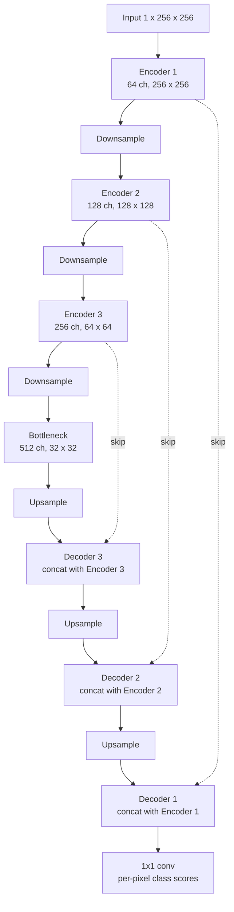

The diagram shows a three-level U-Net. The dashed skip connections carry high-resolution encoder features straight to the matching decoder level. The bottleneck has the largest receptive field and the lowest resolution, so it contributes context ("this is a liver"), while the skips contribute boundaries ("the edge is here"). The implication for design is that the depth of the U-Net sets the context available to decide ambiguous pixels, and the number of levels should be chosen from the receptive-field analysis of Section 6: for a $1024\times1024$ image where the decision needs context of 200 pixels, five levels may be unnecessary, while for a CT volume where an organ is 150 voxels across, three levels may be too few.

### 17.3 Dilated convolution and multi-scale context

DeepLab (Chen et al., 2015 and later versions) kept resolution high by removing the strides of the last backbone stages and using dilated convolutions (Section 8.4) to preserve the receptive field, so the output stride is 8 or 16 instead of 32. Atrous Spatial Pyramid Pooling (ASPP) applies several dilated convolutions with different rates in parallel and combines them, capturing context at multiple scales. Pyramid Scene Parsing (PSPNet) pools features at several grid sizes for a similar purpose. These approaches cost more computation at the late stages, since the maps are larger, and are the usual choice for street-scene and satellite segmentation.

### 17.4 Instance and promptable segmentation

Instance segmentation adds a mask head to a detector. Mask R-CNN predicts, for each detected box, a small binary mask (typically $28\times28$) that is resized into the box. Because masks are per instance, touching objects of the same class are separated. Single-stage alternatives such as YOLACT and SOLO predict instance masks without proposals. The Segment Anything Model (Kirillov et al., 2023) trained a promptable segmentation model whose image encoder is a Vision Transformer, and accepts points, boxes, or text-like prompts; it is often used to accelerate annotation, with a human correcting its masks, and it illustrates how segmentation labeling costs can drop when a foundation model proposes masks (Section 21).

### 17.5 Losses and metrics for segmentation

The default loss is per-pixel cross-entropy averaged over pixels. When the target is small, accuracy is misleading. If a lesion occupies 0.5 percent of pixels, a model that predicts "background" everywhere has pixel accuracy 99.5 percent and finds nothing. Region-overlap metrics address this. The Dice coefficient for a predicted set $A$ and a true set $B$ of pixels is

$$
\text{Dice}=\frac{2|A\cap B|}{|A|+|B|},\qquad \text{IoU}=\frac{|A\cap B|}{|A\cup B|}=\frac{\text{Dice}}{2-\text{Dice}}
$$

Take a prediction of 120 pixels, a ground truth of 100 pixels, and an overlap of 80 pixels. Dice is $160/220=0.727$ and IoU is $80/(120+100-80)=80/140=0.571$, which satisfies $0.727/(2-0.727)=0.571$. The two measure the same thing on different scales, with Dice always at least as high as IoU. Mean IoU (mIoU) averages IoU over classes and is the standard benchmark metric for semantic segmentation. Losses based on Dice or IoU directly optimize overlap and cope better with imbalance than pixel-wise cross-entropy, and are often combined with it. Weighted cross-entropy, focal loss, and Tversky loss (which weights false negatives and false positives differently) are alternatives. Boundary-sensitive measures such as the Hausdorff distance or surface Dice matter when the outline is the product, as in radiotherapy contouring. For volumes, the clinically relevant quantities may be derived ones, such as tumour volume or diameter, and the error in those derived quantities should be evaluated directly.

Annotation disagreement sets a ceiling. When several experts outline the same structure, their agreement is itself less than perfect, with Dice values often in the range 0.8 to 0.9 for difficult structures. A model scoring 0.88 against one annotator may be at the level of inter-rater agreement, and further gains on that metric are noise. Evaluate against multiple annotators where possible, and report the inter-rater baseline next to the model score.

### 17.6 Segmentation failure modes

- **Tile seams.** Large images are segmented in tiles. Zero padding at tile borders and missing context cause visible seams, so overlap tiles and blend or discard predictions near borders.
- **Resolution loss.** Output stride limits how thin a structure can be segmented; a crack 2 pixels wide is lost at stride 8 unless the decoder restores resolution.
- **Checkerboard artifacts.** Transposed convolutions with kernel sizes not divisible by the stride produce them (Section 8.5).
- **Boundary ambiguity.** Annotators disagree most at edges, and the loss then trains toward a blurred boundary. Use a metric appropriate for the downstream use.
- **Label shift between sites.** Different hospitals or labs draw boundaries differently. A model trained with one site's convention can score poorly at another without being wrong.

## 18. One-Dimensional and Three-Dimensional Convolutions

The convolution idea applies to any data with a regular grid and local structure. The grid dimension changes the tensor shapes, the parameter counts, and the cost.

### 18.1 One-dimensional convolution for signals and audio

A one-dimensional convolution slides a kernel along a single axis, usually time. The input has shape (batch, channels, length), the kernel has shape $C_{out}\times C_{in}\times K$, and the parameter count is $C_{out}(C_{in}K+1)$. A 12-lead electrocardiogram (ECG) sampled at 500 Hz for 10 seconds is a tensor of 12 channels by 5,000 samples. A first layer with 32 filters of length 7 has $32\times(12\times7+1)=2{,}720$ parameters. Receptive field analysis (Section 6) applies unchanged: it counts samples instead of pixels, and the physical duration is samples divided by the sample rate.

For streaming applications the convolution must be causal, so that an output at time $t$ depends only on inputs at or before $t$. This is done by padding only on the left. WaveNet (van den Oord et al., 2016) stacked causal convolutions of kernel size 2 with dilations $1,2,4,\dots,512$, doubling at each layer. The receptive field is $1+(2-1)(1+2+4+\dots+512)=1+1023=1{,}024$ samples, which at 16 kHz audio is 64 milliseconds, from only 10 layers. Temporal convolutional networks (Bai, Kolter, and Koltun, 2018) used this dilated causal design for general sequence modelling and showed it can match recurrent networks on many tasks while training in parallel; the comparison with recurrent models is in [CH09](CH09_Recurrent_Neural_Networks_and_LSTM.md).

Audio classification has two common input representations. A raw waveform goes into a one-dimensional CNN, which learns its own filterbank and avoids hand-engineered preprocessing, at the price of more data and a long input (16,000 samples per second). A spectrogram turns the waveform into an image by short-time Fourier transform, and with a mel-frequency scale and log compression it becomes a log-mel spectrogram. With a 25 millisecond window and 10 millisecond hop, one second of audio gives about 100 frames, and with 64 mel bands the input is a $100\times64$ image that a standard two-dimensional CNN, including ImageNet-pretrained backbones, can process. The frequency axis is not translation-equivariant in meaning: shifting a pattern up in frequency changes the sound's pitch and identity, so weight sharing along frequency is a modelling assumption that is only partly valid, and some designs use frequency-aware features. Pretrained audio CNNs trained on large audio-event datasets (VGGish, PANNs, YAMNet) are common starting points for transfer learning in the same way that ImageNet backbones are for images.

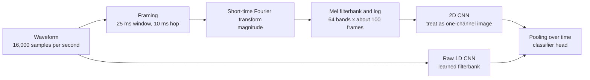

The diagram shows two routes from audio to a label. The spectrogram route reuses image machinery and pretrained weights and is the usual first choice when data are limited. The raw route is more flexible and needs more data. Both end with pooling over time, which gives invariance to when in the clip the event occurs, in the same way that global average pooling gives spatial invariance in images.

Industrial signals such as vibration, current, and acoustic emissions follow the same pattern: windows of sensor data, one-dimensional CNNs or spectrogram CNNs, and labels for fault types. The most important design issue is not the network but the split. Windows from the same machine and run are strongly correlated, so a random split over windows leaks, and evaluation must hold out whole machines or recording sessions ([CH02](CH02_Data_Preparation_Feature_Engineering_and_Leakage.md)).

### 18.2 Three-dimensional convolution for volumes and video

A three-dimensional convolution slides a kernel over depth (or time), height, and width. The tensor shape is (batch, channels, depth, height, width), the kernel is $C_{out}\times C_{in}\times K\times K\times K$, and the parameter count is $C_{out}(C_{in}K^3+1)$. A $3\times3\times3$ layer from 64 to 64 channels has $64\times64\times27=110{,}592$ weights, three times the 36,864 of the matching $3\times3$ layer, and its arithmetic scales by that factor and by the number of slices or frames. Memory is the harder limit. A single activation of 32 channels on a $128^3$ patch of voxels holds $32\times128^3=67{,}108{,}864$ values, 268,435,456 bytes in 32-bit floating point, so full CT or magnetic resonance volumes cannot be processed whole on most GPUs. Practical systems train on patches, run inference with overlapping sliding windows, or use 2.5D inputs: a stack of adjacent slices as channels of a two-dimensional network, which captures local through-plane context at the cost of a two-dimensional model.

For video, the temporal axis plays the role of depth. C3D (Tran et al., 2015) applied three-dimensional convolutions to short clips. Two-stream networks (Simonyan and Zisserman, 2014) processed one still frame and a stack of optical-flow fields in separate networks and fused them. I3D (Carreira and Zisserman, 2017) inflated pretrained two-dimensional kernels into three dimensions by repeating the weights along time, so ImageNet pretraining could initialize a video network. Factorized designs such as $(2+1)$D convolutions (Tran et al., 2018) replace a $3\times3\times3$ kernel by a spatial $1\times3\times3$ convolution followed by a temporal $3\times1\times1$ convolution, in the same spirit as depthwise-separable factorization, giving an additional nonlinearity at lower cost. SlowFast networks (Feichtenhofer et al., 2019) run a slow pathway on few frames for spatial semantics and a fast pathway on many frames with fewer channels for motion. The Temporal Shift Module shifts part of the channels along time inside an ordinary two-dimensional network, giving temporal modelling at nearly the cost of an image model, which makes it attractive for edge video.

A cost sketch shows why video is expensive. A 16-frame clip processed by a 2D ResNet-50 on each frame at $112\times112$ costs roughly $16\times4.09\times10^9\times(112/224)^2\approx1.6\times10^{10}$ MACs, 16.4 billion; a three-dimensional network that applies temporal kernels in many layers costs a multiple of that. Whether a video task needs temporal convolution at all is an empirical question, since many "action" labels in datasets can be recognized from single frames by scene and object context. Test a frame-averaging baseline before paying for 3D models, and for tasks that truly depend on motion (gait, gesture, process steps) evaluate on data where the context is controlled.

| Data | Tensor shape | Kernel | Weights for $C_{in}=C_{out}=64$, $K=3$ | Typical use |
| --- | --- | --- | --- | --- |
| Time series, audio | (N, C, L) | $K$ | 12,288 | ECG, vibration, raw audio |
| Images, spectrograms | (N, C, H, W) | $K\times K$ | 36,864 | Photos, log-mel spectrograms |
| Volumes, video | (N, C, D, H, W) | $K\times K\times K$ | 110,592 | CT, magnetic resonance imaging (MRI), action recognition |

The table shows how weights grow by a factor of $K$ with each added dimension, while compute grows additionally with the size of the extra axis. Choose the lowest dimensionality that preserves the signal the task needs.

## 19. Interpretability: Saliency and Grad-CAM

A CNN returns a label and a score, and users, reviewers, and regulators often ask what in the image drove the output. Visual attribution methods produce a heat map over the input to answer that question. They are useful debugging tools and poor evidence of reasoning, and both halves of that sentence matter in practice.

### 19.1 Gradient-based and perturbation-based attribution

The simplest attribution is the gradient of a class score $y_c$ with respect to the input pixels, $\partial y_c/\partial x$ (Simonyan, Vedaldi, and Zisserman, 2013). Pixels with large gradient magnitude are those where a small change would most affect the score. The raw map is noisy, because the network is piecewise linear with many sharp regions, and SmoothGrad (Smilkov et al., 2017) averages gradients over several noisy copies of the input to reduce it. Integrated gradients (Sundararajan, Taly, and Yan, 2017) integrate the gradient along a path from a baseline image (such as black) to the input, and satisfy a completeness property: the attributions sum to the difference between the score at the input and at the baseline. The result depends on the baseline, which has no neutral choice for natural images, since a black baseline treats dark pixels as uninformative.

Perturbation methods ask the question directly. Occlusion sensitivity (Zeiler and Fergus, 2014) slides a grey patch over the image and records how much the class score drops at each position. It needs one forward pass per patch position, so a $224\times224$ image with a $32\times32$ patch and stride 16 needs $13\times13=169$ passes, but it makes no assumptions about gradients and is easy to explain. Deletion and insertion curves extend the idea: remove (or add) pixels in order of attributed importance and track the score. A faithful map produces a fast drop on deletion.

### 19.2 Class activation mapping and Grad-CAM

Class Activation Mapping (CAM, Zhou et al., 2016) uses the structure of a network ending in global average pooling followed by one linear layer. Let $A^k_{ij}$ be channel $k$ of the last convolutional feature map at position $(i,j)$, and let $w^c_k$ be the weight connecting channel $k$ to class $c$. The class score is

$$
y_c=\sum_k w^c_k\,\frac{1}{Z}\sum_{i,j}A^k_{ij}=\frac{1}{Z}\sum_{i,j}\sum_k w^c_k A^k_{ij}
$$

where $Z$ is the number of positions. Rearranging shows that the score is the spatial average of the map $M^c_{ij}=\sum_k w^c_k A^k_{ij}$, so $M^c$ tells how much each position contributes to the class score. Grad-CAM (Selvaraju et al., 2017) generalizes this to any architecture by estimating the channel weights from gradients:

$$
\alpha^c_k=\frac{1}{Z}\sum_{i,j}\frac{\partial y_c}{\partial A^k_{ij}},\qquad L^c_{\text{Grad-CAM}}=\text{ReLU}\left(\sum_k\alpha^c_k A^k\right)
$$

The ReLU keeps only positions that increase the class score. For a network with global average pooling and a linear head, $\partial y_c/\partial A^k_{ij}=w^c_k/Z$ at every position, so $\alpha^c_k=w^c_k/Z$ and Grad-CAM equals CAM up to a constant factor. A toy example with two channels of a $2\times2$ map: $A^1=\begin{bmatrix}1&0\\0&2\end{bmatrix}$, $A^2=\begin{bmatrix}0&3\\1&0\end{bmatrix}$, and class weights $w^1=0.5$, $w^2=-0.2$. The weighted sum is $\begin{bmatrix}0.5&-0.6\\-0.2&1.0\end{bmatrix}$, and after ReLU it is $\begin{bmatrix}0.5&0\\0&1.0\end{bmatrix}$. The map says that the bottom-right position pushed the score up most, and the second channel, with its negative weight, argues against the class at the top-right. In a real network the map is $7\times7$ for a $224\times224$ input and is upsampled to image size, so its resolution is the output stride of 32 pixels.

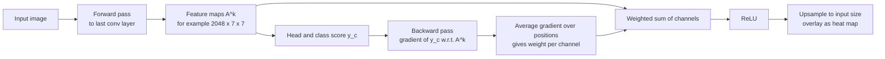

The diagram shows that Grad-CAM needs one forward and one backward pass and works with any CNN that has a convolutional layer before the head. The chosen layer sets the trade-off: the last convolutional layer is semantically meaningful and coarse, and an earlier layer is finer and less class-specific. Variants such as Grad-CAM++ and Score-CAM refine the weights or avoid gradients, and guided or high-resolution combinations (Guided Grad-CAM) multiply the map with gradient-based pixel detail to sharpen it.

### 19.3 What the maps do and do not show

Attribution maps support four practical uses. They expose gross shortcuts, such as a classifier whose heat map sits on a corner label, a ruler, a watermark, or a text marker instead of the finding. They help to confirm that a detector's false positives come from a specific texture. They give reviewers a pointer for where to look, which speeds human review when the pointer is accurate. And they provide a sanity check during development when the map moves sensibly across layers and classes.

They also have limits that should be written into any design that relies on them.

- **Sanity-check failures.** Adebayo et al. (2018) tested saliency methods by progressively randomizing the model's weights and by randomizing labels. Several popular methods produced maps that looked nearly the same for a trained and an untrained model, which implies that the maps reflected image structure (edges) more than the learned function. A method should pass this randomization test before it is trusted as an explanation. Grad-CAM-style maps changed more under randomization, but no method is validated for all uses.
- **Localization is not causation.** A heat map shows where the network's score is sensitive. It does not say which feature in that region mattered, whether the model used shape, texture, or colour, or whether the region is the only one that matters. A pneumonia classifier can highlight the lung and still depend on a scanner artifact inside it.
- **Confirmation bias.** A reader who sees a plausible blob tends to accept it. Because a heat map on any image looks like something, examine failures and counterexamples, not only attractive samples.
- **Resolution.** A $7\times7$ map cannot localize a 10-pixel defect. Upsampled blobs overstate precision.
- **Model-level versus instance-level.** One map explains one prediction. Systematic problems need aggregates over many images, such as the average attribution inside versus outside the annotated region, which is a testable, quantitative check.

Cynthia Rudin (2019) argued that for high-stakes decisions one should prefer models that are interpretable by construction over post hoc explanations of black boxes, because explanations can be unfaithful. A pragmatic reading for an architect is to match the evidence to the stake. For internal debugging, Grad-CAM and occlusion are efficient. For a clinical or safety claim that "the model looks at the lesion", validate the claim with a quantitative test against expert annotations, with sanity checks, and with counterfactual interventions, and do not present the heat map to users as a justification of the decision. The relevant accountability framework is in [CH31](CH31_Responsible_AI_and_Safety_Governance.md).

## 20. Robustness, Distribution Shift, and Spurious Cues

A vision model passes its test and then fails in production. The two most common reasons are that the production images differ from the test images, and that the model learned a cue that correlates with the label in the training data but not in the world. A third, adversarial inputs, matters in some settings and less in others.

### 20.1 Distribution shift

Distribution shift is a change between the data on which the model was trained and evaluated and the data it meets in operation. Four types are useful in practice.

- **Covariate shift.** The input distribution changes while the relationship between image and label stays fixed: a new camera, new lighting, a seasonal change, a different compression setting.
- **Label (prior) shift.** The class frequencies change: a defect rate that rises from 0.2 to 2 percent when a supplier changes. The model's calibrated probabilities then no longer match the base rate, and thresholds that were tuned for the old prevalence give a different precision.
- **Concept shift.** The meaning of the label changes: a new definition of "acceptable scratch" or a revised clinical guideline.
- **Subpopulation shift.** The mix of subgroups changes, and the model performs differently on them: a new site with a different patient population.

Natural shift is larger than many teams expect. Recht, Roelofs, Schmidt, and Shankar (2019) built new test sets by following the original ImageNet collection process as closely as they could and found that a broad range of classifiers lost roughly 11 to 14 percentage points of top-1 accuracy, even though the new images were collected in the same way. Hendrycks and Dietterich (2019) released ImageNet-C, which applies 15 types of corruption (noise, blur, weather, digital artifacts) at five severities, and showed that accuracy falls sharply under corruptions humans handle easily. The ranking of models on clean data is a poor predictor of their ranking under shift.

A short calculation turns the symptom into a budget. Suppose a classifier has 95 percent accuracy on day-shift images and 78 percent on night-shift images, and night shift produces 30 percent of the traffic. The expected accuracy is $0.7\times0.95+0.3\times0.78=0.665+0.234=0.899$, about 90 percent, and an evaluation set drawn only from the day shift would report 95 percent. The error budget for the night shift is large enough that the fix is data collection and per-slice evaluation, not a different architecture.

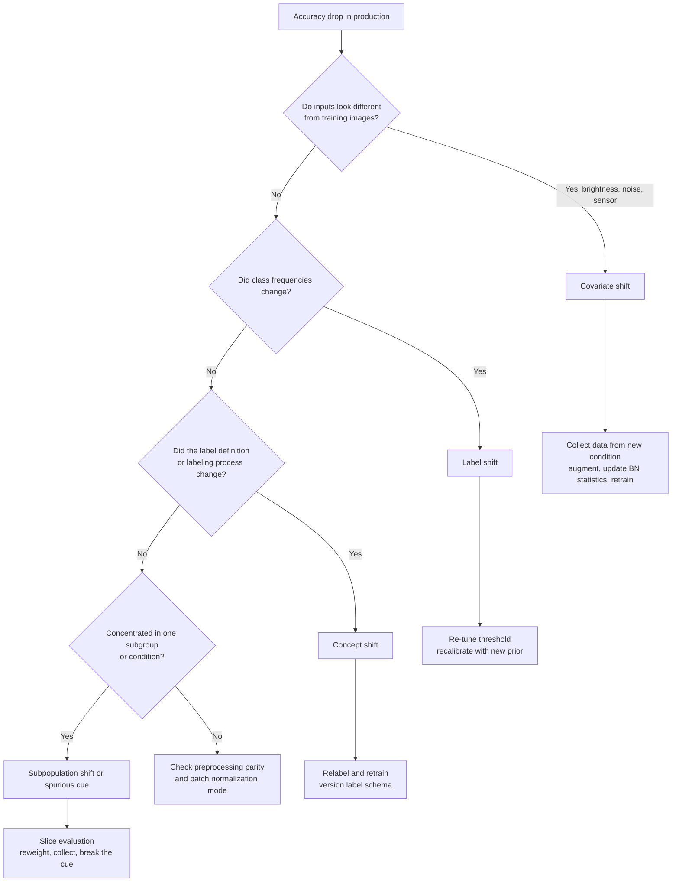

The decision tree turns a symptom into a diagnosis. The last branch before the preprocessing check is a reminder that many apparent shift events are pipeline bugs, and inspecting the tensors entering the model is faster than collecting new data. Operationally, the diagnosis needs monitors for input statistics, class frequencies, confidence, and sampled human-reviewed outcomes ([CH29](CH29_MLOps_and_LLMOps.md)).

### 20.2 Spurious cues and shortcut learning

A model minimizes training loss with whatever signal is easiest to find. When a cue that is not causally related to the label predicts it in the training set, the model can use it. Geirhos et al. (2020) called this shortcut learning and gave many examples across domains. Texture is one: Geirhos et al. (2019) showed that ImageNet-trained CNNs rely on texture more than shape, classifying an image with the shape of one animal and the texture of another by the texture, and that training on stylized images shifts the bias towards shape and improves robustness to some distortions. Background is another: a camera-trap species classifier trained on certain locations learns the location (Beery, van Horn, and Perona, 2018), and a "wolf" classifier can be a "snow" classifier (the example in Ribeiro, Singh, and Guestrin, 2016).

Medical imaging has well-documented cases. Zech et al. (2018) trained pneumonia classifiers on chest radiographs from several hospitals and found that the models picked up the hospital system and scanner characteristics, because prevalence differed by site, and performance dropped on external data. DeGrave, Janizek, and Lee (2021) showed that deep-learning COVID-19 detectors on chest X-rays relied on shortcuts such as source-specific features and text markers, instead of pathology, and failed on external data. Winkler et al. (2019) found that surgical skin markings in dermoscopic images, which occur more often in lesions that were suspected or excised, raised the malignancy scores of a commercial classifier. In industry, a classic example is a defect classifier where defective parts were photographed on one line or one day and good parts on another, so the model learns the lighting.

A shortcut is not visible in aggregate accuracy, because the shortcut also works on the test set drawn from the same collection. The diagnostics rely on stress tests:

1. **Group-wise performance.** Evaluate by site, device, time, and any metadata that could proxy for the cue. A large accuracy gap between groups that should not matter is a flag.
2. **Counterfactual edits.** Mask the background, crop the region of interest, remove the text marker, or swap backgrounds, and see whether predictions change. If a prediction survives cropping to an empty background patch, the model is not using the object.
3. **Attribution.** Check whether the attribution mass lies inside the annotated region, with the caveats of Section 19.
4. **External validation.** Test on data collected independently, with a different site, device, and time, and report that number as the estimate of performance.

Mitigations follow from the diagnosis. Break the correlation in the data (balance the metadata across classes, collect the missing combinations, such as defects under the other lighting), remove or mask the cue (crop out labels and rulers, redact text, standardize acquisition), use augmentation that simulates the nuisance, and optimize for worst-group performance with methods such as group distributionally robust optimization (Sagawa et al., 2020) when group labels are available. None of these replaces the data-collection design that avoids the confound from the start, for example photographing good and defective parts on the same line in interleaved order.

### 20.3 Adversarial examples

An adversarial example is an input modified by a small, often imperceptible perturbation chosen to cause a wrong output (Szegedy et al., 2014). Goodfellow, Shlens, and Szegedy (2015) proposed the Fast Gradient Sign Method (FGSM): $x'=x+\epsilon\,\text{sign}(\nabla_x\mathcal{L})$, where $\epsilon$ bounds the change per pixel. They also gave a linearity argument. For a linear score $w^\top x$, a perturbation $\eta$ with each element bounded by $\epsilon$ changes the score by at most $\epsilon\|w\|_1$ (attained at $\eta=\epsilon\,\text{sign}(w)$). In high dimensions the sum of many tiny contributions is large. For a $224\times224\times3$ image there are 150,528 inputs. If each weight has magnitude 0.01, then $\|w\|_1=1{,}505$, and a change of $1/255$ per pixel (about 0.4 percent of the intensity range, invisible to the eye) can move the score by as much as $1505\times(1/255)=5.9$ logits, enough to flip most decisions. Real networks are not linear, but the argument explains why adversarial vulnerability is a generic property of high-dimensional models rather than a bug in one network.

Stronger attacks iterate the gradient step with projection onto the allowed region (Projected Gradient Descent, PGD, Madry et al., 2018). Perturbations can transfer between models, so an attacker without access to the target can craft examples on a surrogate. Physical attacks exist: adversarial patches printed on stickers (Brown et al., 2017) and perturbations on road signs that survive camera capture (Eykholt et al., 2018). Defenses are an open problem. Adversarial training, which trains on PGD examples, remains the most reliable empirical defense, costs several times the training compute (each step needs several gradient computations for the attack), and lowers clean accuracy somewhat. Certified methods such as randomized smoothing (Cohen, Rosenfeld, and Kolter, 2019) give provable guarantees within a norm bound at a lower accuracy and a higher inference cost. Input transformations, gradient masking, and detectors have repeatedly been broken by adaptive attacks.

The design response begins with a threat model. Ask who would gain from fooling the system and what they can access. A line camera in a closed factory faces natural variation, not an adversary, and spending effort on adversarial training there is misplaced. A face-authentication gate, a content-moderation filter, a document-fraud check, or an automated identity-verification flow faces motivated attackers, and defense in depth applies: do not expose raw confidence scores, rate-limit queries, use liveness checks and multiple signals, and keep a human in the loop for high-impact decisions. System-level controls are in Part 17, and the security foundations are in Part 15.

### 20.4 Out-of-domain inputs

A classifier with $K$ classes must output one of them for any image, including a photograph of something it has never seen, a lens cap, a blank frame, or an image from a different camera. A softmax output that sums to 1 over the known classes can still be confident. Hendrycks and Gimpel (2017) showed that the maximum softmax probability is a useful baseline, since in-distribution images tend to have higher maximum probability than out-of-distribution ones, but it is not reliable. Better scores use the geometry of the embedding: the distance of an image's penultimate-layer embedding to the nearest training embeddings (a k-nearest-neighbour score), the Mahalanobis distance to class-conditional Gaussians, or an energy score computed from logits. Threshold selection needs held-out in-distribution and, where possible, realistic out-of-distribution examples. The decision policy of Section 13.1 routes images beyond the threshold to a fallback, and the rate of such events is itself a drift signal.

## 21. Labeling Cost and Active Learning

For most image projects the dominant cost is labeled data, not computation. A senior practitioner models the labeling cost the way they model inference cost, and designs the pipeline around it.

### 21.1 A cost model

Labeling time depends strongly on the task. Image-level labels take a few seconds each when the classes are clear. Drawing a bounding box takes tens of seconds with a conventional interface, and techniques such as extreme clicking, where the annotator marks the four extreme points of an object, have been reported to cut the time several-fold (Papadopoulos et al., 2017). Pixel-accurate masks take minutes per image, and the fine annotation of a street scene in the Cityscapes dataset took on the order of an hour and a half per image (Cordts et al., 2016). Specialist annotators, such as radiologists or pathologists, cost many times the rate of general annotators and have limited availability.

An illustrative calculation, with assumptions stated: 20,000 images, three independent labels per image for quality control, and the following times. Classification at 10 seconds per label is $20{,}000\times3\times10=600{,}000$ seconds, which is 166.7 hours. Detection with four boxes per image at 25 seconds per box, one annotator plus a reviewer who spends the equivalent of another pass, is $20{,}000\times4\times25=2{,}000{,}000$ seconds for one pass, 555.6 hours. Segmentation at 10 minutes per image is $200{,}000$ minutes, 3,333 hours. At a blended illustrative rate of 25 currency units per hour, these cost roughly 4,200, 13,900, and 83,300 per pass, before review, tooling, and adjudication. The ratio of about 1 : 3 : 20 between the tasks is the point: choosing segmentation where detection would do multiplies the labeling budget twentyfold. Ask whether the decision truly needs a mask, a box, or only an image-level label with a Grad-CAM-style localization for review.

### 21.2 Label quality

Noisy labels hurt in two ways. They add error to the training signal, and CNNs can memorize arbitrary labels given enough capacity (Zhang et al., 2017), so noisy labels are fitted instead of averaged out. They also corrupt evaluation: a test set with 3 percent label errors cannot show accuracy beyond about 97 percent, and it penalizes models that are right where the label is wrong.

Quality practices include a written labeling guide with examples of edge cases and a defined taxonomy, a qualification test for annotators, a gold set of known-answer images mixed into the queue to measure annotators continuously, redundant labeling with adjudication of disagreements, and tracking of agreement. A standard agreement statistic is Cohen's kappa, which corrects observed agreement for chance:

$$
\kappa=\frac{p_o-p_e}{1-p_e}
$$

where $p_o$ is the observed proportion of agreement and $p_e$ is the agreement expected by chance from each annotator's label frequencies. Suppose two annotators label 100 images as defect or not: both say defect on 40, both say no defect on 45, annotator A says defect while B says no on 5, and A says no while B says defect on 10. Then $p_o=(40+45)/100=0.85$. Annotator A says defect on 45 images and B on 50, so $p_e=0.45\times0.50+0.55\times0.50=0.50$, and $\kappa=(0.85-0.50)/(1-0.50)=0.70$. A kappa of 0.70 is moderate to substantial; if the downstream model needs consistent labels, the 15 disagreements point to unclear guidelines to fix before collecting more data. Label-error detection tools that compare model predictions against labels (confident learning, Northcutt et al., 2021) rank images whose given label disagrees confidently with an out-of-fold prediction, which makes a targeted relabeling pass cheap.

### 21.3 Ways to spend fewer labels

Several techniques reduce labeling cost, and they stack.

- **Transfer learning and self-supervised pretraining** reduce the labels needed per task (Section 14).
- **Model-assisted pre-labeling.** A weak model or a promptable segmentation model proposes boxes or masks and annotators correct them. Correcting a good proposal is typically faster than drawing from scratch, with a risk of anchoring: annotators accept wrong proposals, so audit a random sample of accepted labels.
- **Weak supervision.** Image-level labels can supervise localization through CAM-style maps, giving pseudo-masks of lower quality at a fraction of the cost. Heuristic labeling functions and programmatic rules can label large pools noisily.
- **Semi-supervised learning.** Pseudo-labeling and consistency methods such as FixMatch (Sohn et al., 2020) train on a few labels plus many unlabeled images by requiring consistent predictions under strong and weak augmentation.
- **Synthetic data** for rare cases, with the validation caveats of Section 15.8.
- **Active learning**, below.

### 21.4 Active learning

Active learning selects which unlabeled images to label next so that each label buys the most improvement. In the pool-based setting, a model trained on the current labeled set scores the unlabeled pool, a selection rule picks a batch, annotators label it, and the model is retrained. Selection rules fall into two families. Uncertainty sampling picks images the model is least sure of, measured by low maximum probability (least confidence), a small gap between the top two classes (margin), or high entropy. Diversity sampling picks a batch that covers the embedding space, for example by greedily choosing points far from already chosen ones (core-set selection), so the batch does not consist of near-duplicates. Hybrids combine them, for example by clustering uncertain images and taking one per cluster.

A toy illustration with stated assumptions (a one-dimensional problem where a threshold at 0.37 separates classes, a pool of 20,000 points) is printed by [04_deployment_and_data_arithmetic.py](../code/python/cnn-chapter/04_deployment_and_data_arithmetic.py). With 20 labels, random sampling locates the threshold to a mean error of 0.037, while uncertainty sampling, which labels the point nearest the current boundary and so performs a bisection, reaches an error below $10^{-4}$. With 80 labels random sampling still has an error of 0.011. The gap is exaggerated by the noise-free one-dimensional task, and real image tasks show smaller gains, but the mechanism is general: labels near the decision boundary are informative and labels far from it are redundant.

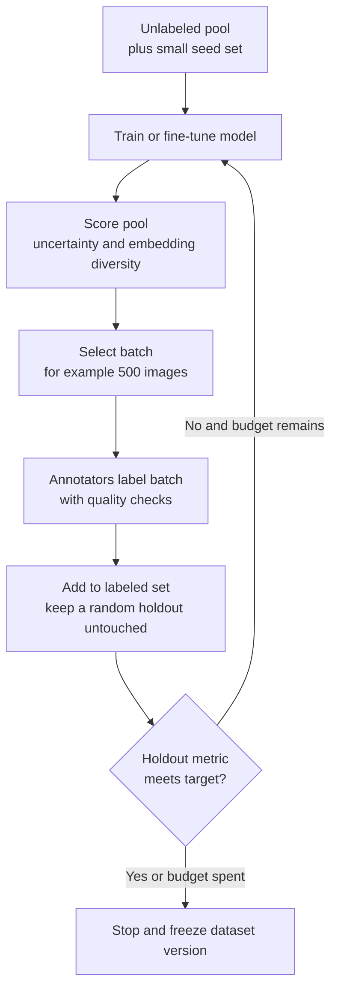

The loop diagram shows the process and its main safeguard: the evaluation set must be sampled randomly and kept apart, because the actively selected labeled set is biased towards hard examples and cannot estimate deployment performance. Other practical pitfalls are noise-seeking, since images that are uncertain because they are corrupt, mislabeled, or irrelevant are selected first; cold start, since uncertainty estimates from a model trained on very few labels are unreliable, so begin with a random or diversity-based seed set; batch redundancy, addressed by diversity; and the retraining cost of the loop, which can be limited by retraining only the head on cached features. The labeled set is also tied to the model that selected it, so a different architecture trained on it may gain less than the selector did. Active learning is most valuable when labels are expensive, the pool is large, and the positive class is rare, since finding rare positives in an unlabeled pool is itself a major cost.

## 22. Deployment: Quantization, Pruning, Distillation, and Latency

A trained network is a research artifact until it runs within the latency, memory, power, and cost constraints of its target. Four techniques shrink and speed up CNNs: quantization, pruning, distillation, and graph compilation. General serving architecture, batching, and autoscaling are in [CH28 — Inference Optimization and Model Serving](CH28_Inference_Optimization_and_Model_Serving.md); this section covers what is specific to CNNs.

### 22.1 Quantization

Quantization represents weights and activations with fewer bits, normally 8-bit integers instead of 32-bit floats. An affine quantizer maps a real value $x$ to an integer $q=\text{round}(x/s)+z$ with scale $s$ and zero point $z$, and recovers $\hat{x}=s(q-z)$. The symmetric form sets $z=0$ and chooses $s=\max|x|/127$ so that the largest magnitude maps to 127. The size saving is direct. ResNet-50's 25,557,032 weights take 102,228,128 bytes (97.5 mebibytes) in 32-bit floats, 51,114,064 bytes (48.7 mebibytes) in 16-bit floats, and 25,557,032 bytes (24.4 mebibytes) in 8-bit integers. Integer arithmetic also uses less energy and is faster on hardware with integer units, and the memory traffic that bounds many layers drops by up to four times.

Two approaches differ in cost. Post-training quantization (PTQ) quantizes a trained model. Weights are converted directly, and activation ranges are estimated by running a calibration set of a few hundred representative images through the network and recording ranges, using min/max values, percentiles that ignore outliers, or entropy-based thresholds. Quantization-aware training (QAT; Jacob et al., 2018) inserts simulated quantization into the forward pass during fine-tuning, with the straight-through estimator passing gradients across the rounding, so the network learns weights that tolerate the rounding. PTQ is quick and often loses under about one point of accuracy on standard classification backbones; QAT costs a fine-tuning run and recovers accuracy for sensitive models and for lower bit widths.

Granularity matters. A per-tensor scale uses one range for the whole layer; a per-channel scale uses one range per output channel. The script quantizes four channels of 64 weights each, drawn with standard deviations 0.05, 0.1, 0.5, and 2.0. With one per-tensor scale (0.0362) the mean absolute error is 0.0094, and with per-channel scales it falls to 0.0031. For the narrowest channel the relative error is 27.6 percent per-tensor but 0.6 percent per-channel, because the single large range allots only a few integer levels to the small weights. This explains why depthwise-separable networks, whose channels have widely different ranges, lose more accuracy under per-tensor PTQ than ResNets, and why per-channel weight quantization is the standard on modern toolchains. Other practical rules: keep the first layer and the final classifier in higher precision when sensitive, avoid quantizing layers whose activations have heavy outliers, and prefer activation functions with bounded range (ReLU6) on the most constrained targets. Always re-measure the task metric, per class and per slice, after quantization, since an overall accuracy drop of 0.3 points can hide a recall drop on a rare class.

### 22.2 Pruning

Pruning removes weights or structures that contribute little. Unstructured pruning zeroes individual small-magnitude weights, and Han, Pool, Tran, and Dally (2015) reported large parameter reductions on AlexNet and VGG with small accuracy loss after retraining. The resulting sparse matrices save storage when compressed but speed up inference only on hardware or libraries that exploit sparsity; dense GPU kernels do not skip zeros. Some recent accelerators support a fixed structured pattern of sparsity, such as 2 nonzero values out of every 4, which can raise math throughput; verify support and measured speedups on the target. Structured pruning removes whole filters or channels, which gives a smaller dense model that runs faster on ordinary hardware. Removing 30 percent of the output channels of one convolution also removes 30 percent of the input channels of the next. If the next layer's own output channels are pruned by the same fraction, its weights and MACs fall by $1-0.7\times0.7=51$ percent, because both channel dimensions shrink. Filters are ranked by criteria such as the norm of their weights or the effect of their removal on the loss. Residual connections constrain pruning, because the pruned channels of a block's output must match the skip path.

Pruning usually requires fine-tuning afterwards, and iterative schedules (prune a little, retrain, repeat) work better than one large cut. The Lottery Ticket Hypothesis (Frankle and Carbin, 2019) observed that dense networks contain sparse subnetworks that can be trained to full accuracy from the original initialization, which motivated research but has had limited effect on routine deployment. In practice, pruning competes with simply choosing a smaller architecture (such as MobileNet or EfficientNet-B0), and the smaller architecture trained from a good recipe is often as good and less work. Pruning pays most when a large model is already in production and a modest shrink is needed.

### 22.3 Knowledge distillation

Distillation trains a small student network to imitate a large teacher (Hinton, Vinyals, and Dean, 2015). The teacher's output probabilities carry more information than the hard label: a picture of a dog may give 0.9 to dog, 0.08 to wolf, and 0.0001 to car, and the relative sizes of the small probabilities encode similarity between classes. To expose them, logits are divided by a temperature $T>1$ before the softmax. For logits $[8,4,1]$ the probabilities at $T=1$ are $[0.981,0.018,0.0009]$, nearly one-hot, and at $T=4$ they are $[0.649,0.239,0.113]$, a softer distribution with visible class relationships. The student loss combines the ordinary cross-entropy with the true label and a divergence between the softened teacher and student distributions:

$$
\mathcal{L}=\alpha\,\text{CE}\left(y,p_s\right)+(1-\alpha)\,T^2\,\text{KL}\left(p_t^{(T)}\,\|\,p_s^{(T)}\right)
$$

Here $\text{CE}$ is cross-entropy, $\text{KL}$ is the Kullback-Leibler divergence between the teacher distribution $p_t$ and the student distribution $p_s$ at temperature $T$, and $\alpha$ weights the two terms. The factor $T^2$ compensates for the gradients of the softened term shrinking in proportion to $1/T^2$. Distillation works with unlabeled images, since the teacher can label any image, which makes it a way to turn a large unlabeled pool into supervision. A student distilled from a strong teacher often outperforms the same architecture trained on hard labels alone, and by a larger margin for small students. Teachers can be ensembles, bigger CNNs, or transformers; DeiT used a CNN teacher for a ViT student (Section 12.2). The effort is a full additional training run, so it makes sense when a model will be deployed to many devices or at high volume, and less sense for a one-off deployment.

### 22.4 Latency, throughput, and edge devices

Latency is the time for one input to produce a result, and throughput is the number of inputs processed per unit time. They conflict: batching raises throughput and raises the latency of each request. An interactive camera or robot control loop is limited by latency at batch size 1, and an offline scoring job by throughput.

A lower bound on compute time comes from dividing the operation count by the achievable rate. The script computes this for ResNet-50 at 4.09 billion MACs, or 8.18 billion FLOPs, under stated and illustrative assumptions: an edge accelerator with 4 TFLOPS peak at 25 percent utilization takes 8.18 ms per image; a data-centre GPU with 100 TFLOPS at 30 percent takes 0.27 ms; an embedded CPU with 0.05 TFLOPS at 50 percent takes 327 ms. These are floors that ignore memory traffic, kernel launch overhead, and everything outside the network, and real numbers are higher. The utilization figures themselves differ widely by layer type, because depthwise and small layers are memory-bound (Section 8.2), so measuring on the target is the only reliable source.

End-to-end latency includes more than the network.

- **Capture and decode.** Decoding a 12-megapixel JPEG on a CPU can take tens of milliseconds, comparable to the network itself on an edge accelerator.
- **Resize and normalize.** Often done on the CPU unless fused into the accelerator pipeline.
- **Host-to-device transfer.** A $224\times224\times3$ float tensor is 602,112 bytes. The transfer is small for single images but accumulates for high-resolution multi-camera systems.
- **Inference.** The network.
- **Post-processing.** NMS and mask resizing, often on the CPU.
- **Queuing.** Under load, requests wait, and the 99th-percentile latency is determined by queue depth more than by model speed.

A camera at 30 frames per second leaves a budget of 33 ms per frame. Pipelining capture, preprocessing, inference, and post-processing on different units raises throughput without reducing the latency of any one frame. Edge deployments add constraints that cloud deployments hide: thermal throttling reduces sustained clock speeds, power limits cap utilization, memory limits cap the peak activation size (Section 5.3), cold start and model load time affect restart behaviour, and the device fleet often contains several hardware generations. Benchmark with warm-up runs, report percentiles (median, 95th, 99th) and sustained results rather than best-case results, and measure energy per inference when battery life matters.

Cost per image at server scale is a simple function of throughput. With an illustrative cloud GPU price of 1.20 currency units per hour, a service sustaining 1,000 images per second spends $10^6/1000=1{,}000$ seconds per million images, or 0.278 hours, which costs 0.33. At 200 images per second the same million images take 5,000 seconds, 1.39 hours, and cost 1.67. Quantization, batching, and fusion that raise throughput fivefold therefore cut cost per image fivefold. This is the connection between the techniques in this section and the economics in the architecture review.

### 22.5 Export formats and optimizing runtimes

Training frameworks are not the best inference environment, so deployment commonly converts the model. At a conceptual level the pipeline has four steps. First, export the trained graph to an interchange format. The Open Neural Network Exchange (ONNX) format describes the computation graph, the weights, and a versioned set of operators in a framework-neutral way, so one trained model can run on several runtimes. Second, an optimizing compiler or runtime rewrites the graph: it fuses sequences such as convolution, batch normalization, and activation into one kernel (Section 9.2), folds constants, changes tensor layouts, chooses precision per layer, and selects the fastest kernel implementations for the specific hardware. NVIDIA's TensorRT is an example for NVIDIA GPUs; it builds an "engine" through auto-tuning that is specific to the GPU model and software version, so engines are built per target and are not portable. Others include ONNX Runtime with hardware-specific execution providers, TensorFlow Lite for mobile and microcontrollers, Core ML for Apple devices, and OpenVINO for Intel hardware. Third, validate the converted model. Fourth, benchmark and package it with its preprocessing.

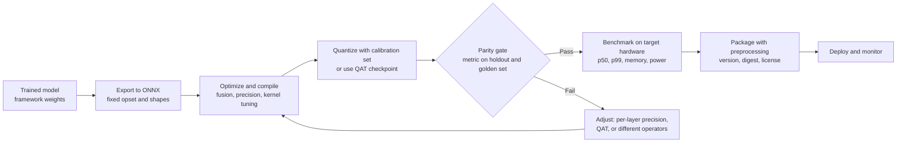

The flow shows that conversion is a loop around a validation gate, not a one-way step. The gate compares both numerical agreement on a golden set of images (outputs within tolerance of the original) and the task metric on a held-out set, per class and per slice. Common failure causes are unsupported operators that fall back to a slow path, dynamic shapes that defeat optimization, differing interpolation in resize operators between frameworks, opset version mismatches, and numerical differences that move borderline predictions across a threshold. A conversion that changes 0.2 percent of predictions can still change which images exceed a decision threshold, so thresholds are re-validated after conversion.

| Constraint | First technique to try | Cost to apply | Main risk |
| --- | --- | --- | --- |
| Model file too large | Quantize to int8 or fp16 | Low (PTQ) | Accuracy loss in sensitive layers |
| Latency too high on GPU | Fusion and compile, fp16 or int8 | Low to medium | Parity failures, engine per device |
| Latency too high on CPU or phone | Smaller architecture such as MobileNet, then quantize | Medium (retrain) | Lower ceiling accuracy |
| Memory peak too high | Lower resolution, smaller batch, fewer high-resolution channels | Low | Lost small-object recall |
| Need a smaller model with high accuracy | Distill from a large teacher | High (extra training) | Student limited by capacity |
| Very large model already deployed | Structured pruning plus fine-tune | Medium | Gains depend on hardware |
| Throughput cost too high | Batch, fuse, quantize, right-size hardware | Low to medium | Latency percentile worsens with batching |

## 23. Security, Privacy, Bias, and Face-Related Use

Images carry more personal and sensitive information than their authors usually realize, and the models trained on them have their own attack surface. This section applies the foundations of [Part 15 (Security)](../15_Security/PART_OVERVIEW.md), [CH30](CH30_AI_Data_Governance_Privacy_and_Provenance.md), and [CH31](CH31_Responsible_AI_and_Safety_Governance.md) to vision systems.

### 23.1 Attack surface of a vision pipeline

```mermaid
flowchart LR
    subgraph Untrusted["Untrusted zone"]
        Cam["Camera, upload, or partner feed"]
        Net1["Network path"]
    end
    subgraph Ingest["Ingestion boundary"]
        Parse["Image parser and decoder<br/>size and pixel limits"]
        Strip["Metadata stripping<br/>EXIF location, DICOM tags"]
    end
    subgraph Model["Model zone"]
        Pre["Preprocessing, versioned"]
        CNN["CNN weights<br/>verified artifact"]
        Pol["Decision policy"]
    end
    subgraph Data["Data zone"]
        Store["Image and label store<br/>encrypted, retention rules"]
        Train["Training pipeline<br/>provenance, poisoning checks"]
    end
    Cam --> Net1 --> Parse --> Strip --> Pre --> CNN --> Pol
    Pol --> Store
    Store --> Train
    Train -.->|"new weights through release gate"| CNN
    Pol --> Rev["Human reviewers<br/>least-privilege access"]
```

The diagram marks trust boundaries. The first boundary is where raw bytes from outside become data the system parses; the second is the model artifact, which is code-like and needs integrity checks; the third is the store that feeds retraining, which is both a privacy risk and a route for poisoning. The implication is that controls attach to boundaries: limit and validate at ingestion, verify and sign at the model boundary, and govern retention and access at the data boundary.

The main threats and controls follow.

- **Malformed and oversized images.** Image decoders have a long history of memory-safety vulnerabilities, and an image header can declare enormous dimensions. A Portable Network Graphics (PNG) file declaring $65{,}535\times65{,}535$ pixels holds $4.29\times10^9$ pixels, and at three bytes each decoding needs about 12.9 gigabytes. Enforce limits on file size, declared dimensions, and decode time before decoding, use maintained decoder libraries, and run decoding in a sandboxed process with memory limits.
- **Metadata leakage.** Photographs carry EXIF fields including Global Positioning System (GPS) position, device identifiers, and timestamps. Medical images in the Digital Imaging and Communications in Medicine (DICOM) format carry patient name, identifiers, dates, and institution in header fields and sometimes burned into pixels. Strip or replace metadata at ingestion unless a field is needed, and keep a mapping in a separate protected store.
- **Unsafe model files.** Some serialization formats execute arbitrary code when loaded. A downloaded set of "pretrained weights" in such a format is an executable from an untrusted source. Prefer formats that store tensors only, verify digests and signatures, pin versions, and load third-party models in an isolated environment.
- **Data poisoning and backdoors.** An attacker who can add images to a training set can implant a trigger, such as a small patch, that makes the model output a chosen class when it appears (Gu, Dolan-Gavitt, and Garg, 2017), while accuracy on clean images stays normal. Pretrained weights from unverified sources can carry the same backdoors. Controls include provenance for training data, restricting who can add data, anomaly checks on new data, and evaluating third-party weights on trigger-search tests before use.
- **Model theft and extraction.** An application programming interface (API) that returns class probabilities lets a caller train a copy. Rate limiting, returning only top labels, and watermarking reduce the risk, with the caveat that models served on user devices can be extracted from the device.
- **Membership inference and memorization.** A model can leak whether a given image was in its training set (Shokri et al., 2017), mostly through higher confidence on training examples, and generative models can reproduce training images (Carlini et al., 2023). Overfit models leak more. For sensitive training data, regularize, limit exposure of confidence scores, and consider differentially private training where the accuracy cost is acceptable.
- **Adversarial inputs.** Discussed in Section 20.3. The threat model decides the response.

### 23.2 Privacy of image data

Images frequently contain personal data beyond the intended subject: faces of bystanders, licence plates, documents on a desk, screens, and the interior of homes. Under the General Data Protection Regulation (GDPR) of the European Union (EU), biometric data processed to identify a person uniquely belongs to a special category with stricter conditions, and the same facial image may be ordinary personal data in one use and biometric data in another. The practical measures are data minimization and purpose limitation (capture and keep only what the task needs), processing on the device so raw images never leave it (an architectural advantage of small CNNs, see Section 22), storing derived features or event records in place of images, blurring or redacting faces and plates when the task does not need them, short retention with enforced deletion, and access controls on reviewers who see raw images. Deletion has a limit. Removing an image from storage does not remove its influence on a model trained on it, and no general method guarantees removal of learned influence ([CH30](CH30_AI_Data_Governance_Privacy_and_Provenance.md)). Plan for retraining without the data when deletion obligations are strict.

Medical images raise a re-identification problem that surprises many teams. A head CT or MRI volume can be rendered in three dimensions to reconstruct the face, and Schwarz et al. (2019) reported that face-recognition software could match research MRI scans to photographs of participants. De-identification of medical imaging therefore includes defacing or removing facial surfaces in addition to header scrubbing, as well as checks for burned-in annotations.

### 23.3 Face-related systems

Face-related tasks differ widely in risk, and the first design step is to name which one is proposed.

- **Face detection** finds faces in an image, for example to blur them or to focus a camera. It identifies no one and carries the lowest risk, though detectors also have uneven performance across groups.
- **Face verification (one-to-one)** checks whether a probe face matches one enrolled template, as in unlocking a phone or confirming identity at a gate. The user usually consents and holds the template.
- **Face identification (one-to-many)** searches a probe against a gallery to find who the person is. Errors scale with gallery size, and it is the highest-risk use because it can be applied to people who did not consent.
- **Attribute and emotion inference** estimates age, gender, or emotion from a face. The scientific validity of inferring internal emotional states from facial expression is contested, and such systems are the subject of explicit legal restrictions in some jurisdictions.

The arithmetic of one-to-many search shows why scale matters. If the false match rate per comparison is $10^{-6}$ and the gallery holds 1,000,000 identities, a probe of someone not in the gallery produces on average $10^{-6}\times10^6=1$ false match per search. A watch-list application gives a related lesson about base rates. If 100,000 people pass a camera, 10 of them are on the list, the system detects 90 percent of listed people and falsely alerts on 0.01 percent of others ($10^{-4}$), there are about 9 true alerts and $99{,}990\times10^{-4}\approx10$ false alerts, so only about $9/19=47$ percent of alerts are correct, and the number falls quickly if the false alert rate is higher or the list is smaller. Acting on an alert as if it were identification harms the 10 innocent people it names, and the harm is not spread evenly if error rates differ by group.

Error rates do differ by group. Buolamwini and Gebru (2018) audited commercial gender-classification systems and reported error rates for darker-skinned women that reached roughly one third, against under one percent for lighter-skinned men. The United States National Institute of Standards and Technology evaluated 189 face recognition algorithms in a large demographic study (Grother, Ngan, and Hanaoka, 2019) and found that false positive rates varied by demographic group by factors of 10 to 100 for many algorithms, that the size of the effect differed greatly between algorithms, and that some algorithms showed little differential. Causes include imbalanced training data, image quality and photographic conventions that favour some skin tones, and a single global decision threshold applied to groups whose score distributions differ. The mitigations are measurement and control, not a one-time fix: evaluate false match and false non-match rates by demographic group at the operating threshold, on images that resemble deployment, with confidence intervals; choose the algorithm and threshold with those numbers; and monitor after deployment.

Legal and governance constraints apply and change, so verify the current text for the jurisdictions concerned. Illinois' Biometric Information Privacy Act (2008) requires informed written consent for collecting biometric identifiers and gives individuals a private right of action. The GDPR treats biometric data for unique identification as special-category data. The European Union Artificial Intelligence Act ([Regulation (EU) 2024/1689](https://eur-lex.europa.eu/eli/reg/2024/1689/oj)) prohibits certain practices, including untargeted scraping of facial images from the internet or closed-circuit television (CCTV) footage to build facial recognition databases and inferring emotions in workplaces and educational institutions, with narrow exceptions, and it classifies remote biometric identification as high-risk or, for real-time use by law enforcement in public spaces, as prohibited with limited exceptions. At the time of writing, reports state that a 2026 amending regulation (the Digital Omnibus on AI) postponed the application dates for high-risk obligations to December 2027 for Annex III systems and August 2028 for systems in regulated products, while earlier prohibitions remain in force; see this [summary of the postponement](https://www.euaiact.com/digital-omnibus-ai) and confirm dates against the Official Journal before planning around them.

A defensible design starts by asking whether identification is necessary. Alternatives that avoid one-to-many search include badge or token authentication, one-to-one verification against a template that the user holds on their own device, opt-in enrolment with a clear purpose, and presentation-attack (liveness) detection where spoofing is a risk. When identification is justified: restrict the purpose and the gallery, set the threshold from the cost of false matches and not from a vendor default, require human review by trained staff who know the error profile and the risk of automation bias, log every search and decision for audit, provide a route for contesting outcomes, and run the impact assessment in [CH31](CH31_Responsible_AI_and_Safety_Governance.md) before building.

### 23.4 Bias beyond faces

The same pattern appears in other image domains. Large public image datasets over-represent certain regions and settings (Shankar et al., 2017 documented the geographic skew of ImageNet and the Open Images dataset towards North America and Europe), so a household-object classifier may fail on objects common in other regions. Dermatology datasets have historically under-represented dark skin tones, and models can show lower sensitivity there. Medical models can differ by sex, age, scanner vendor, and acquisition protocol. Label bias enters through the annotators' conventions and through proxies such as billing codes. The method is the same in each case: define the subgroups from the deployment population and harm model, measure performance by subgroup with confidence intervals (small subgroups give wide intervals, and a wide interval is a finding to be reported, not hidden), compare absolute error costs and not only relative rates, and decide what disparity is acceptable before testing, with a documented owner for the decision.

## 24. Operations, Observability, and Testing

Operating a vision model means keeping the pipeline, the model, and the data aligned over time. The foundations of lifecycle management are in [CH29](CH29_MLOps_and_LLMOps.md) and general observability in Part 14; the points below are specific to image models.

### 24.1 What to version and what to log

A release of a vision component is the combination of the model weights (with a content digest), the exact preprocessing code and constants, the label schema and class order, the decision thresholds and calibration parameters, the training and calibration data versions, and the export and runtime versions. Mismatches among these are the usual cause of silent regressions. For example, a changed class order in a label map reverses two classes without any error. Log per request: the model and preprocessing versions, image identifiers (not raw images, unless justified and secured), input statistics, outputs, confidence, and the decision taken. Store a sampled set of images with their outputs for audit, subject to the retention and consent rules above.

### 24.2 Monitoring signals

Ground truth arrives late or never, so monitoring relies on proxies and on audit samples.

- **Input statistics.** Mean brightness, contrast, blur measures (variance of the Laplacian, for example), resolution, file size, and the compression quality. A shift in these catches a camera change, a lens problem, or a lighting failure before accuracy is known.
- **Embedding drift.** Track the distance of the penultimate-layer embeddings to the training distribution, with a population-stability measure on a few summary dimensions. It catches changes that simple statistics miss.
- **Output distribution.** The class frequency among predictions, the histogram of confidence, and the abstention or out-of-domain rate. A sudden rise in low-confidence outputs, or a change in the predicted-defect rate that is not matched by upstream process changes, signals drift or a pipeline fault.
- **Human feedback.** The agreement rate between reviewers and the model on routed cases, and the overturn rate.
- **Audit sample.** A random sample of automated decisions is sent for expert labeling each day. To estimate an error rate near 2 percent with a 95 percent interval of about $\pm0.5$ percentage points needs $n=1.96^2\times0.02\times0.98/0.005^2\approx3{,}012$ labeled samples; the sample size needed grows as the target error rate shrinks, and a rare-class error rate needs stratified sampling.
- **System metrics.** Latency percentiles, throughput, queue depth, GPU or accelerator utilization, memory, temperature, and error rates.

```mermaid
stateDiagram-v2
    [*] --> Shadow
    Shadow : Runs on live traffic, decisions not used
    Shadow --> Canary : Parity and slice metrics pass
    Canary : Small traffic share, human review on disagreements
    Canary --> Active : Metrics within bounds for agreed period
    Canary --> Rollback : Regression detected
    Active : Serving with monitoring and audit sample
    Active --> Degraded : Drift or SLO alarm
    Degraded : Route low confidence to humans, investigate
    Degraded --> Active : Cause fixed, thresholds or data updated
    Degraded --> Rollback : Cannot recover quickly
    Rollback : Previous version restored
    Rollback --> Shadow : New candidate prepared
    Active --> Retired : Replaced by newer version
    Retired --> [*]
```

The state diagram shows the life of a model version. A candidate runs in shadow mode first, where its outputs are compared with the incumbent's without affecting decisions, then in a canary with limited exposure, and then in full service. The degraded state is intentional: when monitoring signals shift, the system narrows automation and sends more cases to people instead of continuing at full speed, and recovery or rollback follows an investigation using the decision tree in Section 20.1. Implementation details of promotion and rollback are in CH29.

### 24.3 Testing a vision component

Tests for a vision model go beyond a held-out accuracy number.

1. **Preprocessing parity tests.** A fixed set of images through the training and serving paths must give nearly identical tensors (Section 13.1).
2. **Golden-image regression tests.** A curated set of images with known expected outputs, including hard negatives and past failures, runs on every build. A new version must not break a previously fixed failure.
3. **Slice tests.** Metrics per site, device, lighting, subgroup, and class with thresholds that block release when a slice regresses, even if the aggregate improves.
4. **Invariance (metamorphic) tests.** Transformations that should not change the answer are applied and the change in predictions measured: a shift of a few pixels, a brightness change of 10 percent, JPEG recompression at quality 70, a small rotation within the sensor's tolerance. Report the fraction of predictions that flip. This directly measures the shift sensitivity discussed in Section 5.1.
5. **Stress and out-of-domain tests.** Blank frames, lens-cap images, noise, and unrelated images must produce abstention, not confident predictions.
6. **Calibration tests.** The expected calibration error on the deployment-matched validation set, and a check that the abstention policy hits its target error rate.
7. **Performance tests.** Latency and memory on the target hardware under load, with the percentiles that matter.
8. **Security tests.** Oversized and malformed images, metadata handling, and model-file integrity.

## 25. Quality-Attribute Scenarios

Quality attributes become testable when written as scenarios with a stimulus, a response, and a measure. The following scenarios are typical for a CNN-based component and can be adapted.

| Attribute | Stimulus | Expected response | Measure |
| --- | --- | --- | --- |
| Accuracy under shift | Night-shift images with lower illumination arrive | The model maintains detection quality and flags unusual inputs | Recall on night slice within 2 points of day slice; embedding-drift alarm within one hour |
| Latency | Camera delivers 30 frames per second | Each frame is processed within the frame period without queue growth | 99th-percentile end-to-end latency under 33 ms for 24 hours; queue depth bounded |
| Availability and fallback | Accelerator fails or model service is unreachable | The system routes items to manual inspection or a rule-based fallback and alerts | Fallback engaged within 5 seconds; no unreviewed item released |
| Calibration and abstention | Out-of-domain image such as a lens cap | The system abstains and routes to a person | At least 99 percent of a stress set routed to review; false abstain rate on in-domain images under 3 percent |
| Privacy | A reviewer opens a flagged image | Only authorized reviewers see raw images, with logs; faces outside the task are redacted | 100 percent of accesses logged; redaction coverage verified on a test set |
| Fairness | Evaluation across demographic groups before release | Group-wise error rates are measured at the operating threshold | Disparity bound set in advance; interval widths reported for each group |
| Cost | Volume rises threefold | The service scales within budget through batching and quantization | Cost per thousand images below target at 3x volume; accuracy change under 0.5 points |
| Maintainability | New camera model is installed | The new device is validated before traffic is routed to it | A device-specific validation run and BN-statistics check complete before enabling |
| Security | A corrupted or oversized upload arrives | The decoder rejects it without crashing or consuming excess memory | Zero service crashes in a fuzzing run of 100,000 malformed files; decode memory capped |

The measures are illustrative targets. In real use the numbers come from stakeholders' costs and constraints, and each scenario needs an owner who monitors it.

## 26. Choosing the Approach: Alternatives and Trade-offs

A CNN is one option among several for a visual task, and often not the first one to try.

| Approach | Data needed | Strengths | Weaknesses | Typical fit |
| --- | --- | --- | --- | --- |
| Classical computer vision (thresholds, edges, template matching, calibrated measurement) | None to few images | Transparent, fast, easy to certify, no training | Brittle to appearance change; manual tuning | Controlled imaging with stable lighting and geometry; dimensional gauging |
| Train a small CNN from scratch | Thousands to millions of images | Full control; can be tiny and fast | Needs data; no prior knowledge | Narrow domains with plentiful data; unusual modalities |
| Fine-tune a pretrained CNN | Hundreds to tens of thousands | Strong accuracy per label; mature tooling and export | Source bias and licensing; recipe tuning | Default for most supervised vision tasks |
| Fine-tune a pretrained ViT or hybrid | Hundreds to tens of thousands, with strong pretraining | High accuracy, strong transfer from large pretraining | Heavier at high resolution; edge support varies | Server-side tasks with global context |
| Unsupervised anomaly detection on normal images | Many normal images, few or no defects | Finds unseen defect types; no defect labels | Higher false alarms on benign variation; weaker localization semantics | Manufacturing where defects are rare and varied |
| Vendor vision API | None | Fast to start; no training or hosting | Data leaves the premises; limited control, drift, cost at volume | Prototypes; generic categories; low-sensitivity data |
| Zero-shot image-text or vision-language model | None to a few examples | Open vocabulary; no labeled training set | Lower accuracy on specialized tasks; heavier; harder to validate | Search, tagging, bootstrapping labels ([CH23](CH23_Multimodal_Generative_AI.md)) |

Four heuristics summarize the table. First, begin with the cheapest approach that could meet the requirement, since a rule-based gauge beats a model when it works. Second, prefer a fine-tuned pretrained backbone over training from scratch unless the domain is far from natural images and data are plentiful. Third, treat labeling cost and data sensitivity as architecture drivers on a par with accuracy: they decide between vendor API, on-premises training, and on-device inference. Fourth, always compare candidates on the same deployment-matched split, the same training budget, and the same hardware measurements, so that conclusions reflect the approach and not the experiment.

## 27. Worked End-to-End Case Studies

Two cases follow, one from manufacturing and one from medical imaging. Both illustrate decisions, rejected alternatives, and validation evidence. Numbers are illustrative assumptions chosen so the arithmetic can be followed; they are not measurements from a specific deployment.

### 27.1 Case study A: surface inspection on a production line

**Situation.** A plant machines aluminium housings and inspects each one with a fixed 6.3-megapixel camera ($3072\times2048$ pixels) that views a $150\times100$ mm field, so one pixel covers about 0.049 mm. The line produces 2 parts per second, or 7,200 per hour. About 0.5 percent of parts have a surface defect (scratch, dent, or pitting), which is 36 defective parts per hour. The smallest defect that causes a reject is 15 pixels long at native resolution (about 0.73 mm). A false reject sends a good part to a person, costing about 20 seconds of an operator's time. A missed defect costs a customer return. The data available are 40,000 good-part images and 600 defective-part images covering four defect types, collected over six months. Defects were annotated at image level, and a subset of 150 has outlines.

**Requirement.** Catch at least 98 percent of critical defects with at most 1 percent of good parts falsely rejected, within a 500 ms budget per part, on edge hardware at the line.

**Step 1: can the network see the defect?** The first idea was to resize the whole image to $512\times341$ and use a standard ImageNet-style classifier. The receptive-field arithmetic of Section 6 rejects it. A resize by a factor $\rho$ shrinks the 15-pixel defect to $15\rho$ pixels. A resize to 512 pixels on the long edge gives $\rho=512/3072=0.167$, so the defect becomes 2.5 pixels long. A ResNet-style backbone has a final jump of 32 pixels, and even a variant with the last stage dilated (output stride 16) has a jump of 16. The test $s_{min}\gtrsim j_L$ fails by a factor of six to twelve. The defect still affects early features, but after the global average pooling of Section 7.3 its contribution is diluted across the 49 or 196 positions of the final map, and the classifier learns texture proxies instead. A global classifier at this resolution would also be easy to fool with the lighting shortcut of Section 20.2.

**Step 2: choose a design that preserves resolution.** The team chose to work at native resolution in tiles. Each image is cut into $256\times256$ tiles with stride 192 (25 percent overlap). The number of tiles is $\lceil(3072-256)/192\rceil+1=16$ along the width and $\lceil(2048-256)/192\rceil+1=11$ along the height, so 176 tiles per image. A 15-pixel defect is under 6 percent of the tile width, the overlap ensures that a defect near a tile edge is whole in some tile, and the backbone, a ResNet-18 with output stride 16, has a jump of 16 so a 15-pixel defect is about one final unit. Using max pooling over the final map instead of average pooling lets a single responding position drive the tile score. The tile score is aggregated to a part score with the maximum over tiles.

**Step 3: budget the compute.** ResNet-18 takes about 1.8 billion MACs at $224\times224$ in its standard output-stride-32 form. Dilating the last stage to reach output stride 16 raises that figure, so the estimate below is a floor and the measured cost on the device replaces it. The standard figure scales to roughly $1.8\times10^9\times(256/224)^2=2.35\times10^9$ MACs at $256\times256$. For 176 tiles that is $4.1\times10^{11}$ MACs, or 827 gigaFLOPs per part. At 2 parts per second the sustained demand is 1.65 teraFLOPs, and an edge accelerator with 4 teraFLOPs peak at 25 percent utilization delivers about 1 teraFLOP, so the load is too high (0.83 s per part against a 0.5 s budget). Three changes bring the plan inside the budget. Tiles that fall on the background of the fixture (about 40 percent of the frame, found with a cheap intensity mask) are skipped, giving 106 tiles and 498 gigaFLOPs, or about 0.5 s at 1 teraFLOP. Converting to int8 with per-channel quantization and a fused graph provides the headroom, and the team verifies on the device that the measured time is under 300 ms for the full part. Using a larger accelerator was the fallback. The costs of the alternatives were compared before any model was trained, which is the purpose of the arithmetic in Sections 4 and 5.

**Step 4: data, labels, and splits.** Defects are rare, so the tile-level positive rate is about 1 percent of tiles, and the training set uses all tiles that contain a defect with an equal number of random normal tiles plus a pool of hard normal tiles collected from false alarms of earlier models. The loss is binary cross-entropy with a positive-class weight and focal modulation (Section 16.4). Images are split by production lot and date, never by random tile, because adjacent tiles from the same part are nearly identical and tiles from the same lot share lighting and tool wear. Training uses January to June, validation uses July, and the test set uses August to September, including a lighting retrofit made in August. The 150 outlined defects tune a Grad-CAM check that the model attends to the defect (Section 19); the rest need only image-level labels, which saved the three-fold cost of box annotation (Section 21.1). A random sample of 2,000 images is double-labeled to estimate agreement, and the kappa of 0.78 prompted a guideline revision for pitting that was indistinguishable from machining marks.

**Step 5: transfer learning and augmentation.** The team starts from ImageNet weights, with the first convolution adapted for grayscale by summing the three input-channel filters. Following Section 14, they train the head for 3 epochs with a frozen backbone, unfreeze stages 3 and 4 at a backbone rate 20 times lower than the head, and stop when the validation metric stops improving. Batch normalization stays in evaluation mode for the first stage. Augmentation is conservative because parts are fixtured: small shifts of at most 8 pixels, brightness variation of plus or minus 10 percent (matching measured lamp ageing), and light noise. No flips (some defects are tied to tool direction), no mixup or CutMix, and crops are centred on the defect with jitter so the label stays true.

**Step 6: threshold and operating point.** Requirements are expressed per part. At 7,200 parts per hour with 0.5 percent defect rate, the system sees 36 defective and 7,164 good parts. At a false reject rate of 1 percent the operator reviews 72 good parts plus 35 real defects each hour; the precision of the alert is $35.3/(35.3+71.6)=0.33$, and review costs $107\times20$ seconds $=36$ minutes per hour, more than half of an operator's time. At a false reject rate of 0.2 percent the figures are 14 false alarms, precision 0.71, and about 16 minutes of review per hour. The validation curve is used to choose the operating threshold that meets 98 percent recall at the lowest false reject rate, with temperature scaling fitted on the July validation set.

**Step 7: validation evidence.** On the August to September test set of 120 defective parts the model catches 116 (recall 0.967) with a false reject rate of 0.4 percent on about 30,000 good parts. The Wilson 95 percent interval for recall is about 0.92 to 0.99, which does not demonstrate the 98 percent requirement: to show a miss rate below 2 percent with 95 percent confidence and zero misses, one needs about $3/0.02=150$ defective parts (the "rule of three"). The result is reported honestly as "consistent with, but not proof of, the target", and the team continues collecting defects in a shadow period. Per-slice analysis shows recall of 0.99 for scratches but 0.88 for pitting (25 test cases), a finding that drives targeted data collection. Behaviour after the lighting retrofit is checked by comparing embedding distances: the new lighting shifts the mean distance by 1.6 standard deviations, and recomputing batch-normalization statistics on 300 unlabeled new-lighting images restores recall on the retrofit subset from 0.91 to 0.96 without retraining.

**Step 8: fallback, operations, and rejected alternatives.** Parts with low confidence or an out-of-domain score (image of an empty fixture, a lens obstruction) go to manual inspection. The model, the preprocessing code, the tile layout, and the thresholds ship as one versioned package with a digest, and a parity test runs in the release pipeline. Monitoring tracks the reject rate per hour, input brightness, the embedding-drift score, and a daily audit sample of 100 accepted parts inspected by a person. The alternatives considered and rejected were: the whole-image classifier (fails the resolution test of Step 1); a box-based detector (about three times the labeling cost for the same part-level decision, and the operator needs only a rough location, which Grad-CAM supplies); unsupervised anomaly detection alone (useful for unseen defect types, but in a trial it produced too many false alarms from benign tool marks, so it is retained as a secondary alarm that routes to review); and classical thresholding (fails on the texture variation across finishing lots).

### 27.2 Case study B: chest X-ray triage in a hospital network

**Situation.** A radiology department wants software that flags chest radiographs likely to show a pneumothorax (collapsed lung) so that those studies are read sooner. About 2 percent of the studies in the emergency setting are positive. The software will reorder the reading worklist and will not issue a diagnosis; a radiologist reads every study. This is a computer-assisted triage function. The data available are 60,000 radiographs from three hospitals, with labels extracted from radiology reports by text processing, and 2,000 studies independently labeled by two radiologists.

**Why the design is a triage tool.** Prevalence and error rates determine usefulness. With 90 percent sensitivity and 95 percent specificity at a prevalence of 2 percent, positive predictive value is $0.018/(0.018+0.049)=0.27$. Of 1,000 studies, 20 are positive; 18 are flagged correctly and 49 negatives are flagged falsely. Three quarters of flags would be wrong, which is unacceptable for an automatic diagnosis but acceptable for reordering a worklist, where the cost of a false flag is that a normal study is read a few minutes early. The same numbers would be unacceptable for a tool that told patients they had a collapsed lung. The product definition follows from the arithmetic, and so does the regulatory classification.

**Data and splits.** Splits are by patient, not by image, because the same patient has repeated studies, and by site: two hospitals form the training and validation data, and the third is held out as the external test set, so the headline number estimates performance at a new site. The 2,000 double-read studies form an adjudicated reference standard for the test set, because report-derived labels contain errors and would cap the measurable accuracy. Images arrive as DICOM files with 12-bit depth, so the pipeline applies the stored window and rescale, and it handles the photometric interpretation field: some images are stored with inverted intensity (MONOCHROME1), and a pipeline that ignores this feeds the model negative images. A data-quality check on the training set, based on label-error detection (Section 21.2) and visual review, flags 3 percent of reports whose text contradicts the image.

**Shortcut audit.** Pneumothorax datasets are a documented example of hidden stratification: a large share of positive studies in hospital data include a chest drain (tube) placed after treatment, so a model can detect the drain instead of the air leak and fail on untreated pneumothoraces, which are the ones triage exists to find (Oakden-Rayner et al., 2020). The team stratifies the test set by presence of a drain and reports sensitivity separately. In the first version, sensitivity is 0.95 with a drain and 0.71 without, so the headline sensitivity of 0.90 hides a clinically important failure. Grad-CAM maps (Section 19) show attention on the tube. The remedy is data and loss changes: more untreated positives from the training sites, a rebalanced sampler, and masking experiments. The second version reaches 0.88 without a drain, which becomes the reported worst-slice figure.

**Model and training.** A DenseNet-121 pretrained on ImageNet is fine-tuned (this architecture was used in the CheXNet study, Rajpurkar et al., 2017), as the medical-imaging transfer evidence of Section 14.1 recommends comparing against a smaller network from scratch, which the team does and finds within 1.5 points of area under the receiver operating characteristic curve (AUROC). Class imbalance is handled with a weighted loss and a sampler that raises the positive share per batch to 25 percent, followed by temperature scaling on the validation set to restore calibrated probabilities for the real 2 percent prevalence. Augmentation: small rotations and scale, contrast and noise variation to reflect scanners, and no horizontal flips by default, since laterality markers and device placement are tied to the label for some downstream tasks. Evaluation reports both AUROC and the area under the precision-recall curve, because with 2 percent prevalence the first looks excellent at nearly any useful operating point and the second reflects the workload of false flags ([CH06](CH06_Model_Evaluation_Validation_and_Selection.md)).

**Validation evidence.** On the external site (4,000 studies, 80 positive), sensitivity is 0.89 (95 percent interval about 0.80 to 0.94 for 71 of 80) and specificity 0.95. Subgroup results by sex, age band, portable versus fixed equipment, and scanner vendor are reported with intervals, and one vendor shows a 7-point specificity drop that triggers a calibration step per vendor. A reader study measures time to report for flagged studies, and a prospective silent run over three months in the live hospital confirms that the model's flag rate matches the retrospective estimate.

**Regulatory and clinical governance.** Software that analyzes medical images to flag conditions is regulated as a medical device in many jurisdictions. In the United States the Food and Drug Administration reviews such software through premarket pathways that depend on risk and on whether a predicate device exists, and expects documented clinical performance evidence, human-factors work, and a plan for cybersecurity. Planned model updates, such as retraining on new data, are not free: the Food and Drug Administration (FDA) final guidance on Predetermined Change Control Plans for AI-enabled device software functions (issued December 2024, see [the FDA guidance page](https://www.fda.gov/regulatory-information/search-fda-guidance-documents/marketing-submission-recommendations-predetermined-change-control-plan-artificial-intelligence)) describes how a manufacturer can pre-specify modifications, the methods to develop and validate them, and an impact assessment, so a model can be updated without a new submission for each change. In the European Union such software falls under the Medical Device Regulation and, when it needs a notified body, is classified as high-risk under the AI Act, with application dates that were reported postponed in 2026 (verify the current dates). Quality-system standards commonly applied are ISO 13485 for quality management, IEC 62304 for software life cycle, and ISO 14971 for risk management. The architecture consequences are concrete: models are locked and versioned, with a change-control process; training and validation data are documented with provenance; performance is monitored after release; and any continuous-learning feature is off unless covered by an approved plan.

**Human factors and deployment.** Beede et al. (2020) studied a deep-learning diabetic-retinopathy screening system deployed in clinics in Thailand and found that real-world conditions, such as poor lighting that produced ungradable images, slow networks that delayed results, and workflow friction, limited its benefit even though lab accuracy was high. The lessons apply here: image-quality gating at capture, local inference when the network is unreliable, and testing the worklist integration with radiologists. The interface presents a flag without a probability that suggests false precision, shows a Grad-CAM overlay only as a pointer with a label saying that it is not a diagnosis, and the training given to radiologists addresses automation bias, the tendency to under-read studies that the system did not flag. Privacy controls follow Section 23.2: de-identified DICOM headers for development data, no burned-in text, defacing for any head imaging, access logging, and a data-processing agreement that restricts vendor use of the images.

**Rejected alternatives.** Autonomous diagnosis without a radiologist was rejected because of the positive predictive value above and the failure on untreated cases. A vendor cloud API was rejected for data-residency reasons and unpredictable latency. A larger ViT was evaluated; with 60,000 images it did not beat the DenseNet on the external site, and its heavier deployment footprint offered no benefit. Training from scratch was kept as a baseline for comparison but not selected.

## 28. Common Mistakes

Each mistake below has a cause and a consequence. They recur across teams, and most are visible in a design review before any model is trained.

1. **Downsampling the input to fit memory without checking defect size.** The cause is choosing a resolution for hardware convenience. The consequence is that small targets fall below the final feature-map stride and vanish, and accuracy plateaus for no visible reason. Run the receptive-field and jump check of Section 6 before choosing resolution.
2. **Preprocessing differences between training and serving.** The cause is two code paths, a different resize library, or a changed channel order. The consequence is a silent loss of several points of accuracy that no error message reports. Package preprocessing with the model and run a parity test.
3. **Serving with batch normalization in training mode, or with stale running statistics.** The cause is a missing evaluation-mode call or a changed input distribution. The consequence is predictions that depend on batch composition or degrade at a new site. Test single-image inference against batched inference, and recompute statistics on unlabeled target data when the domain moves.
4. **Random splits of correlated images.** The cause is splitting by image when frames, tiles, or studies share a source. The consequence is leakage, inflated metrics, and a model that fails on the first new patient, lot, or camera. Split by the unit that generalization needs ([CH02](CH02_Data_Preparation_Feature_Engineering_and_Leakage.md)).
5. **Reporting only aggregate accuracy.** The cause is a single headline metric. The consequence is hidden failure on rare classes, night shifts, small subgroups, or untreated cases. Report per-class and per-slice metrics with intervals.
6. **Invalid augmentation.** The cause is applying flips, crops, or colour changes that alter the label. The consequence is label noise injected on purpose, or a model that ignores the signal. Inspect augmented samples and write down the validity condition for each transformation.
7. **Fine-tuning at a learning rate that erases the pretrained features.** The cause is reusing a from-scratch rate for the backbone. The consequence is catastrophic forgetting, with results worse than a frozen backbone. Use staged unfreezing and lower backbone rates.
8. **Comparing architectures under different training recipes.** The cause is an old baseline recipe versus a modern one for the new model. The consequence is crediting the architecture for gains that come from the recipe. Match budgets, recipes, and data.
9. **Trusting mAP without an operating point.** The cause is optimizing a curve summary. The consequence is a deployed threshold with the wrong precision or recall for the process. Evaluate at the threshold the product uses, in business units such as false rejects per hour.
10. **Reading heat maps as explanations.** The cause is treating a visual overlay as proof. The consequence is false confidence that the model looks at the right feature while it uses a shortcut. Run sanity checks and counterfactual tests, and avoid presenting maps as justification.
11. **Ignoring the threat model.** The cause is either skipping adversarial and supply-chain risks entirely or over-investing in adversarial training where no adversary exists. The consequence is an exposed system or wasted effort. Decide who the attacker is, then choose controls.
12. **Treating labels as ground truth.** The cause is skipping agreement measurement. The consequence is a performance ceiling set by label noise and ambiguous classes that no model change can fix. Measure agreement, adjudicate, and fix the guideline.
13. **Optimizing MACs instead of latency.** The cause is trusting arithmetic counts. The consequence is a "light" depthwise network that is no faster on the target GPU because it is memory-bound. Benchmark on the device.
14. **Quantizing without re-validating per class.** The cause is checking overall accuracy only. The consequence is lost recall on a rare class. Run the parity gate with slice metrics.
15. **Deploying a face or biometric feature without purpose limitation and group-wise error measurement.** The cause is treating recognition as a generic capability. The consequence is legal exposure and uneven harm. Define the task, measure at the operating threshold by group, and complete the governance review.

## 29. Design-Review Checklist

Use this list in a review of a CNN-based component. Each item should have a documented answer, an owner, and evidence.

**Problem and data:**

- Is the output a label, a set of boxes, or a mask, and is the cheapest annotation level that supports the decision chosen?
- What is the smallest object or defect, in pixels at the sensor and after resizing, and how does it compare with the network's final stride (Section 6)?
- Are the splits made by the unit of generalization (patient, lot, day, device, site)? Is there an external or time-separated test set?
- What are the label agreement figures, the guideline version, and the plan for adjudication?
- What is the prevalence of each class in deployment, and how will thresholds be set if it changes?

**Model and training:**

- Is the backbone family justified against at least one alternative on the same budget and split? Is a from-scratch or classical baseline included when relevant?
- Are the preprocessing contract, normalization constants, channel order, and resolution recorded with the weights?
- Is the transfer-learning plan staged, with backbone learning rates, batch-normalization handling, and a stopping rule?
- Is each augmentation checked for label preservation and coverage of real deployment variation?
- Is the loss suited to imbalance (weighting, focal loss, sampling), and is calibration measured?

**Evaluation and robustness:**

- Are per-class and per-slice metrics reported with intervals, including the worst slice?
- Are shortcut checks done (background or metadata correlation, counterfactual edits, external validation)?
- Is there an out-of-domain and abstention policy with a measured rate?
- Is the adversarial threat model written down, with controls proportional to it?

**Deployment and operations:**

- Are latency percentiles, memory peak, power, and cost per thousand images measured on the target hardware?
- Does the export, quantization, or compilation pass a parity gate on the task metric per class?
- Are model, preprocessing, thresholds, and label map versioned together, with a rollback path?
- Which input, embedding, output, and audit-sample signals are monitored, and what action does each alarm trigger?

**Security, privacy, and governance:**

- Are decoders limited and sandboxed, metadata stripped, and model files verified?
- Are retention, access, redaction, and deletion procedures defined for raw images and derived artifacts?
- For face or medical use, are the regulatory classification, validation evidence, human-oversight design, and change-control process documented?
- Has subgroup performance been measured at the operating threshold, and who accepted the residual disparity?

## 30. Exercises

Each exercise has a short answer outline after the list.

1. A convolutional layer takes a $64\times64$ input with $C_{in}=32$ and produces $C_{out}=64$ channels using a $5\times5$ kernel, stride 2, padding 2, and no dilation. Compute the output size, the parameter count with bias, and the MACs.
2. Compute the receptive field and jump after each layer of: $7\times7$ stride 2, $3\times3$ max pool stride 2, then three $3\times3$ stride 1 convolutions, and a final $3\times3$ with stride 2. A defect is 12 pixels wide. Is the final feature map adequate?
3. A $3\times3$ standard convolution maps 96 to 96 channels on a $40\times40$ map. Compare its weights and MACs with a depthwise-separable replacement and with a 4-group convolution.
4. Explain why a residual block of the form $y=x+F(x)$ eases optimization using the gradient of the loss with respect to an earlier layer. Then explain a case where the shortcut cannot be an identity.
5. Two detectors produce the sorted outcomes TP, FP, TP, TP, FP, FP, TP and TP, TP, FP, FP, TP, FP, FP against 4 ground-truth objects. Compute the AP of each at the chosen IoU threshold with all-point interpolation. Which is better at recall 0.5?
6. A pretrained ResNet-50 is fine-tuned on 3,000 images of 6 classes. Propose a staged plan with learning rates and justify each choice. Compute the trainable parameters when only the head is trained and when stage 4 is also trained.
7. A mammography-like screening model has 0.5 percent prevalence, 92 percent sensitivity, and 90 percent specificity. Compute the positive predictive value, the number of false positives per 10,000 studies, and explain what changes if specificity rises to 99 percent.
8. A face-verification service reports a 0.1 percent false match rate on a balanced test set. A customer wants to use it as a one-to-many search against 50,000 enrolled people. What do you tell them?
9. Design a monitoring and rollback plan for a quality-inspection CNN after a lighting retrofit. List the signals, the thresholds, the cheapest adaptation to try first, and the evidence required to promote a retrained model.
10. A vendor quotes "95 percent top-1 accuracy" for a defect classifier. List five questions that determine whether the figure is meaningful for your line.

**Answer outlines.**

1. $H_{out}=\lfloor(64+4-4-1)/2\rfloor+1=\lfloor31.5\rfloor+1=32$. Parameters: $64\times(32\times25+1)=64\times801=51{,}264$. MACs: $64\times32\times25\times32\times32=52{,}428{,}800$.
2. After the $7\times7$ stride 2: $r=7$, $j=2$. After the pool: $r=7+2\cdot2=11$, $j=4$. After three $3\times3$: $r=11+2\cdot4=19$, then $27$, then $35$, $j=4$. The final $3\times3$ stride 2: $r=35+2\cdot4=43$, $j=8$. A 12-pixel defect spans 1.5 units of the final map and lies within the 43-pixel field, so it is borderline adequate, and global average pooling would dilute it; prefer max pooling or a tile score.
3. Standard: $96\times96\times9=82{,}944$ weights; MACs $82{,}944\times1{,}600=132{,}710{,}400$. Separable: depthwise $96\times9=864$ plus pointwise $96\times96=9{,}216$ gives 10,080 weights, ratio $1/96+1/9=0.1215$, MACs $10{,}080\times1{,}600=16{,}128{,}000$. Four groups: $82{,}944/4=20{,}736$ weights and 33,177,600 MACs.
4. $\partial L/\partial x_l=\partial L/\partial x_L(1+\partial\sum F/\partial x_l)$: the "1" gives a weight-independent path. When the shape changes (channels or stride), a $1\times1$ strided projection replaces the identity, as in the first block of each ResNet-50 stage, and the projection weights are trained.
5. Detector 1: precisions after each prediction are 1, 0.5, 0.667, 0.75, 0.6, 0.5, 0.571 with recalls 0.25, 0.25, 0.5, 0.75, 0.75, 0.75, 1.0. The envelope gives 1.0 up to recall 0.25, 0.75 up to 0.75, and 0.571 up to 1.0 (maxima of the precision at greater recall), so AP is $0.25\cdot1+0.5\cdot0.75+0.25\cdot0.571=0.768$. Detector 2: precisions 1, 1, 0.667, 0.5, 0.6, 0.5, 0.429, recalls 0.25, 0.5, 0.5, 0.5, 0.75, 0.75, 0.75; recall 1.0 is never reached. The envelope is 1.0 up to recall 0.5 and 0.6 up to 0.75, so AP is $0.5\cdot1+0.25\cdot0.6=0.65$. Detector 1 has the higher AP. At recall 0.5, detector 2 has precision 1.0 against 0.667 for detector 1 (envelope 0.75), so it is better there, which shows AP summarizing a different region than the operating point.
6. Plan: head only for 3 epochs (rate about $10^{-2}$ with SGD or $10^{-3}$ with Adam), then unfreeze stage 4 at a rate 10 to 20 times lower, BN in evaluation mode first, stop on validation. Head: $2048\times6+6=12{,}294$. With stage 4: $14{,}964{,}736+12{,}294=14{,}977{,}030$.
7. True positives per 10,000: $50\times0.92=46$; false positives: $9{,}950\times0.10=995$; PPV $=46/1041=0.044$. At 99 percent specificity false positives are 99.5 and PPV $=46/145.5=0.316$. Specificity matters more than sensitivity for workload at low prevalence.
8. The expected number of false matches per search is about $50{,}000\times0.001=50$, assuming the rate holds for the gallery and the operating point, so the service is unusable for identification at that threshold. A one-to-many deployment needs a far lower false match rate, evaluation on a gallery of that size, demographic breakdowns, and a governance review.
9. Signals: brightness and contrast histograms, embedding distance, reject rate, confidence histogram, audit-sample recall. Thresholds from the pre-retrofit baseline (for example a 1-standard-deviation embedding shift and a doubling of reject rate). First adaptation: recompute BN statistics on unlabeled new images. Promotion evidence: slice metrics on newly labeled retrofit images, parity gate, shadow-mode agreement, rollback path.
10. Questions: What is the test set and how was it split? What is the defect rate and what are the per-class recall and false-reject rates? Which lighting, lots, and cameras are covered? How were thresholds chosen and is the number at the operating point? What are the confidence intervals and the label agreement?

## 31. Summary

Convolutional networks apply one small learned filter at every position, so parameter count is independent of image size, arithmetic scales with resolution, and a pattern learned once is detected everywhere. Output size, parameters, MACs, and receptive field are computed on paper before training, and those calculations decide whether a defect remains visible, whether a model fits on a device, and where the compute goes. Pooling, strides, and dilation trade resolution for context. The variants of Section 8 (bottleneck, depthwise-separable, grouped, dilated, transposed) rearrange spatial and channel mixing to save cost or restore resolution. Batch normalization and residual connections make depth trainable but add failure modes of their own: mode mismatches, small batches, and shifting statistics. The lineage from LeNet to ConvNeXt is a sequence of answers to specific obstacles, and the lesson of ConvNeXt is that recipe and design details matter as much as the operator, so CNNs and Vision Transformers are compared on matched budgets and target hardware.

A production system is a pipeline. Preprocessing is part of the model, classification quality is reported per class and per slice, transfer learning proceeds in stages with low backbone learning rates, and augmentation is a deliberate change to the training distribution whose validity is checked per task. Detection and segmentation add boxes and masks, with IoU, non-maximum suppression, mAP, Dice, and operating-point metrics that must be tied back to the business outcome. One-dimensional and three-dimensional convolution extend the same ideas to signals, volumes, and video at a higher cost. Interpretability tools help debugging but are not proof of reasoning, and robustness requires explicit tests for shift, shortcuts, and adversaries sized to the threat model. Labeling is the largest cost in many projects, and agreement measurement, model-assisted labeling, and active learning reduce it. Quantization, pruning, distillation, and compilation make models fit their targets and must pass a parity gate. Privacy, bias, and regulatory obligations apply to the image data and to the model, with the heaviest constraints in face-related and medical use, where the right first question is often whether the capability is needed at all.

## 32. Code Examples

The scripts use only the Python standard library and were run with Python 3.14. Their printed output is the source of the numbers quoted in this chapter.

- [01_shapes_params_flops.py](../code/python/cnn-chapter/01_shapes_params_flops.py) computes output sizes, parameter counts, MACs, depthwise-separable and bottleneck ratios, VGG-16 and ResNet-50 totals, receptive fields, transposed-convolution sizes, and activation memory.
- [02_conv_from_scratch.py](../code/python/cnn-chapter/02_conv_from_scratch.py) implements cross-correlation, max pooling, and transposed convolution on small grids, verifies translation equivariance, and works the batch-normalization and folding arithmetic.
- [03_detection_metrics.py](../code/python/cnn-chapter/03_detection_metrics.py) implements IoU, greedy and soft non-maximum suppression, and average precision with a worked table.
- [04_deployment_and_data_arithmetic.py](../code/python/cnn-chapter/04_deployment_and_data_arithmetic.py) covers mixup and CutMix label arithmetic, model size by precision, per-tensor versus per-channel int8 quantization, distillation temperature, positive predictive value under class imbalance, high-dimensional adversarial sensitivity, illustrative latency floors, and an active-learning toy.

## 33. References and Further Reading

The list gives the sources behind named results. Numbers that change with library releases, model hubs, or regulations should be re-verified against the current documentation.

- LeCun, Bottou, Bengio, and Haffner (1998), gradient-based learning applied to document recognition (LeNet).
- Krizhevsky, Sutskever, and Hinton (2012), ImageNet classification with deep convolutional neural networks (AlexNet).
- Simonyan and Zisserman (2014), very deep convolutional networks for large-scale image recognition (VGG).
- Szegedy et al. (2014), going deeper with convolutions (GoogLeNet), and Szegedy et al. (2014), intriguing properties of neural networks.
- He, Zhang, Ren, and Sun (2015), deep residual learning for image recognition (ResNet), and He et al. (2016), identity mappings in deep residual networks.
- Huang, Liu, van der Maaten, and Weinberger (2017), densely connected convolutional networks (DenseNet).
- Howard et al. (2017), MobileNets; Sandler et al. (2018), MobileNetV2; Howard et al. (2019), searching for MobileNetV3.
- Tan and Le (2019), EfficientNet; Tan and Le (2021), EfficientNetV2.
- Liu et al. (2022), a ConvNet for the 2020s (ConvNeXt); Woo et al. (2023), ConvNeXt V2.
- Dosovitskiy et al. (2020), an image is worth 16x16 words (Vision Transformer); Touvron et al. (2021), training data-efficient image transformers (DeiT); Liu et al. (2021), Swin Transformer.
- Ioffe and Szegedy (2015), batch normalization; Santurkar et al. (2018), how does batch normalization help optimization; Wu and He (2018), group normalization.
- Luo et al. (2016), understanding the effective receptive field in deep convolutional neural networks.
- Wightman, Touvron, and Jégou (2021), ResNet strikes back.
- Girshick et al. (2014), Girshick (2015), Ren et al. (2015), He et al. (2017), Lin et al. (2017) for the R-CNN family, feature pyramids, and focal loss; Redmon et al. (2016) and Liu et al. (2016) for YOLO and SSD; Carion et al. (2020) for DETR.
- Long, Shelhamer, and Darrell (2015), Ronneberger, Fischer, and Brox (2015), and Chen et al. for segmentation; Kirillov et al. (2023) for the Segment Anything Model.
- Selvaraju et al. (2017), Grad-CAM; Zhou et al. (2016), CAM; Adebayo et al. (2018), sanity checks for saliency maps; Rudin (2019), stop explaining black box models for high stakes decisions.
- Geirhos et al. (2019), ImageNet-trained CNNs are biased towards texture; Geirhos et al. (2020), shortcut learning; Hendrycks and Dietterich (2019), benchmarking robustness to corruptions; Recht et al. (2019), do ImageNet classifiers generalize to ImageNet.
- Goodfellow, Shlens, and Szegedy (2015), explaining and harnessing adversarial examples; Madry et al. (2018), towards deep learning models resistant to adversarial attacks.
- Zech et al. (2018), DeGrave et al. (2021), Winkler et al. (2019), and Oakden-Rayner et al. (2020) for shortcut and hidden-stratification evidence in medical imaging; Beede et al. (2020) for field deployment lessons.
- Buolamwini and Gebru (2018), Gender Shades; Grother, Ngan, and Hanaoka (2019), NIST face recognition vendor test part 3, demographic effects.
- Jacob et al. (2018), quantization and training of neural networks for efficient integer-arithmetic-only inference; Han et al. (2015), learning both weights and connections; Hinton, Vinyals, and Dean (2015), distilling the knowledge in a neural network.
- U.S. Food and Drug Administration, [Marketing Submission Recommendations for a Predetermined Change Control Plan for AI-Enabled Device Software Functions](https://www.fda.gov/regulatory-information/search-fda-guidance-documents/marketing-submission-recommendations-predetermined-change-control-plan-artificial-intelligence) (final guidance, December 2024).
- European Union, [Regulation (EU) 2024/1689 (Artificial Intelligence Act)](https://eur-lex.europa.eu/eli/reg/2024/1689/oj), and the reported postponement of high-risk dates in the [Digital Omnibus on AI](https://www.euaiact.com/digital-omnibus-ai), to be confirmed against the Official Journal.
