# Recurrent Neural Networks and Long Short-Term Memory

Part: [16 — Artificial Intelligence, Machine Learning, and Generative AI](PART_OVERVIEW.md) · Status: Revised (in-depth rewrite)

## 1. Introduction

A recurrent neural network (RNN) reads a sequence one element at a time and carries a fixed-size summary, the hidden state, from each step to the next. A long short-term memory (LSTM) network adds a gated memory path so that information and gradients can survive across many steps. For roughly a decade, from the mid-2010s until attention-based models took over most language work, these models were the default way to handle text, speech, handwriting, sensor streams, and time series with deep learning.

A solution architect still needs this material for three reasons. First, recurrent models are in production today: keyword spotting on devices, streaming speech recognizers, sensor classifiers at the edge, and forecasting services built several years ago all run on LSTMs and Gated Recurrent Units (GRUs), and the people who inherit them need to know why they behave as they do. Second, the problems that RNNs exposed (long-range dependencies, the cost of sequential computation, the fixed-vector bottleneck, exposure bias, and state management in serving) are the same problems that the transformer of [CH10 — Transformers and Attention](CH10_Transformers_and_Attention.md) was designed to solve, and the reasons for its design are hard to see without them. Third, recurrence has returned. State-space models and linear-attention variants are recurrent at inference time, and they matter for long-context and streaming workloads where the memory cost of full attention is the constraint.

This chapter owns the recurrent cell and backpropagation through time (BPTT), the vanishing and exploding gradient analysis for recurrent networks, LSTM and GRU cells, bidirectional and stacked recurrent networks, the encoder-decoder pattern and its attention precursor, decoding, connectionist temporal classification (CTC), sequence labeling, recurrent forecasting, and the serving problems specific to stateful models. The ownership boundaries with neighbouring chapters are:

| Topic | Owner | What this chapter does |
| --- | --- | --- |
| Tensors, backpropagation on feed-forward graphs, optimizers, generic regularization, generic vanishing gradients | [CH07 — Deep Learning Foundations](CH07_Deep_Learning_Foundations.md) | Recaps the chain rule in one paragraph and derives only the recurrent specialization |
| Convolution over a sequence (temporal convolution) as an alternative to recurrence | [CH08 — Convolutional Neural Networks](CH08_Convolutional_Neural_Networks.md) | Compares the receptive field of a dilated convolution with recurrence in one place |
| Self-attention, multi-head attention, positional encoding, causal masks, context scaling | [CH10 — Transformers and Attention](CH10_Transformers_and_Attention.md) | Teaches the earlier additive and multiplicative attention used with recurrent encoders, then links forward |
| Language model inference, key-value cache, sampling, serving of large language models | [CH15 — Large Language Model Fundamentals and Inference](CH15_Large_Language_Model_Fundamentals_and_Inference.md) and [CH28 — Inference Optimization and Model Serving](CH28_Inference_Optimization_and_Model_Serving.md) | Covers decoding algorithms for small sequence models and the state-carrying serving pattern |
| Train/test splits for time-ordered data, leakage, metrics, confidence intervals | [CH02 — Data Preparation, Feature Engineering, and Leakage](CH02_Data_Preparation_Feature_Engineering_and_Leakage.md) and [CH06 — Model Evaluation, Validation, and Selection](CH06_Model_Evaluation_Validation_and_Selection.md) | Applies them to windowing and rolling-origin evaluation, and adds sequence-specific metrics |
| Tree ensembles, the usual strong baseline for tabular and lag-feature forecasting | [CH04 — Decision Trees and Ensemble Learning](CH04_Decision_Trees_and_Ensemble_Learning.md) | Uses gradient-boosted trees on lag features as a baseline |
| Model monitoring, drift detection, rollout, and rollback | [CH29 — MLOps and LLMOps](CH29_MLOps_and_LLMOps.md) | Lists the recurrent-specific signals to add |

After studying this chapter, a reader should be able to:

1. Classify a sequence problem as many-to-one, one-to-many, or many-to-many, aligned or unaligned, and pick the loss, the architecture, and the decoding method that match.
2. Write down the recurrent cell, unroll it, count its parameters, and explain what parameter sharing buys and costs.
3. Derive BPTT, show that the gradient to an early step is a product of Jacobians, and reproduce the numeric decay and growth in this chapter.
4. Apply truncated BPTT and gradient clipping, and state what each does and does not fix.
5. Work one LSTM step and one GRU step by hand, and explain the cell-state path gate by gate.
6. Explain the encoder-decoder bottleneck, how Bahdanau and Luong attention address it, and why that led to the transformer.
7. Choose between greedy decoding, beam search, CTC decoding, and a conditional random field (CRF) for a given output structure.
8. Decide when a recurrent model is justified for forecasting or anomaly detection against exponential smoothing, ARIMA, and gradient-boosted lag features.
9. Handle padding, masking, packing, and bucketing correctly, and avoid state leakage and train/serve skew in windowing.
10. Design the state lifecycle for streaming inference: carry, isolate, checkpoint, reset, and expire.

The chapter runs four small Python scripts, listed in [Section 27](#27-code-examples), and quotes their output. All of them use only the standard library, so the numbers can be reproduced anywhere.

## 2. Sequence Problems and Their Shapes

Before choosing a model, fix the shape of the problem. A sequence problem is defined by what goes in, what comes out, and whether the output positions line up with the input positions. These three facts determine the loss function, the architecture, the decoding method, and the metrics.

### 2.1 The four basic shapes

The names below follow Andrej Karpathy's widely used 2015 essay on the effectiveness of recurrent networks, which popularized the one-to-many and many-to-many vocabulary.

- **One-to-one.** A single input and a single output. This is ordinary classification or regression and needs no recurrence. It is listed only to mark the boundary: if the whole input fits in a fixed-size feature vector, a feed-forward model or a tree ensemble is the right tool.
- **Many-to-one.** A sequence in, one output. Examples: classify a customer review as positive or negative, decide whether a vibration window indicates a bearing fault, predict the next-day demand from the last 28 days. The recurrent network reads the whole sequence, and the loss is computed once, on the final hidden state or on a pooled summary of all hidden states.
- **One-to-many.** One input, a sequence out. Examples: generate a caption from an image embedding, generate a melody from a genre label. The input initializes the state or is fed at every step, and the model generates one element at a time, feeding its own output back in.
- **Many-to-many.** A sequence in, a sequence out. This splits into two quite different cases, aligned and unaligned, covered next.

### 2.2 Aligned and unaligned many-to-many

In an **aligned** many-to-many problem, there is exactly one output per input position, and output $t$ describes input $t$. Part-of-speech tagging, named-entity recognition, per-frame phoneme labeling, and per-timestep anomaly flags are aligned. The loss is a sum of per-step losses, and a model may be trained and run with the same time loop. A bidirectional network (Section 8) is a natural fit when the whole input is available offline, because the label at position $t$ can depend on the future.

In an **unaligned** many-to-many problem, the input and output have different lengths, and the correspondence is not given. Machine translation, summarization, and question answering are unaligned: the output length is unknown until generation ends, and word order may change. Two families of solution exist.

1. **Encoder-decoder (sequence-to-sequence).** Read the input into a representation, then generate the output autoregressively, one token at a time, each conditioned on the previous tokens. The model needs a stop symbol, a decoding algorithm, and, in training, a policy for what to feed the decoder (Sections 11 to 13).
2. **Alignment-free loss with monotonic alignment, such as CTC.** Speech recognition and handwriting recognition have an input (audio frames or pen positions) that is much longer than the output (characters or words), and the order is preserved. CTC sums over every monotonic alignment, so no alignment labels are needed (Section 15).

The distinction matters operationally. An aligned tagger has a fixed output length, so latency is predictable and batching is simple. An autoregressive generator has output-length-dependent latency, and the worst case is set by the maximum length cap.

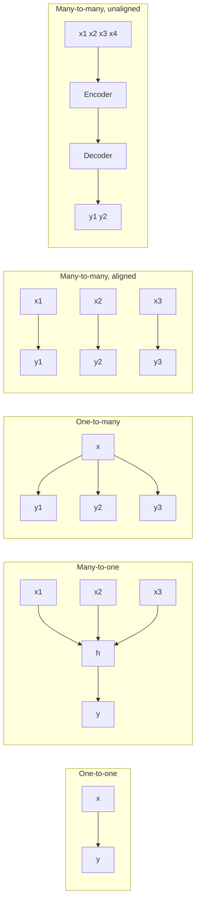

The diagram shows the five shapes side by side. The practical reading is a decision order. Ask first whether the output has one value per input step (aligned), then whether there is a single label for the whole sequence (many-to-one), then whether the output is longer or shorter than the input with a monotonic correspondence (CTC), and only then fall back to a full encoder-decoder. Each step down this list adds machinery, latency, and failure modes, so the simplest shape that fits the product requirement is the right one.

### 2.3 Sequence data in the wild

Four properties of real sequences cause most of the trouble later in the chapter, so state them early.

- **Variable length.** Sentences, utterances, and sessions differ in length by orders of magnitude. Batches must be padded, and the padding must be masked (Section 17).
- **Irregular sampling.** Sensor readings arrive late, in bursts, or with gaps. A recurrent cell has no notion of elapsed time. If the gap between readings matters, the elapsed time must be an input feature, or the series must be resampled to a regular grid.
- **Non-stationarity.** The statistics of the series change with seasons, product launches, firmware updates, and sensor replacement. A recurrent model trained on last year's data carries assumptions in its weights.
- **Dependence on distant context.** Some labels depend on an event hundreds of steps earlier (an opening bracket, a subject noun, a machine start-up). Whether the model can use that event is the central question of Sections 5 to 7.

### 2.4 A short history

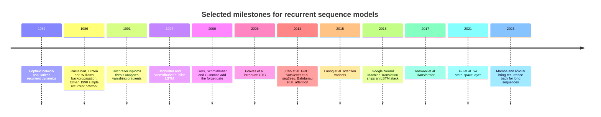

The timeline is selective and each date is the year of the paper or system named. Two observations matter for design decisions. The original 1997 LSTM had no forget gate; the version used almost everywhere today follows Gers, Schmidhuber, and Cummins (2000), who showed that letting the cell reset itself was necessary for continuous input streams. And the span between the 2014 sequence-to-sequence papers and the 2017 transformer is only three years, which is why so many production systems contain a recurrent encoder with attention layered on top: they were built in that window.

## 3. The Recurrent Cell

### 3.1 Definition

Let $x_t \in \mathbb{R}^d$ be the input at step $t$, and $h_t \in \mathbb{R}^n$ the hidden state with $n$ units. The simple (Elman) recurrent cell computes

$$
h_t = \tanh\left(W h_{t-1} + U x_t + b\right), \qquad h_0 = 0
$$

where $W \in \mathbb{R}^{n \times n}$ is the recurrent weight matrix, $U \in \mathbb{R}^{n \times d}$ is the input weight matrix, $b \in \mathbb{R}^{n}$ is a bias, and $\tanh$ is the hyperbolic tangent applied elementwise. An output, when one is needed at every step, is a function of the state:

$$
\hat{y}_t = g\left(V h_t + c\right)
$$

with $V$ and $c$ the output weights and bias, and $g$ a softmax for classification or the identity for regression. The pre-activation is written $a_t = W h_{t-1} + U x_t + b$ so that $h_t = \tanh(a_t)$.

Two statements follow directly from the definition and carry much of the chapter.

1. The state $h_t$ is a function of the entire prefix $x_1, \dots, x_t$. Expanding the recursion gives $h_t = F(x_t, F(x_{t-1}, \dots F(x_1, h_0)))$ with the same function $F$ at every depth.
2. The state has a fixed size $n$ regardless of how long the prefix is. The network therefore compresses an unbounded history into $n$ numbers. This is the strength (constant memory, natural streaming) and the limitation (the compression is lossy) of recurrence.

### 3.2 Parameter sharing and unrolling

The same $W$, $U$, and $b$ are used at every step. This is parameter sharing across time, the recurrent analogue of weight sharing across space in a convolutional network ([CH08](CH08_Convolutional_Neural_Networks.md)). Its consequences are:

- The parameter count is $n(n + d) + n$ and does not depend on sequence length. A model trained on sequences of length 50 can be run on length 5,000 without changing shape.
- The model assumes that the rule for updating memory is the same at every time step. This is a good prior for language, audio, and physical processes, and a poor one when time carries its own meaning (for example, hour-of-day effects), in which case time features must be supplied as inputs.
- Gradients from every step accumulate into the same weights, which is the source of both the compact model and the instability analyzed in Section 5.

**Unrolling** draws the loop as a feed-forward graph of depth $T$, with one copy of the cell per step and the copies tied together by shared weights. A recurrent network applied to a length-$T$ sequence is a deep network with $T$ layers, each with the same weights, and each layer receiving a fresh input. Seen this way, the vanishing-gradient problem is the same one that afflicts any very deep network, made worse by the fact that all layers share weights, so the same matrix is multiplied repeatedly.

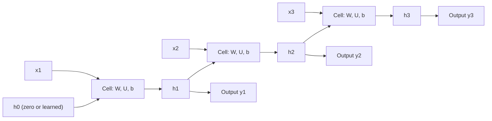

Each box labeled `Cell` is the same set of parameters, not three separate layers. The diagram makes the dependency chain visible: to compute `h3`, the network needs `h2`, which needs `h1`. That chain is why training cannot be parallelized across time steps within one sequence, a point that returns in Section 19 when comparing with attention. The three outputs at the bottom show the aligned many-to-many case; for many-to-one, only `Output y3` would exist.

### 3.3 Parameter count and compute

For one layer with input size $d$ and hidden size $n$, the vanilla cell has $n(n + d) + n$ parameters. With $d = 128$ and $n = 256$ this is $256 \times 384 + 256 = 98{,}560$, the value printed by [02_lstm_gru_attention_step.py](../code/python/rnn-lstm-chapter/02_lstm_gru_attention_step.py). Each step costs about $2n(n + d)$ floating-point operations (one multiply and one add per weight) for the matrix products, plus $O(n)$ for the nonlinearity. Over a sequence of length $T$ the cost is $T$ times that, and the $T$ steps must run one after another.

A useful habit is to compute the arithmetic intensity. For batch size $B$ the matrix products at each step are $B \times (n + d)$ times $(n + d) \times n$. With $B = 1$ this is a matrix-vector product, which is limited by memory bandwidth because every weight is read once and used once. The hardware is idle for most of each step. This is why single-stream recurrent inference on a GPU is rarely faster than on a CPU, and why batching many independent streams is the main throughput lever (Section 20).

### 3.4 Initial state

The default is $h_0 = 0$. Three alternatives exist and each has a use.

- A **learned initial state**, a trainable vector, helps when sequences start from a recognizable condition and the zero vector is a poor starting point. It adds $n$ parameters.
- An **encoded initial state** comes from another network: in an encoder-decoder, the decoder starts from the encoder's final state.
- A **carried state** is the final state of the previous segment. This is how truncated BPTT (Section 6) and streaming inference (Section 20) preserve context across segment boundaries, and it is also the source of the state-leakage bugs described in Section 21.

A mismatch between how the initial state is set in training and in serving is a common cause of train/serve skew. If training always begins at zero and serving begins from a carried state, the model sees state values it was never trained on.

### 3.5 Choice of nonlinearity

The cell uses $\tanh$ because it is bounded in $(-1, 1)$, which prevents the state from growing without limit, and it is zero-centered, which gives better-conditioned gradients than the sigmoid. Its derivative is $1 - \tanh^2(a)$, which is at most 1 (at $a = 0$) and approaches 0 when the unit saturates. Both facts matter for the Jacobian analysis that follows: the derivative of the nonlinearity can only shrink the gradient, never amplify it, so any growth must come from the matrix $W$.

The rectified linear unit (ReLU) $\max(0, a)$ has derivative exactly 1 where active. Le, Jaitly, and Hinton (2015) showed that a ReLU recurrent network with the recurrent matrix initialized to the identity (an "IRNN") can train on long sequences. The price is that the state is unbounded, so an exploding state is possible, and gradient clipping becomes mandatory. For most production work, $\tanh$ inside the plain cell, and the gated cells of Sections 7 and 9, are the safer choices.

## 4. Backpropagation Through Time

[CH07](CH07_Deep_Learning_Foundations.md) derives backpropagation as the chain rule applied to a computation graph: each node receives the gradient of the loss with respect to its output, multiplies by its local Jacobian, and passes the result to its inputs. BPTT is that algorithm applied to the unrolled graph of Section 3.2. Nothing new is needed in principle. The new content is the bookkeeping that arises because the weights are shared, and the structure of the product that appears when the chain is long.

### 4.1 Setup

Take the cell of Section 3.1 with the loss summed over steps, $L = \sum_{t=1}^{T} L_t$, where $L_t$ depends on $h_t$ (through the output layer, or only at $t = T$ for many-to-one tasks). Write the pre-activation $a_t = W h_{t-1} + U x_t + b$ and $h_t = \tanh(a_t)$.

Define the error signal at the pre-activation of step $t$:

$$
\delta_t = \frac{\partial L}{\partial a_t} \in \mathbb{R}^n
$$

and the gradient with respect to the hidden state, $\partial L / \partial h_t$. The hidden state $h_t$ influences the loss in two ways: directly through $L_t$, and indirectly through $a_{t+1}$ (and from there through every later step). The chain rule adds the two contributions:

$$
\frac{\partial L}{\partial h_t} = \frac{\partial L_t}{\partial h_t} + W^\top \delta_{t+1}
$$

with the convention $\delta_{T+1} = 0$. The factor $W^\top$ appears because $a_{t+1} = W h_t + \dots$, so $\partial a_{t+1} / \partial h_t = W$. Passing through the nonlinearity multiplies elementwise by its derivative $1 - h_t^2$, written $\odot$:

$$
\delta_t = \left(\frac{\partial L_t}{\partial h_t} + W^\top \delta_{t+1}\right) \odot \left(1 - h_t \odot h_t\right)
$$

This is the **backward recursion**. It runs from $t = T$ down to $t = 1$ and needs the stored forward activations $h_t$, which is why training memory grows linearly with $T$.

### 4.2 Gradients for the shared weights

Because $W$, $U$, and $b$ appear at every step, their gradients are sums over steps. Each step contributes as if it had its own copy of the weight, and the contributions are added:

$$
\frac{\partial L}{\partial W} = \sum_{t=1}^{T} \delta_t\, h_{t-1}^\top, \qquad
\frac{\partial L}{\partial U} = \sum_{t=1}^{T} \delta_t\, x_t^\top, \qquad
\frac{\partial L}{\partial b} = \sum_{t=1}^{T} \delta_t
$$

Each term is an outer product: $\delta_t$ has shape $n \times 1$, $h_{t-1}^\top$ has shape $1 \times n$, and the product has the shape of $W$. The output-layer gradients are ordinary and are not repeated here. The implementation in [01_bptt_gradient_decay.py](../code/python/rnn-lstm-chapter/01_bptt_gradient_decay.py) writes exactly these formulas without a framework and checks them against finite differences. For a three-unit network over six steps the largest relative error across all entries of $\partial L / \partial W$ is $3.57 \times 10^{-10}$, which is the accuracy one expects from central differences with step $10^{-6}$ and confirms that the derivation is correct. Running such a gradient check on any hand-written recurrent layer is worth the ten minutes it takes.

### 4.3 The explicit product of Jacobians

To see why long dependencies are hard, track a single path. Define the one-step Jacobian

$$
J_t = \frac{\partial h_t}{\partial h_{t-1}} = \operatorname{diag}\left(1 - h_t \odot h_t\right) W
$$

This is the matrix of partial derivatives of the new state with respect to the old state: first multiply by $W$, then scale each row by the $\tanh$ derivative of the corresponding unit. The influence of the state at step $k$ on the state at step $T > k$ is the product of the Jacobians along the chain:

$$
\frac{\partial h_T}{\partial h_k} = J_T J_{T-1} \cdots J_{k+1} = \prod_{t=k+1}^{T} \operatorname{diag}\left(1 - h_t \odot h_t\right) W
$$

The gradient of a loss at step $T$ with respect to an early state is then

$$
\frac{\partial L_T}{\partial h_k} = \left(\frac{\partial L_T}{\partial h_T}\right)^\top \prod_{t=k+1}^{T} J_t
$$

and everything depends on how the norm of this product behaves as $T - k$ grows. A matrix norm is submultiplicative, so

$$
\left\lVert \prod_{t=k+1}^{T} J_t \right\rVert \le \prod_{t=k+1}^{T} \left\lVert J_t \right\rVert \le \left(\gamma\, \sigma_{\max}(W)\right)^{T-k}
$$

where $\gamma = \max_a |\tanh'(a)| = 1$ and $\sigma_{\max}(W)$ is the largest singular value of $W$, the factor by which $W$ can stretch a vector. This is the bound used by Pascanu, Mikolov, and Bengio (2013). If $\sigma_{\max}(W) < 1$, the bound decays geometrically, so the gradient from distant steps vanishes. That is a sufficient condition for vanishing. The converse for explosion is weaker: the spectral radius of $W$ (the largest eigenvalue magnitude) must exceed 1 for gradients to grow, and this is a necessary condition, not a sufficient one, because the $\tanh$ derivative factors can pull the product back down. Both facts are used in Section 5.

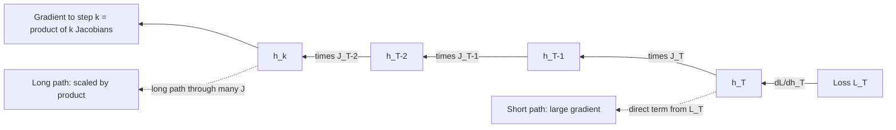

The diagram runs right to left because gradients flow backward. The solid arrows are the chain whose product defines $\partial h_T / \partial h_k$. The dashed annotations contrast the two kinds of path: a loss term at step $T$ reaches $h_T$ directly and arrives at full strength, while the same loss reaches $h_k$ only after $T - k$ multiplications. The implication is that a recurrent network learns short-range dependencies reliably, because their gradient paths are short, and long-range dependencies only if the product of Jacobians happens to stay near norm one.

### 4.4 A worked scalar example

Use the scalar cell $h_t = \tanh(w h_{t-1} + u x_t)$ with $w = 0.5$, $u = 1$, no bias, $h_0 = 0$, inputs $x = (1, 0, 0)$, and a loss at the last step only, $L = \tfrac{1}{2} h_3^2$ (target zero).

Forward pass:

- $h_1 = \tanh(0.5 \times 0 + 1 \times 1) = \tanh(1) = 0.7616$.
- $h_2 = \tanh(0.5 \times 0.7616 + 0) = \tanh(0.3808) = 0.3634$.
- $h_3 = \tanh(0.5 \times 0.3634 + 0) = \tanh(0.1817) = 0.1797$.

Backward pass, using $\partial L / \partial h_3 = h_3 = 0.1797$ and the one-step Jacobians $J_t = (1 - h_t^2)\, w$:

- $J_3 = (1 - 0.1797^2) \times 0.5 = 0.9677 \times 0.5 = 0.4838$.
- $J_2 = (1 - 0.3634^2) \times 0.5 = 0.8680 \times 0.5 = 0.4340$.
- $\partial L / \partial h_2 = 0.1797 \times 0.4838 = 0.0870$.
- $\partial L / \partial h_1 = 0.0870 \times 0.4340 = 0.0377$.

The gradient at the earliest state is 21 percent of the gradient at the last state ($0.4838 \times 0.4340 = 0.2100$), after only two multiplications. The input $x_1$ enters through $u$. Its contribution to $\partial L / \partial u$ via step 1 is $0.0377 \times (1 - h_1^2) \times x_1 = 0.0377 \times 0.4200 \times 1 = 0.0158$, while the contribution via steps 2 and 3 is zero because $x_2 = x_3 = 0$. A fact the model learned about $x_1$ therefore gets only a small share of the update signal, and with longer gaps the share shrinks by roughly 0.2 to 0.5 for every additional step. The numbers can be recomputed in a few lines of Python; every figure in this paragraph was checked that way.

### 4.5 Why the recurrent weight gradient is a sum of different-length paths

The gradient $\partial L / \partial W$ is a sum of $T$ terms $\delta_t h_{t-1}^\top$. Terms from late steps have short backward chains and are large; terms from early steps have long chains and are scaled by the Jacobian product. When the product is small, the gradient is dominated by the most recent steps, and the update teaches the network to use only recent context. The model does not fail to train: loss decreases, and the model fits the short-range structure. It fails silently on long-range structure. This is the practical signature of vanishing gradients. The loss curve looks healthy, and a probe on a long-dependency task shows that accuracy does not improve with context length.

## 5. Vanishing and Exploding Gradients, Shown Numerically

### 5.1 Scalar intuition

Replace the Jacobian product by a single scalar factor $\rho$ per step. The gradient from $k$ steps back is scaled by $\rho^k$. The first part of [01_bptt_gradient_decay.py](../code/python/rnn-lstm-chapter/01_bptt_gradient_decay.py) prints:

| $\rho$ | $k = 10$ | $k = 50$ | $k = 100$ |
| --- | --- | --- | --- |
| 0.9 | 0.3487 | 0.005154 | $2.656 \times 10^{-5}$ |
| 1.0 | 1 | 1 | 1 |
| 1.2 | 6.192 | 9,100 | $8.282 \times 10^{7}$ |

A factor of 0.9, which looks harmless per step, attenuates a signal from 50 steps back to about half a percent and from 100 steps back to a few parts in a hundred thousand. A factor of 1.2 amplifies the same signals by a factor of thousands to tens of millions. The knife-edge at exactly 1 is why this is difficult to fix by choosing a good scale: the stable region has zero width, and the network must keep the factor within a few percent of 1 for dozens of steps while the weights keep changing.

### 5.2 A real recurrent network

The scalar picture ignores that $W$ is a matrix and that the $\tanh$ derivative varies. Part B of the script builds an eight-unit $\tanh$ network with $T = 100$, random Gaussian inputs, a recurrent matrix $W = \rho Q$ with $Q$ a random orthogonal matrix (so every singular value of $W$ equals $\rho$), and computes the spectral norm of $\partial h_T / \partial h_{T-k}$ by multiplying out the actual Jacobians along the run. Its output is:

| $\rho$ | $k = 1$ | $k = 10$ | $k = 25$ | $k = 50$ | $k = 100$ |
| --- | --- | --- | --- | --- | --- |
| 0.5 | $4.97 \times 10^{-1}$ | $1.39 \times 10^{-5}$ | $1.81 \times 10^{-14}$ | $7.91 \times 10^{-28}$ | $5.28 \times 10^{-58}$ |
| 0.9 | $8.71 \times 10^{-1}$ | $3.15 \times 10^{-3}$ | $1.49 \times 10^{-8}$ | $6.89 \times 10^{-17}$ | $1.36 \times 10^{-36}$ |
| 1.0 | $9.87 \times 10^{-1}$ | $8.11 \times 10^{-3}$ | $1.12 \times 10^{-7}$ | $3.23 \times 10^{-15}$ | $2.79 \times 10^{-33}$ |
| 1.5 | $1.50$ | $2.21 \times 10^{-1}$ | $1.89 \times 10^{-3}$ | $2.60 \times 10^{-7}$ | $5.47 \times 10^{-15}$ |
| 3.0 | $2.38$ | $1.01 \times 10^{1}$ | $1.34 \times 10^{1}$ | $8.42$ | $4.04 \times 10^{1}$ |

Four observations from this table carry the lessons.

1. **Orthogonal with $\rho = 1$ still decays.** An orthogonal $W$ preserves norms exactly, yet the product shrinks to $10^{-33}$ at $k = 100$. The reason is the diagonal $\tanh$ factor: whenever a unit is away from zero, its derivative is below 1, and the factors multiply. Perfect norm preservation by $W$ is therefore not enough. The nonlinearity contributes a leak at every step, and with random inputs of unit scale, many units operate well inside the saturating region.
2. **$\rho = 1.5$ does not explode in this run.** The linearized prediction $1.5^{100} \approx 4 \times 10^{17}$ is nowhere near the measured $5 \times 10^{-15}$. Saturation of $\tanh$ drives most derivative factors close to zero when the weights are large. A saturating network cannot exhibit unbounded growth along a typical trajectory, because the activations are bounded. The statement "$\rho > 1$ explodes" holds only when the units are in the linear region.
3. **Explosion appears as a cliff, not as a smooth growth.** Pascanu et al. (2013) describe this: the loss surface contains steep walls near particular weight values. At most parameter settings the gradient is moderate, and a small step across the wall produces a gradient thousands of times larger. This is why exploding gradients show up as rare spikes in training logs, not as a steady rise, and why a single clipped update can rescue a run.
4. **$\rho = 3$ keeps a norm of 8 to 40 for all $k$.** At this scale most units are saturated, but those that are not carry a large gain. The product is neither vanishing nor growing exponentially in this one run, and such a network is chaotic: small changes in the input produce large changes in the state. Chaotic dynamics make training erratic for a different reason.

The honest summary is that the clean $\rho^k$ rule is a useful first approximation and a poor quantitative predictor. The qualitative conclusion survives: with a plain $\tanh$ cell, gradient norms along long paths are either vanishing or erratic, and a stable window around norm one exists only on a narrow, moving set of weights. Table values depend on the random seed; the pattern does not.

### 5.3 The sigmoid derivative makes it worse

Gates (Section 7) use sigmoids whose derivative is at most $0.25$. A chain of ten sigmoid derivatives is at most $0.25^{10} \approx 9.5 \times 10^{-7}$. This is why early recurrent networks built from sigmoid units could not learn dependencies beyond a handful of steps, and why a design that places a sigmoid-gated multiplication on the path of the gradient, instead of a sigmoid derivative, matters. In an LSTM the sigmoid derivative appears when learning the gate's own weights, but the gradient along the cell-state path multiplies by the gate value $f_t \in (0, 1)$, not by $f_t(1 - f_t)$.

### 5.4 Detecting the problem in practice

Three diagnostics are cheap and informative.

- **Gradient norm by position.** Compute $\lVert \partial L_T / \partial h_k \rVert$ for $k = T, T-1, \dots, 1$ on a batch and plot it on a log scale. A straight line sloping down indicates a constant per-step contraction; its slope is $\log \rho$. Healthy gated models show a much shallower slope.
- **Performance versus context length.** Evaluate on inputs truncated to the last 10, 50, 200 steps. If accuracy saturates at 50 steps while the task requires 200, the model is not using the long context, whatever the architecture claims.
- **Synthetic dependency tasks.** The copy task, the adding problem (sum two marked numbers in a long stream), and the temporal order task, all used by Hochreiter and Schmidhuber (1997), give a controlled measurement of how far back the model can reach.

None of these require changes to the model. They answer a question the loss curve cannot: whether training is learning from the part of the sequence the product cares about.

## 6. Truncated BPTT and Gradient Clipping

### 6.1 Truncated backpropagation through time

Full BPTT over a sequence of $T = 10{,}000$ steps stores 10,000 sets of activations and propagates a gradient across 10,000 Jacobians. Both are impractical, and the gradient from the far end would be vanishing or exploding anyway. **Truncated BPTT** (Williams and Peng, 1990) bounds the cost by running the forward pass over the entire sequence but cutting the backward pass into windows. In the common formulation TBPTT($k_1$, $k_2$), the network performs a gradient update every $k_1$ steps and backpropagates through the last $k_2$ steps. The simplest and most used form sets $k_1 = k_2 = k$: split the sequence into consecutive chunks of length $k$, carry the hidden state forward from one chunk to the next, but detach it from the computation graph so that gradients stop at the chunk boundary.

For a sequence of 10,000 steps and $k = 100$ this gives 100 chunks, so 100 gradient updates per pass through the sequence (instead of one), and peak activation memory proportional to 100 steps (a factor of 100 smaller). The price is that no gradient flows across a chunk boundary, so the model cannot be trained to use information that requires a gradient path longer than $k$ steps. It can still use such information in the forward direction, because the carried state is not reset. A model trained with $k = 100$ may therefore have learned to carry some information over 1,000 steps in its state, if a short-range gradient happened to teach it, but it was never rewarded for that directly.

```mermaid
sequenceDiagram
    participant Data as Sequence of 6 chunks
    participant Net as Recurrent network
    participant Opt as Optimizer
    Data->>Net: chunk 1 with h0 = 0
    Net->>Opt: backprop within chunk 1 only
    Opt->>Net: update weights
    Net->>Net: carry h forward and detach from graph
    Data->>Net: chunk 2 with carried h
    Net->>Opt: backprop within chunk 2 only
    Opt->>Net: update weights
    Net->>Net: carry h forward and detach from graph
    Data->>Net: chunk 3 with carried h
```

The diagram shows the loop for the first three chunks. The "detach" step is the heart of the method and the most common source of memory leaks in framework code: if the carried state is not detached, the computation graph grows without bound across chunks, the backward pass reaches into earlier chunks, and memory use grows with every iteration. In PyTorch this is `h = h.detach()` (or `tuple(s.detach() for s in state)` for an LSTM) before the next chunk.

Truncated BPTT has two subtle requirements. The chunks of one sequence must be processed in order, so batches are built as parallel streams: row $i$ of every batch continues row $i$ of the previous batch. This differs from the usual practice of shuffling examples, and shuffling would pair a carried state with the wrong data. Second, the start-of-sequence state must be reset when a stream ends and a new document begins; otherwise, one document's state leaks into the next (Section 21).

### 6.2 Gradient clipping by global norm

The cure for exploding gradients, due to Pascanu et al. (2013), is to rescale the entire gradient whenever its norm exceeds a threshold $c$:

$$
g \leftarrow g \cdot \min\left(1, \frac{c}{\lVert g \rVert_2}\right)
$$

where $g$ is the concatenation of all parameter gradients and $\lVert g \rVert_2$ is its Euclidean norm. The direction of the update is preserved, and only its length is limited. Part D of the script uses $g = (30, -40, 0)$, whose norm is $\sqrt{900 + 1600} = 50$, with $c = 5$: the scale is $5 / 50 = 0.1$, the clipped vector is $(3, -4, 0)$, and its norm is exactly 5. Clipping by global norm is preferable to clipping each element independently, because elementwise clipping changes the direction of the gradient, and in the cliff geometry of Section 5.2 the direction matters.

How to set $c$. Record gradient norms during the first epochs without clipping, and set $c$ near a high percentile (for example the 90th to 99th) of the typical norms, so that clipping is rare in normal training and decisive during a spike. A common range in published language-model training is 0.25 to 5 depending on loss scaling; treat that as a starting point, not a rule. The fraction of updates that are clipped is a useful monitoring metric: if it is above roughly 10 to 20 percent, the learning rate is probably too high or the loss scale is wrong, and clipping is hiding the problem.

### 6.3 What clipping and truncation do not fix

Clipping limits the size of the update. It does nothing for a vanished gradient, because rescaling a vector that is already near zero (the condition $\lVert g \rVert < c$ applies the factor 1) leaves it unchanged. Truncation limits the compute and memory, and by construction removes the gradient path beyond $k$ steps. Neither addresses the structural cause. The structural fixes are an architecture with an additive path (Section 7), a better-conditioned initialization (Section 10), or direct access to earlier positions through attention (Section 12).

A concise decision rule follows. If the loss shows isolated spikes and `NaN` values, add or tighten clipping. If the loss decreases smoothly but long-context probes do not improve, the problem is vanishing, and the fix is a gated cell, a larger forget-gate bias, or attention. If memory is the constraint, use truncation, and accept the shorter gradient horizon.

## 7. The Long Short-Term Memory Cell

### 7.1 The idea

Hochreiter and Schmidhuber (1997) asked what structure would let the error signal flow backward through time without being repeatedly multiplied by a weight matrix and a squashing derivative. Their answer was a **constant error carousel**: a memory cell whose self-connection has a fixed weight of 1, so that the error passes unchanged. Gates, which are learned multiplicative switches, control when information enters the cell, when it is read out, and, in the version by Gers, Schmidhuber, and Cummins (2000), when it is erased.

The modern LSTM keeps two quantities per layer: the **cell state** $c_t$, the long-term memory, and the **hidden state** $h_t$, the short-term output exposed to the next layer and the next step. Both are vectors of size $n$.

### 7.2 Equations

With the concatenated input $[x_t; h_{t-1}]$ and sigmoid $\sigma(z) = 1 / (1 + e^{-z})$:

$$
\begin{aligned}
f_t &= \sigma\left(W_f x_t + U_f h_{t-1} + b_f\right) && \text{forget gate} \\
i_t &= \sigma\left(W_i x_t + U_i h_{t-1} + b_i\right) && \text{input gate} \\
g_t &= \tanh\left(W_g x_t + U_g h_{t-1} + b_g\right) && \text{candidate} \\
o_t &= \sigma\left(W_o x_t + U_o h_{t-1} + b_o\right) && \text{output gate} \\
c_t &= f_t \odot c_{t-1} + i_t \odot g_t && \text{cell update} \\
h_t &= o_t \odot \tanh(c_t) && \text{hidden output}
\end{aligned}
$$

Each $W_\ast \in \mathbb{R}^{n \times d}$ and $U_\ast \in \mathbb{R}^{n \times n}$. The gates are vectors with entries in $(0, 1)$, so each unit in the cell has its own forget, input, and output decision. Four weight sets replace the one of the vanilla cell, and the parameter count is $4\,[\,n(n + d) + n\,]$. For $d = 128$, $n = 256$ this is 394,240, exactly four times the vanilla cell's 98,560. PyTorch's `nn.LSTM` keeps two bias vectors per gate (`bias_ih` and `bias_hh`), giving $4n(n + d) + 8n = 395{,}264$ parameters for the same sizes; the two biases are redundant but harmless.

### 7.3 Gate by gate

**Forget gate $f_t$.** It decides how much of each cell unit survives. A value of 1 keeps the memory, 0 erases it. This is the gate that gives the cell the option of remembering for a long time, and it is also what lets the cell reset at a document boundary or at the end of a phrase.

**Input gate $i_t$ and candidate $g_t$.** The candidate $g_t$ proposes new content in $(-1, 1)$, and the input gate decides how much of it to write. Their product $i_t \odot g_t$ is the write. Splitting proposal from permission lets the cell ignore irrelevant inputs by setting $i_t$ near zero, which a vanilla cell cannot do, because it must overwrite its state with a function of the input at every step.

**Cell update $c_t$.** The new memory is the old memory scaled by the forget gate plus the gated write. The update is additive. This one equation is the reason the architecture works.

**Output gate $o_t$.** It decides how much of the squashed cell $\tanh(c_t)$ to expose as $h_t$. The cell can hold information that is not yet visible to the next layer, for example a count that matters only when it reaches a threshold.

### 7.4 A worked numeric step

Part of [02_lstm_gru_attention_step.py](../code/python/rnn-lstm-chapter/02_lstm_gru_attention_step.py) works a step with one input and two cell units, so every number can be checked by hand. The inputs are $x = 1$, $h_{t-1} = (0.5, -0.5)$, and $c_{t-1} = (2.0, -1.0)$. The forget-gate weights are $W_f = (0.4, 0.2)^\top$, $U_f = 0.2\,I$, $b_f = (1, 1)$. The other gates use the weights listed in the script.

Forget-gate pre-activations: unit 1 is $0.4 \times 1 + 0.2 \times 0.5 + 1.0 = 1.5$, and unit 2 is $0.2 \times 1 + 0.2 \times (-0.5) + 1.0 = 1.1$. Applying the sigmoid gives $f = (0.8176, 0.7503)$. The remaining pre-activations are $z_i = (0.3, -0.3)$, $z_g = (1.25, -1.25)$, and $z_o = (0.25, 0.15)$. Applying the activations:

| Quantity | Unit 1 | Unit 2 |
| --- | --- | --- |
| Forget gate $f$ | 0.8176 | 0.7503 |
| Input gate $i$ | 0.5744 | 0.4256 |
| Candidate $g$ | 0.8483 | $-0.8483$ |
| Output gate $o$ | 0.5622 | 0.5374 |
| Keep: $f \odot c_{t-1}$ | $0.8176 \times 2.0 = 1.6351$ | $0.7503 \times (-1.0) = -0.7503$ |
| Write: $i \odot g$ | $0.5744 \times 0.8483 = 0.4873$ | $0.4256 \times (-0.8483) = -0.3610$ |
| New cell $c_t$ | $1.6351 + 0.4873 = 2.1224$ | $-0.7503 - 0.3610 = -1.1113$ |
| $\tanh(c_t)$ | 0.9717 | $-0.8045$ |
| Hidden $h_t = o \odot \tanh(c_t)$ | $0.5622 \times 0.9717 = 0.5463$ | $0.5374 \times (-0.8045) = -0.4324$ |

Read the table row by row. Unit 1 holds a large positive memory (2.0), and the forget gate keeps 82 percent of it, while the input gate lets in roughly half of a strong positive candidate. The cell grows slightly to 2.12. The output gate then exposes only 56 percent of the squashed value, so the hidden state, 0.55, is much smaller than the memory. That illustrates the separation of storage from output. Unit 2 has the mirrored behavior with negative signs. In both units the old memory dominates the new write, which is the intended default of a gated cell: change slowly, unless the gates say otherwise.

### 7.5 The cell-state highway

Differentiate the cell update with respect to the previous cell state, treating the gates as constants for the direct path:

$$
\frac{\partial c_t}{\partial c_{t-1}} = \operatorname{diag}(f_t)
$$

There is no weight matrix on this path and no $\tanh$ derivative; the Jacobian is diagonal with the forget-gate values on the diagonal. Across $k$ steps the direct gradient from $c_T$ to $c_{T-k}$ is $\prod_{t} f_t$, an elementwise product of numbers between 0 and 1. If a unit's forget gate stays near 1 over the relevant interval, the gradient passes with almost no loss, and the network can learn from an event $k$ steps ago. There are also indirect paths through $h_{t-1}$ into the gates and the candidate, which do involve the weight matrices, but the direct path is the one that carries the long-range signal, and the network learns to open or close it per unit and per step.

Part E of the first script quantifies the highway for a constant gate value $f = \sigma(\text{bias})$:

| Forget bias | $f$ | $f^{50}$ | $f^{200}$ |
| --- | --- | --- | --- |
| $-2$ | 0.1192 | $6.5 \times 10^{-47}$ | $1.8 \times 10^{-185}$ |
| 0 | 0.5000 | $8.9 \times 10^{-16}$ | $6.2 \times 10^{-61}$ |
| 1 | 0.7311 | $1.6 \times 10^{-7}$ | $6.2 \times 10^{-28}$ |
| 2 | 0.8808 | $1.75 \times 10^{-3}$ | $9.4 \times 10^{-12}$ |
| 5 | 0.9933 | 0.7149 | 0.2610 |

A bias of 0 (a gate that starts at one half) gives a signal of $10^{-16}$ at 50 steps, no better than a vanilla cell. A bias of 5 holds 71 percent of the signal over 50 steps and 26 percent over 200. This is the numeric reason for initializing the forget-gate bias to a positive value. Jozefowicz, Zaremba, and Sutskever (2015) compared recurrent architectures and found that setting the forget bias to 1 closed most of the gap between LSTM and its variants; many frameworks and practitioners follow this. The value 1 is a compromise: it gives $f = 0.73$ and a memory half-life of about two steps if left untouched, so the network must learn to raise the forget gate where memory is needed. Larger values such as 2 to 5 suit tasks known to need very long memory. In the worked step above, $f \approx 0.82$ over ten steps gives $0.8176^{10} = 0.134$, and over 50 steps $4.2 \times 10^{-5}$: a learned gate that stays at 0.82 is not enough for long-range memory, and training must push the relevant units toward 0.99.

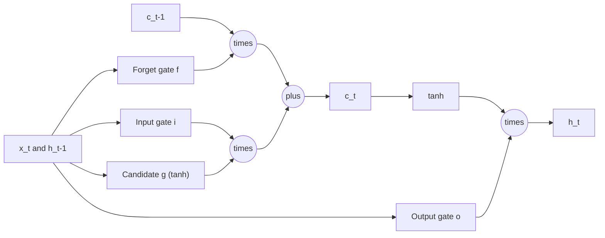

The top path from `c_t-1` through the multiplication and addition to `c_t` is the highway. Everything else is control: the four boxes fed by `x_t and h_t-1` compute the gates and the candidate, and the output gate governs what leaves the cell. The implication for design is that the cell state is the part of the model that should carry information that must survive long gaps (a machine start-up, an open parenthesis, a speaker identity), and the hidden state is the part that answers the current prediction.

### 7.6 Variants

- **Peephole connections** (Gers and Schmidhuber, 2000) feed the cell state into the gates, so a gate can look at the memory it controls. They help on tasks that need precise timing and are rarely used elsewhere; the standard `nn.LSTM` omits them.
- **Coupled forget and input gates** set $i_t = 1 - f_t$, so the cell either keeps or replaces. This removes one gate and is close to what the GRU does.
- **LSTM with projection** (Sak, Senior, and Beaufays, 2014) maps $h_t$ down to a smaller size through a linear projection before it feeds back. It reduces the recurrent matrix from $n \times n$ to $n \times p$ and is common in speech models where $n$ is large. PyTorch exposes it as the `proj_size` argument.
- **Greff et al. (2017)**, in a large study of eight variants on speech, handwriting, and music tasks, found that none improved significantly over the standard LSTM, and that the forget gate and the output activation function were the most important components. Treat variant proliferation with skepticism, and prefer the standard cell unless profiling shows a need.

## 8. Bidirectional and Stacked Recurrent Networks

### 8.1 Bidirectional recurrence

A recurrent cell reads left to right, so the state at position $t$ knows the past and nothing about the future. For tagging "bank" in "she sat on the bank of the river", the disambiguating words come after. A **bidirectional** recurrent network (Schuster and Paliwal, 1997) runs two independent cells over the same input, one forward and one backward, and concatenates their states at each position:

$$
\overrightarrow{h}_t = F(\overrightarrow{h}_{t-1}, x_t), \qquad
\overleftarrow{h}_t = F'(\overleftarrow{h}_{t+1}, x_t), \qquad
h_t = [\overrightarrow{h}_t ; \overleftarrow{h}_t]
$$

The output at each position has size $2n$ and sees the whole sequence. The two directions have separate parameters, so the parameter count doubles: for an LSTM with $d = 128$ and $n = 256$ the bidirectional layer has $2 \times 394{,}240 = 788{,}480$ parameters. For many-to-one tasks the usual summary is the concatenation of the forward cell's last state and the backward cell's last state, which corresponds to the end and the beginning of the sequence, respectively. Using only the final output of the concatenated sequence gives the backward cell a state that has seen only the last token, a common bug.

**When bidirectional is valid.** The model needs the whole input before it produces any output, so it fits offline tasks where the entire sequence is available: tagging a stored document, classifying a recorded utterance, scoring a finished sensor window, and encoding the source side of a translation. It does not fit a language model that predicts the next token, because the backward cell would read the answer, and it does not fit streaming applications that must emit a decision as data arrives. A forecasting model that is bidirectional over the input window is fine, provided the window contains only the past. Putting future values of the target in the backward pass is leakage.

**Latency cost in streaming.** Some streaming systems approximate bidirectionality with a bounded look-ahead of $L$ frames: the output for frame $t$ is delayed until frame $t + L$ arrives, and the backward pass runs over a short chunk. The latency added is $L$ frames times the frame hop. A 10 ms frame hop and a look-ahead of 20 frames adds 200 ms, which is noticeable in interactive dictation and negligible in call-center transcription. The latency budget and the accuracy gain from look-ahead should be measured, not assumed.

### 8.2 Stacked recurrent networks

Stacking feeds the hidden-state sequence of layer $\ell$ as the input sequence of layer $\ell + 1$. Lower layers capture short-range and local structure, and upper layers combine it into longer-range or more abstract features. Two to four layers are typical; Wu et al. (2016) built the production Google Neural Machine Translation system from eight encoder and eight decoder LSTM layers, and found that stacks deeper than about four layers needed **residual connections** (adding each layer's input to its output) to train at all. The reason is the same product-of-Jacobians argument along the depth axis: more layers add more multiplications to every gradient path, with the added problem that depth multiplies the cost of the sequential dimension.

The parameter cost grows linearly in depth. Three stacked LSTM layers with $d = n = 256$ have $3 \times 4\,[\,256 \times 512 + 256\,] = 1{,}575{,}936$ parameters, the figure printed by the script. The compute per time step grows by the same factor, and since layer $\ell + 1$ at step $t$ needs layer $\ell$ at step $t$, a naive implementation runs layers one after another. A **wavefront** schedule exploits the dependency structure: layer $\ell$ at step $t$ depends on layer $\ell$ at step $t - 1$ and layer $\ell - 1$ at step $t$, so all cells on an anti-diagonal of the (layer, time) grid can run in parallel. cuDNN implements this, which is a reason to prefer the fused framework layer over a hand-written loop.

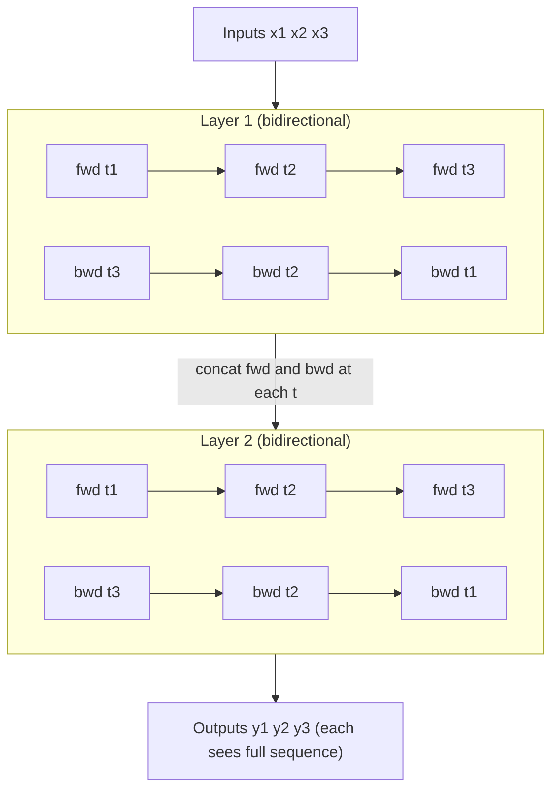

The diagram shows two bidirectional layers. Within a layer the forward cells chain left to right and the backward cells chain right to left; the outputs of the layer are the per-position concatenation, which becomes the input of the next layer. Every output position depends on every input position, as the concatenation after layer 1 gives layer 2 both directions at each step. The cost to remember is that the whole structure waits for the last input before the backward chain can start, which is why it is an offline design.

### 8.3 Design rules

1. Start with one bidirectional layer if the task is offline, one unidirectional layer if it is streaming or generative, and add depth only when validation error says the capacity is needed.
2. Use residual connections from the third layer on, and layer normalization (Section 10) between layers.
3. Apply dropout between layers (non-recurrent connections), not inside the time loop (Section 10).
4. Prefer widening to deepening when the budget is fixed: a wider layer parallelizes better, while depth adds sequential latency.

## 9. The Gated Recurrent Unit and How It Compares

### 9.1 Equations

Cho et al. (2014) introduced a simpler gated cell. It has no separate cell state: the hidden state $h_t$ is the only memory. Two gates control it, the update gate $z_t$ and the reset gate $r_t$:

$$
\begin{aligned}
z_t &= \sigma\left(W_z x_t + U_z h_{t-1} + b_z\right) && \text{update gate} \\
r_t &= \sigma\left(W_r x_t + U_r h_{t-1} + b_r\right) && \text{reset gate} \\
\tilde{h}_t &= \tanh\left(W_h x_t + U_h (r_t \odot h_{t-1}) + b_h\right) && \text{candidate} \\
h_t &= (1 - z_t) \odot h_{t-1} + z_t \odot \tilde{h}_t && \text{interpolation}
\end{aligned}
$$

The reset gate controls how much of the old state is used when forming the candidate: with $r_t$ near 0 the candidate is computed as if the sequence were starting fresh from $x_t$. The update gate interpolates between keeping the old state and adopting the candidate. The last line is the GRU's counterpart of the LSTM's additive highway: with $z_t$ near 0, $h_t \approx h_{t-1}$ and the gradient passes with Jacobian $\operatorname{diag}(1 - z_t)$ on the direct path. **Convention warning.** PyTorch writes the final line as $h_t = (1 - z_t) \odot n_t + z_t \odot h_{t-1}$, with the roles of $z$ reversed, and the literature is split. Two implementations that look identical can use opposite meanings of the gate, which matters when copying pretrained weights or reading gate activations in a monitoring tool.

### 9.2 A worked step

The script reuses the first-gate weights from the LSTM step so the numbers are comparable. With $x = 1$ and $h_{t-1} = (0.5, -0.5)$:

- Update gate $z = \sigma(1.5, 1.1) = (0.8176, 0.7503)$.
- Reset gate $r = \sigma(0.3, -0.3) = (0.5744, 0.4256)$.
- Reset state $r \odot h_{t-1} = (0.2872, -0.2128)$.
- Candidate unit 1: $\tanh(1.0 \times 1 + 0.5 \times 0.2872) = \tanh(1.1436) = 0.8156$. Unit 2: $\tanh(-1.0 \times 1 + 0.5 \times (-0.2128)) = \tanh(-1.1064) = -0.8028$.
- New state unit 1: $(1 - 0.8176) \times 0.5 + 0.8176 \times 0.8156 = 0.0912 + 0.6668 = 0.7580$. Unit 2: $(1 - 0.7503) \times (-0.5) + 0.7503 \times (-0.8028) = -0.1249 - 0.6023 = -0.7272$.

With update-gate values of 0.82 and 0.75, the state moves most of the way toward the candidate: unit 1 goes from 0.50 to 0.76. In the LSTM step with the same weights, the equivalent forget gate of 0.82 kept 82 percent of an old memory of 2.0. The cases differ because the LSTM's memory is a separate cell, scaled and added to, while the GRU's state is bounded in $(-1, 1)$ and is replaced by interpolation. A GRU cannot store a value larger than 1 in magnitude, and cannot hide memory from its output, since there is no output gate.

### 9.3 Size and speed

A GRU has three weight sets rather than four: $3\,[\,n(n + d) + n\,]$. For $d = 128$ and $n = 256$ that is 295,680 parameters, three times the vanilla cell and 75 percent of the LSTM. The per-step compute falls by the same ratio, so a GRU is typically faster per step and slightly cheaper in memory, because it keeps one state vector per layer instead of two. For streaming serving with millions of streams (Section 20), the saving is half the state memory.

### 9.4 LSTM or GRU

Chung, Gulcehre, Cho, and Bengio (2014) compared the two on polyphonic music and speech tasks and found both better than a plain $\tanh$ cell and neither consistently better than the other. Jozefowicz et al. (2015) reached a similar conclusion from a search over thousands of architectures. The practical guidance therefore reduces to a few points:

| Criterion | Prefer LSTM | Prefer GRU |
| --- | --- | --- |
| Very long dependencies, counting, precise timing | Yes, the separate cell and output gate help | Weaker; state bounded in $(-1, 1)$ |
| Small data, limited compute | | Yes, fewer parameters |
| Serving state memory per stream | Two vectors per layer | One vector per layer |
| Ecosystem and pretrained models | Larger body of recipes and checkpoints | Smaller but sufficient |
| Tuning budget | Forget bias needs attention | Fewer hyperparameters |
| Hardware kernel support | Both are fused in cuDNN | Both are fused in cuDNN |

The comparison that decides it is empirical: train both with the same budget on your validation set, with several seeds. The difference between seeds is often larger than the difference between cells. When no difference is visible, choose the GRU for the smaller state, or the LSTM if the team has a tested recipe for it.

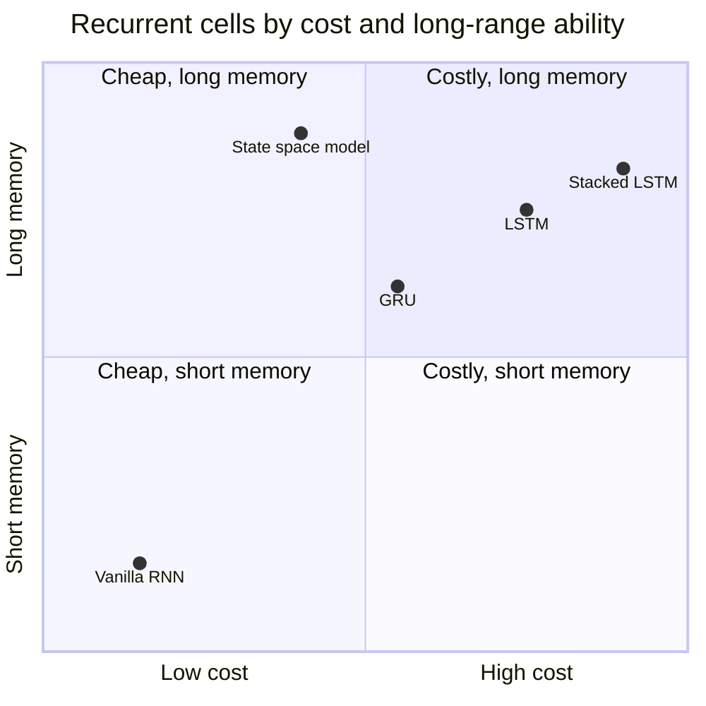

The positions are qualitative judgments, not measurements, and are labeled as such: the vanilla cell is cheapest and shortest-memory, the GRU sits between, the LSTM costs more and remembers longer, and a stacked LSTM increases both. The state-space entry is placed at moderate cost and long memory to anticipate Section 19, where recurrent layers with structured transitions are designed specifically to push the long-memory axis without a proportional cost.

## 10. Training Practice for Recurrent Networks

### 10.1 Initialization

**Input weights** $U$ (and the output layer) follow the usual scheme: Glorot (Xavier) uniform for $\tanh$ and sigmoid units, scaled to keep activation variance constant between layers.

**Recurrent weights** $W$ need more care, because $W$ is multiplied by itself $T$ times. Saxe, McClelland, and Ganguli (2014) analyzed deep linear networks and showed that orthogonal initialization preserves the norm of signals and gradients exactly. For a recurrent matrix this means $W^\top W = I$, so $\lVert W^k v \rVert = \lVert v \rVert$ for every $k$. An orthogonal matrix is built by taking the QR decomposition of a Gaussian random matrix and using the orthogonal factor $Q$ (with signs fixed so the distribution is uniform). The script builds one by Gram-Schmidt on random vectors, which gives the same family of matrices. PyTorch exposes `torch.nn.init.orthogonal_`, and applying it to each gate's block of `weight_hh` is a one-line loop.

Section 5.2 showed the limit of this advice: an orthogonal $W$ with $\rho = 1$ still decays through the $\tanh$ derivative. Orthogonal initialization removes one source of decay, the matrix, and leaves the other, the nonlinearity. In gated cells the situation is better, since the additive path does not pass through $W$, which is why the combination of orthogonal $W$ and a positive forget bias is the standard recipe.

**Forget-gate bias.** Initialize it to 1 for general use, and higher for tasks with known long memory, as Section 7.5 showed numerically. In a PyTorch `nn.LSTM`, the biases of the four gates are stored concatenated in the order input, forget, cell, output, so the forget slice is the second block of size $n$ in `bias_ih` and `bias_hh`. Setting only one of the two biases to 1 gives an effective bias of 1; setting both gives 2.

**Initial state** $h_0$: zero unless there is a reason (Section 3.4).

### 10.2 Layer normalization

Batch normalization normalizes each feature over the batch, which is awkward for recurrent networks: the statistics differ by time step, sequences have different lengths, and at inference the batch statistics must be replaced by running averages that mix steps. Cooijmans et al. (2016) made it work with separate statistics for each time step, at the cost of complexity. **Layer normalization** (Ba, Kiros, and Hinton, 2016) normalizes across the units of one example at one time step:

$$
\operatorname{LN}(a) = \gamma \odot \frac{a - \mu}{\sqrt{\sigma^2 + \epsilon}} + \beta, \qquad \mu = \frac{1}{n}\sum_i a_i, \quad \sigma^2 = \frac{1}{n}\sum_i (a_i - \mu)^2
$$

where $\gamma$ and $\beta$ are learned gain and shift vectors and $\epsilon$ is a small constant. It has no batch dependence, so training and inference compute the same function, and it works for any sequence length and batch size, including a batch of one in serving. Applied to the gate pre-activations inside an LSTM, it keeps the pre-activations in a range where the sigmoid and $\tanh$ are not saturated, and Ba et al. reported faster convergence on several sequence tasks. The cost is extra elementwise work per step and the loss of the fused cuDNN kernel: `nn.LSTM` does not include layer normalization, so an LN-LSTM is a custom cell and runs slower, often by a large factor, than the fused layer. The decision is therefore between a stable training recipe with a slower kernel and a plain LSTM with careful initialization. For shallow models (one or two layers), the plain fused LSTM with clipping usually suffices; for deep stacks or very long sequences, layer normalization pays.

### 10.3 Dropout in recurrent networks

Standard dropout multiplies activations by a random mask each time it is applied. Placing it on the recurrent connection with a fresh mask at every step injects noise into the state again and again; over $k$ steps the memory is corrupted by $k$ independent noise draws, and the network's ability to remember degrades. Zaremba, Sutskever, and Vinyals (2014) showed that applying dropout only to the non-recurrent connections (the input to each layer from the layer below, and the output), and not to the recurrent connection, regularizes without destroying memory.

Three methods extend dropout into the recurrent connection safely:

- **Variational dropout** (Gal and Ghahramani, 2016) samples one mask per sequence and reuses it at every time step, for inputs, outputs, and recurrent connections. The same units are dropped through the whole sequence, which is what a Bayesian interpretation of the network requires, and it avoids the compounding noise.
- **Zoneout** (Krueger et al., 2017) randomly keeps a unit's previous value instead of updating it, so the state is preserved, not zeroed. This also helps gradients, because the identity path is lengthened.
- **Weight drop** (used in the AWD-LSTM of Merity, Keskar, and Socher, 2018) applies DropConnect to the recurrent weight matrix, with one mask per forward pass, which makes the regularization compatible with fused kernels because the dropout is applied to the weights before the call.

For a first implementation, use dropout between stacked layers (`dropout=0.2` to $0.5$ in `nn.LSTM`, which applies it to every layer's output except the last), plus weight decay and early stopping. Use variational or weight-drop methods when the model overfits and a custom cell is acceptable.

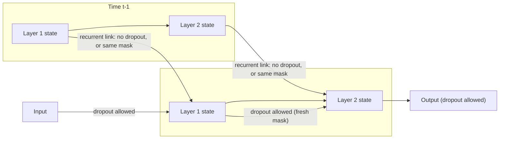

The diagram marks which links may carry a fresh dropout mask (vertical links between layers, input, and output) and which must not (horizontal links through time). The rule of thumb that follows is to ask, for every dropout call in a recurrent model, whether the dropped value will be fed back into the same layer at the next step; if it will, use a shared mask or no dropout.

### 10.4 Optimizer, batch size, and schedule

Adam or AdamW with a learning rate of $10^{-3}$ is a reasonable starting point for LSTMs and GRUs of moderate size, with global-norm clipping as in Section 6.2. Large-batch training of recurrent models has diminishing returns because the sequential dimension dominates wall-clock time; a batch of 32 to 128 sequences is typical. Reduce the learning rate on a plateau or use cosine decay. Weight decay is applied to the weight matrices, not to biases or normalization parameters. When the output vocabulary is large (language modeling), tying the input embedding and the output projection (Press and Wolf, 2017) cuts the parameter count substantially and often improves perplexity, and it is commonly applied to recurrent language models.

### 10.5 Training checklist

1. Verify the hand-written or custom cell against finite differences, as in Section 4.2.
2. Overfit a tiny batch (8 sequences) to near-zero loss before scaling up. If this fails, the bug is in the data pipeline or masking, not in the optimization.
3. Log global gradient norm, fraction of clipped updates, and gate means per layer. A forget gate whose mean falls below 0.3 on a task that needs memory shows the model learned to forget.
4. Evaluate with the state handling used in serving, not just with the training loop.

## 11. Sequence-to-Sequence Models and the Bottleneck

### 11.1 The encoder-decoder pattern

For unaligned problems such as translation, Sutskever, Vinyals, and Le (2014) and Cho et al. (2014) independently proposed the same structure. An **encoder** recurrent network reads the source sequence $x_1, \dots, x_S$ and produces a final state. A **decoder** recurrent network is initialized with that state and generates the target $y_1, \dots, y_T$ one token at a time. The decoder models the probability of the output by the chain rule:

$$
P(y_1, \dots, y_T \mid x) = \prod_{t=1}^{T} P\left(y_t \mid y_1, \dots, y_{t-1}, c\right), \qquad c = \text{encoder summary of } x
$$

At each step the decoder consumes the previous token (embedded), updates its state, and produces a softmax over the target vocabulary. Generation starts from a special start-of-sequence token and stops when the decoder emits an end-of-sequence token, or when a length cap is reached. Training maximizes the log-likelihood of the reference target. Sutskever et al. also reversed the order of the source tokens, a trick that shortened the path between the first source word and the first target word and measurably improved their results; attention later made it unnecessary.

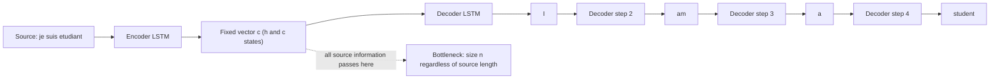

The diagram shows the feedback loop in generation: each emitted token becomes the input of the next decoder step, which is why generation is sequential and why an early mistake propagates (Section 13). The dashed note marks the key property of the architecture: the entire source sentence is squeezed through one vector.

### 11.2 The bottleneck

The summary vector has a fixed size $n$, say 512, whether the source has five words or fifty. A 512-dimensional float32 vector occupies 2 KB. There is nothing preventing 512 floats from encoding a short sentence, and for a long one the capacity is limited by what training can teach, not by the raw bit count: 50 tokens from a 30,000-word vocabulary carry about $50 \times \log_2 30000 \approx 745$ bits of identity information, which fits in 512 floats in principle. The problem is learnability. The network must route information about the first word through 50 recurrent updates, and each update can overwrite it, and the gradient teaching it to preserve it passes through the product of Jacobians of Section 5.

The measured effect is a decline in quality with source length. Cho et al. (2014, "On the properties of neural machine translation") reported that the performance of the basic encoder-decoder deteriorates quickly as the sentence grows, and Bahdanau, Cho, and Bengio (2014) showed the same curve for their baseline while the attention model stayed flat on long sentences. The specific BLEU numbers belong to those papers and their data; the shape of the finding is what transferred to practice.

Three responses existed before attention. Reversing the source helps a little; a bidirectional encoder summarizes both ends; a larger hidden state increases capacity at higher cost. None removes the architectural problem that the decoder cannot look back at the source. Attention does.

## 12. Attention: From Bahdanau and Luong to the Transformer

### 12.1 The idea

Bahdanau et al. (2014) changed the decoder so that at each output step it looks at all of the encoder's hidden states instead of one summary. The encoder is bidirectional, producing an **annotation** $h_j$ for each source position $j$ that contains information about the whole sentence centered on word $j$. The decoder computes a different context vector $c_t$ for every output step, as a weighted average of the annotations, with the weights learned.

### 12.2 Additive attention (Bahdanau)

With decoder state $s_{t-1}$ and encoder annotations $h_1, \dots, h_S$:

$$
e_{tj} = v^\top \tanh\left(W_a s_{t-1} + U_a h_j\right), \qquad
\alpha_{tj} = \frac{\exp(e_{tj})}{\sum_{k=1}^{S} \exp(e_{tk})}, \qquad
c_t = \sum_{j=1}^{S} \alpha_{tj} h_j
$$

The score $e_{tj}$ comes from a small feed-forward network (one hidden layer with parameters $W_a$, $U_a$, $v$) that compares the decoder state to the annotation. The softmax turns the scores into weights $\alpha_{tj} \ge 0$ that sum to 1, so $c_t$ is a convex combination of the annotations. The decoder then updates with $s_t = f(s_{t-1}, y_{t-1}, c_t)$ and predicts $y_t$ from $s_t$, $y_{t-1}$, and $c_t$.

### 12.3 Multiplicative attention (Luong)

Luong, Pham, and Manning (2015) simplified the score and moved the attention step to use the current decoder state $s_t$:

$$
\text{score}(s_t, h_j) = \begin{cases} s_t^\top h_j & \text{dot} \\ s_t^\top W_a h_j & \text{general} \\ v^\top \tanh\left(W_a [s_t ; h_j]\right) & \text{concat} \end{cases}
$$

The context $c_t$ is formed as before, then combined with the decoder state into an attentional hidden state $\tilde{s}_t = \tanh(W_c [c_t ; s_t])$, which feeds the output softmax. Luong et al. also proposed **input feeding**, passing $\tilde{s}_t$ back as an input to the next decoder step so that the model knows which positions it attended to earlier, and distinguished **global** attention (over all source positions) from **local** attention (over a window around a predicted position), which saves compute for long sources. The dot-product score has no parameters and maps efficiently to matrix multiplication, which is why it won out.

### 12.4 A worked attention step

Part of the second script uses three encoder annotations $h_1 = (1, 0)$, $h_2 = (0, 1)$, $h_3 = (1, 1)$ and decoder state $s = (1, 0)$.

**Dot score (Luong).** The scores are $s^\top h_j = (1, 0, 1)$. The softmax is $\exp(1) / (2\exp(1) + 1) = 2.718 / 6.437 = 0.4223$ for positions 1 and 3, and $1 / 6.437 = 0.1554$ for position 2. The context is $0.4223\,(1,0) + 0.1554\,(0,1) + 0.4223\,(1,1) = (0.8446, 0.5777)$. The decoder state points along the first axis, so the annotations with a large first component (positions 1 and 3) get the weight, and the context is pulled toward them.

**Additive score (Bahdanau)** with $W_a = U_a = 0.5\,I$ and $v = (1, -1)$. For $h_1$: $W_a s = (0.5, 0)$ and $U_a h_1 = (0.5, 0)$, so the argument is $(1.0, 0)$, $\tanh = (0.7616, 0)$, and the score is $0.7616$. For $h_2$: the argument is $(0.5, 0.5)$, so $\tanh = (0.4621, 0.4621)$ and the score is $0$. For $h_3$: the argument is $(1.0, 0.5)$, $\tanh = (0.7616, 0.4621)$, and the score is $0.2995$. The softmax gives weights $(0.4769, 0.2227, 0.3004)$, which sum to 1, and the context is $(0.7773, 0.5231)$. The additive form assigns the highest weight to $h_1$, the annotation most aligned with the decoder state, and a smaller weight to $h_3$, while the dot form ties them. The two scoring functions give different weights on the same inputs because the additive network has its own nonlinearity; in a trained model both learn to put weight where it reduces the loss.

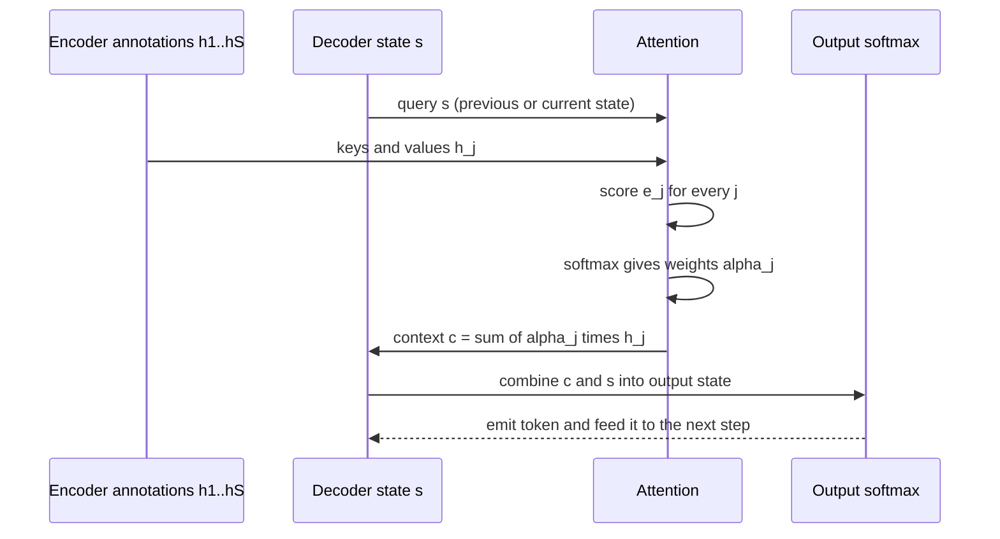

The diagram shows one decoder step. The query-key-value vocabulary is added here because it is how the same mechanism is described in the transformer: the decoder state is the **query**, the annotations are the **keys** (used to compute scores) and also the **values** (averaged to form the context). In the recurrent encoder-decoder, keys and values are the same vectors; the transformer gives them separate learned projections.

### 12.5 Cost and interpretability

Attention adds one pass over the $S$ source annotations at each of $T$ decoder steps. With $S = 50$, $T = 60$, and $n = 512$, the dot scores and the weighted sum each cost about $S \times T \times n$ multiply-adds, which together are around 3.1 million floating-point operations. An LSTM step with $d = n = 512$ costs about 4.2 million floating-point operations ($2 \times 4 \times 512 \times 1024$), so attention adds a modest fraction to the decoder cost per sequence. Memory grows with $S \times T$ for the weight matrix if it is stored for visualization or for backpropagation.

The weights $\alpha_{tj}$ can be plotted as an alignment matrix, which for translation shows near-diagonal structure with local reorderings. This is useful for debugging (a decoder that attends to the wrong word before a mistranslation, or collapses all weight on the end-of-sentence token). It should not be presented as a faithful explanation of the model's decision: later work showed that different attention distributions can give the same prediction, so alignment plots are evidence to inspect, not proof of reasoning.

### 12.6 Why attention led to the transformer

Two facts made the next step natural. First, once the decoder reads directly from every source position, the path length between any source word and any output word is one, so the long-range gradient problem for that dependency disappears. Second, the recurrent encoder had become the slowest and least parallel part of the system, and its main remaining job was to produce position-specific context vectors, which attention could produce from the raw embeddings. Vaswani et al. (2017) removed the recurrence and applied attention within the encoder (self-attention), within the decoder, and between them. The full treatment, with positional encoding, multi-head attention, and masking, is in [CH10](CH10_Transformers_and_Attention.md). What this chapter contributes is the lineage: additive and multiplicative scoring, softmax weights over positions, and a context vector as a weighted average, are all unchanged in the transformer.

## 13. Teacher Forcing and Exposure Bias

### 13.1 What teacher forcing does

An autoregressive decoder models the probability of a target sequence $y_1, \dots, y_T$ as a product of conditionals:

$$
p(y_1, \dots, y_T \mid x) = \prod_{t=1}^{T} p(y_t \mid y_1, \dots, y_{t-1}, x)
$$

During training, the decoder at step $t$ needs the previous token $y_{t-1}$ as input. There are two choices. **Teacher forcing** feeds the reference token $y_{t-1}$ from the training data, regardless of what the model would have predicted. **Free running** feeds the model's own prediction $\hat{y}_{t-1}$. Williams and Zipser (1989) described teacher forcing for recurrent networks, and it has been the default for sequence models since, for three reasons.

1. **Stable, informative gradients.** With the reference prefix, every step's loss is computed in a context that matches the data, so the error signal at step $t$ is about step $t$ and not about an earlier mistake that put the decoder in a strange state.
2. **Parallel loss computation.** Because all inputs are known in advance, the output projections and softmax for all $T$ steps can be computed as a single large matrix multiplication after the recurrent pass. The recurrent state update is still sequential, but the most expensive part for large vocabularies, the softmax over $30{,}000$ or more words, is not. In a transformer decoder, teacher forcing also removes the sequential dependency entirely, which is one reason for its efficiency there.
3. **Fast convergence.** Free-running training starts with a decoder that produces garbage, so almost every input is garbage, and learning is slow and noisy.

The training objective is the sum of per-token cross-entropy losses, which is the negative log-likelihood of the reference sequence under the model:

$$
L = -\sum_{t=1}^{T} \log p_\theta\left(y_t^{\ast} \mid y_1^{\ast}, \dots, y_{t-1}^{\ast}, x\right)
$$

where $y^{\ast}$ is the reference sequence. Every term conditions on the reference prefix. This is the maximum-likelihood objective for classification, derived in [CH03 — Regression and Classification](CH03_Regression_and_Classification.md), applied once per output position. Minimizing it makes the model assign high probability to the reference continuation at each position of the training data.

### 13.2 Exposure bias

At inference, there is no reference. The decoder is conditioned on its own previous outputs. The training distribution of prefixes (always correct) differs from the inference distribution of prefixes (sometimes wrong). Ranzato, Chopra, Auli, and Zaremba (2015) named this mismatch **exposure bias**: the model is never exposed to its own errors during training, so it has not learned to recover from them.

A back-of-envelope calculation shows why this matters. Suppose the decoder, given a correct prefix, picks the right token with probability 0.98. If errors were independent and unrecoverable, a 50-token output would be entirely correct with probability $0.98^{50}$. Taking logarithms, $50 \ln 0.98 = 50 \times (-0.0202) = -1.010$, and $e^{-1.010} = 0.364$. With a per-token accuracy of 0.95 the figure falls to $0.95^{50} = 0.077$, and with 0.99 it is $0.605$. The independence assumption is crude, since many errors are harmless paraphrases, but it captures the direction: the longer the output, the more chances the decoder has to wander into a prefix that training never showed, and the more its behavior in that region is an extrapolation.

The symptoms in practice are repetition loops (the decoder repeats a phrase because the repeated prefix makes the repeat likely), drift off topic, and abrupt end-of-sequence or failure to stop. There is a real debate about how large the effect is for modern, well-trained models. Some authors find that exposure bias is a smaller practical problem than the training-versus-decoding-objective gap, and that fixes for it help less than expected. Treat the following mitigations as tools to try when measurement shows long-output degradation, not as defaults.

### 13.3 Scheduled sampling

Bengio, Vinyals, Jaitly, and Shazeer (2015) proposed **scheduled sampling**. At each decoder step during training, flip a biased coin: with probability $\epsilon_i$ feed the reference token, and otherwise feed the model's own prediction (the arg max, or a sample). The probability $\epsilon_i$ decays over training iterations $i$, so the model starts with teacher forcing and ends with mostly its own inputs. The paper suggests three decay schedules; the inverse sigmoid decay is

$$
\epsilon_i = \frac{k}{k + \exp(i / k)}
$$

with $k \ge 1$ controlling the speed. For $k = 1000$: at $i = 0$, $\epsilon_0 = 1000 / (1000 + 1) = 0.999$; at $i = 5000$, $\exp(5) = 148.4$ and $\epsilon = 1000 / 1148.4 = 0.871$; at $i = 10{,}000$, $\exp(10) = 22{,}026$ and $\epsilon = 1000 / 23{,}026 = 0.043$. The sampling probability stays near teacher forcing for several thousand updates and then drops fast.

Scheduled sampling has two known weaknesses. The sampled token is not paired with a correct target: if the model feeds itself a wrong token at step $t-1$, the reference token at step $t$ may no longer be the best continuation, yet the loss still pushes the model toward it. Huszar (2015) argued that the procedure is not consistent as a training objective. And it breaks the parallelism of teacher forcing, because step $t$ cannot be computed before step $t-1$ has been sampled, so training slows by an amount that depends on how often the model's own inputs are used. In practice, small mixing rates (feeding the model's own token 10 to 25 percent of the time) give most of the benefit.

### 13.4 Alternatives to scheduled sampling

- **Sequence-level training.** Train directly on a sequence-level reward such as BLEU (bilingual evaluation understudy) with policy-gradient methods. Ranzato et al. (2015) did this with the MIXER algorithm, starting from the maximum-likelihood model and gradually shifting to the sequence reward. Minimum risk training minimizes the expected loss over sampled outputs. These methods fix the objective mismatch but are higher variance, more expensive, and tuned to one metric, which the model can then exploit.
- **Professor forcing.** Lamb et al. (2016) used an adversarial discriminator to make the decoder's hidden-state dynamics under teacher forcing and under free running statistically indistinguishable.
- **Noise and data augmentation.** Randomly replace a fraction of the input tokens with other tokens, or add noise to hidden states, so the decoder sees imperfect prefixes in training. This is cheap and keeps parallelism, and it is a reasonable first experiment.
- **Reranking and search.** Generate several candidates (Section 14) and choose among them with a separate scorer. This does not change the training but reduces the chance that one unlucky path is the output.

The following flowchart summarizes the training-time choices.

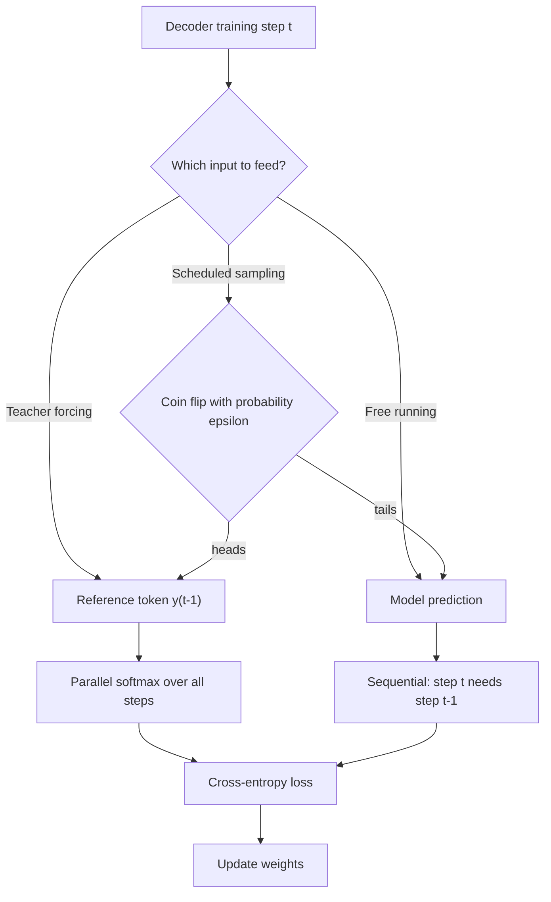

The diagram shows why the choice has a systems consequence as well as a statistical one. The left path keeps the output projection parallel across time, while the paths that use the model's own predictions put a sequential dependency into training. When the training cost matters, prefer the cheaper fixes (noise, a small sampling rate, reranking) before moving to sequence-level objectives.

### 13.5 Teacher forcing outside translation

The same issue appears wherever a recurrent model is rolled forward on its own outputs. In multi-step forecasting with a **recursive** strategy, the model predicts one step, appends the prediction to the history, and predicts again (Section 18). If it was trained with true history only, errors compound in the forecast horizon, exactly as in text. In handwriting or music generation, the generated stroke or note becomes the next input. And in reinforcement learning from model rollouts, a learned dynamics model rolled forward for many steps drifts away from the data manifold. The mitigations are the same: train on a mixture of true and predicted inputs, add noise, or use a **direct** strategy that predicts all horizons in one pass so that there is no feedback at all.

## 14. Decoding: Greedy Search, Beam Search, and Their Failure Modes

### 14.1 The decoding problem

Given a trained autoregressive model, decoding means finding the output sequence $\hat{y}$ with high probability under the model:

$$
\hat{y} = \arg\max_{y} \; \sum_{t=1}^{|y|} \log p(y_t \mid y_{<t}, x)
$$

The search space is the set of all token sequences up to the maximum length, which has size $V^{T}$ for vocabulary size $V$. With $V = 30{,}000$ and $T = 20$ that is $30{,}000^{20} \approx 3.5 \times 10^{89}$ sequences, so exact search is impossible, and because the recurrent state depends on the entire prefix, dynamic programming that merges prefixes does not apply. Decoding is therefore a heuristic search whose quality and cost depend on how much of the space it explores.

### 14.2 Greedy search

Greedy decoding picks the arg max token at each step and feeds it back. It costs one decoder step per output token and keeps one state, which makes it the cheapest method, with the lowest latency. Its flaw is that it commits early. A first token that looks best locally may lead to a poor continuation, and greedy search cannot go back.

The third script builds a two-step model that shows the failure. The first token is `A` with probability 0.55 or `B` with probability 0.45. After `A`, the second token is `x`, `y`, or `z` with probabilities 0.40, 0.30, and 0.30. After `B`, the second token is `x` with probability 0.95, and `y`, `z` with 0.03 and 0.02. Greedy search picks `A` (0.55 beats 0.45) and then `x` (0.40), giving the sequence `Ax` with probability $0.55 \times 0.40 = 0.2200$. The best sequence overall is `Bx` with probability $0.45 \times 0.95 = 0.4275$, almost twice as likely. The first choice was locally best and globally wrong, because `A` leads to a flat distribution over continuations while `B` leads to a confident one.

### 14.3 Beam search

Beam search keeps the $B$ highest-scoring partial sequences (the **beam**) at every step. At each step, every hypothesis in the beam is extended by every vocabulary token, giving $B \times V$ candidates, and the top $B$ by cumulative log-probability form the next beam. A hypothesis that emits the end-of-sequence token moves to a finished list. The search stops when enough hypotheses are finished or the length cap is reached.

On the two-step example with $B = 2$: after the first step the beam holds `A` (0.55) and `B` (0.45). After the second step the candidates include `Ax` 0.2200, `Ay` 0.1650, `Az` 0.1650, `Bx` 0.4275, `By` 0.0135, and `Bz` 0.0090. The top is `Bx`, which recovers the optimum. With $B = 1$ beam search is greedy search and returns `Ax`. This is the script's output: beam width 2 returns `Bx` with 0.4275 and beam width 1 returns `Ax` with 0.2200.

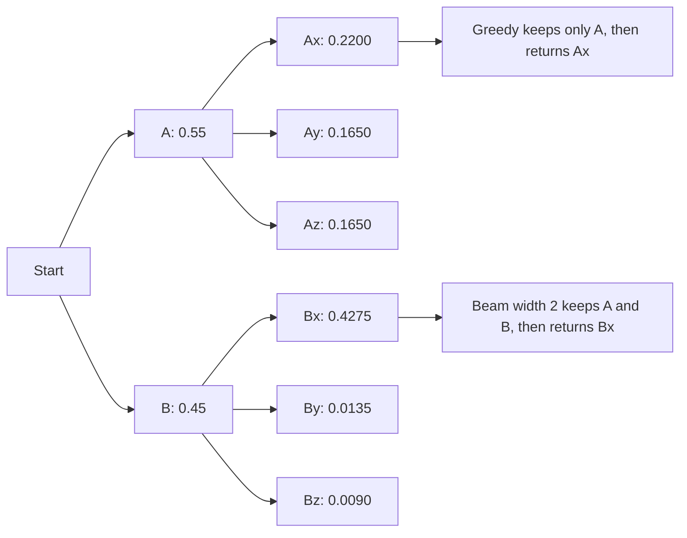

The tree shows the full search space for this tiny model and where each method ends up. Greedy search follows the left branch because its first choice was `A`. A beam of two keeps both first tokens alive until the second token reveals the better path. In real models, the gap between a good and a bad path often appears after several steps, so a beam of 4 to 10 is common.

Costs scale with the beam. Each step expands $B$ hypotheses, so the decoder state is stored $B$ times, and the output layer computes $B \times V$ scores. For $B = 5$ and $V = 30{,}000$ that is $150{,}000$ scores per step, followed by a top-$k$ selection. The recurrent computation per step is $B$ times larger than greedy search, but it batches well (the $B$ hypotheses are a batch of $B$ states), so wall-clock time grows less than linearly on parallel hardware. Memory for state copies is small for recurrent models, which is a practical advantage over transformer decoders where each hypothesis has its own key-value cache.

### 14.4 Failure modes of beam search

**The beam search curse.** More search does not always give better output. Koehn and Knowles (2017) reported that translation quality in neural systems often fell as the beam widened beyond a small value. Stahlberg and Byrne (2019) found that the model's exact best sequence is frequently the empty sequence, and that beam search is saved from this by its own search errors. The cause is that the model is imperfect: its highest-probability sequence is not its best translation. A better search finds a higher-probability output that is a worse output.

**Length bias.** The score is a sum of log-probabilities, each negative, so longer hypotheses accumulate more negative score. Unnormalized beam search prefers short outputs. The third script gives the illustration: a short hypothesis with log-probability $-2.4$ over 3 tokens and a long one with $-4.8$ over 8 tokens. Raw scores favor the short one ($-2.4 > -4.8$). Per-token averages are $-0.80$ and $-0.60$, which favor the long one. Wu et al. (2016, the Google neural machine translation system) used a length penalty

$$
\text{score}(Y) = \frac{\log P(Y \mid X)}{lp(Y)}, \qquad lp(Y) = \frac{(5 + |Y|)^{\alpha}}{(5 + 1)^{\alpha}}
$$

with $\alpha$ between 0 and 1 (they report values near 0.6 to 0.7 as good for their data; $\alpha = 0$ disables the penalty). With $\alpha = 0.65$: for $|Y| = 3$, $lp = (8/6)^{0.65} = 1.206$ and the score is $-2.4 / 1.206 = -1.99$; for $|Y| = 8$, $lp = (13/6)^{0.65} = 1.653$ and the score is $-4.8 / 1.653 = -2.90$. The short hypothesis still wins under this mild penalty. This is the practical lesson: length normalization shifts the balance but does not guarantee the desired length, so the value of $\alpha$ must be tuned on a validation set with a metric that is sensitive to length (such as the length ratio of output to reference).

**Lack of diversity.** The $B$ hypotheses in the final beam are often near-duplicates that differ in one word, because they share a prefix. Applications that need alternatives (suggested replies, multiple translations) use diverse beam search, which penalizes hypotheses for similarity to others, or sampling.

**Repetition and generic output.** Maximum-probability decoding favors safe, frequent phrases, and in open-ended generation it produces dull, repetitive text. Holtzman et al. (2019) showed that for open-ended text the highest-probability sequence is not human-like, and proposed **nucleus (top-$p$) sampling**: sample from the smallest set of tokens whose cumulative probability exceeds $p$, such as 0.9. Temperature scaling and top-$k$ sampling are related. Open-ended generation with large models is covered in [CH15 — Large Language Model Fundamentals and Inference](CH15_Large_Language_Model_Fundamentals_and_Inference.md); the point here is that beam search suits tasks with a nearly determined answer (translation, transcription, structured output), and sampling suits tasks where many outputs are acceptable.

**Dead ends from hard constraints.** If the output must satisfy a grammar (valid JSON, a SQL dialect, a closed set of labels), unconstrained beam search can produce invalid output. Constrained decoding masks out tokens that would violate the grammar at each step. For small output vocabularies this is a simple mask on the logits before the softmax.

### 14.5 Choosing a decoding method

| Task | Typical method | Reason |
| --- | --- | --- |
| Translation, transcription with an attention decoder | Beam search, $B$ = 4 to 10, tuned length penalty | Output is nearly determined by the input, and search errors matter |
| Streaming recognition with tight latency | Greedy or a small beam with pruning | Latency budget allows little search |
| Aligned sequence labeling | Per-position arg max, or Viterbi with a CRF (Section 16) | Output length is fixed and a label-transition structure exists |
| Speech or handwriting with CTC | Best-path or prefix beam search, optionally with a language model (Section 15) | The model scores alignments, not label sequences |
| Open-ended generation, dialogue | Sampling with temperature and top-$p$ | Diversity matters, and maximum-probability text is dull |
| Structured output with a grammar | Constrained greedy or beam | Invalid outputs must be impossible |
| Recursive forecasting | Single rollout, or sampled trajectories for a distribution | A forecast distribution needs samples, not the mode |

Three habits make decoding decisions testable. First, measure the quality metric as a function of beam width on a validation set, and stop widening when it flattens or falls. Second, report the length ratio (hypothesis length divided by reference length) with every translation or summarization result, since length bias is a silent source of metric movement. Third, log the rate of empty or truncated outputs and of outputs that hit the length cap in production; both indicate a decoding problem that no single-example inspection reveals.

## 15. Connectionist Temporal Classification for Speech and Handwriting

### 15.1 The alignment problem

An acoustic model receives one feature vector every 10 milliseconds, so a three-second utterance has 300 frames. The transcript "hello" has five characters. Which frames belong to which character is not recorded in the training data, and annotating it by hand is slow and error-prone. A frame-wise cross-entropy loss needs a label for every frame, so it needs that alignment. The same problem occurs in handwriting recognition, where a line image or pen trajectory has hundreds of positions and a transcript of a few dozen characters.

Graves, Fernandez, Gomez, and Schmidhuber (2006) introduced **connectionist temporal classification (CTC)**, which removes the need for alignment labels. The network emits, at every frame, a probability distribution over the label alphabet plus a special **blank** symbol. A frame-level sequence of symbols, called a **path** $\pi$, is converted to a label sequence by a many-to-one map $\mathcal{B}$ that first merges consecutive repeated symbols and then deletes blanks. For example, with `-` as the blank:

- `h h - e l l - l o o` collapses to `hello`: merge repeats to `h - e l - l o`, delete blanks to `hello`.
- `- h e - l - l o -` also collapses to `hello`.
- `h e l l o` collapses to `helo`, because the two `l` frames merge. The blank between the two `l` characters in the first two paths is what keeps them as two letters.

The probability of a label sequence $l$ is the sum over all paths that collapse to it, and the path probability is the product of the per-frame probabilities, assuming the frames are conditionally independent given the input:

$$
P(l \mid x) = \sum_{\pi \in \mathcal{B}^{-1}(l)} \prod_{t=1}^{T} y^{t}_{\pi_t}
$$

where $y^t_k$ is the network's softmax output for symbol $k$ at frame $t$. The training loss is $-\ln P(l \mid x)$ for the reference transcript. Summing over all alignments means the network is free to choose whichever timing it finds easiest to learn, and the loss rewards the total probability mass on correct alignments.

### 15.2 Why the sum is feasible: the forward algorithm

The number of paths is huge ($S^T$ for alphabet size $S$ with blank), but the sum has the structure of a lattice, and the forward algorithm computes it in $O(T \times |l|)$ operations. Build the **extended label sequence** $l'$ by inserting a blank before, between, and after the labels of $l$, so that a label of length $U$ becomes $2U + 1$ symbols. For the label $(a, b)$ this is $(-, a, -, b, -)$. Let $\alpha_t(s)$ be the total probability of all path prefixes of length $t$ that collapse to the first $s$ symbols of $l'$ and end at position $s$. The recurrence is:

$$
\alpha_t(s) = y^t_{l'_s} \cdot \begin{cases}
\alpha_{t-1}(s) + \alpha_{t-1}(s-1) + \alpha_{t-1}(s-2) & \text{if } l'_s \neq - \text{ and } l'_s \neq l'_{s-2} \\
\alpha_{t-1}(s) + \alpha_{t-1}(s-1) & \text{otherwise}
\end{cases}
$$

with $\alpha_1(1) = y^1_{-}$, $\alpha_1(2) = y^1_{l_1}$, and all other initial values zero. The skip term $\alpha_{t-1}(s-2)$ lets the path move directly from one label to the next without passing through a blank, which is allowed unless the two labels are the same (then a blank is mandatory, so that the repeat is not merged). The total probability is $P(l \mid x) = \alpha_T(2U + 1) + \alpha_T(2U)$, since a valid path may end on the last blank or the last label. A backward recurrence $\beta_t(s)$ is defined symmetrically, and the gradient of the loss with respect to the network's output at each frame is computed from products $\alpha_t(s)\beta_t(s)$. The gradient has an interpretation like the expectation step in the expectation-maximization algorithm: it compares the network's current output with the posterior probability of each symbol at each frame given the correct transcript, so the network is pulled toward the alignments it already finds plausible. In practice, the computation is carried out in log space for numerical stability, and every framework provides it (`torch.nn.CTCLoss`, `tf.nn.ctc_loss`), so there is no reason to implement it outside of learning.

### 15.3 A worked example

The third script uses four frames and the alphabet $\{-, a, b\}$ with these per-frame probabilities:

| Frame | blank | a | b |
| --- | --- | --- | --- |
| 1 | 0.1 | 0.7 | 0.2 |
| 2 | 0.5 | 0.3 | 0.2 |
| 3 | 0.2 | 0.1 | 0.7 |
| 4 | 0.4 | 0.1 | 0.5 |

The target is $(a, b)$, with extended sequence $(-, a, -, b, -)$, positions 0 to 4. Initialization: $\alpha_1 = (0.1, 0.7, 0, 0, 0)$.

Frame 2 (probabilities $-$: 0.5, $a$: 0.3, $b$: 0.2). Position 0: $0.1 \times 0.5 = 0.05$. Position 1 ($a$): $(0.7 + 0.1) \times 0.3 = 0.24$. Position 2 (blank): $(0 + 0.7) \times 0.5 = 0.35$. Position 3 ($b$): the skip from position 1 is allowed since $b \ne a$, so $(0 + 0 + 0.7) \times 0.2 = 0.14$. Position 4: $0$.

Frame 3 (probabilities $-$: 0.2, $a$: 0.1, $b$: 0.7). Position 0: $0.05 \times 0.2 = 0.01$. Position 1: $(0.24 + 0.05) \times 0.1 = 0.029$. Position 2: $(0.35 + 0.24) \times 0.2 = 0.118$. Position 3: $(0.14 + 0.35 + 0.24) \times 0.7 = 0.511$. Position 4: $(0 + 0.14) \times 0.2 = 0.028$.

Frame 4 (probabilities $-$: 0.4, $a$: 0.1, $b$: 0.5). Position 3: $(0.511 + 0.118 + 0.029) \times 0.5 = 0.329$. Position 4: $(0.028 + 0.511) \times 0.4 = 0.2156$.

The total is $P(a, b \mid x) = 0.329 + 0.2156 = 0.5446$, which matches the script's brute-force sum over all 81 paths, of which 15 collapse to $(a, b)$. The loss is $-\ln 0.5446 = 0.6077$. The script also verifies that the probabilities of all label sequences sum to 1, which confirms that the collapse map partitions the path space.

### 15.4 Decoding CTC outputs

**Best-path decoding** takes the arg max symbol at every frame and collapses. It is fast and needs no search, but it is not the same as finding the most probable label sequence, because it ignores that many paths map to the same label. The script shows this with two frames, where each frame has $P(-) = 0.6$ and $P(a) = 0.4$. The best path is (blank, blank), with probability $0.36$, which collapses to the empty label. The label $(a)$ is the collapse of three paths: $(a, -)$ with $0.4 \times 0.6 = 0.24$, $(-, a)$ with $0.6 \times 0.4 = 0.24$, and $(a, a)$ with $0.4 \times 0.4 = 0.16$, for a total of $0.64$. Best-path decoding outputs nothing, and the true most likely label is $(a)$. In well-trained networks the distributions are peaky, which makes the two answers agree most of the time, but low-confidence regions (noisy audio, unclear handwriting) are where they disagree.

**Prefix beam search** keeps the $B$ most probable label prefixes, tracking for each prefix the probability of paths ending in a blank and in a non-blank, so that merging repeats is handled correctly. It finds the label sequence with higher total probability than best-path decoding. It is also the natural place to add an external **language model**: the score of a candidate prefix becomes $\log P_{\text{CTC}} + \lambda \log P_{\text{LM}} + \beta \cdot \text{length}$, where $\lambda$ weights the language model and $\beta$ is a word insertion bonus that offsets the LM's tendency to prefer short output. Both are tuned on a validation set. This is shallow fusion, and it is how a CTC acoustic model gets the linguistic knowledge it lacks.

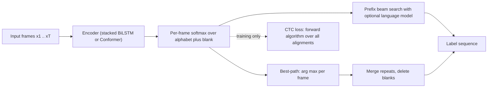

The diagram separates the training path from the inference paths. The dashed edge is the CTC loss, which consumes the softmax output and the reference transcript but not any alignment. At inference, one of two decoders turns the same per-frame distributions into text. The encoder is unchanged between them, so the decoding strategy can be changed without retraining.

### 15.5 Properties and limits

- **Monotonic and no longer than the input.** The output cannot be longer than the number of frames, and it cannot reorder. A label with $R$ adjacent repeated characters needs at least $U + R$ frames. "Hello" needs six frames: the five letters plus one blank between the two `l` characters. This sets a constraint on the encoder's downsampling. If a convolutional front end reduces 100 frames per second to 12.5, a character-level model speaking at 15 characters per second cannot be represented. A stride of 4 (25 frames per second) is common for character output, and larger strides are used with word-piece outputs.
- **Conditional independence.** Given the input, the frame outputs are treated as independent, so CTC has no internal language model. It can output "their" where "there" is correct if the audio is ambiguous, and it needs an external language model to repair this.
- **Peaky behavior.** Trained CTC networks often emit a label in one or two frames and blank elsewhere. The spikes mean frame-level outputs are not good localizations of when a character was spoken, so CTC output should not be used for precise timing without a forced aligner.
- **Strong training signal at low cost.** The loss costs $O(T \times U)$ per sequence and needs only transcripts. This made end-to-end speech recognition practical with bidirectional LSTM encoders (Graves and Jaitly, 2014; Amodei et al., 2016, Deep Speech 2).

### 15.6 Alternatives: RNN transducer and attention decoders

The **recurrent neural network transducer** (RNN-T), introduced by Graves (2012), keeps CTC's monotonic alignment and removes conditional independence. It adds a **prediction network** (an LSTM over the previously emitted labels, acting as an internal language model) and a **joint network** that combines the encoder output at frame $t$ with the prediction-network state to give a distribution over symbols and blank. At each frame the model may emit several labels before moving on. RNN-T supports streaming, because the encoder can be causal and the decoder consumes frames as they arrive, which is why it became a common choice for on-device speech recognition. Attention-based encoder-decoder models (Chan et al., 2016, Listen, Attend and Spell) drop the monotonic constraint and generally need the full utterance, so they suit offline transcription and are harder to stream. The following table summarizes the decision.

| Property | CTC | RNN-T | Attention encoder-decoder |
| --- | --- | --- | --- |
| Alignment | Monotonic, implicit | Monotonic, implicit | Learned soft attention |
| Internal language model | No (needs external) | Yes (prediction network) | Yes (decoder) |
| Streaming | Easy with a causal encoder | Natural | Hard, needs the whole input or a chunked variant |
| Training cost | Lowest | Highest memory (joint over frames and labels) | Moderate |
| Output length vs input | At most the number of frames | Can exceed it per frame | Unconstrained |
| Typical use | Keyword spotting, simple dictation, handwriting | On-device and streaming recognition | Offline transcription, translation |

Choose CTC when the vocabulary is small, an external language model is available, and low training cost matters. Choose RNN-T when streaming with strong accuracy is the requirement. Choose an attention decoder when the full input is available and the output is not a monotonic function of it.

## 16. Conditional Random Fields for Sequence Labeling

### 16.1 Why independent labels are not enough

In an aligned labeling task, such as named-entity recognition with the BIO tag scheme (B: beginning of an entity, I: inside an entity, O: outside), the tags are not independent. The tag I cannot follow O, and it cannot start a sentence. A bidirectional LSTM with a softmax at every position chooses each tag by itself, and nothing prevents it from emitting the invalid pair O followed by I. Fixing such outputs by post-processing hides the model's confusion and does not improve the probability estimates. A **conditional random field (CRF)** layer on top of the recurrent encoder models the whole tag sequence jointly.

### 16.2 The linear-chain CRF

For an input sequence $x$ of length $T$ and a tag sequence $y = (y_1, \dots, y_T)$ drawn from $K$ tags, the linear-chain CRF assigns a score and normalizes over all $K^T$ tag sequences:

$$
s(x, y) = \sum_{t=1}^{T} E_{t, y_t} + \sum_{t=2}^{T} A_{y_{t-1}, y_t} + a^{\text{start}}_{y_1}, \qquad
p(y \mid x) = \frac{\exp s(x, y)}{\sum_{y'} \exp s(x, y')}
$$

The matrix $E \in \mathbb{R}^{T \times K}$ holds the **emission scores**, produced by the recurrent encoder for each position. The matrix $A \in \mathbb{R}^{K \times K}$ holds learned **transition scores**: $A_{ij}$ is the score for tag $j$ following tag $i$. The vector $a^{\text{start}}$ scores the first tag (an end vector is often added in the same way). The only new parameters are $K^2 + K$ numbers. Huang, Xu, and Yu (2015) and Lample et al. (2016) popularized the BiLSTM-CRF for sequence tagging.

The denominator $Z(x) = \sum_{y'} \exp s(x, y')$ is a sum over $K^T$ sequences, but the forward algorithm computes it in $O(T K^2)$ time, using the same lattice idea as CTC. Define $\alpha_t(j)$ as the log of the sum of exponentiated scores of all prefixes ending in tag $j$ at position $t$. Then $\alpha_1(j) = a^{\text{start}}_j + E_{1j}$ and $\alpha_t(j) = E_{tj} + \log \sum_i \exp\left(\alpha_{t-1}(i) + A_{ij}\right)$, and $\log Z = \log \sum_j \exp \alpha_T(j)$. The training loss is $-s(x, y^{\ast}) + \log Z(x)$. At inference, the **Viterbi algorithm** replaces the log-sum-exp with a maximum and keeps back-pointers, and returns the highest-scoring sequence in the same $O(T K^2)$ time.

### 16.3 A worked example

Take two words, tags B, I, O, and these scores (illustrative values chosen to show the mechanism). Emissions for word 1: B = 2.0, I = 2.2, O = 0.5. Emissions for word 2: B = 0.3, I = 1.8, O = 1.0. Transitions: B to I = 1.0, I to I = 0.5, O to O = 0.5, O to I = $-4$, and all other pairs 0. Start scores: B = 0, I = $-3$, O = 0 (a sentence cannot start inside an entity).

A softmax at each position independently picks I for word 1 (2.2 is the largest emission) and I for word 2 (1.8). The pair "I I" begins with an invalid tag. Its CRF score is $-3 + 2.2 + 0.5 + 1.8 = 1.5$. The nine possible sequences have these scores:

| Sequence | Score |
| --- | --- |
| B B | $0 + 2.0 + 0 + 0.3 = 2.3$ |
| B I | $0 + 2.0 + 1.0 + 1.8 = 4.8$ |
| B O | $0 + 2.0 + 0 + 1.0 = 3.0$ |
| I B | $-3 + 2.2 + 0 + 0.3 = -0.5$ |
| I I | $1.5$ |
| I O | $-3 + 2.2 + 0 + 1.0 = 0.2$ |
| O B | $0 + 0.5 + 0 + 0.3 = 0.8$ |
| O I | $0 + 0.5 - 4 + 1.8 = -1.7$ |
| O O | $0 + 0.5 + 0.5 + 1.0 = 2.0$ |

The Viterbi answer is B I with score 4.8. The partition function is the sum of the exponentials: $e^{2.3} + e^{4.8} + e^{3.0} + e^{-0.5} + e^{1.5} + e^{0.2} + e^{0.8} + e^{-1.7} + e^{2.0} = 9.97 + 121.51 + 20.09 + 0.61 + 4.48 + 1.22 + 2.23 + 0.18 + 7.39 = 167.68$. So $p(\text{B I} \mid x) = 121.51 / 167.68 = 0.725$, while $p(\text{I I} \mid x) = 4.48 / 167.68 = 0.027$. The independent softmax would have output the invalid I I, and the CRF's joint model chooses B I, which is the valid sequence supported by both the emissions (word 1 is also strongly B) and the transition from B to I.

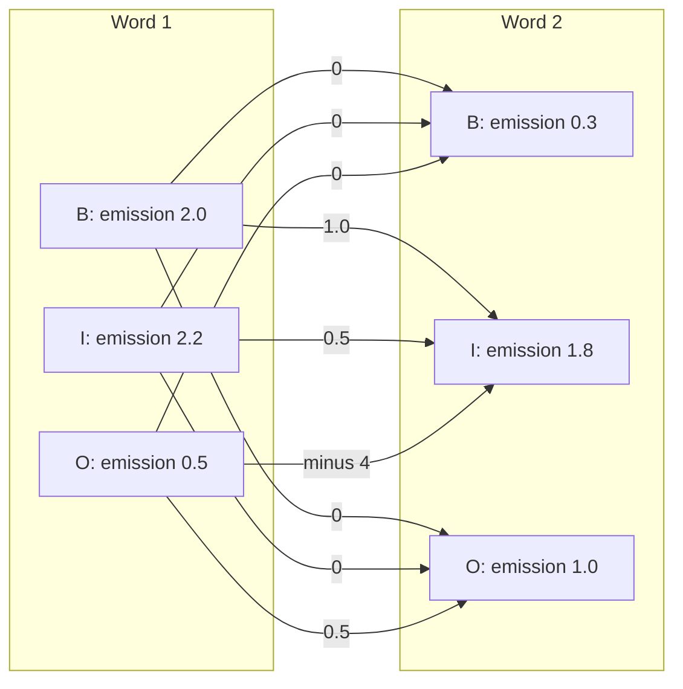

The diagram is the lattice for the example. Each path from left to right is a tag sequence, and its score is the sum of the emission scores at the nodes and the transition scores on the edges, plus the start score. The strongly negative edge from O to I is what removes the invalid sequence from contention. The forward and Viterbi algorithms are dynamic programs over this lattice, reusing the best partial result at each node.

### 16.4 Cost, alternatives, and when the CRF is worth it

A CRF adds $K^2$ parameters and a dynamic program per sentence, which is cheap for $K$ up to a few dozen tags and grows quadratically for large tag sets. Its value is largest when the label scheme has hard structural constraints and the data is small or medium sized. With a large pretrained transformer encoder, gains from a CRF layer are often small, and many teams drop it and instead apply **constrained Viterbi decoding**, which uses a transition matrix with $-\infty$ at forbidden pairs (such as O to I) and no learned transitions. This gives valid outputs without extra training.

The CRF models the sequence at the level of labels. It does not replace the recurrent encoder, which still provides the features that depend on the surrounding words. The two are complementary: the BiLSTM gives context-dependent emission scores, and the CRF enforces consistency between neighbouring labels.

## 17. Padding, Masking, Packed Sequences, and Bucketing

### 17.1 Why padding exists

Hardware is efficient on rectangular tensors, but sequences have different lengths. The standard solution is to pad every sequence in a batch to the length of the longest one with a filler value, usually an index reserved for padding or zeros. A batch of shape (batch, time, features) is then a dense tensor. Padding creates three problems, each of which has a standard fix, and each of which silently corrupts training when forgotten.

1. **The loss counts padded positions.** Padded steps produce outputs, and unless excluded, they contribute to the loss. The model is then trained to predict padding.
2. **The recurrent state is updated by padding.** If a short sequence is right-padded, the recurrent cell keeps running over the padding after the real data ends, so the last hidden state (used for many-to-one classification) is a function of padding, not the final real element.
3. **Normalization, pooling, and attention see padding.** A mean over time includes the filler. An attention softmax gives weight to padded positions. Batch statistics are computed over them.

### 17.2 Masking

A **mask** is a boolean (or 0/1) tensor of the same shape as the (batch, time) grid, with 1 at real positions and 0 at padding. It is applied in four places.

- **Loss.** Compute per-step losses, multiply by the mask, and divide by the number of real positions (not the grid size). The fourth script uses three sequences of lengths 4, 2, and 1 padded to length 4, with per-step losses `[1, 2, 3, 2]`, `[4, 2, 0, 0]`, and `[3, 0, 0, 0]`. The masked mean is $(1+2+3+2 + 4+2 + 3) / 7 = 17/7 = 2.4286$. A naive mean over the padded grid gives $17 / 12 = 1.4167$ (the script prints 1.4167), which understates the loss by about 42 percent and weights short sequences less than long ones. The reduction matters: dividing by the count of real tokens weights every token equally, while dividing by the number of sequences weights every sequence equally. State which one you use and keep it identical between training and evaluation.
- **Recurrent state.** For a many-to-one model, take the hidden state at index `length - 1` for each sequence, or use packing (Section 17.3). For a model that keeps the state, freeze the state at padded positions: $h_t = m_t \cdot f(h_{t-1}, x_t) + (1 - m_t) \cdot h_{t-1}$, where $m_t$ is the mask.
- **Pooling.** Use a masked mean (sum of valid hidden states divided by the length) or a masked max (set padded positions to a very negative number before the max).
- **Attention.** Add a large negative number (or $-\infty$) to the scores of padded positions before the softmax, so they receive zero weight. The softmax then renormalizes over real positions.

### 17.3 Packed sequences

PyTorch provides `pack_padded_sequence(input, lengths, batch_first=True, enforce_sorted=False)` and `pad_packed_sequence`. A packed sequence stores only the real elements, time-major, together with the number of sequences still active at each time step. The recurrent layer then processes, at step $t$, only the sequences that have not ended. Two properties follow. The final hidden state returned by the layer is the state at each sequence's own last real element, which fixes the right-padding problem for unidirectional layers. And in a bidirectional layer, the backward direction starts at each sequence's true last element and not at padding, which matters: without packing, the backward pass of a right-padded short sequence starts from filler, and the state arriving at the real data is contaminated. Keras provides the equivalent through a `Masking` layer or `mask_zero=True` on an embedding, which propagates a mask to the recurrent layer; the cuDNN-accelerated path in Keras supports masking only for right-padded inputs, so check the documentation of the version in use.

Packing costs a sort by length (done internally when `enforce_sorted=False`) and prevents some kernel fusions. For short sequences, or when the padded fraction is small, the simple mask-the-loss approach with the final state selected by index is often fast enough, and it avoids packing's complexity. For long, highly variable lengths, packing saves compute and removes a correctness trap.

### 17.4 Bucketing

Padding wastes compute in proportion to the gap between each sequence and the longest in its batch. Suppose a random batch has four sequences of lengths 10, 12, 100, and 120. The real tokens are $10 + 12 + 100 + 120 = 242$. Padded to 120, the batch holds $4 \times 120 = 480$ positions, so utilization is $242 / 480 = 50.4$ percent, and half the compute is wasted on padding. If the same four sequences are grouped by length, with batches $\{10, 12\}$ padded to 12 (24 positions) and $\{100, 120\}$ padded to 120 (240 positions), the total is 264 positions and the utilization is $242 / 264 = 91.7$ percent.

**Bucketing** is the practice of building batches from sequences of similar length. A common implementation:

1. Shuffle the dataset at the start of each epoch.
2. Split it into large chunks (for example 100 times the batch size).
3. Sort each chunk by length and cut it into batches.
4. Shuffle the order of the batches.

Sorting within a chunk, not globally, keeps the batches varied across epochs. A strict global sort by length produces the same batches every epoch and makes the training curve depend on the order of lengths (short sequences first, long last), which can bias optimization. **Token-based batching** goes further: instead of a fixed number of sequences per batch, set a maximum number of padded tokens (for example 16,000), so batches of short sequences contain many sequences and batches of long sequences few. This keeps memory use steady, and the gradient noise level is more even across batches than with fixed-size batches.

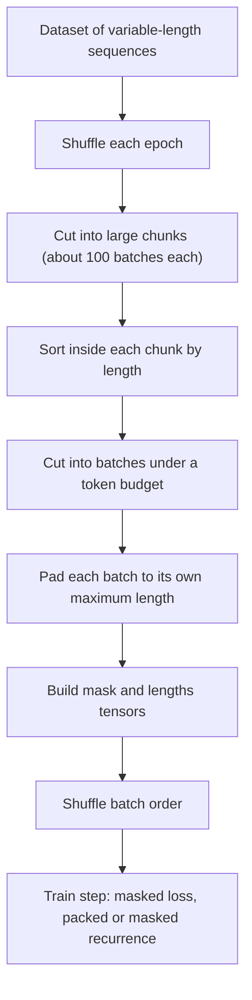

The diagram shows the data pipeline and where each correctness mechanism sits. Padding and mask creation come as a pair, and neither is useful without the other. The order of the last two boxes protects against the opposite failure from wasteful padding: a model that sees long sequences only at the end of an epoch.

Bucketing has a side effect that has caused production bugs. Batch composition now correlates with length, so batch-level statistics (batch normalization, a learning rate tied to batch size) vary with the length of the batch. Recurrent networks typically use layer normalization, which is computed per example and is not affected. If the length distribution at serving time differs from training, evaluate on length-stratified slices (short, medium, long) and not only the pooled average, because pooled metrics are dominated by the most frequent length.

### 17.5 Checklist for padding correctness

- The padding index is reserved and does not collide with a real token or a real feature value. Padding with 0.0 in a numeric series is wrong when 0.0 is a valid reading; use a separate mask channel.
- Loss and metrics divide by real positions.
- The state used for classification is the state at the last real position.
- Attention and pooling use the mask.
- A unit test compares the output of one sequence processed alone with the output of the same sequence processed inside a padded batch, and requires equal results up to floating-point tolerance. This test catches nearly all of the errors above, and it also checks that batch composition does not change predictions, a property that production systems depend on.

## 18. Time-Series Forecasting and Anomaly Detection

### 18.1 The task and its baselines

A time series is a sequence of values indexed by time, often with seasonal structure (daily, weekly, yearly cycles), a trend, and noise. Forecasting predicts future values from past values and known future inputs such as holidays or price changes. Anomaly detection flags observations or windows that depart from expected behavior. These are different problems that often share a model: a forecaster produces an expected value, and the gap between expectation and observation is the anomaly signal.

A recurrent network is one option among several, and the others are strong. A solution architect should demand evidence that a recurrent model beats the simpler ones before accepting its operating cost. The classical baselines are:

- **Naive and seasonal naive.** Predict the last value, or the value one season ago. They cost nothing, and they set the floor: a model that cannot beat seasonal naive is not worth deploying.
- **Exponential smoothing.** Simple exponential smoothing keeps a level $\ell_t = \alpha y_t + (1 - \alpha)\ell_{t-1}$ and forecasts $\hat{y}_{t+1} = \ell_t$. Holt's method adds a trend, and the Holt-Winters method adds a seasonal component, with smoothing parameters fitted by minimizing squared error. The state-space formulation of Hyndman and colleagues (ETS, for error, trend, and seasonality) gives prediction intervals.
- **ARIMA.** An autoregressive integrated moving average model, ARIMA$(p, d, q)$, differences the series $d$ times to remove a trend, then models the result as a linear combination of $p$ past values and $q$ past errors. Seasonal ARIMA adds seasonal terms. Fitting is per series, using maximum likelihood.
- **Gradient-boosted trees on lag features.** Build a table with one row per time step, columns for lags (the value 1, 2, 7, 14, 28 steps ago), rolling means and standard deviations, calendar features (day of week, month, holiday flags), and known future covariates, then fit a tree ensemble ([CH04](CH04_Decision_Trees_and_Ensemble_Learning.md)). It handles many series in one model, tolerates missing values, and is fast to train.

The fourth script compares four of these on a synthetic series: $y_t = 50 + 0.05 t + 10 \sin(2\pi t / 7) + \varepsilon_t$ with noise standard deviation 1, fit on the first 180 points and tested on the next 60 with one-step-ahead forecasts. The mean absolute errors are:

| Method | Mean absolute error |
| --- | --- |
| Naive, $y_{t-1}$ | 5.602 |
| Seasonal naive, $y_{t-7}$ | 1.233 |
| Simple exponential smoothing, $\alpha = 0.5$ | 6.945 |
| Linear model on 8 lag features | 1.084 |

The numbers say something specific. Methods without a seasonal component (naive and simple smoothing) lose by a factor of five, because they cannot represent the weekly cycle. Seasonal naive is a hard baseline, with an error of 1.233 against an irreducible noise level that, for Gaussian noise of standard deviation 1, gives an expected absolute error of about $0.80$ for a perfect forecaster. A model using eight lags, which includes the value seven steps earlier, comes within about 0.3 of that limit. The lesson is that most of the achievable gain comes from capturing the seasonality, and a recurrent network has to do that too. It offers no advantage on a series where a linear function of lags is already near the noise floor.

### 18.2 Evidence from forecasting competitions

Large evaluations give a sober picture. In the M4 competition (Makridakis, Spiliotis, and Assimakopoulos, 2018, 100,000 series), the winning entry by Slawek Smyl was a hybrid of exponential smoothing and a recurrent network, and pure statistical combinations performed better than most pure machine-learning submissions. In the M5 competition (retail demand for Walmart, 2020), the top entries were dominated by gradient-boosted trees (LightGBM) on engineered features. Reported follow-up work, such as Zeng et al. (2023) on long-horizon forecasting with transformers, found that a simple linear model on lagged values matched or beat elaborate neural architectures on common benchmarks. Verify the current state of the literature before relying on any of these as a final word, but the pattern is stable: a recurrent model is competitive when there are many related series, rich covariates, and non-linear interactions, and it is not an automatic upgrade.

Where recurrent models fit well is in **global models** trained on many related series. DeepAR (Salinas, Flunkert, Gasthaus, and Januschowski, 2020) trains one autoregressive LSTM across all the series in a dataset, with series-specific scale handling and a probabilistic output (a Gaussian or negative binomial likelihood), and produces forecast distributions by sampling. It helps most for short or sparse series that share patterns with others, a case where a per-series ARIMA has too little data.

### 18.3 Windowing and the shape of training data

A supervised recurrent forecaster is trained on **windows**: a window of $L$ past steps (the look-back) and a target of the next $H$ steps (the horizon). With a series of $N$ points, a stride of 1, look-back $L$, and horizon $H$, the number of windows is $N - L - H + 1$. For $N = 1000$, $L = 28$, $H = 7$ this is $1000 - 28 - 7 + 1 = 966$ windows. These windows overlap almost entirely, so they are not independent samples: 966 windows from one series carry far less information than 966 independent observations, and a validation set cut randomly from them leaks neighbours of training windows. Evaluation must split by time, and the split must leave a gap equal to at least the horizon between the end of training and the start of validation so that no target in the training set overlaps the validation inputs.

Multi-step forecasting has three strategies.

- **Recursive.** Predict one step, append it, repeat. One model, but errors compound, and the exposure-bias problem of Section 13 appears directly.
- **Direct.** Train one model (or one output head) per horizon step. No feedback, but $H$ models, and no guarantee that the forecasts are consistent across horizons.
- **Multi-output (sequence-to-sequence).** One network emits all $H$ steps at once, from a dense head or from a decoder. It is the usual choice for recurrent forecasters: the encoder reads the look-back and the decoder or the head produces the horizon, with future covariates fed in as inputs.

### 18.4 Scaling, normalization, and probabilistic output

Series have different scales: one product sells 3 units a day, another 3,000. A shared network needs normalized inputs, and the scaling statistics must come from the **training window** only. The fourth script shows the effect of a leak. For a trending series of 100 points, using statistics of the first 80 gives a mean of 112.20 and a standard deviation of 7.48, while using all 100 points gives 115.36 and 9.27. The last value (the one a forecaster cares about) has a z-score of 2.70 under training statistics, which is how an unusual high value would look at serving time, and 1.84 under the leaky statistics, which hide how far the series has moved. A model evaluated with leaky scaling looks better on the test period than it will in production. Per-window scaling (dividing each window by its own mean or last value, and multiplying the forecast back) avoids a global scale entirely and is common for non-stationary series, at the cost of losing absolute level information unless that level is passed as a separate feature.

A point forecast hides uncertainty, and an inventory or capacity decision usually needs a quantile (the 90th percentile of demand sets the safety stock). A network can predict quantiles directly with the **pinball loss**. For quantile level $\tau$ and error $e = y - \hat{y}$ the loss is $\max(\tau e, (\tau - 1) e)$. For $\tau = 0.9$ with an actual value of 100: a forecast of 90 gives $e = 10$ and a loss of $0.9 \times 10 = 9.0$ (under-forecasting is expensive at the 90th percentile), while a forecast of 110 gives $e = -10$ and a loss of $0.1 \times 10 = 1.0$. Minimizing the expected loss makes $\hat{y}$ the 90th percentile of the predictive distribution. Evaluate the calibration of the result: about 90 percent of actual values should fall below the 0.9-quantile forecast on held-out data.

### 18.5 Anomaly detection with a forecaster

The most common design is a **residual detector**. Fit a forecaster on normal data, compute the residual $r_t = y_t - \hat{y}_t$ on new data, estimate the residual distribution on a normal validation period, and flag points where $|r_t|$ exceeds a threshold. Malhotra et al. (2015) applied stacked LSTMs to prediction-error anomaly detection on sensor data, and Hundman et al. (2018) combined LSTM forecasts with an adaptive nonparametric threshold on spacecraft telemetry, with a pruning step to reduce false positives.

The threshold decides the cost. Suppose the residuals on normal data are roughly Gaussian with a standard deviation $\sigma = 1.2$. A threshold at $3\sigma = 3.6$ flags about 0.27 percent of normal two-sided points. At one reading per minute (1,440 per day), that is $1440 \times 0.0027 \approx 3.9$ false alarms per day per sensor, which is unusable if an operator has to look at each of them across hundreds of sensors. Requiring three consecutive exceedances reduces the rate if residuals were independent to $0.0027^3 \times 1440 \approx 2.8 \times 10^{-5}$ per day, but residuals from a forecaster are autocorrelated (a missed level shift produces many consecutive large residuals), so the true reduction is smaller, and the independence arithmetic is optimistic. The design process is therefore empirical: collect a labeled period with known faults, plot alert rate against detection delay for several thresholds and persistence rules, and choose the operating point from the cost of a false alarm and the cost of a missed or late detection.

Alternatives are the **sequence autoencoder** (an LSTM encoder-decoder trained to reconstruct normal windows, with reconstruction error as the anomaly score), classification of windows when labeled faults exist, and statistical process control (control charts on the residual). The autoencoder needs no labels but can reconstruct anomalies well if the bottleneck is too wide. A frequent practical finding is that a supervised gradient-boosted classifier on engineered window features beats unsupervised neural detectors when even a few dozen labeled faults exist, so labeling effort is often better spent than architecture search.

### 18.6 Choosing a forecasting model

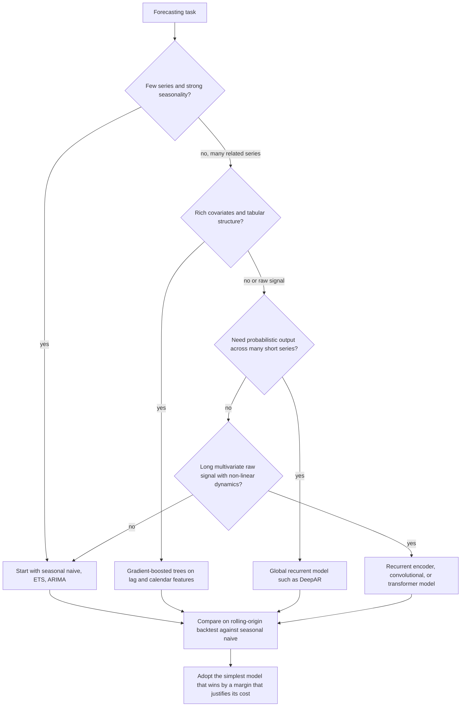

The decision tree starts from the cheapest family and moves toward recurrent models only when the data shape justifies it. Every leaf feeds the same backtest, because the winner is determined by measurement on your data and not by the family. The final box states the adoption rule: the margin must cover the extra cost of training, serving, and monitoring a neural model. A 2 percent error reduction on a series where the forecast error is not the dominant source of business cost is not worth a stateful production system.

| Criterion | Seasonal naive, ETS, ARIMA | Gradient-boosted trees on lags | Recurrent network |
| --- | --- | --- | --- |
| Data needed per model | One series, tens to hundreds of points | Many rows pooled across series | Many series or long series |
| Covariates and categorical features | Limited | Excellent | Good with design effort |
| Training cost | Seconds per series | Minutes | Minutes to hours, GPU helpful |
| Serving | Trivial | Trivial | State, batching, framework runtime |
| Probabilistic forecasts | Built in (ETS, ARIMA) | Quantile objectives | Likelihood or quantile head |
| Interpretability | High | Feature importance | Low |
| Cold start for a new series | Needs history | Works with static features | Works with a series embedding |

## 19. Why Transformers Displaced Recurrent Networks, and Where Recurrence Returned

### 19.1 What went wrong with recurrence at scale

Three properties of recurrent networks limited them once datasets and hardware grew.

**Sequential computation.** The hidden state at step $t$ depends on step $t-1$ through a nonlinear function, so the $T$ steps of one sequence cannot run in parallel during training. The only parallelism is across the batch. Accelerators reward large dense matrix multiplications, and a recurrent step is a small matrix-vector product (per sequence) repeated $T$ times, which leaves most of the hardware idle at small batch sizes. A transformer processes all positions of a sequence in one pass, so training time on fixed hardware drops sharply, and that translates directly into the ability to train on more data.

**Path length.** In a recurrent network, information from position 1 reaches position $T$ through $T-1$ state updates. Even with gating, signal can be lost or overwritten along the way (Section 7.5 showed that a forget gate of 0.82 leaves $4.2 \times 10^{-5}$ of the signal after 50 steps). In self-attention, any two positions interact directly, so the path length is 1.

**Fixed-size memory.** Everything the model knows about the past must fit in the state vector, whose size is fixed in advance. That is a feature at inference (constant memory), and a limitation for tasks that need exact recall of specific earlier tokens, such as copying a name given 3,000 tokens earlier or retrieving a value from a table in the context.

### 19.2 The cost comparison

Vaswani et al. (2017) compared layer types by three measures, reproduced here in terms of sequence length $n$ and representation size $d$:

| Layer type | Compute per layer | Minimum sequential operations | Maximum path length |
| --- | --- | --- | --- |
| Self-attention | $O(n^2 \cdot d)$ | $O(1)$ | $O(1)$ |
| Recurrent | $O(n \cdot d^2)$ | $O(n)$ | $O(n)$ |
| Convolutional (kernel $k$) | $O(k \cdot n \cdot d^2)$ | $O(1)$ | $O(\log_k n)$ with dilation |

Worked arithmetic with $d = 512$: at $n = 100$, self-attention costs $100^2 \times 512 = 5.12$ million operations and recurrence costs $100 \times 512^2 = 26.2$ million. At $n = 1000$, attention costs $1000^2 \times 512 = 512$ million and recurrence costs $1000 \times 512^2 = 262$ million. The two cross at $n = d$. Below that length attention is cheaper per layer in raw operations, and above it recurrence is cheaper, which is why long-context attention is the expensive regime and why the efficient-attention literature exists. The decisive difference was never the operation count. It was the $O(1)$ versus $O(n)$ sequential depth, which determines how much of the hardware a training step can use.

The inference side reverses the picture. A transformer decoder caches the keys and values of all earlier tokens (the key-value cache, covered in [CH15](CH15_Large_Language_Model_Fundamentals_and_Inference.md)), so memory grows linearly with context. For an illustrative configuration of 32 layers, 8 key-value heads, a head dimension of 128, and 16-bit values, each token adds $2 \times 32 \times 8 \times 128 \times 2 = 131{,}072$ bytes (128 KiB) of cache. At a 100,000-token context that is $131{,}072 \times 100{,}000 \approx 13.1$ billion bytes, or 12.2 GiB, per sequence. A recurrent model with a hidden size of 2,048 and an LSTM in each of 32 layers holds $2 \times 2048 \times 2 = 8$ KiB per layer (hidden and cell state in 16-bit), or 256 KiB in total, and the number does not change with context length. The recurrent model's state equals the transformer's cache for just two tokens. This is the reason recurrence is attractive again for long contexts and for devices with little memory.

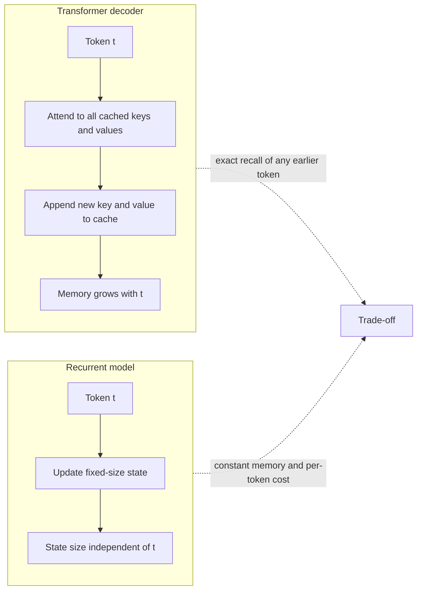

The diagram contrasts what each architecture stores at inference. The transformer keeps everything and pays in memory and per-token attention cost, which also grows with context. The recurrent model compresses the past into a fixed state and pays in recall. The sections that follow describe designs that try to keep the constant-memory property while recovering more of the transformer's quality.

### 19.3 Linear attention: a transformer that is also an RNN

Standard attention for a causal query at position $t$ computes $y_t = \sum_{j \le t} \text{softmax}_j(q_t^\top k_j / \sqrt{d})\, v_j$. The softmax couples every query with every key, which forces the full $n \times n$ computation. Katharopoulos, Vyas, Pappas, and Fleuret (2020) replaced the softmax with a kernel feature map $\phi$, so that the similarity is $\phi(q_t)^\top \phi(k_j)$. Because this similarity factorizes, the sum can be regrouped:

$$
y_t = \frac{\phi(q_t)^\top S_t}{\phi(q_t)^\top z_t}, \qquad
S_t = S_{t-1} + \phi(k_t)\, v_t^\top, \qquad
z_t = z_{t-1} + \phi(k_t)
$$

The matrix $S_t \in \mathbb{R}^{d \times d}$ and vector $z_t \in \mathbb{R}^{d}$ are updated at each step with a constant amount of work, so this is a recurrent network with a matrix-valued state, which the paper's title states directly: transformers are RNNs. Training can still be done in parallel over the whole sequence with a chunked algorithm, and inference needs constant memory per token.

A tiny numerical case, using the identity map $\phi(x) = x$ and dropping the normalizer to isolate the state update: with keys $k_1 = (1, 0)$, $k_2 = (0, 1)$, values $v_1 = (2, 3)$, $v_2 = (4, 5)$, the state after two tokens is $S_2 = k_1 v_1^\top + k_2 v_2^\top = \begin{pmatrix} 2 & 3 \\ 4 & 5 \end{pmatrix}$. For a query $q = (1, 1)$ the output is $q^\top S_2 = (6, 8)$. Computing the same output directly as $\sum_j (q \cdot k_j) v_j = 1 \cdot (2, 3) + 1 \cdot (4, 5) = (6, 8)$ gives the same answer, so the recurrent and the parallel forms agree. The state is $d \times d$ at any length, which is where both the saving and the loss come from: $d^2$ numbers cannot store $n$ distinct key-value pairs exactly when $n > d$, so old associations interfere with each other. Later designs add decay and gating to the update to control this interference.

### 19.4 State-space models: S4 and Mamba

A **state-space model** describes a sequence by a linear recurrence in a latent state:

$$
h_t = A h_{t-1} + B x_t, \qquad y_t = C h_t
$$

where $A$, $B$, and $C$ are matrices. The recurrence is linear in $h$, which is the key difference from an LSTM: because there is no nonlinearity between steps, the whole map from inputs to outputs is a convolution with a kernel $K_k = C A^{k} B$. Training can therefore compute the output of the entire sequence in parallel (by a fast convolution), while inference runs the recurrence one step at a time with constant memory. Gu, Goel, and Re (2021, published at ICLR 2022) introduced the structured state space sequence model (S4), which parameterizes $A$ with a special structure (initialized from the HiPPO theory of memorizing a history by polynomial projection) so that it can retain information over thousands of steps and be computed efficiently. S4 set strong results on long-range benchmarks where LSTMs and transformers had struggled.

Linear recurrences can also be parallelized without the convolution form, by a **parallel scan**. Write the recurrence for a scalar state as $h_t = a_t h_{t-1} + b_t$. Each step is an affine map, and composing two affine maps gives another affine map: applying $(a_1, b_1)$ and then $(a_2, b_2)$ gives $(a_1 a_2,\; a_2 b_1 + b_2)$. This composition is associative, so the prefix results for all $t$ can be computed in $O(\log n)$ parallel rounds. A numeric check with $a = 0.5$ and $b = (1, 2, 3, 4)$, starting from $h_0 = 0$: sequentially, $h_1 = 1$, $h_2 = 0.5 \times 1 + 2 = 2.5$, $h_3 = 0.5 \times 2.5 + 3 = 4.25$, $h_4 = 0.5 \times 4.25 + 4 = 6.125$. By scan: combine steps 1 and 2 to get $(0.25,\; 0.5 \times 1 + 2) = (0.25, 2.5)$; combine steps 3 and 4 to get $(0.25,\; 0.5 \times 3 + 4) = (0.25, 5.5)$; combine those two to get $(0.0625,\; 0.25 \times 2.5 + 5.5) = (0.0625, 6.125)$. The final $b$ equals $h_4 = 6.125$. An LSTM cannot use this trick, because its gates depend on $h_{t-1}$ through a sigmoid and tanh, so the map from $h_{t-1}$ to $h_t$ is not affine.

The price of a fixed linear recurrence is that it treats every input the same way: $A$ and $B$ do not depend on the content, so the model cannot decide to ignore noise or hold on to a specific token. Gu and Dao (2023) introduced **Mamba**, a selective state-space model in which $B$, $C$, and the discretization step depend on the current input. This gives content-dependent gating, much like the LSTM's gates, and removes the convolution form, so the authors designed a hardware-aware parallel scan to keep training efficient. Dao and Gu (2024) later showed a duality between such state-space models and a form of linear attention. At the time of writing, Mamba-style blocks are used in research models and in some hybrid production models that interleave them with attention layers.

### 19.5 Other recurrent designs

- **RWKV** (Peng et al., 2023) formulates a transformer-like block with a linear-time recurrent form, trained in parallel and run as an RNN at inference, and it has been scaled to billions of parameters.
- **xLSTM** (Beck et al., 2024) revisits the LSTM with exponential gating and a matrix-valued memory cell, plus a parallelizable variant, to address the limitations listed in Section 19.1.
- **Hybrids** such as Griffin (De et al., 2024), used in the RecurrentGemma models, mix gated linear recurrences with local attention. The recurrence handles long-range summarization at constant memory, and the local attention handles precise recall in a window.

The common thread is a design triangle. A model needs training parallelism (so it must be linear in the state, or parallelizable by scan), constant-memory inference (so the state must be fixed size), and content-dependent selection (so the update must depend on the input). Plain LSTMs have the last two but not the first. Plain transformers have the first and third but not the second. Linear recurrences with selection aim for all three, and the open question is how much recall quality is lost compared with full attention. Benchmarks show state-space and recurrent models matching transformers on perplexity at moderate scale and trailing on tasks that need exact retrieval from long context (for example, copying and multi-key lookup), which is why hybrids keep some attention layers. These claims move quickly; verify the current evidence against recent papers and model cards before choosing an architecture for a long-context workload.

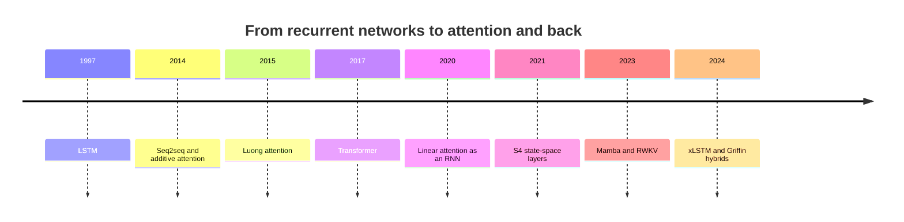

The timeline marks the arc of this chapter. Recurrence was displaced for training reasons, kept for inference reasons, and then redesigned so that it can also be trained in parallel. A practitioner reading a new architecture paper can place it by asking three questions: how is training parallelized, how big is the inference state, and how does the update depend on the input.

### 19.6 Decision guidance

Use a transformer when the context is moderate, exact recall matters, pretrained models exist for the domain, and the serving stack already handles the key-value cache. Use a recurrent or state-space model when the sequence is very long or unbounded (continuous sensor streams, long audio), the memory or latency budget per stream is tight (on-device, many concurrent streams), or the model is small and trained from scratch on a modest dataset where an LSTM or GRU is easy to train and serve. For time series and small tabular-sequence problems, the baselines of Section 18 are tried first. For natural language tasks with available pretrained encoders, fine-tuning a transformer usually beats training an LSTM from scratch ([CH20](CH20_Fine_Tuning_PEFT_and_LoRA.md) covers fine-tuning).

## 20. Streaming Inference and State Management in Production

### 20.1 Why recurrent models suit streaming

A streaming workload delivers input in pieces (audio chunks, sensor readings, keystrokes) and needs outputs with bounded delay. A unidirectional recurrent model processes each new piece with a cost that does not depend on how much came before, because the state summarizes the past. This is the property that makes keyword spotting, voice activity detection, streaming speech recognition with RNN-T, and edge anomaly detection practical on small devices. A bidirectional model cannot stream, since its backward pass needs the future. Streaming variants use a limited look-ahead (a few chunks of right context, at the price of that much added delay), or a unidirectional encoder.

### 20.2 What the state is, and how big

The state of an LSTM layer is the pair $(h, c)$, each of size $n$. For a three-layer unidirectional LSTM with $n = 512$ in 32-bit floats, the per-stream state is $2 \times 512 \times 4 \times 3 = 12{,}288$ bytes, or 12 KiB. A million concurrent streams need $12{,}288 \times 10^6 \approx 12.3$ billion bytes, or 11.4 GiB, of state, which fits in the memory of one server. With a GRU (one state vector), the figure halves. With 16-bit state it halves again, though numerical drift in a long-lived state must be tested, since a state updated millions of times accumulates rounding error. Compare this with a transformer, whose per-stream cache grows without bound (Section 19.2). Constant per-stream memory is the main operational argument for recurrent models in streaming.

The state is also **personal data**. It is a function of the user's audio or readings and can encode content from the past, even though it is not a readable transcript. Treat it with the same retention and access rules as the inputs ([CH30](CH30_AI_Data_Governance_Privacy_and_Provenance.md)).

### 20.3 Patterns for holding the state

| Pattern | How it works | Strength | Weakness |
| --- | --- | --- | --- |
| Client-held state | The server returns the new state with each response and the client sends it back | Stateless servers, simple scaling | Larger payloads, tampering risk, state leaves the trust boundary |
| Sticky sessions | A router sends all chunks of a stream to the same worker, which keeps the state in memory | Lowest latency, no state transfer | A worker failure loses the state, hot spots, harder autoscaling |
| External state store | Workers load and store the state from a fast key-value store (Redis or similar) at every chunk | Any worker can serve any chunk, easy failover | A round trip per chunk, and the store becomes a critical dependency |
| Hybrid | In-memory state with periodic checkpoint to a store | Low latency with recovery | Complexity, a recovery window with possible replay |

Some deciding numbers help. A client-held state of 12 KiB per chunk, at 10 chunks per second, is 120 KiB per second per stream in each direction, which is affordable on a data-center link and often not on a mobile connection. If the client is untrusted, the state must be signed (a message authentication code) and bound to the session and the model version, otherwise a modified state can steer the model, or a state from one user can be injected into another's session. An external store adds the store's latency to each chunk: with a round trip of 1 millisecond within a data center, a service handling chunks every 100 milliseconds uses 1 percent of the budget for state I/O, while a service handling chunks every 5 milliseconds uses 20 percent.

### 20.4 The lifecycle of a stream's state

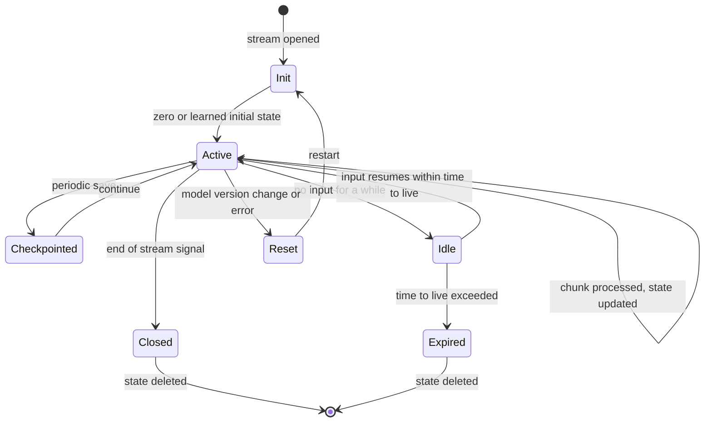

The states in the diagram correspond to decisions that have to be written down. **Init** defines the initial state, which must match training. **Active** updates on each chunk. **Checkpointed** is a durable copy that bounds how much input must be replayed after a failure. **Idle** and **Expired** define how long a silent stream keeps its state, which trades memory against the cost of cold-starting a returning user. **Reset** handles a change of model weights, since a state produced by one model version is meaningless to another, and handles errors that may have corrupted the state. **Closed** and **Expired** must delete the state, which is a privacy requirement and a memory-leak guard.

The ordering of chunks matters. Processing chunk 5 before chunk 4, or processing chunk 4 twice after a retry, produces a different state from the one a single in-order pass would have. Each chunk should carry a sequence number, the worker should apply a chunk only if its number equals the expected next number, and a retried chunk with an already-applied number should be answered from a cached response or ignored. The fourth script demonstrates the cost of a wrong state policy on a small tanh cell over 12 inputs. A single pass gives a final state of 0.641985. Processing the input in three chunks while carrying the state gives exactly the same value (difference 0). Resetting the state at every chunk boundary gives 0.610725, a difference of 0.031. A difference of 0.031 in a hidden unit is small for one cell and large when it flips a downstream threshold, and it appears only in the chunked deployment, so the chunked-equals-full-pass test belongs in the continuous integration suite for any stateful model.

```mermaid
sequenceDiagram
    participant C as Client
    participant R as Router
    participant W as Worker
    participant S as State store
    C->>R: chunk n with session id and sequence number
    R->>W: route by session id
    W->>S: load state for session
    S-->>W: state and last applied sequence number
    W->>W: check sequence number equals last plus one
    W->>W: run recurrent step on chunk
    W->>S: save new state and sequence number
    W-->>C: partial result
    Note over W,S: checkpoint is optional if state is held in memory
```

The sequence diagram shows the external-store pattern with the ordering check. The load and save steps bracket the compute, and the ordering check is what makes retries safe. In the sticky-session pattern the store steps are replaced by local memory plus a periodic checkpoint, and the router needs a consistent mapping from session to worker that survives scaling events.

### 20.5 Batching across streams

A single stream's step is a matrix-vector product. For an LSTM layer with $n = d = 512$, a step costs $2 \times 4 \times 512 \times 1024 = 4{,}194{,}304$ floating-point operations and needs the weight matrix, $4 \times 512 \times 1024 = 2{,}097{,}152$ parameters, or 8,388,608 bytes in 32-bit floats, read from memory. The arithmetic intensity is $4.19\text{M} / 8.39\text{M} = 0.5$ operations per byte, far below what an accelerator needs to be compute-bound, so a batch of one stream is limited by memory bandwidth. Batching $B$ streams makes the step a matrix-matrix product that reuses each weight $B$ times: the same bytes are read, but $B$ times more operations are done, for an intensity of $0.5 B$. At $B = 64$ it is 32 operations per byte. Throughput scales almost linearly with batch size until the accelerator saturates, which is why a serving system should gather the current chunk of many streams into one batch at each tick.

This requires care with state. The batch is a set of rows, one per stream, and the state tensors must be gathered from and scattered back to the correct rows. A mistake in indexing silently exchanges states between users. Streams join and leave at different times, so the batch composition changes at every tick, and the implementation needs a stable mapping from stream to state slot. A micro-batching window, typically a few milliseconds, collects chunks that arrive close together, and its length is a direct addition to latency. The latency budget of one chunk has the parts: network transit, queueing and micro-batch wait, compute, and state I/O. For a speech service with 160-millisecond chunks and a 300-millisecond end-to-end target, an illustrative split is 60 ms for the network, 10 ms for batching wait, 20 ms for compute, and 5 ms for state I/O, leaving the remainder as headroom. Measure each part in production, because the batching wait grows when traffic is low and the compute part grows when it is high.

### 20.6 Rollouts, versions, and recovery

- **Model version change.** The state is tied to the weights. During a rollout, a stream started on version 1 either continues on version 1 until it ends (pin the stream to the version at open), or is reset when it moves to version 2, with a flag that tells the client the context was lost. Pinning needs old workers to stay alive until their streams drain.
- **Quantization and precision.** A model served in lower precision than it was trained in should be tested for state drift over long streams, because the recurrent loop applies the same rounding error repeatedly.
- **Warm-up.** A cold state can be poor for the first second. Some systems prime the state with a short fixed prefix (silence, a calibration sequence) to leave the initial transient before real input.
- **Failure recovery.** After a worker crash, a stream can be restored from the last checkpoint and replayed from the buffered chunks since that checkpoint, subject to the ordering rule above. If no checkpoint exists, a reset with a fade-in period (outputs suppressed while the state warms up) is the fallback.
- **Observability.** Log per-stream chunk counts, state norms, the rate of resets and expirations, out-of-order and duplicate chunks, and the distribution of stream age. A drifting state norm, or saturated gates, is an early warning of numeric trouble.

## 21. Evaluation and Failure Modes

### 21.1 Perplexity

Perplexity is the standard intrinsic metric for a model that assigns probabilities to token sequences. For a held-out sequence of $N$ tokens it is the exponential of the average negative log-likelihood:

$$
\text{PPL} = \exp\left(-\frac{1}{N} \sum_{t=1}^{N} \ln p(y_t \mid y_{<t})\right)
$$

It can be read as the effective number of equally likely choices the model faces at each step. The third script computes it for four predictions with probabilities 0.5, 0.25, 0.125, and 0.5. In bits, the negative log-probabilities are 1, 2, 3, and 1, which average 1.75, so the perplexity is $2^{1.75} = 3.364$. In nats, the average is 1.2130 and $e^{1.2130} = 3.364$, the same number. The model behaves as if choosing among about 3.4 equally likely tokens per step.

Perplexity has limits that matter for comparisons. It is only comparable between models that use the same tokenization and the same test set, because a model with a larger vocabulary or longer tokens faces a different prediction problem. A character-level model and a word-level model can be compared only after converting to a common unit, such as bits per character. Perplexity also measures the average and says nothing about a specific failure, such as a wrong named entity. And low perplexity does not guarantee good generation: a model can assign high probability to the reference text and still produce repetitive output under beam search.

### 21.2 BLEU, ROUGE, and their limits

**BLEU** (Papineni et al., 2002) scores a candidate against reference translations by the geometric mean of modified $n$-gram precisions for $n = 1$ to 4, multiplied by a brevity penalty that punishes outputs shorter than the reference:

$$
\text{BLEU} = BP \cdot \exp\left(\sum_{n=1}^{4} \tfrac{1}{4} \ln p_n\right), \qquad BP = \min\left(1,\; e^{1 - r/c}\right)
$$

Here $r$ is the reference length and $c$ the candidate length. "Modified" means that each candidate $n$-gram is credited at most as many times as it occurs in the reference. The script shows why: a degenerate candidate "the the the the the the the" scored against "the cat is on the mat" would get unigram precision 7/7 without clipping. The reference contains "the" twice, so the clipped count is 2 and the precision is $2/7 = 0.2857$.

A small worked case shows a second limit. Reference: "the cat is on the mat". Candidate: "the cat sat on the mat" (one word changed, same length so $BP = 1$). The unigram precision is 5/6 (all words except "sat" match, with "the" counted twice). The bigram precision is 3/5 (the candidate bigrams "the cat", "on the", and "the mat" occur in the reference; "cat sat" and "sat on" do not). The trigram precision is 1/4 (only "on the mat"). The 4-gram precision is 0/3. The product includes a zero, so unsmoothed sentence-level BLEU is exactly 0 for a translation that differs by one word. Without the 4-gram term, the geometric mean of $5/6$, $3/5$, and $1/4$ would be $(0.125)^{1/3} = 0.5$. BLEU is designed for a corpus, where $n$-gram counts are summed over thousands of sentences before the precisions are computed, and it is unreliable per sentence unless a smoothing method is used.

Further limits apply. BLEU rewards surface overlap: a correct paraphrase scores low, and a fluent but wrong sentence that shares words scores high. Scores depend on tokenization and reference preprocessing, so numbers from different papers are often not comparable. Post (2018) proposed SacreBLEU, which fixes the tokenization and reports a signature, and it should be the default when BLEU is used at all. Correlation with human judgments is weak at the sentence level, and learned metrics based on neural models correlate better in recent evaluations. **ROUGE** (recall-oriented understudy for gisting evaluation; Lin, 2004), used for summarization, has the same character: ROUGE-N measures $n$-gram recall against references, and ROUGE-L uses the longest common subsequence. It rewards copying, cannot see factual errors, and says little about coherence. Neither metric detects a hallucinated fact that uses words from the source. For generation quality, pair an automatic metric with human review on a stratified sample and task-specific checks ([CH24](CH24_Generative_AI_Evaluation_Guardrails_and_Hallucinations.md)).

### 21.3 Word error rate and character error rate

For speech and handwriting recognition the standard metric is **word error rate (WER)**:

$$
\text{WER} = \frac{S + D + I}{N}
$$

where $S$, $D$, and $I$ are the numbers of substituted, deleted, and inserted words in the minimum-edit alignment of the hypothesis to the reference, and $N$ is the number of reference words. In the script, the reference "the cat sat on the mat" has 6 words, and the hypothesis "the cat sit on mat" has 5. The alignment has one substitution (sat to sit) and one deletion (the second "the"), so $\text{WER} = 2/6 = 0.3333$. Character error rate (CER) is the same with characters, and is preferred for languages without word boundaries and for handwriting.

WER can exceed 100 percent: a one-word reference with a four-word hypothesis that contains the correct word has three insertions, so $\text{WER} = 3/1 = 300$ percent. It weights all errors equally, so dropping "not" counts the same as misspelling a name. Normalization (case, punctuation, numerals such as "twenty" and "20") changes the number by several points and must be fixed and documented. And an aggregate WER hides the distribution: report it by speaker group, noise condition, and domain, with a confidence interval from a bootstrap over utterances, since a difference of 0.3 points between two models on a test set of 2,000 utterances is often within the noise.

### 21.4 Forecasting metrics

For forecasting, mean absolute error (MAE) and root mean squared error (RMSE) are scale dependent, so they cannot be averaged across series of different scales. Percentage errors such as MAPE (mean absolute percentage error) divide by the actual value and explode when it is near zero, which is common in intermittent demand. The **mean absolute scaled error (MASE)** of Hyndman and Koehler (2006) divides the model's MAE by the in-sample MAE of the seasonal naive forecast, which makes it scale free, and a value below 1 means the model beats seasonal naive. Using the numbers of Section 18 as an illustration (strictly, the denominator is computed on training data), $1.084 / 1.233 = 0.88$: the lag-feature model has 12 percent lower error than seasonal naive. For probabilistic forecasts, use the pinball loss per quantile and check calibration (coverage of prediction intervals).

Always evaluate by **rolling-origin backtesting**: choose several forecast origins in time, train on data up to each origin, forecast the following horizon, and average the errors. A single split can land on an unusually easy or hard period. Report error by horizon step, because errors grow with the step and a good average can hide a poor tail.

### 21.5 Probing long-range ability

A recurrent model can post a good aggregate metric while using only recent context (Section 4). Add probes that isolate dependence on distance. The **adding problem** of Hochreiter and Schmidhuber (1997) presents a sequence of pairs (a random number, a marker) and requires the sum of the two marked numbers, so the answer depends on two positions anywhere in the sequence. The **copy task** requires reproducing a symbol string after a long delay. For real data, build a probe by truncating the context: evaluate the production metric with the last 10, 50, and 200 steps visible. If the metric is flat between 50 and 200 steps, the model is not using the longer history, which is evidence for choosing a smaller look-back and a cheaper model.

### 21.6 Failure modes of stateful and windowed models

| Failure | Cause | Symptom | Prevention |
| --- | --- | --- | --- |
| State leakage across batches | The carried state of one training segment is used by a different, unrelated sequence (shuffled data with a stateful layer, batch positions that do not map to the same stream) | Inflated training metric, erratic validation, results that depend on batch order | Carry state only when row $i$ of batch $k+1$ continues row $i$ of batch $k$. Reset state at document boundaries. Do not shuffle across a stateful batch |
| State leakage across users | A shared in-memory state slot is reused without clearing, or a gather/scatter index error exchanges states | One user's output depends on another's input, a privacy incident | Per-session state keys, slot clearing on release, unit tests with two interleaved streams |
| Gradient graph retained across chunks | The carried state is not detached in truncated BPTT | Memory grows each iteration, then an out-of-memory error | Detach the state between chunks (Section 6.1) |
| Padding contamination | Padding is not masked or state is read at the wrong index | Predictions change with batch composition | Padding-invariance test (Section 17.5) |
| Train/serve skew in windowing | Different window length, stride, alignment, or boundary handling in training and serving | Production metric below offline metric, no code error | One shared windowing function used by both paths, plus a replay test |
| Scaling leakage and skew | Normalization statistics computed on all data or recomputed in production | Offline results too good, production inputs out of range | Fit scalers on training data only, version and ship them with the model |
| Look-ahead leakage | A centered rolling mean, a bidirectional layer, or a feature known only after the event | Excellent backtest, failure live | Time-causal features only, audit each feature's availability time |
| Resampling and time-zone skew | Irregular timestamps resampled differently, daylight-saving shifts | Seasonal misalignment, periodic errors | Resample in UTC with one documented rule, test across daylight-saving changes |
| Chunk reset or reorder | State reset at chunk boundaries, duplicate or out-of-order chunks | Output differs from offline pass | Chunked-equals-full-pass test, sequence numbers (Section 20.4) |
| Distribution shift | Sensor replacement, firmware change, seasonality change | Residuals grow, alert rate rises | Monitor input and residual distributions, scheduled retraining and backtests |

Two of these deserve a worked explanation, since they are the ones that survive code review.

**Windowing skew.** A training pipeline builds windows from a table of historical data: 28 days of hourly readings, aligned to midnight, with missing values filled by linear interpolation using both neighbours. The serving path receives readings as they arrive, with the latest hour not yet complete, and fills missing values with the last observation. The model sees windows that differ in three ways: alignment (a window ending mid-day versus midnight), imputation (interpolation uses a future value, which is not available live), and edge handling (the incomplete current hour). None of these raises an exception. Every one shifts the input distribution slightly, and the model's error rises by an amount that no offline metric predicted. The prevention is to define windowing as a single function with explicit arguments, run the same function in both paths, and replay a day of production input through the training pipeline to check that both produce identical windows.

**Stateful training leakage.** A language model trained on a stream carries state across chunks of text so the model can use earlier context. The data loader shuffles chunks for better optimization. Now chunk $k+1$ starts from the final state of chunk $k$, but chunk $k+1$ is from an unrelated document. The state is not a bug in the cell. It is a source of misleading context at the first steps of every chunk. A few percent of positions are affected, so the loss curve still looks normal, but the model learns to partially ignore its state at the start of a chunk and to trust it less, and the long-range ability is quietly reduced. The correct design for stateful training assigns each row of a batch to one contiguous stream, so that row $i$ in successive batches continues the same stream, and resets the state of a row when its stream ends.

```mermaid
flowchart TD
    A["Production metric below offline metric"] --> B{"Same windowing code in both paths?"}
    B -->|"no"| W["Fix: shared windowing function and replay test"]
    B -->|"yes"| C{"Scalers and imputation identical?"}
    C -->|"no"| S["Fix: version scalers with the model"]
    C -->|"yes"| D{"Chunked output equals full pass?"}
    D -->|"no"| T["Fix: carry state, sequence numbers, ordering"]
    D -->|"yes"| E{"Offline split by time with a gap?"}
    E -->|"no"| L["Fix: rolling-origin backtest, remove look-ahead"]
    E -->|"yes"| F{"Input distribution shifted?"}
    F -->|"yes"| R["Retrain or recalibrate, add drift alerts"]
    F -->|"no"| G["Inspect label definition and metric alignment"]
```

The decision tree orders the checks from the cheapest and most common to the most expensive. Windowing and scaling mismatches are found by a diff of two code paths. Chunking mismatches are found by one test. Leakage in the offline split needs a re-run of evaluation. Only after those are excluded is it worth treating the gap as true distribution shift.

### 21.7 Quality-attribute scenarios

| Attribute | Stimulus | Response | Measure |
| --- | --- | --- | --- |
| Latency | A stream sends a 160 ms audio chunk | Service returns a partial result | 99th percentile under 300 ms end to end for 99.9 percent of chunks |
| Correctness under chunking | The same audio is processed as one pass and as 160 ms chunks | Outputs agree | Maximum absolute difference in final state below $10^{-5}$ |
| Isolation | Two sessions are processed in one micro-batch | Each output depends only on its own input | Zero differences versus processing separately, tested in continuous integration |
| Recovery | A worker fails during a stream | Stream resumes on another worker from the last checkpoint | Resume within 2 seconds, loss of at most one checkpoint interval of context |
| Memory | One million concurrent streams | State fits the memory plan | Under 12.3 GB of state at 12 KiB per stream, as computed in Section 20.2 |
| Drift | A sensor is replaced | Drift alert fires before forecast error doubles | Alert within 24 hours of the shift |
| Rollout | A new model version is deployed | Open streams finish on their original version | Zero state/version mismatches in logs |

The scenarios turn the failure table into acceptance tests. Each has a measurable threshold that a test or a dashboard can check, and none relies on a model-quality number that only offline evaluation can provide.

## 22. Case Study: Predictive Maintenance for a Pump Fleet

The numbers in this section are an illustrative design walk-through, not a measured result. Where a figure is an assumption, it is labeled as one.

### 22.1 Problem and constraints

An operator runs 1,200 industrial pumps. Each has a vibration sensor and a temperature sensor, aggregated to one summary every minute. Roughly 60 pumps fail per year (a 5 percent annual failure rate), and each unplanned failure costs far more than a planned replacement because of downtime. The goal is an alert at least 72 hours before a failure, early enough to schedule maintenance. The constraints are: a maintenance team that can inspect at most a few pumps a day, a model that must run at the edge gateway of each site on a modest CPU, and an audit requirement that each alert come with an explanation a technician can check.

The labeling is the first decision. A window is labeled positive when a failure occurs within the following 72 hours. There are $60 \times 3 = 180$ pump-days of positive time per year in a fleet of $1200 \times 365 = 438{,}000$ pump-days, so the positive rate is $180 / 438{,}000 = 0.041$ percent. This extreme imbalance makes accuracy meaningless and sets the evaluation to be precision and recall at a fixed alert budget.

### 22.2 Alert budget arithmetic

The team can investigate about 10 alerts a week across the fleet. Failures give 60 events a year, about 1.2 per week. Suppose a candidate model catches 80 percent of failures with 72 hours of warning: $0.8 \times 60 = 48$ true alerts a year. If its false-alert rate is 0.1 per pump-year, that is $0.1 \times 1200 = 120$ false alerts a year, or 2.3 per week. The alert-level precision is $48 / (48 + 120) = 28.6$ percent, and the total alert load is $168 / 52 = 3.2$ alerts per week, inside the budget of 10. A model that catches 90 percent but with 1 false alert per pump-year would create 1,200 false alerts a year (23 per week), which exceeds the budget by more than twofold and would be ignored within a month. The decision metric is therefore recall at a given false-alert rate, not area under the curve.

### 22.3 Candidates and decision

| Option | Description | Decision |
| --- | --- | --- |
| Threshold rule | Alert when vibration RMS exceeds a fixed limit | Rejected as the main model: high false-alert rate on startup transients. Kept as a safety net |
| Gradient-boosted trees on window features | Rolling mean, standard deviation, slope, spectral band energies over 1 h, 6 h, 24 h, 72 h, plus pump metadata | Baseline to beat. Fast, explainable by feature importance, runs on the gateway CPU |
| GRU on 7-day sequences | One GRU encoder over 10,080 minute-level steps downsampled to hourly (168 steps), with static pump features concatenated | Candidate. Tested for gain over the baseline |
| Transformer or long-context model | Attention over the full window | Rejected for now: no pretrained model for this signal, larger edge footprint, and a small positive count (60 per year) makes an expensive model risky |
| Autoencoder anomaly detector | Reconstruction error on normal windows | Used as an extra feature, not as the alert, since it cannot tell harmless anomalies from failure precursors |

The reason for starting with the tree baseline is the data volume: 60 failures a year, with three years of history, is about 180 positive events. A GRU with hundreds of thousands of parameters can overfit 180 events if the evaluation does not hold out whole pumps. This is where the rolling backtest and the grouped split matter most.

### 22.4 Validation design

1. **Split by pump and time.** Training uses pumps in group A for the first 24 months. Validation uses group B for months 25 to 30. The test uses group C for months 31 to 36. Windows from one pump never appear in two splits, and there is a gap of 72 hours between periods so that no label overlaps.
2. **Time-causal features only.** Every feature at time $t$ uses data up to $t$. A review of each feature's source confirms availability at serving time. The scaler is fit on group A and months 1 to 24 and shipped with the model.
3. **Metric.** Recall of failures with at least 72 hours of warning at a false-alert rate of 0.1 per pump-year, plus the distribution of warning times and a bootstrap confidence interval over pumps.
4. **Ablation.** The GRU is run with and without the static features and with the look-back truncated to 24, 72, and 168 hours (the probe of Section 21.5). If recall is flat from 72 to 168 hours, the long look-back is not paying for itself.
5. **Skew check.** The production windowing function is run over the test period's raw data and the output windows are compared with the training pipeline's windows for equality.

### 22.5 Outcome (illustrative) and rollout

Suppose the validation shows the following illustrative recalls at the 0.1 false-alert rate: threshold rule 45 percent, tree baseline 74 percent, GRU 79 percent. The GRU gain of 5 points is about 3 more caught failures a year, with a wide interval (with 60 events a year, even over three years the interval on recall is several points). The team adopts a rule fixed in advance: replace the baseline only if the lower bound of the confidence interval for the improvement is positive, or if the improvement is large enough to pay for the extra operating cost. Here the difference is within the interval, so the decision is to ship the tree model first, run the GRU in shadow mode on all pumps for a quarter to collect more events, and decide again with the new data. The GRU stays attractive because its 168 hourly steps carry a hidden state of 64 units, and a GRU keeps one state vector, so the state is $64 \times 4 = 256$ bytes per pump in 32-bit floats, small enough for the gateway.

Production design: each gateway computes features and runs the model hourly, so the recurrent state is reset at each hour from a 168-step window (no cross-request state to manage, which is a deliberate choice that trades a little compute for the removal of state-leakage and ordering concerns). Alerts carry the top contributing features (for trees) or the attention-free summary of the last 24 hours of residuals (for the GRU shadow), reviewed by a technician. Monitoring tracks input drift per pump, alert rate per site, and the proportion of alerts confirmed by inspection, and a drop in confirmed share triggers a review.

### 22.6 What the case shows

The model choice was the smallest part of the work. The decisions that determined success were the label definition (72-hour horizon), the alert budget that turned a ranking metric into an operating point, the grouped and time-aware validation, the baseline that the neural model had to beat, and the choice to avoid carrying state between requests when a stateless window would do. A recurrent model entered as a candidate and was admitted only on evidence.

## 23. Common Mistakes

1. **Using a recurrent model before a baseline.** Cause: enthusiasm for the architecture. Consequence: months of work on a model that a seasonal naive or boosted-tree baseline matches (Section 18.1). Prevention: report the baselines first, and keep them as fallbacks.
2. **Forgetting to clip gradients.** Cause: loss looked stable at first. Consequence: one exploding step turns weights into `NaN` and the run is lost. Prevention: clip the global norm (Section 6.2), and log the pre-clip norm.
3. **Initializing the forget-gate bias to zero for a long-memory task.** Cause: default initializers. Consequence: the cell forgets within a few steps, and the loss plateaus with no obvious error (Section 7.5). Prevention: set the bias to 1 or higher.
4. **Not detaching the carried state.** Cause: truncated BPTT implemented by hand. Consequence: memory grows each chunk until failure, or the backward pass crosses chunk boundaries. Prevention: detach at each boundary (Section 6.1).
5. **Averaging the loss over padding.** Cause: a plain `mean()` over the batch grid. Consequence: loss scale depends on batch composition, short sequences are underweighted, the model learns to predict padding. Prevention: masked loss divided by the real count (Section 17.2).
6. **Reading the final state of a right-padded batch.** Cause: taking `output[:, -1]`. Consequence: classifications depend on how much padding the batch has. Prevention: index by length, or pack (Section 17.3).
7. **Shuffling data into a stateful model.** Cause: copying a stateless training loop. Consequence: state leaks between unrelated sequences (Section 21.6). Prevention: contiguous streams per batch row, reset on boundaries.
8. **Evaluating with a random split on windowed data.** Cause: treating windows as independent samples. Consequence: overlapping neighbours across the split inflate the metric (Section 18.3). Prevention: split by time with a gap, and by entity where appropriate.
9. **Fitting scalers on the full dataset.** Cause: preprocessing before splitting. Consequence: optimistic backtests and a surprise in production (Section 18.4). Prevention: fit on training data only and ship the scaler.
10. **Using a bidirectional layer in a streaming product.** Cause: the offline experiment used it, and offline accuracy was higher. Consequence: the model needs the future, so the latency target cannot be met. Prevention: decide the streaming requirement before the architecture (Section 20.1).
11. **Comparing BLEU or perplexity across setups.** Cause: numbers copied between papers. Consequence: false conclusions about which model is better (Section 21.1 and 21.2). Prevention: same tokenizer, same test set, SacreBLEU signature.
12. **Treating attention weights as an explanation.** Cause: heat maps look convincing. Consequence: wrong assurance about the model's reasoning (Section 12.5). Prevention: use them for debugging and validate explanations by intervention.
13. **Widening the beam without measuring.** Cause: assumption that more search is better. Consequence: shorter or emptier outputs and no quality gain (Section 14.4). Prevention: sweep the beam width and report length ratio.
14. **Ignoring state version at rollout.** Cause: stateful sessions crossing a model update. Consequence: garbage outputs for in-flight streams. Prevention: pin or reset (Section 20.6).

## 24. Design Review Checklist

### 24.1 Problem framing

- The sequence shape (many-to-one, aligned, unaligned, monotonic) is stated, and the loss, decoder, and metric follow from it.
- A non-recurrent baseline (seasonal naive, boosted trees, a convolution, a pretrained transformer) has been measured, and the margin that justifies a recurrent model is written down.
- The streaming or latency requirement is known before choosing bidirectional or full-context models.

### 24.2 Model and training

- Cell choice (LSTM or GRU) was tested on validation data over several seeds, and the forget-gate bias is set deliberately.
- Gradient clipping is on, the pre-clip norm is logged, and the truncation length matches the dependency length measured by a probe.
- Padding is masked in the loss, the pooling, the attention, and the state read-out, and a padding-invariance test passes.
- Batches are bucketed or token-budgeted, and metrics are reported by length slice.
- For decoders, the beam width and length penalty were swept, and empty-output and length-cap rates are monitored.

### 24.3 Data and evaluation

- Splits are by time (with a gap) and by entity, and rolling-origin backtests are used for forecasting.
- Scalers, imputers, and window definitions are versioned artifacts shared by training and serving, and a replay test shows identical windows.
- Metrics fit the task: masked per-token loss, WER with fixed normalization, MASE and pinball loss with calibration, and confidence intervals.

### 24.4 Serving and operations

- State size per stream is computed, and the capacity plan multiplies it by peak concurrency.
- The state pattern (client-held, sticky, external, hybrid) is chosen with its failure mode, and state is signed if it leaves the server.
- Chunk sequence numbers make retries idempotent, and a chunked-equals-full-pass test runs in continuous integration.
- Model version and state are bound, with a defined rollout behavior.
- State is deleted on close and expiry, and treated as personal data.
- Drift monitors cover inputs, residuals, state norms, and alert rates, and there is a fallback model.

## 25. Exercises

1. **Gradient decay.** A scalar recurrent cell has recurrent weight $w = 0.9$ and the activation derivative is about 1. By what factor is a gradient attenuated over 100 steps, and over how many steps does it fall below 1 percent? *Outline:* $0.9^{100} = 2.7 \times 10^{-5}$. For 1 percent: $k \ln 0.9 = \ln 0.01$, so $k = -4.605 / -0.1054 = 43.7$, about 44 steps. Compare with $w = 1.2$, which grows by $8.3 \times 10^{7}$ in 100 steps, and say which fix addresses each (gating for the first, clipping for the second).

2. **Forget-gate memory.** A forget gate has bias 3 and its other inputs are near zero. What fraction of the cell state survives 20 steps? *Outline:* $f = \sigma(3) = 0.9526$, and $0.9526^{20} = e^{20 \ln 0.9526} = e^{-0.9717} = 0.378$. Compare with the bias-0 case $0.5^{20} \approx 10^{-6}$.

3. **Parameter count.** Count the parameters of a two-layer bidirectional GRU with input size 100 and hidden size 128 per direction. *Outline:* A GRU layer has $3[\,n(n + d) + n\,]$ per direction. Layer 1: $3[128 \times 228 + 128] = 3 \times 29{,}312 = 87{,}936$ per direction, so $175{,}872$ for both. Layer 2 has input $d = 256$ (the concatenation): $3[128 \times 384 + 128] = 3 \times 49{,}280 = 147{,}840$ per direction, so $295{,}680$ for both. Total $471{,}552$ (this uses one bias vector per gate; PyTorch has two and adds $2 \times 3 \times 128$ per direction per layer).

4. **Masked loss.** A batch has three sequences with lengths 5, 3, and 2, padded to 5. The summed per-step loss over real positions is 20 for the first, 9 for the second, and 4 for the third. Compute the per-token and per-sequence mean losses and the naive grid mean. *Outline:* Per-token: $33 / 10 = 3.3$. Per-sequence: $(20/5 + 9/3 + 4/2) / 3 = (4 + 3 + 2) / 3 = 3.0$. Naive grid (padded positions have loss 0): $33 / 15 = 2.2$. Discuss which reduction to use and why it must match between training and evaluation.

5. **Beam search.** Using the first-token probabilities A: 0.6, B: 0.4, and second-token distributions after A of (x: 0.5, y: 0.5) and after B of (x: 0.9, y: 0.1), compare greedy search, beam width 2, and the exact optimum. *Outline:* Greedy picks A then x (or y) with $0.6 \times 0.5 = 0.30$. The sequence B x has $0.4 \times 0.9 = 0.36$. A beam of 2 returns B x. Greedy loses 0.06 of probability, and the example shows that a flat distribution after A is what makes B better.

6. **CTC.** For the target "aa" (two identical letters), what is the minimum number of input frames, and why? Write one valid path for 3 frames. *Outline:* Extended label $(-, a, -, a, -)$. A blank is required between the two letters, so the minimum is 3 frames, with the path $(a, -, a)$. Without the blank the repeated frames would merge into a single "a".

7. **Streaming state.** A service handles 250,000 concurrent streams using a 2-layer GRU with 256 hidden units in 32-bit floats. Compute the state memory, and the bandwidth if the state is client-held at 8 chunks per second. *Outline:* Per stream $2 \times 256 \times 4 = 2{,}048$ bytes. Total $2{,}048 \times 250{,}000 = 512$ MB. Client-held: $2{,}048 \times 8 = 16{,}384$ bytes per second per stream per direction, or about 131 kilobits per second, and about 4.1 GB per second in aggregate (each direction) across all streams. Conclude that server-side state is preferred at this scale.

8. **Windowing.** A series has 2,000 points. Count the windows for look-back 48 and horizon 12 with a stride of 1 and with a stride of 12. *Outline:* Stride 1: $2000 - 48 - 12 + 1 = 1{,}941$. Stride 12: $\lfloor (2000 - 60) / 12 \rfloor + 1 = 161 + 1 = 162$. Discuss the overlap between windows and why the validation split needs a gap of at least 12 steps.

9. **Design critique.** A team proposes an LSTM with a bidirectional encoder for live captioning with a 400 ms latency target, trained with random window splits and a scaler fit on all data. List the defects. *Outline:* Bidirectional encoders need the future (Section 20.1). Random splits of overlapping windows leak (Section 18.3). The scaler leaks (Section 18.4). The training pipeline needs a causal or limited look-ahead encoder, a split by time and speaker, a training-only scaler, and a chunked-equals-full-pass test.

10. **Architecture choice.** Choose between an LSTM, a Mamba-style state-space model, and a transformer for an on-device keyword spotter with a 1 MB model budget, and for a document question-answering service with 100,000-token contexts. *Outline:* The first favors a small GRU/LSTM or convolutional model for constant memory and low latency; the second favors a transformer (possibly with a retrieval step) because exact recall from long context matters, with a hybrid as an option to cut cache memory (Section 19.6).

## 26. Summary

- Choose the sequence shape first: it fixes the loss, the architecture, the decoder, and the metrics.
- A recurrent cell reuses one set of weights at every step. BPTT is the chain rule on the unrolled graph, and the gradient to an early step is a product of Jacobians that shrinks or grows geometrically with distance. Gradient clipping handles explosion, and gated cells and a high forget-gate bias handle vanishing.
- The LSTM cell state is an additive path scaled by the forget gate, and the GRU merges the gates to save about a quarter of the parameters. Neither is clearly better, and a measured comparison with several seeds decides.
- Sequence-to-sequence models compress the input into a vector, which fails on long inputs. Attention lets the decoder read all encoder states and is the direct ancestor of the transformer.
- Teacher forcing trains fast and causes exposure bias. Beam search beats greedy search on peaked tasks, needs a length penalty, and can degrade when widened. CTC and RNN-T handle monotonic alignment, and CRFs enforce label structure.
- Padding must be masked in the loss, the pooling, the attention, and the state read-out, and bucketing recovers the wasted compute.
- For forecasting, seasonal baselines and boosted trees come first. Recurrent models earn a place with many related series and rich signals, evaluated by rolling-origin backtests with time-causal features.
- Transformers displaced recurrent networks because they train in parallel and shorten the path between positions. Recurrence returned in linear attention, state-space models, and hybrids because constant-memory inference matters for long and streaming workloads.
- Streaming serving is a state-management problem: size, placement, ordering, versioning, expiry, and privacy. The most common bugs are state leakage, train/serve skew in windowing, and chunk resets, and each is found by a specific test.

## 27. Code Examples

All four scripts use only the Python standard library and print the numbers quoted in this chapter.

- [01_bptt_gradient_decay.py](../code/python/rnn-lstm-chapter/01_bptt_gradient_decay.py) computes the scalar and Jacobian-product decay and growth, checks a hand-written BPTT gradient against finite differences, shows global-norm clipping, and prints the forget-gate product table.
- [02_lstm_gru_attention_step.py](../code/python/rnn-lstm-chapter/02_lstm_gru_attention_step.py) works one LSTM step, one GRU step, the parameter counts for the three cells, and one Bahdanau and one Luong attention step.
- [03_ctc_decoding_metrics.py](../code/python/rnn-lstm-chapter/03_ctc_decoding_metrics.py) checks the CTC forward algorithm against brute-force path enumeration, compares greedy and beam search, and computes word error rate, perplexity, and clipped unigram precision.
- [04_windowing_state_forecasting.py](../code/python/rnn-lstm-chapter/04_windowing_state_forecasting.py) demonstrates masked loss, carried versus reset state across chunks, one-step baselines on a seasonal series, and scaling leakage.
