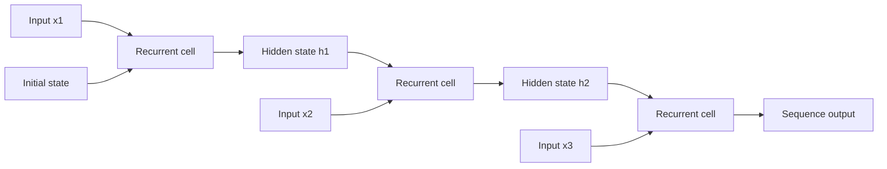
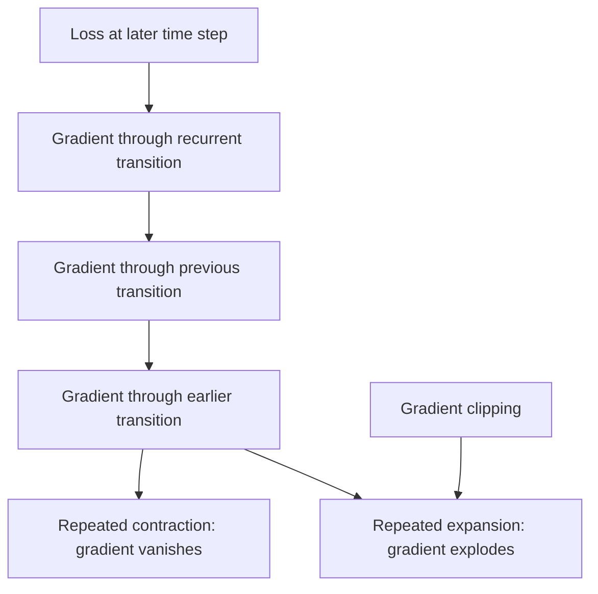
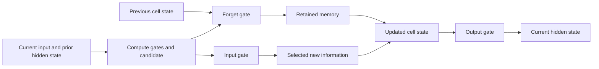
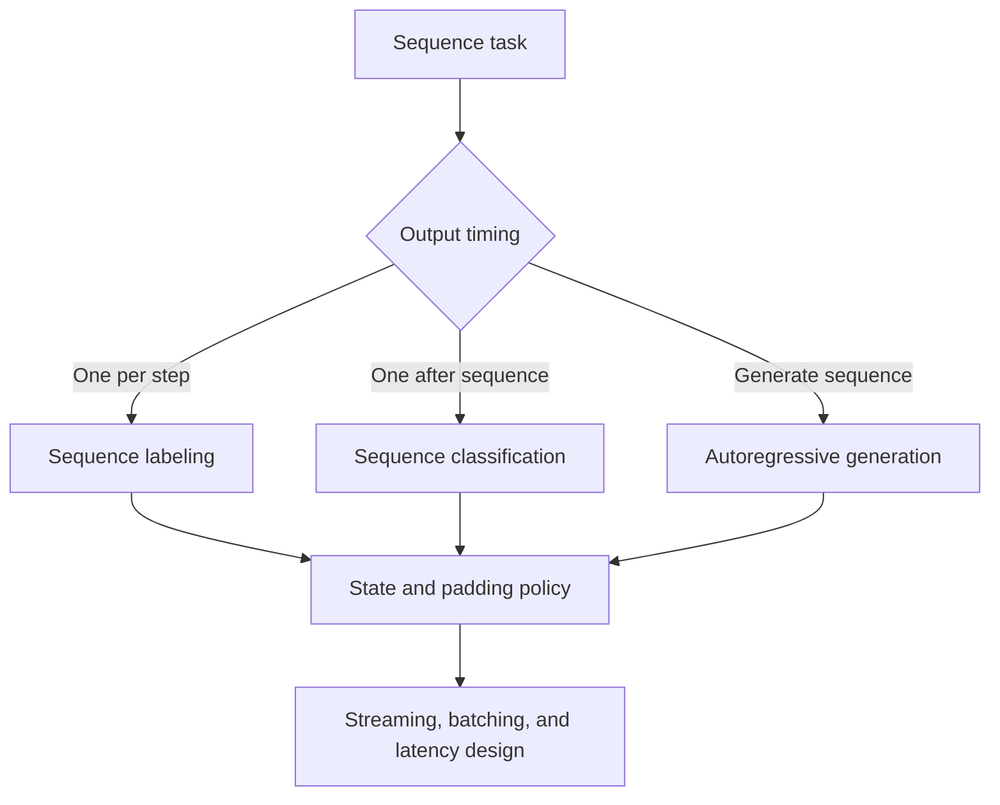
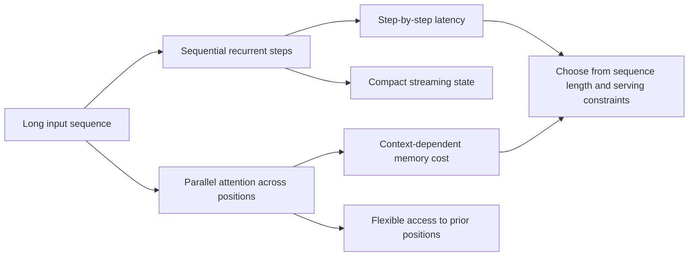

# Recurrent Neural Networks and Long Short-Term Memory

Part: [16 — Artificial Intelligence, Machine Learning, and Generative AI](PART_OVERVIEW.md)

Recurrent Neural Networks (RNNs) process sequences by carrying hidden state from one step to the next. Long Short-Term Memory (LSTM) networks add gates and a cell state to preserve or discard information over longer sequences. They remain useful for streaming or compact sequence workloads, while attention-based models offer more parallel training and flexible context access.

## Recurrent State and Sequence Processing

At time step $t$, an RNN combines the current input $x_t$ with prior hidden state $h_{t-1}$ to produce a new state and output. Parameters are shared across time. This lets the model accept variable-length sequences, but computation is sequential during training and inference.
A simple recurrent cell computes $h_t=\phi(W_xx_t+W_hh_{t-1}+b_h)$ and output $y_t=g(W_yh_t+b_y)$. Sharing $W_x$ and $W_h$ at every time step keeps parameter count independent of sequence length, while the hidden state is the only path by which earlier inputs affect later predictions. If that state has insufficient capacity or the sequence contains long-range dependencies, relevant information can be overwritten before it is used. Reset and masking semantics are therefore part of the model contract, not only data-loader details.



Use sequence boundaries, padding, and masks deliberately. A model that treats padding as real input learns artifacts. Stateful streaming inference must define how state is created, isolated per user or stream, checkpointed, and reset after gaps or identity changes.

## Gradients and Long Dependencies

Training across time uses backpropagation through time, which chains gradients through recurrent steps. Repeated multiplication can make gradients vanish or explode over long sequences. Gradient clipping helps limit explosions but does not restore information lost through vanishing gradients. Truncated backpropagation bounds memory and compute while limiting long-range learning.



Inspect gradient norms by sequence position and compare performance as sequence length changes. If long context is central, consider architectures with more direct paths to earlier information, including attention mechanisms in CH10.

The vanishing-gradient effect is a direct consequence of repeated multiplication. If the recurrent Jacobian has a dominant factor of magnitude $\rho$ at every step, the gradient contribution from $k$ steps earlier scales roughly as $\rho^k$. With $\rho=0.9$ and $k=50$, that factor is $0.9^{50}\approx0.005$: a signal from 50 steps back arrives attenuated to about half a percent of its original scale, which is why a plain RNN struggles to learn dependencies spanning dozens of steps even though nothing in the architecture explicitly forbids it. With $\rho=1.2$, the same exponent instead grows to roughly $9100$, illustrating why gradient clipping targets the explosion side specifically: a norm-based clip rescales an overly large gradient vector without trying to recover an already-vanished one. This numeric sensitivity is also why initialization and gate biases matter in practice; an LSTM forget gate is often initialized toward retaining memory specifically to keep $\rho$ closer to one during early training.

## LSTM Gates and Cell State

An LSTM maintains a cell state and uses input, forget, and output gates to control information flow. The forget gate scales prior memory; the input gate selects new content; the output gate exposes part of the cell state as hidden output. Gate values depend on the current input and prior hidden state.

At each step, the gates are computed from the current input and previous hidden state. The forget, input, and output gates are $f_t=\sigma(W_f[x_t,h_{t-1}]+b_f)$, $i_t=\sigma(W_i[x_t,h_{t-1}]+b_i)$, and $o_t=\sigma(W_o[x_t,h_{t-1}]+b_o)$. A candidate update is $\tilde{c}_t=\phi(W_c[x_t,h_{t-1}]+b_c)$. The cell update is $c_t=f_t\odot c_{t-1}+i_t\odot\tilde{c}_t$, while $h_t=o_t\odot\phi(c_t)$ exposes a gated view. The additive cell path gives gradients a route that is less dependent on repeatedly multiplying the same recurrent transition, but it does not eliminate optimization or memory limits.



Gating improves long-range learning in many settings but increases parameters and compute. It does not guarantee the model stores the information a product needs, and hidden state can carry sensitive user information. Scope and isolate recurrent state across sessions.

## Tasks, Training, and Deployment Trade-offs

RNNs can produce one output per step, one output per sequence, or an output sequence. They fit streaming workloads where input arrives sequentially and only bounded state is needed. Their sequential computation limits parallelism; batching can improve throughput but introduces queueing and latency trade-offs.



Evaluate on temporally ordered, deployment-representative data. Compare against simpler baselines and attention-based alternatives. Account for state reset, missing timesteps, variable length, inference throughput, and fallback behavior.



## Worked Case and Review Checklist

A sensor service classifies machine state from streaming measurements. An LSTM maintains per-device hidden state, resets it after an offline interval, and emits a state estimate at each event. Training uses chronological splits and masks for missing samples. The service monitors inference latency and unknown-device resets; state is never shared across tenants.

```python
import torch
import torch.nn as nn

class DeviceStateClassifier(nn.Module):
    def __init__(self, input_size, hidden_size, num_classes):
        super().__init__()
        self.lstm = nn.LSTM(input_size, hidden_size, batch_first=True)
        self.head = nn.Linear(hidden_size, num_classes)

    def forward(self, x, hidden_state=None):
        # hidden_state is per-device and explicitly reset after an offline gap
        out, hidden_state = self.lstm(x, hidden_state)
        logits = self.head(out[:, -1, :])
        return logits, hidden_state
```

The explicit `hidden_state` parameter in this sketch is the operational detail that matters most in production: it must be looked up by device ID, never defaulted to a prior caller's state, and explicitly cleared (passed as `None`) once an offline-gap policy triggers a reset, otherwise one device's stream can silently leak into another's state estimate.

Review sequence semantics, state scope, padding/masks, gradient health, gate behavior, long-range requirements, train/serve parity, privacy, latency, and fallback. Confirm the model's sequential compute is appropriate for workload throughput.

## Questions and Summary

1. Draw an unrolled recurrent computation and identify shared parameters.
2. Explain vanishing gradients and why clipping only addresses explosions.
3. Trace an LSTM input and forget gate into updated cell state.
4. Compare sequence labeling, classification, and autoregressive generation.
5. Define how streaming hidden state is isolated, reset, and recovered.

RNNs carry state across sequential inputs; LSTMs gate information to improve longer-term learning. Their strengths include natural streaming state, while sequential computation and state lifecycle require operational care. Choose them when their sequence model fits better than parallel attention-based alternatives.
