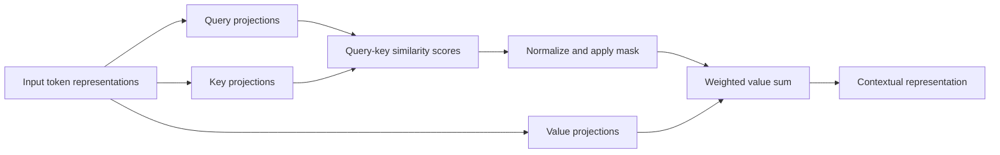
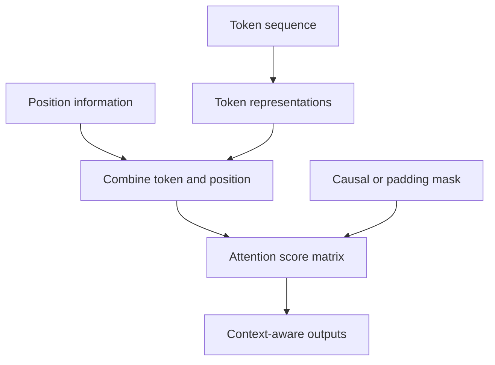
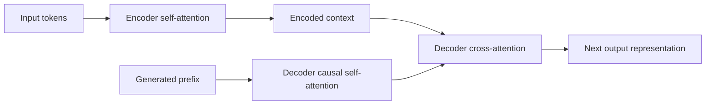
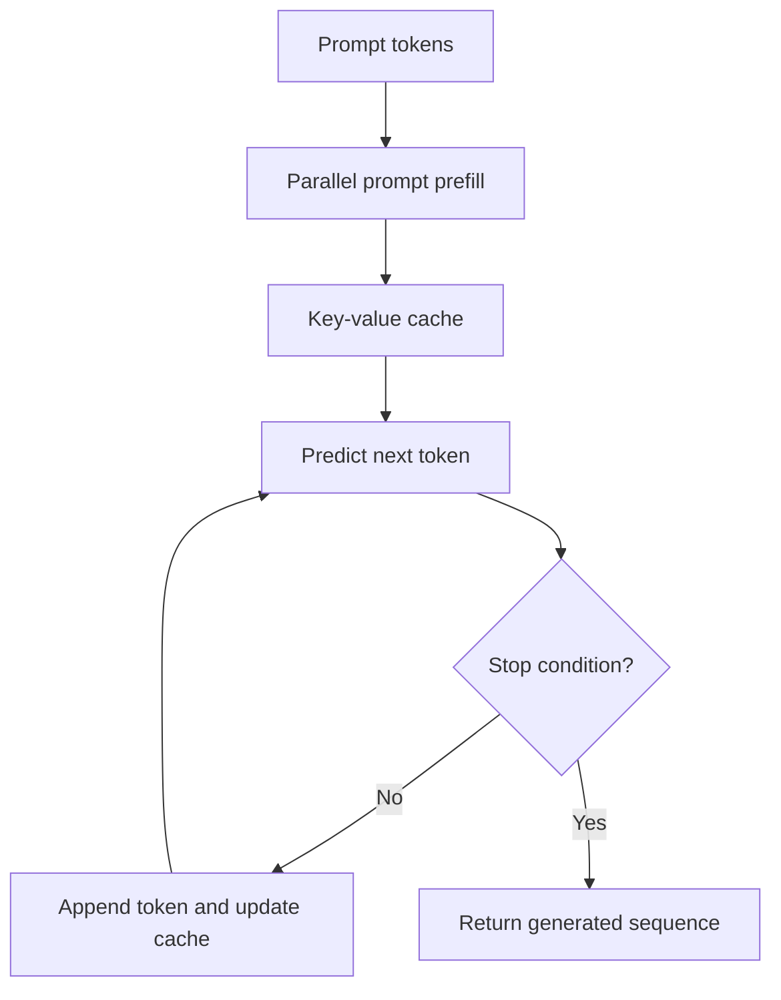
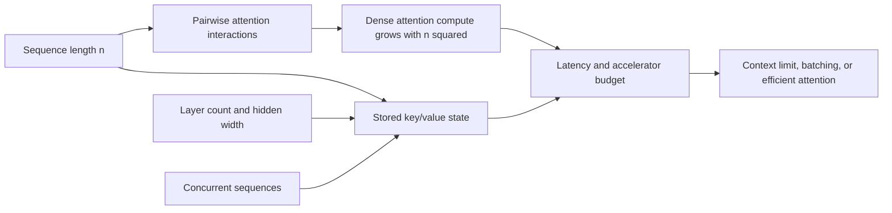

# Transformers and Attention

Part: [16 — Artificial Intelligence, Machine Learning, and Generative AI](PART_OVERVIEW.md)

Transformers use attention to compute relationships among sequence positions. This enables parallel training and flexible context integration. They power language, vision, and multimodal models, but attention can be computationally and memory intensive as context grows. This chapter covers the attention mechanism and architecture implications; CH15 covers large language model inference behavior.

## Query, Key, and Value Attention

Each input position is projected into a query, key, and value representation. Similarity between a query and keys determines weights; the weighted sum of values forms a context-aware output. Multi-head attention runs several learned projections so different heads can represent different relationships.

Attention weights are not guaranteed explanations of model reasoning. They are intermediate computations shaped by training and architecture. For interpretability, combine them with controlled interventions, feature attribution methods, and task-specific tests.

Scaled dot-product attention computes $\operatorname{softmax}(QK^T/\sqrt{d_k}+M)V$, where $Q$, $K$, and $V$ are query, key, and value matrices, $d_k$ is the key width, and $M$ is an optional mask. Dividing by $\sqrt{d_k}$ keeps dot-product magnitudes from growing with dimension and saturating the softmax. A causal mask sets disallowed future positions to negative infinity before normalization; a padding mask removes artificial batch positions. A shape or mask error changes which information is visible, not merely numerical precision.

Multi-head attention uses separate learned projections to form several query/key/value spaces, computes attention in each, concatenates the results, and projects them back to the model width. Heads can specialize in different relationships, but head count alone does not guarantee interpretable functions. The projections and output layer are jointly trained, so inspecting one attention map is not a sufficient explanation of a prediction.

## Positional Information and Masks

Self-attention alone is permutation-equivariant: without position or structure information, reordering tokens does not encode order. Positional embeddings or other position mechanisms provide sequence information. Masks restrict which positions can be attended to, for example preventing a decoder from seeing future tokens during autoregressive prediction.

Padding masks prevent attention to artificial tokens. Causal masks preserve next-token prediction. Masking errors can leak target information during training or cause the model to ignore valid context. Test masks with short hand-calculated sequences and inspect shapes.

Position mechanisms encode order differently. Absolute embeddings add a position-specific vector to each token representation; relative methods modify attention using distances between positions; rotary methods rotate query and key coordinates as a function of position, making relative offsets affect their dot product. Each choice changes extrapolation to longer sequences, cache behavior, and compatibility with checkpoints. A model trained with one position scheme cannot generally switch schemes at serving without changing the learned computation.

## Encoder, Decoder, and Computational Cost

Encoders build contextual representations from available input; decoders generate outputs, often one token at a time. Encoder-decoder models use cross-attention to let generated positions consult encoded input. Decoder-only models use causal self-attention for both prompt and generated tokens. Architecture fit depends on task, latency, context, and training data.

For sequence length $n$ and hidden width $d$, dense self-attention forms an $n\times n$ score matrix; its attention work scales approximately as $O(dn^2)$ and score storage as $O(n^2)$ per head before implementation optimizations. Doubling context can therefore multiply attention-score work and storage by roughly four. Feed-forward projections and other layers also consume compute, so the full model cost is not only attention. Windowed or sparse attention reduces interactions but restricts which positions communicate; prompt prefill and autoregressive decoding have different cost shapes. [CH28 — Inference Optimization](CH28_Inference_Optimization_and_Model_Serving.md) owns serving-time key-value-cache capacity and batching mechanics. Measure memory and latency on target hardware rather than extrapolating from parameter count alone.

A concrete comparison shows why context length is a first-class cost driver, not an afterthought. At 1,000 tokens, the $n^2$ attention-score term is on the order of one million entries per head; at 8,000 tokens it is on the order of sixty-four million, a 64-fold increase for an 8-fold increase in length, while the feed-forward cost per token grows only linearly with sequence length. This is why very long contexts disproportionately stress attention-specific optimizations (windowing, sparsity, efficient kernels) rather than the rest of the network, and why an architecture decision to support long documents should be evaluated against measured latency and memory at the target context length, not inferred from behavior at a short benchmark length.

## Training, Inference, and Scaling

Training processes many positions in parallel using known tokens and masks. Autoregressive inference generates a token, appends it to context, and repeats. Key-value caches store prior attention projections to avoid recomputing them, trading memory for latency. Batch size, sequence length, model width, precision, and cache strategy jointly determine capacity.

Scaling parameters can increase representational capacity but do not guarantee better task outcomes. Data quality, objective, evaluation, and serving constraints remain important. Avoid inferring causal effects from model size comparisons unless other variables are controlled.

## Worked Case and Review Checklist

A document model uses an encoder to represent long source text and a decoder to generate a summary. Cross-attention connects output tokens to encoded positions. Padding masks protect variable-length batches, and target masks prevent access to future summary tokens. The team profiles memory as source length grows and caps input length according to latency and quality measurements.

The profiling result that set the cap was concrete: encoder self-attention memory grows with the square of source length, so doubling the input from 2,000 to 4,000 tokens roughly quadrupled attention-matrix memory, which pushed the batch size the team could fit on a single accelerator down from 16 documents to 4. Rather than silently accepting that throughput collapse, the team capped source length at 3,000 tokens with an explicit truncation-and-summarize-in-passes fallback for longer documents, trading a small amount of single-pass context for a predictable, four-times-higher batch throughput that the latency budget required.

Review positional scheme, Q/K/V dimensions, mask correctness, architecture choice, context growth, cache memory, training/inference discrepancy, evaluation, and hardware constraints. Confirm attention weights are not presented as proof of reasoning.

## Questions and Summary

1. Trace an input through query/key/value projections and attention weighting.
2. Why does a transformer need positional information?
3. Draw a causal mask and identify the information it prevents during training.
4. Compare encoder-only, decoder-only, and encoder-decoder designs by task.
5. Explain the key-value cache's memory/latency trade-off.

Transformers compute context-aware representations through attention, positional information, and masks. Their parallel training and flexible context come with sequence-length cost and autoregressive inference constraints. Architecture, masking, cache, and hardware choices must be evaluated against the actual task and serving boundary.
