# Transformers and Attention

Part: [16 — Artificial Intelligence, Machine Learning, and Generative AI](PART_OVERVIEW.md) · Status: Revised (in-depth rewrite)

## 1. Introduction

The transformer is the architecture behind nearly every large language model, most current speech and vision foundation models, and many of the embedding models used for search. It replaced recurrence with a single operation, attention, that lets every position in a sequence read from every other position in one step. The change made training parallel across a sequence, made long-range dependencies one hop long instead of hundreds, and turned out to scale smoothly with data and compute. Those three properties explain why a design published in 2017 for machine translation now sits under products far outside translation.

A solution architect rarely writes an attention kernel. An architect does sign off on a context-window requirement, a model-hosting budget, a choice between a hosted application programming interface (API) and a self-hosted model, and a latency target for long documents. Each of those decisions rests on facts about the architecture: memory grows with context in a specific way, decoding is limited by memory bandwidth instead of arithmetic, and a model's parameter count does not determine its serving cost by itself. This chapter teaches the mechanism well enough that those facts can be derived instead of memorized, and it works the arithmetic with concrete numbers so that a design review can check a vendor's claim or a team's capacity plan in a few minutes.

The chapter derives scaled dot-product attention, including the variance argument for the scaling factor, and works a three-token example by hand. It builds the full block (multi-head attention, residual connections, normalization, feed-forward network), compares the ways models represent position, and describes the three architecture families and their training objectives. It then turns to cost: parameter counts, floating-point operations (FLOPs) per token, the 6ND training-compute rule, quadratic attention cost, the key-value (KV) cache, FlashAttention, and the attention variants that reduce cost. The remaining sections cover mixture-of-experts layers, scaling laws, vision transformers, state-space alternatives, interpretability, numerical stability, training instability, a minimal implementation, and the security and cost consequences for architects.

### 1.1 Ownership and scope

Several neighbouring chapters own topics this chapter touches. They are recapped briefly and linked, not re-taught.

| Topic | Owner | What this chapter does with it |
| --- | --- | --- |
| Backpropagation, initialization, optimizers (Adam and AdamW), warmup schedules, mixed precision, normalization mechanics | [CH07 — Deep Learning Foundations](CH07_Deep_Learning_Foundations.md) | Applies them to transformer blocks and training instabilities; recaps in two or three sentences |
| Recurrent state, gated memory, backpropagation through time | [CH09 — Recurrent Neural Networks and LSTM](CH09_Recurrent_Neural_Networks_and_LSTM.md) | Recaps the sequential bottleneck as motivation |
| Tokenization, autoregressive decoding loops, sampling, the context-window contract of a language model | [CH15 — LLM Fundamentals and Inference](CH15_Large_Language_Model_Fundamentals_and_Inference.md) | Treats tokens as given; CH15 owns how text becomes tokens and how decoding picks the next one |
| Embedding geometry and similarity | [CH16 — Embeddings and Semantic Representations](CH16_Embeddings_and_Semantic_Representations.md) | Uses the term "embedding" only for the learned input vectors |
| Fine-tuning and parameter-efficient adaptation | [CH20 — Fine-Tuning, PEFT, and LoRA](CH20_Fine_Tuning_PEFT_and_LoRA.md) | Not covered |
| Multimodal generation systems | [CH23 — Multimodal Generative AI](CH23_Multimodal_Generative_AI.md) | Covers the vision transformer as an architecture; CH23 owns multimodal system design |
| Serving: continuous batching, paged KV memory, quantization, speculative decoding | [CH28 — Inference Optimization and Model Serving](CH28_Inference_Optimization_and_Model_Serving.md) | Derives the KV-cache memory formula and the memory-bound decode argument; CH28 owns the serving techniques |
| Cost, performance, and sustainability decisions for AI workloads | [AI Cost, Performance, and Sustainability Decisions](../17_AI_Architecture/CH14_AI_Cost_Performance_and_Sustainability_Decisions.md) | Supplies the arithmetic that those decisions rest on |

### 1.2 Reader outcomes

After studying this chapter, a reader should be able to:

1. Derive scaled dot-product attention from a soft dictionary lookup, explain why the $1/\sqrt{d_k}$ factor is needed with a variance argument, and compute a small attention example by hand.
2. Describe multi-head attention, the residual stream view of a transformer block, pre-layer-norm versus post-layer-norm placement, and the feed-forward network including the gated SwiGLU variant.
3. Compare sinusoidal, learned, relative, rotary position embedding (RoPE), and attention with linear biases (ALiBi) position schemes and explain which extrapolate to longer sequences and why.
4. Choose between encoder-only, decoder-only, and encoder-decoder architectures for a task, and relate each to its training objective and attention mask.
5. Count the parameters of a decoder-only model from its configuration and estimate FLOPs per token and total training compute.
6. Compute attention memory and time as a function of sequence length, compute KV-cache size for a concrete model and context, and explain why decoding is memory-bound.
7. Explain FlashAttention, multi-query and grouped-query attention, sparse, sliding-window, and linear attention, and the limits of long-context claims.
8. Describe mixture-of-experts routing, scaling laws and what they predict, vision transformers, and state-space and hybrid alternatives.
9. State what attention weights do and do not explain, and describe induction heads at a conceptual level.
10. Identify numerical-stability and training-instability risks, and list the security and cost consequences of context length for a deployed system.

## 2. Background: Why Attention Replaced Recurrence

### 2.1 The sequential bottleneck

A sequence model must map a variable-length input to useful predictions. Before 2017 the dominant approach was the recurrent network, described in [CH09](CH09_Recurrent_Neural_Networks_and_LSTM.md). A recurrent network reads one position at a time and carries a fixed-size hidden state $h_t = f(h_{t-1}, x_t)$ forward. The design has two structural costs that no amount of tuning removes.

The first is sequential computation. Step $t$ needs the result of step $t-1$, so a sequence of $n$ tokens requires $n$ dependent steps. An accelerator with thousands of parallel arithmetic units sits mostly idle during each step. Training throughput on a long sequence is limited by the length of the dependency chain, not by the number of arithmetic units, and the wall-clock cost of a pass grows linearly with $n$ even when hardware is plentiful. Processing a batch of sequences helps, but memory for activations across all time steps limits how large a batch can be.

The second is the information path length. For the model to use a token that appeared $k$ steps earlier, information about that token must pass through $k$ applications of the recurrent function. Each application can distort or overwrite it, and each contributes a Jacobian factor to the gradient. [CH09](CH09_Recurrent_Neural_Networks_and_LSTM.md) shows the consequence for gradients: with a dominant factor $\rho$ per step the gradient from $k$ steps back scales roughly as $\rho^k$, so $0.9^{50}\approx 0.005$. Gated cells such as the long short-term memory (LSTM) cell keep that factor closer to one by design, and they extend the usable range to hundreds of steps. They do not change the fact that the path is $k$ steps long.

A third cost appears in encoder-decoder translation models of that era. The encoder compressed the entire source sentence into one fixed-size vector, and the decoder generated the target from that vector alone. A vector of a few hundred numbers has to hold a 10-word sentence and a 60-word sentence equally well. Translation quality fell as source sentences got longer, which showed that the bottleneck was real and not only theoretical.

### 2.2 Attention as a fix for the fixed-vector bottleneck

Dzmitry Bahdanau, Kyunghyun Cho, and Yoshua Bengio (2014) proposed letting the decoder look back at all encoder states instead of one summary vector. At each output step the decoder computes a score between its current state and each encoder state, normalizes the scores into weights that sum to one, and takes the weighted average of the encoder states as a context vector. The decoder then decides what to look at, and the compression requirement disappears: the source is kept at full resolution, and the model learns where to read. Minh-Thang Luong, Hieu Pham, and Christopher Manning (2015) simplified the scoring function to a dot product and compared variants. In this period attention was an add-on to a recurrent network.

Ashish Vaswani and colleagues (2017) asked whether the recurrence was needed at all. Their model, titled "Attention Is All You Need," removed it. Every position reads from every other position through attention, in parallel, and the only thing carried between layers is the matrix of position vectors. The path between any two tokens is one attention step instead of $k$ recurrent steps, and the computation for all positions in a layer is a few large matrix multiplications that map directly onto accelerator hardware. The paper reported better translation quality than the previous best systems at a fraction of the training cost, and later work showed that the same design scaled to far larger models and datasets than recurrent networks had.

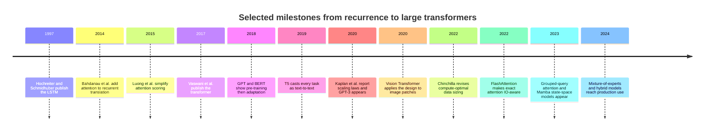

In the timeline, GPT stands for Generative Pre-trained Transformer, BERT for Bidirectional Encoder Representations from Transformers, and T5 for Text-to-Text Transfer Transformer. The timeline shows that the architecture itself changed little after 2017 while the surrounding recipe changed a great deal: how models are pre-trained, how much data they see, how attention is implemented on hardware, and how the feed-forward layers are made sparse. For an architect the implication is that a model released years later with the same name for its architecture can differ in memory per token, in context length, and in serving cost by an order of magnitude. The word "transformer" in a vendor's description does not identify those quantities.

### 2.3 Sequential versus parallel computation

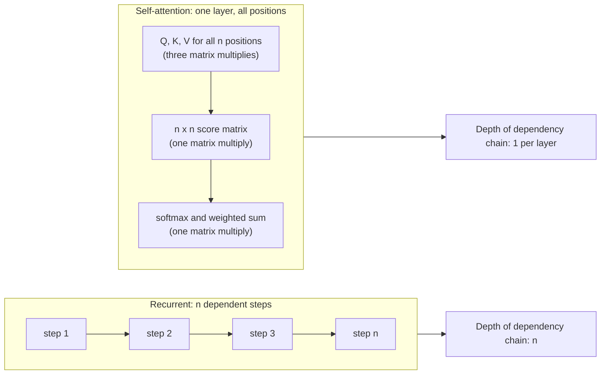

The diagram contrasts the dependency structure. In the recurrent case the longest chain of dependent operations has length $n$ per layer. In self-attention it has constant length per layer, because the score matrix for all pairs is one matrix multiplication. The price is the $n\times n$ score matrix: attention does $O(n^2 d)$ arithmetic where a recurrent layer does $O(n d^2)$, with $d$ the hidden width. For typical language-model widths ($d$ in the thousands) and sequences of a few thousand tokens, $n < d$ and attention is not the dominant cost, which is part of why the trade was good. When $n$ grows past $d$, attention dominates, and Section 11 returns to that regime.

Recurrent models were not made obsolete in every setting. Recurrent state has a constant memory cost per sequence regardless of length, and inference per token costs $O(d^2)$ with no growth in context. Sections 14 and 19 return to this: state-space models and linear attention are attempts to recover recurrent-style inference cost while keeping parallel training.

## 3. Scaled Dot-Product Attention

### 3.1 Attention as a soft dictionary lookup

A Python dictionary maps a key to a value. A lookup compares the query to every stored key, finds the one that matches exactly, and returns its value. Attention is a differentiable version of that operation. The query is compared to every key by a similarity score, the scores are turned into weights that are positive and sum to one, and the result is the weighted average of all the values. A query close to one key returns almost exactly that key's value, and a query equally close to several returns a blend. Because every step is differentiable, the model can learn what the queries, keys, and values should contain.

In self-attention all three come from the same sequence. Let the sequence have $n$ positions, each represented by a vector of width $d_\text{model}$, stacked as the matrix $X\in\mathbb{R}^{n\times d_\text{model}}$. Three learned weight matrices project it:

$$
Q = XW_Q,\qquad K = XW_K,\qquad V = XW_V,
$$

where $W_Q, W_K\in\mathbb{R}^{d_\text{model}\times d_k}$ and $W_V\in\mathbb{R}^{d_\text{model}\times d_v}$. Row $i$ of $Q$ is what position $i$ is looking for. Row $j$ of $K$ is what position $j$ advertises about itself for matching. Row $j$ of $V$ is the information position $j$ contributes if it is selected. Separating keys from values matters: the property that makes a token easy to find need not be the content that should flow to the reader. A token can advertise "I am a verb in the past tense" in its key and contribute a representation of its meaning in its value.

### 3.2 The formula

The similarity of query $i$ to key $j$ is the dot product $q_i\cdot k_j$. Collecting all pairs gives the score matrix $S = QK^\top\in\mathbb{R}^{n\times n}$, with $S_{ij}=q_i\cdot k_j$. The scaled dot-product attention of Vaswani and colleagues (2017) is

$$
\operatorname{Attention}(Q,K,V)=\operatorname{softmax}\!\left(\frac{QK^\top}{\sqrt{d_k}}+M\right)V,
$$

where softmax is applied to each row, $d_k$ is the key width, and $M$ is a mask matrix whose entries are $0$ for allowed pairs and $-\infty$ for forbidden ones. Written for one query,

$$
a_{ij}=\frac{\exp\!\big(q_i\cdot k_j/\sqrt{d_k}+M_{ij}\big)}{\sum_{l=1}^{n}\exp\!\big(q_i\cdot k_l/\sqrt{d_k}+M_{il}\big)},\qquad o_i=\sum_{j=1}^{n}a_{ij}\,v_j .
$$

Output $o_i$ is a convex combination of the value vectors: its weights $a_{ij}$ are non-negative and sum to one over $j$. The output has the same number of rows as the input, $n$, and width $d_v$, so layers can be stacked.

Shapes deserve attention because many production bugs are shape bugs. With batch size $B$, $h$ heads, and sequence length $n$, the tensors are $Q,K\in\mathbb{R}^{B\times h\times n\times d_k}$, scores $\in\mathbb{R}^{B\times h\times n\times n}$, and the output $\in\mathbb{R}^{B\times h\times n\times d_v}$. The softmax must be taken over the last axis of the score tensor, which is the axis of keys. Applying it over the wrong axis produces a model that trains without error and attends in the wrong direction.

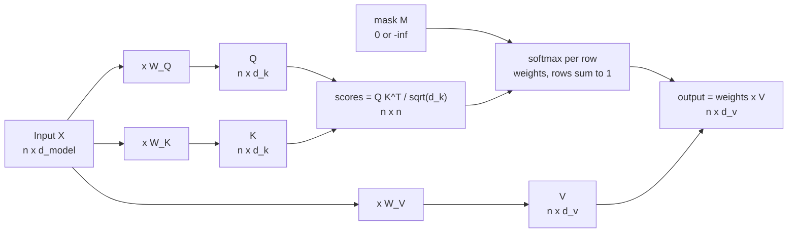

The diagram traces the path for one head. Three matrix multiplications build $Q$, $K$, and $V$. One more multiplies $Q$ by $K^\top$ to form every pairwise score. The mask and softmax convert scores to weights, and a final multiplication mixes the values. The score matrix is the only object whose size depends on $n^2$, and every cost discussion in Sections 11 to 15 starts from it.

### 3.3 Why divide by the square root of the key width

Vaswani and colleagues note that for large $d_k$ the dot products grow in magnitude, pushing the softmax into regions with very small gradients, and that dividing by $\sqrt{d_k}$ counteracts this. The reasoning can be made exact with a variance calculation.

Assume the components of a query $q$ and a key $k$ are independent random variables with mean $0$ and variance $1$, which is approximately true at initialization when inputs are normalized and weights are scaled by standard schemes (see [CH07](CH07_Deep_Learning_Foundations.md)). The dot product is a sum of $d_k$ terms:

$$
q\cdot k=\sum_{t=1}^{d_k} q_t k_t .
$$

Each term has mean $E[q_tk_t]=E[q_t]E[k_t]=0$ and variance

$$
\operatorname{Var}(q_tk_t)=E[q_t^2k_t^2]-\big(E[q_tk_t]\big)^2=E[q_t^2]\,E[k_t^2]-0=1\cdot 1=1 .
$$

The terms are independent, so variances add: $\operatorname{Var}(q\cdot k)=d_k$, and the standard deviation is $\sqrt{d_k}$. Dividing by $\sqrt{d_k}$ gives variance $d_k/(\sqrt{d_k})^2=1$ regardless of width. The scale of the softmax inputs is therefore a fixed constant, independent of the width the architect or researcher chose.

Why does the scale of the logits matter? The softmax of a vector $z$ is $p_j=e^{z_j}/\sum_l e^{z_l}$, and its Jacobian is $\partial p_i/\partial z_j=p_i(\delta_{ij}-p_j)$. When one logit exceeds the rest by a wide margin, $p$ approaches a one-hot vector. Then for every $i$, either $p_i\approx 0$ or $p_i\approx 1$ with $p_j\approx 0$ for $j\neq i$, so every entry of the Jacobian approaches zero. A saturated softmax passes almost no gradient back to the query and key projections. The model can still output a prediction, but the projections that produced the logits cannot learn to change it. Large $d_k$ without scaling pushes the model into this regime at initialization, before training has any chance to fix it.

The numeric check in [01_attention_from_scratch.py](../code/python/transformers-chapter/01_attention_from_scratch.py) draws random unit-variance vectors and measures both quantities. It first estimates the variance of $q\cdot k$ over 3,000 trials for each width. It then takes one random query against 16 random keys, computes the softmax, and averages the largest weight over 100 queries. Uniform weights over 16 keys would give a maximum of $1/16=0.0625$.

| $d_k$ | $\operatorname{Var}(q\cdot k)$ measured | Variance after dividing by $\sqrt{d_k}$ | Mean largest softmax weight, unscaled | Mean largest softmax weight, scaled |
| ---: | ---: | ---: | ---: | ---: |
| 4 | 3.91 | 0.98 | 0.427 | 0.237 |
| 16 | 16.13 | 1.01 | 0.691 | 0.246 |
| 64 | 60.98 | 0.95 | 0.851 | 0.260 |
| 256 | 250.47 | 0.98 | 0.919 | 0.233 |
| 1024 | 1031.08 | 1.01 | 0.979 | 0.238 |

The measured variance tracks $d_k$ to within sampling error (about 5 percent at these trial counts), and the scaled variance stays near 1. The consequence appears in the last two columns. Without scaling, at $d_k=1024$ the softmax gives its largest key 97.9 percent of the weight on average, which means a nearly one-hot distribution and almost no gradient. With scaling, the largest weight stays near 0.24 at every width: peaked enough to prefer some keys, soft enough to remain trainable. Real trained models do not keep unit-variance logits, since learned weights can grow and they should, so scaling is a statement about initialization and early training, not a claim about the final distribution. Section 22 shows that growth of attention logits during training is itself a known source of instability.

The same argument tells you what to do in variants. If keys and queries are normalized to unit length before the dot product (a design some stability-focused models use), the scale of the logits is bounded by one and a learned temperature takes the place of $1/\sqrt{d_k}$. If a model uses a different head width than the one it was trained with, a rescaling mistake changes the effective softmax temperature, and quality can degrade without any error message.

### 3.4 A worked three-token example

The following example uses small integers so every number can be checked by hand. The script [01_attention_from_scratch.py](../code/python/transformers-chapter/01_attention_from_scratch.py) reproduces it. Take three tokens "the", "cat", "sat" with input vectors of width $d_\text{model}=4$ and a head with $d_k=d_v=2$:

$$
X=\begin{bmatrix}1&0&0&0\\0&1&0&0\\0&0&1&1\end{bmatrix},\quad
W_Q=\begin{bmatrix}1&0\\0&1\\1&0\\0&1\end{bmatrix},\quad
W_K=\begin{bmatrix}1&0\\0&1\\0&1\\1&0\end{bmatrix},\quad
W_V=\begin{bmatrix}2&0\\0&2\\1&0\\0&1\end{bmatrix}.
$$

**Step 1: project.** Multiplying $X$ by each matrix selects and sums rows of the weight matrices. Token "the" selects row 1, "cat" selects row 2, and "sat" sums rows 3 and 4. So

$$
Q=\begin{bmatrix}1&0\\0&1\\1&1\end{bmatrix},\quad
K=\begin{bmatrix}1&0\\0&1\\1&1\end{bmatrix},\quad
V=\begin{bmatrix}2&0\\0&2\\1&1\end{bmatrix}.
$$

For $K$, the row for "sat" is row 3 of $W_K$, $[0,1]$, plus row 4, $[1,0]$, giving $[1,1]$.

**Step 2: score.** $QK^\top$ is the matrix of dot products between query rows and key rows. Row 1 of $Q$ is $[1,0]$, so its scores against the three keys are $1\cdot1+0=1$, $0$, and $1$. Doing all rows,

$$
QK^\top=\begin{bmatrix}1&0&1\\0&1&1\\1&1&2\end{bmatrix}.
$$

**Step 3: scale.** Divide by $\sqrt{d_k}=\sqrt2\approx1.4142$ to get

$$
\frac{QK^\top}{\sqrt{2}}\approx\begin{bmatrix}0.707&0&0.707\\0&0.707&0.707\\0.707&0.707&1.414\end{bmatrix}.
$$

**Step 4: softmax each row.** For row 1, $e^{0.707}=2.028$, $e^{0}=1$, $e^{0.707}=2.028$, and the sum is $5.056$, so the weights are $0.401$, $0.198$, $0.401$. For row 3, $e^{0.707}=2.028$ twice and $e^{1.414}=4.113$, summing to $8.169$, giving $0.248$, $0.248$, $0.503$. The full weight matrix is

$$
A\approx\begin{bmatrix}0.401&0.198&0.401\\0.198&0.401&0.401\\0.248&0.248&0.503\end{bmatrix}.
$$

**Step 5: mix values.** Output row 1 is $0.401\,[2,0]+0.198\,[0,2]+0.401\,[1,1]=[0.802+0.401,\;0.396+0.401]=[1.203,\,0.797]$. The full output is

$$
O=AV\approx\begin{bmatrix}1.203&0.797\\0.797&1.203\\1.000&1.000\end{bmatrix}.
$$

Reading the result: "sat" has its largest query-key score with itself (2, because its query $[1,1]$ aligns fully with its own key $[1,1]$), so half its weight (0.503) goes to itself, and it splits the remainder equally between "the" and "cat", which makes its output the average $[1,1]$. The query for "the" is $[1,0]$, which matches its own key and the key of "sat" equally (score 1 each) and "cat" not at all (score 0), so "the" gives 0.401 to itself and to "sat" and only 0.198 to "cat". Even in this tiny case the output of each position is a context-dependent mixture, and keys that align with a query receive more weight. The weights are far from one-hot because the scaled scores differ by less than 1.5, which is the regime the $1/\sqrt{d_k}$ factor is designed to preserve.

**Step 6: apply a causal mask.** For a decoder-only language model, position $i$ may not read positions $j>i$. The mask sets those scores to $-\infty$ before the softmax, so their weights are exactly zero and the remaining weights renormalize. Row 1 can see only itself, so its weights are $[1,0,0]$ and its output is $V_1=[2,0]$. Row 2 sees "the" and "cat": its scaled scores are $0$ and $0.707$, so the weights are $1/(1+2.028)=0.330$ and $0.670$, and the output is $0.330\,[2,0]+0.670\,[0,2]=[0.660,\,1.340]$. Row 3 sees all three, so it is unchanged. The script prints these values:

```text
Causal attention weights =
  [  1.000,   0.000,   0.000]
  [  0.330,   0.670,   0.000]
  [  0.248,   0.248,   0.503]
Causal output =
  [  2.000,   0.000]
  [  0.660,   1.340]
  [  1.000,   1.000]
```

### 3.5 Masks

A mask is how the architecture states which positions may exchange information. Two masks account for almost all practical use.

A causal mask enforces the autoregressive factorization $p(x_1,\dots,x_n)=\prod_t p(x_t\mid x_{<t})$. Entry $(i,j)$ is allowed only if $j\le i$:

```text
Causal mask M for n = 5        Padding mask for lengths [5, 3] padded to 5
(0 = allowed, - = -inf)        sequence 2 (keys beyond position 3 are padding)

      key 1 2 3 4 5                  key 1 2 3 4 5
query 1   0 - - - -            query 1   0 0 0 - -
      2   0 0 - - -                  2   0 0 0 - -
      3   0 0 0 - -                  3   0 0 0 - -
      4   0 0 0 0 -                  4   (padded query: output ignored)
      5   0 0 0 0 0                  5   (padded query: output ignored)
```

During training, the causal mask is what lets one forward pass compute the loss at all $n$ positions at once: position $i$ predicts token $i+1$ from only the first $i$ tokens, so all $n$ predictions are valid training examples. Without the mask the model could copy the next token from its own input and the loss would fall to zero without learning anything. During inference the mask is implicit, because future tokens do not exist yet.

A padding mask hides positions that exist only because batched tensors must be rectangular. If one sequence in a batch has 3 real tokens and the batch length is 5, the two padding keys must receive zero weight. Without the mask, padding tokens (typically a zero or special embedding) receive weight in the softmax and dilute the output, and the model's behavior then depends on how much padding a batch happened to contain. That is a nondeterminism bug: the same prompt produces different outputs depending on what else was batched with it.

Other masks exist. A prefix mask lets a prefix attend bidirectionally and the continuation attend causally, as in prefix language models. A block-diagonal mask is needed when several short documents are packed into one training sequence to avoid padding waste. If packing is used without it, tokens of one document read tokens of an unrelated document, which contaminates training with cross-document leakage. The same logic applies at serving time: batching several users' requests into one tensor requires that the mask isolate them, and a mask bug there is a confidentiality failure and not only a quality problem. Section 25 returns to this.

The script's mask test is the practical pattern for verifying any mask. Edit only the last token of a sequence and recompute. Under a correct causal mask the outputs at all earlier positions must be bit-identical. The script prints a maximum change of exactly zero at positions 0 to 3 under the causal mask and changes of 0.15 to 0.67 at those positions without it. A test of this kind belongs in the continuous-integration suite of any team that modifies attention code.

Finally, note how the mask interacts with numerical precision. Using $-\infty$ is exact but can produce `NaN` (not a number) if an entire row is masked, since softmax over all $-\infty$ is $0/0$. Fully masked rows occur for padded queries. Implementations either use a large finite negative value, such as the lowest representable number, or guarantee that padded query rows are discarded. Either way the choice has to be deliberate and tested.

## 4. Multi-Head Attention

### 4.1 Why one attention pattern is not enough

A single attention head produces one weight distribution per query, and therefore one blend of values. Natural sequences contain several relations at once. In a sentence, a verb needs its subject (often several tokens back), the previous token (for local grammar), and perhaps a distant referent for a pronoun. A single softmax has to trade these off inside one distribution: if it puts weight on the subject it cannot also put weight on the previous token, except by splitting the weight and averaging the two values together, which blurs both.

Multi-head attention runs $h$ attention operations in parallel, each in its own lower-dimensional subspace, and combines the results. Each head has its own projections, so each learns its own notion of what to query, advertise, and contribute. For head $i$,

$$
\text{head}_i=\operatorname{Attention}(XW_Q^{(i)},\,XW_K^{(i)},\,XW_V^{(i)}),\qquad
\operatorname{MHA}(X)=\operatorname{Concat}(\text{head}_1,\dots,\text{head}_h)\,W_O .
$$

Here $W_Q^{(i)},W_K^{(i)}\in\mathbb{R}^{d_\text{model}\times d_k}$, $W_V^{(i)}\in\mathbb{R}^{d_\text{model}\times d_v}$, and $W_O\in\mathbb{R}^{hd_v\times d_\text{model}}$. The standard choice is $d_k=d_v=d_\text{model}/h$, so the concatenation has width $d_\text{model}$ and the total arithmetic is the same as for one head of full width. The original base model used $d_\text{model}=512$ and $h=8$, so each head had width 64. A model with $d_\text{model}=4096$ and 32 heads has head width 128, a common value in current models.

Splitting into heads is free in terms of parameters. The four projection matrices together hold $4d_\text{model}^2$ weights, whatever $h$ is, because $h$ matrices of shape $d_\text{model}\times (d_\text{model}/h)$ hold the same number of entries as one square matrix. In implementation, heads are not separate objects. One square matrix computes all queries, the result is reshaped from $(n,\;d_\text{model})$ to $(n,\;h,\;d_k)$, the head axis is moved next to the batch axis, and the same batched matrix multiplication handles all heads at once. This is why a shape error that swaps the head and sequence axes does not raise an exception. It produces attention across heads instead of across positions, and the model trains to a worse loss with no error message.

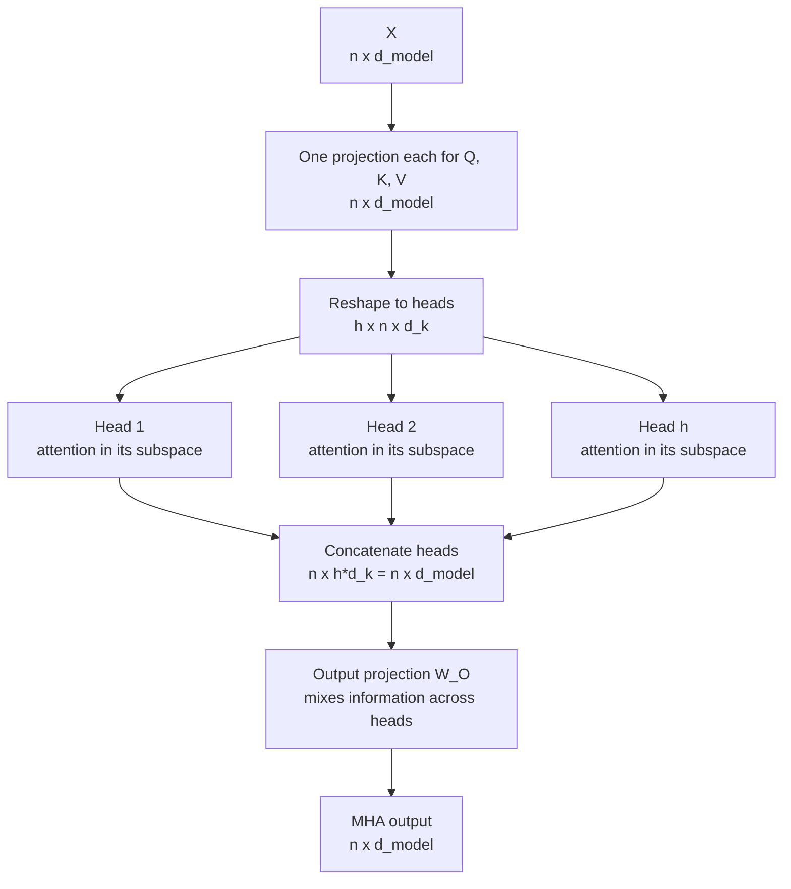

The diagram shows that the heads are independent until the output projection. Within a head, queries and keys interact only through $d_k$ coordinates, so the score matrix of one head has rank at most $d_k$. A head of width 64 cannot represent an arbitrary $n\times n$ attention pattern for large $n$, and it is limited to patterns expressible as inner products of 64-dimensional vectors. That limit is a reason to have many heads and a reason not to shrink head width too far. The output projection $W_O$ is the only place where different heads' results are mixed.

### 4.2 The additive view: heads write into a shared stream

Splitting $W_O$ into row blocks, one per head, shows an equivalent form:

$$
\operatorname{MHA}(X)=\sum_{i=1}^{h}\text{head}_i\,W_O^{(i)},\qquad W_O^{(i)}\in\mathbb{R}^{d_v\times d_\text{model}} .
$$

Each head reads from the residual stream (through its own $W_Q,W_K,W_V$), and writes a vector back to it (through its own block of $W_O$), and the writes are added. The result is the "residual stream" view developed by Nelson Elhage and colleagues (2021) for interpretability: the stream is a shared communication channel, and attention heads and feed-forward layers are independent components that read from and write to it. The view matters for two practical reasons. It explains why individual heads can be removed or edited with limited damage to the rest. And it explains why interpretability work can analyze a head by the effect of its output on the stream.

### 4.3 What heads specialize in

Trained heads are not interchangeable. Studies of trained models have found recurring head types, though the evidence comes from specific models and tasks, and a type found in one model need not exist in another.

- **Positional heads** put most weight on a fixed offset, most commonly the previous token. Elena Voita and colleagues (2019), studying translation models, found such heads, which implement local context.
- **Syntactic heads** attend from a word to a grammatically related word, such as a verb to its subject or a modifier to its head noun. Kevin Clark and colleagues (2019) found heads in BERT whose attention aligned with dependency relations far above chance for specific relations such as direct objects of verbs.
- **Rare-token heads** attend to infrequent, informative tokens. Voita and colleagues found these in translation encoders.
- **Copying and induction heads** attend to an earlier occurrence of the current token's pattern and promote the token that followed it. Section 20 describes these.
- **Sink heads** place much of their weight on the first token or a delimiter, apparently as a default when no key is relevant. Guangxuan Xiao and colleagues (2023) described this "attention sink" behavior in language models and showed it has consequences for streaming inference (Section 15).

Two caution points follow. First, many heads are redundant. Paul Michel, Omer Levy, and Graham Neubig (2019) showed that a large fraction of heads in trained translation and BERT models can be removed at test time with small loss in accuracy, and Voita and colleagues found that a few "important" heads carried most of the function. The number of heads is a width and parallelism choice and does not predict how many distinct functions the model learned. Second, specialization does not imply that a human-readable label gives a complete account of what the head does. A head that appears to track the previous token may also carry other information in its value vectors, and it is only one contributor to the stream.

### 4.4 Choosing head count and head width

For a fixed $d_\text{model}$, more heads means narrower heads. The trade-off has three parts. More heads give more distinct attention patterns per layer. Narrower heads have lower-rank score matrices. And on hardware, head width of 64 or 128 maps well to the tile sizes of matrix units, whereas very narrow heads under-use them. Published model families mostly use head width 64 to 128 and scale the number of heads with $d_\text{model}$. Because the number of KV-cache entries per token scales with the number of key-value heads times head width (Section 13), the head configuration also determines serving memory, and that is the main reason modern models share key and value projections across groups of query heads.

## 5. The Transformer Block

A transformer is a stack of identical blocks. Each block contains two sublayers: multi-head attention, which moves information between positions, and a feed-forward network, which transforms each position independently. Around each sublayer sit a residual connection and a normalization layer. The arrangement of these four ingredients decides whether a deep stack trains stably.

### 5.1 Residual connections

A residual connection computes $x_{l+1}=x_l+F_l(x_l)$ instead of $x_{l+1}=F_l(x_l)$. Kaiming He and colleagues (2016) introduced it for image networks. The gradient consequence is the main benefit. Differentiating,

$$
\frac{\partial x_{l+1}}{\partial x_l}=I+\frac{\partial F_l}{\partial x_l},
$$

so the Jacobian across $L$ blocks contains an identity term that gradient can pass through unattenuated, and the product of $L$ Jacobians does not collapse the way a product of small matrices does. The residual connection also changes how the model computes: each block adds a correction to a running representation instead of replacing it. This is the residual stream of Section 4.2. At initialization, with small $F_l$, the network starts near the identity function, which is a stable starting point for hundreds of layers.

### 5.2 Normalization

Layer normalization (Ba, Kiros, and Hinton, 2016) rescales each position's vector to zero mean and unit variance across its features, then applies a learned per-feature gain and offset. Root-mean-square (RMS) normalization (Zhang and Sennrich, 2019) drops the mean subtraction and the offset and divides only by the root mean square of the features. Both are covered in [CH07](CH07_Deep_Learning_Foundations.md). Per-position statistics are the right choice for sequences because they do not depend on other examples in the batch or on padding, unlike batch normalization. RMS normalization is used in the Llama family and many other recent models because it is cheaper (one reduction instead of two) and its reported quality matches layer normalization.

Where the normalization sits in the block is a design decision that matters much more than which normalization is used.

**Post-layer-norm (post-LN)**, the original arrangement, normalizes after the residual addition:

$$
x_{l+1}=\operatorname{LN}\big(x_l+F_l(x_l)\big).
$$

**Pre-layer-norm (pre-LN)** normalizes the input to the sublayer and leaves the residual path untouched:

$$
x_{l+1}=x_l+F_l\big(\operatorname{LN}(x_l)\big).
$$

Ruibin Xiong and colleagues (2020) analyzed the two arrangements. In post-LN, every residual path passes through a normalization layer, so gradient flowing backward through many layers is rescaled at each one. At initialization the expected gradient norm near the output layers is large, and they showed that training post-LN transformers requires a learning-rate warmup to avoid divergence. In pre-LN, the identity path from the output to every layer is clean, gradients are well-scaled at initialization, and in their experiments warmup could be removed or shortened. For that reason, nearly all very deep models, and most large language models, use pre-LN with a final normalization before the output layer.

Pre-LN has its own cost. The residual stream is never normalized inside the stack, so its magnitude grows with depth: each sublayer adds a contribution, and if contributions are roughly independent the variance of the stream grows linearly with the number of sublayers. The script [04_block_numerics_and_tiling.py](../code/python/transformers-chapter/04_block_numerics_and_tiling.py) simulates a stack of pre-LN sublayers with random weights. The root-mean-square of the stream after 1, 8, 32, and 128 sublayers was 1.24, 2.33, 5.49, and 9.43, against $\sqrt{L+1}$ of 1.41, 3.00, 5.74, and 11.36. The growth follows the square-root law approximately, and the simulation is only an illustration with random weights, not a measurement of trained models. The consequence is that, in deep pre-LN models, later layers add updates that are small relative to what is already in the stream, so their influence on the output can shrink, and some analyses find that deep layers in pre-LN models are less effective than in post-LN ones. Post-LN keeps each layer's output at unit scale, which preserves each layer's influence but makes optimization harder.

Several variants address the trade-off. DeepNorm (Hongyu Wang and colleagues, 2022) is a post-LN variant that scales the residual branch by a constant and initializes sublayer weights with matching scaling, and the authors trained transformers of up to 1,000 layers with it. Some models add extra normalization on the output of each sublayer before it joins the stream. Normalizing queries and keys before the dot product ("QK-norm") bounds the attention logits and is used to prevent the instability described in Section 22. A practical rule: use pre-LN with RMS normalization and a final norm unless you are reproducing a published post-LN recipe, and if you change the placement, expect to retune warmup and learning rate.

### 5.3 The position-wise feed-forward network

After attention, each position's vector passes through the same two-layer network, applied independently to every position:

$$
\operatorname{FFN}(x)=W_2\,\sigma(W_1x+b_1)+b_2,\qquad W_1\in\mathbb{R}^{d_\text{ff}\times d_\text{model}},\;W_2\in\mathbb{R}^{d_\text{model}\times d_\text{ff}} .
$$

The original model used the rectified linear unit (ReLU) and $d_\text{ff}=4d_\text{model}$ (2048 for $d_\text{model}=512$). Attention is the only operation that moves information between positions. The feed-forward network is where each position's representation is transformed once it has gathered context, and it holds most of the model's parameters. With $d_\text{ff}=4d_\text{model}$, the feed-forward weights hold $8d_\text{model}^2$ parameters per layer against $4d_\text{model}^2$ for attention, so two thirds of a layer's weights sit in the feed-forward network. Mor Geva and colleagues (2021) argued that these layers act as key-value memories: the rows of $W_1$ act as keys that detect input patterns, and the columns of $W_2$ as values that write associated content, with evidence that factual associations are stored there. That interpretation is a hypothesis supported by experiments, not an established account of all feed-forward behavior.

The activation has changed over time. ReLU gave way to the Gaussian error linear unit (GELU; Dan Hendrycks and Kevin Gimpel, 2016), which weights an input by the probability that a standard normal variable is below it and gives a smooth curve. Most current models use a gated variant.

### 5.4 Gated feed-forward layers and SwiGLU

Noam Shazeer (2020) compared feed-forward variants that include a gate: the layer computes two linear projections of the input, passes one through an activation, and multiplies them element-wise. With the Swish (also called SiLU, the sigmoid linear unit, $\operatorname{silu}(z)=z\,\sigma(z)$ with $\sigma$ the logistic function) activation this is SwiGLU, the Swish-gated linear unit:

$$
\operatorname{FFN}_\text{SwiGLU}(x)=W_\text{down}\big(\operatorname{silu}(W_\text{gate}x)\odot (W_\text{up}x)\big),
$$

where $\odot$ is element-wise multiplication. The gate projection decides, per hidden unit and per position, how much of the up projection passes through. It uses three matrices where the classic layer uses two. To keep the parameter count equal to a classic layer with $d_\text{ff}=4d_\text{model}$, the hidden width is reduced so that $3\cdot d_\text{model}\cdot d_\text{hidden}=2\cdot d_\text{model}\cdot 4d_\text{model}$, which gives $d_\text{hidden}=\tfrac{8}{3}d_\text{model}$. In practice the value is rounded up to a multiple of a hardware-friendly number: the Llama 2 7B model with $d_\text{model}=4096$ uses 11,008, which is $43\times256$ and close to $\tfrac{8}{3}\cdot4096=10{,}922.7$. Shazeer reported lower perplexity for gated variants at equal compute and parameters, and stated that he offered no explanation for why they work. Treat the preference as empirical.

For an architect, the practical consequences are the parameter-counting rule and the interface. The gated layer has three weight matrices per layer, so tools that assume two matrices will miscount parameters and memory. The width multiplier $\tfrac{8}{3}$ (or the explicit hidden size) appears in the model configuration and must be read from it.

### 5.5 Assembling the block and the full stack

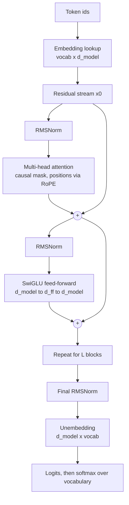

The diagram is a decoder-only pre-LN stack. Two points of the layout are worth stating explicitly. The residual stream runs straight from the embedding to the final normalization, and every sublayer reads a normalized copy and adds its output back. And the unembedding matrix that turns the final vector into vocabulary logits has the same shape as the embedding matrix transposed. Many models tie the two (use the same weights), which saves $V\cdot d_\text{model}$ parameters, and larger models often do not tie them.

An encoder block is the same without the causal mask. A decoder block in an encoder-decoder model inserts a third sublayer between the other two: cross-attention, whose queries come from the decoder stream and whose keys and values come from the encoder's output. Section 7 describes where each variant is used.

Two initialization details affect stability and are easy to miss. Because each residual branch adds to the stream, the variance of the stream grows with the number of branches. GPT-2 (Radford and colleagues, 2019) scaled the weights of the residual-branch output projections by $1/\sqrt{N}$, where $N$ is the number of residual layers, to offset this at initialization. And many recent models drop bias terms in the linear layers, which simplifies the model and reduces memory traffic with no measured quality loss in the reports that tried it.

## 6. Positional Information

### 6.1 Why attention needs positions

Self-attention treats the sequence as a set. If the input rows are permuted, the output rows are permuted the same way: the function is permutation-equivariant. The script [03_positional_encodings.py](../code/python/transformers-chapter/03_positional_encodings.py) checks this with a random four-token input and an arbitrary permutation, and the maximum difference between "permute then attend" and "attend then permute" is exactly 0. Without extra information the sentences "the dog bit the man" and "the man bit the dog" would produce identical sets of output vectors. A recurrent network gets order for free, because it processes tokens in sequence. A transformer must be given order.

There are four places to supply it, and the choice shows up in extrapolation behavior, cache design, and checkpoint compatibility.

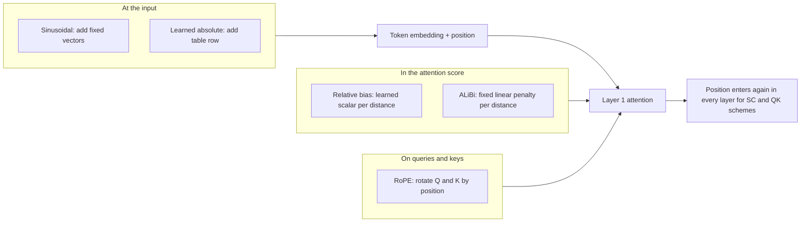

The diagram groups schemes by where position enters. Input-level schemes inject position once, before layer 1, and rely on the network to carry it forward. Score-level and query-key-level schemes inject position in every layer, directly in the computation that decides which tokens attend to which, and they encode relative offset rather than absolute index. This difference is the main reason relative schemes extrapolate better.

### 6.2 Sinusoidal encodings

Vaswani and colleagues (2017) added a fixed vector to each input embedding, with coordinates

$$
PE_{(p,2i)}=\sin\!\left(\frac{p}{10000^{2i/d_\text{model}}}\right),\qquad PE_{(p,2i+1)}=\cos\!\left(\frac{p}{10000^{2i/d_\text{model}}}\right),
$$

for position $p$ and pair index $i=0,\dots,d_\text{model}/2-1$. Each pair of coordinates is a point on a circle rotating with position at frequency $\omega_i=10000^{-2i/d_\text{model}}$. Low $i$ gives fast rotation (a wavelength of $2\pi$, about 6.3 positions) and high $i$ gives slow rotation (a wavelength of up to $2\pi\cdot10000\approx62{,}832$ positions in the limit). The vector is a multi-scale clock: the fast pairs distinguish neighbors, and the slow pairs distinguish distant regions.

Two properties justify the design. For any fixed offset $k$, $PE_{p+k}$ is a linear function of $PE_p$, because a rotation of a circle point by a fixed angle is a linear map. The model can therefore in principle learn to attend by relative offset. And the dot product $PE_p\cdot PE_{p+k}=\sum_i\cos(\omega_ik)$ depends only on $k$. The script prints this for $d_\text{model}=64$: the dot product is 30.916832 at offset 1, 23.503971 at offset 5, and 18.879144 at offset 20, and it is identical across starting positions 0, 10, 100, and 1000. At offset 0 the value is $32=d_\text{model}/2$. The similarity decays with distance, which is a usable inductive bias.

Sinusoidal encodings have no parameters and are defined for any position. In practice, models trained with them degrade when run on sequences much longer than any seen in training, because the network learned to use the particular position patterns it saw, and the formula's ability to produce a vector for position 50,000 does not make the downstream layers know what to do with it.

### 6.3 Learned absolute positions

A learned table of shape (maximum length, $d_\text{model}$) is added to the input embeddings. BERT used a table of 512 positions and GPT-2 a table of 1,024. The approach is simple and works well within the trained length. It cannot represent a position beyond the table's last row, so the maximum context is a hard architectural limit, and extending it requires adding rows that have never been trained. A learned table also costs parameters: for 1,024 positions at width 768 that is 786,432 parameters, small next to the model but nonzero.

### 6.4 Relative position methods

Peter Shaw, Jakob Uszkoreit, and Ashish Vaswani (2018) added learned embeddings of the relative distance between the query and key positions to the attention computation. Transformer-XL (Zihang Dai and colleagues, 2019) used relative encodings to allow attention over cached segments from previous chunks of a long text. The T5 model (Colin Raffel and colleagues, 2019) simplified the idea to a learned scalar bias per head for each of a small number of distance buckets (spaced finely for near distances and logarithmically for far ones), added to the attention score before the softmax. Distances beyond the largest bucket all share one bias value, so such a model can process longer sequences than it was trained on, though it has not learned anything about distances it never saw. Relative methods apply position in every layer and need no table indexed by absolute position, and the cost is an extra term in the attention computation that complicates fast kernels.

### 6.5 Rotary position embeddings

Jianlin Su and colleagues (2021) introduced rotary position embedding (RoPE), which became the default in many open model families. RoPE does not add anything to the input. It rotates the query and key vectors by an angle proportional to their position, before the dot product. Group the $d_k$ coordinates of a query or key into $d_k/2$ pairs. For pair $i$ at position $m$, rotate that pair by the angle $m\theta_i$:

$$
\begin{bmatrix}q'_{2i}\\q'_{2i+1}\end{bmatrix}=\begin{bmatrix}\cos m\theta_i&-\sin m\theta_i\\ \sin m\theta_i&\cos m\theta_i\end{bmatrix}\begin{bmatrix}q_{2i}\\q_{2i+1}\end{bmatrix},\qquad \theta_i=b^{-2i/d_k},
$$

with base $b=10000$ in the original. The same rotation by the key's own position is applied to the key. The key property follows from the algebra of rotations. Write the rotation for one pair as $R(\alpha)$. Then $R(\alpha)^\top R(\beta)=R(\beta-\alpha)$. So for query position $m$ and key position $n$,

$$
(R(m\theta)q)^\top(R(n\theta)k)=q^\top R(m\theta)^\top R(n\theta)\,k=q^\top R\big((n-m)\theta\big)\,k .
$$

The score depends on the positions only through the offset $n-m$, and on the content through $q$ and $k$. The script verifies this with random 16-dimensional vectors. For an offset of 4 the score is $-2.079160$ at $(m,n)=(3,7)$, $(10,14)$, $(100,104)$, and $(5000,5004)$, identical to the printed precision. For an offset of 6 it is $-0.171748$ at $(3,9)$ and at $(50,56)$. A rotation preserves length, and the script confirms the norm of $q$ is $3.742160$ before and after rotation, so RoPE changes direction and not magnitude.

RoPE has practical properties that explain its adoption. It adds no parameters. It is applied to $Q$ and $K$ only and not to $V$, so values are position-free. It composes with the KV cache: each key is rotated once, at its own absolute position, when first computed, and cached in rotated form, so decoding a new token does not recompute earlier keys. And the relative-offset property gives the same inductive bias as other relative methods in every layer.

Two warnings apply. The pairing convention differs between implementations: some rotate adjacent coordinates $(2i,2i+1)$ and some rotate the first half of the vector against the second half. A checkpoint trained with one convention and loaded with the other produces fluent-looking but degraded output, because the weights were learned for specific coordinate pairings. When porting a model between libraries, test the logits against a reference implementation on a fixed prompt. The second warning concerns the base $b$. Models intended for long context use a larger base (values of hundreds of thousands to millions appear in model cards), which lowers all rotation frequencies so that positions far apart are still distinguishable. The base is a configuration value that must match the checkpoint.

### 6.6 ALiBi

Ofir Press, Noah Smith, and Mike Lewis (2021) proposed attention with linear biases (ALiBi). It uses no position embeddings at all. Instead it subtracts a penalty proportional to the distance from the attention score: for a query at position $i$ and a key at position $j\le i$, head $h$ adds $-m_h\,(i-j)$ to the score before the softmax, where $m_h$ is a fixed slope. For $H$ heads the slopes form a geometric sequence $m_h=2^{-8h/H}$. For 8 heads the slopes are $1/2,1/4,\dots,1/256$. The script prints the bias matrix for head 0 and five tokens:

```text
   -0.00   -inf   -inf   -inf   -inf
   -0.50  -0.00   -inf   -inf   -inf
   -1.00  -0.50  -0.00   -inf   -inf
   -1.50  -1.00  -0.50  -0.00   -inf
   -2.00  -1.50  -1.00  -0.50  -0.00
```

Different heads see different decay rates. At a distance of 1,000 tokens the penalty is $-500$ for the steepest head (effectively blind to anything that far away) and $-3.91$ for the shallowest, which can still attend to distant tokens. This gives a built-in mix of local and long-range heads. The authors reported that models trained on short sequences evaluated well on much longer ones ("train short, test long") and trained faster with less memory than sinusoidal models at the same length. Later comparisons found that the extrapolation advantage in perplexity does not always translate into the ability to use distant information, and few recent large models use ALiBi. It remains a clean example of how a simple prior replaces a learned table.

### 6.7 Length extrapolation

A model is trained at a maximum length $n_\text{train}$. Running it at $n>n_\text{train}$ is called extrapolation, and the outcome depends on position scheme and on what the model learned to do at positions it saw. With learned absolute positions it is impossible. With sinusoidal encodings and with RoPE, quality typically degrades sharply beyond the trained length, because the model meets position values (or rotation angles) it has never processed. ALiBi and some relative schemes degrade more slowly.

For RoPE, the cause is visible in the angles. Take head width $d_k=128$ and base 10000. The slowest pair rotates at $\theta=10000^{-126/128}\approx1.15\times10^{-4}$ radians per position. At position 4,096 its angle is $0.4730$ radians, and during training the model saw angles only up to that value. At position 16,384 the angle is $1.8920$ radians, a range of values for that pair the model has never seen, so the attention scores involving the slow pairs are out of distribution. Position interpolation (Shouyuan Chen and colleagues, 2023) rescales positions instead: to extend a model from 4,096 to 16,384 positions, multiply every position by $4096/16384=1/4$, so the slowest angle at position 16,384 is $0.4730$ again and every angle is inside the trained range. The cost is on the fast pairs: neighboring tokens are $1/4$ as far apart in angle. For the fastest pair ($\theta=1$) the offset-1 angle drops from 1.00 to 0.25 radians, so adjacent positions become harder to tell apart. The authors report that a short fine-tuning run adapts the model to the compressed positions. Later schemes refine this by treating frequencies differently: NTK-aware scaling raises the base so high-frequency pairs are nearly unchanged, and YaRN (Bowen Peng and colleagues, 2023) combines frequency-dependent interpolation with an attention temperature correction. All of these extend context at the cost of a fine-tuning stage and a quality check.

Kazemnejad and colleagues (2023) reported that decoder-only models with a causal mask and no explicit position information can learn to infer position from the mask structure, and that this configuration, called NoPE (no positional encoding), extrapolated better than several explicit schemes in their experiments at small scale. Treat it as a research finding, not as a recommendation for production models.

The architectural consequence is that the context length in a model card has three different meanings that must be separated. The *architectural* maximum is the largest position the position scheme can represent. The *trained* length is the longest sequence the model saw during training, at what fraction of the data. The *effective* length is the longest sequence over which the model uses information reliably on your task. They are often different, and Section 15 returns to measuring the third.

| Scheme | Where position enters | Parameters | Extrapolates beyond training length? | Typical use |
| --- | --- | --- | --- | --- |
| Sinusoidal (Vaswani et al., 2017) | Added to input once | None | Weakly, degrades | Original transformer, some encoders |
| Learned absolute | Added to input once | Max length times width | No (hard limit) | BERT, GPT-2 |
| Relative bias (T5) | Added to scores, every layer | Few per head | Partly, via shared far bucket | T5 family |
| RoPE (Su et al., 2021) | Rotates Q and K, every layer | None | Degrades; extendable with interpolation | Most current open decoder models |
| ALiBi (Press et al., 2021) | Linear penalty on scores | None | Better in perplexity | Some research and open models |
| None (NoPE) | Implicit via causal mask | None | Reported better at small scale | Research |

## 7. Encoder-Only, Decoder-Only, and Encoder-Decoder Architectures

All three families are built from the blocks of Section 5. They differ in which attention masks they use, how many stacks they have, and how the output is consumed. The differences decide which tasks the family handles well, what training signal it receives, and what serving looks like.

### 7.1 Encoder-only models

An encoder-only model applies self-attention with no causal mask, so every position reads every other position, left and right. The output is one contextual vector per input token. BERT (Jacob Devlin and colleagues, 2018) is the standard example, with base and large versions of about 110 million and 340 million parameters. Because each token's representation depends on the full input, the representations suit tasks where the whole input is available and the output is a label, a score, or a vector: sentence classification, named-entity recognition (a label per token), extractive question answering (start and end positions in a passage), cross-encoder reranking (a relevance score for a query-document pair), and the embedding models described in [CH16](CH16_Embeddings_and_Semantic_Representations.md).

An encoder cannot generate text one token at a time. There is no mask to make "predict the next token" a valid objective, and its outputs are not a probability distribution over what comes next. Its strengths are cost and latency: one forward pass over the input produces the answer, with no decoding loop and no growing KV cache. A 110-million-parameter encoder costs about $2\times110\times10^6=2.2\times10^8$ FLOPs per token (Section 10), roughly 120 times fewer than a 13-billion-parameter generative model at $2.6\times10^{10}$. For a high-volume classification task with a fixed label set, a fine-tuned encoder is often a better engineering choice than prompting a large generative model, with lower cost, a predictable latency, and a bounded output space that is easier to test. Early encoders had a 512-token limit. More recent encoder designs such as ModernBERT (Benjamin Warner and colleagues, 2024) add rotary positions, efficient attention kernels, and context of about 8,000 tokens, which shows that the family continues to be developed.

### 7.2 Decoder-only models

A decoder-only model uses the causal mask of Section 3.5 in every layer. Position $i$ reads positions $1,\dots,i$. The output at position $i$ is trained to predict token $i+1$. The same stack processes the prompt and the generated text, with no separate encoder. GPT (Alec Radford and colleagues, 2018, 2019), GPT-3 (Tom Brown and colleagues, 2020), the Llama family (Hugo Touvron and colleagues, 2023), and most other widely used large language models follow this design.

Generation proceeds by a loop that [CH15](CH15_Large_Language_Model_Fundamentals_and_Inference.md) owns in detail: run the model on the prompt, take the logits at the last position, choose a token, append it, and repeat. Section 13 explains why this loop is made practical by caching the keys and values of earlier positions. The decoder-only design handles tasks that map text to text without a special input-output split. The task description, any examples, and the input are all placed in the prompt, and the answer is the continuation. That uniformity is the reason one pre-trained model can serve many tasks.

### 7.3 Encoder-decoder models

The original transformer was an encoder-decoder. The encoder reads the source with bidirectional attention. The decoder generates the target with causal self-attention and, in each block, a cross-attention sublayer in which queries come from the decoder's stream and keys and values come from the encoder's final output. Cross-attention is the same operation as before with a different source for $K$ and $V$:

$$
\operatorname{CrossAttn}(X_\text{dec},H_\text{enc})=\operatorname{softmax}\!\left(\frac{(X_\text{dec}W_Q)(H_\text{enc}W_K)^\top}{\sqrt{d_k}}\right)(H_\text{enc}W_V),
$$

with a score matrix of shape (target length) $\times$ (source length), and no causal mask, since the whole source is available. The encoder runs once per input, and its keys and values for cross-attention are computed once and reused for every generated token, so this part of the cache has fixed size.

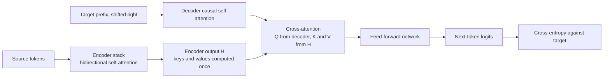

The diagram shows two information paths into the output: the target prefix through causal self-attention, and the source through cross-attention. The encoder-decoder design fits tasks where the input and output are different kinds of sequence or where the input is long and the output is short, such as translation (T5, BART), summarization, and speech recognition (OpenAI's Whisper encodes an audio spectrogram and decodes text). The encoder processes the long input once, bidirectionally and in parallel, while the decoder only has to pay generation cost for the short output.

### 7.4 Mask patterns side by side

```text
Prompt = 4 tokens (P1..P4), then generated G1, G2.  1 = may attend, . = may not

Encoder-only (full)         Decoder-only (causal)       Prefix-LM (prompt bidirectional)
     P1 P2 P3 P4                 P1 P2 P3 P4 G1 G2          P1 P2 P3 P4 G1 G2
P1    1  1  1  1            P1    1  .  .  .  .  .     P1    1  1  1  1  .  .
P2    1  1  1  1            P2    1  1  .  .  .  .     P2    1  1  1  1  .  .
P3    1  1  1  1            P3    1  1  1  .  .  .     P3    1  1  1  1  .  .
P4    1  1  1  1            P4    1  1  1  1  .  .     P4    1  1  1  1  .  .
                            G1    1  1  1  1  1  .     G1    1  1  1  1  1  .
                            G2    1  1  1  1  1  1     G2    1  1  1  1  1  1
```

The prefix-LM pattern is a hybrid: a decoder-only model in which the prompt tokens attend to each other in both directions and the generated tokens attend causally. It spends the bidirectional capacity on the part of the sequence that is fully known. It has been used in some models (the UL2 work by Yi Tay and colleagues, 2022, mixes objectives of this kind), but the plain causal pattern is far more common in current large decoder-only models.

### 7.5 Why decoder-only models dominate generation

Three reasons explain the shift, and an architect should be able to distinguish the technical ones from fashion.

First, training efficiency of the objective. A causal language-modeling loss gives a training signal at every position of every sequence (Section 8.1). Masked language modeling gives a signal at only about 15 percent of positions. Per token of training data, the decoder-only objective extracts more supervision.

Second, uniformity and in-context use. A single stack with a single mask can be pre-trained on raw text and then used with prompts for any task, including few-shot examples inside the context, without a task-specific head. This is the property that GPT-3 demonstrated at scale (Brown and colleagues, 2020).

Third, empirical evidence at scale. Thomas Wang and colleagues (2022) compared architectures and objectives under controlled conditions at around 5 billion parameters and 170 billion tokens. Decoder-only models with a causal language-modeling objective gave the best zero-shot generalization immediately after pre-training. Encoder-decoder models with a masked-language-modeling objective, followed by multitask fine-tuning, performed best after that extra stage. The result supports a conditional statement, not a universal one: for a general-purpose model that must work with prompts straight from pre-training, decoder-only was the best configuration in that study, and for a system with a defined input-output task and labeled data, other configurations compete.

Decoder-only also has costs. Prompt tokens cannot use information from later prompt tokens, which may be a weaker representation of the prompt per parameter than a bidirectional encoder gives. Since every generated token passes through every layer, generation cost scales with the full model size, whereas an encoder-decoder pays the large-input cost once in the encoder. For long inputs with short outputs, an encoder-decoder can be cheaper per request. And a decoder-only model's KV cache holds the whole prompt, so prompt length drives serving memory (Section 13).

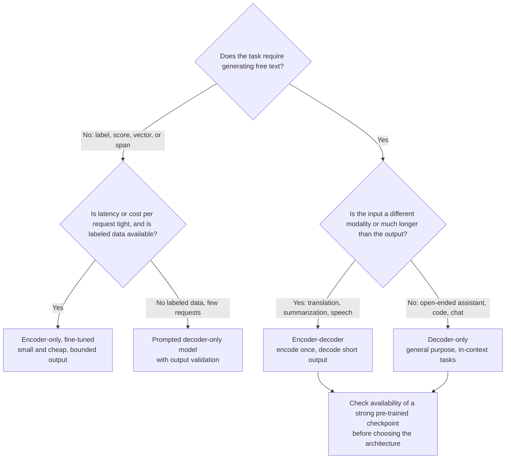

The decision tree starts from the output, not the input, because the output type determines whether a decoding loop is needed at all. The last box is a practical caution: the best architecture on paper may have no strong pre-trained checkpoint in your domain or license, and a checkpoint with the right data matters more than a small architectural fit difference.

## 8. Training Objectives

An architecture defines which functions can be represented. The objective defines what the model is asked to learn from data. Three objectives account for most pre-training.

### 8.1 Causal language modeling

Given a sequence $x_1,\dots,x_n$, the causal language-modeling objective maximizes the likelihood of each token given those before it, which is equivalent to minimizing

$$
\mathcal{L}_\text{CLM}=-\frac{1}{n-1}\sum_{t=1}^{n-1}\log p_\theta\big(x_{t+1}\mid x_1,\dots,x_t\big).
$$

The model computes logits at every position in one pass under the causal mask. The target at position $t$ is the input token at $t+1$ (the input shifted by one). With teacher forcing, the model is conditioned on the true previous tokens during training, and it is conditioned on its own previous outputs at inference. This discrepancy is called exposure bias, and it is one reason generation quality can differ from teacher-forced perplexity. Perplexity, $\exp(\mathcal{L})$, is the exponentiated average negative log-likelihood. A loss of 2.0 nats per token corresponds to a perplexity of $e^{2.0}\approx7.4$: the model is as uncertain, on average, as if choosing uniformly among about 7.4 equally likely tokens.

The count of training signals is the key to its efficiency. A 512-token sequence yields 511 prediction targets from a single forward and backward pass, because under the causal mask every position is a valid example of "predict the next token from the past." The cost of processing the sequence is paid once and the supervision is extracted 511 times.

### 8.2 Masked language modeling

Masked language modeling (MLM), the objective of BERT, corrupts the input and asks the model to recover it. About 15 percent of token positions are selected at random. Of the selected positions, 80 percent are replaced with a special mask token, 10 percent are replaced with a random token, and 10 percent are left unchanged. The loss is computed only at the selected positions:

$$
\mathcal{L}_\text{MLM}=-\frac{1}{|M|}\sum_{t\in M}\log p_\theta\big(x_t\mid \tilde{x}\big),
$$

where $M$ is the set of selected positions and $\tilde{x}$ is the corrupted sequence. The model sees the whole corrupted sequence with no causal mask, so each prediction uses left and right context. The 80/10/10 split addresses a mismatch: the mask token never appears in downstream inputs, so a model trained only on mask tokens would never practice producing good representations for real tokens. Random and unchanged replacements force it to maintain a useful representation of every position, since it cannot know which are corrupted.

The cost is signal efficiency. With 15 percent selection, a 512-token sequence yields about $0.15\times512=76.8\approx77$ prediction targets, against 511 for causal modeling, so each forward pass extracts about 15 percent of the supervision. Yinhan Liu and colleagues (2019, RoBERTa) showed that BERT was undertrained, and that choosing a fresh random mask each time a sequence is seen (dynamic masking), training longer with larger batches, and removing the auxiliary next-sentence prediction task improved results. Kevin Clark and colleagues (2020, ELECTRA) addressed the efficiency gap directly by training a discriminator to detect which tokens were replaced by a small generator, which gives a signal at all positions.

### 8.3 Span corruption

Span corruption is the objective of the T5 model (Raffel and colleagues, 2019) for encoder-decoder training. Contiguous spans of the input are removed and replaced by unique sentinel tokens. The target is the sequence of dropped spans, each preceded by its sentinel. Using the example from the paper, "Thank you for inviting me to your party last week." becomes the input "Thank you `<X>` me to your party `<Y>` week." and the target "`<X>` for inviting `<Y>` last `<Z>`". The baseline corrupted 15 percent of tokens with a mean span length of 3. Replacing each span by a single sentinel shortens the input, and the target contains only the dropped tokens, so it is much shorter than the input. A short target is cheap for the decoder to produce, which makes the objective more efficient than reconstructing the whole input.

### 8.4 Other objectives worth knowing

- **Prefix language modeling** applies the causal loss only to the continuation while the prefix is read bidirectionally (Section 7.4).
- **Fill-in-the-middle** (Mohammad Bavarian and colleagues, 2022) rearranges a document so that a causal model sees the prefix and suffix first and then learns to generate the middle, which supports code-completion inside a file with text on both sides of the cursor.
- **Mixture of denoisers** (UL2; Tay and colleagues, 2022) trains one model on several corruption types, mixing short and long spans and prefix tasks.
- **Multi-token prediction** (Fabian Gloeckle and colleagues, 2024) trains extra heads to predict several future tokens at once, which in their experiments improved code benchmarks and allowed faster decoding by self-speculation. It is a current research direction.

After pre-training, instruction fine-tuning and preference optimization change the model's behavior. [CH14](CH14_Reinforcement_Learning_from_Human_Feedback.md) and [CH20](CH20_Fine_Tuning_PEFT_and_LoRA.md) own those stages. For this chapter it is enough to note that they act on a model whose architecture and base objective are already fixed.

| Objective | Mask | Loss positions | Signal per 512-token sequence | Typical architecture |
| --- | --- | --- | --- | --- |
| Causal language modeling | Causal | All but first | 511 | Decoder-only |
| Masked language modeling (15 percent) | None | Masked subset | About 77 | Encoder-only |
| Span corruption | None in encoder, causal in decoder | Dropped spans | Fewer, shorter targets | Encoder-decoder |
| Replaced-token detection | None | All | 512 | Encoder-only |
| Prefix language modeling | Prefix bidirectional | Continuation | Continuation length | Decoder-only variant |

The table shows how closely mask, objective, and architecture are tied. An objective whose loss at position $t$ uses tokens after $t$ cannot be used with a causal mask, and a mask that exposes future tokens cannot be combined with next-token loss. When a model's training code changes the mask or the label shift, check both together. An off-by-one in the label shift is a classic bug: if the targets are not shifted, a causal model with the identity mapping can copy its input to the output and reach near-zero loss while learning nothing useful.

## 9. Counting Parameters

Parameter count sets weight memory, the arithmetic per token, and a first estimate of cost. It should be computed from the configuration, not taken from a model name, because names round, MoE models have two different counts (Section 16), and embeddings can be a large share.

### 9.1 The formula for a decoder-only model

Let $d$ be the model width, $L$ the number of layers, $h$ the number of query heads, $g$ the number of key-value heads (equal to $h$ for standard multi-head attention), $d_h$ the head width, $d_\text{ff}$ the feed-forward hidden width, and $V$ the vocabulary size. For a gated (SwiGLU) feed-forward network, RMS normalization, no biases, and untied embeddings, one layer holds:

| Component | Parameters |
| --- | --- |
| Query projection | $d\cdot h\,d_h$ |
| Key and value projections | $2\cdot d\cdot g\,d_h$ |
| Output projection | $h\,d_h\cdot d$ |
| Feed-forward (gate, up, down) | $3\cdot d\cdot d_\text{ff}$ |
| Two RMS norms | $2d$ |

and the whole model holds

$$
P=\underbrace{Vd}_{\text{input embedding}}+L\Big(2d\,hd_h+2d\,gd_h+3d\,d_\text{ff}+2d\Big)+\underbrace{d}_{\text{final norm}}+\underbrace{Vd}_{\text{output head}} .
$$

For standard multi-head attention with $hd_h=d$ and the gated feed-forward width $d_\text{ff}\approx\tfrac{8}{3}d$, the layer term is about $4d^2+8d^2=12d^2$, which gives the rule of thumb

$$
P\approx 12\,L\,d^2+2Vd .
$$

For a classic feed-forward network with $d_\text{ff}=4d$ and two matrices, the layer term is also $4d^2+8d^2=12d^2$. The rule therefore holds for both. Biases, normalization scales, and a learned position table add a little. The script [02_params_flops_kv_cache.py](../code/python/transformers-chapter/02_params_flops_kv_cache.py) implements the full formula and prints the following checks.

### 9.2 Worked example: a 7-billion-parameter model

Take the published shape of Llama 2 7B: $d=4096$, $L=32$, $h=g=32$ heads of width $d_h=128$, $d_\text{ff}=11008$, $V=32000$ (Touvron and colleagues, 2023).

1. Attention per layer: $4\cdot4096^2=4\cdot16{,}777{,}216=67{,}108{,}864$.
2. Feed-forward per layer: $3\cdot4096\cdot11008=135{,}266{,}304$.
3. Normalization per layer: $2\cdot4096=8{,}192$.
4. One layer: $67{,}108{,}864+135{,}266{,}304+8{,}192=202{,}383{,}360$.
5. Thirty-two layers: $32\cdot202{,}383{,}360=6{,}476{,}267{,}520$.
6. Embedding and output head: $2\cdot32000\cdot4096=262{,}144{,}000$.
7. Final norm: $4{,}096$.
8. Total: $6{,}476{,}267{,}520+262{,}144{,}000+4{,}096=6{,}738{,}415{,}616$.

The script prints exactly $6{,}738{,}415{,}616$, which rounds to the "7B" in the name. The rule of thumb gives $12\cdot32\cdot4096^2=6{,}442{,}450{,}944$ for the layers, within 0.5 percent of the exact layer total, so the quick formula is good enough for planning.

### 9.3 Worked example: grouped-query attention and a large vocabulary

The Llama 3 8B shape (Llama Team, 2024) is $d=4096$, $L=32$, $h=32$, $g=8$, $d_h=128$, $d_\text{ff}=14336$, $V=128256$. Two differences from the 7B model change the split of parameters.

Attention per layer: queries $4096\cdot4096=16{,}777{,}216$, keys and values $2\cdot4096\cdot1024=8{,}388{,}608$, output $16{,}777{,}216$, total $41{,}943{,}040$, compared with $67{,}108{,}864$ for full multi-head attention. Grouped-query attention cuts attention parameters by 37.5 percent here. The feed-forward layer is $3\cdot4096\cdot14336=176{,}160{,}768$, so attention holds only 19.2 percent of a layer and the feed-forward network holds 80.8 percent, against 33.2 and 66.8 percent in the 7B model. Embeddings: $2\cdot128256\cdot4096=1{,}050{,}673{,}152$, which is 13.1 percent of the total of $8{,}030{,}261{,}248$, against 3.9 percent for the 7B model. A vocabulary four times larger raises the embedding share noticeably and speeds up tokenization of non-English text and code (the subject of [CH15](CH15_Large_Language_Model_Fundamentals_and_Inference.md)), at the price of a larger output softmax at every decoding step.

### 9.4 Larger and smaller references

| Model shape | Total parameters (computed) | Notes |
| --- | ---: | --- |
| GPT-2 small (LayerNorm with bias, GELU, learned positions, tied embeddings) | 124,439,808 | 12 layers, $d=768$; embeddings are 31 percent of the total |
| Llama 2 7B | 6,738,415,616 | Multi-head attention, SwiGLU |
| Llama 3 8B | 8,030,261,248 | Grouped-query attention, large vocabulary |
| Llama 2 70B | 68,976,648,192 | $d=8192$, $L=80$, $g=8$, $d_\text{ff}=28672$ |
| Mixtral-style 8 experts, top 2 | 46,702,792,704 total, 12,879,925,248 active | Section 16 |

The original transformer provides a sanity check on a different design. The base model had $d=512$, $d_\text{ff}=2048$, six encoder and six decoder layers, and a shared vocabulary of about 37,000 byte-pair tokens. An encoder layer holds $4\cdot512^2+2\cdot512\cdot2048=3{,}145{,}728$ weights, a decoder layer (with a second attention sublayer) $8\cdot512^2+2\cdot512\cdot2048=4{,}194{,}304$, and the embedding $37{,}000\cdot512=18{,}944{,}000$. The sum is $6\cdot3{,}145{,}728+6\cdot4{,}194{,}304+18{,}944{,}000=62{,}984{,}192$, about 63 million before biases and normalization, against the 65 million the paper reports. The remainder is the biases and norm parameters the quick count omits.

### 9.5 From parameters to memory

Weight memory is parameters times bytes per parameter. At 16-bit precision (2 bytes) the Llama 2 7B shape needs $6.74\times10^9\cdot2=13.5$ GB, the Llama 3 8B shape 16.1 GB, and the 70B shape 138 GB, which does not fit on one 80 GB accelerator and must be split across at least two, or quantized to 8 bits (about 69 GB) or 4 bits (about 34 GB) plus overhead for the KV cache and activations. Training costs far more per parameter. With mixed precision and the Adam optimizer ([CH07](CH07_Deep_Learning_Foundations.md) derives the accounting), each parameter needs about 2 bytes for the 16-bit weight, 2 for its gradient, 4 for a 32-bit master copy, and 4+4 for the two Adam moments, 16 bytes in total. A 7B model therefore needs $16\cdot6.74\times10^9/2^{30}\approx100$ GiB for these states before any activation memory, which explains why training requires sharding the states across many accelerators while inference does not.

## 10. FLOPs per Token and Training Compute

### 10.1 Counting operations

A matrix product of an $m\times k$ matrix by a $k\times n$ matrix performs $mkn$ multiplications and about as many additions, so it costs $2mkn$ floating-point operations. For a single token (a vector of length $k$) multiplied by a weight matrix with $k\times n=P$ entries, the cost is $2P$ FLOPs. Summed over every weight matrix a token passes through, the forward pass costs about $2N$ FLOPs per token, where $N$ is the number of parameters in matrix multiplications. The input embedding lookup is a table read, not a multiplication, so it is excluded from $N$, while the output head is included. For Llama 2 7B, excluding the input embedding gives $N=6{,}607{,}343{,}616$ and a forward cost of $2N=1.32\times10^{10}$ FLOPs per token.

### 10.2 Why training costs 6N

Consider one linear layer $Y=XW$ with $X\in\mathbb{R}^{b\times k}$ and $W\in\mathbb{R}^{k\times n}$. The forward pass costs $2bkn$ FLOPs. The backward pass needs two products: the gradient with respect to the input, $dX=dY\,W^\top$, and the gradient with respect to the weights, $dW=X^\top dY$. Each has the same shape arithmetic as the forward product and costs $2bkn$. The backward pass is therefore twice the forward pass, and a training step costs $2+4=6$ FLOPs per parameter per token. For a dataset of $D$ tokens,

$$
C\approx 6\,N\,D .
$$

This is the 6ND rule. It ignores the attention-score term, normalization, softmax, and elementwise operations, which are small for moderate context, and it ignores the cost of recomputation. If activation checkpointing recomputes the forward pass during backward to save memory ([CH07](CH07_Deep_Learning_Foundations.md)), the cost rises to about $8ND$.

### 10.3 The attention term

The score product $QK^\top$ costs $2n^2d_h$ per head, and the weighted sum $AV$ costs another $2n^2d_h$, so a layer's attention score and mixing work with $h$ heads is $4n^2hd_h=4n^2d$ for a full square matrix. A causal model needs only the lower triangle, about half, and an optimized kernel can skip the upper triangle, giving $2n^2d$ per layer for a sequence of length $n$. Per token, averaged over positions, the forward cost is $2ndL$ across $L$ layers. Kaplan and colleagues (2020) write the forward cost per token as $2N+2L\,n_\text{ctx}\,d_\text{attn}$, the same expression. For training, multiply by three.

| Context $n$ | Attention FLOPs per token (forward, averaged) | Share of forward FLOPs |
| ---: | ---: | ---: |
| 2,048 | $5.4\times10^8$ | 3.9 percent |
| 4,096 | $1.07\times10^9$ | 7.5 percent |
| 32,768 | $8.6\times10^9$ | 39.4 percent |
| 131,072 | $3.4\times10^{10}$ | 72.2 percent |

The table uses the Llama 2 7B shape ($L=32$, $d=4096$, $2N=1.32\times10^{10}$). At 4,096 tokens, attention is under 8 percent of the arithmetic, so $6ND$ is an accurate estimate. At 32,768 tokens it is almost 40 percent, and at 131,072 tokens it is 72 percent. A long-context training run or a long-prompt serving workload is therefore not well estimated by the parameter count alone. The attention term grows linearly with context for each token and quadratically for the whole sequence, which is the subject of Section 11.

### 10.4 Training compute examples

Applying $C\approx6ND$ gives the following, from the script.

| Model | $N$ | $D$ | $C=6ND$ | Tokens per parameter |
| --- | ---: | ---: | ---: | ---: |
| GPT-3 (Brown et al., 2020) | 175B | 300B | $3.15\times10^{23}$ | 1.7 |
| Gopher (Rae et al., 2021) | 280B | 300B | $5.04\times10^{23}$ | 1.1 |
| Chinchilla (Hoffmann et al., 2022) | 70B | 1.4T | $5.88\times10^{23}$ | 20 |
| 7B model, 2T tokens (illustrative) | 7B | 2T | $8.4\times10^{22}$ | 286 |

The GPT-3 paper reports about $3.14\times10^{23}$ FLOPs for the 175-billion-parameter model, which matches the rule to within 0.3 percent. The table also shows how much the data budget varies for models of similar training cost: Gopher and Chinchilla used similar compute with four times fewer parameters and almost five times more data in the second case. Section 17 explains what that did to quality.

### 10.5 From FLOPs to accelerator time and money

Training time is $C$ divided by the sustained FLOP rate. The sustained rate is the accelerator's peak multiplied by the model FLOPs utilization (MFU), the fraction of peak the training job achieves. Large dense transformer training commonly reaches somewhere between 30 and 55 percent, depending on parallelism, communication, and kernel quality. The H100 SXM accelerator has a published peak of about 989 teraFLOPs per second for dense 16-bit matrix arithmetic (at the time of writing; verify against the vendor's current specification for your hardware).

For the Chinchilla-scale run, $C=5.88\times10^{23}$:

- At 40 percent MFU the sustained rate is $0.40\cdot989\times10^{12}=3.956\times10^{14}$ FLOPs per second, so the run needs $5.88\times10^{23}/3.956\times10^{14}=1.486\times10^9$ accelerator-seconds, or 412,875 accelerator-hours.
- On 2,048 accelerators that is $412{,}875/2048/24=8.4$ days.
- At 30 percent MFU it is 550,500 hours (11.2 days), and at 50 percent MFU it is 330,300 hours (6.7 days).
- At an illustrative price of $2.00 per accelerator-hour, the 40 percent case costs about $826,000 for the final run.

The last number is the cost of the final run only. Ablations, hyperparameter searches, failed or restarted runs, data processing, evaluation, and the engineering team all add to the total, and published figures for a final run understate a project's cost by a multiple that only the team that ran it knows. Ask for that ratio before using any single-run figure for planning.

A cross-check against a published number tests the method. Touvron and colleagues report about 184,320 A100 accelerator-hours for the 7B Llama 2 model trained on 2 trillion tokens (verify against the paper). The compute is $6\cdot6.74\times10^9\cdot2\times10^{12}\approx8.1\times10^{22}$ FLOPs, or $8.4\times10^{22}$ with the rounded 7 billion. Dividing by $184{,}320\cdot3600=6.6\times10^8$ seconds gives between $1.22\times10^{14}$ and $1.27\times10^{14}$ FLOPs per second per accelerator, which is 39 to 41 percent of the A100's published 312 teraFLOPs per second peak for 16-bit arithmetic. A utilization of about 40 percent matches typical large-run experience, so the rule and the reported cost agree.

The same arithmetic answers a planning question. How many H100-class accelerators does a 30-day run of the 2-trillion-token 7B model need? The accelerator-hours at 40 percent MFU are $8.4\times10^{22}/(3.956\times10^{14}\cdot3600)\approx58{,}980$, and over 720 hours that is about 82 accelerators of continuous use. Real plans add margin for failures, checkpointing overhead, and lower utilization at small scale, but the first estimate takes a few lines and tells you whether a proposal is off by a factor of ten.

### 10.6 Inference FLOPs

Serving costs the forward pass only, $2N$ FLOPs per token plus the attention term, so a 7B model needs about $1.3\times10^{10}$ FLOPs per token. The ratio between training and inference per token is 3. That does not mean inference is cheap. A model that is trained once is served for every request for its lifetime, so total inference compute can exceed training compute many times over for a popular model. That is the reason Section 17 discusses training smaller models on more data than the compute-optimal recipe suggests.

## 11. Quadratic Attention Cost in Time and Memory

### 11.1 Where the quadratic term comes from

Every query is compared with every key, so the score matrix has $n^2$ entries per head. Computing it costs $2n^2d_h$ FLOPs per head and the weighted sum costs another $2n^2d_h$, so all heads in a layer cost $4n^2d$ without exploiting the causal triangle and $2n^2d$ with it. The projections and the feed-forward network cost $O(nd^2)$. The ratio of the two,

$$
\frac{\text{attention}}{\text{projections and feed-forward}}\approx\frac{2n^2d}{24\,n\,d^2}=\frac{n}{12\,d},
$$

follows from $2N\approx2\cdot12d^2$ FLOPs per token and layer in the rest of the network (Section 9.1) and $2nd$ per token for causal attention. Attention work matches the work of everything else when $n\approx12d$. For $d=4096$ that is $n\approx49{,}000$ tokens, consistent with the 39 percent share at 32,768 tokens and 72 percent at 131,072 in Section 10.3. Below about $n=d$ attention is a minor cost, between $d$ and $10d$ it is a growing share, and beyond $12d$ it dominates.

The scaling is a property of the algorithm and not of one implementation. Doubling the context multiplies score work by four. Going from 1,000 to 8,000 tokens is an 8-fold longer input and a 64-fold larger score matrix, from one million to 64 million entries per head per layer. A team that profiles an implementation which materializes the score matrix will see memory quadruple when the source length doubles, and that observation is correct for that implementation. Section 12 shows how much of the memory growth can be removed and how much of the time growth cannot.

### 11.2 Memory for the score matrix

A direct implementation stores the score matrix $S$ and the softmax output $P$ in memory. In 16-bit precision each entry takes 2 bytes, so one head needs $2n^2$ bytes for one of them. The script prints the totals for a model with 32 heads:

| Context $n$ | One head | 32 heads, one layer, one sequence |
| ---: | ---: | ---: |
| 2,048 | 8 MiB | 0.25 GiB |
| 8,192 | 128 MiB | 4 GiB |
| 32,768 | 2 GiB | 64 GiB |
| 131,072 | 32 GiB | 1,024 GiB |

At 8,192 tokens a single layer would hold 4 GiB of scores for one sequence. At 32,768 tokens the matrices for one layer exceed the memory of most accelerators. During training the backward pass needs these matrices (or the means to recompute them) for every layer, which multiplies the requirement by the number of layers if they are stored. This is the memory wall that stopped early transformers at 512 to 2,048 tokens. It is a wall on memory, which arrives before the wall on arithmetic, since the 32,768-token layer above needs far less compute than a large accelerator provides in a second.

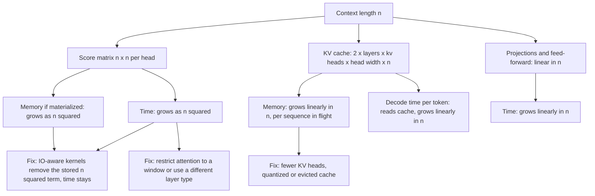

The diagram separates four quantities that people often merge when they say "attention is quadratic." The score-matrix memory is quadratic only for a naive implementation. The score-matrix time is quadratic for exact attention in any implementation. The KV cache is linear in context but multiplies by the number of concurrent requests. And per-token decode time is linear in context because the new query is compared with all cached keys. Each has a different fix, and a design discussion that does not say which of the four is the constraint cannot choose among the fixes.

### 11.3 Prefill and decode have different shapes

Serving a request has two phases with different cost structures. In prefill, the model processes the $n$ prompt tokens at once. The score matrix is $n\times n$, the arithmetic is large and dense, and the phase is compute-bound on modern accelerators. In decode, the model generates one token at a time. Each step computes a single query row, so the score computation is $1\times n$ per head, linear in the current context. Generating $m$ tokens after an $n$-token prompt costs about $mn+m^2/2$ score entries per head in total, which is linear in $n$ for fixed $m$. The decode phase does very little arithmetic per byte of memory it must read, which makes it memory-bound (Section 13.3). Prefill latency governs time to first token, and decode speed governs the rate of subsequent tokens. A workload with long prompts and short answers (summarizing a document, answering over retrieved passages) is dominated by prefill and cache memory. A workload with short prompts and long answers (writing, reasoning traces) is dominated by decode bandwidth. Optimizing the wrong phase wastes effort, and [CH28](CH28_Inference_Optimization_and_Model_Serving.md) owns the serving techniques for each.

## 12. FlashAttention: Making Exact Attention IO-Aware

### 12.1 The memory hierarchy is the constraint

Modern accelerators have a small amount of very fast on-chip memory (static random-access memory, SRAM, together with shared memory and registers) and a large amount of slower off-chip memory, high-bandwidth memory (HBM). Tri Dao and colleagues (2022) give figures for the A100 accelerator of about 40 to 80 GB of HBM at 1.5 to 2 TB/s and about 20 MB of on-chip SRAM at around 19 TB/s. The on-chip memory is roughly ten times faster and thousands of times smaller. Many operations in a transformer are limited by how fast they can move data between the two, not by how fast they can multiply. An operation is memory-bound when the time to move its data exceeds the time to compute on it.

A direct attention implementation performs three separate steps: compute $S=QK^\top$ and write it to HBM, read $S$, apply the softmax, and write $P$ to HBM, then read $P$ and compute $PV$. Each step moves $n^2$ numbers between HBM and the chip. The arithmetic of each step is small compared with the movement, so the whole operation is bound by HBM bandwidth. Reducing the amount of data moved gives a speedup even if the arithmetic stays the same.

### 12.2 Tiling with an online softmax

FlashAttention computes exactly the same result without ever writing the $n\times n$ matrix to HBM. It splits $Q$ into blocks of rows and $K$ and $V$ into blocks of rows, loads one block of each into SRAM, computes the scores for that pair of blocks, and updates running statistics. The challenge is the softmax, whose denominator needs all keys. The online softmax (Maxim Milakov and Natalia Gimelshein, 2018) solves this by maintaining three running quantities for each query row, which are updated as each block of keys arrives:

- $m$, the running maximum of the scores seen so far,
- $\ell$, the running sum $\sum_j e^{s_j-m}$ (the softmax denominator, scaled by the current maximum),
- $o$, the running unnormalized output $\sum_j e^{s_j-m}\,v_j$.

When a new block with scores $s^{(b)}$ and values $v^{(b)}$ arrives, compute the new maximum $m'=\max(m,\max_j s^{(b)}_j)$ and update

$$
\ell'=\ell\,e^{m-m'}+\sum_{j\in b}e^{s_j-m'},\qquad
o'=o\,e^{m-m'}+\sum_{j\in b}e^{s_j-m'}\,v_j .
$$

After the last block the output is $o/\ell$. The correction factor $e^{m-m'}$ rescales everything accumulated under the old maximum to the new one. The result is exact because softmax is invariant to subtracting a constant from all scores: $e^{s_j-m'}/\sum_le^{s_l-m'}=e^{s_j}/\sum_le^{s_l}$ for any $m'$. The weighted sum of values can therefore be accumulated in any order, with any block size, provided each partial sum is expressed relative to a common reference that is corrected when the maximum changes.

The script [04_block_numerics_and_tiling.py](../code/python/transformers-chapter/04_block_numerics_and_tiling.py) implements this and compares it with the standard computation on 37 random keys and values of width 8. For tile sizes 1, 4, 16, and 37 the largest absolute difference is about $1.3\times10^{-16}$, which is floating-point rounding in 64-bit arithmetic. The block size changes only the order of operations.

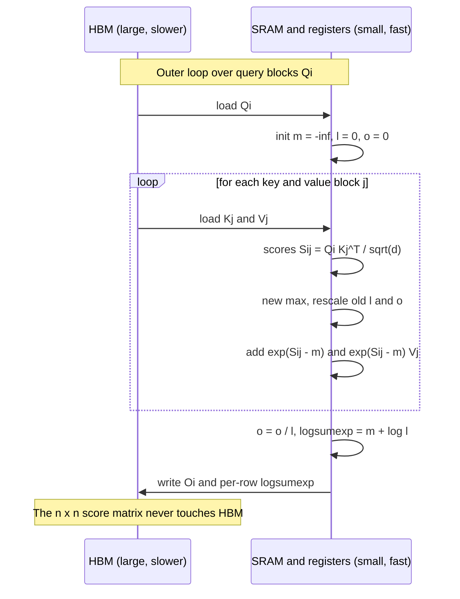

The sequence diagram shows that the only large objects written to HBM are the output $O$ (size $n\times d_h$) and one number per row, the log-sum-exp, for the backward pass. In the backward pass FlashAttention does not read a stored $P$. It recomputes the scores block by block from $Q$, $K$, and the saved log-sum-exp, so storage falls from $O(n^2)$ to $O(n)$. Recomputation costs extra arithmetic, but the arithmetic is cheap compared with HBM traffic, and the trade is a net gain in wall-clock time. That is the principle of input/output-aware (IO-aware) algorithm design: count the data movement between memory levels, and accept more arithmetic to cut it.

### 12.3 What FlashAttention does and does not change

It does not approximate anything. The output equals standard attention up to floating-point rounding, which is why it was adopted quickly without retraining or re-validating models. It changes memory from quadratic to linear in sequence length for the attention computation, which is what allowed training contexts to grow from 2,000 to tens and hundreds of thousands of tokens. Dao and colleagues reported end-to-end training speedups of about 15 percent on BERT-large, about 3 times on GPT-2 at 1,024 tokens, and 2.4 times on the long-range arena benchmark (verify against the paper; speedups depend on hardware and sequence length). FlashAttention-2 (Dao, 2023) improved work partitioning across thread blocks and reduced non-matrix operations. FlashAttention-3 (Jay Shah and colleagues, 2024) targeted the Hopper generation of accelerators by overlapping data movement with computation and adding 8-bit floating-point support. Its authors report that FlashAttention-2 reached only about 35 percent utilization on the H100 and that FlashAttention-3 achieved speedups of 1.5 to 2.0 times, with up to 840 teraFLOPs per second in 16-bit arithmetic, about 85 percent of peak (as reported in the NeurIPS 2024 version, which updated the arXiv figures).

It does not change the FLOP count. Time still grows as $n^2$, so the table in Section 11.1 still applies to prefill. A 128,000-token prompt is feasible in memory because of FlashAttention and is still slow in arithmetic, which Section 15.4 quantifies.

### 12.4 Practical consequences

In frameworks, you rarely call a custom kernel. PyTorch exposes `torch.nn.functional.scaled_dot_product_attention`, which selects among a fused FlashAttention-style kernel, a memory-efficient kernel, and a plain math fallback depending on data type, mask form, head width, and hardware. Three practical points follow.

1. A dense, arbitrary mask can disable the fastest kernel. Causal masking has a dedicated fast path (the kernel skips the upper triangle entirely, halving the work). A custom mask tensor, such as one that encodes document boundaries in packed sequences or an ALiBi-style bias, may select a slower path or require a kernel with support for it. Profile after any change to the mask.
2. Precision matters for kernel choice. The fused kernels run in 16-bit floating point (half or bfloat16). A model left in 32-bit precision may silently run the slow path and use many times more memory.
3. Variable-length batches can be handled without padding by passing cumulative sequence lengths to a variable-length kernel, which avoids both padding waste and the padding-mask bug of Section 3.5.

When a team reports that attention is slow or out of memory, the first questions are which backend the framework actually selected, what the data type is, and whether the mask forced a fallback. These checks take minutes and often explain a ten-fold difference.

## 13. The KV Cache and Reducing It

### 13.1 Why caching is valid

In a causal decoder, the key and value of position $j$ depend only on tokens $1,\dots,j$ through earlier layers, because position $j$ cannot read any later token. When a new token is generated at position $n+1$, the keys and values of positions $1,\dots,n$ are therefore unchanged. Recomputing them wastes work. The KV cache stores them. At each decode step, the model computes the query, key, and value for the single new position, appends the new key and value to the cache of every layer, and attends from the new query over the whole cache.

Without the cache, generating each token reruns the model over the full prefix, costing about $2Nn$ FLOPs per step, so a 1,000-token answer after a 1,000-token prompt would redo prefix computation about a thousand times. With the cache each step costs about $2N$ plus the attention over the cache, which is linear in the context. The cache converts a quadratic total into a linear one, and it costs memory.

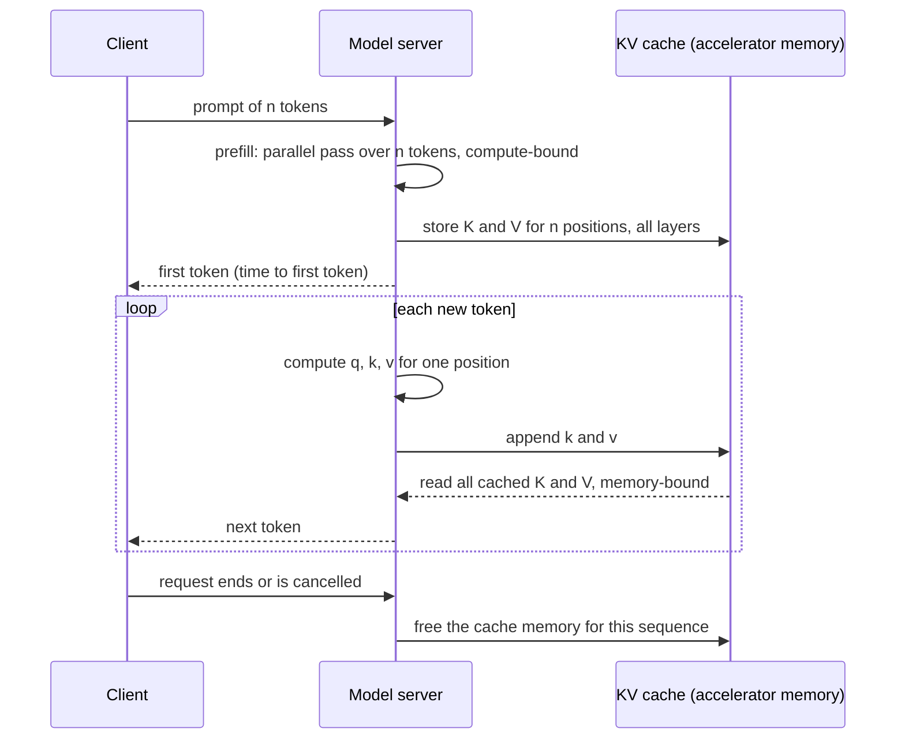

The diagram shows two things that matter for capacity planning. The cache is created by prefill and read in full at every decode step, so its size sets both memory use and the per-token bandwidth bill. And the cache lives for the duration of the request, so total cache memory is the sum over all requests in flight, which is why a serving system's concurrency is bounded by cache memory and not by the model's arithmetic.

### 13.2 The memory formula

For each token, each layer stores one key and one value vector per key-value head:

$$
\text{KV bytes}=2\;\times\;L\;\times\;g\;\times\;d_h\;\times\;b\;\times\;n\;\times\;B ,
$$

where the leading 2 counts keys and values, $L$ is the number of layers, $g$ the number of key-value heads, $d_h$ the head width, $b$ the bytes per element (2 for 16-bit), $n$ the context length in tokens, and $B$ the number of sequences. The per-token cost, $2Lgd_hb$, depends only on the architecture. For the Llama 2 7B shape ($L=32$, $g=32$, $d_h=128$, $b=2$) it is $2\cdot32\cdot32\cdot128\cdot2=524{,}288$ bytes, 512 KiB per token. The script prints the following.

| Model shape | KV heads $g$ | Per token (16-bit) | 4,096 tokens | 32,768 tokens | 131,072 tokens |
| --- | ---: | ---: | ---: | ---: | ---: |
| Llama 2 7B (multi-head) | 32 | 512 KiB | 2.00 GiB | 16.00 GiB | 64.00 GiB |
| Llama 3 8B (grouped-query) | 8 | 128 KiB | 0.50 GiB | 4.00 GiB | 16.00 GiB |
| Llama 2 70B (grouped-query) | 8 | 320 KiB | 1.25 GiB | 10.00 GiB | 40.00 GiB |

These are per sequence. The Llama 2 7B model at 131,072 tokens would need 64 GiB of cache per sequence, about five times its own 16-bit weights of about 13.5 GB. (The published Llama 2 models were trained with a 4,096-token context. The longer rows show how the formula scales, not a supported configuration.) If the 70B model used full multi-head attention it would cost 2,560 KiB per token, eight times more than its grouped-query design.

A capacity example shows the consequence. Take the Llama 3 8B shape on one 80 GB accelerator, with 16-bit weights of 16.1 GB and 90 percent of memory usable for weights plus cache. The cache gets $0.9\cdot80-16.1=55.9$ GB. Each 32,768-token sequence needs 4.29 GB (note $4$ GiB is $4.29$ decimal GB), so the accelerator holds $\lfloor55.9/4.29\rfloor=13$ concurrent sequences of that length. Raising the context to 131,072 tokens divides that to 3 sequences. Memory for activations and the runtime is ignored here, so the real number is lower, but the shape of the result holds: concurrency is set by cache memory, and a context-length increase divides concurrency by the same factor.

### 13.3 Decode is memory-bound

Each decode step must read all the model weights once, plus each sequence's cache, to produce one token per sequence. For a 7B model at 16 bits the weights are 13.5 GB. At an H100's published HBM bandwidth of about 3.35 TB/s (at the time of writing), reading them takes $13.48/3350=4.02$ ms, which bounds a single sequence at about 249 tokens per second no matter how much arithmetic capacity the accelerator has. The step performs $2N=1.3\times10^{10}$ FLOPs for $1.35\times10^{10}$ bytes read, an arithmetic intensity of about 0.98 FLOP per byte. The accelerator's balance point, its peak FLOPs divided by its bandwidth, is $989\times10^{12}/3.35\times10^{12}\approx295$ FLOPs per byte. At batch size 1 the job uses about 0.3 percent of the arithmetic capacity, which is why decode is called memory-bound.

Batching amortizes the weight reads: serving $B$ sequences in one step reads the weights once for all of them. Weights need a batch of about 300 sequences to reach the balance point. The cache is different, because each sequence has its own cache that must be read in full. The script's case study for the Llama 3 8B shape at 32,768 tokens gives:

| Batch | Bytes read per step | Step time | Tokens per second, total | Tokens per second per sequence |
| ---: | ---: | ---: | ---: | ---: |
| 1 | 20.4 GB (16.06 weights + 4.29 cache) | 6.1 ms | 165 | 165 |
| 13 | 71.9 GB (16.06 weights + 13 × 4.29 cache) | 21.5 ms | 606 | 47 |

Batching by 13 raises total throughput by 3.7 times, not 13 times, and each user sees a slower stream (47 versus 165 tokens per second). At long context the cache reads dominate the bandwidth bill, so batching stops paying. This is the central serving fact about long context, and it is why an architect cannot read cost per token off the parameter count: the same model served at 4,000 tokens and at 32,000 tokens has very different cost per generated token. [CH28](CH28_Inference_Optimization_and_Model_Serving.md) owns the techniques (continuous batching, paged cache allocation, speculative decoding, quantization) that move these numbers.

### 13.4 Multi-query and grouped-query attention

The formula shows where to cut. Cache size is proportional to the number of key-value heads $g$. Standard multi-head attention has $g=h$.

Noam Shazeer (2019) proposed multi-query attention (MQA): all query heads share a single key head and a single value head, so $g=1$. The cache shrinks by a factor of $h$, and decode reads far less memory, since the dominant traffic during generation is cache traffic. The cost is some quality loss and training instability in some settings, because the model has less representational flexibility in what it can store per token.

Joshua Ainslie and colleagues (2023) proposed grouped-query attention (GQA) as an interpolation: the $h$ query heads are divided into $g$ groups, and each group shares one key head and one value head. With $g=h$ it is multi-head attention and with $g=1$ it is multi-query attention. They reported that a model trained with multi-head attention can be converted to GQA by averaging the key and value heads within each group and then continuing training for about 5 percent of the original compute, and that the quality came close to the multi-head model while speed approached multi-query. Llama 2 70B and Llama 3 8B and 70B use 8 key-value heads against 64, 32, and 64 query heads respectively. For the 70B model the cache falls by a factor of $64/8=8$, as the table above shows.

Parameters also fall: attention parameters in Llama 3 8B are 41.9 million per layer against 67.1 million for multi-head attention (Section 9.3). The saving in parameters is small compared with the saving in cache, which is why the main benefit is serving memory and bandwidth and not model size.

### 13.5 Latent attention and other cache reductions

DeepSeek-V2 (DeepSeek-AI, 2024) introduced multi-head latent attention (MLA), which projects keys and values into a shared low-dimensional latent vector per token and caches only that latent, then reconstructs keys and values from it with up-projection matrices when needed. The report states a cache reduction of more than 90 percent relative to the team's previous dense model, with quality comparable to or better than multi-head attention in their experiments. Because MLA changes how position encoding is applied (a separate small rotary component is kept uncompressed), it is not a drop-in replacement and requires models trained with it.

Other approaches, from least to most invasive:

- **Quantize the cache.** Storing keys and values in 8-bit or 4-bit formats cuts memory by 2 to 4 times against 16-bit and reduces bandwidth by the same factor. Accuracy loss depends on the model and the task, and long-context retrieval is more sensitive than short chat. Evaluate on your own workload.
- **Share across layers.** Some designs reuse the keys and values of one layer in neighboring layers.
- **Limit the window.** Sliding-window layers keep only the last $W$ tokens (Section 14.2).
- **Evict tokens.** Heuristics keep a small set of tokens judged important (for example by accumulated attention) and drop the rest. This is lossy, and the evicted content is forgotten.
- **Page and share.** PagedAttention (Woosuk Kwon and colleagues, 2023) allocates cache in fixed-size blocks to avoid fragmentation, and requests with a common prefix can share blocks. [CH28](CH28_Inference_Optimization_and_Model_Serving.md) owns this.

Prefix sharing has a security implication discussed in Section 25. For an encoder-decoder model, the cross-attention keys and values of the encoder output are computed once per input and have a fixed size of source length times layers times heads times head width, independent of how many tokens are generated.

## 14. Sparse, Sliding-Window, and Linear Attention

Dense attention compares every pair. The alternatives restrict which pairs are compared, or reformulate attention so the pairwise matrix is never needed. They trade fidelity for cost, and the question is always what information is lost.

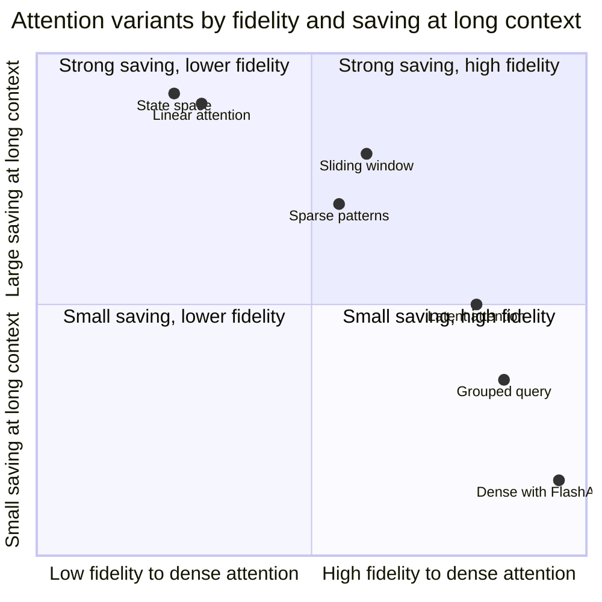

The chart places each approach qualitatively. The positions are judgments from published comparisons and are not measurements. Dense attention with an IO-aware kernel is exact but saves nothing in arithmetic. Grouped-query and latent attention keep the full pairwise computation and cut cache cost, so they preserve fidelity at a moderate saving. Window and sparse patterns cut arithmetic and cache sharply by dropping most pairs. Linear attention and state-space layers give the largest saving, with a fixed-size state, and show the largest fidelity risk on tasks that need precise recall from far back.

### 14.1 Sparse attention patterns

Rewon Child and colleagues (2019) introduced the Sparse Transformer, in which each position attends to a local window and to a strided subset of earlier positions. With a stride near $\sqrt n$ each position attends to $O(\sqrt n)$ others, reducing cost to $O(n\sqrt n)$, and two sparse layers together allow information to reach any position. Longformer (Iz Beltagy and colleagues, 2020) combines a sliding window with a few global tokens that attend to everything and are attended to by everything (such as a classification token or a question). BigBird (Manzil Zaheer and colleagues, 2020) adds random connections to window and global attention, and the authors prove that this pattern retains the expressiveness of full attention under stated conditions while costing $O(n)$ per layer.

Sparse patterns have three drawbacks in practice. Their irregular memory access patterns make them harder to run at high hardware utilization than dense matrix products, so a pattern that does $20\times$ fewer FLOPs may run only a few times faster. They fix the pattern in advance, so the model cannot attend to an arbitrary distant token it would have needed. And optimized kernels support only certain patterns. For these reasons most large language models keep dense attention in most layers and use sparsity selectively.

### 14.2 Sliding-window attention

Each position attends only to the previous $W$ positions (and itself). Cost per token becomes $O(W)$ instead of $O(n)$, total cost $O(nW)$, and the cache for such a layer needs only $W$ entries, held in a rolling buffer where the oldest entry is overwritten, so the cache size is independent of the total length. Information can still travel farther than $W$ across layers: a token at layer $\ell$ has seen information from up to $\ell W$ positions back through intermediate tokens, the same way a stack of convolutions grows its receptive field. Mistral 7B (Albert Jiang and colleagues, 2023) used a window of 4,096 tokens with 32 layers, which gives a theoretical reach of about 131,000 tokens. The theoretical reach overstates what can be retrieved. Information passing through many intermediate hops is repeatedly mixed with other content, so precise recall of an exact detail from far outside the window is unreliable.

Some designs interleave: most layers use a window and a minority use full attention, so the model has local detail everywhere and global access at a few depths. Gemma 2 (Gemma Team, 2024), for example, alternates local sliding-window layers with global layers. For the cache, the saving is direct. Take the Llama 3 8B shape at 128 KiB of cache per token with a 4,096-token window in every layer: the cache is $4096\cdot128$ KiB $=0.5$ GiB per sequence, whatever the context length, against 16 GiB for full attention at 131,072 tokens. A hybrid with a quarter of the layers dense needs 4 GiB for the dense quarter plus 0.375 GiB for the windowed three quarters, about 4.4 GiB. The compute saving at $n=131{,}072$ and $W=4{,}096$ is a factor of $(n/2)/W=16$ in the attention term.

### 14.3 Attention sinks and streaming

If a sliding-window model is run beyond its window by simply dropping the oldest cache entries, quality collapses. Xiao and colleagues (2023) traced this to attention sinks: many heads put a large share of their attention weight on the first token or tokens, which serve as a default place to put weight when no key is relevant (the softmax must sum to one, so the weight has to go somewhere). Evicting those tokens removes the default and distorts every distribution. Their remedy, StreamingLLM, keeps the first few tokens permanently, plus a rolling window of recent ones, and the model then continues with stable perplexity over millions of tokens. The method makes streaming feasible, and it does not give the model memory of what was evicted. A streaming deployment of this kind can generate indefinitely and cannot answer questions about content that left the window. This is an example of the difference between supporting long input and using long input.

### 14.4 Linear attention

Replace the softmax similarity $\exp(q\cdot k)$ by a kernel $\phi(q)\cdot\phi(k)$ where $\phi$ is a feature map applied to each vector, such as $\operatorname{elu}(x)+1$. The attention output for position $i$ becomes

$$
o_i=\frac{\sum_{j\le i}\phi(q_i)^\top\phi(k_j)\,v_j}{\sum_{j\le i}\phi(q_i)^\top\phi(k_j)}
=\frac{\phi(q_i)^\top\Big(\sum_{j\le i}\phi(k_j)v_j^\top\Big)}{\phi(q_i)^\top\sum_{j\le i}\phi(k_j)} .
$$

The step uses associativity: the sum over $j$ of $\phi(k_j)v_j^\top$ is a $d_k\times d_v$ matrix that does not depend on $i$ except through the range of the sum, so it can be maintained as a running state $S_i=S_{i-1}+\phi(k_i)v_i^\top$ and a running vector $z_i=z_{i-1}+\phi(k_i)$. This is the form given by Angelos Katharopoulos and colleagues (2020), who titled the paper "Transformers are RNNs." Training can use a parallel form with cost $O(nd^2)$, and inference carries a state of fixed size $d_k\times d_v$ per head per layer. Decoding a token costs $O(d^2)$ and the memory does not grow with context.

The catch is that fixed-size state is a bottleneck. A $d_k\times d_v$ matrix, for example $128\times128=16{,}384$ numbers per head, cannot store an exact association for each of 100,000 tokens. Linear attention therefore performs worse than softmax attention on tasks that need precise recall of specific earlier tokens, such as copying a string, retrieving a value by key, or multi-document question answering, and Samy Jelassi and colleagues (2024) showed theoretically and empirically that transformers copy long strings better than fixed-state models. Softmax attention is selective: with a sharp distribution it can retrieve one token's value nearly exactly, whereas the kernel version smooths. Research variants add gating and delta-rule updates to forget and overwrite selectively (gated linear attention, DeltaNet), and RWKV (Bo Peng and colleagues, 2023) and RetNet (Yutao Sun and colleagues, 2023) are recurrent-style architectures in the same family. Section 19 discusses state-space models, which are close relatives.

### 14.5 Other approximations

Linformer (Sinong Wang and colleagues, 2020) projects the keys and values along the sequence axis to a fixed length, giving linear cost for fixed-length inputs. Reformer (Nikita Kitaev and colleagues, 2020) uses locality-sensitive hashing to group similar queries and keys and attends within buckets. Performer (Krzysztof Choromanski and colleagues, 2020) approximates the softmax kernel with random features. These methods reduce asymptotic cost and mostly lost ground once FlashAttention made exact attention practical up to lengths of tens of thousands of tokens, because exact kernels avoid approximation error and use hardware more efficiently. The lesson for a reviewer is to ask for end-to-end measurements on target hardware at the target length, with a quality comparison against dense attention, and not to accept an asymptotic claim.

| Variant | Attention time | Memory during compute | Per-sequence inference state | Exact? | Quality risk |
| --- | --- | --- | --- | --- | --- |
| Dense with IO-aware kernel | $O(n^2d)$ | $O(n)$ | KV cache, grows with $n$ | Yes | None, but cost at long $n$ |
| Grouped-query, multi-query | $O(n^2d)$ | $O(n)$ | KV cache divided by $h/g$ | Changes model | Small, if trained or uptrained |
| Latent attention | $O(n^2d)$ | $O(n)$ | Latent cache, much smaller | Changes model | Needs training with it |
| Sliding window | $O(nWd)$ | $O(W)$ | Fixed, $W$ entries | Changes model | Forgets outside window |
| Sparse patterns | $O(n\sqrt n\,d)$ or $O(nd)$ | Pattern-dependent | Pattern-dependent | Changes model | Fixed pattern misses |
| Linear attention | $O(nd^2)$ | $O(d^2)$ | Fixed, $d_k\times d_v$ | Changes model | Weak exact recall |

## 15. Long Context: What It Delivers and Where It Fails

### 15.1 Three meanings of context length

A vendor's context length can mean the position range the model can represent without erroring, the longest sequence length included in training, or the length at which the model performs a task reliably. Section 6.7 introduced the three: architectural, trained, and effective. A model can accept 128,000 tokens and be trained on mostly shorter sequences, with a brief long-context fine-tuning stage that adjusts positional scaling. It will then run, and it will still work better on the early part of a long prompt than on content it saw rarely at that length. The architect's task is to measure the effective length for the actual task, not to read it off a model card.

Training and serving at long context needs memory and compute beyond one device. Ring attention (Hao Liu, Matei Zaharia, and Pieter Abbeel, 2023) and related sequence-parallel methods split the sequence across devices, each holding a block of queries and passing key-value blocks around a ring while computing exact attention, so the longest feasible sequence grows with the number of devices. The cost is communication that must overlap with computation.

### 15.2 Lost in the middle

Nelson Liu and colleagues (2023) studied how language models use information placed at different positions in a long prompt. In multi-document question answering, a question is paired with several documents of which exactly one contains the answer, and the position of that document is varied. In a synthetic key-value retrieval task, a dictionary of key-value pairs is given and the model must return the value for one key at varied position. Across the models tested, accuracy was highest when the relevant item was at the beginning or the end of the context and lowest when it was in the middle, a U-shaped curve. Accuracy also fell as the context grew, and models that were explicitly trained for long contexts showed the pattern as well. The study used models available in 2023. Newer models have narrowed the gap on simple retrieval, and the lesson remains: do not assume uniform use of context.

The causes are not settled. Plausible contributors are the primacy effect from attention sinks (early tokens receive weight from many heads), the recency effect from position-encoding decay and from training data in which nearby tokens are the most informative, and the scarcity of training examples where the key evidence is deep in the middle of a long document. Practical mitigations follow from the pattern:

1. Put the most important instructions and evidence at the beginning and end of the prompt.
2. Retrieve and rerank so that the context holds fewer, better passages. [CH18](CH18_RAG_Architecture.md) and [CH19](CH19_Retrieval_Quality_and_RAG_Evaluation.md) cover this.
3. Measure with a position sweep: place the same needed fact at 10 evenly spaced depths and at the length you will deploy, and plot accuracy against depth.

### 15.3 Why needle tests are not enough

A "needle in a haystack" test inserts one distinctive sentence into long filler text and asks the model to retrieve it. It is useful as a smoke test, because failing it means the model cannot use the context at all. Passing it shows little about real tasks. The needle is distinctive, so an exact-match style attention pattern finds it. Real tasks need several facts combined (multi-hop), aggregation over many items (count, sum, summarize), resolving distractors that look similar to the target, and following instructions that are far from the data. Cheng-Ping Hsieh and colleagues (2024) built the RULER benchmark with these harder variants and reported that many models whose claimed context was 32,000 tokens or more showed a drop in accuracy well before reaching it, so that the length at which they remained near their short-context accuracy was often substantially shorter than claimed. Treat a vendor's needle chart as a floor on capability.

### 15.4 Cost of long prompts

The script's case study quantifies prefill for the Llama 3 8B shape. At 32,768 tokens, the projections cost $2\cdot7.505\times10^{9}\cdot32768=4.92\times10^{14}$ FLOPs and the attention term costs $2\cdot32\cdot4096\cdot32768^2=2.81\times10^{14}$, a total of $7.73\times10^{14}$ with attention at 36 percent. At 40 percent utilization of a 989 teraFLOPs-per-second accelerator the prefill takes 1.95 seconds. For 131,072 tokens the same formulas give $1.97\times10^{15}$ for projections and $4.50\times10^{15}$ for attention, a total of $6.47\times10^{15}$ with attention at 70 percent, and about 16.4 seconds of prefill. A 4-fold longer prompt costs 8.4 times as much to prefill, and the user waits more than 16 seconds for the first token even with perfect scheduling. The cache is 16 GiB per sequence. A system that accepts 128,000-token prompts should state its time-to-first-token and concurrency limits for that length, not for the average request.

### 15.5 Long context versus retrieval

Long context is not a replacement for retrieval in most designs. It helps when a single document or a small related set must be reasoned over as a whole, when selection of the relevant pieces is itself difficult, or when the prompt prefix is reused across many requests and can be cached. Retrieval helps when the corpus is much larger than any context, when cost per query matters (the cost of a long prompt is paid on every request), when access control must filter content per user, and when provenance is required. The break-even can be computed from the numbers above: if a retrieval pipeline passes 4,000 tokens where a long-context approach would pass 100,000, the second pays about 25 times the projection cost and, at these lengths, many times the attention cost for every query. [CH18](CH18_RAG_Architecture.md) owns the retrieval design, and the two are often combined, with retrieval narrowing to tens of thousands of tokens and the model reading them in full.

## 16. Mixture-of-Experts Layers

### 16.1 The idea: more parameters without proportionally more compute

Two thirds or more of a transformer's parameters sit in the feed-forward layers (Section 9). A mixture-of-experts (MoE) layer replaces the single feed-forward network in a block with $E$ separate feed-forward networks, the experts, plus a small router that decides which experts process each token. Each token is sent to only $k$ of the $E$ experts (commonly $k=1$ or $2$), so the model has the parameter count of all experts but each token uses the compute of $k$ of them. Attention layers stay dense. Noam Shazeer and colleagues (2017) introduced sparsely-gated mixture-of-experts layers for recurrent language models, GShard (Dmitry Lepikhin and colleagues, 2020) and the Switch Transformer (William Fedus, Barret Zoph, and Noam Shazeer, 2021) applied them to transformers at large scale, and Mixtral 8x7B (Albert Jiang and colleagues, 2024) made an open model with 8 experts and top-2 routing. DeepSeekMoE (Damai Dai and colleagues, 2024) uses many smaller experts plus a few shared experts that every token visits.

The appeal is the relation between quality and cost. Empirically, MoE models reach a given training loss with less compute than dense models, because added experts give capacity to store more patterns. The cost moves from arithmetic to memory and communication: all expert weights must be resident somewhere, and tokens must be moved to the accelerators holding their experts.

### 16.2 Routing

For a token with hidden vector $x\in\mathbb{R}^{d}$, the router is a linear map $W_r\in\mathbb{R}^{E\times d}$ producing one logit per expert, $r=W_rx$. The top $k$ logits are selected, and their softmax gives the gate weights, so the layer output is

$$
y=\sum_{i\in\operatorname{TopK}(r)}g_i\,\operatorname{Expert}_i(x),\qquad g_i=\frac{e^{r_i}}{\sum_{j\in\operatorname{TopK}(r)}e^{r_j}} .
$$

For example, suppose $E=4$, $k=2$, and the router logits are $[2.0,\,1.0,\,0.1,\,-1.0]$. The top two are experts 1 and 2 (indices 0 and 1) with logits 2.0 and 1.0. Their exponentials are $7.389$ and $2.718$, with a sum of $10.107$, so the gates are $0.731$ and $0.269$. The token's output is $0.731$ times the output of expert 1 plus $0.269$ times that of expert 2, and experts 3 and 4 do no work for this token. Because only the selected experts receive gradient, the router is trained through the gate weights of the chosen experts.

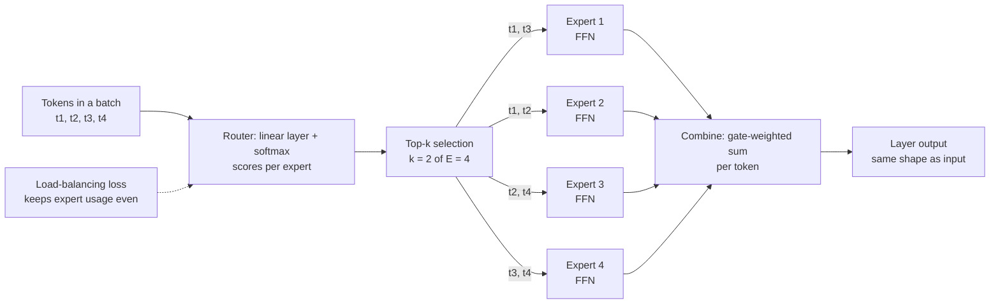

The diagram shows tokens fanning out to experts and recombining. Each token goes to two experts, each expert processes a subset of the batch, and the outputs return in token order. The dotted arrow marks the training-time pressure that keeps the fan-out balanced, which is the next topic.

### 16.3 Load balancing

Without a balancing force, routing tends to collapse. Early in training an expert that happens to do slightly better receives more tokens, trains more, and improves further, while others starve. The standard remedy (Fedus and colleagues, 2021) is an auxiliary loss. Let $f_i$ be the fraction of tokens in a batch routed to expert $i$, and $P_i$ the mean router probability assigned to expert $i$. The loss is $\mathcal{L}_\text{aux}=\alpha E\sum_{i=1}^{E}f_iP_i$ with a small coefficient $\alpha$. With perfectly uniform routing, $f_i=P_i=1/E$ and the sum is $E\cdot(1/E)^2=1/E$, so the loss is $\alpha$, the minimum. If one expert receives all the tokens with probability 1, the loss is $\alpha E$. Some recent systems avoid the auxiliary loss and instead adjust a per-expert bias on the routing scores during training to steer load, because the auxiliary gradient can interfere with the language-modeling objective.

At training and serving time a hard capacity limit is often set: each expert processes at most $C=\lceil\text{capacity factor}\times(\text{tokens}\times k/E)\rceil$ tokens per batch, and tokens beyond capacity are dropped (passed through the residual connection without expert processing) or rerouted. Capacity limits keep tensor shapes static for efficient hardware use. They also create a dependence between requests: whether your token is dropped can depend on what other tokens are in the same batch. Where a serving system uses capacity-limited routing, the same prompt can produce slightly different outputs depending on co-batched traffic. That is a reproducibility problem, and in a multi-tenant setting it is also a weak form of cross-request interference to evaluate. Dropless implementations avoid it and are common for serving.

### 16.4 Total versus active parameters: worked example

An MoE model has two parameter counts, and both matter. Use the Mixtral 8x7B shape: $d=4096$, $L=32$, 32 query heads and 8 key-value heads of width 128, expert hidden width 14,336 with a gated feed-forward network, $E=8$, $k=2$, $V=32000$. The script computes:

- Attention per layer: $2\cdot4096\cdot4096+2\cdot4096\cdot1024=41{,}943{,}040$.
- One expert: $3\cdot4096\cdot14336=176{,}160{,}768$. Eight experts: $1{,}409{,}286{,}144$.
- Router per layer: $4096\cdot8=32{,}768$, plus norms $8{,}192$.
- Per layer: $41{,}943{,}040+1{,}409{,}286{,}144+32{,}768+8{,}192=1{,}451{,}270{,}144$. Thirty-two layers: $46{,}440{,}644{,}608$.
- Embedding and head: $262{,}144{,}000$. Total including the final norm: $46{,}702{,}792{,}704$.
- Active per token (two experts, not eight): $12{,}879{,}925{,}248$.

The model is "46.7 billion parameters" in memory and "12.9 billion" in compute per token. Per-token forward FLOPs are about $2\cdot12.9\times10^9=2.6\times10^{10}$, compared with $9.3\times10^{10}$ for a dense model of the same total size. Weight memory at 16 bits is $2\cdot46.7=93.4$ GB, which does not fit on a single 80 GB accelerator. A design that compares this model with a dense 13B model on the basis of per-token arithmetic gets the compute right and the memory wrong by a factor of 3.6.

### 16.5 Why decoding does not get the full benefit

A single decoding token touches only two experts' weights, so reading weights from memory for one sequence costs less than for a dense 46.7B model. The advantage shrinks with batch size. If a batch of $B$ tokens is routed independently and uniformly at random, the expected number of distinct experts touched per layer is $E\,[1-(1-k/E)^B]$. For $E=8$ and $k=2$ this is 2 experts at $B=1$, 5.5 at $B=4$, 7.2 at $B=8$, and 7.9 at $B=16$. Real routing is skewed, so the numbers are illustrative, but the conclusion is general: at a moderate batch size most or all experts are read at every step, so the weight traffic approaches that of the full 46.7B model, while the memory to hold them is paid regardless. MoE reduces arithmetic per token cleanly. It reduces memory bandwidth per token only at small batch, which is the decode-latency regime where bandwidth is the limit.

### 16.6 Distributed execution and decision criteria

MoE layers are usually run with expert parallelism: experts are partitioned across accelerators, and an all-to-all exchange sends each token to the accelerator holding its experts and back again. The communication volume depends on tokens, not parameters, and it needs fast interconnect. An imbalanced batch makes the busiest expert's accelerator the straggler for the whole layer. Training also has its own instabilities, as router logits can grow and routing can become unstable, which Barret Zoph and colleagues (2022) addressed with a z-loss penalty on the router logits. Fine-tuning MoE models on small datasets has been reported to overfit more readily than dense fine-tuning in some studies.

| Criterion | Dense | Mixture of experts |
| --- | --- | --- |
| Weight memory | Equals total parameters | Equals total parameters (larger for the same compute) |
| Arithmetic per token | Proportional to total | Proportional to active parameters |
| Single-accelerator deployment | Easier | Usually needs several accelerators |
| Throughput at high batch | Baseline | Better per unit of arithmetic, if interconnect and balance are good |
| Latency at batch 1 | Bound by full weights | Bound by active weights, better |
| Determinism under batching | Straightforward | Depends on dropless routing |
| Operational maturity | Highest | Lower; fewer serving optimizations tested |

Choose a mixture of experts when the workload serves high aggregate throughput on a cluster with fast interconnect and enough memory, where the quality per unit of arithmetic matters. Choose dense when the deployment must fit on one or two accelerators, when the traffic is low and bursty, or when simplicity of operations outweighs the efficiency gain.

## 17. Scaling Laws and What They Predict

### 17.1 Kaplan and colleagues

Jared Kaplan and colleagues (2020) trained many transformer language models and measured the test cross-entropy loss. They found that loss follows power laws in three quantities, each when the other two are not the bottleneck: the number of non-embedding parameters $N$, the dataset size $D$ in tokens, and the training compute $C$:

$$
L(N)\approx\Big(\frac{N_c}{N}\Big)^{\alpha_N},\qquad L(D)\approx\Big(\frac{D_c}{D}\Big)^{\alpha_D},\qquad L(C)\propto C^{-\alpha_C},
$$

with fitted exponents of about $\alpha_N\approx0.076$, $\alpha_D\approx0.095$, and $\alpha_C\approx0.050$ for the compute-efficient frontier. A power law with a small exponent is a slow but steady decline. Doubling parameters multiplies loss by $2^{-0.076}=0.949$, a 5.1 percent reduction. A tenfold increase multiplies it by $10^{-0.076}=0.839$, a 16 percent reduction. The relation is smooth over many orders of magnitude, which makes it a planning tool: the loss of a larger model can be forecast from the losses of smaller ones before paying for the larger run. They also found that, within wide limits, architecture details such as depth versus width matter little compared with scale, and that larger models are more sample-efficient, reaching a given loss with fewer tokens. For a fixed compute budget they concluded that most of the increase should go into model size, with parameters scaling as $C^{0.73}$ and data as $C^{0.27}$. That conclusion shaped the 2020 to 2021 generation of very large models trained on a few hundred billion tokens, such as GPT-3 with 175 billion parameters and 300 billion tokens.

### 17.2 Hoffmann and colleagues (Chinchilla)

Jordan Hoffmann and colleagues (2022) repeated the study with more than 400 models, from 70 million to over 16 billion parameters, trained on 5 to 500 billion tokens, and varied the learning-rate schedule so that every run was trained to completion for its token budget. They estimated the compute-optimal allocation by three different methods and found that model size and data should be scaled in equal proportion: $N_\text{opt}\propto C^{0.5}$ and $D_\text{opt}\propto C^{0.5}$, which works out to roughly 20 training tokens per parameter. They tested the conclusion by training Chinchilla, a 70 billion parameter model on 1.4 trillion tokens, with the same compute as the 280 billion parameter Gopher model trained on 300 billion tokens. Chinchilla outperformed Gopher and larger models on a broad set of evaluations while being four times cheaper to serve. The finding changed practice: from 2022 on, large models were trained on far more tokens per parameter than before.

Why did the two studies differ? The authors of the second noted that the earlier study used a learning-rate schedule fixed independent of the training length for each run, which penalizes runs that were cut short of the schedule's end. Later analysis (Tomer Porian and colleagues, 2024; Tim Pearce and Jinyeop Song, 2024) attributed much of the discrepancy to how the earlier work counted parameters, to the small scale of the models used for the earlier fits, and to tuning differences, and reconciled the two when these were controlled. For a practitioner the useful lesson is that scaling-law exponents depend on the experimental protocol and are not constants of nature.

### 17.3 The parametric form and an illustration

Hoffmann and colleagues also fit a parametric loss of the form

$$
L(N,D)=E+\frac{A}{N^{\alpha}}+\frac{B}{D^{\beta}} .
$$

The term $E$ is the irreducible loss, the entropy of the text distribution that no model can remove. The second term is the penalty for having a finite number of parameters, and the third is the penalty for finite data. They reported fitted values of about $E=1.69$, $A=406.4$, $B=410.7$, $\alpha=0.34$, and $\beta=0.28$. Besiroglu and colleagues (2024) attempted to replicate the fit from the paper's published data and reported that the published constants did not fit the reconstructed data well and that the stated confidence intervals were too narrow. The numbers below therefore illustrate how the formula behaves, and they are not predictions to rely on. The script evaluates it:

| Configuration | $C=6ND$ | Predicted loss (illustrative) |
| --- | ---: | ---: |
| 280B parameters, 300B tokens (Gopher-like) | $5.04\times10^{23}$ | 1.993 |
| 70B parameters, 1.4T tokens (Chinchilla-like) | $5.88\times10^{23}$ | 1.937 |
| 8B parameters, 15T tokens | $7.20\times10^{23}$ | 1.949 |
| 8B parameters, 160B tokens (20 per parameter) | $7.68\times10^{21}$ | 2.164 |

Three readings follow. The Chinchilla-like configuration is predicted to beat the Gopher-like one by 0.056 nats with more compute by only 17 percent, a direct consequence of spending the budget on data. The 8-billion-parameter model trained on 15 trillion tokens, almost 1,900 tokens per parameter, is predicted to land within 0.012 nats of the 70-billion-parameter model. And the formula's own minimizer for the Chinchilla budget of $5.88\times10^{23}$ FLOPs is $N=3.25\times10^{10}$ and $D=3.0\times10^{12}$, 92 tokens per parameter, with a loss of 1.930, only 0.007 below the 70B configuration. That the optimum is far from 20 tokens per parameter under this fit, while the loss changes very little, shows that the optimum is flat: a broad range of $N$ and $D$ for the same compute gives nearly the same loss, and the exact optimum is poorly determined.

### 17.4 Training for inference: why small models are trained for longer

Compute-optimal training minimizes the cost of reaching a loss by training. It ignores that a deployed model is served for many requests. Serving costs about $2N$ FLOPs per generated token (Section 10.6), so a smaller model that reaches the same loss is cheaper on every request after training. Nikhil Sardana and Jonathan Frankle (2023) modified the scaling laws to include expected inference demand and showed that for a large number of requests the optimal model is smaller and trained on more data than Chinchilla would suggest, and they trained models up to extreme token-to-parameter ratios and found that quality continued to improve.

A worked comparison uses the numbers above. Compare serving 10 trillion generated tokens over a model's life ($10^{13}$ tokens, an illustrative demand) with each configuration:

- **70B model, 1.4T training tokens.** Training $5.88\times10^{23}$ FLOPs. Serving $2\cdot70\times10^9\cdot10^{13}=1.4\times10^{24}$ FLOPs. Total $1.99\times10^{24}$.
- **8B model, 15T training tokens.** Training $7.2\times10^{23}$ FLOPs. Serving $2\cdot8.03\times10^9\cdot10^{13}=1.6\times10^{23}$ FLOPs. Total $8.8\times10^{23}$.

The smaller model costs 22 percent more to train and 8.7 times less to serve per token, and is cheaper in total by a factor of about 2.25 at this demand, assuming the 0.012-nat loss difference is acceptable for the product. If demand is only $10^{11}$ tokens the comparison reverses toward the larger compute-optimal model. The decision therefore depends on an estimate of lifetime inference volume that the architect and product owner must supply, and it explains why many open models are trained for far longer than the 20-tokens-per-parameter rule suggests. These accelerator-FLOPs ignore the utilization difference between training and serving, which usually favors training, so the real cost ratio is less favorable to small models than the FLOP ratio. Treat the factor as an upper bound.

### 17.5 Limits of scaling laws

Four limits matter in practice.

1. **Loss is not capability.** The laws predict test loss on a distribution. Task accuracy can look flat and then rise quickly at some scale. Jason Wei and colleagues (2022) described such "emergent abilities," while Rylan Schaeffer, Brando Miranda, and Sanmi Koyejo (2023) argued that much of the sharpness comes from the choice of metric, since an all-or-nothing metric turns a smooth improvement in per-token probability into an abrupt one. Use both views: smooth loss for forecasting, and direct task evaluation for decisions.
2. **Extrapolation across recipes is unsafe.** The laws are fitted within a data mixture, tokenizer, architecture, and optimizer recipe. A change in data quality or architecture shifts the constants. Small-scale proxy runs help only if the recipe is held fixed.
3. **Data is finite.** High-quality text is limited. Niklas Muennighoff and colleagues (2023) found that repeating data for up to about four epochs gave results close to using fresh data, with diminishing returns beyond that. Synthetic data and multimodal data extend supply and bring their own quality and contamination questions ([CH30](CH30_AI_Data_Governance_Privacy_and_Provenance.md)).
4. **Compute at inference is a separate axis.** Recent systems spend additional compute at inference through longer reasoning traces and repeated sampling, which trades latency and cost for accuracy on some tasks. [CH15](CH15_Large_Language_Model_Fundamentals_and_Inference.md) owns that behavior. For cost planning it means tokens generated per request can vary by a large factor between models of similar size.

## 18. Vision Transformers and Multimodal Use

### 18.1 Images as sequences of patches

Alexey Dosovitskiy and colleagues (2020) showed that a standard transformer encoder can classify images when the image is cut into patches and each patch is treated as a token. An image of size $H\times W\times C$ is split into non-overlapping patches of $P\times P$ pixels. Each patch is flattened into a vector of length $P^2C$ and projected linearly to the model width. A learned position embedding is added, and a learnable classification token is prepended. The sequence goes through ordinary encoder blocks, and the classification head reads the output at the classification token.

For a $224\times224$ RGB image with $P=16$ there are $(224/16)^2=196$ patches, each a vector of $16\cdot16\cdot3=768$ numbers, so the sequence has $196+1=197$ tokens. The base model of this Vision Transformer (ViT) family, ViT-Base, has 12 layers, width 768, 12 heads, and a feed-forward width of 3,072, about 86 million parameters. ViT-Large/16 has 24 layers, width 1,024, and about 307 million parameters, and ViT-Huge/14 has 32 layers, width 1,280, and about 632 million parameters (Dosovitskiy and colleagues, 2020).

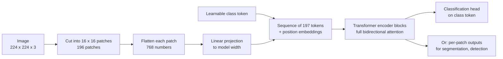

The diagram shows that the only vision-specific step is the patch embedding. Everything after it is the encoder of Section 5 with no causal mask. An image therefore costs a number of tokens set by resolution and patch size, and attention cost follows Section 11.

### 18.2 Inductive bias, data needs, and cost

A convolutional network ([CH08](CH08_Convolutional_Neural_Networks.md)) builds in locality and translation equivariance: the same small filter is applied everywhere. A vision transformer has neither. Attention can in principle connect any two patches from the first layer, and the model must learn from data that nearby patches are related. Dosovitskiy and colleagues found that ViT underperformed comparable convolutional networks when trained only on ImageNet-1k (about 1.3 million images) and outperformed them when pre-trained on much larger datasets (14 million to 300 million images). Hugo Touvron and colleagues (2021) showed that with strong augmentation and knowledge distillation (DeiT) a ViT can be trained competitively on ImageNet alone. The practical statement is that transformers trade built-in assumptions for flexibility and need more data or stronger regularization to compensate.

Token count controls cost. With $P=16$, a $384\times384$ image has $24^2=576$ patches and 577 tokens. Compared with the 197 tokens at $224\times224$, that is 2.93 times as many tokens and $577^2/197^2=8.6$ times as many attention score entries. Halving the patch size to 8 at $224\times224$ gives 784 patches, four times as many, and 16 times the score entries. Higher resolution and finer patches improve accuracy on small objects and fine detail, and they cost quadratically. Hierarchical variants such as the Swin Transformer (Ze Liu and colleagues, 2021) restrict attention to local windows and merge patches between stages, which gives linear cost in image size and a feature pyramid suited to detection and segmentation. Diffusion transformers (William Peebles and Saining Xie, 2023) use a transformer on latent patches in place of a convolutional U-Net as the denoising network, which connects this chapter to [CH12](CH12_Diffusion_Models.md).

### 18.3 Multimodal composition

Attention treats any sequence of vectors the same way, so non-text inputs are handled by converting them into token-like vectors. Four composition patterns are common, and each has a different cost and failure profile ([CH23](CH23_Multimodal_Generative_AI.md) owns the system-level design):

1. **Contrastive dual encoders.** CLIP (Alec Radford and colleagues, 2021) trains an image encoder and a text encoder so that matching image-text pairs have similar embeddings. There is no cross-modal attention. The model is used for retrieval and zero-shot classification and as a vision backbone for others.
2. **Projection into a language model.** A vision encoder produces patch embeddings, a small adapter (a linear layer or a small multilayer perceptron) maps them to the language model's embedding space, and they are inserted as tokens into the prompt alongside text (as in LLaVA, Haotian Liu and colleagues, 2023). The language model attends over image tokens like any others. An image of 576 patches adds 576 tokens to the context, which counts against the context window, adds to prefill cost, and occupies KV cache for the rest of the conversation: at the Llama 3 8B rate of 128 KiB per token, one such image holds $576\cdot128$ KiB $=72$ MiB of cache.
3. **Cross-attention fusion.** The language model's layers get extra cross-attention sublayers that read from vision features (Flamingo, Jean-Baptiste Alayrac and colleagues, 2022). Image features do not enter the text context, so the text KV cache stays small, and the fused layers add parameters.
4. **Encoder-decoder for audio.** Whisper (Radford and colleagues, 2022) feeds a log-mel spectrogram of up to 30 seconds to an encoder and decodes text with cross-attention, an instance of the encoder-decoder design of Section 7.3.

The architect's consequences are direct. Image resolution and tiling policy, the number of video frames sampled, and audio duration all convert into token counts, and token counts convert into cost, latency, and cache memory by the formulas in Sections 11 to 13. A multimodal feature should specify the maximum tokens per input modality, as it would any other limit.

## 19. State-Space Models and Hybrid Architectures

### 19.1 Recurrence revisited

A state-space model (SSM) processes a sequence with a linear recurrence on a hidden state. In continuous time it is $h'(t)=Ah(t)+Bx(t)$ and $y(t)=Ch(t)$, and discretizing with step size $\Delta$ gives

$$
h_t=\bar{A}\,h_{t-1}+\bar{B}\,x_t,\qquad y_t=C\,h_t .
$$

This looks like a recurrent neural network (RNN), but with no nonlinearity inside the recurrence, which has two consequences. Because the update is linear, the recurrence over a whole sequence can be unrolled into a convolution and computed in parallel during training, or computed with a parallel scan. And at inference the model is a true recurrence with a fixed-size state: each new token costs $O(1)$ in sequence length and the memory does not grow. Albert Gu, Karan Goel, and Christopher Ré (2021) made this practical with the S4 model by giving the matrix $A$ a special structure derived from the HiPPO theory of memorizing a continuous signal, which let SSMs capture dependencies over thousands of steps.

A time-invariant SSM applies the same $\bar{A}$, $\bar{B}$, $C$ to every token regardless of content. It cannot decide to remember one token and ignore another, which is the capability that selective copying and retrieval need.

### 19.2 Selective state-space models

Albert Gu and Tri Dao (2023) introduced Mamba, which makes $\Delta$, $B$, and $C$ functions of the current input. Content then controls how fast the state forgets and what gets written, a gating mechanism like the one in an LSTM but within a linear recurrence. Input-dependent parameters break the convolution form, so Mamba uses a hardware-aware parallel scan kernel that keeps the expanded state in fast on-chip memory, the same IO-awareness principle as FlashAttention. The authors report linear scaling with sequence length, inference throughput several times that of comparable transformers, and language-modeling quality matching transformers about twice their size at the scales tested (up to around 3 billion parameters). Tri Dao and Albert Gu (2024) later showed a theoretical duality between certain SSMs and forms of linear attention (the "state space duality" in Mamba-2), which lets the SSM be computed with matrix multiplications that suit accelerators better.

### 19.3 What SSMs lose

The fixed-size state is a bottleneck in the same way as for linear attention (Section 14.4). A state of a few tens of thousands of numbers per layer cannot index an arbitrarily large set of earlier tokens for exact retrieval. Jelassi and colleagues (2024) found that transformers learned to copy long strings far more efficiently than state-space models and that pre-trained SSMs lagged on copy and retrieval tasks. Models with fixed state compress the past, and tasks that need verbatim recall of a specific passage, such as quoting a clause from a long contract, are the tasks where the compression shows.

The memory comparison is large. Take illustrative SSM dimensions of an expanded width of 8,192, a state size of 16, and 48 layers. The state is $8192\cdot16=131{,}072$ numbers per layer, or 256 KiB in 16-bit, and $48\cdot256$ KiB $=12$ MiB per sequence in total (some implementations keep the state in 32-bit, which doubles it). The KV cache of the Llama 3 8B shape is 4 GiB at 32,768 tokens and 16 GiB at 131,072. The recurrent state is more than 300 times smaller at 32,768 tokens and does not grow with context.

### 19.4 Hybrids

Because attention is strong at precise recall and recurrence is cheap at long range, hybrids interleave the two. Jamba (Opher Lieber and colleagues, 2024) mixes transformer layers, Mamba layers, and mixture-of-experts layers, with about one attention layer for every seven Mamba layers in the published configuration, which keeps the KV cache to a small fraction of an all-attention model's while retaining some attention for retrieval. Griffin (Soham De and colleagues, 2024) combines gated linear recurrences with local sliding-window attention. These designs apply the lesson of this chapter's cost analysis: use dense attention where exact recall pays for its cost, and cheaper mixing elsewhere.

For an architect, the hybrids are a reason to re-check assumptions rather than a reason to switch. Serving stacks (continuous batching, prefix caching, speculative decoding, quantization) are most mature for pure transformers, and recurrent state breaks assumptions in some of them, for example, sharing a cached prefix requires snapshotting the recurrent state at the boundary. Choose a non-transformer or hybrid architecture when the workload is dominated by very long streams or by memory-constrained devices, when you have evaluated recall on your own task, and when your serving stack supports it. Otherwise, a pure transformer with grouped-query attention and sliding-window layers is the lower-risk choice.

## 20. Interpreting Attention

### 20.1 Attention weights are not an explanation

It is tempting to display the attention matrix as a heat map and say the model "looked at" those words. Sarthak Jain and Byron Wallace (2019) examined this claim for recurrent text classifiers with attention. They found that attention weights often correlate poorly with gradient-based measures of feature importance, and that one can construct very different attention distributions that produce the same prediction. Sarah Wiegreffe and Yuval Pinter (2019) responded that the answer depends on what is meant by an explanation, and showed that adversarial attention distributions are not learned by the model during training, but they accepted that attention gives a plausible view and not a guaranteed faithful one. The reasons weights are an incomplete account in a transformer are structural:

1. **Weights multiply values, and values differ in size.** The contribution of token $j$ to the output at $i$ is $a_{ij}v_j$, so a token with a large weight and a small value vector can contribute less than a token with a modest weight and a large value vector (Goro Kobayashi and colleagues, 2020, analyzed the norm of the weighted vectors). In the three-token example of Section 3.4, "the" gives equal weight 0.401 to itself and to "sat". The contribution norms are $0.401\cdot\lVert[2,0]\rVert=0.802$ from itself and $0.401\cdot\lVert[1,1]\rVert=0.567$ from "sat". Equal weights, unequal contributions.
2. **Many heads and layers combine.** The output of a layer is a sum over heads passed through $W_O$, then added to the stream, then transformed by feed-forward layers. A weight in one head of one layer is one term in a long sum.
3. **Representations are already mixed.** At layer $\ell$ position $j$'s vector contains information from many other positions, so a weight on position $j$ may reflect content that originated elsewhere. Samira Abnar and Willem Zuidema (2020) proposed attention rollout and attention flow, which propagate weights through layers, to account for this.
4. **Other paths carry information.** Feed-forward layers and the residual stream carry information that does not pass through attention at the layer being shown.

### 20.2 Evidence that does support claims about inputs

When you need to know which input features a prediction depends on, use methods that intervene or attribute with respect to the output. Ablate or mask a candidate token and measure the change in the output (comprehensiveness) and check whether the candidate alone suffices (sufficiency), as in the evaluation framework of Jay DeYoung and colleagues (2020). Use gradient-based attributions such as integrated gradients (Mukund Sundararajan, Ankur Taly, and Qiqi Yan, 2017), Shapley-value approximations, and counterfactual tests in which the input is edited in a controlled way. Activation patching, which replaces the activations of a component with those from a different input and measures the effect on the output, localizes which components carry a behavior (Kevin Meng and colleagues, 2022, used causal tracing of this kind to locate factual associations in feed-forward layers). Each of these has its own failure modes, such as out-of-distribution inputs created by masking, so no single method should be treated as ground truth, and agreement among several methods is stronger evidence than any one. The decision rule for an architect is that an attention heat map may be a debugging aid for engineers and must not be offered to users, auditors, or regulators as the reason for a decision. [CH24](CH24_Generative_AI_Evaluation_Guardrails_and_Hallucinations.md) and [CH31](CH31_Responsible_AI_and_Safety_Governance.md) own the evaluation and governance of explanations.

### 20.3 Circuits and the residual stream

Mechanistic interpretability tries to reverse-engineer the algorithm a network implements. Nelson Elhage and colleagues (2021) analyzed small attention-only transformers using the residual-stream view (Section 4.2). Two ideas organize the analysis. In each head, the query-key circuit ($W_QW_K^\top$) determines *where* the head attends, and the output-value circuit ($W_VW_O$) determines *what* it writes to the stream when it attends. Heads in different layers can compose: the output of a head in an early layer, written into the stream, can be read as part of the query, key, or value of a head in a later layer. Composition is what lets two shallow components build a behavior neither has alone.

### 20.4 Induction heads

The best-documented circuit is the induction head (Catherine Olsson and colleagues, 2022). The behavior it implements is simple: if the context contains the sequence `[A][B]` earlier and the current token is `[A]`, predict `[B]`. This is a mechanism for in-context copying and pattern completion. In two-layer models it takes two heads working together:

1. A **previous-token head** in an early layer attends from each position to the position just before it, and writes into the stream at each position a representation of what the previous token was.
2. An **induction head** in a later layer forms its query from the current token (`[A]`), forms its keys from the information written by the previous-token head (so each key says "the token before me was ...") and therefore attends to the position whose previous token was `[A]`, which is the position holding `[B]`. Its output value copies information about `[B]`, boosting the logit for `[B]`.

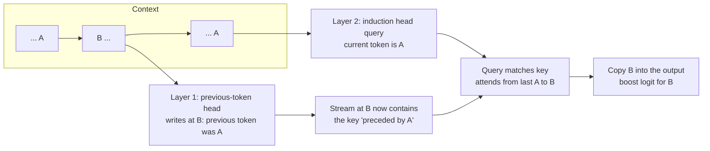

The diagram shows the composition. The first head prepares keys and the second uses them, and neither alone predicts anything. Olsson and colleagues reported that during training, models show an abrupt formation of induction heads at a particular point, and that this coincides with a sharp improvement in in-context learning measured by the loss on later tokens in a context relative to earlier tokens. They provided causal evidence in small models by ablation, and correlational evidence for large models. The practical significance is conceptual: some of what is called in-context learning in language models is built from simple, identifiable copying mechanisms, which also explains repetition loops and the model's tendency to continue patterns it has seen in the prompt. It is a case where a specific behavior can be traced to specific components, not a claim that all in-context learning reduces to induction heads.

### 20.5 Superposition and sparse features

A model with a hidden width of a few thousand represents far more than a few thousand concepts. The superposition hypothesis (Elhage and colleagues, 2022) says networks store more features than dimensions by encoding them as nearly orthogonal directions, which is possible when features are sparse. This makes individual neurons hard to interpret, because one neuron participates in many features. Sparse autoencoders trained on a model's activations try to recover the underlying features as a larger set of sparsely active directions (Trenton Bricken and colleagues, 2023; Hoagy Cunningham and colleagues, 2023), and later work scaled the method to larger language models (Adly Templeton and colleagues, 2024). The method produces many human-interpretable features, and also has known limits: the dictionaries are large, reconstruction is imperfect, and showing that a feature correlates with a concept is weaker than showing the model uses it causally. Treat this line of work as a source of research results and debugging tools, and not yet as an audit method that supports compliance claims.

## 21. Numerical Stability

Attention and normalization are the places where transformer arithmetic is most exposed to overflow, underflow, and rounding. [CH07](CH07_Deep_Learning_Foundations.md) covers floating-point formats and mixed-precision training in general. This section applies them to the transformer's specific hazards, with numbers from [04_block_numerics_and_tiling.py](../code/python/transformers-chapter/04_block_numerics_and_tiling.py).

### 21.1 The softmax

The softmax $p_j=e^{z_j}/\sum_le^{z_l}$ overflows for large positive logits, because $e^{1000}$ is far beyond any floating-point range, and underflows to exactly zero for large negative ones. The script shows that the naive form fails on logits $[1000,999,998]$ with an overflow error in 64-bit arithmetic. The fix uses the shift-invariance of the softmax: subtract the maximum first, so the largest exponent is $e^0=1$ and no exponent exceeds 1. The stable form gives $[0.6652,0.2447,0.0900]$, the same as for $[0,-1,-2]$, since both differ by a constant shift. Every production implementation does this, and the online softmax of Section 12.2 keeps the property across blocks by rescaling.

Two related rules are worth stating. Compute the training loss from the logits with a fused log-softmax (cross-entropy from logits), not by applying softmax and then taking a logarithm, since the logarithm of a probability that underflowed to zero is negative infinity. And treat a fully masked row with care. If every score in a row is $-\infty$, the maximum is $-\infty$ and the shift produces $-\infty-(-\infty)=\text{NaN}$, which then propagates through the entire network and into the weights on the next update. Padded query positions produce such rows. The remedies are a large finite negative number in place of $-\infty$, an explicit check, or discarding those rows before the loss, and a unit test with a fully padded sequence confirms which one the code uses.

### 21.2 Precision formats

| Format | Exponent bits | Significand bits | Largest finite value | Typical use in transformers |
| --- | ---: | ---: | --- | --- |
| float32 | 8 | 24 | about $3.4\times10^{38}$ | Master weights, optimizer state, softmax and norm reductions |
| float16 | 5 | 11 | 65,504 | Inference and training with loss scaling |
| bfloat16 | 8 | 8 | about $3.4\times10^{38}$ | Default for training on current accelerators |
| float8 (E4M3, E5M2) | 4 or 5 | 4 or 3 | 448 (E4M3) | Training and inference matrix multiplications with scaling |

Float16 has more precision than bfloat16 and a much smaller range. Bfloat16 keeps float32's range at the price of precision, which is why it removes the need for the loss-scaling step that float16 mixed-precision training requires (Paulius Micikevicius and colleagues, 2017). The script shows both failure types for float16. A query and key whose entries are all 23.0 at head width 128 have a dot product of $128\cdot23^2=67{,}712$, which exceeds 65,504 and becomes infinity. Dividing by $\sqrt{128}=11.31$ before the accumulation (equivalently, scaling the query first) keeps the value at about 5,984, which is representable. This is one reason implementations apply the scale factor to $Q$ before the matrix product and not to the scores after it. Real activations are usually smaller than 23, but growth of the attention logits during training, covered in Section 22, can bring them toward this range.

The second failure is accumulation. In the script, adding 1.0 four thousand and ninety-six times in float16 gives 2,048, not 4,096. Float16 has 11 significant bits, so above 2,048 the spacing between representable numbers is 2, and adding 1.0 rounds back to the same number. The sum stalls. Matrix-multiplication hardware avoids this by accumulating in float32 even when inputs are 16-bit, and the softmax denominator, normalization statistics, and attention output accumulators should do the same. FlashAttention keeps its running maximum, denominator, and output accumulator in higher precision for this reason.

A third hazard is position arithmetic. Bfloat16 has 8 significant bits, so only integers up to 256 are exactly representable, and 257 rounds to 256 or 258. A rotary-embedding implementation that computes the rotation angle $m\theta_i$ from a position index $m$ stored in bfloat16 will assign the same angle to neighboring positions at long context, and positions around 100,000 will be distinguished only to within several hundred. Compute rotary angles and position indices in float32 or integer arithmetic, then cast the resulting cosine and sine tables if needed. This bug does not raise an error. It shows up as quality loss that grows with position, which is easy to attribute wrongly to the model.

### 21.3 Reproducibility and tolerance

Floating-point addition is not associative, so summing the same numbers in a different order changes the last digits. Batch size, kernel choice, number of accelerators, and tiling all change the order. Two runs of the same model on the same prompt can therefore produce logits that differ in the low-order bits, and when two candidate tokens are nearly tied, greedy decoding can pick different tokens and the continuations diverge. Tests that compare model output must use tolerances for logits and must not demand identical text unless the serving stack is configured for deterministic kernels, which costs speed. A regression test suite should pin a prompt set, compare logits within a tolerance, and compare text only on prompts with clear margins.

### 21.4 Quantization and outliers

Quantizing weights or the KV cache to 8 or 4 bits reduces memory and bandwidth (Section 13.5), and its error is set by the range of values within a group. Transformers develop a few activation channels with very large magnitude. Tim Dettmers and colleagues (2022) showed that these outlier features in large models degrade naive 8-bit quantization and handled them separately, and later work found "massive activations" tied to attention-sink tokens. Quantization schemes therefore keep outliers in higher precision or scale per channel. Test a quantized model on the long-context tasks that matter to you, since short-benchmark scores can hide losses in retrieval over long inputs. [CH28](CH28_Inference_Optimization_and_Model_Serving.md) owns the serving-time methods.

## 22. Training Instabilities

### 22.1 Loss spikes

Large transformer runs sometimes show a sudden jump in training loss. In the milder case the loss recovers within a few hundred steps. In the severe case it does not, and the run diverges. The PaLM team (Aakanksha Chowdhery and colleagues, 2022) reported that their largest model had about twenty spikes during training at fixed hyperparameters. They restarted from a checkpoint saved before the spike and skipped the data batches around it, and the spike did not recur, though the skipped batches did not cause a spike when replayed from a different model state. The interaction between a specific batch and a specific model state, not bad data alone, produced the spike. The practical consequences are that a training system needs frequent checkpoints, the ability to resume with a modified data order, and metrics fine-grained enough to detect a spike within steps.

### 22.2 Known mechanisms

Several mechanisms have been identified, and they interact.

**Attention-logit growth.** If the norms of the query and key projections grow, the scores $q\cdot k/\sqrt{d_k}$ grow, the softmax saturates toward one-hot (as in the variance argument of Section 3.3), and the attention entropy collapses. Saturated attention passes tiny gradients to most keys and large, sharply localized gradients to a few, which destabilizes training. Mitchell Wortsman and colleagues (2023) reproduced this class of instability in small models by training with high learning rates, and showed that normalizing queries and keys before the dot product (QK-norm), as used in ViT-22B (Mostafa Dehghani and colleagues, 2023), mitigates it. This is the same quantity whose scale Section 3.3 fixed at initialization, now kept from drifting during training.

**Output-logit drift.** The final logits can drift in scale, which hurts the softmax and the cross-entropy loss. PaLM added an auxiliary loss on the log of the softmax normalizer (a z-loss, $10^{-4}\cdot\log^2Z$) that keeps it near zero, and the same device appears in router losses for mixture-of-experts models (Zoph and colleagues, 2022).

**Optimizer state.** Adam divides the update by a running estimate of the gradient's second moment. After a long quiet stretch, the estimate is small; a sudden large gradient then produces an oversized update. A smaller $\beta_2$ (0.95 is common in large language-model recipes, against the default 0.999) makes the estimate respond faster, and global gradient-norm clipping (commonly at 1.0) bounds the update. [CH07](CH07_Deep_Learning_Foundations.md) derives both.

**Learning rate and width.** A learning rate that is stable at small width can be unstable at large width. Greg Yang and colleagues (2022) proposed a parametrization (muP) in which hyperparameters tuned on a small model transfer to a larger one, which reduces the number of expensive large-scale tuning runs.

**Low precision and data.** Rounding in bfloat16 weight updates, overflow in float16 activations, and rare pathological batches (very repetitive text, very long tokens) can each trigger a spike on their own.

### 22.3 Learning-rate warmup

Warmup raises the learning rate from near zero to its peak over the first steps. The reasons stack. At initialization, the model's outputs are nearly uniform, the gradients are large and poorly conditioned, and Adam's second-moment estimate rests on few samples, so early steps are noisy. For post-LN models the gradients near the output are large at initialization (Section 5.2), and Xiong and colleagues (2020) showed warmup is needed to avoid divergence. The original transformer paper used a schedule that rises linearly for 4,000 steps and then decays with the inverse square root of the step:

$$
\eta(s)=d_\text{model}^{-0.5}\cdot\min\big(s^{-0.5},\;s\cdot s_\text{warm}^{-1.5}\big).
$$

With $d_\text{model}=512$ and $s_\text{warm}=4000$ the peak is at $s=4000$, where $\eta=512^{-0.5}\cdot4000^{-0.5}=0.04419\cdot0.015811=6.99\times10^{-4}$. Current large-model recipes mostly use a linear warmup over a fraction of a percent to a few percent of the steps, a peak rate that is lower for wider models, and a cosine or linear decay to about a tenth of the peak. The exact values come from the model's training report, and a team reproducing a recipe should change them only with a reason. If warmup is shortened, a pre-LN model tolerates it better than a post-LN model, and QK-norm adds tolerance.

### 22.4 Monitoring and response

Metrics that detect trouble early: the loss per step (not only a smoothed average), the global gradient norm, the maximum attention logit per layer, the attention entropy per head, the RMS of the residual stream per layer, the fraction of dropped tokens and router entropy for mixture-of-experts models, and counts of non-finite values. A rising maximum attention logit or falling attention entropy typically precedes a spike by hundreds of steps.

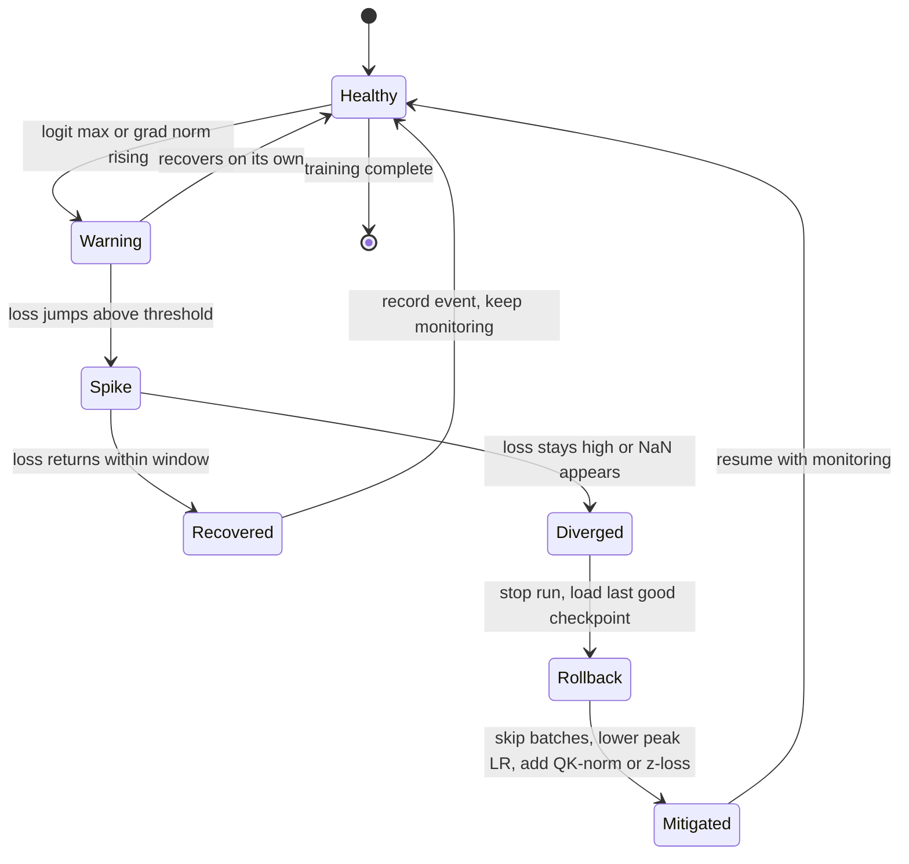

The state diagram is the operating procedure for a run. Detection depends on the warning state, which only exists if the logit and gradient metrics are logged. The rollback step depends on checkpoints that are frequent enough that the loss of work is acceptable, and the mitigation step records what was changed so that the new run is not silently different from the baseline. The cost of failing to detect early is concrete: a one-week stall on 2,048 accelerators wastes $2048\cdot24\cdot7=344{,}064$ accelerator-hours, about $688,000 at an illustrative $2.00 per hour, plus the schedule slip.

## 23. A Minimal Implementation Walkthrough

The scripts in the chapter's code folder use only the Python standard library so that they run anywhere. This section walks through the pieces that matter, then shows a compact PyTorch equivalent and the tests that should accompany any attention implementation.

### 23.1 Attention in plain Python

The function below is the core of [01_attention_from_scratch.py](../code/python/transformers-chapter/01_attention_from_scratch.py). Matrices are lists of rows.

```python
def attention(q, k, v, causal=False):
    d_k = len(k[0])
    scores = matmul(q, transpose(k))                    # n x n
    scores = [[s / math.sqrt(d_k) for s in row] for row in scores]
    if causal:
        for i, row in enumerate(scores):
            for j in range(len(row)):
                if j > i:
                    row[j] = float("-inf")             # forbid future positions
    weights = [softmax(row) for row in scores]          # softmax over the key axis
    return scores, weights, matmul(weights, v)          # n x d_v
```

Line by line: the product `matmul(q, transpose(k))` forms every query-key dot product. The division applies the factor of Section 3.3. The mask loop writes negative infinity above the diagonal. The `softmax` helper subtracts the row maximum before exponentiating (Section 21.1), so rows that contain `-inf` are handled because `exp(-inf - max)` is exactly zero. The last line mixes values. Everything else in a transformer is built from this function and linear layers.

### 23.2 The block

[04_block_numerics_and_tiling.py](../code/python/transformers-chapter/04_block_numerics_and_tiling.py) implements a pre-LN decoder block with RMS normalization, multiple heads, a causal mask, and a SwiGLU feed-forward network, using small random weights. The forward method is:

```python
def forward(self, xs, causal=True):
    hs = [rms_norm(x) for x in xs]                      # pre-norm
    q = [matvec(self.wq, h) for h in hs]
    k = [matvec(self.wk, h) for h in hs]
    v = [matvec(self.wv, h) for h in hs]
    att = []
    for i in range(len(xs)):
        concat = []
        for head in range(self.h):
            sl = slice(head * self.dh, (head + 1) * self.dh)
            limit = i + 1 if causal else len(xs)         # causal: keys 0..i only
            concat.extend(attention_standard(q[i][sl], k_slice, v_slice))
        att.append(matvec(self.wo, concat))             # output projection
    xs = [[a + b for a, b in zip(x, y)] for x, y in zip(xs, att)]   # residual 1
    out = []
    for x in xs:
        h = rms_norm(x)
        gate = [silu(g) for g in matvec(self.wg, h)]
        up = matvec(self.wu, h)
        ffn = matvec(self.wd, [g * u for g, u in zip(gate, up)])
        out.append([a + b for a, b in zip(x, ffn)])      # residual 2
    return out
```

The listing abbreviates the key and value slicing for readability (the file slices `k[j][sl]` and `v[j][sl]` for $j<$ `limit`). The structure follows the block diagram in Section 5.5: normalize, attend, add; normalize, gate and up-project, multiply, down-project, add. The script's final test edits only the last token of a six-token sequence and prints the maximum change per position. With the causal mask the first five positions change by exactly 0 and the last by 3.7. Without the mask the first five positions change by 0.23 to 0.70.

### 23.3 A PyTorch equivalent

The following is a compact decoder block with grouped-query attention and the framework's fused attention function. It was not executed in the environment used to write this chapter, which has no PyTorch installation, so test it against your installed version before relying on it. Rotary positions are omitted for brevity and are shown, with a test, in [03_positional_encodings.py](../code/python/transformers-chapter/03_positional_encodings.py).

```python
import torch
import torch.nn as nn
import torch.nn.functional as F

class RMSNorm(nn.Module):
    def __init__(self, d, eps=1e-6):
        super().__init__()
        self.weight = nn.Parameter(torch.ones(d))
        self.eps = eps

    def forward(self, x):
        scale = x.float().pow(2).mean(-1, keepdim=True).add(self.eps).rsqrt()
        return (x.float() * scale).type_as(x) * self.weight   # reduce in float32

class GQAttention(nn.Module):
    def __init__(self, d, n_heads, n_kv_heads):
        super().__init__()
        self.h, self.g, self.dh = n_heads, n_kv_heads, d // n_heads
        self.wq = nn.Linear(d, n_heads * self.dh, bias=False)
        self.wk = nn.Linear(d, n_kv_heads * self.dh, bias=False)
        self.wv = nn.Linear(d, n_kv_heads * self.dh, bias=False)
        self.wo = nn.Linear(n_heads * self.dh, d, bias=False)

    def forward(self, x):
        b, n, _ = x.shape
        q = self.wq(x).view(b, n, self.h, self.dh).transpose(1, 2)   # b,h,n,dh
        k = self.wk(x).view(b, n, self.g, self.dh).transpose(1, 2)   # b,g,n,dh
        v = self.wv(x).view(b, n, self.g, self.dh).transpose(1, 2)
        rep = self.h // self.g
        k = k.repeat_interleave(rep, dim=1)                           # share K,V across a group
        v = v.repeat_interleave(rep, dim=1)
        o = F.scaled_dot_product_attention(q, k, v, is_causal=True)   # fused kernel if available
        return self.wo(o.transpose(1, 2).reshape(b, n, self.h * self.dh))

class Block(nn.Module):
    def __init__(self, d, n_heads, n_kv_heads, d_ff):
        super().__init__()
        self.n1, self.n2 = RMSNorm(d), RMSNorm(d)
        self.attn = GQAttention(d, n_heads, n_kv_heads)
        self.gate = nn.Linear(d, d_ff, bias=False)
        self.up = nn.Linear(d, d_ff, bias=False)
        self.down = nn.Linear(d_ff, d, bias=False)

    def forward(self, x):
        x = x + self.attn(self.n1(x))
        h = self.n2(x)
        return x + self.down(F.silu(self.gate(h)) * self.up(h))
```

The shape comments mark where bugs hide. The `view` then `transpose` pair builds the head axis, and a `reshape` on the way out undoes it. `repeat_interleave` expands each key-value head to the query heads in its group, which stores the repeated tensor transiently but not in the cache, since a serving implementation caches the $g$ heads. Recent PyTorch versions can also take a flag to handle grouped heads inside the attention call; check the documentation of your version.

### 23.4 Tests that belong with any attention code

1. **Causality test.** Change the last token and assert that all earlier outputs are unchanged (the script's test, Section 3.5).
2. **Padding invariance.** Run a sequence alone and again padded inside a batch with a padding mask, and assert equal outputs within tolerance. Include a fully padded row to check for `NaN`.
3. **Permutation check.** Without positions, permuting the inputs should permute the outputs (Section 6.1). With positions, it should not.
4. **Reference comparison.** Compare the fused kernel against a simple implementation like the one in Section 23.1 on small shapes, in float32, with a tolerance near $10^{-5}$.
5. **KV-cache equivalence.** Generate with the cache and again by recomputing the full prefix at each step, and compare the logits at every step within a tolerance. This catches off-by-one errors in the cache position and rotary angles, which otherwise produce fluent but degraded text.
6. **Overfit-one-batch.** A correct model with an adequate learning rate drives the loss on one small batch near zero within a few hundred steps. If it cannot, there is a bug in the mask, label shift, or shapes.
7. **Shape assertions.** Assert tensor shapes at module boundaries, and assert that the softmax axis is the key axis.
8. **Tokenizer and special-token check.** Confirm that the beginning-of-sequence token, padding id, and end-of-sequence token match what the checkpoint was trained with ([CH15](CH15_Large_Language_Model_Fundamentals_and_Inference.md)).

## 24. Cost Consequences for Architects

### 24.1 What drives the bill

The preceding sections reduce serving cost to a few drivers, each with a formula.

| Driver | Formula | Cost effect |
| --- | --- | --- |
| Parameters $N$ | Weight bytes $=N\cdot b$; FLOPs per token $\approx2N$ | Sets the number of accelerators needed to hold the model and the arithmetic per token |
| Input length $n_\text{in}$ | Prefill FLOPs $\approx2Nn_\text{in}+2Ldn_\text{in}^2$ | Time to first token; compute-bound; superlinear |
| Cache per token | $2Lgd_hb$ bytes | Sets concurrency per accelerator |
| Context in flight | Cache $\times$ tokens $\times$ concurrent sequences | Fills accelerator memory; limits batch size |
| Output length $n_\text{out}$ | $n_\text{out}$ decode steps, each reading weights and cache | Dominates latency; memory-bound |
| Precision | Bytes per weight and per cache entry | Scales memory and bandwidth linearly |

The case-study arithmetic of Section 13.3 gives a worked per-request cost for the Llama 3 8B shape serving a 32,768-token prompt and a 500-token answer at 13 concurrent sequences on one accelerator. Prefill takes 1.95 seconds of compute. Decode steps take 21.5 ms each for 13 sequences, so the 500 steps cost $500\cdot21.5/13=0.83$ accelerator-seconds per request. The request therefore uses 2.78 accelerator-seconds, and at an illustrative $2.00 per accelerator-hour that is $0.00154. The assumptions are explicit: full utilization, no queueing, no scheduler overhead, and an accelerator price that you should replace with your own. Real utilization is lower, which raises the cost per request proportionally.

### 24.2 Context length as a cost multiplier

The same accelerator and model at three context lengths, from the script's formulas (prefill at 40 percent utilization of 989 teraFLOPs per second; cache from Section 13.2; the 55.9 GB budget of Section 13.2):

| Prompt length | Prefill compute time | Cache per sequence | Concurrent sequences |
| ---: | ---: | ---: | ---: |
| 4,096 tokens | 0.17 s | 0.54 GB | 104 |
| 32,768 tokens | 1.95 s | 4.29 GB | 13 |
| 131,072 tokens | 16.4 s | 17.18 GB | 3 |

An 8-fold longer prompt costs 11.7 times as much prefill compute and divides concurrency by 8, so the cost of a long-context request relative to a short one rises faster than its length. A product that offers a 128,000-token window at the same per-request price as a 4,000-token window is subsidizing its heaviest users, and unless it enforces a token-based price or quota, a small fraction of requests will consume most of the accelerator time.

### 24.3 Decision heuristics

1. **Limit and price by tokens, not requests.** Quotas, rate limits, and chargeback should count input and output tokens, with long-context tiers.
2. **Put the stable part of the prompt first.** System instructions, tool definitions, and reference documents that repeat across requests form a shared prefix whose cache can be reused (prefix caching, [CH28](CH28_Inference_Optimization_and_Model_Serving.md)). Variable content goes last. This lowers prefill cost for repeated prefixes and is compatible with the guidance of Section 15.2 to keep critical instructions at the start and end.
3. **Shorten the input with retrieval before buying a longer window** (Section 15.5).
4. **Prefer models with few key-value heads or latent attention for long-context serving**, and prefer models with sliding-window layers when the task does not need global recall. Read the key-value head count from the model configuration; it appears as a field in the published configuration files of open models.
5. **Output tokens cost more than input tokens when you self-host**, because decode is memory-bound and prefill is compute-bound with high utilization. Many hosted providers price output tokens higher than input tokens for related reasons (verify current pricing). Reduce output length by instruction and by structured formats when the task allows.
6. **Autoscale on cache memory pressure and queue depth**, not on accelerator utilization alone, because a memory-bound decode phase shows low arithmetic utilization while saturated.
7. **Admit requests by estimated cache need.** A scheduler that admits a request whose cache will not fit either evicts another sequence or fails with an out-of-memory error. Admission control based on prompt length plus maximum output length avoids both.
8. **Right-size the model to the task** using Section 17.4: a smaller model trained on more data is often cheaper over the product's lifetime. [AI Cost, Performance, and Sustainability Decisions](../17_AI_Architecture/CH14_AI_Cost_Performance_and_Sustainability_Decisions.md) builds the full decision from these inputs.

## 25. Security and Privacy Consequences

The trust boundaries in a transformer deployment follow from the architecture. Attention has no concept of privilege. The cache, the batch, and the logs are shared resources whose isolation the system must enforce, because the model does not.

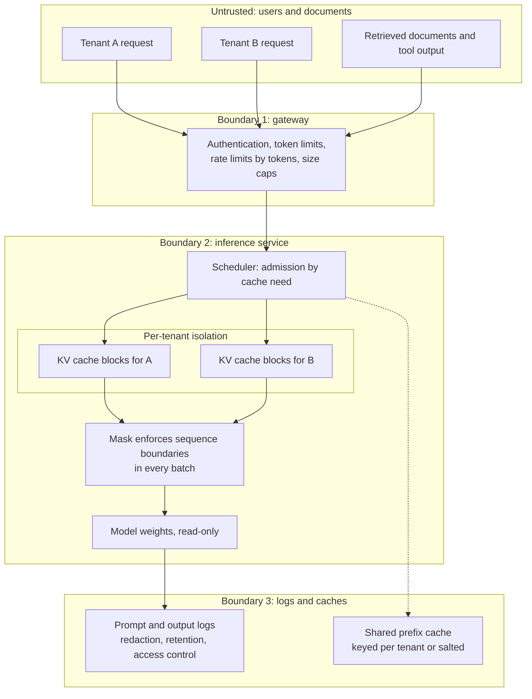

The diagram marks three places where the architecture creates risk. The first boundary protects the cost model: token limits and token-based rate limiting are security controls as well as cost controls. The second protects tenant isolation: the scheduler, cache allocator, and attention mask together decide whether one request can read another's data. The third covers the persistent artifacts, logs and shared caches, which survive after the request ends.

### 25.1 Cost as an attack surface

Prefill cost grows faster than linearly with prompt length (Section 24.2), and cache memory grows linearly with the number of concurrent long prompts. An attacker, or a careless client, who sends many maximum-length prompts can exhaust accelerator memory and compute at a small cost to themselves, which is a denial-of-service or denial-of-wallet attack. Controls: a hard cap on input tokens per request, a cap on output tokens, rate limits denominated in tokens per minute per tenant, admission control that rejects requests when the projected cache does not fit, timeouts on generation, and cancellation that frees cache promptly when a client disconnects.

### 25.2 Instructions and data share one attention space

Inside the model, system instructions, user input, retrieved passages, and tool results are all tokens in one sequence. Attention gives no token a higher privilege than another, and nothing in the architecture marks which tokens may issue instructions. This is the architectural root of prompt injection: text in a retrieved document can be attended to and followed in the same way as text in the system prompt. A longer context increases exposure, as there is more untrusted text in the window, and the position effects of Section 15.2 mean that instructions placed in the middle of a long context may be followed less reliably than injected text near the end. The consequence is that defenses must live outside the model: separating authority at the application layer, treating model output as untrusted input to downstream systems, and limiting what a compromised response can do. [CH17](CH17_Prompt_Engineering_and_Structured_Outputs.md) and Part 17 own those controls. This chapter's contribution is the reason they are necessary: no attention mask in the standard design separates instruction from data.

### 25.3 Isolation between requests

Batching combines several users' sequences into shared tensors, and correct masks keep them apart (Section 3.5). A bug in packed-sequence masking, in variable-length indexing, or in cache block ownership lets one request's tokens influence, or read the cache of, another. Test for it explicitly: submit two requests where one contains a secret marker, and assert that the other's output is identical to its output when run alone, within the numerical tolerance of Section 21.3.

Further cross-request channels exist. A shared prefix cache returns faster for a prompt that matches a cached prefix, so a user who can measure latency may learn whether another tenant recently sent a given prefix. Isolating prefix caches per tenant, or adding a per-tenant salt to the cache key, removes the channel at the price of fewer hits. Mixture-of-experts layers with capacity-limited routing allow one request's tokens to displace another's (Section 16.3). Freed cache blocks must not be readable by the next allocation; memory-residue vulnerabilities in graphics processing units (GPUs) have been disclosed in practice (for example "LeftoverLocals," 2024, affecting local memory on several GPU vendors' devices), so keep drivers updated and ask a cloud provider about isolation guarantees. Network observers can sometimes infer text from the sizes of streamed token chunks in encrypted responses (Roy Weiss and colleagues, 2024); verify with your provider whether mitigations such as batching or padding of streamed chunks are applied.

### 25.4 Memorization, logs, and artifacts

Larger models memorize more of their training data, and extraction attacks recover verbatim sequences (Nicholas Carlini and colleagues, 2021, 2023). A long context also gives the model more private text to repeat. Prompts, outputs, and caches may contain personal or confidential data, so logs need redaction, retention limits, and access control, and cache memory should not be written to disk or shared across tenants. [CH30](CH30_AI_Data_Governance_Privacy_and_Provenance.md) owns the governance of these data.

Model files are also an attack surface. A checkpoint saved in a serialization format that can run code on load (the Python pickle family) can execute attacker code when loaded. Prefer formats that store only tensors, such as safetensors, verify the source and hash of every checkpoint, and load untrusted models in an isolated environment with no credentials.

## 26. Operations, Observability, and Testing

### 26.1 What to measure in serving

A transformer service has a different set of health signals from a typical web service, because its resource use depends on the lengths of requests and not only on their count.

| Signal | What it tells you |
| --- | --- |
| Time to first token (TTFT), by input-length bucket | Prefill cost and queueing; grows superlinearly with prompt length |
| Time per output token (TPOT) | Decode speed; sensitive to batch size and cache reads |
| Input and output token histograms | Real length distribution, which the capacity plan must match |
| KV-cache utilization, preemptions, and evictions | How close the service is to the memory limit; preemption means admission control is too loose |
| Prefix-cache hit rate | Whether prompt layout is delivering the expected saving |
| Batch size and queue depth over time | Whether batching amortizes weight reads or the service is starved |
| Accelerator memory-bandwidth utilization versus arithmetic utilization | Which resource is binding; low arithmetic utilization with high bandwidth use is normal for decode |
| Non-finite values (NaN, infinity) in logits | Precision or mask failures that otherwise produce garbled text |
| Refusals, truncations, and context-overflow errors | Mismatch between product limits and model limits |

Test with a realistic mix. A load test that uses 200-token prompts will report numbers that no long-document workload can reach. Sample real prompt lengths, sweep the long tail, and report goodput: requests per second that meet the TTFT and TPOT service-level objectives, not raw tokens per second.

### 26.2 The model contract

A checkpoint is only usable with the exact architecture settings it was trained with. A mismatch rarely raises an error and usually produces degraded text. Record a model contract for every deployed model and check it in the deployment pipeline:

- number of layers, model width, number of query and key-value heads, head width, feed-forward width and activation;
- normalization type, epsilon, and placement;
- position scheme, rotary base and any scaling factors, the rotary pairing convention, and the maximum position;
- whether input and output embeddings are tied;
- vocabulary size, special-token ids, and the tokenizer version ([CH15](CH15_Large_Language_Model_Fundamentals_and_Inference.md));
- trained and evaluated context lengths;
- numeric formats for weights, activations, and cache.

When a kernel, library, quantization method, or serving engine is upgraded, rerun the regression suite of Section 23.4 (logit tolerance on pinned prompts, cache equivalence, causality) and a task-level evaluation, and canary the change. Numerical differences from a new kernel are normal. Differences in task quality are not.

### 26.3 Evaluating architecture claims

When a vendor or team claims that a new architecture or attention variant is better, ask for the controls: the same data, the same token budget, and the same or equal compute; results at several scales rather than one; quality measured on long-context retrieval and reasoning in addition to perplexity; and cost measured end to end on your hardware (time to first token, tokens per second at your concurrency, and memory) and not an asymptotic complexity statement. Efficient attention variants often match dense attention on perplexity and lag on recall (Section 14.4). The right test for your workload is the one that resembles it: the same prompt shapes, the same position of the needed evidence, and the same length.

## 27. Failure Modes and Quality-Attribute Scenarios

| Scenario | Stimulus | Expected response | Measure |
| --- | --- | --- | --- |
| Long-prompt flood | 50 concurrent requests at the maximum context length | Admission control queues or rejects the excess; no out-of-memory error | Zero out-of-memory events; cache utilization under 90 percent; p95 TTFT within target for admitted requests |
| Tenant isolation | Two tenants batched together, one with a secret marker | Other tenant's output unaffected | Logits equal to the isolated run within the numerical tolerance in 100 percent of trials |
| Context extension | Model served at 4 times its trained length with rotary scaling | Quality at the new length stays near short-context quality at every evidence depth | Position-sweep accuracy at least 95 percent of the short-context accuracy at all 10 depths, otherwise cap the context |
| Loss spike in training | Loss exceeds 1.5 times its trailing average | Alert, pause, roll back to the last good checkpoint, resume with modified batch order | Detection within 50 steps; resume within the planned recovery window |
| Checkpoint porting | Weights moved to a new serving engine | Logits match a reference implementation | Maximum logit difference below tolerance on 100 pinned prompts; greedy continuations match on clear-margin prompts |
| Precision change | Cache or weights quantized from 16-bit to 8-bit | Task quality within bound | Task metric within 1 point and long-context retrieval within 2 points of the baseline |
| Prefix-cache side channel | Tenant measures latency of prompts with another tenant's prefix | No measurable difference | Latency distributions for hit and miss indistinguishable across tenants (cache keyed per tenant) |
| Padding or mask error | Same prompt run alone and in a padded batch | Identical result | Output difference within tolerance, including a fully padded row with no NaN |
| Burst of long outputs | Many requests with maximum output length arrive together | Throughput degrades gracefully | TPOT p95 within target; queue drains within a stated time |

Each scenario names a stimulus, a response, and a measure, so it can become an automated test or a launch criterion. The scenarios were chosen to cover each major quantity in the chapter: memory (flood), isolation (masks and caches), position (extension), training stability, numerics, and security.

## 28. Comparison of Architecture Options

| Option | Strengths | Weaknesses | KV or state memory | Maturity of serving tools | Typical fit |
| --- | --- | --- | --- | --- | --- |
| Encoder-only (BERT-like) | Cheap, fast, bidirectional; no decoding loop | Cannot generate; limited context in older models | None to cache across steps | High | Classification, extraction, reranking, embeddings |
| Encoder-decoder (T5, Whisper-like) | Encodes long inputs once; strong for translation, speech, summarization | Fewer large modern checkpoints; two stacks to serve | Fixed cross-attention cache plus decoder cache | Medium | Input and output differ in kind or length |
| Decoder-only, multi-head attention | General purpose; simple | Large cache | Largest | High | Small models, short contexts |
| Decoder-only, grouped-query attention | General purpose; cache reduced $h/g$ times | Slight quality cost versus multi-head at equal size | Reduced | High | Default for current large open models |
| Decoder-only with latent attention | Very small cache | Needs training with it; position handling is special | Smallest among attention models | Medium | Long-context, high-concurrency serving |
| Decoder-only with sliding-window layers | Bounded cache and compute | Forgets outside the window except through depth | Bounded per windowed layer | Medium to high | Streaming, long inputs where local context dominates |
| Mixture of experts | Quality per unit of arithmetic; large capacity | Large memory, communication, balance issues | Same as attention type used | Medium | High-throughput clusters |
| State-space or hybrid | Constant state; linear time | Weaker exact recall; less mature tooling | Constant plus some attention cache | Low to medium | Very long streams, constrained devices |
| Vision transformer | Strong with large pre-training; unified architecture | Data hungry; cost quadratic in patches | Not applicable for classification | High | Vision backbones, multimodal encoders |

Use the table by starting from the binding constraint. If the constraint is memory per sequence at long context, narrow to grouped-query, latent, sliding-window, or hybrid options. If it is single-accelerator deployment, prefer a dense model that fits. If it is throughput on a cluster, consider a mixture of experts. If the task is classification at scale, begin with an encoder.

## 29. Case Study: A Contract-Review Assistant

### 29.1 Requirements and constraints

A legal-technology team builds an assistant that answers questions about commercial contracts and highlights clauses. The requirements, treated as stated assumptions for this exercise, are:

- Contracts average 20 pages and the 95th percentile is about 60 pages. At roughly 500 tokens per page, the 95th percentile is about 30,000 tokens.
- Peak load is 40 concurrent users. Time to first token must be at most 5 seconds at the 95th percentile.
- Contract text is confidential and must stay in the company's private cloud. No data may go to a third-party model API.
- Answers must quote clauses accurately, and cross-references between clauses ("subject to Section 12.3") matter.
- Target cost is at most $0.01 per question, using the accounting assumptions of Section 24.1 ($2.00 per accelerator-hour, 40 percent compute utilization, 3.35 TB/s bandwidth, 80 GB accelerators).

### 29.2 Options evaluated

**Option A: an 8-billion-parameter grouped-query model with the full contract in a 32,768-token context.** The Llama 3 8B shape has weights of 16.06 GB and a cache of 128 KiB per token. A 30,000-token contract prefills in 1.73 seconds at the stated utilization. The cache per sequence is about 4 GB, so one accelerator holds 13 concurrent sequences, and 40 concurrent users need $\lceil40/13\rceil=4$ accelerators. The per-request cost with a 500-token answer is 2.78 accelerator-seconds, or $0.0015.

**Option B: the same model with retrieval.** Passages are retrieved and the prompt is limited to 6,000 tokens. Prefill takes 0.25 seconds, the cache per sequence is 0.79 GB, and one accelerator holds 71 concurrent sequences, so one accelerator covers the peak. The per-request cost is about 0.25 plus 0.15 seconds of decode share, 0.4 accelerator-seconds, or about $0.0002. The cost is lower, and the risk is that retrieval misses a clause that a cross-reference makes relevant.

**Option C: a 70-billion-parameter grouped-query model with a 32,768-token context.** Weights take 138 GB, so the minimum deployment is four accelerators, and the cache per 32k sequence is 10.74 GB. After the weights, the four accelerators have 150 GB left, which holds 13 concurrent sequences. Prefill takes 3.74 seconds when the work divides ideally across four accelerators, and a request uses 18.1 accelerator-seconds, or $0.0101. That is at the cost limit with no margin and a prefill time close to the latency limit.

**Option D: a mixture-of-experts model.** A model of the Mixtral shape needs 93.4 GB of weights and so at least two accelerators. Its per-token arithmetic is low, but the cost question is memory and not arithmetic for this long-prompt workload. It was rejected for operational complexity without a measurable gain at this scale.

**Option E: a state-space or hybrid model.** Rejected because the task requires verbatim quoting and cross-reference resolution, which are the recall tasks where fixed-state models are weakest (Section 19.3), and because the serving stack in use had no support for it.

**Option F: a sliding-window model.** Rejected because cross-references link distant clauses, and the window would force reliance on multi-hop information flow through layers (Section 14.2).

### 29.3 Decision and rationale

The team chose Option A as the primary path for contracts up to 32,000 tokens, with Option B as a documented fallback for longer contracts, and added a small fine-tuned encoder-only classifier to tag clause types before the model is called, so that clause-highlighting requests do not require a generation step at all (Section 7.1). The decision rests on four facts from this chapter. Prefill at 30,000 tokens (1.73 seconds) fits the latency target with room for queueing. The memory model shows the full-context option needs four accelerators, not one, and the team accepted that cost for completeness of context. The 70B option exceeds the cost target on the same arithmetic, and the quality gain was not shown to be needed. The cross-reference requirement ruled out options that give up exact global recall.

### 29.4 Validation evidence

The team defined acceptance tests before building, each tied to a claim in the design:

1. **Position sweep.** For 200 contracts with a labeled answer, place the governing clause at 10 evenly spaced depths by constructing synthetic contracts from real clauses, and plot accuracy against depth (Section 15.2). Acceptance: accuracy at the weakest depth within 5 points of the best depth. If the middle dips, the prompt is rearranged to put the question and the instructions both before and after the contract text, and the sweep is rerun.
2. **Full-context versus retrieval comparison.** On a held-out set of 500 questions of which 100 involve cross-references, compare Option A and Option B for answer accuracy and quote accuracy. The design rule is: if Option B trails by more than 3 points overall or by more than 8 points on cross-reference questions, it is used only as a fallback, which is the arrangement the team adopted. These thresholds are decisions made by the team before the test, not results.
3. **Load test.** Replay the production length distribution at the peak of 40 concurrent users and measure TTFT p95, TPOT p95, cache utilization, and rejections (Section 26.1). Acceptance: TTFT p95 at most 5 seconds, no out-of-memory events, and cache utilization at most 90 percent.
4. **Isolation test.** Run the two-tenant marker test (Section 25.3) in continuous integration on every release, and verify prefix caches are keyed per tenant.
5. **Numerical regression.** Pin 100 prompts and compare logits against a reference within tolerance after every kernel, library, or quantization change (Section 23.4).

Operationally, the service admits requests by prompt length plus maximum output length against remaining cache memory, rejects contracts above 32,000 tokens with a pointer to the fallback path, limits tokens per tenant per minute, redacts logs, and autoscales on cache pressure and queue depth. The illustrative numbers in this case study come from the formulas and assumptions in the chapter and have not been measured on real hardware. A real project would replace them with measurements before committing to capacity.

## 30. Common Mistakes

| Mistake | Cause | Consequence |
| --- | --- | --- |
| Estimating cost from parameter count only | Ignoring cache and context | Capacity plan fails at long context; concurrency falls by the context ratio (Section 13.2) |
| Treating the model-card context length as usable length | Confusing architectural and effective length | Accuracy collapses or silently degrades for evidence deep in long prompts (Section 15) |
| Assuming attention cost is only quadratic memory | Not separating the four quantities of Section 11.2 | Applying FlashAttention and expecting long-prompt latency to fall; time still grows as $n^2$ |
| Softmax over the wrong axis or missing scale | Shape and scaling bugs | Model trains but attends wrongly or saturates; hard to see without tests (Section 3.3) |
| Padding or packing without correct masks | Mask omitted for padded or packed sequences | Output depends on batch composition; cross-document or cross-tenant leakage (Sections 3.5, 25.3) |
| Off-by-one in label shift | Targets not shifted for causal training | Near-zero loss with no learning; model copies its input (Section 8.4) |
| Porting a checkpoint with a different rotary convention or base | Silent configuration mismatch | Fluent but degraded text, growing with position (Section 6.5) |
| Computing position angles in bfloat16 | Low precision for integer positions | Quality loss increasing with position index (Section 21.2) |
| Interpreting attention heat maps as the model's reasoning | Attention treated as explanation | False assurance to users and auditors (Section 20.1) |
| Comparing a mixture-of-experts model to a dense one by active parameters only | Ignoring memory and communication | Under-provisioned memory; a model that does not fit the intended hardware (Section 16.4) |
| Using one shared prefix cache across tenants | Optimizing hit rate over isolation | Timing side channel that reveals other tenants' prompts (Section 25.3) |
| Skipping loss-spike monitoring | Only smoothed loss is logged | Late detection, days of wasted compute (Section 22.4) |
| Training at the compute-optimal ratio for a high-volume product | Ignoring lifetime inference | Higher total cost than a smaller model trained longer (Section 17.4) |
| Changing kernels or precision without a regression suite | Numerical differences assumed harmless | Undetected quality regressions in long-context tasks (Sections 21, 26) |

## 31. Design Review Checklist

### 31.1 Architecture and fit

- Is the output a label, a score, a vector, or free text, and is the chosen family (encoder-only, decoder-only, encoder-decoder) justified by it (Section 7)?
- Is the model's position scheme known, with its trained length, the evaluated length, and any scaling applied (Section 6)?
- Is the model contract recorded and checked in deployment (Section 26.2)?

### 31.2 Cost and capacity

- Is the parameter count computed from the configuration, with total and active counts for mixture-of-experts models (Sections 9, 16)?
- Are weight memory, cache per token, cache per sequence, and concurrency per accelerator computed for the real context lengths (Section 13)?
- Is prefill time estimated at the 95th percentile prompt length, and is time to first token within target (Section 15.4)?
- Is decode throughput estimated with cache reads included, not only weight reads (Section 13.3)?
- Are quotas and prices denominated in tokens, with caps on input and output (Section 24.3)?

### 31.3 Long context

- Has effective context been measured by a position sweep on the real task, and have instructions been placed accordingly (Section 15)?
- Has retrieval been compared against full context on accuracy and cost (Section 15.5)?

### 31.4 Correctness and numerics

- Do causality, padding, packing, and cache-equivalence tests exist and run in continuous integration (Section 23.4)?
- Are softmax, normalization, accumulation, and position angles computed in adequate precision (Section 21)?
- Are tolerance-based comparisons used for regression tests (Section 21.3)?

### 31.5 Training (if applicable)

- Are warmup, peak learning rate, clipping, and QK-norm or an equivalent chosen with evidence, and are attention-logit and gradient metrics logged (Section 22)?
- Is the token budget justified against lifetime inference demand (Section 17.4)?

### 31.6 Security and governance

- Are tenants isolated in masks, cache blocks, and prefix caches, with a test (Section 25.3)?
- Are logs redacted, retained for a stated period, and access controlled (Section 25.4)?
- Are model files loaded from verified sources in tensor-only formats (Section 25.4)?
- Are attention visualizations kept out of user-facing and audit-facing explanations (Section 20)?

## 32. Exercises

**Exercise 1.** Two tokens have $Q=K=\begin{bmatrix}1&0\\0&1\end{bmatrix}$ and $V=\begin{bmatrix}1&2\\3&4\end{bmatrix}$, with $d_k=2$ and no mask. Compute the attention output.

*Answer outline.* Scores $QK^\top$ equal the identity, so scaled scores are $[0.707,0]$ and $[0,0.707]$. With $e^{0.707}=2.028$ the weights are $[0.670,0.330]$ and $[0.330,0.670]$. Output row 1 is $0.670[1,2]+0.330[3,4]=[1.66,2.66]$. Row 2 is $0.330[1,2]+0.670[3,4]=[2.34,3.34]$. With a causal mask, row 1 would see only itself and output $[1,2]$.

**Exercise 2.** A head has $d_k=64$ and unit-variance query and key components. What are the standard deviation of the unscaled score and of the scaled score? If the unscaled score of the best key exceeds the others by one standard deviation over 16 keys, roughly how peaked is the softmax compared with the scaled case?

*Answer outline.* Variance is 64, so the unscaled standard deviation is 8 and the scaled one is 1. A gap of one standard deviation is a logit gap of 8 unscaled and 1 scaled. With 15 other keys at the same level, the best key gets $e^8/(e^8+15)=2981/2996=0.995$ unscaled and $e/(e+15)=0.153$ scaled. The unscaled softmax is nearly one-hot, which means almost no gradient.

**Exercise 3.** Compute the parameter count of a model with $d=2048$, $L=24$, 16 query heads, 4 key-value heads of width 128, SwiGLU with $d_\text{ff}=5632$, vocabulary 50,000, untied embeddings, and RMS normalization.

*Answer outline.* Attention per layer: queries $2048^2=4{,}194{,}304$, keys and values $2\cdot2048\cdot512=2{,}097{,}152$, output $4{,}194{,}304$, total $10{,}485{,}760$. Feed-forward $3\cdot2048\cdot5632=34{,}603{,}008$. Norms $4{,}096$. Layer total $45{,}092{,}864$. Twenty-four layers $1{,}082{,}228{,}736$. Embedding and head $2\cdot50{,}000\cdot2048=204{,}800{,}000$. Final norm $2{,}048$. Total $1{,}287{,}030{,}784$, about 1.29 billion.

**Exercise 4.** For the model in Exercise 3, compute the KV cache for a batch of 8 sequences of 16,384 tokens at 16-bit precision.

*Answer outline.* Per token $2\cdot24\cdot4\cdot128\cdot2=49{,}152$ bytes (48 KiB). Per sequence $48\text{ KiB}\cdot16{,}384=768$ MiB. For 8 sequences, 6 GiB. With full multi-head attention (16 key-value heads) it would be four times larger, 24 GiB.

**Exercise 5.** Estimate the training compute for the Exercise 3 model on 20 tokens per parameter, and the time on 64 accelerators with a peak of 989 teraFLOPs per second at 40 percent utilization.

*Answer outline.* $D=20\cdot1.287\times10^9=2.574\times10^{10}$ tokens. $C=6ND=6\cdot1.287\times10^9\cdot2.574\times10^{10}=1.99\times10^{20}$ FLOPs. Sustained rate $64\cdot0.4\cdot989\times10^{12}=2.53\times10^{16}$ per second. Time $=7{,}850$ seconds, about 2.2 hours, before overhead for failures and evaluation.

**Exercise 6.** Show why rotary embeddings make the attention score depend only on the offset between positions.

*Answer outline.* For a pair of coordinates, rotation by angle $\alpha$ is the matrix $R(\alpha)$ and $R(\alpha)^\top R(\beta)=R(\beta-\alpha)$. The rotated query at position $m$ is $R(m\theta)q$ and the rotated key at position $n$ is $R(n\theta)k$. Their dot product is $q^\top R(m\theta)^\top R(n\theta)k=q^\top R((n-m)\theta)k$, so positions enter only through $n-m$. Summing over coordinate pairs gives the same for the full vector. Section 6.5's script confirms this numerically.

**Exercise 7.** A mixture-of-experts layer has 16 experts with top-2 routing. Assuming uniform independent routing, how many distinct experts does a batch of 8 tokens touch on average? What does that imply for decode bandwidth?

*Answer outline.* $16[1-(14/16)^8]=16(1-0.3436)=10.5$ experts of 16, about two thirds of the weights. The bandwidth advantage of sparse activation is mostly gone at batch 8 because two thirds of the expert weights are read each step. Real routing is skewed, which reduces the count but not the conclusion that moderate batches read most experts.

**Exercise 8.** Use the online softmax to process scores $[1,3]$ in the first block and $[4]$ in the second. Give the final denominator relative to the final maximum, and check it against the direct computation.

*Answer outline.* After block 1: $m=3$, $\ell=e^{1-3}+e^{3-3}=0.1353+1=1.1353$. Block 2: new maximum $m'=4$, $\ell'=1.1353\cdot e^{3-4}+e^{4-4}=0.4177+1=1.4177$. Direct: $(e^1+e^3+e^4)/e^4=(2.718+20.086+54.598)/54.598=1.4177$. The two agree, as the correction factor $e^{m-m'}$ rescales the earlier partial sum.

**Exercise 9.** A colleague proposes showing users the attention heat map as the reason for a classification. Give two technical reasons it is not a faithful explanation, and one test you would run instead.

*Answer outline.* First, the contribution of a token is its weight times its value vector, so equal weights can give unequal contributions (Section 20.1: 0.802 against 0.567 at equal weight 0.401). Second, representations at later layers already mix information from other tokens, and other paths such as the feed-forward layers and other heads carry information. A better test removes or masks the highlighted tokens and measures the change in the model output (comprehensiveness), and checks whether those tokens alone preserve the output (sufficiency), then compares against a gradient-based attribution.

**Exercise 10.** Your product owner asks for a 200,000-token context window at the same per-request price as the current 8,000-token window. Using the chapter's formulas, state the issues and what you would propose.

*Answer outline.* The cache is linear in context, 25 times larger per sequence, so concurrency per accelerator falls about 25 times. Prefill compute grows faster than linearly because the attention term grows with the square of length, and at this length attention dominates compute. Quality at the far end must be measured with a position sweep, and the effective length may be lower than the nominal one. Propose token-based pricing with a long-context tier, retrieval to narrow most requests, prefix caching for shared content, a model with few key-value heads or latent attention, per-request admission control, and a measured effective-length claim in the product documentation.

## 33. Summary

A transformer replaces recurrence with attention. Each position computes a query, compares it to the keys of all positions, converts the scaled scores to weights with a softmax, and returns a weighted average of values. The division by $\sqrt{d_k}$ keeps the variance of the scores at 1 regardless of head width, which prevents the softmax from saturating at initialization: the measured variance at $d_k=1024$ is 1031 unscaled and 1.01 scaled. Multi-head attention runs several such computations in parallel subspaces, and the block wraps attention and a feed-forward network (often gated, as SwiGLU) in residual connections and normalization. Pre-LN placement gives well-scaled gradients and is the default for deep models, at the price of a growing residual stream.

Attention is blind to order, so position is injected by sinusoidal or learned vectors, relative biases, rotary rotation of queries and keys, or linear penalties. These differ in how they extrapolate beyond the trained length, and extending the context requires measurement. Masks define what can be read: causal masks make one pass train all positions, and padding and packing masks protect batches. Encoder-only, decoder-only, and encoder-decoder models pair with different objectives, and decoder-only causal modeling dominates generation because every position supplies a training signal.

Parameter counts follow from the configuration: about $12Ld^2$ plus embeddings, with worked totals of 6.74 billion for a Llama 2 7B shape. Training costs about $6ND$ FLOPs, and inference about $2N$ per token. Attention time grows with the square of context and equals the rest of the network at about $n=12d$. FlashAttention removes the quadratic memory by tiling with an online softmax but not the quadratic time. The KV cache makes decoding linear in context and costs $2Lgd_hb$ bytes per token, so it sets serving concurrency, and decode is memory-bound: at batch 1 a 7B model is bounded near 249 tokens per second by weight reads. Grouped-query and latent attention cut the cache, and sliding-window, sparse, linear, and state-space layers trade exact recall for cost. Long-context claims need testing for effective length, including the lost-in-the-middle pattern.

Mixture-of-experts layers buy capacity with memory, scaling laws forecast loss but not capability and depend on the recipe, and training for inference favors smaller models trained longer when demand is high. Attention weights are not explanations. Induction heads show how identifiable circuits implement in-context copying. Numerical stability depends on max-subtracted softmax, float32 accumulation, correct position arithmetic, and monitoring for loss spikes. For architects, context length is a cost and security multiplier: price and limit by tokens, isolate tenants in masks and caches, and treat the model as an unprivileged reader of every token it is given.

## 34. Code Examples

All scripts use only the Python standard library, were run with Python 3.14 in the authoring environment, and print the values quoted in this chapter. They do not require a graphics processing unit.

- [01_attention_from_scratch.py](../code/python/transformers-chapter/01_attention_from_scratch.py) computes the three-token attention example, checks the variance argument for the scaling factor, and tests causal-mask leakage.
- [02_params_flops_kv_cache.py](../code/python/transformers-chapter/02_params_flops_kv_cache.py) counts parameters for several model shapes, and computes FLOPs, training compute, KV-cache sizes, decode bandwidth limits, scaling-law illustrations, mixture-of-experts arithmetic, and the case-study costs.
- [03_positional_encodings.py](../code/python/transformers-chapter/03_positional_encodings.py) demonstrates permutation equivariance, sinusoidal and rotary properties, ALiBi biases, and position interpolation.
- [04_block_numerics_and_tiling.py](../code/python/transformers-chapter/04_block_numerics_and_tiling.py) shows softmax and float16 failures, online-softmax tiling, residual-stream growth, and a causal pre-LN decoder block with a leak test.

### 34.1 Primary sources

Key papers cited in this chapter, for readers who want the originals: [Attention Is All You Need](https://arxiv.org/abs/1706.03762) (Vaswani et al., 2017); [Neural machine translation by jointly learning to align and translate](https://arxiv.org/abs/1409.0473) (Bahdanau et al., 2014); [Scaling laws for neural language models](https://arxiv.org/abs/2001.08361) (Kaplan et al., 2020); [Training compute-optimal large language models](https://arxiv.org/abs/2203.15556) (Hoffmann et al., 2022); [Chinchilla scaling: a replication attempt](https://arxiv.org/abs/2404.10102) (Besiroglu et al., 2024); [FlashAttention](https://arxiv.org/abs/2205.14135) (Dao et al., 2022); [FlashAttention-3](https://arxiv.org/abs/2407.08608) (Shah et al., 2024); [GQA](https://arxiv.org/abs/2305.13245) (Ainslie et al., 2023); [Fast transformer decoding: one write-head is all you need](https://arxiv.org/abs/1911.02150) (Shazeer, 2019); [RoFormer](https://arxiv.org/abs/2104.09864) (Su et al., 2021); [Train short, test long](https://arxiv.org/abs/2108.12409) (Press et al., 2021); [Lost in the middle](https://arxiv.org/abs/2307.03172) (Liu et al., 2023); [Efficient streaming language models with attention sinks](https://arxiv.org/abs/2309.17453) (Xiao et al., 2023); [Mixtral of experts](https://arxiv.org/abs/2401.04088) (Jiang et al., 2024); [An image is worth 16x16 words](https://arxiv.org/abs/2010.11929) (Dosovitskiy et al., 2020); [Mamba](https://arxiv.org/abs/2312.00752) (Gu and Dao, 2023); [Attention is not explanation](https://arxiv.org/abs/1902.10186) (Jain and Wallace, 2019); and [In-context learning and induction heads](https://transformer-circuits.pub/2022/in-context-learning-and-induction-heads/index.html) (Olsson et al., 2022). Figures such as accelerator specifications, model configurations, and vendor-reported speedups change; verify them against the current paper, model card, or vendor documentation before using them in a plan.
