# Generative Adversarial Networks

Part: [16 — Artificial Intelligence, Machine Learning, and Generative AI](PART_OVERVIEW.md) · Status: Revised (in-depth rewrite)

## 1. Introduction

A generative adversarial network (GAN) is a pair of neural networks trained against each other. The generator turns random noise into a candidate sample. The discriminator looks at a sample and decides whether it came from the training data or from the generator. The generator improves by learning to produce samples the discriminator accepts, and the discriminator improves by learning to reject them. When the game works, the generator ends up producing samples that are hard to tell apart from real data, and it does so in a single forward pass.

The idea is simple to state and hard to run. A GAN has no single loss that falls steadily as the model improves. Two models adjust to each other, so the objective each one sees changes under its feet. Training can oscillate, one network can overpower the other, and the generator can learn to produce a small set of convincing outputs while ignoring most of the data. A loss curve rarely tells you which of these is happening. Much of this chapter is about the evidence you need instead.

For a solution architect, GANs matter for three reasons that do not depend on whether you ever train one.

1. **They define a trade-off space.** GANs give fast sampling and sharp outputs, at the price of unstable training and uneven coverage of the data. Diffusion models (CH12) and autoregressive language models (CH15) occupy different points in that space. Choosing a generative family is an architecture decision about latency, cost, controllability, and failure modes, and the GAN is the cleanest case study of the speed-and-sharpness corner.
2. **They are still deployed.** Diffusion models displaced GANs for most open-ended image generation, but GAN generators and GAN-style discriminators remain in super-resolution, image restoration, real-time and on-device generation, video codecs and enhancement pipelines, and as the adversarial loss that sharpens the decoders inside latent diffusion systems. An architect who reviews a vision pipeline will meet them.
3. **They raise the governance questions that every generative system raises.** Synthetic faces, deepfakes, synthetic training data, memorization of training records, and provenance of generated media were all first debated in the context of GANs. The privacy and provenance sections of this chapter apply to any generator.

This chapter owns the following topics. Everything else is recapped briefly and linked.

| Topic | Where it is taught | What this chapter does |
| --- | --- | --- |
| Generative modeling framing, GAN minimax game, optimal discriminator, Jensen-Shannon link | This chapter | Teaches fully, with derivations. |
| GAN losses, stabilizers, conditional GANs, image translation, StyleGAN family | This chapter | Teaches fully. |
| Generative evaluation: Inception Score, Fréchet Inception Distance (FID), precision and recall | This chapter | Teaches fully, including limits. |
| Variational autoencoders (VAEs) and the evidence lower bound | This chapter | Teaches the derivation and the VAE versus GAN trade-off. Normalizing flows get a short section. |
| Gradient descent, backpropagation, normalization layers, initialization | [CH07 — Deep Learning Foundations](CH07_Deep_Learning_Foundations.md) | Used without re-deriving. |
| Convolution, strided and transposed convolution, receptive fields | [CH08 — Convolutional Neural Networks](CH08_Convolutional_Neural_Networks.md) | Used without re-deriving. |
| Attention and transformers | [CH10 — Transformers and Attention](CH10_Transformers_and_Attention.md) | Mentioned only where a GAN uses attention layers. |
| Forward noising, reverse denoising, samplers, guidance | [CH12 — Diffusion Models](CH12_Diffusion_Models.md) | Recap in Section 22 only. CH12 teaches the mechanism. |
| Autoregressive language models and inference | [CH15 — Large Language Model Fundamentals and Inference](CH15_Large_Language_Model_Fundamentals_and_Inference.md) | Mentioned in the taxonomy only. |
| Multimodal generative systems | [CH23 — Multimodal Generative AI](CH23_Multimodal_Generative_AI.md) | Mentioned only for text-to-image GANs. |
| Metrics, held-out evaluation, statistical comparison | [CH06 — Model Evaluation, Validation, and Selection](CH06_Model_Evaluation_Validation_and_Selection.md) | Applied to generative metrics. |
| Data rights, deletion, and provenance of AI artifacts | [CH30 — AI Data Governance, Privacy, and Provenance](CH30_AI_Data_Governance_Privacy_and_Provenance.md) | Applied to synthetic data and generated media. |
| Safety governance and misuse response | [CH31 — Responsible AI and Safety Governance](CH31_Responsible_AI_and_Safety_Governance.md) | Applied to deepfakes and release decisions. |
| Lifecycle, monitoring, and rollback of models | [CH29 — MLOps and LLMOps](CH29_MLOps_and_LLMOps.md) | Applied to checkpoint selection and rollback. |

After studying this chapter, a reader should be able to:

1. Place GANs in the taxonomy of generative models and say what each family gives up to gain what it gains.
2. Derive the optimal discriminator, show that the generator objective at the optimum equals $-\log 4 + 2\,\mathrm{JSD}$, and explain what that does and does not guarantee in practice.
3. Explain why the original generator loss stalls, why the non-saturating loss is used instead, and why alternating gradient updates can fail to converge even on a trivial game.
4. Choose among the original loss, least-squares, hinge, Wasserstein with gradient penalty, spectral normalization, and relativistic losses, and give the reason for each choice.
5. Describe conditional GANs, Pix2Pix, CycleGAN, progressive growing, and the StyleGAN family well enough to review a design that uses them.
6. Diagnose mode collapse and mode dropping with a concrete procedure, and read training signals without trusting the loss curves alone.
7. Compute and interpret Inception Score, FID, and precision and recall, and state what each one cannot detect.
8. Derive the evidence lower bound for a VAE and compare VAE, GAN, flow, and diffusion models on the dimensions an architect cares about.
9. Assess the privacy, misuse, provenance, and cost consequences of putting a generative model into a product.

The chapter has runnable code. Four scripts in `code/python/gan-chapter/` reproduce the numbers quoted in the text, and they are listed in Section 33. They use only the Python standard library, so the toy GAN is written with explicit backpropagation. Production work uses a framework such as PyTorch, and Section 14 shows what the same step looks like there.

## 2. The Generative Modeling Problem and a Taxonomy of Approaches

### 2.1 What a generative model is asked to do

Suppose you have a dataset of $N$ examples $x_1, \dots, x_N$, each a point in a space $\mathcal{X}$, for example the space of $256 \times 256$ color images, the space of rows of a customer table, or the space of audio waveforms. Assume the examples are independent draws from an unknown distribution $p_{\text{data}}(x)$. A discriminative model such as the classifiers in [CH03](CH03_Regression_and_Classification.md) learns $p(y \mid x)$ for a label $y$. A generative model learns something about $p_{\text{data}}(x)$ itself. Concretely, it is asked to do some or all of the following.

- **Sample.** Produce new points that look like draws from $p_{\text{data}}$.
- **Evaluate density.** Assign a number $p_\theta(x)$ to any point, so that likely points score high and implausible points score low. This supports anomaly detection and compression.
- **Infer a latent representation.** Map a point to a lower-dimensional code that captures what varies, and map codes back to points. This supports editing and interpolation.
- **Condition.** Do all of the above given extra information $c$, such as a class label, a text prompt, or a source image, so the model represents $p(x \mid c)$.

No model family does all four equally well, and the differences drive the choice among them. A GAN is excellent at the first, can condition easily, gives no density, and has no built-in way to infer a code for a given real image. Seeing why requires the taxonomy.

### 2.2 Explicit and implicit density models

The first split is whether the model gives you $p_\theta(x)$ as a number you can compute.

**Explicit density models** define $p_\theta(x)$ and are trained by maximizing the likelihood of the data, $\sum_i \log p_\theta(x_i)$. This is the maximum likelihood principle from [CH01](CH01_Machine_Learning_Foundations.md). Within this group there are two sub-cases. In a *tractable* model the density can be computed exactly. In an *approximate* model it can only be bounded or estimated.

**Implicit density models** define a sampling procedure, for example "draw $z$ from a Gaussian and push it through a network $G$", and never write $p_\theta(x)$ down. You can sample, but you cannot ask how likely a given $x$ is. Training cannot use likelihood, so it needs some other signal that compares the distribution of generated samples to the distribution of real ones. The GAN's discriminator is exactly that signal: a learned two-sample test that the generator tries to pass.

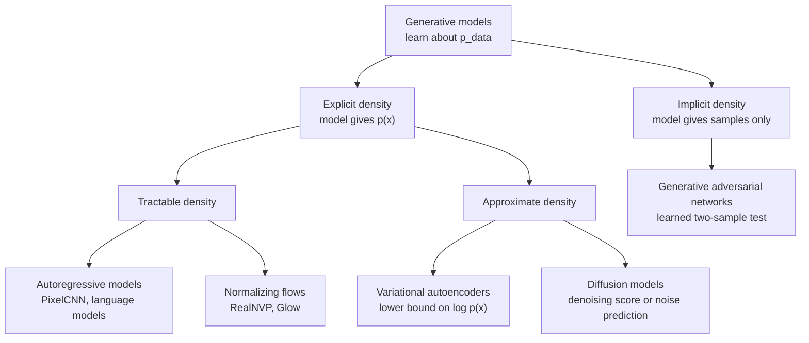

The diagram shows where each family sits. Autoregressive models and normalizing flows give exact likelihoods. Variational autoencoders optimize a bound, and diffusion models optimize an objective that is also derived from a likelihood bound, which is why they are drawn under approximate density. The GAN stands alone on the implicit side. The diagram has two consequences for design. First, only the explicit families can be scored by held-out log-likelihood, a metric that is comparable across models and can detect overfitting. GANs need other metrics, and Section 18 shows how limited those are. Second, the implicit side has no built-in penalty for ignoring part of the data, which is the root of mode dropping.

### 2.3 The five families in one paragraph each

**Autoregressive models** factor the joint distribution with the chain rule, $p(x) = \prod_{j} p(x_j \mid x_{<j})$, and model each conditional with a neural network. A language model does this over tokens ([CH15](CH15_Large_Language_Model_Fundamentals_and_Inference.md)). PixelRNN and PixelCNN (van den Oord et al., 2016) do it over pixels. Training is stable and likelihood is exact. Sampling is sequential, one element at a time, so a $256 \times 256 \times 3$ image takes 196,608 forward passes unless the elements are compressed into far fewer discrete tokens first.

**Variational autoencoders** (Kingma and Welling, 2014; Rezende, Mohamed and Wierstra, 2014) learn an encoder that maps $x$ to a distribution over a latent code $z$ and a decoder that maps $z$ back to $x$. They maximize a lower bound on $\log p(x)$, derived in Section 19. Training is stable, sampling takes one decoder pass, and an encoder comes for free. Samples are often blurry because the standard likelihood term averages over plausible outputs.

**Normalizing flows** build $x = f_\theta(z)$ from invertible layers with cheap Jacobian determinants, so the change-of-variables formula gives the exact density. They offer exact likelihood, exact inference of $z$, and single-pass sampling, at the price of architectural restrictions that make them less expressive per parameter. Section 20 covers them briefly.

**GANs** (Goodfellow et al., 2014) train a generator against a discriminator. Sampling takes one pass, samples are sharp, and there is no density and no encoder. Training is the hard part.

**Diffusion models** (Sohl-Dickstein et al., 2015; Ho, Jain and Abbeel, 2020) train a network to undo small amounts of added noise and generate by starting from noise and denoising repeatedly. Training is stable and coverage is excellent. Sampling needs many network evaluations. [CH12](CH12_Diffusion_Models.md) teaches the mechanism.

### 2.4 The generative trilemma

A useful way to compare the families is to ask for three properties at once: high sample quality, good coverage of the data distribution (mode coverage, or diversity), and fast sampling. Xiao, Kreis and Vahdat (2022) called the difficulty of getting all three the generative learning trilemma and observed that the families each give up one of them. The statement is a heuristic, not a theorem, and later work has loosened every corner of it, but it is a good first filter.

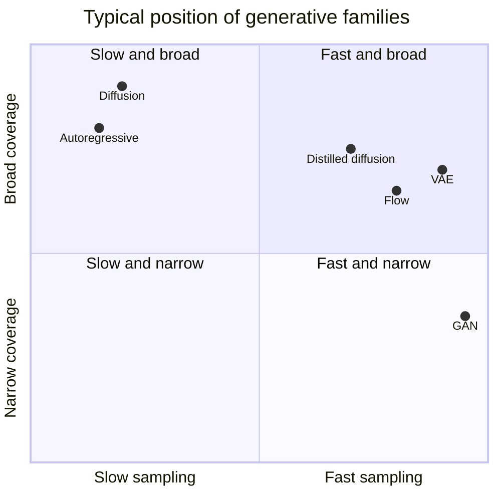

The chart is qualitative. Positions are typical for the default form of each family on image data and shift with the specific model, the data, and the engineering effort. Read it this way. Standard diffusion and autoregressive sampling are slow because they need many sequential evaluations, but they cover the data well. A GAN samples in one pass and gives sharp results, but its coverage is the weakest of the group because nothing in the objective forces every part of the data to be represented. VAEs and flows are fast and broad, and they give up sample sharpness, which the two axes do not show. Distillation methods that compress a diffusion sampler to a few steps move the diffusion point toward the right at some cost in quality. The architectural consequence is that the choice depends on which property your product cannot give up. A real-time filter that runs on a phone cannot accept 50 sequential network evaluations. A pipeline that must represent rare categories cannot accept silent mode dropping.

### 2.5 A worked comparison of sampling cost

To make the speed axis concrete, compare the number of sequential network evaluations needed to produce one $64 \times 64$ grayscale image under four designs. These counts are determined by the algorithm, not by hardware.

| Design | Sequential evaluations per sample | Reasoning |
| --- | --- | --- |
| Pixel-level autoregressive model | 4,096 | One evaluation per pixel, $64 \times 64 = 4{,}096$. |
| Diffusion with 50 sampler steps | 50 | One denoiser evaluation per step. With classifier-free guidance (CH12) each step may need two evaluations, batched together. |
| GAN | 1 | One generator pass. |
| VAE | 1 | One decoder pass. |

The autoregressive model needs about 82 times more sequential steps than the 50-step diffusion sampler ($4096 / 50 \approx 81.9$) and 4,096 times more than a GAN. Sequential steps matter more than total floating-point operations because they cannot be parallelized for a single sample. The numbers also hide the per-step cost, since a diffusion denoiser is usually a larger network than a GAN generator. Section 27 combines both factors into a serving-cost estimate.

### 2.6 What this means for the rest of the chapter

The GAN is the representative of the implicit, single-pass, sharp-but-fragile corner. The next sections work through the mathematics that explains why it behaves the way it does, then through the engineering that makes it usable, then through evaluation, then through the alternatives and the governance questions. Keep one question in mind throughout: for each technique, which of the three trilemma properties does it protect, and which does it spend?

## 3. Background and History

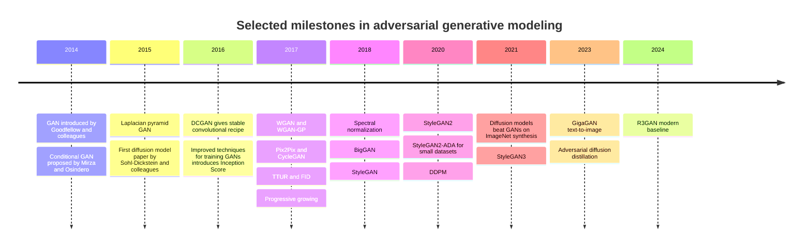

Ian Goodfellow and colleagues introduced the GAN in 2014. Within two years the community had the first practical recipe (DCGAN, Radford, Metz and Chintala, 2016) and the first set of heuristics for stabilizing training (Salimans et al., 2016). In 2017 the theoretical understanding caught up with the practice: Arjovsky and Bottou analyzed why the original objective gives poor gradients, Arjovsky, Chintala and Bottou proposed the Wasserstein objective, and Gulrajani and colleagues proposed the gradient penalty. The same year, image-to-image translation (Pix2Pix, Isola et al.; CycleGAN, Zhu et al.) showed that adversarial losses could be added to structured prediction, and Heusel and colleagues proposed the FID metric and the two-timescale update rule that most later work reports.

The period from 2018 to 2021 was the high point of GAN image quality. Progressive growing, BigGAN (Brock, Donahue and Simonyan, 2019), and the StyleGAN line (Karras and colleagues, 2019 to 2021) produced photorealistic faces and high-quality class-conditional images. During the same period, diffusion models matured. Dhariwal and Nichol (2021) reported that a diffusion model with guidance beat the best GANs on ImageNet generation by FID, and latent diffusion (Rombach et al., 2022) made text-to-image diffusion practical on a single GPU. Most image-generation products then moved to diffusion. GAN research continued in several directions. GigaGAN (Kang et al., 2023) scaled a GAN to text-to-image generation. Adversarial diffusion distillation (Sauer et al., 2023) used a discriminator to train a few-step diffusion student. R3GAN (Huang et al., 2024) argued that much of the GAN training folklore could be replaced by a principled loss and a modern architecture. Section 22 returns to this history to explain where GANs stand now.

## 4. The GAN Game

### 4.1 Setup

Let $z \in \mathbb{R}^{d}$ be a latent vector drawn from a fixed prior $p_z$, usually a standard Gaussian $\mathcal{N}(0, I)$. The generator $G_\theta$ is a neural network that maps $z$ to a point $G_\theta(z) \in \mathcal{X}$. It induces a distribution $p_g$ on $\mathcal{X}$, namely the distribution of $G_\theta(z)$ when $z \sim p_z$. The generator never writes $p_g$ down, but it can sample from it by sampling $z$ and applying $G$.

The discriminator $D_\phi : \mathcal{X} \to (0, 1)$ is a neural network that outputs the probability that its input came from $p_{\text{data}}$ rather than from $p_g$. It is a binary classifier trained on a balanced mix of real points (label 1) and generated points (label 0).

### 4.2 The value function

The discriminator is trained with the binary cross-entropy loss from [CH03](CH03_Regression_and_Classification.md). With half the batch real and half generated, maximizing the log-likelihood of the correct labels means maximizing

$$
V(D, G) = \mathbb{E}_{x \sim p_{\text{data}}}\big[\log D(x)\big] + \mathbb{E}_{z \sim p_z}\big[\log\big(1 - D(G(z))\big)\big].
$$

Here $\mathbb{E}$ denotes expectation, so the first term is the average log-probability the discriminator assigns to real points and the second is the average log-probability it assigns to the "generated" label on fake points. A perfect discriminator has $V = 0$, because $\log 1 = 0$ on both terms. A discriminator that outputs $1/2$ everywhere has $V = 2\log\tfrac12 = -\log 4 \approx -1.386$.

The generator wants the opposite outcome, so the game is

$$
\min_{G}\; \max_{D}\; V(D, G).
$$

This is a two-player zero-sum game. The discriminator maximizes $V$ and the generator minimizes it. A pair $(G^{\star}, D^{\star})$ is a Nash equilibrium if neither player can improve by changing only its own parameters.

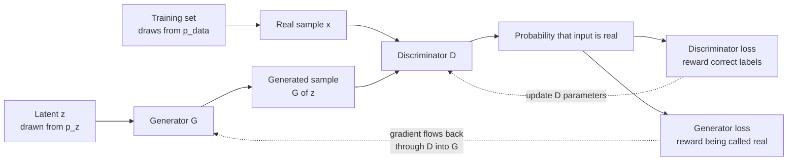

The diagram shows the single most important structural fact about GAN training. The generator never sees real data. Its only learning signal is the gradient that flows backward from the discriminator's output through the discriminator and into the generator's parameters. The generator is therefore exactly as good as the discriminator's gradients allow. If the discriminator is uninformative, the generator learns nothing. If the discriminator has learned a shortcut, such as a high-frequency artifact that distinguishes fakes, the generator learns to remove that artifact and nothing else. This also explains why the discriminator cannot be treated as a safety filter or a quality score for the final product: it is a training signal, tuned to the generator's current weaknesses, not a calibrated judge.

### 4.3 The optimal discriminator

Fix the generator. The value function is an expectation over $x$, so write it as an integral. For the second term, use the change of variables $x = G(z)$, which turns the expectation over $z$ into an expectation over $x \sim p_g$:

$$
V(D, G) = \int_{\mathcal{X}} \Big( p_{\text{data}}(x)\,\log D(x) + p_g(x)\,\log\big(1 - D(x)\big) \Big)\, dx.
$$

The discriminator can choose $D(x)$ separately at every $x$, so the integral is maximized by maximizing the integrand at each point. At a fixed $x$, let $a = p_{\text{data}}(x)$, $b = p_g(x)$, and $y = D(x)$. The function to maximize over $y \in (0,1)$ is $f(y) = a \log y + b \log(1 - y)$. Differentiate and set to zero:

$$
f'(y) = \frac{a}{y} - \frac{b}{1 - y} = 0 \;\;\Longrightarrow\;\; a(1 - y) = b\,y \;\;\Longrightarrow\;\; y = \frac{a}{a + b}.
$$

The second derivative is $f''(y) = -a/y^2 - b/(1-y)^2 < 0$, so this is a maximum. The optimal discriminator is therefore

$$
D^{\star}_G(x) = \frac{p_{\text{data}}(x)}{p_{\text{data}}(x) + p_g(x)}.
$$

This has a clean reading. At each point the optimal discriminator reports the fraction of the local probability mass that belongs to real data. Where real data is twice as dense as generated data, $D^{\star} = 2/3$. Where the two densities match, $D^{\star} = 1/2$. Where the generator puts mass but the data has none, $D^{\star} = 0$.

**Worked example.** Take a space with four points. Real data has probabilities $p_{\text{data}} = (0.4, 0.3, 0.2, 0.1)$ and the generator has $p_g = (0.1, 0.2, 0.3, 0.4)$. Then

$$
D^{\star} = \Big(\tfrac{0.4}{0.5},\; \tfrac{0.3}{0.5},\; \tfrac{0.2}{0.5},\; \tfrac{0.1}{0.5}\Big) = (0.8,\; 0.6,\; 0.4,\; 0.2).
$$

The discriminator is most confident at the first point, where real data is four times as common as generated data, and least favorable to real data at the last. The script `02_gan_theory_numbers.py` prints these values.

### 4.4 The link to Jensen-Shannon divergence

Substitute $D^{\star}_G$ back into the value function:

$$
C(G) = \max_D V(D, G) = \int \Big( p_{\text{data}}\log\frac{p_{\text{data}}}{p_{\text{data}} + p_g} + p_g \log\frac{p_g}{p_{\text{data}} + p_g} \Big)\, dx.
$$

Define the mixture $m = \tfrac12(p_{\text{data}} + p_g)$. Then $p_{\text{data}} + p_g = 2m$, and each logarithm can be rewritten by pulling out $\log 2$:

$$
\log\frac{p_{\text{data}}}{2m} = \log\frac{p_{\text{data}}}{m} - \log 2, \qquad \log\frac{p_g}{2m} = \log\frac{p_g}{m} - \log 2.
$$

Because $\int p_{\text{data}} = \int p_g = 1$, the two $\log 2$ terms contribute $-2\log 2 = -\log 4$ in total. What remains are two Kullback-Leibler (KL) divergences, $\mathrm{KL}(p \,\|\, q) = \int p \log (p/q)\, dx$, taken against the mixture:

$$
C(G) = -\log 4 + \mathrm{KL}\big(p_{\text{data}} \,\|\, m\big) + \mathrm{KL}\big(p_g \,\|\, m\big) = -\log 4 + 2\,\mathrm{JSD}\big(p_{\text{data}} \,\|\, p_g\big).
$$

The last step uses the definition of the Jensen-Shannon divergence, $\mathrm{JSD}(p \,\|\, q) = \tfrac12 \mathrm{KL}(p \,\|\, m) + \tfrac12 \mathrm{KL}(q \,\|\, m)$. The JSD is symmetric, always non-negative, bounded above by $\log 2$, and zero only when $p = q$. It follows that $C(G) \geq -\log 4$, with equality if and only if $p_g = p_{\text{data}}$.

**Worked check.** For the four-point example, the script computes $\mathrm{JSD} = 0.1064$ nats. Then $-\log 4 + 2(0.1064) = -1.3863 + 0.2128 = -1.1734$. Evaluating $V(D^{\star}, G)$ directly from the probabilities gives $-1.1734$ as well, so the identity checks out numerically.

The consequence is the theoretical headline of the 2014 paper. If the discriminator is optimal at every step and the generator can represent any distribution, then minimizing $C(G)$ drives the generator distribution to the data distribution, and at that point the best discriminator can do is output $1/2$ everywhere. Training a GAN to optimality is minimizing the Jensen-Shannon divergence between data and model.

### 4.5 What the theory does not promise

The result is the right mental model and a poor predictor of behavior. Four gaps matter in practice.

1. **The discriminator is never optimal.** It is a finite network trained for one or a few steps between generator updates. The generator is therefore following the gradient of an approximation to the JSD, and the quality of that approximation changes with the discriminator's capacity and training state.
2. **The generator is not a free distribution.** The proof optimizes over all densities $p_g$. A real generator is a parametric network, and gradient descent on its parameters does not follow the convex path that the proof uses. The game is non-convex in the parameters even though it is convex-concave in the densities.
3. **Real distributions have thin supports.** Images concentrate on a low-dimensional manifold inside pixel space, and so does the generator's output. Two such manifolds generally do not overlap, which makes the JSD saturate at $\log 2$ and its gradient vanish. Section 5.3 shows this with numbers, and it is the main motivation for the Wasserstein objective.
4. **Equilibrium is not the same as convergence.** Even when an equilibrium exists, simultaneous or alternating gradient updates need not reach it. Section 6 shows a two-line game where they spiral outward.

Treat the JSD result as an explanation for why the objective is sensible, not as a promise that training will find the optimum.

### 4.6 Finite-sample view

In practice the expectations are replaced by minibatch averages. With a minibatch of $m$ real samples $x^{(i)}$ and $m$ latent draws $z^{(i)}$, the discriminator step ascends the stochastic gradient

$$
\nabla_\phi\, \frac{1}{m}\sum_{i=1}^{m}\Big[\log D\big(x^{(i)}\big) + \log\Big(1 - D\big(G(z^{(i)})\big)\Big)\Big]
$$

and the generator step takes a gradient step on its own loss. Because both gradients are computed from small random batches, they are noisy estimates, and the two networks are tracking moving targets. That noise, plus the interaction between the two updates, is what Section 6 studies.

## 5. Why the Original Loss Saturates and the Non-Saturating Alternative

### 5.1 The vanishing-gradient problem

The minimax game says the generator should minimize $\mathbb{E}_z[\log(1 - D(G(z)))]$. Early in training the generator produces obvious garbage, and a discriminator learns to reject garbage within a few hundred steps. The question is what gradient the generator receives at that moment.

Write the discriminator output as a sigmoid of a pre-activation score $a$, called the logit: $D = \sigma(a) = 1/(1 + e^{-a})$. The sigmoid has the derivative $\sigma'(a) = \sigma(a)(1 - \sigma(a))$. For the original generator loss $\ell_{\text{sat}} = \log(1 - D)$, the derivative with respect to the logit is

$$
\frac{\partial \ell_{\text{sat}}}{\partial a} = \frac{-\sigma'(a)}{1 - \sigma(a)} = \frac{-\sigma(a)\big(1 - \sigma(a)\big)}{1 - \sigma(a)} = -\sigma(a) = -D.
$$

The generator's parameter gradient is this quantity multiplied by the gradient of the logit with respect to the generated sample and then by the gradient of the sample with respect to the generator weights, so the magnitude of $D$ scales the whole update. When the discriminator rejects a fake confidently, $D \approx 0$, and the gradient vanishes. The loss is saturated: the generator receives almost no signal exactly when its samples are worst and it most needs one.

The non-saturating loss, proposed in the original paper as a practical heuristic, instead has the generator minimize $\ell_{\text{ns}} = -\log D(G(z))$. Its derivative with respect to the logit is

$$
\frac{\partial \ell_{\text{ns}}}{\partial a} = -\frac{\sigma'(a)}{\sigma(a)} = -\big(1 - \sigma(a)\big) = -(1 - D).
$$

Now the gradient is largest when the discriminator is confident that the sample is fake, which is when the generator most needs correction.

**Worked numbers.** The table shows the magnitude of each gradient with respect to the logit, together with the loss values. It is the output of `02_gan_theory_numbers.py`.

| $D(G(z))$ | $\lvert\partial \ell_{\text{sat}}/\partial a\rvert = D$ | $\lvert\partial \ell_{\text{ns}}/\partial a\rvert = 1 - D$ | $\ell_{\text{sat}} = \log(1 - D)$ | $\ell_{\text{ns}} = -\log D$ |
| --- | --- | --- | --- | --- |
| 0.001 | 0.001 | 0.999 | -0.0010 | 6.9078 |
| 0.01 | 0.010 | 0.990 | -0.0101 | 4.6052 |
| 0.1 | 0.100 | 0.900 | -0.1054 | 2.3026 |
| 0.5 | 0.500 | 0.500 | -0.6931 | 0.6931 |
| 0.9 | 0.900 | 0.100 | -2.3026 | 0.1054 |

At $D = 0.001$ the original loss gives the generator a gradient 999 times smaller than the non-saturating loss does. The point to notice is the slope of the loss, not its value: the saturating loss is nearly flat across the whole range where the discriminator is winning, so the generator would need an enormous learning rate to move. The two losses agree at $D = 0.5$, and the non-saturating gradient fades as the generator succeeds, which is the correct behavior.

Almost every GAN implementation uses the non-saturating form for the generator. Implementing it in a framework is the same as training the generator with the label for real data, "real" or 1, attached to the fake samples, which is why this form is sometimes called the label-flipping trick. The practical lesson is to read the loss that the code actually implements rather than the loss the paper names.

### 5.2 What the non-saturating loss actually optimizes

The non-saturating loss is a heuristic, so it is worth asking what it minimizes when the discriminator is optimal. Write the optimal discriminator as $D^{\star} = p_{\text{data}}/(p_{\text{data}} + p_g)$. Then $1 - D^{\star} = p_g/(p_{\text{data}} + p_g)$, and the ratio $(1 - D^{\star})/D^{\star} = p_g/p_{\text{data}}$. Take the expectation under $p_g$:

$$
\mathbb{E}_{x \sim p_g}\big[\log(1 - D^{\star}) - \log D^{\star}\big] = \mathbb{E}_{x \sim p_g}\Big[\log \frac{p_g(x)}{p_{\text{data}}(x)}\Big] = \mathrm{KL}\big(p_g \,\|\, p_{\text{data}}\big).
$$

Rearranging gives the value of the non-saturating loss at the optimal discriminator. Using the earlier identity $\mathbb{E}_{p_g}[\log(1 - D^{\star})] = \mathrm{KL}(p_g \,\|\, m) - \log 2$:

$$
\mathbb{E}_{x \sim p_g}\big[-\log D^{\star}(x)\big] = \mathrm{KL}\big(p_g \,\|\, p_{\text{data}}\big) - \mathrm{KL}\big(p_g \,\|\, m\big) + \log 2.
$$

I checked this on the four-point example: the left side is $0.1(0.2231) + 0.2(0.5108) + 0.3(0.9163) + 0.4(1.6094) = 1.0431$ and the right side is $0.4564 - 0.1064 + 0.6931 = 1.0431$.

The non-saturating generator therefore minimizes a **reverse KL divergence**, $\mathrm{KL}(p_g \,\|\, p_{\text{data}})$, adjusted by a second term. Reverse KL has a distinctive and important behavior: it is mode-seeking. Consider real data with two equally likely modes, $p_{\text{data}} = (0.5, 0.5)$ on two points, and a generator that puts all its mass on the first point, $p_g = (1, 0)$. Then

$$
\mathrm{KL}(p_g \,\|\, p_{\text{data}}) = 1\cdot\log\frac{1}{0.5} + 0 = \log 2 \approx 0.693,
$$

which is a modest penalty. The forward direction is infinite: $\mathrm{KL}(p_{\text{data}} \,\|\, p_g) = 0.5\log(0.5/1) + 0.5\log(0.5/0) = \infty$. Maximum-likelihood training (autoregressive models, VAEs) minimizes the forward direction and is therefore forced to cover every mode. The non-saturating GAN objective carries a reverse-KL component that tolerates dropping a mode, because the fake samples that remain are all realistic. This is a theoretical contributor to mode dropping (Section 13), not the only one. Arjovsky and Bottou (2017) analyze this term and show that the gradient it produces is also noisier than the one from the original loss, which is one reason the Wasserstein objective was proposed.

### 5.3 Disjoint supports and why the divergence goes flat

The vanishing gradient above is a symptom. A deeper reason is that the JSD itself provides no gradient when the two distributions do not overlap. Consider the extreme case of two point masses on the real line: $p_{\text{data}} = \delta_0$ (all mass at 0) and $p_g = \delta_\theta$ (all mass at $\theta$). The mixture is $m = \tfrac12\delta_0 + \tfrac12\delta_\theta$. Then $\mathrm{KL}(\delta_0 \,\|\, m) = 1\cdot\log(1/0.5) = \log 2$, and the same holds for the other term, so

$$
\mathrm{JSD}(\delta_0 \,\|\, \delta_\theta) = \log 2 \;\;\text{for every } \theta \neq 0.
$$

The value is the same whether the generator is at distance 0.1 or distance 5. A function that is constant in $\theta$ has zero gradient in $\theta$, so a generator optimizing it has no information about which direction to move. A perfect discriminator exists (output 1 at 0 and 0 elsewhere), and it provides no useful gradient.

Real data is not a point mass, but the same structure applies. Natural images lie close to a low-dimensional manifold embedded in the huge space of pixel arrays, and a generator with a $d$-dimensional latent code produces samples that lie on a manifold of dimension at most $d$. Two low-dimensional manifolds in a high-dimensional space almost never intersect in more than a tiny set. Arjovsky and Bottou (2017) proved that under these conditions a perfect discriminator exists, the JSD is locally constant at $\log 2$, and the gradient of the standard objective vanishes, which matches the practical observation that a discriminator that wins early shuts off learning.

**Instance noise.** One remedy is to add noise to the inputs of the discriminator. If you add Gaussian noise $\varepsilon \sim \mathcal{N}(0, \sigma^2)$ to both real and generated samples before the discriminator sees them, each distribution is smeared into a Gaussian cloud and the supports overlap everywhere. For two one-dimensional Gaussians $\mathcal{N}(0, \sigma^2)$ and $\mathcal{N}(\theta, \sigma^2)$ the divergence is smooth in $\theta$. For small $\theta$ relative to $\sigma$, $\mathrm{KL} = \theta^2/(2\sigma^2)$ and the JSD is about a quarter of that, $\theta^2/(8\sigma^2)$, so the gradient points toward the data and shrinks as the generator approaches it. The noise level $\sigma$ is annealed toward zero during training. Instance noise is cheap and has been used in practice (Sønderby et al., 2017), and its cousin is data augmentation applied to the discriminator input, discussed in Section 16.

### 5.4 Other loss functions

The original and non-saturating losses are two members of a larger family. The $f$-GAN construction (Nowozin, Cseke and Tomioka, 2016) shows that the same adversarial setup can minimize any $f$-divergence by changing the discriminator output activation and the loss. The most commonly used alternative is the least-squares GAN (Mao et al., 2017), which replaces the cross-entropy loss with squared error against target labels:

$$
\mathcal{L}_D = \tfrac12\mathbb{E}\big[(D(x) - 1)^2\big] + \tfrac12\mathbb{E}\big[D(G(z))^2\big], \qquad \mathcal{L}_G = \tfrac12\mathbb{E}\big[(D(G(z)) - 1)^2\big].
$$

Here $D$ is a raw score with no sigmoid. The squared loss keeps a gradient proportional to the distance from the target, so a fake sample that the discriminator scores far from 1 still produces a strong signal, and a sample that is already beyond the decision boundary on the real side is pulled back toward the target. The LSGAN paper shows this behaves like minimizing a Pearson $\chi^2$ divergence under suitable choices of targets. It is easy to implement and a reasonable first alternative if the non-saturating loss is unstable on your data, but it has no stronger convergence guarantee than the others.

Section 8 and Section 9 give the Wasserstein, hinge, and relativistic losses, which change the geometry of the problem more than a different divergence does.

## 6. Alternating Optimization and Why It Is Unstable

### 6.1 The training loop

A GAN is trained by alternating gradient steps. In its simplest form, one iteration performs $k$ discriminator updates followed by one generator update. The original paper used $k = 1$ in experiments and described larger $k$ as a possibility, and WGAN-style training uses $k = 5$.

```text
for each iteration:
    repeat k times:                                  # discriminator phase
        sample x_1..x_m from the training set
        sample z_1..z_m from the prior
        compute D loss on x_i (label real) and G(z_i) (label fake, G frozen)
        take an optimizer step on D parameters only
    sample z_1..z_m from the prior                   # generator phase
    compute G loss from D(G(z_i))  (non-saturating, D frozen)
    take an optimizer step on G parameters only
```

Two details cause bugs in real implementations. First, during the discriminator phase the generator output must be detached from the computation graph so that no gradient flows into the generator and so that memory is not wasted. Second, during the generator phase the discriminator parameters must not be updated even though gradients flow through them. Mixing these up produces a model that appears to train but optimizes the wrong thing.

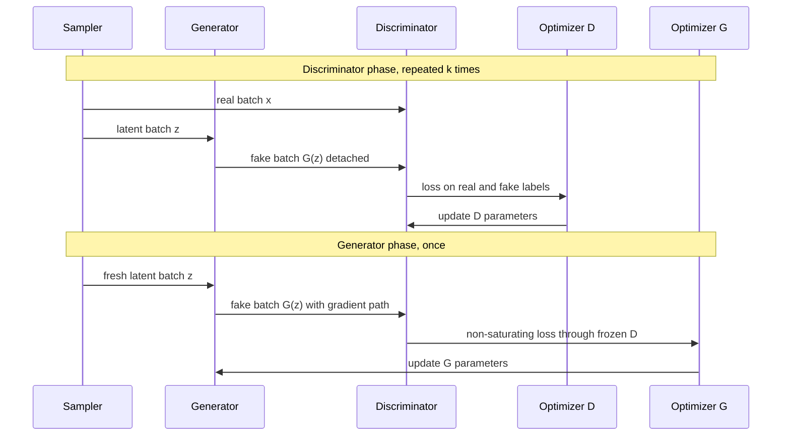

The sequence diagram shows the asymmetry between the phases. In the discriminator phase the fake batch is treated as data, so the gradient stops at the generator output. In the generator phase the same batch is a computation that must be differentiated through the discriminator, so the gradient reaches the generator's parameters. The two optimizers hold separate states, such as Adam moment estimates, and it is normal for them to use different learning rates, which is the basis of the two-timescale update rule discussed in Section 6.5.

### 6.2 Why this is not gradient descent on a loss

Minimizing a single loss with gradient descent has a guarantee that is easy to forget: for a small enough step size, the loss goes down at every step. A GAN has two losses, and the update direction is the pair of gradients $(\nabla_\theta \mathcal{L}_G, \nabla_\phi \mathcal{L}_D)$, with each player treating the other as fixed. That vector field does not point downhill for any single function. Its dynamics can include rotation, which is the source of oscillation.

The standard minimal example is the bilinear game. Let one player control $x \in \mathbb{R}$ and the other control $y \in \mathbb{R}$, and let the game be $\min_x \max_y\, xy$. The unique equilibrium is $(0, 0)$. Simultaneous gradient steps with step size $\eta$ are

$$
x_{t+1} = x_t - \eta\, y_t, \qquad y_{t+1} = y_t + \eta\, x_t.
$$

The squared distance from the equilibrium after one step is

$$
x_{t+1}^2 + y_{t+1}^2 = (x_t - \eta y_t)^2 + (y_t + \eta x_t)^2 = (1 + \eta^2)\,(x_t^2 + y_t^2).
$$

The cross terms cancel and the distance grows by the factor $1 + \eta^2$ every step, regardless of how small $\eta$ is. With $\eta = 0.1$ the squared radius grows by 1.01 per step, so after 100 steps it has grown by $1.01^{100} \approx 2.70$ and the radius by about $1.645$. The iterates spiral outward forever. Making the learning rate smaller delays the divergence but does not remove it.

If the second player uses the first player's updated value, $x_{t+1} = x_t - \eta y_t$ and then $y_{t+1} = y_t + \eta x_{t+1}$, the update matrix is $\begin{pmatrix} 1 & -\eta \\ \eta & 1 - \eta^2 \end{pmatrix}$, which has determinant $1$ and trace $2 - \eta^2$. For $\eta < 2$ the trace has absolute value less than 2, so the eigenvalues are complex numbers of unit magnitude, and the iterates orbit the equilibrium on an ellipse without growing or shrinking. Alternating updates therefore convert a spiral into a closed orbit, which is better but still does not converge. Practical GAN training sits between these two cases, and what saves it in practice is a mix of the minibatch noise, the non-linearity of the networks, and the explicit stabilizers below.

The bilinear game is a toy, but its lesson carries: the dynamics of a game are governed by the eigenvalues of the game's update map, and imaginary parts cause cycling. Mescheder, Geiger and Nowozin (2018) analyzed GAN training in this way and showed that the standard GAN dynamics can fail to converge even when an equilibrium exists. They proposed a penalty on the discriminator's gradient at real data, the $R_1$ regularizer (Section 15.3), which adds the damping that the bilinear example lacks.

### 6.3 Regimes of training

In practice, a training run passes through recognizable regimes. The state machine below summarizes them and the signals that identify each. The signals are developed in Section 15.

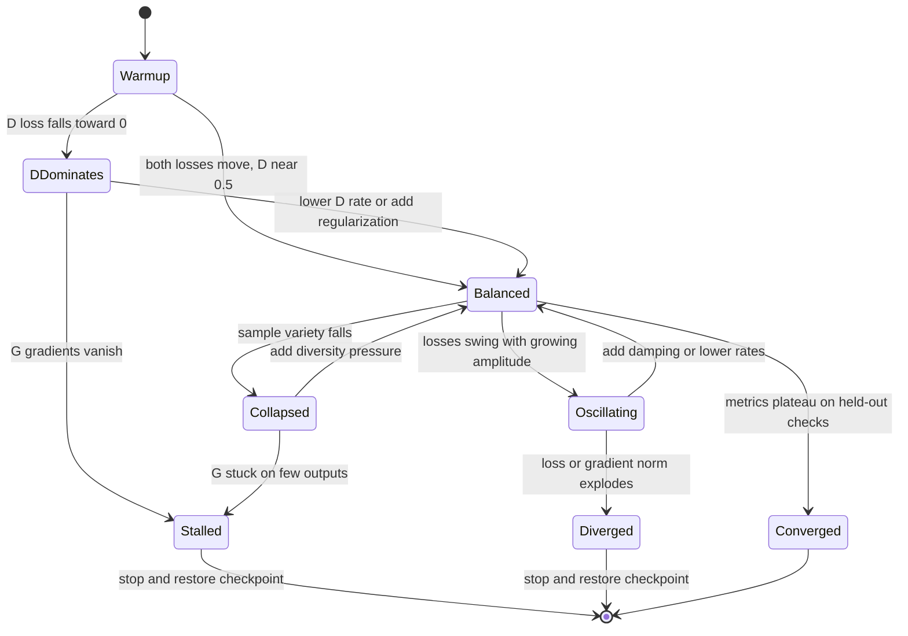

A healthy run lives mostly in Balanced and ends in Converged, which means the quality and coverage metrics have stopped improving, not that the losses have stopped moving. The unhealthy regimes have different remedies, so naming the regime is the first step. A run that has entered Stalled or Diverged rarely recovers without intervention, so the practical operating rule is to checkpoint frequently, keep the best checkpoint by a held-out metric rather than the latest one, and have an automatic stop for non-finite values.

### 6.4 When the discriminator is too strong or too weak

The discriminator loss gives a rough reading of balance. With the cross-entropy loss, a discriminator that cannot separate real from fake outputs $0.5$ everywhere, and its loss on a balanced batch is $-\log 0.5 - \log 0.5 = 2\log 2 = 1.386$ nats, using the sum of the two class terms, or $0.693$ per class term. A discriminator that wins completely has loss approaching 0. The generator loss under the non-saturating form is $-\log D(G(z))$, which equals $0.693$ when $D = 0.5$ and rises as $D$ falls.

| Observation | Likely reading | First checks |
| --- | --- | --- |
| D loss near 0, G loss rising steadily | D is too strong, G gradients are weak or noisy | Lower D learning rate, reduce D steps, add instance noise or gradient penalty |
| D loss pinned near 1.386, G loss near 0.693, samples poor | D is too weak or has no useful features | Increase D capacity or learning rate, check data scaling and input normalization |
| Both losses oscillate with growing amplitude | Rotational dynamics, learning rate too high | Lower rates, add $R_1$, use alternating updates and EMA |
| Both losses flat and near the balanced values, samples good | Healthy, or an uninformative loss | Check metrics, not losses |
| G loss falls sharply while D loss rises | G found an exploit that D has not yet learned to detect | Inspect samples for a shared artifact, check for D overfitting |

The toy run in Section 14 sits in the fourth row's "healthy" case: the discriminator loss settles at $1.379$, close to the theoretical $1.386$, and the generator loss at $0.71$, close to $0.693$. That is what the equilibrium looks like when everything works, and it also shows how little the loss curves reveal, since the same values would appear for a generator that has collapsed to a single mode that the discriminator cannot yet separate.

### 6.5 Two-timescale updates and unequal step counts

Two knobs set how fast each player moves relative to the other. The first is the step ratio $k$: how many discriminator steps per generator step. The second is the learning rate of each network. The two-timescale update rule (TTUR) of Heusel and colleagues (2017) uses a **higher learning rate for the discriminator than for the generator**, for example $4 \times 10^{-4}$ and $1 \times 10^{-4}$, with one step of each per iteration. Their analysis shows that under two timescales the pair converges to a local Nash equilibrium under assumptions stated in the paper, because the faster player effectively tracks the best response to the slower one. SAGAN and BigGAN adopted TTUR, and it is a common default when training with a hinge loss and spectral normalization.

The two knobs are not interchangeable. Taking $k = 5$ discriminator steps per generator step at equal learning rates spends five times as much compute on the discriminator. TTUR achieves a similar effect on the dynamics at the cost of one step each, which saves training time. The choice between them is empirical, and the Wasserstein objective needs $k > 1$ for a different reason: the critic must be close to optimal for its loss to estimate a distance (Section 8).

### 6.6 Why the discriminator overfits

The discriminator is trained on a finite dataset, and a high-capacity network can memorize it. Once the discriminator has memorized the training set, it assigns high scores to training images and low scores to anything else, including new samples from a perfect generator. The generator then receives a gradient that pushes it toward reproducing the training images exactly. This is a route to memorization (Section 24) and also to divergence. Karras and colleagues (2020) showed that on datasets of a few thousand images the discriminator overfits early, its accuracy on held-out real images falls, and sample quality degrades afterward. Section 16 describes the augmentation approach that addresses this.

## 7. DCGAN: The First Reliable Convolutional Recipe

The 2014 paper used fully connected networks on small images. Radford, Metz and Chintala (2016) proposed a set of architectural guidelines for convolutional GANs, which made training work reliably across datasets. Their rules are still the baseline that people start from.

1. **Replace pooling with strided convolutions.** In the discriminator, use strided convolutions to downsample, so that the network learns its own downsampling. In the generator, use fractionally-strided (transposed) convolutions to upsample.
2. **Use batch normalization in both networks, except the generator output layer and the discriminator input layer.** Normalization stabilizes the flow of gradients and prevents the generator from collapsing all samples to one point early in training. Applying it to the output and input layers makes the sample distribution wrong at the interfaces, which caused oscillation in their experiments.
3. **Remove fully connected hidden layers.** Use global features only at the ends, with a fully convolutional body in between.
4. **Use ReLU in the generator for all layers except the output, which uses Tanh.** Tanh bounds the output to $[-1, 1]$, so the real images must be scaled to the same range.
5. **Use LeakyReLU in the discriminator for all layers.** A leaky activation lets some gradient pass for negative pre-activations, which keeps gradients flowing to the generator.

Training details from the same paper that are still common are: Adam with learning rate $2 \times 10^{-4}$, first-moment decay $\beta_1 = 0.5$ (lower than Adam's usual 0.9, to reduce momentum which promotes oscillation), and weight initialization from $\mathcal{N}(0, 0.02^2)$.

**Worked architecture.** A widely used PyTorch implementation for $64 \times 64$ RGB images has a latent vector $z \in \mathbb{R}^{100}$, and the generator uses four transposed convolutions with kernel size 4, stride 2, and padding 1. The spatial output size of a transposed convolution is $(n_{\text{in}} - 1)\cdot s - 2p + k = (n_{\text{in}} - 1)\cdot 2 - 2 + 4 = 2 n_{\text{in}}$, so each layer doubles the resolution. The first layer maps the $100 \times 1 \times 1$ latent to a $512 \times 4 \times 4$ tensor with a kernel-4, stride-1, no-padding transposed convolution, and the following four layers take it from $4 \times 4$ to $8, 16, 32$ and finally $64$ pixels. The channel widths are $512, 256, 128, 64, 3$. The parameter count of the convolutions is the product of input channels, output channels, and kernel area:

$$
100\cdot512\cdot16 + 512\cdot256\cdot16 + 256\cdot128\cdot16 + 128\cdot64\cdot16 + 64\cdot3\cdot16 = 819{,}200 + 2{,}097{,}152 + 524{,}288 + 131{,}072 + 3{,}072 = 3{,}574{,}784.
$$

Adding batch-normalization scale and shift parameters for 512, 256, 128 and 64 channels, $2 \times 960 = 1{,}920$, gives $3{,}576{,}704$ parameters. That is small by modern standards, which is why DCGAN trains in minutes on a single GPU on a $64 \times 64$ dataset and is the right size for teaching and for quick experiments.

**Limitations that later work addressed.** Transposed convolutions with a kernel size that is not divisible by the stride produce uneven overlap and visible checkerboard patterns (Odena, Dumoulin and Olah, 2016). The common fix is to upsample with nearest-neighbor interpolation and follow with an ordinary convolution, which StyleGAN also uses. Batch normalization couples the samples in a batch, which is incompatible with a per-sample gradient penalty (Section 8.4), so WGAN-GP critics use layer normalization or no normalization. The 2016 rules solved the problem for small images on simple data; they did not make training reliable at high resolution or on diverse datasets, which is why the later techniques exist.

## 8. Wasserstein GAN and WGAN-GP

### 8.1 A distance that stays informative

Section 5.3 showed that the JSD is constant for distributions with disjoint supports. The Wasserstein-1 distance, also called the Earth Mover distance, instead measures how far one distribution would have to be moved to become the other, and it keeps shrinking as the distributions approach each other even when they do not overlap.

Formally, for two distributions $P$ and $Q$ on a metric space, let $\Pi(P, Q)$ be the set of joint distributions (called couplings or transport plans) whose marginals are $P$ and $Q$. The Wasserstein-1 distance is

$$
W_1(P, Q) = \inf_{\gamma \in \Pi(P, Q)} \; \mathbb{E}_{(x, y) \sim \gamma}\big[\lVert x - y \rVert\big].
$$

The symbol $\inf$ is the infimum, the smallest value over all plans. Picture $P$ as piles of earth and $Q$ as holes of the same total volume. A plan says how much earth to move from each pile to each hole, and the cost is the amount moved multiplied by the distance. $W_1$ is the cost of the cheapest plan.

**Worked example in one dimension.** Let $P$ put mass $0.5$ at $x = 0$ and $0.5$ at $x = 1$, and let $Q$ put mass $0.5$ at $x = 2$ and $0.5$ at $x = 3$. One plan moves the pile at 0 to 2 and the pile at 1 to 3. Each unit of mass moves distance 2, so the cost is $0.5\cdot2 + 0.5\cdot2 = 2$. For one-dimensional distributions there is a closed form, $W_1 = \int \lvert F_P(x) - F_Q(x) \rvert\, dx$, where $F$ is the cumulative distribution function. Here $\lvert F_P - F_Q \rvert$ is $0.5$ on $[0, 1)$, $1$ on $[1, 2)$ and $0.5$ on $[2, 3)$, which integrates to $0.5 + 1 + 0.5 = 2$. The two calculations agree.

**Back to the point masses.** For $P = \delta_0$ and $Q = \delta_\theta$ there is only one plan, move everything distance $\lvert\theta\rvert$, so $W_1 = \lvert\theta\rvert$. The table shows how the two measures behave as the generator approaches the data.

| Offset $\theta$ | $\mathrm{JSD}$ | $W_1$ |
| --- | --- | --- |
| 5.0 | 0.6931 | 5.0 |
| 1.0 | 0.6931 | 1.0 |
| 0.1 | 0.6931 | 0.1 |

The JSD does not change. The Wasserstein distance falls linearly, so its gradient with respect to $\theta$ is a constant of magnitude 1 that points the generator toward the data, which is the kind of signal the generator needs. Arjovsky, Chintala and Bottou (2017) built the Wasserstein GAN (WGAN) on this property.

### 8.2 The critic and Lipschitz constraint

The infimum over plans is not computable directly in high dimensions. The Kantorovich-Rubinstein duality turns it into a supremum over functions:

$$
W_1(P, Q) = \sup_{\lVert f \rVert_L \leq 1} \; \mathbb{E}_{x \sim P}[f(x)] - \mathbb{E}_{x \sim Q}[f(x)].
$$

The condition $\lVert f \rVert_L \leq 1$ says that $f$ is 1-Lipschitz: for all $x, x'$, $\lvert f(x) - f(x') \rvert \leq \lVert x - x' \rVert$, so $f$ cannot change faster than the distance between inputs. A function with this property has a gradient of norm at most 1 wherever the gradient exists. Intuitively, the best $f$ assigns high values to samples of $P$, low values to samples of $Q$, and is as steep as the Lipschitz limit allows between them.

WGAN replaces the discriminator with a **critic** $f_w$, a network that outputs an unbounded real score and has no sigmoid. The critic is trained to maximize $\mathbb{E}_{x \sim p_{\text{data}}}[f_w(x)] - \mathbb{E}_{z}[f_w(G(z))]$ subject to the Lipschitz constraint, which approximates $W_1$ between the data and generator distributions. The generator minimizes $-\mathbb{E}_z[f_w(G(z))]$. Three practical differences follow.

1. The critic output is a score, not a probability, so there is no saturating sigmoid and no logarithm.
2. The critic should be trained close to optimality at each generator step, because its objective estimates a distance only when it is near the supremum. This is why WGAN uses about five critic steps per generator step. In the original paper the learning rate was small and the optimizer was RMSProp, because momentum-based optimizers such as Adam were unstable with weight clipping.
3. The critic loss correlates with sample quality. As the generator improves, the estimated distance decreases, so the loss curve is informative in a way that the standard GAN loss is not. This is a real advantage, but the correlation is imperfect when the Lipschitz constraint is only approximately enforced.

### 8.3 Weight clipping and its problems

The original WGAN enforced the Lipschitz constraint crudely: after every critic update, clip every weight to a small interval such as $[-0.01, 0.01]$. Bounded weights give a bounded Lipschitz constant for a network with Lipschitz activations. The authors themselves called this a "terrible way" to enforce the constraint. Clipping biases the critic toward simple functions, because most weights saturate at the clipping bounds, and the choice of the clip value interacts with depth. A value that is too large makes training slow to reach optimality and a value too small makes gradients vanish through the layers.

### 8.4 The gradient penalty

Gulrajani and colleagues (2017) proposed WGAN-GP, which replaces clipping with a soft penalty. A differentiable function is 1-Lipschitz if and only if its gradient norm is at most 1 everywhere. The penalty pushes the gradient norm toward 1 at points sampled between real and generated data:

$$
\mathcal{L}_{\text{critic}} = \mathbb{E}_{z}\big[f(G(z))\big] - \mathbb{E}_{x \sim p_{\text{data}}}\big[f(x)\big] + \lambda\, \mathbb{E}_{\hat{x}}\Big[\big(\lVert \nabla_{\hat{x}} f(\hat{x}) \rVert_2 - 1\big)^2\Big], \qquad \hat{x} = \epsilon\, x + (1 - \epsilon)\, G(z),
$$

with $\epsilon \sim \mathrm{Uniform}(0, 1)$ drawn independently per sample and $\lambda = 10$ in the paper. The interpolation $\hat{x}$ is a random point on the line segment between a real sample and a generated one.

Two choices in this formula deserve explanation. The penalty is **two-sided**, pulling the norm toward 1 rather than only below 1. The reason is that the optimal critic of the dual problem has gradient norm exactly 1 almost everywhere along the straight lines connecting points that the optimal transport plan pairs together, so a norm below 1 is a loss of critic power, not a safe condition. The penalty is evaluated on **interpolated points** because enforcing the constraint on the whole space is infeasible, and the region between real and fake samples is where the critic's gradient matters for the generator.

**Worked penalty.** Suppose a minibatch of three interpolates gives critic gradient norms $0.8$, $1.0$, and $1.5$ with $\lambda = 10$. The per-sample penalties are $10(0.8 - 1)^2 = 0.4$, $10(1.0 - 1)^2 = 0$, and $10(1.5 - 1)^2 = 2.5$, so the mean penalty is $(0.4 + 0 + 2.5)/3 = 0.967$. A critic that is linear, $f(x) = w^\top x$, has gradient $w$ everywhere. For $w = (3, 4)$ the norm is $5$ and the penalty is $10(5 - 1)^2 = 160$; for $w = (0.6, 0.8)$ the norm is $1$ and the penalty is zero.

**Practical requirements.**

- The penalty is computed for each sample independently, so the critic must not use batch normalization, which mixes information between samples. Layer normalization or no normalization is typical.
- The penalty requires differentiating a gradient, a second-order derivative or double backpropagation. This costs more time and memory per critic step than a plain loss, and some framework operations, for example certain fused kernels, do not support it.
- The paper recommends Adam with a low or zero first-moment decay for the critic, in contrast to the high momentum default.

### 8.5 When to use it, and what it does not fix

WGAN-GP made GAN training much more forgiving across architectures, and it is a sound choice when you have a small team, a new data type, and no recipe to copy. It does not remove the need for evaluation. The Lipschitz constraint is enforced only at sampled interpolates, the critic loss is a noisy estimator of the distance, and coverage can still be uneven. Later work, including spectral normalization and the zero-centered penalties in Section 9, achieves similar stability with different trade-offs and is more common in state-of-the-art image GANs.

## 9. Spectral Normalization, Hinge Loss, and Relativistic Losses

### 9.1 Spectral normalization

A feed-forward network $f = f_L \circ \dots \circ f_1$ with 1-Lipschitz activations such as ReLU and LeakyReLU has a Lipschitz constant bounded by the product of the spectral norms of its weight matrices, $\prod_l \sigma(W_l)$. The spectral norm $\sigma(W)$ is the largest singular value of $W$, which is the largest factor by which $W$ can stretch a vector. Miyato and colleagues (2018) proposed to divide each weight matrix by its spectral norm,

$$
\bar{W} = \frac{W}{\sigma(W)},
$$

so every layer has spectral norm exactly 1 and the whole network is at most 1-Lipschitz. This needs no extra loss term and no second backward pass.

Computing a full singular value decomposition at every step would be too expensive. Instead, spectral normalization keeps a running estimate of the leading singular vectors and applies one step of **power iteration** per training step, since the weights change slowly between steps. Power iteration alternates $v \leftarrow W^\top u / \lVert W^\top u \rVert$ and $u \leftarrow W v / \lVert W v \rVert$, after which $\sigma(W) \approx u^\top W v$. The cost is two matrix-vector products per layer.

**Worked example.** For $W = \begin{pmatrix} 3 & 0 \\ 4 & 5 \end{pmatrix}$, $W^\top W = \begin{pmatrix} 25 & 20 \\ 20 & 25 \end{pmatrix}$ has eigenvalues $45$ and $5$, so $\sigma(W) = \sqrt{45} \approx 6.708$. Starting from $u = (1, 1)$, fifty power iterations in `02_gan_theory_numbers.py` return $6.7082$, matching the exact value. Dividing $W$ by it yields a matrix whose largest stretch is exactly 1.

Spectral normalization is applied to the discriminator in most modern conditional GANs (SN-GAN, SAGAN, BigGAN) and sometimes to the generator. Its main advantage over the gradient penalty is cost and simplicity. Its main limit is that the product of per-layer norms is an upper bound on the network's Lipschitz constant and can be loose, so the discriminator may be more constrained than the objective requires.

### 9.2 Hinge loss

The hinge loss borrows the margin idea from support vector machines. With an unbounded discriminator score $D$:

$$
\mathcal{L}_D = \mathbb{E}_{x}\big[\max(0,\, 1 - D(x))\big] + \mathbb{E}_{z}\big[\max(0,\, 1 + D(G(z)))\big], \qquad \mathcal{L}_G = -\mathbb{E}_{z}\big[D(G(z))\big].
$$

The discriminator is penalized for scoring a real sample below $+1$ or a fake sample above $-1$, and it receives no gradient from samples that already satisfy the margin. The generator simply maximizes the score of its samples. **Worked numbers.** A real sample with score $0.4$ contributes $1 - 0.4 = 0.6$ to the loss, and one with score $1.3$ contributes $0$. A fake with score $-0.2$ contributes $1 + (-0.2) = 0.8$, and one with score $-1.5$ contributes $0$. The effect is that the discriminator stops spending capacity on examples it already separates and focuses on the hard ones. Hinge loss with spectral normalization and TTUR is a standard combination in SAGAN and BigGAN.

### 9.3 Relativistic losses

A standard discriminator judges each sample in isolation: is this real? Jolicoeur-Martineau (2019) observed that in a minibatch where half the samples are real by construction, the generator's progress should also lower the probability that real samples are real. The relativistic standard GAN (RSGAN) and the relativistic pairing GAN (RpGAN) instead ask whether a real sample is more realistic than a generated one. With a critic score $D$ and $f(t) = \log(1 + e^{t})$, the pairing form of the discriminator loss is

$$
\mathcal{L}_D = \mathbb{E}_{x,\, z}\Big[ f\big( D(G(z)) - D(x) \big) \Big],
$$

and the generator uses the symmetric form $\mathbb{E}\big[ f( D(x) - D(G(z)) ) \big]$, so the generator now has access to the real samples through the difference. When the discriminator scores the real sample $5$ higher than the fake, the discriminator loss is $f(-5) = \log(1 + e^{-5}) = 0.0067$, a small value. When it scores them equal, the loss is $\log 2 = 0.693$.

Huang, Gokaslan, Kuleshov and Tompkin (2024) built on RpGAN to create R3GAN. They add zero-centered gradient penalties on both real data ($R_1$) and generated data ($R_2$), prove local convergence for the resulting loss under assumptions stated in their paper, and report that the combination avoids the mode dropping of the standard loss. They then removed many tricks from the StyleGAN2 recipe and used a modernized convolutional backbone, and report results that match or beat StyleGAN2 on several image benchmarks. These are results from a research paper under its own benchmark conditions, so treat them as evidence that GAN training can be simple and principled, not as a guarantee for your data.

### 9.4 Choosing a loss: a decision procedure

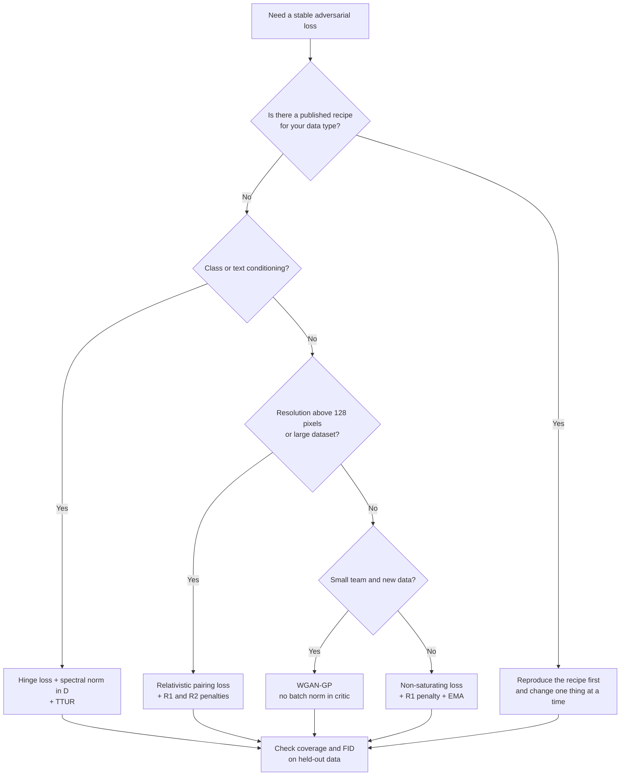

The tree encodes a pragmatic default order, not a ranking of theoretical merit. Reproducing a known recipe has the highest expected value, because the interactions among loss, normalization, learning rates, and architecture are what make GAN training fragile. Where no recipe exists, the tree separates conditional problems, where the hinge-with-spectral-norm combination has the longest record, from unconditional ones. Whatever branch you take, the last step is the same: measure coverage as well as quality on held-out data, as Section 18 describes. The losses differ in stability on your data, and the only way to know is to test them.

## 10. Conditional GANs

### 10.1 Why condition

An unconditional GAN generates a sample from the whole data distribution, and the user has no way to ask for a particular kind. Most product uses need control: a product image in a given category, a face with a given attribute, an image that matches a sketch, a tabular row with a given class. Conditioning supplies extra information $c$ to the model, so it represents $p(x \mid c)$. Mirza and Osindero (2014) introduced the conditional GAN (cGAN) by feeding $c$ to both networks. The objective becomes

$$
\min_G \max_D \; \mathbb{E}_{x, c}\big[\log D(x, c)\big] + \mathbb{E}_{z, c}\big[\log\big(1 - D(G(z, c), c)\big)\big].
$$

Both networks receive the condition. This matters more than it looks. If only the generator saw $c$, the discriminator would judge whether a sample looks real in general, and the generator could produce realistic images that ignore $c$ without penalty. Giving $c$ to the discriminator turns "is this real?" into "is this a real example of this condition?" and creates the pressure that makes the generator obey.

### 10.2 Ways to inject the condition

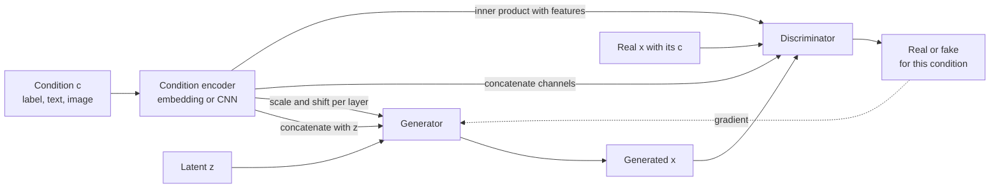

The diagram shows the common injection points. The right choice depends on the type of condition.

- **Concatenation.** Append a one-hot label or an embedding to the latent vector for the generator, and append it as extra channels or features for the discriminator. This is the simplest option and works for small label sets.
- **Conditional normalization.** Replace the scale and shift parameters of a normalization layer with functions of the condition, so each class has its own affine transform in every layer. Conditional batch normalization (de Vries et al., 2017; Dumoulin et al., 2017) is used in BigGAN, and the StyleGAN family generalizes the idea (Section 12).
- **Projection discriminator.** Miyato and Koyama (2018) computed the conditional discriminator score as an unconditional term plus the inner product between a learned class embedding and the image features, $D(x, y) = \psi(\phi(x)) + y^\top V \phi(x)$. This gives the class label a direct, low-capacity route into the decision and works better than concatenation on large label sets.
- **Auxiliary classifier (AC-GAN).** Odena, Olah and Shlens (2017) kept the discriminator unconditional but added a classification head. The discriminator both separates real from fake and predicts the class, and the generator is rewarded when generated images are classified as the requested class. The extra loss term is the classification log-likelihood on both real and generated samples. AC-GAN is easy to add, but generated samples tend to be easy to classify and less diverse within each class, which is one reason projection discriminators replaced it in high-quality work.
- **Spatial conditions.** When the condition is an image, such as an edge map or a semantic label map, the generator takes it as input to a convolutional encoder, and the discriminator sees the condition and the output stacked along the channel dimension. Pix2Pix (Section 11) is the main example.
- **Text.** Text conditions pass through a pretrained text encoder, and the embedding enters through conditional normalization or cross-attention. Text-to-image GANs exist, for example GigaGAN, but this is the area where diffusion models moved ahead most clearly, and [CH23](CH23_Multimodal_Generative_AI.md) covers multimodal systems.

### 10.3 Failure modes specific to conditioning

**Ignored conditions.** The generator can learn to produce realistic samples that disregard $c$, particularly when the discriminator does not use $c$ well or when the condition is weakly correlated with the data. The symptom is high quality with low adherence.

**Class leakage and imbalance.** If a class has few training examples, the generator may blend it with a neighbor, and the discriminator does not have enough examples to push back. The symptom is correct-looking samples with the wrong attributes for rare classes, which is a fairness concern as well as a quality one.

**Entangled attributes.** If two attributes always co-occur in the data, such as a hat and a certain background, the generator cannot produce one without the other when asked. Conditioning on one attribute drags the other along.

**Adherence test.** Measure whether the generator obeys the condition with an independent evaluator. Train a classifier on real data for the conditioned attribute, generate a fixed number of samples for each requested condition, and measure how often the evaluator agrees with the request. **Worked example.** Request 1,000 samples for each of 10 classes, giving 10,000 samples. The evaluator classifies 9,120 as the requested class, so raw adherence is $9{,}120 / 10{,}000 = 91.2\%$. The evaluator itself scores $95.0\%$ on held-out real images, so even a perfect generator would score near 95%. The relevant figure is the ratio to the real baseline, $91.2 / 95.0 = 0.96$. Report the per-class table as well, because a class with 60% adherence and nine with 95% average to 91.5% and hide the problem. The illustrative numbers in this example are not from a real model.

## 11. Image-to-Image Translation: Pix2Pix and CycleGAN

### 11.1 Pix2Pix: paired translation

Isola, Zhu, Zhou and Efros (2017) used a conditional GAN for tasks where each input image has a known target: edges to photos, label maps to street scenes, day to night. They named it Pix2Pix. Its design has three notable features.

**Loss.** The generator is trained with the sum of a conditional adversarial loss and an $L_1$ (mean absolute error) reconstruction loss against the paired target $y$:

$$
G^{\star} = \arg\min_G \max_D \; \mathcal{L}_{\text{cGAN}}(G, D) + \lambda\, \mathbb{E}_{x, y}\big[\lVert y - G(x) \rVert_1\big], \qquad \lambda = 100.
$$

The $L_1$ term pins down the low-frequency structure: the layout and the colors. The adversarial term supplies the high-frequency detail that $L_1$ alone would blur, because an $L_1$-trained network hedges between plausible outputs by averaging them. $L_1$ is used rather than $L_2$ because it produces less blur.

**Scale of the terms.** The coefficient 100 is large because the two terms have different natural sizes. If the average per-pixel absolute error is $0.1$ on images scaled to $[0, 1]$ or similar, the reconstruction term contributes $100 \times 0.1 = 10$, while the adversarial loss for a balanced discriminator is about $0.7$. The reconstruction term is therefore an order of magnitude larger, and the adversarial term acts as a refinement. If you reduce $\lambda$ the outputs become sharper and less faithful to the input, and if you raise it they become faithful and blurry. The illustrative numbers show why this coefficient needs tuning and why logging each term separately matters.

**PatchGAN discriminator.** Rather than output one number for the entire image, the discriminator is fully convolutional and outputs a grid of real/fake decisions, one per overlapping image patch, which are averaged. It models image statistics at the scale of a patch and assumes pixels separated by more than a patch diameter are independent. The common $70 \times 70$ patch size follows from the layer stack. Working backward from one output unit through five convolutions with kernel size 4, with strides $1, 1, 2, 2, 2$ counted from output to input, the receptive field $r$ updates as $r \leftarrow (r - 1)\cdot s + k$: $1 \to 4 \to 7 \to 16 \to 34 \to 70$. A patch discriminator has fewer parameters than a full-image discriminator, runs on images of any size, and penalizes high-frequency structure, which is exactly the part the $L_1$ term does not cover.

Pix2Pix has limits. It needs paired data, which is expensive or impossible for many tasks. Its output is close to deterministic: the authors found that conditioning on noise $z$ was ignored by the generator, and they supplied randomness through dropout at both training and test time, which gives only slight variation. When the task is truly one-to-many, such as colorization, this under-represents the real diversity.

### 11.2 CycleGAN: unpaired translation

For many problems there are two collections of images without matching pairs: horses and zebras, summer and winter photographs, photographs and paintings in a particular style. Zhu, Park, Isola and Efros (2017) proposed CycleGAN, which learns a mapping $G: X \to Y$ from the first collection to the second without pairs.

An adversarial loss on its own is not enough. A discriminator for $Y$ checks that $G(x)$ looks like a member of $Y$, but it says nothing about the relationship between $x$ and $G(x)$. Any mapping that produces realistic zebras satisfies it, even one that ignores the input horse. CycleGAN adds a second generator $F: Y \to X$ and requires that translating forward and then back returns the original:

$$
\mathcal{L}_{\text{cyc}}(G, F) = \mathbb{E}_{x}\big[\lVert F(G(x)) - x \rVert_1\big] + \mathbb{E}_{y}\big[\lVert G(F(y)) - y \rVert_1\big].
$$

The full objective sums two adversarial losses (a discriminator $D_Y$ for the output of $G$, and $D_X$ for the output of $F$) and the cycle loss with weight $\lambda = 10$:

$$
\mathcal{L} = \mathcal{L}_{\text{GAN}}(G, D_Y) + \mathcal{L}_{\text{GAN}}(F, D_X) + \lambda\, \mathcal{L}_{\text{cyc}}(G, F).
$$

An optional identity loss, $\lVert G(y) - y \rVert_1$ for $y \in Y$, discourages the generator from altering images that are already in the target domain, which helps preserve colors in tasks such as painting to photo.

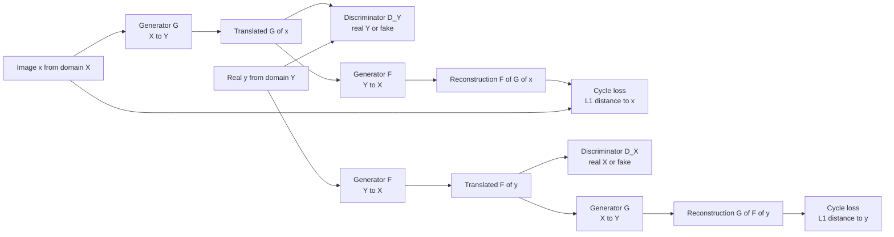

The diagram shows two cycles that share the same pair of generators. The forward cycle starts in domain $X$, translates to $Y$, and translates back. The backward cycle does the same from $Y$. In each cycle the discriminator checks realism of the intermediate image and the cycle loss checks that the round trip is faithful. The cycle constraint forces the translation to preserve enough information about the input to recover it, which excludes the degenerate mapping that ignores the input.

**Worked cycle loss.** Take a three-pixel input $x = (0.2, 0.8, 0.5)$ and a round trip $F(G(x)) = (0.25, 0.7, 0.5)$. The absolute errors are $0.05$, $0.10$ and $0$, so the mean $L_1$ distance is $0.15/3 = 0.05$. With $\lambda = 10$ this term contributes $0.5$ to the loss, comparable in size to an adversarial term near 0.7. In CycleGAN the balance is set by $\lambda$, and a larger $\lambda$ enforces stronger fidelity to the input at the expense of the amount of change.

### 11.3 What cycle consistency does not guarantee

The cycle loss prevents the worst degeneracy but leaves real problems.

- **Hidden information.** A generator can satisfy the cycle loss by encoding information about the input in a very small, high-frequency perturbation of the output, which the reverse generator decodes. Chu, Zhmoginov and Sandler (2017) showed that CycleGAN can hide input details this way, a form of steganography. The output looks like a normal translation, but the pair of generators is cheating. This makes the translated image fragile to compression and filtering.
- **Hallucinated content.** Distribution matching can add or remove features that are plausible for the target domain but absent from the source. Cohen, Luck and Honari (2018) demonstrated this for medical image translation, where a network trained with unbalanced data could add or remove tumor-like structure. For any setting where the translated content informs a decision, an adversarial translator is a source of fabricated evidence, and its output must not be treated as a measurement.
- **Geometric change.** Both generators are convolutional networks with limited ability to move objects or change shape. Texture and color transformations work well, and changes in shape, such as turning a cat into a dog, usually fail.
- **Unbalanced domains.** If one domain has a feature (say, a particular background) that the other lacks, the translation may leak or erase it.

| Property | Paired (Pix2Pix) | Unpaired (CycleGAN) |
| --- | --- | --- |
| Data needed | Aligned input-output pairs | Two unaligned collections |
| Supervision | Direct $L_1$ target | Cycle consistency only |
| Fidelity to the input | High, set by $\lambda$ | Moderate, no per-pixel truth |
| Risk of fabricated content | Lower | Higher |
| Cost to obtain data | High when pairing is manual | Low |
| Typical fit | Sketch to image, segmentation to image, restoration with synthetic pairs | Style transfer, season change, domain adaptation |

The decision rule is simple. If you can create pairs, even synthetically (for example by degrading clean images to build restoration pairs), use a paired method, because direct supervision is stronger than a statistical constraint. Use unpaired translation when pairs cannot be obtained, and then validate on held-out ground truth wherever it exists, because the training loss cannot tell you whether the translation is faithful.

## 12. Progressive Growing and the StyleGAN Family

### 12.1 The problem with high resolution

Generating a $1024 \times 1024$ image means producing about one million pixels, each with three channels, from a latent vector of a few hundred numbers. At this scale a discriminator separates real from fake very easily, because high-resolution images have a very sparse support (Section 5.3), and gradients from an early-training generator are weak. Training from scratch at high resolution was unstable and slow.

### 12.2 Progressive growing

Karras, Aila, Laine and Lehtinen (2018) trained the generator and discriminator on small images first and grew both networks one resolution step at a time. Training starts at $4 \times 4$, which captures only the coarse layout. After training at each resolution, a new layer is added to each network that doubles the spatial size, up to $1024 \times 1024$, which is eight doublings and nine stages from $4 \times 4$ to $1024 \times 1024$.

A new layer is introduced gradually. During a fade-in period, the generator output is a blend of the upsampled output from the previous resolution and the output from the new layer, weighted by $\alpha$, which rises linearly from 0 to 1:

$$
\text{out} = (1 - \alpha)\cdot\text{upsample}(\text{rgb}_{\text{old}}) + \alpha\cdot\text{rgb}_{\text{new}}.
$$

With $\alpha = 0.25$, an old-resolution pixel value of $0.8$ and a new-layer value of $0.4$ blend to $0.75 \times 0.8 + 0.25 \times 0.4 = 0.7$. The discriminator mirrors this. The fade-in avoids a sudden shock to the pre-trained earlier layers when new randomly initialized layers appear.

The benefits are speed and stability. Early stages are cheap, because the images are small, and coarse structure is learned before fine detail. Progressive growing also introduced several details that outlived the technique:

- **Minibatch standard deviation.** A layer near the end of the discriminator computes the standard deviation of each feature across the minibatch, averages it into a single number, and appends it as an extra feature map. A batch of collapsed samples has low standard deviation, so the discriminator can detect low diversity and the generator is pushed to vary its outputs.
- **Equalized learning rate.** Weights are initialized from a unit Gaussian and scaled by a per-layer constant at run time, so that adaptive optimizers such as Adam update every layer at the same relative rate.
- **Pixel-wise feature normalization** in the generator, which keeps feature magnitudes from escalating.

Later versions (StyleGAN2 and beyond) dropped progressive growing in favor of fixed architectures with skip or residual connections, because growing can cause artifacts that depend on the fade schedule, and a fixed design is easier to maintain. The ideas of minibatch standard deviation and equalized learning rate remained.

### 12.3 StyleGAN: a mapping network and style injection

A conventional generator feeds the latent $z$ into the first layer. Karras, Laine and Aila (2019) redesigned this around two ideas.

**Mapping network.** A multilayer perceptron with eight layers maps $z$ to an intermediate latent $w$. The input space $\mathcal{Z}$ must follow a fixed distribution, a standard Gaussian, but the true factors of variation in the data are not Gaussian and not independent (for example, certain hair styles associated with certain genders). Forcing a Gaussian to cover that structure forces the generator to warp the space and entangles factors. The mapping network lets the intermediate space $\mathcal{W}$ take whatever shape the data needs, and the authors measured it to be less entangled than $\mathcal{Z}$ using perceptual path length and a linear separability test.

**Style injection.** The synthesis network starts from a learned constant tensor ($4 \times 4 \times 512$) rather than from $z$. The vector $w$ goes through a learned affine transform per layer to produce a **style**, which controls the feature maps through adaptive instance normalization (AdaIN):

$$
\mathrm{AdaIN}(x_i, y) = y_{s,i}\,\frac{x_i - \mu(x_i)}{\sigma(x_i)} + y_{b,i}.
$$

Here $x_i$ is the $i$-th feature map, $\mu$ and $\sigma$ are its spatial mean and standard deviation, and $y_s, y_b$ are the style's scale and bias for that channel. Each feature map is normalized and then rescaled and shifted by values derived from $w$. Different layers receive different styles. Early layers at low resolution control coarse attributes such as pose and face shape. Middle layers control finer facial features, and late layers control color scheme and microstructure. Per-pixel noise is added at each layer to supply stochastic detail such as the exact placement of hair strands and freckles, separating it from the high-level style.

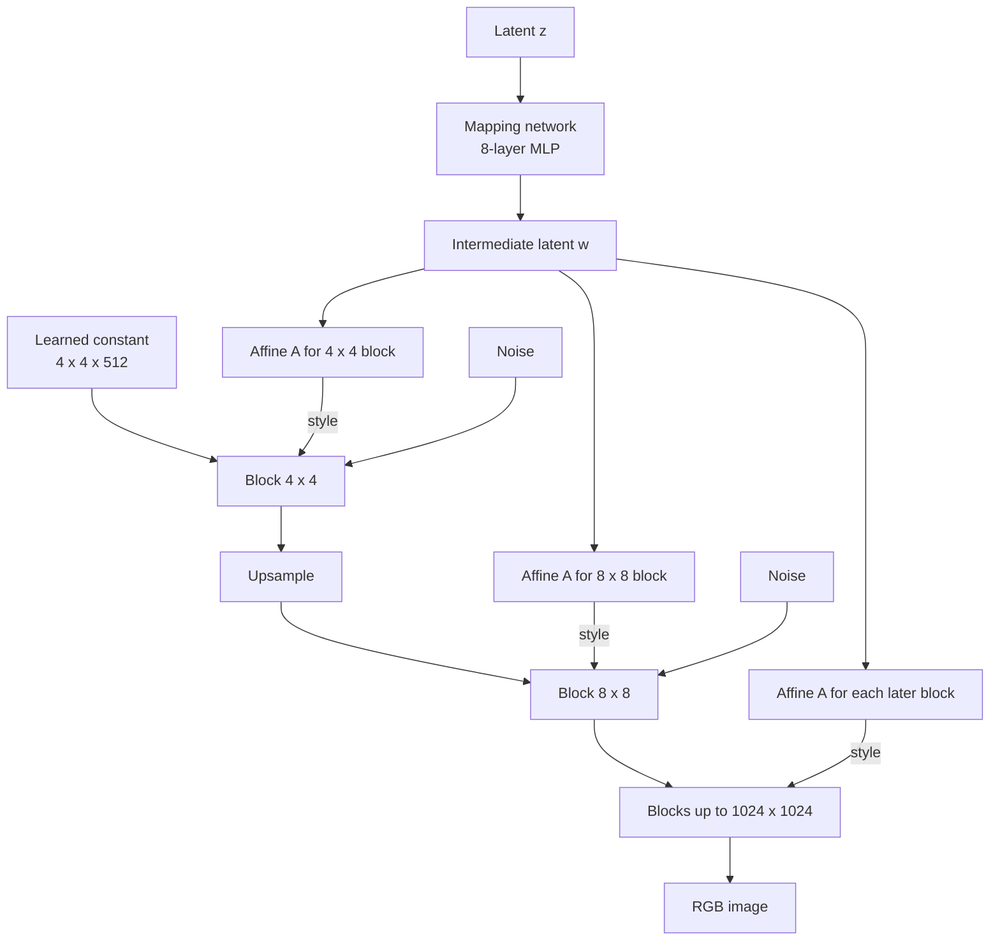

The diagram shows why the architecture is controllable. The latent enters through a side path that feeds every layer, so each resolution level can be steered independently. **Style mixing** exploits this: during training, two latents $w_1$ and $w_2$ are used for different layers of the same image with some probability, which prevents the network from assuming adjacent styles are correlated. At inference you can take the coarse styles from one image and the fine styles from another to compose them.

**Truncation trick.** At sampling time the generator is often given a latent pulled toward the average: $w' = \bar{w} + \psi\,(w - \bar{w})$ with $\psi < 1$, where $\bar{w}$ is the mean of $w$ over many samples. With $\bar{w} = 0$, $w = 2.0$ and $\psi = 0.7$, the truncated value is $1.4$. Samples from the center of the distribution have higher average quality because the generator is trained on dense regions of the latent space, and the truncation trades diversity for fidelity. It is a user-facing knob in BigGAN and StyleGAN. When you evaluate a generator, report the truncation setting, because the same model with different $\psi$ has different FID and different recall.

### 12.4 StyleGAN2, StyleGAN2-ADA, and StyleGAN3

**StyleGAN2** (Karras et al., 2020) fixed characteristic artifacts, blob-like "droplets" in feature maps, that the authors traced to AdaIN normalizing each feature map's statistics separately. They replaced AdaIN with **weight modulation and demodulation**. The style scales the convolution weights, $w'_{ijk} = s_i \cdot w_{ijk}$, where $i$ indexes input channels, $j$ output channels and $k$ spatial positions in the kernel. A demodulation step rescales each output channel so the expected output has unit variance:

$$
w''_{ijk} = \frac{w'_{ijk}}{\sqrt{\sum_{i,k} (w'_{ijk})^2 + \epsilon}}.
$$

**Worked demodulation.** Take one output channel with two input channels, a $1 \times 1$ kernel, base weights $(0.6, 0.8)$ and style scales $(2, 1)$. Modulation gives $(1.2, 0.8)$. The norm is $\sqrt{1.44 + 0.64} = 1.4422$, so the demodulated weights are $(0.832, 0.555)$, and the sum of their squares is $1$, which is what keeps activations at a stable scale without computing statistics from the data. Other StyleGAN2 changes include removing progressive growing, path length regularization that encourages a fixed-size change in the image for a fixed-size change in $w$, and lazy regularization, which applies the $R_1$ penalty only every 16 minibatches to save compute.

**StyleGAN2-ADA** (Karras et al., 2020) targets small datasets with an adaptive discriminator augmentation scheme (Section 16).

**StyleGAN3** (Karras et al., 2021) addressed "texture sticking", where fine details are anchored to pixel coordinates rather than to the surface of the depicted object when the latent is changed smoothly. Their analysis traced it to aliasing in the signal processing of the network, and they redesigned the layers to be alias-free so that details move with the objects. It matters mainly for animation and video.

### 12.5 Latent-space editing and inversion

Because $\mathcal{W}$ is relatively disentangled, simple operations in it have semantic effects. Linear directions in $\mathcal{W}$ change age, smile, or pose. Editing a real photograph requires **inversion**, finding a $w$ whose generated image matches the photograph, by optimization or with an encoder network. This is the origin of many photo-editing tools and also of face-swap and identity-manipulation abuse (Section 25). The GAN has no encoder in its objective, so inversion is an extra step with its own error: a real photograph may lie outside the range of the generator, in which case the best match loses detail.

## 13. Mode Collapse and Mode Dropping

### 13.1 Definitions

A **mode** is a region of high density in the data distribution, such as a class, a pose, a style, or a cluster of customers. Two related failures reduce the number of modes the generator represents.

- **Mode collapse** is the extreme case in which the generator maps many different latent vectors to nearly the same output, or to a very small set of outputs. Full collapse is obvious. Partial collapse, where the generator produces a handful of high-quality outputs with small variations, is common and easy to miss.
- **Mode dropping** is the omission of one or more modes while the others are well covered. A face generator that never produces people with glasses, or a tabular generator that never produces the rare fraud class, has dropped modes.

Both fail the coverage requirement even if every sample looks real. They matter because the dropped modes are often the minority cases, so the model's blind spots are systematically the groups and edge cases that products serve badly.

### 13.2 Causes

Several mechanisms contribute, and they can combine.

**The reverse-KL tendency.** Section 5.2 showed that the non-saturating objective contains a reverse KL term, which penalizes producing unlikely samples much more than it penalizes missing likely ones. With two equally likely data modes, a generator covering one mode pays $\log 2 \approx 0.693$ in reverse KL, whereas the forward KL would be infinite. Nothing in the objective forces coverage.

**The chase between the networks.** The generator is rewarded for finding the points that the discriminator currently scores most "real". If it concentrates on the single best point, the discriminator learns to reject that point, the generator jumps to a different point, and the cycle repeats. In theory the generator should be able to spread out, but in practice with simultaneous updates it can hop among modes without ever covering all of them at once. Metz and colleagues (2017) described this behavior and proposed unrolled GANs, which let the generator see several future discriminator updates.

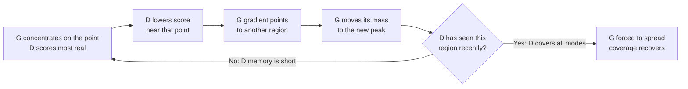

The loop shows why the failure is dynamic rather than static. The generator is not stuck at a single bad point. It is cycling among a few points because the discriminator has a short memory and treats each batch as fresh evidence. A discriminator that sees only one sample at a time cannot tell that the whole batch is the same, which is the motivation for minibatch-level features such as the standard-deviation layer, and for PacGAN (Lin et al., 2018), which feeds the discriminator several samples at once.

**Weak or imbalanced data.** If modes have very different frequencies, the generator receives little reward for a rare one, and the discriminator sees few examples of it.

**Discriminator overfitting.** An overfitted discriminator provides gradients that point to training examples rather than the distribution, which concentrates the generator on a subset (Section 6.6).

### 13.3 A diagnostic procedure

Loss curves cannot detect collapse, so you need a test of the samples. Use several, because each one fails differently.

1. **Fixed-seed grids.** Keep a fixed batch of latent vectors (and conditions) and render the samples at every checkpoint. Collapse appears as the grid converging to repeated images, and a shift between checkpoints shows whether modes appear or disappear.
2. **Within-set diversity.** Compute the average pairwise distance among generated samples in a feature space (for example, Inception or a self-supervised encoder) and compare it with the same quantity for real samples. A ratio well below 1 indicates reduced diversity.
3. **Mode histogram.** If the data has labeled or clusterable modes, assign each generated sample to its nearest mode and compare the histogram with the real one. Compute the effective number of modes $\exp(H)$, where $H = -\sum_k p_k \ln p_k$ is the entropy of the histogram.
4. **Recall.** Use a precision-and-recall metric (Section 18.4) that measures the fraction of real samples that lie within the generator's support.
5. **Birthday-paradox test.** Arora and Zhang (2017) noted that if you draw $s$ samples from a distribution with $N$ equally likely distinct outputs, the expected number of duplicate pairs is about $s(s-1)/(2N)$. If a human reviewer finds a near-duplicate pair among a few hundred generated images, the effective support size is on the order of $s^2/2$. For $s = 400$ and one duplicate pair, $N \approx 400 \times 399 / 2 = 79{,}800$, which suggests the model produces tens of thousands of distinct outputs, which may be well below the number of distinct images in the training set.

**Worked example.** The script `03_gan_metrics_and_privacy.py` builds a real distribution with four equally likely modes and compares generators. The "good" generator places $(129, 133, 128, 108)$ samples on the four modes, with an entropy of $1.383$ nats, so the effective number of modes is $\exp(1.383) = 3.99$. A "collapsed" generator places $(254, 239, 0, 0)$, an entropy of $0.693$, which corresponds to $2.00$ effective modes. Its improved recall is $0.47$ against $0.95$ for the good generator, and its FID is $4.09$ against $0.03$. Precision, which asks whether each sample looks real, is $0.98$ for the collapsed generator, higher than for the good one, which is the signature of mode dropping: fidelity is intact and coverage is not.

### 13.4 Remedies

| Technique | What it changes | Cost and caveat |
| --- | --- | --- |
| Minibatch standard deviation or minibatch discrimination | Gives the discriminator a way to detect lack of diversity | Small cost. Detects collapse within a batch, but not mode dropping across batches. |
| PacGAN | Discriminator sees packs of several samples | Larger discriminator input. Theoretical justification for mode dropping. |
| Unrolled GAN | Generator differentiates through future discriminator steps | Several times more compute per generator step. Rarely used at scale. |
| WGAN-GP, R1, R2 penalties | Smoother discriminator and better gradients | Extra backward pass. Improves stability more than coverage in isolation. |
| Relativistic loss with R1 and R2 | Removes known mode-dropping local minima of the standard loss | Reported by Huang et al. (2024) under their benchmark conditions. |
| Mode-seeking regularization | Penalizes similar outputs for different latents in conditional models | Extra hyperparameter. Works for conditional generation. |
| Balanced sampling or reweighting | Gives rare modes more training signal | Changes the distribution the generator matches. Document the change. |
| Truncation (at inference) | Trades diversity for quality | Increases collapse in outputs on purpose. Use with care in coverage-sensitive uses. |

No technique removes mode dropping by itself. The practice is to combine a stable loss with a diagnostic that tests coverage and to monitor it at every checkpoint, since a technique that works on one dataset may not work on another.

## 14. A Minimal GAN on Two-Dimensional Data

### 14.1 Setup

The script [`01_toy_gan_2d.py`](../code/python/gan-chapter/01_toy_gan_2d.py) trains a complete GAN on a target that can be inspected exactly. The target is a mixture of four Gaussians in the plane, centered at $(\pm 1.5, \pm 1.5)$ with standard deviation $0.2$ in each coordinate, so the four modes are clearly separated. Each network is a small multilayer perceptron with two hidden layers of 16 units and $\tanh$ activations.

- The generator maps $z \in \mathbb{R}^2$ drawn from $\mathcal{N}(0, I)$ to a point in the plane, with $2\cdot16 + 16 + 16\cdot16 + 16 + 16\cdot2 + 2 = 354$ parameters.
- The discriminator maps a point to one logit, with $2\cdot16 + 16 + 16\cdot16 + 16 + 16\cdot1 + 1 = 337$ parameters.
- Both use Adam with learning rate $2\times10^{-3}$ and $\beta_1 = 0.5$, minibatches of 32 real and 32 generated points, one discriminator step per generator step, and the non-saturating generator loss.

The script uses only the standard library, so backpropagation is written out by hand. The part that matters is the two update steps, shown here in condensed form.

```python
# discriminator step: real batch labelled 1, generated batch labelled 0
for x in real:                       # loss softplus(-a), gradient wrt logit is -(1 - sigmoid(a))
    a, acts = forward(D_NET, x)
    backward(D_NET, acts, [-(1 - sigmoid(a[0]))], grads)
for x in fake:                       # loss softplus(a), gradient wrt logit is sigmoid(a)
    a, acts = forward(D_NET, x)
    backward(D_NET, acts, [sigmoid(a[0])], grads)
d_opt.step(grads, 1.0 / BATCH)

# generator step: non-saturating loss softplus(-a) = -log D(G(z))
for _ in range(BATCH):
    x, g_acts = forward(G_NET, z)
    a, d_acts = forward(D_NET, x)
    gx = backward(D_NET, d_acts, [-(1 - sigmoid(a[0]))], scratch)   # gradient wrt the sample x
    backward(G_NET, g_acts, gx, g_grads)                           # continue into G
g_opt.step(g_grads, 1.0 / BATCH)
```

The loss gradients with respect to the logit are exactly those derived in Section 5.1. The generator step reuses the discriminator's backward pass to obtain the gradient with respect to the generated sample `gx`, then passes it into the generator's own backward pass. The discriminator's gradients in that pass go to a scratch buffer that is discarded, so the discriminator is not updated during the generator step.

### 14.2 What the loss curves look like

The script prints a line every 500 steps. Each line contains the mean discriminator loss (the sum of the real and fake terms), the mean generator loss, the mean discriminator probability on real and fake batches, and a coverage check on 1,000 fresh generated samples. A sample counts as on-mode if it lies within three standard deviations ($0.6$) of a mode center. The run below is seed 0 with 4,000 steps.

| Step | $D$ loss | $G$ loss | $D(\text{real})$ | $D(\text{fake})$ | Modes hit | On-mode fraction |
| --- | --- | --- | --- | --- | --- | --- |
| 500 | 1.341 | 0.726 | 0.52 | 0.49 | 4 of 4 | 0.62 |
| 1000 | 1.359 | 0.725 | 0.51 | 0.49 | 4 of 4 | 0.90 |
| 1500 | 1.370 | 0.721 | 0.51 | 0.49 | 4 of 4 | 0.93 |
| 2000 | 1.374 | 0.720 | 0.51 | 0.49 | 4 of 4 | 0.96 |
| 2500 | 1.376 | 0.715 | 0.50 | 0.50 | 4 of 4 | 0.95 |
| 3000 | 1.379 | 0.711 | 0.50 | 0.50 | 4 of 4 | 0.92 |
| 3500 | 1.379 | 0.714 | 0.50 | 0.50 | 4 of 4 | 0.93 |
| 4000 | 1.379 | 0.710 | 0.50 | 0.50 | 4 of 4 | 0.89 |

Describe the curves in words, since they are the reference for what a healthy small run looks like.

- **The discriminator loss rises toward $2\log 2 = 1.386$.** It starts at $1.341$ in the first window and creeps up to $1.379$. A rising discriminator loss is the discriminator losing, which is what the generator wants. The theoretical equilibrium value is $1.386$, and the run converges to within $0.007$ of it.
- **The generator loss falls toward $\log 2 = 0.693$.** It starts at $0.726$ and ends at $0.710$. At the equilibrium $D = 0.5$ everywhere and $-\log 0.5 = 0.693$.
- **$D(\text{real})$ and $D(\text{fake})$ converge to 0.5.** The final readings of $0.50$ and $0.50$ are the signature of a discriminator that can no longer separate the two.
- **The curves are almost flat from the first reading.** The whole story in the loss is a drift of 0.04 in the discriminator loss over 4,000 steps. Meanwhile the on-mode fraction goes from $0.62$ to about $0.95$. The sample quality improves a lot, and the losses barely register it.
- **The coverage numbers wobble while the losses do not.** The on-mode fraction reads $0.96$ at step 2000 and $0.89$ at step 4000, while the discriminator loss changes from $1.374$ to $1.379$. Because each reading uses 1,000 samples, a change of 0.03 is within sampling noise, but the example illustrates the general point: the loss values at equilibrium say little about how good the samples are.

Other settings from the same script give a sense of the spread. With seed 1 the run ends at discriminator loss $1.381$, generator loss $0.702$ and on-mode fraction $0.94$. With five discriminator steps per generator step (`python 01_toy_gan_2d.py 4000 0 5`) it ends at $1.369$, $0.748$ and $0.93$: the extra discriminator steps hold the discriminator slightly ahead, which shows up as a lower discriminator loss and a higher generator loss. Each setting is a single run, so differences of this size are not evidence of a better setting.

### 14.3 Mode hopping on the eight-mode ring

The same script accepts a fourth argument for the number of modes. With eight modes (`python 01_toy_gan_2d.py 4000 0 1 8`) the target is a ring of eight Gaussians with radius 2 and standard deviation $0.1$, a standard mode-collapse benchmark. The counts below are the number of 1,000 generated samples that land on each mode, in mode order.

| Step | $D$ loss | $G$ loss | Modes hit | On-mode fraction | Samples per mode |
| --- | --- | --- | --- | --- | --- |
| 500 | 1.380 | 0.702 | 0 of 8 | 0.11 | 15, 8, 19, 14, 18, 11, 19, 7 |
| 1000 | 1.378 | 0.703 | 5 of 8 | 0.25 | 14, 16, 50, 55, 24, 5, 55, 31 |
| 1500 | 1.368 | 0.709 | 8 of 8 | 0.44 | 50, 27, 44, 102, 52, 26, 86, 53 |
| 2000 | 1.360 | 0.719 | 6 of 8 | 0.45 | 40, 0, 60, 139, 35, 0, 84, 92 |
| 2500 | 1.337 | 0.742 | 6 of 8 | 0.73 | 0, 170, 73, 133, 14, 162, 79, 99 |
| 3000 | 1.362 | 0.725 | 8 of 8 | 0.77 | 113, 68, 110, 92, 118, 79, 92, 100 |
| 3500 | 1.372 | 0.711 | 8 of 8 | 0.88 | 106, 95, 118, 112, 130, 85, 135, 101 |
| 4000 | 1.375 | 0.710 | 8 of 8 | 0.86 | 115, 89, 118, 116, 139, 88, 99, 96 |

Three things stand out. First, the generator covers all eight modes at step 1500, loses two of them by step 2000 (modes 2 and 6 have zero samples), and loses a different one by step 2500 (mode 1 has zero while modes 2 and 6 have returned). That is the hopping behavior described in Section 13.2: the generator does not settle on a fixed subset, it chases the discriminator among modes. Second, the discriminator and generator losses stay within the narrow range of $1.337$ to $1.380$ and $0.702$ to $0.742$ through the whole episode, so the loss curves alone give no warning that coverage dropped. Third, this run recovers by itself and finishes with all eight modes populated, although unevenly (88 to 139 samples against an even 125). The run is small and benign. A larger run may collapse and not recover, which is why the diagnostic of Section 13.3 is applied at every checkpoint.

Everything here is from one seed on a 354-parameter generator, so it demonstrates the mechanism and does not measure how often it happens. The code makes it easy to try other seeds and settings, and Exercise 4 asks you to do so.

### 14.4 The same step in PyTorch

Production code uses an automatic-differentiation framework. The following is the translation of the two update steps for the same networks. It was not executed for this chapter, because the environment used for the scripts has no PyTorch installed, so check it against your installed version before relying on it.

```python
import torch
import torch.nn as nn
import torch.nn.functional as F

G = nn.Sequential(nn.Linear(2, 16), nn.Tanh(), nn.Linear(16, 16), nn.Tanh(), nn.Linear(16, 2))
D = nn.Sequential(nn.Linear(2, 16), nn.Tanh(), nn.Linear(16, 16), nn.Tanh(), nn.Linear(16, 1))
opt_g = torch.optim.Adam(G.parameters(), lr=2e-3, betas=(0.5, 0.999))
opt_d = torch.optim.Adam(D.parameters(), lr=2e-3, betas=(0.5, 0.999))

def train_step(real):                      # real: tensor of shape (m, 2)
    m = real.size(0)
    fake = G(torch.randn(m, 2))

    # discriminator: softplus(-a) on real, softplus(a) on fake, fake detached from G
    d_loss = F.softplus(-D(real)).mean() + F.softplus(D(fake.detach())).mean()
    opt_d.zero_grad()
    d_loss.backward()
    opt_d.step()

    # generator: non-saturating loss, gradient flows through the (just updated) D
    g_loss = F.softplus(-D(fake)).mean()
    opt_g.zero_grad()
    g_loss.backward()                      # also fills D gradients, which are zeroed at the next D step
    opt_g.step()
    return d_loss.item(), g_loss.item()
```

Compare the two versions line by line. The `fake.detach()` call is the framework's way of expressing "treat the generated batch as data in the discriminator phase". The softplus form, $\mathrm{softplus}(a) = \log(1 + e^a)$, computes the cross-entropy loss directly from logits in a numerically stable way and is preferable to applying a sigmoid and then a logarithm, which can overflow to infinity. The generator step does not call `opt_d.step()`, so the discriminator does not change even though its parameters receive gradients. A frequent bug is to forget `opt_d.zero_grad()` before the next discriminator backward pass, which would add the generator-phase gradients to the discriminator update.

In real training, add an explicit check that both losses are finite (stop the run rather than mask the problem) and log the signals of Section 15.1.

## 15. Training Stability: Signals and Tricks

### 15.1 What to log

A GAN run needs more instrumentation than a supervised model, because the losses are not a progress bar. The following signals, logged at fixed intervals, make the regimes in Section 6.3 visible.

| Signal | How to compute | What it tells you |
| --- | --- | --- |
| $D$ loss and $G$ loss | Running means over the last few hundred steps | Gross imbalance only. A discriminator loss near 0 means $D$ wins. Near $1.386$ (cross-entropy) means $D$ cannot separate. |
| Mean $D(x)$ on real and on fake | Sigmoid of logits, averaged | Balance. Values near $0.5$ and $0.5$ are balanced. Near $0.95$ and $0.05$ means $D$ dominates. |
| Logit statistics | Mean and standard deviation of $D$ logits on real and fake | Growth in the spread is an early sign of divergence or $D$ overfitting. |
| Gradient norms | Global norm of $G$ gradients and $D$ gradients | Vanishing $G$ gradients indicate saturation. Spikes precede divergence. |
| $R_1$ or gradient-penalty value | The penalty term on its own | Whether the regularizer is active and whether $D$ is becoming sharp. |
| Fixed-seed sample grid | Same $z$ and conditions every time | Visual regime: collapse, artifacts, drift. |
| Fidelity and coverage metrics | FID, precision, recall on a fixed sample size, every N images | The actual quality and coverage. Compute on the EMA weights. |
| Real-image $D$ accuracy on held-out data | $D$ applied to a validation set | Discriminator overfitting. A gap between training and validation real scores is the signal. |
| Non-finite values | Check loss, logits, parameters | Stop the run and restore a checkpoint. |

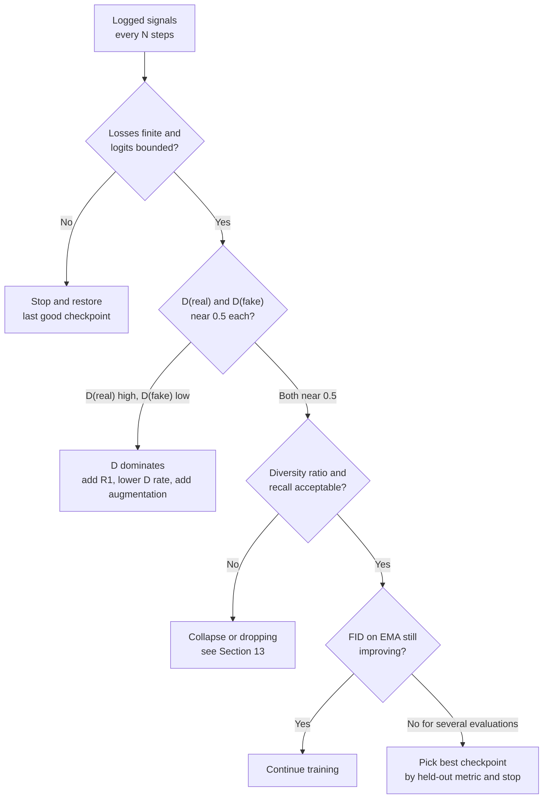

The diagram turns the table into an order of checks. The first check is whether the run is numerically alive. The next two use cheap signals, and the last two use the expensive metrics that measure what you care about. The point is to avoid two common mistakes: stopping a run because the loss looks bad when it is actually fine, and continuing a run because the loss looks stable when the generator has collapsed.

### 15.2 Label smoothing and noise

**One-sided label smoothing** (Salimans et al., 2016) replaces the real-class target of 1 with a value such as $0.9$ and leaves the fake target at 0. It stops the discriminator from becoming overconfident on real data, which keeps its output away from saturation. The smoothing must be one-sided. If both targets are smoothed to $\alpha$ for real and $\beta$ for fake, the optimal discriminator becomes

$$
D^{\star}(x) = \frac{\alpha\, p_{\text{data}}(x) + \beta\, p_g(x)}{p_{\text{data}}(x) + p_g(x)}.
$$

In a region where the data has no mass but the generator does, $p_{\text{data}} = 0$ and $D^{\star} = \beta$, which is fine for $\beta = 0$. If $\beta > 0$ the term $\beta\,p_g$ in the numerator makes the optimal discriminator say a fake sample is more real than it is, in proportion to the generator's own density, and the generator receives a reward for staying where it already is. Setting $\beta = 0$ avoids this. With $\alpha = 0.9$ the discriminator's best response at a point where real data is four times as dense as generated data is $0.9 \times 0.8 = 0.72$ rather than $0.8$.

**Instance noise** was covered in Section 5.3. In practice you add noise with a standard deviation that decays linearly to zero over the first part of training, for example from $0.1$ to $0$ over the first 100,000 images shown, on inputs scaled to $[-1, 1]$. The schedule values are starting points, not recommendations. The scheme is cheap and helps most when the discriminator wins early.

### 15.3 Gradient penalties on real data: $R_1$

The WGAN-GP penalty enforces a unit gradient norm between real and fake samples. A different penalty, introduced by Mescheder, Geiger and Nowozin (2018), has a cleaner motivation. At the equilibrium the generator matches the data, so the discriminator cannot do better than outputting a constant. Its gradient on real data should therefore be zero. The $R_1$ regularizer penalizes the discriminator's gradient on real samples:

$$
R_1(\phi) = \frac{\gamma}{2}\, \mathbb{E}_{x \sim p_{\text{data}}}\Big[\lVert \nabla_x D_\phi(x) \rVert^2\Big].
$$

The penalty is zero-centered, so it does not fight the equilibrium, in contrast to the unit-norm target of WGAN-GP. It damps the rotation that Section 6.2 identified in the update dynamics, and Mescheder and colleagues proved local convergence for the regularized dynamics under stated assumptions. Its $R_2$ twin applies the same penalty at generated points.

**Worked penalty.** If the discriminator gradient norm at a real sample is $2$ and $\gamma = 10$, the penalty is $\tfrac{10}{2}\cdot 2^2 = 20$. If the norm falls to $0.5$, the penalty is $\tfrac{10}{2}\cdot0.25 = 1.25$. The value of $\gamma$ is tuned per resolution and dataset, with larger values commonly used at lower resolution and small datasets, and the StyleGAN2 code applies the penalty lazily, once every 16 minibatches with a scaled coefficient, to save compute.

### 15.4 Exponential moving average of generator weights

The training dynamics orbit around an equilibrium (Section 6.2), so the final iterate is a point on an orbit, not the center. Averaging reduces this noise. Keep a second copy of the generator, updated after each training step by

$$
\theta_{\text{EMA}} \leftarrow \beta\, \theta_{\text{EMA}} + (1 - \beta)\, \theta,
$$

and use $\theta_{\text{EMA}}$ for sampling and evaluation. The half-life of the average, the number of steps after which an old weight's contribution has halved, is $\ln 0.5 / \ln \beta$. From the script `02_gan_theory_numbers.py`, $\beta = 0.99$ gives $69.0$ steps, $\beta = 0.999$ gives $692.8$ steps, and $\beta = 0.9999$ gives $6{,}931$ steps. A longer half-life averages more of the orbit and gives smoother samples, but lags the training and is wrong early in training when the weights change fast. StyleGAN-family code states the half-life in thousands of images shown rather than in steps so that it is independent of batch size. A half-life of 10 thousand images at batch size 32 corresponds to $10{,}000/32 = 312.5$ steps and $\beta = 0.5^{1/312.5} \approx 0.9978$. Yazici and colleagues (2019) analyzed why averaging helps GANs.

Two practical details. Batch-normalization running statistics are buffers, not parameters, so they must be copied or averaged consistently. Evaluate FID on the EMA weights and on the raw weights at least once to see how large the gap is, because a large gap is a sign of unstable dynamics.

### 15.5 Optimizer, normalization, and precision

- **Adam settings.** Low or zero first-moment decay ($\beta_1 \in \{0, 0.5\}$) is standard, because momentum reinforces rotational dynamics. The second-moment decay $\beta_2$ is often $0.99$ or $0.999$.
- **Normalization.** Batch normalization in the discriminator is incompatible with per-sample penalties and can leak information across the real/fake batch split if real and fake batches are passed separately. Spectral normalization, layer normalization, or no normalization are safer. The generator can use batch normalization or conditional normalization.
- **Initialization and scale.** Equalized learning rate (Section 12.2) avoids layer-by-layer scale problems with adaptive optimizers.
- **Mixed precision.** The discriminator logits and gradient penalties can overflow in half precision. A standard compromise keeps the high-resolution layers in half precision and the rest, including penalties, in single precision, with loss scaling.
- **Batch size.** Larger batches improved FID in BigGAN (Brock et al., 2019) but required additional regularization to keep training stable. Do not change batch size without checking the learning rates and EMA half-life.

### 15.6 Checkpointing policy

The last checkpoint of a GAN run is not necessarily the best. Save checkpoints at regular intervals, compute the chosen metrics on the EMA weights for each, and promote the checkpoint with the best held-out score on the metric that matches the product, not necessarily FID. Keep the fixed-seed grid for each checkpoint so reviewers can compare. Store the training configuration, code version, data version, and random seeds with each checkpoint, because GAN runs are hard to reproduce exactly and rollback depends on having the artifact trail ([CH29](CH29_MLOps_and_LLMOps.md)).

## 16. Limited Data, Augmentation, and Scale

### 16.1 Discriminator overfitting on small datasets

With a few thousand training images the discriminator memorizes the training set. Its predictions on training images become confident, and its predictions on held-out real images become close to those for fakes. The generator then receives gradients that point toward the memorized examples and not the distribution. Karras and colleagues (2020) demonstrated this for StyleGAN2 and measured it with the gap between the discriminator's outputs on training and validation images.

### 16.2 Augmenting the discriminator's inputs

Standard data augmentation applied only to the real images does not work, because the generator then learns to produce the augmented distribution: if every real image is randomly rotated, the generator produces rotated images. The solution is to apply the same family of **differentiable** augmentations to every image the discriminator sees, real and fake, including in the generator step so that gradients flow through the augmentation to the generator. Zhao and colleagues (2020) proposed DiffAugment on this principle, and Karras and colleagues (2020) developed **adaptive discriminator augmentation (ADA)**.

ADA applies each augmentation with a probability $p$ and adjusts $p$ during training. The key condition is that augmentations should be **non-leaking**: the generator is not rewarded for producing augmented-looking images, which holds when each augmentation is applied with probability $p < 1$ and the augmentation is invertible in distribution (the original distribution can be recovered from the augmented one). The overfitting heuristic is $r_t = \mathbb{E}[\operatorname{sign}(D_{\text{train}})]$, the average sign of the discriminator's logits on real training images. If the discriminator is not overfitting, about as many real images are scored negative as expected, and $r_t$ is low. As it overfits, the logits become positive for all training images and $r_t \to 1$.

**Worked heuristic.** Suppose eight real training images receive logits $(2.1, 0.7, -0.3, 1.5, 3.0, 0.2, 1.1, 2.4)$. Seven are positive and one is negative, so $r_t = (7 - 1)/8 = 0.75$. If the target value is about $0.6$, then $r_t$ exceeds the target and $p$ is raised. ADA adjusts $p$ up or down by a small amount each few iterations according to the sign of $r_t - r_{\text{target}}$.

With ADA the authors report that results matching those of earlier StyleGAN2 on full datasets are achievable with around an order of magnitude fewer images. This is a result on specific benchmarks, and on your data the benefit depends on how diverse the small dataset is. A tiny dataset still limits what the generator can learn, and the risk of memorizing it remains (Section 24).

### 16.3 Scale, truncation, and class-conditional training

BigGAN (Brock, Donahue and Simonyan, 2019) showed that scaling up batch size, model width, and the number of classes improves class-conditional ImageNet generation, with several stabilizers: spectral normalization in both networks, hinge loss, shared class embeddings with conditional batch normalization, orthogonal regularization, and the truncation trick on the latent. They noted that large-scale training can collapse late in a run and that early stopping at the last good checkpoint is part of the method. The practical consequences for an architect are that GAN training at scale is a research-grade activity and that a team should budget for failed runs, which Section 27 treats numerically.

## 17. A Debugging Playbook

Most GAN failures in a new project are not subtle dynamics. They are bugs and mismatches. A systematic sequence saves days.

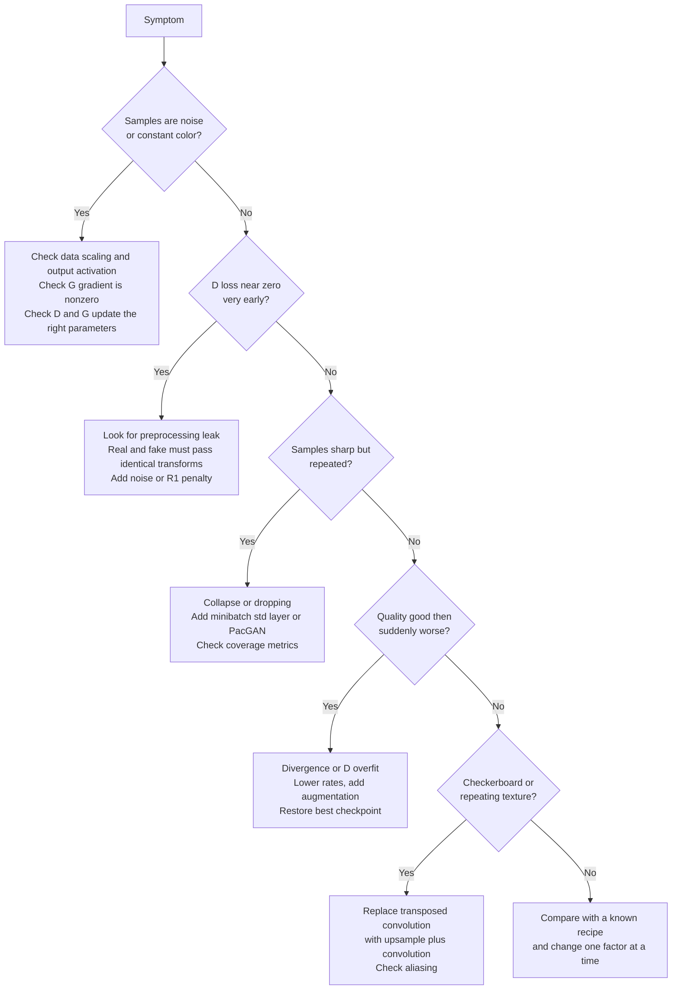

The flow tests cheap causes before dynamic ones. Each leaf names an action, and the last branch is the general rule: when nothing explains the failure, return to a published configuration that is known to work on a similar dataset and change one factor at a time.

**Sanity tests before a long run.**

1. **Discriminator against noise.** Freeze a randomly initialized generator and train only the discriminator for a few hundred steps. The loss should fall close to zero. If it does not, the discriminator or the data pipeline is broken.
2. **Real against real.** Split the real data into two halves and label one half as fake. The discriminator accuracy should remain at $50\%$ and the loss near $1.386$. If it learns to separate them, the two halves are processed differently (for example, different file formats, resolution, or normalization), and a real GAN would learn to exploit the same difference.
3. **Overfit one batch.** Train the generator against a fixed discriminator to reproduce a single batch. It should get close. This checks that gradients reach the generator.
4. **Gradient flow.** Print the generator and discriminator gradient norms for the first few steps. A generator gradient of exactly zero indicates a detached graph or a saturated activation.
5. **Value ranges.** Print the min and max of real batches and generated batches. With a Tanh output, the real data must lie in $[-1, 1]$.

**A preprocessing leak, concretely.** A team's real images are decoded from JPEG files and its fakes come from a generator in floating point. The JPEG images carry $8 \times 8$ block artifacts that the generator does not produce. The discriminator finds this shortcut in under a thousand steps, its loss falls to nearly zero, and the generator learns nothing useful. The fix is to pass both sets through the same pipeline, including the same compression, or to remove the artifact from both.

## 18. Evaluating Generative Models

### 18.1 What evaluation has to cover

A generative model is evaluated against several questions that no single metric answers.

- **Fidelity:** do individual samples look like real data?
- **Diversity or coverage:** does the set of samples cover the variety of the real data, including rare cases?
- **Novelty or generalization:** are the samples new rather than copies of training examples?
- **Condition adherence:** for a conditional model, does the output match the requested condition?
- **Utility:** for the intended use, such as training a downstream model, does the output help?

Because a GAN gives no likelihood (Section 2.2), there is no held-out log-likelihood to compare across models. The field relies on feature-space metrics, human judgment, and task-based evaluation, each with blind spots.

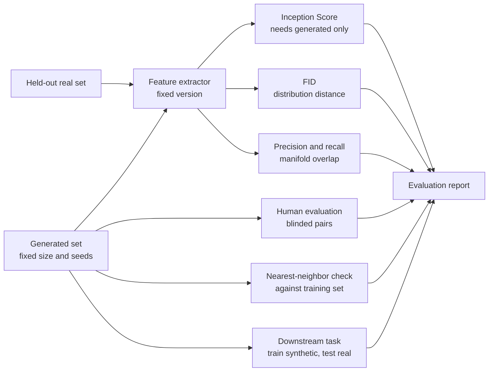

The diagram shows a complete evaluation as six separate instruments feeding one report. Feature-space metrics are cheap and repeatable, so they run at every checkpoint. Human evaluation and downstream tasks are expensive, so they run on shortlisted checkpoints. The nearest-neighbor check addresses privacy and memorization and is mandatory whenever training data is sensitive.

### 18.2 Inception Score

Salimans and colleagues (2016) proposed the Inception Score (IS). A pretrained image classifier (Inception-v3, trained on ImageNet) assigns each generated image $x$ a class distribution $p(y \mid x)$. A good generator should satisfy two things: each image should be classified confidently, so $p(y \mid x)$ has low entropy, and the set of images should cover many classes, so the marginal $p(y) = \mathbb{E}_x\, p(y \mid x)$ has high entropy. The score combines them:

$$
\mathrm{IS} = \exp\Big( \mathbb{E}_{x \sim p_g}\, \mathrm{KL}\big( p(y \mid x) \,\big\|\, p(y) \big) \Big).
$$

The expected KL divergence equals the mutual information between the image and its label, so $\mathrm{IS} = \exp\big(H(y) - H(y \mid x)\big)$. The maximum is the number of classes, reached when each image is classified with certainty and all classes are equally likely.

**Worked example.** Take four generated images and three classes with predicted distributions $(0.9, 0.05, 0.05)$, $(0.05, 0.9, 0.05)$, $(0.05, 0.05, 0.9)$, and $(0.9, 0.05, 0.05)$. The marginal is $(0.475, 0.2625, 0.2625)$. Each row's KL divergence to the marginal is computed in the script, and their mean is $0.6614$, so $\mathrm{IS} = e^{0.6614} = 1.94$. If the generator collapsed to produce the same confident class-1 image four times, the marginal equals each row, the KL is zero, and $\mathrm{IS} = 1.00$. The maximum for three classes would be $3.00$.

**Limits.** IS never looks at the real data, so it cannot say whether the images resemble the training set. It is tied to ImageNet's 1,000 classes and is meaningless for data that does not resemble those classes, such as medical images or tabular data rendered as images. It does not measure diversity within a class, so a generator that produces exactly one image per class scores the maximum. It is sensitive to the implementation of the classifier and to image resizing, as Barratt and Sharma (2018) documented. For these reasons IS has largely been replaced by FID in practice, and it should not be the only reported metric.

### 18.3 Fréchet Inception Distance

Heusel and colleagues (2017) proposed the Fréchet Inception Distance (FID), which compares real and generated sets in a feature space. Each image passes through Inception-v3 and the 2048-dimensional activations of the final pooling layer are taken as features. A Gaussian is fitted to the real features, with mean $\mu_r$ and covariance $\Sigma_r$, and another to the generated features, with $\mu_g$ and $\Sigma_g$. The FID is the squared Fréchet distance (the 2-Wasserstein distance) between the two Gaussians:

$$
\mathrm{FID} = \lVert \mu_r - \mu_g \rVert_2^2 + \operatorname{Tr}\Big( \Sigma_r + \Sigma_g - 2\,(\Sigma_r \Sigma_g)^{1/2} \Big).
$$

The first term is the squared distance between the mean feature vectors and measures a shift in the average. The second term measures the mismatch of the covariances, meaning differences in the spread and correlation structure. $\operatorname{Tr}$ is the trace, the sum of the diagonal, and $(\Sigma_r \Sigma_g)^{1/2}$ is the matrix square root. When the two covariances are the same the trace term is zero, since $\operatorname{Tr}(\Sigma + \Sigma - 2\Sigma) = 0$.

**Worked example.** In two dimensions take real features with mean $(0, 0)$ and covariance $I$, and generated features with mean $(1, 0)$ and covariance $\mathrm{diag}(2, 0.5)$. The mean term is $1^2 + 0^2 = 1$. The traces are $\operatorname{Tr}(I) = 2$ and $\operatorname{Tr}(\mathrm{diag}(2, 0.5)) = 2.5$, total $4.5$. The product of covariances is $\mathrm{diag}(2, 0.5)$, whose square root is $\mathrm{diag}(\sqrt2, \sqrt{0.5})$ with trace $1.4142 + 0.7071 = 2.1213$, so twice the trace is $4.2426$. Then $\mathrm{FID} = 1 + 4.5 - 4.2426 = 1.2574$. The script prints $1.2574$.

**Practical properties.**

1. **Sample size.** The covariance estimate in 2,048 dimensions needs more than 2,048 samples to be full rank, and FID is biased upward for small samples. The usual protocol uses 50,000 generated images, and results at different sample sizes are not comparable. Chong and Forsyth (2020) showed how to extrapolate toward the infinite-sample value.
2. **Reference set.** The statistics of the real set must be fixed and reported. Using the training set, a held-out set, or a subset gives different values.
3. **Implementation details.** Different Inception weights (the original TensorFlow model against PyTorch ports), different image-resizing methods, and compression change the number. Parmar, Zhang and Zhu (2022) showed that resizing choices alone can change FID noticeably. Use a single published implementation, record its version, and never compare numbers across papers without checking the protocol.
4. **Noise.** FID varies between random seeds and between sample draws. Treat differences smaller than the spread across repeated evaluations as noise. **Illustrative case.** Checkpoint A scores $8.4$ and checkpoint B scores $8.1$ on 10,000 samples, and repeating the evaluation with different latent seeds spreads each score by about $\pm 0.3$. The difference of $0.3$ is within the noise, so the data do not support preferring B.
5. **Cost.** Computing features for 50,000 images is cheap compared with training, about 300 teraflops of arithmetic with the illustrative assumption in `04_cost_and_latency.py`, which is seconds on a modern accelerator. Running it at every checkpoint is affordable.

**Limits.** FID assumes the features are Gaussian, which they are not. It is computed from ImageNet features, so it may not reflect differences that matter in other domains (faces, medical scans, satellite images). Kynkäänniemi and colleagues (2023) showed that FID is sensitive to the presence of ImageNet class-relevant content. Stein and colleagues (2023) found that FID disagrees with human judgment for some modern generators and proposed a Fréchet distance computed in a different feature space (DINOv2) as a better match. Jayasumana and colleagues (2024) proposed CMMD, which uses CLIP features and a kernel distance without the Gaussian assumption. Two moments cannot capture everything about a distribution. The script in `03_gan_metrics_and_privacy.py` builds a generator that places samples from a single Gaussian with the same mean and covariance as the four-mode data. Its FID against the test set is $0.031$, as good as the correct generator's $0.026$, although the samples fall in the empty space between modes and its precision is $0.16$. A metric that depends only on the first two moments cannot distinguish them.

### 18.4 Precision and recall for generative models

FID gives one number, which merges two different failures. Sajjadi and colleagues (2018) proposed to separate them, and Kynkäänniemi and colleagues (2019) gave a practical version based on nearest neighbors in a feature space.

Estimate the **real manifold** as the union of balls centered on real feature vectors, each with a radius equal to the distance to its $k$-th nearest real neighbor (commonly $k = 3$). Estimate the **generated manifold** in the same way. Then:

- **Precision** is the fraction of generated samples that fall inside the real manifold. It measures fidelity: do the samples look like real ones?
- **Recall** is the fraction of real samples that fall inside the generated manifold. It measures coverage: does the generator reach all of the real data?

The script computes both on 500 samples with $k = 3$ for four toy generators.

| Generator | FID | Precision | Recall | Reading |
| --- | --- | --- | --- | --- |
| Good | 0.026 | 0.97 | 0.95 | Faithful and covers all modes. |
| Collapsed (2 of 4 modes) | 4.094 | 0.98 | 0.47 | Samples are real but half the data is missing. |
| One matched Gaussian | 0.031 | 0.16 | 0.99 | FID is blind. Most samples are off the data manifold. |
| Memorizer | 0.045 | 0.96 | 0.97 | Copies of training points. Both metrics are blind. |

The table shows what each number can and cannot do. Precision and recall separate the collapsed generator (high precision, low recall) from the blurry Gaussian (low precision, high recall), a distinction FID blurs. Neither metric detects the memorizer, because copies of real points sit inside the real manifold and cover it. Detecting that requires the membership test in Section 24.

Precision and recall are sensitive to $k$, to the feature extractor, to outliers, and to sample size. A real outlier inflates the radius of the ball around it and makes the manifold too large. Naeem and colleagues (2020) proposed density and coverage metrics that are less sensitive to outliers. Whatever metric you use, report $k$, the feature extractor, and the sample size.

### 18.5 Human evaluation

Automated metrics are proxies. Human judgment is the reference, and it is expensive and noisy. Designs include:

- **Real-or-fake discrimination.** Raters see single images and say whether each is real. Zhou and colleagues (2019) formalized this as HYPE, with a time-limited variant (raters see each image for a fraction of a second) and an unlimited variant, and report the rater error rate as the measure. The better the generator, the nearer the rater is to 50% accuracy.
- **Pairwise preference.** Raters see two images from different models, in random order, and choose the better one. This is more sensitive than absolute ratings and easy to analyze with win rates.
- **Attribute and adherence checks.** Raters answer specific questions, such as whether the image matches the condition.

**Sample size.** Suppose you want to estimate a preference rate near 50%. For $n$ independent judgments the standard error of a proportion $p$ is $\sqrt{p(1 - p)/n}$. With $n = 600$ judgments and $p = 0.5$ it is $0.5/\sqrt{600} = 0.0204$, so a 95% interval is about $\pm 0.04$, four percentage points. Judgments by the same rater or on the same image are correlated, so the effective sample size is smaller than 600, and the analysis should account for clustering. The statistical treatment is in [CH06](CH06_Model_Evaluation_Validation_and_Selection.md).

Common design mistakes include showing raters images in a fixed order, using raters who are not blinded to the model, mixing resolutions or formats between models, and using a rater pool that is not representative of the people who will see the product. Human evaluation measures perceived realism, which is not the same as correctness: a face with a plausible but wrong detail can look real.

### 18.6 Task-based evaluation

For synthetic training data, the decisive test is whether it helps the downstream task. The standard protocol is **train on synthetic, test on real (TSTR)**: train the downstream model on generated data and evaluate it on real held-out data, and compare with the same model trained on real data and with the model trained on real data augmented by synthetic data. If augmentation does not improve a real held-out score, or improves only the score on generated-like examples, the synthetic data is not useful whatever its FID. [CH06](CH06_Model_Evaluation_Validation_and_Selection.md) covers the comparison of these models with proper validation.

### 18.7 Choosing a metric set

| Question | Metric | Cannot detect |
| --- | --- | --- |
| Does the set look like the real set overall? | FID or a modern variant, with fixed protocol | Distribution shape beyond two moments, memorization, domain-specific flaws |
| Are individual samples realistic? | Precision, human real-or-fake | Missing modes |
| Are all modes covered? | Recall, mode histogram, effective modes | Realism of the samples |
| Are samples new? | Nearest-neighbor distance to training set, membership test | Subtle copying of parts |
| Does it follow the condition? | Evaluator-classifier adherence, per-class | Conditions the evaluator was not trained on |
| Is it useful? | TSTR and augmentation experiments | Reasons for failure |
| Do people accept it? | Blinded human preference | Rare artifacts, bias |

Use at least one metric from each of the first four rows, and add utility and human checks before release. The practice of reporting a single FID number is the first thing to challenge in a design review of a generative project.

## 19. Variational Autoencoders and the Evidence Lower Bound

### 19.1 The model

A variational autoencoder (VAE) defines an explicit but intractable density through a latent variable. A latent code $z$ is drawn from a simple prior $p(z) = \mathcal{N}(0, I)$. A **decoder** network defines the conditional distribution $p_\theta(x \mid z)$, for example a Gaussian whose mean is the network output. The density of a data point is the marginal

$$
p_\theta(x) = \int p_\theta(x \mid z)\, p(z)\, dz.
$$

This integral cannot be computed for a neural-network decoder, because it requires summing over all codes, so maximum likelihood cannot be applied directly. The exact posterior $p_\theta(z \mid x)$, the distribution over codes that could have produced $x$, is equally intractable. The VAE (Kingma and Welling, 2014; Rezende, Mohamed and Wierstra, 2014) introduces an **encoder** network $q_\phi(z \mid x)$, usually a diagonal Gaussian $\mathcal{N}(\mu_\phi(x), \operatorname{diag}(\sigma_\phi^2(x)))$, as an approximation to the posterior, and trains both networks by maximizing a lower bound.

### 19.2 Deriving the evidence lower bound

Start from the log marginal likelihood (the "evidence") and multiply and divide by the encoder inside the integral:

$$
\log p_\theta(x) = \log \int p_\theta(x, z)\, dz = \log \int q_\phi(z \mid x)\, \frac{p_\theta(x, z)}{q_\phi(z \mid x)}\, dz = \log\, \mathbb{E}_{q_\phi(z \mid x)}\!\left[\frac{p_\theta(x, z)}{q_\phi(z \mid x)}\right].
$$

The logarithm is concave, so Jensen's inequality ($\log \mathbb{E}[Y] \geq \mathbb{E}[\log Y]$) gives a lower bound:

$$
\log p_\theta(x) \;\geq\; \mathbb{E}_{q_\phi(z \mid x)}\big[\log p_\theta(x, z) - \log q_\phi(z \mid x)\big] =: \mathrm{ELBO}(x).
$$

Split the joint as $p_\theta(x, z) = p_\theta(x \mid z)\,p(z)$ to obtain the form used in practice:

$$
\mathrm{ELBO}(x) = \underbrace{\mathbb{E}_{q_\phi(z \mid x)}\big[\log p_\theta(x \mid z)\big]}_{\text{reconstruction}} - \underbrace{\mathrm{KL}\big(q_\phi(z \mid x) \,\|\, p(z)\big)}_{\text{regularizer}}.
$$

The reconstruction term rewards codes that let the decoder explain $x$. The KL term keeps the encoder's distribution close to the prior, so that codes drawn from the prior at generation time resemble the codes seen in training.

There is a second derivation that shows how large the gap is. Using $p_\theta(x, z) = p_\theta(z \mid x)\,p_\theta(x)$ inside the expectation:

$$
\mathrm{ELBO}(x) = \log p_\theta(x) - \mathrm{KL}\big(q_\phi(z \mid x) \,\|\, p_\theta(z \mid x)\big), \quad\text{so}\quad \log p_\theta(x) = \mathrm{ELBO}(x) + \mathrm{KL}\big(q_\phi(z \mid x) \,\|\, p_\theta(z \mid x)\big).
$$

The gap between the true log-likelihood and the bound is exactly the KL divergence between the encoder and the true posterior. It is non-negative, which confirms the bound, and it is zero only when the encoder matches the true posterior. Maximizing the ELBO therefore does two things at once: it increases the likelihood of the data under the decoder, and it improves the encoder's approximation to the posterior.

### 19.3 A worked example with every number checked

Take a one-dimensional model with prior $z \sim \mathcal{N}(0, 1)$ and a decoder $x \mid z \sim \mathcal{N}(z, 1)$, and observe $x = 1$. This model is simple enough that the exact answer is known: the marginal is $x \sim \mathcal{N}(0, 2)$, so

$$
\log p(1) = -\tfrac12 \log(2\pi \cdot 2) - \frac{1^2}{2\cdot 2} = -1.2655 - 0.25 = -1.5155,
$$

and the exact posterior is $\mathcal{N}(x/2,\, 1/2) = \mathcal{N}(0.5,\, 0.5)$. Now let the encoder be $q = \mathcal{N}(\mu = 0.5,\, \sigma^2 = 0.64)$, with the right mean but a variance that is slightly too wide.

- **Reconstruction term.** For the Gaussian decoder, $\mathbb{E}_q[\log p(x \mid z)] = -\tfrac12 \log 2\pi - \tfrac12\,\mathbb{E}_q[(x - z)^2]$. Since $\mathbb{E}_q[(x - z)^2] = (x - \mu)^2 + \sigma^2 = 0.25 + 0.64 = 0.89$, this equals $-0.9189 - 0.445 = -1.3639$.
- **KL term.** For a Gaussian against the standard normal prior, $\mathrm{KL} = \tfrac12\,(\mu^2 + \sigma^2 - 1 - \ln \sigma^2) = \tfrac12\,(0.25 + 0.64 - 1 - \ln 0.64) = \tfrac12\,(-0.11 + 0.4463) = 0.1681$.
- **ELBO** $= -1.3639 - 0.1681 = -1.5321$.

The bound $-1.5321$ lies below the true value $-1.5155$ by $0.0166$. The second derivation predicts that this gap equals $\mathrm{KL}(q \,\|\, p(z \mid x))$ between $\mathcal{N}(0.5, 0.64)$ and $\mathcal{N}(0.5, 0.5)$, which is $\tfrac12\big(0.64/0.5 - 1 + \ln(0.5/0.64)\big) = \tfrac12(0.28 - 0.2469) = 0.0166$. The two agree, and `02_gan_theory_numbers.py` prints both. If the encoder had the exact posterior variance $0.5$, the KL term would be smaller and the gap would vanish.

### 19.4 The reparameterization trick

Training needs the gradient of $\mathbb{E}_{q_\phi}[\cdot]$ with respect to the encoder parameters $\phi$, but sampling $z$ from $q_\phi$ is a random operation that blocks gradients. The reparameterization trick moves the randomness into an input that does not depend on $\phi$:

$$
z = \mu_\phi(x) + \sigma_\phi(x) \odot \varepsilon, \qquad \varepsilon \sim \mathcal{N}(0, I),
$$

where $\odot$ is elementwise multiplication. Now $z$ is a deterministic, differentiable function of $\phi$ and the noise $\varepsilon$, so backpropagation passes through the sampling step. In practice one sample of $\varepsilon$ per data point per step is enough.

### 19.5 Why VAE samples are blurry, and the knobs

With a Gaussian decoder of fixed variance $\sigma_x^2$, the reconstruction term is $-\lVert x - \hat{x}(z) \rVert^2 / (2\sigma_x^2)$ plus a constant. That is a squared-error loss. When several different images could correspond to similar codes, the squared error is minimized by predicting their average, which is a blurred image. The loss does not have a mechanism to prefer a sharp sample over the average, whereas a discriminator does.

The weighting between the two terms is a design choice. The $\beta$-VAE (Higgins et al., 2017) multiplies the KL term by a factor $\beta$. With $\beta > 1$ the code is pushed closer to the prior and tends to become more disentangled, at the expense of reconstruction quality. With $\beta < 1$ reconstructions are sharper but the codes drift away from the prior, so samples from the prior look worse. A fixed decoder variance has the same effect, since a smaller $\sigma_x$ makes the reconstruction term count more.

**Posterior collapse** is the characteristic failure. If the decoder is powerful enough to model the data without using $z$, as an autoregressive decoder can, the cheapest solution is for the encoder to output the prior, $q(z \mid x) = p(z)$, so the KL term is zero and the code carries no information. The model then works as an unconditional decoder and the latent space is useless. Remedies are to anneal the KL weight upward from zero, to constrain the decoder, or to use discrete latent codes (VQ-VAE, van den Oord, Vinyals and Kavukcuoglu, 2017).

### 19.6 VAE versus GAN

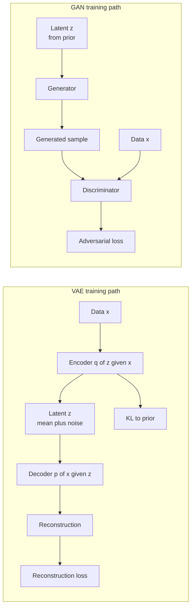

The diagram highlights a structural difference. A VAE always compares a generated reconstruction with the specific data point that produced its code, so every training example anchors a code and the model cannot skip a data point. A GAN compares the generated distribution with the real one only through the discriminator, with no per-example link. That is the source of the VAE's stable coverage and of the GAN's sharper output and weaker coverage.

| Dimension | VAE | GAN |
| --- | --- | --- |
| Objective | Lower bound on log-likelihood | Adversarial game, learned two-sample test |
| Likelihood | Bound available, can compare models | None |
| Training stability | Stable, single loss decreasing | Fragile, two coupled losses |
| Sample sharpness | Often blurry with Gaussian decoder | Sharp |
| Mode coverage | Good, every example contributes | Can drop modes |
| Encoder | Built in, supports inference and editing | None, inversion needs extra work |
| Sampling cost | One decoder pass | One generator pass |
| Typical failure | Blur, posterior collapse | Collapse, divergence, artifacts |
| Typical use today | Compression, anomaly detection, latent spaces for other models | Single-pass image synthesis, super-resolution, adversarial loss terms |

The two are combined in practice. VAE-GAN (Larsen et al., 2016) adds a discriminator to the VAE's decoder to sharpen outputs, and VQGAN (Esser, Rombach and Ommer, 2021) trains a discrete autoencoder with a perceptual and an adversarial loss. The autoencoders that compress images for latent diffusion models (Rombach et al., 2022) are trained with an adversarial term for the same reason, so a VAE-style model with a GAN loss sits inside most current image diffusion systems.

## 20. Normalizing Flows, Briefly

A normalizing flow builds an invertible map $x = f_\theta(z)$ between a simple base distribution (a Gaussian) and the data. If $f_\theta$ is invertible and differentiable, the change-of-variables formula gives the exact density:

$$
\log p_\theta(x) = \log p_z\big(f_\theta^{-1}(x)\big) + \log \left\lvert \det \frac{\partial f_\theta^{-1}(x)}{\partial x} \right\rvert.
$$

The first term is the base-distribution log-density at the code that produces $x$, and the second corrects for how the map stretches or compresses volume, via the determinant of the Jacobian matrix of partial derivatives. A one-dimensional example makes the formula concrete. Let $x = 2z + 1$ with $z \sim \mathcal{N}(0, 1)$. The inverse is $z = (x - 1)/2$, and its derivative is $1/2$. At $x = 1$ the code is $z = 0$, whose density is $0.3989$, and the density of $x$ is $0.3989 \times 0.5 = 0.1995$, the density of $\mathcal{N}(1, 4)$ at its mean.

A general determinant costs $O(D^3)$ for $D$ dimensions, which is infeasible for images, so flow architectures are built so the Jacobian is triangular and its log-determinant is a sum. In the coupling layer of RealNVP (Dinh, Sohl-Dickstein and Bengio, 2017), the input is split into two halves. The first half passes through unchanged, and the second is scaled and shifted by amounts that are arbitrary neural-network functions of the first half: $y_2 = x_2 \odot \exp(s(x_1)) + t(x_1)$. The Jacobian is triangular, the log-determinant is $\sum s(x_1)$, and the layer is invertible in closed form. Stacking such layers with permutations of which dimensions are held fixed gives a flexible model. Glow (Kingma and Dhariwal, 2018) added invertible $1\times1$ convolutions and scaled the approach to high-resolution faces.

Flows give exact likelihood, exact inference of the latent code, and one-pass sampling. The costs are that the latent has the same dimension as the data, that every layer must be invertible with a cheap determinant (which limits the form of the layers), and that sample quality for images has lagged GANs and diffusion models at equal model size. Flows are used where exact densities matter: density estimation, variational inference, and physical simulation. They also appear as components in speech synthesis (for example the WaveGlow vocoder, Prenger, Valle and Catanzaro, 2019). The idea of learning a transformation between distributions continues in continuous-time flows and flow matching, which are closely related to the diffusion models of [CH12](CH12_Diffusion_Models.md).

## 21. Choosing Among Generative Families

| Family | Sample quality | Mode coverage | Sampling cost | Exact likelihood | Encoder | Training difficulty |
| --- | --- | --- | --- | --- | --- | --- |
| Autoregressive | High with large models | Excellent | One step per element, slow | Yes | Not native | Stable |
| VAE | Moderate, blur with simple decoders | Good | One pass | Bound only | Yes | Stable |
| Flow | Moderate | Good | One pass | Yes | Yes | Stable, restricted layers |
| GAN | High and sharp | Variable, can drop modes | One pass | No | No | Fragile |
| Diffusion | High | Excellent | Many steps, mitigable | Bound only | Not native | Stable |

The table is a first-order guide, and the right answer depends on requirements. These questions order the decision.

1. **Is a likelihood or an anomaly score required?** Use an autoregressive model, flow, or VAE. A GAN has no density.
2. **Is latency under a few tens of milliseconds, or does it run on a device?** A single-pass model (GAN, VAE, flow, or a distilled diffusion student) is required. Count network evaluations per sample before comparing anything else.
3. **Must rare cases be covered?** Prefer likelihood-trained or diffusion models, and if you use a GAN, make recall a release gate.
4. **Is the input strongly constraining, as in super-resolution or restoration?** Mode coverage matters less because the output is tied to the input, and a GAN is competitive.
5. **Is there an established pretrained model and tooling?** Ecosystem maturity often outweighs a small quality difference. Pretrained diffusion models have the larger ecosystem for open-ended images, and pretrained GANs exist for faces and several other narrow domains.
6. **How much training compute and expertise can the team commit?** A GAN needs expertise in diagnosing training, and a failed run is a real cost (Section 27).

## 22. Why Diffusion Displaced GANs, and Where GANs Remain

### 22.1 A one-paragraph recap of diffusion

[CH12](CH12_Diffusion_Models.md) owns the mechanism. In brief, a diffusion model defines a forward process that gradually adds Gaussian noise to a data point until it is nearly pure noise, and trains a network to undo one step of that corruption, usually by predicting the added noise with a plain regression loss. Generation starts from noise and applies the network repeatedly, removing a little noise each time. Conditioning, for example on text, is added by feeding the condition into the denoiser, and guidance strengthens adherence to it. The loss is a regression target with no opponent, and sampling needs many network evaluations.

### 22.2 Why diffusion won open-ended image generation

1. **A stable objective.** A regression loss decreases steadily and can be monitored on held-out data. There is no equilibrium to find and no adversary to balance, which makes training dependable and scalable by adding data and compute.
2. **Coverage.** The objective is derived from a likelihood bound, so it is forced to model all of the data, not only the part that is easy to make realistic. This removes the mode-dropping problem of Section 13 as a systematic risk.
3. **Conditioning and control.** Text conditioning through cross-attention and classifier-free guidance, plus editing, inpainting and image-to-image variants, fit naturally into iterative denoising. GANs can be conditioned, but scaling a GAN to open-vocabulary text proved harder.
4. **Quality at scale.** Dhariwal and Nichol (2021) reported that a guided diffusion model beat the best GANs on ImageNet generation by FID, and latent diffusion (Rombach et al., 2022) made high-resolution text-to-image generation affordable by running the denoiser in a compressed latent space.
5. **Fewer training tricks.** The folklore of Sections 15 to 17, with its balance of learning rates, penalties, and checkpoint selection, is largely unnecessary.

The cost is sampling latency, which is the number of denoiser evaluations. Several methods reduce it: better samplers that need tens rather than hundreds of steps, distillation into students that need a handful (progressive distillation, Salimans and Ho, 2022; consistency models, Song et al., 2023), and adversarial distillation, which uses a discriminator to train a few-step student (Sauer et al., 2023).

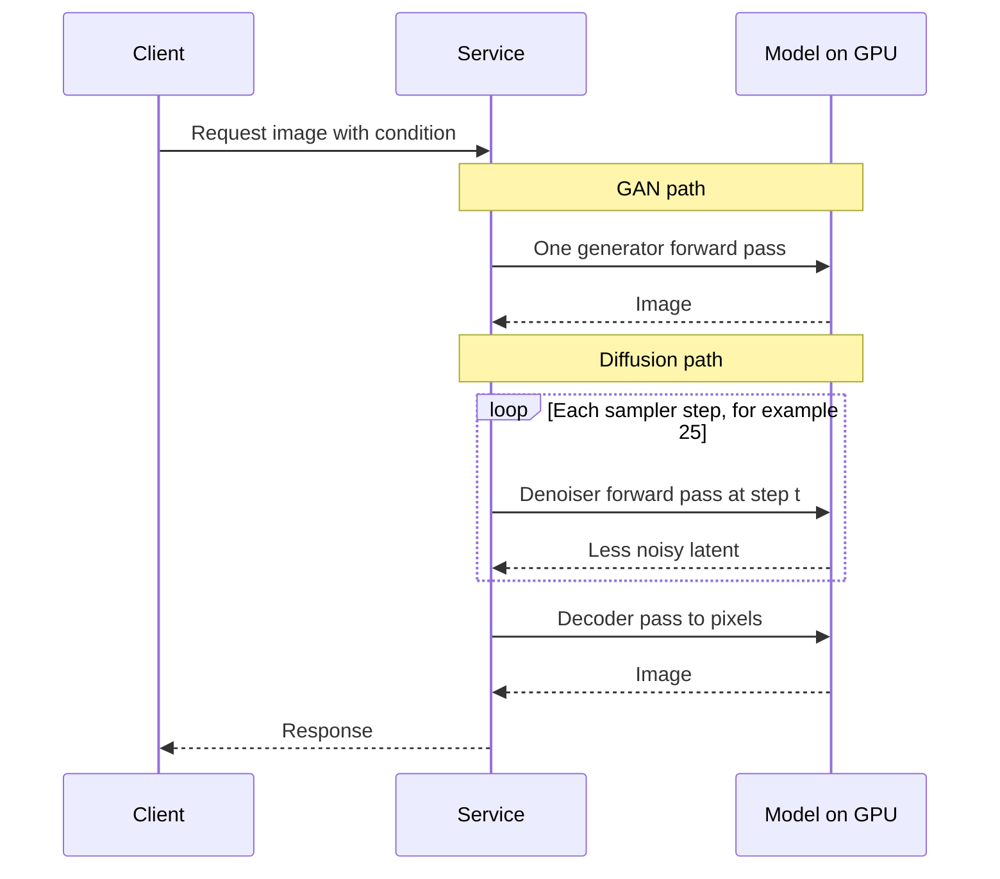

The sequence shows the structural difference in the request path. The GAN needs one call to the network. The diffusion service loops, so its latency is roughly the number of steps times the per-step time, plus a decode, and its GPU occupancy per request is proportionally higher. Section 27 puts numbers on the cost.

### 22.3 Where GANs remain the right tool

"Displaced" describes open-ended text-to-image research and products. It does not describe every use.

- **Single-pass and real-time generation.** Video filters, avatars, on-device effects, and interactive tools where tens of milliseconds matter. GigaGAN (Kang et al., 2023) reported a one-billion-parameter text-to-image GAN that generates a 512-pixel image in a fraction of a second, which its authors present as a speed advantage over diffusion models of that period. Treat the figure as a reported result on specific hardware.
- **Super-resolution and restoration.** SRGAN (Ledig et al., 2017), ESRGAN (Wang et al., 2018) and Real-ESRGAN (Wang et al., 2021) use an adversarial loss to produce sharp detail from a low-resolution input. The input strongly determines the output, so coverage is less of a risk, and the single-pass cost is attractive for large images and video.
- **Adversarial loss inside other systems.** The autoencoders of latent diffusion models, VQGAN, and neural speech vocoders such as HiFi-GAN (Kong, Kim and Bae, 2020) use discriminators to sharpen outputs. Adversarial diffusion distillation uses a discriminator to train fast diffusion students.
- **Discriminators as learned losses.** A trained discriminator acts as a data-dependent perceptual loss for any generator, which is why adversarial terms appear in image-to-image tasks (Section 11).
- **Small data and narrow domains.** With augmentation (Section 16), a StyleGAN-class model on a few thousand images can be a practical choice, with well-understood latent editing.
- **Modern baselines.** R3GAN (Huang et al., 2024) suggests that a simpler, principled GAN can match earlier state-of-the-art GANs, so the instability folklore may overstate current difficulty. Check the claim on your own data before relying on it.

### 22.4 Decision table

| Requirement | Lean toward GAN | Lean toward diffusion or other |
| --- | --- | --- |
| Latency budget under 50 ms per image | Yes, one pass | Only if distilled to few steps |
| Open-vocabulary text control | Rarely | Yes |
| Rare-case coverage required | Only with recall gates | Yes |
| Constrained mapping (upscale, restore, translate) | Yes | Also viable, higher cost |
| Small dataset, narrow domain | Yes, with augmentation | Possible with fine-tuning of a pretrained model |
| Need to explain or edit latent attributes | Yes (StyleGAN latents) | Possible with inversion or fine-tuning |
| Team has no GAN training experience | No | Yes, more forgiving |
| Strong pretrained foundation model exists | No | Yes, fine-tune it |

## 23. Applications

### 23.1 Data augmentation for rare classes

The most common business case for a GAN is a classifier that performs poorly on a rare class because there are few examples. The idea is to train a generator on the rare class (or a conditional generator on all classes) and add synthetic examples to the training set. Four conditions decide whether it works.

1. **The generator cannot add information that is not in its training data.** It learns the distribution of the examples you give it. Synthetic samples can fill gaps between existing examples, vary nuisance factors such as lighting and pose, and rebalance the class counts. They cannot reveal a failure type that never appeared. With 180 real defect images, the generator's repertoire is bounded by those 180.
2. **The generator must be trained only on training data.** If the generator sees the validation or test set, even indirectly, information leaks into the classifier through the synthetic data, and the evaluation overstates performance. This is the leakage problem of [CH02](CH02_Data_Preparation_Feature_Engineering_and_Leakage.md) with a new route. Inside cross-validation, the generator is retrained for each fold on that fold's training portion.
3. **Test on real data only.** Synthetic samples belong in training. Reported metrics come from real held-out examples (Section 18.6).
4. **Compare against cheaper alternatives.** Classical augmentation (flips, crops, color jitter), class weighting, oversampling, and collecting more real data are all baselines that a GAN must beat by enough to justify its cost, in line with the baseline ladder of [CH01](CH01_Machine_Learning_Foundations.md).

Synthetic augmentation can also amplify the generator's biases. If the generator under-represents a sub-population (a form of mode dropping), the augmented training set shifts further toward the over-represented groups, and the classifier's performance on the missing group falls relative to the others. Report per-group metrics, not only the overall one.

### 23.2 Super-resolution and restoration

Super-resolution recovers a high-resolution image from a low-resolution one. A network trained with a pixel-wise loss (mean squared error) predicts the average of all plausible high-resolution images, which is smooth. SRGAN (Ledig et al., 2017) added an adversarial loss and a perceptual loss computed in a feature space, which produces sharp texture. ESRGAN (Wang et al., 2018) and Real-ESRGAN (Wang et al., 2021) improved the architecture and trained on synthetic degradation pipelines that imitate real-world blur, noise, and compression.

The arithmetic shows what the network is doing. A $4\times$ upscale from $64 \times 64$ to $256 \times 256$ turns 4,096 values per channel into 65,536, which is 16 times as many. Of the output values, $1 - 1/16 = 93.75\%$ are not determined by the input in any strict sense, and the network supplies them from learned priors. The adversarial loss makes those invented details look plausible. The result scores lower on pixel-wise fidelity measures such as peak signal-to-noise ratio and higher on perceptual quality. The consequence for architecture is that the output is plausible, not faithful, so GAN super-resolution is suitable for entertainment, media restoration, and previews, and unsuitable where the added detail could be mistaken for evidence: forensic enhancement of a license plate or a face, or medical images (Section 11.3).

### 23.3 Image-to-image translation

Section 11 covered the methods. Business uses include converting sketches or label maps to drafts, restoring old photographs, converting synthetic renderings to a more realistic style so that models trained in simulation transfer better (sim-to-real), and domain adaptation between camera types. The pairing decision rule applies: build pairs synthetically if possible, validate on ground truth, and treat translated content as an estimate, not a measurement.

### 23.4 Synthetic tabular data

Tabular data differs from images in ways that break naive GANs. Columns are a mix of continuous and categorical types. Continuous columns are often multimodal (for example, a transaction amount with peaks at typical prices) and have long tails. Categorical columns can be highly imbalanced, with rare categories that matter. Xu and colleagues (2019) proposed CTGAN and TVAE to address these problems. Two ideas from CTGAN are widely reused.

**Mode-specific normalization.** A continuous column is first modeled with a Gaussian mixture. Each value is represented by the index of its mixture component (a one-hot vector) and by its offset within that component, normalized by four standard deviations. **Worked example.** Suppose an `amount` column has two modes with means $20$ and $200$ and standard deviations $5$ and $40$. A value of $210$ belongs to the second mode, so it is encoded as component 2 and the scalar $(210 - 200)/(4 \times 40) = 0.0625$. Min-max scaling over the whole range would squeeze the first mode into a tiny interval and make it hard for the generator to model.

**Conditional generator with training by sampling.** To prevent rare categories from being ignored, the training procedure samples a category uniformly (not in proportion to frequency), conditions the generator on it, and requires the generated row to carry that category. The generator is therefore exposed to rare values far more often than their frequency would imply.

Evaluating synthetic tabular data uses several layers.

- **Column fidelity:** per-column distribution distances (Kolmogorov-Smirnov statistic for continuous columns, total variation distance for categorical ones).
- **Relationship fidelity:** the difference between the correlation or association matrices of real and synthetic data, and the preservation of key conditional relationships such as the relationship between a feature and the target.
- **Machine-learning efficacy:** TSTR, comparing a model trained on synthetic data with one trained on real data, both evaluated on real held-out data.
- **Privacy:** distance to closest record and membership tests (Section 24).
- **Constraint checks:** business rules, such as a discharge date after an admission date, which a generator may violate because it learns statistics, not rules. Enforce them with post-hoc filtering or constraints.

Treat GAN-based synthesizers as one option in a list that includes copula models, Bayesian networks, tree-based sequential synthesizers, and diffusion-based tabular generators. Run a simple baseline first, because for modest tables a simple method is often competitive and easier to audit. Whichever you choose, the privacy question in the next section is the one that determines whether the data can be shared.

### 23.5 Other uses

Generators also appear in anomaly detection (modeling normal data and flagging inputs the model cannot reproduce), in audio synthesis, where GAN vocoders such as HiFi-GAN generate waveforms quickly from spectrograms, in design exploration, and in game asset creation. In each case, the checks of this chapter apply: measure coverage as well as quality, test the downstream task, and document the data rights of the training set.

## 24. Synthetic Data and Privacy

### 24.1 The misconception

A common belief is that synthetic data contains no real records and is therefore anonymous. A generator is trained on real records. If it memorizes some of them, it can output copies or near-copies, and a generated record that is close to a real person's record can disclose that person's attributes. Even without exact copies, a generative model can leak whether a particular record was in the training set. The data is synthetic in origin and still derived from personal data, so it is not automatically free of privacy risk.

Memorization is more likely when the training set is small, when records are duplicated, when the model is large relative to the data, when training runs long, and when the discriminator overfits (Section 6.6). Outliers and rare records are the most exposed, because the model has few similar examples to average over, and they are often the most sensitive records.

### 24.2 Measuring memorization

Two audits are cheap and should be routine.

**Distance to closest record (DCR).** For each synthetic record, find the nearest training record in a suitable feature space. Compare the distribution of those distances with the same distance for held-out real records, which are not copies by construction. If synthetic records are systematically closer to the training set than held-out real records are, the generator is copying. The ratio of the medians is a simple summary, and values well below 1 are a warning.

**Membership inference.** An attacker holds a candidate record and asks whether it was in the training set. A simple attack on released synthetic data scores a record by its distance to the nearest synthetic sample, since training members tend to have closer synthetic neighbors than non-members. The area under the ROC curve (AUC) of this attack, comparing training members with held-out non-members, measures the leakage: 0.5 means the attacker does no better than chance, and 1.0 means perfect identification. Hayes and colleagues (2019) and Chen and colleagues (2020, GAN-Leaks) developed stronger attacks against generative models, and Webster and colleagues (2021) showed identity membership attacks against face GANs.

**Measured example.** In `03_gan_metrics_and_privacy.py`, a "good" generator that draws fresh samples from the true distribution gets an attack AUC of $0.51$, indistinguishable from chance. A "memorizer" that copies training points and adds noise of standard deviation $0.005$ gets an AUC of $0.96$. The median distance from a held-out real point to its nearest training record is $0.0330$, which sets the baseline. The good generator's median is $0.0326$ (ratio $0.99$), so it is no closer to the training set than fresh real data is. The memorizer's median is $0.0056$ (ratio $0.17$), about six times closer. The single-Gaussian generator's ratio of $21.4$ is large for a different reason, because its samples fall in empty space between modes, so a large ratio signals poor fidelity and not privacy. DCR is therefore read together with precision. These toy numbers show the shape of the audit. In a real project the feature space and the attack should be stronger than a nearest-neighbor distance, and a result near 0.5 from a weak attack does not prove privacy. It means the weak attack failed.

### 24.3 Controls

1. **Reduce the opportunity to memorize.** Deduplicate the training data, limit training time, use augmentation and regularization, and keep the model no larger than needed.
2. **Audit before release.** Run DCR and membership audits on the generator and on the specific synthetic dataset to be released. Set a threshold in advance, for example that the median DCR ratio must exceed a stated bound and the attack AUC must stay below a stated bound, and record the result.
3. **Use differential privacy when the data is sensitive.** Differential privacy (DP) bounds how much any single record can change the output distribution, quantified by a privacy budget $\varepsilon$ (smaller is stronger). A useful property of GANs is that the generator never touches the real data directly: it learns only through the gradients that pass through the discriminator. If the discriminator is trained with differentially private stochastic gradient descent (Abadi et al., 2016), which clips each example's gradient and adds noise, then by the post-processing property of DP the generator and everything it produces inherit the guarantee. DPGAN (Xie et al., 2018) and PATE-GAN (Jordon, Yoon and van der Schaar, 2019) apply this idea. The cost is utility: noise degrades the discriminator's signal and therefore sample quality, and the achievable $\varepsilon$ values at useful quality depend on the dataset size and the task. Treat the privacy-utility trade-off as something to measure on your data, with the privacy accountant's numbers recorded in the release record.
4. **Match the release to the trust level.** Internal use within the same access boundary needs a lighter standard than a dataset shared with a partner or published.
5. **Apply the legal tests.** Under European data-protection law, whether data is anonymous depends on whether individuals can be singled out, linked, or inferred from it, using means reasonably likely to be used. The Article 29 Working Party's Opinion 05/2014 on anonymisation techniques lists these three tests, and the European Data Protection Board and national authorities have since refined the guidance. Involve privacy counsel and the data governance owner ([CH30](CH30_AI_Data_Governance_Privacy_and_Provenance.md)).

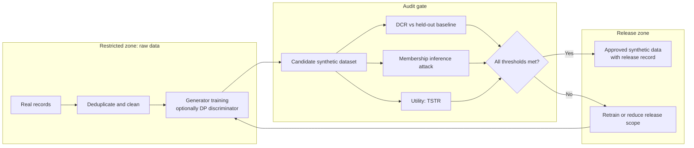

The diagram draws the trust boundaries. Real data and the generator weights stay in the restricted zone, because the weights themselves can embed training records. Only artifacts that pass the audit gate cross into the release zone, and the release record documents what was checked. Two consequences follow for governance. First, the generator weights are as sensitive as the data they were trained on until shown otherwise. Second, a data subject's deletion request does not delete the record's influence on a trained generator, and CH30 covers the operational consequence: the generator and its outputs must be in the deletion and retraining plan, because removal of learned influence is not assumed without a validated method.

## 25. Misuse, Provenance, and Detection

### 25.1 The threat picture

GAN-generated and other synthetic media create specific threats. Face synthesis and swapping enable impersonation and fabricated identities, which can defeat weak remote identity checks. Synthetic faces supply profile pictures for fake accounts at scale. Voice and video synthesis support fraud and disinformation. Generated intimate imagery of real people, made without consent, is a severe harm. These threats exist whether or not your organization trains a GAN, because pretrained generators are public. An architect considers two roles.

- **As a producer.** Your system generates media. The questions are who may use it, for what, how outputs are labeled, and how misuse is limited and traced.
- **As a consumer.** Your system accepts media that could be synthetic: identity verification selfies, user-uploaded product images, evidence in a claims process. The questions are how to detect or constrain synthetic input and what decisions depend on it.

### 25.2 Controls for producers

- **Access control and rate limits** on generation endpoints, with authentication, per-user quotas, and anomaly detection on usage, to limit bulk generation.
- **Model weight protection.** A released or leaked generator cannot be recalled, so treat weights as controlled artifacts and decide on a release strategy (open, gated, or API-only) with the misuse analysis in hand ([CH31](CH31_Responsible_AI_and_Safety_Governance.md)).
- **Input and output screening.** A conditional generator should have policy checks on its conditions and a classifier on its outputs for prohibited content. The discriminator is a training artifact and does not serve as a safety classifier (Section 4.2).
- **Disclosure and labeling** in the product interface where outputs could be mistaken for real.
- **Provenance and watermarking** (below), logged generation records, and a response process for reports of abuse.
- **Human review** for high-risk requests, and the ability to disable features quickly.

### 25.3 Detection and the base-rate problem

Classifiers can detect images from a specific GAN, because generators leave statistical fingerprints, for example in the frequency spectrum (Yu, Davis and Fritz, 2019; Wang et al., 2020). The limits matter for architecture. Detectors trained on one generator often generalize poorly to new ones, post-processing such as compression or resizing degrades them, and an adversary who knows the detector can evade it. Detection yields a probability and not a proof.

A base-rate calculation shows how this plays out operationally. Suppose a detector has a true positive rate of 95% and a false positive rate of 2%, and 1% of uploaded images are synthetic. Per 10,000 uploads, 100 are synthetic and 9,900 are real. The detector flags $0.95 \times 100 = 95$ synthetic images and $0.02 \times 9{,}900 = 198$ real ones. The precision of a flag is $95 / (95 + 198) = 0.324$. Two out of three flagged images are real. A detector that sounds accurate would, if used as an automatic rejection rule, wrongly reject 198 real users for every 95 true catches. Detection belongs in a risk-scoring pipeline with human review or a step-up check, not as a sole gate. [CH06](CH06_Model_Evaluation_Validation_and_Selection.md) covers the precision-and-prevalence relationship.

### 25.4 Watermarking

An invisible watermark embeds a signal in generated media that a decoder can recover. There are two families. **Post-hoc watermarks** modify the finished output, in the frequency domain or with a learned encoder and decoder. **In-generation watermarks** are built into the generative process: Stable Signature (Fernandez et al., 2023) fine-tunes the image decoder of a latent model so that every output carries a fixed signature, and Tree-Ring (Wen et al., 2023) embeds a pattern in the initial noise of a diffusion model. SynthID (Google DeepMind) applies watermarking across several media types. A watermark has four properties that trade against each other:

| Property | Question |
| --- | --- |
| Imperceptibility | Does the mark change how the content looks or sounds? |
| Capacity | How many bits can it carry (a flag, a model identifier, a user identifier)? |
| Durability | Does it survive cropping, resizing, compression, screenshots, and re-encoding? |
| Security | Can an adversary remove it, or forge it onto real content? |

Watermarks help when the producer cooperates, and they are weak against a determined adversary. Zhao and colleagues (2023) showed that some invisible watermarks can be removed by regenerating the image with a generative model. A missing watermark proves nothing, since content may come from a model that does not mark its outputs. A present watermark is useful evidence because forging one is harder than omitting one.

### 25.5 Content provenance with C2PA

Watermarks mark the content. Provenance metadata records its history. The Coalition for Content Provenance and Authenticity (C2PA) publishes a technical specification for Content Credentials: a signed manifest attached to an asset that records who created it, with what tool, and what edits were applied. Version 2.2 was the latest I could confirm at the time of writing (see the [C2PA specification](https://spec.c2pa.org/specifications/specifications/2.2/specs/_attachments/C2PA_Specification.pdf)); check the current version before building. Its main elements are:

- **Assertions:** statements about the asset, such as the actions performed and whether it was created by a generative model. A generative tool can record the creation as AI-generated using the IPTC digital source type vocabulary.
- **Claim and signature:** a claim bundles the assertions and hashes of the content, and it is signed with a certificate, so tampering after signing is detectable.
- **Hard binding:** a cryptographic hash ties the manifest to the exact bytes of the asset.
- **Soft binding:** a watermark or fingerprint lets a verifier look up the manifest for an asset whose metadata has been stripped.
- **Ingredients:** references to the source assets that an edited asset was made from, forming an edit history.

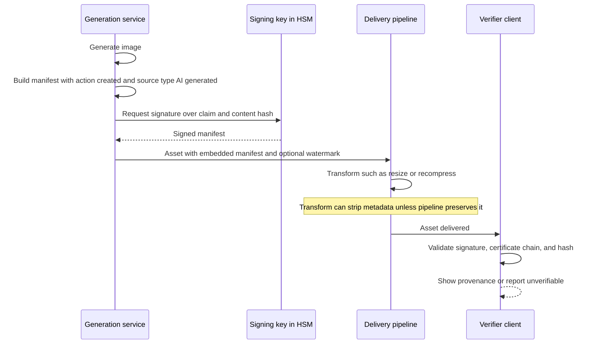

The sequence shows both the mechanism and its operational weak point. Signing happens inside the producer under a protected key. Verification checks the signature, the certificate, and that the hash matches the bytes. Any step in the pipeline that rewrites the file, such as resizing or recompression at the content delivery network, can invalidate or remove the manifest unless the pipeline is designed to preserve or re-sign it. A watermark or a soft binding can restore the link. A manifest that is absent or fails validation does not show that content is fake, only that its history is not established.

Provenance has limits that an architect should state in the design. The system proves who signed an asset, not that the content is true. Trust depends on certificates and on the list of signers a verifier accepts. Implementations differ: a 2026 cryptographic security analysis of C2PA and its implementations ([IACR ePrint 2026/804](https://eprint.iacr.org/2026/804)) reports inconsistent validator behavior and other weaknesses, and it is a preprint whose findings you should read directly when assessing deployment risk.

### 25.6 Regulation

Regulatory duties for synthetic media are changing. Article 50 of the EU Artificial Intelligence Act sets transparency obligations: providers of systems that generate synthetic images, audio, video, or text must mark outputs in a machine-readable, detectable format, and deployers of systems that produce deepfakes must disclose that the content is artificially generated. Secondary sources at the time of writing ([a practical guide to Article 50](https://artificialintelligenceact.eu/transparency-rules-article-50/)) report that these obligations apply from 2 August 2026, with a grace period to 2 December 2026 for generative systems already on the market before that date. Dates and scope have been amended by the AI Omnibus, other jurisdictions have their own rules, and your obligations depend on your role and use. Verify the current text with legal counsel and treat this paragraph as a pointer, not advice. Plan the provenance mechanism (signing, watermarking, labeling) as part of the architecture, because retrofitting it into a delivery pipeline is expensive.

### 25.7 Provenance design checklist

1. Decide at generation time what is recorded, and sign it with a key stored in a hardware security module or a managed key service.
2. Preserve or re-sign manifests through every transformation in the pipeline, and test that the delivery path does not strip them.
3. Add a watermark as a second channel for recovery, and state how much processing it survives.
4. Define how the user interface shows provenance and what it says when verification fails or is absent.
5. For inbound media, define what decisions depend on authenticity, and use layered controls (liveness checks, device attestation, risk scoring, human review) instead of a single detector.
6. Define the incident process: takedown, key revocation, user notification, and evidence retention.

## 26. Operations, Observability, and Testing

A generator is a stateless function once it is trained: the same weights and the same latent vector give the same image, up to numerical differences between hardware and library versions. That makes it simpler to operate than a stateful service, and it makes some tests possible that other ML components do not allow. The lifecycle mechanics (registries, promotion, monitoring, rollback) belong to [CH29](CH29_MLOps_and_LLMOps.md). This section lists what is specific to generators.

### 26.1 Artifacts to version with each generator

- The EMA generator weights that will be served, and, separately, the full training snapshot (both networks, optimizer states, EMA) needed to resume.
- The training configuration: loss, regularizers and coefficients, learning rates, batch size, augmentation settings, EMA half-life, seeds.
- The data version and the filter or dedup rules applied, and the data-rights record for the training set ([CH30](CH30_AI_Data_Governance_Privacy_and_Provenance.md)).
- The evaluation report: FID with its protocol, precision and recall, effective modes, condition adherence per class, nearest-neighbor and membership audit results, downstream utility results, and the human review summary.
- The fixed-seed sample grid for this checkpoint and for the previous production checkpoint.
- A model card stating intended use, known failure modes (for example, dropped modes), and the truncation setting used for the reported numbers.

### 26.2 Promotion gates

| Gate | Evidence required | Typical rule |
| --- | --- | --- |
| Fidelity | FID or a modern variant on the fixed protocol, and human preference | No worse than the production generator by more than the measured noise |
| Coverage | Recall, effective modes, per-class counts | Recall above a floor set from the use case, no class below its minimum |
| Condition adherence | Per-class evaluator agreement | Each class above a floor, ratio to the real baseline reported |
| Novelty and privacy | DCR ratio and membership audit | Thresholds set in advance (Section 24) |
| Safety | Output classifier pass rate on a red-team prompt or condition set | Zero tolerance for prohibited categories |
| Utility | TSTR or product A/B result | Improvement on real held-out data |
| Cost and latency | p50 and p95 latency, images per GPU-second | Within the budget |

### 26.3 Tests unique to generators

**Golden-seed regression.** Store a fixed set of latent vectors and conditions, and the reference outputs from the production generator. For a new candidate, generate from the same inputs and compare in a feature space. A GAN's output varies smoothly with $z$, so a new checkpoint changes the image in a bounded way, and a huge change signals a problem such as a changed preprocessing step. Do not require identical pixels across hardware or framework versions, because floating-point behavior differs, and use a tolerance.

**Statistical tests on generated batches.** Generate several thousand samples and check summary statistics against the reference: pixel range, color histograms, the feature-space distance to the reference set (an FID-like drift score), and the class histogram for conditional models.

**Contract tests on the serving interface.** Check output size, format, color space, metadata (including the provenance manifest), and behavior with out-of-range conditions and seeds.

**Safety tests.** Run the output classifier and the condition filter over an adversarial set, and track the pass rate by release.

### 26.4 Observability in production

| Signal | Why | Action on breach |
| --- | --- | --- |
| Latency p50 and p95, GPU utilization, queue depth | Capacity and user experience | Scale out, adjust batching |
| Rate of requests by condition | A shift can indicate a new use or abuse | Review, rate-limit |
| Output safety classifier flag rate | Misuse and model regressions | Alert, tighten filters |
| Drift score on feature embeddings of a rolling window of outputs against the release reference | A regression or silent change in inputs | Compare with golden seeds, roll back |
| Provenance validation success at the delivery edge | Pipeline stripping manifests | Fix the pipeline |
| User reports of artifacts or misuse | Failures the metrics miss | Triage, add to tests |

### 26.5 Rollback and lineage

Because generation is stateless, rolling back means pointing the service at the previous weights, which is quick if the previous generator remains deployable. The harder problem is derived data. If a generator version produced training data for a downstream model, a defect in the generator contaminates that model. Tag every synthetic asset with the generator version, the seed, and the condition, so that you can find and remove the affected assets and retrain. That tag is also the hook for provenance and for answering a deletion or audit request.

## 27. Cost and Compute

All figures in this section come from `04_cost_and_latency.py`. They rest on stated assumptions, and each input must be replaced by a measurement on your hardware. The point is the structure of the calculation.

### 27.1 Memory

The training state of a GAN includes the weights, gradients, and optimizer state of two networks, plus an EMA copy of the generator. For a generator of 30 million parameters and a discriminator of 28 million, in single precision with Adam (4 bytes for the weight, 4 for the gradient, 8 for the two moment estimates, which is 16 bytes per parameter):

$$
(30\text{M} + 28\text{M}) \times 16 \text{ bytes} = 928 \text{ MB}, \qquad \text{EMA copy: } 30\text{M} \times 4 = 120 \text{ MB}, \qquad \text{total} = 1{,}048 \text{ MB}.
$$

This is small, about 1 GB. The memory that limits batch size is the activations stored for backpropagation at high resolution, which depends on image size, batch size, and network width, not on the parameter count. The discriminator's gradient penalty adds a second backward pass and more activation memory. Measure peak memory on a real training step before choosing the GPU.

Checkpoint storage follows from the same figures. A full resumable snapshot is about 1,048 MB. Saving one every 100 thousand images over a 25-million-image run gives 250 snapshots, or $250 \times 1{,}048 \text{ MB} \approx 262$ GB. Keeping only the 120 MB EMA generator for most checkpoints costs $250 \times 120 \text{ MB} = 30$ GB. A retention policy that keeps full snapshots sparsely and generator-only checkpoints densely cuts storage by a factor of about nine.

### 27.2 Training time and the cost of failed runs

Training is usually measured in thousands of images shown to the discriminator (kimg). With the illustrative throughput of $0.04$ kimg per second on an 8-GPU node and a 25,000 kimg budget:

$$
\frac{25{,}000}{0.04} = 625{,}000 \text{ s} = 7.2 \text{ days}, \qquad 7.2 \times 24 \text{ h} \times 8 \text{ GPUs} \times \$2.50 = \$3{,}472.
$$

A GAN run can fail late, as BigGAN's authors documented, and a failed run is lost compute unless a good checkpoint exists. If the probability that a run needs to be abandoned and restarted is 30% (an illustrative figure, to be replaced by your own history), the expected number of attempts is $1/(1 - 0.3) = 1.43$ and the expected cost is $\$3{,}472 / 0.7 \approx \$4{,}960$. Frequent checkpointing and a restore-and-resume policy reduce the loss from a failed run, because you restart from the last good checkpoint and not from zero. Add the cost of experiments: hyperparameter searches and ablations usually cost several times the final run.

### 27.3 Serving cost: one pass against many steps

For serving, the cost per image is the compute per image divided by the sustained throughput of the GPU. With the illustrative assumptions of 40 sustained teraflops per second, a GAN generator needing 40 gigaflops per image, and a diffusion sampler running a 150-gigaflop denoiser for 25 steps with guidance doubling the evaluations ($150 \times 25 \times 2 = 7{,}500$ gigaflops per image):

| System | GFLOP per image | Images per second per GPU | GPU-hours per million images | Cost per million at $2.50 per GPU-hour |
| --- | --- | --- | --- | --- |
| GAN, one pass | 40 | 1,000 | 0.28 | $0.69 |
| Diffusion, 25 steps with guidance | 7,500 | 5.3 | 52.08 | $130.21 |

The compute ratio is $7{,}500/40 = 187.5$, about 188 times. The diffusion cost per image of roughly 1.3 cents is small for many products and decisive for others, such as free filters applied to millions of videos. Latency follows the number of sequential steps. With an illustrative 15 milliseconds for one GAN pass and 12 milliseconds per denoiser call, 25 sequential steps take 300 milliseconds, twenty times the GAN. Distilled diffusion students with one to four steps close much of the gap, at a cost in quality that you must measure. The assumptions (utilization, batching, precision, compiled kernels) are the real drivers, so benchmark the actual models. [CH28](CH28_Inference_Optimization_and_Model_Serving.md) covers serving optimization.

### 27.4 Evaluation cost

The FID feature extraction for 50,000 images at an illustrative 6 gigaflops per image is $50{,}000 \times 6 = 300$ teraflops, or about 8 seconds at 40 teraflops per second sustained. Metrics are cheap compared with training, and the cost to budget is people's time for human evaluation. At 600 judgments for a $\pm 4$ percentage point interval (Section 18.5), the cost is set by the rater rate, and it is usually the largest evaluation line item.

## 28. Quality-Attribute Scenarios

| Attribute | Stimulus | Response | Measure |
| --- | --- | --- | --- |
| Latency | An interactive filter requests one image per camera frame | Generator runs a single forward pass on the device GPU | p95 latency under 33 ms at 30 frames per second |
| Coverage | Release candidate is evaluated for a product catalog with 40 categories | Evaluation computes recall and per-category counts on 20,000 samples | Recall above the floor, no category below 1% of samples when it is 2.5% of the data |
| Condition adherence | A user requests category "boots" with lighting "warm" | Output conforms to both conditions | Evaluator agreement at least 0.95 of the real-image baseline per condition |
| Privacy | A partner requests a synthetic customer table | Audit runs DCR and membership attack before release | DCR ratio above its bound, attack AUC below its bound, recorded in the release record |
| Provenance | A generated image passes through resizing and recompression at the CDN | Edge validates the manifest or recovers it through the watermark | Manifest validation success above 99% of served assets |
| Availability and rollback | A new generator version shows a rising flag rate | Traffic returns to the previous version | Rollback completes in under 10 minutes with no data loss |
| Cost | Traffic doubles | Capacity scales horizontally with a stateless generator | Cost per thousand images stays within 10% of baseline |
| Safety | Red-team set submits prohibited conditions | Filter blocks them and logs the attempt | 100% blocked on the test set, reviewed weekly |

Each row states the stimulus, the system response, and a number that can be tested. The numbers are examples, and each must be set from the product's real requirements.

## 29. Case Study: Synthetic Defect Images for Visual Inspection

All numbers in this case study are illustrative. They show the reasoning and the statistics, and they are not from a real project.

### 29.1 Context

A manufacturer inspects machined metal parts with a camera and a classifier. The target is a hairline crack, which is rare: the training set has 40,000 images of good parts and 180 images of cracks, taken from 60 distinct parts. The requirement is at least 85% recall on cracks at 98% specificity. All images are proprietary and must stay on the plant's servers.

### 29.2 Options considered

| Option | Advantage | Reason for the decision |
| --- | --- | --- |
| Collect more real cracks | Ground truth | Cracks occur about once per 2,000 parts, so reaching 600 images would take months. Continue in the background. |
| Classical augmentation and class weighting | Cheap, no new model | Adopted as the baseline. Everything else must beat it. |
| Physical simulation or rendering of cracks | Controllable geometry | Needs CAD and texture models that do not exist for this part family. Rejected for now. |
| Conditional GAN (StyleGAN2-ADA class) on crack crops | Works with a few hundred images using adaptive augmentation, in-house tooling, runs on-premises | Selected for the trial. |
| Fine-tuning a diffusion model | Strong priors from pretraining | Plausible, and not rejected on merit. It would need a pretrained model approved for use on-premises and new tooling. Deferred to a later review. |

### 29.3 Process and evidence

**Split.** The team splits by physical part, not by image, because images of one part are near-duplicates and would leak across a random split. The generator is trained on crack crops from training parts only, so that no information from the validation or test parts reaches the classifier (Section 23.1).

**First run.** The first generator produced crisp cracks in only three orientations, though the real data had many. Precision looked fine and recall was low (Section 18.4). The effective number of orientation clusters, computed with the mode histogram of Section 13.3, was 3.1 against 6.8 in the real data. The team enabled adaptive augmentation to curb discriminator overfitting on 180 images, added an $R_1$ penalty, and used recall and the effective-mode count as checkpoint-selection criteria alongside FID. The second run had an effective mode count of 6.2.

**Memorization audit.** With only 180 training images, memorization is the main risk. The median DCR ratio was 0.83, a warning but not a copy signal by itself. The team then reviewed the 40 generated images closest to a training crop and found 4 near-copies. They removed those from the synthetic set and lowered the training length. Because the data is internal and the images do not leave the plant, this audit protects against inflated results more than against a privacy breach.

**Plausibility review.** Two quality engineers rated a blinded sample of 100 images, 50 synthetic and 50 real, as real or fake. They called 38 of the 50 synthetic ones real ($76\%$), against 44 of 50 real ones ($88\%$). The engineers also marked 11 of the synthetic cracks as physically implausible (cracks that did not follow grain or edge structure), and those were removed.

**Utility test, first round.** The classifier was trained on the real data with classical augmentation (baseline) and on the same data plus 1,600 synthetic crack images (GAN). Both were tested on 60 real held-out crack images from parts not used in training. The baseline caught 43 of 60 (71.7%) and the GAN-augmented model caught 48 of 60 (80.0%) at the fixed operating point. The two models disagree on 11 images: the GAN model is right and the baseline wrong on 8, and the reverse on 3. The exact McNemar test for 3 versus 8 out of 11 discordant pairs gives a two-sided $p$ of

$$
2 \times \frac{\binom{11}{0} + \binom{11}{1} + \binom{11}{2} + \binom{11}{3}}{2^{11}} = 2 \times \frac{1 + 11 + 55 + 165}{2048} = 0.227.
$$

The eight-point improvement is not statistically distinguishable from noise with 60 test cracks. The team did not release on this evidence.

**Utility test, second round.** After a month the plant collected 150 additional real cracks from new parts. On the 150, the baseline caught 105 (70.0%) and the GAN model caught 123 (82.0%). The discordant pairs were 24 (GAN right, baseline wrong) against 6, and the exact two-sided $p$ for 6 or fewer out of 30 is about $0.0014$ (the sum $\binom{30}{0} + \dots + \binom{30}{6} = 768{,}212$ over $2^{30}$, doubled). The GAN-augmented model now showed a credible improvement of 12 percentage points, still short of the 85% target.

### 29.4 Decision and operations

The team adopts the GAN augmentation as a component and keeps working on the gap. The synthetic images are tagged with the generator version, seed, and condition, and stored apart from the real images in the dataset registry so that no synthetic image can enter a validation or test set. The promotion gate for the classifier requires the real-held-out result, and a new generator version re-runs the full audit. The generator weights are stored with the training data, under the same access controls, because the weights can embed crack images. Rollback means retraining the classifier from the registry without the synthetic images, which takes a day.

### 29.5 Lessons

1. The baseline came first, and the GAN was judged against it on real held-out data split by part.
2. The first success signal (a plausible improvement on 60 cracks) was not trusted, because a paired test said it could be noise. More real test data resolved it.
3. Coverage metrics, not the loss and not the image quality alone, caught the collapse.
4. Human review found physically implausible samples that automated metrics scored as fine.
5. The remaining gap to the target shows that synthetic data supplements real data and does not replace collecting it.

## 30. Common Mistakes

| Mistake | Cause | Consequence |
| --- | --- | --- |
| Judging progress by the loss curves | The losses are not a progress bar | Missed collapse, stopping good runs, continuing bad ones |
| Reporting FID without sample size and protocol | Treating FID as a standard number | Irreproducible, non-comparable results |
| Using FID alone | One number hides fidelity and coverage separately | Mode dropping ships unnoticed |
| Using the last checkpoint | Assuming training improves monotonically | Worse generator in production than an earlier checkpoint |
| Augmenting only the real images | Applying standard augmentation to the data loader | Generator reproduces the augmentation artifacts |
| Batch normalization in a gradient-penalty critic | Copying a classifier recipe | Penalty is wrong, training unstable |
| Real and fake pass through different preprocessing | Decoding real images from files and fakes from tensors | Discriminator learns the shortcut, generator gets no useful signal |
| Training the generator on data that includes the test split | Convenience | Leakage, inflated downstream results |
| Treating synthetic data as anonymous | Assuming copies cannot occur | Disclosure of records, legal exposure |
| Using the discriminator as a quality score or safety filter | The discriminator looks like a classifier | Weak, gameable control that is tuned to the current generator |
| Relying on a deepfake detector as a sole gate | Ignoring base rates | Most flags are false positives at low prevalence |
| Not tagging synthetic assets | No lineage | Cannot find or remove contaminated data later |
| Skipping the simple baseline | Preferring the novel method | Cost without evidence of benefit |
| Ignoring serving cost until late | Quality-first thinking | A design that is correct and uneconomical |

## 31. Design-Review Checklist

1. **Fit.** Is a GAN the right family given latency, coverage, controllability, and team experience (Sections 21 and 22)? Is a baseline defined?
2. **Data.** Are rights, consent, and deduplication handled? Is the generator trained only on training data? Are real and fake preprocessed identically?
3. **Objective.** Which loss and regularizers are used, and is the implemented loss the one documented? Is the discriminator regularized (spectral norm, $R_1$, or gradient penalty)?
4. **Stability.** Are signals logged (Section 15.1)? Is there an automatic stop on non-finite values? Is checkpoint selection by held-out metric?
5. **Coverage.** Are recall, effective modes, and per-class counts computed at every checkpoint, and is there a release floor?
6. **Fidelity.** Is the FID protocol fixed and reported with sample size and truncation? Is there human evaluation of a shortlist?
7. **Conditioning.** Is condition adherence measured per condition against a real baseline?
8. **Utility.** Is the downstream benefit measured on real held-out data, split correctly?
9. **Privacy.** Are DCR and membership audits run with thresholds fixed in advance? Is differential privacy considered? Are the weights protected?
10. **Misuse.** Is there access control, output screening, rate limiting, labeling, and an abuse response?
11. **Provenance.** Is output signed and watermarked, and does the delivery pipeline preserve manifests? Is the regulatory position checked?
12. **Operations.** Are artifacts versioned, golden-seed tests in place, drift monitored, and rollback tested? Are synthetic assets tagged with generator version?
13. **Cost.** Are training budget (including failed runs), checkpoint storage, and serving cost per thousand images estimated from measurements?

## 32. Exercises

### 32.1 Questions

1. **Optimal discriminator.** Let $p_{\text{data}} = (0.6, 0.4)$ and $p_g = (0.2, 0.8)$ on two points. Compute $D^{\star}$, the Jensen-Shannon divergence, and $V(D^{\star}, G)$. Check that $V = -\log 4 + 2\,\mathrm{JSD}$.
2. **Saturation.** For a discriminator output $D(G(z)) = 0.02$, compare the gradient magnitudes with respect to the logit for the saturating and non-saturating generator losses. How many times larger is the second?
3. **Bilinear game.** For $\min_x \max_y xy$ with simultaneous updates and $\eta = 0.2$, by what factor does the distance from the equilibrium grow after 50 steps? What changes if the second player uses the updated $x$?
4. **Toy GAN experiment.** Run `01_toy_gan_2d.py` with three seeds on the eight-mode ring. Record how many modes are covered at each 500-step report and whether any mode disappears after being covered. What does that say about checkpoint selection?
5. **Gradient penalty.** A critic has gradient norms $0.5$, $1.2$, and $2.0$ at three interpolated points. With $\lambda = 10$, compute the mean WGAN-GP penalty. Which point contributes the most, and why does the penalty also act on the point with norm $0.5$?
6. **FID by hand.** Real features have mean $(0, 0)$ and covariance $I$ in two dimensions. Generated features have mean $(2, 0)$ and covariance $4I$. Compute the FID.
7. **Base rate.** A synthetic-media detector has a 90% true positive rate and a 1% false positive rate. Prevalence of synthetic uploads is 0.5%. What fraction of flagged uploads are synthetic? What follows for how the detector is used?
8. **Family selection.** A product needs to render a stylized avatar from a selfie on a phone in under 50 ms, with no data leaving the device. Choose and justify a generative approach, list three risks, and name the metrics and tests you would require before release.

### 32.2 Answer outlines

1. $D^{\star} = (0.6/0.8,\; 0.4/1.2) = (0.75,\; 0.3333)$. The mixture is $m = (0.4, 0.6)$. $\mathrm{KL}(p_{\text{data}} \| m) = 0.6\ln1.5 + 0.4\ln(2/3) = 0.0811$, and $\mathrm{KL}(p_g \| m) = 0.2\ln0.5 + 0.8\ln(4/3) = 0.0915$, so $\mathrm{JSD} = 0.0863$. Direct evaluation: $V = 0.6\ln0.75 + 0.4\ln0.3333 + 0.2\ln0.25 + 0.8\ln0.6667 = -1.2137$. The identity gives $-1.3863 + 0.1726 = -1.2137$.
2. Saturating: $0.02$. Non-saturating: $0.98$. The ratio is $49$.
3. The squared radius grows by $1 + \eta^2 = 1.04$ per step, so the radius grows by $1.04^{25} \approx 2.67$ after 50 steps. With alternating updates the update matrix has determinant 1 and trace $2 - \eta^2$, so the iterates stay on a closed orbit instead of spiraling out.
4. Answers vary by seed. In the seed-0 run in Section 14.3, modes dropped out and came back between reports, so the last checkpoint is not guaranteed to cover all modes, and the checkpoint should be chosen by a coverage metric computed on the EMA generator.
5. Penalties: $10(0.5)^2 = 2.5$, $10(0.2)^2 = 0.4$, $10(1.0)^2 = 10$. Mean $= 12.9/3 = 4.3$. The point with norm $2.0$ contributes most. The penalty is two-sided because the optimal critic has gradient norm $1$ along the transport lines, so a norm of $0.5$ means the critic is too flat there and loses discriminating power.
6. Mean term: $2^2 = 4$. Trace term: $\operatorname{Tr}(I) + \operatorname{Tr}(4I) - 2\operatorname{Tr}\big((4I)^{1/2}\big) = 2 + 8 - 2\cdot 4 = 2$. FID $= 6$.
7. Per 10,000 uploads: 50 synthetic and 9,950 real. Flagged synthetic: 45. Flagged real: 99.5. Precision $= 45/144.5 = 0.31$. Use the detector for risk scoring and step-up checks, not for automatic rejection.
8. A single-pass generator (a compact GAN or a distilled student) fits the 50 ms and on-device limits. Likely a paired or unpaired image-to-image generator with an adversarial loss. Risks: identity distortion or bias across skin tones and ages, misuse for face manipulation, and quality artifacts on unusual inputs. Metrics and tests: identity preservation, per-group fidelity, human preference, p95 latency on target devices, model extraction and weight protection, and provenance labeling. The tests include on-device latency and thermal behavior, a fairness evaluation with a representative sample, and a safety review.

## 33. Code Examples

All scripts use only the Python standard library and print the numbers quoted in this chapter.

- [`01_toy_gan_2d.py`](../code/python/gan-chapter/01_toy_gan_2d.py) trains a complete GAN with hand-written backpropagation on four or eight Gaussian modes and reports loss, discriminator probabilities, and mode coverage every 500 steps.
- [`02_gan_theory_numbers.py`](../code/python/gan-chapter/02_gan_theory_numbers.py) checks the optimal discriminator and the Jensen-Shannon identity, the saturating and non-saturating gradients, the gradient penalty, spectral norm, EMA half-lives, the VAE bound, FID in two dimensions, and the Inception Score.
- [`03_gan_metrics_and_privacy.py`](../code/python/gan-chapter/03_gan_metrics_and_privacy.py) scores four toy generators with FID, precision, recall, effective modes, a membership-inference AUC, and distance to closest record.
- [`04_cost_and_latency.py`](../code/python/gan-chapter/04_cost_and_latency.py) computes training memory, serving cost per million images for a one-pass and an iterative generator, latency, evaluation cost, and training budget from stated assumptions.

## 34. Summary

A GAN trains a generator against a discriminator. Under an optimal discriminator the original objective equals $-\log 4 + 2\,\mathrm{JSD}$, but that result describes the idealized game and not the training you will run. The original generator loss saturates when the discriminator is winning, so the non-saturating loss is the standard. Alternating gradient updates can fail to converge even on a bilinear game, so practice relies on regularization (spectral normalization, $R_1$, gradient penalties), unequal learning rates, and averaging of the generator weights. The Wasserstein objective gives a gradient where the JSD is flat. Relativistic losses with zero-centered penalties offer a principled modern baseline.

Conditional GANs, Pix2Pix, CycleGAN, and the StyleGAN family extend the base model to controlled generation, translation, and high-resolution synthesis. Their characteristic failures are mode collapse and mode dropping, ignored conditions, hidden information and hallucination in unpaired translation, and discriminator overfitting on small data. Loss curves do not reveal them, so evaluation has to measure fidelity and coverage separately, with FID, precision and recall, effective modes, human review, and downstream tests, and each metric has blind spots that the toy generators in this chapter expose.

Compared with VAEs, flows, autoregressive models, and diffusion, GANs sit in the fast, sharp, and fragile corner of the trade-off. Diffusion models displaced them for open-ended image generation because of stable training, coverage, and conditioning, and GANs remain the right choice for single-pass and real-time generation, super-resolution, and as adversarial losses inside other systems. Synthetic data does not remove privacy risk, because generators can memorize, so release needs audits and possibly differential privacy. Generated media needs access control, provenance, watermarking, and honest expectations of what detection can do. Cost is dominated by training expertise and failed runs on one side and by per-image serving compute on the other, and both are estimated from measurement.

## 35. References and Further Reading

Papers are listed by first author and year. Check the current published version of any result you rely on.

- Goodfellow et al. (2014), [Generative Adversarial Networks](https://arxiv.org/abs/1406.2661). Mirza and Osindero (2014), [Conditional Generative Adversarial Nets](https://arxiv.org/abs/1411.1784).
- Radford, Metz and Chintala (2016), [DCGAN](https://arxiv.org/abs/1511.06434). Salimans et al. (2016), [Improved Techniques for Training GANs](https://arxiv.org/abs/1606.03498).
- Arjovsky and Bottou (2017), [Towards Principled Methods for Training GANs](https://arxiv.org/abs/1701.04862). Arjovsky, Chintala and Bottou (2017), [Wasserstein GAN](https://arxiv.org/abs/1701.07875). Gulrajani et al. (2017), [Improved Training of Wasserstein GANs](https://arxiv.org/abs/1704.00028).
- Miyato et al. (2018), [Spectral Normalization for GANs](https://arxiv.org/abs/1802.05957). Mescheder, Geiger and Nowozin (2018), [Which Training Methods for GANs do actually Converge?](https://arxiv.org/abs/1801.04406). Heusel et al. (2017), [GANs Trained by a Two Time-Scale Update Rule](https://arxiv.org/abs/1706.08500).
- Mao et al. (2017), [Least Squares GAN](https://arxiv.org/abs/1611.04076). Jolicoeur-Martineau (2019), [The Relativistic Discriminator](https://arxiv.org/abs/1807.00734). Huang et al. (2024), [The GAN is dead; long live the GAN! A Modern Baseline GAN](https://arxiv.org/abs/2501.05441).
- Isola et al. (2017), [Pix2Pix](https://arxiv.org/abs/1611.07004). Zhu et al. (2017), [CycleGAN](https://arxiv.org/abs/1703.10593). Chu, Zhmoginov and Sandler (2017), [CycleGAN, a Master of Steganography](https://arxiv.org/abs/1712.02950).
- Karras et al. (2018), [Progressive Growing of GANs](https://arxiv.org/abs/1710.10196). Karras, Laine and Aila (2019), [StyleGAN](https://arxiv.org/abs/1812.04948). Karras et al. (2020), [StyleGAN2](https://arxiv.org/abs/1912.04958) and [StyleGAN2-ADA](https://arxiv.org/abs/2006.06676). Karras et al. (2021), [Alias-Free GAN](https://arxiv.org/abs/2106.12423). Brock, Donahue and Simonyan (2019), [BigGAN](https://arxiv.org/abs/1809.11096). Kang et al. (2023), [GigaGAN](https://arxiv.org/abs/2303.05511).
- Salimans et al. (2016) for Inception Score. Heusel et al. (2017) for FID. Kynkäänniemi et al. (2019), [Improved Precision and Recall](https://arxiv.org/abs/1904.06991). Parmar, Zhang and Zhu (2022), [On Aliased Resizing and Surprising Subtleties in GAN Evaluation](https://arxiv.org/abs/2104.11222). Stein et al. (2023), [Exposing flaws of generative model evaluation metrics](https://arxiv.org/abs/2306.04675). Jayasumana et al. (2024), [Rethinking FID](https://arxiv.org/abs/2401.09603).
- Kingma and Welling (2014), [Auto-Encoding Variational Bayes](https://arxiv.org/abs/1312.6114). Dinh, Sohl-Dickstein and Bengio (2017), [RealNVP](https://arxiv.org/abs/1605.08803). Kingma and Dhariwal (2018), [Glow](https://arxiv.org/abs/1807.03039).
- Ho, Jain and Abbeel (2020), [DDPM](https://arxiv.org/abs/2006.11239). Dhariwal and Nichol (2021), [Diffusion Models Beat GANs on Image Synthesis](https://arxiv.org/abs/2105.05233). Rombach et al. (2022), [Latent Diffusion](https://arxiv.org/abs/2112.10752). Xiao, Kreis and Vahdat (2022), [Tackling the Generative Learning Trilemma](https://arxiv.org/abs/2112.07804). Sauer et al. (2023), [Adversarial Diffusion Distillation](https://arxiv.org/abs/2311.17042).
- Xu et al. (2019), [Modeling Tabular Data using Conditional GAN](https://arxiv.org/abs/1907.00503). Webster et al. (2021), [This Person (Probably) Exists](https://arxiv.org/abs/2107.06018). Chen et al. (2020), [GAN-Leaks](https://arxiv.org/abs/1909.03935). Xie et al. (2018), [Differentially Private GAN](https://arxiv.org/abs/1802.06739).
- Fernandez et al. (2023), [The Stable Signature](https://arxiv.org/abs/2303.15435). Wen et al. (2023), [Tree-Ring Watermarks](https://arxiv.org/abs/2305.20030). Zhao et al. (2023), [Invisible Image Watermarks Are Provably Removable Using Generative AI](https://arxiv.org/abs/2306.01953). [C2PA specification](https://spec.c2pa.org/specifications/specifications/2.2/specs/_attachments/C2PA_Specification.pdf) and [Article 50 guide](https://artificialintelligenceact.eu/transparency-rules-article-50/); verify the current version and legal status.
