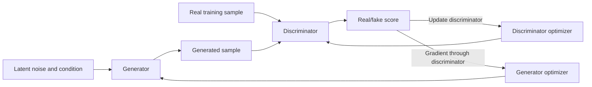
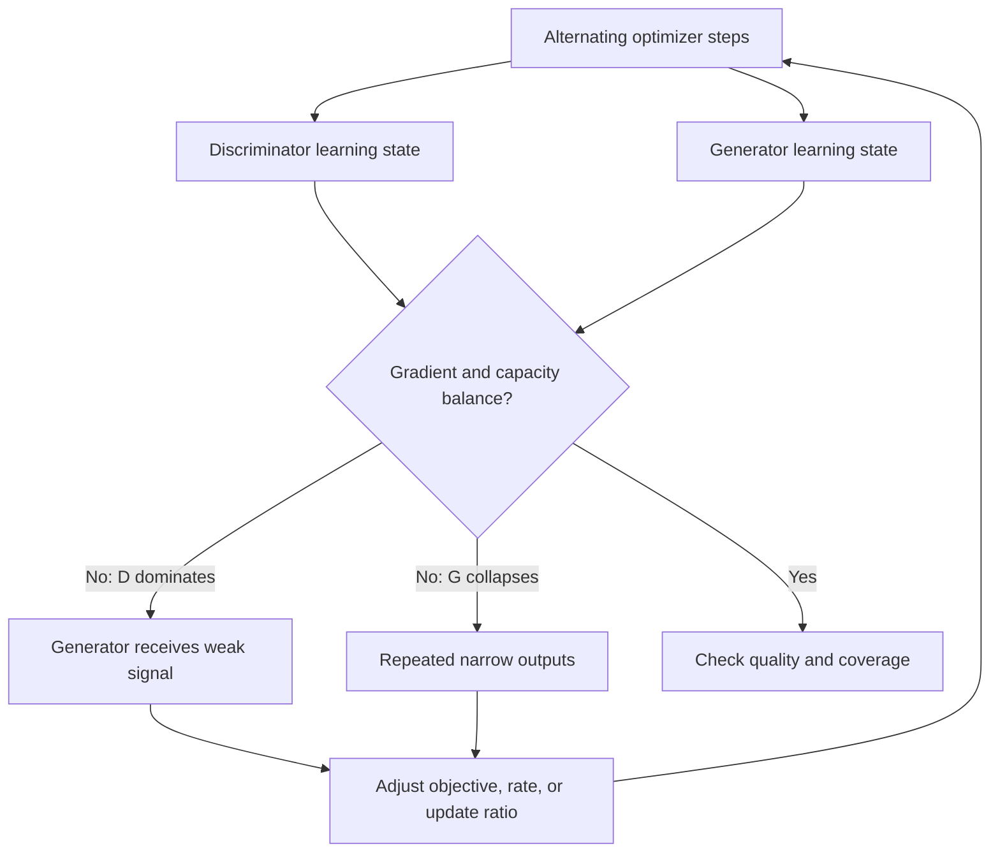
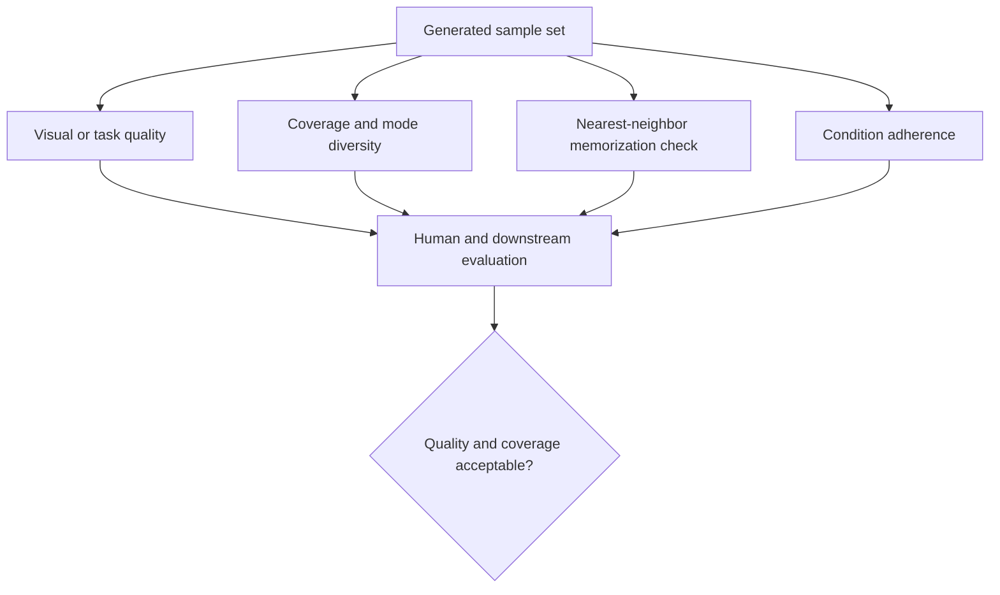
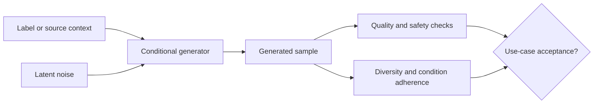
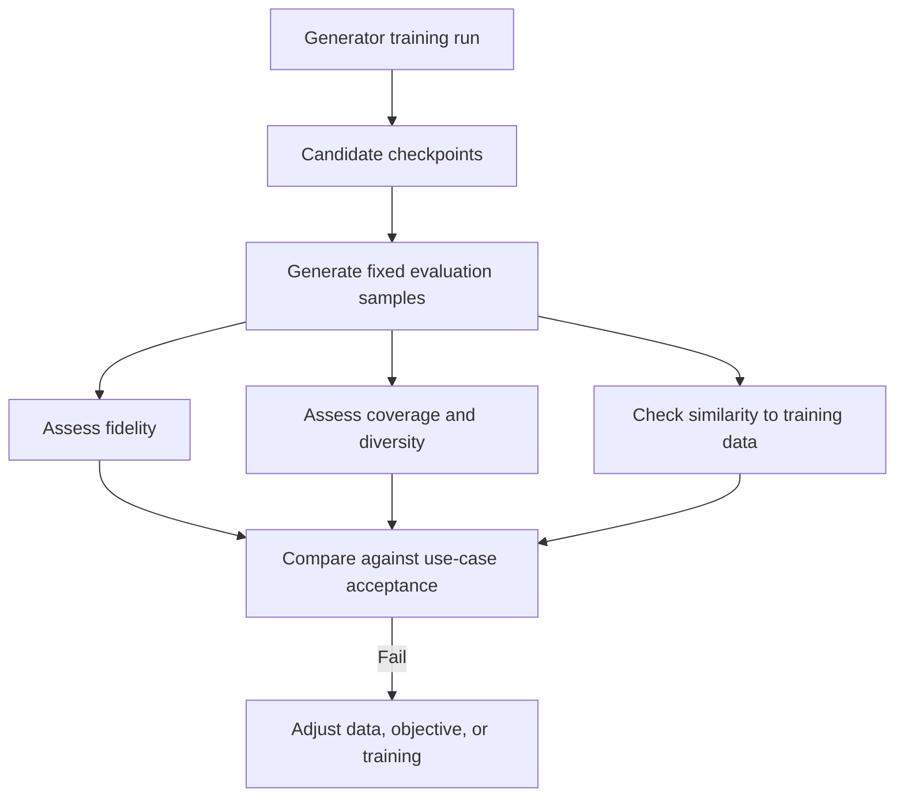

# Generative Adversarial Networks

Part: [16 — Artificial Intelligence, Machine Learning, and Generative AI](PART_OVERVIEW.md)

Generative Adversarial Networks (GANs) train a generator to produce samples and a discriminator to distinguish generated samples from real data. The adversarial objective can create sharp, realistic outputs, but training is a coupled optimization problem that may oscillate, collapse to a few modes, or produce samples that look convincing while omitting important coverage.

## Generator and Discriminator Objective

The generator maps latent noise and optional conditioning into a sample. The discriminator scores whether a sample appears to come from the training distribution. Training alternates updates so the discriminator learns to detect current generator weaknesses and the generator learns to produce samples that fool it.

The discriminator is a learned critic, not a calibrated probability that a generated sample is true. Objective variants modify stability and gradient behavior. Choose an objective based on empirical training diagnostics rather than assuming the original formulation is best.

The original minimax objective is $\min_G\max_D V(D,G)=\mathbb{E}_{x\sim p_{data}}[\log D(x)]+\mathbb{E}_{z\sim p_z}[\log(1-D(G(z)))]$. The discriminator maximizes separation between real and generated samples while the generator minimizes it. Early in training, a strong discriminator can make the original generator gradient very small; the commonly used non-saturating generator loss instead maximizes $\mathbb{E}_{z}[\log D(G(z))]$ to provide a stronger learning signal. The objectives have related equilibria but different optimization behavior, so record the actual loss and update schedule used.

The gradient-vanishing problem has a concrete numeric shape. If the discriminator assigns a generated sample a near-zero probability of being real, say $D(G(z))=0.001$, the original minimax generator loss term $\log(1-D(G(z)))\approx\log(0.999)\approx-0.001$ has an extremely flat slope with respect to the generator's parameters at that point — the generator receives almost no corrective signal exactly when it needs the most help. The non-saturating loss $-\log D(G(z))\approx-\log(0.001)\approx6.9$ instead produces a large gradient magnitude in that same regime, which is precisely why it became the standard default rather than a minor variant.

## Training Stability and Mode Collapse

If the discriminator becomes too strong, generator gradients may become uninformative. If the generator exploits a narrow set of outputs, mode collapse occurs: samples look plausible but lack diversity. Learning rates, update ratios, normalization, architecture, and objective affect dynamics. Loss curves alone may not reveal quality or coverage.

Measure both fidelity and diversity using suitable automated metrics and human review. Inspect nearest neighbors to detect memorization and evaluate condition adherence. A single perceptual score can hide coverage loss or unsafe artifacts.

Diagnose collapse by comparing outputs across fixed latent seeds and conditions, not by sampling one attractive image. Repeated near-duplicates, shrinking pairwise feature-space distances, and ignored conditioning can indicate different failures even when visual fidelity remains high. Stabilization methods address different causes: spectral normalization can limit discriminator sensitivity; gradient penalties constrain its local behavior; changing update ratios can rebalance learning rates; and minibatch features can expose low diversity. Each changes the optimization problem and can trade sample sharpness, coverage, and training cost. Keep the same diagnostic set across checkpoints and verify downstream utility before selecting a stabilization method.

## Conditional Generation and Use-Case Fit

Conditioning supplies labels, text, or other context to guide generation. The condition must be represented during both training and inference, and evaluation must test that output follows the intended condition. GANs are one generative approach; select them when training stability, sampling speed, output type, and tooling suit the application relative to diffusion or autoregressive alternatives.

Generative outputs need product controls for consent, provenance, harmful content, and user expectations. Do not rely on discriminator score as a safety check.

Compare generator families on both training behavior and serving path. A GAN can produce a sample with one generator pass after training, which can suit low-latency generation when the trained distribution has adequate coverage. Diffusion sampling iteratively denoises and may offer a different quality/diversity trade-off, at repeated inference cost. Autoregressive generators emit a sequence of tokens or units and have different dependency and latency characteristics. These are hypotheses to test on the target data: compare condition adherence, diversity, memorization, tail quality, and end-to-end serving cost rather than assuming one family wins from its objective alone.

## Worked Case and Review Checklist

A team generates synthetic product images conditioned on category and lighting. It monitors discriminator/generator behavior, image diversity, nearest-neighbor similarity, and condition adherence. Mode collapse appears as repeated poses despite strong visual quality. The team adjusts training and expands the data distribution, then validates that synthetic images improve a downstream classifier rather than merely increasing dataset size.

To diagnose the collapse, the team holds a fixed set of latent seeds and conditions constant across checkpoints, then compares class/lighting coverage and nearest neighbors against the training set. Human reviewers confirm whether apparent diversity changes are meaningful rather than pixel-level variation. The team evaluates the resulting synthetic data by training otherwise identical classifiers with and without the additions and scoring both on a real, untouched test set. If the synthetic-data model improves only on generated-like examples or reproduces the same minority-class gaps, the generator is not providing useful coverage even if its samples look sharp.

Review objective, data rights, condition coverage, training balance, stability diagnostics, diversity, memorization, downstream benefit, safety screening, and rollback to the previous generator.

## Questions and Summary

1. Draw the alternating generator/discriminator training loop.
2. Distinguish sample fidelity from distribution coverage.
3. How can a strong discriminator prevent useful generator learning?
4. Design tests for condition adherence and memorization.
5. Compare GANs with another generative method using the task's latency and quality needs.

GANs learn through competition between a generator and discriminator. Their training dynamics create distinctive stability and coverage risks, so evaluation must measure diversity, conditioning, and downstream usefulness in addition to sample quality. Treat generated output as untrusted data that needs application-level policy.
