# Diffusion Models

Part: [16 — Artificial Intelligence, Machine Learning, and Generative AI](PART_OVERVIEW.md) · Status: Revised (in-depth rewrite)

## 1. Introduction

A diffusion model generates data by learning to undo corruption. During training, a clean example such as an image is damaged with Gaussian noise in small steps until nothing recognizable remains. A neural network is trained to look at a damaged example and estimate what was added. During generation, the process runs backwards: the system starts from pure noise and repeatedly asks the network to remove a little of it. After tens of network evaluations the noise has turned into an image, a sound clip, a video, or a three-dimensional asset.

Diffusion models replaced Generative Adversarial Networks (GANs, covered in [CH11 — Generative Adversarial Networks](CH11_Generative_Adversarial_Networks.md)) as the default image generator for most products between 2021 and 2023. The reasons are practical rather than aesthetic. Training is a plain regression loss with no adversarial game, so it is stable and scales predictably. The models cover the whole data distribution instead of collapsing onto a few modes. They accept rich conditioning, most importantly free-form text. The price is inference cost: a GAN produces an image in one network call, while a diffusion model needs many. A large part of the engineering literature since 2021 is about paying that price down, and a large part of a solution architect's job is deciding how far to pay it down for a given product.

This chapter is for a reader who will design, buy, or operate a diffusion-based feature and needs to reason about it quantitatively. It teaches the mathematics well enough to read a paper or a library's configuration without guessing: the forward process and its closed form, noise schedules, the derivation of the noise-prediction loss from the variational bound, the score and stochastic differential equation views, deterministic samplers, fast solvers, guidance, flow matching, and distillation. It then moves to architecture and operations: network backbones, latent diffusion, conditioning, adaptation, evaluation, reproducibility, safety and legal exposure, serving cost, and a worked product case study.

### 1.1 Reader outcomes

After studying this chapter, a reader should be able to:

1. Write the forward noising process, derive its closed form, and compute the signal and noise coefficients at any step for a given schedule.
2. Derive the noise-prediction training loss from the variational lower bound, and explain what each simplification discards.
3. Explain the score-matching and stochastic differential equation (SDE) views, and state why a deterministic sampler exists for a model trained with a stochastic objective.
4. Compare ancestral, Denoising Diffusion Implicit Model (DDIM), Euler, Heun, and DPM-Solver samplers by number of network evaluations (NFE), and do latency arithmetic from step count and guidance.
5. Derive classifier guidance and classifier-free guidance, state what a guidance scale does to diversity, and explain negative prompts.
6. Explain why latent diffusion is cheaper than pixel diffusion with worked numbers, and describe how text, image, and spatial conditions enter the network.
7. Describe flow matching and rectified flow, and the main families of few-step distillation.
8. Choose and critique evaluation metrics (Fréchet Inception Distance or FID, Contrastive Language-Image Pretraining or CLIP score, human preference), record the inputs needed for reproducibility, and identify the safety, legal, and provenance obligations of a generation feature.
9. Size a serving fleet for an image-generation workload from per-call latency, batch behaviour, and traffic.

### 1.2 Scope and ownership

This chapter owns the diffusion process, its training objective, its samplers, guidance, and diffusion-specific serving cost. It recaps and links the topics that other chapters own.

| Topic | Owner | Treatment here |
| --- | --- | --- |
| Adversarial training, mode collapse, GAN metrics | [CH11 — Generative Adversarial Networks](CH11_Generative_Adversarial_Networks.md) | Short recap in Section 2.3 and comparison in Section 24 |
| Gradient descent, loss minimization, maximum likelihood | [CH01 — Machine Learning Foundations](CH01_Machine_Learning_Foundations.md) | Assumed |
| Neural network layers, normalization, optimization | [CH07 — Deep Learning Foundations](CH07_Deep_Learning_Foundations.md) | Assumed |
| Convolutions, residual blocks, the U-Net's building blocks | [CH08 — Convolutional Neural Networks](CH08_Convolutional_Neural_Networks.md) | Used in Section 9 |
| Attention, transformer blocks, positional information | [CH10 — Transformers and Attention](CH10_Transformers_and_Attention.md) | Used in Sections 9 and 11 |
| Embeddings and contrastive text-image models | [CH16 — Embeddings and Semantic Representations](CH16_Embeddings_and_Semantic_Representations.md) | Used for CLIP in Section 11 |
| Low-Rank Adaptation (LoRA) and parameter-efficient fine-tuning | [CH20 — Fine-Tuning, PEFT, and LoRA](CH20_Fine_Tuning_PEFT_and_LoRA.md) | Conceptual use in Section 13 |
| Multimodal systems that combine text, image, audio, and video | [CH23 — Multimodal Generative AI](CH23_Multimodal_Generative_AI.md) | Diffusion-specific parts only |
| Evaluating generative systems and guardrails | [CH24 — Generative AI Evaluation, Guardrails, and Hallucinations](CH24_Generative_AI_Evaluation_Guardrails_and_Hallucinations.md) | Image-specific metrics here |
| Inference optimization and model serving in general | [CH28 — Inference Optimization and Model Serving](CH28_Inference_Optimization_and_Model_Serving.md) | Diffusion-specific capacity here |
| Data governance, privacy, and provenance | [CH30 — AI Data Governance, Privacy, and Provenance](CH30_AI_Data_Governance_Privacy_and_Provenance.md) | Image-specific exposure here |
| Responsible AI and safety governance | [CH31 — Responsible AI and Safety Governance](CH31_Responsible_AI_and_Safety_Governance.md) | Image-specific controls here |
| Production AI system design | [AI Workload Qualification and Architecture Foundations](../17_AI_Architecture/CH01_AI_Workload_Qualification_and_Architecture_Foundations.md) | Referenced for qualification questions |

### 1.3 Why this matters to a solution architect

An architect rarely trains a diffusion model from scratch. The decisions that fall to the architect are different: which model family and license to adopt, whether to host or call an application programming interface (API), what latency tier each use case gets, how many graphics processing units (GPUs) the peak needs, which safety and provenance controls must exist before launch, and which quality claims the team can defend. Each of those decisions is quantitative. Latency is the product of step count, guidance multiplier, and per-call time. Capacity follows from latency and batching. Quality depends on sampler and schedule choices that look like harmless configuration but change the output. Legal exposure depends on training data and on what the model can reproduce. A reader who can only describe diffusion as "image generation from noise" cannot defend any of these decisions in a design review.

## 2. Background and Foundational Model

### 2.1 The generative modelling problem

A generative model learns a distribution $p_\theta(x)$ close to the unknown data distribution $q(x)$ well enough that samples from it look like data, and often so that the samples can be steered by a condition $c$ such as a text prompt. Three difficulties recur. Images live in spaces of hundreds of thousands of dimensions, so density estimation by counting is impossible. Real data concentrates near a thin, curved, low-dimensional manifold inside that space, so a model must put almost all of its probability mass in a tiny region. And evaluation is hard, because there is no single number that says a sample is good.

Earlier families each gave up something. Variational autoencoders (VAEs) train stably and give a latent code, but their samples are blurry when the decoder is a simple Gaussian. Autoregressive models factor the density into a product of conditionals and give exact likelihoods, but sampling is sequential over every pixel or token. GANs give sharp samples in one pass, but the adversarial game is unstable and the generator can ignore parts of the data. Normalizing flows give exact likelihoods through invertible networks, but the invertibility constraint limits the architecture.

Diffusion models take a different route. They avoid modelling the hard, global distribution directly. Instead they define an easy path that destroys the data gradually and learn only a local step along the way back.

### 2.2 History in brief

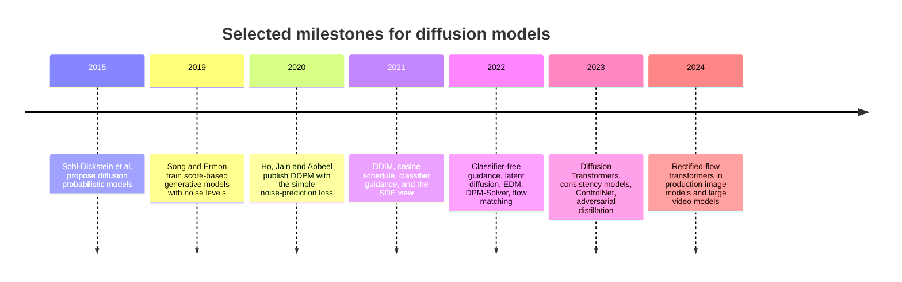

Jascha Sohl-Dickstein and colleagues introduced the idea in 2015, borrowing the physics of diffusion: a process that destroys structure step by step is easy to define, and a learned reversal of it can restore structure. The 2015 models were small and ignored for several years. In parallel, Yang Song and Stefano Ermon (2019) trained networks to estimate the gradient of the log density, called the score, at several noise levels, and sampled with Langevin dynamics. Jonathan Ho, Ajay Jain, and Pieter Abbeel (2020) showed that a diffusion model trained with a very simple loss, predicting the added noise, produced image quality competitive with the best GANs. That paper, Denoising Diffusion Probabilistic Models (DDPM), is the reference point for most notation in this chapter.

The two lines of work were unified by Song and colleagues (2021), who expressed both as discretizations of a stochastic differential equation and showed that a deterministic ordinary differential equation (ODE) shares the same marginal distributions. The same year Jiaming Song, Chenlin Meng, and Stefano Ermon introduced DDIM, a deterministic sampler that works with an already trained DDPM, and Alex Nichol and Prafulla Dhariwal proposed improvements such as the cosine schedule. Dhariwal and Nichol (2021) then showed with classifier guidance that diffusion could beat GANs on image synthesis benchmarks. Jonathan Ho and Tim Salimans (2022) removed the separate classifier with classifier-free guidance, which is the mechanism behind the prompt-adherence of modern text-to-image products. Robin Rombach and colleagues (2022) moved the process into a compressed latent space, which cut cost enough for consumer hardware. William Peebles and Saining Xie (2023) replaced the convolutional backbone with a transformer. Yaron Lipman and colleagues (2023) and Xingchao Liu and colleagues (2022) introduced flow matching and rectified flow, which changed the training target and are now used in several current image models.

### 2.3 GAN recap and how diffusion differs

A GAN trains a generator and a discriminator against each other and produces a sample in one forward pass; the details, the failure modes (mode collapse, unstable training), and the metrics are in [CH11](CH11_Generative_Adversarial_Networks.md). Diffusion differs on three axes that matter for an architect:

- **Training signal.** A GAN's gradient depends on the opponent, so it moves as the opponent changes. A diffusion model regresses toward a fixed target (the noise that was added), so the loss curve is well behaved and the training run can be restarted, scaled, and compared.
- **Coverage.** A discriminator can be satisfied by a generator that covers part of the data. The diffusion objective penalizes missing any region where training data exists, so diversity is typically better.
- **Inference cost.** A GAN needs one network evaluation. A diffusion model needs one per step, and guidance can double that. Sections 8, 15, and 16 address this gap.

### 2.4 The core idea in one picture

The central trick is that a hard problem is split into many easy ones. Recognizing the structure in an image that is nearly clean needs only a tiny correction, and removing a little noise from an image that is nearly pure noise needs only a coarse guess about layout. No single step requires the network to invent a whole image. The network learns a family of simple denoising tasks indexed by the noise level, and the sampler chains them.

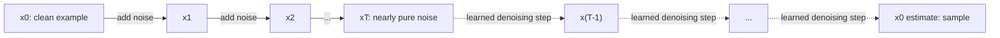

The solid arrows form the fixed forward process, which needs no learning. The dashed arrows form the learned reverse process. Everything in the rest of this chapter is a choice about how to define the solid arrows (schedule), what the network predicts at each dashed arrow (parameterization), how the dashed arrows are chained at sampling time (sampler), and how a condition changes them (guidance and conditioning).

## 3. The Forward Process and Its Closed Form

### 3.1 Definition

Let $x_0$ be a data example drawn from $q(x_0)$. For a fixed number of steps $T$ and a fixed sequence of variances $\beta_1,\dots,\beta_T$ with $0<\beta_t<1$, the forward process is the Markov chain

$$
q(x_t \mid x_{t-1}) = \mathcal{N}\!\left(x_t;\ \sqrt{1-\beta_t}\,x_{t-1},\ \beta_t I\right).
$$

Here $\mathcal{N}(x;\mu,\Sigma)$ denotes a Gaussian density with mean $\mu$ and covariance $\Sigma$, and $I$ is the identity matrix of the same dimension as $x$. Equivalently, each step shrinks the previous state by $\sqrt{1-\beta_t}$ and adds fresh Gaussian noise of variance $\beta_t$:

$$
x_t = \sqrt{1-\beta_t}\,x_{t-1} + \sqrt{\beta_t}\,\epsilon_{t-1}, \qquad \epsilon_{t-1}\sim\mathcal{N}(0,I).
$$

The shrinkage is what keeps the total variance from growing. If $x_{t-1}$ has per-coordinate variance 1, then $x_t$ has variance $(1-\beta_t)\cdot 1 + \beta_t = 1$. A process with this property is called variance preserving (VP). A variance-exploding (VE) alternative skips the shrinkage and lets the variance grow without bound; the two are related by rescaling, and Section 7 shows how both appear as SDEs.

### 3.2 Deriving the closed form

Training would be impractical if sampling $x_t$ required simulating $t$ steps. It does not, because a sum of independent Gaussians is Gaussian. Define

$$
\alpha_t = 1-\beta_t, \qquad \bar\alpha_t = \prod_{s=1}^{t}\alpha_s .
$$

Here $\alpha_t$ is the fraction of signal amplitude kept at step $t$ and $\bar\alpha_t$ is the cumulative product, which governs how much of the original example is left after $t$ steps. Unroll two steps:

$$
x_t = \sqrt{\alpha_t}\,x_{t-1} + \sqrt{1-\alpha_t}\,\epsilon_{t-1}
= \sqrt{\alpha_t}\left(\sqrt{\alpha_{t-1}}\,x_{t-2} + \sqrt{1-\alpha_{t-1}}\,\epsilon_{t-2}\right) + \sqrt{1-\alpha_t}\,\epsilon_{t-1}.
$$

Collect the two noise terms. They are independent Gaussians with variances $\alpha_t(1-\alpha_{t-1})$ and $1-\alpha_t$. Their sum has variance

$$
\alpha_t - \alpha_t\alpha_{t-1} + 1 - \alpha_t = 1 - \alpha_t\alpha_{t-1}.
$$

Therefore $x_t = \sqrt{\alpha_t\alpha_{t-1}}\,x_{t-2} + \sqrt{1-\alpha_t\alpha_{t-1}}\,\bar\epsilon$ for a single standard Gaussian $\bar\epsilon$. The pattern repeats by induction, and for any $t$

$$
\boxed{\,q(x_t\mid x_0)=\mathcal{N}\!\left(x_t;\ \sqrt{\bar\alpha_t}\,x_0,\ (1-\bar\alpha_t)I\right),\qquad x_t=\sqrt{\bar\alpha_t}\,x_0+\sqrt{1-\bar\alpha_t}\,\epsilon\,}
$$

with $\epsilon\sim\mathcal{N}(0,I)$. This formula is the working core of training. To make a noisy training example at an arbitrary step, draw one noise vector and take a weighted sum of the clean example and the noise. The weights satisfy $(\sqrt{\bar\alpha_t})^2+(\sqrt{1-\bar\alpha_t})^2=1$, which is the variance-preserving property restated: the squared signal weight and the squared noise weight add to one.

### 3.3 Worked numbers

Take the linear schedule used in the original DDPM, with $T=1000$ and $\beta_t$ rising linearly from $10^{-4}$ to $0.02$. Running the script [01_noise_schedules.py](../code/python/diffusion-chapter/01_noise_schedules.py) gives the following coefficients for a scalar $x_0=1.5$ and one fixed noise draw:

| Step $t$ | $\sqrt{\bar\alpha_t}$ | $\sqrt{1-\bar\alpha_t}$ | $x_t$ for $x_0=1.5$ |
| --- | --- | --- | --- |
| 10 | 0.9991 | 0.0435 | +1.5396 |
| 250 | 0.7239 | 0.6899 | +1.7356 |
| 500 | 0.2803 | 0.9599 | +1.3245 |
| 1000 | 0.0064 | 1.0000 | +0.9512 |

At $t=10$ the example is almost untouched. At $t=500$ the signal amplitude is about 28 percent of the original while the noise amplitude is about 96 percent, so the noisy value says little about $x_0$. At $t=1000$ the signal amplitude is 0.0064. The sample $x_{1000}$ is statistically almost indistinguishable from a standard Gaussian, which is the property that lets sampling start from pure noise. The word "almost" matters, and Section 4.4 returns to it: the small leftover signal causes a real quality bug in some implementations.

The same arithmetic applies per coordinate to every pixel (or latent value) at once. For an image with $H\times W\times 3$ values, $\epsilon$ is an array of the same shape, and the formula is applied elementwise. The noise is independent across pixels, which is a modelling choice with consequences: at high resolution a fixed amount of independent per-pixel noise destroys the coarse structure of an image later than it destroys fine texture, because coarse structure is spread over many pixels and averages the noise out. Section 4.5 uses this fact to explain why large images need schedules shifted toward higher noise.

### 3.4 What the forward process is not

The forward process is not learned and contains no model. It is also not an attempt to model how real images degrade. Its only job is to define, for every clean example, a sequence of progressively simpler distributions ending at a Gaussian, and to do so with a closed form that is cheap to sample. A reader who has seen the forward process drawn as a film of an image dissolving into static should keep in mind that the network never sees that film. In training, each example is shown at one randomly chosen noise level per iteration, with no information about what it looked like at other levels.

### 3.5 Training as a loop

Training repeats four operations: draw a clean example, draw a step $t$ uniformly from $\{1,\dots,T\}$, draw noise $\epsilon$, form $x_t$ from the closed form, and update the network to predict $\epsilon$ from $(x_t,t)$. The loss is derived in Section 6. The loop is simple enough to write in a few lines, and Section 18 gives the code.

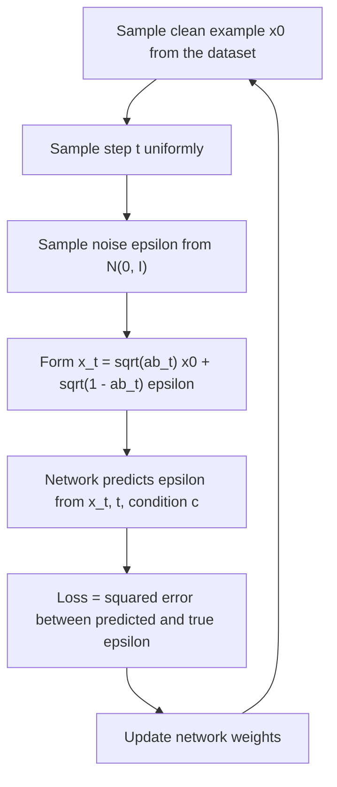

The diagram shows why training scales so well. Each iteration is an independent regression problem. There is no second network to balance, no sequential dependence across steps, and no need to store trajectories. The cost per iteration is one forward and one backward pass of the denoiser, exactly like a supervised model.

## 4. Noise Schedules

### 4.1 What a schedule controls

The schedule fixes $\bar\alpha_t$ for every step and therefore decides what the network sees at each $t$. Two ways of describing it are useful. The first is in terms of amplitudes: the signal amplitude $\sqrt{\bar\alpha_t}$ falls from near 1 to near 0 and the noise amplitude $\sqrt{1-\bar\alpha_t}$ rises from near 0 to near 1. The second is the signal-to-noise ratio (SNR):

$$
\mathrm{SNR}(t)=\frac{\bar\alpha_t}{1-\bar\alpha_t}.
$$

SNR is the ratio of signal variance to noise variance in $x_t$. It is usually reported in decibels, $10\log_{10}\mathrm{SNR}$, because it spans dozens of orders of magnitude. An SNR of 1 (0 dB) means signal and noise carry equal variance. The schedule decides how many of the $T$ training steps fall in each SNR range. Since the network is trained uniformly over $t$, the schedule is in effect a choice of how much training effort goes to each noise level.

Different noise levels teach different skills. At high SNR the network removes faint grain and learns fine texture and edges. At mid SNR it commits to shapes and local structure. At very low SNR it decides global layout and color distribution. A schedule that spends most steps at very low SNR wastes capacity on a regime where nearly any guess is as good as another. A schedule that spends too few steps at low SNR gives the network too little practice at the global decisions that matter most for composition.

### 4.2 The linear schedule

Ho and colleagues (2020) chose $\beta_t$ rising linearly from $\beta_1=10^{-4}$ to $\beta_T=0.02$ with $T=1000$. It is simple and works for $32\times 32$ and $64\times 64$ images. Its weakness is visible in the SNR table.

### 4.3 The cosine schedule

Nichol and Dhariwal (2021) observed that the linear schedule destroys information too fast: much of the second half of the chain is nearly pure noise, and the last quarter contributes little. They defined $\bar\alpha_t$ directly by

$$
\bar\alpha_t=\frac{f(t)}{f(0)},\qquad f(t)=\cos^2\!\left(\frac{t/T+s}{1+s}\cdot\frac{\pi}{2}\right),
$$

with a small offset $s=0.008$ that prevents $\beta_t$ from being too small near $t=0$. In the implementation $\beta_t=1-\bar\alpha_t/\bar\alpha_{t-1}$ is clipped to at most $0.999$ to avoid singularities near the end. The cosine shape makes $\bar\alpha_t$ fall almost linearly through the middle of the chain and slowly near both ends.

### 4.4 A numeric comparison

The script [01_noise_schedules.py](../code/python/diffusion-chapter/01_noise_schedules.py) computes both schedules. Its output, rounded:

| Step $t$ | Linear $\bar\alpha_t$ | Linear SNR (dB) | Cosine $\bar\alpha_t$ | Cosine SNR (dB) |
| --- | --- | --- | --- | --- |
| 1 | 0.99990 | 40.00 | 0.99996 | 43.84 |
| 100 | 0.89702 | 9.40 | 0.97209 | 15.42 |
| 250 | 0.52409 | 0.42 | 0.84701 | 7.43 |
| 500 | 0.07859 | -10.69 | 0.49384 | -0.11 |
| 750 | 0.00335 | -24.73 | 0.14427 | -7.73 |
| 900 | 0.00028 | -35.60 | 0.02409 | -16.08 |
| 1000 | 0.00004 | -43.94 | about 0 | about -324 (see text) |

Three readings of the table:

1. The linear schedule crosses $\bar\alpha_t<0.5$ at step 260 and $\bar\alpha_t<0.01$ at step 674. The cosine schedule crosses the same thresholds at steps 497 and 936. Under the linear schedule about 33 percent of the steps (those after 674) operate on inputs where less than 1 percent of the variance is signal. Under cosine, only about 6 percent of steps do.
2. In the middle region the cosine schedule changes SNR gently. From $t=250$ to $t=500$ it falls from 7.43 dB to -0.11 dB, about 7.5 dB, while the linear schedule falls 11.1 dB over the same interval. Per step the linear schedule changes the task faster.
3. The cosine value at $t=1000$ is not a typo. With $f(T)=\cos^2(\pi/2)=0$, the formula gives $\bar\alpha_T=0$ exactly, and the SNR is zero. The script clamps $\bar\alpha$ to $0.999999$ at the top only; at the bottom the real value is the floating-point residue of $\cos^2(\pi/2)$, about $3.7\times 10^{-33}$. In practice a library either clips $\beta_T$ at 0.999 or shifts the end of the schedule, and the effect is that the last step is close to, but not exactly at, zero SNR.

For an architect the table has one practical consequence. A model trained with one schedule must be sampled with the same schedule. The network was trained to expect a particular relation between $t$ and the noise level in its input. Swapping a linear-trained checkpoint into a cosine sampler shifts every step's noise level and produces washed-out or noisy output even though the code runs without error. Libraries store the schedule as part of the scheduler configuration for exactly this reason, and Section 20 lists it among the inputs to record.

### 4.5 Terminal SNR, resolution shifts, and the "zero terminal SNR" bug

**The leftover-signal problem.** Section 3.3 noted that the linear schedule leaves $\sqrt{\bar\alpha_T}=0.0064$ at the last step. The sampler starts from pure Gaussian noise with zero signal. The model during training never saw a pure-noise input; it saw inputs whose signal amplitude was 0.0064 of the original (0.004 percent of the variance). In practice this mismatch matters because that faint signal can carry the image's overall brightness and colour mean. A model trained this way is unable to generate images that are very dark or very bright overall, because during training the low-frequency mean was always faintly present at the start, and at sampling time it is absent. Shanchuan Lin and colleagues (2024) documented this in "Common Diffusion Noise Schedules and Sample Steps Are Flawed" and proposed rescaling the schedule to zero terminal SNR, combined with a velocity-style prediction target (Section 5.3) and with sampling that starts from the last step. The fix is a training-time change. A team that fine-tunes a public checkpoint with a modified schedule must retrain, not just reconfigure.

**Resolution shifts.** For a fixed pixel-wise noise level, a higher-resolution image keeps more of its structure visible at the same SNR, because coarse features are averaged over more pixels. A model trained at $256\times 256$ with a schedule tuned for that size would, at $1024\times 1024$, be nearly noise-free at a step where the small image is already unrecognisable. The remedy used in recent image models is to shift the schedule toward higher noise as resolution grows, which gives the network more practice on coarse structure. Hoogeboom and colleagues (2023) analysed this for pixel-space diffusion, and Esser and colleagues (2024) apply a resolution-dependent timestep shift in Stable Diffusion 3. The architect-level implication is that a checkpoint is tied to the resolutions it was trained at, and a request for a different resolution is a quality risk.

### 4.6 Choosing and checking a schedule

An application team that uses a public model does not choose the schedule; it inherits one. The decisions that remain are whether the scheduler in the serving code matches the training schedule, whether the sampler uses the right timestep spacing for the step count chosen (Section 8.5), and whether a fine-tune changes the schedule. For a team that trains its own model, the heuristics are: prefer cosine-like schedules or SNR-aware sampling of $t$ over the linear schedule for resolutions above $64\times 64$; check that the terminal SNR is very small; and plot the distribution of SNR seen during training to confirm that it covers the range the sampler will use.

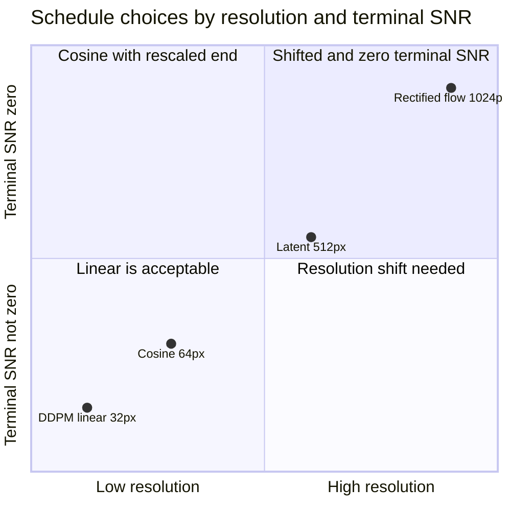

The quadrant chart groups schedule situations along two axes: resolution and how exactly the schedule reaches zero signal at the end. The placements are qualitative and illustrative, not benchmark results. A low-resolution model with a linear schedule is acceptable because both flaws are small there. As the resolution rises, both flaws grow, which is why modern high-resolution models pair a shifted timestep distribution with an exact zero-SNR endpoint.

## 5. What the Network Predicts: Parameterizations

### 5.1 Four equivalent targets

The forward formula $x_t=\sqrt{\bar\alpha_t}\,x_0+\sqrt{1-\bar\alpha_t}\,\epsilon$ links three quantities: the noisy input $x_t$, the clean example $x_0$, and the noise $\epsilon$. The network receives $x_t$ and the step $t$ (and a condition $c$, ignored in this section). If it can estimate any one of the other quantities, the rest follow by algebra. This gives the field its four common parameterizations:

- **Noise prediction ($\epsilon$-prediction).** The network outputs $\hat\epsilon_\theta(x_t,t)$, an estimate of the noise that was added. This is the target of the original DDPM paper.
- **Data prediction ($x_0$-prediction).** The network outputs $\hat x_\theta(x_t,t)$, an estimate of the clean example. Early image-to-image diffusion work and several audio models use it.
- **Score prediction.** The network outputs an estimate of $\nabla_{x_t}\log q(x_t)$, the gradient of the log density of the noisy data. Section 7 shows that this is a rescaled noise prediction.
- **Velocity prediction ($v$-prediction).** The network outputs $\hat v_\theta(x_t,t)$ for the target $v_t=\sqrt{\bar\alpha_t}\,\epsilon-\sqrt{1-\bar\alpha_t}\,x_0$, introduced by Tim Salimans and Jonathan Ho (2022) for progressive distillation.

The choice does not change what the network could represent in principle, because each is an invertible, time-dependent rescaling of another. It changes what the optimizer sees. Different parameterizations put different weights on errors at different noise levels, and they behave differently when the noise level is very high or very low.

### 5.2 Conversions

Write $a_t=\sqrt{\bar\alpha_t}$ and $\sigma_t=\sqrt{1-\bar\alpha_t}$ so that $x_t=a_t x_0+\sigma_t\epsilon$ and $a_t^2+\sigma_t^2=1$. Solving the forward equation gives the first two conversions. Substituting into the definition of $v_t$ gives the rest:

$$
\hat x_0=\frac{x_t-\sigma_t\hat\epsilon}{a_t},\qquad
\hat\epsilon=\frac{x_t-a_t\hat x_0}{\sigma_t},\qquad
v_t=a_t\epsilon-\sigma_t x_0,
$$

$$
x_0=a_t x_t-\sigma_t v_t,\qquad \epsilon=\sigma_t x_t+a_t v_t .
$$

The last pair is easy to verify. Substituting $x_t=a_tx_0+\sigma_t\epsilon$ and $v_t=a_t\epsilon-\sigma_tx_0$ gives $a_tx_t-\sigma_tv_t=a_t^2x_0+a_t\sigma_t\epsilon-\sigma_ta_t\epsilon+\sigma_t^2x_0=(a_t^2+\sigma_t^2)x_0=x_0$. The velocity name comes from a geometric picture. If $a_t=\cos\phi$ and $\sigma_t=\sin\phi$ for an angle $\phi$ that grows from 0 (clean) to $\pi/2$ (pure noise), then $x_t$ moves on a quarter circle between the data axis and the noise axis, and $v_t=dx_t/d\phi$ is its velocity along that arc.

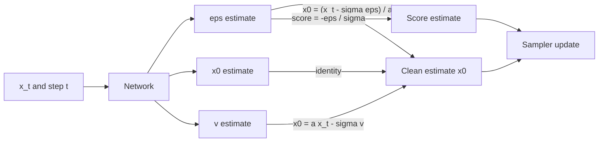

The diagram shows that any output head reaches the same clean-data estimate $\hat x_0$ and the same score. Samplers in Sections 6 to 8 are written in terms of $\hat x_0$ and $\hat\epsilon$ for this reason: a library can wrap a $v$-prediction network, convert its output, and reuse the same sampler code. The practical lesson for an architect is that the prediction type is part of the model's contract. A checkpoint trained for $v$-prediction, loaded into a scheduler configured for $\epsilon$-prediction, runs without any error and produces garbage.

### 5.3 Why $\epsilon$-prediction fails at the extremes and $v$-prediction helps

Consider what a small error in the network output does to the clean estimate $\hat x_0$. Under $\epsilon$-prediction, $\hat x_0=(x_t-\sigma_t\hat\epsilon)/a_t$, so an error $\delta$ in $\hat\epsilon$ becomes an error $-\sigma_t\delta/a_t$ in $\hat x_0$. The amplification factor $\sigma_t/a_t=1/\sqrt{\mathrm{SNR}(t)}$ depends on the noise level:

| Step $t$ (linear schedule) | $\sigma_t/a_t$ | $x_0$ error from an $\epsilon$ error of 0.10 |
| --- | --- | --- |
| 10 | 0.0435 | 0.0044 |
| 250 | 0.953 | 0.095 |
| 500 | 3.42 | 0.34 |
| 1000 | about 157 | about 15.7 |

At low noise, $\epsilon$-prediction errors barely affect the clean estimate. At the highest noise levels an error of 0.10 in $\hat\epsilon$ becomes an error of about 16 in $\hat x_0$, which is large compared with data scaled to unit variance. When the sampler takes its first step from pure noise, nearly all the information in $x_T$ is noise, and the network is asked to predict a noise vector that is almost equal to its own input. Tiny relative errors in that prediction turn into large errors in the implied image. This is one of the reasons that the leftover-signal and zero-terminal-SNR issues of Section 4.5 bite hard: at $\mathrm{SNR}=0$ exactly, $a_T=0$ and the formula $\hat x_0=(x_T-\sigma_T\hat\epsilon)/a_T$ divides by zero. An $\epsilon$-prediction network cannot represent the zero-SNR endpoint at all, because the information about $x_0$ has been removed from the input and the conversion cannot recover it.

$v$-prediction removes the problem. At $a_t\to 0$ the target becomes $v_t\to-x_0$, a direct prediction of the clean data, and at $\sigma_t\to 0$ it becomes $v_t\to\epsilon\cdot a_t\approx\epsilon$, which is the noise. It interpolates between the two simple regimes. The conversion $x_0=a_tx_t-\sigma_tv_t$ has coefficients bounded by one, so network errors are never amplified by more than $a_t+\sigma_t\le\sqrt2$. This is the reason the zero-terminal-SNR fix of Lin and colleagues (2024) pairs the rescaled schedule with $v$-prediction.

### 5.4 Loss weighting and what the network spends capacity on

Predicting different quantities with the same plain squared-error loss implies different weightings over noise levels when the errors are measured in the same space. The script [05_loss_parameterizations_and_flow.py](../code/python/diffusion-chapter/05_loss_parameterizations_and_flow.py) prints the numbers behind this section. Measured in $x_0$-space, a loss $\lVert\hat\epsilon-\epsilon\rVert^2$ is equivalent to $\lVert\hat x_0-x_0\rVert^2$ weighted by $a_t^2/\sigma_t^2=\mathrm{SNR}(t)$, because $\hat\epsilon-\epsilon=-(a_t/\sigma_t)(\hat x_0-x_0)$. A loss on $\hat x_0$ directly has weight 1 in $x_0$-space. For $v$, the conversion $x_0=a_tx_t-\sigma_tv_t$ gives $\hat x_0-x_0=-\sigma_t(\hat v-v)$ when $x_t$ is held fixed, so $\lVert\hat v-v\rVert^2=\lVert\hat x_0-x_0\rVert^2/\sigma_t^2$. Since $1/\sigma_t^2=1+\mathrm{SNR}(t)$ when $a_t^2+\sigma_t^2=1$, a $v$-loss has weight $1+\mathrm{SNR}(t)$ in $x_0$-space. The summary that matters is the ordering:

- $\epsilon$-loss weights low-noise (high-SNR) steps heavily in $x_0$-space and almost ignores high-noise steps.
- $x_0$-loss weights all noise levels equally in $x_0$-space, which over-emphasizes the high-noise regime where predictions are blurry averages.
- $v$-loss sits between them, with weight $1+\mathrm{SNR}$.

Tero Karras and colleagues (2022) in the paper "Elucidating the Design Space of Diffusion-Based Generative Models" (known as EDM) went further. They argued that the training weighting, the network's input and output scaling, and the sampling noise levels are separable design choices. They propose a preconditioning that keeps the network's input and output at unit variance at every noise level, and a loss weighting $\lambda(\sigma)=(\sigma^2+\sigma_{\mathrm{data}}^2)/(\sigma\sigma_{\mathrm{data}})^2$ that equalizes the expected loss across noise levels. Keeping input and output scales near one at every noise level is a main reason EDM models train efficiently, and the EDM sampler (Heun's method, Section 8.4) is the base for many later samplers.

Tiankai Hang and colleagues (2023) proposed "Min-SNR weighting", which clips the implicit $\epsilon$-loss weight in $x_0$-space at a constant $\gamma$ (often 5) so that high-SNR steps do not dominate. It speeds up convergence, and recent flow-matching image models use related timestep-sampling distributions (Section 15.4) to the same end.

### 5.5 Choosing a parameterization

For a team that adopts a public checkpoint, the choice is already made, and the task is to read the scheduler configuration (`prediction_type` in Hugging Face Diffusers) and verify it. For a team that trains or fine-tunes, the heuristics are:

1. Use $v$-prediction or a flow-matching velocity target when training at high resolution, in latent space, or with a zero-terminal-SNR schedule.
2. Use $\epsilon$-prediction only with a schedule that keeps terminal SNR comfortably above zero, which is the setting in which it was validated.
3. Use $x_0$-prediction when the output has hard structure that the network should produce directly (for example a segmentation map), and expect blurry results at high noise.
4. Never change prediction type when fine-tuning a checkpoint without retraining the output layers. The weights encode a particular target, and a switch destroys the model's behavior in the first few hundred steps.

## 6. The Reverse Process and the Noise-Prediction Loss

### 6.1 The reverse process is also Gaussian, for small steps

The generator must run the chain backward: from $x_T\sim\mathcal{N}(0,I)$ to $x_{T-1}$, then $x_{T-2}$, down to $x_0$. The true reverse conditional $q(x_{t-1}\mid x_t)$ depends on the whole data distribution, since to undo noise one must know which clean images are plausible, so it cannot be computed. Feller (1949) showed that for a diffusion with small steps the reverse transition has the same functional form as the forward one. For small $\beta_t$ the reverse conditional is approximately Gaussian, with a mean that depends on $x_t$ in a complicated way and a variance close to $\beta_t$. DDPM therefore models

$$
p_\theta(x_{t-1}\mid x_t)=\mathcal{N}\!\left(x_{t-1};\ \mu_\theta(x_t,t),\ \Sigma_\theta(x_t,t)\right),\qquad p(x_T)=\mathcal{N}(0,I),
$$

with a network $\mu_\theta$ and a variance that Ho and colleagues (2020) fixed to $\sigma_t^2 I$ with $\sigma_t^2$ equal to either $\beta_t$ or $\tilde\beta_t$ (defined below). The model distribution of a full path is $p_\theta(x_{0:T})=p(x_T)\prod_{t=1}^{T}p_\theta(x_{t-1}\mid x_t)$. A smaller step size means a better Gaussian approximation, and that is the reason the original chain used $T=1000$ steps. Sections 8 and 16 describe how to reduce the number of steps at sampling time.

### 6.2 The tractable posterior given $x_0$

The reverse conditional is intractable without $x_0$, but conditional on $x_0$ it is exact and Gaussian. Bayes' rule gives

$$
q(x_{t-1}\mid x_t,x_0)=\frac{q(x_t\mid x_{t-1})\,q(x_{t-1}\mid x_0)}{q(x_t\mid x_0)}.
$$

(The Markov property lets us drop $x_0$ from $q(x_t\mid x_{t-1},x_0)$.) All three factors are Gaussians with known means and variances. Multiplying them and completing the square in $x_{t-1}$ gives

$$
q(x_{t-1}\mid x_t,x_0)=\mathcal{N}\!\left(x_{t-1};\ \tilde\mu_t(x_t,x_0),\ \tilde\beta_t I\right),
$$

$$
\tilde\mu_t(x_t,x_0)=\frac{\sqrt{\bar\alpha_{t-1}}\,\beta_t}{1-\bar\alpha_t}\,x_0+\frac{\sqrt{\alpha_t}\,(1-\bar\alpha_{t-1})}{1-\bar\alpha_t}\,x_t,\qquad
\tilde\beta_t=\frac{1-\bar\alpha_{t-1}}{1-\bar\alpha_t}\,\beta_t .
$$

Both coefficients are weights on the two known quantities, with the weight on $x_0$ growing as the noise level at $t$ falls. The completion of the square is the only algebra involved. The exponent of the product is a quadratic in $x_{t-1}$ with leading coefficient $\alpha_t/\beta_t+1/(1-\bar\alpha_{t-1})$. The reciprocal of this coefficient equals $\tilde\beta_t$ after simplification using $\alpha_t=1-\beta_t$ and $\bar\alpha_t=\alpha_t\bar\alpha_{t-1}$, and the linear term gives $\tilde\mu_t$.

Now substitute $x_0=(x_t-\sqrt{1-\bar\alpha_t}\,\epsilon)/\sqrt{\bar\alpha_t}$ into $\tilde\mu_t$. After simplification the mean depends on $x_t$ and $\epsilon$ only:

$$
\tilde\mu_t(x_t,\epsilon)=\frac{1}{\sqrt{\alpha_t}}\left(x_t-\frac{\beta_t}{\sqrt{1-\bar\alpha_t}}\,\epsilon\right).
$$

The script prints a numeric check at $t=500$: the posterior mean computed from $(x_0,x_t)$ and from $(\epsilon)$ agree to floating-point precision, which confirms that the algebra above is right.

### 6.3 The variational bound

Training maximizes the likelihood of the data under the model, $\log p_\theta(x_0)=\log\int p_\theta(x_{0:T})\,dx_{1:T}$, which is an intractable integral over all paths. As in a variational autoencoder, the forward process $q(x_{1:T}\mid x_0)$ acts as a fixed approximate posterior. Jensen's inequality gives a bound on the negative log-likelihood:

$$
-\log p_\theta(x_0)\ \le\ \mathbb{E}_{q}\left[-\log\frac{p_\theta(x_{0:T})}{q(x_{1:T}\mid x_0)}\right]=:L_{\mathrm{VLB}} .
$$

Expanding the logarithm of the ratio and rearranging the terms with Bayes' rule (the full manipulation is in Ho and colleagues, 2020, Appendix A) gives three kinds of terms:

$$
L_{\mathrm{VLB}}=\underbrace{D_{\mathrm{KL}}\!\left(q(x_T\mid x_0)\,\Vert\,p(x_T)\right)}_{L_T}
+\sum_{t=2}^{T}\underbrace{\mathbb{E}_q\!\left[D_{\mathrm{KL}}\!\left(q(x_{t-1}\mid x_t,x_0)\,\Vert\,p_\theta(x_{t-1}\mid x_t)\right)\right]}_{L_{t-1}}
\ \underbrace{-\ \mathbb{E}_q\!\left[\log p_\theta(x_0\mid x_1)\right]}_{L_0}.
$$

$D_{\mathrm{KL}}$ is the Kullback-Leibler divergence. Reading the terms:

- $L_T$ compares the final noisy distribution with the prior $\mathcal{N}(0,I)$. It has no trainable parameters, and it is tiny when $\bar\alpha_T\approx 0$. This is the term that Section 4.5's terminal-SNR discussion is about.
- $L_{t-1}$ for $t=2,\dots,T$ compares the true tractable posterior from Section 6.2 with the model's reverse step. These are the terms that teach the network.
- $L_0$ is a reconstruction term for the last step, which needs a decoder for discrete pixel values. DDPM uses an independent discrete decoder.

### 6.4 Reducing each term to a noise-prediction error

Each $L_{t-1}$ is the KL divergence between two Gaussians. The model's variance is fixed to $\sigma_t^2I$ and so is the posterior's, $\tilde\beta_tI$. If the two variances are equal (the DDPM choice $\sigma_t^2=\tilde\beta_t$), the KL divergence between two Gaussians with equal covariance reduces to a squared distance between the means, scaled by the inverse variance:

$$
L_{t-1}=\mathbb{E}_{x_0,\epsilon}\left[\frac{1}{2\sigma_t^2}\left\lVert\tilde\mu_t(x_t,x_0)-\mu_\theta(x_t,t)\right\rVert^2\right]+C,
$$

where $C$ is a constant independent of $\theta$. The next step is a reparameterization. We have a closed form for the true mean in terms of the noise, $\tilde\mu_t=\frac{1}{\sqrt{\alpha_t}}\left(x_t-\frac{\beta_t}{\sqrt{1-\bar\alpha_t}}\epsilon\right)$. Parameterize the model mean the same way, replacing the unknown $\epsilon$ with a network output:

$$
\mu_\theta(x_t,t)=\frac{1}{\sqrt{\alpha_t}}\left(x_t-\frac{\beta_t}{\sqrt{1-\bar\alpha_t}}\,\epsilon_\theta(x_t,t)\right).
$$

Both means contain the same $x_t$, so the difference collapses to a rescaled difference in $\epsilon$:

$$
\tilde\mu_t-\mu_\theta=\frac{1}{\sqrt{\alpha_t}}\cdot\frac{\beta_t}{\sqrt{1-\bar\alpha_t}}\left(\epsilon_\theta(x_t,t)-\epsilon\right).
$$

Squaring and substituting into $L_{t-1}$:

$$
L_{t-1}=\mathbb{E}_{x_0,\epsilon}\left[\underbrace{\frac{\beta_t^2}{2\sigma_t^2\,\alpha_t\,(1-\bar\alpha_t)}}_{\lambda_t}\left\lVert\epsilon-\epsilon_\theta\!\left(\sqrt{\bar\alpha_t}x_0+\sqrt{1-\bar\alpha_t}\epsilon,\ t\right)\right\rVert^2\right]+C .
$$

This is the full variational bound, term by term: a per-step weighted noise-prediction error. Every learning problem inside the variational bound is "guess the noise", and the weights $\lambda_t$ say how much each step matters for the likelihood.

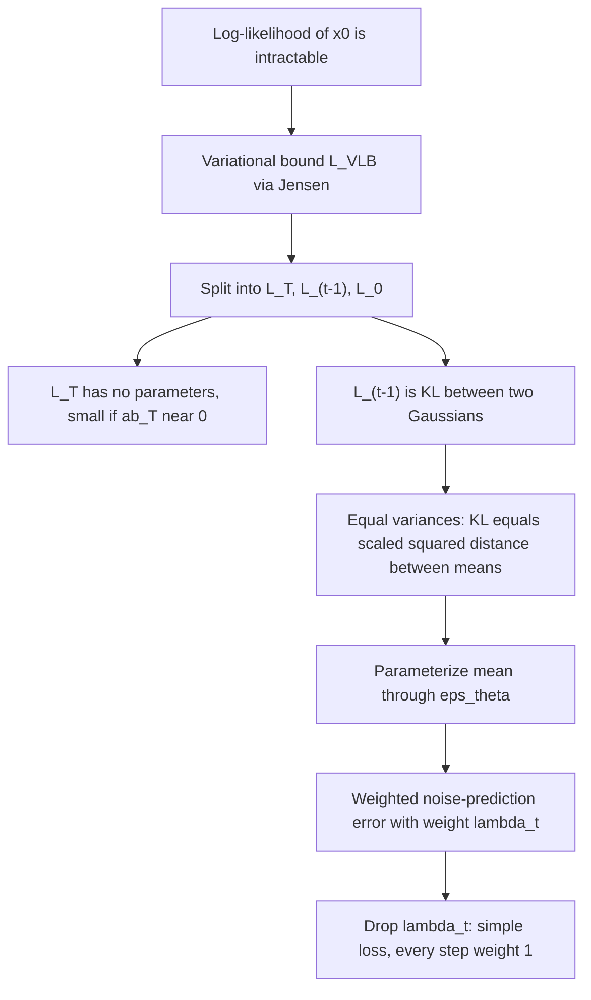

The diagram follows the derivation from an intractable likelihood to the last step. The last node is the practical decision that Ho and colleagues made, and it deserves its own subsection.

### 6.5 Dropping the weights: the simple loss

The exact bound weights step $t$ by $\lambda_t$. The script computes $\lambda_t$ for the linear schedule with $\sigma_t^2=\tilde\beta_t$, and the weights fall steeply from the first steps and then flatten. The script prints $\lambda_1=0.500$, $\lambda_{10}=0.086$, $\lambda_{100}=0.0103$, $\lambda_{500}=0.0055$, and $\lambda_{1000}=0.0102$. The weight at $t=1$ is 49 times the weight at $t=1000$ and 91 times the weight at $t=500$. The exact bound therefore asks the network to concentrate on the smallest noise levels, where the likelihood is sensitive to tiny errors in pixel values. Ho and colleagues found that discarding the weights, so that every step has weight 1, produced better sample quality:

$$
\boxed{\,L_{\mathrm{simple}}(\theta)=\mathbb{E}_{x_0,\ t\sim\mathcal{U}\{1,\dots,T\},\ \epsilon\sim\mathcal{N}(0,I)}\left[\left\lVert\epsilon-\epsilon_\theta\!\left(\sqrt{\bar\alpha_t}\,x_0+\sqrt{1-\bar\alpha_t}\,\epsilon,\ t\right)\right\rVert^2\right]\,}
$$

Dropping the weights has two consequences. It no longer bounds the likelihood, so models trained this way have worse log-likelihoods in bits per dimension than the exact bound would give; Nichol and Dhariwal (2021) recovered much of the likelihood by learning the variances $\Sigma_\theta$ and adding a small term of the true bound. And it re-weights the training effort toward high-noise steps, where the network learns global structure, which improves perceived sample quality. This is a good example of a pattern that recurs in generative modelling: the objective that is theoretically correct for likelihood is not the one that gives the best samples, and the practitioners' choice is guided by sample quality and downstream metrics.

### 6.6 The sampling step that follows

With a trained $\epsilon_\theta$, one reverse step is

$$
x_{t-1}=\frac{1}{\sqrt{\alpha_t}}\left(x_t-\frac{\beta_t}{\sqrt{1-\bar\alpha_t}}\,\epsilon_\theta(x_t,t)\right)+\sigma_t\,z,\qquad z\sim\mathcal{N}(0,I)\ \text{for } t>1,\ z=0\ \text{for } t=1.
$$

This is the ancestral sampler, "ancestral" because each step draws a fresh random sample from the model's conditional distribution. Every step adds noise $\sigma_tz$ back after removing predicted noise. The added noise keeps the chain stochastic: two runs from the same $x_T$ give different images. A single run of 1,000 steps uses 1,000 network evaluations, which at 45 milliseconds per call (the illustrative figure used in the serving script) is 45 seconds for one image at batch size 1. This is the reason raw DDPM sampling was impractical for products, and the next two sections explain why there is a faster way that does not require retraining.

### 6.7 Variance choice

The variance $\sigma_t^2$ is a free choice at sampling time. The two extremes are $\sigma_t^2=\beta_t$, which is optimal when the data distribution is a standard Gaussian, and $\sigma_t^2=\tilde\beta_t$, which is optimal when the data distribution is a single point. For the linear schedule at $t=500$ these two are $\beta_{500}\approx0.01003$ and $\tilde\beta_{500}=\beta_{500}(1-\bar\alpha_{499})/(1-\bar\alpha_{500})\approx0.01002$, which differ by less than 0.1 percent. The difference only matters at small $t$, where $\tilde\beta_t\ll\beta_t$ (at $t=2$, $\tilde\beta_2$ is about 0.45 of $\beta_2$). Nichol and Dhariwal (2021) learned an interpolation between the two in log space, which improves the likelihood and lets the sampler use many fewer steps without a large drop in quality. Bao and colleagues (2022) derived the optimal variance analytically in terms of the score and its second moment ("Analytic-DPM"), and that variant is useful when a checkpoint cannot be retrained.

## 7. Score Matching, Stochastic Differential Equations, and the Probability-Flow ODE

### 7.1 The score and Tweedie's formula

The **score** of a density $q(x)$ is the vector field $\nabla_x\log q(x)$. It points toward regions of higher density, and it has one property that makes it attractive for generation: it does not depend on the normalizing constant, because $\nabla_x\log\left(q(x)/Z\right)=\nabla_x\log q(x)$. A model of the score therefore avoids the intractable integral that haunts likelihood-based models.

The score of the noisy marginal $q(x_t)$ is connected to the noise-prediction network by a short calculation. Condition on $x_0$. Then $q(x_t\mid x_0)=\mathcal{N}(a_tx_0,\sigma_t^2I)$ with $a_t=\sqrt{\bar\alpha_t}$ and $\sigma_t=\sqrt{1-\bar\alpha_t}$ as in Section 5, and

$$
\nabla_{x_t}\log q(x_t\mid x_0)=-\frac{x_t-a_tx_0}{\sigma_t^2}=-\frac{\epsilon}{\sigma_t}.
$$

The unconditional score is the expectation of this quantity over the posterior of $x_0$ given $x_t$. That identity is known as Tweedie's formula, and it reads $\nabla_{x_t}\log q(x_t)=\mathbb{E}\left[\nabla_{x_t}\log q(x_t\mid x_0)\mid x_t\right]=-\mathbb{E}[\epsilon\mid x_t]/\sigma_t$. The best possible noise predictor under squared error is exactly the posterior mean $\mathbb{E}[\epsilon\mid x_t]$, so

$$
\boxed{\ \nabla_{x_t}\log q(x_t)\ =\ -\frac{\epsilon^\star(x_t,t)}{\sigma_t}\ },\qquad \epsilon^\star(x_t,t)=\mathbb{E}[\epsilon\mid x_t].
$$

Training a network with the simple loss of Section 6.5 is therefore the same as training it to estimate the score, up to the factor $-1/\sigma_t$. This is called **denoising score matching** (Vincent, 2011). It explains why the same network can be used in different sampling algorithms: DDPM reads it as a noise predictor, and Langevin sampling reads it as a score. It also gives a second expression for the clean-data estimate, $\hat x_0=\left(x_t+\sigma_t^2\,\nabla\log q(x_t)\right)/a_t$, which is the same formula as the one in Section 5.2.

### 7.2 Why one noise level is not enough

Song and Ermon (2019) began from a direct idea. Learn the score $s_\theta(x)\approx\nabla\log q(x)$ and sample by Langevin dynamics, repeatedly taking a small step uphill in log density and adding a little noise: $x\leftarrow x+\tfrac{\eta}{2}s_\theta(x)+\sqrt{\eta}\,z$. Two problems appear in high dimensions. Real data lies near a low-dimensional manifold, so in most of the ambient space there are no training samples and the score is poorly estimated. And the data distribution has disconnected modes, so Langevin dynamics started in the wrong place mixes between modes extremely slowly.

Adding noise addresses both. Noise spreads the data over the whole space, so the score is well defined everywhere, and it bridges the gaps between modes. A large noise level gives a smooth, easy-to-learn score that finds the right region, and a small noise level refines the details. Training one network on many noise levels and sampling from the largest level down to the smallest, which is called **annealed** Langevin dynamics, is the origin of the multi-step structure of all diffusion samplers.

### 7.3 The continuous-time view

Let the number of steps $T$ grow and the step size shrink. The discrete variance-preserving chain of Section 3.1 becomes, in the limit, a stochastic differential equation (SDE). Song and colleagues (2021) wrote the forward process as

$$
dx=f(x,t)\,dt+g(t)\,dw,
$$

where $f$ is the drift (the deterministic pull), $g$ is the diffusion coefficient (the noise strength), and $w$ is a Wiener process (Brownian motion; informally $dw\sim\mathcal{N}(0,dt)$). For the variance-preserving (VP) case, $f(x,t)=-\tfrac12\beta(t)x$ and $g(t)=\sqrt{\beta(t)}$, where $\beta(t)$ is the continuous-time version of the discrete $\beta_t$. A short check connects it to Section 3: one Euler step of size $\Delta t=1/T$ gives $x_{t}=x_{t-1}-\tfrac12\beta\Delta t\,x_{t-1}+\sqrt{\beta\Delta t}\,\epsilon\approx\sqrt{1-\beta\Delta t}\,x_{t-1}+\sqrt{\beta\Delta t}\,\epsilon$, which is the discrete forward step with $\beta_t=\beta(t)\Delta t$, since $\sqrt{1-b}\approx1-b/2$ for small $b$. The variance-exploding (VE) case has no drift, $f=0$, and a growing $g(t)$, so the noise level $\sigma(t)$ increases without bound. Score-based models of Song and Ermon use VE. The EDM paper uses $\sigma$ directly as the time variable.

The key result, from Anderson (1982), is that the reverse of a diffusion is also a diffusion. Running time backward from $T$ to 0, the reverse-time SDE is

$$
dx=\left[f(x,t)-g(t)^2\,\nabla_x\log q_t(x)\right]dt+g(t)\,d\bar w,
$$

where $\bar w$ is a Wiener process running backward in time and $q_t$ is the marginal density at time $t$. The only unknown on the right-hand side is the score $\nabla\log q_t(x)$, which the network estimates (Section 7.1). Sampling means drawing $x_T\sim\mathcal{N}(0,I)$ and integrating this SDE numerically down to $t=0$. DDPM's ancestral sampler is one discretization of it (Euler-Maruyama with a particular correction), and Song and colleagues showed that Langevin-style correction steps can be added after each predictor step. This predictor-corrector scheme was the best sampler before deterministic samplers arrived.

### 7.4 The probability-flow ODE

Among the stochastic processes that share the same marginals $q_t$ there is a special one with no randomness at all. The Fokker-Planck equation describes how the density $q_t$ evolves under the forward SDE. It depends on the drift and on $g^2$ only through the combination $f-\tfrac12g^2\nabla\log q_t$ multiplying the density. Replacing the SDE by the ODE

$$
\frac{dx}{dt}=f(x,t)-\tfrac12\,g(t)^2\,\nabla_x\log q_t(x)
$$

therefore generates exactly the same sequence of marginals $q_t$. This is the **probability-flow ODE**. The factor $\tfrac12$ replaces the full $g^2$ in the reverse SDE, because half of the score term is needed to undo the diffusion and the other half is traded against the noise injected at each step. A sample path of the ODE is a smooth curve. Each initial noise vector $x_T$ is mapped to exactly one image $x_0$, and the mapping is invertible, so the same machinery that generates an image from noise can run backward and encode an image into a noise vector. The picture below summarizes the three objects.

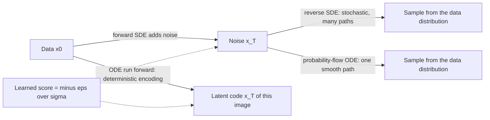

The same trained network drives both reverse processes. A product team uses this fact when it switches samplers without retraining: the SDE sampler injects fresh randomness at every step, and the ODE sampler does not. Both are valid ways to read the same model. The ODE sampler is repeatable for a given starting noise, which Section 20 relies on for reproducibility. The encoding direction is what makes image editing by inversion possible (Section 14).

Two further consequences matter. First, because the ODE is a smooth, invertible flow, one can compute exact likelihoods with the instantaneous change-of-variables formula, at the price of an integral of the divergence of the drift, which Song and colleagues estimate with a trace estimator. Likelihood is rarely needed in products, but it makes diffusion models comparable to other density models. Second, the ODE can be integrated with any numerical solver from the ODE literature, and higher-order solvers need far fewer steps than SDE samplers. Section 8 develops this.

### 7.5 SDE versus ODE: the trade-off

| Property | Reverse SDE (stochastic) | Probability-flow ODE (deterministic) |
| --- | --- | --- |
| Same seed gives the same image | No (fresh noise every step) | Yes |
| Steps needed for good quality | Many (hundreds), error is corrected by noise | Few (10 to 30 with high-order solvers) |
| Behaviour with accumulated model error | Noise partly corrects drift | Errors accumulate along one path |
| Diversity at a fixed starting noise | High | None beyond the starting noise |
| Invertibility (image to noise) | No | Yes |
| Typical use | Highest-quality slow sampling, some distilled models | Default for production samplers |

Karras and colleagues (2022) examined the middle ground. A sampler can integrate the ODE and, at each step, add a small amount of noise (a "churn" parameter) and then remove it. For some models the extra stochasticity improves quality at a moderate step count, and for others it adds blur. The right answer is empirical, and a library's default is usually a good choice for that checkpoint.

## 8. DDIM, Deterministic Sampling, and Fast Solvers

### 8.1 DDIM: a different reverse process with the same training

Jiaming Song, Chenlin Meng, and Stefano Ermon (2021) noticed that the training loss in Section 6 depends only on the marginal $q(x_t\mid x_0)$, not on the joint distribution of the whole forward chain. Many different forward processes (with different joint distributions) share the same marginals, and they all have the same training objective, so the same trained network is valid for all of them. They constructed a family of non-Markovian forward processes indexed by a variance parameter $\sigma_t$, with the reverse update

$$
x_{t-1}=\sqrt{\bar\alpha_{t-1}}\;\underbrace{\frac{x_t-\sqrt{1-\bar\alpha_t}\,\epsilon_\theta(x_t,t)}{\sqrt{\bar\alpha_t}}}_{\text{predicted clean estimate }\hat x_0}+\sqrt{1-\bar\alpha_{t-1}-\sigma_t^2}\;\epsilon_\theta(x_t,t)+\sigma_t\,z .
$$

Read it from left to right. The first term takes the network's best guess of the clean example and places it at the signal amplitude of step $t-1$. The second term adds back a point along the predicted noise direction, scaled so that the total variance is right. The third term is fresh noise. The parameter $\eta\in[0,1]$ sets $\sigma_t=\eta\sqrt{\frac{1-\bar\alpha_{t-1}}{1-\bar\alpha_t}}\sqrt{1-\frac{\bar\alpha_t}{\bar\alpha_{t-1}}}$. With $\eta=1$ the update reproduces DDPM ancestral sampling. With $\eta=0$ the noise term vanishes, and the update is deterministic. This special case is called the Denoising Diffusion Implicit Model (DDIM) sampler.

Because the update only uses the clean estimate and the noise estimate, it can jump between any two steps $\tau_i>\tau_{i-1}$ instead of consecutive ones. A trained 1,000-step model can be sampled with 50, 20, or 10 steps by selecting a subsequence $\tau$ of $\{1,\dots,1000\}$ and replacing $t-1$ by the previous element of the subsequence. No retraining is involved. This is the single biggest practical result of the 2021 sampling literature.

### 8.2 DDIM as an Euler step of the probability-flow ODE

Change variables to $y_t=x_t/a_t$ and $s_t=\sigma_t/a_t=1/\sqrt{\mathrm{SNR}(t)}$. Writing $x_t=a_tx_0+\sigma_t\epsilon$ and dividing by $a_t$ gives $y_t=x_0+s_t\epsilon$. For the ODE sampler the network's $\epsilon$ prediction is held fixed over a short step, so $y_{t'}-y_t\approx(s_{t'}-s_t)\,\hat\epsilon_\theta(x_t,t)$. Multiplying back by $a_{t'}$ reproduces the $\eta=0$ DDIM update exactly. DDIM is therefore a first-order Euler method for the probability-flow ODE in the coordinates $(y,s)$, where the ODE is the simple equation $dy/ds=\epsilon_\theta$. These coordinates absorb the drift term. The numerical-analysis meaning is direct: Euler's method has local error proportional to the square of the step, and its global error proportional to the step size, so halving the number of steps roughly doubles the error. A higher-order method does better at the same step count.

The script [02_toy_diffusion_1d.py](../code/python/diffusion-chapter/02_toy_diffusion_1d.py) checks this equivalence numerically. In the toy experiment the "Euler ODE" and "DDIM eta=0" rows are identical to every printed digit.

### 8.3 A toy where the answer is known

Because a network introduces its own error, it is hard to see sampler error in a real model. The toy script removes the network. The data are an equal mixture of two Gaussians, $\mathcal{N}(-2,0.3^2)$ and $\mathcal{N}(+2,0.3^2)$, and the noisy marginal is again a Gaussian mixture, so the exact score and the exact $\hat\epsilon(x,t)$ are available in closed form. Any error in the samples is the sampler's. The script draws 1,500 samples with each sampler and compares them with a fresh sample from the data:

| Sampler | NFE | Mean of left mode | SD of left mode | Mean of right mode | SD of right mode | Wasserstein-1 distance |
| --- | --- | --- | --- | --- | --- | --- |
| Data (fresh sample) | 0 | -1.992 | 0.302 | 2.009 | 0.321 | 0.0829 |
| DDPM ancestral | 1000 | -1.985 | 0.303 | 1.994 | 0.300 | 0.0268 |
| DDIM ($\eta=0$), 50 steps | 50 | -1.987 | 0.295 | 1.998 | 0.274 | 0.0262 |
| DDIM ($\eta=0$), 10 steps | 10 | -1.926 | 0.266 | 1.939 | 0.246 | 0.0824 |
| DDIM ($\eta=0$), 4 steps | 4 | -1.681 | 0.521 | 1.720 | 0.486 | 0.3079 |
| Euler ODE, 10 steps | 10 | -1.926 | 0.266 | 1.939 | 0.246 | 0.0824 |
| Heun ODE, 10 steps | 19 | -2.023 | 0.212 | 2.031 | 0.197 | 0.0827 |
| Euler ODE, 4 steps | 4 | -1.681 | 0.521 | 1.720 | 0.486 | 0.3079 |
| Heun ODE, 4 steps | 7 | -2.052 | 0.245 | 2.061 | 0.226 | 0.1797 |

NFE is the number of network function evaluations, which is the cost driver. The Wasserstein-1 (W1) distance here is the mean absolute gap between sorted samples, the one-dimensional earth mover's distance. Three observations follow.

First, the fresh-data row has W1 of 0.083 against the reference sample. This is the noise floor of the measurement, not an error. The fresh sample has 48.3 percent of its points in the right mode and the reference about 50 percent, and moving 1.7 percent of the mass across a gap of about 4 units costs about 0.07. Rows near 0.03 or 0.08 are indistinguishable from data at this sample size, and rows at 0.18 and 0.31 are real errors. This is a miniature of the lesson in Section 19: a metric computed from finite samples has a noise floor, and differences below it mean nothing.

Second, fifty DDIM steps are as good as 1,000 DDPM steps in this toy, a 20-fold reduction in NFE with no visible loss. At 10 steps the modes are slightly too narrow (SD 0.266 and 0.246 against 0.30) and pulled toward the centre by about 0.07. At 4 steps the error is large: the modes are 0.3 units too close to the centre, and about 1.7 times too wide. An Euler step assumes the noise direction is constant across the step, and across a large step it is not.

Third, Heun's method corrects the bias in the mode centres but not the width. The mode means at 10 Heun steps (-2.023 and 2.031) are closer to the truth than at 10 Euler steps (-1.926 and 1.939), and the 4-step Heun sampler (7 NFE) halves the error of the 4-step Euler sampler (W1 0.180 against 0.308) for 3 extra evaluations. But at 10 steps Heun's modes are too narrow (SD 0.212 and 0.197 against 0.30), and its W1 of 0.0827 is no better than Euler's 0.0824 despite using 19 evaluations instead of 10. At matched cost, Euler with 10 evaluations (W1 0.0824) beats Heun with 7 evaluations (0.180) on W1. The toy therefore shows no decisive winner at matched NFE, and a team should measure on its own model rather than assume that a higher order is always better.

The final lines of the script's output confirm determinism: two DDIM runs with the same seed produce identical samples (`True`), while two DDPM runs with seeds 7 and 8 produce 2.063 and -2.252, which fall in different modes.

### 8.4 Second-order methods: Heun and the EDM sampler

Heun's method is a two-stage predictor-corrector for ODEs. Let $\hat\epsilon_1$ be the noise estimate at the current point. Take an Euler step to a provisional point, evaluate $\hat\epsilon_2$ there, and move from the current point using the average $\tfrac12(\hat\epsilon_1+\hat\epsilon_2)$. The method has second-order accuracy, meaning that the global error is proportional to the square of the step size, so halving the step cuts the error to a quarter. The cost is two evaluations per step. The last step is a plain Euler step to $\sigma=0$, so $n$ steps cost $2n-1$ evaluations, which is the NFE column in the toy table. Karras and colleagues (2022) combined Heun's method with a specific noise-level spacing (Section 8.5) and reached an FID (Fréchet Inception Distance, Section 19) of 1.79 on class-conditional CIFAR-10 with 35 network evaluations, a state-of-the-art result when it was published. For the large text-to-image models of the same period, the practical limits are different, and the multistep solvers below are the usual default.

### 8.5 Timestep spacing

A step count does not define a sampler. The sampler also needs the list of noise levels at which to evaluate the network. Three common choices are:

- **Uniform in $t$** (linearly spaced steps in the index). Simple, and the one used in the toy script. For a linear-schedule model it spends many steps in the low-SNR region, where the trajectory is nearly straight.
- **Uniform in log-SNR.** Equal changes of $\log\mathrm{SNR}$ per step. DPM-Solver uses this because its error terms are simplest in this variable.
- **Karras spacing.** Noise levels $\sigma_i=\left(\sigma_{\max}^{1/\rho}+\tfrac{i}{N-1}\left(\sigma_{\min}^{1/\rho}-\sigma_{\max}^{1/\rho}\right)\right)^{\rho}$ with $\rho=7$, which concentrates steps at low noise, where fine details are formed. For $\sigma_{\max}=80$, $\sigma_{\min}=0.002$, and $N=5$ the levels are about 80, 17.5, 2.5, 0.17, and 0.002. The ratios between successive levels are about 4.6, 6.9, 14.7, and 85, so the steps are small at high noise in absolute terms but large in relative terms near the end. The last step jumps by almost two orders of magnitude in $\sigma$, from a nearly clean image to the final one.

A second issue concerns where the sampler starts. Lin and colleagues (2024) showed that several widely used "leading" spacings never evaluate the network at the final timestep $T$, so the first step starts from a noise level lower than the model was trained to receive. The "trailing" spacing includes $T$. The same training checkpoint changes visibly between spacings at 10 to 20 steps, and the spacing is therefore a recorded input (Section 20).

### 8.6 DPM-Solver and exponential integrators

Cheng Lu and colleagues (2022) observed that the probability-flow ODE has a special form, semi-linear: a linear term in $x$ plus a nonlinear term that only involves the network. Linear parts can be solved exactly, and only the network term needs a numerical approximation. With the half-log-SNR variable $\lambda_t=\log(a_t/\sigma_t)$, the exact solution from step $s$ to step $t$ is

$$
x_t=\frac{a_t}{a_s}\,x_s-a_t\int_{\lambda_s}^{\lambda_t}e^{-\lambda}\,\hat\epsilon_\theta(x_\lambda,\lambda)\,d\lambda .
$$

Approximating the network output as constant over the interval gives, with $h=\lambda_t-\lambda_s$, the update $x_t=\frac{a_t}{a_s}x_s-\sigma_t\left(e^{h}-1\right)\hat\epsilon_\theta(x_s,s)$. This equals the DDIM step, which can be verified by substituting $e^{h}=a_t\sigma_s/(\sigma_ta_s)$. DDIM is the first-order member of the family. Higher orders approximate the integrand with a polynomial fitted to extra network evaluations. DPM-Solver-2 and -3 use evaluations at intermediate points in the interval, at 2 and 3 NFE per step. **DPM-Solver++** (Lu and colleagues, 2022) applies the same idea to the data prediction $\hat x_0$ rather than the noise, and uses *multistep* updates that reuse the evaluations from previous steps instead of making new intermediate ones. The second-order multistep variant ("DPM-Solver++(2M)") costs one network evaluation per step, the same as DDIM, and uses the two most recent evaluations to correct for curvature. Data prediction matters under strong guidance (Section 12), because the clean estimate is bounded while the noise estimate is not, which is why DPM-Solver++ is the common default sampler in text-to-image software. UniPC (Unified Predictor-Corrector, Zhao and colleagues, 2023) adds a corrector stage at no extra network evaluations.

Reported numbers vary by model, but the pattern is stable. For a latent diffusion model with guidance, 20 to 30 steps of a good multistep solver give quality near that of the 50-step DDIM baseline, and 10 to 15 steps give visibly less detail but acceptable output for many uses. Below about 8 steps the solver error dominates, and the options are distillation (Section 16) or a different model.

### 8.7 Steps, quality, and latency: the arithmetic

Latency of the denoising loop is $\text{NFE}\times t_{\mathrm{call}}$, where $\text{NFE}=\text{steps}\times k_{\text{solver}}\times k_{\text{guidance}}$. Here $k_{\text{solver}}$ is 1 for Euler, DDIM, and multistep solvers and 2 for Heun (about, because the last step is Euler), and $k_{\text{guidance}}$ is 2 when classifier-free guidance runs a conditional and an unconditional pass per step (Section 12) and 1 otherwise. The script [03_guidance_and_cost.py](../code/python/diffusion-chapter/03_guidance_and_cost.py) prints the following for an illustrative 40 ms per denoiser call at batch 1:

| Steps | Guidance | Denoiser calls | Denoising time |
| --- | --- | --- | --- |
| 50 | yes | 100 | 4.00 s |
| 30 | yes | 60 | 2.40 s |
| 20 | yes | 40 | 1.60 s |
| 8 | yes | 16 | 0.64 s |
| 4 | no | 4 | 0.16 s |
| 1 | no | 1 | 0.04 s |

Going from 50 guided steps to 4 unguided steps is a 25-fold reduction in denoiser calls, from 4.00 s to 0.16 s. The total is smaller than the call count suggests, because every request also pays for the text encoder, the autoencoder decoder, and safety checks. With the fixed overhead of 105 milliseconds used in the serving script (20 ms text encoder, 60 ms decoder, 25 ms output classifier), the end-to-end times are 4.105 s at 50 guided steps and 0.265 s at 4 unguided steps, a 15.5-fold speedup, and 0.145 s at one step, a 28-fold speedup. This is Amdahl's law at work: a 100-fold cut in denoiser calls yields 28 times at the system level, because 105 ms of fixed work remains. Once the denoiser is down to a few calls, the decoder and the safety classifier become the next targets, and the ones worth optimizing first.

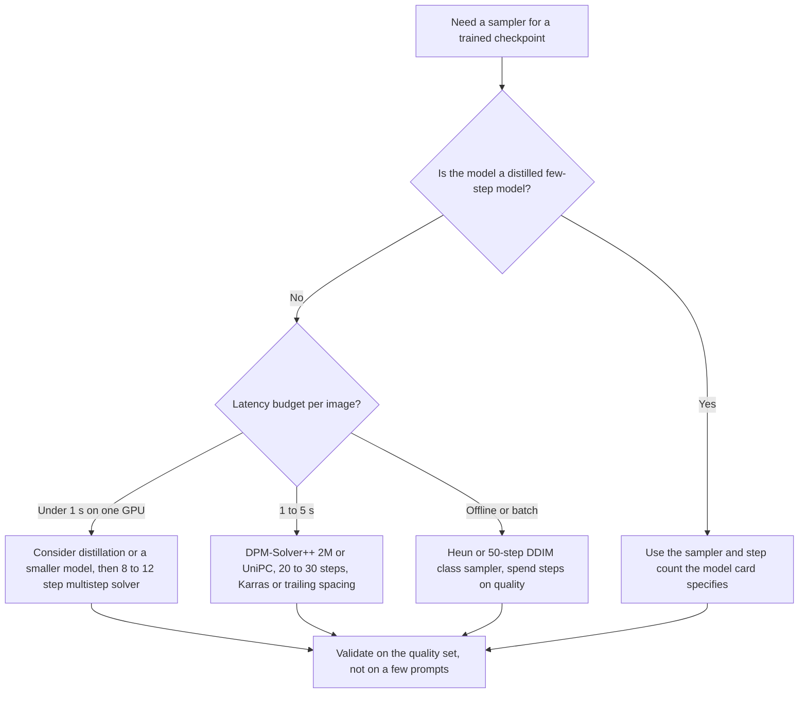

The decision tree turns the previous discussion into a procedure. It stops at validation because the right answer depends on the model, the guidance scale, and the content. A sampler change that looks harmless on ten prompts can drop a quality metric by a margin larger than the one the team cares about. Section 19 gives the evaluation method.

## 9. Backbones: The U-Net and the Diffusion Transformer

### 9.1 What the denoiser must do

The denoiser maps a noisy tensor (an image or a latent) plus a time or noise-level input plus optional conditions to a tensor of the same shape. The output is one of the targets of Section 5. Three requirements shape the architecture: it must be translation-aware, because images contain the same local structure at many positions; it must mix global information, because the final noise estimate at a pixel depends on distant content; and it must be conditioned on the noise level, because the same network handles every step and needs to behave differently at $\mathrm{SNR}=100$ and $\mathrm{SNR}=0.01$.

### 9.2 The U-Net

The convolutional U-Net, introduced by Ronneberger and colleagues (2015) for biomedical segmentation, was the backbone of DDPM and of Stable Diffusion 1.x and XL. The convolutional building blocks are in [CH08](CH08_Convolutional_Neural_Networks.md). In the diffusion variant:

- An **encoder** path halves the spatial resolution several times while increasing channels, for example 64 to 32 to 16 to 8 positions per side for a 64-by-64 latent. Each level has residual blocks.
- A **middle** block operates at the lowest resolution and usually contains self-attention.
- A **decoder** path mirrors the encoder and upsamples back, concatenating the encoder features of the same resolution through **skip connections**. Skips carry fine detail that the downsampling path would otherwise lose, which matters because the output is a per-position noise estimate.
- **Time conditioning**: the step $t$ (or the noise level) is mapped through a sinusoidal embedding, as in transformer positional encodings, and a multilayer perceptron (MLP), and the result modulates every residual block, most often through a per-channel scale and shift applied after normalization (adaptive group normalization). This is how one network behaves differently at each noise level.
- **Attention layers** are placed at the lower-resolution levels, where the cost is manageable, for global context. **Cross-attention** layers in the same positions let image features look up text features (Section 11).

Stable Diffusion 1.x has a U-Net of about 860 million parameters, the figure used in the serving script. Stable Diffusion XL (SDXL, Podell and colleagues, 2023) raised it to about 2.6 billion by adding transformer blocks at the middle resolutions and a second text encoder.

### 9.3 The Diffusion Transformer

William Peebles and Saining Xie (2023) built the Diffusion Transformer (DiT) by replacing the U-Net with a plain vision transformer over latent patches. The mechanism, in order:

1. **Patchify.** A latent of size $h\times w\times c$ is cut into non-overlapping patches of $p\times p$ latent positions. Each patch is flattened and linearly projected into a token. The number of tokens is $N=(h/p)(w/p)$. For a $64\times64$ latent with $p=2$, $N=1{,}024$ tokens (the script's value).
2. **Position information.** Fixed or learned positional embeddings are added so that attention knows where each patch sits.
3. **Transformer blocks.** Standard multi-head self-attention and MLP layers ([CH10](CH10_Transformers_and_Attention.md)), with the time step and class label injected through **adaptive layer normalization** (adaLN): the condition is turned into per-channel scale, shift, and gate values that modulate each sub-layer. Peebles and Xie found that initializing the gate to zero ("adaLN-Zero") so that each block starts as the identity gave the best results among the conditioning variants they tried.
4. **Unpatchify.** A final linear layer maps each token back to a patch of outputs (the noise estimate and, optionally, learned variances), and the patches are reassembled.

Why use a transformer? The DiT paper's evidence is that quality improves smoothly with the forward-pass compute in gigaflops, whether from deeper, wider, or more densely tokenized models, and that the largest DiT-XL/2 (118.6 gigaflops per forward pass) achieved an FID of 2.27 on class-conditional ImageNet at $256\times256$ with classifier-free guidance, better than the prior diffusion state of the art at that time. Transformers are also the architecture that hardware, compilers, and attention kernels optimize most, and that scales to video by treating space-time patches as tokens (Section 17).

### 9.4 Multimodal Diffusion Transformers

For text-to-image, text tokens must interact with image tokens at every layer. Early systems added cross-attention layers, with image tokens as queries and text tokens as keys and values. Esser and colleagues (2024) used a **Multimodal Diffusion Transformer** (MMDiT) in Stable Diffusion 3: image tokens and text tokens each have their own projection weights, but they are concatenated into one sequence for the attention operation, so information flows in both directions in every layer. Text representations are then updated by the image content as well as the other way around, and the authors report better text rendering and prompt adherence than cross-attention. At the time of writing, several widely used open-weight and commercial image models use transformer backbones with flow-matching objectives (Section 15). Check each model card for the current architecture, parameter count, and license.

### 9.5 Comparing the backbones

| Dimension | U-Net | Diffusion Transformer |
| --- | --- | --- |
| Inductive bias | Strong locality and multi-scale structure | Weak; learned from data |
| Behaviour at high resolution | Convolutions scale linearly in positions; attention only at coarse levels | Attention cost grows with the square of tokens; needs patching and efficient kernels |
| Scaling evidence | Works, with diminishing returns in published studies | Smooth gains with compute in published studies |
| Variable aspect ratio | Natural, since convolution is size-agnostic | Needs positional embeddings that extrapolate or are trained on multiple sizes |
| Hardware and tooling | Mature, convolution-heavy | Same kernels as large language models |
| Typical fit | Small to mid-size models, edge devices, constrained budgets | Large-scale models, video, long training runs |

The attention-cost row has a quantitative form. At a fixed latent size, self-attention over $N$ tokens costs on the order of $N^2$ pair interactions per layer. Doubling the image side from 512 to 1,024 pixels quadruples the number of tokens, so the attention pairs grow 16-fold. In the script's numbers, DiT tokens rise from 1,024 to 4,096 and attention pairs from $1.05\times10^6$ to $1.68\times10^7$, a factor of 16. The other layers grow only 4-fold, so at high resolution the attention share of the compute rises. This is the reason that high-resolution generation costs more than the pixel count suggests, and why serving teams quote latency per resolution rather than per image.

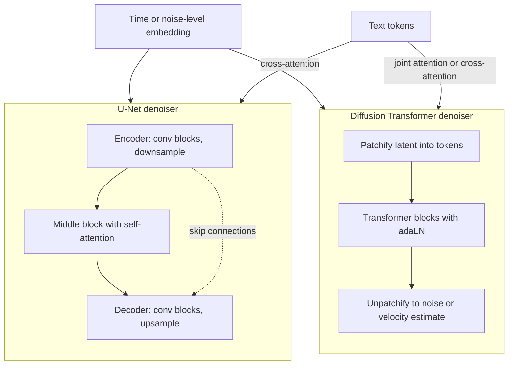

The two backbones receive the same inputs: the noisy tensor, a time embedding, and the condition tokens. They differ in how the structure of an image is represented. The U-Net hard-codes locality and a multi-scale hierarchy, with skips carrying detail across. The transformer treats the image as a bag of position-tagged tokens and learns the structure. For an architect, the difference matters in three practical places: the memory profile (attention memory at high resolution), the support for non-square outputs, and the availability of optimized serving kernels. Section 22 returns to memory.

## 10. Latent Diffusion

### 10.1 Perceptual compression and semantic generation

A pixel-space diffusion model spends most of its capacity on detail that a human cannot perceive. A $512\times512$ RGB image holds 786,432 values, but much of that is high-frequency texture that a compact code can reproduce. Robin Rombach and colleagues (2022) split the problem into two stages. A separately trained autoencoder compresses images into a small latent grid and reconstructs them with little perceptual loss. The diffusion model is then trained entirely in the latent space. This is the design behind Stable Diffusion and most open-weight image models since.

The autoencoder is a convolutional encoder $\mathcal{E}$ and decoder $\mathcal{D}$ with a downsampling factor $f$ and $c$ latent channels. An image $x\in\mathbb{R}^{H\times W\times3}$ becomes $z=\mathcal{E}(x)\in\mathbb{R}^{(H/f)\times(W/f)\times c}$. It is trained to minimize a perceptual reconstruction loss (a distance between features of a pretrained vision network, so that blurry output is penalized), a patch-based adversarial loss (a discriminator from [CH11](CH11_Generative_Adversarial_Networks.md), which keeps textures sharp), and a small regularization toward a Gaussian (a Kullback-Leibler penalty or a vector-quantization layer) so that the latent space is smooth. The diffusion model never sees pixels. It generates $z$, and $\mathcal{D}(z)$ produces the image.

A scaling constant belongs to the recipe. Latents from the encoder do not have unit variance, but the diffusion math of Section 3 assumes data scaled to roughly unit variance, so a fixed factor multiplies the latents before noising and divides them after sampling (about 0.18215 in the first Stable Diffusion release). Forgetting or mismatching the factor is a classic bug: the signal-to-noise ratio at every step then differs from what the network was trained on, and the symptom is washed-out or over-noisy images.

### 10.2 Compute savings with worked numbers

The script [03_guidance_and_cost.py](../code/python/diffusion-chapter/03_guidance_and_cost.py) prints the arithmetic for a $512\times512$ image with $f=8$ and $c=4$:

- Pixel values: $512\times512\times3=786{,}432$.
- Latent grid: $64\times64\times4=16{,}384$ values. The data compression is $786{,}432/16{,}384=48$ times.
- Spatial positions: $512^2=262{,}144$ in pixel space and $64^2=4{,}096$ in latent space, a ratio of 64. Convolution cost per layer is proportional to positions (for equal channel counts), so convolutional layers are about 64 times cheaper at the same width.
- Self-attention pairs: $262{,}144^2\approx6.87\times10^{10}$ versus $4{,}096^2\approx1.68\times10^{7}$, a ratio of 4,096. A pixel-space model cannot afford full self-attention at full resolution, and a latent model can afford it at the coarser levels.

These ratios are upper bounds on speedup, not predictions. Real U-Nets use more channels at low resolution, the text-conditioning layers cost the same in both cases, and the decoder adds a fixed cost (60 ms in the illustrative serving script). A realistic claim is an order-of-magnitude reduction in denoiser cost per step, plus the removal of the memory cliff for training. Rombach and colleagues report that their latent models reach comparable or better quality at a fraction of the training compute of pixel-space models. The architect's version of the result is easier to state: running 25 denoising steps on a $64\times64\times4$ latent is the reason a single consumer GPU can serve a 512-pixel text-to-image model.

The same arithmetic explains the price of resolution. At $1024\times1024$ with the same $f=8$ the latent is $128\times128\times4$ with 16,384 positions. A DiT with patch size $p=2$ then has 4,096 tokens, and the attention-pair count rises 16-fold relative to 512 pixels, as computed in Section 9.5.

### 10.3 What the autoencoder limits

The diffusion model can only produce what the decoder can render. Three consequences matter in product reviews:

1. **Detail ceiling.** An 8-fold spatial compression with 4 channels discards some fine structure. Small text, thin lines, faces at small scale, and repeated fine patterns are the common failures, and they come from the autoencoder as well as from the diffusion model. Later models use more latent channels (16 channels in several recent open-weight models; verify in each model card) to reduce the ceiling.
2. **Editing round trips.** Encoding a real photograph and decoding it without any diffusion step already changes it slightly. Image-to-image and inpainting pipelines therefore alter regions the user did not ask to change unless the pipeline composites the original pixels back outside the edit mask (Section 14).
3. **Decoder memory.** The decoder runs at full pixel resolution, so its activation memory can exceed that of the denoiser at large sizes. Production servers use tiled decoding (decode overlapping tiles and blend) to bound peak memory at some cost in seams and time.

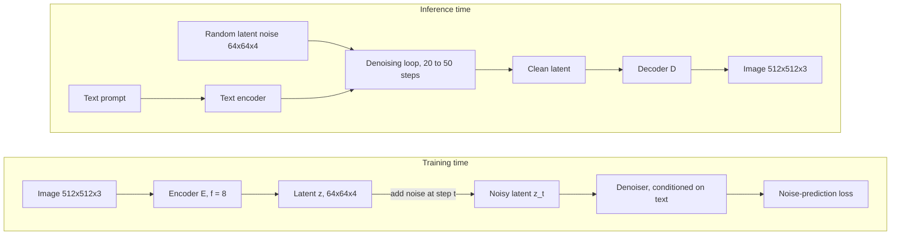

The training half shows that the encoder is used only to produce training targets, and the denoiser's loss is computed in latent space. The inference half shows that the encoder is not used at all for text-to-image: generation starts from noise in latent space, the denoising loop runs many times, and the decoder runs once. For image-to-image and editing the encoder also runs once at the start, which is one reason these modes cost a little more than their step counts suggest.

## 11. Conditioning: How Text, Labels, and Images Enter the Network

### 11.1 Why conditioning is a separate problem

An unconditional diffusion model draws from the whole data distribution. A product needs a model that draws from $p(x\mid c)$, where $c$ is a prompt, a class label, a reference image, or a spatial layout. Conditioning is injected into the denoiser as extra inputs and is learned during training from pairs $(x_0,c)$. The noising process itself never changes, and the loss in Section 6.5 becomes $\lVert\epsilon-\epsilon_\theta(x_t,t,c)\rVert^2$.

### 11.2 Class labels and global signals

For a small, fixed set of classes, the simplest approach is a learned embedding vector per class, added to the time embedding and fed to every block through the adaptive normalization pathway (Section 9). This is the approach of the original DiT on ImageNet, and it is cheap because the embedding is a single vector. The same pathway carries other global signals such as the image resolution and crop coordinates (SDXL conditions on the original image size and crop offset, which lets the model learn that low-resolution training images are blurry and avoid reproducing the blur when asked for sharp output) and the guidance scale in guidance-distilled models (Section 12.6).

### 11.3 Text encoders

Free-form text needs a representation that preserves meaning, so a pretrained text encoder maps a prompt to a sequence of vectors. Three families are in use:

- **CLIP text encoders.** Contrastive Language-Image Pretraining (CLIP, Radford and colleagues, 2021) trains a text encoder and an image encoder together so that matching pairs are close in embedding space ([CH16](CH16_Embeddings_and_Semantic_Representations.md) covers the objective). Its text encoder is a transformer that reads the prompt as up to 77 tokens and returns one vector per token plus one pooled vector. Because CLIP was trained to align text to images, its vectors encode visual concepts well, but its limited length and its weak handling of sentence structure (who does what to whom, counts, spatial relations) are well known.
- **T5 encoders.** T5 (Text-to-Text Transfer Transformer, Raffel and colleagues, 2020) is a large text-to-text language model, and its encoder gives rich linguistic representations of long prompts. Imagen (Saharia and colleagues, 2022) found that scaling the frozen text encoder improved image-text alignment and fidelity more than scaling the image model did, and that a text-only language model could serve as the encoder. T5-XXL has about 4.7 billion parameters in its encoder, so it is a significant memory cost on the serving side.
- **Combinations.** SDXL concatenates the outputs of two CLIP encoders. Stable Diffusion 3 uses two CLIP encoders and a T5-XXL encoder, with the pooled CLIP vector feeding the time-conditioning pathway and the token sequences feeding the transformer. FLUX.1 uses a CLIP encoder and a T5 encoder. The combination approach reflects a trade: CLIP provides visual-semantic alignment and T5 provides language structure and long context.

Practical consequences follow. The prompt length limit is a property of the encoder, not the diffusion model: text beyond 77 CLIP tokens is silently truncated in many pipelines unless the library chunks and concatenates it. Prompt weighting syntax, prompt "emphasis", and style words behave differently across encoders. And the choice of text encoder is a large share of the memory footprint, because a T5-XXL encoder in 16-bit precision needs roughly 9 GB for its encoder weights alone (4.7 billion parameters at 2 bytes), while a CLIP text encoder needs well under 1 GB.

### 11.4 Cross-attention

In a U-Net, text enters through cross-attention layers. Let $F\in\mathbb{R}^{N\times d}$ be the image features at one layer, flattened to $N$ positions, and $C\in\mathbb{R}^{L\times d_c}$ the text-encoder outputs for $L$ tokens. Linear maps produce queries from the image and keys and values from the text:

$$
Q=FW_Q,\quad K=CW_K,\quad V=CW_V,\qquad \mathrm{Attn}(F,C)=\mathrm{softmax}\!\left(\frac{QK^\top}{\sqrt{d_k}}\right)V .
$$

Each image position computes a weighting over the prompt tokens and returns the weighted sum of their value vectors. The $N\times L$ attention matrix shows which words each region of the image attends to, and this is the basis of attention-map visualizations and of prompt-to-prompt editing methods (Hertz and colleagues, 2022) that edit an image by reusing the maps while changing a word. The cost is small compared with self-attention. At $N=4{,}096$ latent positions and $L=77$ tokens there are $4{,}096\times77=315{,}392$ attention scores per head per layer, against $4{,}096^2=16{,}777{,}216$ for self-attention, a ratio of 53. The text embeddings $C$ do not depend on $x_t$ or $t$, so they are computed once per prompt and reused across all denoising steps. That is the reason the serving script includes a text-embedding cache: for repeated or templated prompts the encoder call is avoidable.

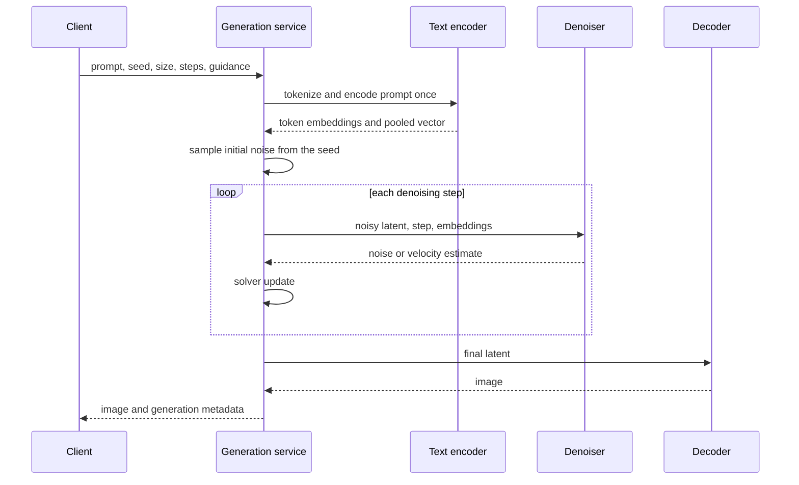

The sequence shows that the text encoder runs once and the denoiser loop dominates the request time. It also shows which values the service must record to make an image reproducible: the prompt, seed, size, step count, and guidance scale go in, and the same values with the same model and software versions are needed to regenerate the output (Section 20).

### 11.5 Image conditions

Conditions that are themselves images or spatial maps use one of three mechanisms:

1. **Channel concatenation.** The condition is resized and concatenated with the noisy latent along the channel dimension, so the first convolution reads both. Inpainting models take the masked image latent and the mask as extra input channels (Stable Diffusion's inpainting checkpoint uses nine input channels: four for the noisy latent, four for the masked-image latent, and one for the mask). Super-resolution models concatenate the upsampled low-resolution image. The approach is simple and precise, but it needs training or fine-tuning of the base model.
2. **Adapter branches.** A trainable copy or side network injects features into a frozen base model. ControlNet and T2I-Adapter do this for spatial controls (edges, depth, pose), and the Image Prompt Adapter (IP-Adapter) does it for image prompts. Section 13 covers them.
3. **Token injection.** The reference image is encoded to tokens (by an image encoder such as CLIP's) and appended to the text tokens, or attended to through added cross-attention layers. Editing models that accept both an instruction and a reference image use this path with a joint-attention transformer.

Which mechanism applies determines the cost of adding a new control. Channel concatenation requires retraining a base model per condition. Adapters need a small training run per condition (hours to days on a few GPUs) and keep the base model untouched, which is why they became the standard way to add controls.

## 12. Guidance

### 12.1 The problem guidance solves

A conditional diffusion model trained by maximum likelihood on $(x_0,c)$ pairs samples from $p(x\mid c)$ as it appears in the data. That distribution is broad. Captions are noisy, and many images in the training set only loosely match their text. Samples from the unmodified conditional model are diverse and often only partly faithful to the prompt. Users and benchmarks want fidelity to the condition at the cost of some diversity. Guidance gives a dial for that trade-off at sampling time, with no retraining.

### 12.2 Classifier guidance

Prafulla Dhariwal and Alex Nichol (2021) proposed using a separate classifier. By Bayes' rule, $p(x_t\mid y)\propto p(x_t)\,p(y\mid x_t)$, so the conditional score splits into two terms:

$$
\nabla_{x_t}\log p(x_t\mid y)=\nabla_{x_t}\log p(x_t)+\nabla_{x_t}\log p(y\mid x_t).
$$

The first term is the unconditional score the diffusion model already provides. The second is the gradient of a classifier's log-probability for class $y$ evaluated on the noisy input. Scaling the classifier term by a guidance scale $s\ge0$ gives a modified score:

$$
\widetilde{\nabla\log p}(x_t\mid y)=\nabla_{x_t}\log p(x_t)+s\,\nabla_{x_t}\log p(y\mid x_t).
$$

This is the score of a density proportional to $p(x_t)\,p(y\mid x_t)^s$, which is the data distribution reweighted by the classifier's confidence raised to the power $s$. For $s>1$ the reweighted distribution concentrates on regions where the classifier is confident. In terms of the noise prediction, using $\nabla\log p(x_t)=-\epsilon_\theta/\sigma_t$,

$$
\hat\epsilon(x_t,y)=\epsilon_\theta(x_t,t)-s\,\sigma_t\,\nabla_{x_t}\log p_\phi(y\mid x_t),
$$

where $p_\phi$ is the noisy classifier. Dhariwal and Nichol trained classifiers on noisy ImageNet images and showed that this beat GANs on several benchmarks. The method has three drawbacks. A separate classifier must be trained on noisy inputs at every noise level, a standard classifier does not work. It supports only labels that a classifier can predict, not free-form text. And the guidance gradient is computed through the classifier, which adds a backward pass at every step and can behave like an adversarial perturbation that raises classifier confidence without improving realism.

### 12.3 Classifier-free guidance

Jonathan Ho and Tim Salimans (2022) removed the classifier. Train a single network on conditioned and unconditioned examples: during training, replace the condition with a null token $\varnothing$ with some probability $p_{\mathrm{uncond}}$ (commonly around 10 percent). The same network then provides both $\epsilon_\theta(x_t,t,c)$ and $\epsilon_\theta(x_t,t,\varnothing)$. Rearranging Bayes' rule gives an implicit classifier, $\nabla\log p(c\mid x_t)=\nabla\log p(x_t\mid c)-\nabla\log p(x_t)$, which in noise-prediction terms is $-\frac{1}{\sigma_t}\left(\epsilon_\theta(x_t,t,c)-\epsilon_\theta(x_t,t,\varnothing)\right)$. Substituting it into the classifier-guidance formula yields the sampling rule

$$
\boxed{\ \tilde\epsilon_\theta(x_t,t,c)=\epsilon_\theta(x_t,t,\varnothing)+s\left(\epsilon_\theta(x_t,t,c)-\epsilon_\theta(x_t,t,\varnothing)\right)\ }
$$

with guidance scale $s$ (many papers write $w=s-1$ and a form $(1+w)\epsilon_c-w\,\epsilon_\varnothing$ that is identical). The value $s=0$ gives the unconditional model, $s=1$ gives the plain conditional model, and $s>1$ extrapolates beyond the conditional prediction in the direction away from the unconditional one. Equivalently, the guided model samples from a density proportional to $p(x_t)\,p(c\mid x_t)^s$, up to the approximation that the network is perfect. The extrapolation direction $\epsilon_c-\epsilon_\varnothing$ is the part of the noise estimate that the condition explains.

A worked example with made-up numbers shows the magnitude. Suppose at some coordinate the two network outputs are $\epsilon_\varnothing=0.20$ and $\epsilon_c=0.50$. With $s=7.5$ the guided value is $0.20+7.5\times(0.50-0.20)=2.45$, about five times the conditional prediction and far outside the unit-variance range on which the network's targets lie. This is why high guidance causes saturated colors and burnt-out contrast: the model is pushed outside the range of its training targets. It is also why data-prediction solvers (Section 8.6) are preferred under high guidance, because the clean estimate can be clipped or thresholded.

### 12.4 What guidance does to the distribution

A Gaussian toy gives the exact effect. Let the unconditional distribution be $\mathcal{N}(0,2^2)$ and the conditional $\mathcal{N}(1.5,0.5^2)$. Both scores are linear in $x$, so the guided score $\nabla\log p_u+s(\nabla\log p_c-\nabla\log p_u)$ is linear, and the guided density is Gaussian with precision $s/0.5^2+(1-s)/2^2$ and mean equal to the precision-weighted combination of the two means divided by that precision. The script [03_guidance_and_cost.py](../code/python/diffusion-chapter/03_guidance_and_cost.py) prints:

| Guidance scale $s$ | Guided mean | Guided standard deviation |
| --- | --- | --- |
| 0.0 | 0.0000 | 2.0000 |
| 1.0 | 1.5000 | 0.5000 |
| 3.0 | 1.5652 | 0.2949 |
| 5.0 | 1.5789 | 0.2294 |
| 7.5 | 1.5859 | 0.1877 |

Check $s=3$ by hand: precision $=3/0.25+(1-3)/4=12-0.5=11.5$, so the standard deviation is $1/\sqrt{11.5}=0.2949$, and the mean is $(3\times1.5/0.25)/11.5=18/11.5=1.5652$. Going from $s=1$ to $s=7.5$ shrinks the standard deviation from 0.50 to 0.19, a 62 percent reduction in spread, while the mean moves only 0.086. Two effects appear together. Samples concentrate near the center of the conditional mode, so each image is more typical of the prompt and diversity falls. And the mean moves slightly beyond the conditional mean in the direction away from the unconditional one, which is the overshoot that produces exaggerated features in images. The Gaussian is only a toy, but the shape of the trade-off, fidelity up and diversity down, matches what the field reports on real models.

### 12.5 Practical behaviour

The following points hold across models, but the exact numbers vary with the model and sampler, and one should always check the model card.

- **Typical ranges.** Models trained with $\epsilon$-prediction and a U-Net commonly use guidance scales of about 5 to 9 by default. Flow-matching transformers tend to use lower values, and some are distilled so that the guidance value is an input (Section 12.6). Treat the default as a calibrated setting for that checkpoint.
- **Diversity and prompt adherence move in opposite directions.** Raising the scale improves prompt following up to a point and then produces artifacts: oversaturation, harsh contrast, anatomical distortions, and loss of fine detail.
- **Dynamic thresholding and rescaling.** Imagen (Saharia and colleagues, 2022) clips the predicted clean image to a percentile-based range at each step. Lin and colleagues (2024) rescale the guided prediction so that its standard deviation matches the conditional prediction. Both reduce saturation at high scales.
- **Guidance intervals.** Kynkäänniemi and colleagues (2024) showed that guidance applied at high noise levels reduces diversity and that guidance at very low noise levels adds little, and proposed applying it only over a middle interval. The side benefit is fewer guided evaluations, hence lower cost.
- **Cost.** Each guided step needs two network passes. Run as a single batch of two (conditional and unconditional), this takes less than twice the time but more memory, and the serving arithmetic in Section 8.7 treats the factor of 2 as the default.

### 12.6 Making guidance cheaper

Chenlin Meng and colleagues (2023) distilled a guided model into a student that takes the guidance scale as an input and reproduces the guided output in one pass per step. The result halves the denoiser cost and removes the need for an unconditional pass. Several current open-weight and commercial image models are "guidance-distilled" in this sense. In practice such models expose a guidance value that works as a conditioning input rather than as an extrapolation scale, so the value is not comparable with classifier-free guidance scales in other models. The architect-level consequence is that the same numeric setting can mean different things in different checkpoints, and a configuration that records only "guidance 3.5" is incomplete without the model identifier.

### 12.7 Negative prompts

A negative prompt replaces the null condition in the classifier-free formula with an encoding of the unwanted concept $c_{\mathrm{neg}}$:

$$
\tilde\epsilon=\epsilon_\theta(x_t,t,c_{\mathrm{neg}})+s\left(\epsilon_\theta(x_t,t,c_{\mathrm{pos}})-\epsilon_\theta(x_t,t,c_{\mathrm{neg}})\right).
$$

The extrapolation direction now points away from the negative prompt and toward the positive one. The model is not told to omit anything. It is nudged away from a region of the distribution that the negative text describes, and the effect is statistical. Negative prompts such as "blurry, low quality" are used to push away from broad failure modes, and specific negatives ("no hands in frame") work inconsistently, because a text encoder does not represent negation reliably. For a product, two rules follow. A negative prompt is a quality tool and cannot serve as a safety control, because it provides no guarantee of absence. And when the system supplies its own default negative prompt, that string is part of the model configuration and should be recorded with the other generation inputs.

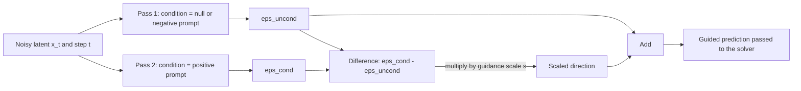

Both passes share the same weights and the same noisy input and differ only in the condition, so a serving stack typically concatenates them into one batch. The guided prediction is then handed to whatever solver is in use. This is the structure that every classifier-free guidance implementation shares, whether the framework is a research notebook or a production server.

## 13. Adapting a Pretrained Model: LoRA, ControlNet, and IP-Adapter

### 13.1 Why adapt instead of retrain

A base text-to-image model costs on the order of hundreds of thousands to millions of GPU-hours to train, so almost no product team trains one. Teams adapt. The adaptation methods differ in what they change, how much they cost to train, how they are served, and what risks they add. This section covers them at the level an architect needs. The fine-tuning mathematics, including the derivation of low-rank updates, is in [CH20 — Fine-Tuning, PEFT, and LoRA](CH20_Fine_Tuning_PEFT_and_LoRA.md).

| Method | What changes | Typical training input | Added size | Typical use |
| --- | --- | --- | --- | --- |
| Prompt engineering | Nothing | None | None | First attempt, no training |
| Textual inversion | One new token embedding | 3 to 20 images | A few kilobytes | A named concept or style |
| DreamBooth | All or most weights | 3 to 30 images of one subject | Full model copy | A specific subject's likeness |
| LoRA | Low-rank updates to attention layers | 10 to a few thousand images | Megabytes to tens of megabytes | Style, character, product, brand look |
| ControlNet | A trainable copy of encoder blocks | Image pairs (control map, target) | Hundreds of megabytes | Spatial control: edges, depth, pose |
| IP-Adapter | New cross-attention for image tokens | Large image-text pairs | Tens of megabytes | Image as a prompt: style or identity reference |
| Full fine-tune | All weights | Thousands to millions of images | Full model copy | New domain at scale |

The "typical" columns are orders of magnitude, not specifications, and they depend on the base model.

### 13.2 LoRA for diffusion models

Low-Rank Adaptation (LoRA, Hu and colleagues, 2021) freezes a pretrained weight matrix $W_0\in\mathbb{R}^{d_{\mathrm{out}}\times d_{\mathrm{in}}}$ and learns an update as a product of two thin matrices: $W=W_0+\tfrac{\alpha}{r}BA$, with $B\in\mathbb{R}^{d_{\mathrm{out}}\times r}$, $A\in\mathbb{R}^{r\times d_{\mathrm{in}}}$, rank $r\ll d$, and a scaling constant $\alpha$. In diffusion models the matrices adapted are the query, key, value, and output projections of the attention layers, and often the cross-attention projections that connect the text to the image.

A worked count shows the saving. A $1280\times1280$ projection has $1280^2=1{,}638{,}400$ parameters. A rank-8 update has $2\times1280\times8=20{,}480$ parameters, which is 1.25 percent. If a U-Net has a few hundred such matrices, the adapter totals a few million to tens of millions of parameters, which at 16-bit precision is some megabytes to tens of megabytes. The consequences for the system are practical:

- **Storage and distribution.** One base model and many small adapters instead of many full copies. A per-tenant or per-brand style is a small file.
- **Training cost.** Gradients and optimizer state exist only for the adapter, so training fits on one consumer GPU for small datasets.
- **Serving.** The adapter can be merged into the base weights (no extra latency, but the base model is changed for that process) or kept separate and applied at run time (a small extra cost per layer, and the ability to switch adapters between requests or combine several with weights). A multi-tenant service usually keeps adapters separate and loads them on demand, which makes the adapter-loading time and cache a capacity concern.
- **Composition.** Several LoRAs can be applied together with weights, for example a style adapter and a character adapter. Interference is common and unpredictable, so each combination needs a validation set.

### 13.3 Subject-specific methods and their risk

Textual inversion (Gal and colleagues, 2022) learns a single new embedding vector for a pseudo-word, and the model stays unchanged. DreamBooth (Ruiz and colleagues, 2023) fine-tunes the model on a handful of images of a subject tied to a rare token, with a **prior-preservation loss** that also trains on generic images of the same class so that the model does not forget what a "dog" looks like in general. Both can be done as LoRA. They are the standard route to "put my product, my pet, or my face in any scene". The risk follows from the capability. Anyone with a few photographs of a person can build a model that produces that person's likeness in arbitrary scenes. A product that offers subject training needs identity consent, minimum-age rules, and abuse controls (Section 21).

### 13.4 ControlNet

Lvmin Zhang, Anyi Rao, and Maneesh Agrawala (2023) added spatial control to a frozen text-to-image U-Net. The idea has three parts:

1. **Lock the base model.** Its weights are not changed, so its quality is preserved.
2. **Train a copy of the encoder half.** A trainable duplicate of the base U-Net's encoder and middle blocks receives the noisy latent plus an encoded control image (a Canny edge map, a depth map, a human pose skeleton, a segmentation map, scribbles).
3. **Connect through zero-initialized convolutions.** The copy's outputs are added to the base model's decoder skip connections through $1\times1$ convolutions whose weights and biases start at zero. At the start of training the copy contributes exactly nothing, so the base model's behavior is unchanged, and no harmful noise enters early in training. The zero convolutions then learn how much control to inject. The gradients to the zero-initialized weights are not zero, even though the weights are, which is why they train.

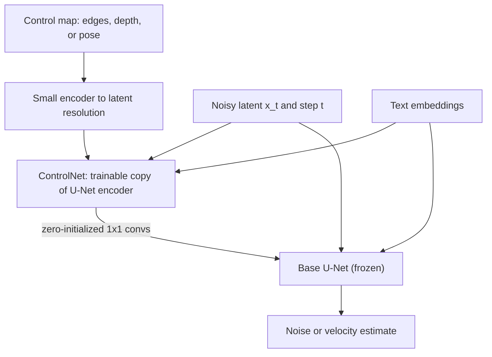

The diagram shows why ControlNet adds a per-step cost: the copy runs a forward pass at every denoising step, so a service that adds one control channel pays a measurable fraction of the encoder cost again, and several controls pay it several times. The measured overhead depends on the implementation and should be benchmarked, and typical reports put it at tens of percent of the base step time. The quality benefit is a precise structure constraint without a retrain of the base model, which is why ControlNet and its relatives (T2I-Adapter, Mou and colleagues, 2023) became the standard answer to "keep the layout of this input". Control strength is a tunable weight, and conditioning-guidance schedules (apply control for the first part of the denoising only) are a common trade between obeying the layout and keeping natural detail.

### 13.5 IP-Adapter

Hu Ye and colleagues (2023) proposed IP-Adapter to use an image as part of the prompt. A frozen image encoder (CLIP's vision tower) produces image features, which a small projection network turns into a few tokens. The base model's cross-attention layer gets a second, parallel set of key and value projections for those image tokens (the "decoupled cross-attention"), and the two attention outputs are summed:

$$
\mathrm{out}=\mathrm{Attn}(Q,K_{\mathrm{text}},V_{\mathrm{text}})+\lambda\,\mathrm{Attn}(Q,K_{\mathrm{img}},V_{\mathrm{img}}),
$$

where $\lambda$ is a user-set weight that decides how strongly the reference image steers the result. Only the new projections and the small token mapper are trained, in the tens of millions of parameters, and the base model is unchanged. IP-Adapter turns a reference image into style, composition, or (with face-specific encoders) identity guidance without any per-subject training. This makes it cheap and equally easy to misuse, because a face-conditioned adapter can place a person who never gave consent into new scenes from a single photograph.

### 13.6 Choosing

Choose by the requirement and the failure that can be tolerated:

- If a **look or brand style** must be applied consistently, train a LoRA on licensed or owned images. Validate against a fixed prompt set, because LoRAs can degrade prompt following.
- If a **layout, pose, or depth** must be preserved, use ControlNet or a control-specific adapter.
- If **a reference image** gives style or subject on the fly with no training, use IP-Adapter.
- If a **specific person or product** must appear, use DreamBooth-style training with documented consent or ownership, and a restricted workflow.
- If the **domain differs substantially** from the base model's training data (medical imaging, satellite imagery), fine-tuning on a large, carefully curated dataset is justified. Most image-generation products do not meet this bar.

Third-party adapters are also a supply-chain risk. Adapter files are downloaded artifacts. Use a weight format that cannot execute code on load (safetensors rather than Python pickle files), record the adapter source and license, scan for known-bad files, and pin hashes the same way as for any dependency (see [CH30](CH30_AI_Data_Governance_Privacy_and_Provenance.md)).

## 14. Image-to-Image, Inpainting, Outpainting, and Editing

### 14.1 Image-to-image by partial noising

Chenlin Meng and colleagues (2021) introduced SDEdit, which is the basis of the "image-to-image" mode in nearly every diffusion tool. The method uses the forward process of Section 3 as a projection onto the manifold of plausible images. Take the input image (encoded to a latent), add noise up to an intermediate step $t_0$ using the closed form, and run the reverse process from $t_0$ to 0 with the new prompt. The noise erases the details that the new prompt may overwrite, while the coarse layout that survives the noise is kept.

The user-facing parameter is **strength** $\in[0,1]$, which selects $t_0=\text{strength}\times T$. Strength 1 starts from pure noise and ignores the input. Strength 0.5 starts halfway. Two arithmetic facts follow:

1. **Cost scales with strength.** A sampler configured for 30 steps at strength 0.6 runs the last 18 steps. Image-to-image at moderate strength is cheaper than text-to-image by that fraction, plus one encoder call.
2. **Strength is schedule-dependent.** Strength 0.5 means different things for different schedules. In the linear schedule of Section 4, $t=500$ leaves signal amplitude $\sqrt{\bar\alpha_{500}}=0.28$ and noise amplitude $0.96$, so the layout is mostly gone. In the cosine schedule, $t=500$ has $\bar\alpha_{500}=0.494$, so the signal amplitude is $\sqrt{0.494}=0.70$ and far more of the input survives. A "strength" value that works on one model cannot be assumed to transfer to another.

### 14.2 Inpainting

Inpainting regenerates a masked region and keeps the rest. There are two families:

- **A dedicated inpainting model.** The model is fine-tuned with the masked image and the mask as extra input channels (Section 11.5). It learns to fill the hole coherently with the surroundings. Quality is the best of the options, and the cost is an additional checkpoint to host.
- **Mask blending with a standard model.** At each reverse step the sampler keeps the model's output inside the mask and replaces everything outside the mask with a freshly noised copy of the original, produced by the closed form at the current noise level (Blended Diffusion, Avrahami and colleagues, 2022; RePaint, Lugmayr and colleagues, 2022):

$$
x_{t-1}\leftarrow m\odot x_{t-1}^{\mathrm{model}}+(1-m)\odot\left(\sqrt{\bar\alpha_{t-1}}\,x_0^{\mathrm{orig}}+\sqrt{1-\bar\alpha_{t-1}}\,\epsilon'\right),
$$

where $m$ is the mask ($1$ in the region to generate), $\odot$ is elementwise multiplication, and $\epsilon'$ is fresh noise. This works with any model but tends to leave visible seams, because the generated region only sees the surrounding context through the noisy blend. RePaint adds "resampling" (alternating between a step forward and backward) to harmonize the seam, at several times the cost.

Three details decide whether the results are usable. First, **the mask lives at latent resolution** in latent diffusion. With $f=8$, a mask edge can only be positioned to multiples of 8 pixels, and a $100\times100$-pixel region covers about 12.5 latent cells per side. Thin masks vanish, and mask boundaries are blurry at the pixel level. Soft or dilated masks are standard to hide this. Second, **the VAE round trip changes unmasked pixels** (Section 10.3), so a careful pipeline pastes the original pixels back outside the mask after decoding (compositing in pixel space with a feathered mask). Third, **context matters**: the model only sees a crop of limited size, so inpainting a small object in a high-resolution image works best when the pipeline crops around the mask, upscales the crop to the model's native resolution, generates, and pastes the result back.

### 14.3 Outpainting

Outpainting extends the canvas. The original image is placed on a larger canvas, the new border is marked as the mask, and the inpainting machinery fills it. The constraints are those of inpainting plus two more. The model cannot see beyond its input size, so large extensions are done in tiles with overlap, and each tile inherits drift from the previous one. And content far from the original has no anchor, so repeated outpainting amplifies small style or perspective errors. Products usually limit the extension per step and show the user a preview before committing.

### 14.4 Inversion and instruction-based editing

To edit a real image with prompt-based control, one needs the noise code that would reproduce it. The probability-flow ODE of Section 7.4 is invertible, so running a deterministic sampler in reverse (from $x_0$ toward noise, **DDIM inversion**) encodes the image. The reconstruction is accurate for unguided sampling but not under strong classifier-free guidance, where the numerical error of the inversion grows. Null-text inversion (Mokady and colleagues, 2023) fixes this by optimizing the unconditional embedding at each step so that the guided trajectory reproduces the image, at the cost of an optimization loop per image.

A different approach avoids inversion altogether. InstructPix2Pix (Brooks and colleagues, 2023) trains a model on synthetic triples (input image, instruction, edited image) generated with a language model and prompt-to-prompt editing. At run time the user supplies an image and an instruction ("make it winter") and the model edits directly with two guidance scales (one for the instruction, one for staying close to the image). Current editing models that take both an instruction and a reference image extend this recipe with larger transformers. Whatever the method, editing creates a distinct risk class: modified photographs of real people and real events (Section 21).

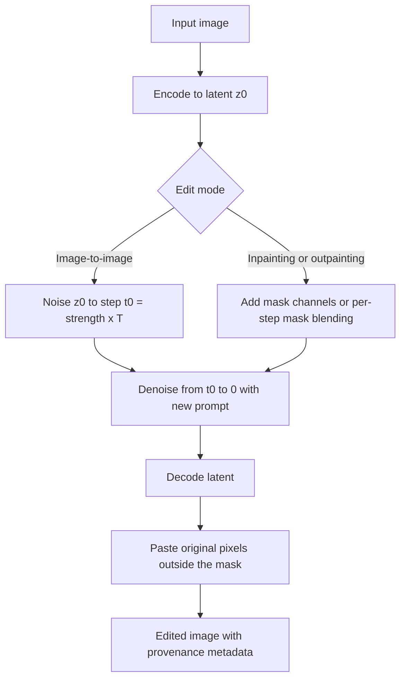

The flow shows where the edit decisions sit: strength or mask choice before denoising, and the compositing step after decoding. The last box matters operationally. An edited image is a derivative of a user-supplied image, so the pipeline must carry the provenance record forward (Section 21.4) and apply the same safety checks to the result as to a newly generated image.

## 15. Flow Matching and Rectified Flow

### 15.1 Motivation

Diffusion fixes a noising process and derives the reverse. Section 7 showed that the ODE route is cleaner for sampling than the SDE route. Flow matching (Lipman and colleagues, 2023) and rectified flow (Liu, Gong, and Liu, 2022) start from the ODE and choose a path directly. The goal is a velocity field that transports noise to data along paths that are as simple as possible. Simple paths mean low integration error, hence fewer steps. Stochastic interpolants (Albergo and Vanden-Eijnden, 2023) give a related unified view.

### 15.2 The formulation

Use the convention of the Stable Diffusion 3 paper, in which $t=0$ is data and $t=1$ is noise. Given a data example $x_0$ and a noise sample $\epsilon\sim\mathcal{N}(0,I)$, define the straight line

$$
x_t=(1-t)\,x_0+t\,\epsilon,\qquad t\in[0,1].
$$

The velocity of a point moving along this line is constant: $dx_t/dt=\epsilon-x_0$. A network $v_\theta(x_t,t)$ is trained to predict it:

$$
L_{\mathrm{FM}}(\theta)=\mathbb{E}_{x_0,\epsilon,t}\left[\left\lVert v_\theta(x_t,t)-(\epsilon-x_0)\right\rVert^2\right].
$$

The training loop is exactly the loop of Section 3.5 with a different interpolation and a different regression target. The justification is the following. For a given $x_t$, many different pairs $(x_0,\epsilon)$ could have produced it, with different velocities $\epsilon-x_0$. The network that minimizes the squared error predicts their average, $v^\star(x_t,t)=\mathbb{E}[\epsilon-x_0\mid x_t]$. This average is the velocity field of the marginal flow that transports the whole noise distribution to the whole data distribution. A gradient-equivalence argument (the conditional flow-matching loss and the marginal one have the same gradients with respect to $\theta$) shows that regressing on the per-pair target is as good as regressing on the unknown marginal field.

Sampling integrates the ODE $dx/dt=v_\theta(x,t)$ from $t=1$ (noise) to $t=0$ (data). The Euler step of size $\Delta$ is $x_{t-\Delta}=x_t-\Delta\,v_\theta(x_t,t)$, so the same solver machinery as in Section 8 applies, with the same step-count trade-offs.

### 15.3 Relation to diffusion

Flow matching with Gaussian noise is a diffusion model with a specific schedule, signal coefficient $a_t=1-t$ and noise coefficient $\sigma_t=t$. It is not variance preserving, since $(1-t)^2+t^2<1$ for interior $t$, but the SNR and the conversions still work. From $x_t$ and the velocity $v=\epsilon-x_0$:

$$
\hat x_0=x_t-t\,v,\qquad \hat\epsilon=x_t+(1-t)\,v .
$$

To verify the first: $x_t-t(\epsilon-x_0)=(1-t)x_0+t\epsilon-t\epsilon+tx_0=x_0$. The signal-to-noise ratio is $\mathrm{SNR}(t)=\left((1-t)/t\right)^2$. At $t=1$ it equals exactly zero. A flow-matching model has a zero-terminal-SNR endpoint by construction, which removes the problem of Section 4.5 without a special fix, and sampling really starts from pure noise as the model was trained to expect. The target $\epsilon-x_0$ is well behaved at both ends, so it shares the advantage of $v$-prediction (Section 5.3).

### 15.4 Timestep sampling and resolution shift

The loss is still a regression averaged over $t$. Where $t$ is drawn matters, because mid-range noise levels are the hardest to learn and the end points are easy. Esser and colleagues (2024) compared timestep distributions and found that a **logit-normal** distribution, which concentrates $t$ near the middle of $[0,1]$, worked best for their text-to-image models. They also shift the distribution toward noise as the image grows (Section 4.5). A common form of the shift is $t'=\dfrac{s\,t}{1+(s-1)\,t}$ with $s\ge1$. For $s=3$ and $t=0.5$, $t'=1.5/2=0.75$, so the sampler spends more steps at high noise. Libraries expose this as a `shift` parameter. It belongs to the model configuration, and a mismatch between training and sampling shift produces artifacts in the same way as a schedule mismatch (Section 4.4).

### 15.5 A toy with the exact velocity

The script [05_loss_parameterizations_and_flow.py](../code/python/diffusion-chapter/05_loss_parameterizations_and_flow.py) repeats the Gaussian-mixture experiment with the exact marginal velocity field and plain Euler steps from $t=1$ to $t=0$. The data are the same two-mode mixture, with data standard deviation 2.030 in the sample used:

| Euler steps (NFE) | Fraction in right mode | Sample standard deviation | Wasserstein-1 distance |
| --- | --- | --- | --- |
| 1 | 1.000 | 0.000 | 2.0083 |
| 2 | 0.501 | 1.526 | 0.5952 |
| 4 | 0.501 | 1.832 | 0.2051 |
| 8 | 0.501 | 1.927 | 0.1067 |
| 32 | 0.501 | 2.005 | 0.0300 |

The one-step row is the instructive one. With a single Euler step every sample lands on exactly zero (fraction 1.000 means all values are non-negative, and the standard deviation is 0.000), which is the midpoint between the two modes, where no data exists. The marginal velocity at $t=1$ points from noise to the average of the data, and one step goes straight to that average. The straight paths belong to individual (noise, data) pairs, but the learned field averages over all pairs that pass through a point, and the field curves where paths from different pairs cross. More steps follow the curve: W1 falls from 2.01 to 0.60, 0.21, 0.11, and 0.03, a drop by a factor of 2 to 3 for each doubling of steps between 2 and 8. The numbers confirm a general rule. Flow models with a good solver need on the order of 10 to 30 steps for high quality. They cannot do it in one step unless the field is made straighter or the model is distilled.

### 15.6 Reflow

Rectified flow addresses the crossing directly with **reflow**. After training a flow model, generate pairs by running the ODE from many noise samples to their data outputs. The pairs $(\epsilon_i,\hat x_{0,i})$ are coupled through the model's own trajectories, which do not cross. Train a new flow model on these coupled pairs with the same straight-line loss. The new model's paths are straighter, so fewer steps are needed. Liu and colleagues (2023) combined repeated reflow with distillation in InstaFlow to build one-step text-to-image models from Stable Diffusion. The price is extra training runs, a pass of sample generation for the pairs, and a possible loss of diversity, as in all distillation (Section 16).

### 15.7 Diffusion and flow matching in practice

| Aspect | Variance-preserving diffusion with $\epsilon$-prediction | Flow matching with velocity target |
| --- | --- | --- |
| Interpolation | $\sqrt{\bar\alpha_t}x_0+\sqrt{1-\bar\alpha_t}\epsilon$ | $(1-t)x_0+t\epsilon$ |
| Network target | Noise $\epsilon$ | Velocity $\epsilon-x_0$ |
| Terminal SNR | Small but non-zero for common schedules | Exactly zero |
| Sampler | SDE or ODE solvers | ODE solvers (Euler is common) |
| Training stability at high noise | Needs care (Section 5.3) | Good by construction |
| Typical users | Stable Diffusion 1.x and XL | Stable Diffusion 3 and FLUX.1 families |

The last row lists examples that were checked at the time of writing: the Hugging Face model card describes FLUX.1 [dev] as a 12-billion-parameter rectified-flow transformer ([model card](https://huggingface.co/black-forest-labs/FLUX.1-dev)), and the Stable Diffusion 3 paper by Esser and colleagues (2024) uses rectified flow with the MMDiT backbone. Check the current model cards before relying on any architectural claim, since model families change quickly.

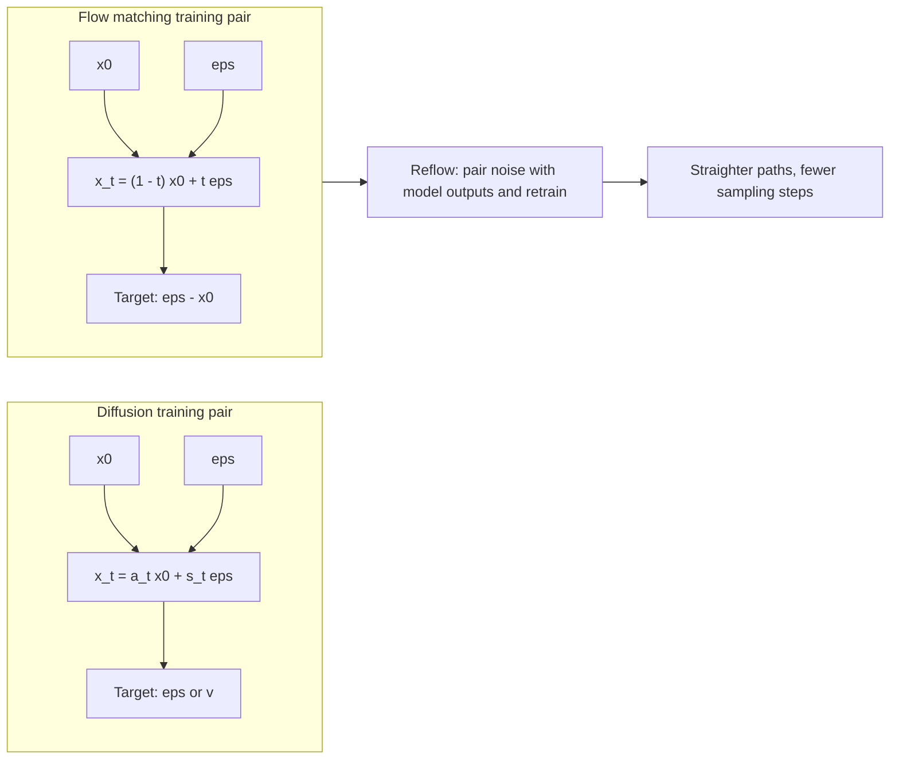

The two training recipes differ only in the interpolation and the target, which is why libraries implement both with the same training loop. The reflow branch shows the way to trade extra training for fewer sampling steps.

## 16. Few-Step Generation: Distillation

### 16.1 The goal and the families

Sections 8 and 15 reduced steps from 1,000 to 20 or 30 by better solvers and straighter paths. Interactive products want 1 to 4. Distillation trains a **student** that matches a **teacher** diffusion model's outputs in far fewer evaluations. The student starts from the teacher's weights in nearly all methods, so the training cost is a small fraction of the cost of the original model. The families differ in what the student is trained to match.

### 16.2 Progressive distillation

Tim Salimans and Jonathan Ho (2022) trained the student to take one step that equals two teacher steps, then repeated. Let the teacher use $N$ steps. A student is initialized from the teacher and trained so that a single student step from $z_t$ to $z_{t-2}$ (two teacher steps away) reproduces the result of two deterministic teacher DDIM steps. The target $\tilde x$ is chosen so that one DDIM-style step lands on the teacher's two-step result:

$$
\tilde x=\frac{z_{t''}-(\sigma_{t''}/\sigma_t)\,z_t}{\alpha_{t''}-(\sigma_{t''}/\sigma_t)\,\alpha_t},
$$

where $t''$ is the time two teacher steps ahead, and $\alpha,\sigma$ are the signal and noise coefficients of Section 5.2. When this stage converges, the student becomes the next teacher, and the process repeats. From 1,024 steps to 4 steps takes 8 halvings, since $1024/2^8=4$. Salimans and Ho report samples with FID values close to the teacher's at four steps on CIFAR-10 and ImageNet-scale benchmarks. They used $v$-prediction in the student, because $\epsilon$-prediction is ill-conditioned when only a few steps cover the whole noise range (Section 5.3). The cost is the sum of the training runs of all halvings, each of the order of the cost of a short fine-tune. The result is a student that still runs a standard ODE sampler, only with fewer steps.

### 16.3 Guidance distillation

Section 12.6 described removing the second guidance pass. It combines with the other methods: first distill guidance into the student, then distill steps. Many few-step models are trained with guidance already included in the teacher outputs they imitate, so guidance is built into the student, and the user-facing guidance scale is then fixed or limited.

### 16.4 Consistency models

Yang Song, Prafulla Dhariwal, Mark Chen, and Ilya Sutskever (2023) took a different route. Every point $x_t$ on a probability-flow ODE trajectory leads to the same clean endpoint $x_0$ if the ODE is followed to the end. A **consistency function** $f_\theta(x_t,t)$ maps any point on a trajectory directly to that endpoint. Two properties define it. The **self-consistency** property says that any two points on the same trajectory map to the same output: $f_\theta(x_t,t)=f_\theta(x_{t'},t')$. The **boundary condition** says $f_\theta(x_\epsilon,\epsilon)=x_\epsilon$ at the smallest noise level. The boundary condition is enforced by construction, with a parameterization $f_\theta(x,t)=c_{\mathrm{skip}}(t)\,x+c_{\mathrm{out}}(t)\,F_\theta(x,t)$ where $c_{\mathrm{skip}}(\epsilon)=1$ and $c_{\mathrm{out}}(\epsilon)=0$.

Training minimizes the distance between $f_\theta$ at two neighbouring points on a trajectory. In **consistency distillation** the neighbouring point is obtained by running one step of a teacher ODE solver, and the loss compares $f_\theta(x_{t_{n+1}},t_{n+1})$ with a slowly updated copy of itself ($f_{\theta^-}$, an exponential moving average) evaluated at the solver's next point. **Consistency training** needs no teacher and uses noisy data pairs directly, with somewhat lower quality. Sampling takes one step: draw $x_T$, compute $f_\theta(x_T,T)$. Quality improves with **multistep sampling**, which alternates between mapping to a clean estimate and adding noise back to a lower noise level, and re-applying $f_\theta$. Two to four steps are typical. Simian Luo and colleagues (2023) applied consistency distillation to the latent space of Stable Diffusion (Latent Consistency Models, LCM) and showed that a LoRA trained this way ("LCM-LoRA") can be added to many fine-tuned models to give them few-step sampling. This is a notable architectural property: a few-step capability that is a small plug-in, not a new checkpoint.

### 16.5 Adversarial and distribution-matching distillation

Pure regression to a teacher's outputs gives blurry students at very low step counts, because there are many plausible teacher outputs for a given input and the regression averages them. The remedies bring back a GAN-like loss ([CH11](CH11_Generative_Adversarial_Networks.md)) or a distribution-level loss:

- **Adversarial Diffusion Distillation** (ADD, Sauer and colleagues, 2023) trains a student to produce a sample in one to four steps with two losses: a distillation loss against the teacher and an adversarial loss from a discriminator that judges realism. The model released with it, SDXL-Turbo, generated 512-pixel images in one step. Latent Adversarial Diffusion Distillation (LADD) moves the discriminator to the latent space and was used on Stable Diffusion 3.
- **Distribution Matching Distillation** (DMD, Yin and colleagues, 2024) trains a one-step generator so that its output distribution matches the teacher's. The gradient is the difference between the score of the real (teacher) distribution and the score of the generator's own distribution, estimated with a second diffusion model fitted to the generator's samples, plus a regression term that keeps the student near the teacher's outputs for fixed noise.

These methods reach one to four steps with quality that several benchmarks rate close to the teacher, but each student comes with trade-offs, listed next. Some released students have licenses that differ from their teachers' (several are non-commercial or require a separate commercial agreement). Check the license of the student separately from the teacher.

### 16.6 What distillation costs the user

| Property | Teacher (50 guided steps) | Few-step student (1 to 4 steps) |
| --- | --- | --- |
| Denoiser calls per image | 100 | 1 to 4 |
| Diversity across seeds | Higher | Often lower (mode-seeking losses) |
| Guidance scale and negative prompts | Free parameters | Fixed or limited |
| Fine detail and text rendering | Better | Often reduced at one step |
| Compatibility with LoRA, ControlNet, and adapters | Native | Needs retraining or conversion, in some cases |
| Training cost | None (already trained) | One-time distillation run |
| Per-image GPU time at 40 ms per call | 4.00 s | 0.04 to 0.16 s |

The break-even calculation is simple. Using the illustrative figures of this chapter, a teacher image costs 100 calls at 40 ms, or 4.00 s of GPU time, and a 4-step student costs 0.16 s. The saving is 3.84 s per image. At an assumed price of 2.50 USD per GPU hour, 3.84 s costs $3.84/3600\times2.50=0.00267$ USD. If a distillation run takes 2,000 GPU hours (an assumed figure at 2.50 USD, so 5,000 USD), the break-even volume is $5000/0.00267\approx1.9$ million images. At that volume a feature with a million images per month recovers the cost in two months on compute alone, and the latency gain, from about 4 s to well under 1 s, may change which product experiences are possible at all. Below that volume the compute argument is weak, and the decision rests on latency.

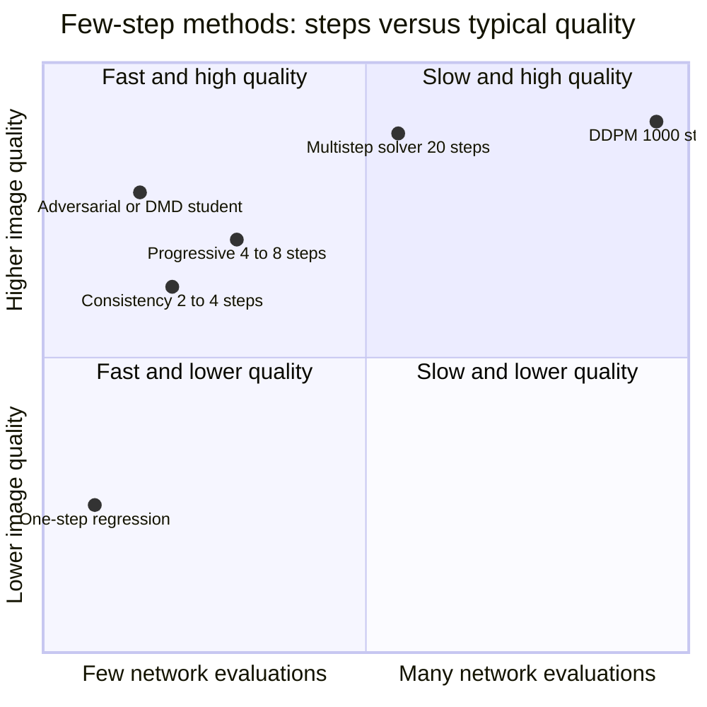

The positions are qualitative and illustrative, drawn from the pattern in published comparisons and not from a single benchmark. Fast methods lose some quality, and the best fast methods lose little. The honest way to use the chart is to treat each method as a hypothesis about a particular model and test it on the product's own prompts.

## 17. Beyond Still Images: Video, Audio, 3D, and Discrete Data

### 17.1 Video

A video model must generate many frames that agree with each other in identity, lighting, and motion. The usual construction extends latent diffusion in time. A video autoencoder compresses a clip in both space and time. The diffusion model then runs over a space-time latent, and a transformer treats space-time patches as tokens (the approach OpenAI described for Sora in 2024, and one used by several open-weight video models; check each model card for specifics). Earlier models inserted temporal attention or temporal convolution layers into an image U-Net and trained them on video (Stable Video Diffusion, Blattmann and colleagues, 2023).

Token counts show why video is expensive. Take a 5-second clip at 24 frames per second, which is 120 frames, at $512\times512$ pixels. Suppose the video autoencoder compresses space by 8 and time by 4, so each frame is a $64\times64$ latent and the clip has about 30 latent frames. With patch size 2 the model sees $1{,}024$ tokens per latent frame, so $30\times1{,}024=30{,}720$ tokens. Full self-attention over them needs $30{,}720^2=943{,}718{,}400$ pair interactions per head per layer, which is 900 times the $1{,}048{,}576$ pairs of the single image in Section 9.5. Two remedies are standard. **Factorized attention** attends within each frame ($30\times1{,}024^2=31{,}457{,}280$ pairs) and then across frames at each spatial position ($1{,}024\times30^2=921{,}600$ pairs). The total of $32{,}378{,}880$ is about 29 times smaller than full attention, at some cost in modelling long-range space-time structure. **Windowed or sparse attention** restricts each token to a neighbourhood. Even with such savings, token count alone puts one denoiser call at 30 times the cost of the image call in the linear layers.

A rough, illustrative extrapolation: if an image denoiser call takes 40 ms, a video call with 30 times the tokens takes at least 1.2 s before attention overhead. With 50 steps and guidance (100 calls) the denoising loop is about 120 s per five-second clip on one GPU, and real systems take longer, spread across several GPUs. Video generation is therefore an asynchronous, queued, minutes-scale workload with per-second-of-video pricing, and the serving design of Section 22 applies with different constants. The levers are the same as for images: fewer steps through distillation, lower resolution with a separate upsampling model, and cascades that generate a short, low-frame-rate clip and then interpolate frames and upsample.

Video adds quality dimensions that still-image metrics ignore. Temporal flicker, object permanence, physical plausibility, and identity drift across frames all matter, and the standard image metrics do not capture them. The common video metrics (Fréchet Video Distance and its variants) share the weaknesses of FID (Section 19), and human review is the usual arbiter. Video also raises the risk level of misuse, because synthetic video of real people is a stronger deception tool than a single image.

### 17.2 Audio

Audio can be generated directly as a waveform (a one-dimensional signal with 16,000 to 48,000 samples per second) or as a spectrogram, which is a two-dimensional image of energy over time and frequency, with a vocoder (a neural network that turns a spectrogram back into a waveform) as the last stage. DiffWave and WaveGrad (2020) applied the DDPM recipe to waveforms for speech synthesis. Latent approaches (AudioLDM, Stable Audio) compress audio with an autoencoder and diffuse in the latent space, the same two-stage design as images. Count the data size to see why: 30 seconds of stereo audio at 44.1 kHz is $30\times44{,}100\times2=2{,}646{,}000$ samples, more than three times the 786,432 values of a 512-pixel RGB image. Latent compression is what makes such models trainable.

Conditioning uses the same mechanisms as images: text embeddings through cross-attention for text-to-music, speaker or style embeddings for text-to-speech, and a reference audio clip for voice conversion. Two risks are specific to audio. Voice cloning from a few seconds of speech enables impersonation fraud, and watermarking is less mature for audio than for images. Music models face the same copyright and consent questions as image models (Section 21), with an additional complication that musical style is not a protectable property in many jurisdictions while recordings and compositions are.

### 17.3 3D

Direct 3D diffusion is limited by the scarcity of 3D training data compared with the billions of images available. Ben Poole and colleagues (2022) sidestepped it with **score distillation sampling** (SDS) in DreamFusion. A 3D representation (a neural radiance field, or later 3D Gaussian splats) is rendered from a random camera, the rendering is noised, and a frozen text-to-image diffusion model estimates the noise. The difference between the model's noise estimate and the noise that was added defines a gradient, which is propagated through the renderer into the 3D parameters:

$$
\nabla_\theta L_{\mathrm{SDS}}=\mathbb{E}_{t,\epsilon}\left[w(t)\,\left(\hat\epsilon_\phi(x_t;c,t)-\epsilon\right)\frac{\partial x}{\partial\theta}\right],
$$

where $\theta$ are the 3D parameters, $x$ is the rendering, $\hat\epsilon_\phi$ is the diffusion model's noise estimate, and $w(t)$ is a weighting. The method needs no 3D data but is slow, because it is an optimization per asset (tens of minutes to hours) and it uses high guidance scales, which cause over-saturated, over-smooth shapes. Later systems fine-tune the image model to produce consistent multi-view images and then use a feed-forward network to reconstruct a 3D asset in seconds. For an architect the relevant distinction is cost per asset: optimization-based methods cost GPU-minutes to GPU-hours, and feed-forward methods cost GPU-seconds, at lower fidelity.

### 17.4 Beyond media

The same machinery appears wherever a distribution over structured, continuous outputs has to be sampled. Diffusion Policy (Chi and colleagues, 2023) generates robot action sequences by denoising, which handles the multimodality of human demonstrations (go left or go right, never the average). The structure-prediction systems for biomolecules use diffusion over atomic coordinates (for example in the AlphaFold 3 architecture and in RFdiffusion for protein design), and weather and trajectory forecasting models use diffusion to represent uncertainty. These are outside the scope of this chapter, but they reinforce the point that diffusion is a general method for modelling complicated distributions, and a product team should look for it wherever a regression model's "average answer" is unacceptable.

### 17.5 Diffusion language models

Text consists of discrete tokens, and adding Gaussian noise to token identities has no meaning. Two approaches exist. Continuous methods embed tokens in a vector space and diffuse the embeddings (Diffusion-LM, Li and colleagues, 2022), and a rounding step maps back to tokens. Discrete methods define the corruption directly on tokens: Austin and colleagues (2021) introduced structured discrete diffusion, and masked (absorbing-state) variants replace each token by a mask symbol with a probability that grows with the noise level. The network learns to predict the original tokens of masked positions, and generation starts from an all-mask sequence and unmasks tokens over several steps. Recent work (for example Sahoo and colleagues, 2024, on masked diffusion language models, and the LLaDA model of Nie and colleagues, 2025) trains such models at billions of parameters.

The potential advantages are parallel generation of several tokens per step, natural infilling and editing, and a latency profile that depends on the number of denoising steps instead of the output length. The disadvantages are practical. Bidirectional attention at every step complicates the key-value caching that makes autoregressive decoding efficient ([CH10](CH10_Transformers_and_Attention.md)), the quality at a given parameter count has generally trailed strong autoregressive models in published comparisons, and tooling for serving, quantization, and evaluation is far less mature. Some vendors have announced commercial diffusion language models with large throughput claims. Treat such claims as hypotheses to measure on the intended workload, with the same discipline as for image samplers: quality at matched cost, on the team's own prompts.

## 18. Implementation and Practice

### 18.1 The training step in code

The following PyTorch fragment is the entire core of $\epsilon$-prediction training. It is illustrative and was not run for this chapter, because the chapter's runnable scripts use the standard library only. The model is any network that maps a noisy batch and step indices to a tensor of the same shape.

```python
import torch
import torch.nn.functional as F

def make_alpha_bar(T=1000, b0=1e-4, b1=0.02):
    betas = torch.linspace(b0, b1, T)
    return torch.cumprod(1.0 - betas, dim=0)          # shape (T,)

def train_step(model, x0, alpha_bar, optimizer):
    B = x0.shape[0]
    t = torch.randint(0, alpha_bar.shape[0], (B,), device=x0.device)
    eps = torch.randn_like(x0)
    ab = alpha_bar[t].view(B, *([1] * (x0.dim() - 1)))
    x_t = ab.sqrt() * x0 + (1.0 - ab).sqrt() * eps    # closed form, Section 3.2
    loss = F.mse_loss(model(x_t, t), eps)             # simple loss, Section 6.5
    optimizer.zero_grad(set_to_none=True)
    loss.backward()
    optimizer.step()
    return loss.item()
```

Four implementation details cause most production training bugs. The step index $t$ must be sampled uniformly per example, not once per batch. The noise must be drawn fresh at every iteration. The conditioning dropout for classifier-free guidance (Section 12.3) must replace the whole condition with a null embedding for a random subset of examples, with the choice made per example. And exponential moving averages of the weights (decay of about 0.9999 in the original DDPM) are used for sampling, since the raw weights are noisier than the averaged ones.

### 18.2 A deterministic sampler in code

```python
@torch.no_grad()
def ddim_sample(model, shape, alpha_bar, steps=25, cond=None, null=None, scale=7.0, seed=0):
    g = torch.Generator(device="cpu").manual_seed(seed)       # fixed, device-independent noise
    x = torch.randn(shape, generator=g).to(alpha_bar.device)
    T = alpha_bar.shape[0]
    ts = torch.linspace(T - 1, 0, steps + 1).round().long()   # descending; last entry is 0
    for t, t_prev in zip(ts[:-1], ts[1:]):
        tt = torch.full((shape[0],), int(t), device=x.device)
        if cond is not None:                                  # classifier-free guidance
            e = model(torch.cat([x, x]), torch.cat([tt, tt]), torch.cat([null, cond]))
            e_u, e_c = e.chunk(2)
            eps = e_u + scale * (e_c - e_u)                   # Section 12.3
        else:
            eps = model(x, tt)
        ab, ab_prev = alpha_bar[t], alpha_bar[t_prev]
        x0 = (x - (1 - ab).sqrt() * eps) / ab.sqrt()          # Section 5.2
        x = ab_prev.sqrt() * x0 + (1 - ab_prev).sqrt() * eps  # Section 8.1, eta = 0
    return x
```

The sketch shows the guidance batch (conditional and unconditional in one forward pass) and a seed-controlled starting noise generated on the CPU. It uses linear spacing for brevity, and a production sampler would use the spacing recommended for its model (Section 8.5). Note that the final step with `t_prev = 0` uses `alpha_bar[0]`, which is the first entry of the cumulative product, not 1; a library that indexes steps from 1 or inserts a leading 1 handles the boundary differently, which is one more reason to use a tested scheduler.

### 18.3 Using a library

Production code rarely implements samplers by hand. The Hugging Face Diffusers library provides pipelines and schedulers. The pattern below shows the inputs a service should expose and record. The model identifier is a placeholder, because the right checkpoint, license, and precision depend on the product.

```python
import torch
from diffusers import DiffusionPipeline, DPMSolverMultistepScheduler

pipe = DiffusionPipeline.from_pretrained(
    "<model-id-from-your-approved-registry>", torch_dtype=torch.float16
).to("cuda")
pipe.scheduler = DPMSolverMultistepScheduler.from_config(pipe.scheduler.config)

generator = torch.Generator(device="cpu").manual_seed(1234)
result = pipe(
    prompt="a ceramic mug on a wooden table, soft window light",
    negative_prompt="blurry, low quality",
    num_inference_steps=25,
    guidance_scale=7.0,
    generator=generator,
)
image = result.images[0]
```

Parameter names and defaults differ between pipelines and library versions, and some newer pipelines take different guidance arguments. The call above is a pattern, and the installed version's documentation is the authority. The point for an architect is the list of arguments that determine the output: prompt, negative prompt, step count, guidance, generator seed, scheduler class and configuration, and the model and its precision. Section 20 turns that list into a record.

### 18.4 What the runnable examples show

The five scripts in `code/python/diffusion-chapter` use only the standard library, so they run anywhere Python 3 is installed. [01_noise_schedules.py](../code/python/diffusion-chapter/01_noise_schedules.py) produces the schedule table of Section 4. [02_toy_diffusion_1d.py](../code/python/diffusion-chapter/02_toy_diffusion_1d.py) produces the sampler comparison of Section 8.3 by using an exact denoiser, so that the differences between samplers are not hidden by network error. [03_guidance_and_cost.py](../code/python/diffusion-chapter/03_guidance_and_cost.py) produces the guidance table and the latent-space arithmetic. [04_serving_capacity.py](../code/python/diffusion-chapter/04_serving_capacity.py) produces the capacity numbers of Section 22. [05_loss_parameterizations_and_flow.py](../code/python/diffusion-chapter/05_loss_parameterizations_and_flow.py) produces the loss-weight, parameterization, flow-matching, and metric-bias numbers.

A toy with an analytic denoiser has a limitation worth stating: it shows sampler behaviour, not training behaviour. Real networks have approximation error that grows at some noise levels and shrinks at others, and that error interacts with the sampler. A solver that wins on the toy can lose on a real model. The toy's value is to build correct intuition about discretization, and the decision for a product must be made on the product's model.

## 19. Evaluation and Its Limits

### 19.1 What is being measured

A generative image system can be good or bad on several separate properties: **fidelity** (do samples look real and sharp), **diversity** (do they cover the range of the data), **condition alignment** (does the image match the prompt), **preference** (do people like it), and **safety** (does it avoid prohibited content). No single number covers them. The evaluation plan for a product should name which property each metric stands for and what decision it will change. This section covers the image metrics, and [CH24](CH24_Generative_AI_Evaluation_Guardrails_and_Hallucinations.md) covers general generative-system evaluation.

### 19.2 Fréchet Inception Distance

Heusel and colleagues (2017) defined the Fréchet Inception Distance (FID). Pass a set of real images and a set of generated images through a pretrained Inception-v3 network, take the 2,048-dimensional pooled features, and fit a Gaussian to each set, with means $\mu_r,\mu_g$ and covariances $\Sigma_r,\Sigma_g$. The FID is the Fréchet (2-Wasserstein) distance between the two Gaussians:

$$
\mathrm{FID}=\lVert\mu_r-\mu_g\rVert^2+\mathrm{Tr}\!\left(\Sigma_r+\Sigma_g-2\left(\Sigma_r\Sigma_g\right)^{1/2}\right).
$$

Lower is better, and zero means the two fitted Gaussians coincide. FID rewards samples whose feature statistics resemble the real data, so it reacts to both poor fidelity and mode dropping. It is the standard headline number in image-generation papers, and the limits are well documented:

- **It is biased by sample size.** The estimate from finite samples is larger than the true distance, and the bias depends on the number of samples. The script [05_loss_parameterizations_and_flow.py](../code/python/diffusion-chapter/05_loss_parameterizations_and_flow.py) shows the effect in one dimension, where the Fréchet distance reduces to $(\mu_1-\mu_2)^2+(\sigma_1-\sigma_2)^2$. Two samples from the same $\mathcal{N}(0,1)$, which have a true distance of exactly zero, give a mean estimated distance of 0.316 at 10 samples each, 0.066 at 50, 0.0062 at 500, and 0.0006 at 5,000. The bias falls roughly in proportion to $1/n$. In 2,048 dimensions it is much larger. Compare FIDs only at the same sample count, which is conventionally 50,000 generated images, and the same reference set.
- **Implementation details change the number.** Image resizing method, the Inception weights, and image format (a JPEG round trip) all shift FID. Use one library and fixed preprocessing for all comparisons.
- **It does not measure prompt alignment.** A model that generates beautiful images unrelated to the prompt can have an excellent FID against a reference set.
- **The features come from a classifier trained on ImageNet.** Domains far from ImageNet (medical, satellite, product photos with specific backgrounds) are not well represented, and alternatives such as Fréchet distance in DINOv2 feature space (Stein and colleagues, 2023) correlate better with human judgments in some studies.
- **The Gaussian assumption is crude.** Two very different distributions can have the same mean and covariance.

Precision and recall for distributions (Kynkäänniemi and colleagues, 2019) separate fidelity from coverage, which FID blends. They are useful for the diversity loss that guidance and distillation cause.

### 19.3 CLIP score

For text-to-image alignment the common automated metric is CLIPScore (Hessel and colleagues, 2021): embed the image and the prompt with CLIP and take the cosine similarity, often rescaled as $2.5\times\max(\cos,0)$. It is cheap, needs no reference images, and tracks the coarse topic of a prompt. It is also blind to what CLIP is blind to: counts ("three apples"), negation ("no snow"), attribute binding ("a red cube on a blue sphere" versus the reverse), spatial relations, and text rendering inside the image. A diffusion model that uses the same CLIP encoder for conditioning is partly graded by its own teacher, so the score favours it. Benchmarks that decompose a prompt into checkable questions answered by a vision-language model (for example TIFA, Hu and colleagues, 2023; and GenEval, Ghosh and colleagues, 2023) assess compositional correctness better but inherit the errors of the question-answering model.

### 19.4 Human preference

Human preference remains the reference. Two protocols are common. **Pairwise comparison** shows raters two images for the same prompt (A and B from different systems, in random order) and asks which is better, or which matches the prompt better. The result is a win rate, and a Bradley-Terry or Elo fit across many systems gives a ranking. **Absolute rating** asks for a score on a fixed scale, which is noisier. Learned preference models (PickScore, Kirstain and colleagues, 2023; ImageReward, Xu and colleagues, 2023; HPS v2, Wu and colleagues, 2023) are trained on such human comparisons and can serve as cheap proxies, at the risk of optimizing the proxy instead of the people.

The statistics of a pairwise test are simple, and a team should do them before shipping a change.

- **Interval width.** If system A wins 60 percent of $n=200$ comparisons, the standard error is $\sqrt{0.6\times0.4/200}=0.0346$, so the 95 percent interval is $0.60\pm1.96\times0.0346=0.60\pm0.068$, from 53.2 to 66.8 percent. The result is distinguishable from a coin flip, but only just.
- **Required sample size.** To detect a true win rate of 55 percent against 50 percent with 80 percent power at the 5 percent significance level, the sample size is $n=\dfrac{\left(1.96\sqrt{0.25}+0.8416\sqrt{0.55\times0.45}\right)^2}{0.05^2}\approx\dfrac{1.956}{0.0025}\approx782$ comparisons. A sampler change worth 55 percent preference cannot be established with 100 comparisons.
- **Prompt coverage.** The comparisons must cover the prompt distribution the product will see, not the prompts that the team finds impressive. Sample prompts from logs (after privacy review) and stratify by category.
- **Rater quality.** Rater agreement should be measured, a hidden set of obvious pairs catches careless raters, and the rater population should resemble the users.

### 19.5 Operational evaluation

Metrics from the product itself complete the picture: the fraction of generations the user keeps versus regenerates, edits, or abandons; time to an accepted image; support tickets about artifacts; safety-block rate; and the cost per accepted image. The last is the one that ties quality to cost. Measure cost in units where one generation by the current system costs 1.0. The cost per kept image is the cost per generation divided by the keep rate. With a keep rate of 60 percent the current system costs $1/0.6=1.67$ units per kept image. A faster sampler that halves the cost per generation and lowers the keep rate to 40 percent costs $0.5/0.4=1.25$ units, a 25 percent improvement. If the keep rate falls to 25 percent instead, the cost is $0.5/0.25=2.0$ units, which is worse than the original. The break-even keep rate is the value $k$ at which $0.5/k=1/0.6$, which gives $k=0.30$. Any sampler change should be evaluated against a threshold of this kind.

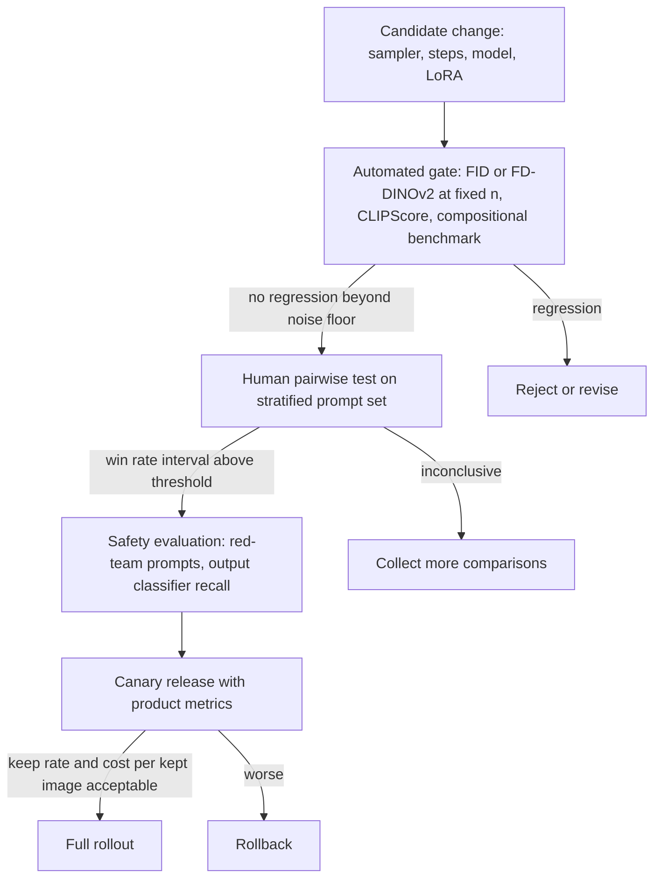

The evaluation path is a funnel from cheap, automatic checks to expensive, human, and live ones. The automated gates are not accurate enough to approve a change, but they are cheap enough to reject bad ones early. Humans decide quality, and live product metrics decide whether the quality is worth the cost.

## 20. Reproducibility

### 20.1 Why it matters

Reproducibility serves four needs: debugging (reproduce the image a user complained about), regression testing (detect that a software update changed outputs), legal and audit evidence (show how a particular image was made), and product features (a user wants to regenerate a variation of an earlier image). A diffusion system is reproducible only if every input that affects the output is recorded.

### 20.2 The inputs to record

| Input | Why it changes the output |
| --- | --- |
| Model identifier and revision (a content hash, not only a name) | Weights change when a vendor republishes under the same name |
| Autoencoder (VAE) and text-encoder identifiers | A different decoder changes colors and detail even with the same denoiser |
| Adapters (LoRA, ControlNet, IP-Adapter) with weights and file hashes | Each adds a term to the network function |
| Prompt, negative prompt, and any prompt rewriting applied by the system | Rewriting is part of the pipeline and must be stored with its result |
| Seed and random generator type and device | A CPU generator and a GPU generator seeded identically produce different noise |
| Image size, aspect ratio, and the latent shape | Different shapes mean a different noise tensor |
| Scheduler class and full configuration (schedule, timestep spacing, shift, prediction type, solver order) | Section 4.4 and Section 8.5 |
| Number of steps and guidance scale (and guidance interval or rescale settings) | Defines the trajectory |
| Strength, mask, and control images for edit modes | Inputs to the process |
| Numeric precision (fp32, fp16, bf16, fp8) | Rounding changes the trajectory |
| Library versions, attention backend, and compilation flags | Implementation differences, for example fused attention kernels |
| Hardware type | Floating-point reduction order differs across GPU architectures |

### 20.3 What determinism can and cannot give

A deterministic sampler (DDIM with $\eta=0$, or a flow-matching ODE solver) makes the trajectory a function of the starting noise, as the toy script shows with its `DDIM same seed twice identical: True` line. A stochastic sampler needs its per-step noise recorded as well. Even with a deterministic sampler, bit-exact reproduction requires the same software and hardware. GPUs perform floating-point reductions in an order that can vary, half-precision arithmetic is not associative, and kernels selected by autotuning can differ across runs and devices. The result is that the same inputs on a different GPU generation usually give images that look the same to a person but differ in low-order pixel values.

The practical standard is therefore two-tiered. Within the same container image and the same GPU type, require exact or near-exact reproduction and set the framework's deterministic flags for regression tests, accepting a speed loss. Across hardware changes, accept a perceptual-similarity tolerance (a small learned perceptual distance such as Learned Perceptual Image Patch Similarity (LPIPS) between the original and the regenerated image), and decide the threshold from observed variation, not from intuition. A regression suite stores a few hundred prompt and seed pairs with their reference outputs and flags any change above the tolerance when the model, the library, or the base image is updated.

### 20.4 The generation record

A generation record that makes an image traceable is a small structured document stored with the image. It does not need the prompt text in the clear if privacy rules forbid retaining it. A hash of the prompt and a pointer to a restricted store may satisfy the audit need.

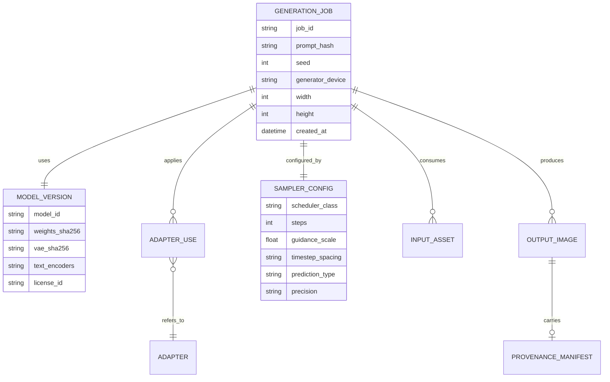

The entity diagram makes three design points visible. The model version carries a content hash and a license identifier, so an image can be traced to a specific set of weights and to the terms under which they were used. Adapter use is a many-to-many relationship, because a job can apply several adapters with weights. And the provenance manifest hangs off the output image, not the job, because it is the image that travels to other systems and needs a verifiable claim attached.

## 21. Safety, Legal Exposure, and Provenance

### 21.1 Memorization and training-data extraction

Diffusion models can reproduce training images. Nicholas Carlini and colleagues (2023) generated a very large number of images from Stable Diffusion and Imagen using captions from the training set, and used a membership-inference test to find generated images that were near-copies of training images. They found over a thousand such examples across the models they tested, including photographs of identifiable people and trademarked logos. Gowthami Somepalli and colleagues (2023) studied content replication and found that duplication in the training set raises the rate of copying, and that large models with small datasets copy more.

The causes and mitigations are well understood. Images that appear many times in the training data (stock photos, logos, memes) are memorized at higher rates. Deduplicating the training set reduces but does not eliminate the effect. Larger models memorize more of a given dataset than smaller ones. Prompting with the exact caption of a training image elicits the image more often than a paraphrase. The consequences for a product team are twofold. A privacy consequence: if a model was trained or fine-tuned on personal images (for example a DreamBooth model of a person, or a LoRA trained on customer photos), the model weights may allow extraction of those images, and the weights are therefore personal data and need the same protection as the images. A copyright consequence: a generation can contain a near-copy of a protected work without the user or the operator intending it, so operators of public generation services use output similarity checks against known works for the most sensitive categories, such as trademarks and well-known characters.

### 21.2 Harmful content and layered controls

A generation service must prevent categories of output that are illegal or violate its policy: sexual content involving minors (illegal everywhere and requiring a zero-tolerance process and legal reporting obligations), non-consensual intimate imagery, graphic violence, hateful symbols, and targeted harassment. No single control works. The layers are:

1. **Input policy.** Classify the prompt (and any uploaded image) before generation. Block lists catch known terms, and a trained classifier catches paraphrases. Both are circumvented by misspellings, other languages, and indirect descriptions, so they reduce volume and do not give a guarantee.
2. **Embedding-space filters.** Compare the prompt embedding or the image embedding with embeddings of prohibited concepts. This catches paraphrases that string matching misses, and it has false positives.
3. **Model-level mitigation.** Filter the training data and apply concept-erasure fine-tuning that reduces the model's ability to produce certain concepts. Published studies show that erased concepts can often be recovered by adversarial prompts or by further fine-tuning, so this reduces rates and does not remove capability. Open-weight models can be fine-tuned by anyone, so a hosted service cannot rely on the base model's training alone.
4. **Output classifier.** Run a classifier on the generated image before delivery. This is the last line of defense, since it examines the actual artifact. It costs latency (25 ms in the illustrative serving script) and compute, and it has a measurable miss rate that must be tested with red-team prompts.
5. **Human review and reporting.** Sample flagged and unflagged outputs for review, provide a user reporting path, and keep an escalation procedure with a defined response time.
6. **Account-level controls.** Rate limits, identity verification for sensitive features such as face editing, and bans for repeat abuse.

Negative prompts (Section 12.7) and "safe" keywords added to the prompt are quality tools. They are not controls, because the model gives no guarantee of absence, and they must not appear in a safety argument.

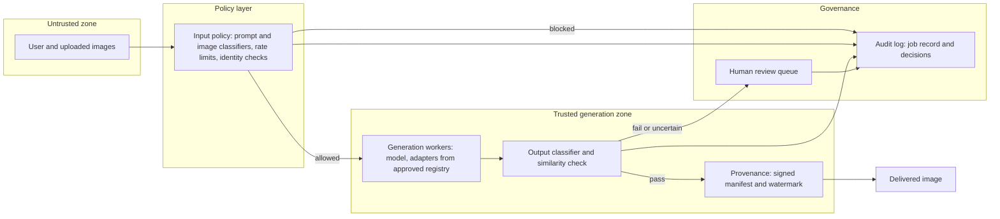

The diagram draws the trust boundary where user input enters the policy layer, and puts the output classifier inside the trusted zone because it governs what leaves the system. Every decision goes to the audit log, which is the evidence base for incident response and for regulators. The review queue exists because classifiers produce uncertain cases that need a human decision. The adapters in the generation zone come from an approved registry, which closes the supply-chain path of Section 13.6.

### 21.3 Copyright and licensing

The legal status of training on copyrighted images and of the outputs is unsettled and differs by jurisdiction. At the time of writing, the following points are reported by law firms and court documents, and a team must confirm the current position with counsel in each market it serves:

- In *Getty Images v Stability AI* ([England and Wales High Court judgment of November 2025](https://caselaw.nationalarchives.gov.uk/ewhc/ch/2025/3343/data.pdf)), the court rejected the secondary copyright infringement claim, reasoning that the Stable Diffusion model weights do not store copies of the training works, and found trade mark infringement in two limited historical instances relating to watermark-like marks in outputs, as summarized by [Latham and Watkins](https://www.lw.com/en/insights/getty-images-v-stability-ai-english-high-court-rejects-secondary-copyright-claim) and by [Osborne Clarke](https://www.osborneclarke.com/insights/getty-v-stability-ai-stability-ai-generates-big-win-english-courts-landmark-first-judgment). The ruling concerns that case and that evidence, and it does not settle the position for training in other places or for outputs that reproduce works.
- Litigation in the United States over training on copyrighted images was continuing when this chapter was written, and the outcomes turn on the fair-use analysis.
- The United States Copyright Office has taken the position that works need human authorship, so purely machine-generated images are generally not protected and works with substantial human creative control may be, in part. Check current guidance for the markets that matter.

The operational conclusions do not depend on how the cases end. Record the license of every base model and adapter (several popular open-weight models use community or non-commercial licenses with revenue thresholds or use restrictions, and responsible-AI licenses add use-based restrictions). Record where training data came from, for models you train. Check whether a vendor offers an intellectual-property indemnity, and what it excludes. Avoid prompts and products that invite imitation of named living artists or of trademarked characters. And do not promise customers exclusive rights to generated imagery, because the same model produces similar output for others and the legal position on ownership is uncertain.

### 21.4 Provenance, watermarking, and C2PA

Provenance answers where an image came from. Two technical families exist, and they complement each other.

**Signed metadata.** The Coalition for Content Provenance and Authenticity (C2PA) defines Content Credentials, a signed manifest embedded in or linked to an asset. The manifest records assertions such as the tool that produced the asset, actions taken (for example "created by a generative model"), and a hash that binds the manifest to the pixels, signed with a certificate that chains to a trust list. See the [C2PA specification](https://spec.c2pa.org/specifications/specifications/2.2/specs/_attachments/C2PA_Specification.pdf) for the current version. Its weakness is fragility: any re-encoding, screenshot, or platform that strips metadata removes the manifest. Absence of a manifest proves nothing.

**Invisible watermarks.** A signal is embedded in the pixels (or in the generation process) so that a detector can find it after common transformations. Some methods modify the output after generation. Others work in the diffusion process itself: the Tree-Ring watermark (Wen and colleagues, 2023) embeds a pattern in the Fourier transform of the initial noise, and detection inverts the image back to noise with DDIM inversion (Section 14.4) and tests for the pattern. This ties the watermark to the sampling procedure, and it makes detection depend on a good inversion. Watermarks survive mild compression and resizing better than metadata does, but studies show that determined attackers can remove or forge them, for example by regenerating the image with a diffusion model or adding noise. Detection is statistical and returns a score with false-positive and false-negative rates, never certainty.

The reasonable design combines the two: sign a manifest for provenance-aware platforms, embed a watermark as a fallback for stripped copies, and keep the server-side generation log as the authoritative record, since the log is the only part an attacker cannot strip from the artifact. Regulation is moving in this direction. According to law-firm reports of the EU Artificial Intelligence Act, the transparency duties of Article 50 became applicable on 2 August 2026, including machine-readable marking of synthetic outputs by providers of generative systems and disclosure duties for deployers of deepfakes, with a transition period to 2 December 2026 for systems already on the market before 2 August ([Baker Botts summary](https://www.bakerbotts.com/thought-leadership/publications/2026/september/eu-ai-act-article-50-transparency-obligations-go-live)). Verify the current text and any guidance or codes of practice before relying on this, because the schedule has been amended recently and may be amended again.

### 21.5 Deepfakes, identity, and consent

The abuse most likely to cause real harm to people is the generation or editing of realistic images of real individuals without their consent: sexual imagery, fraud (a forged identity document or a fabricated image of an event), and political disinformation. Several jurisdictions have passed laws against non-consensual intimate deepfakes, and platform liability for failing to remove them is increasing. Features that increase the risk are face editing on uploaded photos, identity adapters (Section 13.5), subject-specific fine-tuning (Section 13.3), and high-fidelity video and voice. Controls to apply to such features: require an attestation or a verification of consent for the subject, block the generation of identifiable public figures where policy requires, refuse minors in any sensitive transformation, keep the audit log, apply provenance marking to every output, and offer a takedown process with a short response time. For a product that does not need a face feature, the lowest-risk decision is not to ship it.

### 21.6 Privacy of prompts and uploads

Prompts and uploaded images are user data. Prompts can contain names, health details, or confidential product plans, and uploads can contain faces and metadata such as location. Treat them as personal data by default: minimize retention, restrict access, exclude them from model training unless the user opted in under clear terms, and delete on request. The governance patterns are in [CH30](CH30_AI_Data_Governance_Privacy_and_Provenance.md) and the broader safety program in [CH31](CH31_Responsible_AI_and_Safety_Governance.md).

## 22. Serving Cost and Capacity

### 22.1 The request path and where time goes

A generation request passes through admission (authentication, quota, input policy), a queue, a worker that runs the text encoder, the denoising loop, the decoder, and the output classifier, and then provenance marking and delivery. Section 11.4 showed the worker's sequence. The denoising loop dominates, so capacity planning starts with the per-image GPU time and ends with the number of GPUs.

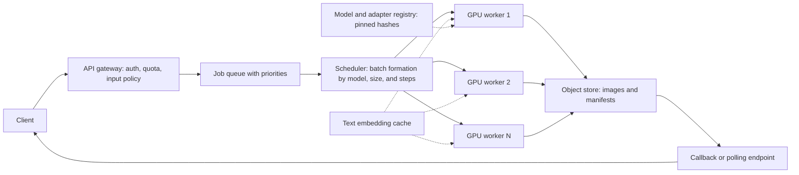

The diagram shows a pull-based design. Clients submit a job and receive an identifier, and workers take batches from the queue. This is the correct shape for a workload with latency of seconds to minutes, because a synchronous request-response design would tie up connections and make load shedding hard. The scheduler groups jobs that share a model, a resolution, and a step count, since a batch must have the same tensor shape and the same number of steps. The registry is separate from the object store because model weights are large, versioned, and pinned by hash.

A job moves through a small set of states, and making the state machine explicit gives retries, idempotency, and observability a precise meaning.

```mermaid
stateDiagram-v2
    [*] --> Submitted
    Submitted --> Rejected : input policy blocks
    Submitted --> Queued : accepted
    Queued --> Running : batch scheduled
    Running --> Screening : latent decoded
    Running --> Queued : worker lost, retry
    Screening --> Delivered : output checks pass
    Screening --> Held : uncertain or blocked
    Held --> Delivered : reviewer approves
    Held --> Rejected : reviewer rejects
    Queued --> Expired : deadline passed
    Delivered --> [*]
    Rejected --> [*]
    Expired --> [*]
```

Two properties follow from the diagram. A worker loss moves a job back to the queue, which is safe only if the job is idempotent: the same job identifier and seed must give the same result, or at least must not be billed or delivered twice. And the deadline-based expiry state is the load-shedding mechanism: when the queue is longer than the deadline allows, expiring old jobs is better than serving all of them late.

### 22.2 GPU memory

Memory has four consumers: weights, activations of the denoiser, the decoder's activations, and the text encoders. The weights follow from parameter counts at 2 bytes each in 16-bit precision. The serving script prints 1.60 GiB for a 0.86-billion-parameter U-Net, 3.73 GiB for a 2-billion-parameter transformer, and 14.90 GiB for an 8-billion-parameter transformer. Two more cases are worth computing by hand. A 12-billion-parameter transformer needs $12\times10^9\times2/2^{30}=22.4$ GiB. A T5-XXL encoder with about 4.7 billion parameters needs $4.7\times10^9\times2/2^{30}=8.8$ GiB. A pipeline with both, plus a small CLIP encoder and the autoencoder, needs around 32 GiB of weights. It fits on a 40 GiB or 48 GiB or 80 GiB GPU with room for activations, and it does not fit on a 24 GiB GPU unless the denoiser is quantized to 8 bits ($12\times10^9/2^{30}=11.2$ GiB) or the text encoder is offloaded to CPU memory after encoding. Offloading the text encoder is almost free for a request, since the embeddings are computed once, and it also explains why caching embeddings (below) is attractive.

Activation memory grows with resolution and batch size. Attention memory in a naive implementation grows with the square of the token count, which is why the memory-efficient attention kernels are standard. The decoder at full resolution is often the memory peak, and tiled decoding (Section 10.3) trades time for memory. Out-of-memory failures concentrate on the largest resolutions and batch sizes, so the service should reject or tile requests whose memory estimate exceeds the worker's budget before running them, not discover it with a crash.

### 22.3 Latency, batching, and GPUs

The script [04_serving_capacity.py](../code/python/diffusion-chapter/04_serving_capacity.py) uses these illustrative assumptions: 25 steps, guidance on (so 50 denoiser calls), a denoiser call of 45 ms at batch 1, 120 ms at batch 4, and 220 ms at batch 8, plus 20 ms for the text encoder, 60 ms for the decoder, and 25 ms for the output classifier. These are assumptions for the arithmetic and not measurements; every number in this section should be replaced with measurements from the intended hardware. Its output:

| Batch size | GPU seconds per image | Images per second per GPU | Request latency once the batch runs | GPUs for 6 requests per second at 60% utilization | Cost per 1,000 images at 100% busy |
| --- | --- | --- | --- | --- | --- |
| 1 | 2.355 | 0.42 | 2.35 s | 24 (23.55) | 1.635 USD |
| 4 | 1.605 | 0.62 | 6.36 s | 17 (16.05) | 1.115 USD |
| 8 | 1.480 | 0.68 | 11.70 s | 15 (14.80) | 1.028 USD |

The cost column assumes a GPU price of 2.50 USD per hour, an assumption that also needs replacing. Batching trades latency for throughput. Going from batch 1 to batch 4 raises throughput by 47 percent ($2.355/1.605$) and cuts the fleet from 24 to 17 GPUs, but raises the time a request spends on the GPU from 2.35 s to 6.36 s. The gain is sublinear because the denoiser at batch 4 takes 120 ms against 4 times 45 ms: the per-image share fell from 45 ms to 30 ms, a 33 percent saving. The decision follows from the latency objective. If the objective is a p95 of 5 s for interactive use, batch 4 fails it regardless of the queue, and the fleet is 24 GPUs. If the objective is 15 s for background generation, batch 8 meets it and the fleet is 15 GPUs, which saves 9 GPUs relative to batch 1. At 730 hours per month and 2.50 USD per hour, the difference between 24 and 17 GPUs is $7\times2.50\times730=12{,}775$ USD per month.

Little's law gives the concurrency. In the batch-4 configuration a request takes about 6.36 s on the GPU plus an assumed 0.5 s waiting for the batch to form, 6.86 s in the system. At 6 requests per second the average number in flight is $6\times6.86=41.2$ requests. The queue, the connection layer, and the polling or callback mechanism must be sized for that concurrency. The 60 percent utilization target keeps queueing delay bounded: the delay grows without limit as utilization approaches 100 percent, and at 60 percent there is headroom for bursts. At 60 percent utilization the batch-4 cost rises from 1.115 to 1.858 USD per 1,000 images ($1.115/0.6$), the price of headroom.

Different requests can also be batched at different step positions, like continuous batching in language-model serving ([CH28](CH28_Inference_Optimization_and_Model_Serving.md)), because each denoising step is an independent forward pass for the current latent of each request. A scheduler that merges requests at different steps removes the wait for a batch to fill, at the price of a more complex scheduler and the requirement that shapes and models match. Few open-source servers do this today, and it is a place where custom serving code pays off for high-volume workloads.

### 22.4 Caching

Four caches are worth considering. The first two pay off routinely, the third is an optimization with a quality cost, and the fourth rarely helps.

- **Text embeddings.** The prompt embedding is independent of the seed, the step, and the sampler. With a 35 percent hit rate (an assumed figure) and a 20 ms encoder, the average saving is $0.35\times20=7$ ms per request, small beside a multi-second loop. The benefit grows with a large text encoder: a T5-XXL pass can take much longer than a CLIP pass, and for templated prompts (product name inserted in a fixed template) the hit rate is high. Key the cache on the prompt text and the encoder version.
- **Model and adapter weights.** Loading a 12-billion-parameter model takes time proportional to its size: $22.4$ GiB is about 24 GB, which at 2 GB per second from fast local storage takes about 12 s, and at 200 MB per second from network storage takes about 2 minutes. Autoscaling must include this cold-start time in its lead time, and workers should keep recently used adapters in host memory.
- **Intermediate features.** Methods such as DeepCache (Ma and colleagues, 2023) and similar feature-caching techniques reuse deeper-layer outputs across adjacent steps. They cut compute by tens of percent at a measurable quality cost, and are worth considering after the simpler options.
- **Finished images.** Caching complete images by prompt and seed works only with a deterministic sampler and identical configuration. Users usually want variety, so hit rates are low except for shared templates and for "regenerate the same image" features.

### 22.5 Other levers, ordered by cost-benefit

1. **Fewer steps** with a better solver (Section 8): the cheapest change. Validate quality (Section 19).
2. **Lower precision and compilation**: bf16 or fp16 is the default, 8-bit quantization of the denoiser reduces memory and often latency on supporting hardware, and graph compilation and fused attention kernels give gains of tens of percent. Each changes outputs slightly, so run the regression suite.
3. **Distillation** (Section 16): the largest gain (10 to 25 times in denoiser calls) at the price of a training run and the quality and flexibility trade-offs.
4. **Smaller or lower-resolution generation with an upscaler**: generate at 512 pixels and upscale with a dedicated model, often cheaper than generating at 1,024 pixels when the attention term dominates.
5. **Spot or preemptible GPUs for batch tiers**: acceptable when jobs are idempotent and checkpointed at the queue level, as the state machine above allows.

### 22.6 Observability

Metrics to export: queue depth and age of the oldest job; time in each stage (encode, denoise, decode, screen); denoiser step time per model and resolution; GPU utilization and memory high-water mark; batch size distribution; out-of-memory and retry counts; safety block, hold, and reviewer-override rates; cost per delivered image; and user-facing outcomes (regenerate, keep, report). Logs carry the generation record of Section 20.4 without prompt text if policy requires. Alert on step-time regressions (a software update or noisy neighbour), on a rising hold rate (an abuse campaign or a classifier regression), and on a falling keep rate (a model or sampler change that hurts quality). Track model-version identifiers as a metric dimension, so that a canary release (Section 19.5) can be compared with the baseline.

## 23. Testing a Diffusion System

Tests belong at four levels. **Unit tests** check the arithmetic that is easy to get wrong: scheduler coefficients against a reference table (Section 4.4), the equality of the $\epsilon$, $x_0$, and $v$ conversions (Section 5.2), mask shapes at latent resolution, and the seed to noise mapping. **Golden-image regression tests** run a fixed set of prompt, seed, and configuration tuples on every change to the model, the libraries, or the container image, and compare the outputs with stored references by perceptual distance (Section 20.3). **Property tests** check invariants of the pipeline: the same seed gives the same image with a deterministic sampler, guidance scale 1 gives the plain conditional output, an empty mask leaves the image unchanged after compositing, and the output size equals the requested size. **Safety tests** replay a red-team prompt set against the full pipeline and report the block rate by category, and replay a benign set to measure false positives. Because safety-test prompts contain prohibited content, the set must be stored and handled with access controls and reviewer wellbeing measures.

A less obvious test concerns the training and sampling schedule: assert that the scheduler configuration loaded at serving time equals the configuration the model was trained with (prediction type, schedule, shift), because a mismatch produces plausible-looking but degraded output, which no exception reports.

## 24. Choosing Among Generative Approaches

[CH11](CH11_Generative_Adversarial_Networks.md) covered GANs, and other chapters cover autoregressive models. The table compares the families a designer meets for image generation.

| Dimension | GAN | VAE | Autoregressive over image tokens | Diffusion | Flow matching or rectified flow | Few-step distilled student |
| --- | --- | --- | --- | --- | --- | --- |
| Network evaluations per sample | 1 | 1 | One per token (hundreds to thousands) | 20 to 50 (times 2 with guidance) | 10 to 30 | 1 to 4 |
| Training stability | Fragile | Stable | Stable | Stable | Stable | Needs a teacher |
| Coverage of the data distribution | Prone to mode collapse | Good, blurry samples | Good | Good | Good | Reduced diversity in many cases |
| Text conditioning quality | Hard at scale | Moderate | Good | Strong | Strong | Fixed guidance |
| Spatial controls and editing | Limited (latent edits) | Limited | Limited | Rich (inpainting, ControlNet, inversion) | Rich | Partial |
| Exact likelihood | No | Bound | Yes | Bound, or exact via ODE | Exact via ODE | No |
| Serving cost per image | Lowest | Low | High | Medium to high | Medium | Low |
| Maturity of tooling | High (older) | High | Growing | Highest for images | Growing quickly | Growing |

Decision criteria for an architect, in order of priority. If **latency under 100 ms** is mandatory and the domain is narrow (faces, one product category), a GAN or a distilled student can fit, and the GAN's narrow-domain strength is the reason it survives. If **free-form text conditioning, editing, or controls** are required, diffusion or flow matching is the default, and the choice between them is largely a choice between available checkpoints and licenses. If **interactive speed** is needed with open-ended prompts, evaluate a distilled student first and the full model as a fallback tier. If the problem is **video, audio, or 3D**, expect diffusion-family models and plan for asynchronous, minutes-scale serving.

## 25. Failure Modes and Quality-Attribute Scenarios

### 25.1 Failure modes

| Symptom | Likely cause | How to detect | Fix |
| --- | --- | --- | --- |
| Washed-out or noisy images though code runs | Scheduler schedule or prediction type does not match training | Compare scheduler config with the model card, run the unit test | Load the model's own scheduler configuration |
| Oversaturated, burnt contrast | Guidance too high | Sweep the guidance scale on a fixed seed | Lower the scale, add rescaling or thresholding |
| Cannot produce very dark or very bright images | Non-zero terminal SNR (Section 4.5) | Generate "a completely black image" and measure mean intensity | Use a zero-terminal-SNR or flow model |
| Black images or NaN values | Half-precision overflow, often in the autoencoder | Check for NaN in the latent and the decoded image | Decode in fp32 or use an fp16-safe decoder |
| Same image for different seeds | Generator reused or seed ignored | Property test on seeds | Create a generator per request |
| Image differs from the one the user saw yesterday | Library, hardware, or model changed | Compare generation records | Pin versions; store records |
| Prompt details ignored | Prompt truncated at the encoder's token limit | Count tokens, check the pipeline | Chunking or a long-context encoder |
| Visible seams in inpainting | Mask-blending without compositing, hard mask edge | Inspect the boundary | Feather the mask, composite original pixels |
| Quality drops after enabling a second LoRA | Adapter interference | Evaluate each combination | Lower adapter weights, validate combinations |
| Out-of-memory at high resolution | Attention and decoder activations | Memory estimate versus budget | Tile, reduce batch, quantize |
| Near-copies of training images | Memorization | Similarity search against known works | Output similarity check, deduplicated training data |
| Distilled model ignores negative prompts | Guidance is baked in | Read the model card | Use the teacher tier for those requests |

### 25.2 Quality-attribute scenarios

| Attribute | Stimulus | Response | Measure |
| --- | --- | --- | --- |
| Performance | 6 interactive requests per second at peak | Requests are admitted, batched at size 1 to 2, and generated | p95 time from submit to delivery within 3 s |
| Availability | A GPU node fails during a batch | Jobs return to the queue and run on another node without double billing | No lost paid jobs, recovery within 60 s |
| Safety | A red-team set of 2,000 prohibited prompts, replayed before each release | Prompts blocked at input or output, residual cases held | Block recall at or above the agreed target by category, false-positive rate on a benign set below its limit |
| Reproducibility | Support asks to regenerate a delivered image from its record | The system regenerates with the recorded inputs | Perceptual distance below the calibrated tolerance |
| Cost | A new model version is proposed | The version is benchmarked for cost per kept image | Not above the budgeted cost per kept image |
| Provenance | Any image leaves the system | A signed manifest and a watermark are attached | 100 percent of delivered images carry both |
| Security | A user uploads a malicious adapter file | The registry rejects unsigned or non-approved artifacts and non-safetensors formats | Zero unapproved artifacts loaded in production |

The targets in the measure column are examples of the form a scenario takes. The right values come from the product's risk assessment and service-level objectives.

## 26. Case Study: A Product-Photography Generator for a Retailer

### 26.1 Context and requirements

A retailer with 40,000 active products wants a feature that places a product photographed on a plain background into styled scenes: a mug on a kitchen table, a lamp in a living room. Two workloads share the system. An **interactive editor** for merchandisers at peak 6 requests per second wants results in under 2 seconds so that users can iterate. A **catalogue batch** generates 4 variants per product each month, 160,000 images, with a deadline of one day and no latency pressure. The legal team requires that the product itself is unaltered (logo and label exact), that outputs carry provenance, that no real person's likeness can be produced, and that the training data for any custom model is licensed or owned.

### 26.2 Decisions and rejected alternatives

1. **Task formulation: inpainting around the product, not whole-image generation.** The product is masked as "keep", and the background is generated. After decoding, the original product pixels are composited back (Section 14.2), so the label is exact by construction. *Rejected:* image-to-image of the whole photo, because the autoencoder round trip and the diffusion process alter product pixels, which fails the label requirement.
2. **Model family: a licensed open-weight latent transformer with a flow-matching objective, hosted.** Chosen for commercial licensing terms that the legal team reviewed (checked against the model card), a ControlNet-style depth control to keep the product's perspective, and the ability to pin weights by hash. *Rejected:* a third-party image API, because the retailer needed pinned versions, stable output over time, and the audit record of Section 20, and because the batch volume made per-image fees larger than the hosted compute estimate below. The decision should be revisited if the API vendor offers version pinning and an indemnity that the retailer's counsel accepts.
3. **Brand look: one LoRA trained on 600 licensed and owned lifestyle photographs**, with rank 16. *Rejected:* full fine-tuning, which would triple the storage and release effort for a style change that a LoRA delivers.
4. **Two serving tiers.** The interactive tier uses a 4-step distilled student (Section 16) and the batch tier uses the full model with 25 guided steps. *Rejected:* one tier for both, because the interactive requirement cannot be met by 50 denoiser calls and the batch tier gains quality from the full model.
5. **Safety and provenance.** Prompts are drawn from templates and a restricted vocabulary, and free text is classified before use. A person detector in the output classifier holds images that contain a person. Every output carries a C2PA manifest and a watermark, and the generation record is stored.

### 26.3 Capacity and cost, using the chapter's illustrative constants

For the interactive tier, a 4-step student without guidance needs $4\times45=180$ ms of denoiser time plus 105 ms of fixed work (text encoder, decoder, output classifier), so 0.285 s of GPU time per image at batch 1. At 6 requests per second and 60 percent utilization the fleet is $6\times0.285/0.6=2.85$, so 3 GPUs, and the end-to-end latency is about 0.29 s plus queueing, comfortably under the 2 s target. The monthly cost of 3 always-on GPUs at 2.50 USD per hour and 730 hours is 5,475 USD. The full teacher at batch 1 would need 24 GPUs for the same load (Section 22.3), or 43,800 USD per month. The saving of 38,325 USD per month repays an assumed distillation run of 2,000 GPU hours (5,000 USD) in about four days of operation.

For the batch tier, 160,000 images at batch 8 and 1.480 GPU-seconds each need $160{,}000\times1.480/3600=65.8$ GPU hours. At 2.50 USD per hour that is 164 USD at full utilization, or 274 USD at 60 percent. The per-image marginal compute cost is about 0.0010 to 0.0017 USD. An external API would have to charge less than that to be cheaper on compute, so the comparison should include the engineering, operations, and safety effort to run the hosted service, which the retailer estimates separately. All of these figures use assumed prices and timings that the team must replace with measurements.

### 26.4 Validation evidence

The team defines acceptance criteria before building and records the results as release evidence:

- **Product fidelity:** a pixel-level test confirms that, after compositing, masked product pixels equal the input pixels exactly in 100 percent of a 500-image test set. This is a property test, not a statistical one.
- **Student versus teacher:** 800 pairwise comparisons by trained raters on a stratified set of prompts, with the criterion that the student is not preferred less than 40 percent of the time. If the student wins 47 percent, the standard error is $\sqrt{0.47\times0.53/800}=0.0176$ and the 95 percent interval is 43.5 to 50.5 percent, which is above the floor. The student is slightly worse than the teacher, and the product accepts that for about 8 times less GPU time per image than the guided teacher (0.285 s against 2.355 s). (The 47 percent is an illustrative result for the example, not a measurement.)
- **Brand LoRA:** a held-out prompt set scored by a brand reviewer against a 5-point rubric, and a check that prompt adherence (compositional benchmark) did not fall by more than 3 points relative to the base model.
- **Safety:** a red-team set replayed through the full pipeline, with held-image rates and reviewer outcomes recorded, and a benign set showing the false-positive rate on legitimate product scenes.
- **Reproducibility:** 300 golden tuples regenerated on a second GPU type, with perceptual distance below the tolerance calibrated on the first.
- **Provenance:** every output in a 1,000-image sample verified for a valid manifest and for watermark detection after JPEG compression at quality 80.

### 26.5 Outcome and lessons

The lessons that transfer are the ones about decomposition. The legal requirement (exact product pixels) dictated the pipeline design (inpainting plus compositing), and the latency requirement dictated the model tier (distilled student). The batch and interactive workloads had different best configurations, and the system became cheaper and simpler by having two. Evidence was gathered per requirement, with sample sizes chosen in advance (Section 19.4). The team also wrote down what would reverse each decision, such as the API vendor offering pinned versions with an indemnity, or the student's win rate falling below the floor on a new product category.

## 27. Common Mistakes

| Mistake | Cause | Consequence |
| --- | --- | --- |
| Treating the sampler and scheduler as interchangeable defaults | Configuration looks like harmless boilerplate | Silent quality loss or garbage output after a model swap (Section 4.4) |
| Using the guidance value of one model on another | Same name, different meaning (Section 12.6) | Oversaturation or weak prompt adherence |
| Reporting FID from different sample counts or libraries | Metric bias depends on sample size and preprocessing | Spurious improvements and regressions |
| Approving a sampler change from ten pretty images | Small samples, cherry-picked prompts | Hidden regression on the long tail of prompts |
| Relying on negative prompts for safety | Belief that the model obeys negation | No guarantee of absence, policy failure |
| Using a CPU seed in one place and a GPU seed in another | Generators differ by device | Non-reproducible outputs and confusing bug reports |
| Skipping compositing in inpainting | Trusting the autoencoder round trip | Unrequested changes to regions the user kept |
| Sizing the fleet from average traffic | Ignoring the peak and utilization target | Queue growth and missed latency objectives |
| Ignoring cold-start time in autoscaling | Weight loading looks free | Latency spikes at every scale-out event |
| Downloading community adapters without controls | Convenience | Supply-chain exposure and license violations |
| Treating watermarks or C2PA as proof | Overconfidence in one mechanism | False assurance, because both can be removed |
| Training a personalised model on user photos without a retention plan | Focus on the feature | Weights that can leak personal images become unmanaged personal data |
| Forgetting the VAE scaling factor in custom training | Latents assumed to have unit variance | Wrong SNR at each step, degraded training (Section 10.1) |
| Comparing latency at batch 1 with throughput at batch 8 | Mixing configurations | Wrong product and capacity decisions |

## 28. Design Review Checklist

**Model and licensing**

- The model, autoencoder, text encoders, and adapters are identified by content hash and license, and the license permits the intended commercial use.
- The prediction type, schedule, and timestep shift of the scheduler match the checkpoint.
- Any distilled model's license, guidance behavior, and compatibility with adapters are documented.

**Quality**

- A fixed, stratified prompt set exists, with seeds, and results are reported with sample sizes and intervals.
- FID or an equivalent is computed with a stated sample count and library, and CLIP score is not the only alignment measure.
- A human pairwise test with a pre-computed sample size supports any claimed improvement.
- Cost per kept image, and not only cost per generation, is tracked.

**Reproducibility**

- Every output has a generation record with the inputs of Section 20.2.
- Regression tests run on every model, library, and container change, with a calibrated perceptual tolerance.

**Safety, legal, and provenance**

- Layered controls exist for input, output, account, and review, and none depends on negative prompts.
- Red-team and benign prompt sets are replayed before each release, and results are stored.
- Memorization risk is assessed for any model trained on personal or copyrighted data, and weights trained on personal data are protected as personal data.
- Outputs carry a C2PA manifest and a watermark where the product or the law requires them, and the team knows what the law in each market requires.
- Face, identity, and subject-training features have consent flows and abuse controls, or are not shipped.

**Serving and operations**

- Capacity is derived from measured per-image GPU time, batch behavior, peak traffic, and a utilization target.
- Cold-start time, adapter loading, and memory limits at the largest resolution are known and tested.
- The job state machine handles retries, idempotency, expiry, and held outputs.
- Dashboards cover queue age, stage times, safety rates, and user outcomes, with the model version as a dimension.
- A rollback path exists for every model, adapter, and scheduler change.

## 29. Exercises

1. **Closed form.** A variance-preserving process has $\bar\alpha_t=0.5$ at some step. Compute the signal and noise amplitudes and the signal-to-noise ratio in decibels.
2. **Error amplification.** At a step where $\mathrm{SNR}=0.04$, a network's noise estimate is wrong by 0.2 in some coordinate. By how much is the implied clean estimate wrong? Would a velocity-prediction network amplify its error by the same factor?
3. **Posterior variance.** With $\beta_t=0.02$ and $\bar\alpha_{t-1}=0.6$, compute $\bar\alpha_t$ and the posterior variance $\tilde\beta_t$.
4. **Guidance and negative prompts.** At some coordinate $\epsilon_\varnothing=0.1$ and $\epsilon_c=0.4$. Compute the classifier-free guided value at $s=5$. If a negative prompt gives $\epsilon_{\mathrm{neg}}=0.3$, what is the guided value with that negative prompt at the same $s$?
5. **Latency.** A model takes 55 ms per denoiser call at batch 1. Compare 30 guided steps with a 4-step unguided student, given 100 ms of fixed work per image. What is the speedup?
6. **Latent savings.** For a $768\times768$ image with $f=8$ and $c=4$, compute the data compression ratio and the DiT token count at patch size 2. How does the attention-pair count compare with the 512-pixel case of 1,024 tokens?
7. **Flow matching.** A flow model at $t=0.7$ has $x_t=1.0$ and predicts velocity $0.5$. Compute the implied $\hat x_0$ and $\hat\epsilon$, and check that they reproduce $x_t$.
8. **Evaluation.** A model wins 112 of 200 pairwise comparisons against the baseline. Compute the 95 percent confidence interval. Is the result enough to ship?
9. **Capacity.** Peak traffic is 4 requests per second, per-image GPU time is 1.2 s, and the utilization target is 50 percent. How many GPUs? What changes if the service-level objective (SLO) is tightened so that batching must stop?
10. **Design.** A product manager asks for an "upload your photo and see yourself in any scene" feature. List the controls, the evidence, and the decision criteria you would require before approval.

**Answers and outlines**

1. $\sqrt{0.5}=0.7071$ for both signal and noise amplitude. SNR $=0.5/0.5=1$, which is $10\log_{10}1=0$ dB.
2. The amplification factor is $\sigma/a=1/\sqrt{\mathrm{SNR}}=1/0.2=5$, so the clean estimate is wrong by $5\times0.2=1.0$. With $v$-prediction, $x_0=a x_t-\sigma v$, so a $v$-error of 0.2 gives an error of $\sigma\times0.2$, where $\sigma=\sqrt{1-\bar\alpha}\le1$. Here $\sigma\approx0.98$, so the error is about 0.20, five times smaller than under $\epsilon$-prediction.
3. $\bar\alpha_t=\bar\alpha_{t-1}(1-\beta_t)=0.6\times0.98=0.588$. $\tilde\beta_t=\dfrac{1-\bar\alpha_{t-1}}{1-\bar\alpha_t}\beta_t=\dfrac{0.4}{0.412}\times0.02=0.01942$.
4. Guided value $=0.1+5\times(0.4-0.1)=1.6$. With the negative prompt, $0.3+5\times(0.4-0.3)=0.8$. The extrapolation direction is the difference between the positive and the reference prediction, and the negative prompt shrinks it from 0.3 to 0.1.
5. The guided teacher uses $30\times2=60$ calls, $60\times55=3.3$ s, so 3.4 s with fixed work. The student uses 4 calls, $4\times55=0.22$ s, so 0.32 s with fixed work. The speedup is $3.4/0.32\approx10.6$, much less than the 15-fold ratio of calls, because the fixed work now takes a third of the student's time.
6. Pixels: $768^2\times3=1{,}769{,}472$. Latent: $96\times96\times4=36{,}864$. Ratio: 48. Tokens at $p=2$: $48^2=2{,}304$. Attention pairs: $2{,}304^2=5{,}308{,}416$, which is $5.06$ times the $1{,}048{,}576$ pairs at 512 pixels.
7. $\hat x_0=x_t-tv=1.0-0.7\times0.5=0.65$. $\hat\epsilon=x_t+(1-t)v=1.0+0.3\times0.5=1.15$. Check: $(1-t)\hat x_0+t\hat\epsilon=0.3\times0.65+0.7\times1.15=0.195+0.805=1.0$.
8. $\hat p=0.56$. The standard error is $\sqrt{0.56\times0.44/200}=0.0351$, and the 95 percent interval is $0.56\pm0.0688$, or 49.1 to 62.9 percent. The interval contains 50 percent, so the result does not show that the new model is better. About 780 comparisons are needed to detect a true 55 percent win rate with 80 percent power.
9. $4\times1.2/0.5=9.6$, so 10 GPUs. If the 1.2 s was measured with batching and a tighter SLO forces batch 1, the per-image GPU time rises. At an assumed batch-1 figure of 1.6 s the fleet becomes $4\times1.6/0.5=12.8$, so 13 GPUs. The lesson is to size from the per-image time at the batch size that the latency objective allows.
10. A good answer lists consent verification of the subject and of the uploader, minors protection, blocking of third-party faces, abuse monitoring and rate limits, provenance marking on every output, a takedown process, deletion of uploaded photos and any personalised weights on a fixed schedule, counsel review of biometric and likeness laws in each market, red-team evidence on the controls, and a reversible launch with a kill switch. The decision criteria are the measured misuse rate during a limited pilot, the reviewer workload, and the legal sign-off.

## 30. Summary

A diffusion model learns to undo a fixed noising process. The forward process has a closed form, $x_t=\sqrt{\bar\alpha_t}x_0+\sqrt{1-\bar\alpha_t}\epsilon$, so training is a regression: choose a noise level at random, corrupt an example, and predict the noise. The variational bound reduces to a weighted version of that loss, and dropping the weights gives the simple loss that works well in practice. The schedule decides how training effort spreads across signal-to-noise levels, and the terminal signal-to-noise ratio and the resolution matter more than they look. The network may predict noise, data, score, or velocity, which are rescalings of each other with different error properties.

The score and SDE views show that sampling is numerical integration. The reverse SDE gives stochastic samplers, and the probability-flow ODE gives deterministic ones such as DDIM, which also support inversion. Higher-order and exponential-integrator solvers cut the step count from hundreds to 20 or 30, and distillation cuts it to 1 to 4 at some cost in diversity and flexibility. Flow matching trains straight-line velocity targets and has a clean zero-terminal-SNR endpoint. Guidance, in the classifier-free form, extrapolates away from the unconditional prediction and trades diversity for fidelity at a cost of doubling the evaluations. Latent diffusion makes this affordable by working on a compressed grid: a 48-fold reduction in data and a 64-fold reduction in spatial positions for a 512-pixel image.

For the architect, the chapter's decisions are quantitative and checkable. Latency is the product of steps, solver order, guidance, and call time, plus fixed work that limits the gain from fewer steps. Capacity follows from per-image GPU time, batching, peak load, and a utilization target. Quality claims need metrics with known noise floors and sample sizes, and human comparisons with computed power. Reproducibility needs a full record of inputs, and perceptual tolerances across hardware. The legal and safety exposure comes from memorization, harmful content, copyright, deepfakes, and provenance, and it is handled by layered controls, license discipline, and honest statements about what watermarks and signed metadata can and cannot prove.

## 31. Further Reading

- Ho, Jain, and Abbeel (2020), [Denoising Diffusion Probabilistic Models](https://arxiv.org/abs/2006.11239).
- Song, Meng, and Ermon (2021), [Denoising Diffusion Implicit Models](https://arxiv.org/abs/2010.02502).
- Song and colleagues (2021), [Score-Based Generative Modeling through Stochastic Differential Equations](https://arxiv.org/abs/2011.13456).
- Karras and colleagues (2022), [Elucidating the Design Space of Diffusion-Based Generative Models](https://arxiv.org/abs/2206.00364).
- Ho and Salimans (2022), [Classifier-Free Diffusion Guidance](https://arxiv.org/abs/2207.12598).
- Rombach and colleagues (2022), [High-Resolution Image Synthesis with Latent Diffusion Models](https://arxiv.org/abs/2112.10752).
- Peebles and Xie (2023), [Scalable Diffusion Models with Transformers](https://arxiv.org/abs/2212.09748).
- Lipman and colleagues (2023), [Flow Matching for Generative Modeling](https://arxiv.org/abs/2210.02747).
- Esser and colleagues (2024), [Scaling Rectified Flow Transformers for High-Resolution Image Synthesis](https://arxiv.org/abs/2403.03206).
- Lu and colleagues (2022), [DPM-Solver](https://arxiv.org/abs/2206.00927) and [DPM-Solver++](https://arxiv.org/abs/2211.01095).
- Salimans and Ho (2022), [Progressive Distillation for Fast Sampling of Diffusion Models](https://arxiv.org/abs/2202.00512).
- Song and colleagues (2023), [Consistency Models](https://arxiv.org/abs/2303.01469).
- Zhang, Rao, and Agrawala (2023), [Adding Conditional Control to Text-to-Image Diffusion Models](https://arxiv.org/abs/2302.05543).
- Lin and colleagues (2024), [Common Diffusion Noise Schedules and Sample Steps Are Flawed](https://arxiv.org/abs/2305.08891).
- Carlini and colleagues (2023), [Extracting Training Data from Diffusion Models](https://arxiv.org/abs/2301.13188).

## 32. Code Examples

The scripts are in `code/python/diffusion-chapter` and use only the Python standard library.

- [01_noise_schedules.py](../code/python/diffusion-chapter/01_noise_schedules.py) computes the linear and cosine schedules, their signal-to-noise ratios, and the closed-form forward samples quoted in Sections 3 and 4.
- [02_toy_diffusion_1d.py](../code/python/diffusion-chapter/02_toy_diffusion_1d.py) compares DDPM, DDIM, Euler, and Heun samplers on a Gaussian mixture with an exact denoiser, producing the table of Section 8.3.
- [03_guidance_and_cost.py](../code/python/diffusion-chapter/03_guidance_and_cost.py) prints the classifier-free guidance effect on a Gaussian, the latent-versus-pixel compute arithmetic, and the steps-versus-latency table.
- [04_serving_capacity.py](../code/python/diffusion-chapter/04_serving_capacity.py) computes per-image GPU time, fleet size, cost per 1,000 images, and Little's-law concurrency from stated assumptions.
- [05_loss_parameterizations_and_flow.py](../code/python/diffusion-chapter/05_loss_parameterizations_and_flow.py) prints the variational-bound weights, the parameterization conversions, the rectified-flow toy, and the sample-size bias of a Fréchet distance.
