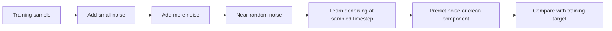
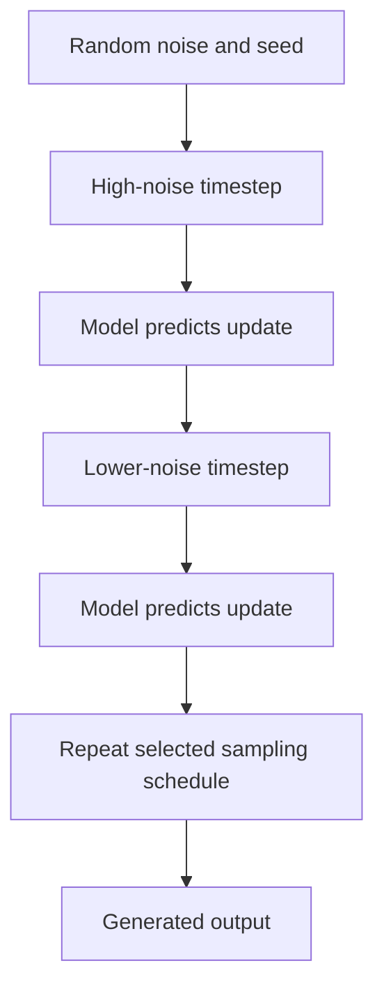
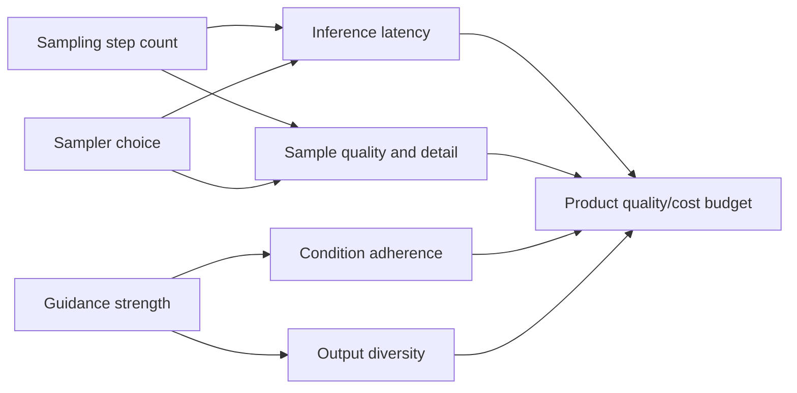
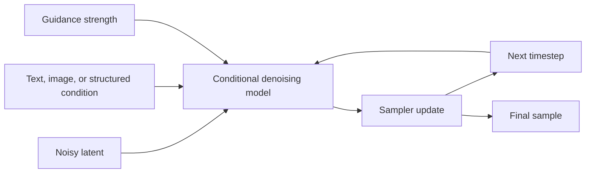
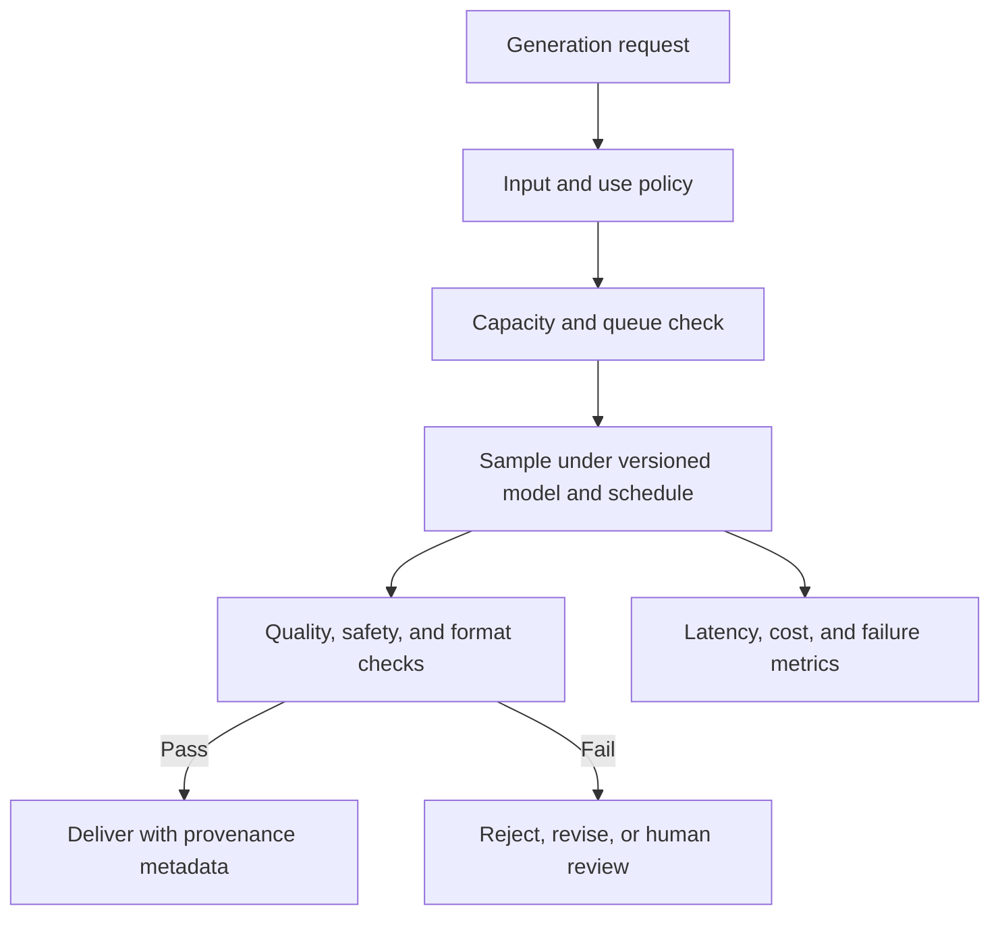

# Diffusion Models

Part: [16 — Artificial Intelligence, Machine Learning, and Generative AI](PART_OVERVIEW.md)

Diffusion models learn to generate data by reversing a process that gradually adds noise to training examples. A denoising model estimates how to recover structure at each step. Generation starts from noise and iteratively applies this model to produce a sample. Quality, controllability, latency, and compute depend on the noise schedule, model, conditioning, and sampler.

## Forward Noising and Denoising Objective

The forward process adds noise over a sequence of time steps until the original structure becomes difficult to recognize. Training samples a timestep and teaches the model to predict noise, a denoised sample, or a related target. The learned reverse process uses that estimate to move toward a structured sample.

The training objective is not simply “memorize the image.” The model learns a conditional denoising field over noisy inputs and timesteps. Noise schedules shape the task at each step and influence sample quality and compute.

For a common variance-preserving process, a noisy training example can be sampled directly as $x_t=\sqrt{\bar{\alpha}_t}x_0+\sqrt{1-\bar{\alpha}_t}\epsilon$, where $\epsilon\sim\mathcal{N}(0,I)$ and $\bar{\alpha}_t$ is the cumulative signal retained by the schedule. A neural network receives $x_t$, timestep $t$, and optional condition $c$, then predicts noise or another parameterization of the clean signal. The loss compares that prediction with the known training target. At inference, the original clean sample is unknown, so the sampler repeatedly uses the model estimate to move from a high-noise state toward a lower-noise state.

The schedule determines how much signal remains at each timestep and therefore changes the denoising task. A sampler approximates the reverse trajectory; fewer steps lower latency but may reduce detail or condition adherence. Some samplers are stochastic, while others make a more deterministic path given the same initial noise. Record schedule, sampler, step count, guidance, precision, and seed together when comparing outputs.

## Sampling and Latency

Generation begins from random noise and iteratively applies the learned denoiser. More steps can improve quality in some configurations but increase latency and compute; advanced samplers can reduce steps with quality trade-offs. Measure quality and latency on the actual serving hardware and prompt distribution.

Reproducibility depends on seed, model weights, sampler, scheduler, precision, and runtime. Record these inputs if an output must be reproduced or investigated. Random seeds improve repeatability under fixed conditions but do not guarantee bit-identical output across hardware and software versions.

Step count is a direct, measurable latency lever. A sampler requiring 50 denoising steps at 80 milliseconds per step costs about 4 seconds per image; a faster sampler reaching comparable perceptual quality in 20 steps at the same per-step cost cuts that to about 1.6 seconds, a meaningful difference for an interactive product even before batching or hardware changes are considered. The quality comparison must be measured, not assumed: fewer steps can quietly degrade fine detail or condition adherence in ways an aggregate quality score misses, so compare the two configurations on the same prompts, seeds, and a rubric that specifically checks the details the product depends on, not only an average perceptual-quality metric.

The noise schedule determines the signal-to-noise ratio assigned to each timestep, so a training schedule that allocates too little learning signal to fine structure can limit detail even if the network trains stably. A linear variance schedule is simple but may distribute noise poorly at the beginning or end; cosine-style schedules reshape signal retention and must still be evaluated on the target data. At sampling time, stochastic ancestral updates preserve randomness at intermediate steps, while deterministic implicit-style trajectories can reach a result in fewer model evaluations but may change diversity and fine detail. Compare schedules and samplers using the same checkpoint, conditions, and seed set so the effect is attributable to the sampling choice.

## Conditioning, Guidance, and Control

Conditioning can include text, labels, images, masks, or structured constraints. Guidance changes the influence of condition signals relative to the learned prior. Too much guidance can reduce diversity or create artifacts; too little can weaken condition adherence. Test prompt/condition coverage and failure cases.

In classifier-free guidance, the model is trained with and without a condition. At sampling time, a common combination is $\epsilon_{guided}=\epsilon_{uncond}+s(\epsilon_{cond}-\epsilon_{uncond})$, where $s$ controls how strongly the conditional prediction pulls the sample toward the requested input. Increasing $s$ can improve adherence but may oversaturate features, create artifacts, or reduce diversity. Guidance is a sampling control, not new evidence that the condition is accurate; measure adherence and perceptual quality across a range of values.

Safety and rights concerns span training data, user inputs, generated content, and distribution. Filters can fail or be bypassed; apply layered policy, provenance, review, and user controls appropriate to risk.

## Quality, Evaluation, and Operations

Evaluate perceptual quality, diversity, condition adherence, latency, cost, and safety. Human review is needed for many subjective outcomes, but should use a consistent rubric and representative samples. Monitor prompt and input distributions; a shift can alter outputs even if model weights are unchanged.

## Worked Case and Review Checklist

A design tool creates product mockups from a text prompt and a reference image. The service constrains input types, selects a sampler and step budget based on latency tier, and records model, sampler, seed, and policy versions. Generated images pass safety and format checks; uncertain cases enter human review. Capacity limits prevent burst requests from starving interactive sessions.

Review data rights, noise schedule, sampler, conditioning, guidance, reproducibility metadata, latency, cost, safety checks, human review, output provenance, and overload behavior.

## Questions and Summary

1. Draw forward noising and reverse denoising and explain what the model learns.
2. How does reducing sampling steps affect latency and quality?
3. Compare stronger and weaker guidance for condition adherence and diversity.
4. Which inputs are needed to reproduce a generated sample?
5. Design a serving path with safety checks and bounded capacity.

Diffusion models generate samples through iterative denoising from noise. Sampling schedule, conditioning, guidance, compute, and safety controls shape the resulting system. Evaluate the complete path across quality, latency, cost, reproducibility, and misuse risk.
