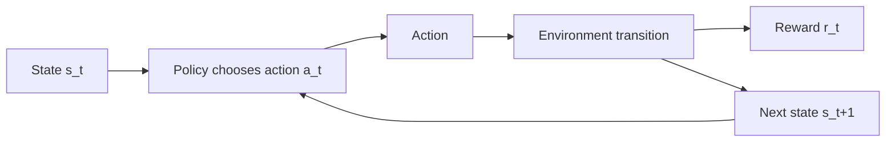
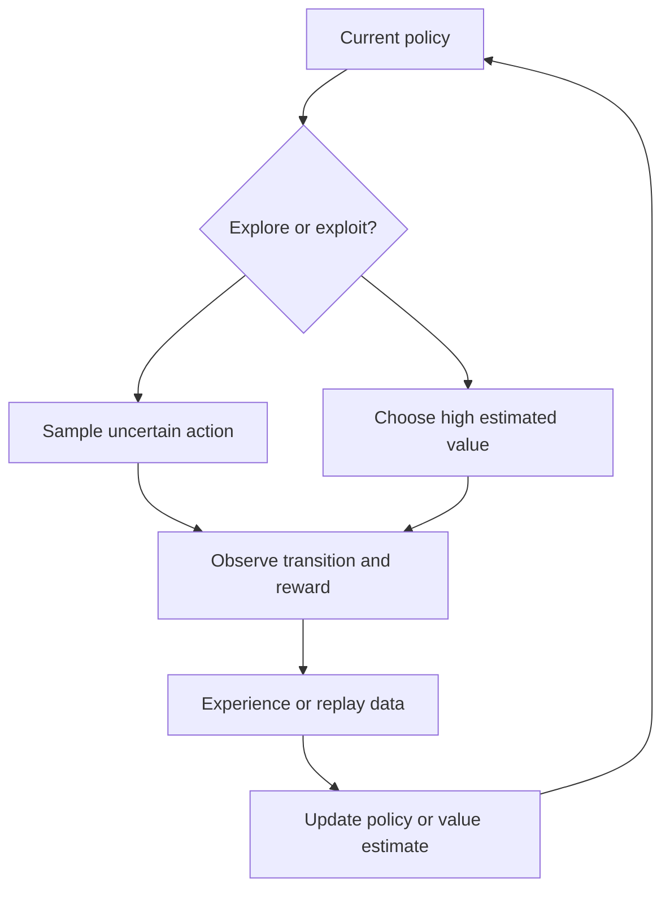
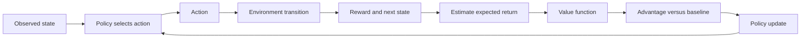
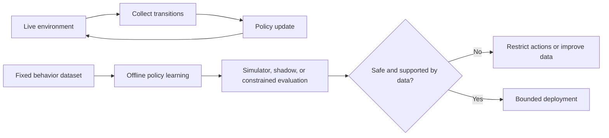
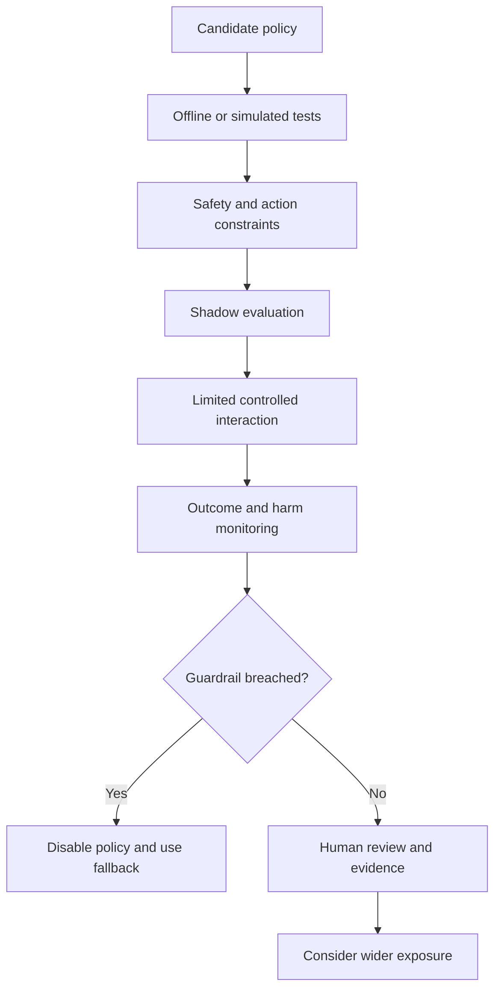

# Reinforcement Learning

Part: [16 — Artificial Intelligence, Machine Learning, and Generative AI](PART_OVERVIEW.md)

Reinforcement Learning (RL) trains an agent to choose actions through interaction with an environment and feedback from rewards. It is useful when decisions affect future state and the objective is cumulative, but exploration can be costly and reward signals can be incomplete or misaligned. Part 07 owns distributed system behavior; this chapter owns the learning formulation and safety limits.

## Markov Decision Process and Policy

A Markov Decision Process (MDP) models state, action, transition, reward, and a discount factor. The agent observes state $s_t$, chooses action $a_t$ under a policy, receives reward $r_t$, and observes the next state. A policy maps observations to actions; a value function estimates expected future return. The Markov assumption means the chosen state contains information needed to predict future dynamics for the task.

The state representation, action space, and reward define the learned problem. If important context is omitted, the agent may behave inconsistently. If actions have external effects, the environment may not be safely reset or explored. Specify constraints and terminal conditions before selecting an algorithm.

The policy is evaluated over a return, not just the immediate reward: $G_t=\sum_{k=0}^{T-t}\gamma^k r_{t+k}$, where $\gamma$ discounts later outcomes. For a policy $\pi$ and state $s$, the Bellman relation is $V^\pi_s=\mathbb{E}_\pi[r_t+\gamma V^\pi_{s'}\mid s_t=s]$. The discount factor encodes how the task values delayed outcomes; it is not a generic stability knob. If a reward omits downstream costs or delayed harms, optimizing this return can amplify the omission across many steps.

The discount factor's effect on the planning horizon is concrete and testable. With $\gamma=0.9$, a reward ten steps away is weighted by $0.9^{10}\approx0.35$; with $\gamma=0.99$, that same ten-steps-away reward retains $0.99^{10}\approx0.90$ of its value, making the agent far more willing to accept short-term cost for long-term gain. Choosing $\gamma$ too low for a task with genuinely long-horizon consequences (such as customer lifetime value) can produce a policy that looks locally reasonable but systematically undervalues decisions whose payoff arrives later than the effective horizon $1/(1-\gamma)$ time steps away.

## Exploration, Value, and Learning

Exploration gathers information about uncertain actions; exploitation selects actions currently believed to yield high return. Too little exploration can lock in a poor policy, while too much can harm users or consume resources. Value-based methods estimate action values; policy-gradient methods optimize a parameterized policy; actor-critic methods combine both.

Reward design encodes what is optimized, not everything that matters. Proxy rewards can be gamed or produce unintended strategies. Use constraints, guardrails, human review, and outcome evaluation. Do not assume a high reward corresponds to user value unless the relationship is empirically validated.

## Offline and Online Learning

Online learning interacts with the environment and receives new experience. Offline RL learns from a fixed dataset without new exploration; it avoids direct interaction risk but can fail when the learned policy chooses actions poorly represented in the dataset. Dataset coverage, behavior-policy bias, and extrapolation error matter.

Let $\mu(a\mid s)$ denote the behavior policy that generated an offline dataset and $\pi(a\mid s)$ the candidate policy. If $\pi$ selects actions in states where $\mu$ has little or no support, the value estimate depends on extrapolation beyond observed evidence. Importance-sampling corrections can reweight trajectories by policy likelihood ratios, but products of ratios can have very high variance. Conservative methods constrain the candidate toward supported actions or penalize overestimated values; that lowers some extrapolation risk but can also reject useful actions. Report which actions are unsupported and keep a safe fallback for those states rather than treating an offline score as a deployment guarantee.

Deploy learned policies through staged, reversible exposure. Use action constraints or a trusted fallback when confidence is low. In high-impact domains, never rely solely on simulated performance; validate assumptions against the real environment under a controlled protocol.

## Safety, Reward Misspecification, and Evaluation

Reward misspecification occurs when the optimization target differs from intended outcomes. A policy can exploit loopholes in the reward, shift costs to unmeasured users, or maximize short-term reward at long-term expense. Include safety constraints, counter-metrics, human oversight, and explicit stop conditions.

Evaluate expected return, constraint violations, subgroup outcomes, worst-case behavior, stability, and recovery. Confidence intervals matter when outcomes are rare or noisy. Track model, data, reward definition, simulator version, policy version, and deployment context so a result can be reproduced and rolled back.

## Worked Case and Review Checklist

A warehouse routing agent chooses paths to reduce delivery time. Its state includes current location, battery reserve, obstacle status, and the condition of nearby aisles; its action is limited to a short list of reachable next segments. The reward combines delivery delay with penalties for blocked aisles and unsafe proximity, but safety constraints remain explicit action limits rather than relying only on a large negative reward. Otherwise, the optimizer could accept a small collision probability if the average delivery-time gain were large enough.

Offline traces train a candidate, but rarely observed aisle closures leave weak action support. A simulator tests those events and battery-edge cases, while a shadow period compares recommendations with the existing planner without controlling robots. The team tracks delivery time, near misses, invalid route proposals, and fallback frequency. The agent first recommends only; limited autonomy begins only for well-covered states with an operator override and an immediate route-to-safe-stop action. Any unmodeled map or sensor state returns control to the established planner rather than inviting exploration on the live floor.

Review state completeness, action constraints, reward alignment, exploration exposure, data coverage, simulator fidelity, guardrails, human override, evaluation uncertainty, monitoring, fallback, and rollback. Confirm that all high-impact actions have an accountable owner.

## Questions and Summary

1. Define the state, action, reward, and transition for a sequential decision problem.
2. Compare offline and online learning risks.
3. Give an example of reward misspecification and design a counter-metric.
4. Design a safe rollout for an agent that can change real-world state.
5. Which evidence is needed before increasing autonomy?

RL learns policies from sequential interaction, making state design, reward alignment, exploration, and safety central. Offline data and simulations reduce some risks but introduce coverage and fidelity limits. Constrain actions, evaluate harms and outcomes, preserve human override, and stage autonomy according to evidence.
