# Reinforcement Learning

Part: [16 — Artificial Intelligence, Machine Learning, and Generative AI](PART_OVERVIEW.md) · Status: Revised (in-depth rewrite)

## 1. Introduction

Reinforcement learning (RL) is the part of machine learning that studies how an agent should choose a sequence of actions when each action changes what it will see next and the only feedback is a numerical reward that may arrive late. A supervised model answers "what is the label for this input?" from examples that someone already labeled. An RL agent answers "what should I do now, given that what I do now changes what I can do later?" and learns the answer from its own experience, or from logs of someone else's experience. The difference sounds small. In practice it changes the data requirements, the evaluation method, the failure modes, and the operational risk of the system.

For a solution architect, RL matters for two reasons that pull in opposite directions. First, a narrow slice of RL is widely deployed and very valuable: multi-armed and contextual bandits choose which recommendation, headline, price, or ad to show, and they run quietly in many large products. Second, the full sequential version of RL is rarely the right tool. It needs an environment you can interact with cheaply, a reward you can write down without gaming, and an evaluation method that does not need to deploy the policy to find out whether it works. An architect who can tell these cases apart saves a team from a year of building a simulator for a problem that a well-tuned bandit, a forecast plus an optimizer, or a plain rule would have solved.

After studying this chapter you should be able to:

1. Formulate a decision problem as a Markov decision process (MDP) and say which parts (state, action, reward, discount, termination) the business must decide.
2. Derive the Bellman expectation and optimality equations and use them to solve a small gridworld by hand with policy evaluation, policy iteration, and value iteration.
3. Explain Monte Carlo and temporal-difference (TD) learning, work a SARSA and a Q-learning update with numbers, and state why one is on-policy and the other off-policy.
4. Explain why function approximation, bootstrapping, and off-policy data together can diverge (the deadly triad), and how deep Q-network (DQN) tricks reduce the problem.
5. Derive the REINFORCE policy gradient, explain baselines and generalized advantage estimation (GAE), and read the proximal policy optimization (PPO) clipped objective.
6. Choose among value-based, policy-gradient, actor-critic, and model-based methods for discrete and continuous action spaces, and describe soft actor-critic (SAC).
7. Compare exploration strategies, and work a Thompson sampling example for a bandit problem.
8. Explain offline RL, distribution shift, and off-policy evaluation with importance sampling, and say what evidence is needed before a learned policy touches production.
9. Recognize reward misspecification and reward hacking, and design constraints, shields, and kill switches.
10. Decide when RL is the wrong tool, and describe the operational pieces needed to run it safely.

### 1.1 Scope and ownership

This chapter owns the RL formulation and algorithms. Neighbouring topics are recapped and linked, not re-taught.

| Topic | Owner | What this chapter does |
|---|---|---|
| Reinforcement learning from human feedback (RLHF), reward models from preferences, Kullback-Leibler (KL) regularized policy optimization for language models | [CH14](CH14_Reinforcement_Learning_from_Human_Feedback.md) | Teaches the algorithms (PPO, KL penalty ideas) that CH14 applies, and links to CH14 for the language-model pipeline (Section 13.5) |
| Neural network training, backpropagation, optimizers | [CH07](CH07_Deep_Learning_Foundations.md) | Assumes it; uses networks as function approximators |
| Evaluation methodology, confidence intervals, data splits | [CH06](CH06_Model_Evaluation_Validation_and_Selection.md) | Applies it to RL where variance and non-independence change the rules |
| A/B tests, fixed-allocation experiments, bandit-based adaptive allocation as an experimentation tool | [A/B Testing](../02_Design_Thinking_and_Product_Management/CH27_A_B_Testing.md) | Teaches the algorithm and its regret analysis, recaps the experimentation use |
| Agents that plan with language models and call tools | [CH21](CH21_Agents_Tool_Calling_Memory_Planning.md) | Mentions only where the agent loop shares vocabulary |
| Responsible AI governance, risk review | [CH31](CH31_Responsible_AI_and_Safety_Governance.md) | Supplies the RL-specific safety mechanisms; governance process lives there |
| MLOps, model registry, rollout | [CH29](CH29_MLOps_and_LLMOps.md) | Lists the RL-specific additions (action logging, propensities, kill switches) |
| Distributed system behavior (retries, timeouts, circuit breakers) | Part 07 | Assumes it when discussing production control loops |

### 1.2 How to read this chapter

Sections 3 to 8 build the tabular theory. They are the part to read slowly, with pencil, because every deep method in Sections 10 to 14 is a patch on a tabular idea. Sections 15 and 16 cover exploration and bandits, the most commercially common pieces. Sections 17 to 24 cover the topics that decide whether an RL project survives contact with production: models of the world, offline learning, imitation, reward design, safety, simulation, multiple agents, and evaluation. Sections 25 to 31 turn this into decisions, operations, a case study, and review material. Runnable code for the worked examples is listed in Section 32.

## 2. Background

The ideas in RL come from three separate traditions that merged in the late 1980s and 1990s.

The first is **optimal control and dynamic programming**. Richard Bellman introduced dynamic programming in the 1950s and showed that a long sequence of decisions can be optimized by solving a recursion over the value of states. The recursion that now carries his name is the center of this chapter. Bellman also coined the phrase "curse of dimensionality" for the way a table over states grows exponentially with the number of state variables, which is the reason the function approximation of Section 9 exists. Ronald Howard (1960) introduced policy iteration. The Markov decision process as a formal object comes from this operations research line.

The second is **animal learning psychology**. Edward Thorndike's law of effect (1911) said that actions followed by satisfying outcomes become more likely. Later behaviorist work and the Rescorla–Wagner model gave quantitative accounts of how prediction errors drive learning. The word "reinforcement" comes from this tradition, and the TD error of Section 7 later turned out to resemble the firing of dopamine neurons, which is a research finding in neuroscience and not something this chapter relies on.

The third is **trial-and-error learning in artificial intelligence**. Arthur Samuel's checkers program (1959) learned an evaluation function from self-play. Richard Sutton (1988) introduced temporal-difference learning as a way to learn predictions by comparing successive predictions. Chris Watkins (1989) introduced Q-learning and proved its convergence in the tabular case with Peter Dayan (1992). Gerald Tesauro's TD-Gammon (1992 to 1995) learned to play backgammon at a strong level with a small neural network and TD learning, an early demonstration that function approximation could work. Ronald Williams (1992) derived the REINFORCE policy gradient.

Three results then defined the modern period. Volodymyr Mnih and colleagues (2013, 2015) showed that a convolutional network trained with Q-learning, an experience replay buffer, and a target network could learn to play many Atari games from pixels; this is the DQN paper and the start of deep RL. David Silver and colleagues (2016) combined deep networks, policy and value learning, and tree search in AlphaGo, which defeated a top professional Go player, and later work removed the human game data (AlphaGo Zero, 2017) and then the game rules (MuZero, Schrittwieser and colleagues, 2020). John Schulman and colleagues introduced trust region policy optimization (TRPO, 2015) and PPO (2017), which became the default policy-gradient algorithm for many problems and for RLHF of language models.

For practitioners the commercial history looks different from the research history. The method with the longest and widest production record is the bandit, a one-step RL problem: Li, Chu, Langford, and Schapire (2010) described a contextual-bandit news-article recommender at Yahoo and an offline evaluation method for it, and the pattern has been repeated in advertising, recommendation, and pricing. Deep RL has had notable but narrower deployments, such as data-center cooling control (DeepMind and Google, reported 2016 and in later papers), robotic and game-playing systems, and the policy-optimization stage of aligned language models. The standard textbook, which this chapter follows in notation, is Sutton and Barto, [Reinforcement Learning: An Introduction](http://incompleteideas.net/book/the-book-2nd.html), second edition (2018), freely available from the authors.

## 3. The Agent-Environment Loop and Problem Formulation

An RL problem has two parties. The **agent** is the decision-maker you are building. The **environment** is everything else that the agent's actions can influence and that produces the agent's observations and rewards. Time advances in discrete steps $t = 0, 1, 2, \dots$. At each step:

1. The agent observes the state $s_t$ (or an observation derived from it).
2. The agent chooses an action $a_t$ according to its policy.
3. The environment responds with a reward $r_{t+1}$ and a next state $s_{t+1}$.

The loop then repeats. The sequence $s_0, a_0, r_1, s_1, a_1, r_2, \dots$ is a **trajectory** (also called an episode when it ends, or a rollout). Sutton and Barto index the reward received after action $a_t$ as $r_{t+1}$ to emphasize that reward and next state arrive together. Some papers write $r_t$ for the reward after $a_t$; this chapter uses $r_{t+1}$ when the distinction matters and says so.

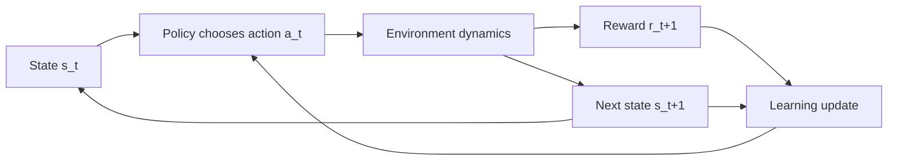

The diagram shows two loops that are easy to conflate. The fast loop is the interaction loop: observe, act, receive reward, repeat, at the pace of the environment. The slower loop is the learning loop: use the collected experience to change the policy. In online RL both loops run together. In offline RL the interaction loop is run by some other policy in the past and the learning loop runs later on the stored logs. Most of the architecture decisions in this chapter (where experience is stored, how actions are logged, how a new policy is released) are decisions about how these two loops are separated.

### 3.1 What the business must decide

A machine learning engineer cannot choose the following five items alone, because each of them states what the business values.

**State.** The state should contain what the agent needs in order to predict what happens next and how good it is. A recommender whose state is only "the current user's last click" ignores the session history that predicts intent. A state that includes everything is expensive and raises the data requirement. When the true state is hidden (the customer's real intent, the true temperature inside a machine), the agent receives an *observation* and the problem is a partially observable MDP (POMDP). Practitioners handle partial observability by stacking recent observations, using a recurrent or attention-based network over the history, or adding features that summarize the history. A common source of confusing failure is a policy that behaves inconsistently because two situations that need different actions look identical in the state.

**Action.** Actions can be discrete (choose one of 12 offers), continuous (set a valve to 37.5 percent), or structured (choose a ranked list of 10 items out of a million, which is a combinatorial action space). The shape of the action space decides which algorithm families apply (Section 25). It also decides the safety surface: every action the agent can take is an action it will eventually try during exploration.

**Reward.** The reward is the signal the agent will optimize, faithfully and without regard to intent. Section 20 treats reward design at length. For now note that the reward is a *specification written by people*, and that RL is a method for finding policies that score high on the specification, not on the intention behind it.

**Discount and horizon.** The discount factor $\gamma$ and the episode length encode how far ahead the agent should care. This is a business decision about patience, for example whether a retention offer is judged on this week's purchase or on the next year of revenue.

**Termination.** Episodes can end because the task is complete (the goal is reached), because the agent fails (a robot falls), or because a time limit is hit. These are not the same. A time-limit cut is not a property of the environment, so treating it as a terminal state with zero future value biases value estimates near the limit; a correct implementation bootstraps from the value of the last state when an episode ends by truncation (the Gymnasium library separates `terminated` from `truncated` for this reason).

### 3.2 How RL differs from supervised learning

Five differences drive nearly every practical difficulty.

| Property | Supervised learning | Reinforcement learning |
|---|---|---|
| Feedback | The correct answer for each input | A scalar reward for the action taken; the correct action is never shown |
| Data distribution | Fixed by whoever collected the dataset | Depends on the current policy, so it changes as the agent learns |
| Credit assignment | Each example has its own label | A reward at step 100 may be caused by an action at step 3 |
| Independence | Examples assumed roughly independent | Consecutive samples are strongly correlated |
| Evaluation | Held-out test set, no side effects | Evaluating a new policy normally means running it, which has side effects |

The second row is the root of most instability. In supervised learning a model that improves does not change the test set. In RL a policy that improves visits different states, so the training data and the evaluation distribution move with it. The fifth row is the root of most production risk: an RL system cannot be validated by a static test set alone. Section 24 returns to this.

### 3.3 Where the problem sits on the spectrum

It helps to place RL between simpler problems. If the action does not affect the next state and you observe a reward for the chosen action only, you have a **bandit**. If you also observe context before acting, you have a **contextual bandit**. If actions change the future, you have the full **sequential decision problem** or MDP. If you can observe the outcome of every possible action (full feedback), it is closer to supervised learning with cost-sensitive labels. Many industrial problems described as "RL" are really contextual bandits, and recognizing this lowers the cost, risk, and sample requirement by a large factor (Section 16).

## 4. Markov Decision Processes, Return, Policies, and Value Functions

### 4.1 The MDP

A finite **Markov decision process** is a tuple $(\mathcal{S}, \mathcal{A}, P, R, \gamma)$:

- $\mathcal{S}$ is a set of states and $\mathcal{A}$ a set of actions (possibly depending on the state).
- $P(s' \mid s, a)$ is the transition probability: the chance of reaching state $s'$ after taking action $a$ in state $s$.
- $R(s, a, s')$ is the reward for that transition. Its expectation given $(s, a)$ is written $r(s, a) = \mathbb{E}[r_{t+1} \mid s_t = s, a_t = a]$.
- $\gamma \in [0, 1]$ is the discount factor.

The **Markov property** says that the future depends on the past only through the current state:

$$
\Pr(s_{t+1}, r_{t+1} \mid s_t, a_t, s_{t-1}, a_{t-1}, \dots, s_0, a_0) = \Pr(s_{t+1}, r_{t+1} \mid s_t, a_t).
$$

This is a property of the *state representation*, not of the world. Almost any process can be made Markov by putting enough history into the state. The practical question is whether the state you have chosen is close enough. Two quick diagnostics are to check whether adding the previous observation to the state changes the learned value estimates, and whether two histories that lead to the same state have different outcome distributions.

### 4.2 Return and discounting

The agent does not maximize the next reward; it maximizes the **return**, the discounted sum of future rewards from time $t$:

$$
G_t = r_{t+1} + \gamma r_{t+2} + \gamma^2 r_{t+3} + \dots = \sum_{k=0}^{\infty} \gamma^k r_{t+k+1}.
$$

Here $\gamma^k$ is $\gamma$ raised to the power $k$. For an episodic task the sum stops at the end of the episode. Return has a recursive structure that is used constantly:

$$
G_t = r_{t+1} + \gamma G_{t+1}.
$$

**Worked example.** Take rewards $r_1 = 1$, $r_2 = 0$, $r_3 = 2$ and then the episode ends, with $\gamma = 0.9$. Then $G_2 = r_3 = 2$, $G_1 = r_2 + 0.9 G_2 = 0 + 1.8 = 1.8$, and $G_0 = r_1 + 0.9 G_1 = 1 + 1.62 = 2.62$. Computing from the end backwards is how return is computed in practice for a stored episode.

Discounting does three jobs. It keeps the sum finite for tasks that never end, because if rewards are bounded by $R_{\max}$ then $|G_t| \le R_{\max}/(1-\gamma)$. It encodes a preference for earlier reward, which is often a real business preference (money now beats money later, uncertain futures should be weighted down). It also makes learning easier, because a smaller $\gamma$ shortens the horizon over which credit has to be assigned.

The **effective horizon** is about $1/(1-\gamma)$ steps. With $\gamma = 0.9$ it is 10 steps; with $\gamma = 0.99$ it is 100 steps; with $\gamma = 0.999$ it is 1,000 steps. A reward 10 steps away is weighted by $0.9^{10} \approx 0.349$ under the first and by $0.99^{10} \approx 0.904$ under the second. Choosing $\gamma$ is therefore choosing how patient the agent is. If a retention coupon pays back over 90 days and a step is one day, $\gamma = 0.9$ makes the payoff nearly invisible: $0.9^{90} \approx 7.6 \times 10^{-5}$. A $\gamma$ of $0.99$ keeps $0.99^{90} \approx 0.40$ of it. Choosing $\gamma$ too low is a quiet way to build a short-sighted policy, and choosing it near 1 raises the variance of the return and slows learning. Treat $\gamma$ as a business parameter, justify it from the payoff timing, and test sensitivity to it.

Some tasks report the *average reward per step* instead of discounted return (continuing control tasks with no natural start). That formulation exists and has its own Bellman equations, but most deployed algorithms use the discounted form, sometimes with $\gamma$ close to 1 as an approximation.

### 4.3 Policies

A **policy** $\pi$ is the agent's rule for choosing actions. A *deterministic* policy is a function $a = \pi(s)$. A *stochastic* policy is a distribution $\pi(a \mid s)$ over actions given the state. Stochastic policies matter for three reasons: they explore, they are required by policy-gradient methods that need a differentiable distribution, and in partially observed or adversarial settings the best policy can be randomized. For a fully observed single-agent MDP at least one deterministic optimal policy exists, which is why value-based methods can return a greedy deterministic policy.

### 4.4 State-value and action-value functions

The **state-value function** of a policy is the expected return when starting in $s$ and following $\pi$ afterwards:

$$
v_\pi(s) = \mathbb{E}_\pi\left[ G_t \mid s_t = s \right].
$$

The **action-value function** is the expected return when starting in $s$, taking action $a$ once (whatever $\pi$ would say), and following $\pi$ afterwards:

$$
q_\pi(s, a) = \mathbb{E}_\pi\left[ G_t \mid s_t = s, a_t = a \right].
$$

The two are linked by the policy's action probabilities:

$$
v_\pi(s) = \sum_a \pi(a \mid s)\, q_\pi(s, a).
$$

The **advantage** measures how much better an action is than the policy's average in that state:

$$
A_\pi(s, a) = q_\pi(s, a) - v_\pi(s).
$$

Because $v_\pi(s)$ is the $\pi$-weighted average of $q_\pi(s, a)$, the advantage averages to zero under the policy: $\sum_a \pi(a \mid s) A_\pi(s, a) = 0$. The advantage is the central quantity in policy-gradient methods (Sections 11 and 12) because it says whether an action was better or worse than usual.

The **optimal** value functions take the best policy:

$$
v_*(s) = \max_\pi v_\pi(s), \qquad q_*(s, a) = \max_\pi q_\pi(s, a).
$$

For finite MDPs an optimal policy exists, it can be taken deterministic, and every optimal policy shares the same $v_*$ and $q_*$. If you know $q_*$, acting optimally is trivial: pick $\arg\max_a q_*(s, a)$. If you know only $v_*$, you also need the model $P$ to look one step ahead. This is why model-free control learns $q$ rather than $v$.

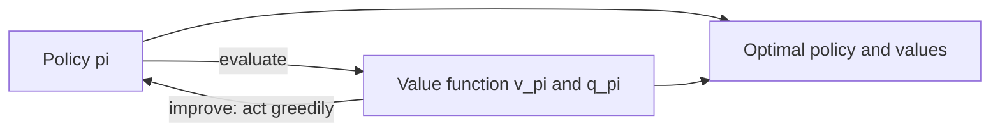

The diagram is the picture that Sutton and Barto call *generalized policy iteration*. Almost every algorithm in this chapter is some pairing of an evaluation step that makes the value function consistent with the current policy and an improvement step that makes the policy greedy with respect to the value function. The two pull against each other, since a changed policy invalidates the old values, yet they converge together on the optimum. The algorithms differ in how exact each step is (full sweeps, single samples, neural network gradient steps) and in which quantity they store. When a deep RL run is unstable, the useful question is which of the two steps has gone wrong: a value estimate that no longer matches the policy, or a policy that moved too far for the value estimate to follow.

## 5. The Bellman Equations

### 5.1 Bellman expectation equation

Start from the definition of $v_\pi$ and use the recursion $G_t = r_{t+1} + \gamma G_{t+1}$:

$$
\begin{aligned}
v_\pi(s) &= \mathbb{E}_\pi[ G_t \mid s_t = s ] \\
&= \mathbb{E}_\pi[ r_{t+1} + \gamma G_{t+1} \mid s_t = s ].
\end{aligned}
$$

Split the expectation by the first action and the next state. The action is drawn from $\pi(a \mid s)$, then the environment draws $s'$ and the reward from $P$:

$$
v_\pi(s) = \sum_a \pi(a \mid s) \sum_{s'} P(s' \mid s, a) \Big[ r(s, a, s') + \gamma\, \mathbb{E}_\pi[ G_{t+1} \mid s_{t+1} = s' ] \Big].
$$

The Markov property lets us replace the conditional expectation of $G_{t+1}$ given only $s_{t+1} = s'$ by $v_\pi(s')$, because nothing earlier changes the future once the state is known:

$$
v_\pi(s) = \sum_a \pi(a \mid s) \sum_{s'} P(s' \mid s, a) \Big[ r(s, a, s') + \gamma\, v_\pi(s') \Big]. \tag{5.1}
$$

This is the **Bellman expectation equation for $v_\pi$**. It is a system of $|\mathcal{S}|$ linear equations in the $|\mathcal{S}|$ unknowns $v_\pi(s)$. In matrix form, with $P_\pi$ the state-to-state transition matrix under $\pi$ and $r_\pi$ the expected one-step reward vector, it reads $v_\pi = r_\pi + \gamma P_\pi v_\pi$, so $v_\pi = (I - \gamma P_\pi)^{-1} r_\pi$. For $\gamma < 1$ the matrix is invertible. Solving directly costs about $O(|\mathcal{S}|^3)$, which is fine for a thousand states and impossible for a billion, so iterative methods are used.

The same steps give the equation for the action value:

$$
q_\pi(s, a) = \sum_{s'} P(s' \mid s, a) \Big[ r(s, a, s') + \gamma \sum_{a'} \pi(a' \mid s')\, q_\pi(s', a') \Big]. \tag{5.2}
$$

Read (5.1) as a one-step lookahead: the value of a state is the average over what the policy does, then over what the environment does, of the immediate reward plus the discounted value of where you land. Every learning method in this chapter is a way of making an estimate satisfy this equation without knowing $P$.

### 5.2 Bellman optimality equation

For the optimal value function, the policy no longer averages over actions; it takes the best one. Starting from $v_*(s) = \max_a q_*(s, a)$ and expanding $q_*$:

$$
v_*(s) = \max_a \sum_{s'} P(s' \mid s, a) \Big[ r(s, a, s') + \gamma\, v_*(s') \Big]. \tag{5.3}
$$

$$
q_*(s, a) = \sum_{s'} P(s' \mid s, a) \Big[ r(s, a, s') + \gamma \max_{a'} q_*(s', a') \Big]. \tag{5.4}
$$

The justification is the *principle of optimality*: the tail of an optimal trajectory is itself optimal from the state where the tail begins. If it were not, you could swap in a better tail and improve the whole. Equation (5.3) is not linear because of the max, so there is no matrix inverse, but it is a contraction: define the Bellman optimality operator $(\mathcal{T}v)(s) = \max_a \sum_{s'} P(s'|s,a)[r + \gamma v(s')]$. For any two value vectors $u, v$,

$$
\lVert \mathcal{T}u - \mathcal{T}v \rVert_\infty \le \gamma \lVert u - v \rVert_\infty,
$$

where $\lVert x \rVert_\infty = \max_s |x(s)|$. Each application of $\mathcal{T}$ shrinks the largest gap between any two value functions by at least a factor $\gamma$. By the Banach fixed-point theorem $\mathcal{T}$ has exactly one fixed point, which is $v_*$, and repeated application from any start converges to it geometrically at rate $\gamma$. This single fact is the reason value iteration works, and the contraction requires $\gamma < 1$ (or episodes that terminate with probability one), which is one more reason $\gamma$ is not a free knob.

A useful corollary bounds the loss from stopping early. If a value estimate $v$ satisfies $\lVert \mathcal{T}v - v \rVert_\infty < \epsilon$, then the greedy policy with respect to $v$ is within $2\epsilon\gamma/(1-\gamma)$ of optimal in every state. With $\gamma = 0.99$ this factor is 198, so a Bellman residual of $0.01$ still allows a policy loss of about $2$. High $\gamma$ makes small errors in value estimates matter a lot.

### 5.3 From equations to algorithms

The Bellman equations suggest three families, distinguished by what they assume:

- **Dynamic programming** knows $P$ and $r$ and uses the equations as update rules (Section 6).
- **Monte Carlo** does not know $P$, samples full trajectories, and averages returns (Section 7.1).
- **Temporal-difference learning** does not know $P$, samples single transitions, and uses the right-hand side of a Bellman equation, with its own current estimate in place of the true value, as the target (Section 7.2). Using one's own estimate in the target is called **bootstrapping**.

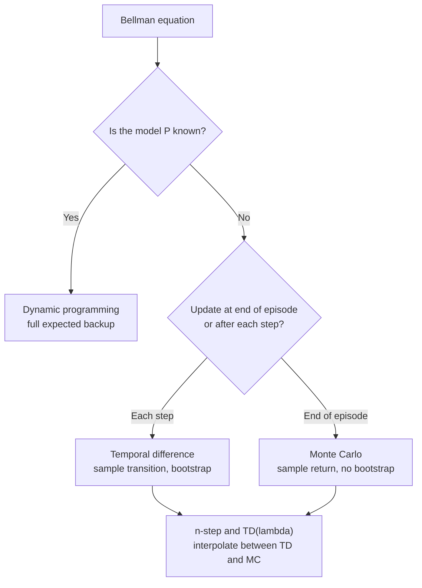

The decision tree shows that the dividing question is what knowledge of the environment you have, and the second question is how long you wait before learning. Monte Carlo waits and has no bias from bootstrapping, but high variance; TD updates immediately and has lower variance, but its target is biased by whatever error the current estimate contains. The interpolation in the last box is what lets practitioners trade bias against variance with one parameter, and it returns in GAE (Section 12.3).

## 6. Dynamic Programming: Planning When the Model Is Known

Dynamic programming (DP) in RL means solving the Bellman equations when $P$ and $r$ are known. It is rarely the algorithm you deploy for a large problem, but it is the cleanest way to see the machinery, and its structure reappears in every sampled method. Three operations are needed: policy evaluation, policy improvement, and their combinations, policy iteration and value iteration.

### 6.1 Iterative policy evaluation

Policy evaluation computes $v_\pi$ for a given $\pi$. Instead of inverting a matrix, turn (5.1) into an update rule and start from an arbitrary guess $v_0$ (usually all zeros):

$$
v_{k+1}(s) = \sum_a \pi(a \mid s) \sum_{s'} P(s' \mid s, a) \Big[ r(s, a, s') + \gamma\, v_k(s') \Big].
$$

Each application is an *expected backup*: it uses all possible next states, weighted by their probability, and not a sample. Because the Bellman expectation operator is also a $\gamma$-contraction, $v_k \to v_\pi$. A *synchronous* sweep computes $v_{k+1}$ for every state from the complete old $v_k$. An *in-place* sweep overwrites values as it goes, which usually converges faster and is what most code does.

### 6.2 Worked example: a 2 by 2 gridworld

Consider four cells, labeled by their position:

```text
+---+---+
| A | B |
+---+---+
| C | G |
+---+---+
```

The goal cell $G$ is terminal with value 0. Every move from $A$, $B$, or $C$ costs reward $-1$ and, as the move is deterministic, goes to the neighbouring cell in the chosen direction. A move into a wall leaves the agent where it is (and still costs $-1$). Let $\gamma = 1$ (the task is episodic, so the sum is finite when the goal is reached with probability one). The four actions are up, down, left, and right.

**Evaluate the equiprobable random policy** (each action with probability $1/4$). From $B$ the four actions lead to $B$ (up, wall), $G$ (down), $A$ (left), and $B$ (right, wall). From $A$ they lead to $A$ (up, wall), $C$ (down), $A$ (left, wall), and $B$ (right). By symmetry $v(B) = v(C)$ (cells $B$ and $C$ are mirror images across the diagonal). Write the Bellman expectation equation for each state:

$$
v(B) = -1 + \tfrac{1}{4}\big[\,v(B) + v(G) + v(A) + v(B)\,\big] = -1 + \tfrac{1}{4}\big[\,2 v(B) + 0 + v(A)\,\big],
$$

$$
v(A) = -1 + \tfrac{1}{4}\big[\,v(A) + v(C) + v(A) + v(B)\,\big] = -1 + \tfrac{1}{4}\big[\,2 v(A) + 2 v(B)\,\big].
$$

Multiply the second equation by 4: $4v(A) = -4 + 2v(A) + 2v(B)$, so $2v(A) = -4 + 2v(B)$ and $v(A) = v(B) - 2$. Multiply the first by 4: $4v(B) = -4 + 2v(B) + v(A)$. Substituting $v(A) = v(B) - 2$ gives $4v(B) = -4 + 2v(B) + v(B) - 2$, so $v(B) = -6$ and $v(A) = -8$. The exact values are therefore $v = (A: -8,\ B: -6,\ C: -6,\ G: 0)$. The interpretation is the expected number of steps (negated) for a random walker to reach the goal: eight from $A$, six from $B$.

The iterative method reaches the same numbers. Starting from zeros with synchronous sweeps (the script in Section 32 prints these):

| Sweep $k$ | $v_k(A)$ | $v_k(B) = v_k(C)$ |
|---|---|---|
| 0 | 0.000 | 0.000 |
| 1 | $-1.000$ | $-1.000$ |
| 2 | $-2.000$ | $-1.750$ |
| 3 | $-2.875$ | $-2.375$ |
| 10 | $-6.308$ | $-4.804$ |
| converged | $-8.000$ | $-6.000$ |

Check sweep 2 for $B$ by hand: $-1 + \tfrac14[\,2(-1) + 0 + (-1)\,] = -1 - 0.75 = -1.75$. The slow approach (ten sweeps are still far from the answer) comes from the long random-walk episode length: the contraction rate is governed by the largest eigenvalue of $P_\pi$, which is close to 1 when the walker wanders for a long time.

**Improve the policy.** Policy improvement replaces $\pi$ by the policy that is greedy with respect to $v_\pi$:

$$
\pi'(s) = \arg\max_a \sum_{s'} P(s' \mid s, a)\big[ r(s, a, s') + \gamma\, v_\pi(s') \big].
$$

In $B$: moving down gives $-1 + v(G) = -1$; every other action gives at most $-1 + v(B) = -7$ or $-1 + v(A) = -9$. Greedy picks down. In $A$, moving right gives $-1 + v(B) = -7$ and down gives $-1 + v(C) = -7$, while up and left give $-1 + v(A) = -9$, so right and down tie. In $C$, right gives $-1 + 0 = -1$. The improved policy is already optimal: its values are $v(B) = v(C) = -1$ and $v(A) = -2$. The **policy improvement theorem** guarantees that a greedy step never makes any state worse: if $q_\pi(s, \pi'(s)) \ge v_\pi(s)$ for all $s$, then $v_{\pi'}(s) \ge v_\pi(s)$ for all $s$. Strict improvement somewhere continues until $\pi' = \pi$, at which point $\pi$ satisfies the Bellman optimality equation.

### 6.3 Policy iteration and value iteration

**Policy iteration** alternates full policy evaluation (run (5.1) to convergence) and greedy improvement. In a finite MDP it terminates in a finite number of iterations because there are finitely many deterministic policies and each iteration improves strictly or stops. In practice it converges in a few iterations, even though each iteration is expensive.

**Value iteration** collapses the two steps: apply the Bellman optimality backup (5.3) as an update,

$$
v_{k+1}(s) = \max_a \sum_{s'} P(s' \mid s, a)\big[ r(s, a, s') + \gamma\, v_k(s') \big],
$$

and extract the greedy policy at the end. It is policy iteration with evaluation truncated to a single sweep. Applied to the 2 by 2 grid with all-zero start and $\gamma = 1$: after sweep 1 every non-goal state is $-1$ (any action costs $-1$ and all values are 0). In sweep 2, $v(B) = -1 + \max(v(G), \dots) = -1 + 0 = -1$, $v(C) = -1$, and $v(A) = -1 + \max(v(B), v(C), v(A)) = -1 + (-1) = -2$. Sweep 3 leaves all values unchanged, so the algorithm has converged: the optimal values $(-2, -1, -1, 0)$ match the improved policy above.

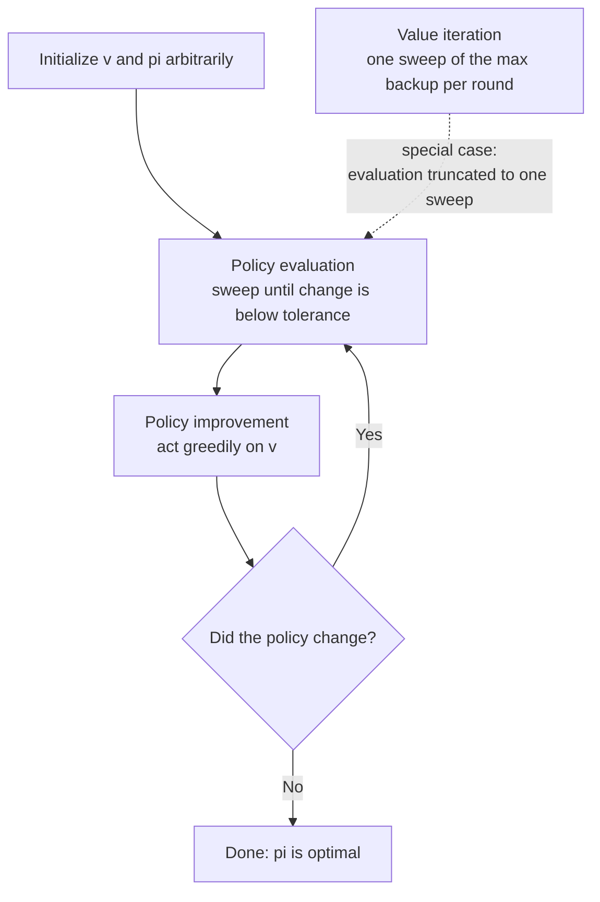

The flowchart shows the two outer structures. The solid loop is policy iteration, which needs a stopping rule for the inner evaluation, and the dashed note marks value iteration as its limit case. The practical consequence is that "how exact should the evaluation be before I improve?" is a tuning parameter, and the sampled methods that follow all choose the extreme of very rough evaluation (one sample) because it is cheap and, thanks to the contraction property, still converges.

### 6.4 A larger worked example: value iteration with a pit

The script [01_gridworld_dynamic_programming.py](../code/python/reinforcement-learning-chapter/01_gridworld_dynamic_programming.py) also runs value iteration on a 4 by 4 grid with $\gamma = 0.9$, a goal at the bottom-right worth $+10$ when entered, a pit at row 1, column 1 worth $-10$ when entered, and $-1$ for every other move. The converged values (rows top to bottom; the pit and goal cells are terminal and shown as 0) are:

```text
 1.810   3.122   4.580   6.200
 3.122   0.000   6.200   8.000
 4.580   6.200   8.000  10.000
 6.200   8.000  10.000   0.000
```

Verify one entry by hand. The cell next to the goal has value $10$ (entering the goal pays $+10$ and the episode ends). The cell two steps away is $-1 + 0.9 \times 10 = 8$. The cell three steps away is $-1 + 0.9 \times 8 = 6.2$. The top-left corner must route around the pit: six moves to the goal along the top row and right column, so its value is $-(1 + 0.9 + 0.81 + 0.729 + 0.6561) + 0.9^5 \times 10 = -4.0951 + 5.9049 = 1.8098 \approx 1.810$. The pit's effect shows in the values next to it: the cell above the pit has value $3.122$, lower than the $6.2$ you would get on a grid without a pit, because the shortest path is blocked and the agent must walk around it. In-place value iteration converged to a tolerance of $10^{-9}$ in 7 sweeps.

### 6.5 Limits of dynamic programming

DP needs the model and a sweep over all states. Both fail quickly: a model of customer behaviour is not known, and the number of states is exponential in the number of state variables. DP is nevertheless used in industry where the model is known and the state is small: inventory control with known demand distributions, queue and capacity control, and the exact solution of small subproblems. When a team says "we will approximate the model and then run DP", they are doing model-based RL (Section 17), and the error in the model compounds through the planning horizon.

## 7. Monte Carlo and Temporal-Difference Learning

When the model is unknown, the agent must learn values from experience. Two ideas cover almost everything.

### 7.1 Monte Carlo prediction and control

**Monte Carlo (MC)** methods estimate $v_\pi(s)$ by averaging the observed returns that follow visits to $s$. Run an episode under $\pi$, compute $G_t$ for each time step (backwards, using $G_t = r_{t+1} + \gamma G_{t+1}$), and update

$$
V(s_t) \leftarrow V(s_t) + \alpha \big[ G_t - V(s_t) \big].
$$

This is a running average with step size $\alpha$ (or $\alpha = 1/N(s)$ for an exact sample mean). MC has two properties that matter. It is *unbiased*: $G_t$ is a sample of the quantity being estimated. It is *high-variance*: $G_t$ sums many random rewards and many random transitions, so one number carries the noise of the whole tail. It also requires episodes to end, and it cannot learn until they do. For control, MC needs exploration to keep estimating all actions; the usual device is an $\epsilon$-greedy policy that picks a random action with probability $\epsilon$.

### 7.2 Temporal-difference learning

**Temporal-difference (TD)** learning replaces the full return with a one-step bootstrap. After observing $(s_t, r_{t+1}, s_{t+1})$ the TD(0) update is

$$
V(s_t) \leftarrow V(s_t) + \alpha\,\delta_t, \qquad \delta_t = r_{t+1} + \gamma V(s_{t+1}) - V(s_t).
$$

The quantity $\delta_t$ is the **TD error**: the difference between the new one-step estimate of the value (the TD target $r_{t+1} + \gamma V(s_{t+1})$) and the old estimate. It is the unit of "surprise" that all the later algorithms reuse.

**Worked example.** Suppose $V(s) = 0.5$, the agent takes an action, receives $r = 1$, and lands in $s'$ with $V(s') = 0.8$. With $\gamma = 0.9$ and $\alpha = 0.1$: the target is $1 + 0.9 \times 0.8 = 1.72$; the TD error is $\delta = 1.72 - 0.5 = 1.22$; the update gives $V(s) \leftarrow 0.5 + 0.1 \times 1.22 = 0.622$. A positive error says the state turned out better than expected, so its value is raised a little.

### 7.3 Bias, variance, and the choice between MC and TD

| Property | Monte Carlo | TD(0) |
|---|---|---|
| Target | Full return $G_t$ | $r_{t+1} + \gamma V(s_{t+1})$ |
| Bias | None | Biased by the error in $V(s_{t+1})$, which vanishes as $V$ converges |
| Variance | High: many random steps | Lower: one random step plus the estimate |
| Needs episode to end | Yes | No, works on continuing tasks |
| Learns from partial episodes | No | Yes |
| Sensitive to violated Markov property | Less (uses real returns) | More (bootstraps through a state that may not be Markov) |
| Initialization sensitivity | Low | The initial $V$ leaks into targets |

A classic way to see the difference: after a finite batch of experience, MC converges to the values that minimize error on the observed returns, while TD(0) converges to the values of the maximum-likelihood Markov model that best explains the observed transitions (the *certainty-equivalence* estimate). When the Markov assumption is right, TD uses data more efficiently; when it is wrong, MC is safer. In practice TD wins on most problems, and the sensible compromise is to use multi-step targets.

The **$n$-step return** uses $n$ real rewards and then bootstraps:

$$
G_t^{(n)} = r_{t+1} + \gamma r_{t+2} + \dots + \gamma^{n-1} r_{t+n} + \gamma^n V(s_{t+n}).
$$

With $n = 1$ this is TD(0); with $n$ equal to the remaining episode length it is MC. The **$\lambda$-return** averages all $n$-step returns with weights $(1 - \lambda)\lambda^{n-1}$ and is the basis of TD($\lambda$) and, in policy-gradient form, of GAE (Section 12.3). Values of $\lambda$ near 0.9 to 0.97 are typical defaults.

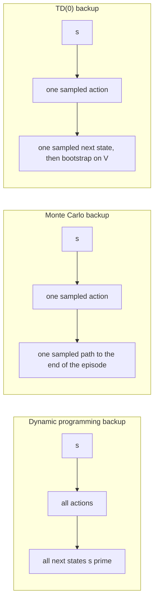

The three panels are the standard backup diagrams. They differ along two axes: whether the backup is over all possibilities (expected, DP) or one sample (MC, TD), and whether it goes the full depth of the episode (DP is one level but with a model, MC is all the way) or bootstraps after one step (DP and TD). The consequence for an engineer is the cost and noise per update: DP touches many successor states, MC touches an entire trajectory, and TD touches one transition, which is why TD fits streaming and replay-buffer architectures.

## 8. SARSA and Q-Learning: On-Policy and Off-Policy Control

Control means finding a good policy, not just evaluating one. TD control learns the action-value function $Q(s, a)$ because, as noted, acting greedily on $Q$ needs no model.

### 8.1 SARSA

SARSA (named for the tuple State, Action, Reward, State, Action) updates after observing $(s, a, r, s', a')$, where $a'$ is the action the agent *actually chooses next* under its current behaviour policy:

$$
Q(s, a) \leftarrow Q(s, a) + \alpha\Big[\, r + \gamma\, Q(s', a') - Q(s, a)\,\Big].
$$

It is **on-policy**: the policy being evaluated and improved is the same $\epsilon$-greedy policy that generates the data, so exploration is built into the values. SARSA learns the value of acting $\epsilon$-greedily, with its random mistakes included.

### 8.2 Q-learning

Q-learning (Watkins, 1989) replaces the sampled next action with the best next action:

$$
Q(s, a) \leftarrow Q(s, a) + \alpha\Big[\, r + \gamma \max_{a'} Q(s', a') - Q(s, a)\,\Big].
$$

It is **off-policy**: it learns the value of the greedy policy while behaving with a different, exploratory one. The target is a sample of the Bellman optimality equation (5.4). Under tabular representation, every state-action pair visited infinitely often, and step sizes satisfying the standard Robbins–Monro conditions ($\sum \alpha_t = \infty$, $\sum \alpha_t^2 < \infty$), Q-learning converges to $q_*$ with probability one. Off-policy learning is valuable because it can learn from stored data, from other policies, or from a human demonstration, which is why most deep RL value methods and all offline value methods build on it.

### 8.3 A worked update

Take a cell $s$ with action $a = $ right. Let $Q(s, \text{right}) = 0$, $r = -1$, $\gamma = 1$, $\alpha = 0.5$. In the next state $s'$ the Q-values for the four actions are $(-5, -3, -8, -4)$, and the $\epsilon$-greedy behaviour policy happens to choose, for exploration, the action with value $-5$.

- **Q-learning** uses the maximum, $-3$: target $= -1 + (-3) = -4$; $Q(s, \text{right}) \leftarrow 0 + 0.5 \times (-4 - 0) = -2.0$.
- **SARSA** uses the action actually taken, $-5$: target $= -1 + (-5) = -6$; $Q(s, \text{right}) \leftarrow 0 + 0.5 \times (-6 - 0) = -3.0$.

The two algorithms disagree because they are answering different questions: Q-learning asks "how good is this action if I behave optimally afterwards?" and SARSA asks "how good is this action given that I will keep exploring?".

### 8.4 The cliff-walking experiment

The textbook illustration is cliff walking. A 4 by 12 grid has a start at the bottom-left, a goal at the bottom-right, and a cliff along the bottom row between them. Each step costs $-1$, and stepping on the cliff costs $-100$ and returns the agent to the start. With $\epsilon = 0.1$, $\alpha = 0.1$, $\gamma = 1$ the script [02_tabular_q_learning_vs_sarsa.py](../code/python/reinforcement-learning-chapter/02_tabular_q_learning_vs_sarsa.py) trained for 2,000 episodes and averaged the last 100 online (exploring) episodes over 20 seeds. The result printed by the script was:

| Algorithm | Mean online return (last 100 episodes, 20 seeds) | Greedy path (seed 0) |
|---|---|---|
| Q-learning | $-50.7$ | 13 steps along the cliff edge |
| SARSA | $-21.7$ | 15 steps, one row further from the cliff |

```text
Q-learning greedy path          SARSA greedy path
............                    ............
............                    ************
************                    *..........*
SCCCCCCCCCCG                    SCCCCCCCCCCG
```

Q-learning finds the shortest route, which hugs the cliff, because its values describe the greedy policy. But the agent behaves $\epsilon$-greedily while learning, so with probability about $\epsilon/4$ per step on the edge it steps off randomly and pays $-100$. SARSA's values include that risk, so it learns a detour that is two steps longer and scores much better *while it is still exploring*. After training, if exploration is turned off, the Q-learning policy is better (13 steps against 15). The lesson reaches beyond gridworlds: on-policy methods optimize the behaviour you will actually run during learning, and off-policy methods optimize the policy you intend to run later, at the price of ignoring the cost of getting there. When exploration happens on a live system, that price is real. The numbers depend on seeds and hyperparameters and are illustrative of the pattern, not a benchmark.

### 8.5 Variants worth knowing

**Expected SARSA** replaces the sampled $Q(s', a')$ with its expectation under the policy, $\sum_{a'} \pi(a' \mid s') Q(s', a')$. It has lower variance than SARSA, includes Q-learning as the special case of a greedy target policy, and is a good default for tabular control.

**Double Q-learning** (Hasselt, 2010) addresses a statistical bias. The target $\max_{a'} Q(s', a')$ takes a maximum over noisy estimates, and the expected maximum of noisy estimates exceeds the maximum of their expectations. Illustration: suppose all three actions in $s'$ truly have value 0 and the estimates are $(0.5, -0.2, 0.3)$. The max operator reports $0.5$ although the truth is 0. Double Q-learning keeps two tables, uses one to *select* the best action and the other to *evaluate* it, so that selection noise and evaluation noise are independent. Section 10.4 uses the same idea in DQN.

**Eligibility traces** (Watkins's Q($\lambda$), SARSA($\lambda$)) spread credit backwards over recent states to speed up learning on long-delay tasks. They are the tabular cousin of $n$-step returns.

## 9. Function Approximation and the Deadly Triad

A table with one entry per state works for hundreds or thousands of states. A game screen, a customer's history, or a robot's joint angles have more states than can be enumerated, and most states are visited at most once. The agent must **generalize**: use a parametric function $\hat{v}(s; \mathbf{w})$ or $\hat{q}(s, a; \mathbf{w})$ with far fewer parameters than states, so that updating the estimate for one state also changes it for similar states.

### 9.1 Semi-gradient TD

The natural objective is mean squared value error, $\overline{VE}(\mathbf{w}) = \sum_s \mu(s)\,[v_\pi(s) - \hat{v}(s; \mathbf{w})]^2$, where $\mu(s)$ is the fraction of time spent in state $s$. Because the true $v_\pi$ is unknown, replace it with the TD target and take a gradient step on the *prediction only*:

$$
\mathbf{w} \leftarrow \mathbf{w} + \alpha\,\big[\, r + \gamma\, \hat{v}(s'; \mathbf{w}) - \hat{v}(s; \mathbf{w}) \,\big]\, \nabla_{\mathbf{w}} \hat{v}(s; \mathbf{w}).
$$

This is called a **semi-gradient** because the target $r + \gamma \hat{v}(s'; \mathbf{w})$ also depends on $\mathbf{w}$ but the update pretends it is a constant. The result is not the gradient of any fixed objective. The shortcut makes learning faster and is what every deep value method does, but it removes the guarantees that ordinary gradient descent on a fixed loss enjoys.

For a linear approximator $\hat{v}(s; \mathbf{w}) = \mathbf{w}^\top \mathbf{x}(s)$ with feature vector $\mathbf{x}(s)$, the gradient is $\mathbf{x}(s)$, and on-policy semi-gradient TD(0) converges to a point whose error is within a factor $1/(1-\gamma)$ of the best achievable linear fit (Tsitsiklis and Van Roy, 1997). That factor is another reason to be wary of $\gamma$ close to 1.

### 9.2 The deadly triad

Sutton and Barto name three ingredients that, together, can make learning diverge, with value estimates growing without bound:

1. **Function approximation:** a parametric model that generalizes across states.
2. **Bootstrapping:** targets that depend on the current estimate (TD, Q-learning, DP) instead of full returns.
3. **Off-policy training:** learning about a policy different from the one that generated the data, or from a state distribution unlike the target policy's.

Any two are fine. Tabular off-policy Q-learning converges. Function approximation with MC returns is stable. On-policy linear TD converges. The three together can diverge, and Baird's counterexample (1995) is a seven-state, linear-features problem on which off-policy semi-gradient TD produces weights that grow without limit even though a perfect solution (all values zero) exists inside the function class.

The mechanism, in one line: an off-policy update raises the estimate at a state the target policy visits less often than the behaviour policy does, the generalization pushes up the estimate at the bootstrapped successor too, and the next target is higher still. There is a feedback loop through the shared weights, and nothing anchors the values to real returns.

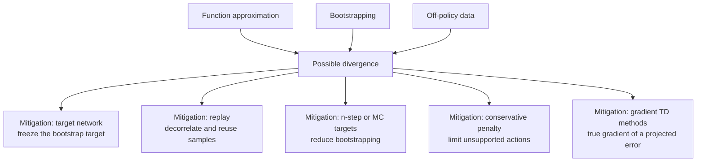

The diagram lists the triad on the left and common mitigations on the right. Each mitigation removes or weakens one leg: target networks slow the bootstrapping loop, longer returns reduce bootstrapping, conservative penalties (Section 18) keep the policy near the data, and gradient-TD methods (GTD, TDC) restore a true gradient at the price of extra complexity that few practitioners use. The practical reading is diagnostic. When a deep Q-learning run produces Q-values that grow to implausible magnitudes (far above the maximum possible return, which is $R_{\max}/(1-\gamma)$), assume the triad before assuming a bug, and respond by shrinking the learning rate, lengthening the target-update period, using multi-step returns, clipping targets, or reducing off-policyness.

### 9.3 Representations

Function approximation has an older, non-neural history that is still useful. **Tile coding** overlays several coarse grids on the state space, giving each state a sparse binary feature vector, and works well for low-dimensional control with linear TD. **Radial basis functions** and **Fourier bases** give smooth features. Neural networks learn the features, which is necessary for images and text but gives up the convergence guarantees of linear methods. Practitioners use simple, linear or tree-based value approximators for small tabular-like business problems (a few dozen features), because they are inspectable and stable, and neural networks when the state is raw high-dimensional input.

## 10. Deep Q-Networks

Mnih and colleagues (2015) made Q-learning work with a deep convolutional network on Atari frames by adding two devices that directly attack the triad. The paper's headline result was human-level or better scores on a majority of 49 games with one architecture and one set of hyperparameters; the engineering lessons are more durable than the scores.

### 10.1 The network and the loss

A network $Q(s, a; \theta)$ takes a state (in Atari, a stack of four recent grayscale frames so velocity is visible, which is a hand-made fix for partial observability) and outputs one Q-value per discrete action. This lets a single forward pass evaluate all actions. Training minimizes the squared (or Huber) error between the prediction and a bootstrapped target:

$$
L(\theta) = \mathbb{E}_{(s, a, r, s') \sim \mathcal{D}}\Big[\big( y - Q(s, a; \theta) \big)^2\Big], \qquad y = r + \gamma \max_{a'} Q(s', a'; \theta^-).
$$

Here $\mathcal{D}$ is the replay buffer and $\theta^-$ are the parameters of a separate target network. For a terminal $s'$ the second term is dropped. The gradient flows only through $Q(s, a; \theta)$, not through $y$.

### 10.2 Experience replay

Consecutive transitions are strongly correlated, and gradient descent assumes roughly independent samples. The agent stores each transition $(s, a, r, s', \text{done})$ in a buffer (1 million transitions in the original paper) and trains on random minibatches (32 in the original). Replay does three things: it breaks correlation between samples in a batch, it reuses each transition many times, which improves sample efficiency, and it averages over many past behaviour policies, which smooths the shifting data distribution. The cost is that the data are off-policy (they were generated by older versions of the policy), which is acceptable here because Q-learning is already off-policy. It also means that policy-gradient methods, which need on-policy data, cannot use a replay buffer without correction.

**Prioritized experience replay** (Schaul and colleagues, 2016) samples transitions in proportion to the size of their TD error, with an importance-sampling correction to remove the resulting bias. It speeds learning when useful transitions are rare and adds a second hyperparameter set and a priority data structure.

### 10.3 The target network

If the target uses the same weights being updated, then every update moves the target, which is the feedback loop of the deadly triad. The target network holds a delayed copy $\theta^-$, refreshed from $\theta$ every $C$ steps (10,000 environment steps in the original) so that the regression target is stationary between refreshes. Many later implementations use a **soft update**, $\theta^- \leftarrow \tau\theta + (1-\tau)\theta^-$ with $\tau$ around $0.005$, which changes the target a little at every step. Longer delay gives a more stable target and slower propagation of new information, the same stability-for-speed trade as policy iteration with exact evaluation.

### 10.4 Double DQN

The max in the target overestimates. The remedy from Hasselt, Guez, and Silver (2016) decouples action selection from action evaluation using the two networks already available:

$$
y^{\text{Double}} = r + \gamma\, Q\big(s',\ \arg\max_{a'} Q(s', a'; \theta);\ \theta^-\big).
$$

**Worked example.** Let $r = 1$, $\gamma = 0.99$, and in $s'$ the target network gives Q-values of $4.0$, $3.5$, and $2.0$ for actions 1, 2, and 3, while the online network, with different noise, ranks action 2 highest. Standard DQN: $y = 1 + 0.99 \times 4.0 = 4.96$. Double DQN: the online network selects action 2, the target network evaluates it at $3.5$, so $y = 1 + 0.99 \times 3.5 = 4.465$. When the target network's maximum of 4.0 is partly noise, the double target is lower and closer to the truth. The change costs one extra forward pass and no new parameters, so it is nearly always worth taking.

### 10.5 Other DQN improvements and the Rainbow combination

Hessel and colleagues (2018, "Rainbow") combined six extensions and measured their contributions: Double Q-learning, prioritized replay, a **dueling** architecture (separate streams for $v(s)$ and the advantage of each action, which helps when many actions have similar value), $n$-step returns, **distributional** value estimation (learning the distribution of returns, not only its mean), and **noisy networks** (learned parameter noise for exploration). The ablations showed that $n$-step returns and prioritized replay mattered most on Atari, and that the combination was substantially more sample-efficient than DQN. The lesson for practitioners is that the basic DQN recipe is a starting point and that a few of these refinements are cheap.

### 10.6 DQN in a practical pipeline

```mermaid
sequenceDiagram
    participant Env as Environment
    participant Actor as Actor with epsilon-greedy policy
    participant Buf as Replay buffer
    participant Learner as Learner
    participant Tgt as Target network
    Actor->>Env: action a_t
    Env-->>Actor: reward r and next state s'
    Actor->>Buf: store (s, a, r, s', done)
    Learner->>Buf: sample random minibatch
    Buf-->>Learner: transitions
    Learner->>Tgt: compute targets y with frozen weights
    Tgt-->>Learner: max Q of next state
    Learner->>Learner: gradient step on online network
    Learner->>Tgt: copy or soft update every C steps
    Learner->>Actor: push new weights
```

The sequence shows why DQN suits a distributed design: acting and learning are decoupled through the buffer, and the only synchronous points are the periodic weight pushes. Large systems exploit this by running many actors against a central learner and a sharded replay store (the Ape-X and R2D2 architectures are examples). It also shows the three places to instrument: actor throughput, the age of the data in the buffer (the *policy lag* between the weights that generated a transition and the weights that now train on it), and the target-update cadence. Original DQN settings (such as $\epsilon$ annealed from 1.0 to 0.1 over the first million frames, reward clipping to $[-1, 1]$, and Huber loss) are reported in the 2015 paper; treat them as a historically successful starting point for Atari and not as universal defaults.

### 10.7 Limitations of value-based deep RL

DQN handles discrete actions only, since the max over actions must be computed. A continuous action would need an optimization at every step. It is also sensitive to hyperparameters and to reward scale, and it can be unstable with sparse rewards. These limits motivate policy-gradient methods (Section 11) and, for continuous control, the actor-critic algorithms of Section 14.

## 11. Policy Gradient Methods

Value-based methods learn $Q$ and obtain a policy by taking the arg max. That route has three weaknesses. The arg max over a continuous action is an optimization problem at every step. A greedy policy is deterministic, but some problems (partially observed ones, and games against an adversary) need a stochastic policy. And a small change in $Q$ can flip the arg max and change behaviour abruptly. **Policy gradient** methods avoid these by parameterizing the policy directly, $\pi_\theta(a \mid s)$, and adjusting $\theta$ by gradient ascent on expected return. For discrete actions the usual parameterization is a softmax over network outputs, $\pi_\theta(a \mid s) = e^{h_\theta(s, a)} / \sum_b e^{h_\theta(s, b)}$. For continuous actions it is a Gaussian whose mean and standard deviation the network outputs.

### 11.1 The objective

Let a trajectory be $\tau = (s_0, a_0, r_1, s_1, a_1, r_2, \dots, s_T)$ and let $R(\tau) = \sum_{t=0}^{T-1} \gamma^t r_{t+1}$ be its discounted return. The objective is the expected return of the policy,

$$
J(\theta) = \mathbb{E}_{\tau \sim p_\theta}\big[ R(\tau) \big] = \sum_{\tau} p_\theta(\tau)\, R(\tau),
$$

where $p_\theta(\tau)$ is the probability of the trajectory when the agent follows $\pi_\theta$. The difficulty is that $\theta$ appears inside a probability over trajectories, and the trajectory distribution involves the environment's transition probabilities, which we do not know. The derivation below shows that we do not need them.

### 11.2 Derivation of the policy gradient (REINFORCE)

The probability of a trajectory factors into initial-state, policy, and transition terms:

$$
p_\theta(\tau) = p(s_0) \prod_{t=0}^{T-1} \pi_\theta(a_t \mid s_t)\, P(s_{t+1} \mid s_t, a_t).
$$

Take the gradient of $J$ and apply the **log-derivative trick**, $\nabla_\theta p = p \,\nabla_\theta \log p$, which holds because $\nabla \log p = \nabla p / p$:

$$
\nabla_\theta J(\theta) = \sum_\tau \nabla_\theta p_\theta(\tau)\, R(\tau) = \sum_\tau p_\theta(\tau)\, \nabla_\theta \log p_\theta(\tau)\, R(\tau) = \mathbb{E}_{\tau \sim p_\theta}\big[ \nabla_\theta \log p_\theta(\tau)\, R(\tau) \big].
$$

Now expand the log of the product. A logarithm turns the product into a sum, and the terms $p(s_0)$ and $P(s_{t+1} \mid s_t, a_t)$ do not depend on $\theta$, so their gradients are zero:

$$
\nabla_\theta \log p_\theta(\tau) = \sum_{t=0}^{T-1} \nabla_\theta \log \pi_\theta(a_t \mid s_t).
$$

The unknown dynamics have vanished. The result is the **policy gradient theorem** in its simplest form:

$$
\nabla_\theta J(\theta) = \mathbb{E}_{\tau \sim p_\theta}\Big[ \Big( \sum_{t=0}^{T-1} \nabla_\theta \log \pi_\theta(a_t \mid s_t) \Big) R(\tau) \Big].
$$

Because it is an expectation over trajectories that the agent can sample, we estimate it by running the current policy, collecting $N$ trajectories, and averaging. Intuitively, every action in a trajectory is made more likely in proportion to the total return of that trajectory. High-return trajectories pull their actions up, low-return trajectories push theirs down.

**Reward-to-go.** An action at time $t$ cannot influence rewards received before $t$. Terms of the form $\nabla \log \pi(a_t \mid s_t) \, r_{k+1}$ with $k < t$ have expectation zero (the action is independent of past rewards given the past), so they add variance and no signal. Dropping them gives the estimator used in practice, with the return from step $t$ onward, $G_t = \sum_{k=t}^{T-1} \gamma^{k-t} r_{k+1}$:

$$
\nabla_\theta J(\theta) = \mathbb{E}\Big[ \sum_{t=0}^{T-1} \nabla_\theta \log \pi_\theta(a_t \mid s_t)\, G_t \Big].
$$

(With discounting, an exact statement carries an extra $\gamma^t$ factor on each term; almost all implementations omit it, which optimizes a slightly different objective that weights later states as much as early ones. This is a well-known and usually harmless inconsistency.) The **REINFORCE** algorithm of Williams (1992) is exactly this: sample an episode, compute $G_t$ for each step, and update $\theta \leftarrow \theta + \alpha \sum_t G_t \nabla_\theta \log \pi_\theta(a_t \mid s_t)$.

**Worked update.** Take a single state with two actions and a softmax policy whose logits are $\theta = (0, 0)$, so $\pi = (0.5, 0.5)$. For a softmax, the gradient of the log-probability of the chosen action $a$ with respect to the logits is the one-hot vector for $a$ minus the probability vector. If action 1 is sampled, the gradient is $(1, 0) - (0.5, 0.5) = (0.5, -0.5)$. Suppose the return was $G = 2$ and the learning rate is $\alpha = 0.1$. Then $\theta \leftarrow (0, 0) + 0.1 \times 2 \times (0.5, -0.5) = (0.1, -0.1)$ and the new probability of action 1 is $e^{0.1} / (e^{0.1} + e^{-0.1}) = 1.1052 / 2.0100 = 0.5498$. A single sample moved the policy from 0.5 to 0.55. If the return had been $-2$, the probability would have fallen to $0.4502$ by the symmetric update.

### 11.3 Variance and baselines

REINFORCE is unbiased and has very high variance. Consider an environment where every return is near 100, such as 98 for bad actions and 102 for good ones. Without a correction, every sampled action is pushed up by a gradient scaled by roughly 100, and the useful difference between 98 and 102 is a small ripple on top. Averaging many samples cancels the noise only slowly.

A **baseline** $b(s_t)$ subtracted from the return fixes this. The estimator becomes $\sum_t \nabla \log \pi_\theta(a_t \mid s_t)\,(G_t - b(s_t))$. It remains unbiased for any baseline that does not depend on the action, because

$$
\mathbb{E}_{a \sim \pi_\theta}\big[ \nabla_\theta \log \pi_\theta(a \mid s)\, b(s) \big] = b(s) \sum_a \pi_\theta(a \mid s) \frac{\nabla_\theta \pi_\theta(a \mid s)}{\pi_\theta(a \mid s)} = b(s)\, \nabla_\theta \sum_a \pi_\theta(a \mid s) = b(s)\, \nabla_\theta 1 = 0.
$$

The baseline adds a term whose expectation is zero, so the mean of the gradient is unchanged, and a well-chosen baseline cuts the variance. The best simple choice is the state-value function, $b(s) = v_\pi(s)$, which turns $G_t - b(s_t)$ into an estimate of the advantage $A_\pi(s_t, a_t)$ (Section 4.4). With the earlier example, if the baseline is $100$, the weights on the update are $-2$ and $+2$ and not $98$ and $102$.

**Worked update with a baseline.** Repeat the earlier two-action example with $G = 2$ and a baseline $b = 1$. The weight is $G - b = 1$, so $\theta \leftarrow (0, 0) + 0.1 \times 1 \times (0.5, -0.5) = (0.05, -0.05)$ and $\pi(\text{action 1}) = e^{0.05} / (e^{0.05} + e^{-0.05}) = 1.0513 / 2.0025 = 0.5250$. The step is half as large because the sample was only one unit better than typical, and the direction is the same.

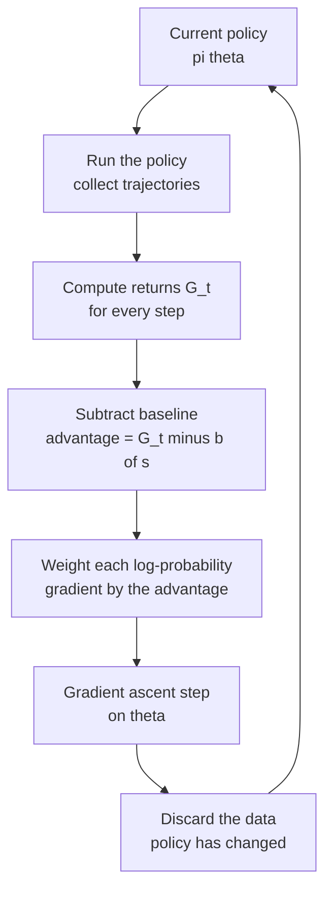

The loop shows the property that most separates policy-gradient methods from DQN in practice. The gradient estimate is valid only for data generated by the current policy, so after each update the batch is discarded and fresh trajectories must be collected. This is called **on-policy** learning. It is less sample-efficient than replay-based Q-learning, often by a large factor, and it is the reason that policy-gradient training needs a fast simulator or a large rollout budget. It also explains the stability advantage: the policy changes smoothly, and the data always match it.

### 11.4 Properties and failure modes

Policy-gradient methods optimize the objective directly and so avoid the max-operator overestimation and the arg-max discontinuity. They handle stochastic and continuous policies naturally, and they extend to partially observable settings by giving the policy a recurrent state. Their weaknesses are specific:

- **High variance and sample cost.** Even with baselines the gradient estimate is noisy. Variance grows with horizon length because $G_t$ sums many random terms.
- **Sensitivity to step size.** A step that is too large can collapse the policy into a bad region from which the data it generates cannot recover it. Supervised learning does not have this property, because the data do not depend on the model. Sections 13.1 and 13.2 address it.
- **Local optima and premature determinism.** Probabilities that approach 0 or 1 stop receiving gradient signal ($\nabla \log \pi$ for a nearly deterministic softmax vanishes), so a policy that becomes confident early can stop exploring. An **entropy bonus**, a term $\beta H(\pi(\cdot \mid s))$ added to the objective, counters this.
- **Credit assignment over long horizons.** The return $G_t$ attributes success to every action equally. The more steps between an action and the reward, the more other random actions muddy the signal.

## 12. Actor-Critic Methods and Generalized Advantage Estimation

REINFORCE waits until the end of the episode to compute $G_t$, which is a Monte Carlo return with all its variance. TD learning showed that a learned value function can supply a lower-variance target after a single step. **Actor-critic** methods combine the two. The **actor** is the policy $\pi_\theta$. The **critic** is a learned value function $\hat{v}_w(s)$ that evaluates the actor's behaviour and supplies the baseline and the advantage estimate.

### 12.1 One-step actor-critic

After each transition $(s_t, a_t, r_{t+1}, s_{t+1})$, compute the TD error $\delta_t = r_{t+1} + \gamma \hat{v}_w(s_{t+1}) - \hat{v}_w(s_t)$. It serves two roles. For the critic it is the error to be reduced, so $w \leftarrow w + \alpha_w \,\delta_t \nabla_w \hat{v}_w(s_t)$. For the actor it is a sample estimate of the advantage, because $\mathbb{E}[\delta_t \mid s_t, a_t] = q_\pi(s_t, a_t) - v_\pi(s_t) = A_\pi(s_t, a_t)$ when the critic is exact. The actor update is $\theta \leftarrow \theta + \alpha_\theta\, \delta_t \nabla_\theta \log \pi_\theta(a_t \mid s_t)$.

**Worked numbers.** Let $r_{t+1} = 1$, $\gamma = 0.9$, $\hat{v}(s_t) = 2$, and $\hat{v}(s_{t+1}) = 3$. Then $\delta_t = 1 + 0.9 \times 3 - 2 = 1.7$. The outcome was 1.7 units better than the critic expected, so the critic raises $\hat{v}(s_t)$ and the actor raises the probability of $a_t$, with a weight of $1.7$. If instead $\hat{v}(s_{t+1}) = 1$, then $\delta_t = 1 + 0.9 - 2 = -0.1$, and the actor lowers the probability of $a_t$ slightly.

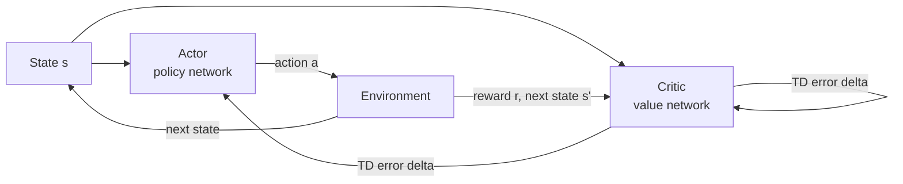

The diagram shows two learners that share an experience stream and train each other. The critic is trained by regression on bootstrapped targets (like TD), and the actor is trained by a policy gradient weighted by the critic's judgement. The bias and variance of the actor's gradient now depend on the critic's quality. A critic that is wrong in a systematic way makes the actor optimize the wrong thing, and this is the main source of instability in actor-critic training. In implementations the two networks often share early layers (a common feature extractor) and have separate output heads, which saves computation but couples the two losses through shared parameters, so loss weights need tuning.

### 12.2 Batched, synchronous versions: A2C and A3C

Online one-step updates are noisy. **Advantage actor-critic (A2C)** runs several environment copies in parallel, collects $n$ steps from each, and makes one batched update. The $n$-step advantage uses the observed rewards for $n$ steps and then bootstraps:

$$
\hat{A}_t^{(n)} = \sum_{k=0}^{n-1} \gamma^k r_{t+k+1} + \gamma^n \hat{v}_w(s_{t+n}) - \hat{v}_w(s_t).
$$

The asynchronous version, **asynchronous advantage actor-critic (A3C)** (Mnih and colleagues, 2016), ran many workers that update shared parameters without locks. Synchronous A2C turned out to be simpler, equally accurate, and better suited to GPUs, so it became the common baseline. The combined loss usually has three parts: the policy-gradient loss $-\hat{A}_t \log \pi_\theta(a_t \mid s_t)$, a value loss $c_v (\hat{v}_w(s_t) - \hat{R}_t)^2$ where $\hat{R}_t$ is the return target, and an entropy bonus $-c_e H(\pi_\theta)$.

### 12.3 Generalized advantage estimation

The choice of $n$ is a bias-variance dial. $n = 1$ has low variance and high bias (the bias is the critic's error), and $n = \infty$ is the Monte Carlo advantage with no bias from the critic and high variance. Schulman and colleagues (2016) proposed **generalized advantage estimation (GAE)**, which averages all $n$-step estimates with geometrically decaying weights, exactly as TD($\lambda$) does for values (Section 7.3).

Define the one-step TD errors $\delta_t = r_{t+1} + \gamma \hat{v}(s_{t+1}) - \hat{v}(s_t)$. The GAE advantage is

$$
\hat{A}_t^{\text{GAE}(\gamma, \lambda)} = \sum_{l=0}^{T-t-1} (\gamma\lambda)^l\, \delta_{t+l}, \qquad \hat{A}_t = \delta_t + \gamma\lambda\, \hat{A}_{t+1}.
$$

The right-hand recursion, run backwards from the end of the rollout, is how it is computed. With $\lambda = 0$ the sum has only the first term, $\hat{A}_t = \delta_t$, the one-step estimate. With $\lambda = 1$ the sum telescopes (the intermediate value terms cancel) into $\sum_l \gamma^l r_{t+l+1} - \hat{v}(s_t)$, the Monte Carlo return minus the baseline.

**Worked example.** A three-step rollout has rewards $(0, 0, 1)$, critic values $\hat{v}(s_0), \hat{v}(s_1), \hat{v}(s_2) = (0.5, 0.6, 0.8)$, a terminal value of $0$ after the last step, and $\gamma = 0.9$. The TD errors are:

- $\delta_0 = 0 + 0.9 \times 0.6 - 0.5 = 0.04$,
- $\delta_1 = 0 + 0.9 \times 0.8 - 0.6 = 0.12$,
- $\delta_2 = 1 + 0.9 \times 0 - 0.8 = 0.20$.

For $\lambda = 0.5$ the factor $\gamma\lambda = 0.45$. Working backwards, $\hat{A}_2 = 0.20$, $\hat{A}_1 = 0.12 + 0.45 \times 0.20 = 0.21$, and $\hat{A}_0 = 0.04 + 0.45 \times 0.21 = 0.1345$. For $\lambda = 1$, $\gamma\lambda = 0.9$ and $\hat{A}_1 = 0.12 + 0.9 \times 0.2 = 0.30$, $\hat{A}_0 = 0.04 + 0.9 \times 0.30 = 0.31$, which equals the Monte Carlo return $0.9^2 \times 1 = 0.81$ minus $\hat{v}(s_0) = 0.5$. The script [04_off_policy_evaluation_and_gae.py](../code/python/reinforcement-learning-chapter/04_off_policy_evaluation_and_gae.py) prints these numbers:

| $\lambda$ | $\hat{A}_0$ | $\hat{A}_1$ | $\hat{A}_2$ |
|---|---|---|---|
| 0.0 | 0.0400 | 0.1200 | 0.2000 |
| 0.5 | 0.1345 | 0.2100 | 0.2000 |
| 1.0 | 0.3100 | 0.3000 | 0.2000 |

The table shows the dial. The last step is the same in every row because nothing follows it. Earlier steps receive more credit for the final reward as $\lambda$ rises, since the reward of 1 at the end propagates back through the discounted sum, while at $\lambda = 0$ credit for that reward reaches an earlier step only through the critic's learned values. A typical setting is $\gamma = 0.99$ and $\lambda = 0.95$. Lower $\lambda$ when the critic is accurate or the rollouts are long and noisy. Raise it when the critic is poor early in training.

**Truncation and termination.** In a long rollout cut at a fixed length, the last state is not terminal, so the bootstrap value of that state must be used. If an episode ends because of a time limit (a *truncation*) and not because the environment reached a true terminal state, the target should still bootstrap from the value of the final state. Treating a time limit as a terminal state teaches the agent that the world ends at that time, which is a common and hard-to-see bug (Section 29).

## 13. Trust Regions and Proximal Policy Optimization

### 13.1 The step-size problem and TRPO

The policy gradient is a local linear approximation. A step in parameter space that looks small can change the policy's behaviour a great deal, and a step that looks large can change nothing. What matters is the change in the *policy distribution*. The **performance difference** identity gives an exact expression for the improvement of a new policy $\pi'$ over an old one $\pi$:

$$
J(\pi') - J(\pi) = \mathbb{E}_{\tau \sim \pi'}\Big[ \sum_{t} \gamma^t A_\pi(s_t, a_t) \Big].
$$

The expectation is over states visited by the *new* policy, which we cannot sample before we have it. Schulman and colleagues (2015) in **trust region policy optimization (TRPO)** replace the new state distribution with the old one, which is accurate when the policies are close, and use an importance ratio for the action:

$$
L_\pi(\pi_\theta) = \mathbb{E}_{s, a \sim \pi_{\text{old}}}\Big[ \frac{\pi_\theta(a \mid s)}{\pi_{\text{old}}(a \mid s)}\, \hat{A}_{\text{old}}(s, a) \Big] \quad \text{subject to} \quad \mathbb{E}_s\big[ D_{\mathrm{KL}}\big(\pi_{\text{old}}(\cdot \mid s)\ \|\ \pi_\theta(\cdot \mid s)\big) \big] \le \delta.
$$

The constraint, with $\delta$ commonly around $0.01$, defines the trust region where the surrogate is trusted. The solution uses the natural gradient, a step along $F^{-1} g$ where $g$ is the gradient of the surrogate and $F$ is the Fisher information matrix (the second-order approximation of the KL divergence), scaled so that the quadratic KL estimate equals $\delta$, followed by a line search that checks the real KL and the real improvement. TRPO has a monotonic-improvement argument behind it, but it needs conjugate-gradient solves with Fisher-vector products, which is awkward to code and incompatible with architectures that share parameters between actor and critic or use certain regularizers.

### 13.2 The PPO clipped objective

Schulman and colleagues (2017) proposed **proximal policy optimization (PPO)** as a first-order method that keeps the spirit of the trust region. Define the probability ratio $\rho_t(\theta) = \pi_\theta(a_t \mid s_t) / \pi_{\text{old}}(a_t \mid s_t)$. The clipped surrogate objective is

$$
L^{\text{CLIP}}(\theta) = \mathbb{E}_t\Big[ \min\big( \rho_t(\theta)\, \hat{A}_t,\ \ \operatorname{clip}(\rho_t(\theta),\, 1-\epsilon,\, 1+\epsilon)\, \hat{A}_t \big) \Big],
$$

with $\epsilon$ typically $0.1$ to $0.2$. The minimum makes the objective a pessimistic bound: the policy gets no extra credit for moving the ratio beyond the clip range in the direction that the advantage favours, but it is still penalized for moving in the harmful direction. Four cases with $\epsilon = 0.2$ show the behaviour.

| Advantage $\hat{A}$ | Ratio $\rho$ | Unclipped $\rho \hat{A}$ | Clipped term | Objective (min) | Gradient |
|---|---|---|---|---|---|
| $+2$ | $1.5$ | $3.0$ | $1.2 \times 2 = 2.4$ | $2.4$ | Zero, ratio already past $1.2$ |
| $+2$ | $0.7$ | $1.4$ | $0.8 \times 2 = 1.6$ | $1.4$ | Active, the action became less likely though it was good |
| $-1$ | $0.7$ | $-0.7$ | $0.8 \times (-1) = -0.8$ | $-0.8$ | Zero, ratio already below $0.8$ |
| $-1$ | $1.5$ | $-1.5$ | $1.2 \times (-1) = -1.2$ | $-1.5$ | Active, the action became more likely though it was bad |

For a good action ($\hat{A} > 0$), the first row shows that once the new policy has made the action 20 percent more likely than the old policy did, the gradient stops pushing further. For a bad action ($\hat{A} < 0$), the third row shows the same once the action has become 20 percent less likely. The second and fourth rows show that mistakes in the harmful direction are never clipped, so the policy can always correct them. The effect is that the policy can be trained for several epochs on one batch of data without leaving the neighbourhood in which the advantage estimates are valid.

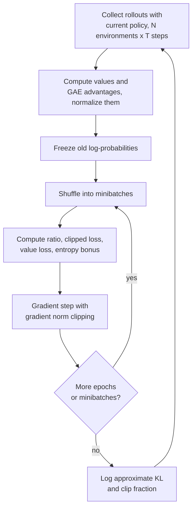

The loop shows the structure of one PPO iteration and where its health can be observed. Two diagnostics are worth logging on every iteration. The **approximate KL** between the old and the updated policy should stay small (values on the order of $0.01$ are typical). A KL that spikes means the policy moved far despite clipping. The **clip fraction**, the share of samples whose ratio fell outside the clip range, should be a modest fraction, often 0.1 to 0.3. Near zero suggests the learning rate is too small for the clip to matter, and near one suggests the updates are too aggressive.

### 13.3 The full PPO loss and hyperparameters

The loss that is actually minimized combines three terms:

$$
L(\theta, w) = -L^{\text{CLIP}}(\theta) + c_v \big( \hat{v}_w(s_t) - \hat{R}_t \big)^2 - c_e\, H\big(\pi_\theta(\cdot \mid s_t)\big),
$$

with a value coefficient $c_v$ around $0.5$ and an entropy coefficient $c_e$ between $0$ and $0.01$. Common settings in published continuous-control benchmarks are $\gamma = 0.99$, $\lambda = 0.95$, $\epsilon = 0.2$, 3 to 10 epochs per batch, and minibatches of a few thousand samples. These are historical defaults. The learning rate, the number of parallel environments, and the rollout length interact with each other and with the reward scale, so a new problem usually needs a small sweep.

### 13.4 Implementation details that decide results

Engstrom and colleagues (2020), in a study titled "Implementation Matters in Deep Policy Gradients", found that several code-level choices that are not part of the PPO objective account for much of its performance advantage over TRPO: reward scaling, observation normalization, value-function clipping, learning-rate annealing, and orthogonal weight initialization. The practical message is that "PPO" names a family whose behaviour depends on a dozen details. When reproducing a result, copy a well-tested implementation instead of rewriting from the paper. Four details deserve a note:

- **Advantage normalization.** Subtract the batch mean and divide by the standard deviation before computing the loss. This makes the effective learning rate independent of the reward scale.
- **Observation and reward normalization.** Keep running statistics so that network inputs have roughly unit scale. In deployment, freeze these statistics and ship them with the policy, otherwise the same weights behave differently.
- **Gradient clipping.** A maximum global gradient norm (commonly $0.5$) prevents rare large batches from wrecking the network.
- **Separate or shared networks.** Separate actor and critic networks avoid interference. Shared trunks save compute when inputs are images.

### 13.5 PPO and language models

PPO is the optimizer used in the policy-improvement stage of many aligned language models. There the state is the prompt plus the tokens generated so far, the action is the next token, the reward comes from a learned reward model of human preferences, and a KL penalty to a reference model keeps the policy near the pretrained model. The clipped objective, GAE, the value head, and the KL monitoring of this section carry over directly. Preference data collection, reward-model training, the KL-regularized objective, and the alternatives that avoid an explicit RL loop belong to [CH14 Reinforcement Learning from Human Feedback](CH14_Reinforcement_Learning_from_Human_Feedback.md) and are not repeated here.

## 14. Continuous Control and Soft Actor-Critic

Robotic joints, valves, thermostats, trading sizes, and bid prices are continuous. DQN's maximum over actions is not available, and a stochastic policy with a Gaussian output is the natural choice for on-policy methods. However, on-policy methods discard data, and in domains where each sample costs real time or wear, off-policy actor-critic methods are attractive because they reuse a replay buffer.

### 14.1 Deterministic policy gradient: DDPG and TD3

Silver and colleagues (2014) showed that for a deterministic policy $a = \mu_\theta(s)$ the gradient of the objective is $\mathbb{E}\big[\nabla_\theta \mu_\theta(s)\, \nabla_a Q(s, a)\big|_{a = \mu_\theta(s)}\big]$: move the action in the direction that increases $Q$, and propagate that through the policy network by the chain rule. **Deep deterministic policy gradient (DDPG)** (Lillicrap and colleagues, 2016) combined this with DQN's replay and target networks and added exploration noise to the actions. It is sample-efficient and fragile. The critic overestimates for the same reason Q-learning does, and the actor then exploits the critic's errors, because the policy is by construction trained to find actions where $Q$ is high, including those where $Q$ is wrongly high.

**Twin delayed DDPG (TD3)** (Fujimoto, van Hoof, and Meger, 2018) adds three fixes: two critics with the minimum of the two used in the target (clipped double Q-learning), updating the actor less often than the critic (delayed updates), and adding clipped noise to the target action (target smoothing) so that the critic is not trained on sharp peaks. These changes are cheap and make DDPG-style learning much more reliable.

### 14.2 The maximum-entropy objective

**Soft actor-critic (SAC)** (Haarnoja and colleagues, 2018) is an off-policy actor-critic with a stochastic policy and an objective that rewards randomness as well as return:

$$
J(\pi) = \mathbb{E}_{\pi}\Big[ \sum_{t} \gamma^t \big( r_t + \alpha\, H(\pi(\cdot \mid s_t)) \big) \Big], \qquad H(\pi(\cdot \mid s)) = -\mathbb{E}_{a \sim \pi}\big[ \log \pi(a \mid s) \big].
$$

The **temperature** $\alpha > 0$ sets the exchange rate between reward and entropy. The entropy term has several effects that help in practice. The policy keeps exploring because collapsing to a deterministic action costs entropy. When several actions are about equally good, the policy keeps probability on all of them, which makes it less brittle when the environment changes slightly. And the objective gives smoother learning signals than a hard arg max.

### 14.3 The SAC algorithm

SAC learns two Q-networks $Q_{\phi_1}, Q_{\phi_2}$, a stochastic policy $\pi_\psi$, and (in the common version) the temperature $\alpha$.

**Critic target.** For a transition $(s, a, r, s')$ from the replay buffer, sample the next action from the current policy, $a' \sim \pi_\psi(\cdot \mid s')$, and set

$$
y = r + \gamma \Big( \min_{i=1,2} Q_{\bar\phi_i}(s', a') - \alpha \log \pi_\psi(a' \mid s') \Big),
$$

where $\bar\phi_i$ are slowly updated target networks (soft updates with $\tau \approx 0.005$). Both critics regress to the same $y$. The minimum over two critics counters overestimation, and the $-\alpha \log \pi$ term adds the entropy bonus for the next step.

**Worked number.** Let $r = 1$, $\gamma = 0.99$, the smaller of the two target Q-values be $10.0$, $\alpha = 0.2$, and $\log \pi_\psi(a' \mid s') = -1.5$ (a sampled action of moderate probability). Then $y = 1 + 0.99 \times (10.0 - 0.2 \times (-1.5)) = 1 + 0.99 \times 10.3 = 11.197$. The entropy term contributed $0.99 \times 0.3 = 0.297$ to the target. A sampled action that was very unlikely, with $\log \pi = -4$, would add $0.99 \times 0.8 = 0.792$, so rare actions are valued more.

**Actor update.** Sample an action using the **reparameterization trick**, $a = \tanh(\mu_\psi(s) + \sigma_\psi(s) \odot \varepsilon)$ with $\varepsilon \sim \mathcal{N}(0, I)$. The $\tanh$ squashes the action into $(-1, 1)$ (a scale to the real action range follows) and requires a correction to $\log \pi$ for the change of variables. Because $a$ is a differentiable function of $\psi$, the loss

$$
L_\pi(\psi) = \mathbb{E}_{s \sim \mathcal{D},\ \varepsilon}\Big[ \alpha \log \pi_\psi(a \mid s) - \min_{i} Q_{\phi_i}(s, a) \Big]
$$

can be differentiated through the critic to the policy. Minimizing it moves the policy toward actions with high $Q$ while keeping its entropy up.

**Temperature.** Setting $\alpha$ by hand is difficult because the right value depends on reward scale. The second SAC paper (Haarnoja and colleagues, 2019) treats $\alpha$ as learned, adjusted so that the policy's average entropy stays near a target, commonly $-|\mathcal{A}|$, the negative of the action dimension. The loss $\mathbb{E}[-\alpha(\log \pi(a \mid s) + \bar{H})]$ raises $\alpha$ when entropy falls below the target and lowers it when above.

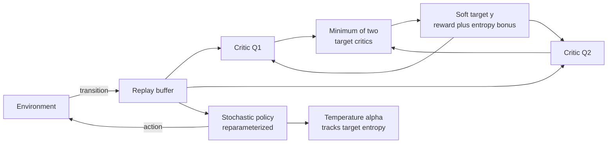

The diagram shows why SAC is a default for continuous control with limited samples. The replay buffer lets each transition train the critics many times. Two critics and the entropy term damp overestimation and premature determinism. The temperature adjusts itself, which removes the most sensitive hyperparameter. The costs are more networks to train and tune (two critics, two targets, a policy), a replay buffer that must be sized and refreshed, and the usual off-policy weakness: if the buffer holds data from policies very different from the current one, learning can still become unstable.

### 14.4 Choosing among the continuous-control options

| Method | Data use | Policy type | Strength | Typical weakness |
|---|---|---|---|---|
| PPO | On-policy, discarded after use | Stochastic | Simple, stable, parallelizes across many simulators | Needs many samples |
| DDPG | Off-policy replay | Deterministic | Sample-efficient in principle | Brittle, overestimates |
| TD3 | Off-policy replay | Deterministic | Reliable fixes to DDPG | Exploration noise needs tuning |
| SAC | Off-policy replay | Stochastic | Sample-efficient, stable, few hyperparameters | More components, off-policy drift |

If simulation is cheap and fast (thousands of steps per second on many cores), PPO is the common first choice because it is simple and its failure modes are well understood. If each environment step is expensive, as with a physical robot or a slow simulator, an off-policy method such as SAC usually wins by a large factor in samples. These are rules of thumb from published benchmarks and not guarantees, and a team should confirm with its own environment on several seeds (Section 24).

## 15. Exploration

An agent that only does what it currently believes is best never learns whether something else is better. An agent that always tries new things never collects the reward. This is the **exploration-exploitation trade-off**, and it is the sharpest difference between RL and supervised learning: in RL the learner's choices decide which data it receives. A recommender that never shows a new item cannot learn that users like it, so the data it collects are shaped by its own past beliefs.

### 15.1 Regret

The standard yardstick for exploration quality is **regret**, the reward lost relative to an oracle that knows the best action from the start. For a bandit with true arm means $\mu_a$ and best mean $\mu^* = \max_a \mu_a$, the cumulative regret after $T$ rounds is

$$
\mathrm{Regret}(T) = \sum_{t=1}^{T} \big( \mu^* - \mu_{a_t} \big).
$$

A policy that never stops exploring at a fixed rate has regret that grows linearly in $T$, since it keeps paying for experiments. Good algorithms have *sublinear* regret, typically growing with $\log T$ on stochastic problems. Lai and Robbins (1985) proved that no algorithm can do better than logarithmic growth, with a constant that depends on how close the suboptimal arms are to the best one. In production, regret is the cost of learning, measured in lost clicks, revenue, or safety margin.

### 15.2 Epsilon-greedy and its variants

With probability $\epsilon$ take a uniformly random action, otherwise take the greedy one. It is simple, needs no model of uncertainty, and works with any value-based method. It also wastes experiments: it explores uniformly over actions that are already known to be bad, and it explores without regard to how uncertain each action is. A fixed $\epsilon$ gives linear regret. **Decaying** $\epsilon$ (for example from $1.0$ to $0.05$ over a schedule) fixes the long-run cost, but the schedule is a hyperparameter that encodes a guess about how long learning takes. **Boltzmann (softmax) exploration** picks actions with probability proportional to $\exp(\hat{Q}(a)/\tau)$, so worse actions are tried less often than better ones, and the temperature $\tau$ plays the role of $\epsilon$.

In sequential problems, dithering is a weak form of exploration. A random action every tenth step is unlikely to produce a coordinated sequence, such as "go through the door, then pick up the key, then return", that leads to a rare reward. Problems with sparse rewards need *directed* exploration.

### 15.3 Optimism in the face of uncertainty: UCB

The **upper confidence bound (UCB)** principle picks the action whose optimistic estimate is highest, where optimism is the sample mean plus a bonus that shrinks as the action is tried more. For rewards in $[0, 1]$, UCB1 (Auer, Cesa-Bianchi, and Fischer, 2002) selects

$$
a_t = \arg\max_a \Big( \bar{x}_a + \sqrt{\frac{2 \ln t}{n_a}} \Big),
$$

where $\bar{x}_a$ is the mean reward observed for arm $a$, $n_a$ is the number of times it has been pulled, and $t$ is the current round. The bonus comes from Hoeffding's inequality: after $n$ samples, the probability that the true mean exceeds the sample mean by more than $\sqrt{2\ln t / n}$ is at most about $t^{-4}$, so the bound is almost always valid, and an arm is eliminated only when its bound drops below the best arm's mean.

**Worked example.** At $t = 100$ we have $\ln 100 = 4.605$ and $2 \ln t = 9.210$. Three arms have been pulled:

| Arm | Pulls $n_a$ | Mean $\bar{x}_a$ | Bonus $\sqrt{9.210 / n_a}$ | Index |
|---|---|---|---|---|
| A | 60 | 0.50 | $\sqrt{0.1535} = 0.392$ | 0.892 |
| B | 30 | 0.45 | $\sqrt{0.3070} = 0.554$ | 1.004 |
| C | 10 | 0.30 | $\sqrt{0.9210} = 0.960$ | 1.260 |

Arm C has the lowest mean and the highest index, because only 10 samples support it, so UCB tries it next. After more pulls its bonus shrinks and its index falls toward its true mean. The method is deterministic given the history and needs no random numbers. Its bonus is conservative: when arm means are close together (a click rate of 0.04 against 0.05), the $\sqrt{2\ln t / n}$ term is large against the gap, and UCB1 explores longer than needed. Practitioners multiply the bonus by a tuned constant, which departs from the guarantee but often improves performance.

### 15.4 Posterior sampling: Thompson sampling

Thompson (1933) proposed what is now called **Thompson sampling** or **posterior sampling**: keep a probability distribution over each action's value, draw one sample from each, and play the action with the highest sample. An action is chosen with probability equal to the probability that it is the best, given the data so far. Uncertain actions have wide posteriors and so win often by luck, which is exploration, and as data accumulate the posteriors narrow and the best action wins nearly every time. Section 16.2 works a full example. For sequential problems the same idea is **posterior sampling for RL (PSRL)**: sample a whole MDP from the posterior, solve it, act for an episode, and update. In deep RL the nearest practical analogue is an *ensemble* of Q-networks (bootstrapped DQN, Osband and colleagues, 2016): pick one ensemble member at random for each episode and act greedily with it, which produces temporally consistent, "deep" exploration.

### 15.5 Intrinsic motivation for sparse rewards

When the extrinsic reward is rare, as in a game where points arrive only after a long sequence, undirected exploration almost never sees it. **Intrinsic motivation** adds a reward $r^{\text{int}}$ for novelty or surprise, so the agent is paid for visiting unfamiliar situations:

- **Count-based bonuses.** Add $\beta / \sqrt{N(s)}$, where $N(s)$ counts visits. In large state spaces counts are replaced by a *pseudo-count* from a density model (Bellemare and colleagues, 2016).
- **Prediction-error curiosity.** Train a model to predict the next state (or its features), and pay the agent in proportion to the prediction error (the intrinsic curiosity module, Pathak and colleagues, 2017).
- **Random network distillation (RND).** Burda and colleagues (2019) train a network to predict the output of a fixed random network on the state. The error is high for states not seen before and falls with familiarity. RND made progress on hard-exploration Atari games with sparse reward.

Prediction-error methods have a known failure called the **noisy TV problem**: a source of unpredictable randomness, such as a television showing static, produces permanently high prediction error, and a curious agent can stay and watch forever. RND avoids this because its target is a deterministic function of the state. The general warning for industry is that an intrinsic reward is another reward the agent will optimize literally (Section 20), and one must check that it does not dominate the true objective. Annealing the intrinsic weight to zero is common.

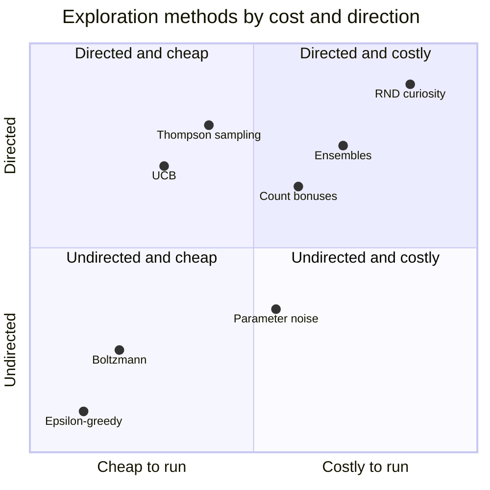

The chart places the methods on two axes that matter in practice. Cheap undirected methods (epsilon-greedy) work when rewards are dense and the action set is small. Directed methods use uncertainty and are needed when rewards are sparse or when each wrong experiment is expensive. The positions are judgments for orientation and not measurements. The practical rule is to start at the lower left, move up only when you can show that undirected exploration is failing (for example, a learning curve that is flat because the agent never sees a reward), and move right only when the problem needs it.

### 15.6 Exploration is a production cost

In a simulator, exploration costs compute. In production, each exploratory action is a real customer served a worse option, a real machine run in a worse mode, or a real order placed at a worse price. This changes the engineering. The cost of exploration should be budgeted (for example, no more than 2 percent of traffic on exploratory actions), exploration should be restricted to a *safe action set* (Section 21), and exploration should be turned off or reduced when a guardrail metric degrades. Section 27 covers the controls.

## 16. Multi-Armed and Contextual Bandits

A **multi-armed bandit** is an RL problem with a single state and no consequence for the future: the agent chooses an arm (an action), receives a reward drawn from that arm's distribution, and repeats. The name comes from a row of slot machines. A **contextual bandit** adds an observed context $x$ (user features, time of day, query) before each choice, and the best action may depend on $x$. In both, the action affects only the immediate reward, so there is no credit-assignment problem across time and no bootstrapping. That is why bandits are far easier to build, evaluate, and operate than full RL, and why they carry most of the deployed RL value in industry: choosing among recommendations, headlines, ad creatives, email subject lines, discount levels, search rankings of a few candidates, and ordering of notifications.

### 16.1 When a bandit is enough

Use a bandit when the answer to each of these is yes:

1. Does the reward for an action arrive soon enough (seconds to a few days) to be matched to the decision?
2. Is the effect of today's action on tomorrow's state small enough to ignore? A recommendation that changes a user's long-term taste or fatigue violates this, and a user who has received six emails this week is in a different state than one who has received none.
3. Are the actions drawn from a manageable set, or can they be scored by a model?

If the answer to the second question is no, a bandit optimizes short-term reward and may damage long-term value, as in clickbait optimization. The usual mitigations are to put long-term proxies into the reward, constrain the policy with guardrail metrics, or step up to a sequential method with a state that includes history.

### 16.2 Thompson sampling for click rates: a worked example

Suppose an interface shows one of several banners, and the reward is 1 for a click and 0 otherwise. For a banner with unknown click probability $\theta$, a natural prior is a **Beta distribution**. $\mathrm{Beta}(\alpha, \beta)$ has mean $\alpha/(\alpha+\beta)$ and variance $\alpha\beta / ((\alpha+\beta)^2(\alpha+\beta+1))$. Beta is the *conjugate prior* of the Bernoulli likelihood: after observing $c$ clicks in $n$ impressions, the posterior is $\mathrm{Beta}(\alpha + c,\ \beta + n - c)$. The update is just counting.

Start both banners at $\mathrm{Beta}(1, 1)$, the uniform prior. Banner X has been shown 20 times with 3 clicks, and banner Y has been shown 4 times with 1 click.

- X: posterior $\mathrm{Beta}(1+3,\ 1+17) = \mathrm{Beta}(4, 18)$. Mean $4/22 = 0.1818$. Standard deviation $\sqrt{4 \times 18 / (22^2 \times 23)} = \sqrt{72/11132} = 0.0804$.
- Y: posterior $\mathrm{Beta}(1+1,\ 1+3) = \mathrm{Beta}(2, 4)$. Mean $2/6 = 0.3333$. Standard deviation $\sqrt{2 \times 4 / (6^2 \times 7)} = \sqrt{8/252} = 0.1782$.

Y has the higher mean and a much wider posterior. For the next impression, draw $\tilde\theta_X \sim \mathrm{Beta}(4, 18)$ and $\tilde\theta_Y \sim \mathrm{Beta}(2, 4)$ and show whichever banner has the larger draw. For example, draws of $0.15$ and $0.40$ select Y. The probability that Y is selected is $P(\theta_Y > \theta_X)$ under the posteriors, which a Monte Carlo estimate puts at about $0.764$ (the script prints $0.764$ for 100,000 draws). So X is still shown about 24 percent of the time. If Y is shown and gets a click, its posterior becomes $\mathrm{Beta}(3, 4)$, with mean $0.4286$ and a narrower spread; if it gets no click, $\mathrm{Beta}(2, 5)$, mean $0.2857$. In either case the next draw reflects the new evidence, and the allocation shifts smoothly. No threshold, no test duration, and no manual stopping rule is needed.

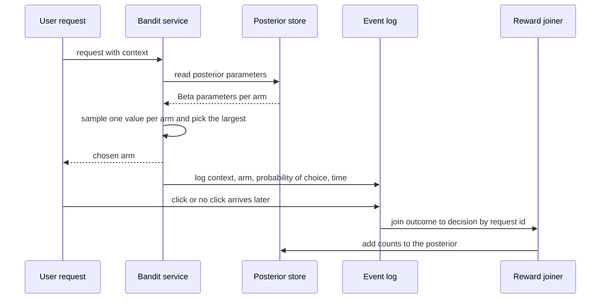

The sequence shows the minimum architecture of a production bandit. Decision and outcome are separated in time, so the system needs a request identifier that joins them. The decision log must contain the *probability* with which the chosen arm was selected (the propensity), which is essential later for unbiased offline evaluation (Section 24.4). The posterior is the only learned state and is cheap to store and update, which is one reason Thompson sampling scales to thousands of concurrent experiments.

### 16.3 Comparison of algorithms in simulation

The script [03_bandits_thompson_sampling.py](../code/python/reinforcement-learning-chapter/03_bandits_thompson_sampling.py) compares three strategies on three arms with click rates $0.04$, $0.05$, and $0.06$ (illustrative values chosen to be close together, like real banner tests), over 2,000 rounds and 200 random seeds:

| Strategy | Mean cumulative regret | Share of pulls on the best arm |
|---|---|---|
| Epsilon-greedy ($\epsilon = 0.1$) | 16.81 | 0.44 |
| UCB1 | 18.35 | 0.38 |
| Thompson sampling | 12.40 | 0.54 |

Regret is in units of expected clicks lost. Thompson sampling lost about 26 percent fewer clicks than epsilon-greedy and 32 percent fewer than UCB1 in this setting. Two caveats keep the result in proportion. First, when arms differ by only 0.01 in click rate, nobody identifies the best arm within 2,000 rounds with confidence, and even the winner pulled it only 54 percent of the time. Second, UCB1 is penalized by its conservative bonus here, as Section 15.3 noted, and a tuned version would close part of the gap. The consistent finding, repeated in the literature on Thompson sampling (Chapelle and Li, 2011, among others), is that posterior sampling is competitive with or better than UCB-type methods, easy to implement, and extends naturally to richer models.

### 16.4 Contextual bandits

With context, the bandit must predict a reward from $(x, a)$. A **linear** contextual bandit assumes $\mathbb{E}[r \mid x, a] = \theta_a^\top x$. **LinUCB** (Li, Chu, Langford, and Schapire, 2010) fits $\theta_a$ by ridge regression and picks the arm with the highest upper confidence bound on the prediction. With $A_a = I + \sum x x^\top$ and $b_a = \sum r\, x$ accumulated over the rounds in which arm $a$ was chosen, the estimate is $\hat\theta_a = A_a^{-1} b_a$ and the choice is $\arg\max_a\ \hat\theta_a^\top x + \alpha\sqrt{x^\top A_a^{-1} x}$. The second term is large for contexts unlike those seen for arm $a$, which is the exploration. **Linear Thompson sampling** instead draws $\tilde\theta_a$ from the Gaussian posterior $\mathcal{N}(\hat\theta_a, \sigma^2 A_a^{-1})$ and acts greedily on the draw.

For nonlinear reward models, such as gradient-boosted trees or neural networks, exact posteriors are unavailable. Practical choices are:

- **Epsilon-greedy over a reward model.** Train a supervised model for $\hat{r}(x, a)$, act greedily with probability $1-\epsilon$. Simple and widely used, and because propensities are known ($\epsilon/|A|$ plus the greedy share) the logs support unbiased evaluation.
- **Ensembles or bootstrap.** Train several models on resamples of the data and pick one at random per request (Thompson-like).
- **Neural last-layer uncertainty.** Fit a Bayesian linear layer on the features of a network, which gives posterior sampling over the last layer cheaply.
- **Dropout as an approximate posterior.** Cheap, but the quality of the uncertainty is debated.

The Yahoo news recommender of Li and colleagues (2010) is the best-known early industrial case. Their evaluation method, replay on randomly logged data, is a form of the off-policy evaluation in Section 24.4. The paper reported a click-through gain over a context-free bandit, in the range of a few percent for the data they studied, but readers should consult it for the exact figures.

### 16.5 Operating a bandit

Several production problems are special to bandits.

- **Delayed and censored feedback.** A purchase may arrive days after the click. Treating a pending outcome as a zero biases the estimate downward for recently shown arms, and arms that were introduced recently look worse than they are. Remedies are to count only matured impressions, to model the delay distribution, or to use a faster proxy such as a click.
- **Non-stationarity.** Click rates drift with season, novelty, and competition. A bandit that remembers everything adapts slowly. Use exponential forgetting (multiply counts by a discount such as $0.999$ per update), a sliding window, or periodic prior resets. A *novelty effect*, a banner that wins during its first days because it is new, will cause a bandit to over-allocate early and then regret it.
- **Batched updates.** Systems often update posteriors hourly. Thompson sampling tolerates this well because sampling continues to spread traffic within the batch, whereas greedy and UCB methods can send an entire batch to one arm.
- **Interference.** If arms compete for the same resource (the same customer sees several slots, inventory is limited), arms are not independent and the stationary-bandit assumptions fail.
- **Adaptive allocation versus A/B tests.** A bandit maximizes reward during the experiment, an A/B test maximizes the quality of the final inference. Because a bandit sends little traffic to losing arms, the estimates for those arms are weak, and effects on secondary metrics are hard to measure. Use a fixed-allocation experiment when you need a clean causal estimate to support a decision, and a bandit when you need to exploit quickly and the decision is cheap to reverse. [CH27 A/B Testing](../02_Design_Thinking_and_Product_Management/CH27_A_B_Testing.md) covers the experimental design side.
- **Guardrails.** Add constraints on metrics other than the reward, such as latency, complaint rate, or unsubscribe rate, and stop an arm that violates them.

## 17. Model-Based Reinforcement Learning and Planning

Everything so far, except dynamic programming, was **model-free**: the agent never builds an explicit model of transitions and rewards. **Model-based** RL learns a model $\hat{P}(s' \mid s, a)$ and $\hat{r}(s, a)$ from experience and uses it to plan, which can convert expensive real interaction into cheap computation.

### 17.1 Why a model helps, and what it costs

A learned model can generate unlimited simulated experience, so a few thousand real transitions can support millions of simulated updates. It also transfers: a model learned for one task serves for another reward on the same dynamics. The cost is **model error**. Policies are optimized against the model, and an optimizer finds the places where the model is wrong in the optimizer's favour (*model exploitation*). Errors also compound over a planning horizon. If a one-step model predicts the next state well with probability $0.98$ and errors are not self-correcting, then the probability that a 50-step imagined rollout has no error is $0.98^{50} = 0.364$. A policy trained on imagined 50-step rollouts therefore learns from mostly corrupted data.

### 17.2 Dyna: learning and planning together

Sutton's **Dyna** architecture (1990) interleaves three activities on every real step: direct RL from the real transition, model learning from the same transition, and *planning* by applying the same RL update to $n$ transitions sampled from the model. In tabular Dyna-Q the model is a table of the last observed outcome for each visited $(s, a)$.

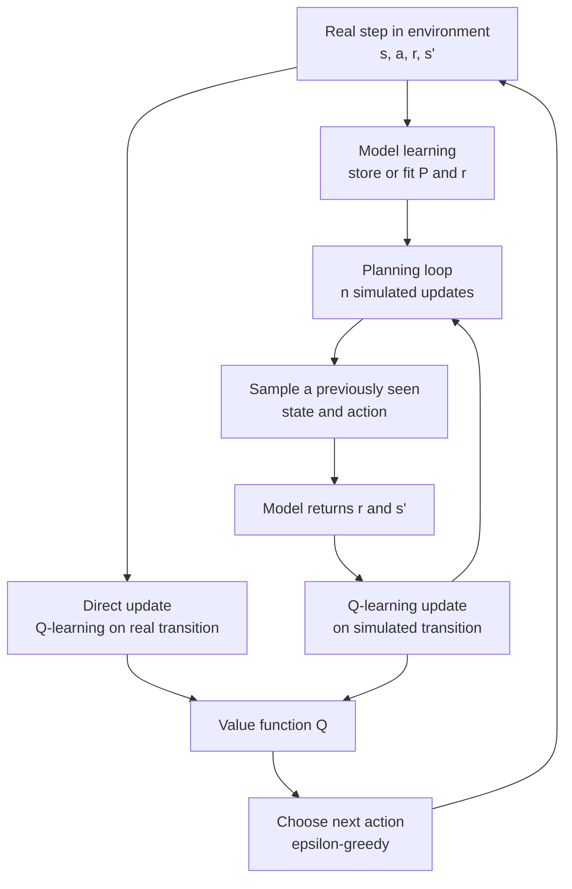

The diagram shows that planning reuses the value update that real experience uses. With $n = 0$ planning steps Dyna-Q is ordinary Q-learning. In Sutton and Barto's maze experiment, adding planning steps per real step reduced the number of episodes needed to learn a good path by a large factor, because information about a reward propagated back through many states per real step. A caveat appears when the environment changes: a tabular model that remembers an old layout will plan with stale knowledge, and **Dyna-Q+** adds a bonus for state-action pairs not tried for a long time to detect changes.

### 17.3 Planning at decision time: model predictive control and tree search

Instead of learning a global policy, an agent can use the model to plan online from the current state and execute only the first action, then re-plan. In continuous control this is **model predictive control (MPC)**. A simple version is *random shooting*: sample many candidate action sequences, roll each through the model for $H$ steps, score them by predicted return, and execute the first action of the best. The cross-entropy method (CEM) improves this by refitting the sampling distribution to the top-scoring sequences over a few iterations. **PETS** (probabilistic ensembles with trajectory sampling; Chua and colleagues, 2018) paired MPC with an ensemble of probabilistic neural dynamics models and reached the asymptotic performance of model-free methods on several benchmarks with far fewer samples. Re-planning at every step corrects some model error, since the plan restarts from a real observed state.

For discrete games with exact rules, **Monte Carlo tree search (MCTS)** builds a search tree guided by simulations. AlphaGo and AlphaZero (Silver and colleagues, 2016 and 2018) used a neural network to supply move probabilities and position values to guide the search, and trained the network on the search results through self-play. **MuZero** (Schrittwieser and colleagues, 2020) learned a latent model that predicts only what the search needs (reward, value, policy), with no knowledge of the game rules. These systems show the strongest results of model-based planning, though they depend on a perfect or highly accurate simulator (or a model that is trained to a very large sample budget).

### 17.4 Learned models in deep RL

Several designs limit the harm from model error:

- **Short model rollouts.** Model-based policy optimization (MBPO; Janner and colleagues, 2019) branches short rollouts, a few steps long, from real states in the replay buffer and mixes them into a model-free learner such as SAC. Starting from real states and keeping $H$ small bounds the compounding in the $0.98^H$ calculation above.
- **Uncertainty-aware models.** Ensembles disagree where data are sparse, and the planner can avoid or penalize regions of high disagreement. The same idea returns in offline model-based methods (Section 18.3).
- **Latent world models.** Dreamer (Hafner and colleagues, 2020 onward) learns a compact latent dynamics model from images and trains actor and critic entirely on imagined latent trajectories. Predicting in latent space avoids rendering pixels.

### 17.5 Choosing model-based or model-free

Model-based methods are attractive when real interaction is expensive, the dynamics are smooth and learnable, a trustworthy simulator or physics model already exists, or reward functions change over time on the same system. They are less attractive when the dynamics are chaotic or highly stochastic, the state is high-dimensional and partially observed, or the implementation complexity is not justified. In many business problems a *known* structural model is available (an inventory balance equation, a queueing model), and the best design is to write that model by hand and use RL, or simple optimization, only for the unknown parts such as demand. This hybrid is more reliable than learning dynamics that are already known from first principles.

## 18. Offline Reinforcement Learning and Distribution Shift

**Offline** (or batch) RL learns a policy from a fixed dataset of logged transitions $\mathcal{D} = \{(s, a, r, s')\}$ with no further interaction. Most organizations hold large logs of decisions made by earlier systems, human operators, or heuristics, and collecting new exploratory data is costly or unsafe. Offline RL promises to extract a better policy from those logs.

### 18.1 Why it is hard: distribution shift

Online off-policy methods like Q-learning could in principle learn from any data. Offline, the trouble is that the learned policy will pick actions that rarely or never appear in the data, and the value function has no evidence about them. A neural network will return *some* number for an unseen state-action pair, and the Bellman backup takes a maximum over actions, so the most optimistic extrapolation error wins. The error then feeds into other states through bootstrapping, and nothing corrects it because the agent cannot try the action to see that it is bad. This is the deadly triad (Section 9.2) in its most severe form: off-policy data, bootstrapping, and function approximation, with no new data to repair mistakes. Fujimoto, Meger, and Precup (2019) named the effect *extrapolation error* and showed that standard off-policy agents fail to learn from a fixed dataset even when the data come from a good policy.

**Worked example.** In a state $s$ the logs contain only action A, which the logging policy always chose, with an observed return of about $1.0$. Action B never appears. A network trained on the data produces $\hat{Q}(s, A) = 1.0$ and, by extrapolation, $\hat{Q}(s, B) = 3.2$. Q-learning's greedy policy chooses B, believing it is worth $3.2$, and propagates that value back to earlier states. In reality B might lead to a machine failure with return $-5$. No amount of further offline training reveals this, since there is no data to contradict the extrapolation.

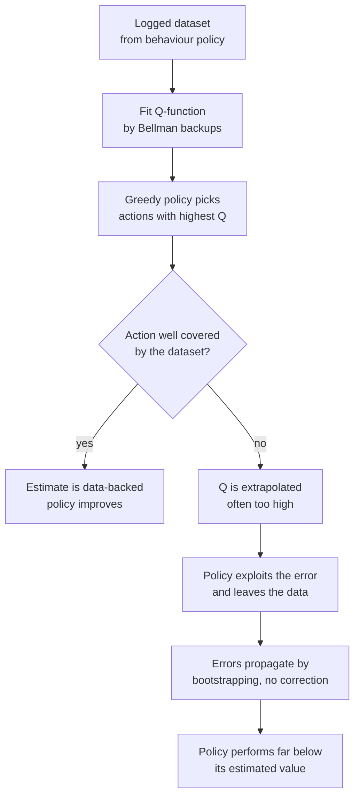

The diagram shows the failure chain and its single decision point. All major offline algorithms act at that decision: they keep the learned policy inside the region where the data provide evidence. The consequence for practice is that an offline-trained policy cannot be judged by its own value estimate, which is the quantity most likely to be wrong. Independent off-policy evaluation (Section 24.4) is needed.

### 18.2 Policy-constraint methods

One family restricts the learned policy to actions the behaviour policy would plausibly take. **Behaviour cloning regularization** adds a term that keeps the policy close to the logged actions, as in TD3+BC (Fujimoto and Gu, 2021), which adds a supervised loss $\big(\pi(s) - a\big)^2$ to the TD3 actor objective and normalizes the Q term so the two are comparable. **Batch-constrained Q-learning (BCQ)** (Fujimoto and colleagues, 2019) trains a generative model of the logged actions and considers only candidate actions sampled from it.

### 18.3 Value-pessimism methods

A second family lowers the value of poorly supported actions. **Conservative Q-learning (CQL)** (Kumar and colleagues, 2020) adds a regularizer that pushes down Q-values on actions chosen by the learned policy (or a broad distribution) while pushing up Q-values on actions in the dataset:

$$
\alpha \Big( \mathbb{E}_{s \sim \mathcal{D}}\big[ \log \textstyle\sum_a \exp Q(s, a) \big] - \mathbb{E}_{(s, a) \sim \mathcal{D}}\big[ Q(s, a) \big] \Big).
$$

In the example above, with $Q(s, A) = 1.0$ and $Q(s, B) = 3.2$, the log-sum-exp is $\ln(e^{1.0} + e^{3.2}) = \ln(2.718 + 24.533) = 3.305$. The penalty is $3.305 - 1.0 = 2.305$ times $\alpha$. The gradient of the log-sum-exp with respect to each Q-value is the softmax weight: $0.900$ for B and $0.100$ for A. Gradient descent on the regularizer therefore lowers B's value with weight $0.900\alpha$ and raises A's value with net weight $(1 - 0.100)\alpha = 0.900\alpha$. This continues until the softmax weight on the unsupported action is small, which happens once the Bellman loss on the dataset balances the penalty. The effect is a *lower bound* on the true value of the policy, so the policy is not fooled into preferring unsupported actions.

**Implicit Q-learning (IQL)** (Kostrikov, Nair, and Levine, 2022) avoids querying out-of-data actions at all: it fits a value function by expectile regression on dataset actions only, then extracts a policy by advantage-weighted regression. It is simple, stable, and a common baseline.

**Model-based offline RL** (model-based offline policy optimization, MOPO, and model-based offline RL, MOReL; both 2020) learns a dynamics model and penalizes rewards where an ensemble of models disagrees, steering the planner away from unfamiliar regions.

### 18.4 What the dataset must contain

No algorithm can invent information. Offline RL can recombine good parts of different trajectories ("stitching"), provided that the data contain pieces to stitch. It requires:

- **Coverage** of the state-action pairs that the improved policy will visit. Data from a single deterministic logging policy cover almost nothing beyond that policy, and offline RL on such data reduces to roughly behaviour cloning.
- **Some randomization** in the logging policy, or at least variation between operators, so that different actions occur in similar states.
- **Recorded propensities** where possible (Section 27), so that importance-sampling evaluation is available.
- **Rewards and states logged the way they will be used in production**, with the same feature definitions, delays, and missing-value behavior.

The D4RL benchmark suite (datasets for deep data-driven RL; Fu and colleagues, 2020) provides datasets of varying quality for comparing algorithms. The overall finding is that results depend strongly on dataset composition and that algorithms ranking well on mixed-quality data can rank poorly on narrow expert data. Treat benchmark rankings as hypotheses about your own data.

### 18.5 Offline to online

The common deployment path is not purely offline. Train a conservative policy offline, evaluate it with off-policy estimators, deploy at small traffic share, and fine-tune with controlled exploration. A policy fine-tuned online from an offline start may initially lose performance when conservative pessimism is removed, and methods designed for this transition (such as calibrated Q-learning variants) are an active research topic. The conservative engineering approach is a staged rollout (Section 27.3) with a fallback policy.

## 19. Imitation Learning and Inverse Reinforcement Learning

When the reward is hard to specify but demonstrations exist, the agent can learn from the demonstrator instead of from a reward. This covers driving, robotic manipulation, game bots, and workflow automation.

### 19.1 Behaviour cloning

**Behaviour cloning (BC)** treats demonstrations as a supervised dataset, state to action, and trains a classifier or regressor. It is the simplest method and needs no reward and no environment access. Its weakness is **compounding error**. A trained policy makes a small error, reaches a state slightly off the demonstrator's distribution, where it has no training data, makes a larger error, and drifts. If the probability of an error on any step is $\epsilon = 0.02$ and each error takes the agent off the demonstrated path irrecoverably, then the chance of completing a 100-step task cleanly is $0.98^{100} = 0.133$. Ross and Bagnell (2010) showed that the expected cost can grow with $T^2\epsilon$ in the worst case, quadratic in the horizon, whereas supervised learning's error grows linearly in the number of independent predictions.

### 19.2 DAgger

**Dataset aggregation (DAgger)** (Ross, Gordon, and Bagnell, 2011) fixes the distribution mismatch by letting the learner's own policy drive, then asking the expert to label the states the learner actually reaches. The labelled states are added to the training set, and the policy is retrained. The cost of the worst case falls to linear in $T$, at the price of needing the expert (a human or a slow planner) available during training. In driving or robotics, a safety driver or an expensive optimal planner can play that role.

### 19.3 Inverse reinforcement learning

**Inverse reinforcement learning (IRL)** infers a reward function that explains the demonstrations, then runs RL on that reward. The reasoning is that a reward is a compact and transferable description of the intent, so a policy trained on it can generalize to states the demonstrator never visited and to changed dynamics. IRL is under-determined: many rewards, including the all-zero reward, make any behaviour optimal. **Maximum-entropy IRL** (Ziebart and colleagues, 2008) resolves the ambiguity by choosing the reward under which the demonstrated trajectories are most probable among distributions that match the demonstrated feature expectations, with probability of a trajectory proportional to $\exp(\text{reward})$. IRL needs to solve an RL problem inside its loop, which is expensive.

**Generative adversarial imitation learning (GAIL)** (Ho and Ermon, 2016) skips the explicit reward. A discriminator is trained to distinguish expert state-action pairs from the agent's, and the agent is trained with RL to fool it, so that the discriminator's output acts as a learned reward. It reaches expert-level behaviour with fewer demonstrations than BC on several benchmarks, at the price of adversarial training instability and extra environment interaction.

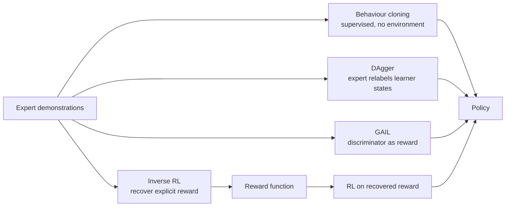

The diagram arranges the methods by how much machinery they place between the demonstrations and the policy. Moving right buys robustness to distribution shift and, for IRL, a reusable reward, at the price of environment interaction and more fragile training. A practical sequence is to start with BC as a baseline and as an initialization, add DAgger if an expert can label on demand, and consider adversarial or IRL methods only when BC with enough data fails.

### 19.4 Imitation in practice

Demonstrator quality bounds the result: the agent copies mistakes, and a mixed pool of expert and novice demonstrations teaches a mixture. Filtering by outcome, or weighting demonstrations by return, is a simple fix that gives *filtered behaviour cloning*. Demonstrations from humans are often **multi-modal** (two experts go left or right around an obstacle). A regression policy that averages them goes straight into the obstacle, so the policy needs a distribution output (a mixture, a diffusion policy, or discretized actions). Hidden variables matter too: if the expert acts on information the observation lacks, such as a driver who has seen a pedestrian that the camera did not capture, the clone cannot learn the correct dependence. Finally, a policy trained by imitation has no notion of reward, and it will not know to stop imitating a behaviour that no longer fits the goals. The preference-learning approach to reward modelling, in which humans compare outputs and a reward model is fitted to those comparisons, is the bridge from this section to language-model alignment and is covered in [CH14](CH14_Reinforcement_Learning_from_Human_Feedback.md).

## 20. Reward Design, Misspecification, and Reward Hacking

The reward function is the only channel through which people tell an RL agent what they want. An agent that optimizes well will satisfy the written reward even where that departs from what the writer intended. In supervised learning a bad label set produces a model that is wrong in a measurable way on a test set. In RL, a bad reward produces a competent agent that pursues the wrong goal, and evaluation on the same reward reports success.

### 20.1 Goodhart's law in RL

Goodhart's law, in the form usually quoted, says that a measure used as a target stops being a good measure. An RL agent is an optimizer built to push a measure to its maximum, so it finds every gap between the measure and the intent. Three causes recur:

1. **Proxy rewards.** The true goal (customer satisfaction, long-term revenue, safe operation) is hard to measure, so a correlated proxy (clicks, session length, a sensor reading) is used. The correlation holds for typical behaviour and fails at the extremes where the optimizer operates.
2. **Missing terms.** The reward omits something the designers considered obvious, such as not damaging equipment or not annoying users, because no human would do it.
3. **Exploitable environment.** The simulator or the metric pipeline has bugs, rounding behaviour, or loopholes, which the agent finds and exploits.

### 20.2 Concrete examples

- **Racing game score.** OpenAI described an agent trained on the boat-racing game CoastRunners, whose score came from hitting targets along the course. The agent found a lagoon where it could circle, hit refreshing targets repeatedly, catch fire, and crash, and it scored higher than finishing the race ([Faulty reward functions in the wild](https://openai.com/index/faulty-reward-functions/), 2016). The reward measured points when the designers wanted progress.
- **Block stacking.** In a robotic stacking task described by Popov and colleagues (2017), the reward was based on the height of the bottom face of the red block. The policy learned to flip the red block over, which raised that face, and not to stack it on the blue block.
- **Catalogue of cases.** Krakovna and colleagues at DeepMind (2020) maintain a public list of dozens of specification-gaming examples, including simulated creatures that exploit physics-engine errors, and evolved programs that delete the test file. The list is useful as a source of failure patterns to try on your own reward.
- **Recommendation.** A recommender rewarded on watch time can learn to promote content that is compulsive or extreme, because that content holds attention. Whether a given production system does so is an empirical question about that system, but the incentive is built into the reward.
- **Algorithmic pricing.** Calvano and colleagues (2020) simulated Q-learning pricing agents competing in a market and found that they learned prices above the competitive level and sustained them with punishment strategies, without any communication. The reward (profit) was written correctly for each firm, and the joint outcome was one a regulator may care about. This is a multi-agent effect (Section 23) and a governance concern.
- **Inventory and fulfilment.** A replenishment agent rewarded on revenue minus holding cost may learn to leave popular items out of stock when stockouts are not penalized, if holding cost is the only visible term. Adding a stockout penalty then invites the opposite error, hoarding stock before audits.

### 20.3 Reward shaping and its limits

Sparse rewards are hard to learn from, so designers add intermediate signals. Careless shaping changes the optimal policy. Suppose a navigation task gives $+10$ at the goal and the designer adds $+1$ each time the agent reaches a checkpoint. If checkpoints can be re-entered, circling a checkpoint yields unlimited reward, and the agent never goes to the goal.

Ng, Harada, and Russell (1999) showed that there is one safe form, **potential-based shaping**. Choose any function $\Phi(s)$ of the state (a "potential") and add

$$
F(s, a, s') = \gamma\, \Phi(s') - \Phi(s)
$$

to the reward. The optimal policies of the shaped MDP are the same as those of the original MDP. The reason is that along any trajectory the shaping terms telescope: $\sum_{t=0}^{T-1} \gamma^t F(s_t, a_t, s_{t+1}) = \gamma^T \Phi(s_T) - \Phi(s_0)$, which depends only on the endpoints and not on the path, so it cannot make one path better than another that has the same start and end.

**Worked numbers.** In a gridworld, let $\Phi(s) = -d(s)$, where $d(s)$ is the Manhattan distance to the goal, and let $\gamma = 0.9$. A step from distance 3 to distance 2 earns $F = 0.9 \times (-2) - (-3) = +1.2$. A step away, from 3 to 4, earns $F = 0.9 \times (-4) + 3 = -0.6$. Now test the loop exploit. Stepping from distance 3 to 2 and then back to 3 earns $+1.2$ and then $0.9 \times (-3) - (-2) = -0.7$. The discounted total is $1.2 + 0.9 \times (-0.7) = 0.57$, which matches the telescoped formula $\gamma^2 \Phi(s_2) - \Phi(s_0) = 0.81 \times (-3) + 3 = 0.57$. It is a small, bounded amount that does not grow with repetition. Walking straight to the goal in 3 steps earns $\gamma^3 \Phi(\text{goal}) - \Phi(s_0) = 0 + 3 = +3$ of shaping, plus the goal reward. The potential therefore gives direction to early learning without creating a loop that pays out indefinitely.

Potential-based shaping preserves optimality under the stated MDP only. It does not protect against a reward that was wrong to begin with.

### 20.4 Practices for writing a reward

1. **Specify outcomes the business cares about, and constraints separately.** Put hard requirements (safety limits, regulatory rules, fairness constraints) in constraints or in the action mask (Section 21) and not as penalty terms with a tuned weight. A penalty of $-100$ for a violation is a price, and an agent will pay a price if the benefit exceeds it.
2. **Log reward components separately.** Track each term (revenue, cost, penalty) per episode so you can see which one the agent is exploiting. A rising total with one component rising and others flat is a warning.
3. **Inspect behaviour, not only scores.** Watch rollouts. Many specification-gaming cases were found by someone looking at a replay.
4. **Red-team the reward before training.** Ask what a clever and indifferent optimizer would do to maximize it. Write down the three cheapest exploits and test whether the agent finds them.
5. **Prefer ratios and bounded terms to unbounded ones.** An unbounded term can dominate and invites extreme actions.
6. **Check for time-inconsistent shortcuts.** If the reward rises when the episode ends early (ending avoids per-step penalties), the agent learns to terminate. If it rises when the episode is long, the agent learns to stall.
7. **Align the evaluation metric with the real goal, not only the training reward.** Keep a held-out business metric that the agent never saw as reward and watch whether it moves with the reward.
8. **Learn the reward from human judgments where the goal is subjective.** This is the route taken in RLHF, with its own failure mode of over-optimizing a learned reward model (see [CH14](CH14_Reinforcement_Learning_from_Human_Feedback.md)).

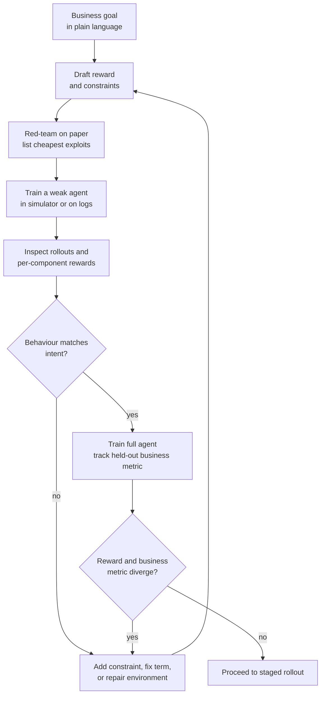

The diagram turns reward design into a loop with two gates. The first gate is human inspection of a weak agent's behaviour, which is cheap and catches the obvious exploits before expensive training. The second is the comparison between the training reward and a business metric the agent cannot see, which detects Goodhart divergence during and after training. Both gates continue after deployment, because user behaviour and the environment change and a reward that was safe at launch can become exploitable.

## 21. Safe Reinforcement Learning and Constrained MDPs

Maximizing expected return does not by itself prevent rare disastrous outcomes, and exploration needs to try actions whose results are unknown. **Safe RL** is the set of methods and engineering practices that limit harm during learning and during deployment.

### 21.1 Constrained MDPs

A **constrained Markov decision process (CMDP)** (Altman, 1999) adds a cost signal $c(s, a)$ and a budget $d$. The goal is to maximize return subject to expected discounted cost staying below the budget:

$$
\max_\pi\ J_r(\pi) = \mathbb{E}_\pi\Big[ \sum_t \gamma^t r_t \Big] \quad \text{subject to} \quad J_c(\pi) = \mathbb{E}_\pi\Big[ \sum_t \gamma^t c_t \Big] \le d.
$$

Examples: maximize throughput while keeping the probability of a temperature excursion below 1 percent; maximize ad revenue while keeping the share of users who see more than five ads per day below a limit; maximize energy savings subject to equipment-wear limits.

The standard solution method is **Lagrangian relaxation**. Introduce a multiplier $\lambda \ge 0$ and optimize $\min_{\lambda \ge 0}\max_\pi\ J_r(\pi) - \lambda\,(J_c(\pi) - d)$. The agent maximizes a reward $r - \lambda c$, and the multiplier is adjusted by gradient ascent on the constraint violation: $\lambda \leftarrow \max(0,\ \lambda + \eta\,(J_c - d))$.

**Worked numbers.** Let the cost budget be $d = 10$, the learning rate $\eta = 0.05$, and $\lambda = 0.5$. If the current policy has an estimated cost $J_c = 12$, the constraint is violated by 2, so $\lambda \leftarrow 0.5 + 0.05 \times 2 = 0.6$, and every unit of cost is now charged $0.6$ instead of $0.5$ in the shaped reward. If later $J_c = 8$, $\lambda \leftarrow 0.6 + 0.05 \times (-2) = 0.5$. The multiplier rises while the policy is unsafe and falls when it has slack. This method (for example PPO-Lagrangian, and the trust-region variant constrained policy optimization, CPO, of Achiam and colleagues, 2017) satisfies the constraint *on average at convergence*. During training the cost typically oscillates around the budget, with overshoot, so Lagrangian methods alone do not guarantee safe exploration.

### 21.2 Hard constraints: action masks, shields, and safety layers

When a violation is unacceptable even once, expected-cost constraints are not enough. Hard constraints are enforced outside the learned policy:

- **Action masking.** Remove actions that are illegal or unsafe in the current state before sampling, setting their logits to negative infinity. Cheap and exact, if the rule is known.
- **Shields.** A **shield** (Alshiekh and colleagues, 2018) is a separate component, derived from a formal specification of the safety property and a model of the system, that monitors the agent's proposed action and replaces it with a safe action when the proposal would lead to a violation. The agent can be arbitrary and untrusted, and safety rests on the small, verifiable shield.
- **Control barrier functions and safety filters.** In continuous control, solve a small optimization at each step that finds the action closest to the agent's proposal that satisfies a safety inequality.
- **Fallback controllers.** A conventional, well-understood controller takes over when the state leaves a defined envelope or the learned policy's uncertainty is high.
- **Rate and range limits.** Cap how fast and how far any actuator or price can change in one step. This bounds the damage from any single bad action and gives humans time to respond.

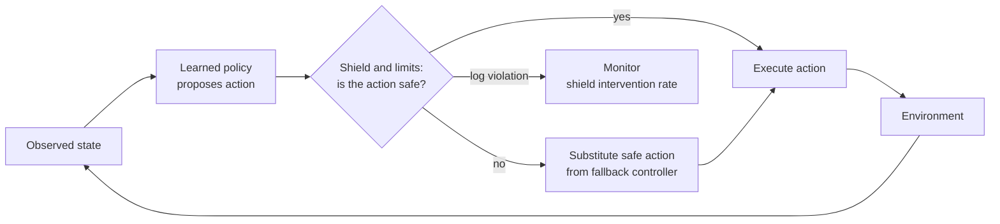

The diagram places the shield between the policy and the world, so every action passes through it, including exploratory ones. The intervention rate is a useful health signal: a rising rate means the policy is proposing unsafe actions more often (possibly after a data shift), and a rate of zero for a long time can mean the shield is mis-specified and never triggers. The learner should also be informed about interventions, either by treating the substitute action as the one taken or by adding a penalty, otherwise it never learns to avoid the unsafe region and relies permanently on the shield.

### 21.3 Risk-sensitive objectives

Expected return averages over good and bad outcomes. If a bad tail matters, optimize a risk measure. **Conditional value at risk (CVaR)** at level $\alpha$ is the mean return in the worst $\alpha$ fraction of outcomes. For example, with ten equally likely returns $\{-50, 0, 5, 8, 10, 10, 12, 12, 15, 20\}$ the mean is $4.2$ but the CVaR at $\alpha = 0.2$ is the mean of the worst two returns, $(-50 + 0)/2 = -25$. A policy with the same mean but fewer catastrophes has a higher CVaR. Distributional RL (Section 10.5) estimates the full return distribution and makes CVaR objectives practical. Risk-sensitive objectives are more conservative and need more data to estimate tail behaviour reliably.

### 21.4 Operating states of a safe deployment

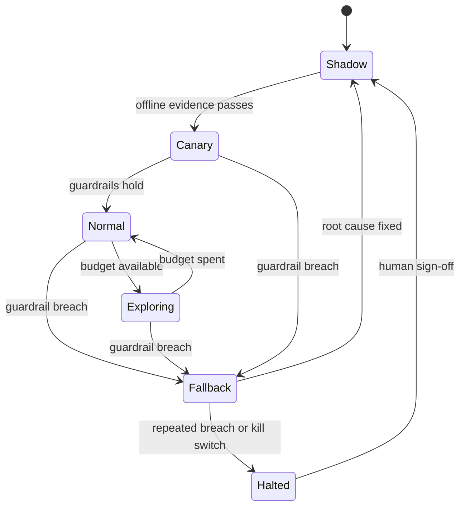

The state machine expresses the rule that a learning system should have more than an on and off position. Entering `Fallback` is automatic and fast, based on pre-agreed guardrail metrics. Leaving it requires a cause to be understood. `Halted` is the kill switch state, reachable by a person at any time, and leaving it needs human approval. Section 27 details the controls behind each transition.

### 21.5 Limits of safe RL

Constraints only cover what is measured. A cost signal that omits a harm cannot prevent it. Formal shields require a model of the system and a safety specification, which exist for robots and industrial controllers but rarely for customer-facing behaviour. Risk estimates from limited data are themselves uncertain. And safety under a distribution shift (new users, new equipment, new season) is not implied by safety in the training distribution. Safe RL reduces and bounds risk. It does not remove the need for human oversight and staged rollout. The governance side (impact assessment, sign-off, audit) is covered in [CH31 Responsible AI and Safety Governance](CH31_Responsible_AI_and_Safety_Governance.md).

## 22. Simulation and Sim-to-Real Transfer

Deep RL typically needs millions of environment steps, which only a simulator can supply quickly and safely. A policy trained there must then work in the real system. The mismatch is the **reality gap**.

### 22.1 What simulators are used for

- **Physics simulators** for robotics and control (rigid-body dynamics, contact, sensor models). Fast and parameterized, but contact, friction, deformable objects, and sensor noise are hard to model.
- **Game engines and rules-based simulators.** Exact where the rules are exact: board games, card games, and video games. The reality gap is zero when the simulator is the real environment.
- **Digital twins** of plants, buildings, or networks, calibrated with plant data. Accuracy depends on calibration and on how well the twin captures rare modes.
- **Agent-based and queueing simulators** for logistics, markets, and call centres. The behaviour of customers and competitors is the weak point.
- **Data-driven (replay) simulators** that sample from logs. They can replay what happened but cannot show what would have happened under a different action, because the logged customer never saw that action. This limits them to evaluation of actions near the logged ones.

### 22.2 Sources of the reality gap

Parameters (mass, friction, latency) are wrong; unmodeled effects are missing (cable stiffness, actuator backlash, wear); sensors differ (noise, delay, calibration, lighting for cameras); and the real environment includes events the simulator never produces. A policy optimized in simulation tends to fit simulator quirks, since an optimizer finds and exploits them, as Section 20 explained for rewards.

### 22.3 Techniques that narrow the gap

- **Domain randomization.** Randomize simulator parameters and appearance across a wide range during training so that the real system looks like one more sample. Tobin and colleagues (2017) trained an object detector for robot grasping on randomized renderings with no real images. Peng and colleagues (2018) randomized dynamics parameters for a robot arm. OpenAI (2019) trained a robot hand to manipulate a Rubik's cube in simulation with extensive randomization and automatic widening of the ranges. The randomization range is a design decision: too narrow misses reality, too wide makes the task unlearnable or yields an over-cautious policy.
- **System identification.** Measure real parameters and calibrate the simulator, or fit them from data online. Combined with a narrow randomization around the calibrated values.
- **Domain adaptation.** Learn representations that are invariant between simulated and real observations, for instance for camera images.
- **Residual learning.** Keep a classical controller and learn only a correction on top of it. The classical controller handles the bulk of the behaviour, and the learned residual is small and easier to bound.
- **Real-world fine-tuning.** Start from the simulator policy and continue with careful, safety-constrained learning on the real system, using the offline and safe-RL tools of Sections 18 and 21.

**Illustrative numbers.** Suppose friction between a gripper and an object is uncertain, known only to lie between $0.4$ and $0.9$. Training with friction fixed at the middle value $0.65$ gives a policy that grips with exactly enough force for $0.65$ and drops the object at $0.45$. Training with friction sampled uniformly from $[0.3, 1.1]$ teaches a firmer grip that works across the range, at the cost of a slightly slower, less efficient motion for the typical case. This performance-for-robustness exchange is the central trade-off of randomization.

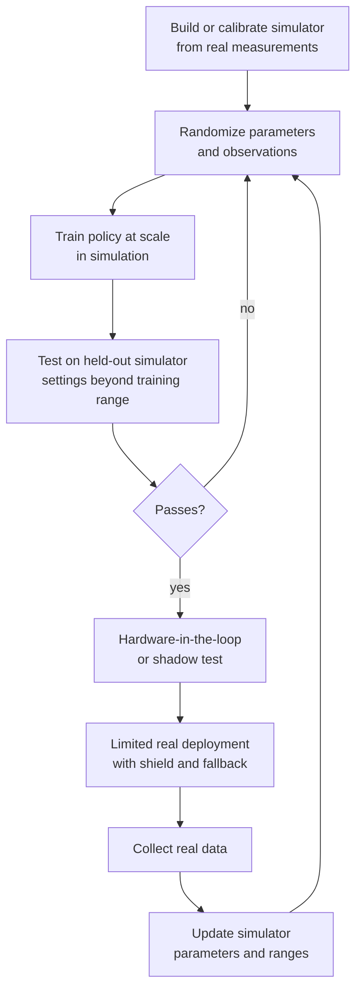

The pipeline is a loop: real data refine the simulator and the randomization ranges, and the improved simulator produces a better policy. The held-out test beyond the training range is a cheap proxy for robustness to what was not modeled. Teams that skip the loop and treat sim-to-real as a one-time transfer usually find that the first real deployment reveals unmodelled effects that a few measurements would have captured.

### 22.4 Simulators for business decisions

For pricing, marketing, and logistics, building a simulator of human behaviour is the main project risk. A simulator learned from logs is only reliable near the logged policies. If an RL agent is trained against such a simulator, it will drift toward regions where the simulator is extrapolating and may be wrong, the same exploitation problem as in model-based RL (Section 17.1). Validate by comparing simulated and real distributions of key quantities (arrival rates, conversion, queue lengths) under the *old* policy, then check whether the simulator reproduces the effect of past policy changes (a natural experiment), and keep the new policy's actions within the range of the validation.

## 23. Multi-Agent Reinforcement Learning

When several learners share an environment, each agent faces a world that includes the others. This section gives the main points; the topic is a field in itself.

### 23.1 What changes

- **Non-stationarity.** From one agent's view, the other agents' policies are part of the environment, and they change as the others learn. The Markov and stationarity assumptions behind Q-learning's convergence no longer hold.
- **Joint action space growth.** With $n$ agents each having $k$ actions, the joint action space has $k^n$ elements. Five agents with ten actions each give $10^5 = 100{,}000$ joint actions, which rules out learning a single value function over joint actions without structure.
- **Credit assignment.** In a cooperative team with a shared reward, an individual agent cannot tell its own contribution from teammates' behaviour.
- **Setting matters.** Fully cooperative (shared reward), fully competitive (zero-sum), and mixed (general-sum, as in markets) call for different methods and have different solution concepts: team optimum, minimax, Nash equilibrium.

### 23.2 Common approaches

- **Independent learners.** Each agent runs its own single-agent algorithm and treats others as the environment. It is simple, scales, and often works in practice, but offers no guarantees and can oscillate.
- **Centralized training with decentralized execution (CTDE).** During training, a critic sees all agents' observations and actions, which removes non-stationarity from the critic's viewpoint. At execution each agent uses only its local observation. Examples are multi-agent DDPG (MADDPG; Lowe and colleagues, 2017) and QMIX (Rashid and colleagues, 2018), which factors a team value into per-agent values with a monotonic mixing network.
- **Self-play.** One agent plays against copies or past versions of itself, producing a curriculum that rises with its ability. It underlies AlphaZero for board games, and the Dota 2 and StarCraft II systems (OpenAI Five, 2019; AlphaStar, Vinyals and colleagues, 2019), which also needed populations of opponents to avoid cycles in which a strategy beats another that beats the first.

### 23.3 Why an architect should care

Multi-agent effects appear in systems that do not call themselves multi-agent RL: several bidding agents in an ad auction, pricing agents of competing sellers, autoscalers that react to each other's resource changes, and several recommenders in one product. In these cases, each component's learning changes the environment of the others, offline evaluation based on logs from the old interaction pattern becomes stale, and feedback loops can produce oscillation or tacit collusion (Section 20.2). Treat the interaction as part of the system under test: run controlled experiments with all learners active, monitor for oscillation (periodic swings in the controlled variable), and keep a human-set bound on each agent's authority.

## 24. Evaluation, Variance, and Reproducibility

RL results are harder to trust than supervised results for four reasons. The data depend on the policy. Training is high-variance, so one run can look great and another fail with the same settings. Performance during training differs from performance of the final policy. And the policy that you want to evaluate has not been deployed, so its value must be estimated from data collected by other policies.

### 24.1 What to measure and plot

- **Learning curve.** Return against environment steps (not wall-clock time or updates). Plot the mean over seeds with an interval, not a single run.
- **Evaluation return versus training return.** Training episodes include exploration noise, so evaluate separately: freeze the policy every fixed number of steps, run it without exploration for a number of episodes on fresh environment seeds, and plot that.
- **Sample efficiency and final performance.** Report steps to reach a threshold and the asymptote. They answer different questions.
- **Secondary metrics.** Constraint costs, safety interventions, episode length, entropy, value-function loss, KL, and the components of the reward (Section 20.4).

### 24.2 Seeds and statistical honesty

Henderson and colleagues (2018) showed that results of deep RL algorithms vary with random seeds, hyperparameters, implementation details, and the number of runs, enough to reverse the apparent ranking of algorithms. Agarwal and colleagues (2021) argued that reporting point estimates from a handful of runs is misleading, and recommended interval estimates, performance profiles, and outlier-resistant aggregates such as the **interquartile mean** (the mean of the middle 50 percent of runs), implemented in the *rliable* library.

**Worked example.** Five seeds of algorithm A finish with final evaluation returns $310, 280, 150, 320, 290$. The mean is $1350/5 = 270$. The deviations from the mean are $40, 10, -120, 50, 20$, with squares $1600, 100, 14400, 2500, 400$, summing to $19000$. The sample variance is $19000/4 = 4750$ and the standard deviation is $68.9$. The standard error is $68.9/\sqrt{5} = 30.8$. With the $t$ distribution at 4 degrees of freedom (critical value $2.776$), the 95 percent confidence interval is $270 \pm 2.776 \times 30.8 = 270 \pm 85.5$, from about $185$ to $355$. If algorithm B has a mean of $300$ over its own five seeds with a similar spread, the intervals overlap almost entirely, and a claim that B is better is not supported. One bad seed (150) moved the mean 20 points below the median (290). With five seeds, a team that wants to detect a 10 percent difference would typically need many more runs. The number of seeds needed rises with the ratio of seed-to-seed variance to the effect size, so measure the variance first.

Advice that follows from this:

- Use at least five seeds, ten or more where the variance is large, and report the number.
- Choose hyperparameters with the same tuning budget for the compared methods. Giving a new method extensive tuning and a baseline its defaults is the most common source of inflated gains.
- Do not select the best checkpoint or the best seed using the evaluation episodes that you then report. Use separate episodes for selection and reporting.
- Report failures: seeds that diverged count.

### 24.3 Sources of non-reproducibility

Beyond seeds: environment versions (a physics-engine update changes dynamics), library versions, hardware and non-deterministic GPU operations, asynchronous collection (the order in which data arrive differs per run), reward and observation normalization statistics, unreported implementation choices (Section 13.4), and time limits or truncation handling. A reproducible project pins versions, stores the full configuration and the code commit with every run, saves evaluation seeds and checkpoints, and keeps a held-out environment configuration for final reporting.

### 24.4 Off-policy evaluation

Often the question is how a *new* policy $\pi$ would perform if deployed, answered from data logged by an *old* policy $\mu$ (the behaviour policy). Deploying to find out is the thing we are trying to avoid. **Off-policy evaluation (OPE)** estimates the new policy's value from the logs. The simplest setting is a contextual bandit, in which the logged data are tuples $(x_i, a_i, r_i)$ with $a_i \sim \mu(\cdot \mid x_i)$.

**Direct method (DM).** Fit a reward model $\hat{r}(x, a)$ from the logs and average it under the new policy: $\hat{V}_{\text{DM}} = \frac{1}{n}\sum_i \sum_a \pi(a \mid x_i)\, \hat{r}(x_i, a)$. Low variance, but biased whenever the model is wrong, notably for actions the old policy rarely took.

**Inverse propensity scoring (IPS).** Re-weight each logged reward by how much more (or less) likely the new policy is to take the logged action: $\rho_i = \pi(a_i \mid x_i)/\mu(a_i \mid x_i)$ and $\hat{V}_{\text{IPS}} = \frac{1}{n}\sum_i \rho_i\, r_i$. It is unbiased when $\mu(a \mid x) > 0$ wherever $\pi(a \mid x) > 0$ (the *support* condition). The proof is a change of measure:

$$
\mathbb{E}_{a \sim \mu}\big[ \rho\, r \big] = \sum_a \mu(a \mid x)\, \frac{\pi(a \mid x)}{\mu(a \mid x)}\, r(x, a) = \sum_a \pi(a \mid x)\, r(x, a) = \mathbb{E}_{a \sim \pi}[r].
$$

Its weakness is variance: large weights from actions the old policy rarely took dominate the estimate.

**Self-normalized IPS (SNIPS).** Divide by the sum of the weights instead of $n$: $\hat{V}_{\text{SNIPS}} = \sum_i \rho_i r_i / \sum_i \rho_i$. It is slightly biased, has lower variance, and stays within the range of observed rewards.

**Doubly robust (DR).** Combine both: $\hat{V}_{\text{DR}} = \frac{1}{n}\sum_i \big[ \sum_a \pi(a \mid x_i)\hat{r}(x_i, a) + \rho_i\,(r_i - \hat{r}(x_i, a_i)) \big]$. It uses the model as a baseline and the importance-weighted residual as a correction, and it is consistent if either the model or the propensities are right (Dudík, Langford, and Li, 2011).

**A hand example with five logged rows.** Let the logging policy $\mu$ and the new policy $\pi$ be, for context 0, $\mu = (0.7, 0.2, 0.1)$, $\pi = (0.1, 0.8, 0.1)$, and for context 1, $\mu = (0.5, 0.4, 0.1)$, $\pi = (0.1, 0.1, 0.8)$ over three actions. Five logged rows are:

| Row | Context | Logged action | Reward | Weight $\rho = \pi/\mu$ | $\rho r$ |
|---|---|---|---|---|---|
| 1 | 0 | 1 | 1 | $0.8/0.2 = 4.000$ | 4.000 |
| 2 | 0 | 0 | 0 | $0.1/0.7 = 0.143$ | 0 |
| 3 | 1 | 2 | 1 | $0.8/0.1 = 8.000$ | 8.000 |
| 4 | 1 | 0 | 0 | $0.1/0.5 = 0.200$ | 0 |
| 5 | 1 | 1 | 0 | $0.1/0.4 = 0.250$ | 0 |

IPS gives $(4 + 8)/5 = 2.4$, which is impossible for a click probability. With only five rows, two lucky rewards were multiplied by large weights. SNIPS gives $12/(4 + 0.143 + 8 + 0.2 + 0.25) = 12/12.593 = 0.953$, which at least lies in $[0, 1]$, though with five rows it is still unreliable. The example shows why weight statistics should be reported with every OPE number.

**Simulation result.** The script [04_off_policy_evaluation_and_gae.py](../code/python/reinforcement-learning-chapter/04_off_policy_evaluation_and_gae.py) generates logs from these policies with true reward rates $r(x, a)$ and computes each estimator over 200 repetitions. The true value of the new policy is $0.475$ (context 0: $0.1 \times 0.3 + 0.8 \times 0.5 + 0.1 \times 0.1 = 0.44$; context 1: $0.1 \times 0.2 + 0.1 \times 0.1 + 0.8 \times 0.6 = 0.51$; average $0.475$).

| Logged rounds | Estimator | Mean estimate | Standard deviation |
|---|---|---|---|
| 500 | Direct method | 0.4756 | 0.0473 |
| 500 | IPS | 0.4799 | 0.0713 |
| 500 | SNIPS | 0.4764 | 0.0485 |
| 500 | Doubly robust | 0.4756 | 0.0473 |
| 5,000 | Direct method | 0.4753 | 0.0152 |
| 5,000 | IPS | 0.4775 | 0.0229 |
| 5,000 | SNIPS | 0.4755 | 0.0156 |
| 5,000 | Doubly robust | 0.4753 | 0.0152 |

All estimators are close to $0.475$ on average. IPS has the largest spread, about 50 percent larger than SNIPS at 500 rounds, and the maximum importance weight is $8.0$. The *effective sample size*, $(\sum \rho_i)^2 / \sum \rho_i^2$, averages about 103 of 500 rounds, and 1,028 of 5,000: the policy difference is large enough that only about one fifth of the data carries the weight. Direct method and doubly robust coincide here because the reward model is a table of per-cell means fitted on the same data, so the residual correction sums to zero within each cell. That is an artefact of the simple model. In realistic settings with a misspecified model the two differ, and doubly robust is the safer choice. Variance falls with $1/\sqrt{n}$, as the move from 500 to 5,000 rounds shows (0.0713 to 0.0229).

**Sequential problems.** In full RL the weights multiply along the trajectory, $\rho_{0:T} = \prod_{t} \pi(a_t \mid s_t)/\mu(a_t \mid s_t)$, and the variance of the product can grow exponentially with the horizon. As an illustration, let each step's ratio be $1.25$ or $0.75$ with equal probability, so its mean is 1 and $\mathbb{E}[\rho_t^2] = 0.5 \times (1.5625 + 0.5625) = 1.0625$. For independent steps, $\mathbb{E}[\rho_{0:T}^2] = 1.0625^{T}$, which is $20.7$ for $T = 50$ and $428$ for $T = 100$. The weight has mean 1 and a standard deviation of about $4.4$ at 50 steps and about $20.7$ at 100 steps. Remedies are per-decision importance sampling, weighted (self-normalized) versions, doubly robust estimators for sequences (Jiang and Li, 2016; Thomas and Brunskill, 2016), and **fitted Q evaluation (FQE)**, which learns $Q^\pi$ from the logs by bootstrapped regression and so inherits the offline-RL bias problems of Section 18. In practice no single estimator is trusted: agree several, and treat disagreement as evidence that the data do not support a firm answer.

### 24.5 The evidence ladder before deployment

```mermaid
flowchart LR
    A["Training reward<br/>and learning curves"] --> B["Held-out simulator<br/>settings"]
    B --> C["Off-policy evaluation<br/>on logs, with intervals"]
    C --> D["Shadow mode<br/>compare proposed vs actual actions"]
    D --> E["Canary<br/>small traffic with guardrails"]
    E --> F["Ramp<br/>with holdout group"]
    F --> G["Full rollout<br/>with kill switch"]
```

The ladder orders evidence from cheap and weak to expensive and strong. Each rung should answer a stated question and have a pass criterion written before it runs. Training reward tells you the optimizer works. Held-out simulator settings and OPE tell you the policy is plausible beyond its training data. Shadow mode reveals integration and data problems with no customer risk. A canary and ramp measure the real effect with a holdout group, and these are the only rungs that include the feedback effects of deploying the policy. A policy should not climb a rung because it has high estimated value at the rung below, only because it met the criteria set for that rung.

## 25. Choosing a Method

The preceding sections gave many algorithms. Choosing among them is mostly a matter of answering a short series of questions about the problem, in this order.

### 25.1 A decision tree

```mermaid
flowchart TD
    Q1{"Do actions change<br/>future states?"} -->|"no"| Q2{"Is there context<br/>per decision?"}
    Q2 -->|"no"| B1["Multi-armed bandit<br/>Thompson sampling"]
    Q2 -->|"yes"| B2["Contextual bandit<br/>reward model plus exploration"]
    Q1 -->|"yes"| Q3{"Is the model known<br/>and the state small?"}
    Q3 -->|"yes"| DP["Dynamic programming<br/>or classical optimal control"]
    Q3 -->|"no"| Q4{"Can you interact cheaply<br/>with a simulator?"}
    Q4 -->|"yes"| Q5{"Continuous actions?"}
    Q5 -->|"no"| V1["DQN family or PPO"]
    Q5 -->|"yes"| V2["PPO for cheap simulators<br/>SAC when steps are costly"]
    Q4 -->|"no"| Q6{"Is there a large log<br/>of past decisions?"}
    Q6 -->|"yes"| OF["Offline RL with conservatism<br/>plus off-policy evaluation"]
    Q6 -->|"no"| Q7{"Are demonstrations<br/>available?"}
    Q7 -->|"yes"| IM["Imitation learning<br/>then cautious fine-tuning"]
    Q7 -->|"no"| NO["Do not use RL yet<br/>collect data or use rules"]
```

The tree encodes four lessons from the chapter. The first split, whether actions change future states, removes most business problems from full RL. The second, whether the model is known and small, sends inventory and queue problems to dynamic programming and classical control. The third, whether cheap interaction exists, separates problems solved by simulation scale from those that depend on logs. The last branch is deliberately negative: when there is no simulator, no log, and no demonstrations, the right first project is data collection, not an algorithm.

### 25.2 Algorithm families compared

| Family | Examples | Action space | Data use | Main strength | Main risk |
|---|---|---|---|---|---|
| Tabular value-based | Q-learning, SARSA | Small discrete | Online | Transparent, convergence guarantees | Does not scale |
| Deep value-based | DQN, Rainbow | Discrete | Replay, off-policy | Sample-efficient for discrete tasks | Triad instability, overestimation |
| Policy gradient | REINFORCE, PPO | Discrete or continuous | On-policy | Stable, simple, parallel | Sample-hungry |
| Off-policy actor-critic | DDPG, TD3, SAC | Continuous | Replay | Sample-efficient control | Many components |
| Model-based | Dyna, PETS, MBPO, Dreamer | Either | Real plus imagined | Fewer real samples | Model exploitation |
| Offline | CQL, IQL, TD3+BC | Either | Fixed logs | No online risk | Coverage, hard evaluation |
| Imitation | BC, DAgger, GAIL | Either | Demonstrations | No reward needed | Compounding error, copy errors |
| Bandits | Thompson, LinUCB | Choice among options | Streaming | Cheap, easy to evaluate | No long-term effects |

### 25.3 Heuristics

- Start from the simplest method that matches the structure: bandit before sequential RL, tabular before deep, a well-tested library implementation before custom code.
- Try a strong non-RL baseline first (a rule, a forecast plus optimizer, a supervised policy). If RL does not beat it with intervals that exclude zero, ship the baseline.
- Spend effort on the environment, reward, and evaluation. Algorithms are interchangeable library calls, but the reward and evaluation determine whether the result means anything.
- Budget for variance: plan for many seeds and several tuning runs, and treat a single run as an anecdote.

## 26. Industrial Applications and When RL Is the Wrong Tool

### 26.1 Where RL has worked

The strength of the evidence differs a great deal across these examples, and several details drift. Check the cited sources before relying on any number.

- **Recommendation, advertising, and personalization.** Contextual bandits are in wide use for choosing among content, creatives, offers, and notification timing. The Yahoo case of Li and colleagues (2010) is a documented early example, and the Open Bandit Pipeline of Saito and colleagues (2021) provides a public dataset and evaluation library for off-policy evaluation of bandit policies. Sequential RL for long-term user value has been reported by large platforms but is harder to reproduce outside them.
- **Data-center cooling.** DeepMind and Google reported that a learned system for recommending cooling settings reduced the energy used for cooling by roughly 40 percent in 2016, and Google later described a version that controls cooling directly with safety constraints (verify the exact figures and dates in the sources). The case is instructive for its engineering: constraints, operator override, and a data-driven model before control.
- **Games and simulation-rich domains.** Board games and video games (AlphaGo, AlphaZero, AlphaStar, OpenAI Five) and racing (Gran Turismo Sophy, Wurman and colleagues, 2022) show superhuman play, with large compute budgets and exact simulators.
- **Chip design and scientific control.** Mirhoseini and colleagues (2021) reported RL for chip floorplanning, a result that was debated and re-examined in the literature, so read the follow-up discussion. Degrave and colleagues (2022) controlled tokamak plasma shape in a real device with a policy trained in simulation.
- **Language-model alignment.** RL optimizes language models against reward models ([CH14](CH14_Reinforcement_Learning_from_Human_Feedback.md)), and more recently against verifiable rewards on tasks such as mathematics and code. Check current model documentation for what particular providers state they do.
- **Operations.** Inventory, pricing, scheduling, bidding, ride dispatch, and energy management have been addressed by RL in papers and case studies, usually combined with a model of the known structure.

### 26.2 When RL is the wrong tool

RL is wrong more often than it is right. These are the common signs, with the alternative to try first.

| Situation | Why RL struggles | Better first step |
|---|---|---|
| Decisions do not affect future states | Sequential machinery is unnecessary | Contextual bandit, or supervised prediction plus a decision rule |
| The dynamics are known and the state is small | Learning a known model wastes data and adds risk | Dynamic programming, optimal control, or mathematical optimization |
| A good forecast plus an optimizer solves it | The forecast carries the uncertainty, the optimizer carries the decision | Forecast, then optimize (for inventory: a newsvendor or $(s, S)$ policy) |
| No simulator and no safe way to explore | Each learning step costs real harm | Offline evaluation, rules, or a human in the loop |
| Reward cannot be stated or measured | The agent will optimize a poor proxy | Define the metric first, or use supervised learning from expert labels |
| Few decisions per day with long delays | Not enough data to learn from | A/B tests, causal analysis, expert rules |
| Stakeholders need fully explainable decisions | Deep policies are opaque | Interpretable models or rules, distilled policies |
| High-stakes, irreversible actions | Exploration is unacceptable | Verified controllers, shields, formal methods |

**Worked comparison: inventory.** A shop sells a product with weekly demand that is approximately normal with mean 100 and standard deviation 20, a unit cost of 6, price of 10, and unsold stock is worthless at week's end. The classical newsvendor solution orders up to the quantile of the demand distribution at the *critical ratio* $(p - c)/p = (10 - 6)/10 = 0.4$. With a normal distribution, the 0.4 quantile is the mean plus $z\sigma$ where $z = -0.2533$, so the order quantity is $100 - 0.2533 \times 20 = 94.9$, about 95 units. This is exact for the stated model and needs no learning. An RL agent could learn it from experience, but only after trying many order sizes that are worse, and it would not be more accurate. RL becomes relevant when the structure breaks the classical assumptions: demand that depends on past stock levels, many items sharing capacity, lead times and ordering costs that make the optimal policy depend on the full stock position, and non-stationary demand. In practice the best approach is often to retain the structural model and use learning (forecasting, bandits, or RL) for the unknown parts.

## 27. Operating RL Systems in Production

An RL system acts, and its actions determine its future data, so its operational demands exceed those of a prediction service. This section lists the engineering controls, which belong in the design before the first line of training code.

### 27.1 Exploration cost and its budget

Every exploratory action has an expected cost. **Illustrative arithmetic.** A service makes 10 million decisions per day, each worth $0.50$ of revenue under the best action on average. An exploration policy that picks a random alternative 2 percent of the time makes 200,000 exploratory decisions per day. If the random alternative is, on average, worth 20 percent less than the best action, each exploratory decision loses $0.10$ and the daily cost is $200{,}000 \times 0.10 = \$20{,}000$. The exploration budget turns this into a decision: either accept the cost as the price of learning, or reduce it by using Thompson sampling (which explores less as certainty grows), restricting exploration to a safe subset, or running it on a fraction of traffic. A bandit that stops exploring too early lets the policy stagnate, and one that explores too much pays continuous cost, so exploration rate belongs on the same dashboard as revenue.

### 27.2 Logging for offline learning and evaluation

Every future improvement to the policy, including off-policy evaluation, offline training, and incident forensics, depends on what is logged today. The log of each decision should contain:

- a **request identifier** and timestamps for decision and outcome events;
- the **state or context features** as the policy saw them, with the **feature version** (log what the policy saw, not a later recomputation, which leaks the future);
- the **candidate action set** that was eligible, and the chosen action;
- the **propensity**: the probability with which the policy chose the logged action, including the exploration mixture (Section 24.4 cannot be done without it);
- the **policy version and the model version**;
- **reward components** separately, including delayed ones as they arrive, with a flag for outcomes not yet matured;
- flags for **exploration**, **shield interventions**, **fallback use**, and holdout membership.

```mermaid
erDiagram
    DECISION ||--o{ OUTCOME : "receives"
    DECISION ||--o| INTERVENTION : "may trigger"
    DECISION }o--|| POLICY_VERSION : "made by"
    POLICY_VERSION ||--o{ FEATURE_SNAPSHOT : "reads"
    DECISION {
        string request_id
        timestamp decided_at
        string chosen_action
        float propensity
        boolean explored
        boolean in_holdout
    }
    OUTCOME {
        string request_id
        string reward_component
        float value
        timestamp observed_at
        boolean matured
    }
    INTERVENTION {
        string request_id
        string kind
        string substituted_action
    }
    POLICY_VERSION {
        string version
        string model_hash
        string config_hash
    }
    FEATURE_SNAPSHOT {
        string feature_set_version
        string values_json
    }
```

The schema separates a decision from its outcomes because outcomes arrive later and in pieces, and ties both to a policy version so that logs from different policies can be compared and weighted correctly. The intervention record preserves the action the policy wanted, which is needed to learn from shield activity. The data model stays small on purpose. A team that records these fields from the first day has the raw material for every evaluation in Section 24 and for retraining, whereas a team that adds the propensity afterwards must discard its history.

### 27.3 Staged rollout

Follow the evidence ladder of Section 24.5, with explicit entry and exit criteria for each stage:

1. **Shadow.** The new policy computes actions but the old system acts. Compare proposed against actual actions, check latency and failures, and compute OPE on the live distribution.
2. **Canary.** The new policy handles a small share (1 to 5 percent) of traffic, with a randomized holdout served by the incumbent. Success is measured on the reward and on guardrails, by confidence intervals computed with the holdout.
3. **Ramp.** Increase in steps, pausing at each to let delayed outcomes mature, and keep a long-lived holdout (for example 1 to 5 percent) to detect slow degradation and to measure the cumulative effect of the system.
4. **Steady state.** Continue the monitoring, keep the fallback path tested, and rehearse the kill switch.

### 27.4 Guardrails and the kill switch

- **Guardrail metrics** are measures that must not worsen even if the reward improves: latency, error rate, complaint rate, spend per user, fairness measures, and any safety limit. Each has a threshold agreed in advance and an automated action when crossed (reduce exploration, switch to fallback).
- **Fallback policy** is a simple, well-understood baseline that can take over immediately. It must be kept deployed and exercised, and its own logic must not depend on the learned component.
- **Kill switch** is a control that stops the learned policy within seconds, operated by on-call staff without a code deployment, and tested regularly (Section 21.4). The kill switch should degrade to the fallback and not to nothing.
- **Action limits** such as price bounds, maximum change per step, and per-user caps hold regardless of what the policy proposes.
- **Change control.** A new reward function, action set, or exploration setting is a model change and requires the same review as new weights, because it changes behaviour as much as retraining does.

### 27.5 Monitoring

Monitor the following continuously, with alerts. In addition to the system metrics from [CH29 MLOps and LLMOps](CH29_MLOps_and_LLMOps.md), RL needs:

| Signal | What it detects |
|---|---|
| Reward and each reward component, against the holdout | Real performance, and which component is moving |
| Action distribution and its entropy | Policy collapse, drift, a stuck policy |
| Exploration rate and propensity histogram | Under-exploration, broken randomization |
| Shield interventions and fallback rate | Unsafe proposals, shield mis-specification |
| Feature distribution against training | Covariate shift, a broken pipeline |
| Reward-model or value-estimate calibration | Predicted value diverging from realized outcomes |
| Importance-weight statistics and effective sample size | OPE becoming unreliable |
| Delayed-outcome match rate | Join failures that bias learning |
| Feedback-loop indicators (content diversity, user concentration) | The policy narrowing its own data |

### 27.6 Retraining and feedback loops

A deployed policy changes the data it later trains on. If it stops showing an item, the logs lose evidence about that item, and a retrained model may rate it low because it was not shown. Keep a permanent, small randomized slice of traffic to maintain coverage. Retrain on a schedule that matches how fast the environment drifts, validate against the holdout, and keep previous policy versions for rollback. When several learned components interact, test them together, because each is part of the others' environment (Section 23.3).

### 27.7 Security and abuse

An adaptive system can be manipulated through its feedback. Fake clicks or coordinated user behaviour can steer a bandit toward an arm the attacker wants (a form of data poisoning), and reward-hacking by users or by third parties is a risk for any system that learns from user feedback. Mitigations include bot filtering before data enter the learner, rate limits per account, capped aggregation (limits on per-user contribution to the reward), anomaly detection on arm statistics, and treating the reward pipeline as a security boundary with access controls and audit logging. Models and logs may contain personal data, so apply the data-minimization and retention rules of the organization to decision logs.

## 28. Case Study: Discount Allocation for a Subscription Service

**Context.** This is an illustrative composite, so every number below is an assumption chosen to show the reasoning and not a reported result. A subscription app sends a weekly offer to 2 million lapsed or trial users. The offer is a discount on the first three months, at one of four levels: 0, 10, 20, or 30 percent. The product team has been sending a single level to everyone, chosen by quarterly A/B tests, and asks whether a learning system could do better. Marketing's proposed objective was "maximize conversions".

### 28.1 Framing and the reward

The first decision was the reward. Price is $20 per month, variable cost is $6 per month, and the discount applies for the first three months. The expected three-month margin from a user who converts at discount $d$ is $3 \times (20(1 - d) - 6)$. Illustrative conversion rates for one user segment, from earlier tests, were:

| Discount | Conversion rate | Margin if converted | Expected margin per offer |
|---|---|---|---|
| 0% | 4.0% | $3 \times 14 = \$42$ | $0.040 \times 42 = \$1.68$ |
| 10% | 5.0% | $3 \times 12 = \$36$ | $0.050 \times 36 = \$1.80$ |
| 20% | 5.6% | $3 \times 10 = \$30$ | $0.056 \times 30 = \$1.68$ |
| 30% | 6.0% | $3 \times 8 = \$24$ | $0.060 \times 24 = \$1.44$ |

Optimizing conversions would choose the 30 percent discount and earn $1.44 per offer, $0.36 less than the 10 percent level that maximizes margin. Across 2 million offers per week this difference is $720,000 per week for this illustrative segment. This is reward misspecification of the ordinary kind (Section 20), and it came from the proxy that marketing proposed. The team set the reward to realized three-month margin and added a guardrail on 90-day retention, since a discount-trained user base might churn when full price returns.

### 28.2 Choosing the method

| Alternative | Verdict | Reason |
|---|---|---|
| Keep quarterly A/B tests | Rejected as the only mechanism | Slow, and one level for all segments ignores heterogeneity |
| Uplift model plus rule | Kept as baseline | Strong, simple, interpretable. The learning system must beat it |
| Full sequential RL over a user's offer history | Deferred | No evidence yet that offers change later behaviour enough to justify state, simulator, and risk. Revisit if the retention guardrail shows habituation |
| Contextual bandit with Thompson sampling | Chosen | One-step decisions, cheap logging of propensities, easy offline evaluation, exploration cost bounded |

### 28.3 Design

The bandit receives a context of 40 features (tenure, past usage, device, region, prior offers) and chooses among four arms. For each arm it keeps a Bayesian logistic model for conversion probability. The posterior is sampled for the request and multiplied by the known margin for that arm, and the arm with the highest sampled expected margin is chosen. The margin per arm is known from pricing, so only conversion is learned, which keeps the model small. The design includes:

- **Exploration budget.** Thompson sampling plus a floor of 2 percent uniform randomization, to preserve coverage for future offline learning and to keep propensities positive for all arms.
- **Constraints.** A cap on average discount spend per user per quarter, a rule that no user receives a higher discount than a previous offer within 30 days, and a cap on weekly budget. These are action masks and budget checks, not penalty terms.
- **Delayed rewards.** Conversion arrives within 14 days, and margin accrues over three months. The learner uses 14-day conversion times known margin, and a nightly job audits it against realized margin.
- **Logging.** The schema of Section 27.2 with the propensity of each arm.

### 28.4 Validation evidence

1. **Offline evaluation.** The earlier policy had been randomized across levels for 10 percent of sends in a previous test, which provided supported logs. The team estimated the proposed policy's expected margin with doubly robust OPE. Importance-weight statistics showed an effective sample size (ESS) of roughly 15 percent of rows, which was reported alongside the estimate, along with an interval wide enough to include the baseline. This justified a canary and not a launch.
2. **Shadow mode** for two weeks: compared proposals with actual sends and checked that the policy was never proposing a masked action.
3. **Canary** at 5 percent of users with a 5 percent randomized holdout on the incumbent. After four weeks, margin per offer in the canary was above the holdout with a confidence interval excluding zero, and conversion was higher, retention at 30 days was flat.
4. **Ramp** to 50 percent over six weeks with a long-lived 5 percent holdout. The 90-day retention guardrail was checked when the first cohort matured.

The numbers a team would report are a margin lift with an interval, the 90-day retention difference with an interval, the spend per user against the cap, and the ESS of the OPE.

### 28.5 What went wrong, and the lessons

During the ramp, a feature pipeline change shifted the distribution of the tenure feature. The action entropy monitor flagged that the policy had started sending the 30 percent level to a large share of users. The automated guardrail moved traffic to the fallback uplift rule within minutes, and the kill-switch drill was run as part of the incident review. The root cause was a unit change in the feature, and the fix was a feature-distribution check ahead of the policy (Section 27.5). The case illustrates that the operational controls in this chapter exist for ordinary pipeline failures much more than for exotic agent behaviour.

## 29. Common Mistakes and the Design-Review Checklist

### 29.1 Common mistakes

| Mistake | Cause | Consequence | Remedy |
|---|---|---|---|
| Treating a time-limit end as terminal | Single `done` flag for both termination and truncation | Value estimates learn that the world ends at the limit | Track truncation separately and bootstrap from the final state |
| Reporting training return as performance | Convenience | Exploration noise hides or exaggerates the real policy | Separate evaluation episodes without exploration, on fresh seeds |
| One seed, best run | Cost | Results do not reproduce | Many seeds, interval estimates, report all runs |
| Tuning only the new method | Optimism | Inflated gains over a weak baseline | Same tuning budget for every compared method |
| Proxy reward with no check | Metric is easy to log | Reward hacking, Goodhart divergence | Held-out business metric, behaviour inspection, red-teaming |
| Penalty in place of constraint | Simplicity | The agent pays the penalty when it pays off | Hard constraints, masks, shields |
| No propensities logged | Not needed for training | No unbiased OPE, no offline learning | Log propensity, policy version, and candidates from day one |
| Trusting an offline Q-value | Value looks high | Exploited extrapolation error | Conservative algorithms, independent OPE, staged rollout |
| Deep RL for a bandit problem | Interest in the method | Cost, instability, no better result | Use the decision tree of Section 25 |
| Normalization statistics not shipped | Training-only code path | Same weights act differently in production | Freeze and version observation and reward normalizers |
| Simulator used for both tuning and test | Reuse of the same configuration | Over-fit to simulator quirks | Held-out simulator settings and real-system tests |
| No fallback | Confidence in the model | An incident has no safe state | Deployed fallback, tested kill switch |
| Ignoring delayed rewards | Join complexity | Recent arms look worse, bias against new options | Count matured outcomes, model delays |
| Silent action-space change | Product update | Policy outputs invalid or untrained actions | Version the action set and mask unsupported actions |

### 29.2 Design-review checklist

Use this list in an architecture review of any proposed RL or bandit system. Each unanswered item is a risk to be accepted explicitly.

**Problem fit**

- Is the decision sequential, or would a bandit or supervised model suffice?
- Is the dynamics model known in part, and have classical optimization or control been tried?
- Is there a non-RL baseline, and what margin of improvement would justify RL?

**Environment and reward**

- Who owns the reward, and has it been red-teamed for the three cheapest exploits?
- Are reward components logged separately, and is there a held-out business metric?
- Are hard requirements enforced as constraints or masks and not as penalties?
- Are termination and truncation handled separately?

**Data and evaluation**

- Are propensities, candidates, policy versions, and delayed outcomes logged?
- Is there coverage (a randomized slice) for future offline learning?
- Is off-policy evaluation available with weight statistics and intervals?
- Are there at least five seeds with interval estimates, and equal tuning for baselines?

**Safety and operations**

- What is the exploration budget in money or risk, and who approved it?
- Is there a shield or action limits, a deployed fallback, and a tested kill switch?
- Are rollout stages defined with written entry and exit criteria and a long-lived holdout?
- Are guardrail metrics and thresholds agreed, with automated actions?
- Are feature distribution, action entropy, and intervention rates monitored?
- Are data poisoning and reward manipulation considered, and is personal data in logs governed?

**Governance**

- Has the system passed the risk review of [CH31](CH31_Responsible_AI_and_Safety_Governance.md)?
- Can a reviewer reconstruct why an action was taken (policy version, features, propensity)?

## 30. Exercises

1. **Value of a constant reward.** An agent receives reward 1 at every step forever and $\gamma = 0.9$. What is the state value? What changes at $\gamma = 0.99$?
2. **Q-learning versus SARSA update.** $Q(s, a) = 2$, $\alpha = 0.5$, $r = 1$, $\gamma = 0.9$. In $s'$ the maximum Q-value is $4$, and the action chosen by the behaviour policy has $Q(s', a') = 3$. Compute the updated $Q(s, a)$ under each algorithm.
3. **UCB.** At $t = 50$, arm A has 4 pulls and a mean of $0.2$. Arm B has 40 pulls and a mean of $0.5$. Use UCB1. Which arm is pulled and why?
4. **Posterior.** A banner with a uniform Beta prior receives 5 clicks in 50 impressions. State the posterior and its mean. What is the posterior after 5 more impressions with 1 click?
5. **PPO clipping.** With $\epsilon = 0.2$ and $\hat{A} = -3$, evaluate the clipped objective for ratios $0.6$ and $1.4$. In which case is there a gradient?
6. **GAE.** Rewards $(1, 0)$, values $(0.5, 0.4)$, terminal value $0$, $\gamma = 0.9$, $\lambda = 0.5$. Compute both advantages.
7. **Importance weights.** Five logged rows have behaviour probabilities and new-policy probabilities of the logged action giving weights $(5, 5, 0.2, 0.2, 0.2)$. Compute the effective sample size and comment.
8. **Lagrangian.** Budget $d = 5$, estimated cost $J_c = 8$, $\eta = 0.1$, $\lambda = 1$. Update $\lambda$ and explain the effect on the agent.
9. **Reward critique.** A warehouse robot is rewarded $+1$ for each package delivered and $-0.01$ per step. Describe two ways the agent might exploit this reward and a fix for each.
10. **Method choice.** For each of the following name a method family and a reason: (a) choosing among 12 email subject lines, (b) controlling a chiller plant with a validated physics model, (c) a robot arm with an expensive real-world step, (d) a large log of human dispatcher decisions with no simulator.

### 30.1 Answer outlines

1. $v = 1/(1 - 0.9) = 10$. At $\gamma = 0.99$, $v = 100$, so the value is ten times larger and the horizon of concern is about 100 steps instead of 10.
2. Q-learning target $= 1 + 0.9 \times 4 = 4.6$, new $Q = 2 + 0.5 \times (4.6 - 2) = 3.3$. SARSA target $= 1 + 0.9 \times 3 = 3.7$, new $Q = 2 + 0.5 \times 1.7 = 2.85$. SARSA is lower because it evaluates the action actually taken.
3. $\ln 50 = 3.912$, so $2\ln t = 7.824$. Arm A: $0.2 + \sqrt{7.824/4} = 0.2 + 1.399 = 1.599$. Arm B: $0.5 + \sqrt{7.824/40} = 0.5 + 0.442 = 0.942$. Arm A is pulled because only 4 samples support it, so its uncertainty bonus is large.
4. $\mathrm{Beta}(1 + 5, 1 + 45) = \mathrm{Beta}(6, 46)$, mean $6/52 = 0.1154$. After 1 click in 5 more: $\mathrm{Beta}(7, 50)$, mean $7/57 = 0.1228$.
5. Ratio $0.6$: unclipped $0.6 \times (-3) = -1.8$, clipped $0.8 \times (-3) = -2.4$, minimum $-2.4$, so the clipped term is chosen and there is no gradient (the action is already much less likely). Ratio $1.4$: unclipped $-4.2$, clipped $1.2 \times (-3) = -3.6$, minimum $-4.2$, so the unclipped term applies and there is a gradient that pushes the ratio down.
6. $\delta_1 = 0 + 0.9 \times 0 - 0.4 = -0.4$. $\delta_0 = 1 + 0.9 \times 0.4 - 0.5 = 0.86$. $\hat{A}_1 = -0.4$, $\hat{A}_0 = 0.86 + 0.45 \times (-0.4) = 0.68$.
7. The sum of weights is $10.6$ and the sum of squares is $25 + 25 + 3 \times 0.04 = 50.12$, so ESS $= 10.6^2 / 50.12 = 112.36/50.12 = 2.24$. Five rows carry the information of about two, because two rows dominate. Report the ESS, widen the interval, and collect more data or use doubly robust or SNIPS.
8. $\lambda \leftarrow 1 + 0.1 \times (8 - 5) = 1.3$. Cost is charged more heavily in the shaped reward $r - \lambda c$, which pushes the policy toward lower cost. If the violation continues, $\lambda$ keeps rising.
9. Possible exploits: the agent drops and re-picks packages to be paid again (fix: pay only for the first delivery of a package identifier, or reward net inventory change), and the agent ends the episode early or idles in a corner if the step penalty exceeds expected deliveries (fix: remove the step penalty or give a terminal reward, and verify with a baseline policy that delivering is positive on net). Also consider ignoring collisions, which are unpriced (fix: add a safety constraint).
10. (a) Multi-armed bandit with Thompson sampling, because one-step choice and cheap feedback. (b) Model predictive control or dynamic programming using the physics model, with RL only for residual unknowns. (c) Off-policy, sample-efficient method such as SAC, possibly model-based or with sim-to-real transfer. (d) Offline RL with conservatism and off-policy evaluation, or imitation learning as a baseline, with a staged rollout.

## 31. Summary

Reinforcement learning is the framework for choosing actions whose consequences unfold over time and whose feedback is a reward. The MDP formalizes it: states, actions, transition probabilities, rewards, and a discount. The value functions $v_\pi$ and $q_\pi$ measure expected return, and the Bellman expectation and optimality equations are the consistency conditions from which every algorithm in the chapter derives. Dynamic programming solves them when the model is known. Monte Carlo and TD learning solve them from samples, with a bias-variance trade-off that $n$-step returns, $\lambda$-returns, and GAE tune. SARSA is on-policy and Q-learning is off-policy, and the difference showed up in the cliff-walking experiment.

Function approximation is required for large state spaces, and together with bootstrapping and off-policy data it can diverge. DQN counters this with replay and a target network, and Double DQN reduces overestimation. Policy gradients optimize the policy directly, with a variance reduction from baselines and critics; PPO controls step size with a clipped ratio and is a standard on-policy workhorse, while SAC combines replay with an entropy-regularized objective for sample-efficient continuous control.

Exploration decides what data the agent sees. Thompson sampling, UCB, and intrinsic motivation are directed methods, and bandits, as one-step RL with cheap evaluation, are the most common practical form. Model-based methods trade real samples for model error, offline RL needs conservatism to avoid acting on extrapolated values, and imitation learning shortcuts the reward at the cost of compounding error.

The decisive practical issues are not algorithmic. Reward misspecification produces agents that satisfy the letter of the reward. Safety requires constraints, shields, fallbacks, and kill switches that sit outside the learned policy. Evaluation requires many seeds, intervals, held-out settings, and off-policy estimates with weight diagnostics. Operation requires logged propensities, an exploration budget, staged rollout with holdouts, and monitoring that targets the failure modes of an adaptive system. Before building any of this, check whether a bandit, a known model, or a forecast plus an optimizer solves the problem, because that is the right answer more often than RL is. Language-model alignment, which applies PPO and related methods to human preferences, is the subject of [CH14](CH14_Reinforcement_Learning_from_Human_Feedback.md).

## 32. Code Examples

All scripts use only the Python standard library and run in seconds to a few minutes. Their output is quoted in the sections named.

### 32.1 Runnable files

- [01_gridworld_dynamic_programming.py](../code/python/reinforcement-learning-chapter/01_gridworld_dynamic_programming.py) solves the 2 by 2 gridworld by iterative policy evaluation, policy improvement, and value iteration on a larger grid with a pit (Section 6).
- [02_tabular_q_learning_vs_sarsa.py](../code/python/reinforcement-learning-chapter/02_tabular_q_learning_vs_sarsa.py) runs the worked update and the cliff-walking comparison of Q-learning and SARSA over 20 seeds (Section 8).
- [03_bandits_thompson_sampling.py](../code/python/reinforcement-learning-chapter/03_bandits_thompson_sampling.py) reproduces the Beta posterior update and compares epsilon-greedy, UCB1, and Thompson sampling by regret (Sections 15 and 16).
- [04_off_policy_evaluation_and_gae.py](../code/python/reinforcement-learning-chapter/04_off_policy_evaluation_and_gae.py) compares direct, IPS, SNIPS, and doubly robust estimators on logged bandit data and prints the GAE worked example (Sections 12.3 and 24.4).

### 32.2 Further reading and tools

At the time of writing, these resources are maintained. Verify versions and current APIs before depending on them.

- Sutton and Barto, [Reinforcement Learning: An Introduction](http://incompleteideas.net/book/the-book-2nd.html), second edition (2018), the reference for notation and tabular theory.
- OpenAI, [Spinning Up in Deep RL](https://spinningup.openai.com), an introduction with derivations and reference implementations.
- [Gymnasium](https://gymnasium.farama.org), the maintained environment interface descended from OpenAI Gym.
- [Stable-Baselines3](https://stable-baselines3.readthedocs.io), tested implementations of PPO, SAC, TD3, and DQN.
- [rliable](https://github.com/google-research/rliable), the library for the statistical practices of Agarwal and colleagues (2021).
- The [Open Bandit Pipeline](https://github.com/st-tech/zr-obp), a toolkit and dataset for off-policy evaluation of bandit policies.
- [CH14 Reinforcement Learning from Human Feedback](CH14_Reinforcement_Learning_from_Human_Feedback.md), for the application of the methods in Sections 11 to 14 to language models.
