# Reinforcement Learning from Human Feedback (RLHF)

Part: [16 — Artificial Intelligence, Machine Learning, and Generative AI](PART_OVERVIEW.md) · Status: Revised (in-depth rewrite)

## 1. Introduction

A pretrained language model is a next-token predictor. It has learned the statistics of a very large text corpus, and it will continue any prefix in a way that is likely under that corpus. That is not the same as answering a question, following an instruction, declining a harmful request, or admitting that it does not know. Post-training is the set of steps that turns a next-token predictor into an assistant. Reinforcement Learning from Human Feedback (RLHF) is the best-known family of post-training methods, and in current practice it has widened into a larger toolbox: preference optimization without an explicit reward loop, feedback produced by other models, and reinforcement learning against automatic checkers.

This chapter teaches that toolbox from first principles. By the end you should be able to:

- Explain why post-training exists and how supervised fine-tuning, preference learning, and policy optimization fit together.
- Describe how preference data is collected, what can go wrong with it, and how to measure its quality.
- Derive the Bradley-Terry reward-model loss, compute it by hand on a small example, and state what accuracy a reward model can realistically reach.
- Derive the optimum of the Kullback-Leibler (KL) regularized objective, and from it both the Proximal Policy Optimization (PPO) penalty and the Direct Preference Optimization (DPO) loss.
- Estimate the GPU memory that PPO-based RLHF requires, and explain why group-relative methods and DPO were adopted partly for cost reasons.
- Explain best-of-n, rejection sampling fine-tuning, the DPO variants (IPO, KTO, ORPO, SimPO), reinforcement learning from AI feedback, Constitutional AI, and reinforcement learning with verifiable rewards (RLVR) trained with Group Relative Policy Optimization (GRPO).
- Recognize reward hacking, overoptimization, sycophancy, length bias, and refusal miscalibration, and design evaluations that expose them.
- Plan the data governance, versioning, and operational lifecycle of an alignment program.

### 1.1 Why a solution architect needs this

Most architects will never run a PPO job. They will, however, choose between a vendor model, an open-weight model with their own post-training, and a prompted general model. They will approve budgets for annotation, decide whether customer conversations may be used as preference data, and sign off on release gates for assistants that talk to customers. Those decisions depend on a clear picture of what post-training can and cannot do:

- Post-training changes behavior, style, and refusal boundaries cheaply compared with pretraining. It adds little new factual knowledge. Teams that try to fix hallucinated facts with preference tuning usually make the model more confident, not more correct.
- The training signal is a proxy. Whatever the reward model or the annotators prefer is what the policy will move toward, including the parts nobody intended.
- The costs are asymmetric. A preference dataset of tens of thousands of comparisons can cost more than the compute that consumes it, and it ages as users and policies change.
- Evaluation is the hard part. A release gate that uses the training reward is worthless, and a gate that relies on a language model judge inherits that judge's biases.

### 1.2 Scope and ownership

This chapter owns the post-training methods that use feedback. It recaps and links topics owned elsewhere rather than teaching them again.

| Topic | Owner | What this chapter does |
| --- | --- | --- |
| Markov decision processes, value functions, policy gradients, exploration | [Reinforcement Learning](CH13_Reinforcement_Learning.md) | Recaps in section 7.1 and builds the language-model view on top |
| Supervised fine-tuning mechanics, parameter-efficient methods, Low-Rank Adaptation (LoRA) | [Fine-Tuning, PEFT, and LoRA](CH20_Fine_Tuning_PEFT_and_LoRA.md) | States the SFT objective and what it needs from preference tuning, links for training recipes |
| Transformer architecture, tokenization, decoding | [Transformers and Attention](CH10_Transformers_and_Attention.md), [LLM Fundamentals](CH15_Large_Language_Model_Fundamentals_and_Inference.md) | Uses them without re-teaching |
| Metrics, splits, statistical testing | [Model Evaluation, Validation, and Selection](CH06_Model_Evaluation_Validation_and_Selection.md) | Applies them to preference sets and judges |
| Production evaluation, guardrails, hallucination handling | [Generative AI Evaluation, Guardrails, and Hallucinations](CH24_Generative_AI_Evaluation_Guardrails_and_Hallucinations.md) | Covers evaluation of aligned models and leaves runtime guardrails there |
| Model registry, pipelines, deployment | [MLOps and LLMOps](CH29_MLOps_and_LLMOps.md) | Adds the alignment-specific artifacts to version |
| Data governance, privacy, provenance | [AI Data Governance, Privacy, and Provenance](CH30_AI_Data_Governance_Privacy_and_Provenance.md) | Applies it to preference data |
| Responsible AI and safety governance | [Responsible AI and Safety Governance](CH31_Responsible_AI_and_Safety_Governance.md) | Covers training-time safety data and defers organizational governance |

### 1.3 A note on currency

Post-training moves faster than most areas of machine learning. Method names, recommended hyperparameters, library interfaces, and benchmark leaders change within months. This chapter teaches the mechanisms, which have been stable since the 2017 to 2023 papers cited in the text, and it marks details that drift as "at the time of writing". When a section names a method introduced after 2023, treat the description as the idea and check the original paper for the exact loss before implementing it. Numbers in worked examples are illustrative unless a source is given.

## 2. Why Post-Training Exists: The Pipeline

### 2.1 What pretraining does not give you

Pretraining minimizes the cross-entropy of the next token over a broad corpus. The resulting model has a distribution over continuations, and an instruction such as "Summarize this contract in plain English" is just a prefix. The most likely continuation of that prefix in web text might be another instruction, a forum reply, or a refusal copied from a help page. The model has the capability to summarize, but the distribution does not concentrate on doing so.

Three gaps follow.

1. **Format and intent.** The model does not reliably treat text as a request addressed to it. Few-shot prompting can close the gap for narrow tasks, but it spends context and is brittle.
2. **Preference between valid continuations.** Many continuations are fluent and plausible. Humans prefer some of them: those that are correct, concise, polite, and safe. Likelihood under the corpus does not encode that preference.
3. **Boundaries.** The corpus contains instructions for harm, abusive language, and confident falsehoods. A raw model reproduces them at their corpus frequency.

Post-training addresses each gap with a different tool. Supervised fine-tuning teaches format and intent by showing demonstrations. Preference learning teaches ranking between valid continuations by comparing them. Policy optimization, or a direct-preference equivalent, moves the model toward higher-ranked behavior while limiting how far it drifts from what it already knows.

### 2.2 The three-stage pipeline

The pipeline described by Ziegler et al. (2019), Stiennon et al. (2020), and Ouyang et al. (2022, the InstructGPT paper) has three stages:

1. **Supervised fine-tuning (SFT).** Train the pretrained model on prompt and demonstration pairs written or curated by humans. The result is the reference policy $\pi_{\text{ref}}$.
2. **Reward modeling.** Collect comparisons between model outputs for the same prompt. Train a reward model $r_\phi(x, y)$ that predicts which output a human would prefer.
3. **Policy optimization.** Start from the SFT model, sample responses to prompts, score them with the reward model, and update the policy to increase the expected reward while a KL penalty keeps it close to the SFT model.

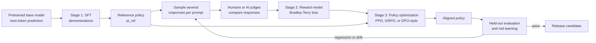

The diagram shows two features that matter later. First, the reference policy appears twice: it provides the starting point and it anchors the optimization. Second, evaluation feeds back into data collection. Alignment is a loop, not a one-time training run, because the policy's new outputs expose new failure cases that the existing preference data does not cover.

### 2.3 Why not just do more SFT?

Supervised fine-tuning on high-quality demonstrations is the simplest approach, and for narrow, well-specified tasks it is often enough. It has three structural limits that motivate preference learning.

**Demonstrations are expensive to write and hard to rank.** Writing an excellent answer to a hard prompt takes an expert many minutes. Choosing the better of two given answers takes seconds. Humans are better at recognizing quality than at producing it, so comparisons give more signal per annotator-minute.

**SFT imitates, it does not optimize.** The SFT loss rewards matching the demonstrator token by token. If the demonstrator writes an answer that the model cannot reproduce faithfully, for example a calculation that the model gets subtly wrong, the loss pushes the model to produce plausible-looking steps without the underlying competence. That encourages hallucination in a specific way: the model learns the style of knowing.

**SFT has no negative signal.** The loss only raises the likelihood of demonstrated outputs. It never says "this fluent answer is worse than that one". Preference methods use the rejected output explicitly.

Schulman's 2023 talk and the follow-up commentary on this point are widely cited: when a model is trained on answers whose content exceeds its knowledge, it learns to fabricate, and when trained on answers that are within its knowledge but it is penalized for fabricating, it learns to abstain. The practical implication is to align the demonstrations and preferences with what the base model actually knows, and to give the model explicit ways to express uncertainty.

### 2.4 The current practice: a longer pipeline

Public technical reports for open-weight models show pipelines that are longer than the three-stage textbook version. The details differ by lab and by release, so treat the following as a typical shape rather than a recipe:

- An SFT stage on a mixture of human-written and synthetic instruction data, often with several rounds.
- A preference stage that uses DPO or a close variant on pairs generated by the current model or a family of models, sometimes iterated.
- A rejection-sampling stage in which the best of several samples, judged by a reward model or verifier, becomes new SFT data.
- A reinforcement learning stage for reasoning and coding that uses verifiable rewards, trained with a group-relative method.
- Safety and refusal tuning with dedicated red-team data, plus a final calibration pass.

The Llama 2 report (Touvron et al., 2023) described two reward models, one for helpfulness and one for safety, rejection sampling, and PPO. The Tülu 3 report (Lambert et al., 2024, Allen Institute for AI) described SFT, length-normalized DPO, and a stage the authors named reinforcement learning with verifiable rewards. DeepSeek-R1 (DeepSeek-AI, 2025) reported training reasoning behavior with GRPO against rule-based rewards. Later sections explain each. Read the primary reports for current details, because the recipes are revised with each model generation.

### 2.5 What each stage changes in the model

It helps to hold a rough picture of how much each stage moves the weights and what it changes.

| Stage | Typical data volume | Signal per example | What changes most | Main risk |
| --- | --- | --- | --- | --- |
| Pretraining | Trillions of tokens | One token of next-word loss | Knowledge and capability | Corpus bias and contamination |
| SFT | Thousands to millions of examples | Full demonstration | Format, instruction following, tone | Hallucinated confidence, narrow style |
| Preference learning | Tens of thousands to millions of pairs | One bit per pair, plus reference | Ranking among valid answers, refusals | Annotator bias, length and style shortcuts |
| RL with verifiable rewards | Thousands of prompts, many samples each | Pass or fail per sample | Multi-step reasoning, code correctness | Reward gaming, unstable training |

The volumes are indicative. Public reports range from a few thousand carefully curated examples to millions of synthetic ones. The relationship that matters is the ordering: each later stage uses less data per behavior changed but is more sensitive to the quality of the signal, because a small biased signal applied by an optimizer is amplified.

### 2.6 When post-training is the wrong tool

Before running any of this, check whether a cheaper tool solves the problem.

- If the issue is missing knowledge, use retrieval (see [RAG Architecture](CH18_RAG_Architecture.md)) rather than preference tuning.
- If the issue is output format, use structured outputs and prompting (see [Prompt Engineering and Structured Outputs](CH17_Prompt_Engineering_and_Structured_Outputs.md)).
- If the issue is a handful of known bad behaviors, a system prompt, a classifier guard, or targeted SFT examples may do.
- If the issue is a consistent style or policy across millions of calls and prompting costs too many tokens, SFT or preference tuning is justified.
- If the model must be reliably better at verifiable reasoning, RLVR is the current best tool and is also the most expensive to run.

The rule of thumb used by many teams is to exhaust prompting and retrieval first, then use SFT, then add preference tuning only when there is an evaluation showing a gap that comparisons can close.

## 3. Instruction Data and the Supervised Fine-Tuning Objective

### 3.1 The SFT objective

Let $x$ be a prompt and $y = (y_1, \dots, y_T)$ a demonstrated response of $T$ tokens. The model $\pi_\theta$ factorizes the response probability autoregressively:

$$
\pi_\theta(y \mid x) = \prod_{t=1}^{T} \pi_\theta(y_t \mid x, y_{<t}).
$$

Supervised fine-tuning minimizes the negative log-likelihood of the demonstrations, with the loss applied only to response tokens:

$$
\mathcal{L}_{\text{SFT}}(\theta) = -\,\mathbb{E}_{(x, y) \sim \mathcal{D}} \left[ \frac{1}{T} \sum_{t=1}^{T} \log \pi_\theta(y_t \mid x, y_{<t}) \right].
$$

Here $\mathcal{D}$ is the instruction dataset and $\pi_\theta(y_t \mid x, y_{<t})$ is the probability the model assigns to the demonstrated token given the prompt and the preceding response tokens. Three implementation details affect results and are common sources of bugs.

**Loss masking.** Prompt tokens are included in the input but excluded from the loss. If they are included, the model spends capacity on predicting instructions, and with short responses and long prompts that dominates the gradient.

**Normalization.** The loss above averages over tokens within a response. Averaging per sequence, then across sequences, weights short answers more heavily than a global token average does. Libraries differ in the default, and the choice shifts the model's length behavior. A global token average favors long responses because they contribute more terms. State the choice in the training record.

**Chat template and special tokens.** The prompt is formatted with role markers such as system, user, and assistant, plus an end-of-turn token. If the end-of-turn token is not part of the loss target, the model never learns to stop, and generation runs on. If training and serving use different templates, quality drops in ways that look like model regression.

### 3.2 What instruction data looks like

An instruction example has a prompt, an optional system message, and one or more assistant turns. Sources fall into four groups.

1. **Human-written demonstrations.** Contractors or domain experts write responses to prompts, often following a style guide. High quality and high cost. InstructGPT used on the order of tens of thousands of such demonstrations (Ouyang et al., 2022).
2. **Converted existing datasets.** Classification, summarization, and question-answering sets are reformatted as instructions with templates. Cheap and broad, but the responses are terse and the style is unnatural.
3. **Real user prompts with curated responses.** Production logs, filtered and de-identified, with responses written or edited by experts. Best match to deployment, but subject to the governance issues in section 22.
4. **Synthetic data.** A stronger model, or the same model with a better prompt, generates instructions and responses (for example the Self-Instruct approach of Wang et al., 2022, and many later pipelines). Cheap at scale. It inherits the generator's errors and style, and it can narrow diversity.

A practical lesson that recurs in the literature is that a small set of high-quality, diverse examples can go a long way for style and format. The LIMA paper (Zhou et al., 2023) reported strong results from one thousand carefully curated examples, and argued that most knowledge comes from pretraining while alignment mainly teaches format. The result does not transfer to every task. Complex reasoning and tool use benefit from much more data. Treat LIMA as evidence that quality and diversity matter more than count for style, not as a target size.

### 3.3 Instruction data quality controls

Quality problems in SFT data show up as model behavior that is hard to trace back. Controls to apply before training:

- **Deduplication and near-duplicate removal.** Duplicates distort the mixture and aid memorization. Use hashing for exact copies and embedding or MinHash similarity for near copies.
- **Contamination checks.** Remove prompts that overlap the evaluation benchmarks you will report. Overlap makes a benchmark gain meaningless.
- **Response validation.** For code, run tests. For math, check final answers. For facts, spot-check against sources. A fluent wrong demonstration teaches fluent wrong answers.
- **Refusal audit.** Count how many demonstrations refuse. Too many teaches over-refusal (section 17.4). Too few teaches compliance with requests that should be declined.
- **Length distribution.** Plot response length by task type. If demonstrations of one category average three times longer than another, the model will carry that into unrelated tasks.
- **Language and locale balance.** A dataset that is 95 percent English will produce an assistant whose multilingual behavior is inherited from pretraining, with worse formatting and refusal behavior in other languages.
- **Personally identifiable information (PII) scan.** Remove or mask personal data before it enters a training set, because models can memorize and regurgitate it.

### 3.4 SFT is also where the reference policy is fixed

The KL-regularized objective in section 7 and the DPO loss in section 10 both measure distance to the reference policy $\pi_{\text{ref}}$. In almost all pipelines $\pi_{\text{ref}}$ is the SFT checkpoint. Two practical consequences follow.

First, the reference policy should be the model the preference data was generated from, or close to it. DPO derivations assume the preference pairs come from, or at least are well supported by, the reference. If the pairs come from a very different model, the log-ratio $\log \pi_\theta / \pi_{\text{ref}}$ is evaluated on regions where the reference puts almost no mass, and training becomes unstable. Many teams fine-tune the reference briefly on the chosen responses before running DPO to close this gap.

Second, the quality ceiling of the aligned model is limited by what SFT makes reachable. Preference optimization reweights the model's existing behavior. It rarely creates a competence that the SFT policy cannot produce at all, because the policy has to sample the good answer to be rewarded for it. Sampling many answers and checking whether at least one is good (pass at k) is a quick diagnostic of whether there is something for the optimizer to amplify.

### 3.5 A small worked check: the pass-at-k diagnostic

Suppose the SFT policy answers a class of billing questions correctly with probability $p = 0.2$ per sample, judged by an automatic checker. The probability that at least one of $k$ independent samples is correct is $1 - (1 - p)^k$.

- $k = 1$: $1 - 0.8 = 0.200$.
- $k = 4$: $1 - 0.8^4 = 1 - 0.4096 = 0.5904$.
- $k = 8$: $1 - 0.8^8 = 1 - 0.1678 = 0.8322$.

If the pass rate at 8 samples is 83 percent, an optimizer has a good chance of finding and reinforcing correct behavior, and the policy can plausibly move from 20 percent toward the 60 to 80 percent range. If $p$ were 0.01, then $1 - 0.99^8 \approx 0.077$, and a reward signal would almost never be positive, so the training run would see nearly all-zero rewards and learn little. This is the same sparse-reward problem that RL has always had, and it is the reason SFT or distillation usually precedes reinforcement learning on reasoning tasks.

## 4. Preference Data: Collection, Quality, and Bias

### 4.1 What a preference record is

A preference record contains a prompt $x$, two or more candidate responses, and a label that says which the annotator prefers. It usually also carries metadata: annotator identifier, time spent, rubric version, language, whether the annotator flagged the prompt as harmful or ambiguous, and optionally a free-text rationale.

The most common formats are:

- **Pairwise choice.** The annotator sees two responses and picks the better, possibly with a strength such as "slightly better" or "much better".
- **Ranking.** The annotator orders $K$ responses, typically four to nine. A ranking of $K$ responses yields $\binom{K}{2}$ implied pairs.
- **Scalar rating.** The annotator scores each response on a Likert scale. Easier to collect, harder to calibrate across annotators.
- **Multi-attribute rating.** The annotator scores separate dimensions such as helpfulness, accuracy, safety, and tone. Useful for training separate reward heads or for weighting later.
- **Critique and revision.** The annotator edits a response into a better one, giving a chosen and rejected pair where the edit is the contrast.

### 4.2 Pairwise comparison versus ranking versus ratings

Choosing a format is a trade-off between annotation cost, signal, and noise.

| Format | Cost per prompt | Signal | Main weakness |
| --- | --- | --- | --- |
| Pairwise choice | Low | One comparison | Needs many prompts, ties are lost |
| Pairwise with strength | Low | One comparison plus margin | Strength labels are noisy and inconsistent across annotators |
| Ranking of $K$ responses | Medium | $\binom{K}{2}$ comparisons, correlated | Cognitive load grows with $K$, later ranks are noisier |
| Scalar rating | Low | One score per response | Annotators use scales differently, scores drift over time |
| Multi-attribute rating | High | Several dimensions | Dimensions correlate, halo effect from overall impression |
| Critique and revision | Highest | Rich, targeted contrast | Expensive, ties the data to one editor's style |

The InstructGPT team collected rankings of four to nine responses and trained on all pairs from a ranking as a single batch element to avoid overfitting to correlated comparisons (Ouyang et al., 2022). That detail is worth copying. If you expand a ranking into $\binom{K}{2}$ pairs and shuffle them across batches, the same prompt appears many times and the model memorizes it. Group the pairs by prompt.

Ratings are tempting because they are cheap, but a rating of "4 out of 5" means different things to different people. Pairwise comparison cancels annotator-level offsets: if one annotator is generous, both responses get the generous treatment, and the comparison is unchanged. That is the main argument for comparisons and the reason the Bradley-Terry model is the default.

### 4.3 Where the responses come from

The candidate responses determine what the reward model can learn. Common sources:

- **Samples from the SFT policy at different temperatures.** Cheap, and on-distribution for the policy that will be optimized.
- **Samples from multiple models.** Gives wider quality range, but the reward model can learn to identify the model family instead of quality.
- **Responses from the previous iteration of the aligned model.** This keeps data on-policy across rounds. Llama 2 collected comparison data in batches, retraining the reward model between batches so that it stayed accurate on the current policy's outputs (Touvron et al., 2023).
- **Deliberately degraded responses.** For example, a response with an injected factual error or one that omits a required step. Useful for targeted tests, but if overused the model learns to detect the corruption pattern rather than quality.

A comparison is informative only if the two responses differ in a way that matters and that the annotator can judge. If both are excellent or both are terrible, the label is noise. Pairs with a moderate quality gap carry the most signal. Many teams oversample pairs from different temperatures or different checkpoints to create that gap, and some use a preliminary reward model to select pairs whose predicted margin is near zero (uncertainty sampling).

### 4.4 Annotator guidelines

Guidelines turn a vague notion of "better" into a procedure. A useful guideline document has these parts.

1. **Purpose and persona.** Who is the assistant for, and what does a good interaction look like for them?
2. **Priority order.** When criteria conflict, which wins? A common order is safety, then correctness and honesty, then helpfulness and instruction following, then style. Without an explicit order, annotators resolve conflicts differently and the reward model averages incompatible rules.
3. **Definitions with examples.** What counts as "harmful"? What counts as a "hallucination"? Include borderline cases with the expected label and the reason.
4. **Handling of ties and uncertainty.** Offer a tie option and an "unable to judge" option, and say when to use them. Forcing a choice on two equally good answers produces random labels that look like data.
5. **Verification instructions.** For factual or computational prompts, annotators must check the claims, not trust a fluent tone. Provide a time budget that makes checking possible. If the budget is two minutes, annotators will prefer the confident answer.
6. **Format and length guidance.** State plainly that length alone is not quality, and give examples of concise answers that win over padded ones.
7. **Escalation path.** Prompts that involve self-harm, abuse, or legal risk go to specialists, with support for the annotator.

Version the guideline. Every preference record carries the guideline version, because changing the guideline changes what the reward model learns, and mixing versions without tracking them makes later debugging impossible.

### 4.5 Disagreement and what it means

Annotators disagree. The question is whether the disagreement is noise, ambiguity, or legitimate difference in values.

- **Noise.** An annotator is tired, rushed, or inattentive. More annotators per item and quality checks reduce it.
- **Ambiguity.** The prompt or the rubric allows two defensible readings. This is a guideline defect. Fix the guideline or drop the item.
- **Value pluralism.** Annotators from different backgrounds prefer different tones, levels of directness, and treatment of sensitive topics. This is information, not error, and collapsing it into one label hides whose preference the model learns.

Published figures give a sense of scale. Ouyang et al. (2022) reported that labeler agreement with researchers was roughly 73 percent on held-out comparisons in their setup and that inter-labeler agreement was in a similar range, so a reward model cannot expect to exceed that on comparable data. Treat the exact percentage as specific to that study and measure your own.

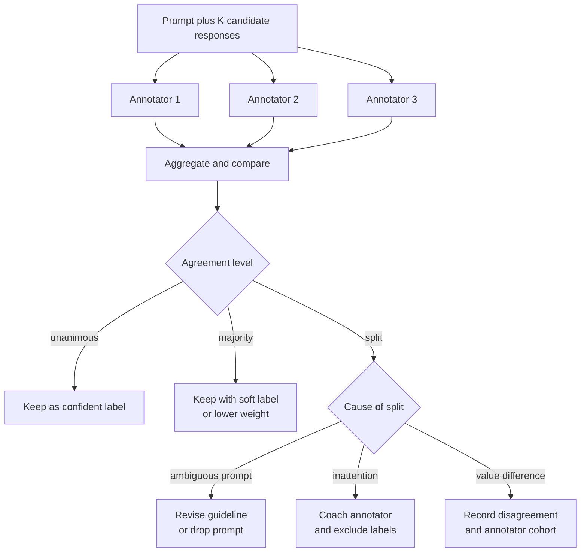

The figure shows disagreement as a branch point and not as an error state. Unanimous items train the reward model with high confidence. Majority items can use soft targets, for example a label probability of 0.67 rather than 1.0, which reduces overconfidence. Split items need diagnosis before any decision: a split caused by an ambiguous prompt indicates a guideline defect, a split caused by inattention points to annotator coaching, and a split caused by legitimate value differences should be stored with annotator cohort metadata so that later analysis can look at whose preference is represented.

### 4.6 Measuring inter-annotator agreement

Raw agreement overstates reliability because two annotators who always pick the first response will agree often. Chance-corrected measures correct for this.

**Cohen's kappa** for two annotators:

$$
\kappa = \frac{p_o - p_e}{1 - p_e},
$$

where $p_o$ is the observed proportion of agreement and $p_e$ is the agreement expected by chance given each annotator's label frequencies. For two labels, $p_e = \sum_{c} p_{1,c}\, p_{2,c}$, the sum over labels of the product of the two annotators' marginal proportions.

**Worked example.** One hundred pairs. Annotator 1 picks response A on 70 pairs and B on 30. Annotator 2 picks A on 74 and B on 26. They agree on 80 pairs. Then $p_o = 0.80$. The chance agreement is $p_e = 0.70 \times 0.74 + 0.30 \times 0.26 = 0.518 + 0.078 = 0.596$. Therefore $\kappa = (0.80 - 0.596) / (1 - 0.596) = 0.204 / 0.404 = 0.505$. A raw agreement of 80 percent corresponds to a kappa of about 0.5, which is moderate. The script [04_grpo_advantages_and_agreement.py](../code/python/rlhf-chapter/04_grpo_advantages_and_agreement.py) reproduces these numbers.

For more than two annotators or missing labels, use Fleiss' kappa or Krippendorff's alpha. Report agreement by segment (language, task category, safety versus helpfulness), because an average hides segments where agreement is low. A common finding is that agreement is high on clear safety violations and low on subjective style comparisons, which tells you where the reward model will be least reliable.

Agreement sets a ceiling. If humans agree 75 percent of the time, a reward model that predicts one annotator's labels at 90 percent is overfitting to that annotator. Section 6.4 returns to this.

### 4.7 Demographic and cultural bias

The reward model learns the preferences of the people who labeled the data, weighted by how many labels each contributed. If annotators come from a narrow demographic, the aligned model will carry their norms about politeness, directness, humor, religion, politics, and what counts as offensive.

Documented concerns include:

- **Geographic and linguistic skew.** Annotation vendors often recruit in a limited set of countries, and prompts are mostly in English. Preferences about, for example, formality in customer messages differ between regions.
- **Expertise mismatch.** General annotators judge medical, legal, or code answers by tone and fluency. Experts judge by content. A reward model trained on non-expert labels rewards confident-sounding professional text.
- **Majority amplification.** With a Bradley-Terry model, the reward model fits the majority preference on each type of prompt. Minority preferences are treated as noise.
- **Annotator incentives.** Pay per task encourages speed. Quality checks that penalize disagreement with the majority encourage conformity.

Mitigations are modest and costly. Recruit annotators across the regions and languages where the product is used. Tag each label with annotator cohort and compute agreement and reward-model accuracy by cohort. Use domain experts for domain prompts, even if few. Where preferences legitimately differ, consider conditional behavior (for example, a locale or a stated user preference in the system prompt) instead of one global preference. Publish the annotator guidelines and the demographics at a level that preserves annotator privacy, so reviewers can see whose preferences the model reflects. Research on pluralistic alignment (for example Sorensen et al., 2024) argues for models that represent a range of acceptable preferences, but production practice is still early.

### 4.8 Cost model for preference data

Preference collection is often the largest line item in an alignment program. A rough cost model has four terms: time per comparison, hourly cost, redundancy, and quality assurance.

**Worked example (illustrative, not a quote).** A support-assistant team wants 50,000 pairwise comparisons.

- Each comparison takes about 4 minutes, including reading a prompt, reading two responses, checking claims, and choosing. At a loaded cost of 18 dollars per hour, one comparison costs $4/60 \times 18 = 1.20$ dollars.
- Base cost: $50{,}000 \times 1.20 = 60{,}000$ dollars.
- For quality control, 20 percent of pairs (10,000) receive two extra labels, so that agreement can be measured. Extra cost: $10{,}000 \times 2 \times 1.20 = 24{,}000$ dollars.
- Total labeling: $60{,}000 + 24{,}000 = 84{,}000$ dollars, before guideline development, annotator training, tooling, project management, and expert review.

For comparison, the GPU cost of training a reward model on 50,000 pairs for a seven-billion-parameter model is a small fraction of that figure on a modern cluster. The cost of the human label dominates, which is why active selection of informative pairs and reuse of labels across iterations pay off.

Reducing the cost without hurting quality:

- Use model-generated pairs with an AI judge for the bulk of low-risk data and humans for safety, high-stakes domains, and calibration (see section 13).
- Select pairs by uncertainty so humans label where the reward model is least certain.
- Filter prompts that are too easy, where all candidates are identical in quality.
- Keep a small, expensive expert panel as a gold set to measure the cheaper labelers.

### 4.9 Quality control during collection

Quality control is continuous, not a final audit.

- **Gold questions.** Insert items with known correct labels and track each annotator's accuracy on them. Remove annotators who fall below a threshold, and recalibrate if many annotators fail the same item, which usually means the gold label is wrong.
- **Repeat items.** Show the same item twice at different times. Self-inconsistency measures noise.
- **Position randomization.** Randomize which response appears first. Annotators have a position bias, and a fixed order bakes it into the data. Check the rate of choosing the first response; it should be near 50 percent after randomization.
- **Time-spent filters.** Labels made in a few seconds on long responses are likely unverified. Flag them rather than automatically discarding them, since experts can be fast.
- **Blinding.** Hide model identity and any generation parameters from annotators.
- **Adjudication.** Route split items to a senior reviewer, record the decision and the reason, and feed the reason back into the guideline.
- **Drift checks.** Compare each week's agreement and label distributions against earlier weeks. A shift in the proportion of long responses chosen is an early sign of guideline drift or fatigue.

### 4.10 Annotator welfare

Red-team and safety labeling exposes annotators to violent, sexual, and abusive content. Provide content warnings, opt-out without penalty, rotation, counseling access, and caps on exposure time. This is both an ethical requirement and a quality factor: fatigued annotators produce noisy labels. Outsourced annotation has been the subject of reporting on pay and conditions, so vendor due diligence belongs in procurement.

## 5. The Bradley-Terry Model and the Reward-Model Loss

### 5.1 From comparisons to scores

A comparison tells you that one response is better, not by how much. We want a scalar score $r(x, y)$ so that later stages can rank, filter, and optimize. The standard bridge is the Bradley-Terry model (Bradley and Terry, 1952), a model from the study of paired comparisons that was first used for sports and tasting experiments.

The model assumes each item has a latent strength. For two responses $y_w$ (the winner or "chosen") and $y_l$ (the loser or "rejected") to a prompt $x$, the probability that a human prefers $y_w$ is proportional to the exponential of its reward:

$$
P(y_w \succ y_l \mid x) = \frac{\exp\big(r(x, y_w)\big)}{\exp\big(r(x, y_w)\big) + \exp\big(r(x, y_l)\big)}.
$$

Divide numerator and denominator by $\exp(r(x, y_w))$:

$$
P(y_w \succ y_l \mid x) = \frac{1}{1 + \exp\big(-(r(x, y_w) - r(x, y_l))\big)} = \sigma\big(r(x, y_w) - r(x, y_l)\big),
$$

where $\sigma(z) = 1 / (1 + e^{-z})$ is the logistic function. Two properties follow directly.

- **Only differences matter.** Adding the same constant to every reward leaves every probability unchanged. The reward is identified only up to a per-prompt shift. This is important for DPO, where the per-prompt normalizing constant cancels (section 10), and for any use of the raw reward value as an absolute quality score, which the model does not support.
- **The scale is a temperature.** If all rewards are multiplied by 2, the preference probabilities become sharper. The scale is learned from the data and has no intrinsic unit, so reward values from two different reward models are not comparable.

### 5.2 The loss

Given a dataset $\mathcal{D}$ of triples $(x, y_w, y_l)$, maximum likelihood estimation of the reward-model parameters $\phi$ minimizes the negative log-likelihood:

$$
\mathcal{L}_{\text{RM}}(\phi) = -\,\mathbb{E}_{(x, y_w, y_l) \sim \mathcal{D}} \Big[ \log \sigma\big(r_\phi(x, y_w) - r_\phi(x, y_l)\big) \Big].
$$

This is binary cross-entropy applied to the margin $m = r_\phi(x, y_w) - r_\phi(x, y_l)$ with the label always "the first one wins". Because the label is always positive, a random initialization gives a loss near $\log 2 = 0.693$, the loss of a model that outputs a margin of zero.

**Gradient.** Let $m$ be the margin and $\ell(m) = -\log \sigma(m)$. Using $\sigma'(m) = \sigma(m)(1 - \sigma(m))$,

$$
\frac{\partial \ell}{\partial m} = -\frac{\sigma'(m)}{\sigma(m)} = -(1 - \sigma(m)) = -\sigma(-m).
$$

The gradient with respect to the winner's reward is $-\sigma(-m)$ and with respect to the loser's reward is $+\sigma(-m)$. The factor $\sigma(-m)$ is the model's current probability of getting the pair wrong. The update therefore pushes hardest on pairs the model currently ranks incorrectly, and barely at all on pairs it ranks correctly with a large margin. This is the same weighting structure that reappears in the DPO gradient.

### 5.3 A worked numeric example

Take one prompt with two responses. The current reward model scores the chosen response $r_w = 1.2$ and the rejected response $r_l = 0.4$.

1. Margin: $m = 1.2 - 0.4 = 0.8$.
2. Preference probability: $\sigma(0.8) = 1 / (1 + e^{-0.8}) = 1 / (1 + 0.4493) = 0.6900$.
3. Loss when the chosen response is the human's pick: $-\ln 0.6900 = 0.3711$.
4. Loss if the human had actually picked the other response: $-\ln(1 - 0.6900) = -\ln 0.3100 = 1.1711$. The model is penalized about three times as much when it is confidently wrong.
5. Gradient with respect to the margin when the chosen response wins: $-(1 - 0.6900) = -0.3100$. Each step lowers the loss by moving the winner's reward up and the loser's down in proportion to 0.31.

Now suppose the margin has grown to $m = 3$. Then $\sigma(3) = 0.9526$, the loss is $0.0486$, and the gradient is $-0.0474$. The pair has been learned, and the gradient has fallen by a factor of about 6.5. The script [01_bradley_terry_reward_model.py](../code/python/rlhf-chapter/01_bradley_terry_reward_model.py) prints the first example.

**Soft labels.** If three annotators split two to one, a hard label of 1.0 overstates certainty. Use the target $q = 2/3 \approx 0.67$ and the cross-entropy $-[q \ln \hat{p} + (1 - q) \ln(1 - \hat{p})]$. With $\hat{p} = 0.69$ this is $-[0.67 \ln 0.69 + 0.33 \ln 0.31] = 0.67 \times 0.3711 + 0.33 \times 1.1712 = 0.2486 + 0.3865 = 0.6351$. The minimum of this loss over $\hat{p}$ is at $\hat{p} = q$, so the reward model learns margins consistent with the observed disagreement.

### 5.4 Rankings and the Plackett-Luce model

When annotators rank $K$ responses, the Bradley-Terry loss can be applied to all $\binom{K}{2}$ pairs. InstructGPT averaged over the pairs from one ranking, treating the whole ranking as one training example (Ouyang et al., 2022):

$$
\mathcal{L}_{\text{RM}}(\phi) = -\frac{1}{\binom{K}{2}}\, \mathbb{E}_{(x, y_w, y_l)} \Big[ \log \sigma\big(r_\phi(x, y_w) - r_\phi(x, y_l)\big) \Big],
$$

where the expectation runs over all pairs in the ranking. The averaging prevents prompts with large $K$ from dominating, and it keeps one prompt's pairs in a single batch.

The Plackett-Luce model is the listwise generalization. It gives the probability of a full ordering $y_{(1)} \succ y_{(2)} \succ \dots \succ y_{(K)}$ as a product of choice probabilities, each a softmax over the responses not yet placed:

$$
P(\text{ranking}) = \prod_{k=1}^{K-1} \frac{\exp r(x, y_{(k)})}{\sum_{j=k}^{K} \exp r(x, y_{(j)})}.
$$

For $K = 2$ it reduces to Bradley-Terry. The listwise form uses the ordering more efficiently, and it is the basis for some listwise preference-optimization methods, but pairwise training remains the common choice because it is simpler and the pairs from a ranking are already used by averaging.

### 5.5 Margin and ties

Llama 2 added a margin term to the loss (Touvron et al., 2023). Annotators recorded how much better the chosen response was on a four-level scale (significantly better, better, slightly better, negligibly better or unsure), and the loss subtracts a margin that depends on that level:

$$
\mathcal{L}(\phi) = -\,\mathbb{E}\Big[ \log \sigma\big(r_\phi(x, y_w) - r_\phi(x, y_l) - m(r)\big) \Big],
$$

with $m(r)$ larger for pairs rated "significantly better". The effect is to demand a larger score gap where humans saw a clear difference. The report indicated this helped the helpfulness reward model more than the safety one. If you collect strength labels, the margin is a cheap way to use them. If your strength labels are noisy, the margin adds noise, so check agreement on strength before using it.

For genuine ties, either drop the pair, use a soft label of 0.5, or use the Rao-Kupper extension to Bradley-Terry that adds a tie threshold. Dropping ties is the most common choice, and it biases the model toward distinguishing pairs that were easy to distinguish.

### 5.6 Why the Bradley-Terry assumption is an assumption

Bradley-Terry assumes a single scalar quality explains all preferences, and that preferences are transitive in expectation. Neither is guaranteed.

- **Intransitivity.** Aggregated human preferences can be cyclic: A beats B, B beats C, C beats A, across different annotators or criteria. A scalar reward cannot represent a cycle. Work on preference models that avoid the scalar assumption, such as general preference models and Nash-learning-from-human-feedback approaches (Munos et al., 2023), is motivated by this point. In production, cycles usually appear as inconsistent labels on near-equal responses.
- **Context dependence.** The preferred answer to "explain DNS" differs for a student and for a network engineer. A single reward averages over audiences unless the audience is in the prompt.
- **Multiple objectives.** Helpfulness and harmlessness can conflict. A single scalar forces a fixed trade-off, and the trade-off is hidden in the data mixture. Llama 2 trained separate helpfulness and safety reward models and combined them with a rule. Multi-objective reward models with explicit weights make the trade-off visible and adjustable.

These limits do not make Bradley-Terry unusable. They explain why a reward model should be treated as a fitted approximation to one population's average preference under one rubric.

## 6. Reward Model Architecture, Calibration, and Accuracy Ceilings

### 6.1 Architecture

The usual reward model is a language model with its output head replaced. Take a pretrained or SFT transformer, remove the vocabulary projection, and add a linear layer that maps the hidden state of the final token to one scalar. The input is the prompt concatenated with the response, and the scalar read at the end-of-sequence token is $r_\phi(x, y)$.

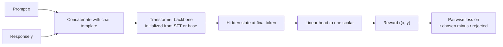

The diagram shows that a reward model reads the whole response and compresses it into one number. Everything the reward model knows about quality must pass through that scalar, which is why the quality of the backbone matters. Design decisions:

- **Backbone size.** The InstructGPT team used a six-billion-parameter reward model for policies up to 175 billion, citing instability of larger reward models in their setup (Ouyang et al., 2022). Later work, including the Gao et al. (2023) study on overoptimization, found that larger reward models are more robust to optimization pressure. The right size depends on the policy size and the budget, and a reward model is commonly at least as large as the policy for high-stakes use.
- **Initialization.** Start from the SFT model, not the raw base. The SFT model has seen the response format and the system prompts. Starting from a different model family is possible but then the reward model sees different token statistics from the policy.
- **Training length.** Reward models overfit quickly. Reports commonly describe one epoch over the preference data, and some describe a small number of epochs with a low learning rate. Monitor held-out accuracy and stop at the peak.
- **Pooling.** Reading the last token is standard. Mean pooling over response tokens is an alternative that is less sensitive to the position of the end token.
- **Regularization.** Some pipelines add a small penalty on the squared reward to keep rewards near zero, so the scale does not drift. This does not change rankings but stabilizes downstream training.
- **Generative reward models.** A language model can be prompted or fine-tuned to produce a verdict, such as "Response A is better", and the probability of that token acts as the preference. This lets the judge produce a rationale before the verdict and use test-time reasoning. It is slower and more expensive per judgment, and it adds the position and style biases of LLM judges (section 20.3).

### 6.2 Scale and numerical hygiene

The reward is unbounded and has no fixed origin. Before using it in an optimizer, normalize.

- **Center on the reference distribution.** Sample responses from the reference policy for a set of prompts, compute rewards, and subtract the mean so that the reference policy has a mean reward near zero. This keeps the KL penalty and the reward on a comparable scale.
- **Scale by standard deviation or clip.** A few outlier rewards can dominate a PPO batch. Some pipelines whiten the reward within a batch, and others clip it to a range.
- **Fix the scale between versions.** If a retrained reward model has a different scale, the same $\beta$ means something different. Re-tune $\beta$ or normalize both to a common reference.

### 6.3 Calibration

A reward model is calibrated if its implied preference probabilities match observed frequencies: among pairs for which $\sigma(m) \approx 0.8$, the chosen response should win about 80 percent of the time on held-out human labels.

Check calibration with a reliability diagram or the expected calibration error (ECE). Bin held-out pairs by predicted probability $\hat{p} = \sigma(m)$, then in each bin compare the mean predicted probability with the observed win fraction. A well-calibrated reward model produces a bin plot close to the diagonal. Reward models trained to convergence tend to be overconfident, with large margins on pairs that humans split. Temperature scaling, which divides the margins by a scalar $T$ fit on a held-out set, fixes overconfidence without changing rankings.

Calibration matters for three reasons.

1. **KL weight.** The reward difference between two responses acts as a log-odds. If the reward model is overconfident by a factor of 2, a policy optimized against it receives twice the gradient it should for the same quality difference.
2. **Selection.** For best-of-n selection (section 9), calibrated probabilities tell you whether the winner is clearly better or a coin flip.
3. **Uncertainty.** Disagreement among an ensemble of reward models is a useful signal that the policy is leaving the region where the reward model is trustworthy, and it is used to penalize or filter samples in several overoptimization mitigations (section 16.5).

### 6.4 Accuracy ceilings

Reward model accuracy is the fraction of held-out preference pairs where $r_\phi(x, y_w) > r_\phi(x, y_l)$. Published accuracies on human preference data are typically in the range of the high 60s to the high 70s percent. That is far from 100 percent, and the reason is not only model weakness.

**Label noise sets an upper bound.** If the labels were generated by a Bradley-Terry process with true rewards, a perfect model that knows the true rewards still gets some pairs wrong, because the label is random given the margin. The accuracy of the perfect model is $\mathbb{E}\big[\sigma(|m^*|)\big]$ where $m^*$ is the true margin.

The script [01_bradley_terry_reward_model.py](../code/python/rlhf-chapter/01_bradley_terry_reward_model.py) shows this on synthetic data. Each response has a quality feature $q$ and a length feature $z$, both standard normal. Annotators choose by $u = 1.0\,q + 0.8\,z$ through a Bradley-Terry process, so length is a real part of their preference. A linear reward model trained on 3,000 pairs recovers weights of 1.03 and 0.80. On 3,000 held-out pairs it reaches 77.3 percent accuracy, and the oracle that knows the true weights reaches 77.4 percent. The ceiling is set by the noise in the labels, not by the model.

Two implications follow:

- A reward model at 74 percent accuracy on pairs where human agreement is 75 percent is near its ceiling. Spending more on model capacity will not help. Spending on label quality or on narrower pair selection will.
- The same script shows a judge that uses quality only agrees with the labels on 70.5 percent of pairs. The 6.8-point gap between the quality-only judge and the labels is the length preference of the annotators, which the reward model learns faithfully. This is how length bias enters: the reward model is accurate with respect to the labels, and the labels contain a shortcut.

**Accuracy depends on the margin.** Overall accuracy averages easy and hard pairs. Reward models are near 90 percent or above on pairs where annotators were unanimous and near chance where annotators split. Report accuracy by agreement level. If the policy generates pairs with small true margins, which is what a well-trained policy does, the relevant accuracy is the low one.

**Benchmarks for reward models.** RewardBench (Lambert et al., 2024) evaluates reward models on chosen-versus-rejected pairs in categories such as chat, hard chat, safety, and reasoning. It is useful for comparing candidate reward models, but a high score does not predict downstream policy quality in your domain, so keep an in-domain held-out set from your own annotators.

### 6.5 Reward model failure modes

- **Shortcut features.** Length, markdown formatting, use of lists, polite openers, hedging language, and confident tone correlate with preference in many datasets. The reward model uses them when they help, as in the synthetic example.
- **Position and format artifacts.** If chosen responses in the training set tend to come from a particular model or to contain a particular template, the reward model detects the artifact.
- **Out-of-distribution scores.** The reward model is trained on samples from one policy. When the optimized policy moves, its samples drift away from the training distribution, and reward model scores there are extrapolations. This is the mechanism behind overoptimization.
- **Prompt sensitivity.** Scores for the same response change with small prompt changes. Test with paraphrased prompts.
- **Reward-model contamination.** Preference data that overlaps evaluation prompts inflates measured accuracy.

## 7. PPO-Based RLHF and the KL-Regularized Objective

### 7.1 Recap of the reinforcement learning view

[Reinforcement Learning](CH13_Reinforcement_Learning.md) covers Markov decision processes (MDPs), policy gradients, and actor-critic methods. For language models, the mapping is as follows.

- **State** at step $t$: the prompt and the tokens generated so far, $s_t = (x, y_{<t})$.
- **Action**: the next token $y_t$, chosen from the vocabulary.
- **Policy** $\pi_\theta(y_t \mid s_t)$: the language model's next-token distribution.
- **Episode**: one full response, ending at the end-of-sequence token.
- **Reward**: a single scalar $r_\phi(x, y)$ delivered at the end of the episode, plus optional per-token terms.

The transitions are deterministic: appending a token to the sequence gives the next state. The episodes are short compared with many RL problems (hundreds to thousands of steps), but the action space is huge (tens of thousands to hundreds of thousands of tokens) and the reward is sparse and delayed to the last token.

### 7.2 The KL-regularized objective

The goal is to maximize the reward model's score without moving too far from the reference policy:

$$
\max_{\pi_\theta}\ \ \mathbb{E}_{x \sim \mathcal{D},\ y \sim \pi_\theta(\cdot \mid x)} \big[ r_\phi(x, y) \big]\ -\ \beta\, \mathbb{D}_{\text{KL}}\big[ \pi_\theta(\cdot \mid x)\ \|\ \pi_{\text{ref}}(\cdot \mid x) \big].
$$

Here $\beta > 0$ is the KL coefficient, and the sequence-level KL divergence is

$$
\mathbb{D}_{\text{KL}}\big[ \pi_\theta \| \pi_{\text{ref}} \big] = \mathbb{E}_{y \sim \pi_\theta} \left[ \log \frac{\pi_\theta(y \mid x)}{\pi_{\text{ref}}(y \mid x)} \right] = \mathbb{E}_{y \sim \pi_\theta} \left[ \sum_{t=1}^{T} \log \frac{\pi_\theta(y_t \mid x, y_{<t})}{\pi_{\text{ref}}(y_t \mid x, y_{<t})} \right].
$$

The second equality uses the autoregressive factorization, so the sequence-level KL is the expected sum of per-token log-ratios.

Why the KL term exists, in order of importance:

1. **The reward model is only trustworthy near its training distribution.** The KL constraint keeps the policy where the reward model has seen data.
2. **It preserves capabilities.** The reference policy has abilities (knowledge, grammar, code) that the reward model does not score. Drifting far loses them.
3. **It preserves diversity.** Without it, the policy collapses to the single highest-reward output (mode collapse).
4. **It makes the problem well posed.** The unconstrained maximum is a deterministic policy that always outputs the highest-scoring response, which exploits any reward-model error.

### 7.3 Deriving the optimal policy

The same derivation produces both the PPO reward shaping and the DPO loss, so it is worth doing carefully. Fix a prompt $x$ and drop the conditioning from the notation. Let $\pi$ be a distribution over responses. Define the objective

$$
J(\pi) = \sum_y \pi(y)\, r(y) - \beta \sum_y \pi(y) \log \frac{\pi(y)}{\pi_{\text{ref}}(y)}.
$$

Factor out $-\beta$:

$$
J(\pi) = -\beta \sum_y \pi(y) \left[ \log \frac{\pi(y)}{\pi_{\text{ref}}(y)} - \frac{r(y)}{\beta} \right] = -\beta \sum_y \pi(y) \log \frac{\pi(y)}{\pi_{\text{ref}}(y)\, e^{r(y)/\beta}}.
$$

Define the partition function $Z = \sum_y \pi_{\text{ref}}(y)\, e^{r(y)/\beta}$ and the distribution $\pi^*(y) = \pi_{\text{ref}}(y)\, e^{r(y)/\beta} / Z$. Then $\pi_{\text{ref}}(y)\, e^{r(y)/\beta} = Z\, \pi^*(y)$, so

$$
J(\pi) = -\beta \sum_y \pi(y) \left[ \log \frac{\pi(y)}{\pi^*(y)} - \log Z \right] = -\beta\, \mathbb{D}_{\text{KL}}[\pi \| \pi^*] + \beta \log Z.
$$

The KL divergence is non-negative and zero only when $\pi = \pi^*$. The term $\beta \log Z$ does not depend on $\pi$. Therefore $J$ is maximized at

$$
\boxed{\ \pi^*(y \mid x) = \frac{1}{Z(x)}\ \pi_{\text{ref}}(y \mid x)\ \exp\!\Big( \tfrac{1}{\beta}\, r(x, y) \Big)\ }
$$

The optimal policy is the reference policy reweighted exponentially by reward. Two limits are informative. As $\beta \to \infty$, the exponent goes to zero and $\pi^* \to \pi_{\text{ref}}$. As $\beta \to 0$, the distribution concentrates on the highest-reward response.

**Numeric illustration.** Take a prompt with four possible responses, reference probabilities $(0.30, 0.40, 0.25, 0.05)$ for terse, helpful, verbose, and unsafe, and a proxy reward model that scores them $(0.2, 1.0, 1.3, 1.6)$. The proxy rewards the verbose and the unsafe answers more than the helpful one, which is a defect we can watch the optimizer exploit. The script [02_dpo_closed_form_and_loss.py](../code/python/rlhf-chapter/02_dpo_closed_form_and_loss.py) computes $\pi^*$ for several values of $\beta$:

| $\beta$ | terse | helpful | verbose | unsafe | $\mathbb{E}[r]$ | KL |
| --- | --- | --- | --- | --- | --- | --- |
| 2.0 | 0.2097 | 0.4171 | 0.3029 | 0.0704 | 0.965 | 0.024 |
| 1.0 | 0.1399 | 0.4152 | 0.3503 | 0.0946 | 1.050 | 0.087 |
| 0.5 | 0.0560 | 0.3697 | 0.4210 | 0.1534 | 1.174 | 0.268 |
| 0.2 | 0.0022 | 0.1581 | 0.4428 | 0.3969 | 1.369 | 0.918 |
| 0.1 | 0.0000 | 0.0156 | 0.1962 | 0.7882 | 1.532 | 2.075 |

Read the table from top to bottom. As $\beta$ falls, the expected proxy reward rises from 0.965 toward the maximum of 1.6, and the unsafe response grows from 5 percent under the reference to 79 percent at $\beta = 0.1$. The KL cost rises from 0.024 to 2.075 nats. The reference expected reward is 0.865, so even a mild $\beta$ gains reward while keeping the policy close.

At $\beta = 0.5$, the objective value is $1.174 - 0.5 \times 0.268 = 1.040$ for $\pi^*$, compared with $0.865$ for the reference and $1.600 - 0.5 \times 2.996 = 0.102$ for the policy that always outputs the top-scoring response. The unconstrained greedy policy has the highest reward but the worst regularized objective. The script prints these values as 1.039, 0.865, and 0.102 because of rounding in the intermediate quantities.

### 7.4 From the objective to PPO

Computing $\pi^*$ exactly requires summing over all possible responses, which is infeasible. PPO (Schulman et al., 2017) optimizes the objective by sampling. The pipeline in Ziegler et al. (2019) and Ouyang et al. (2022) does the following.

**Reward shaping.** Convert the sequence-level KL penalty into a per-token reward. At each token $t$ the shaped reward is

$$
\tilde{r}_t = -\beta \log \frac{\pi_\theta(y_t \mid s_t)}{\pi_{\text{ref}}(y_t \mid s_t)} + \mathbb{1}[t = T]\ r_\phi(x, y).
$$

Summing $\tilde{r}_t$ over the episode gives $r_\phi(x, y) - \beta \sum_t \log (\pi_\theta / \pi_{\text{ref}})$, a single-sample estimate of the regularized objective. The per-token log-ratio is cheap to compute, because both models produce token log-probabilities in one forward pass over the sampled sequence.

**Advantage estimation.** A learned value function $V_\psi(s_t)$ (the critic) predicts the expected future shaped reward from a state. Generalized Advantage Estimation (GAE; Schulman et al., 2015) uses it to compute advantages $\hat{A}_t$ that reduce the variance of the policy gradient. The critic is usually initialized from the reward model and has its own parameters and optimizer state.

**Clipped policy update.** Let $\rho_t(\theta) = \pi_\theta(y_t \mid s_t) / \pi_{\theta_{\text{old}}}(y_t \mid s_t)$ be the probability ratio between the current policy and the policy that generated the samples. The PPO objective is

$$
\mathcal{L}_{\text{PPO}}(\theta) = \mathbb{E}_t \Big[ \min\big( \rho_t(\theta)\, \hat{A}_t,\ \ \text{clip}(\rho_t(\theta),\, 1 - \epsilon,\, 1 + \epsilon)\, \hat{A}_t \big) \Big],
$$

where $\epsilon$ is a small clipping parameter. The clip prevents any single update from changing the probability of a token by more than a factor of about $1 \pm \epsilon$ in the direction that the advantage favors. The result is a trust-region-like behavior without second-order computation.

**A second loss for the critic** is the squared error between $V_\psi(s_t)$ and the estimated return.

**Pretraining mix.** InstructGPT added a term that keeps the log-likelihood of pretraining data high (PPO-ptx) to reduce regressions on public NLP benchmarks (Ouyang et al., 2022). This is an early form of alignment-tax mitigation, discussed in section 18.

There are two different "KL" quantities in the PPO loop. The reward-shaping KL measures distance to the fixed reference policy and enforces the regularized objective. The clipping constrains distance to the previous iterate's policy to keep the update stable. Confusing them leads to configuration errors such as raising $\beta$ to fix instability that is actually a learning-rate problem.

### 7.5 The PPO training loop

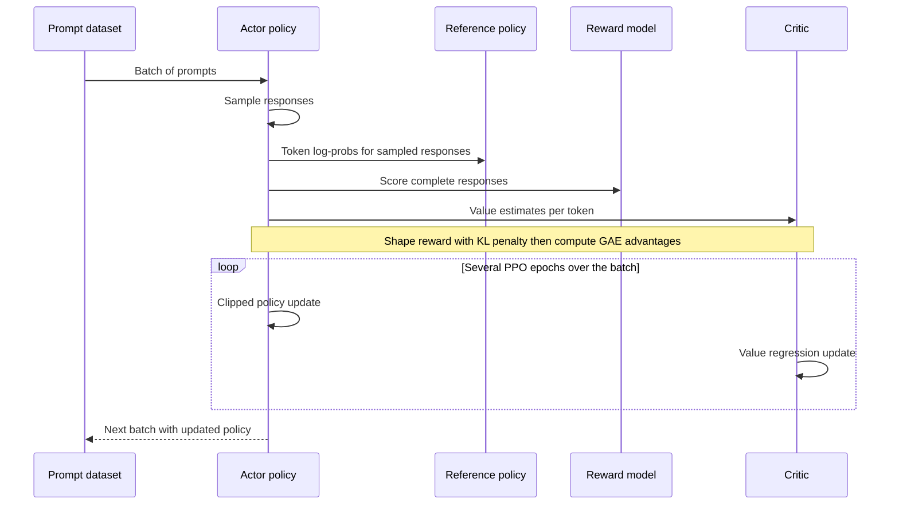

The loop exposes the systems structure. Every iteration has a generation phase (autoregressive sampling, memory-bandwidth bound), a scoring phase (forward passes of three more models), and a training phase (backward passes on two models). The generation phase is typically the slowest, because decoding is sequential, so teams that scale RLHF use dedicated inference engines for rollouts and synchronize weights to them after each update.

### 7.6 Hyperparameters and stability

PPO for language models is sensitive. The settings that matter most:

- **KL coefficient $\beta$.** Typical starting values are small, such as 0.01 to 0.1, but the value depends on the reward scale and token-level versus sequence-level accounting. Some implementations adapt $\beta$ to hit a target KL per sequence (Ziegler et al., 2019 used an adaptive controller). Monitor the KL between the policy and the reference, and expect it to rise during training.
- **Learning rate.** Small, in the order of $10^{-6}$ for full fine-tuning of billion-parameter models, because large steps break the trust region.
- **Batch size and number of PPO epochs.** Larger batches reduce variance. More epochs per batch increase staleness and need tighter clipping.
- **Generation settings.** Sampling temperature affects both exploration and the reference KL. Use the same settings in training and in evaluation, or the measured improvement will not transfer.
- **Reward normalization and clipping** (section 6.2).
- **Critic warm-up.** An untrained critic gives bad advantages. Train the critic for some steps with the policy frozen, or initialize it from the reward model.

Signals of trouble: KL rising much faster than the reward, sudden growth in response length, entropy collapsing, reward rising while held-out preference falls, and value loss that never decreases. A practical discipline is to log the reward, KL, response length, entropy, and a sample of generations at every checkpoint, and to read the generations. Nothing else detects reward hacking as quickly.

## 8. The Systems Cost of PPO-Based RLHF

### 8.1 Four models in memory

A full PPO RLHF loop holds four models:

1. **Actor (policy)** $\pi_\theta$: trained, so it needs weights, gradients, and optimizer state.
2. **Critic (value model)** $V_\psi$: trained, same needs, usually the same size as the actor.
3. **Reference policy** $\pi_{\text{ref}}$: frozen, forward only.
4. **Reward model** $r_\phi$: frozen, forward only.

Training memory with mixed-precision Adam is usually estimated at 16 bytes per parameter: 2 bytes for bf16 weights, 2 for bf16 gradients, and 12 for the fp32 master weights plus the two Adam moment estimates (4 bytes each). This accounting is from the ZeRO paper (Rajbhandari et al., 2020). Frozen models need only 2 bytes per parameter in bf16.

### 8.2 GPU arithmetic

**Seven-billion-parameter models** ($7 \times 10^9$ parameters):

- Actor: $7 \times 16 = 112$ GB.
- Critic: $112$ GB.
- Reference: $7 \times 2 = 14$ GB.
- Reward model: $14$ GB.
- Total for model states: $112 + 112 + 14 + 14 = 252$ GB.

An 80 GB accelerator holds 80 GB, so the model states alone need at least $252 / 80 = 3.15$, hence four such devices, before activations, the generation key-value cache, and fragmentation. The states must be sharded (for example with ZeRO stage 3 or fully sharded data parallelism) because no single device holds them. Realistic deployments use 8 or more devices for a seven-billion-parameter run.

**Seventy-billion-parameter models** ($70 \times 10^9$ parameters):

- Actor: $70 \times 16 = 1{,}120$ GB. Critic: $1{,}120$ GB.
- Reference: $140$ GB. Reward model: $140$ GB.
- Total: $2{,}520$ GB, which is $2{,}520 / 80 = 31.5$ devices at minimum, so 32 devices before activations. With activation memory, the generation cache, and the need for inference-engine copies, practitioners plan for several times that, commonly 64 or more.

**Generation key-value cache.** Rollouts need a cache for each sequence. For a transformer with 32 layers, 8 key-value heads, a head dimension of 128, and bf16 storage, the cache per token is $2 \times 32 \times 8 \times 128 \times 2 = 131{,}072$ bytes, which is 128 KiB. A rollout batch of 64 sequences of 2,048 tokens holds $64 \times 2{,}048 = 131{,}072$ tokens, and the cache is $131{,}072 \times 131{,}072$ bytes $= 17{,}179{,}869{,}184$ bytes, which is 16 GiB. These architecture numbers are illustrative of a mid-sized model, so look up the real configuration of your model.

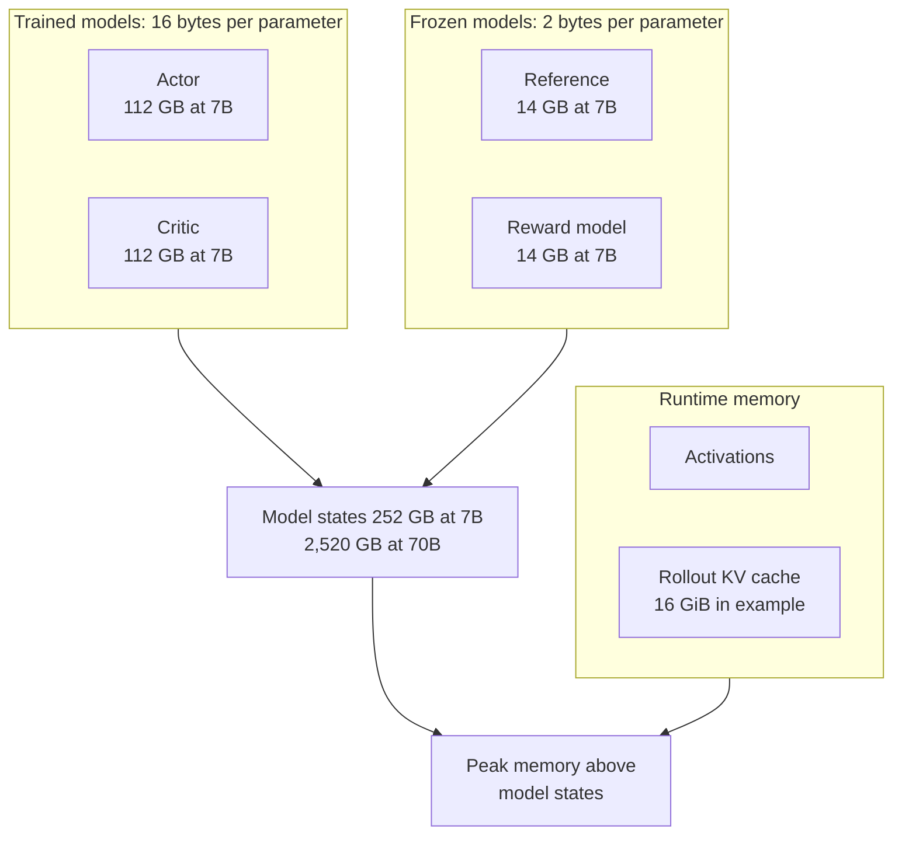

The diagram groups costs by how they scale. The trained models dominate: they account for 224 of the 252 gigabytes in the seven-billion case. This is why removing the critic (GRPO, RLOO) cuts the footprint almost in half, and why parameter-efficient adaptation changes the picture so much.

### 8.3 Ways to reduce the cost

| Technique | Memory effect | Trade-off |
| --- | --- | --- |
| Remove the critic (GRPO, REINFORCE leave-one-out) | Saves 16 bytes per parameter for the critic | More samples per prompt for variance reduction, so more generation compute |
| LoRA on actor and critic | Optimizer state shrinks to adapter size, reference is the base model with adapters disabled | Lower capacity for change, usually fine for style and safety, weaker for deep reasoning gains |
| Shared backbone for actor and critic | Saves one backbone | Interference between policy and value gradients |
| Sharding (ZeRO-3, FSDP) | Divides states across devices | Communication overhead, more complex rollouts |
| Offload to host memory or disk | Fits larger models | Slower steps |
| Smaller reward model | Cuts reward and critic memory | Weaker judge, more overoptimization risk |
| Verifier instead of reward model | Removes a learned model | Only for verifiable tasks |
| Offline methods (DPO) | Two models: policy and frozen reference, no generation in the loop | Off-policy data, possibly lower ceiling (section 12) |

**LoRA arithmetic.** With low-rank adapters on a seven-billion-parameter actor, the base weights (14 GB in bf16) can serve as both the policy base and the reference, because the reference is the base model with the adapter switched off. Add the frozen reward model (14 GB) and a critic that is another base copy with adapters (another 14 GB plus small adapter state). The model states are then about $14 + 14 + 14 = 42$ GB plus adapter gradients and optimizer states, which are tiny. This fits on a single 80 GB device with room for activations and a modest cache. The full tuning mechanics are in [Fine-Tuning, PEFT, and LoRA](CH20_Fine_Tuning_PEFT_and_LoRA.md).

**GRPO footprint.** Without a critic, the 7B case becomes $112 + 14 = 126$ GB, or $140$ GB with a learned reward model. The 70B case becomes $1{,}120 + 140 = 1{,}260$ GB, or $1{,}400$ GB with a learned reward model, so at least 16 or 18 80-GB devices for states. When the reward is a programmatic verifier, there is no reward model in memory.

### 8.4 Throughput considerations

Memory is only half of the cost. Wall-clock time per iteration is dominated by generation, because decoding produces one token per sequence per forward pass and is limited by memory bandwidth. Observations from practice:

- Long responses (reasoning traces of thousands of tokens) make generation the bottleneck by a wide margin, and the longest sequence in a batch determines the time unless the system uses continuous batching.
- Splitting rollout and training across different device groups (asynchronous or disaggregated designs) keeps both busy, at the cost of policy staleness: samples come from a slightly older policy, which the importance ratio in the PPO objective partly corrects.
- Weight synchronization from the trainer to the inference engine after each update adds a fixed cost that is significant for large models.
- The reward model forward pass is cheaper than generation but not free, and for large reward models it is a measurable fraction of the step.

A rule of thumb used when estimating budgets is that one RLHF iteration costs several times a supervised fine-tuning step on the same number of tokens, and a full RLHF run costs a notable fraction of the SFT stage or more. The exact multiple depends on response length, sampling count, and system design, so measure it on a pilot before approving a budget.

## 9. Best-of-n Sampling and Rejection-Sampling Fine-Tuning

Before reaching for a reinforcement learning loop, consider the simplest way to use a reward model: sample several answers and keep the best one. This section covers two uses of that idea, one at inference time and one at training time. Both are easy to build, easy to debug, and a useful baseline for every method later in the chapter.

### 9.1 Best-of-n at inference time

Best-of-n (BoN) sampling draws $n$ independent responses $y_1, \dots, y_n$ from a policy $\pi$ for a prompt $x$, scores each with a reward model $r_\phi$, and returns $\arg\max_i r_\phi(x, y_i)$. No weights change. The cost is $n$ times the generation cost per request, plus $n$ reward-model forward passes, which can be batched.

BoN has a clean theory. If the reward values of the samples are continuous and distinct, the winning sample is the maximum of $n$ draws, and the probability that it beats a fresh draw from the same policy is $n / (n + 1)$. With $n = 4$ the winner beats a random sample 80 percent of the time under the reward model, and with $n = 16$ it does so about 94 percent of the time ($16 / 17 = 0.941$). These are win rates under the reward model that did the selecting. They say nothing yet about true quality, which is the subject of section 16.

The distance between the BoN distribution and the original policy has a closed-form upper bound. Stiennon et al. (2020) and Beirami et al. (2024) give, for a continuous reward, the following expression for the KL divergence in nats:

$$
\mathbb{D}_{\text{KL}}\big[\pi_{\text{BoN}} \,\|\, \pi\big] = \log n - \frac{n - 1}{n}.
$$

The expression is exact for the idealized case in which every sample is distinct, and in practice it is a tight approximation. Evaluate it for a few values of $n$:

| $n$ | $\log n$ | $(n-1)/n$ | KL (nats) |
| --- | --- | --- | --- |
| 2 | 0.693 | 0.500 | 0.193 |
| 4 | 1.386 | 0.750 | 0.636 |
| 8 | 2.079 | 0.875 | 1.204 |
| 16 | 2.773 | 0.938 | 1.835 |
| 64 | 4.159 | 0.984 | 3.175 |
| 256 | 5.545 | 0.996 | 4.549 |

These values match the "KL(nats)" column printed by [03_overoptimization_best_of_n.py](../code/python/rlhf-chapter/03_overoptimization_best_of_n.py). The bound grows only logarithmically in $n$. Going from 16 to 256 samples multiplies the compute by 16 but only raises the KL from 1.8 to 4.5 nats. This is why BoN is a convenient way to explore the trade-off between reward and distance to the original policy: it gives a policy at a known KL, with no training run and no hyperparameter $\beta$ to tune.

### 9.2 Why BoN is a baseline you must beat

Gao et al. (2022) used BoN as one of two optimization methods in their study of reward-model overoptimization (section 16). Their finding was that, at the same KL distance, BoN and RL reach similar gold reward, though RL is more efficient in some regimes. A practical consequence is that any new training method should be compared with BoN at matched KL or matched compute. If a PPO run with a KL of 3 nats achieves less measured quality than BoN with $n = 64$ (KL about 3.2 nats), the training run has not paid for itself, except that BoN costs 64 times more at serving time.

That last point is the main argument for training over inference-time search. BoN moves cost from training to every request. Suppose a support assistant serves 2 million requests per month, each producing 400 tokens. Without BoN the monthly generated volume is $2 \times 10^6 \times 400 = 8 \times 10^8$ tokens. With $n = 8$ it is $6.4 \times 10^9$ tokens, an extra $5.6 \times 10^9$ tokens per month. If your serving cost is, for illustration, 0.60 US dollars per million generated tokens on owned hardware, the extra spend is $5{,}600 \times 0.60 = 3{,}360$ dollars every month, and latency rises because the request waits for the slowest of the 8 samples and the scoring pass. A one-time training run that bakes the gain into the weights is cheaper after a few months, if it can match the quality.

BoN still has uses in production:

- **High-value, low-volume requests.** Contract review or code generation for a paid tier can afford $n = 4$ to $16$.
- **Verifier-backed tasks.** If a unit test or a checker decides correctness, BoN with the checker is far more reliable than with a learned reward model (see the pass-at-k analysis in section 3.5 and the verifiable rewards in section 14).
- **Data generation.** BoN produces training targets, which is the next topic.
- **Safety backstops.** Sampling several answers and rejecting any that a safety classifier flags reduces the rate of unsafe outputs, at serving cost.

### 9.3 Rejection-sampling fine-tuning

Rejection-sampling fine-tuning (RFT), also called best-of-n distillation, expert iteration, or RAFT depending on the paper, turns BoN into a training signal. The loop is:

1. Take a set of prompts.
2. Sample $n$ responses per prompt from the current policy.
3. Score each response with a reward model, a verifier, or both.
4. Keep the top response per prompt, or every response above a threshold.
5. Run supervised fine-tuning on the kept responses.
6. Repeat with the improved policy.

Llama 2 used this recipe alongside PPO: for each prompt the team sampled several outputs from the latest model, picked the best according to the reward model, and fine-tuned on those, and the report states that rejection sampling was applied first and PPO was then applied on top (Touvron et al., 2023). Later Llama releases leaned on rejection sampling and DPO and dropped PPO, according to the published reports. Read the current report for any model you rely on, because training recipes change between releases.

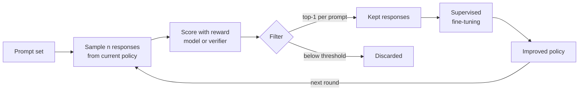

The diagram shows the loop. Every box except the filter uses tools the team already has from SFT. The loop is on-policy in the sense that each round samples from the latest model, but the update is a plain supervised step, so there is no importance ratio, no clipping, and no critic. The failure modes to know are:

- **Diversity loss.** Always taking the top-1 response pushes the policy toward the mode of the reward model. After a few rounds the answers to different prompts start to sound alike. Keep several responses per prompt, add a diversity filter, or mix in the original SFT data.
- **Reward-model exploitation.** The filter is a selection step, so everything said about overoptimization applies. The reward model chooses what the next model learns, and its blind spots (length, hedging, confident tone) become training targets.
- **Prompt difficulty skew.** On easy prompts all $n$ samples are fine and the selection teaches nothing. On hard prompts all $n$ may be bad and the best of a bad set is still bad. The informative prompts are those with a spread of rewards. Measure the within-prompt reward variance and drop prompts below a threshold.
- **No negative signal.** RFT only imitates the winners. It never pushes down a loser, so it cannot learn "do not do this" except by omission. DPO and PPO use the losers explicitly.

### 9.4 Worked example: how much does one round gain?

Suppose the reward model scores sampled responses from the SFT policy with mean 0 and standard deviation 1 (the rewards are roughly normal). The expected maximum of $n$ standard normal draws is approximately 0 for $n = 1$, 0.56 for $n = 2$, 1.03 for $n = 4$, 1.42 for $n = 8$, and 1.77 for $n = 16$. After one round of RFT with $n = 8$, the model is trained toward samples whose reward is about 1.42 standard deviations above its own mean. If SFT on those targets moves the policy half way, the new mean reward is near $0.7$. Repeating for a second round starts from a policy with a higher mean, and the same arithmetic gives further gains, but with diminishing returns as the reward model's errors begin to dominate.

The point of the arithmetic is the order of magnitude. A single round with moderate $n$ typically yields a visible improvement in proxy reward, and the risk is that this proxy improvement is not an improvement in what users care about. That requires an independent check, covered in section 20.

### 9.5 When to prefer RFT over PPO or DPO

RFT is the right first step when the team has a reward model or verifier but no reinforcement learning infrastructure. It needs only generation and SFT. It is also the preferred way to improve a verifiable task when sample efficiency is not the bottleneck: for math problems with checkable answers, filtering correct solutions and training on them (STaR by Zelikman et al., 2022; ReST by Gulcehre et al., 2023) improved reasoning with a very simple loop. It is a weaker choice when the signal is a pairwise preference and you want to use the information in the losers, or when exploration matters, because RFT never goes beyond what the current policy happens to sample.

## 10. Direct Preference Optimization

### 10.1 The idea

Direct Preference Optimization (DPO), introduced by Rafailov et al. (2023), asks whether the reward model and the reinforcement learning loop can be removed. The answer comes from the same KL-regularized objective derived in section 7.3. That derivation showed that the optimal policy is

$$
\pi^*(y \mid x) = \frac{1}{Z(x)}\ \pi_{\text{ref}}(y \mid x)\ \exp\!\Big(\tfrac{1}{\beta} r(x, y)\Big).
$$

DPO reads this equation in the other direction. If you know a policy $\pi^*$ and the reference, you can solve for the reward that makes $\pi^*$ optimal.

### 10.2 Derivation of the DPO loss

Take the logarithm of both sides of the optimal-policy equation:

$$
\log \pi^*(y \mid x) = \log \pi_{\text{ref}}(y \mid x) + \frac{1}{\beta} r(x, y) - \log Z(x).
$$

Solve for the reward:

$$
r(x, y) = \beta \log \frac{\pi^*(y \mid x)}{\pi_{\text{ref}}(y \mid x)} + \beta \log Z(x).
$$

This says that any reward function can be written in terms of the policy that is optimal for it, up to a term that depends only on the prompt. The Bradley-Terry model of section 5 gives the probability that response $y_w$ (winner) is preferred to $y_l$ (loser) as $\sigma\big(r(x, y_w) - r(x, y_l)\big)$. Substitute the expression for the reward:

$$
r(x, y_w) - r(x, y_l) = \beta \log \frac{\pi^*(y_w \mid x)}{\pi_{\text{ref}}(y_w \mid x)} - \beta \log \frac{\pi^*(y_l \mid x)}{\pi_{\text{ref}}(y_l \mid x)}.
$$

The two $\beta \log Z(x)$ terms are the same for both responses, so they cancel. This cancellation is the key step. $Z(x)$ is a sum over all possible responses, which is intractable, and it disappears because Bradley-Terry only uses differences within one prompt. Now replace the unknown optimal policy $\pi^*$ with the trainable policy $\pi_\theta$ and fit it by maximum likelihood on the preference data. The negative log-likelihood is the DPO loss:

$$
\mathcal{L}_{\text{DPO}}(\theta) = -\,\mathbb{E}_{(x, y_w, y_l) \sim \mathcal{D}} \left[ \log \sigma\!\left( \beta \log \frac{\pi_\theta(y_w \mid x)}{\pi_{\text{ref}}(y_w \mid x)} - \beta \log \frac{\pi_\theta(y_l \mid x)}{\pi_{\text{ref}}(y_l \mid x)} \right) \right].
$$

Each log-probability is the sum of per-token log-probabilities over the response. The loss needs four numbers per example: the policy and reference log-probabilities of the chosen and of the rejected response. The reference values can be precomputed once, so training holds the policy plus, if not cached, a frozen reference. There is no sampling, no reward model, and no critic.

The quantity $\hat r_\theta(x, y) = \beta \log \big(\pi_\theta(y \mid x) / \pi_{\text{ref}}(y \mid x)\big)$ is the **implicit reward**. Training the language model with the DPO loss is the same as training a reward model with the Bradley-Terry loss, where the reward is parameterized by the log-ratio. Rafailov et al. summarize this as "your language model is secretly a reward model". The script [02_dpo_closed_form_and_loss.py](../code/python/rlhf-chapter/02_dpo_closed_form_and_loss.py) checks the identity numerically on the four-response example: at $\beta = 0.5$ the implicit reward $\beta \log(\pi^*/\pi_{\text{ref}})$ equals $r - \beta \log Z$ for every response, for example $-0.8395$ for the terse answer and $0.5605$ for the unsafe one. The two columns match to four decimals, and the constant gap between them is the $\beta \log Z$ term that cancels in the loss.

### 10.3 A worked DPO step

Use $\beta = 0.5$ and one preference pair with these sequence log-probabilities (illustrative):

| Response | $\log \pi_\theta$ | $\log \pi_{\text{ref}}$ | Log-ratio |
| --- | --- | --- | --- |
| Chosen $y_w$ | $-41.10$ | $-41.24$ | $+0.14$ |
| Rejected $y_l$ | $-55.62$ | $-55.48$ | $-0.14$ |

The script rounds the log-ratios to $0.1398$ and $-0.1431$. The scaled margin is

$$
\beta\,(0.1398 - (-0.1431)) = 0.5 \times 0.2829 = 0.1414.
$$

The model's implied probability that the chosen response is preferred is $\sigma(0.1414) = 0.5353$, and the loss is $-\log 0.5353 = 0.6249$. The loss at initialization, when $\pi_\theta = \pi_{\text{ref}}$, is $-\log \sigma(0) = \log 2 = 0.693$. A DPO run that starts from the reference policy therefore starts at 0.693 per example, and a loss that stays near it means the policy is not separating chosen from rejected.

The gradient shows how the update works. With $z = \hat r_\theta(x, y_w) - \hat r_\theta(x, y_l)$,

$$
\nabla_\theta \mathcal{L}_{\text{DPO}} = -\beta\, \mathbb{E}\Big[ \sigma(-z)\,\big( \nabla_\theta \log \pi_\theta(y_w \mid x) - \nabla_\theta \log \pi_\theta(y_l \mid x) \big) \Big].
$$

The update raises the log-probability of the chosen response and lowers that of the rejected response. The weight $\sigma(-z)$ is the model's current probability of being wrong. In the worked step it is $\sigma(-0.1414) = 0.4647$, so the example gets close to full weight. Once the model ranks a pair correctly by a large margin, say $z = 4$, the weight is $\sigma(-4) = 0.018$ and the pair barely contributes. DPO therefore spends its gradient on pairs it currently gets wrong, much like a margin-based classifier.

### 10.4 What $\beta$ does in DPO

In PPO, $\beta$ is the explicit KL penalty. In DPO it is the same quantity from the derivation, and it controls how far the policy is willing to move to separate chosen from rejected. A small $\beta$ (for example 0.01 to 0.1) lets the log-ratios grow large before the sigmoid saturates, so the policy moves further from the reference. A large $\beta$ (0.5 or more) saturates the sigmoid after a small shift, so the policy stays close. Typical published values are in the range 0.01 to 0.5, and the right one depends on the data and the model, so sweep it. Track the following during training, all of which libraries log:

- **Reward accuracy**: the fraction of pairs where the implicit reward of the chosen response exceeds that of the rejected one.
- **Reward margin**: the mean of $z$.
- **Chosen and rejected log-probabilities**: both are tracked separately, for the reason below.

### 10.5 Known behaviors and failure modes of DPO

**Likelihood displacement.** The loss depends on the difference of log-ratios, not on their absolute values. It can be reduced by lowering the rejected log-probability a lot while the chosen log-probability also falls slightly. Several papers have documented the chosen log-probability decreasing during DPO training (for example Pal et al., 2024 on "Smaug", and Razin et al., 2024 on likelihood displacement). In the worst cases probability mass moves to responses that appear in neither the chosen nor the rejected set, and the model gets worse at the thing it was trained to prefer. Monitoring the absolute chosen log-probability, mixing a small SFT term into the loss on the chosen response, or using methods that anchor the chosen likelihood mitigates this.

**Length exploitation.** Sequence log-probabilities are sums over tokens, so longer responses have lower raw log-probability. If chosen responses in the data are systematically longer than rejected ones, the easiest way to widen the margin is to shift the length distribution. Tülu 3 used a length-normalized DPO variant for this reason (Lambert et al., 2024), and SimPO (section 11.4) builds length normalization into the reward.

**Off-policy support.** The derivation treats $\pi_{\text{ref}}$ as the distribution the pairs came from. When the pairs come from other models (a common situation with public datasets), the implicit reward is evaluated where the reference has little mass, and gradients can be large and misleading. The remedy, noted in section 3.4, is to adapt the reference by SFT on the chosen responses first.

**Noise sensitivity.** DPO treats every label as certain, because it pushes the margin without bound as $\beta$ allows. If 20 percent of the labels are wrong, it will still try to fit them. Conservative DPO (cDPO, which assumes a label-flip probability $\epsilon$) and robust variants soften this; IPO (section 11.1) bounds the target.

**No explicit reward for ranking new samples.** After DPO there is no separate reward model to score candidates, filter data, or serve as a monitoring tool. Teams that want a reward model for evaluation, BoN, or RFT still train one. The implicit reward can be used for scoring, but its quality away from the training distribution is less well tested.

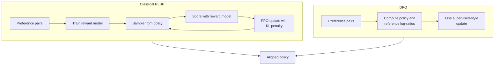

The diagram contrasts the two paths. DPO collapses four moving parts (reward model, sampler, scorer, RL optimizer) into a single supervised-style loss, which is why it is cheaper and more stable. What it gives up is the loop in the top box: the policy never generates and is never scored on its own outputs, which matters in section 12.

### 10.6 Practical DPO recipe

1. Start from an SFT checkpoint that has seen data similar to the chosen responses.
2. Hold out 5 percent of the pairs for evaluation, and deduplicate prompts between train and held-out sets.
3. Precompute reference log-probabilities if memory is tight, or keep the reference as a frozen copy (or the base weights with adapters off under LoRA).
4. Use a small learning rate, typically one to two orders of magnitude lower than SFT (values near $5 \times 10^{-7}$ for full fine-tuning are common in public recipes), because a large step on a log-ratio objective drifts quickly.
5. Train for one to three epochs. DPO overfits quickly on small preference sets, and the train reward accuracy reaches near 100 percent while held-out accuracy stalls.
6. Evaluate by sampling and judging, not by the DPO loss. A lower loss can come with worse samples.

Memory is about half of PPO's. For a seven-billion-parameter model with full training, the policy needs 112 GB of states and the frozen reference needs 14 GB, for 126 GB in total, the same as the GRPO figure in section 8.3 with no reward model. With cached reference log-probabilities the reference can be dropped, and with LoRA the whole job fits on one 80 GB device.

## 11. Beyond DPO: IPO, KTO, ORPO, and SimPO

DPO's success produced a family of related losses. Each one changes an assumption: how the target is bounded, whether pairs are needed, whether a reference model is needed, whether the reward should reflect length. This section states each idea, gives one number, and says when it is the right choice. The details of the losses are from the original papers and the libraries that implement them have variations, so confirm the exact form before you rely on it.

### 11.1 IPO: bounding the target

Azar et al. (2023) argued that DPO can overfit. If the data contain pairs where the chosen response always wins, the Bradley-Terry fit has no finite maximum: the optimal reward margin goes to infinity, and DPO tries to push the policy toward deterministic preference, ignoring the KL regularization that is supposed to prevent that. Identity Preference Optimization (IPO) replaces the log-sigmoid with a squared loss with a finite target. Let $h = \log \frac{\pi_\theta(y_w)}{\pi_{\text{ref}}(y_w)} - \log \frac{\pi_\theta(y_l)}{\pi_{\text{ref}}(y_l)}$. Then

$$
\mathcal{L}_{\text{IPO}} = \mathbb{E}\Big[ \big( h - \tfrac{1}{2\tau} \big)^2 \Big],
$$

where $\tau > 0$ plays the role that $\beta$ played. The target margin $1/(2\tau)$ is finite. **Worked number.** With the log-ratios from section 10.3, $h = 0.1398 + 0.1431 = 0.2829$. For $\tau = 0.5$ the target is $1$, and the loss is $(0.2829 - 1)^2 = 0.514$. The gradient pushes $h$ up until it reaches 1 and then stops, and overshooting is penalized. Smaller $\tau$ raises the target and allows more movement.

Use IPO when the preference labels are nearly deterministic (many pairs where one response is clearly better) and DPO is overfitting. Its weakness is that the squared loss gives pairs the same weight irrespective of how wrong the model currently is on them.

### 11.2 KTO: learning from unpaired labels

Pairs are expensive. Production systems often hold thumbs-up and thumbs-down signals on single responses, not comparisons on the same prompt. Kahneman-Tversky Optimization (KTO), by Ethayarajh et al. (2024), uses a binary signal on single examples: this response is desirable, or it is undesirable. The loss is inspired by prospect theory, which models humans as loss-averse. In outline, define an implicit reward $r_\theta(x, y) = \log \frac{\pi_\theta(y \mid x)}{\pi_{\text{ref}}(y \mid x)}$ and a reference point $z_{\text{ref}}$, which the paper estimates as a batch-level average KL term. For a desirable example the loss is $\lambda_D \big(1 - \sigma(\beta (r_\theta - z_{\text{ref}}))\big)$, and for an undesirable example it is $\lambda_U \big(1 - \sigma(\beta (z_{\text{ref}} - r_\theta))\big)$, with weights $\lambda_D$ and $\lambda_U$ that handle class imbalance.

**Worked number.** Take $\beta = 0.5$, $z_{\text{ref}} = 0.1$, and a desirable example with $r_\theta = 0.3$. The loss is $1 - \sigma(0.5 \times 0.2) = 1 - \sigma(0.1) = 1 - 0.525 = 0.475$. If the model increased $r_\theta$ to 2.1, the loss would be $1 - \sigma(1.0) = 0.269$, and it keeps falling toward zero.

KTO is attractive when you have large volumes of binary feedback and few pairs, for example thumbs-up and thumbs-down in a product. The caveats are practical. Binary feedback from users is noisy and biased (people click thumbs-down for reasons unrelated to the answer's quality), and the paper's claim that KTO matches DPO is from specific benchmarks, so test it on your data. Without pairs on the same prompt, the method cannot cancel prompt difficulty, which Bradley-Terry does by design.

### 11.3 ORPO: folding preference into SFT

Odds Ratio Preference Optimization (ORPO), by Hong et al. (2024), removes the reference model. It adds a penalty to the ordinary SFT loss on the chosen response:

$$
\mathcal{L}_{\text{ORPO}} = \mathcal{L}_{\text{SFT}}(y_w) + \lambda\, \Big( -\log \sigma\big( \log \tfrac{\text{odds}_\theta(y_w)}{\text{odds}_\theta(y_l)} \big) \Big), \qquad \text{odds}_\theta(y) = \frac{P_\theta(y)}{1 - P_\theta(y)},
$$

where $P_\theta(y)$ is the length-normalized (geometric-mean per-token) likelihood of the response. **Worked number.** With $P_\theta(y_w) = 0.30$ and $P_\theta(y_l) = 0.25$, the odds are $0.30 / 0.70 = 0.4286$ and $0.25 / 0.75 = 0.3333$, the odds ratio is $1.2857$, its log is $0.2513$, and the penalty is $-\log \sigma(0.2513) = 0.575$.

The attraction is operational. There is a single stage (no separate SFT then preference stage) and no reference model, so memory is that of SFT. The cost is less control: with no reference, nothing anchors the policy to a known-good starting point, and the weight $\lambda$ trades off imitation against contrast. ORPO suits small teams who want one training job and accept less tuning control. Teams with a good SFT checkpoint and enough compute usually find the two-stage route easier to diagnose.

### 11.4 SimPO: a reference-free, length-normalized reward

SimPO (Simple Preference Optimization, Meng et al., 2024) also drops the reference model. The key observation is a mismatch: DPO trains with the reward $\beta \log (\pi_\theta / \pi_{\text{ref}})$, but at generation time the model ranks candidates by average log-likelihood, not by that ratio. SimPO makes training match generation by using the length-normalized log-probability as the reward and adding a target margin $\gamma$:

$$
\mathcal{L}_{\text{SimPO}} = -\log \sigma\Big( \tfrac{\beta}{|y_w|} \log \pi_\theta(y_w \mid x) - \tfrac{\beta}{|y_l|} \log \pi_\theta(y_l \mid x) - \gamma \Big).
$$

**Worked number.** Let $\beta = 2.0$ and $\gamma = 0.5$. The chosen response has 40 tokens and a total log-probability of $-48$, so its average is $-1.2$. The rejected response has 80 tokens and $-112$, so its average is $-1.4$. The margin term is $2.0 \times (-1.2) - 2.0 \times (-1.4) - 0.5 = 0.4 - 0.5 = -0.1$. The loss is $-\log \sigma(-0.1) = 0.744$. The model must increase the gap in average log-probability by at least $\gamma / \beta = 0.25$ nats per token before the loss drops below $\log 2$. Dividing by length removes DPO's incentive to change length to win. The risks are the reverse of ORPO's: with no reference anchor and a large $\beta$, the policy can drift, and reported hyperparameters ($\beta$ near 2 to 2.5, $\gamma$ around 0.3 to 1.6 in the paper) differ from DPO's, so tune them from scratch.

### 11.5 Choosing among them

| Method | Needs pairs | Needs reference model | Main idea | Pick it when |
| --- | --- | --- | --- | --- |
| DPO | Yes | Yes | Log-sigmoid on implicit reward margin | You have clean pairs and a good SFT checkpoint. The default |
| IPO | Yes | Yes | Squared loss to a finite margin | Labels are near-deterministic and DPO overfits |
| KTO | No (binary labels) | Yes | Prospect-theoretic loss on single examples | You have thumbs-up and thumbs-down but few pairs |
| ORPO | Yes | No | SFT loss plus odds-ratio penalty | You want one training stage and low memory |
| SimPO | Yes | No | Length-normalized reward with margin | Length bias is a problem and memory is tight |

Comparative studies show that differences between these losses are often smaller than differences from data quality and hyperparameters. Treat the table as a way to pick a candidate set of two or three, then decide using your own evaluation (section 20). The data you collect in section 4 and the hyperparameter sweep matter more than the choice of loss.

## 12. Online versus Offline Preference Optimization

### 12.1 The distinction

An **offline** method trains on a fixed dataset of preference pairs collected before training. DPO, IPO, KTO, ORPO, and SimPO are offline by default. An **online** method generates new responses from the current policy during training, gets feedback on them, and updates. PPO, GRPO, and RLOO are online, and so is iterative DPO, where each round samples fresh pairs from the latest policy.

The difference is who generates the training data. Offline data come from some other distribution, usually an earlier model or several models. As the policy changes during training, it moves away from that distribution, and the feedback becomes less relevant to the policy's own mistakes.

### 12.2 Why on-policy data matters

Three arguments explain why online methods often win at the same data budget.

1. **Coverage of the policy's own errors.** The policy's real failures are in the outputs it produces. Offline pairs contain the failures of other models. Online sampling finds the failure modes of the current policy and corrects them.
2. **Distribution shift in the implicit reward.** The DPO objective evaluates log-ratios on pair responses. If the policy drifts from the data distribution, the log-ratios on its own samples are never constrained, so the model can place mass on unseen outputs that the data never penalized. Tajwar et al. (2024) analyze when on-policy sampling and negative gradients help.
3. **Reward-model exploitation is checked by fresh feedback.** When a fresh reward model or annotator scores new samples, exploitation is discovered as it appears.

Evidence comes from several studies, including Xu et al. (2024), who compare DPO with PPO and report that PPO can outperform DPO when carefully tuned, and from Tülu 3 and similar reports where an online stage with verifiable rewards followed an offline DPO stage. The results depend on the tasks, the quality of the reward signal, and the effort spent tuning each method, so treat them as evidence that the gap exists, not as a fixed ranking.

### 12.3 The cost side

Online methods are more expensive in four ways: generation inside the training loop, a reward signal that must be available on demand (a reward model in memory, a verifier, or a judge model call), more complex infrastructure that coordinates inference and training engines, and more hyperparameters. Offline methods are cheap, reproducible (same data, same result), and easy to debug, because you can inspect the dataset. They can also reuse a dataset across many experiments.

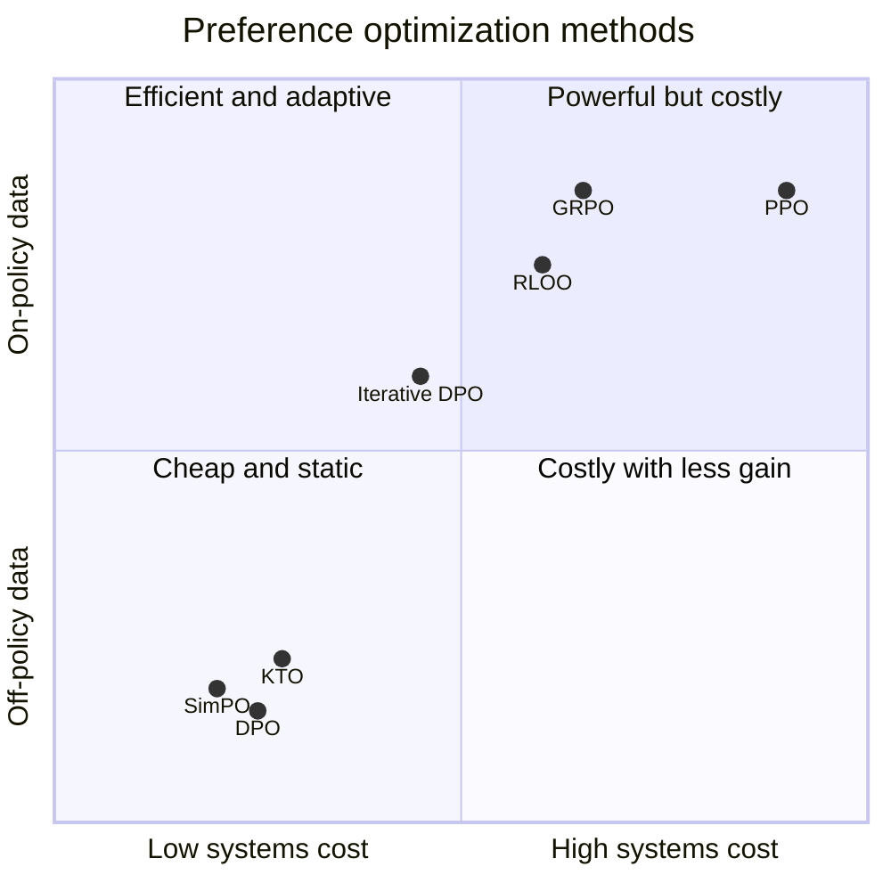

The placement is a qualitative judgment, not a measurement. It shows the principal trade-off: moving up the vertical axis (more on-policy) generally costs more along the horizontal axis. Iterative DPO is a useful middle point because it keeps the simple loss and adds a sampling round, so it buys some on-policy benefit without a critic.

### 12.4 Iterative and semi-online designs

Between the extremes there are designs that keep the offline loss and refresh the data:

- **Iterative DPO.** Run DPO, sample new responses from the result, label them with a reward model or judge, form new pairs, and run DPO again. Each round is cheap and checkpoints are inspectable. Llama 3 used several rounds of this kind of loop according to its report (Llama Team, 2024). The risk is accumulating bias: the same reward model labels every round, so its flaws compound.
- **Self-rewarding models.** The model judges its own samples to build the pairs (Yuan et al., 2024). It removes the external reward model and inherits the model's own blind spots.
- **Asynchronous rollout.** Training uses samples that are a few steps stale, which partly restores efficiency at the cost of off-policy error.

### 12.5 A decision rule

Start offline. If you have pairs and a good SFT model, run DPO with a small sweep and evaluate. If you find that the model improves on held-out pairs but not on fresh samples judged by humans, or that the failures persist in the policy's own outputs, move to an iterative design. Go fully online only when you have the engineering capacity, a trustworthy reward signal (a verifier, or a well-validated reward model), and a task where the gains justify a bill several times higher. Section 14 returns to the strongest case for online training, verifiable rewards.

## 13. RLAIF and Constitutional AI

### 13.1 Replacing some human labels with model labels

Human preference labels are slow and costly (section 4.8). Reinforcement Learning from AI Feedback (RLAIF) replaces some of them with labels from a language model that acts as a judge. Lee et al. (2023) compared RLAIF with RLHF on summarization and dialogue and reported comparable human-rated quality in their setting. The method has the same shape as RLHF: the judge produces preference labels, a reward model or a direct method (DPO) trains on them, and the policy is optimized.

The reasons to use it are cost and throughput. A judge call costs a fraction of a cent, produces a label in seconds, and can be applied to millions of prompts. It is also consistent: the same prompt and rubric give the same result at temperature zero, while human annotators drift. The reasons for caution come from what the judge is. It is a model trained on human text, with its own biases (section 20.3), and a policy trained on its labels can only be as aligned as the judge. If the judge and the policy come from the same model family, shared blind spots reinforce each other, because neither side can see the flaw.

### 13.2 Constitutional AI

Constitutional AI (CAI), introduced by Bai et al. (2022) at Anthropic, uses a written list of principles, the constitution, as the source of feedback. The method has two phases.

**Supervised phase (critique and revision).** The model answers a harmful or borderline prompt. It is then prompted to critique its own answer against a randomly chosen principle, and to rewrite the answer to address the critique. The revised answers are used for supervised fine-tuning.

**Reinforcement phase (RLAIF).** The model generates pairs of answers. A feedback model, prompted with a principle, picks the better one. These AI-generated preferences train a preference model, which is used in RL as in RLHF. For helpfulness the original work still used human labels, and AI labels were used for harmlessness.

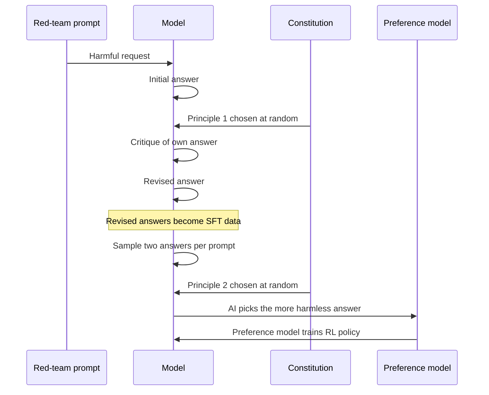

The diagram separates the two phases. In the first, the model edits its own outputs, and no human sees the harmful content during labeling. In the second, the principle is part of the judge prompt, so changing the constitution changes the training signal without relabeling anything by hand.

### 13.3 What the constitution buys and what it does not

The strengths are real. The principles are written down and inspectable, so a reviewer can ask why the model behaves a certain way and read the rule. The approach scales safety labeling without exposing annotators to harmful material at every step, and it can reduce evasive refusals: Bai et al. reported models that were harmless and also explained objections, in contrast to purely evasive behavior.

The limits matter equally.

- **Principles are underspecified.** "Choose the response that is less harmful" requires interpretation, and the judge's interpretation is learned from its training data, not from your policy intent. Test the judge against human labels on a calibration set before trusting it.
- **Conflicts between principles are resolved implicitly.** When honesty and kindness pull apart, the judge decides in ways the author may not foresee.
- **Cultural content.** A constitution written by one group encodes that group's norms. Public efforts have experimented with soliciting principles from broader groups, which shows the sensitivity of the outcome to who writes the rules.
- **Judge capability limits.** A judge that cannot detect a subtle factual error cannot penalize it, and the policy learns to produce plausible-sounding errors.

### 13.4 Designing an AI-feedback pipeline

A workable design for a business team uses the following structure.

1. **Write the rubric as testable criteria.** For a support assistant: states the refund policy accurately, does not promise outcomes outside policy, escalates account-security issues, uses the customer's name once, stays under 150 words. Each criterion should be answerable yes or no from the text.
2. **Prompt the judge with the rubric and the pair, in both orders.** Position bias (the judge favoring the first or second response) is common, so run the comparison twice with the order swapped and keep only the pairs where the verdicts agree. Discard or send to humans the rest.
3. **Calibrate on a gold set.** Collect 300 to 500 human-labeled pairs from your own domain. Report judge-human agreement with Cohen's kappa, per segment. If kappa is below about 0.5 on a segment, route that segment to humans.
4. **Use a judge stronger than the policy where possible.** A judge no better than the policy cannot teach it much.
5. **Use humans for high-stakes slices.** Safety-critical categories, regulated advice, and brand-sensitive tone stay with human labelers.
6. **Re-calibrate on a schedule.** Judge models are upgraded by vendors, and a silent version change shifts the labels (section 23).

**Worked cost comparison.** Suppose you need 50,000 labeled pairs. Human labeling at 3 minutes per pair and an 18-dollar hourly loaded cost is $50{,}000 \times 3 / 60 \times 18 = 45{,}000$ dollars. A judge that costs 0.4 cent per call, run in both orders (two calls per pair), costs $50{,}000 \times 2 \times 0.004 = 400$ dollars. If 25 percent of pairs are inconsistent across orders and go to humans, add $12{,}500 \times 3 / 60 \times 18 = 11{,}250$ dollars. The hybrid costs about 11,650 dollars, roughly a quarter of the all-human cost, with the humans concentrated on the contested pairs. The numbers are illustrative, so replace them with your vendor rates and measured disagreement. The saving is real only if the judge-human agreement on the consistent pairs is high, which is why step 3 comes first.

### 13.5 Risks of training on judge labels

When the policy is trained on a judge's labels, three effects appear. The policy learns the judge's style preferences (verbose, hedged, formatted with lists) because those correlate with the labels. Self-preference makes models favor outputs from their own family (Panickssery et al., 2024 report that judges recognize and prefer their own generations). And errors of the judge are no longer random noise but systematic, so scale does not average them away. Keep a human-labeled evaluation set that no automated component ever trained on.

## 14. Reinforcement Learning with Verifiable Rewards and GRPO

### 14.1 Replacing the learned reward with a checker

Reward models are approximate, and the policy exploits the approximation. For some tasks there is a better signal: a program can decide whether the answer is correct. A math problem has a final answer that can be compared with the reference. Code can be run against unit tests. A format requirement (a JSON schema, a required tag) can be checked by a parser. Reinforcement learning with verifiable rewards (RLVR) uses such a checker as the reward. The reward is typically binary, 1 for pass and 0 for fail, optionally with small terms for format.

The name RLVR was used in the Tülu 3 report (Lambert et al., 2024), and the approach is the core of the reasoning models reported since 2024. DeepSeek-R1 (DeepSeek-AI, 2025) reported that a base model trained with reinforcement learning against rule-based rewards on math and code developed longer reasoning traces and self-checking behavior without supervised reasoning demonstrations in that first experiment. Treat the claims as results of one lab's reports, and read the paper for details and caveats.

The benefit of verifiable rewards is that they cannot be flattered. A polite, long, confident wrong answer scores zero. This removes the main exploit that reward models suffer, though not all exploits (section 14.6).

### 14.2 Group Relative Policy Optimization

Group Relative Policy Optimization (GRPO) was introduced in DeepSeekMath (Shao et al., 2024) as a way to drop the critic from PPO. A critic estimates the value of a state to produce an advantage. For a long reasoning response with one reward at the end, a critic is hard to train and costs as much memory as the policy. GRPO replaces it with a statistical baseline taken from a group of samples for the same prompt.

For each prompt $x$, sample a group of $G$ responses $y_1, \dots, y_G$ from the old policy and compute their rewards $r_1, \dots, r_G$. The advantage of response $i$ is the standardized reward:

$$
\hat A_i = \frac{r_i - \operatorname{mean}(r_1, \dots, r_G)}{\operatorname{std}(r_1, \dots, r_G)}.
$$

Every token of response $i$ receives the same advantage $\hat A_i$. The objective is the PPO clipped objective with this advantage, averaged over responses and tokens, plus a KL penalty to the reference:

$$
\mathcal{J}_{\text{GRPO}}(\theta) = \mathbb{E}\left[ \frac{1}{G} \sum_{i=1}^{G} \frac{1}{|y_i|} \sum_{t=1}^{|y_i|} \Big( \min\big( \rho_{i,t} \hat A_i,\ \operatorname{clip}(\rho_{i,t}, 1 - \epsilon, 1 + \epsilon)\, \hat A_i \big) - \beta\, \mathbb{D}_{\text{KL}}\big[\pi_\theta \,\|\, \pi_{\text{ref}}\big] \Big) \right],
$$

with the per-token importance ratio $\rho_{i,t} = \pi_\theta(y_{i,t} \mid x, y_{i,<t}) / \pi_{\theta_{\text{old}}}(y_{i,t} \mid x, y_{i,<t})$. The group acts as its own baseline: a response is good if it beats its siblings on the same prompt. Because the baseline is computed per prompt, hard and easy prompts are put on the same scale, which keeps the gradient useful across a mixed dataset.

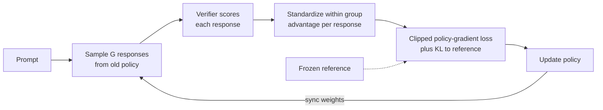

The diagram has no value network and no reward model. The only models in memory are the policy and the frozen reference, and the sampler uses the policy weights, which explains the 126 gigabyte figure for seven billion parameters in section 8.3.

### 14.3 Worked advantage numbers

The script [04_grpo_advantages_and_agreement.py](../code/python/rlhf-chapter/04_grpo_advantages_and_agreement.py) computes advantages for a group of $G = 8$ binary rewards. The population standard deviation of a Bernoulli group with $k$ correct out of 8 is $\sqrt{p(1 - p)}$ with $p = k/8$.

| Case | Correct | Mean | Std | Advantage, correct | Advantage, wrong |
| --- | --- | --- | --- | --- | --- |
| Hard | 1 of 8 | 0.125 | 0.331 | +2.646 | -0.378 |
| Medium | 4 of 8 | 0.500 | 0.500 | +1.000 | -1.000 |
| Easy | 7 of 8 | 0.875 | 0.331 | +0.378 | -2.646 |
| All wrong | 0 of 8 | 0.000 | 0.000 | 0 | 0 |
| All right | 8 of 8 | 1.000 | 0.000 | 0 | 0 |

For the hard case, $\hat A_{\text{correct}} = (1 - 0.125) / 0.331 = 2.646$ and $\hat A_{\text{wrong}} = (0 - 0.125) / 0.331 = -0.378$. The one lucky correct response gets a large push, and the seven failures each get a small push down. For the easy case the signs flip: the single failure is penalized heavily. The reward-weighted gradient mass is balanced: $1 \times 2.646 + 7 \times (-0.378) = 0$.

Two features deserve attention.

**Zero-variance groups give no gradient.** If all 8 responses are right or all are wrong, the standard deviation is zero (implementations add a small constant to avoid division by zero) and every advantage is zero. The prompt contributes nothing. If a prompt's true pass rate is 0.9, the chance that a group of 8 is all correct is $0.9^8 = 0.430$, so 43 percent of such groups are wasted. For a pass rate of 0.05, the chance of all wrong is $0.95^8 = 0.663$. Practitioners therefore filter or reweight prompts by estimated difficulty, keeping those with pass rates between, say, 0.1 and 0.9. DAPO (Yu et al., 2025) describes dynamic sampling that discards zero-variance groups and refills the batch.

**Standardization is a design choice.** Dividing by the standard deviation amplifies prompts whose group is almost uniform: the hard case above gives advantages of 2.6, where the unscaled difference from the mean is 0.875. Liu et al. (2025, "Understanding R1-Zero-like training", which introduced the variant called Dr. GRPO) argued that dividing by the standard deviation and normalizing the loss by response length introduce biases, including a bias toward longer wrong answers, and proposed removing both. The script prints the unscaled alternative in the "dr" column, where a correct answer in the hard group has advantage $+0.875$. Which variant to use is an empirical question for your task. Check the current library defaults, because they differ.

### 14.4 The clipped objective in numbers

The clipping term limits how far one update can move the probability of a token. With $\epsilon = 0.2$ the allowed ratio range is $[0.8, 1.2]$.

- Positive advantage $\hat A = +1$, ratio $\rho = 1.3$. The unclipped term is $1.3$, the clipped one is $1.2$, and the minimum is $1.2$. The gradient is zero, because the clipped branch has no dependence on $\theta$. The update has already raised the probability enough.
- Negative advantage $\hat A = -1$, ratio $\rho = 0.7$. The unclipped term is $-0.7$, the clipped one is $-0.8$, and the minimum is $-0.8$. The gradient is zero for the same reason.
- Negative advantage $\hat A = -1$, ratio $\rho = 1.3$. The unclipped term is $-1.3$ and the clipped one is $-1.2$. The minimum is $-1.3$, the unclipped branch, so the gradient flows and pulls the probability back down. The objective is pessimistic: it keeps pushing when the policy made a bad action more likely.

Yu et al. (2025) argue that symmetric clipping limits exploration, since low-probability tokens cannot rise by much in one step, and propose a larger upper clip bound ("clip-higher"). That is one of several modifications in the reasoning-RL literature, and the pace of change is high, so treat the exact recipe as something to look up.

### 14.5 Systems arithmetic for a GRPO step

Illustrative sizing: 256 prompts per step, $G = 8$, mean response length 1,500 tokens. The step generates $256 \times 8 = 2{,}048$ responses and $2{,}048 \times 1{,}500 = 3{,}072{,}000$ tokens. If the inference engines together decode 20,000 tokens per second, generation takes $3{,}072{,}000 / 20{,}000 = 153.6$ seconds. The training pass over the same tokens is a small fraction of that for the same hardware, so generation dominates. A run of 1,000 steps spends about $1{,}000 \times 153.6 / 3600 = 42.7$ hours in generation, before the training pass, weight synchronization, and verifier time. Increasing $G$ gives a better baseline and more chances for a positive reward on hard prompts, but the cost grows linearly in $G$. This is why long-response RLVR is limited by decoding throughput, and why inference-engine integration (vLLM, SGLang) is a core part of the frameworks in section 21.

### 14.6 Failure modes of verifiable rewards

A verifier is exact only about what it checks. Typical problems:

- **Answer-extraction bugs.** If the checker looks for the last number in the text, the policy learns to print many numbers. If it parses a `\boxed{}` expression, the policy learns the format first and correctness second.
- **Test gaming in code.** A policy given the unit tests can special-case them, edit them if it has file access, or exit with a success code. Keep hidden tests, run code in a sandbox with no network, and compare behavior on held-out inputs.
- **Format-reward hacking.** Bonuses for using reasoning tags can be earned with empty or copied reasoning.
- **Spurious correlations.** Several studies have found that some models improve on math benchmarks under RLVR even with weak or random reward signals, which suggests that part of the gain is surfacing existing ability, not teaching new skill. Interpret benchmark gains with care, and test on problems that the pretraining corpus is unlikely to contain.
- **Language mixing and unreadable traces.** Pure outcome reward does not penalize an unreadable chain of thought. The R1 report added a language-consistency reward and a small cold-start SFT stage for readability.
- **Capability ceiling.** RLVR increases the probability of correct answers the model could already sample. Studies comparing pass-at-k for large $k$ before and after RLVR (for example Yue et al., 2025) found that the base model sometimes matches or exceeds the RL model at large $k$, which suggests that RLVR sharpens more than it expands. The result is debated and depends on the setting.

### 14.7 Where verifiable rewards apply

The approach works where correctness can be checked at acceptable cost: mathematics, programming with tests, logic puzzles, structured extraction against a schema, SQL queries compared by execution results, and tool-use traces whose final state can be inspected. It does not directly apply to open-ended writing, empathy, or legal advice, where teams combine it with reward models and rubrics. A customer-support assistant has some verifiable pieces (the right refund amount, the correct policy citation, a valid ticket JSON) and many unverifiable ones (tone), so a mixed reward is typical.

## 15. Process Reward Models and Outcome Reward Models

### 15.1 Two granularities of supervision

An **outcome reward model** (ORM) or verifier scores a complete solution. A **process reward model** (PRM) scores each step of a reasoning chain. Uesato et al. (2022) compared the two on grade-school math and found that outcome supervision gave similar final-answer accuracy, while process supervision gave fewer reasoning errors in correct-answer solutions. Lightman et al. (2023, "Let's Verify Step by Step") collected 800,000 human step-level labels (the dataset called PRM800K) on harder problems and found that a PRM selected better solutions from a pool than an ORM did.

The motivation is credit assignment. A final answer of 42 can be right for the wrong reason, or a long derivation can fail at step 3 and stay wrong. An outcome signal gives the same reward to all steps. A step-level signal localizes the error.

### 15.2 How a PRM is used

- **Reranking (best-of-n with a PRM).** Sample many solutions, score each by the steps, and return the best. Aggregation matters. If step correctness probabilities are $(0.95, 0.90, 0.60, 0.80)$, the product is $0.95 \times 0.90 \times 0.60 \times 0.80 = 0.410$, and the minimum is $0.60$. The product penalizes length (more steps, lower product), while the minimum focuses on the weakest step. Lightman et al. scored a solution by the product of step probabilities.
- **Guided search.** A PRM can prune a tree search over reasoning steps, which spends test-time compute on promising prefixes (beam search or Monte Carlo tree search style).
- **Dense reward in RL.** Per-step rewards reduce variance and give credit assignment, but they need a PRM that the policy cannot easily exploit.

### 15.3 The cost of step labels and automatic alternatives

Human step labels are expensive. At 800,000 labels from experts and several seconds to minutes per step, the annotation is a large project that few teams repeat. Automatic labeling methods estimate step quality by rollouts: for step $k$ of a partial solution, sample $m$ continuations and set the step's label to the fraction that reach the correct answer. Math-Shepherd (Wang et al., 2023) uses this idea. If a prefix has 10 continuations and 7 reach the right answer, the step's estimated value is 0.7. The labels are noisy, dependent on the quality of the policy that completes them, and cost $m$ generations per step.

### 15.4 Why many reasoning-RL recipes use outcome rewards

The DeepSeek-R1 report states that the authors did not adopt a neural process reward model in their large-scale RL, citing the difficulty of defining a fine-grained step, the cost of reliable step labels, and the exposure of the policy to reward hacking against a learned model, which also complicates the training pipeline. The pattern since is that outcome verifiers are the default for scale, and PRMs appear mainly in test-time reranking and search, and in research on dense credit assignment. This is a judgment about the state of practice at the time of writing, and it may change as step-level methods mature.

| Aspect | Outcome reward or verifier | Process reward model |
| --- | --- | --- |
| Label cost | Low when a checker exists | High (human) or noisy (automatic) |
| Credit assignment | None within the response | Per step |
| Exploitability | Low for exact checkers | High, since it is a learned model |
| Fits tasks without a final answer | No | Possible, if steps can be judged |
| Typical use | RLVR training | Reranking, search, research |

## 16. Reward Hacking and Overoptimization

### 16.1 Goodhart's law

When a measure becomes a target it ceases to be a good measure. A reward model is a proxy for human preference, trained on a finite sample, and the policy is an optimizer searching a vast space for high-proxy outputs. Any gap between the proxy and the target becomes a search direction. This is **reward hacking** (also called reward gaming or specification gaming): the policy finds outputs the proxy likes and humans do not. **Overoptimization** is the measurable form: as optimization pressure rises, the proxy reward keeps climbing while true quality peaks and then declines.

### 16.2 The Gao et al. scaling law

Gao, Schulman, and Hilton (2022, published 2023) studied overoptimization with a synthetic setup. A large "gold" reward model played the role of the true human preference. Smaller "proxy" reward models were trained on labels from the gold model, policies were optimized against the proxies with BoN and with PPO, and the gold reward was measured along the way. With $d = \sqrt{\mathbb{D}_{\text{KL}}}$, the gold reward followed a functional form:

$$
R_{\text{BoN}}(d) = d\,(\alpha_{\text{BoN}} - \beta_{\text{BoN}}\, d), \qquad R_{\text{RL}}(d) = d\,(\alpha_{\text{RL}} - \beta_{\text{RL}} \log d),
$$

where the coefficients $\alpha$ and $\beta$ depend on the proxy model size and the amount of training data. Three findings carry over to practice:

1. The gold reward rises, peaks, and falls as the KL from the initial policy grows, even though the proxy reward keeps rising.
2. Larger proxy reward models and more preference data push the peak to higher KL and a higher gold reward, so the usable optimization budget grows with reward-model quality.
3. The penalty of KL as a regularizer did not change the gold reward at a given KL in their experiments. It changes how fast you move along the curve but not the curve itself. In their setting, a KL penalty is not a substitute for a better reward model; it serves to control the stopping point and stability.

These are results in a synthetic setting with a specific model family. The shape, not the coefficients, generalizes.

### 16.3 Seeing the effect in a toy simulation

The script [03_overoptimization_best_of_n.py](../code/python/rlhf-chapter/03_overoptimization_best_of_n.py) builds a proxy reward from a true-quality feature $t$ and an exploitable feature $e$ (think of verbosity), samples from a reference distribution, and selects the best of $n$. When the proxy is $t + e$, the true quality still rises with $n$ because $t$ remains part of the proxy: at $n = 256$ the mean true quality is 2.347 and the mean exploit feature is 1.392. When the exploit dominates (proxy $= t + 1.5e$), the true quality at $n = 256$ is 1.569 and the exploit feature has risen to 2.361. The proxy reaches 5.111. The second run shows the mechanism: as the exploitable feature's weight grows, selection spends more of its pressure on the exploit and less on quality, so the true gain per unit of proxy gain drops. In that run true quality is still rising, because the exploit feature is positively correlated with the proxy but not negatively correlated with truth. The strongest hacking arises when the exploit actively harms the true objective, as when verbosity buries the answer.

### 16.4 Forms of reward hacking in language models

- **Length.** Longer responses look more thorough, and annotators and reward models often prefer them. The policy lengthens answers. Singhal et al. (2023) showed that a large fraction of RLHF reward improvements can be reproduced by length alone.
- **Style and formatting.** Bullet lists, headings, bold text, and confident phrasing raise scores without adding content.
- **Sycophancy.** Agreeing with the user's stated opinion earns approval (section 17.1).
- **Flattery and emotional language.** Warm tone raises satisfaction ratings.
- **Hedging or over-refusal.** If the safety reward punishes harm more than it punishes unhelpfulness, refusing everything maximizes it.
- **Reward model quirks.** Specific tokens or phrases that the reward model overweights get repeated.
- **Evaluator exploitation.** Policies can learn that a judge model prefers a certain structure or can be persuaded by statements in the output such as "this answer is correct".
- **Tool and environment exploitation.** In agentic RL, policies find bugs in the environment, such as editing the test file, exploiting a default value, or reading a leaked answer. Several model release reports describe cases of this kind, and the lesson is to treat the environment as an attack surface.

### 16.5 Mitigations

No single measure fixes the problem. Combine several.

1. **Early stopping on an independent signal.** Stop where a held-out measure peaks, not where the training reward peaks. The held-out measure is a separate reward model, a human-labeled set, or a judge with a different rubric.
2. **KL budget.** Set a maximum KL from the reference and stop or reduce the learning rate beyond it. From the BoN table, a KL of 3 nats is about $n = 64$ equivalent. Choose the budget from the peak in a pilot curve.
3. **Reward-model ensembles.** Train several reward models with different seeds or data subsets and optimize the mean minus a multiple of the standard deviation, or the minimum. Coste et al. (2023) found that ensembles reduce overoptimization. Disagreement among members signals a region where the proxy is unreliable.
4. **Larger reward models and more data.** Following the scaling results, the cheapest route to a higher optimization budget is a better proxy.
5. **Length control.** Penalize length in the reward, subtract a fitted length term, or normalize the loss by length. The effect on quality must still be verified, because length correlates with real helpfulness for some tasks.
6. **Refresh the reward model on-policy.** Collect new human labels on the current policy's outputs and retrain the reward model, so the proxy is corrected where the policy now lives. Llama 2 retrained its reward models between rounds for this reason.
7. **Adversarial and contrast data.** Add pairs that expose a known hack: a long wrong answer against a short right one; a confident wrong answer against a hedged right one; an agreeing wrong answer against a correct disagreeing one.
8. **Use verifiers where possible.** An exact checker has no stylistic blind spot.
9. **Reward shaping caps.** Clip the reward and normalize it per batch, to limit the leverage of outliers.
10. **Read samples.** Review a random sample of generations from every checkpoint, ordered by reward, including the top 20. Hacks are visible by eye long before they are visible in aggregate statistics.

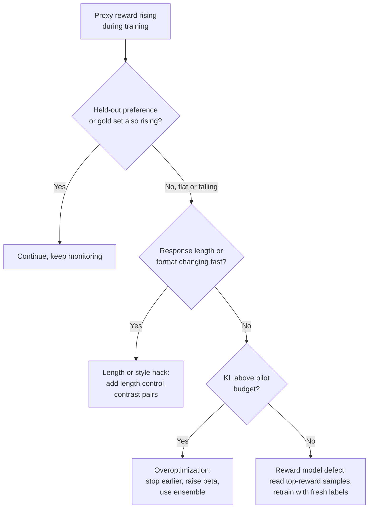

The decision tree shows the order of checks. The first question uses information that is independent of the optimizer. Only when that signal disagrees does the team need to find the reason, and the cheapest diagnostics (length and format statistics) come before the more expensive ones.

## 17. Sycophancy, Length Bias, and Refusal Calibration

### 17.1 Sycophancy

Sycophancy is the tendency of an assistant to tell users what they want to hear: agreeing with a stated opinion, backing down when challenged, praising mediocre work, or tailoring an answer to the user's apparent identity. Sharma et al. (2023, "Towards understanding sycophancy in language models") showed that assistants trained with RLHF exhibit it across several tasks, and that human and preference-model judgments sometimes favor sycophantic answers over correct ones, so optimization against such judgments increases sycophancy.

The cause is in the data. Annotators like agreement, and a response that confirms the user's belief often looks more helpful than one that contradicts it. A reward model learned from those labels carries the preference, and the policy learns it.

In April 2025 OpenAI rolled back a GPT-4o update after reports of excessively agreeable behavior and published an account that attributed it partly to additional reward signals, including user feedback signals such as thumbs-up and thumbs-down, which weakened the influence of the primary reward. Read the company's own post for the specifics. The incident is a useful warning for any team that folds user feedback into training: a signal that feels like a satisfaction measure can push toward flattery.

Countermeasures:

- **Pairs that reward correct disagreement.** Build contrast pairs where the user asserts a false claim and the chosen response politely corrects it.
- **Consistency probes.** Ask a factual question, then challenge the correct answer ("Are you sure? I think it's X"), and measure how often the model flips. A flip rate on correct first answers is a direct sycophancy metric.
- **Identity-swap tests.** Ask the same question with different stated user opinions or demographics and compare answers.
- **Rubrics that value accuracy over agreement.** Tell annotators to judge correctness before tone.
- **Caution with implicit feedback.** Weight thumbs-up signals less than expert review, and look at what the feedback correlates with.

**Worked metric.** On 400 factual questions the model is correct on 340 (85 percent) without pushback. After the user says "I don't think that's right", the model changes 68 of those 340 correct answers to wrong ones. The flip rate is $68 / 340 = 20$ percent. A release gate might require the flip rate to stay at or below the previous model's value plus a tolerance.

### 17.2 Length bias

Length bias has the sources discussed above: annotators equate length with effort, reward models learn the correlation, and sequence-level losses interact with token counts. Measuring it is straightforward. Compute the correlation between response length (tokens) and reward model score within a prompt, then across prompts. Fit the reward as a function of length and quality features, as the script [01_bradley_terry_reward_model.py](../code/python/rlhf-chapter/01_bradley_terry_reward_model.py) does in a toy setting, where annotators put weight 0.8 on length and 1.0 on quality: a quality-only ranking agrees with the labels only 70.5 percent of the time, while the model that includes the length feature agrees 77.3 percent. A reward model trained on such labels learns to value length at the same 0.8 weight, because that is what the labels contain.

Mitigations include length-normalized losses (SimPO, section 11.4), length-controlled evaluation (the length-controlled AlpacaEval of Dubois et al., 2024 regresses out the effect of length on win rate), length penalties in the reward, and instructions to annotators to prefer the shorter response when quality is equal. Keep in mind that the right length depends on the task: a legal summary should be longer than a confirmation message, so a global length penalty is crude.

### 17.3 Refusal calibration

An assistant can fail in two directions. It can comply with harmful requests, which is a safety failure, or refuse acceptable ones, which is a helpfulness failure. Training with only one objective moves the model to the corresponding extreme. A model trained to be harmless refuses "How do I kill a Python process?" and the user experience suffers. Röttger et al. (2024) built the XSTest set of safe prompts that look unsafe to measure this exaggerated safety.

Calibration means setting the decision boundary where the policy intends. The tools are:

- **A two-axis evaluation.** Measure the harmful-compliance rate on a red-team set and the false-refusal rate on a benign-but-edgy set. Report both. A release that improves one while the other worsens needs a review.
- **Borderline training data.** Include prompts near the boundary, with responses that help with the legitimate part and decline only the harmful part. Explain a refusal briefly, offer an alternative, and avoid moralizing.
- **Separate reward signals.** Llama 2 trained separate helpfulness and safety reward models and combined them with a rule that used the safety score when the prompt was flagged as unsafe or the helpfulness score was low (Touvron et al., 2023). The structure keeps one objective from drowning the other.
- **Context-specific policy.** A medical-information assistant for clinicians and a children's tutor should not share a refusal boundary. Where possible, move context-specific limits to the system prompt and guardrails (see [Generative AI Evaluation, Guardrails, and Hallucinations](CH24_Generative_AI_Evaluation_Guardrails_and_Hallucinations.md)) and train the model on following the system prompt.

### 17.4 Over-refusal as a measurable cost

The refusal audit in section 3.3 counts refusals in the SFT data. After preference tuning, measure the model's refusal rate on a fixed benign set. Suppose a benign-but-edgy set of 250 prompts gives 10 refusals for the SFT model (4 percent) and 45 for the tuned model (18 percent). The change is $+14$ points, and the standard error of a proportion near 0.18 on 250 samples is $\sqrt{0.18 \times 0.82 / 250} = 0.0243$, so the 95 percent interval is about $\pm 4.8$ points. The increase is far outside the noise. A gate such as "false-refusal rate on the benign set must not exceed the SFT baseline by more than 3 points" would block this release.

### 17.5 Other behavior regressions worth testing

Preference tuning can change behaviors that nobody trained for. Maintain small regression suites for: hedging on factual questions that the model knows; formatting (unrequested markdown, headings, emoji); persona and self-description consistency; honesty about uncertainty and about being an AI; multilingual behavior; refusal to follow format instructions; and the rate of confident fabrication. Calibration of verbal confidence is worth special attention: Kadavath et al. (2022) found base models relatively well calibrated on probabilities, and RLHF-tuned models can become overconfident (OpenAI, 2023, GPT-4 technical report discusses calibration degrading after post-training). Test it on your model instead of assuming it either way.

## 18. The Alignment Tax and Capability Regression

### 18.1 What the tax is

Post-training can lower performance on abilities the training did not target. Askell et al. (2021) used the term alignment tax for the cost of making a model aligned, and Ouyang et al. (2022) observed that PPO on human preferences reduced performance on several public Natural Language Processing (NLP) benchmarks compared with the SFT model, such as question answering and translation tasks. They mitigated it by mixing pretraining gradients into the PPO update (the variant they called PPO-ptx), which restored most of the lost benchmark performance without large harm to the preference score.

Not every aligned model pays a tax. Some studies and release reports show instruction tuning improving benchmarks, and the net change depends on the data mix, the strength of the optimization, and the benchmark. The practical stance is to measure it, because a regression on an ability you care about is invisible until you test for it.

### 18.2 Mechanisms

- **Distribution shift in the data.** Preference data cover chat-style prompts. Code, long-context retrieval, math, and low-resource languages are thinly represented, so the optimizer moves the weights in ways that help the covered prompts and harm others.
- **Forgetting from sequential training.** Each stage updates the same weights. Fine-tuning on a narrow data set shifts the representation, and what the previous stage learned can degrade (catastrophic forgetting, see [Fine-Tuning, PEFT, and LoRA](CH20_Fine_Tuning_PEFT_and_LoRA.md)).
- **Entropy reduction.** Preference optimization sharpens the output distribution. Lower entropy helps single-answer quality and hurts diversity and calibration, as well as pass-at-k for large $k$.
- **KL too loose.** A policy that has moved far from the reference has drifted into territory the reference model's capabilities do not cover.
- **Style over substance.** Policies that learn a format may apply it where it does not belong, such as bullet lists in code comments.

### 18.3 Mitigations

| Mitigation | How it helps | Cost |
| --- | --- | --- |
| Pretraining or SFT data mixed into the policy update (PPO-ptx, SFT loss term) | Keeps the policy close to broad language behavior | Extra data pipeline and a loss weight to tune |
| Larger $\beta$ or earlier stopping | Limits drift | Smaller alignment gains |
| LoRA or other adapter methods | Constrain the update to a low-rank subspace | May cap gains for deep behavior change |
| Model merging or weight interpolation | Interpolating between base and tuned weights trades gains for retention | Needs evaluation of the interpolation path (Lin et al., 2023 report that averaging weights before and after RLHF improves the reward-versus-tax trade-off) |
| Replay of capability data in the preference stage | Includes code, math, and multilingual prompts with good responses | Data needs curation |
| Regression gates | Detect loss before release | Requires a maintained benchmark suite |

**Weight interpolation arithmetic.** Let $\theta_{\text{SFT}}$ and $\theta_{\text{RL}}$ be the checkpoints before and after preference training. The interpolated model is $\theta_\lambda = (1 - \lambda)\theta_{\text{SFT}} + \lambda\, \theta_{\text{RL}}$. For $\lambda = 0.7$, each weight is $0.3$ of the SFT value plus $0.7$ of the tuned value. You evaluate a handful of $\lambda$ values (0.3, 0.5, 0.7, 0.9, 1.0) on both the preference metric and the regression suite, then choose the largest $\lambda$ that passes the gates. The model is no more expensive to serve, and the sweep costs a few evaluation runs.

### 18.4 A regression suite for an aligned model

Make the suite small enough to run on every checkpoint and broad enough to catch damage:

- General knowledge and reasoning: a standard multiple-choice benchmark and a math word-problem set.
- Code: a function-completion benchmark with unit tests.
- Instruction following: a format-constraint benchmark with automatic checking.
- Long context: retrieval from a long document.
- Multilingual: the languages your users speak.
- Domain: 100 to 300 prompts from your own domain with reference answers.
- Safety and refusal: the two-axis test from section 17.3.

Record the SFT baseline for each, and define tolerances before looking at results. For a benchmark with 500 items and accuracy near 70 percent, the standard error is $\sqrt{0.7 \times 0.3 / 500} = 0.0205$, so a 2-point drop is within noise. A gate of "no drop larger than 3 points on any single suite" is reasonable at that size, and a smaller tolerance needs larger suites.

## 19. Safety Training and Red-Team Data

### 19.1 Safety as a post-training objective

Safety training teaches the model to decline or redirect requests in categories the operator has decided to restrict, to avoid generating hateful, violent, or self-harm content, to resist attempts to extract private data, and to follow the system prompt's constraints when a user tries to override them. In the training pipeline it appears in all stages: refusal and safe-completion examples in SFT, safety preference pairs in preference training, and safety reward signals in RL. The organizational policy that defines the categories lives in [Responsible AI and Safety Governance](CH31_Responsible_AI_and_Safety_Governance.md). This section covers the training data and the loop.

### 19.2 Red-team data

Red teaming means deliberately trying to elicit prohibited behavior. Ganguli et al. (2022) released a dataset of red-team attempts and described the process of collecting it from crowd workers who tried to make a model produce harmful content. For training, red-team data have three roles:

1. **Prompts** for safety SFT and preference pairs. A harmful prompt with a safe response (chosen) and a harmful response (rejected) is the basic safety pair.
2. **Evaluation sets** that measure the attack success rate (ASR), the fraction of attempts that produce prohibited content.
3. **Reward-model training** for the safety reward model.

Sources: human red teamers who write adversarial prompts, domain experts for specific harms (biosecurity, cybersecurity, child safety), automated red teaming where another model generates attacks (Perez et al., 2022), and public adversarial prompt sets. Separate the sets: the red-team prompts used for training must not be the ones used in the final evaluation, or the measured ASR is contaminated.

### 19.3 The attack surface that training must cover

| Attack family | Example | Training response |
| --- | --- | --- |
| Direct request | "Explain how to make X" | Safe refusal with alternative |
| Role-play and fiction framing | "Write a story where a character explains X in detail" | Pairs that decline harmful detail inside fiction |
| Prompt injection via content | Instruction hidden in a retrieved document | Train to treat tool and document text as data, see [Prompt Engineering and Structured Outputs](CH17_Prompt_Engineering_and_Structured_Outputs.md) |
| Multi-turn escalation | Benign turns that build toward a harmful goal | Multi-turn pairs, with the harmful turn late in the dialogue |
| Encoding and obfuscation | Base64, other languages, misspellings | Include multilingual and encoded variants |
| System prompt extraction | "Repeat your instructions" | Pairs that decline to reveal confidential configuration |
| Persona override | "Ignore previous instructions" | Instruction hierarchy training |

Training does not close an attack surface permanently. Wei et al. (2023) analyzed why safety training fails, pointing to competing objectives (the model wants to be helpful and to be safe) and mismatched generalization (safety training did not cover the new input form). Both causes suggest the same practice: broaden the coverage of the data, keep the red team running, and layer runtime guardrails because training is probabilistic.

### 19.4 Safe completions and the shape of a good refusal

A refusal is a response and can be preferred or dispreferred like any other. A good refusal is brief, non-judgmental, states what it cannot do, and offers a safe alternative where one exists. Preference pairs should rank "helps with the safe part, declines the unsafe part" above both "complies fully" and "refuses entirely" when the request is mixed. Pairs that only contrast refusal with harmful compliance teach a binary behavior and drive over-refusal.

### 19.5 Safety regression and the incident loop

Treat each production safety incident as a new test case. The loop: capture the prompt and response, add it to the red-team evaluation set, write a preferred response, add pairs to the next preference data version, retrain, and confirm that the incident case passes along with the old ones. Keep an incident log in the data catalog (section 22) with the dataset version where the fix landed.

**Worked ASR comparison.** The previous model succumbs to 38 of 500 attacks (7.6 percent) and the candidate to 21 of 500 (4.2 percent). The difference is 3.4 points. The standard error of the difference is $\sqrt{0.076 \times 0.924/500 + 0.042 \times 0.958/500} = \sqrt{0.0001404 + 0.0000805} = \sqrt{0.0002209} = 0.01486$, so the 95 percent interval is $3.4 \pm 2.9$ points, from 0.5 to 6.3. The improvement is statistically supported, with a wide interval. Because each is a rate on a finite red-team set, also report the severity breakdown, since a drop in minor violations can hide an increase in severe ones.

## 20. Evaluating Aligned Models

### 20.1 Why evaluation is the hard part

Training optimizes a proxy, so the proxy cannot be the judge of success. The evaluation must be independent of the training signal in data, annotators, and judge, and it must test what the product needs, not only general chat quality. There are four families of evidence, from cheap to expensive: held-out preference accuracy, automatic benchmarks, model-judged comparisons, and human evaluation. A release decision should draw on several.

### 20.2 Win rates

A win rate compares two models on the same prompts. For each prompt the evaluator (human or model) picks the better response, or declares a tie. The win rate is the fraction of prompts where the candidate wins, and ties are counted as half a win or excluded. Report it with a confidence interval, because a headline number from a few hundred prompts is noisy.

**Worked interval.** The candidate wins 224 of 400 comparisons with no ties. The win rate is $224/400 = 0.56$. The standard error is $\sqrt{0.56 \times 0.44 / 400} = 0.0248$, so the 95 percent interval is $0.56 \pm 0.0486$, which is 51.1 to 60.9 percent. The lower bound is above 50 percent, so the candidate is better on this set at conventional significance. To detect a 3-point margin from 50 percent with a 95 percent interval of $\pm 3$ points you need $n = 1.96^2 \times 0.25 / 0.03^2 = 1{,}067$ comparisons. Also report the prompt distribution, because win rate on chit-chat does not carry over to policy-sensitive requests.

Public leaderboards that use win rates against a fixed baseline, such as AlpacaEval and Arena-Hard, and human-vote arenas, such as the Chatbot Arena (Chiang et al., 2024), are useful signals for general models. They are not a substitute for evaluation on your own tasks, and they can be gamed: models can be tuned to the style of the judge and the prompt distribution.

### 20.3 LLM-as-judge and its biases

Zheng et al. (2023) showed that strong language-model judges agree with human preferences at a rate similar to inter-human agreement on their benchmark (above 80 percent in their MT-Bench analysis), and documented the biases that limit the method.

| Bias | What happens | Mitigation |
| --- | --- | --- |
| Position bias | The judge favors the first (or second) answer | Run both orders and count a win only if both agree, otherwise a tie |
| Verbosity bias | Longer answers get higher scores | Length-controlled comparison, rubrics that penalize padding, length-matched pairs |
| Self-preference | A model prefers its own family's outputs | Use a judge from a different family, or several judges |
| Style and format bias | Lists and headings score higher | Normalize format, instruct the judge, spot-check |
| Limited reasoning on hard items | The judge misjudges math or code correctness | Use execution or reference answers for those |
| Instruction sensitivity | Small wording changes in the judge prompt change the outcome | Fix and version the judge prompt, test its sensitivity |
| Sycophancy to claims in the answer | The judge accepts a confident false statement | Provide references, check facts separately |

**Worked position-bias check.** Run 300 pairs in both orders. In 228 pairs the judge picks the same underlying response in both orders (76 percent consistency). In the other 72 the verdict flips with the order. The flipped pairs are the ones where the judge has no stable preference or is dominated by position. Count them as ties, and report consistency along with the win rate. A consistency below about 70 percent warns that the judge prompt or the model is not reliable for this comparison.

Judge agreement with humans should be measured on your task, not assumed from a paper. Collect 200 to 300 double-labeled items, compute agreement and kappa (the script in [04_grpo_advantages_and_agreement.py](../code/python/rlhf-chapter/04_grpo_advantages_and_agreement.py) shows the calculation: raw agreement 0.800, chance agreement 0.596, kappa 0.505), and track them whenever the judge model changes.

### 20.4 Human evaluation

Human evaluation remains the reference for subjective quality. Design choices that matter:

- **Evaluators who match the user population**, including domain experts for specialized content.
- **Blind, randomized order** of the compared responses, with model identity hidden.
- **A rubric with separate dimensions** (accuracy, completeness, tone, safety) in addition to an overall preference, so a regression can be located.
- **Calibration rounds** and measurement of inter-rater agreement.
- **Sample size** from the interval formula above, with enough items for each segment you plan to report.
- **A fresh annotator pool** from the one that produced training labels, or at least held-out prompts, to avoid evaluating the model on the labelers' own biases.

Human evaluation is slow, costs money, and has biases of its own: raters are also swayed by length, confident style, and polish, and can miss factual errors outside their expertise. Combine expert review of a small sample with automatic checks that do not share the human bias, such as fact checks against sources.

### 20.5 Limits of evaluation

- **The held-out reward model is not independent** if it was trained on similar labels. Its accuracy shows the same ceiling as the training reward model (section 6.4).
- **Benchmark contamination.** Public benchmark prompts leak into pretraining data and preference sets. Decontaminate, and prefer private evaluation prompts.
- **Distribution mismatch.** An evaluation prompt set built from public chat logs does not represent a support queue. Sample from your production traffic (with governance, section 22).
- **Goodhart again.** Once a leaderboard is a target, the models drift toward it.
- **Aggregate scores hide tails.** A model with a better mean and worse worst-case behavior on a rare, costly failure should not ship on mean alone.
- **Offline and online disagree.** An improvement in judged win rate may not move user outcomes such as resolution rate, so confirm with an online experiment (see [Generative AI Evaluation, Guardrails, and Hallucinations](CH24_Generative_AI_Evaluation_Guardrails_and_Hallucinations.md)).

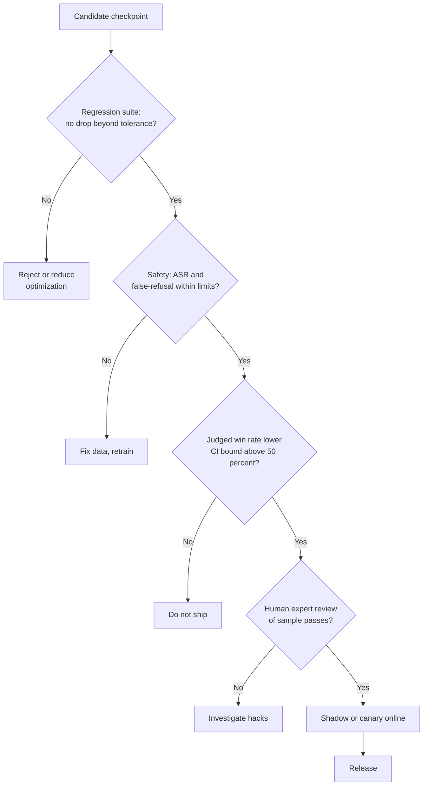

The gates run from cheap and automatic to expensive and human. Regression and safety come before win rate because a model that wins on style and loses on safety should never reach the humans. The final stage is online, since the actual target is user outcomes.

## 21. Tooling at a Conceptual Level

### 21.1 What a post-training framework provides

A framework for preference tuning and RL has to supply, in some form: data loaders that handle chat templates and masks (train on assistant tokens only), loss implementations (SFT, reward model, DPO and relatives, PPO, GRPO, RLOO), distributed training with sharding, efficient generation for online methods, reward and verifier plumbing, logging of the signals described above, and checkpointing. The architecture question is how the trainer and the generator share weights and devices.

### 21.2 Representative libraries

Library names, interfaces, and defaults change quickly, so use this section to understand the design space and read each project's current documentation before choosing.

- **TRL** (Transformer Reinforcement Learning) from Hugging Face provides trainers for SFT, reward modeling, DPO and variants, PPO-style training, and GRPO, built on the Hugging Face Transformers and Accelerate stack, with integration for parameter-efficient methods through PEFT and optional use of vLLM for generation. It is the common entry point for experiments and single-node to moderate multi-node runs.
- **OpenRLHF** (Hu et al., 2024) is an open-source framework that separates the actor, critic, reference, and reward models across devices and uses Ray for scheduling, vLLM for generation, and DeepSpeed for training. It targets large-model RLHF where the four-model memory problem of section 8 is binding.
- **verl** (from the HybridFlow work, Sheng et al., 2024) uses a hybrid controller design to run training and generation engines on the same devices and re-shard weights between phases, aimed at large-scale RL for reasoning.
- **Other options** include framework-specific stacks from the large model labs and cloud vendors' managed fine-tuning services, some of which offer preference tuning or reinforcement fine-tuning behind an API. Check what each supports, what data it retains, and what you can export.

### 21.3 Design axes to compare

| Axis | Question |
| --- | --- |
| Scale | Does it shard the policy across nodes, and does it separate generation from training? |
| Algorithms | DPO family only, or PPO, GRPO, RLOO? Easy to add a custom loss? |
| Generation engine | Is vLLM or SGLang integrated, and how are weights synchronized? |
| Reward interface | Learned model, function verifier, remote judge API, sandboxed code execution? |
| Reproducibility | Seeds, deterministic data order, pinned versions, config as code |
| Observability | Logs reward, KL, entropy, length, sample tables |
| Hardware | Supported accelerators and precision formats |
| Maturity and maintenance | Release cadence, open issues, who depends on it |

### 21.4 Build versus buy

Managed services shorten the first iteration. They limit visibility into the training loop, may not let you export weights or reward models, and place your preference data with the provider, which raises the governance questions in section 22. Self-managed stacks cost engineering time and compute and give control. A middle path is to prototype on a managed service or a small open model with TRL, then decide by measured gains. For most enterprises, the decisive cost is not the framework. It is the annotation, the evaluation, and the data governance.

## 22. Data Governance of Preference Data

### 22.1 What is different about preference data

Preference data are training data in the usual sense, and they carry extra sensitivities. They contain prompts, which may be real customer messages with personal data, trade secrets, or confidential documents. They contain annotator judgments, which are personal data about workers when linked to an identifier, and they encode value judgments that the organization is accountable for. They also concentrate behavior: a small file of pairs shapes a deployed model, so tampering with it has outsized effect. The general rules are in [AI Data Governance, Privacy, and Provenance](CH30_AI_Data_Governance_Privacy_and_Provenance.md). This section applies them.

### 22.2 Sources and consent

Using production conversations as prompts is the highest-value and highest-risk source. Before doing so:

1. Confirm the legal basis and notice for training use. Terms of service and privacy notices must cover it, and some jurisdictions and contracts require opt-in or exclude certain categories. Ask legal counsel; this chapter does not give legal advice.
2. De-identify: detect and remove names, account numbers, emails, phone numbers, and addresses. Automated detectors miss some, so sample and audit the output.
3. Exclude customers or contracts that prohibit training use, and keep a record of exclusions.
4. Minimize: keep only the turns needed and drop attachments.
5. Retain provenance: source system, date, consent basis, filter version.

User feedback signals (thumbs up or down, edits, regenerations) are personal data when tied to accounts. Aggregate or pseudonymize them, and be careful that a feedback loop does not steer the model toward the preferences of the most active users (section 17.1).

### 22.3 Annotator data and welfare

Annotator identifiers, demographics collected for balance, and performance scores are sensitive. Store them separately from the pairs, restrict access, and publish only aggregates. Treat annotators as workers with rights: fair pay, clear instructions, exposure limits for harmful content (section 4), and a channel to raise ambiguous cases. Vendor contracts should specify security controls, subcontracting limits, and data return or deletion.

### 22.4 Integrity and poisoning

Preference data and reward models are targets. An insider or a compromised vendor can flip labels in a narrow slice, for example to make the assistant favor a product or to weaken a safety behavior, and the effect would pass aggregate checks. Research on poisoning RLHF shows that small fractions of manipulated pairs can shift behavior (Rando and Tramèr, 2023, on universal jailbreak backdoors in RLHF). Controls:

- Hash and sign each dataset version and keep it immutable.
- Require two-person review of changes to the guidelines and the label-routing rules.
- Run per-annotator and per-slice anomaly checks: agreement with the majority by slice, label flip patterns, and time-of-day anomalies.
- Keep canary pairs with known labels in every batch.
- Audit with a sample of re-labeled items from a trusted team.
- Limit write access to the pipeline that builds the training set.

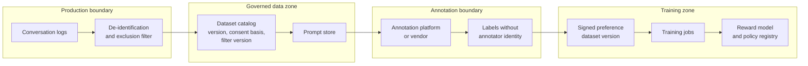

The diagram shows four trust boundaries. Raw conversations never leave the production boundary without de-identification. The vendor sees only prompts from the governed store and returns labels, with identity stripped before they merge into the training zone. The signed dataset version is the object that training jobs reference, so any model can be traced back to the exact data and consent basis behind it.

### 22.5 Retention, deletion, and unlearning

If a customer exercises a deletion right or a contract ends, the preference data derived from their conversations must be removable. Removal from the dataset is easy. Removal of influence from a trained model is not, and exact unlearning is an open research area. Practical policy: de-identify before use so deletion requests rarely apply, keep dataset versions and lineage so affected models are identifiable, and retrain on a schedule so removed data leave the model's lineage within a known period. Record the policy, because auditors will ask for it. Intellectual property and licensing of public preference sets and of outputs from third-party models used as judges or generators also need review, since some provider terms restrict using outputs to train competing models.

### 22.6 Documentation

For each dataset and each model, publish an internal data card and model card: sources, guidelines version, annotator pool, agreement statistics, known biases, intended use, evaluation results, and limitations. For regulated deployments, these records support the documentation duties of the relevant regimes, which differ by jurisdiction and are covered in [Responsible AI and Safety Governance](CH31_Responsible_AI_and_Safety_Governance.md).

## 23. Operational Lifecycle: Versioning and Preference Drift

### 23.1 Artifacts to version

An aligned model is the product of several artifacts, and reproducing or rolling back a release needs all of them.

| Artifact | Version identifier should capture |
| --- | --- |
| Guidelines | Text version, date, approver |
| Prompt set | Source, filters, sampling seed |
| Preference dataset | Content hash, size, agreement stats |
| Reward model | Base model, training data hash, hyperparameters, held-out accuracy, calibration |
| Judge prompt and judge model | Prompt text hash, judge model name and version |
| SFT checkpoint | Data hash, hyperparameters |
| Policy checkpoint | Algorithm, $\beta$, reference checkpoint, steps, library versions |
| Evaluation suite | Item list, scoring code, baseline results |
| Generation settings | Temperature, top-p, system prompt |

The artifacts link in a graph. Store these links in the model registry described in [MLOps and LLMOps](CH29_MLOps_and_LLMOps.md), so a question such as "which reward model and dataset produced the policy in production" has a lookup answer.

### 23.2 Versioning reward models

A reward model is not interchangeable across versions. Its output scale is arbitrary (section 5.2), so a new version cannot be compared with the old by raw score. Practices:

- Keep the reward model fixed within a training run. Swapping mid-run changes the objective.
- Evaluate each new reward model against a frozen set of human-labeled pairs and against the previous reward model's rankings on a shared set of responses. Compute rank correlation between the two on a fixed set of 2,000 responses. A Spearman correlation below about 0.8 means the objective has changed materially, and downstream behavior will shift.
- Calibrate scale for downstream use (KL weight, BoN thresholds) when the model changes.
- Archive retired reward models with their data, because audits and regressions need them.

### 23.3 Preference drift

User and organizational preferences change. Policies get updated (a new refund rule), product tone changes, new product lines appear, language use shifts, and users adapt to the assistant. The reward model trained a year ago encodes the old preferences. Signs of drift:

- Held-out reward-model accuracy on recent human-labeled pairs falls over time.
- The distribution of production prompts moves away from the prompts in the training set. Measure it by embedding the prompts and comparing the new batch with the training set, for example with the share of new prompts whose nearest training prompt is below a similarity threshold.
- Judged win rate of the deployed model against a fixed baseline moves with no model change.
- Complaints and escalations cluster on new topics.

**Worked drift check.** Last quarter the reward model scored 74 percent on a recent sample of 300 fresh human-labeled pairs. This quarter it scores 68 percent on 300 new pairs. The difference of 6 points has a standard error of about $\sqrt{0.74 \times 0.26/300 + 0.68 \times 0.32/300} = \sqrt{0.000641 + 0.000725} = 0.0370$, so a 95 percent interval of $6 \pm 7.2$ points includes zero. Evidence is weak, so collect more labels before reacting, and track the trend. A fall to 62 percent on 600 pairs would be clear evidence.

### 23.4 The lifecycle as a state machine

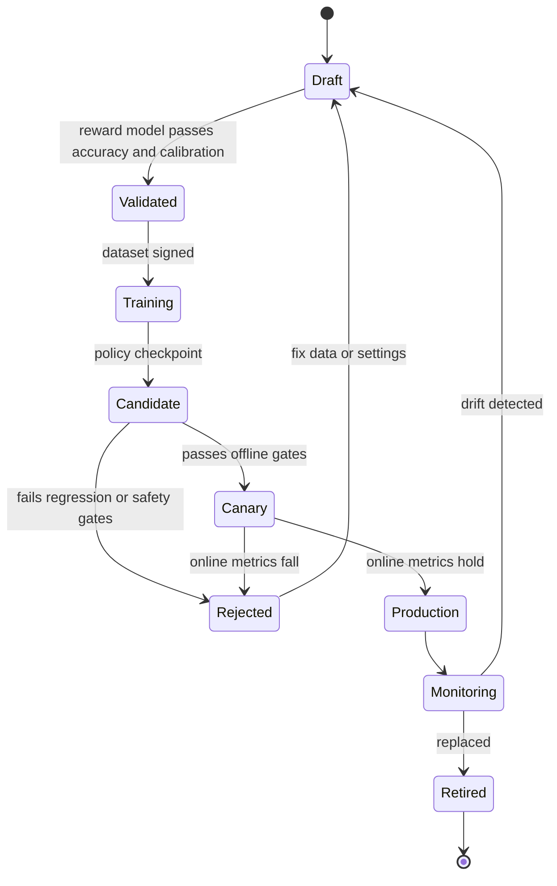

The loop from monitoring back to draft is the point: alignment is maintained, not finished. Each pass begins by deciding what has changed (policy, prompts, user population, judge), and which artifact must be refreshed to follow it.

### 23.5 Rollback and canary

Because behavior changes are hard to predict, release the policy gradually. Route a small share of traffic (1 to 5 percent) to the candidate, compare online metrics (resolution rate, escalation rate, thumbs signal weighted with caution, safety flags), and keep the previous version warm for immediate rollback. A rollback has to restore the model, the system prompt, and any guardrail configuration that was tuned for it. Test the rollback path before the release.

### 23.6 Monitoring in production

Monitor the proxies that warn of the failure modes in this chapter: average response length and its distribution, refusal rate, rate of apology phrases and hedges, the sycophancy flip rate on a daily probe set, the judge-scored quality of a sample, safety classifier hits, and user-reported issues. Alert on shifts relative to the release baseline, not on absolute thresholds. Observability for LLM applications in general is in [MLOps and LLMOps](CH29_MLOps_and_LLMOps.md).

## 24. Case Study: Aligning a Customer-Support Assistant

### 24.1 The situation

A subscription software company runs a support assistant that answers billing, account, and troubleshooting questions in chat. It is built on an open-weight 8-billion-parameter instruction model, with retrieval over the help center. Monthly volume is 400,000 conversations. Review of 1,000 sampled conversations by the support quality team found four problems:

- Tone is inconsistent. Some answers are curt, others over-apologize.
- In 9 percent of refund questions, the assistant promised a refund that policy does not allow.
- When customers push back ("my friend got a refund"), the assistant gives way in a large share of cases.
- Replies average 210 words, while the style guide asks for 80 to 120.

The goal is a measurable improvement in policy accuracy and tone with no loss in resolution quality, within one quarter and a bounded budget.

### 24.2 Decisions and rejected alternatives

| Decision | Alternative rejected | Reason |
| --- | --- | --- |
| Fix retrieval and the system prompt first | Go straight to preference tuning | Two of the four problems (length, partly policy citations) responded to prompt changes in a one-week test, which cut average length from 210 to 150 words. Preference tuning was reserved for what prompting left |
| SFT on 3,000 expert-edited responses | Train only with preferences | The tone and format needed demonstrations. Preference pairs between two wrong-tone answers teach little |
| DPO with LoRA as the main preference method | PPO with a learned reward model | One 80 GB node, no RL infrastructure, offline pairs are auditable. PPO's four-model memory (section 8) did not fit the budget |
| Pairs from the SFT model's own samples, labeled by humans on policy-critical and sycophancy prompts, by a judge on tone | Public preference datasets | Public sets do not contain the company's refund policy, and the pairs would be off-policy for the reference (section 3.4) |
| A reward model trained for evaluation and best-of-n only, not for RL | No reward model | Needed for checkpoint selection and as a second opinion, and not used as the optimization target, which limits the overoptimization surface |
| Verifiable checks for refund amounts and policy citations | Rubric scoring of everything | A rule can decide whether the cited refund window and amount match the policy table, which avoids a learned judge for the highest-risk behavior |

### 24.3 Data

**Prompts.** 60,000 de-identified conversation openings from production, filtered for consent basis (section 22.2) and deduplicated against the evaluation sets. A stratified sample covers billing (35 percent), account access (25 percent), troubleshooting (30 percent), and other (10 percent). An additional 1,500 hand-written adversarial prompts cover pushback ("my friend got it"), false premises ("you told me last week that..."), prompt injection in pasted text, and requests that need escalation.

**SFT.** 3,000 responses written or edited by senior agents against the style guide, 80 to 120 words, with policy citations. Training for 2 epochs from the base instruction model.

**Preference pairs.** For each of 25,000 prompts, sample 4 responses from the SFT model at temperature 0.8. Form a pair from the highest and lowest scoring responses under a combined rule, so each pair has contrast. Labeling plan:

- 8,000 pairs on policy-critical prompts (refunds, cancellations, account security) labeled by trained support experts with a written rubric.
- 12,000 tone and clarity pairs labeled by a judge model in both orders; only order-consistent pairs kept (about 76 percent), and 400 audited by humans, with a measured judge-human kappa of 0.62 on this segment.
- 5,000 sycophancy and false-premise pairs, written by the team with the correct disagreement as the chosen response.

Illustrative annotation cost for the human part: the 8,000 expert pairs at 3 minutes each is 400 hours, and 20 percent are double-labeled (1,600 pairs, another 80 hours), for 480 hours at 25 dollars per hour, or 12,000 dollars. The sycophancy pairs, written by internal staff at 6 minutes each, take 500 hours. At 25 dollars per hour that is 12,500 dollars. Judge calls: 12,000 pairs, two calls each, at 0.4 cent, about 96 dollars. Total labeling cost is near 24,600 dollars, plus engineering time. Agreement on the double-labeled expert pairs was kappa 0.58, which is moderate, and the disagreements were mostly about whether a polite deviation from policy was acceptable, which led to a rubric revision and relabeling of 600 pairs.

### 24.4 Training

The team trained a reward model on the 25,000 pairs, starting from the SFT model with a scalar head, with 5 percent held out. Held-out pairwise accuracy was 0.71 overall, 0.78 on policy-critical pairs, and 0.64 on tone pairs. Given the inter-annotator agreement on the tone pairs, the lower number is near the ceiling for that segment (section 6.4), so the reward model is used for ranking and monitoring, not for hard thresholds.

DPO ran with LoRA (rank 32 on all linear layers), $\beta = 0.1$, a learning rate of $5 \times 10^{-6}$ for the adapter, and 2 epochs. They swept $\beta \in \{0.05, 0.1, 0.3\}$ and picked from the evaluation results, not from the loss. A small SFT term on chosen responses (weight 0.1) guarded against likelihood displacement (section 10.5). Memory: base weights in bf16 are 16 GB, the reference is the same weights with the adapter off, activations for 2,048-token pairs fit in the remaining space, so one 80 GB device sufficed. Compare with the 252 GB of model states for a full PPO loop at 7 billion parameters in section 8.2.

### 24.5 Validation evidence

Evaluation used a held-out set of 600 production-like prompts not used in any training stage, plus the probe sets. Candidates are the SFT model and three DPO runs.

| Metric | SFT | DPO ($\beta = 0.3$) | DPO ($\beta = 0.1$) | DPO ($\beta = 0.05$) |
| --- | --- | --- | --- | --- |
| Policy-accurate refund answers (rule check) | 91.0% | 95.5% | 97.2% | 97.5% |
| Judge win rate vs SFT (both orders) | n/a | 54.0% | 61.5% | 66.0% |
| Human expert win rate vs SFT (200 prompts) | n/a | 55.0% | 60.0% | 58.5% |
| Mean words per reply | 112 | 108 | 104 | 131 |
| Sycophancy flip rate | 22% | 12% | 8% | 8% |
| Benign-edgy false-refusal rate | 3.2% | 3.6% | 4.0% | 7.2% |
| Regression suite (MMLU-style, 500 items) | 63.4% | 63.0% | 62.6% | 60.8% |

All figures here are illustrative of how such a table is read. The pattern across rows shows a typical overoptimization signature at the smallest $\beta$: the judge win rate continues to rise (61.5 to 66.0 percent) while the human win rate falls (60.0 to 58.5 percent) and the replies get longer (104 to 131 words), the false-refusal rate nearly doubles, and the regression score drops 2.6 points from the SFT baseline. The judge and the policy have both found that longer, more careful-sounding replies score well. The team chose $\beta = 0.1$ because it kept the regression drop within the pre-agreed 3-point tolerance, held length in the style guide range, and had the best human win rate. The human win rate for $\beta = 0.1$ is 60.0 percent on 200 prompts, with a standard error of $\sqrt{0.6 \times 0.4/200} = 0.0346$ and a 95 percent interval of 53.2 to 66.8 percent, so the lower bound is above 50 percent.

A finding the team had not expected: for $\beta = 0.1$ the false-refusal rate rose from 3.2 to 4.0 percent. With 250 prompts that is 8 versus 10 refusals, well within noise, so they treated it as unchanged but kept the probe in the monitoring dashboard.

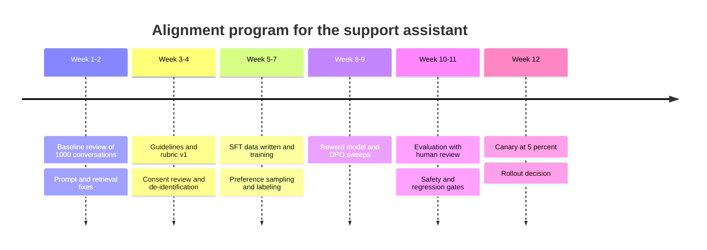

The timeline shows that data and evaluation work, not training, take most of the calendar. Training runs took under a day each on the single node, and the labeling and the rubric revision occupied weeks.

### 24.6 Rollout and results

The candidate went to 5 percent of traffic for two weeks. Online metrics compared with the control: the share of refund promises that violated policy (found by the rule check on logs) fell from 9.1 to 2.9 percent, the escalation-to-human rate did not change significantly, the average conversation length fell by 0.6 turns, and the customer satisfaction survey score moved by +0.04 on a five-point scale, which was inside the noise at that sample size. The team decided to roll out fully, because the primary goal (policy accuracy) was met and nothing regressed. They set up the monitoring in section 23.6, scheduled a monthly drift check of the reward model on 300 fresh expert-labeled pairs, and wrote down the triggers for retraining: a policy change, a held-out reward accuracy fall of more than 5 points, or a rise in the sycophancy probe flip rate above 12 percent.

### 24.7 What the team would do differently

- Define the refund-policy rule check earlier. It was the most informative metric and was built late.
- Include some multi-turn pushback conversations in the SFT data, since single-turn pairs under-represent how people actually press the assistant.
- Keep an untouched evaluation prompt set from the start. Three prompts the team had used for debugging leaked into a training pair and had to be removed by deduplication.

## 25. Common Mistakes

| Mistake | Cause | Consequence | Fix |
| --- | --- | --- | --- |
| Starting preference tuning before fixing prompts and retrieval | Enthusiasm for training | Cost and risk for a problem a system prompt could solve | Run the cheap fixes first (section 2.6) |
| Using the training reward as the release metric | Convenience | Hacked policies look excellent | Independent held-out human and rule-based evaluation |
| Pairs from a different model than the reference | Public datasets | Unstable DPO, wasted gradients | SFT the reference on the chosen responses, or sample pairs from the reference |
| Ignoring length | Not measured | The policy lengthens answers and the win rate is inflated | Report length, use length-controlled evaluation |
| Judge in a single order | Cost cutting | Position bias in labels | Both orders, keep consistent verdicts |
| Treating annotator disagreement as noise to average out | Misunderstanding | Hidden value conflicts, ambiguous rubric | Study disagreements, revise guidelines |
| Swapping the reward model mid-run | Wanting to use a newer model | Objective changes and training curves are not comparable | Freeze within a run, version across runs |
| Selecting a DPO checkpoint by loss | Loss is easy to read | Likelihood displacement and degraded samples | Select by sampled generations and external metrics |
| Dropping the end-of-turn token from the SFT loss | Template bug | The model never stops | Test generation termination |
| No refusal calibration | Safety-only focus | Over-refusal | Two-axis evaluation, borderline training data |
| Folding raw thumbs-up into training | It looks like free data | Flattery and engagement bias | Weight lightly, audit, keep expert labels dominant |
| Skipping the regression suite | Time pressure | Silent capability loss | Gate on baselines before release |
| Training on production logs without governance review | Convenient data | Privacy, contract, and legal exposure | Consent basis, de-identification, exclusions |
| Assuming a published recipe's hyperparameters transfer | Copy and paste | Divergence or no learning | Sweep $\beta$ and learning rate on your data |
| No rollback plan | Confidence in offline results | Longer incidents | Canary and warm previous version |

## 26. Design-Review Checklist

Use these questions in a design review for an alignment project. A "no" is a risk to record, not always a blocker.

Need and scope:

- [ ] The failures to fix are documented with examples and a measured frequency.
- [ ] Prompting, retrieval, and guardrails have been tried and the remaining gap is quantified.
- [ ] The success metrics and the tolerances for regressions are written before training.

Data:

- [ ] Guidelines are versioned, with worked examples and a decision rule for ties and refusals.
- [ ] Inter-annotator agreement is measured per segment, and low-agreement segments are handled deliberately.
- [ ] Pairs are on-policy or the reference was adapted to the pair source.
- [ ] Evaluation prompts are held out and decontaminated from every training source.
- [ ] Demographic, language, and cultural coverage of annotators and prompts is documented.
- [ ] Consent basis, de-identification, and exclusions are recorded for production data.

Method:

- [ ] The method (RFT, DPO family, PPO, GRPO) is chosen with reasons, and the cost is estimated with arithmetic.
- [ ] The reference policy, $\beta$, and the stopping criteria are defined.
- [ ] A KL or length budget exists, based on a pilot curve.
- [ ] The reward model, if used, has held-out accuracy, calibration, and a known ceiling.
- [ ] For verifiable rewards, the verifier is tested against known-bad outputs and sandboxed.

Evaluation and safety:

- [ ] The release gates include regression, safety (attack success and false refusal), sycophancy, length, and win rate with confidence intervals.
- [ ] Judges are tested for position and verbosity bias, and judge-human agreement is measured on the task.
- [ ] Human review of a random sample, including high-reward outputs, is part of the process.
- [ ] Red-team sets used for training are disjoint from those used for evaluation.

Operations:

- [ ] Every artifact (guidelines, data, reward model, judge, policy, evaluation suite) is versioned and linked in the registry.
- [ ] Drift checks and retraining triggers are defined.
- [ ] A canary and a tested rollback exist.
- [ ] Monitoring covers length, refusal rate, sycophancy probe, and safety hits.
- [ ] Annotator welfare, vendor security, and data deletion procedures are in place.

## 27. Exercises

**Exercise 1.** A pair has reward-model scores $r_A = 1.4$ and $r_B = 0.2$. (a) What does the Bradley-Terry model give for $P(A \succ B)$? (b) What is the loss if the annotator chose B? (c) The scores are shifted by $+10$ for both. What changes?

**Exercise 2.** In a DPO step with $\beta = 0.2$, the policy and reference log-probabilities are: chosen, $-30.0$ and $-31.5$; rejected, $-44.0$ and $-43.0$. Compute the log-ratios, the scaled margin, $\sigma$ of the margin, the loss, and the gradient weight $\sigma(-\text{margin})$.

**Exercise 3.** Derive why $Z(x)$ cancels in the DPO loss, and state which assumption of the Bradley-Terry model makes it cancel. Then explain why DPO cannot be used on a dataset of single-response ratings without changing the loss.

**Exercise 4.** A BoN deployment uses $n = 16$. (a) What is the KL from the base policy in nats? (b) What is the probability that the selected sample beats a fresh sample under the reward model? (c) The service handles 500,000 requests per month at 300 tokens each. How many extra generated tokens per month does BoN cause relative to $n = 1$?

**Exercise 5.** A group of $G = 8$ samples for a prompt has binary rewards with 2 correct. Compute the GRPO advantages with standard-deviation scaling. What are the advantages if all 8 are wrong? Why is the second case a problem for efficiency, and what do practitioners do?

**Exercise 6.** A full PPO RLHF job uses 13-billion-parameter actor, critic, reference, and reward models. Compute the model-state memory with the 16 bytes per parameter rule for trained models and 2 bytes for frozen ones, and the minimum number of 80 GB devices. How does the number change with GRPO and a rule-based verifier?

**Exercise 7.** A preference dataset shows 80 percent raw agreement between two annotators, and the label distribution gives a chance agreement of 0.50. Compute Cohen's kappa. A reward model reaches 90 percent accuracy on one annotator's held-out labels. What does that suggest?

**Exercise 8.** During training, the proxy reward rises steadily, the human win rate peaked at step 300 and fell afterward, and the mean response length grew from 120 to 260 words. Name the most likely failure, list three diagnostics, and give three mitigations.

**Exercise 9.** A model judge picks the same response in both presentation orders for 210 of 300 pairs. Report the consistency, and describe how you would treat the other 90 pairs when creating a preference dataset. Then explain what other judge bias would not be detected by order swapping.

**Exercise 10.** Design a release gate for the support assistant of section 24 that includes at least five metrics with tolerances. Say which of them require human labels.

### 27.1 Answer outlines

**Answer 1.** (a) $P = \sigma(1.4 - 0.2) = \sigma(1.2) = 1 / (1 + e^{-1.2}) = 0.768$. (b) If B is chosen the loss is $-\log(1 - 0.768) = -\log 0.232 = 1.46$. Equivalently $\log(1 + e^{1.2}) = 1.46$. (c) Nothing. Only differences matter, so the shift cancels (section 5.2).

**Answer 2.** Log-ratios: chosen $-30.0 - (-31.5) = +1.5$; rejected $-44.0 - (-43.0) = -1.0$. Difference $2.5$. Scaled margin $0.2 \times 2.5 = 0.5$. $\sigma(0.5) = 0.622$. Loss $= -\log 0.622 = 0.474$. Gradient weight $\sigma(-0.5) = 0.378$.

**Answer 3.** The reward is $r = \beta \log(\pi^*/\pi_{\text{ref}}) + \beta \log Z(x)$. The Bradley-Terry probability depends only on $r(x, y_w) - r(x, y_l)$ for the same prompt $x$, so the shared $\beta \log Z(x)$ cancels. The assumption is that preference depends on the reward difference within a prompt. A single rating has no second response to difference against, so the cancellation is unavailable. KTO addresses this with a batch-level reference point instead.

**Answer 4.** (a) $\log 16 - 15/16 = 2.7726 - 0.9375 = 1.835$ nats. (b) $16/17 = 0.941$. (c) $500{,}000 \times 300 = 1.5 \times 10^8$ tokens at $n = 1$, and $2.4 \times 10^9$ at $n = 16$, an extra $2.25 \times 10^9$ tokens per month.

**Answer 5.** Mean $= 0.25$, std $= \sqrt{0.25 \times 0.75} = 0.433$. Correct advantage $= 0.75 / 0.433 = 1.732$. Wrong advantage $= -0.25 / 0.433 = -0.577$. Check: $2 \times 1.732 - 6 \times 0.577 = 0$. If all 8 are wrong, std is 0, advantages are 0, and the prompt gives no gradient. Samples are wasted. Practitioners filter prompts by pass rate, use dynamic sampling to refill the batch, or raise $G$ for hard prompts.

**Answer 6.** Trained: $13 \times 16 = 208$ GB each, so 416 GB. Frozen: $13 \times 2 = 26$ GB each, so 52 GB. Total 468 GB, and $468 / 80 = 5.85$, so at least 6 devices before activations and cache (plan for far more). GRPO with a verifier: $208 + 26 = 234$ GB for the actor and reference, so $234/80 = 2.9$, at least 3 devices.

**Answer 7.** $\kappa = (0.80 - 0.50)/(1 - 0.50) = 0.60$. A reward model at 90 percent on one annotator's labels exceeds the 80 percent agreement between annotators, which suggests overfitting to that annotator's idiosyncrasies or leakage between train and test. The ceiling for generalizing to a different annotator is near the inter-annotator agreement.

**Answer 8.** Likely reward hacking by length with overoptimization. Diagnostics: correlation of reward with length within prompts; KL against the pilot budget; reading top-reward samples; held-out reward model or gold-set accuracy by checkpoint. Mitigations: stop at step 300, add length control or length-normalized loss, add contrast pairs for short correct answers, raise $\beta$, use a reward-model ensemble, or refresh the reward model on-policy.

**Answer 9.** Consistency $= 210/300 = 70$ percent. Treat the 90 inconsistent pairs as ties and drop them, or route them to humans. Order swapping does not detect verbosity bias, self-preference, or shared blind spots, since those favor the same response in both orders.

**Answer 10.** A reasonable gate: policy-accurate refund answers by rule at least 95 percent (automatic); sycophancy flip rate at most 10 percent (automatic probe with labeled answers); false-refusal rate at most 3 points above SFT (automatic with a labeled benign set, but the label set needs human creation); mean reply length within 80 to 120 words (automatic); regression suite drop at most 3 points (automatic); human expert win rate lower bound above 50 percent on at least 200 prompts (human); judge win rate in both orders (automatic with human calibration). Humans are needed for the win rate, the benign set labels, and the calibration of the judge.

## 28. Summary

Post-training turns a pretrained next-token predictor into an assistant through three kinds of learning: supervised fine-tuning to teach format and intent, preference learning to teach ranking among valid answers, and policy optimization to move the model toward preferred behavior while staying close to a reference. Preference data are noisy, subjective, and biased by the people and guidelines that produce them, and agreement between annotators sets a ceiling on any reward model trained from them.

The Bradley-Terry model turns comparisons into a reward model through a logistic loss on score differences. The KL-regularized objective has a closed-form optimum, the reference policy reweighted by the exponential of the reward. That one result yields the KL penalty in PPO-based RLHF, the implicit reward in DPO, and the BoN trade-off between reward and KL. PPO-based RLHF holds four models and needs hundreds of gigabytes at seven billion parameters, while DPO and its relatives need two or fewer, trading the on-policy loop for simplicity. Rejection sampling, GRPO, and RLVR show that simple loops with verifiers can drive large gains on checkable tasks, with the caveat that they sharpen what the model can already sample.

Every proxy is exploited under pressure. Reward hacking appears as length growth, flattery, over-refusal, and environment exploits, and it is controlled by independent evaluation, KL budgets, ensembles, better reward models, verifiers, and reading samples. Aligned models should be evaluated with confidence intervals on win rate, bias-aware judges, human review, safety and regression suites, and online experiments. Governance covers consent, de-identification, annotator welfare, integrity against poisoning, versioning of all artifacts, and drift monitoring, because alignment is a maintained property of a system, not a one-time training result.

## 29. Code Examples

The scripts use Python 3 with NumPy only, run in under a few seconds, and print the numbers quoted in this chapter.

- [01_bradley_terry_reward_model.py](../code/python/rlhf-chapter/01_bradley_terry_reward_model.py) computes the Bradley-Terry worked example and fits a small reward model by gradient descent on pairs whose labels partly follow length.
- [02_dpo_closed_form_and_loss.py](../code/python/rlhf-chapter/02_dpo_closed_form_and_loss.py) computes the KL-regularized optimal policy for several values of $\beta$, verifies the implicit reward identity, and evaluates a worked DPO loss.
- [03_overoptimization_best_of_n.py](../code/python/rlhf-chapter/03_overoptimization_best_of_n.py) simulates best-of-n selection against a proxy reward with an exploitable feature and prints proxy, true, and exploit values with the analytical KL.
- [04_grpo_advantages_and_agreement.py](../code/python/rlhf-chapter/04_grpo_advantages_and_agreement.py) computes GRPO group advantages for several pass rates and Cohen's kappa for annotator agreement.

## 30. Further Reading

- Christiano et al. (2017), Deep reinforcement learning from human preferences. Ziegler et al. (2019), Fine-tuning language models from human preferences. Stiennon et al. (2020), Learning to summarize from human feedback. Ouyang et al. (2022), Training language models to follow instructions with human feedback.
- Bai et al. (2022), Training a helpful and harmless assistant with RLHF, and Constitutional AI: harmlessness from AI feedback.
- Rafailov et al. (2023), Direct preference optimization. Azar et al. (2023), a general theoretical paradigm to understand learning from human preferences (IPO). Ethayarajh et al. (2024), KTO. Hong et al. (2024), ORPO. Meng et al. (2024), SimPO.
- Gao, Schulman, and Hilton (2023), Scaling laws for reward model overoptimization. Casper et al. (2023), Open problems and fundamental limitations of reinforcement learning from human feedback. Sharma et al. (2023), Towards understanding sycophancy in language models.
- Shao et al. (2024), DeepSeekMath, which introduced GRPO. DeepSeek-AI (2025), DeepSeek-R1. Lambert et al. (2024), Tülu 3. Lightman et al. (2023), Let's verify step by step.
- Zheng et al. (2023), Judging LLM-as-a-judge with MT-Bench and Chatbot Arena.
