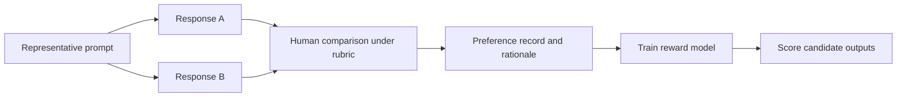
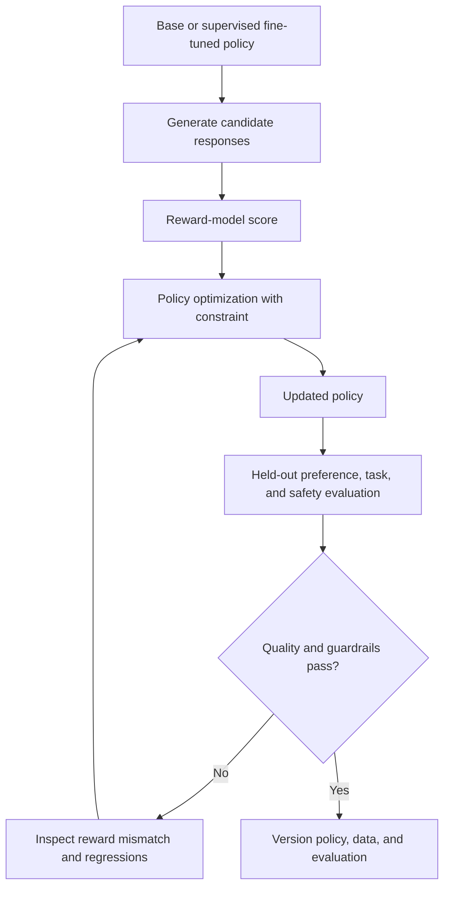
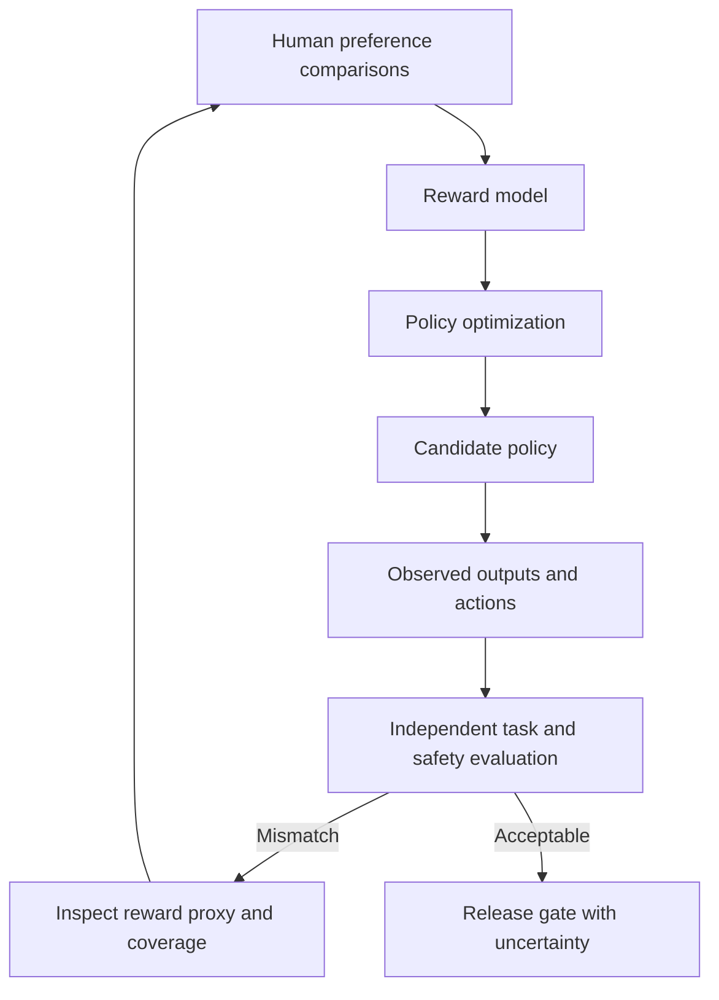
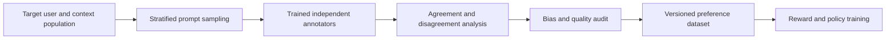
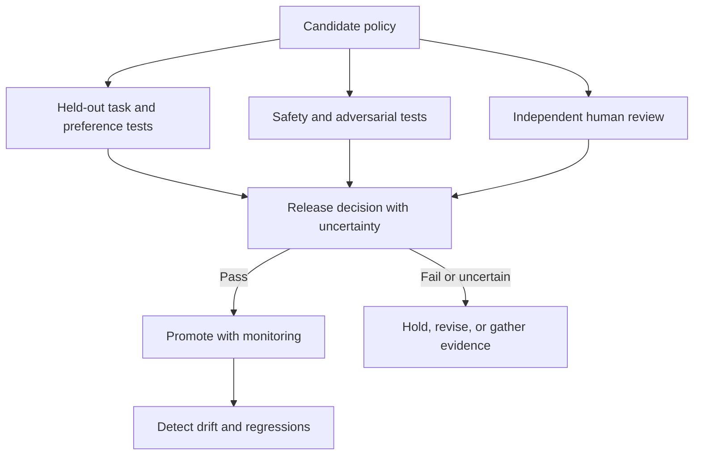

# Reinforcement Learning from Human Feedback (RLHF)

Part: [16 — Artificial Intelligence, Machine Learning, and Generative AI](PART_OVERVIEW.md)

Reinforcement Learning from Human Feedback (RLHF) uses human preferences or judgments to shape model behavior when a direct objective is difficult to specify. A common pipeline collects preference comparisons, trains a reward model, and optimizes a policy against that reward. The process can improve desired behavior, but inherits label bias, reward-model error, optimization instability, and evaluation limits.

## Preference Data and Reward Modeling

Annotators compare candidate outputs under a rubric or rank multiple responses. The data should represent intended users, contexts, and safety cases. Disagreement can signal ambiguity, not merely annotator error. A reward model learns to score outputs in line with observed preferences; it approximates the rubric and data, not an objective measure of human value.

Define rubric, annotator training, sampling, disagreement handling, sensitive data rules, and quality audits. Check for preference shortcuts such as verbosity, style, or position bias. Split preference data by prompt or source to reduce leakage between training and evaluation.

A common pairwise model assumes the probability that response $a$ is preferred to response $b$ is $\sigma(r_a-r_b)$, where $r_a$ and $r_b$ are scalar reward-model scores and $\sigma$ is the logistic function. Training minimizes the negative log likelihood of observed choices. This turns comparisons into a ranking signal, but it cannot distinguish a consistent rubric from a biased one: if annotators reward length or confident tone, the model learns that shortcut. Keep prompts grouped across train and evaluation splits, measure agreement by task and population, and inspect examples where preference and objective quality diverge.

A reward-hacking example makes the risk concrete. If a reward model assigns a higher score to a 400-word answer than a 120-word answer that covers the same facts, a policy optimized against that reward model will drift toward verbosity regardless of whether users prefer it, because the optimization process only has access to the proxy reward, not the underlying preference it was meant to approximate. Detecting this requires comparing reward-model score against an independent, held-out human-judged quality metric across a length-stratified sample; a growing gap between the two as training proceeds is the operational signal that the optimizer is exploiting the proxy rather than improving the target behavior.

## Policy Optimization and Alternatives

A policy can be optimized to increase reward-model scores while remaining near a reference model. Proximal Policy Optimization (PPO) is one common method; Direct Preference Optimization (DPO) is an alternative that learns directly from preference pairs without an explicit online reward-optimization loop. These methods have different compute, stability, and data assumptions; neither removes the need to validate actual task and safety outcomes.

A regularized policy objective can be written as expected reward minus a coefficient-weighted divergence from a reference policy: $\mathbb{E}_{y\sim\pi_\theta}[r_\phi(x,y)]-\beta D_{KL}(\pi_\theta\|\pi_{ref})$. The reward term encourages preferred behavior; the divergence penalty limits how far optimization moves from the reference distribution. A small $\beta$ can permit reward exploitation, while a large $\beta$ can constrain useful change. PPO optimizes sampled policy behavior under a clipped update objective; DPO uses preferred and rejected pairs with a reference policy to directly update relative likelihoods. Neither objective proves alignment: held-out task, safety, and human review remain necessary.

Optimization can exploit reward-model errors. This can produce reward hacking and distribution shift. Constrain deviation from the reference model, monitor reward distribution and response behavior, and evaluate with independent human and task-specific measures. Do not use the training reward as the sole release metric.

## Human Labeling, Bias, and Cost

Preference collection is expensive and sensitive to instructions, locale, expertise, and labeler incentives. Use representative sampling, quality-control tasks, blinded comparisons, and documented adjudication. Preserve disagreement and rationale where useful. Protect annotators and data subjects from harmful content and unnecessary exposure.

Track annotation cost, time, agreement by segment, and coverage of rare safety cases. Avoid collapsing disagreement into one label without recording uncertainty. A reward model may amplify majority preference and underserve minority groups; evaluate outcomes across relevant cohorts.

## Evaluation and Governance

Evaluate task success, preference quality, safety, refusal behavior, robustness, and regressions against a baseline. Use held-out prompts and adversarial cases; keep some evaluation data private to reduce benchmark overfitting. Human review should be calibrated and reproducible, with a known escalation path for ambiguous or high-impact outcomes.

Version the base model, supervised fine-tuning data, preference dataset, rubric, reward model, optimization settings, and evaluation set. Define rollback triggers and ownership for a regression. Part 17 owns production AI system composition; this chapter owns training and alignment method limits.

## Worked Case and Review Checklist

A support assistant is tuned from human comparisons emphasizing correctness, concise explanations, and safe escalation. The team samples prompts across languages and issue types, measures annotator agreement, and trains a reward model. A candidate policy improves preference ratings but increases unsupported answers on a held-out factuality set. The release is held; the team adjusts rubric/data and adds an explicit escalation criterion before reevaluation.

The concrete detection signal in this case was a diverging pair of numbers tracked across training checkpoints: mean reward-model score rose steadily from 0.61 to 0.74, while an independent, human-labeled factuality rate on a frozen 300-example set fell from 88% to 79% over the same checkpoints. Neither number alone would have been conclusive — a rising reward score looks like success in isolation — but tracking both together made the reward-hacking pattern visible early enough to hold the release rather than discover it after launch.

Review preference population, rubric, annotation quality, disagreement, privacy, reward model validation, optimization constraints, reward hacking, independent evaluation, subgroup outcomes, version lineage, release gate, and rollback.

## Questions and Summary

1. Explain the relationship between preference data, reward model, and optimized policy.
2. How can a model increase reward while worsening user outcomes?
3. Compare PPO-style optimization and DPO at a high level.
4. Design evaluation that detects verbosity bias and safety regressions.
5. Which artifacts must be versioned to reproduce an RLHF release?

RLHF uses human preference as a training signal, not as a complete definition of safe or useful behavior. Data quality, rubric, reward-model generalization, and optimization stability determine outcomes. Evaluate independently across tasks, safety, and user groups, and preserve rollback and governance evidence.
