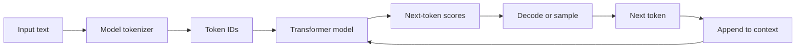
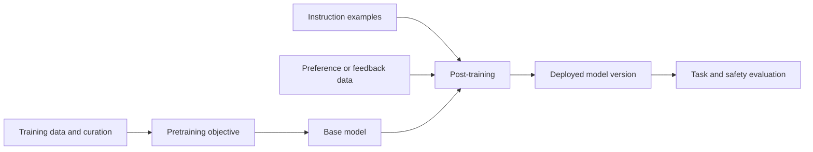
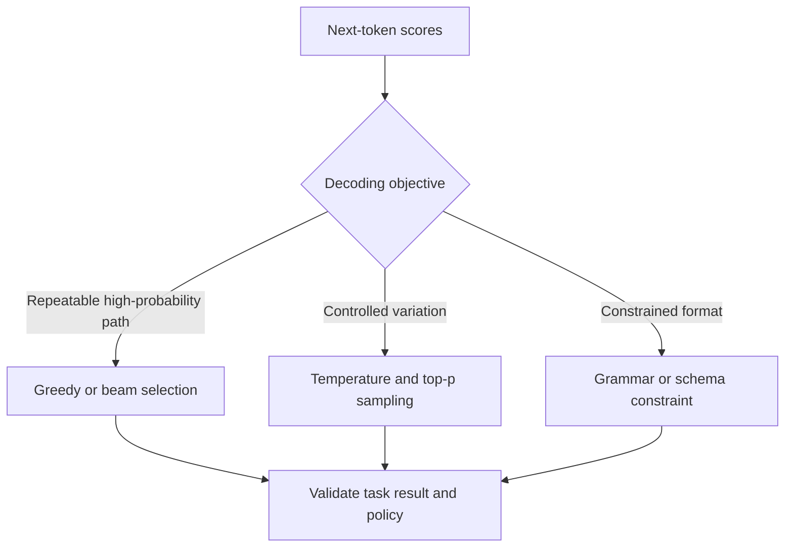
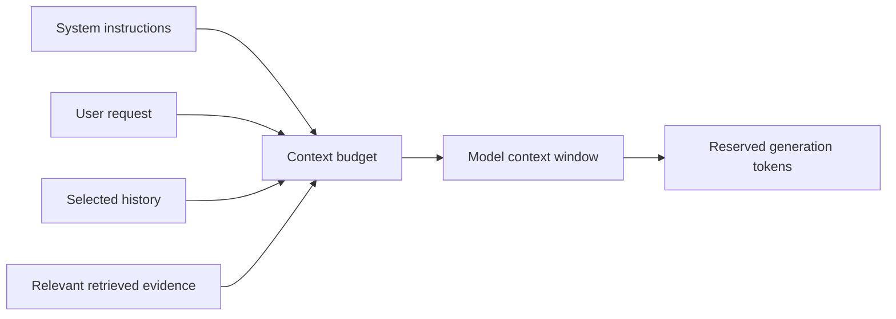
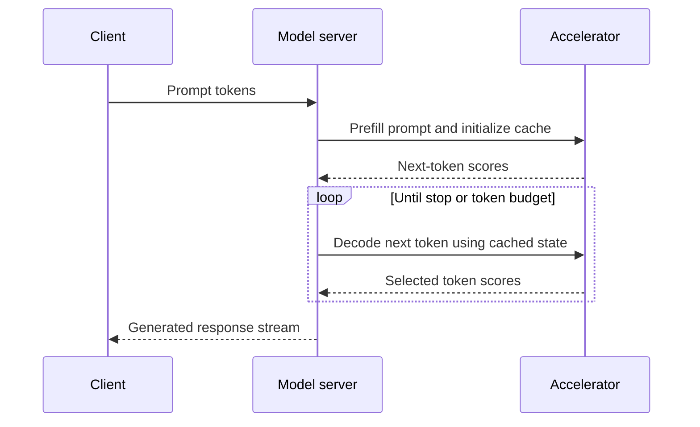

# Large Language Model Fundamentals and Inference

Part: [16 — Artificial Intelligence, Machine Learning, and Generative AI](PART_OVERVIEW.md)

A Large Language Model (LLM) predicts text tokens from context, typically by learning next-token distributions from large training corpora and later adapting behavior through post-training. Inference repeatedly selects a token and appends it to context. The result is a probabilistic model output, not a guarantee of truth, intent, or task completion.

## Tokenization and Autoregressive Prediction

Tokenization maps text into model-specific token identifiers. A token may be a word, subword, byte sequence, or punctuation fragment. Token counts affect context limits, latency, and cost. Different models tokenize the same text differently, so character count is not a reliable proxy for model input size.

The model assigns scores to candidate next tokens conditioned on prior tokens. It does not retrieve a verified fact by default; it generates continuations that fit learned patterns and supplied context. Tool access, retrieval, and verification are system capabilities built around the model. Tokenizers commonly split frequent words into subword pieces and retain byte or character fallback for rare forms; whitespace, punctuation, code, and multilingual text can therefore change token count unexpectedly. Special tokens may mark message boundaries, roles, or task modes and are not ordinary visible text. Pin tokenizer and template versions together because a changed boundary can alter both token budget and model behavior.

Token-to-character ratio varies enough to break naive capacity planning. Common English prose often averages around 4 characters per token, but a run of rare identifiers, a non-Latin script, or dense code can drop that ratio well below 2 characters per token for the same byte count. A prompt budget sized assuming English prose can silently truncate or overflow for a non-English user or a code-heavy request, which is why token counts — not character or byte counts — must be measured with the actual tokenizer before setting a context-budget limit in application code.

## Pretraining, Post-Training, and Capability Limits

Pretraining learns statistical structure from data under an objective. Post-training may use supervised examples, preference data, or other methods to shape instruction following and output style. Training data, objectives, and evaluation shape behavior, but do not provide complete knowledge of source provenance or reliable guarantees for every prompt.

Distinguish model capability from application behavior. The application controls system instructions, retrieval, tools, permissions, output validation, user experience, and fallback. A model may be fluent while factually wrong or inconsistent. Use evidence and evaluation tied to the actual task.

Model families differ by training objective and input/output contract. A base autoregressive model continues text; an instruction-tuned model is optimized to follow task requests; a reasoning-oriented model may use different post-training and inference-time computation; encoder-decoder models condition generation on encoded input. These labels do not guarantee capabilities or safety. Compare versions on the target task and inspect context limits, supported modalities, license, and serving conditions rather than assuming a family name predicts fit.

## Context Window and Decoding

The context window bounds tokens available to the model for prompt, conversation, retrieved content, and generated output. A larger window can increase memory and compute cost and does not ensure the model uses all included information. Allocate context according to relevance and reserve space for response and protocol tokens.

Context selection is not just truncation at a fixed length. Count the serialized message format, special tokens, tool schemas, and reserved output; each can consume capacity that is not obvious from visible character count. More evidence can dilute salient instructions or push useful material into a position the model uses less reliably. Measure answer quality as evidence position and context length vary. [CH17 — Prompt Engineering](CH17_Prompt_Engineering_and_Structured_Outputs.md) owns prompt composition and context-allocation policy.

Decoding selects output tokens. Greedy decoding chooses the highest-scoring next token; sampling introduces variation based on temperature and filtering such as top-p. Lower randomness can improve repeatability but does not guarantee correctness. Record decoding parameters and model version when outputs need reproducibility.

Temperature rescales logits before softmax: lower values sharpen the distribution and higher values flatten it. Top-p sampling retains the smallest high-probability token set whose cumulative probability reaches a chosen mass, then samples within that set. Greedy selection is the deterministic highest-score choice, but ties, kernels, and provider updates can still affect exact reproducibility. Beam search explores several high-scoring sequences and is useful for some constrained tasks, but it can favor generic outputs and is not a universal quality improvement. Treat decoding settings as task-specific behavior controls and evaluate them with the same prompt and data.

## Inference Cost and Quantization

Inference includes prompt processing and token-by-token generation. Prompt prefill may parallelize across prompt positions; decode is sequential in generated token count. Throughput depends on model size, batch scheduling, sequence length, memory bandwidth, hardware, and cache policy. Quantization reduces weight precision and memory use, with possible quality changes that require measurement.

Weight quantization maps high-precision values to a smaller representation using scales and, for some methods, zero points. Lower-bit weights can reduce memory footprint and memory traffic, but rounding error may change outputs, and kernels must support the chosen format to realize speed gains. Calibration data should represent the intended input distribution. Weight quantization does not automatically reduce activation or key-value cache memory; those are separate capacity terms. Evaluate quality, latency, throughput, and memory on the target runtime rather than inferring a benefit from bit width alone.

## Worked Case and Review Checklist

A document assistant receives a request and selected evidence. The application estimates token use, truncates or ranks context to fit a reserved output budget, sends the prompt to a pinned model version, and streams tokens under a response deadline. It stores model and decoding metadata without logging sensitive prompt content by default. If the service is unavailable or output validation fails, it returns a safe fallback.

Review tokenizer/version, context allocation, prompt and output budget, model capability claims, decoding settings, latency path, quantization evidence, privacy, response limits, fallback, and evaluation scope.

## Questions and Summary

1. Why can character count not reliably predict token count?
2. Distinguish pretraining from post-training and model behavior from application behavior.
3. What competes for context-window capacity in a retrieval-backed application?
4. Compare greedy decoding and sampling without equating determinism with correctness.
5. Identify cost and latency drivers in prefill versus token decoding.

LLMs generate token sequences conditioned on context. Tokenization, training, context allocation, decoding, model version, and serving constraints shape behavior and cost. Treat outputs as model predictions that require task-specific evidence, controls, and fallbacks at the application layer.
