# Embeddings and Semantic Representations

Part: [16 — Artificial Intelligence, Machine Learning, and Generative AI](PART_OVERVIEW.md) · Status: Revised (in-depth rewrite)

## 1. Introduction

An embedding is a learned function that maps an input, such as a word, a sentence, a document, an image, a code snippet, or a user, to a point in a real vector space so that a geometric relation between points (distance, angle, inner product) approximates a relation the training objective cared about. Everything downstream of that sentence is engineering around one fact: the geometry is a side effect of an objective, a training corpus, a tokenizer, a pooling rule, and a similarity function, and none of those are free parameters you can ignore when you consume the vectors.

For a solution architect the topic matters for four practical reasons. First, embeddings are the interface between unstructured data and everything that expects structure: search, retrieval-augmented generation (RAG), recommendation, deduplication, clustering, classification, and anomaly detection. Second, embeddings are expensive to change. Replacing a model means re-embedding the whole corpus, rebuilding indexes, and re-validating every threshold that was tuned against the old score distribution. Third, embeddings leak. A vector derived from a confidential document is not an anonymized artifact, and access control on the vector store is part of the security perimeter. Fourth, embedding quality cannot be read from a leaderboard. A public benchmark tells you which models are worth testing. Only a labeled evaluation set drawn from your own queries and documents tells you which one to ship.

This chapter owns the representation side: how vectors are produced, what the geometry means and does not mean, how to choose and adapt a model, how to compress and migrate vectors, and how to evaluate and monitor them. It does not own index data structures, approximate nearest-neighbor algorithms, or the database. Those belong to [Vector Databases](../06_Databases_and_Storage/CH21_Vector_Databases.md) in Part 06 and to [Vector Databases for AI Retrieval](CH26_Vector_Databases_for_AI_Retrieval.md) in this part. This chapter gives a short recap where the two meet and links out for the mechanics.

### 1.1 Ownership and neighbours

| Topic | Owner | What this chapter does with it |
| --- | --- | --- |
| Transformer encoder mechanics, attention | [CH10 — Transformers and Attention](CH10_Transformers_and_Attention.md) | Uses the encoder as a black box that yields one vector per token |
| Tokenization and context windows | [CH15 — LLM Fundamentals and Inference](CH15_Large_Language_Model_Fundamentals_and_Inference.md) | Uses tokens as the unit of cost and truncation |
| Dimensionality reduction (PCA, t-SNE, UMAP), clustering algorithms | [CH05 — Unsupervised Learning and Representation Reduction](CH05_Unsupervised_Learning_and_Representation_Reduction.md) | Applies them to embeddings, recaps in one paragraph |
| Metrics, confidence intervals, validation design | [CH06 — Model Evaluation, Validation, and Selection](CH06_Model_Evaluation_Validation_and_Selection.md) | Applies recall, mean reciprocal rank (MRR), and normalized discounted cumulative gain (nDCG) to retrieval |
| Vector index structures (HNSW, IVF, product quantization as an index feature), database mechanics | [Part 06 CH21 — Vector Databases](../06_Databases_and_Storage/CH21_Vector_Databases.md) and [CH26](CH26_Vector_Databases_for_AI_Retrieval.md) | Recaps; owns only the representation-level view of quantization |
| RAG pipeline composition | [CH18 — RAG Architecture](CH18_RAG_Architecture.md) | Supplies the embedding component; CH18 owns the pipeline |
| Retrieval and end-to-end RAG evaluation | [CH19 — Retrieval Quality and RAG Evaluation](CH19_Retrieval_Quality_and_RAG_Evaluation.md) | Owns embedding-level evaluation; CH19 owns grounding and answer evaluation |
| Fine-tuning mechanics, LoRA | [CH20 — Fine-Tuning, PEFT, and LoRA](CH20_Fine_Tuning_PEFT_and_LoRA.md) | Adds embedding-specific data construction and losses |
| Multimodal generation | [CH23 — Multimodal Generative AI](CH23_Multimodal_Generative_AI.md) | Covers contrastive image-text embeddings only |
| Data governance and deletion | [CH30 — AI Data Governance, Privacy, and Provenance](CH30_AI_Data_Governance_Privacy_and_Provenance.md) | Adds the embedding-specific leakage and deletion consequences |
| System composition, gateways, release manifests | [Part 17 CH05 — RAG System Architecture](../17_AI_Architecture/CH05_Retrieval_Augmented_Generation_System_Architecture.md) | Supplies the embedding contract the system consumes |

### 1.2 Reader outcomes

After studying this chapter, a reader should be able to:

1. Explain the distributional hypothesis and derive why skip-gram with negative sampling (SGNS) factorizes a shifted pointwise mutual information (PMI) matrix.
2. Derive the InfoNCE (information noise-contrastive estimation) loss, its gradient, and the role of temperature, and run a toy contrastive trainer.
3. Choose among bi-encoder, cross-encoder, late-interaction, sparse, learned-sparse, and hybrid retrieval, with latency and storage arithmetic to back the choice.
4. State which similarity metrics are equivalent under which normalization, and recognize anisotropy and hubness.
5. Apply Matryoshka truncation and scalar, product, and binary quantization, and predict recall and storage for each.
6. Build a domain evaluation set, fine-tune an embedding model with mined hard negatives, and decide whether it beat the baseline.
7. Plan and cost a model migration, monitor embedding drift, and describe what an attacker can recover from vectors.
8. Design a semantic search service for a support knowledge base and defend each decision against the alternatives.

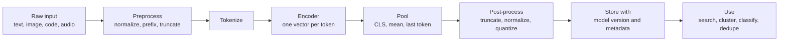

The diagram shows the text-to-embedding pipeline the rest of the chapter takes apart. Every box is a place where two systems can silently disagree: a different prefix, a different truncation length, a different pooling rule, or a different normalization yields vectors that look the same (same dimension, same type) but cannot be compared. The "embedding contract" introduced in section 15 is the written record of every box.

## 2. From Symbols to Vectors

### 2.1 One-hot vectors and what they cannot say

The simplest representation of a word in a vocabulary of $V$ words is the one-hot vector: a $V$-dimensional vector with a single 1 at the word's index. With $V = 50{,}000$, the word "cat" is a 50,000-dimensional vector with one non-zero entry. Three properties make it a poor basis for learning from text.

First, every pair of distinct words is exactly orthogonal. The dot product of the one-hot vectors for "cat" and "kitten" is 0, the same as for "cat" and "carburetor". The representation encodes identity and nothing else, so a classifier trained on "cat" learns nothing that transfers to "kitten". Second, the dimension grows with the vocabulary, and a model with a first layer of size $V \times h$ has $50{,}000 \times 300 = 15$ million parameters before it does any work. Third, a document represented as a bag of one-hot vectors is a sparse count vector whose similarity to another document is just term overlap. Two reviews that say "the battery died after a week" and "power cell failed within seven days" share no content word and score zero.

A dense embedding replaces the $V$-dimensional one-hot vector with a short real vector, typically 100 to 4,096 dimensions. Multiplying a one-hot vector by an embedding matrix $E \in \mathbb{R}^{V \times d}$ is a row lookup, so "embedding layer" and "lookup table" are the same thing. What makes the dense vector useful is not its size but the constraint that nearby words share parameters: when the model learns something about the row for "cat", it should transfer, through geometry, to the row for "kitten".

A worked comparison: with $V = 50{,}000$ and $d = 300$, the embedding matrix has $50{,}000 \times 300 = 15$ million entries, about 60 megabytes in 32-bit floating point (4 bytes per float: $15{,}000{,}000 \times 4 = 60{,}000{,}000$ bytes). Each word is stored in 1,200 bytes instead of an implicit 50,000-entry vector, and the pairwise relation between words becomes a number in $[-1, 1]$ instead of 0 or 1.

### 2.2 The distributional hypothesis

The idea that licenses learning meaning from text alone is the distributional hypothesis: words that occur in similar contexts tend to have similar meanings. Its linguistic roots are Harris (1954), who observed that distributional structure can be used to group linguistic units, and Firth (1957), who put it as "you shall know a word by the company it keeps." The computational reading is concrete. Build a table of how often each word appears near each other word, and rows of that table become a representation of each word.

Consider a toy corpus of six sentences: "the cat chased the mouse", "the dog chased the cat", "the cat ate fish", "the dog ate meat", "a mouse ate cheese", and "the dog chased the mouse". "Cat" and "dog" both appear next to "chased", "ate", and "the". They never appear next to "cheese" or "fish" in the same way ("cat" appears next to "fish", "dog" next to "meat"), but their dominant contexts overlap. A model that has only ever seen this text can infer that "cat" and "dog" are more alike than "cat" and "cheese" without being told what either is. The script [01_vectors_similarity_geometry.py](../code/python/embeddings-chapter/01_vectors_similarity_geometry.py) builds this construction on a slightly larger corpus (it adds a financial vocabulary), factorizes the co-occurrence matrix, and prints cosine similarities between the resulting vectors. Section 3.4 shows the result.

The hypothesis has limits that matter later in the chapter. It conflates relatedness with similarity: "doctor" and "hospital" share contexts but are not synonyms. It assigns one vector per word type, so "bank" the institution and "bank" the river edge share a row. It reflects the corpus: if the text associates "nurse" with women and "engineer" with men, so do the vectors. And it contains no mechanism for truth: "the earth is flat" and "the earth is round" have nearly the same context distribution.

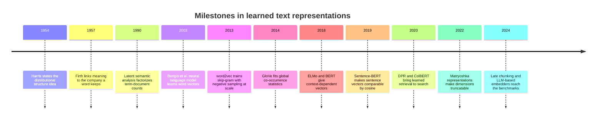

The timeline shows a progression that is easy to misread as a chain of replacements. It is better read as a chain of additions. Static vectors still serve tagging, language identification, and on-device features. Sparse term matching still wins on exact identifiers. The architectural lesson is that each generation fixed one defect (no context, no sentence-level objective, no efficient interaction, fixed dimension) and left the others in place.

### 2.3 Three families of representation

Count-based methods start from a co-occurrence or term-document matrix, reweight it (term frequency–inverse document frequency, PMI), and factorize it with singular value decomposition (SVD). Latent semantic analysis (Deerwester et al., 1990) is the classic example. Prediction-based methods train a shallow neural model to predict a word from its context or the reverse; word2vec is the best-known case. Contextual methods compute a different vector for each token occurrence by running the whole sentence through a deep encoder; ELMo and BERT belong here. A fourth family, task-trained sentence encoders, takes a contextual encoder and fine-tunes it with a contrastive objective so that a single vector summarizes the sentence. Almost every production embedding model today belongs to that fourth family, and most of this chapter concerns it. The first three still matter because they explain where the others came from and because the failure modes repeat.

## 3. Static Word Embeddings

### 3.1 Skip-gram with negative sampling: the model

Mikolov, Chen, Corrado, and Dean (2013) introduced two shallow architectures: continuous bag of words (CBOW), which predicts a center word from the average of its context, and skip-gram, which predicts each context word from the center word. Skip-gram is slower but represents rare words better, and it is the variant that most explanations (and this chapter) develop.

Let the corpus be a sequence of words, let $w$ be a center word, and let $c$ be a word within a window of $m$ positions of $w$. Skip-gram keeps two embedding matrices: input (center) vectors $v_w \in \mathbb{R}^d$ and output (context) vectors $u_c \in \mathbb{R}^d$. The full softmax model defines

$$
P(c \mid w) = \frac{\exp(u_c^\top v_w)}{\sum_{c' \in V} \exp(u_{c'}^\top v_w)}
$$

and maximizes $\sum_{(w,c)} \log P(c \mid w)$ over all observed pairs. The denominator sums over the entire vocabulary, so each training pair costs $O(V)$ operations. For $V = 10^6$ that is a million dot products per pair, which is why the original formulation was impractical.

Negative sampling replaces the multi-class problem with binary classification. For each observed pair $(w, c)$, treat it as a positive example and draw $k$ "noise" words $n_1, \dots, n_k$ from a noise distribution $P_n$ to serve as negatives. The per-pair objective to maximize is

$$
\ell(w, c) = \log \sigma(u_c^\top v_w) + \sum_{i=1}^{k} \mathbb{E}_{n_i \sim P_n} \left[ \log \sigma(-u_{n_i}^\top v_w) \right]
$$

where $\sigma(x) = 1/(1 + e^{-x})$ is the logistic sigmoid. The first term pushes the observed pair's score up; each negative term pushes a random word's score down. The cost per pair falls from $O(V)$ to $O(k)$ with $k$ typically between 5 and 20 for small corpora and 2 to 5 for large ones.

### 3.2 Worked numbers for one SGNS step

Take $d = 3$ for readability, $k = 2$, and suppose the positive pair has score $x_+ = u_c^\top v_w = 2.0$ and the two negatives have scores $x_{n_1} = 1.0$ and $x_{n_2} = -1.0$.

The positive term contributes $\log \sigma(2.0) = \log 0.8808 = -0.1269$. The first negative contributes $\log \sigma(-1.0) = \log 0.2689 = -1.3133$. The second negative contributes $\log \sigma(1.0) = \log 0.7311 = -0.3133$. The total objective is $-0.1269 - 1.3133 - 0.3133 = -1.7535$, and the loss (its negative) is $1.7535$. Most of the loss comes from the first negative, a word that is currently scored 1.0 against the center word although it was drawn at random.

The gradients follow from $\frac{d}{dx}\log\sigma(x) = \sigma(-x)$ and $\frac{d}{dx}\log\sigma(-x) = -\sigma(x)$. For the objective:

$$
\frac{\partial \ell}{\partial u_c} = \sigma(-x_+)\, v_w, \qquad \frac{\partial \ell}{\partial u_{n_i}} = -\sigma(x_{n_i})\, v_w, \qquad \frac{\partial \ell}{\partial v_w} = \sigma(-x_+)\, u_c - \sum_i \sigma(x_{n_i})\, u_{n_i}.
$$

Plugging in: the positive output vector moves toward $v_w$ with weight $\sigma(-2.0) = 0.1192$, a small step because the pair is already well scored. The first negative moves away from $v_w$ with weight $\sigma(1.0) = 0.7311$, a large step. The second negative moves away with weight $\sigma(-1.0) = 0.2689$. The update self-balances: the more wrong a score, the larger its gradient. Stochastic gradient ascent with learning rate $\eta$ then updates each vector by $\eta$ times its gradient.

### 3.3 Noise distribution, subsampling, and window

Mikolov et al. sample negatives from the unigram distribution raised to the 3/4 power, $P_n(w) \propto f(w)^{3/4}$ where $f(w)$ is the relative frequency of word $w$. The exponent flattens the distribution so rare words are drawn more often than their raw frequency, and frequent words less often. With two words of frequency 0.9 and 0.1, the raw ratio is 9 to 1. Raised to the 3/4 power they become $0.9^{0.75} = 0.9240$ and $0.1^{0.75} = 0.1778$, which normalize to 0.8386 and 0.1614, a ratio of about 5.2 to 1. Without the exponent the model would spend most negatives on "the" and "of".

Frequent words are also subsampled: a word with relative frequency $f$ is discarded from training with probability $1 - \sqrt{t/f}$, where $t$ is a threshold around $10^{-5}$. For a word making up 1 percent of tokens ($f = 0.01$), $\sqrt{10^{-5}/0.01} = \sqrt{0.001} = 0.0316$, so it is dropped 96.8 percent of the time. This accelerates training and removes pairs such as ("the", anything) that carry little information.

The window size trades off the kind of similarity the vectors encode. Small windows (2 to 5) emphasize syntactic and functional similarity: "cat" and "dog" (both nouns that take the same verbs). Large windows (10 or more) emphasize topical relatedness: "cat" and "veterinarian". Choose the window to match the use. A model for part-of-speech features wants small windows. A model for topical retrieval wants larger ones.

### 3.4 What SGNS actually factorizes

Levy and Goldberg (2014) showed that SGNS implicitly factorizes a word-context matrix. The derivation is short enough to follow in full. Let $\#(w,c)$ be the count of pair $(w,c)$ in the corpus, $\#(w)$ and $\#(c)$ the marginal counts, and $|D|$ the total number of pairs. Sampling negatives from the unigram distribution gives expected objective

$$
L = \sum_{w,c} \#(w,c) \log \sigma(x_{wc}) + k \sum_{w,c} \frac{\#(w)\,\#(c)}{|D|} \log \sigma(-x_{wc}), \qquad x_{wc} = u_c^\top v_w .
$$

The first sum has one term per observed pair, weighted by how often it occurs. The second has one term per word-context combination, weighted by the number of times the negative sampler would draw $c$ for $w$. (This assumes the unigram noise distribution without the 3/4 power; the power-adjusted version uses $\#(c)^{3/4}$ in place of $\#(c)$, and the algebra below is otherwise identical.) Differentiate with respect to $x_{wc}$ treating it as a free variable:

$$
\frac{\partial L}{\partial x_{wc}} = \#(w,c)\,\sigma(-x_{wc}) - k\,\frac{\#(w)\#(c)}{|D|}\,\sigma(x_{wc}) = 0 .
$$

Using $\sigma(-x) = 1/(1+e^{x})$ and $\sigma(x) = e^{x}/(1+e^{x})$, multiply both sides by $1 + e^{x}$:

$$
\#(w,c) = k\,\frac{\#(w)\#(c)}{|D|}\,e^{x_{wc}} \quad\Longrightarrow\quad x_{wc} = \log\frac{\#(w,c)\,|D|}{\#(w)\,\#(c)} - \log k = \mathrm{PMI}(w,c) - \log k .
$$

So at the optimum, the inner product of word and context vectors equals the pointwise mutual information of the pair minus $\log k$. SGNS is an implicit factorization of the shifted PMI matrix. For $k = 5$ the shift is $\log 5 = 1.609$ nats. Pairs seen less often than chance have negative PMI, which is why practical systems truncate at zero (positive PMI, PPMI): the model has no incentive to represent "never co-occurs" precisely, and unobserved cells produce $-\infty$.

The practical consequence is that the prediction-based and count-based families are not rivals. An explicit PPMI matrix factorized with truncated SVD, with sensible hyperparameters, gets close to SGNS on many word similarity tasks (Levy, Goldberg, and Dagan, 2015). The script in the code folder builds exactly this: a window-2 co-occurrence matrix, PPMI weights, and a rank-4 SVD with the singular values square-rooted into the embeddings. On the 12-sentence corpus the printed cosines are 0.999 for cat and dog, 1.000 for bank and lender, $-0.115$ for cat and bank, and $-0.040$ for dog and loan. Words that fill the same slots in the sentences land together, and words from different parts of the corpus do not. The near-perfect values for the related pairs come from a vocabulary of 18 words and a rank-4 fit, so they are illustrative and not a benchmark; real corpora give values such as 0.6 to 0.8 for related word pairs. The takeaway for an architect is that distributional semantics is a statistic of the corpus, and the same corpus statistics reappear in every later method.

### 3.5 GloVe

Pennington, Socher, and Manning (2014) fit word vectors directly to global co-occurrence counts. Let $X_{ij}$ be the number of times word $j$ appears in the context of word $i$. GloVe minimizes a weighted least-squares objective

$$
J = \sum_{i,j=1}^{V} f(X_{ij}) \left( w_i^\top \tilde{w}_j + b_i + \tilde{b}_j - \log X_{ij} \right)^2
$$

where $w_i$ and $\tilde{w}_j$ are word and context vectors, $b_i$ and $\tilde{b}_j$ are scalar biases, and $f$ is a weighting function that is zero at zero (so empty cells are skipped), increases for small counts, and saturates for large ones. The published choice is $f(x) = (x/x_{\max})^{\alpha}$ for $x < x_{\max}$ and 1 otherwise, with $x_{\max} = 100$ and $\alpha = 0.75$.

Worked numbers: a pair seen 10 times gets weight $f(10) = (10/100)^{0.75} = 0.1778$. A pair seen 100 or more times gets weight 1. Suppose $w_i^\top \tilde{w}_j + b_i + \tilde{b}_j = 1.9$ and the pair was seen 10 times: the target is $\log 10 = 2.3026$, the residual is $-0.4026$, the squared residual is $0.1621$, and the weighted contribution is $0.1778 \times 0.1621 = 0.0288$. Rare pairs contribute little because their counts are noisy, and the cap stops "the" from dominating.

GloVe and SGNS differ in procedure more than in outcome. GloVe reads the count matrix once and then fits it with many cheap passes over the non-zero cells, so its cost scales with the number of non-zero cells rather than corpus length. SGNS streams over the corpus. Both end up with vectors whose differences encode relations. The well-known analogy behavior ($v_{\text{king}} - v_{\text{man}} + v_{\text{woman}} \approx v_{\text{queen}}$) holds for a limited set of relations, mostly in the most frequent part of the vocabulary, and the standard evaluation excludes the three query words from the candidate answers. Treat analogies as a demonstration of linear structure and not as a reliable capability.

### 3.6 Subword models and out-of-vocabulary words

A static model has no vector for a word it never saw. fastText (Bojanowski et al., 2017) represents a word as the sum of vectors for its character n-grams (for example 3 to 6 characters, with boundary markers) plus a whole-word vector. "Unbelievability" can then get a sensible vector from "unbe", "nbel", "belie", and so on even if it was never seen, and misspellings land near the correct form. Modern contextual models use subword tokenization (byte-pair encoding or WordPiece) for the same reason: the vocabulary is a closed set of fragments, and any string can be tokenized. The cost is that a rare word becomes several tokens, which is relevant to cost accounting in section 20.

### 3.7 Where static embeddings still earn their place

Static vectors are a few hundred megabytes at most, run on a CPU in microseconds, need no GPU, and are deterministic. They remain reasonable for features in a tabular model (averaged word vectors as input to gradient-boosted trees), for lightweight text classifiers on edge devices, for query expansion, and as initial layers in small models. Averaged static vectors are a strong baseline for short-text classification and a useful sanity check: if a 15-line average-of-word-vectors classifier matches your transformer pipeline on your data, the pipeline's complexity is not buying anything. Their weaknesses are the ones the next section addresses: no context, a single sense per word, and no way to encode word order, so "dog bites man" and "man bites dog" average to the same vector.

## 4. Contextual Embeddings

### 4.1 ELMo: vectors that depend on the sentence

Peters et al. (2018) produced Embeddings from Language Models (ELMo): a deep bidirectional long short-term memory (LSTM) language model is trained to predict the next word going forward and the previous word going backward, and the internal hidden states at every layer, not just the output, are combined to form a vector for each token. The combination is a task-specific learned weighted sum of layers. In ELMo's analyses lower layers captured more syntactic information and higher layers more semantic, context-dependent information, so a downstream task can choose its own mixture. The same word "play" in "the play was long" and "they play chess" receives different vectors. ELMo vectors were typically added as extra features to an existing task model rather than fine-tuned end to end, which is a different usage pattern from the encoder fine-tuning that followed.

### 4.2 BERT and the encoder as a feature extractor

Devlin et al. (2019) trained Bidirectional Encoder Representations from Transformers (BERT) with masked language modeling (predict randomly masked tokens from both sides of context) and next-sentence prediction, using the transformer encoder described in [CH10](CH10_Transformers_and_Attention.md). The output is one vector per input token (768 dimensions in the base model, 1,024 in the large) and the vector for each token depends on every other token in the input through self-attention. The special `[CLS]` token is prepended to each input, and its final vector was designed to be fine-tuned into a classifier for the whole sequence.

To obtain a single vector for a sentence or passage from per-token vectors you need pooling:

| Pooling | Operation | Behavior | Typical use |
| --- | --- | --- | --- |
| `[CLS]` | Take the first token's final vector | Learns to aggregate if trained to; poor if not | Classification heads, models trained with CLS pooling (many retrievers) |
| Mean | Average all token vectors, masking padding | Stable, uses every token, dependable default | Sentence-transformer models |
| Max | Element-wise max over tokens | Highlights strong features, loses frequency | Occasional, mostly legacy |
| Last token | Take the final token's vector | Natural for decoder-only models whose last token sees all prior tokens | LLM-based embedders |
| Weighted mean | Mean weighted by position or learned weights | Can bias toward the end (decoder) or start | Specialized models |

Pooling is part of the model. A model trained with mean pooling and queried with `[CLS]` pooling produces vectors in the same dimension that give worse retrieval and no error. The pooling choice therefore belongs in the embedding contract. When a hosted API hides pooling, it is the vendor's responsibility, but when you self-host an open model, the model card or sentence-transformers configuration file records it.

### 4.3 Why raw BERT is poor for similarity

A natural first idea is to take a pretrained BERT, average its token vectors, and compare sentences by cosine. Reimers and Gurevych (2019) reported that this gives worse results on semantic textual similarity than averaged GloVe vectors on some benchmarks. The cause is partly objective mismatch and partly geometry. Masked-language-model training optimizes token prediction, not the distance between sentence summaries. Nothing in the loss asks that two paraphrases land near each other or that unrelated sentences land far apart. In addition the space is anisotropic (section 9.3): all vectors occupy a narrow cone, so cosines among arbitrary sentence pairs are all high, and the useful signal is squeezed into small differences. A fine-tuning stage with a sentence-level objective is needed. That is what the next section covers.

A cross-encoder version of the idea does work but at a cost: feed both sentences into BERT jointly with a separator, and add a classification head that outputs the similarity directly. Quality is high because every token of sentence A attends to every token of sentence B. The cost is that comparing one query to $N$ candidates needs $N$ full forward passes and nothing can be precomputed, which is why section 6 treats it as a re-ranker rather than a first-stage retriever. Reimers and Gurevych note that finding the most similar pair among 10,000 sentences takes about $10{,}000 \times 9{,}999 / 2 \approx 50$ million pair evaluations with a cross-encoder, which they estimated at around 65 hours on a V100 GPU, against about 5 seconds with sentence embeddings. The orders of magnitude, not the exact figures, are what an architect needs.

## 5. Sentence Embeddings and Contrastive Training

### 5.1 The goal: one comparable vector per text

A retrieval system needs a vector for the whole query and a vector for each passage such that a relevant pair is close under a cheap metric. Sentence-BERT (SBERT; Reimers and Gurevych, 2019) did this with a siamese network: the same encoder (shared weights) processes each text independently, a pooling layer produces one fixed-size vector per text, and training adjusts the shared encoder so that cosine or dot product of the pooled vectors reflects the desired relation. Because each text is encoded alone, document vectors can be computed once, stored, and compared to a query vector that costs one forward pass. That independence is the property that makes large-scale retrieval possible and is also the source of the representation's limits: no token of the query can attend to any token of the document before the vectors are formed.

Early SBERT training used natural language inference (NLI) data, where each pair of sentences is labeled entailment, neutral, or contradiction, with a softmax classifier over the concatenation of the two vectors $(u, v, |u-v|)$. That recipe produces useful sentence similarity but a space tuned to entailment, not to retrieval. Retrieval models are instead trained with contrastive objectives over (query, relevant passage) pairs, which the rest of this section derives.

### 5.2 Why a contrastive objective

The target is a ranking: for a given query $q$, the relevant passage $d^{+}$ should score higher than every irrelevant passage. Three families of loss formulate that.

A pointwise regression loss fits the cosine of each labeled pair to a similarity label, such as 0.8 for a paraphrase pair. It needs graded labels, which are rare and noisy, and it spends capacity matching absolute values when only the order matters.

A pairwise or triplet loss takes a triple $(q, d^{+}, d^{-})$ and requires $s(q, d^{+}) - s(q, d^{-}) > m$ for a margin $m$. It needs only relative judgments, but it uses one negative per update, and its quality depends heavily on how triples are chosen.

A listwise or softmax contrastive loss compares the positive against many negatives at once and turns the comparison into a classification: which of these $N$ passages is the true partner of this query? It uses the information in all $N-1$ negatives in each update, needs no margin, and has a probabilistic interpretation. This is InfoNCE, and it is the objective behind most current text, image–text, and code embedding models.

### 5.3 Deriving InfoNCE

Let $f_\theta$ be the encoder and let $s(q, d) = \frac{f_\theta(q)^\top f_\theta(d)}{\|f_\theta(q)\|\,\|f_\theta(d)\|}$ be the cosine similarity. Consider a training example consisting of a query $q$, one positive document $d_0 = d^{+}$, and $N-1$ negative documents $d_1, \dots, d_{N-1}$. Define a distribution over the $N$ candidates by a softmax of scaled scores:

$$
p_j = \frac{\exp\big(s(q, d_j)/\tau\big)}{\sum_{i=0}^{N-1} \exp\big(s(q, d_i)/\tau\big)}, \qquad j = 0, \dots, N-1,
$$

where $\tau > 0$ is the temperature. Treat $p_0$ as the model's probability that the first candidate is the true partner. Maximum likelihood on the label "candidate 0 is correct" gives the loss

$$
\mathcal{L}(q) = -\log p_0 = -\frac{s(q, d_0)}{\tau} + \log \sum_{i=0}^{N-1} \exp\!\Big(\frac{s(q, d_i)}{\tau}\Big).
$$

This is a standard cross-entropy with a one-hot target, so its gradient with respect to each score has the familiar softmax form. Let $z_j = s(q, d_j)/\tau$ be the logits. Then

$$
\frac{\partial \mathcal{L}}{\partial z_j} = p_j - y_j, \qquad y_0 = 1,\; y_{j\ne 0} = 0,
$$

and by the chain rule $\frac{\partial \mathcal{L}}{\partial s(q,d_j)} = \frac{1}{\tau}(p_j - y_j)$. The positive receives a pull of strength $(1 - p_0)/\tau$ and each negative a push of strength $p_j/\tau$. Two things follow immediately. A negative that already scores far below the positive has $p_j \approx 0$ and contributes almost no gradient, so easy negatives teach nothing. And the push on a negative is proportional to its probability, so the hardest negatives, the ones the model currently confuses with the positive, dominate the update.

In a training batch of $B$ (query, positive) pairs, a standard trick reuses the other $B-1$ positives as negatives for each query. Stack the query vectors into $Q \in \mathbb{R}^{B \times d}$ and the positive document vectors into $D \in \mathbb{R}^{B \times d}$ (rows unit-normalized). The score matrix $S = QD^\top$ is $B \times B$; the diagonal holds the positives and the off-diagonal entries are the in-batch negatives. The batch loss is the row-wise cross-entropy with target equal to the row index:

$$
\mathcal{L}_{\text{batch}} = -\frac{1}{B}\sum_{i=1}^{B} \log \frac{\exp(S_{ii}/\tau)}{\sum_{j=1}^{B}\exp(S_{ij}/\tau)} .
$$

Many implementations add the symmetric term (the same loss over columns, treating each document as the anchor), which makes the space more balanced between queries and documents. The gradient with respect to the score matrix is $G = \frac{1}{B\tau}(P - I)$, where $P$ is the row-wise softmax of $S/\tau$, and the gradient with respect to the query matrix is $GD$ before the normalization step, which is exactly what the toy script computes.

```text
Score matrix S (B = 4), rows = queries, columns = documents in the batch

            d1     d2     d3     d4
   q1   [ 0.82   0.31   0.12   0.40 ]   <- diagonal = positive
   q2   [ 0.25   0.77   0.35   0.05 ]      off-diagonal = in-batch negatives
   q3   [ 0.10   0.42   0.69   0.22 ]
   q4   [ 0.38   0.09   0.18   0.74 ]

Loss row i = -log softmax(S[i, :] / tau)[i]
```

The ASCII matrix shows why batch size matters: a batch of $B$ yields $B(B-1)$ negative comparisons for $B$ forward passes of each side. A batch of 64 gives 4,032 negative pairs per step, and a batch of 4,096 gives about 16.8 million. Larger batches therefore provide more and harder negatives for the same encoding cost, up to the memory limit of the accelerator.

### 5.4 Connection to mutual information

The name InfoNCE comes from van den Oord, Li, and Vinyals (2018), who showed the loss lower-bounds mutual information. A short sketch gives the intuition. Suppose the candidate set contains one positive drawn from $p(d \mid q)$ and $N-1$ negatives drawn independently from the marginal $p(d)$. The Bayes-optimal critic for picking out the positive is proportional to the density ratio $\frac{p(d \mid q)}{p(d)}$, and with that critic the expected loss satisfies $\mathcal{L}^{\text{opt}} \ge \log N - I(q; d)$, with the bound tight as the ratio becomes easy to estimate. Rearranged, $I(q; d) \ge \log N - \mathcal{L}$. Two practical readings: the loss can never go below zero, but with $N$ candidates it can only certify at most $\log N$ nats of shared information, so a batch of 64 certifies at most $\log 64 = 4.16$ nats, and a batch of 1,024 at most $\log 1024 = 6.93$ nats. And the loss value at a fixed batch size is not comparable across runs with different batch sizes. Compare loss only within the same batch size, or compare downstream retrieval metrics.

This is a lower bound, not an equality, and the bound's relation to retrieval quality is empirical. The advice that larger batches help is supported by experiments in multiple papers but the gain saturates, and the relevance of the negatives matters as much as their number.

### 5.5 Temperature

The temperature $\tau$ scales the cosine similarities before the softmax. Because cosines lie in $[-1, 1]$, with $\tau = 1$ the softmax can never be sharp: even a positive with $s = 1$ against negatives at $s = -1$ gets only $e^{1}/(e^{1} + (N-1)e^{-1})$ of the mass, which for $N = 64$ is $2.718/(2.718 + 63 \times 0.368) = 0.105$. The loss would then remain high regardless of how good the embeddings are, and the gradient would keep pushing the geometry to extremes. Values around $\tau = 0.01$ to $0.1$ are typical in text embedding training; CLIP learns $\tau$ as a parameter (initialized near 0.07).

Worked example. One query has a positive with cosine 0.8 and three negatives with cosines 0.7 (hard), 0.3, and 0.1.

At $\tau = 0.05$ the logits are 16, 14, 6, and 2. Relative to the maximum, the exponentials are 1, $e^{-2} = 0.1353$, $e^{-10} = 0.0000454$, and $e^{-14} = 8.3\times10^{-7}$, summing to 1.1354. The probabilities are $p_0 = 0.8808$, $p_1 = 0.1192$, $p_2 = 0.00004$, $p_3 \approx 0$. The loss is $-\ln 0.8808 = 0.127$. The gradient with respect to the positive's cosine is $(0.8808 - 1)/0.05 = -2.38$ and with respect to the hard negative $0.1192/0.05 = +2.38$. The easy negatives receive essentially nothing.

At $\tau = 0.5$ the logits are 1.6, 1.4, 0.6, and 0.2, and the relative exponentials are 1, 0.8187, 0.3679, and 0.2466, summing to 2.4332. The probabilities are 0.4110, 0.3365, 0.1512, and 0.1013, the loss is $\ln 2.4332 = 0.889$, and the gradients are $-1.18$ for the positive, $+0.67$ for the hard negative, $+0.30$ for the second negative, and $+0.20$ for the easiest one.

Low temperature concentrates the gradient on the hardest negatives (here nearly all the push goes to the 0.7 negative), which sharpens fine distinctions but makes training sensitive to false negatives: a passage that is actually relevant but labeled negative is pushed away with the full force of the largest gradient. High temperature spreads the push across all negatives, which is gentler and more tolerant of label noise but resolves fine distinctions less well. The temperature is therefore a knob that trades discrimination against tolerance of noisy negatives, and it must be tuned (or learned) together with the negative-mining policy. It also matters at inference time for one reason only: scores from a model trained with a low temperature occupy a narrow range of cosines (many models give relevant pairs 0.6 to 0.9 and irrelevant pairs 0.2 to 0.5), so a threshold chosen for one model does not transfer to another.

### 5.6 Negatives: in-batch, hard, and false

In-batch negatives are free but random. For a support corpus with 400 distinct topics, a random pair of passages will almost never be confusable, so in-batch negatives teach topic separation, which the model needs but which pretrained encoders mostly have already. Retrieval quality in production is decided by the confusable cases: two articles about the same product with different version numbers, a policy and its superseded predecessor, a how-to and the troubleshooting page that mentions the same menu. Those require hard negatives.

Hard negatives are passages that the current model scores highly but that are not the right answer. Common sources are: top-ranked non-relevant results from a lexical retriever like BM25 (which provide lexical overlap without relevance), top-ranked non-relevant results from an earlier version of the embedding model (so-called ANCE-style mining after Xiong et al., 2021), and passages from the same document or topic cluster as the positive. A standard recipe retrieves the top 50 to 200 candidates for each training query, removes the known positives, and samples a few from a band, for example ranks 10 to 100, as negatives.

False negatives are the hazard. Retrieval datasets are labeled sparsely: for each query typically one passage is marked relevant, and many unmarked passages are in fact relevant (duplicates, near duplicates, or other articles that also answer the question). If those are used as hard negatives the model is trained to separate things that should be close, and the harm grows with the quality of the mining because the best-scored non-positives are the most likely to be unlabeled positives. Mitigations include skipping the top few ranks, filtering candidates whose score from a cross-encoder or large language model (LLM) judge is above a threshold, and removing candidates within a similarity margin of the positive. A rule of thumb used in published recipes is to discard negatives scoring above a fraction (for example 95 percent) of the positive's score under a strong reranker. Validate the rule with a manual audit of 50 mined negatives: if more than a few are actually relevant, tighten the filter.

A related hazard is duplicated content inside a batch. If two queries in a batch share a positive passage, then each query's positive is the other's in-batch negative, and the loss pushes apart two identical passages. Deduplicate positives within a batch or mask duplicate positions in the score matrix.

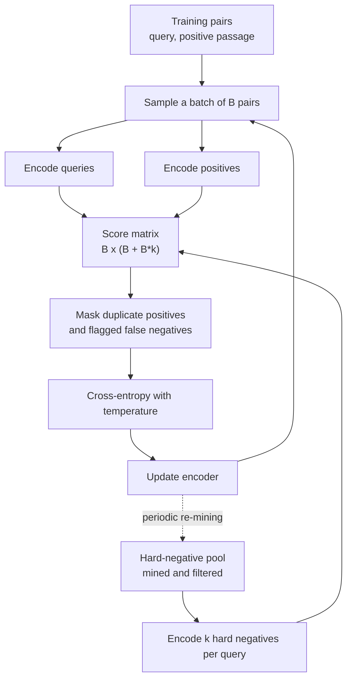

The diagram shows one contrastive training step with hard negatives. The score matrix has $B$ rows and $B + Bk$ columns because every query is scored against every positive and every mined negative in the batch. Masking is a separate step because it fixes label noise, not the loss. The dashed edge shows that hard-negative pools go stale as the encoder improves: negatives mined from the initial model become easy, so serious pipelines re-mine every few thousand steps or every epoch.

### 5.7 Training recipe of a modern text embedder

Published open models (for example the E5 family, Wang et al., 2022, and the BGE family, Xiao et al., 2023, among others) follow a staged pattern. Check the current model cards for details because recipes change. The pattern is:

1. Start from a pretrained transformer encoder, or increasingly a decoder-only LLM.
2. Weakly supervised contrastive pretraining on very large numbers of automatically formed pairs: title and body, question and top answer from forums, query and clicked page, adjacent passages, code and its docstring. Quality is mediocre per pair but quantity makes up for it, with large batches and in-batch negatives only.
3. Supervised fine-tuning on a smaller curated set (for example MS MARCO, Natural Questions, NLI, and multilingual retrieval sets) with mined hard negatives and instructions.
4. Optional distillation from a cross-encoder reranker into the bi-encoder, so the bi-encoder's scores approximate the more accurate model's.
5. Optional merging or averaging of checkpoints, and Matryoshka training (section 10) so the vector can be truncated.

An architect does not need to reproduce this, but the recipe explains behaviors: models are strong where their weak-supervision pairs were abundant (English web text, code, forum Q&A) and weaker where they were not (specialized legal text, low-resource languages, product part numbers).

### 5.8 LLM-based embedders

A decoder-only language model can be turned into an embedder. A prompt template wraps the text, and the final hidden state of the last token, which has attended to all prior tokens under the causal mask, is taken as the embedding. The approach was demonstrated at scale by work such as E5-Mistral (Wang et al., 2024), and several top-ranked entries on public leaderboards since then use LLM backbones from 0.5 to 8 billion parameters. Variants remove or modify the causal mask during embedding training so that earlier tokens can attend to later ones, or use latent attention pooling over all tokens.

The trade-off is cost. An encoder such as a 110-million-parameter model embeds a passage with roughly 0.2 giga floating-point operations per token (about $2 \times$ the number of parameters), while a 7-billion-parameter model needs about 14 giga operations per token, about 64 times more. LLM-based embedders often win by a few points on benchmarks and by more on reasoning-heavy or instruction-heavy queries, and they cost proportionally more to run, to host, and to keep in memory, and they produce larger vectors (commonly 2,048 to 4,096 dimensions) unless truncated. Section 20 works out what that does to the bill.

### 5.9 A runnable toy

The script [02_toy_contrastive_infonce.py](../code/python/embeddings-chapter/02_toy_contrastive_infonce.py) trains a bi-encoder with the loss derived above. The encoder is a single linear map from a bag-of-words count vector to 16 dimensions followed by $L_2$ normalization. There are 30 hidden topics; each topic owns 8 words drawn from a shared pool of 100, so topics overlap in vocabulary, and every text also contains four noise words. A query has 3 topic words and a document has 5. The gradient is derived by hand: with $G = (P - I)/(B\tau)$ the gradients on the unit-normalized outputs are $GD$ and $G^\top Q$, and the normalization backward step projects out the radial component, $\frac{\partial \mathcal L}{\partial h} = \frac{1}{\|h\|}\left(g - z (z^\top g)\right)$ for $z = h/\|h\|$.

Running the script (150 steps, batch 64, learning rate 0.5, evaluated on 512 held-out pairs; the metric "topic-top1" is the fraction of queries whose highest-scoring document comes from the same topic) prints:

```text
untrained        pos_cos=0.252  neg_cos=0.067  topic-top1=0.258
tau=0.02         pos_cos=0.953  neg_cos=0.805  topic-top1=0.941
tau=0.1          pos_cos=0.799  neg_cos=0.057  topic-top1=0.955
tau=0.5          pos_cos=0.825  neg_cos=-0.027  topic-top1=0.934
tau=2.0          pos_cos=0.763  neg_cos=-0.025  topic-top1=0.934
tau=0.1 + hard   pos_cos=0.793  neg_cos=0.062  topic-top1=0.938
```

Three observations. Training lifts topic-top1 from 0.258 to between 0.93 and 0.96, which is the contrastive objective working. The differences among the trained rows (0.934 to 0.955) are within the sampling noise of 512 queries, whose standard error is about 0.009 at these accuracies, so the toy does not show that one temperature is better. What it does show is that the cosine scale depends on the temperature: at $\tau = 0.02$ the model reaches high accuracy while unrelated documents still score a cosine of 0.805, because only the gaps between scores matter to a sharp softmax, and at $\tau \ge 0.1$ unrelated documents sit near zero. A threshold written for one setting is meaningless for the other (section 5.5). Finally, the "hard" run adds, for each query, a document from the adjacent topic index. Topic ids are random here, so adjacent topics are not semantically close, and the run correctly shows no gain; in a real corpus hard negatives are chosen because they are close, which is the whole point of mining.

The toy is deliberately small, but the lessons transfer. Training with in-batch negatives separates the positives from other topics, the learned temperature range matters, and there is a floor on what a linear bag-of-words encoder can do when topics share words. In the batch of 64 with 30 topics, many queries have a same-topic document elsewhere in the batch; the loss treats that document as a negative, which is the false-negative effect of section 5.6 in miniature.

## 6. Bi-Encoder, Cross-Encoder, and Late Interaction

### 6.1 Three ways to score a query–document pair

Every neural retrieval architecture is a different answer to one question: when does the query's information meet the document's information? The earlier the meeting, the more accurate and the more expensive.

In a bi-encoder (also called a dual encoder), the two texts are encoded separately and compared only by a single inner product. The document side is precomputed. A cross-encoder concatenates query and document into one input and a transformer attends across all tokens of both; a head produces a scalar relevance score. Nothing can be precomputed. A late-interaction model such as ColBERT (Khattab and Zaharia, 2020) encodes query and document separately into sets of per-token vectors, keeping all of them, and computes the score as a sum of best token matches: for query token vectors $q_1, \dots, q_m$ and document token vectors $d_1, \dots, d_n$,

$$
\operatorname{score}(q, d) = \sum_{i=1}^{m} \max_{1 \le j \le n} \; q_i^\top d_j .
$$

This operation, called MaxSim, lets each query token find its best-matching document token, so "refund" in the query can match "reimbursement" in the document independently of "policy" matching something elsewhere. The document token vectors are precomputed, so only a cheap interaction happens at query time.

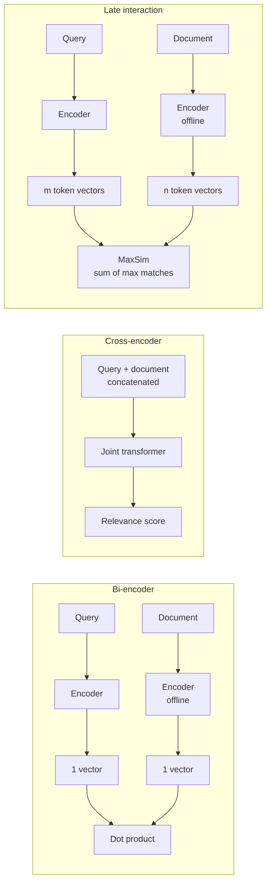

The diagram contrasts where the two texts first interact. Only the bi-encoder compresses a whole document into one vector, which minimizes storage and enables a single approximate nearest-neighbor lookup. The cross-encoder never forms a stand-alone document representation, so it can only score candidates that something else has already retrieved. Late interaction stores a vector per token, trading storage for finer matching.

### 6.2 Latency arithmetic

Assume a corpus of 10 million passages of about 200 tokens each, and a query of 32 tokens. The following figures are illustrative orders of magnitude, not measurements; measure on your hardware.

A cross-encoder over the entire corpus is not feasible. If one accelerator scores 1,000 query–passage pairs per second (a small cross-encoder at 256 tokens per pair), scoring 10 million passages takes 10,000 seconds, about 2.8 hours per query. Even a collection of 100,000 passages takes 100 seconds. A larger LLM-based reranker at 100 pairs per second would take over a day for the 10 million collection. Cross-encoders are therefore used only on a short list.

The same cross-encoder over a candidate list of 100 passages takes $100 / 1000 = 0.1$ second of accelerator time, which fits inside an interactive latency budget, while 1,000 candidates takes 1 second and typically does not. The candidate count is the design variable: more candidates raise the recall ceiling of the first stage and linearly raise reranker latency and cost.

The bi-encoder side has two costs. The query embedding is one forward pass, a few milliseconds on a GPU or tens of milliseconds on a CPU for a small model. The search over precomputed vectors is the work of the vector index (HNSW, IVF, and so on, owned by [Part 06 CH21](../06_Databases_and_Storage/CH21_Vector_Databases.md)); exhaustive scanning of 10 million 1,024-dimensional float vectors reads 41 GB and performs about 20 giga floating-point operations per query ($10^7 \times 1024 \times 2$), which is why an index is used when the query rate or the latency target is demanding.

For late interaction, MaxSim between a 32-token query and a 200-token document with 128-dimensional vectors costs $32 \times 200 \times 128 \times 2 = 1.64$ million floating-point operations. A thousand candidates cost 1.6 giga operations, small by accelerator standards. Candidate generation uses an index over individual token vectors (the PLAID engine of Santhanam et al., 2022, is one design), which is more complex than single-vector search.

### 6.3 Storage arithmetic

For the same 10 million passages: a single 1,024-dimensional float32 vector is 4,096 bytes, so $10^7 \times 4096 = 40.96$ GB. A late-interaction index storing 200 vectors of 128 dimensions in float16 per passage is $10^7 \times 200 \times 128 \times 2 = 512$ GB, 12.5 times larger. ColBERTv2 (Santhanam et al., 2022) compresses each token vector to its nearest centroid id plus a quantized residual of 1 or 2 bits per dimension, reported at roughly 20 to 36 bytes per token vector. At 36 bytes: $10^7 \times 200 \times 36 = 72$ GB, which is still 1.8 times the single-vector index but fits one large machine. The rest of the architecture depends on the retrieval engine: multi-vector support in general-purpose vector databases has been added in some products and varies in maturity, so verify the support in the product you plan to use.

### 6.4 When to use which

| Property | Bi-encoder | Late interaction | Cross-encoder |
| --- | --- | --- | --- |
| Precompute documents | Yes, one vector | Yes, n vectors | No |
| Index size (10M passages, illustrative) | 41 GB at 1,024-d float32 | 72 to 512 GB | None (but needs first stage) |
| Query-time work | One encoder pass plus ANN search | Encoder pass plus token-level search and MaxSim | One forward pass per candidate |
| Typical role | First-stage retrieval | First stage or reranker | Reranker over 20 to 200 candidates |
| Accuracy on precise matches | Lowest of the three | Between | Highest |
| Tuning data needed | Pairs with negatives | Pairs with negatives | Labeled pairs or LLM-judged labels |
| Fits a generic vector database | Yes | Depends on product | Not applicable |

Use a bi-encoder first stage with a cross-encoder reranker as the default design for a corpus that cannot be scanned. It captures most of the available quality at a manageable cost, and each part can be evaluated separately: first-stage recall at the candidate count tells whether the right passage reaches the reranker, and the reranked nDCG tells how well the reranker orders what it sees. Add late interaction when the first-stage embedding cannot represent multi-faceted queries or when long documents have many distinct topics, and the storage is acceptable. Omit the reranker when the latency budget is tight, the first-stage recall at the final cutoff is already close to its ceiling, or the cost of inference per query is the dominant expense.

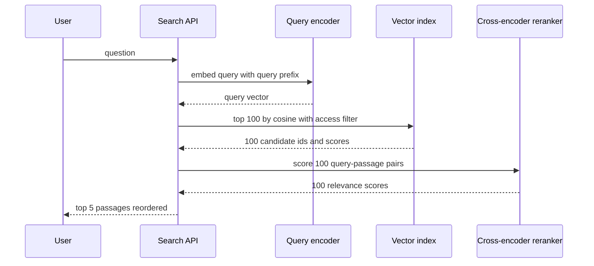

The sequence diagram is the standard two-stage path. The first stage must return the right passage somewhere in the 100, and the reranker must lift it into the top 5. Failures at the two stages need different fixes (candidate count, embedding model, or chunking for the first; reranker model or training for the second), so evaluate and log them separately. The access filter belongs in the first stage so that unauthorized passages are never sent to the reranker or logged downstream.

## 7. Sparse, Learned Sparse, and Hybrid Retrieval

### 7.1 Why dense vectors do not replace term matching

Dense embeddings compress a passage into a few hundred or thousand numbers. That compression is the source of their strength (paraphrase, synonymy, cross-lingual matching) and of a specific weakness: rare, exact strings. An error code such as `E-4471`, a part number, a function name, a person's surname, or a legal clause number may occupy a handful of tokens in a passage, and the pooled vector gives those tokens a small share of its direction. A query consisting of that string may retrieve passages about error codes in general. Sparse lexical retrieval has the opposite profile: it matches exact tokens perfectly and has no notion of meaning beyond them. The two failure modes are close to complementary, which is why hybrid retrieval is the default recommendation for text search over technical content.

### 7.2 BM25

Best Matching 25 (BM25; Robertson and Zaragoza, 2009) scores a document $d$ against query terms $t$ with a saturating term-frequency component, an inverse-document-frequency (IDF) weight, and a length normalization:

$$
\operatorname{BM25}(q, d) = \sum_{t \in q} \operatorname{IDF}(t) \cdot \frac{f(t,d)\,(k_1 + 1)}{f(t,d) + k_1\left(1 - b + b\,\frac{|d|}{\text{avgdl}}\right)}, \qquad \operatorname{IDF}(t) = \ln\!\left(\frac{N - n_t + 0.5}{n_t + 0.5} + 1\right).
$$

Here $f(t,d)$ is the count of term $t$ in $d$, $|d|$ the document length, avgdl the corpus average length, $N$ the number of documents, $n_t$ the number containing $t$, and $k_1 \approx 1.2$ and $b \approx 0.75$ are the common defaults.

Worked numbers. With $N = 1{,}000{,}000$, a rare term appearing in $n_t = 1{,}000$ documents has $\operatorname{IDF} = \ln(999{,}000.5/1{,}000.5 + 1) \approx \ln 999.5 \approx 6.91$. A common term in 100,000 documents has IDF $\approx 2.30$. So the rare term carries three times the weight, which is the property that makes BM25 good at exact identifiers. For a document of 150 tokens (avgdl 200) containing the rare term 3 times, the term-frequency factor is $\frac{3 \times 2.2}{3 + 1.2(0.25 + 0.75 \times 0.75)} = \frac{6.6}{3 + 0.96} = 1.66$, so that term contributes $6.91 \times 1.66 = 11.47$. Saturation is visible in the tf factor at average length: 1 occurrence gives 1.00, 3 give 1.57, 10 give 1.96, and 30 give 2.12. Repeating a word 30 times does little more than repeating it 10 times, which blunts keyword stuffing.

BM25 has no training, needs only an inverted index, builds in seconds per gigabyte, and degrades gracefully. It remains a strong baseline on out-of-domain retrieval benchmarks: the BEIR study (Thakur et al., 2021) found that BM25 was competitive with or better than many dense retrievers in zero-shot settings. A dense model that cannot beat BM25 on your evaluation set is not worth deploying alone.

### 7.3 Learned sparse retrieval and SPLADE

Learned sparse methods keep the inverted-index machinery but learn the term weights and add terms that are not in the text. SPLADE (Sparse Lexical and Expansion model; Formal, Piwowarski, and Clinchant, 2021) passes the text through a masked-language-model encoder. For each input token position $i$ the model produces a distribution over the vocabulary, and the weight for vocabulary term $j$ is

$$
w_j = \max_{i}\; \log\big(1 + \operatorname{ReLU}(h_i^\top e_j + b_j)\big),
$$

where $h_i$ is the contextual vector at position $i$, $e_j$ the embedding of vocabulary term $j$ in the output layer, and $b_j$ a bias. The logarithm of one plus a rectified value dampens large activations, the max over positions makes the weight independent of text length, and a sparsity regularizer during training keeps most $w_j$ at zero. The output is a vector of dimension equal to the vocabulary size (about 30,000 for WordPiece) in which, after training, a few dozen entries are non-zero. A query "car won't start" can activate "automobile", "engine", "battery", and "ignition" in addition to its own tokens, and a document about "dead battery" can activate "car" and "start". The score is the dot product of the sparse vectors and is computed with an inverted index.

Learned sparse retrieval inherits the interpretability of lexical search (you can read which terms fired, and why), keeps compatibility with search engines that support weighted terms, and adds semantic expansion. It costs one encoder pass per document at index time and per query at query time, and expansions inflate postings lists, so index size and query latency depend on the regularization strength. It does not remove the out-of-vocabulary problem: the expansion is limited to subword tokens in the vocabulary.

### 7.4 Hybrid fusion

Hybrid retrieval runs a lexical retriever and a dense retriever (or a learned-sparse one) and combines their ranked lists. There are two approaches.

Score fusion combines raw scores, for example $\alpha\,\tilde{s}_{\text{dense}} + (1-\alpha)\,\tilde{s}_{\text{BM25}}$ after normalizing each to a common range. It requires normalization (min–max or z-score per query) because BM25 scores range from 0 to tens and cosine from 0.2 to 0.9, and the normalization is sensitive to the top of the list: one outlier compresses everything else. The weight $\alpha$ must be tuned on labeled data.

Rank fusion avoids score scales entirely. Reciprocal rank fusion (RRF; Cormack, Clarke, and Büttcher, 2009) assigns each document the sum of $1/(k + \text{rank})$ over every list it appears in:

$$
\operatorname{RRF}(d) = \sum_{r \in \text{rankers}} \frac{1}{k + \operatorname{rank}_r(d)}, \qquad k = 60 \text{ by default.}
$$

Worked example, reproduced by [03_fusion_quantization_matryoshka.py](../code/python/embeddings-chapter/03_fusion_quantization_matryoshka.py). The BM25 ranking is d3, d1, d7, d2, d9, and the dense ranking is d2, d3, d5, d1, d8.

| Document | BM25 rank | Dense rank | RRF contribution (k = 60) | Total |
| --- | --- | --- | --- | --- |
| d3 | 1 | 2 | $1/61 + 1/62 = 0.01639 + 0.01613$ | 0.03252 |
| d2 | 4 | 1 | $1/64 + 1/61 = 0.01563 + 0.01639$ | 0.03202 |
| d1 | 2 | 4 | $1/62 + 1/64 = 0.01613 + 0.01563$ | 0.03175 |
| d7 | 3 | none | $1/63$ | 0.01587 |
| d5 | none | 3 | $1/63$ | 0.01587 |
| d9 | 5 | none | $1/65$ | 0.01538 |
| d8 | none | 5 | $1/65$ | 0.01538 |

The fused order is d3, d2, d1, then a tie between d7 and d5, then the tie d9 and d8. Documents found by both retrievers rise above documents found by only one, even when a single-list document ranked higher in its list (d7 is third in BM25 but ends well below d1, which is second and fourth). The constant $k$ controls how much the top ranks dominate: a small $k$ makes rank 1 worth much more than rank 2 ($1/(1+1)$ against $1/(1+2)$ at $k = 1$, a 1.5 ratio), while $k = 60$ makes them nearly equal ($1/61$ against $1/62$, a ratio of 1.016). The default of 60 reflects that top ranks are uncertain and consensus matters more.

RRF needs no calibration, handles any number of rankers, and is dependable, which explains why it is the default fusion in many search products. Its costs are that it discards score magnitude (a document that is overwhelmingly the best by one retriever gets no extra credit) and that ties need a defined tie-break. Score fusion with tuned weights can beat RRF when you have enough labeled queries and a stable score distribution; when you do not, start with RRF and measure.

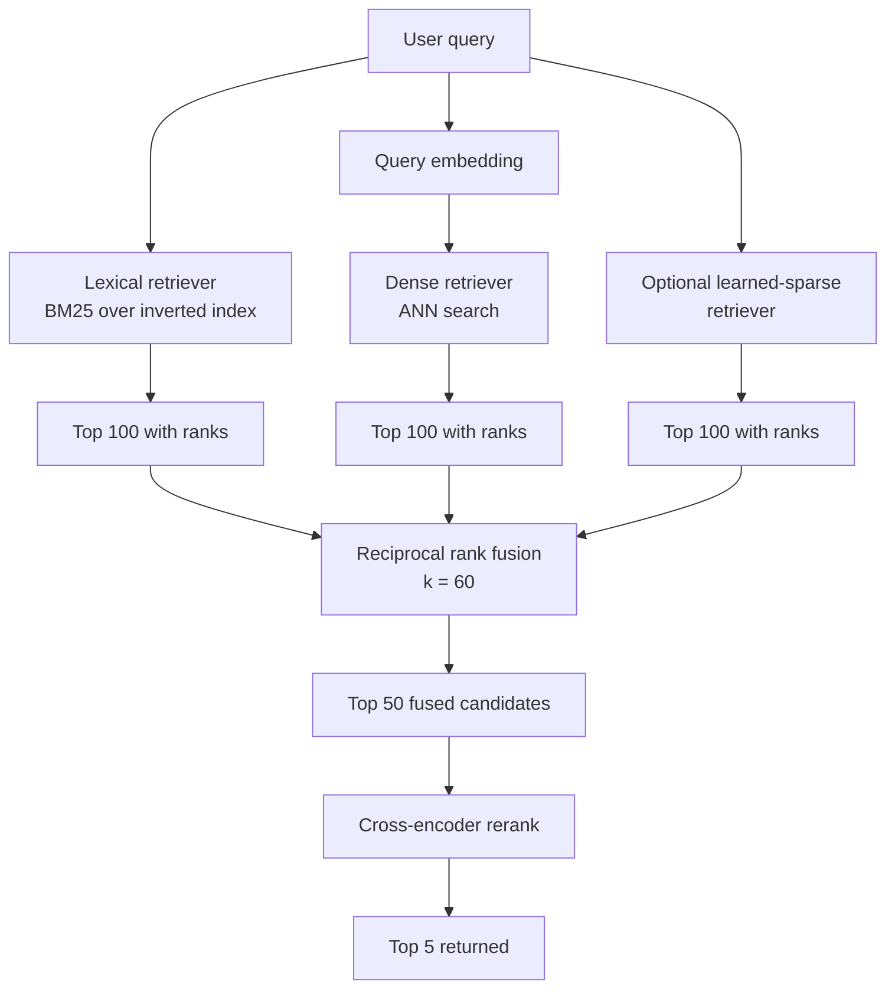

The diagram shows hybrid retrieval as three independent first-stage retrievers whose ranked lists are merged before an optional reranker. Each retriever applies the same authorization filter independently, because fusion cannot repair a leak that one retriever introduced. Evaluate each branch alone, the fused list, and the reranked list; a hybrid that is no better than its best branch is paying for complexity.

The ownership boundary for hybrid search is worth stating once. This chapter explains the retrieval signals and their fusion mathematics. [Part 06 CH21](../06_Databases_and_Storage/CH21_Vector_Databases.md) and [CH26](CH26_Vector_Databases_for_AI_Retrieval.md) own how a given database executes the combination, and [CH18](CH18_RAG_Architecture.md) owns the use of the retrieved set in generation.

## 8. Similarity and Distance

### 8.1 The three common measures

For two vectors $u, v \in \mathbb{R}^d$:

- Dot product (inner product): $u \cdot v = \sum_i u_i v_i = \|u\|\,\|v\|\cos\theta$.
- Cosine similarity: $\cos\theta = \dfrac{u\cdot v}{\|u\|\,\|v\|}$, the dot product of the vectors after each is divided by its length.
- Euclidean ($L_2$) distance: $\|u - v\| = \sqrt{\sum_i (u_i - v_i)^2}$, with $\|u - v\|^2 = \|u\|^2 + \|v\|^2 - 2\,u\cdot v$.

The last identity is the key to every equivalence claim. Substituting $\|u\| = \|v\| = 1$ gives $\|u - v\|^2 = 2 - 2\,u\cdot v = 2(1 - \cos\theta)$. For unit-length vectors, then, ranking by decreasing cosine, decreasing dot product, and increasing Euclidean distance produce identical orderings. The three are different monotone functions of the same quantity.

Worked check on two vectors, $u = (3, 4)$ and $v = (4, 3)$. The dot product is $12 + 12 = 24$, both norms are 5, so the cosine is $24/25 = 0.96$. The Euclidean distance is $\sqrt{1 + 1} = 1.414$. After normalizing, $\hat{u} = (0.6, 0.8)$ and $\hat{v} = (0.8, 0.6)$, the dot product is $0.48 + 0.48 = 0.96$ (the cosine, as expected), and the squared distance is $2 - 2(0.96) = 0.08$, a distance of 0.283. The script [01_vectors_similarity_geometry.py](../code/python/embeddings-chapter/01_vectors_similarity_geometry.py) checks the equivalence on random vectors: for five unit-normalized candidates the dot products are 0.622, $-0.505$, 0.116, $-0.721$, and 0.806, the values of $2 - 2\,u\cdot v$ match the squared distances (0.755, 3.009, 1.767, 3.442, 0.388), and the rankings agree. It then multiplies one candidate's raw vector (cosine 0.116) by 10: the raw dot-product winner changes from candidate 4 to candidate 2, while the cosine winner stays candidate 4.

### 8.2 When the equivalences fail

If vectors are not normalized, the three disagree, and the disagreement is informative. Suppose a query is unit length and there are two candidates. Candidate $a$ has norm 10 and cosine 0.5 with the query; candidate $b$ has norm 1 and cosine 0.9. The dot products are 5.0 and 0.9, so dot-product ranking puts $a$ first. Cosine ranking puts $b$ first. Euclidean distance depends on both: $\|q - a\|^2 = 1 + 100 - 10 = 91$ and $\|q - b\|^2 = 1 + 1 - 1.8 = 0.2$, so $b$ is first. Dot-product ranking therefore favors large-norm vectors, while cosine and Euclidean distance (on unit-norm data) ignore the norm.

Whether norm carries meaning depends on how the model was trained. Some models trained with a dot-product objective learn to use the norm as a popularity or specificity signal, and normalizing them removes that signal. Other models are trained on normalized outputs and any norm variation at inference is noise (typically from token count or truncation), which dot-product ranking would convert into a bias toward longer or shorter text. The rule that avoids both mistakes is simple: use the metric the model's documentation prescribes, and if it prescribes cosine, normalize at write time so that the index can use the cheaper dot product.

Normalizing at write time has three practical benefits. The distance computation reduces to a dot product (faster, and the form many hardware kernels and indexes optimize best). Scores lie in $[-1, 1]$, which makes thresholds and score monitoring simpler. And quantization behaves more predictably, because every vector has the same scale.

A fourth measure appears in compressed representations. For binary vectors, Hamming distance counts differing bits. If bits come from the signs of the components of a normalized vector, Hamming distance approximates the angle between the original vectors, which is why binary quantization works for cosine-trained models (section 11).

### 8.3 Scores are rankings, not probabilities

A cosine of 0.78 does not mean 78 percent relevance. The distribution of scores depends on the model, the domain, the text length, and the language. Two examples from practice illustrate it. A multilingual model may give relevant same-language pairs scores around 0.75 and relevant cross-language pairs around 0.55, so a single threshold keeps one and drops the other. A short query may score lower against every passage than a long query does, so a fixed cutoff makes short queries return nothing.

Three approaches make scores usable. First, rank and take top-$k$, with $k$ chosen from recall curves, never a fixed threshold alone. Second, use a relative criterion: keep results whose score is within $\delta$ of the top score, or whose gap to the next result is large (a "knee"). Third, calibrate: fit a small logistic regression on labeled (score, relevant) pairs from your domain, per language if needed, to turn a score into an estimated probability. Calibration then needs the same maintenance as any other model, because a model upgrade changes the score distribution (section 15).

### 8.4 Which measure to use

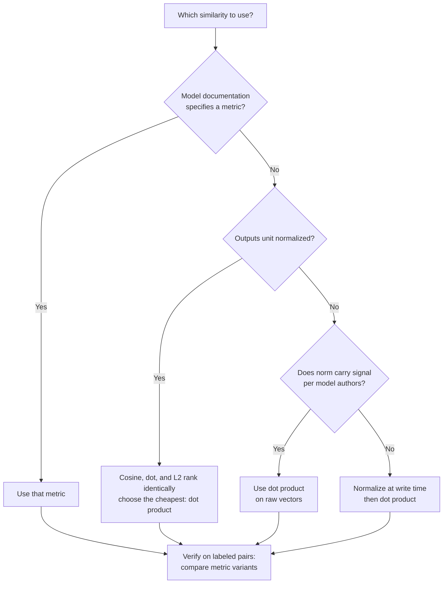

The decision tree turns the discussion into a procedure. The last step is the one that gets skipped: whichever metric is chosen, compare the alternatives on a labeled set once. The comparison costs minutes, and a mismatch between the training metric and the index metric is a silent quality loss of several points that no error message will report.

## 9. The Geometry of Learned Spaces

### 9.1 Concentration of distances

Random high-dimensional vectors are nearly orthogonal. For two independent random unit vectors in $\mathbb{R}^d$ the cosine has mean 0 and standard deviation about $1/\sqrt{d}$. For $d = 1024$ that standard deviation is $1/32 = 0.031$; a cosine of 0.3 is almost 10 standard deviations from chance. Two consequences matter in practice.

First, the contrast between nearest and farthest neighbors of a point shrinks as dimension grows for data without structure: the ratio $(d_{\max} - d_{\min})/d_{\min}$ tends to zero. Nearest-neighbor search is only meaningful because real embeddings have structure, with clusters and low intrinsic dimension (a 1,024-dimensional vector set may lie close to a manifold of far fewer degrees of freedom). When a model's space loses that structure, for instance when a heavily truncated or poorly trained model maps unrelated text to similar vectors, nearest-neighbor quality collapses and the top-10 becomes close to arbitrary.

Second, compression error behaves differently at different scales. The dot product between a vector and its quantized copy has an error that is small relative to a cosine of 0.7 but not relative to the difference between the 10th and 11th neighbors, whose cosines differ by 0.005. That is why quantization recall (section 11) falls off in the tail of the ranking while top-1 stays accurate.

### 9.2 Intrinsic dimension and why truncation can work

A 3,072-dimensional embedding rarely uses all its dimensions. Singular-value spectra of embedding matrices typically decay quickly: a few dozen to a few hundred directions carry most of the variance. PCA to a lower dimension often retains most retrieval quality, and the existence of Matryoshka models (section 10), where quality degrades gently with truncation, is a purposeful exploitation of the same fact. The practical point for an architect is that dimension is a cost parameter you can tune against an evaluation set, and the default dimension of a model is the vendor's choice and not a requirement.

### 9.3 Anisotropy

Embedding spaces from language models are often anisotropic: the vectors occupy a narrow cone rather than spreading uniformly over the sphere. Ethayarajh (2019) measured this in contextual representations from BERT, ELMo, and GPT-2 and found that the average cosine between random words' representations grows toward the upper layers, meaning the vectors share a large common component. Gao et al. (2019) described the related "representation degeneration" in language models trained with tied embeddings and softmax outputs.

The effect is easy to reproduce. In the script, 2,000 random vectors in 256 dimensions have an average pairwise cosine of 0.000. Adding a single shared offset of length 12 (the random vectors themselves have a norm of about 16) raises the average cosine to 0.357. The calculation is a one-liner: the shared component contributes $12^2 = 144$ to every dot product, and each squared norm is about $256 + 144 = 400$, so the cosine is about $144/400 = 0.36$. Subtracting the mean vector brings the average cosine back to $-0.001$.

Consequences of anisotropy for practice:

- Absolute cosine values are inflated and hard to interpret. A cosine of 0.8 may be unremarkable if unrelated texts average 0.7.
- Rankings suffer less than the absolute values suggest, because ranking uses differences. But the useful signal sits in a compressed range, which magnifies the effect of quantization error and of numeric precision.
- Thresholds tuned on one model break on another.

Remedies exist for models that need them. Subtracting the corpus mean vector (centering) and optionally removing the top few principal components (Mu and Viswanath, 2018) reduces the shared component; whitening the space normalizes all directions (Su et al., 2021). Models trained with the contrastive objective of section 5, which explicitly pushes negatives apart, are far less anisotropic than raw pretrained encoders, and many retrieval models need no post-processing. Test it: compute the average cosine between random pairs from your corpus. If it is above 0.5, try centering and measure retrieval with and without it.

### 9.4 Hubness

In high dimensions a few points become "hubs": they appear among the $k$ nearest neighbors of a disproportionately large number of other points, while many points ("anti-hubs") appear in no one's neighbor list (Radovanović, Nanopoulos, and Ivanović, 2010). The expected number of times a point appears in $k$-nearest-neighbor lists is $k$ by symmetry, but the distribution becomes right-skewed as dimension rises.

The script measures it on 1,500 random unit vectors with $k = 10$. In 3 dimensions the most popular point appears in 16 lists, the skewness of the count distribution is $-0.06$, and no point is absent. In 32 dimensions the maximum is 34 with skewness 0.92 and one point is never a neighbor. In 512 dimensions the maximum is 57 (5.7 times the average), the skewness is 1.70, and 30 points are never retrieved by any other point. The shared offset of the data (a small common mean) produces hubs that sit near the center of the distribution.

For retrieval this matters in two ways. A hub passage shows up in results for many unrelated queries, which looks like the "generic answer" problem: a boilerplate article about "contacting support" outranks specific answers. And an anti-hub passage can be nearly unretrievable, however relevant it is. Diagnose hubness by counting how often each passage appears in the top-$k$ across a large sample of real queries, and inspect the top 20 by count. Remedies: remove boilerplate and duplicate content before embedding; center the vectors; rescale similarities by each point's local neighborhood (cross-domain similarity local scaling, CSLS, from Conneau et al., 2018, subtracts the mean similarity of a point to its nearest neighbors); and use a reranker that is not subject to the same geometry.

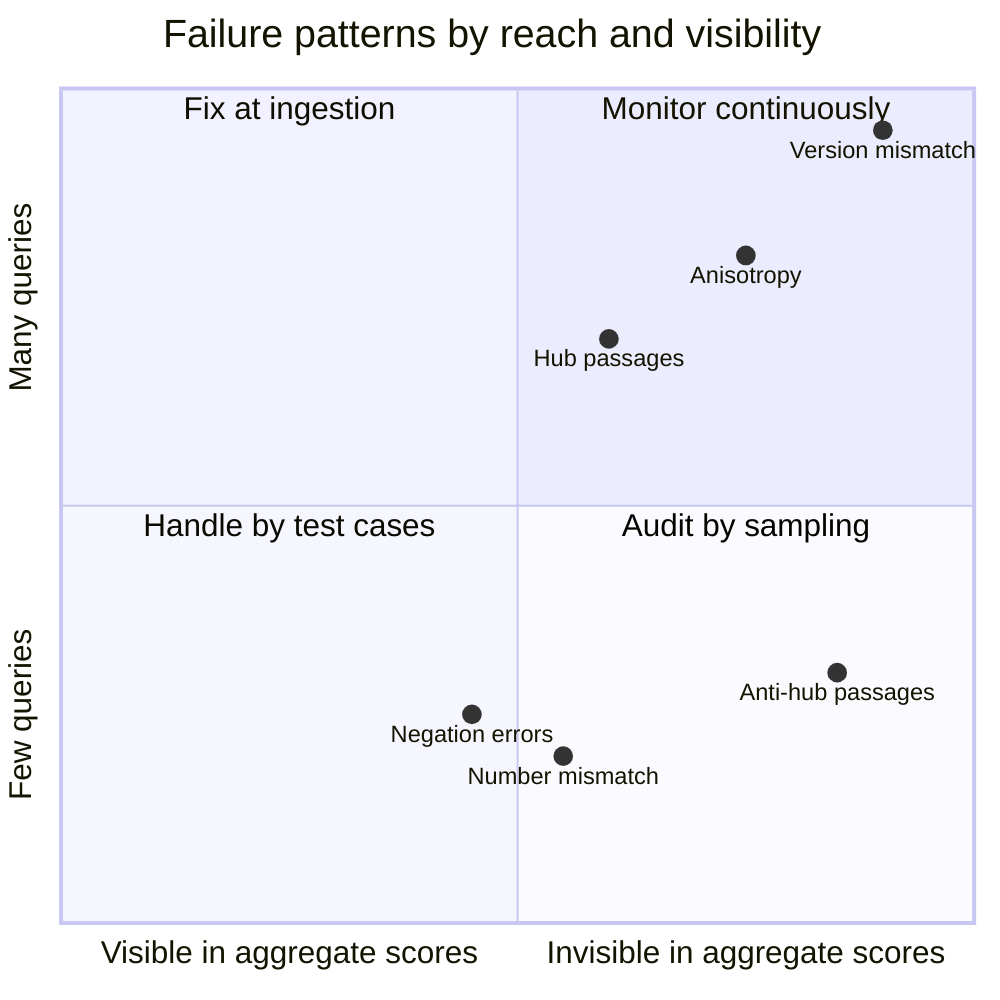

The quadrant chart places geometry-related failures by how many queries they touch and how visible they are in aggregate metrics. Failures in the upper right, such as mixing vectors from two model versions, damage many queries and leave average scores plausible, so they need explicit tests. Failures in the lower left, such as a negation error on a single query, show up in a curated test set and nowhere else. The positions are a judgment for illustration and not measurements.

## 10. Matryoshka Representation Learning and Truncation

### 10.1 The problem: dimension is a cost you pay for every vector

Embedding dimension multiplies directly into storage, memory bandwidth, and distance-computation cost. A 3,072-dimensional float32 vector is 12,288 bytes. At 40 million vectors, that is $4 \times 10^7 \times 12{,}288 = 491.5$ GB before index overhead, and a flat scan reads all of it. A 256-dimensional vector costs $4 \times 10^7 \times 1{,}024 = 41.0$ GB, twelve times less. If quality at 256 dimensions were close to quality at 3,072, the choice would be obvious, but for an ordinary embedding model it is not: simply dropping trailing dimensions from a model trained with a fixed dimension damages the vector, because nothing in training told the model that the first 256 coordinates must stand alone.

### 10.2 Matryoshka representation learning

Kusupati et al. (2022) proposed Matryoshka Representation Learning (MRL), which trains the model so that every prefix of the vector is itself a good embedding, like nested dolls. Let $z \in \mathbb{R}^{D}$ be the full vector and let $\mathcal{M} = \{m_1 < m_2 < \dots < m_K = D\}$ be a set of nested dimensions, for example $\{64, 128, 256, 512, 1024\}$. The training loss is a weighted sum of the ordinary loss applied to each prefix:

$$
\mathcal{L}_{\text{MRL}} = \sum_{m \in \mathcal{M}} c_m \; \mathcal{L}\big(\operatorname{norm}(z_{1:m})\big),
$$

where $z_{1:m}$ is the first $m$ coordinates, $\operatorname{norm}$ rescales to unit length, $\mathcal{L}$ is the contrastive loss of section 5 computed on those truncated vectors, and $c_m \ge 0$ are weights (often all 1). Because the same encoder must serve every $m$, the optimizer packs the coarse, high-variance distinctions into the earliest coordinates and refines them in later ones. The cost of training is a small multiple of the compute for one loss computation (the encoder pass is shared; only the loss is repeated).

Two operational details are easy to miss. First, truncated vectors must be renormalized. A unit-length 1,024-dimensional vector whose first 256 coordinates hold 30 percent of its squared norm has a prefix norm of $\sqrt{0.30} = 0.548$. If you index the prefix without rescaling, cosine-by-dot-product mixes the signal with this variable norm. Second, queries and documents must be truncated to the same length. A 256-dimensional document vector compared with a 512-dimensional query, or the reverse, is a type error that some libraries will not reject.

### 10.3 What it buys

Public APIs and open models now expose this directly. At the time of writing, OpenAI's `text-embedding-3` models accept a `dimensions` parameter (the default is 1,536 for the small model and 3,072 for the large one; check the [OpenAI embeddings guide](https://platform.openai.com/docs/guides/embeddings) for current models and parameters), and OpenAI reported at launch that a shortened large-model vector of 256 dimensions outperformed the older full-length 1,536-dimensional `ada-002` on the MTEB benchmark. Several open-weight models document supported Matryoshka dimensions on their model cards. Verify which dimensions a given model was trained for. Truncating to an unsupported length may degrade sharply, and the public figures describe their own benchmarks, not your data.

The script [03_fusion_quantization_matryoshka.py](../code/python/embeddings-chapter/03_fusion_quantization_matryoshka.py) simulates the effect with a synthetic corpus in which variance is front-loaded (later coordinates carry less signal, as Matryoshka training encourages). It builds 20,000 256-dimensional vectors and 200 queries that are noisy copies of one source vector each, and measures how often the source appears in the top 10 after truncating and renormalizing.

```text
d=256  success@10 = 0.945   bytes/vector (fp32) = 1024
d=128  success@10 = 0.783   bytes/vector (fp32) = 512
d= 64  success@10 = 0.473   bytes/vector (fp32) = 256
d= 32  success@10 = 0.182   bytes/vector (fp32) = 128
d= 16  success@10 = 0.046   bytes/vector (fp32) = 64
```

Halving the dimension from 256 to 128 costs 16 points in this deliberately hard setting (the noise level was raised until the full-length vector reached only 0.945), and quartering it costs 47 points. Each step down saves half the storage. In a well-trained Matryoshka model the curve is far flatter near the top, because the model was trained to make each prefix good, while in this synthetic example only the variance profile helps.

The synthetic data is a model of the mechanism and not a benchmark of any real embedding model. It shows the typical shape: quality stays flat over a range of dimensions, then falls off a cliff, and the point of the cliff depends on the data and on how the model was trained.

### 10.4 Funnel retrieval

Truncation also enables a two-pass search without a second model. Search with the short prefix to produce a candidate list, then rescore the candidates using the full vector. For a corpus of 40 million vectors, a 256-dimensional first pass reads 41 GB (flat) or traverses an index of that size, then 200 candidates are rescored with full 3,072-dimensional vectors fetched from slower storage. The full vectors still have to be stored, but they need not be in memory or in the approximate index: 491.5 GB on solid-state storage with random reads for 200 candidates per query is feasible. This is the same pattern as binary quantization with rescoring (section 11), and the two can be combined. Whether to keep the full vectors at all is a decision about migrations, since re-embedding is avoidable only if the original is stored (section 15).

Choose the truncation point from your evaluation set, not from a rule of thumb: compute recall at your operating cutoff for each candidate dimension and pick the smallest dimension within a tolerance (for example 1 percentage point of recall@10 from the full dimension) of the best. Re-run that comparison when the corpus changes substantially, because the curve depends on how many near-duplicate and confusable documents exist.

## 11. Compression: Scalar, Binary, and Product Quantization

### 11.1 Where this chapter stops

Vector quantization appears in two places. As an index feature, product quantization (PQ) is part of how approximate-nearest-neighbor indexes trade memory for speed, and that is owned by [Part 06 CH21](../06_Databases_and_Storage/CH21_Vector_Databases.md) and [CH26](CH26_Vector_Databases_for_AI_Retrieval.md). As a property of the representation, quantization is a lossy encoding of the embedding vector whose recall cost you predict and test. This section covers the second view: how each scheme encodes the vector, what error it introduces, and how to reason about the recall–storage trade.

### 11.2 Scalar quantization

Scalar quantization maps each float to a small integer. For int8, the usual method estimates a minimum $\ell_j$ and maximum $h_j$ for each dimension $j$ (or one global pair) from a sample, sets step $s_j = (h_j - \ell_j)/255$, stores $\operatorname{round}((x_j - \ell_j)/s_j)$, and reconstructs $\hat{x}_j = \ell_j + s_j \cdot \text{code}$. Storage falls 4 times from float32 and 2 times from float16. Distance computation can use integer instructions, which are faster on many processors.

The error is bounded and predictable. Rounding to the nearest level gives a uniform error on $[-s/2, s/2]$ with variance $s^2/12$. For a unit-norm embedding with coordinates in roughly $[-0.2, 0.2]$ the step is $0.4/255 = 0.00157$ and the error standard deviation per coordinate is $0.00157/\sqrt{12} = 0.00045$. The dot product of a unit-length query $q$ with the error vector $e$ has variance $\sum_j q_j^2 \sigma_e^2 = \|q\|^2 \sigma_e^2$, so for a unit query the standard deviation of the score error is also $0.00045$, regardless of dimension. Compare that with the gap between neighbors in a ranking: in a dense region the 10th and 11th results often differ by 0.005 or more in cosine, so the error is about a tenth of a typical gap. Only a small fraction of adjacent-rank pairs are swapped, and recall@10 of the quantized search against the full search commonly stays within a point or two. The int8 row of the script's output agrees in kind: the quantized copy reproduces the full-precision ranking almost perfectly.

Float16 (half precision) and bfloat16 have similar effects at 2 times compression, and they are simpler because they need no calibration data. Prefer them first when the saving is enough.

### 11.3 Binary quantization

Binary quantization keeps one bit per dimension: the sign of the coordinate, $b_j = [x_j > 0]$ (optionally relative to a per-dimension threshold such as the corpus mean). A 1,024-dimensional vector becomes 128 bytes, 32 times smaller than float32. Similarity becomes Hamming distance (the count of differing bits), computed with an exclusive-or and a population-count instruction, which is among the fastest operations a processor has.

Why it works: for two vectors with angle $\theta$ between them, if the bits were the signs of random hyperplane projections, then each bit differs with probability $\theta/\pi$ (the random-hyperplane argument behind SimHash, Charikar, 2002). Embedding coordinates are not random projections, but for roughly isotropic, centered vectors the same relation holds approximately. Worked numbers for 1,024 bits: a pair with cosine 0.8 has angle $\arccos 0.8 = 0.6435$ rad, so the expected fraction of differing bits is $0.6435/\pi = 0.2048$, about 210 bits. A pair with cosine 0.7 has angle 0.7954 rad and fraction 0.2532, about 259 bits. The gap is 49 bits. The standard deviation of the bit-difference count for a pair at fraction $p$ is $\sqrt{1024\,p(1-p)} \approx 12.9$ bits at $p = 0.2048$, so the two cosines are separated by about 3.8 standard deviations: reliable on average, and noisy for pairs whose cosines are within a few hundredths of each other. That noise is why binary quantization is used as a first pass followed by rescoring.

The recipe: Hamming search over the binary codes retrieves the top $r \cdot k$ candidates (oversampling factor $r$ between 4 and 10), then the original float (or int8) vectors for those candidates are fetched and rescored exactly to produce the final top $k$. Published vendor tests report that this recovers most of the full-precision recall for models trained with normalized outputs and enough dimensions, and that it works worse for low-dimensional vectors, because 256 bits carry little information. Treat such claims as hypotheses and measure on your data. Binary quantization needs the model's distribution to be roughly centered and spread across dimensions, so it suffers more from the anisotropy described in section 9.3.

### 11.4 Product quantization

PQ (Jégou, Douze, and Schmid, 2011) splits the $D$-dimensional vector into $M$ sub-vectors of dimension $D/M$ and learns, for each subspace, a codebook of $K = 256$ centroids with k-means. A vector is stored as $M$ bytes, each the id of the nearest centroid in its subspace. A 1,024-dimensional float32 vector (4,096 bytes) with $M = 128$ subspaces of 8 dimensions becomes 128 bytes (32 times), and with $M = 64$ it becomes 64 bytes (64 times).

Distance computation uses asymmetric distance computation: for each query, precompute a table of squared distances from each query sub-vector to all 256 centroids in its subspace ($M \times 256$ entries), then the approximate distance to any stored vector is the sum of $M$ table lookups. The one-time table cost per query is about $256 \times D$ operations (262,144 for $D = 1024$), which is negligible next to scanning millions of codes at $M$ lookups each.

Recall loss comes from quantization error inside each subspace and from correlations across subspaces that independent codebooks cannot capture. Optimized product quantization (OPQ) learns a rotation first to balance variance across subspaces and lowers the error. PQ is the right tool when memory is the binding constraint and you can tolerate a few points of recall (often compensated by rescoring); its codebooks must be trained on a representative sample and retrained, along with a re-encode of every vector, if the embedding model changes.

### 11.5 Putting the numbers together

For a corpus of 40 million chunk vectors (2 million documents times about 20 chunks), the storage per scheme is:

| Scheme | Bytes per vector | Total for 40M | Reduction | Typical rescoring need |
| --- | --- | --- | --- | --- |
| float32, 1,024-d | 4,096 | 163.8 GB | 1x | None |
| float16, 1,024-d | 2,048 | 81.9 GB | 2x | None |
| int8, 1,024-d | 1,024 | 41.0 GB | 4x | Rarely |
| Matryoshka 256-d float32 | 1,024 | 41.0 GB | 4x vs 1,024-d | Sometimes |
| Matryoshka 256-d int8 | 256 | 10.2 GB | 16x | Sometimes |
| PQ, M = 64, 1,024-d | 64 | 2.6 GB | 64x | Usually |
| Binary, 1,024-d | 128 | 5.1 GB | 32x | Usually |
| Matryoshka 256-d binary | 32 | 1.3 GB | 128x | Always |

Each row is a recall–memory point and none dominates. The principle is to stack them as a hierarchy: keep a compact representation in memory for candidate generation, keep the full-precision vector on cheaper storage for rescoring, and tune the oversampling factor. The memory saved also reduces the number of machines, and since memory is typically the cost driver of a vector store, the saving often exceeds the cost of the extra rescoring I/O. Measure recall on your own vectors, not on generic claims.

The script prints a synthetic comparison:

```text
float32     : 1024 bytes/vec  recall@10 = 0.945
int8 scalar :  256 bytes/vec  recall@10 = 0.943
binary 1-bit:   32 bytes/vec  recall@10 = 0.928
binary + fp32 rescore of top-100: recall@10 = 0.974
PQ M=32     :   32 bytes/vec  recall@10 = 0.777
PQ M=16     :   16 bytes/vec  recall@10 = 0.483
```

Here "recall@10" is the fraction of 1,000 queries whose planted source vector appears in the top 10 (a hit rate against a known answer, not agreement with the float ranking). Int8 loses 0.2 points for a 4 times saving, matching the error analysis of section 11.2. One-bit codes lose 1.7 points for a 32 times saving. Product quantization at 32 bytes per vector loses 17 points and at 16 bytes about 46 points: with 256 centroids per subspace on this noisy synthetic data, the codebooks are too coarse. The binary-plus-rescoring row exceeds the float32 row (0.974 against 0.945) for a reason particular to this setup: the target is the planted source, and a Hamming shortlist of 100 can drop distractors that the float score ranks above it. Do not expect rescoring to beat full precision on real data, where the target is the float ranking's neighbors or a human judgment.

These are results on random data with an engineered variance profile and a harder-than-realistic noise level. Real embeddings have clustered structure that is typically friendlier to quantization. The rank order of the schemes (int8 loses little, product quantization and binary lose more, rescoring recovers a large share) is the transferable lesson, and the specific numbers are not.

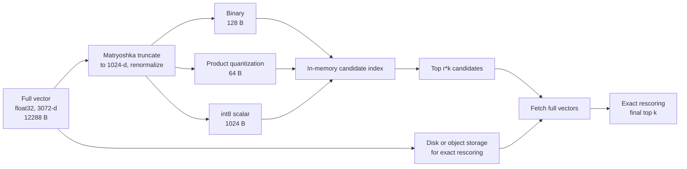

The diagram shows the tiered design. The compact copies exist to select candidates cheaply, and only the full-precision copy decides the final order. Its operational consequence is that the full vectors cannot be discarded, and they are also the artifact that lets you re-quantize with a different scheme later without calling the embedding model again.

## 12. Multilingual, Multimodal, Code, and Domain Embeddings

### 12.1 Multilingual embeddings

A multilingual model embeds text from many languages into one shared space so that a query in one language can retrieve passages in another. Alignment is created by training on parallel or translated pairs together with monolingual retrieval pairs. Representative systems include LaBSE (Feng et al., 2022) built for sentence alignment across more than 100 languages, the multilingual E5 models, and BGE-M3 (Chen et al., 2024), which supports over 100 languages, long inputs, and produces dense, sparse, and multi-vector outputs from one model. Check current model cards for languages and lengths.

Four behaviors matter in practice. First, language bias: many multilingual models score same-language pairs higher than cross-language pairs for equally relevant content, so a mixed-language corpus ranks passages in the query's language above better passages in another language. Second, uneven quality: languages with less training data have worse embeddings, and a headline average hides a language-specific failure. Evaluate per language. Third, tokenization fertility: languages with scripts or morphology poorly represented in the tokenizer's vocabulary split into more tokens, perhaps two to three times as many for the same content. That increases cost per document (embedding is priced per token), reduces how much text fits in the context limit, and dilutes pooled vectors. Fourth, transliteration and code-switching (mixed-language queries, romanized text) are weakly covered by most models and need explicit test cases.

Design options for a multilingual corpus: use one multilingual model and accept a shared index; use per-language indexes with per-language models and route by detected language (better monolingual quality, no cross-language retrieval, more operational surface); or translate at ingestion into one pivot language (adds translation cost and error, preserves a monolingual model). The shared multilingual model is the default; move to per-language only when per-language evaluation shows a gap you cannot close.

### 12.2 Multimodal embeddings

Contrastive Language–Image Pretraining (CLIP; Radford et al., 2021) trains an image encoder and a text encoder jointly on about 400 million image–caption pairs. A batch of $B$ pairs produces a $B \times B$ matrix of image–text similarities, and the loss is the symmetric InfoNCE of section 5: cross-entropy over rows (image to text) and over columns (text to image), with a learned temperature. The result is a shared space where a caption and its image are near each other, enabling text-to-image search and zero-shot classification by embedding class names as text. The follow-on SigLIP (Zhai et al., 2023) replaces the softmax with an independent sigmoid loss per pair, which removes the dependence on batch-wide normalization and eases scaling.

Image and text embeddings in a CLIP-style space do not mix perfectly: Liang et al. (2022) described a modality gap, where image vectors and text vectors occupy two separate regions of the sphere. Within-modality similarities (image to image) are on a different scale than cross-modality ones (text to image), so a single threshold applied to both is wrong, and ranking a mixed pool of image and text results by raw cosine favors one modality. Rank per modality and merge with a fusion method like RRF, or calibrate per modality pair.

Document-image retrieval is a growing use: models such as ColPali (Faysse et al., 2024) embed the image of a page with a vision-language model into multi-vector patch embeddings and score by late interaction, avoiding optical character recognition and layout parsing. The storage arithmetic of section 6.3 applies with a larger multiplier, since a page may yield around a thousand patch vectors. Generative multimodal systems are owned by [CH23](CH23_Multimodal_Generative_AI.md). This chapter covers only the embedding side.

### 12.3 Code embeddings

Code is text with different statistics: identifiers split into subwords, structure matters, and the relevant relation is often between a natural-language description and an implementation, or between two implementations of the same behavior. Code embedding models are trained on pairs of docstrings or comments and functions (CodeSearchNet by Husain et al., 2019, is a well-known dataset), commit messages and diffs, and questions with accepted answers. Practical points: chunk by syntactic unit (function, class, or file section), not by character count; include the file path and signature in the embedded text since they carry information; tests and generated files pollute the index and are often best excluded; and always combine with lexical search, since developers search for exact identifiers (`parseConfigV2`) that dense vectors blur. Evaluate on queries from your engineers, not on public code-search sets, because the distribution of in-house frameworks differs.

### 12.4 Domain embeddings: when general models are not enough

A general model trained on web-scale data covers most vocabulary. It tends to underperform on domains with specialized terminology, abbreviations, or notions of relevance that differ from the web's: clinical notes, patent claims, legal citations, chemical names, internal product codes, financial filings. There are three responses, in rising cost: (1) hybrid retrieval with a lexical branch that handles exact terms; (2) a domain-specialized open or vendor model, where one exists and passes your evaluation; and (3) fine-tuning a general model on in-domain pairs (section 17). Domain adaptation can reduce general-purpose transfer. A model fine-tuned on support tickets might lose accuracy on out-of-domain queries, and a corpus with mixed domains needs a combined evaluation. Whichever response is chosen, the decision rests on the in-domain evaluation of section 18.

## 13. Instruction-Prefixed and Asymmetric Embeddings

### 13.1 Why queries and documents are not the same kind of text

A query is short, often a fragment or a question, and states a need. A document passage is long, declarative, and states content. A model trained to embed queries near answers must learn a mapping from the question form to the answer form. Treating the two with identical processing forces one function to cover both. Asymmetric models handle this in one of three ways: separate encoders for queries and documents (as in dense passage retrieval, DPR; Karpukhin et al., 2020); the same encoder with different prefixes; or the same encoder with a natural-language instruction.

### 13.2 Prefix conventions

The E5 family (Wang et al., 2022; 2024) expects `query: ` and `passage: ` prefixes (verify on the model card). Instruction-tuned embedders, including E5-Mistral and models in the Qwen3-Embedding family, expect an instruction on the query side, such as `Instruct: Given a web search query, retrieve relevant passages that answer the query\nQuery: <text>`, and no instruction on the document side. Hosted APIs expose the same idea as an input type or task type parameter, for example "search_query" versus "search_document" or "retrieval query" versus "retrieval document" (names differ by vendor, so check the API reference for the model you use). For symmetric tasks such as duplicate detection or clustering, both sides use the same setting, which is often a dedicated "similarity" or "clustering" task type.

Instructions let a single model serve multiple tasks. The same model with the instruction "Retrieve a support article that resolves this ticket" and the instruction "Find a ticket that is a duplicate of this ticket" produces different geometry for different jobs. This is a useful property for an architect because it allows one model deployment to serve several use cases, and a hazard because two services using different instruction wording produce vectors that are not equivalent, even though both call the same model.

### 13.3 Failure modes

Omitting or mixing prefixes does not raise an error. It lowers retrieval quality by an amount that depends on the model (some degrade gently, some sharply), and it is easy to introduce: a data scientist embeds the corpus using a notebook with the passage prefix, the production query service omits the query prefix, and recall silently falls. Related hazards are applying a document prefix to queries during evaluation and thereby overstating or understating quality, using a query instruction at indexing time, and changing instruction wording during a prompt-tuning exercise without re-embedding the documents (for models where the instruction applies to documents).

Mitigations: put the prefix and instruction templates in the embedding contract (section 15) as versioned values, build the query and document paths from the same client library, add a contract test that embeds a fixed canary query and passage and compares to stored reference vectors with a tolerance, and include the contract version in each stored vector's metadata.

Another technique for narrowing the question-to-answer gap is to embed a hypothetical answer in place of the query. HyDE (Hypothetical Document Embeddings; Gao et al., 2022) asks a language model to write a plausible answer, embeds that text with the document encoder, and searches with it. It can help on queries that are too short or ambiguous, and it costs a model call per query and can introduce confidently wrong content into the search vector. Use it as an experiment with measured benefit, not by default. Query rewriting and expansion by a language model are siblings of this idea and belong to [CH18](CH18_RAG_Architecture.md).

## 14. Chunk and Document Representations

### 14.1 What a chunk vector represents

An embedding model compresses a variable-length text into one vector. What that vector represents depends on the length. A vector of a 50-token sentence represents a specific statement. A vector of a 2,000-token section represents an average over several statements, and a query about any one of them is compared to the average. This mean-pooling dilution is why long chunks retrieve less precisely: a section covering five topics has a vector near the center of the five, close to none. Short chunks have the opposite problem: they lose the context needed to interpret them ("It must be restarted" has no vector-visible subject).

Models also have maximum input lengths. Text beyond the limit is truncated (silently, in many libraries), and the end of a long document does not influence its vector. A long-context embedding model (8,000 tokens and more) accepts large inputs but may still weight the beginning more than the end, and may represent a 6,000-token document as a diffuse summary. Evaluate retrieval at the length you intend to use. Do not assume a larger window means a better long-document vector.

Chunking strategy (fixed-size, recursive, semantic, structure-aware, hierarchical) and its role in the end-to-end RAG pipeline are owned by [CH18](CH18_RAG_Architecture.md). This section covers only the representation effects.

### 14.2 Chunk arithmetic

Consider a 3,000-token document with chunks of 300 tokens and an overlap of 50 tokens. The stride is 250 tokens, so the number of chunks is $\lceil (3000 - 300)/250 \rceil + 1 = \lceil 10.8 \rceil + 1 = 12$. The total tokens embedded are $12 \times 300 = 3{,}600$, 20 percent more than the document itself, and the vector count is 12. If the corpus holds 2 million such documents, there are 24 million vectors and 7.2 billion embedded tokens; at 1,024 dimensions and float32 that is 98 GB of vectors. Halving the chunk size to 150 tokens with a proportional overlap of 25 gives stride 125 and $\lceil (3000 - 150)/125 \rceil + 1 = 24$ chunks, double the vectors and a quarter more tokens embedded than the 300-token case (3,600 tokens again, since 24 × 150 = 3,600). Smaller chunks therefore double vector storage and index size at the same token cost. The cost trade-off is mostly in the index.

### 14.3 Enriched and multi-representation chunks

Several techniques change what is embedded without changing the stored text.

- Contextual headers: prepend the document title and section path to the chunk text before embedding. This helps when chunks are ambiguous without their parents (a title "Resetting your password" disambiguates "Click Continue"). Evaluate the effect, since headers repeated on every chunk can bias similarity toward the header text itself.
- Generated context: a language model writes a one- or two-sentence description situating each chunk within its document, and that description is prepended before embedding (the idea behind Anthropic's contextual retrieval technique, 2024). It improves chunks that lose meaning in isolation and costs one model call per chunk at indexing time, which at tens of millions of chunks is a real expense and a re-run cost at every re-index.
- Multiple vectors per source: embed the chunk, a generated summary, and generated questions the chunk answers ("doc2query"-style), and map all of them to the same stored chunk. Question-style vectors align with how users ask. The index grows by the multiplier.
- Parent–child retrieval: embed small child chunks for precision, then return the larger parent passage for context. Representation stays precise and the context handed downstream is complete.

### 14.4 Late chunking

Standard chunking splits the text first and embeds each piece independently, so a chunk's vector contains no information from outside the chunk. Late chunking (Günther et al., 2024) reverses the order. A long-context embedding model processes the entire document (up to its context limit) to produce one contextual vector per token, and then the token vectors are pooled by chunk boundaries after the transformer. Because each token vector was computed with attention over the whole document, a chunk containing "It must be restarted" now has a pooled vector shaped by the earlier sentence that names the subject.

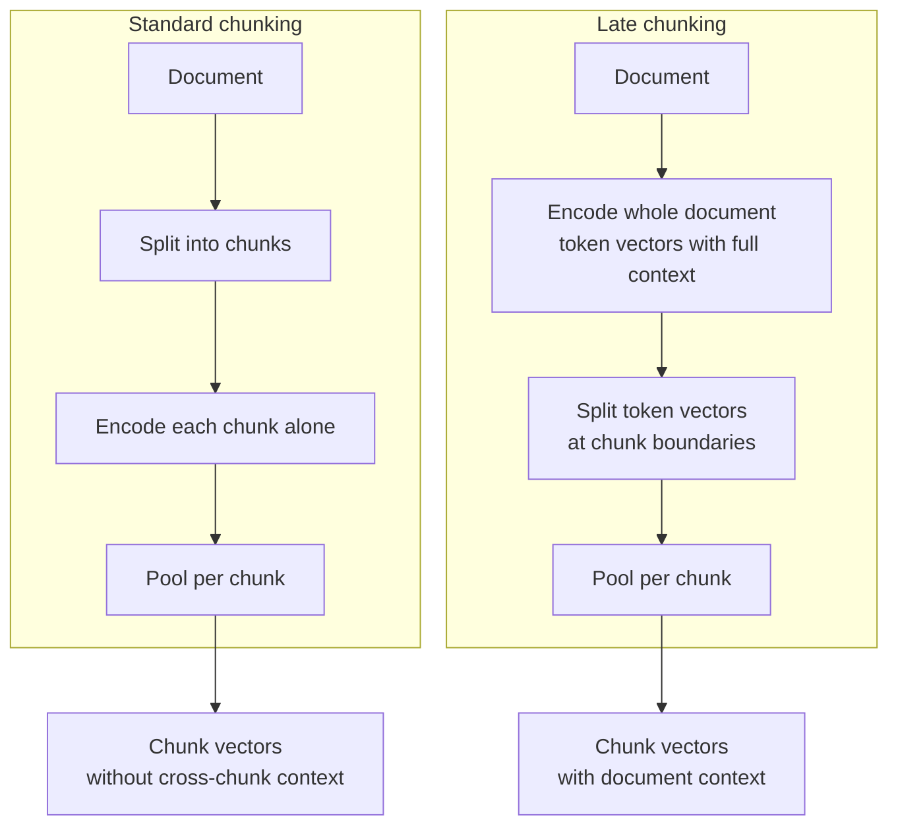

The diagram shows that late chunking moves the split to after the encoder instead of before it. The benefit is context-aware chunk vectors without an extra model call per chunk. The constraints are practical. It requires a model with long context and mean pooling. Documents beyond the context limit must be split into overlapping macro-sections first. The embedding model must be run over each whole document at once, which makes the unit of work larger and re-embedding on edit coarser. Most hosted embedding APIs return only the pooled vector, not token vectors, so late chunking either requires a self-hosted open model or a vendor that exposes it as a feature. Treat it as a technique to test against contextual headers and generated context on your corpus, since reported gains vary by dataset.

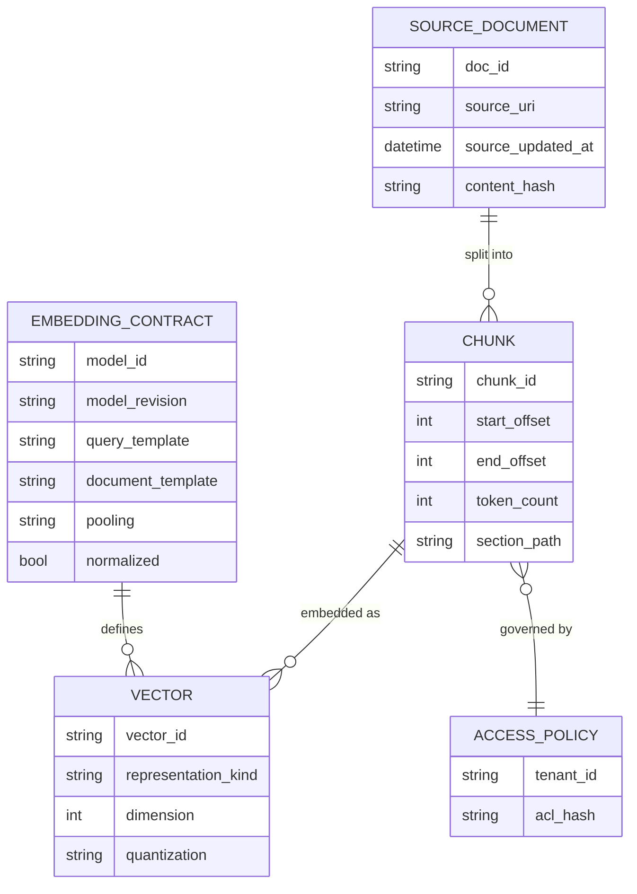

The entity-relationship diagram is the chunk record that the case study uses. A chunk keeps provenance (document, offsets, section path), freshness (source update time, content hash), and access policy, so that retrieval results can be traced back and filtered. A vector refers to the contract that produced it, which makes every vector self-describing. The `representation_kind` field distinguishes the chunk vector from a summary or question vector that points to the same chunk. Chunks reference an access policy rather than copying permissions, so a permission change updates the policy and the next filtered query sees it. Policy propagation delays are a governance problem owned by [CH30](CH30_AI_Data_Governance_Privacy_and_Provenance.md).

## 15. The Embedding Contract and Model-Version Migration

### 15.1 Vector spaces are not comparable across models

Two embedding models can output vectors of the same dimension and the same numeric type, and the numbers still mean unrelated things. A model's coordinates have no fixed semantics. Training from a different random initialization, a different data mix, or a different architecture produces a space whose axes bear no relation to the other's. Even two checkpoints of the same model family can differ by an arbitrary rotation or by a nonlinear distortion after further training.

The script [04_evaluation_migration_drift.py](../code/python/embeddings-chapter/04_evaluation_migration_drift.py) shows the extreme case. It creates 3,000 random unit vectors (space A), and a second space B that is a random rotation of A, so B contains exactly the same relational information. Searching A's corpus with a query from A returns the correct item every time (success 1.000). Searching B's corpus with the same A-space query succeeds 0.000 of the time; the similarity numbers are valid floats and the search returns ten plausible-looking results, all unrelated. If the two spaces differ by an exact rotation, an orthogonal map (the Procrustes solution, computed by singular value decomposition on 1,000 anchor pairs) recovers the match completely (1.000). Real model pairs are not related by a rotation. When the script makes B a noisy nonlinear transformation of a rotated A, the best rotation recovers only 0.165. Learned adapters that map one model's space into another's can recover much more than a rotation, and published work shows partial success, but any mapping is an approximation that must be validated on a labeled set before it is trusted. Use mappings only as a temporary bridge, never as the basis of a permanent design.

The operational rule follows: every vector in an index must come from one model, one revision, one template, one pooling, one normalization, one truncation, and the query must pass through exactly the same pipeline. Anything else is a silent corruption.

### 15.2 The embedding contract

The embedding contract is the written, versioned definition of everything that determines a vector's meaning. Store it once, reference it from every vector, and enforce it at both write and query time.

```json
{
  "contract_id": "support-kb-emb-2026-03",
  "model": {"name": "example-embedder-v2", "revision": "2026-02-14", "provider": "self-hosted"},
  "tokenizer": {"max_tokens": 512, "truncation": "right"},
  "document_template": "passage: {title}\n{section_path}\n{text}",
  "query_template": "query: {text}",
  "pooling": "mean",
  "dimension": 1024,
  "truncate_to": 1024,
  "normalize": true,
  "quantization": {"stored": "float32", "index": "int8"},
  "metric": "cosine",
  "preprocessing": {"unicode": "NFKC", "strip_html": true, "lowercase": false},
  "canary": {"texts": ["canary-q-001", "canary-d-001"], "reference_vectors_uri": "s3://example/canary/2026-03.npz", "min_cosine": 0.999}
}
```

The names and values above are illustrative. The point is the list of fields. Each is a place where two teams can silently diverge. The `canary` entry is a practical test: a handful of fixed texts whose reference vectors are stored when the contract is created; the service re-embeds them on startup and daily and compares them to the references. A hosted model that changes behind the same name, a library upgrade that changes tokenization, or a template change all show up as a canary cosine below the threshold. Without a canary, the first signal of a broken contract is a drop in user-facing quality weeks later.

### 15.3 Why migrations happen

Migrations are not exceptional. Reasons include a better model becoming available, a vendor deprecating the model you use (hosted models are retired on a schedule set by the vendor; track the deprecation notices of your provider), a license or data-residency change that forces a self-hosted model, a dimension or cost change you want (adopting Matryoshka truncation, a cheaper model), a new language requirement, or a move to a domain-tuned model. Plan on migrating at least once during a system's life, probably every year or two at the pace of the current market, and design the pipeline so that migration is routine.

Two design choices make migration cheap. First, keep the source text and chunk definitions as the system of record, separate from the vectors, so the corpus can be re-embedded without re-ingesting from upstream systems. Second, keep ingestion idempotent and addressable by content hash, so a re-embedding job can skip nothing and resume anywhere.

### 15.4 Migration cost, worked

Suppose the corpus has 40 million chunks averaging 300 tokens. The tokens to embed are $4 \times 10^7 \times 300 = 1.2 \times 10^{10}$, 12 billion.

- Hosted API. The price per million tokens varies by model and vendor and changes often; verify current rates. As an illustration, at $0.10 per million tokens the bill is $12{,}000 \text{ million tokens} \times 0.10 = \$1{,}200$. At $0.02 per million it would be $240, and at $0.13 per million, $1,560. A hosted migration is usually cheaper than engineers expect, and the larger costs are rate limits (a 12-billion-token job at 1 million tokens per minute would take 12,000 minutes, 8.3 days) and the engineering time.
- Self-hosted. At an illustrative aggregate throughput of 400,000 tokens per second across a GPU pool (a figure that depends strongly on model size, sequence length, and hardware), the job takes $1.2 \times 10^{10} / 4 \times 10^5 = 30{,}000$ seconds, 8.3 hours. The cost is the GPU-hours: at 8 GPUs, about 67 GPU-hours.
- Storage. A new 1,024-dimensional float32 index is $4 \times 10^7 \times 4096 = 163.8$ GB. During dual-write both indexes exist, so peak storage is 327.7 GB plus index overhead, and memory-resident indexes double the memory footprint for the duration.
- Validation. Running the evaluation set on both indexes, a canary period with shadow traffic, and human review of disagreements are the main work. Their cost is people time, not compute.

### 15.5 The migration procedure

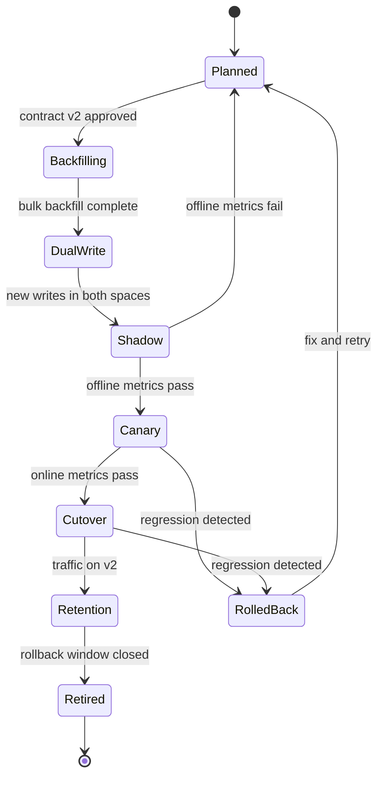

The state machine lays out a migration as a sequence of gates. In Backfilling, the new collection is filled from the system-of-record text while the old collection continues to serve. In DualWrite, every new or changed document is embedded with both contracts and written to both collections, so the new index stays current during the long tail of validation. In Shadow, each production query is also embedded with v2's query template and run against the v2 collection, and the results are compared offline to the v1 results and to labeled data without affecting users. In Canary, a small percentage of live traffic is served from v2 and online metrics are compared. At Cutover, the router switches the read path. Retention keeps v1 for a defined rollback window (and the dual-write continues so rollback does not lose recent content), after which v1 is retired and deleted under the data retention policy.

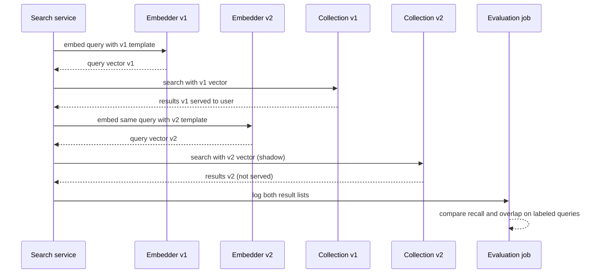

The sequence shows the shadow phase. Each query uses its own model's query encoder against its own collection, and the two result lists are compared as lists of document identifiers. They are never compared as scores, and the two collections are never searched with one vector. Fusing the scores from v1 and v2 for a single ranking is a common shortcut and it is wrong: the scores come from different distributions. If a combined ranking is wanted during the transition, use rank-based fusion (RRF) over the two lists, which is valid because it uses only ranks.

Exit criteria for each gate should be numeric and written down before the migration begins: no regression greater than a tolerance (say 1 point) on recall@10 in any language or segment of the evaluation set, improvement on the target segment that motivated the migration, no degradation on the hard-case suite, latency and cost within budget, and zero canary failures in a week. Segment-level checks matter because a model upgrade that raises the average can break a segment, and the segment may be one a contract depends on.

### 15.6 Other migration paths

- In-place refresh without a model change (a chunking change, a template change, or a normalization change) is also a migration: new contract id, same procedure.
- Dimension reduction of a Matryoshka model is a migration of the index but not of the model. If full vectors are stored, the new index is derived by truncating and renormalizing, with no model calls, which is the strongest argument for storing full-precision vectors.
- Query-side-only adaptation avoids re-embedding the corpus. When an asymmetric model has separate query and document paths, a fine-tuned or adapter-modified query encoder can be deployed against existing document vectors, as long as the document vectors and the new query encoder remain compatible. Validate with the same gates.
- Staged re-embedding by priority embeds the most-queried or most-valuable documents first and keeps the rest on v1. This cannot be served from a mixed index, since the two spaces cannot be searched together. It is only useful with two live collections and fusion by rank, as a way to reach value sooner during a long backfill.

## 16. Monitoring Embedding Drift and Quality

### 16.1 What drifts

"Embedding drift" covers four different things that have four different remedies.

1. Query drift: the distribution of user queries changes (a new product launches, a campaign changes who searches, a new language appears). The model is unchanged but the queries now fall in regions where it or the corpus is weak.
2. Corpus drift: the documents change (new topics, new formats, mass imports, template changes). Hubs and anti-hubs change, and the corpus can outgrow the evaluation set.
3. Model drift: the embedding function itself changes without an explicit migration. Self-hosted, this is a library upgrade, a quantization change, or a different hardware numeric path. Hosted, it is a provider updating a model under an unchanged name. Pinned, versioned models should not change, but the contract canary of section 15.2 guards against exceptions.
4. Pipeline drift: preprocessing changes, such as a new HTML cleaner, a changed truncation length, a locale change, or a prefix omitted in one service.

The first two are statistical changes in the data and call for evaluation-set refreshes and sometimes fine-tuning. The last two are defects that violate the contract and call for immediate rollback. Distinguishing them is the purpose of monitoring.

### 16.2 Signals

| Signal | What it detects | How to compute | Typical action |
| --- | --- | --- | --- |
| Canary cosine | Model and pipeline drift | Re-embed fixed texts, compare to stored reference vectors | Page on any value below the contract threshold |
| Query embedding centroid shift | Query drift | Norm of the difference between the mean query vector this week and the baseline | Review new query clusters |
| Mean nearest-neighbor similarity | Coverage gap | Average top-1 similarity of queries to the corpus | Look for topics with no content |
| Top-1 score distribution (PSI) | Distribution shift | Population stability index over score bins | Investigate above 0.2 |
| Zero-result and low-confidence rate | Retrieval failures | Fraction of queries with top-1 below a calibrated threshold | Add content or tune thresholds |
| Reformulation and abandonment | End-user quality | Fraction of sessions with a rapid second query or no click | Qualitative review |
| Offline recall on the golden set | Silent regression | Nightly run of the labeled queries | Block deploys on a drop |
| Hub concentration | Corpus drift | Share of queries whose top 10 includes the 20 most-retrieved passages | Prune boilerplate |

Worked example of two statistics from the script. For 1,000 reference vectors and a fresh batch of 500 from the same distribution, the centroid shift is 0.057 and the mean top-1 cosine to the reference is 0.623. For a batch drawn from a shifted topic mix, the centroid shift is 0.824 and the mean top-1 cosine falls to 0.554. The centroid shift separates the two cases by a factor of 14, while the mean nearest-neighbor similarity moves only about 11 percent, so the first is the more sensitive alarm in this synthetic case and the second is the more directly interpretable (queries are further from anything in the corpus). Use both and set thresholds from historical variation, not from a single example.

The population stability index (PSI) compares two distributions over bins: $\text{PSI} = \sum_b (a_b - e_b)\ln(a_b/e_b)$, where $e_b$ is the expected (baseline) share and $a_b$ the actual share in bin $b$. For top-1 score bins low/medium/high with baseline shares 0.5, 0.3, 0.2 and current shares 0.3, 0.3, 0.4, PSI is $(0.3 - 0.5)\ln(0.6) + 0 + (0.4 - 0.2)\ln(2) = 0.1022 + 0.1386 = 0.241$. The conventional reading of PSI (below 0.1 stable, 0.1 to 0.25 moderate shift, above 0.25 major shift) comes from credit-scoring practice and is a heuristic. For embeddings, calibrate the alert level on your own week-to-week variation.

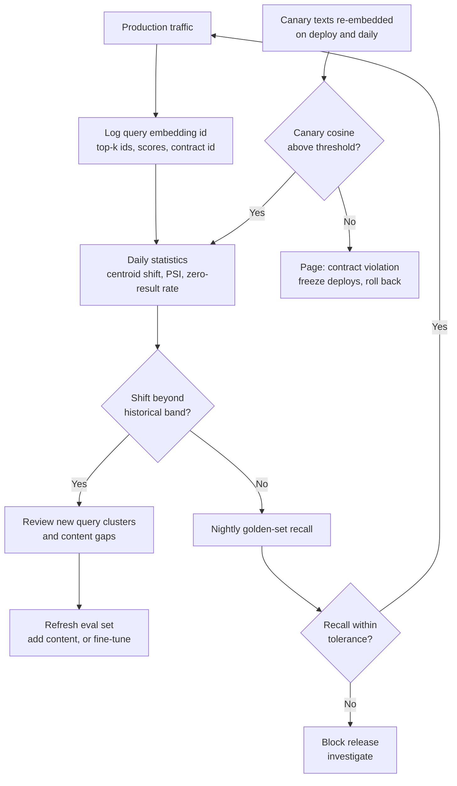

The monitoring loop treats contract violations and statistical shifts as two separate paths. A canary failure is a defect with a known remedy, while a statistical shift is information that needs analysis. Logging the contract id with every query record is what makes retrospective analysis possible: after an incident you can ask which contract version served each query.

### 16.3 Privacy of the monitoring data

Logged query embeddings can be inverted to approximate text (section 21), so they carry the sensitivity of the queries. Log aggregate statistics where possible, retain raw embeddings for the shortest period that serves debugging, and apply the same access control to them as to the query text.

## 17. Fine-Tuning Embedding Models on Domain Data

### 17.1 When to fine-tune

Fine-tune only after cheaper changes have run out. The order of attack:

1. Fix the data: chunking, cleaning, deduplication, metadata, and removal of boilerplate.
2. Add a lexical branch and fusion.
3. Add a reranker.
4. Try better or domain-specific off-the-shelf models, evaluated on your set.
5. Try query rewriting or instruction tuning of the prompt.
6. Then fine-tune the embedding model.

Fine-tuning is justified when the evaluation shows a persistent gap in a domain-specific notion of relevance that the earlier steps cannot close: internal jargon and acronyms with a company-specific meaning, a relevance judgment that differs from the general web's (for example, in a support setting "the article that resolves this" matters more than "the article most about this"), and languages or document types that the general models cover poorly. It is inappropriate when the evaluation set is tiny or unrepresentative, when the corpus changes faster than you can retrain, or when you cannot protect the training data's confidentiality in the resulting model weights.

### 17.2 Constructing training data

Training examples are (query, positive passage) pairs, optionally with negatives. Sources, from best to worst quality:

- Human-labeled relevance judgments from subject-matter experts. Highest quality and highest cost.
- Behavioral signals: which article an agent attached to a resolved ticket, which result a user clicked and stayed on (dwell time), which help article ended a session without a follow-up contact. These are plentiful and noisy: position bias (users click what is shown first) and presentation bias contaminate clicks, so prefer attached-and-resolved signals to bare clicks.
- Synthetic queries: a language model reads a chunk and writes the questions that the chunk answers. It is cheap to produce at scale and helps when no logs exist, with known risks: the queries are in the model's idiom and not the users' (shorter, fewer typos, more explicit), they are conditioned on the chunk's wording (lexical overlap leaks the answer), and they say nothing about confusable alternatives. Mitigations are few-shot examples of real queries in the prompt, a filter that drops synthetic queries whose top-1 under the base model is not the source chunk's neighborhood (this removes unanswerable or ambiguous questions but also removes the hard ones, so inspect what is being dropped), and a mix with real logs.
- Existing structure: title–body, heading–section, FAQ question–answer pairs, parallel translations.

Illustrative arithmetic for synthetic generation: 40,000 chunks, three questions per chunk, a prompt of about 500 tokens and an output of about 100 tokens per call. That is $40{,}000 \times 600 = 24$ million tokens per pass for single-question calls; for one call per chunk producing three questions, the input is $40{,}000 \times 500 = 20$ million tokens and the output $40{,}000 \times 150 = 6$ million. At an assumed (illustrative) $0.50 per million input tokens and $2.00 per million output tokens this costs $10 + $12 = $22, small relative to the labeling effort needed to validate the output. The real cost is the review: sample 200 generated pairs and have an expert judge whether each query is realistic and the chunk is a correct answer. Reject the batch if the pass rate is under about 90 percent.

Split by source, not by row. If several queries come from the same document or the same ticket thread, put them all on one side of the train/test boundary; otherwise the model sees the test passage during training and the evaluation overstates. This is the leakage described in [CH02](CH02_Data_Preparation_Feature_Engineering_and_Leakage.md) in a retrieval setting. Also deduplicate near-identical queries and passages across the split.

### 17.3 Mining hard negatives

Procedure: embed the corpus with the base model; for each training query, retrieve the top 50 to 100; remove all known positives; remove candidates that a reranker or judge scores as relevant (to avoid false negatives); sample 1 to 7 negatives from the remaining list, favoring ranks 5 to 50 over ranks 1 to 4, which are more likely to be unlabeled positives. Check the process by reading: print 30 (query, positive, mined negative) triples and ask whether each negative is truly worse than the positive. If more than one in ten is not, tighten the filter.

Add structured hard negatives that follow from your domain: the same article in a different product version, the superseded policy, the article for the adjacent product line, the troubleshooting page that shares the title. These are the confusions that matter in production and the ones web-scale pretraining never saw.

### 17.4 Training setup

A typical configuration, which should be adjusted by validation: start from a strong base embedder; use the multiple-negatives-ranking (InfoNCE) loss with the largest batch that memory allows (gradient caching techniques such as GradCache allow larger effective batches); a learning rate of order $10^{-5}$ to $2 \times 10^{-5}$ for full fine-tuning with warmup; one to three epochs; the same prefixes and pooling as the base model's contract; and a held-out validation set evaluated every few hundred steps. Parameter-efficient methods such as LoRA ([CH20](CH20_Fine_Tuning_PEFT_and_LoRA.md)) reduce memory and make the delta small to store and version; they often reach most of the gain of full fine-tuning on retrieval tasks. The amount of data needed varies widely. Published domain-adaptation reports show measurable gains from a few thousand pairs; treat that as a starting hypothesis and watch the learning curve on your validation set rather than assuming a number.

Two cautions. First, forgetting: a model tuned only on your domain can lose general ability, particularly on queries that fall outside the domain. Mixing a fraction of general-purpose pairs into the training batches, using a small learning rate, and evaluating a general retrieval subset after training all limit this. Second, if the document side of the model is changed, every document must be re-embedded, which is a full migration (section 15); if you fine-tune only the query side, existing document vectors remain valid, and a lighter alternative still is a linear adapter on the query vector: a $1024 \times 1024$ matrix with about 1.05 million parameters trained with the same contrastive loss against frozen document vectors. Adapters are cheap to train (minutes), cheap to serve, and limited in what they can fix.

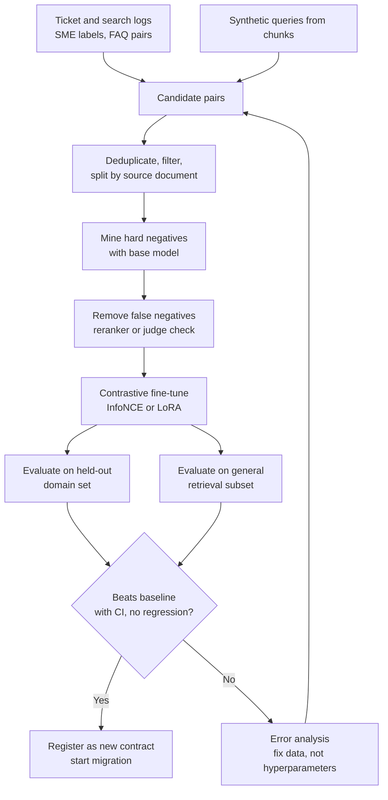

The pipeline shows two features that separate a reliable fine-tune from a fragile one. The split happens before mining, so no negatives or positives leak across the boundary. And the exit gate has two evaluations, domain and general, so a gain in the target domain that costs more than a small tolerance elsewhere is visible. A failed gate sends work back to the data, because in embedding fine-tuning the dominant cause of a disappointing result is data quality and not the learning rate.

### 17.5 Evaluating the result

Report recall@k, MRR, and nDCG@10 for the base and tuned models on the held-out set, per segment, with paired confidence intervals (section 18.4), and examine the queries that got worse. A tuned model that wins on average and loses on a particular segment (say, a language, or short queries) has a defect, not a rounding error. Save the evaluation outputs with the model artifact for lineage ([CH29](CH29_MLOps_and_LLMOps.md)).

## 18. Model Selection and Evaluation

### 18.1 What benchmarks tell you

The Massive Text Embedding Benchmark (MTEB; Muennighoff et al., 2023) evaluates models across eight task types (including retrieval, classification, clustering, reranking, semantic textual similarity, and summarization-based evaluation) on 58 datasets in 112 languages in its original release. Its multilingual successor MMTEB (Enevoldsen et al., 2025) greatly expands the number of tasks and languages. The leaderboard is hosted by Hugging Face. These benchmarks are useful to build a shortlist, and the original paper's finding still holds: no single model wins every task.

Read leaderboards with these cautions:

- The average hides task differences. A model ranked first on the overall average may be weaker on retrieval than a model ranked tenth. Look at the task type you need (retrieval, for search; classification, for feature extraction) and at the datasets closest to your domain.
- Contamination. Training sets of some models include the training splits of benchmark datasets, and a few may include test data. Scores on a benchmark the model's authors trained on overstate generalization. The leaderboard marks some zero-shot status. Use it, and do not rely on it alone.
- Differences are small relative to variation. Models separated by a point on the average are often indistinguishable on a given application.
- Constraints are not scores. Maximum input length, dimension, languages, license, throughput, memory, price, data-handling terms, and deprecation policy often decide which models are eligible.
- Leaderboard standings change month to month. A figure quoted today is out of date soon. Verify the current standings at the time you select.

### 18.2 A domain evaluation set

The evaluation that decides is built from your own data. Construction steps:

1. Sample queries from real logs (or, for a new system, from the questions support agents, sales engineers, or pilot users actually ask). Stratify by intent, product, language, and length. Include the hard cases: queries containing version numbers, negation, abbreviations, identifiers, misspellings, and multi-part questions. Include queries with no answer in the corpus, with the expected outcome "no relevant result".
2. Gather candidates by pooling. Run several retrievers (BM25, two or three embedding models, a hybrid), take the union of their top 20 for each query, and have judges label that pool. Labeling only the top results of one system biases the set toward that system, and a model that retrieves different valid passages is punished as wrong.
3. Judge with a rubric. Graded relevance (not relevant, partially relevant, fully answers) supports nDCG. Use two judges on a sample and measure agreement; an agreement kappa below about 0.6 means the rubric needs work.
4. Size it for the decision. With $n$ queries and a measured recall of $p$, the 95 percent confidence half-width is about $1.96\sqrt{p(1-p)/n}$. For $p = 0.8$ and $n = 200$ it is $1.96 \times \sqrt{0.16/200} = 1.96 \times 0.0283 = 0.055$: recall is known only to within about 5.5 points. To distinguish two models whose recall differs by 3 points, you generally need several hundred to a thousand queries, and a paired analysis, which is more powerful because both models see the same queries.
5. Split into a development part (used to tune chunking, templates, and fusion weights) and a locked test part (used once per decision), so that tuning does not overfit the evaluation.
6. Version it. An evaluation set is an artifact with an id, a creation date, labeling guidelines, and a changelog. Corpus changes eventually make labels stale. Re-verify a sample every quarter.

### 18.3 Metrics

For a query with ranked results and a set of relevant items:

- Recall@k: the fraction of relevant items found in the top $k$. For queries with one relevant item this is a hit rate. Choose $k$ as the number of passages that the next stage consumes (the reranker's candidate count, or the number of chunks placed in a prompt).
- Mean reciprocal rank (MRR): the average of $1/\text{rank}$ of the first relevant result. Appropriate when the first good answer matters.
- Normalized discounted cumulative gain at $k$ (nDCG@k): $\text{DCG@}k = \sum_{i=1}^{k} \text{rel}_i/\log_2(i+1)$, divided by the ideal DCG. Handles graded relevance and multiple relevant items.

A worked example from the script, on three queries with ranked lists of five. Query 1 has one relevant item at rank 2: recall@3 is 1.00, reciprocal rank is 0.500, and nDCG@5 is $1/\log_2 3 = 0.631$. Query 2 has two relevant items at ranks 2 and 4: recall@3 is 0.50 (one of two), reciprocal rank is 0.500, and nDCG@5 is $(1/\log_2 3 + 1/\log_2 5) / (1 + 1/\log_2 3) = (0.631 + 0.431)/1.631 = 0.651$. Query 3 has no relevant item in the list, so all three metrics are 0. Averaged over the three queries: recall@3 is 0.500, MRR is 0.333, nDCG@5 is 0.427. Note that three queries produce metrics that look precise and are not: they illustrate the arithmetic and no more.

Add the operational metrics next to quality: query encoder latency (p50 and p99), throughput, memory, and cost per million queries and per million documents.

### 18.4 Comparing two models

Because both models run on the same queries, use a paired test. For a binary outcome such as "relevant item in top 10", count the queries where only model A hits ($b$) and only model B hits ($c$); McNemar's test statistic is $(b - c)^2/(b + c)$, compared with a chi-square distribution with one degree of freedom. Worked example: on 400 queries, A alone hits on 40 and B alone hits on 22. The statistic is $(40-22)^2/62 = 324/62 = 5.23$, corresponding to $p \approx 0.022$. A's advantage is about 4.5 points (18 of 400), and is statistically distinguishable from zero at the 0.05 level. For continuous metrics such as nDCG, use a paired bootstrap: resample queries with replacement, compute the metric difference on each resample, and read the 95 percent interval from the 2.5th and 97.5th percentiles. Report the interval with the point estimate, and treat a difference whose interval spans zero as a tie broken by cost and operational fit.

### 18.5 Selection procedure

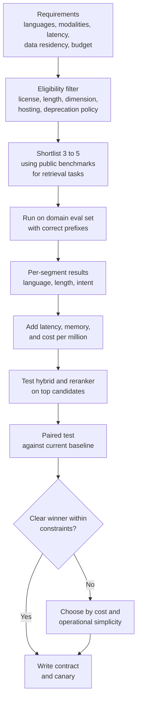

The decision flow puts public benchmarks at the start, to narrow the field, and the domain set in the middle, to decide. The hybrid and reranker test comes before the final pick, because a modest model with a lexical branch and a reranker can outperform a larger model alone, and the choice should be made on the whole retrieval stack. When there is no clear winner, prefer the model that is cheaper to run, easier to host, and less likely to be deprecated, since operating cost accumulates every day and a one-point recall difference is often invisible to users.

## 19. Uses Beyond Retrieval

Retrieval is the best-known use of embeddings, but the same vectors support a family of tasks that treat the embedding model as a reusable feature extractor. The common pattern is a frozen encoder followed by a small, inexpensive model. The architect's questions are whether the embedding contract fits the task (a retrieval-tuned asymmetric model is not necessarily the best choice for clustering or classification) and what the failure behavior is.

### 19.1 Clustering and topic discovery

Embed each item, optionally reduce dimension, and cluster. Spherical k-means (k-means on unit-normalized vectors with cosine as the metric) is a dependable baseline when you know roughly how many groups exist. Density-based methods such as HDBSCAN do not need the cluster count and mark outliers as noise, which suits messy collections. For high-dimensional embeddings, reduce to 5 to 50 dimensions with PCA or UMAP before density clustering, because distance contrast shrinks in very high dimension (section 9.1). Dimensionality reduction methods are owned by [CH05](CH05_Unsupervised_Learning_and_Representation_Reduction.md).

Typical workflow: take 100,000 support tickets, embed them with a model configured for clustering (a symmetric task type or no query prefix), cluster to 50 to 200 groups, and ask a language model to name each cluster from a sample of its members plus its closest-to-centroid examples. A human reviews the names and merges overlapping clusters. Check three things: cluster size distribution (a giant cluster usually contains the generic items that sit near the center of an anisotropic space), stability across random seeds, and coherence by reading ten random members per cluster. A two-dimensional UMAP picture is a communication tool and not evidence, because the projection distorts distances and its apparent clusters depend on parameters.

### 19.2 Classification with frozen embeddings

Train a logistic regression or a small neural network on the embedding vectors with a handful of labels. This "linear probe" is a strong baseline for tasks like intent classification, sentiment, and routing when labeled data is scarce. A model with 1,024-dimensional inputs and $C$ classes has $1{,}024 \times C + C$ parameters; with $C = 10$ that is 10,250 parameters, which can be fit from a few hundred labeled examples with regularization (see [CH03](CH03_Regression_and_Classification.md)). The embeddings are computed once per item, so training takes seconds and the classifier can be retrained as labels arrive, without touching the encoder.

Its failure mode is the geometry's. If the labels depend on features the embedding discards (a negation, a number, a rare entity), no linear classifier can recover them. Compare with a TF-IDF plus logistic regression baseline on the same labels: where the two disagree, the sparse model is usually winning on exact-term signals and the embedding model on paraphrase, which suggests concatenating both feature sets. Fine-tuning the encoder end to end on the classification task usually beats the frozen probe when there are thousands of labels, and costs a training pipeline and a model to version.

### 19.3 Deduplication and near-duplicate detection

To find duplicate or near-duplicate documents, tickets, or products, search for each item's nearest neighbors above a similarity threshold and group the results with connected components (union-find). A naive all-pairs comparison costs $n(n-1)/2$ similarities, which is $2 \times 10^{12}$ for $n = 2$ million; an approximate nearest-neighbor index retrieves ten neighbors per item, producing 20 million candidate pairs.

Choose the threshold by labeling a sample of candidate pairs at different similarity levels and finding where precision crosses the acceptable level. Do not take a threshold from a blog post, as it is specific to the model and the content type. The method has a known pitfall: embeddings regard "Refunds are available within 30 days" and "Refunds are available within 60 days" as near-identical (section 22), so semantic deduplication can merge texts that differ in the one fact that matters. For exact and near-exact duplicates, MinHash over word shingles is more reliable and cheaper; use embeddings for paraphrase-level duplicates, and for those add a verification step (a reranker or a numeric/entity comparison) before merging or deleting anything. Deletion decisions should be reversible: mark and group, review the group-level samples, then act.

### 19.4 Recommendation and matching

Two-tower models are bi-encoders for recommendation: one tower embeds the user (from their history and context), the other embeds the item, and the dot product predicts affinity; they are trained with the same in-batch softmax loss as section 5, with positives from observed interactions. Content embeddings of the item text or image help the cold-start problem, where a new item has no interactions: the item's content vector places it in the space before any behavior is observed. A simple and often effective user representation is the (possibly time-decayed) average of the embeddings of items the user engaged with.

Specific pitfalls: popularity bias, since the loss with in-batch negatives samples negatives in proportion to item popularity and over-penalizes popular items (a logit correction for sampling probability is a standard remedy); feedback loops, where the system recommends what it already recommended; and the embedding space reflecting exposure instead of preference. Treat the retrieval stage as candidate generation, then rank with a model that uses richer features. Recommendation system design is outside this chapter's scope; the representation is the reusable part.

### 19.5 Anomaly and outlier detection

Embed normal items (log lines, transactions described in text, support tickets, API payload descriptions) and score a new item by its distance to its $k$ nearest normal neighbors, or by its Mahalanobis distance from the normal distribution. Calibrate the threshold on a validation sample of normal data: setting it at the 99th percentile of the validation scores gives a 1 percent false-positive rate on normal data by construction. This catches novel items (a log pattern never seen) and misses anomalies that are semantically ordinary but numerically odd (a normal-looking message with a quantity ten times too large), because embeddings are insensitive to numbers. Combine with structured checks. Because an embedding of an input is sensitive, apply the same privacy controls to anomaly-detection stores as to retrieval stores.

### 19.6 Other uses

Semantic routing sends a request to a handler by comparing its embedding to prototype embeddings for each route. Few-shot example selection retrieves the labeled examples nearest to the input to build a prompt. A semantic cache returns a stored model response when a new query is within a similarity threshold of a cached query. Semantic caching has a hard correctness constraint: two queries with high similarity can have different correct answers (the "30 days" versus "60 days" problem), so a cache that is safe for general FAQs may be unsafe for anything involving specific values, identities, or permissions. Scope caches by tenant and user permissions, keep thresholds conservative, and test with minimal pairs. The system-level treatment of caching belongs to Part 17.

## 20. Cost, Throughput, and Capacity

### 20.1 The cost model

Embedding cost has three components: computing embeddings (the model), storing them (the vector store), and searching them (the index and queries). The first scales with tokens, the second with vectors times bytes per vector, and the third with queries and the index structure.

The compute for a transformer forward pass is approximately $2P$ floating-point operations per token for a model with $P$ parameters, ignoring the attention term, which matters for long sequences. A 110-million-parameter encoder needs about $2.2 \times 10^8$ operations per token, and a 7-billion-parameter model about $1.4 \times 10^{10}$, 64 times more. On an accelerator that sustains $10^{14}$ operations per second at realistic utilization (an assumption, not a datasheet value), the small model processes up to roughly 450,000 tokens per second in the ideal case, and the large one about 7,000. Real throughput is lower because of padding, short sequences, and kernel overheads, and depends on batch size and sequence length. Measure it on your hardware with your length distribution.

### 20.2 Throughput levers

- Batching: group requests to fill the accelerator. Throughput rises with batch size until memory or latency limits.
- Length bucketing: sort inputs by length before batching so little compute is spent on padding. For a corpus with a wide length range, padding waste can exceed 30 percent without it.
- Truncation: cap the input length at what the model uses well. Text beyond the cap is paid for in the API case and ignored in the vector.
- Numeric precision: half precision (float16 or bfloat16) is standard for inference, and 8-bit quantized weights further cut memory and sometimes latency. Verify quality with the canary and evaluation set, since the vectors change slightly.
- Content-hash caching: cache the vector keyed by the hash of the contract id plus the exact input text. Duplicated chunks (boilerplate, repeated templates, re-ingested unchanged documents) are common, and a 20 to 40 percent hit rate on a re-ingestion job is plausible. Query caching helps for repeated popular queries.
- Incremental ingestion: re-embed only changed chunks, identified by content hash. A re-index that re-embeds everything on each run is a cost bug.
- Smaller dimension and quantization reduce the storage and search side, not the compute.

### 20.3 Self-hosting versus a hosted API

A break-even calculation guides the choice. Assume a hosted API at $0.10 per million tokens (illustrative) and a self-hosted GPU instance costing $2.00 per hour that sustains 50,000 tokens per second for the chosen model and length distribution (also illustrative). The instance processes $50{,}000 \times 3{,}600 = 180$ million tokens per hour, which the API would bill at $18.00. The instance pays for itself at $2.00 / $18.00 = 11 percent sustained utilization, before counting operations labor, redundancy, and the cost of idle capacity. A workload that runs a nightly batch for an hour and idles otherwise sits near 4 percent utilization on a dedicated instance and is cheaper on the API or on spot or batch capacity. A workload with a steady query stream of 5,000 tokens per second (200 queries per second of 25 tokens) is 10 percent of this instance's capacity, so one instance for latency and availability, with a second for redundancy, costs $4.00 per hour, $2,920 per month, against an API bill of $0.10 × 5,000 × 3,600 × 24 × 30 / 10⁶ = $1,296 per month. The API is cheaper at this volume, and the self-hosted option is justified by data residency, latency control, or a custom fine-tuned model that no API serves.

Query embedding latency is part of the interactive path: a small model on a CPU can embed a short query in tens of milliseconds, a GPU in a few milliseconds, and a hosted API adds network round trip (tens to hundreds of milliseconds, with tail latency and rate limits). Set a timeout and a fallback (lexical search) for the case where the embedding service is unavailable, as a degraded mode that preserves function. Serving architecture is owned by [CH28](CH28_Inference_Optimization_and_Model_Serving.md) and Part 17.

### 20.4 Storage and memory

The vector store dominates the steady-state bill when the corpus is large. Using section 11.5: 40 million 1,024-dimensional float32 vectors take 163.8 GB. At an illustrative $5 per GB-month for memory-resident index capacity (a placeholder; cloud and managed-service prices differ widely), that is $819 per month for the raw vectors, before the index structure overhead that the database adds, $205 per month for int8, and $26 per month for 128-byte binary codes plus a rescoring tier of full vectors on cheaper storage. The savings from compression can exceed the cost of the model that produced the vectors, which is why section 11 matters more to long-running systems than the one-time embedding bill.

| Cost item | Scales with | Dominant when | Primary lever |
| --- | --- | --- | --- |
| Initial embedding | Total tokens | Large corpus, large model | Cheaper model, caching, batch pricing |
| Re-embedding (migration) | Total tokens, per migration | Frequent model changes | Store full vectors, plan migrations, truncation |
| Ongoing ingestion | New and changed tokens per day | High-churn content | Incremental by content hash |
| Query embedding | Queries per second times query tokens | Very high query rate | Small model, cache, CPU |
| Vector storage | Vectors times bytes per vector | Large corpus | Dimension, quantization, tiering |
| Search compute | Queries, index type, filters | High query rate, strict recall | Index tuning (Part 06) |
| Reranking | Candidates per query | Interactive use | Candidate count, smaller reranker |

Sustained ingestion illustrates scale: 1 million new chunks per day at 300 tokens is 300 million tokens per day, an average of 3,472 tokens per second, which one modest instance handles. Burst load from a bulk import or a migration is what drives provisioning, and it can use spot capacity or queue-based batch processing.

## 21. Security, Privacy, and Governance

### 21.1 Embeddings are not anonymized data

It is a persistent misconception that an embedding is a safe, irreversible hash of the text. It is a lossy but information-rich encoding. Song and Raghunathan (2020) showed that embeddings leak information about their inputs, including attributes and partial text. Morris et al. (2023) demonstrated "Vec2Text", an iterative method that reconstructs text from its dense embedding by repeatedly generating a hypothesis, embedding it, and correcting it toward the target vector; in their setting it recovered a large share of short inputs (32 tokens) exactly, and could extract personal information from clinical notes embeddings. Reconstruction is harder for long texts and for models and settings that differ from those studied, and defenses are an active research area, so the safe design assumption is that an attacker with access to vectors and the embedding model can recover substantial content, including names and sensitive attributes.

The practical consequence: classify embeddings at the sensitivity of the source text. A vector database containing embeddings of confidential documents is a confidential data store. Access control, encryption at rest and in transit, audit logging, retention limits, and deletion obligations apply to it as they do to the text.

### 21.2 Authorization at retrieval time

Embedding similarity has no notion of who may read what. If a user can query an index containing documents from all tenants, the nearest neighbor of a query might be a document they must not see. Authorization must be enforced by the retrieval system, not by the model.

Three designs, in order of increasing isolation: a metadata filter applied inside the vector search (each chunk stores a tenant id and access labels, and the query supplies the caller's permitted values); separate namespaces or collections per tenant; and separate databases or clusters per tenant for the strongest regulatory isolation. The filter must be applied during the search (pre-filtering or filter-aware traversal) and not after retrieving the top $k$. A post-filter has two failures: it can return fewer than $k$ results, or none, when most of the nearest neighbors are unauthorized, and any code path that forgets the post-filter leaks. The mechanics of filtered search are owned by [Part 06 CH21](../06_Databases_and_Storage/CH21_Vector_Databases.md), but the requirement originates here: carry the authorization labels with every vector, as in the chunk record of section 14.4, and make the access label a mandatory parameter of the search API so that an unauthorized query cannot be expressed.

Also guard derived artifacts. Cached query results, semantic caches, summaries, generated questions, logs of retrieved passages, and evaluation sets can each contain content from restricted documents. A permission change should invalidate or re-filter all of them.

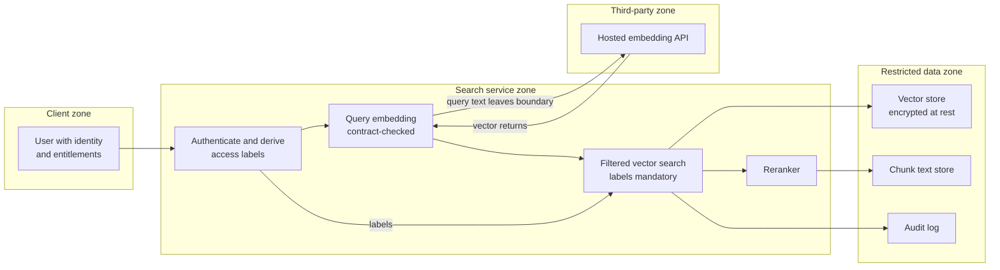

The trust-boundary diagram marks where data crosses a boundary. Query and document text cross to the third-party zone if a hosted embedding API is used, which engages data-processing agreements, residency requirements, and the provider's retention and training policies; read them. Access labels flow from the authentication step to the search step, not from the user's request body. The vector store and text store sit in the restricted zone, and the audit log records which labels were applied and which chunk ids were returned, without storing the text.

### 21.3 Hosted API data handling

Sending text to a hosted embedding service discloses that text to a third party. Check the provider's terms for retention, use for model training, regional processing, subprocessors, and deletion. For regulated data (health, financial, children's data, and data subject to residency rules), prefer a self-hosted model within your boundary or a provider contract that meets the requirement. Redaction before embedding (removing personal identifiers) reduces exposure but also changes the vector and can lower retrieval quality for queries that contain those identifiers. Data governance for AI is owned by [CH30](CH30_AI_Data_Governance_Privacy_and_Provenance.md).

### 21.4 Deletion and the right to erasure

When a document must be deleted (a customer erasure request, a retention expiry, a takedown), the deletion has to reach every copy: the source record, the chunk text store, the vector (and any summary, question, or multi-vector representation derived from the chunk), the quantized copies and the rescoring tier, replicas and snapshots (within the backup retention window, documented), caches, evaluation sets, fine-tuning datasets, and logs. A deletion process that removes the source but leaves the vector leaves a recoverable representation of the content. Verify with a test: after deletion, search for a distinctive phrase from the deleted document and confirm it no longer appears; periodically sample-audit the stores. If a fine-tuned embedding model was trained on the deleted content, the model weights may carry some influence of it; whether and how to address that is a policy question that [CH30](CH30_AI_Data_Governance_Privacy_and_Provenance.md) treats. Do not claim that the influence has been removed without a validated method.

### 21.5 Poisoning and adversarial content

A retrieval corpus is an input channel. An attacker who can add documents (a public wiki, user-submitted content, a customer-uploaded file, scraped web pages) can craft text whose embedding is close to anticipated queries, so that the malicious passage ranks first. Zou et al. (2024), in the PoisonedRAG study, showed that a small number of crafted passages could steer a retrieval-augmented system's answers. The passage then reaches the language model as context, where it can carry instructions (indirect prompt injection; see [CH17](CH17_Prompt_Engineering_and_Structured_Outputs.md)). Defenses at the embedding layer include provenance tagging and trust tiers on documents so that low-trust sources are filtered or down-weighted, ingestion review for user-submitted content, anomaly detection on newly added vectors that sit unusually close to many high-traffic queries, and rate limits on content creation. System-level treatment belongs to Part 17.

Embedding models themselves can be attacked with adversarial inputs, for instance strings crafted to land near arbitrary targets. Treat the embedding service as a component that processes untrusted input: limit input length, rate limit, and validate encoding.

### 21.6 Fairness and representational bias

Embeddings absorb associations present in training text. Bolukbasi et al. (2016) showed gender bias in word2vec analogies, and sentence encoders show analogous associations. In retrieval, the effect can appear as systematically different ranking quality across dialects, languages, names, or demographic terms. For uses where retrieval affects people (candidate search, benefits eligibility, content moderation), evaluate per-group performance explicitly, include group-diverse queries in the evaluation set, and apply governance from [CH31](CH31_Responsible_AI_and_Safety_Governance.md). Do not assume that debiasing a vector space removes bias from the downstream decision.

## 22. Limits of Embedding Similarity

An embedding is a compressed summary tuned for a ranking objective. It preserves what the training pairs rewarded and discards what they did not. Knowing where it fails lets you design around the failure.

### 22.1 Negation and polarity

"The service supports single sign-on" and "The service does not support single sign-on" differ by one word and contradict each other, yet they share nearly all content words and typically embed very close together. A query "does it support SSO?" will often retrieve both with similar scores, and the passage with the wrong polarity can rank first. Benchmarks that probe negation (for example the NevIR evaluation of Weller et al., 2024, which pairs documents that differ in negation) found that many neural retrievers performed poorly, often close to or below chance for choosing the right one of a pair. Embedding models trained with negation-aware hard negatives do better, but do not assume that yours does without testing.

### 22.2 Numbers, units, and dates

"Returns are accepted within 30 days" and "Returns are accepted within 60 days" share every token but one, and a sentence encoder gives that token little weight. The same holds for quantities, version numbers ("version 2.3" versus "version 2.13"), prices, and dates. Embedding models are poor at numeric comparison ("more than 10" versus "less than 10") because the objective does not reward it. If the answer depends on a number, extract the number as structured metadata and filter on it, or rely on a lexical branch or reranker for the final decision, or have a downstream verification step check the value.

### 22.3 Entities and the long tail

Rare entity names, product codes, error codes, and newly coined terms were seen seldom or never in training and receive weak, near-arbitrary representations: tokenization splits `XJ-9921-B` into fragments with unrelated meanings. Dense retrieval underperforms lexical retrieval on entity-centric queries; Sciavolino et al. (2021) documented this on entity-centric questions. The remedy is hybrid retrieval (section 7), exact-match fields, and dictionary or synonym expansion for known entities. Long-tail topics, the infrequent categories in your domain, are also where models trained on generic web distributions are least reliable, which makes the domain evaluation set's tail coverage important.

### 22.4 Roles, word order, and compositionality

"Company A acquired company B" and "Company B acquired company A" contain the same words and have opposite meanings, and pooled vectors blur the roles. Questions with multiple constraints ("laptops under 1 kg with a 15-inch screen that support Linux") are compressed into one vector that may weight one constraint and miss the others. Complex questions that need information from several documents (multi-hop) cannot be answered by a single nearest-neighbor query. Remedies include query decomposition into sub-queries, structured filters for constraints, late-interaction models, and rerankers, which see query and passage jointly.

### 22.5 Relatedness versus relevance versus truth

Similarity measures topical closeness. A question and a passage that merely discusses the same topic score well though it does not answer. A false statement can be as close to a true question as the true statement is. An outdated policy that is lexically near the current one may rank above it. The score contains no signal of authority, recency, or correctness, and these must come from metadata (publication date, version, status), source trust tiers, and downstream verification. The language model's grounding behavior is evaluated in [CH19](CH19_Retrieval_Quality_and_RAG_Evaluation.md) and [CH24](CH24_Generative_AI_Evaluation_Guardrails_and_Hallucinations.md).

### 22.6 A minimal-pair test suite

Build a small suite that probes these failures in your domain. Each item is a triple: a query, a passage that correctly answers it, and a minimal edit of that passage that makes it wrong (flipped negation, changed number, swapped entity, reversed roles). The suite's score is the fraction of triples where the model scores the correct passage above the edited one. Run it across candidate models and across pipeline variants (dense only, hybrid, with reranker). A suite of 100 to 200 triples, written by domain experts and including the failure types that would cause harm in your application, takes a day to build and reveals more about fitness for purpose than a general benchmark. Track the suite's score as a release gate. It also shows which downstream component fixes which failure, informing where to spend: if the reranker fixes polarity but not numbers, numbers need a structured filter.

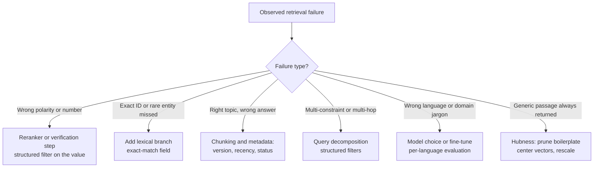

The decision tree maps symptoms to the cheapest effective fix. The ordering matters: most failures are repaired by changing the retrieval stack around the embedding (filters, lexical branch, reranker, chunking), and replacing or fine-tuning the model is the right answer for a narrower set of failures.

## 23. Failure Modes and Quality-Attribute Scenarios

Quality attributes for an embedding component are best written as scenarios with a stimulus, a response, and a measure, so that each can become a test or a monitor.

| # | Quality attribute | Stimulus | Expected response | Measure |
| --- | --- | --- | --- | --- |
| 1 | Correctness under change | Deploy of a service that omits the query prefix | Contract canary fails, deploy blocked | Canary cosine below 0.999 stops release; zero deployments with a mismatched contract |
| 2 | Retrieval quality | New product launches with new vocabulary | Weekly drift report flags a query cluster with low top-1 similarity, content gap raised | Time from launch to flag under 7 days; recall@10 on new-product queries restored within one sprint |
| 3 | Availability | Embedding service times out | Search falls back to lexical retrieval and marks results as degraded | p99 search latency below 800 ms during the fault; error rate below 0.1 percent |
| 4 | Security | User from tenant A queries with text similar to tenant B's documents | No chunk from tenant B is returned or sent to the reranker | Zero cross-tenant results in a nightly adversarial test of 1,000 probe queries |
| 5 | Privacy | Erasure request for a customer's tickets | All text, vectors, caches, and derived items are removed | Deletion verified by probe search within 24 hours; backups purged within the documented window |
| 6 | Modifiability | Better embedding model becomes available | Migration completes through the gated procedure without user-visible downtime | No regression above 1 point of recall@10 in any segment; rollback possible for 14 days |
| 7 | Performance | Peak of 600 queries per second | Query embedding and search stay within budget | p95 under 400 ms end to end; query embedding p95 under 40 ms |
| 8 | Cost | Quarterly corpus growth of 30 percent | Storage and compute remain within budget | Cost per 1,000 queries within 10 percent of plan; storage growth plan reviewed |

The table does not replace the monitors of section 16. It states what each monitor protects. Missing rows are a prompt: each architecturally significant risk in the system should have a scenario.

The failure modes treated in this chapter fall in four groups. Contract failures (mismatched prefix, pooling, template, normalization, truncation, or model revision) produce plausible but wrong results and are caught by canaries and contract tests. Geometry failures (anisotropy, hubness, score-scale mismatch across languages or models) distort thresholds and rankings and are found by inspection of score distributions and retrieval counts. Representation limits (negation, numbers, entities, roles) are inherent to the method and are handled by stack design and minimal-pair tests. Lifecycle failures (stale vectors, orphaned vectors for deleted documents, drift, migration regressions) are handled by pipelines, monitoring, and gates.

## 24. Comparison of Retrieval Representations

| Approach | Strengths | Weaknesses | Index size (relative) | Query cost | Operational complexity | Typical role |
| --- | --- | --- | --- | --- | --- | --- |
| BM25 lexical | Exact terms, IDs, no training, explainable | No synonymy or paraphrase | Small | Very low | Low | Baseline, hybrid branch |
| Learned sparse (SPLADE) | Lexical plus expansion, inverted index, interpretable | Encoder pass for each query and doc, larger postings | Small to medium | Low to medium | Medium | Hybrid branch, replacement for BM25 |
| Dense bi-encoder | Paraphrase, cross-lingual, compact | Rare entities, polarity, numbers | Medium (dimension times bytes) | Low | Medium | Main semantic retriever |
| Late interaction (ColBERT) | Fine-grained matching, strong zero-shot | Large index, specialized engine | Large (tens to hundreds of times single vector) | Medium | High | Quality-critical search at moderate scale |
| Hybrid (lexical plus dense, RRF) | Covers both failure profiles | Two retrievers, fusion tuning | Sum of the two | Sum of the two | Medium | Default for production text search |
| Hybrid plus cross-encoder rerank | Highest accuracy of the stack | Latency and cost per candidate | As hybrid | Adds $n$ forward passes | Medium to high | Final ordering for top candidates |
| LLM-based embedder | Strong on instruction-heavy and reasoning queries | Cost, memory, larger vectors | Large unless truncated | Medium | Medium | When evaluation shows a gap that cheaper options cannot close |

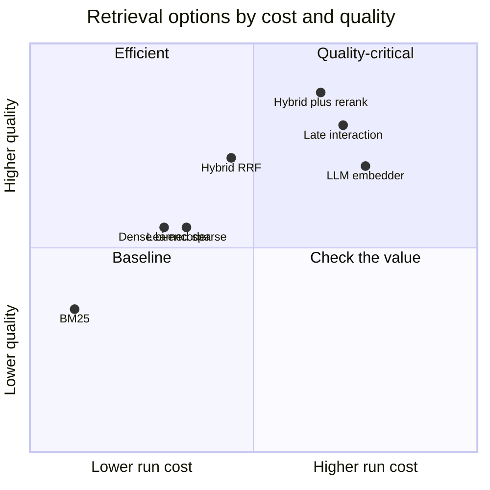

The chart places the options qualitatively; it is a mental model, not data. The efficient region holds the hybrid designs, and the "check the value" region holds options whose extra cost needs evidence from your evaluation set. The positions of any two options can swap on a particular corpus, which is the reason to measure.

Trade-off analysis in one paragraph: the decisive axes are what fails in your domain (exact identifiers favor a lexical branch; paraphrase and multilingual favor dense; polarity and numbers favor a reranker), the scale (small corpora can afford heavier methods such as late interaction or LLM-based embedders; very large corpora push toward compression), and the operational budget (each additional component is a thing to host, monitor, version, and migrate). Start with the simplest stack that passes the domain evaluation, and add a component only when the error analysis points at the failure it fixes.

## 25. Case Study: Semantic Search for a Support Knowledge Base

### 25.1 Context and requirements

A software-as-a-service company wants self-service search for customers and an assistant panel for support agents. The corpus consists of 12,000 help articles and 1.2 million resolved-ticket resolution snippets (the paragraph where an agent explained the fix). Content is in English (about 70 percent), Spanish, and German. Enterprise customers can have private articles visible only to their organization. About 150,000 searches occur per day. Requirements:

- Search p95 latency under 400 ms end to end.
- A new or edited article searchable within 10 minutes.
- No customer can see another customer's private content.
- EU customer data stays in the EU.
- Answers must respect product version: a question about version 4 must not surface version 2 instructions as authoritative.

### 25.2 Sizing

The article chunks: 12,000 articles of about 1,100 tokens each, chunked at 300 tokens with a 50-token overlap, give $\lceil (1100 - 300)/250 \rceil + 1 = 5 + 1 = 6$ chunks per article, so 72,000 chunks and $72{,}000 \times 300 = 21.6$ million tokens. The ticket snippets are 1.2 million items of about 150 tokens, 180 million tokens. The total is 1.272 million chunks and 201.6 million tokens. At an illustrative $0.10 per million tokens, a complete embedding pass costs about $20. At 1,024 dimensions in float32, the vectors take $1{,}272{,}000 \times 4{,}096 = 5.2$ GB. The corpus is small, so storage and re-embedding cost are minor, and the dominant effort is evaluation and operations. This is typical of enterprise knowledge bases, and it shapes the decisions: heavier components that would be rejected at 40 million chunks, such as a reranker with generous candidate counts, a larger embedding model, or storing full-precision vectors, are affordable here.

### 25.3 Evaluation set first

Before choosing a model, the team builds the evaluation set (section 18.2). It samples 400 queries from the previous 90 days of search logs, stratified by language, query length, and product area, plus 80 hard cases written with agents: queries containing error codes, version numbers, negation, and acronyms; and 40 queries with no answer in the corpus. Candidate passages are pooled from BM25, two embedding models, and a hybrid, and two agents judge each query's pool on a three-level scale, with 60 queries judged by both (kappa 0.71 after a guideline revision). The queries are split 300 for development and 220 locked for decisions. A minimal-pair suite of 120 triples (flipped negation, changed number, other version, adjacent product) is added.

### 25.4 Candidates and results

The shortlist uses public retrieval benchmark scores and eligibility (multilingual, license, 512-token or longer input, self-hostable within the EU). The following results are illustrative of the typical shape of such an evaluation and are not measurements of any named model; on the locked set of 220 queries (with 40 unanswerable queries scored separately):

| System | recall@10 | nDCG@10 | Error-code queries recall@10 | Minimal-pair accuracy | Query p95 (ms) |
| --- | --- | --- | --- | --- | --- |
| BM25 | 0.64 | 0.52 | 0.88 | 0.55 | 25 |
| Dense model A (small, multilingual) | 0.72 | 0.58 | 0.41 | 0.69 | 60 |
| Dense model B (larger, multilingual) | 0.77 | 0.63 | 0.45 | 0.71 | 95 |
| Hybrid: B plus BM25, RRF (k = 60) | 0.84 | 0.69 | 0.86 | 0.72 | 140 |
| Hybrid plus cross-encoder rerank of 50 | 0.88 | 0.77 | 0.87 | 0.93 | 310 |

Reading the table. Dense retrieval beats BM25 overall and loses badly on error codes, as section 7 predicts. Hybrid fusion recovers the error codes and lifts overall recall by seven points. The reranker lifts nDCG and, notably, the minimal-pair accuracy from 0.72 to 0.93 (the reranker sees query and passage together, so it detects the wrong-version and flipped-polarity passages that the embedding cannot). Is B better than A? On the locked set, A alone hits on 28 queries where B misses and B alone hits on 46 where A misses ($b = 28$, $c = 46$): McNemar statistic $(28 - 46)^2 / 74 = 324/74 = 4.38$, $p \approx 0.036$. Significant at the 0.05 level but small, so cost and hosting also count. For the hybrid against B alone, $b = 14$ (B alone) and $c = 48$ (hybrid alone): $(14-48)^2/62 = 1156/62 = 18.6$, $p < 0.001$, an unambiguous gain.

### 25.5 Decisions and rejected alternatives

- Chosen: model B, multilingual, self-hosted in an EU region; hybrid retrieval with RRF; a cross-encoder reranker over 50 fused candidates; metadata filters for tenant, language preference, and product version. Embedding contract with query and document templates, mean pooling, normalized 1,024-dimensional float32 vectors (stored), cosine through dot product, and a canary.
- Rejected: a 7-billion-parameter LLM-based embedder, which on the development set improved recall@10 by about one point over model B (not significant) at roughly 60 times the compute per token. Revisit if the evaluation set grows and the gap widens.
- Rejected for now: fine-tuning. The error analysis after hybrid-plus-rerank shows the remaining misses concentrated in company-specific acronyms and in 12 percent of queries whose gold passage is a ticket snippet that never names the product feature. A fine-tune could help, and the team schedules it for after launch, once click and attached-article data accumulates, so that training pairs come from real behavior.
- Rejected: per-language models and indexes. A multilingual model with per-language evaluation shows Spanish and German recall within three points of English, which is acceptable; the added routing and three indexes are not justified.
- Rejected: late-interaction retrieval. At about 150 tokens per ticket snippet and 128-dimensional compressed vectors at 36 bytes per token, the multi-vector index would be roughly $1.27 \times 10^6 \times 150 \times 36 \approx 6.9$ GB, so storage is not the obstacle; the specialized engine and operational novelty are, with no measured quality case yet.
- Rejected: post-filtering for tenant isolation. Private content is rare in the global top-$k$ for most queries, so a post-filter would appear to work in testing and leak or return short lists for enterprise users. Filters are applied during search, with the access label a required parameter of the search client.
- Rejected: a hosted embedding API. EU residency for customer ticket text and the preference to own the version lifecycle favored self-hosting. The embedding cost difference is negligible at this scale.

### 25.6 Query and ingestion paths

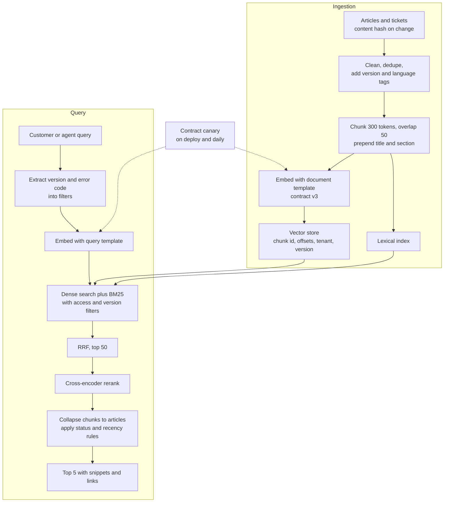

The diagram shows both paths sharing one contract. The query parser turns version numbers and error codes into structured filters and exact-match terms instead of leaving them to the embedding, in line with section 22. The final step collapses several chunks of one article into a single result and applies business rules (draft or deprecated articles are excluded, newer versions are preferred), because retrieval scores do not know about status or recency.

### 25.7 Rollout

```mermaid
gantt
    title Rollout plan (illustrative)
    dateFormat  YYYY-MM-DD
    axisFormat  %m-%d
    section Foundation
    Evaluation set and minimal pairs      :a1, 2026-01-05, 15d
    Candidate benchmarking                :a2, after a1, 10d
    section Build
    Pipeline, contract, canary            :b1, after a2, 15d
    Hybrid plus reranker integration      :b2, after b1, 10d
    section Validate
    Shadow traffic                        :c1, after b2, 10d
    Canary 5 percent                      :c2, after c1, 7d
    section Launch
    Full traffic and monitoring           :d1, after c2, 7d
```

Shadow traffic compares the new stack's results to the existing keyword search without exposing them. The 5-percent canary compares online outcomes: search-to-click rate, reformulation rate, ticket creation after a search session (deflection), and agent-assist acceptance. Exit criteria are written beforehand: no segment of the evaluation set regresses by more than one point, deflection does not fall, and p95 latency stays under budget.

### 25.8 Operations after launch

The weekly report tracks the signals of section 16: canary cosine, query-embedding centroid shift, share of queries with low top-1 similarity, zero-result rate, hub concentration, and the nightly golden-set recall. Content gaps flagged by the low-similarity queries go to the documentation team. An erasure request triggers the deletion procedure of section 21.4, verified by probe searches. Every quarter the team re-samples the evaluation set from recent logs and re-runs the candidate comparison, since a better model may have appeared and the migration procedure of section 15 is routine. The full re-embedding of 201.6 million tokens costs about $20 at the illustrative API rate or a few minutes of GPU time; what makes a migration slow is validation, so the team invests there.

### 25.9 Validation evidence summary

Evidence collected before launch: evaluation set provenance and agreement statistics; the per-segment results table; paired significance tests for each decision; the minimal-pair suite results per variant; latency percentiles under load at twice the expected peak; a cross-tenant probe suite with zero leaks; a deletion probe; and a canary dry run in which a deliberately broken prefix is detected and blocks the deploy. Each rejected alternative has a recorded reason and a recorded condition for revisiting, so a later reader can tell whether the condition has been met.

## 26. Common Mistakes

| Mistake | Cause | Consequence | Fix |
| --- | --- | --- | --- |
| Choosing a model by leaderboard rank alone | Treating a public average as a domain measure | Wrong model for your queries; contamination effects ignored | Shortlist by benchmark, decide on a domain set |
| Mixing vectors from two model versions in one index | Gradual re-embedding without separate collections | Search quality collapses with no error; scores meaningless | Separate collections per contract; switch both sides together |
| Omitting or mismatching the query prefix | Different code paths for indexing and serving | Silent recall loss | Shared client library, contract tests, canary |
| Using a fixed similarity threshold across languages or models | Assuming cosine is calibrated | Short or non-English queries return nothing; model swap breaks the threshold | Calibrate per segment, prefer rank or relative cutoffs |
| Normalizing in one place only | Metric mismatch between writer and index | Inconsistent rankings; dot product dominated by norms | Normalize at write time per contract |
| Post-filtering results for authorization | Filter bolted on after search | Leaks via other code paths; short or empty result lists | Filter inside search; mandatory label parameter |
| Treating vectors as anonymized | Belief that embeddings are irreversible | Sensitive data stored with weak controls | Classify at source sensitivity; encrypt and restrict |
| Discarding source text after embedding | Storage savings | Migration requires re-ingestion from upstream, which may be impossible | Keep text and chunk definitions as the system of record |
| Hard negatives mined without filtering | Trusting top-ranked non-positives | Model learns to separate relevant passages | Filter with a reranker or judge; audit samples |
| Evaluating on training-adjacent data | Splitting by row instead of by document | Inflated gains from fine-tuning | Split by source; lock a test set |
| Setting chunk size by habit | Copying a default | Diluted vectors or context-poor fragments | Compare chunk sizes on the evaluation set |
| Applying semantic deduplication or caching to value-sensitive text | Ignoring numbers and negation limits | Merged or wrongly cached answers | Verify with a numeric and entity check; conservative thresholds |
| Truncating to an unsupported dimension | Assuming any prefix works | Sharp, silent quality loss | Truncate only supported Matryoshka dimensions; test |
| No fallback when the embedding service fails | Single dependency on the hot path | Search outage | Lexical fallback, timeouts, circuit breaker |
| Ignoring tokenization fertility | Evaluating in English only | Higher cost and weaker quality in other languages | Per-language cost and quality measurement |

## 27. Design-Review Checklist

Contract and models:

- Is the full embedding contract written down (model revision, templates, pooling, dimension, truncation, normalization, metric, preprocessing, quantization), and referenced by every vector?
- Do indexing and querying use the same client code, and is there a canary that fails the build or deploy on a mismatch?
- Is the model chosen with a domain evaluation set and a paired significance test, not only a public benchmark?
- Are per-language, per-length, and per-intent results reported?

Retrieval design:

- Has a lexical or learned-sparse branch been tested, and a reranker, before fine-tuning or a larger model?
- Is the fusion method justified (RRF or tuned score fusion), and are branches evaluated alone and together?
- Are score thresholds calibrated by segment, or replaced by rank and relative criteria?
- Are numbers, versions, polarity, and entities handled by filters, lexical match, or a reranker, and covered by a minimal-pair suite?

Data and lifecycle:

- Are source text and chunk definitions retained as the system of record, so a re-embedding job can run from them?
- Is there a gated migration procedure with dual-write, shadow, canary, rollback window, and written exit criteria?
- Is storage sized for compression tiers, and are full-precision vectors retained for rescoring and re-quantization?
- Is ingestion incremental by content hash, with deletion propagation to vectors, derived items, caches, and logs?

Security and governance:

- Are vectors classified at the sensitivity of their sources, with encryption, audit, and retention?
- Is authorization enforced inside the search with a mandatory access label, and are cross-tenant probes tested?
- If a hosted API is used, have data handling, residency, and retention terms been reviewed?
- Is there a policy for poisoned or untrusted content entering the corpus?

Operations:

- Are canary cosine, query centroid shift, low-similarity rate, hub concentration, and golden-set recall monitored?
- Is there a degraded mode when the embedding service or index fails?
- Are cost per million documents, per thousand queries, and per migration known?

## 28. Exercises

1. Show that for unit vectors $u$ and $v$ ranking by cosine, dot product, and Euclidean distance coincide. Then give a numeric example with unnormalized vectors where dot product and cosine rank two candidates differently.

   *Outline.* Use $\|u - v\|^2 = 2 - 2u\cdot v$. For a unit query, a candidate of norm 10 and cosine 0.5 has dot product 5.0, and a candidate of norm 1 and cosine 0.9 has 0.9, so dot product prefers the first and cosine the second (section 8.2).

2. In SGNS with $k = 5$ negatives, a positive pair has score 1.5 and the negatives have scores $0.5, 0, -0.5, -1, -2$. Compute the per-pair loss $-\log\sigma(1.5) - \sum_i \log\sigma(-x_i)$.

   *Answer.* $-\log\sigma(1.5) = 0.2014$. The negatives contribute $-\log\sigma(-0.5) = 0.9741$, $-\log\sigma(0) = 0.6931$, $-\log\sigma(0.5) = 0.4741$, $-\log\sigma(1) = 0.3133$, $-\log\sigma(2) = 0.1269$, summing to $2.5815$. Total loss $0.2014 + 2.5815 = 2.7829$. The largest contributors are the negatives with higher scores.

3. A query has a positive with cosine 0.7 and three negatives with cosines 0.6, 0.2, and 0.0. Compute the InfoNCE loss and the gradient on the hard negative's cosine at $\tau = 0.1$ and $\tau = 1.0$. Explain what the results imply for false negatives.

   *Answer.* At $\tau = 0.1$ the logits are 7, 6, 2, 0 and the exponentials are 1096.6, 403.4, 7.39, and 1, summing to 1508.4. So $p_0 = 0.7270$, the loss is $-\ln 0.7270 = 0.319$, and the hard negative has $p_1 = 0.2675$, giving a gradient $p_1/\tau = 2.68$. At $\tau = 1$ the logits are 0.7, 0.6, 0.2, 0 and the exponentials are 2.014, 1.822, 1.221, and 1.0, summing to 6.057. So $p_0 = 0.334$, the loss is $1.097$, and $p_1 = 0.301$, giving a gradient of $0.30$. The low temperature magnifies the push on the near-miss almost ninefold, so a mislabeled false negative does proportionally more damage.

4. A corpus of 100 million chunks at 768 dimensions float32 is to be stored. Compute raw storage, then storage with int8 and with 128-byte binary codes plus an int8 rescoring tier on disk. State what you would measure before choosing.

   *Answer.* Raw: $10^8 \times 3{,}072 = 307.2$ GB. int8: $10^8 \times 768 = 76.8$ GB. Binary codes use 768 bits, 96 bytes per vector, so 9.6 GB in memory, plus the 76.8 GB int8 rescoring tier on disk. Measure recall@10 against full precision at oversampling factors of 1, 4, and 10, and the disk read cost of the rescoring fetches.

5. You want to migrate from model v1 to v2 at 40 million chunks of 300 tokens. List the steps and compute the tokens, the API cost at $0.10 per million tokens, and peak storage at 1,024 dimensions float32.

   *Answer.* 12 billion tokens, $1,200, 327.7 GB peak with both collections. Steps: backfill, dual-write, shadow, canary, cutover, retention, retirement (section 15.5).

6. Fuse BM25 ranking (a, b, c, d) and dense ranking (c, a, e, b) with RRF at $k = 60$. Give the final order.

   *Answer.* a: $1/61 + 1/62 = 0.03252$; c: $1/63 + 1/61 = 0.03227$; b: $1/62 + 1/64 = 0.03175$; e: $1/63 = 0.01587$; d: $1/64 = 0.01563$. Order a, c, b, e, d. Documents a and c appear in both lists, so they outrank the single-list documents e and d.

7. Design a minimal-pair test for a pharmacy search system. Give five triples and say which downstream component you would expect to fix each failure.

   *Outline.* Examples: dosage "5 mg" versus "50 mg" (structured extraction and filter); "avoid with warfarin" versus "safe with warfarin" (reranker plus verification); drug name pairs that differ by one letter (lexical exact match and entity dictionary); adult versus pediatric dosing (metadata filter); discontinued versus current guidance (status and recency metadata).

8. A monitoring dashboard shows mean top-1 cosine falling from 0.62 to 0.55 over two weeks, a stable canary, and a centroid shift that rose from 0.06 to 0.8. Diagnose the likely cause and name three actions.

   *Outline.* A stable canary rules out model and pipeline drift. The shift is in the query distribution, such as a new product or campaign. Actions: cluster the recent low-similarity queries and review them, add or update content for the gap, add examples to the evaluation set, and consider fine-tuning if the vocabulary is persistent.

9. Explain why a semantic cache with a cosine threshold of 0.95 can return a wrong answer, and design a safe variant.

   *Outline.* Minimal pairs ("30 days", "60 days") may exceed 0.95. Scope the cache by tenant and permissions, exclude queries with numbers or identifiers or normalize them into the cache key, verify with an entailment or numeric check before serving, and set short expiry.

10. Compute the 95 percent confidence half-width for a recall of 0.85 measured on 150 queries. How many queries would you need for a half-width of 0.03?

    *Answer.* $1.96\sqrt{0.85 \times 0.15/150} = 1.96 \times 0.02915 = 0.0571$. For 0.03: $n = 1.96^2 \times 0.1275/0.03^2 = 3.8416 \times 0.1275/0.0009 \approx 545$ queries.

## 29. Summary

An embedding turns an input into a vector whose geometry reflects the training objective, and the whole practice of using embeddings is the practice of knowing what that objective was. The distributional hypothesis explains why co-occurrence statistics yield useful geometry, SGNS and GloVe make the connection explicit (SGNS factorizes shifted PMI), contextual encoders fix the single-vector-per-word limit, and contrastive training with InfoNCE turns an encoder into a sentence or passage embedder whose behavior depends on the negatives, the temperature, and the batch.

Bi-encoders buy scale by precomputing document vectors, cross-encoders buy accuracy by seeing both texts together, and late interaction sits between at a storage price. Lexical and learned-sparse retrieval cover exact terms that dense vectors blur, and rank-based fusion combines them without calibration. Similarity metrics coincide only under normalization; scores are rankings and not probabilities; anisotropy and hubness distort them. Matryoshka training and quantization (int8, product, binary) cut storage by factors of 4 to over 100 at a recall cost that must be measured, and a tiered design keeps full-precision vectors for rescoring and migration.

Operationally, the embedding contract, with a canary, keeps indexing and querying in step. Vector spaces from different models cannot be compared, so model changes are gated migrations with dual-write, shadow, canary, and rollback. Drift monitoring separates pipeline defects from changes in the data. Fine-tuning pays off after data fixes, hybrid retrieval, and reranking, and depends on careful data construction and false-negative control. Vectors leak content, authorization must be enforced inside the search, and deletion must reach every derived copy. Embeddings cannot reliably represent negation, numbers, entities, or roles, so the surrounding stack must. The deciding evidence for any choice is a labeled evaluation set drawn from your own queries and documents.

## 30. Code Examples

- [01_vectors_similarity_geometry.py](../code/python/embeddings-chapter/01_vectors_similarity_geometry.py): builds PPMI plus SVD word vectors from a toy corpus, verifies cosine, dot-product, and Euclidean equivalences on unit vectors, and measures anisotropy and hubness.
- [02_toy_contrastive_infonce.py](../code/python/embeddings-chapter/02_toy_contrastive_infonce.py): trains a linear bi-encoder with a hand-derived InfoNCE gradient and compares temperatures and hard negatives.
- [03_fusion_quantization_matryoshka.py](../code/python/embeddings-chapter/03_fusion_quantization_matryoshka.py): computes the RRF worked example, truncation recall, int8, binary, and product quantization recall, and storage arithmetic.
- [04_evaluation_migration_drift.py](../code/python/embeddings-chapter/04_evaluation_migration_drift.py): computes recall, MRR, and nDCG, prices a re-embedding migration, shows why spaces are not comparable, and computes drift statistics.

The scripts use NumPy; install it with `pip install numpy` (the first script's header lists exactly what it needs).
