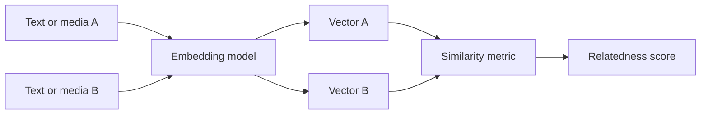
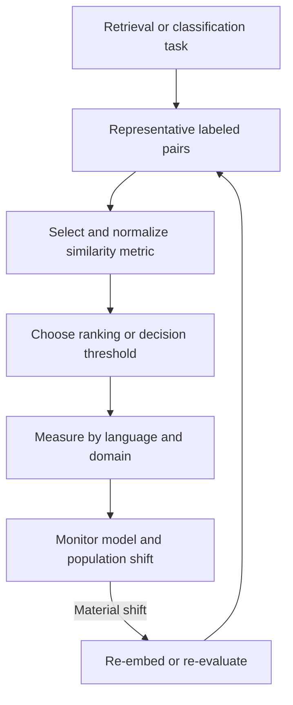
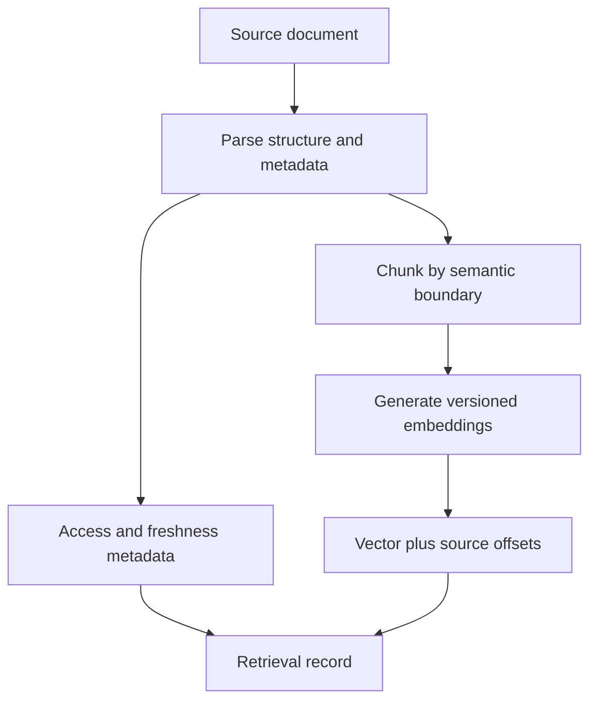
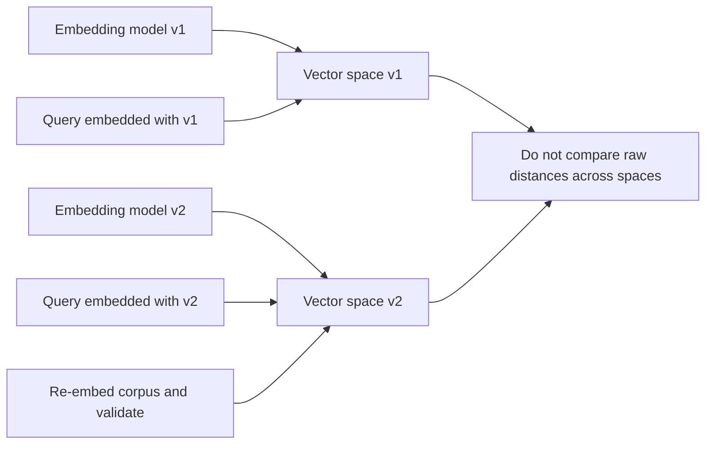
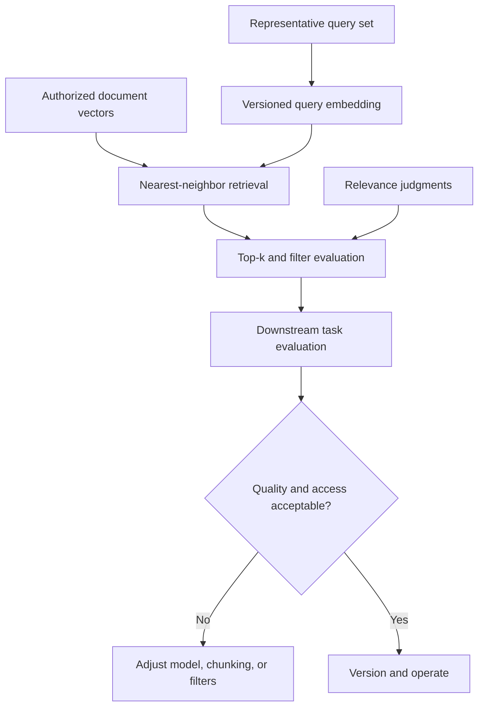

# Embeddings and Semantic Representations

Part: [16 — Artificial Intelligence, Machine Learning, and Generative AI](PART_OVERVIEW.md)

An embedding maps an input such as text, image, or audio into a numeric vector intended to preserve useful relationships for a task. Similarity in the vector space can support retrieval, clustering, classification, or recommendations. Embeddings are learned representations, not universal measures of meaning; model choice, input construction, and version changes affect their geometry.

This chapter owns embedding selection and representation behavior. Part 06 CH21 owns vector database indices and persistence; CH18 owns retrieval-augmented generation composition.

## Vector Geometry and Similarity

An embedding is a vector in a learned space. Similarity can be measured with cosine similarity, dot product, or Euclidean distance. These metrics are not interchangeable unless training and normalization assumptions align. The model's objective shapes which distinctions are preserved; semantic similarity may not equal task relevance or truth.

Normalize vectors when the selected metric requires or benefits from it. Evaluate positive and hard-negative pairs from the application domain. Do not assume a high score guarantees entailment, authorization, or factual correctness.

For vectors $u$ and $v$, cosine similarity is $\frac{u\cdot v}{\|u\|\|v\|}$; dot product is $u\cdot v$ and therefore responds to both direction and magnitude. If both vectors are unit-normalized, squared Euclidean distance is $2-2(u\cdot v)$, so ranking by these measures is equivalent. Without that normalization, a large vector norm can dominate dot-product ranking. The metric and preprocessing must match how the embedding model was trained and how the application interprets its scores.

A similarity score is usually a ranking signal, not a calibrated probability that two items are equivalent. Contrastive training can pull positive pairs together and push selected negatives apart, but the negative-sampling policy defines which distinctions the space learns. Hard negatives that look similar lexically but differ in the decision-relevant detail can expose a representation that retrieves topical but unusable evidence. Test the nearest neighbors and downstream task, not only average scores on easy pairs.

A worked contrast illustrates why hard negatives matter more than random negatives. If a contrastive training set only pairs a query like “cancel my subscription” against unrelated negatives such as weather or sports text, the model only needs to learn broad topic separation, and two genuinely different support intents — “cancel my subscription” versus “pause my subscription” — can end up with high cosine similarity (frequently above 0.85 in practice for lexically close, intent-different pairs) simply because both discuss subscriptions. Adding mined hard negatives that share surface vocabulary but differ in intent forces the embedding space to separate on the dimension the application actually needs. Evaluate with exactly these near-miss pairs, not only with easy positive/negative pairs that any reasonable model would already separate.

## Documents, Chunks, and Representation

Long documents may be split into chunks before embedding. Chunk size and overlap affect context completeness, retrieval precision, token cost, and duplicate content. Preserve source identifiers, offsets, timestamps, and access metadata alongside each vector so retrieval results can be traced and filtered.

Embedding a title, section heading, and body together can improve some retrieval tasks; blindly concatenating metadata may also bias similarity. Evaluate chunk strategy using retrieval outcomes and downstream task quality, not vector similarity alone. Part 06 owns the underlying vector index mechanics.

## Domain Adaptation and Version Changes

Embedding models differ in language, domain, modality, dimension, normalization, and training objective. Domain-specific adaptation can improve relevance but may reduce general-purpose transfer. Measure across representative queries, languages, and user groups. Keep model version and preprocessing with every vector.

Some retrieval models are asymmetric: they train a query encoder and a document encoder with different prompts or transformations even when they share weights. Applying the document path to queries can reduce retrieval quality without producing an obvious runtime error. Preserve each side's input template, tokenizer, pooling rule, and normalization in the embedding contract. Domain adaptation should include representative positive pairs, hard negatives, and a held-out query set so the model does not simply memorize familiar wording.

Vectors from different model versions may not be comparable even when dimensions match. During migration, dual-write or rebuild an index, validate retrieval quality, and switch query and document embeddings together. Preserve rollback data until consumers have moved.

Treat a migration as a versioned compatibility transition. Store the model and preprocessing identifiers with each vector record, build a candidate collection in the new space, and run the same query set against old and new collections using their corresponding query encoders. Compare recall and downstream task outcomes before routing production traffic. Do not fuse raw similarity scores from different spaces without a calibrated mapping. Keep the old collection until in-flight consumers have switched and rollback conditions have expired; then retire it under the source retention policy.

## Evaluation and Operational Use

Evaluate retrieval with labeled relevance pairs, recall at a chosen cutoff, ranking quality, and task-level outcomes. Check hard negatives, stale or duplicate content, multilingual queries, and access-filter behavior. Embeddings can encode bias or sensitive relationships; use privacy review and restrict access to vectors and source metadata.

## Worked Case and Review Checklist

A support knowledge system embeds article chunks using one versioned model. Each chunk stores article ID, section offset, tenant access labels, and update time. Evaluation includes paraphrased questions, hard negatives, stale articles, and multiple languages. A model upgrade rebuilds vectors and validates recall before production query traffic switches.

Review model task fit, similarity metric, normalization, chunking, source metadata, version compatibility, evaluation set, access filtering, privacy, drift, rebuild plan, and rollback.

## Questions and Summary

1. Why is vector similarity not a guarantee of truth or task relevance?
2. Choose a similarity metric and state its normalization assumptions.
3. Design a chunk record that preserves provenance, freshness, and access policy.
4. Plan an embedding-model upgrade without mixing incompatible vector spaces.
5. Which retrieval and task-level metrics would validate a domain-specific embedding?

Embeddings encode task-shaped relationships in vector space. Their usefulness depends on model objective, input construction, metric, domain, and version. Preserve provenance and access metadata, evaluate retrieval with representative judgments, and treat re-embedding as a controlled migration rather than a drop-in model swap.
