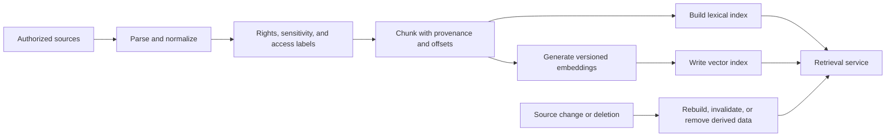
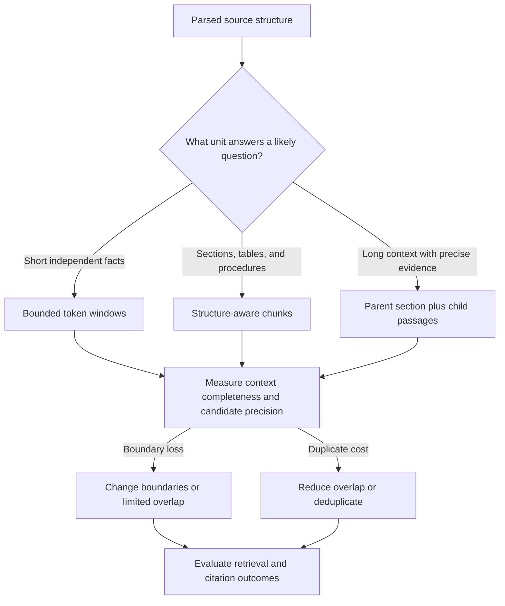
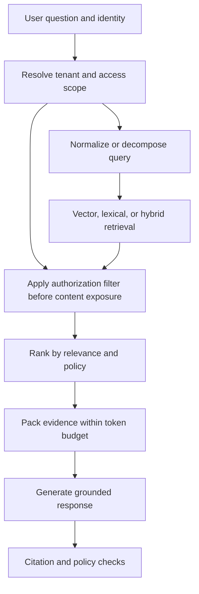
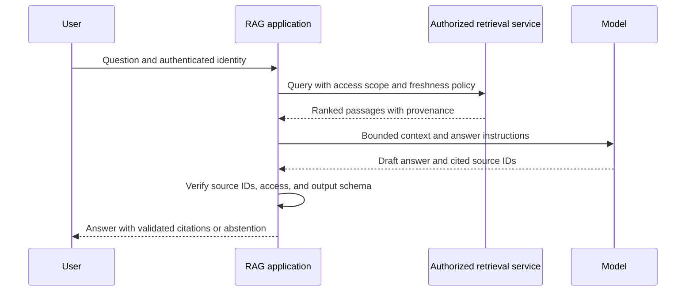
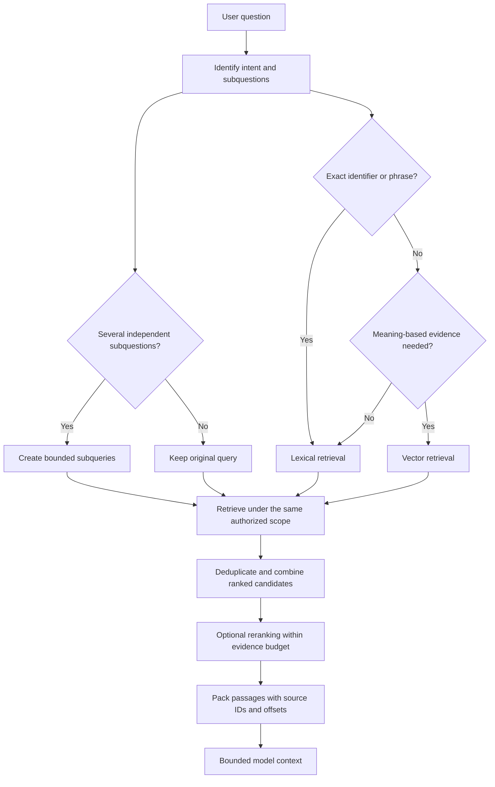
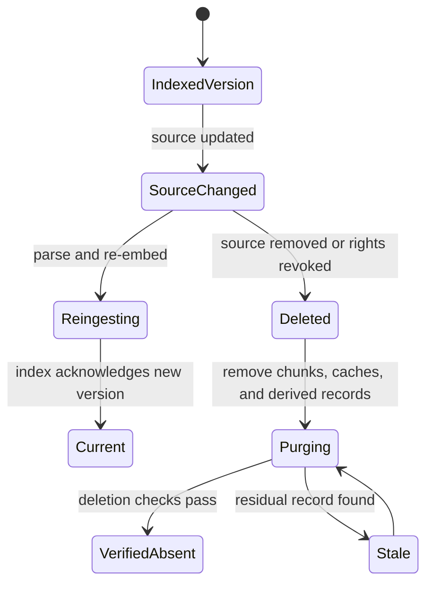

# Retrieval-Augmented Generation Architecture

Part: [16 — Artificial Intelligence, Machine Learning, and Generative AI](PART_OVERVIEW.md)

Retrieval-Augmented Generation (RAG) combines external information retrieval with model generation so an answer can use current, domain-specific, or access-controlled evidence. This chapter owns the retrieval-to-generation technique. [Part 06 CH21 — Vector Databases](../06_Databases_and_Storage/CH21_Vector_Databases.md) owns vector-index and database mechanics. Identity, trust boundaries, request budgets, and production failure contracts are system-architecture concerns owned by [Part 17 CH05 — RAG System Architecture](../17_AI_Architecture/CH05_Retrieval_Augmented_Generation_System_Architecture.md); this chapter recaps those controls where needed.

## Offline Ingestion and Index Lifecycle

Ingestion extracts content, normalizes metadata, applies access policy, chunks documents, generates embeddings, and writes searchable records. Preserve source identifier, version, update time, tenant or access attributes, and offsets. Update and deletion workflows must propagate to derived chunks and indexes.

Chunk size and overlap trade context coherence against retrieval granularity and index size. A chunking change is a data migration: version the pipeline and embeddings, rebuild safely, and compare retrieval quality before switching traffic. Part 06 owns index internals.

Choose a chunk boundary from the unit a reader needs to answer a question. Fixed token windows give predictable size but can split a definition from its conditions, separate table headers from values, or duplicate an explanation across adjacent windows. Structure-aware chunking uses headings, paragraphs, list and table boundaries; semantic chunking can adapt boundaries to topic changes but adds model or heuristic dependence. For long sections, a parent-child design can retrieve a small passage while preserving its larger section as optional context.

Overlap can recover facts that straddle a boundary, but it also multiplies repeated text, storage, and near-duplicate candidates. Very small chunks improve localization but may remove qualifications; very large chunks preserve context but lower retrieval precision and consume more model context. Preserve source version, heading path, offsets, and stable chunk identifiers so citations remain traceable after re-indexing. Evaluate chunking against representative queries and labels using the methods in [CH19 — Retrieval Quality](CH19_Retrieval_Quality_and_RAG_Evaluation.md); there is no universally optimal token count.

A worked storage trade-off makes the overlap cost concrete. Chunking a corpus into 500-token windows with no overlap might produce 10,000 chunks; adding 100-token overlap (20%) on both sides of each chunk increases total stored tokens by roughly 40%, and because nearly identical text now appears in multiple chunks, naive top-k retrieval can return several near-duplicate passages that each consume context budget without adding new evidence. A practical mitigation deduplicates retrieved candidates by source-overlap ratio before packing context, preserving the recall benefit of overlap while not letting duplicated text crowd out other relevant passages.

## Online Retrieval and Context Assembly

At runtime, a scope derived from trusted identity must constrain candidate search before content reaches the model; post-generation filtering is too late. [Part 17 CH05](../17_AI_Architecture/CH05_Retrieval_Augmented_Generation_System_Architecture.md) owns production authorization, cache boundaries, request budgets, and failure contracts. This section focuses on retrieval choices that preserve query intent and evidence provenance.

Lexical retrieval favors exact terms and identifiers; vector retrieval can find semantic matches with little word overlap. Hybrid retrieval is useful when both forms of evidence matter, but the component scores may not be directly comparable. Rank fusion combines orderings without assuming a shared score scale. A cross-encoder reranker can inspect query-passage pairs more deeply, but it increases latency and consumes additional compute. [Part 06 CH21](../06_Databases_and_Storage/CH21_Vector_Databases.md) owns the index and fusion mechanics; this chapter focuses on how retrieval choices affect evidence supplied to generation.

Context packing is a constrained selection problem, not simply “take the top k.” Prefer evidence that covers distinct parts of the question, preserve source boundaries and offsets, remove redundant passages, and leave a response budget. Ordering and truncation can change what the model uses, so evaluate answer support as well as retrieval rank. [CH19](CH19_Retrieval_Quality_and_RAG_Evaluation.md) owns the detailed evaluation methods.

## Grounding, Citation, Freshness, and Failure

Generation should distinguish evidence from inference and return citations that map to source records and offsets. Validate citations against retrieved candidates. A citation is not proof that a claim follows from a source; evaluate support and contradiction. Define behavior when retrieval is empty, stale, slow, or unavailable: abstain, ask a clarifying question, or use an approved fallback.

Monitor source freshness, retrieval quality, authorization denials, empty results, token cost, latency, and citation validity. If the index is unavailable, do not silently answer from model memory when the use case requires current evidence.

## Security, Quality, and Worked Case

Retrieved content is untrusted input and can contain prompt-injection attempts. Keep tool authority separate from retrieved text; the model must not infer permissions from a passage. Protect embedding pipelines and indexes from unauthorized updates, poisoned sources, cross-tenant leakage, and stale deletions.

A policy assistant retrieves only documents accessible to the signed-in employee. Source ingestion records document owner, version, and classification. Online retrieval filters by access before returning text, reranks within authorized candidates, assembles a fixed context budget, and verifies citations. If no authorized evidence supports the answer, it abstains. A deletion test confirms removed documents are not served from caches or stale indexes.

Review source rights, parsing, chunking, provenance, embedding version, index rebuild, access enforcement, cache isolation, injection boundary, citation verification, empty/stale retrieval behavior, quality evaluation, cost, and deletion propagation.

## Questions and Summary

1. Draw offline ingestion and online retrieval as separate lifecycles.
2. Why must authorization be applied before retrieved content reaches the model?
3. Design behavior for stale, empty, or unavailable retrieval.
4. How do chunking and reranking affect recall, context cost, and citation quality?
5. Test whether a citation supports the generated claim rather than merely existing.

RAG composes data pipelines, retrieval, identity-aware filtering, context management, generation, and verification. Quality and security emerge from the complete path, not from choosing a vector store or prompt alone. Preserve provenance, enforce access before context assembly, and provide explicit abstention and freshness behavior.
