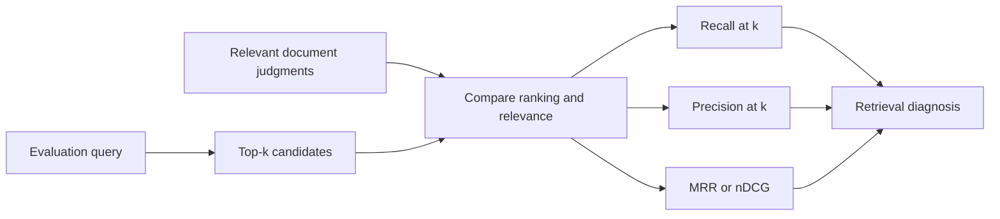
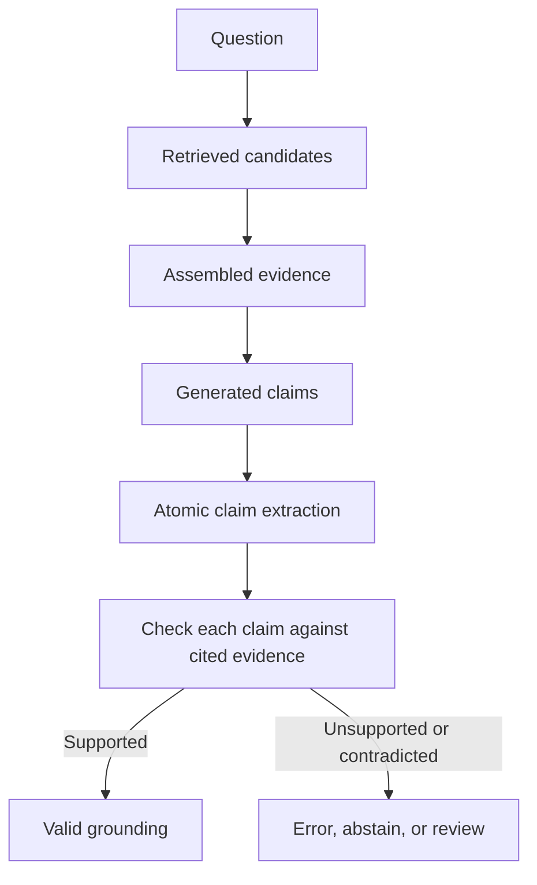
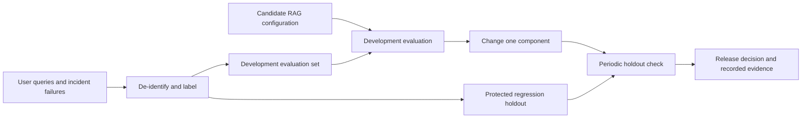
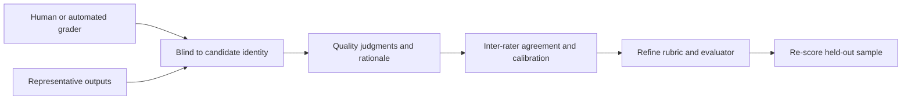
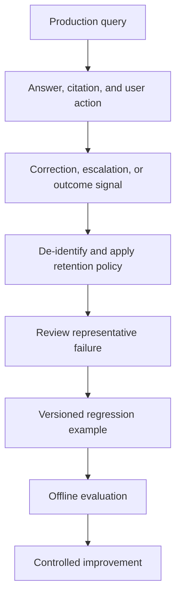

# Retrieval Quality and RAG Evaluation

Part: [16 — Artificial Intelligence, Machine Learning, and Generative AI](PART_OVERVIEW.md)

Retrieval-Augmented Generation (RAG) evaluation separates retrieval quality from answer quality so teams can locate regressions. A final answer may fail because relevant evidence was not retrieved, context was assembled poorly, generation misused evidence, or citations were invalid. [CH18 — RAG Architecture](CH18_RAG_Architecture.md) owns ingestion and retrieval construction; this chapter owns RAG-specific measurement and regression. [CH24 — Generative AI Evaluation](CH24_Generative_AI_Evaluation_Guardrails_and_Hallucinations.md) owns broader task, safety, and guardrail evaluation. [Part 06 CH21 — Vector Databases](../06_Databases_and_Storage/CH21_Vector_Databases.md) owns vector index mechanics.

## Retrieval Metrics and Candidate Ranking

Create queries with judged relevant documents. Recall at $k$ measures the fraction of relevant documents present in the top $k$; precision at $k$ measures the fraction of retrieved candidates judged relevant. Mean reciprocal rank emphasizes the first relevant result, while normalized discounted cumulative gain rewards relevant documents near the top with graded relevance. Metrics should match the task and judgment policy.

Version each query and its judgment. Record source context, access context, grading guidance, and disagreement. A “relevant” label depends on task and user need; do not compare systems on a small or leaked benchmark without uncertainty.

For query $q$, recall at $k$ is the number of relevant items in the first $k$ divided by the total number judged relevant; precision at $k$ is the number relevant in the first $k$ divided by the number returned. Mean reciprocal rank uses the inverse rank of the first relevant result, while normalized discounted cumulative gain (nDCG) supports graded relevance and discounts lower-ranked evidence. These metrics answer different questions: recall measures whether evidence was found, precision measures how much retrieved material is useful, and rank-sensitive metrics measure how early useful evidence appears.

Aggregate by query as well as overall. A micro-average lets high-volume query types dominate; a macro-average weights query groups equally and can expose a failure in a rare but consequential class. Include queries with no relevant result and define how they score. Report confidence intervals or bootstrap variation at the query or user-group level, and retain query counts beside each score. A change in top-k or judgment policy changes the metric's meaning, so version both with the index and retriever configuration.

A worked example separates the two most common retrieval failures. For a 50-query evaluation set, suppose the retriever achieves recall@10 of 0.70 (35 of 50 queries find a relevant passage somewhere in the top 10) but precision@10 of only 0.20 (on average, 2 of the 10 returned passages are relevant). This combination — reasonable recall, low precision — usually means the index is not the problem; reranking or tighter candidate filtering before the generator sees the context is the likely fix, because the evidence is present but diluted. Contrast that with recall@10 of 0.40 and precision@10 of 0.60: here the evidence frequently is not retrieved at all, which points to chunking, embedding-model fit, or missing documents rather than reranking. Running both numbers, not a single blended score, is what lets a team pick the correct fix.

## Answer Grounding and Citation Quality

Retrieval relevance does not guarantee that the answer is supported. Evaluate context relevance, claim-level support, completeness, contradiction handling, abstention, and citation mapping. Human review remains useful for nuanced claims, while automated graders need calibration against expert judgments.

An answer can be fluent and still hallucinate. Measure unsupported claims, citation precision, citation coverage, and task completion separately. Define how the system behaves when sources conflict or no evidence is retrieved.

Make citation judgments at the claim level when an answer contains multiple factual statements. Citation coverage asks whether claims have references; support asks whether the referenced passage entails or directly substantiates each claim. A citation can exist and still point to a merely related passage. Track unsupported, contradicted, and unverifiable claims separately, and define how partially supported answers score. Human raters need examples for entailment, contradiction, and insufficient evidence; compare raters on the same sample before trusting aggregate labels.

Test automated graders for sensitivity to answer length, writing style, order, and model family. A grader that favors fluent or verbose answers can reward unsupported output. Retain a human-adjudicated sample and report grader disagreement rather than treating one model-judge score as ground truth.

## Golden Sets, Ablations, and Regression

Build evaluation sets from real query patterns, difficult cases, security boundaries, and known failure examples. Separate development data from held-out regression sets. Evaluate retrieval, reranking, chunking, prompt, model, and context changes independently through ablations when possible.

Do not repeatedly tune on the protected holdout. Add production failures only after removing sensitive data and defining labels. Track dataset version, evaluator version, prompt/model/index identifiers, and run configuration.

## Online Feedback and Worked Case

Online measures include query latency, empty retrieval rate, user reformulation, citation opening, answer correction, and escalation. Feedback is biased: users who leave may be dissatisfied, and clicks do not prove correctness. Combine feedback with targeted human review and task outcomes. Detect retrieval changes from index refresh, embedding version, or source permissions.

A policy assistant regression occurs after a chunking change. Recall at ten improves, but citation coverage falls because answers combine adjacent sections whose provenance was lost. Ablation shows the new chunker caused the issue. The team restores offsets, adds claim-to-source tests, and compares on a held-out set before release.

Review metric definitions, judgment quality, sample coverage, security cases, retrieval/answer separation, citation support, ablation plan, holdout protection, evaluator calibration, privacy, online-feedback bias, and release thresholds.

## Questions and Summary

1. When is recall more important than precision, and what operational cost follows?
2. Distinguish context relevance from answer faithfulness and citation correctness.
3. Design a golden set that includes permissions, stale data, and conflicting sources.
4. Why must a final holdout remain protected from prompt and model tuning?
5. Which online feedback signals can be biased or misleading?

Evaluate RAG as a chain of components and separate retrieval, grounding, citation, and user outcomes. Use versioned representative datasets, ablations, human calibration, and protected holdouts. Online feedback complements rather than replaces controlled evaluation.
