# Retrieval Quality and RAG Evaluation

Part: [16 — Artificial Intelligence, Machine Learning, and Generative AI](PART_OVERVIEW.md) · Status: Revised (in-depth rewrite)

## 1. Introduction

A Retrieval-Augmented Generation (RAG) system answers a question in two phases. A retrieval phase selects evidence from a corpus, and a generation phase writes an answer from that evidence. Each phase can fail on its own, and the failures multiply. A team that watches only the final answer sees that quality dropped but cannot say whether the parser, the chunker, the index, the reranker, the prompt, or the model is responsible. A team that watches only retrieval scores can ship a system whose top results look excellent while the answers are still wrong. This chapter teaches how to measure each stage separately, how to combine the stage measurements into a release decision, and how to keep the measurements honest over time.

After working through this chapter you should be able to:

- Explain why RAG must be evaluated in stages, and compute how stage-level success rates compound into an end-to-end rate.
- Compute recall at $k$, precision at $k$, hit rate, mean reciprocal rank (MRR), mean average precision (MAP), normalized discounted cumulative gain (nDCG), and R-precision by hand and in code, and choose among them for a given task.
- Build relevance judgments (query relevance judgments, abbreviated qrels) from human experts, click logs, and large language model (LLM) judges, and describe the bias each source introduces, including pooling bias.
- Build, size, version, and protect a golden dataset, with confidence-interval arithmetic that tells you how many queries you need.
- Score answers for correctness, completeness, faithfulness, context relevance, answer relevance, citation accuracy, and claim-level support.
- Use an LLM as a judge without being fooled by position, verbosity, or self-preference bias, and calibrate it against human labels with Cohen's kappa.
- Describe the assumptions and failure modes of the RAGAS-style, TruLens-style, and ARES-style metric families.
- Design ablations that separate factors, compare two configurations with a paired bootstrap, and detect interaction effects.
- Classify failures with an error taxonomy and run a triage workflow.
- Evaluate hybrid search, rerankers, query rewriting, and chunking as separate components.
- Evaluate abstention, and treat latency and cost as quality co-metrics.
- Run a regression suite in continuous integration (CI), operate online evaluation, detect drift, protect evaluation data, and run human review at scale.

### 1.1 Why this matters to a solution architect

Evaluation is the part of a RAG project that decides whether the other parts get better or only change. An architect who owns the design owns the question "how do we know?" Every design review for a RAG system eventually reduces to evidence: does the new chunker help, is the reranker worth its 120 milliseconds, did the embedding migration regress legal documents, is the answer-quality drop in production caused by data or by the model. Without a measurement system, the answer is an argument between opinions. With one, the answer is a table with confidence intervals.

Evaluation also has architectural consequences. The golden dataset is a versioned data asset with access controls, retention rules, and a lifecycle. The regression suite is a pipeline stage with a runtime budget and a cost. The judge model is a dependency that can be deprecated or silently updated. Online feedback is a data flow with privacy implications. These belong in the architecture, not in a notebook.

### 1.2 Scope and ownership

This chapter owns RAG-specific measurement. Neighbouring chapters own construction and general evaluation, and this chapter links to them instead of repeating them.

| Topic | Owner | What this chapter does with it |
| --- | --- | --- |
| Ingestion, chunking, embedding, indexing, retrieval, reranking, context assembly, citation construction | [CH18 — RAG Architecture](CH18_RAG_Architecture.md) | Recaps the stages as the units of measurement, then evaluates each one |
| Embedding models, similarity, embedding evaluation, migration | [CH16 — Embeddings and Semantic Representations](CH16_Embeddings_and_Semantic_Representations.md) | Uses embedding quality as one input to retrieval metrics |
| Prompt design, structured outputs, prompt evaluation statistics | [CH17 — Prompt Engineering and Structured Outputs](CH17_Prompt_Engineering_and_Structured_Outputs.md) | Treats the prompt as one factor in an ablation |
| General generative AI evaluation, guardrails, hallucination taxonomy, safety evaluation | [CH24 — Generative AI Evaluation, Guardrails, and Hallucinations](CH24_Generative_AI_Evaluation_Guardrails_and_Hallucinations.md) | Recaps in section 6 and links; this chapter adds the retrieval-conditioned parts |
| Train/validation/test discipline, metrics, confidence intervals for classifiers | [CH06 — Model Evaluation, Validation, and Selection](CH06_Model_Evaluation_Validation_and_Selection.md) | Applies the same discipline to retrieval and answer quality |
| Vector index mechanics and approximate nearest neighbor recall | [CH26 — Vector Databases for AI Retrieval](CH26_Vector_Databases_for_AI_Retrieval.md) | Distinguishes index recall from retrieval relevance |
| MLOps and LLMOps pipelines, release gates | [CH29 — MLOps and LLMOps](CH29_MLOps_and_LLMOps.md) | Supplies the regression suite that a gate consumes |
| Data governance, privacy, provenance | [CH30 — AI Data Governance, Privacy, and Provenance](CH30_AI_Data_Governance_Privacy_and_Provenance.md) | Applies those rules to evaluation data |

### 1.3 Recap of RAG construction (owned by CH18)

For the purposes of evaluation, a RAG system is a chain of stages. The offline path ingests documents: a parser converts files to text and structure, a chunker splits the text into passages, an embedding model turns passages into vectors, and an index stores vectors and metadata. The online path serves a query: an optional query rewriter reformulates it, a retriever (dense, lexical, or hybrid) returns candidates, a reranker reorders them, a context assembler selects and formats the passages within a token budget, a generator writes an answer, and a citation step attaches references. [CH18 — RAG Architecture](CH18_RAG_Architecture.md) teaches how each stage is built. This chapter treats each stage as something that has an input, an output, and a measurable quality.

## 2. Why RAG Must Be Evaluated in Stages

### 2.1 The failure of end-to-end-only evaluation

Suppose a team measures one number: the fraction of answers a reviewer marks correct. The number was 80 percent last month and is 70 percent today. There are at least seven stages that could have caused the drop, and the single number is silent about which. The team will spend days swapping components, retraining, or tweaking prompts. Often the first guess is wrong, because the most visible component (the language model) is not the most likely culprit.

Stage-level evaluation gives each stage its own measurement with a known input and a known expected output. When a stage regresses, the stage-level metric moves, and the team knows where to look. Section 19 shows a case where nine of ten metrics barely moved while one segment collapsed, and the per-stage and per-segment view found the cause in an afternoon.

The stage view has a second purpose. It tells you where improvement effort pays. If retrieval already finds relevant evidence 95 percent of the time and the generator uses it faithfully 80 percent of the time, a better embedding model cannot raise the end-to-end rate above what the generator allows.

### 2.2 The stages and what each one owes the next

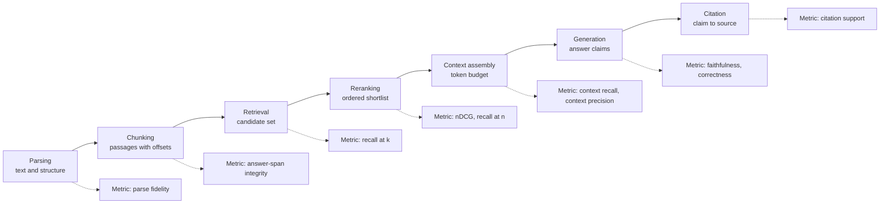

The diagram shows the seven stages and one family of metrics per stage. Each stage owes the next a specific property.

- **Parsing** owes the chunker text that still contains the evidence. A parser that drops table cell boundaries, merges two columns, or skips a scanned page has destroyed evidence before any model sees it. Parse fidelity is measured by comparing parser output with a trusted reference on a sample of documents: character or token accuracy for prose, cell-level accuracy for tables, and structural accuracy (heading levels, list nesting) for layout.
- **Chunking** owes the index passages in which an answer is intact. If the answer to "what is the refund window for annual plans" spans a sentence at the end of one chunk and the number in the next, no retriever can return both together. Chunk quality is measured as answer-span integrity: the share of gold evidence spans that lie entirely inside at least one chunk.
- **Retrieval** owes the reranker a candidate set that contains the evidence. Recall at a large $k$ (for example 50 or 100) measures this.
- **Reranking** owes the assembler a short ordered list with the evidence near the top. Recall at the final list size and nDCG measure this.
- **Context assembly** owes the generator a context that fits the budget, keeps the evidence, preserves its provenance, and is not dominated by distractors. Context recall and context precision measure this.
- **Generation** owes the user an answer whose claims are supported by the context and which is complete and correct. Faithfulness, correctness, and completeness measure this.
- **Citation** owes the user a trustworthy pointer from each claim to a passage that supports it. Citation support and citation coverage measure this.

A stage can be measured only if its gold output is known. For retrieval, the gold output is a set of relevant passages. For generation, the gold output is a reference answer or a set of required facts, plus the context the generator was given. The golden dataset in section 5 stores all of these for each query so that every stage can be scored from one record.

### 2.3 How errors compound: a worked probability chain

Let $s_i$ be the probability that stage $i$ succeeds on a query, given that all earlier stages succeeded. If the stages are sequentially dependent, the probability that the whole chain succeeds is

$$
P(\text{success}) = \prod_{i=1}^{n} s_i .
$$

Here "succeeds" means the stage delivered what the next stage needs. The product is exact when each $s_i$ is a conditional probability given earlier successes. It is an approximation when the $s_i$ are marginal rates that you assume independent. The distinction matters, as the next paragraphs show.

Take a RAG system with the following illustrative stage success rates. These numbers are invented for the exercise and are not benchmarks.

| Stage | Success rate $s_i$ | Cumulative product |
| --- | --- | --- |
| Parsing preserved the evidence | 0.97 | 0.9700 |
| Chunking kept the answer intact | 0.95 | 0.9215 |
| Retrieval found a relevant chunk | 0.90 | 0.8294 |
| Reranking kept it in the shortlist | 0.93 | 0.7713 |
| Context assembly kept it and its source | 0.97 | 0.7482 |
| Generation used it faithfully and completely | 0.92 | 0.6883 |
| Citation points to the supporting span | 0.96 | 0.6608 |

The arithmetic for the first three rows is $0.97$, then $0.97 \times 0.95 = 0.9215$, then $0.9215 \times 0.90 = 0.82935$, shown as 0.8294. The final value is about 0.66. Every stage is individually "good" by any common standard (the lowest is 0.90), yet roughly one answer in three has a defect somewhere. The script [04_staged_diagnosis.py](../code/python/rag-evaluation-chapter/04_staged_diagnosis.py) reproduces the table.

The chain also supports a marginal-value calculation. If you could raise one stage to 0.99, which one gives the largest end-to-end gain? Raising retrieval from 0.90 to 0.99 multiplies the product by $0.99/0.90 = 1.10$, giving $0.6608 \times 1.10 = 0.7268$, a gain of 6.6 points. Raising parsing from 0.97 to 0.99 multiplies by $0.99/0.97 = 1.0206$ and gains only 1.4 points. The rule is that the gain from fixing stage $i$ is $P \times (0.99/s_i - 1)$, so the weakest stages offer the most, and the strongest stages offer almost nothing. This is why a team should compute the table before choosing a project.

Two cautions apply to this model.

1. **The independence assumption is usually false.** Failures correlate. Queries about tables are hard to parse, hard to chunk, and hard for the generator, so the stage failures concentrate on the same queries. When failures are positively correlated, the true end-to-end success is higher than the product of marginals (the same failing queries absorb many stage failures), and the worst segments are far worse than the average. The product is still a useful planning tool, but the per-segment view in section 5.8 is where correlation shows.
2. **"Succeeds" must be defined as conditional on earlier success.** If you measure the generation rate over all queries, including those where retrieval failed, you double count. The cleaner procedure is to measure generation quality with the gold context supplied (an oracle-context test), which gives $s_{gen}$ conditional on retrieval and context success. Then measure retrieval and context separately. The product of the conditionals approximates the end-to-end rate, and a gap between the product and the measured end-to-end rate is itself a finding. It indicates interactions, such as a generator that does better with noisy context than the oracle test suggests, or worse.

There is a third effect that the product hides. Generation can partially compensate for retrieval failure, because the model may answer from parametric knowledge when the evidence is missing. That produces correct but ungrounded answers, which hurts faithfulness, fails an audit, and turns into wrong answers when the corpus differs from public knowledge. A faithfulness metric is what exposes it.

### 2.4 Oracle experiments

An oracle experiment replaces one stage's output with the gold output and measures what happens downstream. It answers "how much quality is available if this stage were perfect?"

- **Oracle retrieval:** give the generator the gold passages. The resulting answer quality is the ceiling for any retrieval improvement. If it is 0.85, no retriever will push end-to-end correctness above 0.85 without a generator or prompt change.
- **Oracle chunk boundaries:** index the gold spans as chunks. The gap between this and the real chunker is the chunking loss.
- **Oracle reranking:** reorder the candidates so that every relevant passage is first. The gap between this and the real reranker, at fixed candidate recall, is the reranking loss.
- **No retrieval:** ask the generator the question with no context. This is the parametric baseline. Questions it answers correctly without evidence are either public knowledge, which a RAG system does not need, or evidence that the benchmark leaks into model training.

Oracle experiments are cheap because they reuse the golden dataset. They convert "the system is at 0.70" into a decomposition: 0.85 ceiling from generation and prompt, a loss of 0.07 from retrieval, 0.05 from reranking and context, and 0.03 from chunking and parsing, for example. Those numbers are the input to prioritization.

### 2.5 Where the metrics come from: the evaluation record

Every query in the golden dataset stores what is needed to score each stage:

- the query text, the user segment, and the timestamp or "as of" date;
- the gold evidence: document identifiers, passage or span identifiers, and relevance grades;
- a reference answer, or a list of required facts ("nuggets"), plus an expected behavior (answer, abstain, ask for clarification, refuse);
- metadata: difficulty, query type (lookup, multi-hop, comparison, procedural), whether it is time-sensitive, and the access context of the asker.

The run record stores what the system did: configuration identifiers, candidates with scores, the shortlist, the assembled context, the generated answer, the claims, the citations, token counts, and latencies. Scoring is a function from the pair (golden record, run record) to a set of stage metrics. Keeping the two records separate is what lets you re-score old runs when a metric definition changes.

## 3. Retrieval Metrics

### 3.1 The retrieval funnel and what each cutoff means

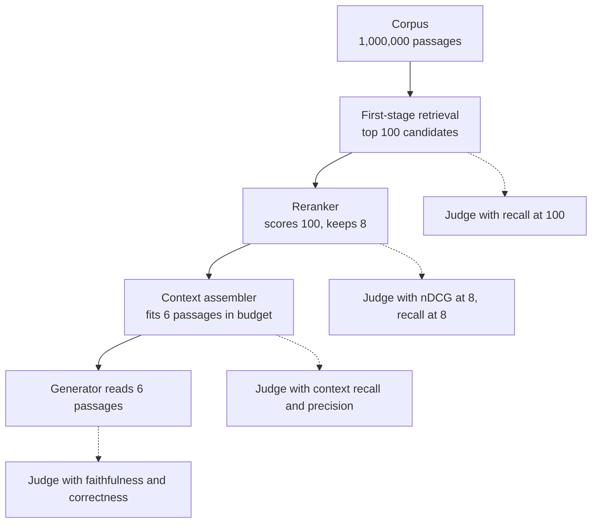

The funnel narrows from a large corpus to the few passages the generator reads, and each narrowing has a different metric because each answers a different question. The cutoff $k$ in a retrieval metric should be the size of the list that the next stage consumes. Recall at 100 matters for the first-stage retriever because the reranker can only reorder what it receives. Recall at 6 matters for the final context because the generator reads only six passages. A retriever that has recall at 100 of 0.97 and recall at 6 of 0.55 is giving the reranker the right candidates but the reranker is not placing them high enough, so the fix is in reranking.

Report metrics at the cutoff each consumer uses, and report at more than one cutoff so the shape of the curve is visible. A retriever whose recall climbs from 0.55 at $k=5$ to 0.93 at $k=50$ has the evidence somewhere in the list, and the question is ordering. A retriever whose recall is 0.55 at 5 and 0.60 at 50 does not have the evidence, and no reranker will find it.

### 3.2 Notation

For a query $q$:

- $D$ is the ranked list returned by the system, with $d_1$ at rank 1.
- $\text{rel}(d)$ is the relevance grade of document or passage $d$ from the judgments. Grades are non-negative integers; 0 means not relevant. A binary view treats grades at or above a threshold (usually 1) as relevant.
- $R_q$ is the set of relevant items for the query under the binary view, and $|R_q|$ is its size. This counts all judged-relevant items in the corpus, not only the retrieved ones.
- $k$ is the cutoff.

### 3.3 Recall at k, precision at k, and hit rate

Recall at $k$ is the share of the relevant items that appear in the top $k$:

$$
\text{Recall@}k = \frac{|R_q \cap \{d_1,\dots,d_k\}|}{|R_q|}.
$$

Precision at $k$ is the share of the top $k$ that are relevant:

$$
\text{Precision@}k = \frac{|R_q \cap \{d_1,\dots,d_k\}|}{k}.
$$

Hit rate at $k$ (also called success at $k$) is 1 if any relevant item appears in the top $k$ and 0 otherwise:

$$
\text{Hit@}k = \mathbb{1}\left[\,|R_q \cap \{d_1,\dots,d_k\}| \ge 1\,\right].
$$

Recall measures whether the evidence was found, precision measures how much of the list is useful, and hit rate measures whether the system found at least something. They differ in what they punish. Recall punishes missing evidence, so it is the right metric when an answer needs several passages (a comparison across two policies) and the loss of one is a loss of the answer. Precision punishes noise, so it matters when the context budget is small or when distractors confuse the generator. Hit rate is the right metric when any one relevant passage is enough to answer, as in many single-fact lookups, and it is the easiest metric to explain to a stakeholder.

Recall and precision pull against each other as $k$ grows. Recall at $k$ is non-decreasing in $k$. Precision at $k$ usually falls. A system tuned for recall at 100 and a system tuned for precision at 5 are both reasonable, and they are different stages of the same pipeline.

When $|R_q|$ is larger than $k$, recall at $k$ cannot reach 1, which makes it hard to compare across queries with different numbers of relevant items. R-precision (section 3.6) and nDCG address this.

### 3.4 Mean reciprocal rank and average precision

The reciprocal rank of a query is the inverse of the rank of the first relevant item, or 0 if none appears:

$$
\text{RR} = \frac{1}{\text{rank of first relevant item}}.
$$

Mean reciprocal rank (MRR) is the average of RR over queries. It rewards finding one right answer early. RR drops fast: rank 1 gives 1.0, rank 2 gives 0.5, rank 4 gives 0.25, rank 10 gives 0.1. MRR suits tasks where the user or the generator needs one good passage, and the first relevant item is decisive. It ignores everything after the first relevant item, so it says nothing about the second or third passage in a multi-passage answer.

Average precision (AP) rewards placing all relevant items high. For a query with $|R_q|$ relevant items:

$$
\text{AP} = \frac{1}{|R_q|} \sum_{i=1}^{N} \text{Precision@}i \cdot \mathbb{1}[d_i \in R_q],
$$

where $N$ is the length of the returned list. Each time a relevant item appears at rank $i$, add the precision at that rank. Divide by the total number of relevant items, including those never retrieved, which penalizes missing items. Mean average precision (MAP) is AP averaged over queries. MAP is a single number that summarizes the whole precision-recall curve and is sensitive to both ordering and completeness.

### 3.5 Normalized discounted cumulative gain with graded relevance

Binary relevance is too coarse when passages differ in usefulness. A passage that fully answers the question is more useful than one that mentions the topic. Discounted cumulative gain (DCG) uses graded relevance and discounts gain by rank, following Järvelin and Kekäläinen (2002):

$$
\text{DCG@}k = \sum_{i=1}^{k} \frac{2^{\text{rel}(d_i)} - 1}{\log_2(i+1)} .
$$

The numerator is the gain of the item at rank $i$. The exponential form $2^{g}-1$ makes a grade-3 item worth 7 and a grade-1 item worth 1, so highly relevant items dominate. A linear gain $g$ is also used; the choice must be fixed in advance and recorded because it changes the numbers. The denominator is the discount: rank 1 has $\log_2 2 = 1$, rank 3 has $\log_2 4 = 2$, rank 7 has $\log_2 8 = 3$. Items lower in the list count less.

DCG is not comparable across queries because the maximum depends on how many relevant items exist. Normalization divides by the ideal DCG (IDCG), the DCG of the best possible ordering of the judged items:

$$
\text{nDCG@}k = \frac{\text{DCG@}k}{\text{IDCG@}k}.
$$

nDCG lies between 0 and 1. A value of 1 means the list is in ideal order for the first $k$ positions. A query with no relevant item has IDCG of 0, so nDCG is undefined, and the evaluation must say how it handles such queries (section 12 treats them as abstention tests).

### 3.6 R-precision

R-precision fixes the cutoff at the number of relevant items for the query, $R=|R_q|$:

$$
\text{R-precision} = \frac{|R_q \cap \{d_1,\dots,d_R\}|}{R}.
$$

At $k=R$, precision and recall are equal, so R-precision is both. It removes the problem that a fixed $k$ is too small for queries with many relevant items and too large for queries with one. It is a good diagnostic when queries vary widely in the number of relevant passages, and it needs complete judgments to be meaningful because $R$ depends on them.

### 3.7 A hand-worked example

One query has four relevant passages under graded judgments:

| Passage | Grade | Meaning |
| --- | --- | --- |
| d1 | 3 | Fully answers the question |
| d3 | 2 | Strong supporting evidence |
| d6 | 1 | Partial or tangential evidence |
| d12 | 2 | Strong supporting evidence, never retrieved |

The system returns d1, d2, d3, ..., d10 in that order. Under the binary view, relevant passages are d1, d3, d6, and d12, so $|R_q| = 4$. In the returned list, relevant items appear at ranks 1, 3, and 6.

**Recall and precision at 5.** The top five are d1 to d5, and two of them (d1, d3) are relevant. Recall@5 $= 2/4 = 0.50$. Precision@5 $= 2/5 = 0.40$. Hit@5 $= 1$.

**Recall and precision at 10.** Three relevant items (d1, d3, d6) are in the top ten. Recall@10 $= 3/4 = 0.75$. Precision@10 $= 3/10 = 0.30$.

**Reciprocal rank.** The first relevant item is at rank 1, so RR $= 1.0$.

**Average precision.** Precision at rank 1 is $1/1 = 1.0$. Precision at rank 3 is $2/3 = 0.6667$. Precision at rank 6 is $3/6 = 0.5$. Sum $= 2.1667$. Divide by $|R_q| = 4$, which counts d12 even though it was never retrieved: AP $= 2.1667/4 = 0.5417$. If the denominator were 3 (the number retrieved), AP would be 0.7222, which flatters a system that missed one-quarter of the evidence.

**R-precision.** $R = 4$. The top four are d1 to d4, and two are relevant. R-precision $= 2/4 = 0.50$.

**nDCG at 10.** Gains are $2^3-1 = 7$ for d1, $2^2-1=3$ for d3, and $2^1-1 = 1$ for d6.

- Rank 1: $7/\log_2 2 = 7.0000$.
- Rank 3: $3/\log_2 4 = 1.5000$.
- Rank 6: $1/\log_2 7 = 1/2.8074 = 0.3562$.
- DCG@10 $= 8.8562$.

The ideal ordering uses the four judged grades 3, 2, 2, 1, whose gains are 7, 3, 3, 1.

- Rank 1: $7/1 = 7.0000$.
- Rank 2: $3/\log_2 3 = 3/1.5850 = 1.8928$.
- Rank 3: $3/\log_2 4 = 1.5000$.
- Rank 4: $1/\log_2 5 = 1/2.3219 = 0.4307$.
- IDCG@10 $= 10.8235$.

So nDCG@10 $= 8.8562/10.8235 = 0.8182$.

**Sensitivity to rank.** Now move d1 down to rank 4, giving the order d2, d4, d5, d1, d3, d6, and so on. RR falls from 1.0 to 0.25. DCG becomes $7/\log_2 5 + 3/\log_2 6 + 1/\log_2 7 = 3.0147 + 1.1606 + 0.3562 = 4.5315$, so nDCG@10 $= 4.5315/10.8235 = 0.4187$. Recall@10 is unchanged at 0.75. This is the reason to report a rank-sensitive metric alongside recall: recall at 10 would report no change while the best passage fell from first to fourth.

Script [01_retrieval_metrics.py](../code/python/rag-evaluation-chapter/01_retrieval_metrics.py) implements every metric and prints these values:

```text
recall@5      = 0.5000
precision@5   = 0.4000
recall@10     = 0.7500
precision@10  = 0.3000
RR            = 1.0000
AP            = 0.5417
R-precision   = 0.5000
DCG@10        = 8.8562
IDCG@10       = 10.8235
nDCG@10       = 0.8182
nDCG@10 when d1 drops to rank 4 = 0.4187
```

### 3.8 Aggregating across queries

Per-query values are averaged to produce a system score. Several choices affect the number.

- **Macro over queries** (each query counts once) is the standard for MRR, MAP, and nDCG. It treats a rare query as heavily as a common one.
- **Macro over segments, then over queries within a segment.** If a golden set has 300 policy questions and 30 legal questions, a plain mean is 91 percent policy. Report per-segment means and, where a headline is needed, a weighted mean whose weights reflect traffic or business risk, stated explicitly.
- **Micro over relevant items** (pool all relevant items across queries) lets queries with many relevant items dominate. It is rarely right for RAG.
- **Queries with no relevant item.** Recall, AP, and nDCG are undefined. Exclude them from these means and test them separately as abstention cases. Silently scoring them as 0 punishes correct behavior and silently scoring them as 1 rewards it regardless of what the system did.

Always report the number of queries behind each score. A recall of 0.80 on 20 queries is a different fact from 0.80 on 2,000 (section 5.9 gives the intervals).

### 3.9 A two-system comparison

Six queries, one of which (q6) has no relevant passage, are run through system A and system B and cut off at five. Script `01_retrieval_metrics.py` prints:

```text
system A: recall@5=0.700 P@5=0.280 MRR=0.517 MAP=0.409 nDCG@5=0.523
system B: recall@5=0.933 P@5=0.320 MRR=0.667 MAP=0.623 nDCG@5=0.725
```

Verify system A's MRR by hand. Its reciprocal ranks on the five answerable queries are 1 (q1), $1/3$ (q2), 1 (q3), $1/4$ (q4), and 0 (q5). The sum is $1 + 0.3333 + 1 + 0.25 + 0 = 2.5833$, and the mean over five queries is $0.5167$, matching 0.517. System A's recall@5 is $(1 + 1 + 1 + 0.5 + 0)/5 = 0.70$.

System B is better on all five metrics on this tiny set. Does that mean B is better? Five queries cannot support the claim, and the metrics are averages over very different queries. Section 5.9 and section 9.4 show how to turn this kind of comparison into a defensible statement with an interval or a paired test.

### 3.10 Passage-level versus document-level judgments

RAG retrieves passages, but many judgment sets label whole documents. Document-level judgments inflate recall: a long manual is "relevant" if any of its 400 passages answers the question, so a retriever that returns a wrong passage from the right manual scores a hit. For RAG the unit of judgment should be the unit the generator reads. Three options exist.

1. **Passage identifiers.** Label chunk identifiers directly. This ties the labels to one chunking, and every chunker change invalidates them.
2. **Span-based labels.** Record the document identifier and a character or token span for the gold evidence. A retrieved chunk counts as relevant if it overlaps the gold span by at least a threshold (for example it contains the span, or covers at least 50 percent of it). The labels survive changes in chunking, which is the property you want when chunking is one of the factors under test.
3. **Document labels plus a passage check.** Keep document-level labels for recall at the document stage and add a passage check for the context stage.

Span-based labels are the best default. They cost more to produce because an annotator must highlight the evidence, not only pick a document. The cost is repaid the first time you change the chunker and do not need to relabel.

### 3.11 Approximate search recall versus retrieval relevance

Two different quantities share the word "recall". Index recall (or ANN recall) measures how often an approximate nearest-neighbor index returns the same top results as exact search. Retrieval recall, in this chapter, measures how many judged-relevant passages appear in the results. They are independent. An index with 99 percent index recall over a weak embedding model returns the wrong neighbors efficiently. An exact search with a good model has 100 percent index recall and good retrieval recall. Measure them separately. [CH26 — Vector Databases for AI Retrieval](CH26_Vector_Databases_for_AI_Retrieval.md) covers index parameters and how to measure index recall, and [CH16](CH16_Embeddings_and_Semantic_Representations.md) covers embedding evaluation. A drop in retrieval recall with stable index recall points at the embedding, the data, or the query, not at the index.

## 4. Relevance Judgments

A retrieval metric is only as good as the judgments behind it. A relevance judgment (a qrel, short for query relevance) is a statement that passage $d$ is relevant to query $q$ to degree $g$. The metrics in section 3 treat these statements as truth. In practice they are opinions with a cost, a source, and a bias.

### 4.1 What "relevant" means for RAG

Classic information retrieval asks whether a document is on topic for the searcher. RAG asks something narrower: can the generator write a correct, complete answer using this passage? A passage can be on topic and useless (a product overview for a question about a specific error code), or it can be off topic by title and decisive (a changelog entry that states when a limit changed). Two judgment questions are worth keeping separate.

- **Topical relevance:** is the passage about what the query asks?
- **Answer utility:** does the passage contain information needed to answer?

For a RAG evaluation, grade on answer utility, with a rubric such as: 3 means the passage alone contains the answer; 2 means it contains a necessary part of the answer; 1 means it is related and may help but is insufficient alone; 0 means it does not help. Write the rubric with examples, and require annotators to record which sentence or span carries the utility. That span is the gold evidence used in section 3.10.

### 4.2 Human judgments

Human judgments from subject-matter experts are the reference standard. They are slow and expensive, so they are used for the golden set, for calibrating other sources, and for audits.

Practical rules:

- **Use experts when the domain requires them.** A general crowd can judge topical relevance for a consumer help center. It cannot judge whether a passage answers a tax-treatment question.
- **Judge the query in context.** Show the annotator the query, the user segment, the "as of" date, and the candidate passage in its document context (surrounding text, title, section path), because a passage's meaning often depends on its neighbors.
- **Collect two or more labels on a subset** and measure agreement (section 7.6 works the kappa arithmetic). Disagreement is information: it marks ambiguous queries, weak rubrics, or genuinely underspecified questions.
- **Record rationale for disputed items** and adjudicate with a third reviewer. Store the adjudicated label and the original labels.
- **Expect a throughput of tens of judgments per hour per annotator** for passages that need real reading. Budget accordingly. A golden set of 400 queries with 12 judged passages each is 4,800 judgments, or on the order of 120 to 240 annotator hours before adjudication, depending on difficulty. These figures are planning estimates; measure your own rate in a pilot.

### 4.3 Click logs and implicit judgments

Click logs are plentiful and cheap, and they are biased. In a search results page, users click higher-ranked results more regardless of relevance (position bias), click on attractive titles (presentation bias), and skip results they already know (selection bias). Treating a click as a relevance label teaches the evaluator to prefer whatever the current system already ranks first.

Three corrections exist, listed here by complexity.

1. **Use clicks as weak labels only,** to find candidates for human review, such as queries where users click on rank 8 and ignore ranks 1 to 3.
2. **Weight by inverse propensity.** If rank 1 is examined with probability 0.9 and rank 5 with 0.3, a click at rank 5 carries three times the weight of a click at rank 1 when estimating relevance. Estimating examination propensities requires randomization experiments, for example swapping adjacent results for a small share of traffic, and a click model.
3. **Use interleaving or randomized exposure** to collect unbiased preferences between two rankers.

In a RAG product there is often no results page. The user sees an answer with citations. The analogous implicit signals are: opening a citation, copying the answer, asking a follow-up that refines the question (a reformulation), thumbs up or down, and escalating to a human. Each is biased differently, and section 15 treats them. None replaces a labeled qrel for retrieval metrics.

### 4.4 LLM-generated judgments

An LLM can grade passage relevance at a small fraction of human cost, and evidence from search research suggests that carefully prompted LLM judges agree with human labels on relevance at levels comparable to the agreement between two human assessors on some collections (for example, Thomas, Spielman, Craswell, and Mitra, 2023, on search relevance labels at a commercial search engine). Other researchers have argued that LLM judgments should not fully replace human ones for comparing LLM-based systems, because of circularity: a system that uses the same model family as the judge may be favored (see the discussion in Faggioli and colleagues, 2023, and later critiques). Both positions are consistent with a practical rule.

Use an LLM to judge relevance when all of the following hold:

- the judge has been calibrated against a human-labeled sample from your domain (section 7.6), with kappa and per-class error rates reported;
- the judge model and prompt are versioned, and any change triggers recalibration;
- the system under test does not use the same model as judge, or the same-model effect has been measured on the calibration sample;
- a human-labeled slice is kept for decisions that matter, including every release gate.

LLM judgments are especially useful for expanding judged coverage. Humans label the golden set and the borderline cases. The LLM labels the long tail of candidate passages that pooling exposes, and humans audit a random sample of those labels.

### 4.5 Pooling, incomplete judgments, and the bias they create

No one can judge every passage for every query. The standard technique is pooling, introduced for Text REtrieval Conference (TREC) evaluations. Several systems each return their top $p$ results for a query. The union of those lists, the pool, is judged. Anything outside the pool is assumed non-relevant.

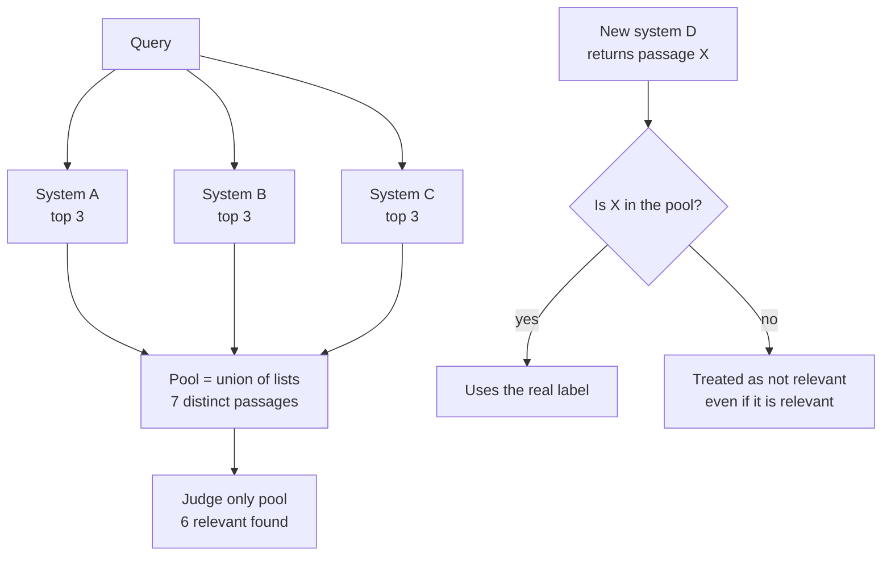

The diagram shows why pooling biases against new systems. The qrels reflect what the contributing systems found. A new system that retrieves a relevant passage no earlier system found is penalized, because the passage has no judgment and is counted as non-relevant.

A worked example makes the size of the bias concrete. A query has 10 truly relevant passages. Three older systems contributed to a pool that exposed 6 of them. A new system returns 10 passages in which 5 are truly relevant, and 2 of those 5 are among the 4 relevant passages the pool missed. The qrels credit it with 3 relevant passages, so measured precision at 10 is 0.30, while true precision at 10 is 0.50. The measurement understates the new system by 20 points and the system looks worse than it is, precisely because it found something new. If the new system is a dense retriever being compared against a lexical baseline whose results seeded the pool, this effect appears in practice: dense retrievers find semantic matches that lexical systems did not surface.

Mitigations, in order of practicality:

1. **Pool from diverse systems.** Include lexical, dense, hybrid, and the production system, and use a deep pool (depth 20 to 50 per system for the golden set).
2. **Add new systems to the pool, then judge the new passages.** When a candidate system is evaluated, judge its unjudged top results before reading the scores. This is a standard step: compute the fraction of unjudged items in each system's top $k$ (the judgment coverage, sometimes called the hole rate) and refuse to compare systems when coverage is low.
3. **Use measures designed for incomplete judgments,** such as bpref or condensed-list variants, which ignore unjudged items instead of counting them as non-relevant (Buckley and Voorhees, 2004, introduced bpref). They reduce the bias, and they change the metric's meaning, so they should be reported next to the standard metrics, not instead of them.
4. **Report judgment coverage per system.** If system A has 98 percent of its top 10 judged and system B has 71 percent, the comparison is not fair. Fill the holes first.
5. **Judge with an LLM to fill holes cheaply,** and audit a sample, as in section 4.4.

A related trap is that the golden set built from one system's retrieval results (a common shortcut, "label whatever the current retriever returns") systematically favors that system and its relatives. Make pooling from several diverse retrievers a rule of golden-set construction.

### 4.6 Graded versus binary labels

Graded labels cost more per judgment and carry more information. They support nDCG, they let you separate "the answer is here" from "this is background," and they reduce the effect of a borderline label flipping a binary decision. Use three or four grades. More than four grades produce disagreement between annotators without improving the metric. Always keep the ability to collapse to binary by a recorded threshold, because recall, precision, MAP, and hit rate require it.

### 4.7 Judgments are versioned data

Store each judgment with: query identifier, passage or span identifier, grade, annotator or judge identifier, rubric version, timestamp, and the corpus snapshot it refers to. A judgment on a document that has since been edited may no longer be true. Section 5.10 shows the data model, and section 16 shows how corpus drift invalidates judgments.

## 5. Building a Golden Dataset

A golden dataset is the set of queries, gold evidence, and reference answers against which a RAG system is measured. It is the most valuable evaluation asset a team owns, and the one most often built carelessly.

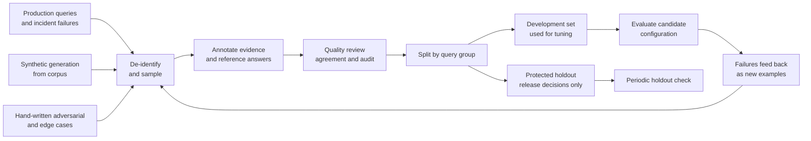

The loop in the diagram shows the dataset as a living asset. Queries come from three sources, pass through de-identification and annotation, are split into a development set and a protected holdout, and are replenished by failures found in evaluation and production. The sections below take each element in turn.

### 5.1 Purpose and design principles

State the decision the dataset supports before building it. A dataset to choose between embedding models for a legal corpus is different from a dataset to catch regressions in a customer-support assistant. Principles that hold in either case:

- **Representativeness over volume.** A set of 300 queries that mirrors the real query distribution beats 3,000 synthetic ones from one template.
- **Coverage of the failure surface,** not only the typical case. The tail is where users get hurt.
- **Traceability.** Each item records where it came from, who labeled it, and when.
- **Stability,** with controlled change. A dataset that changes every week cannot detect a regression.
- **Separation** of the data used to tune from the data used to decide.

### 5.2 Sampling real queries

Production queries are the best source, because they carry real vocabulary, real ambiguity, and real mistakes. A sampling procedure:

1. Collect a window of queries (at least four weeks, to include periodic patterns such as month-end).
2. De-identify them: remove names, account numbers, email addresses, and free-text personal data. Apply the retention policy of the data owner (section 17).
3. Cluster by intent or topic, using embeddings plus manual labeling of cluster names, and record cluster sizes.
4. Sample with a rule that is written down. A common rule is stratified sampling: sample in proportion to traffic for the head, and sample a floor number per cluster for the tail so that rare but important intents are represented.
5. Deduplicate near-duplicate queries so that one popular question does not occupy 40 slots.
6. Add the queries from support escalations, thumbs-down events, and incident reports. These are over-sampled failures, so keep them in a labeled stratum and do not mix them into the traffic-proportional estimate of overall quality.

Two sampling pitfalls recur. The first is **survivorship in logs**: queries for which the system returned nothing, or users abandoned, are under-represented in data collected from successful sessions. Sample abandoned and empty-result queries deliberately. The second is **dataset shift at launch**: before the system exists there are no production queries. Bootstrap from search logs of the legacy system, support tickets, and interviews with users, then replace them with real traffic after launch.

### 5.3 Synthetic question generation and its biases

An LLM can generate questions from corpus passages: give it a passage and ask for questions this passage answers. This produces a labeled item (the question, the passage as gold evidence, and a draft answer) at low cost, and it is the right way to bootstrap a dataset or to cover documents that no user has queried yet. It has systematic biases that a senior practitioner must account for.

- **Lexical overlap bias.** Generated questions reuse the passage's words. A lexical or dense retriever finds the source passage easily. Real users paraphrase, use acronyms, misspell, and ask about concepts without knowing the document's terms. Synthetic sets therefore overestimate retrieval quality, and they favor lexical matching more than a real distribution would.
- **Single-passage bias.** Questions generated from one passage are answerable from that passage. Real questions often need two passages, or cross-document comparison, or inference.
- **Answerability bias.** A generated question is always answerable, so there are no unanswerable items unless they are added on purpose.
- **Style bias.** Generated questions are fluent and complete. Real queries are short, ungrammatical, or conversational.
- **Self-preference and circularity.** If the same model family that generates the questions also answers and judges, scores can inflate.
- **Uniform coverage.** Passage-level generation covers the corpus uniformly. Real traffic concentrates on a few documents. A synthetic set is a coverage test, not a traffic simulation.
- **Quality noise.** Some generated questions are ambiguous, trivial, or wrong. Without filtering, the dataset contains label errors that cap measurable quality.

Mitigations:

1. **Filter** generated questions: remove those answerable without the passage (ask a model to answer with no context and drop the ones it gets right, or those that rely on a phrase such as "the passage above"), remove duplicates, and have a person review a sample.
2. **Diversify by prompting** for different question types (lookup, how-to, comparison, troubleshooting), different personas, and different vocabularies, and ask for paraphrases that avoid the passage's key terms.
3. **Generate multi-passage questions** by supplying two or three related passages and asking for a question that requires all of them.
4. **Measure the gap** between the synthetic set and a small real set. If the system scores 0.92 recall at 10 on synthetic questions and 0.78 on real ones, the synthetic number is a ceiling, not an estimate. Report them separately and never average them into one number.
5. **Use a different model for generation than for the system under test and for judging,** where possible.

Treat synthetic data as a supplement that is labeled as such in metadata, never as a replacement for real queries once real queries exist.

### 5.4 Adversarial and unanswerable questions

A golden set with only answerable questions cannot measure abstention, and it rewards a system that always answers. Build explicit strata:

- **Unanswerable by the corpus.** The question is on-topic but the corpus does not contain the answer (for example, the pricing of a product the company does not sell). The expected behavior is to say the information is not available.
- **Out of scope.** The question is unrelated to the system's purpose. The expected behavior is a refusal or redirection.
- **False premise.** The question assumes something untrue ("Why did the 2023 refund policy remove annual plans?" when it did not). The expected behavior is to correct the premise.
- **Near-miss.** The corpus contains a similar but different fact (the refund window for monthly plans, not annual). A weak system answers with the near-miss.
- **Conflicting sources.** Two passages disagree, often because one is outdated. The expected behavior is to prefer the authoritative or newer source, or to state the conflict.
- **Prompt injection in documents.** A passage contains instructions addressed to the model. The expected behavior is to ignore them. [CH24](CH24_Generative_AI_Evaluation_Guardrails_and_Hallucinations.md) owns injection testing in general. Here, include a few retrieved-content injection cases so that the retrieval-conditioned path is covered.
- **Ambiguous queries.** The query has two plausible readings. The expected behavior may be to ask for clarification or to answer both.

Each item carries an expected-behavior label (answer, abstain, correct the premise, ask a clarifying question, refuse), and scoring uses that label (section 12).

### 5.5 Multi-hop and aggregation questions

Multi-hop questions require evidence from more than one passage, linked by a bridging fact: "Which team owns the service that handles refunds for annual plans?" needs a passage that names the refund service and another that names its owner. They stress retrieval in a way single-hop questions do not, because the second passage may share no vocabulary with the query. Include them, label every required passage (the gold set is a set of passages, all of which are needed), and score with recall over the required set and with an all-or-nothing "complete evidence" metric: the share of queries for which every required passage is in the context. For multi-hop questions this complete-evidence rate is far lower than average recall. If each of two required passages is found independently with probability 0.85, both are found with probability about $0.85^2 = 0.7225$, and for three passages $0.85^3 = 0.614$. Average recall would report 0.85 for both.

Aggregation questions ("How many of our regions support feature X?") are a related and harder case. A retriever returns top-$k$ passages, and counting needs all relevant passages or a structured source. Mark them and expect a different architectural answer (a structured query), not a better retriever.

### 5.6 Time-sensitive questions

If answers change over time, the gold answer depends on an "as of" date. Store the date with each item, and score against the corpus snapshot for that date. Include:

- questions whose answer changed in the last quarter, where the old document is still in the corpus;
- questions about "latest" or "current", where the system must prefer recent versions;
- questions with an explicit past date ("What was the limit in March?"), where the older document is correct.

These items detect freshness failures, superseded-document retrieval, and the lack of effective-date handling. When the corpus updates, review time-sensitive items first, because their gold answers are the most likely to be stale (section 16).

### 5.7 Permission-aware questions

An enterprise RAG system must not return passages the user is not allowed to see. Build items with an asker identity and a set of documents the asker may and may not read. Add queries whose best answer lies in a document the asker cannot access. The expected behavior is to answer from permitted documents or to say nothing is available, and never to reveal restricted content, including in citations or in the text of the answer. Score these as binary pass/fail with zero tolerance, because a leak is an incident, not a quality point. They belong in the release gate. [CH30](CH30_AI_Data_Governance_Privacy_and_Provenance.md) owns the governance model.

### 5.8 Coverage by segment

Segments are slices of the dataset along dimensions that matter to the business or to failure risk. Typical dimensions:

- document type (policy prose, table-heavy pages, scanned PDFs, code, slides, tickets);
- language and locale;
- query type (lookup, procedural, comparison, multi-hop, troubleshooting);
- user role or tenant;
- topic or product area;
- query length and form (keyword, natural-language question, conversational follow-up);
- answerability (answerable, unanswerable, ambiguous);
- difficulty, labeled by annotators or inferred from baseline performance.

Define a minimum count per segment. A segment with 12 items yields a 95 percent interval of about ±23 percentage points around a pass rate of 0.80 ($1.96\sqrt{0.16/12}=0.226$, section 5.9), so its score cannot detect anything but a collapse. For segments that cannot reach a sufficient count, state that they are monitored, not measured, and cover them with a targeted test set at the time of a related change (for example, rerun table-heavy queries when the parser changes).

Report every metric per segment as well as overall, and look at the worst segment as well as the mean. The case study in section 19 shows an overall drop of 10 points that was concentrated in two segments, one of which fell by 37.5 points.

### 5.9 Sizing the dataset with confidence-interval arithmetic

An evaluation score is an estimate from a sample. The question "how many queries do we need?" has a mathematical answer once you state the precision you want.

For a pass rate (a proportion) $\hat p$ measured on $n$ independent queries, the normal-approximation 95 percent interval is $\hat p \pm 1.96\sqrt{\hat p(1-\hat p)/n}$. The Wilson score interval is better for small $n$ and for rates near 0 or 1:

$$
\frac{\hat p + \frac{z^2}{2n} \pm z\sqrt{\frac{\hat p(1-\hat p)}{n} + \frac{z^2}{4n^2}}}{1 + \frac{z^2}{n}}, \qquad z = 1.96 .
$$

Solving the normal approximation for $n$ at a desired half-width (margin) $m$, using the worst case $\hat p = 0.5$, gives

$$
n = \frac{z^2\,\hat p(1-\hat p)}{m^2} = \frac{1.96^2 \times 0.25}{m^2} .
$$

For $m = 0.05$: $n = 3.8416 \times 0.25 / 0.0025 = 384.16$, rounded up to 385. Script [02_confidence_and_ablation.py](../code/python/rag-evaluation-chapter/02_confidence_and_ablation.py) prints:

```text
Queries needed for a +/- margin at 95% (worst case p=0.5)
margin 0.10: n=97
margin 0.05: n=385
margin 0.03: n=1068
margin 0.02: n=2401

Wilson 95% intervals for an observed 80% pass rate
n=   50  [0.670, 0.888]  half-width=0.109
n=  100  [0.711, 0.867]  half-width=0.078
n=  400  [0.758, 0.836]  half-width=0.039
n= 1000  [0.774, 0.824]  half-width=0.025
```

The practical reading: to say "answer correctness is 0.80 give or take 4 points" you need about 400 independent queries. With 50 queries the interval is 0.67 to 0.89, which cannot distinguish a good system from a poor one. Halving the margin quadruples the cost.

Two qualifications apply to this arithmetic.

**Queries are not always independent.** If 10 queries are generated from the same passage, or are paraphrases of one question, they behave like one observation. Compute the effective sample size by clustering at the document or topic level, and use a cluster bootstrap (resample clusters, not queries) for the interval. A dataset of 400 queries that fall into 40 clusters of 10 may have the information of 100 to 150 independent queries.

**Comparing two systems needs less than measuring one precisely,** because the comparison is paired: both systems answer the same queries, and the queries that are easy for both contribute nothing to the difference. The sample size depends on the discordant queries, those on which exactly one system succeeds. For a difference $\delta$ in pass rate, with $p_d$ the share of queries on which the two systems disagree, the variance of the per-query difference is approximately $p_d - \delta^2$, and the sample size for a two-sided test with 5 percent significance and 80 percent power is

$$
n \approx \frac{(z_{\alpha/2} + z_{\beta})^2 \,(p_d - \delta^2)}{\delta^2}, \qquad z_{\alpha/2}=1.96,\; z_\beta = 0.84 .
$$

Suppose you want to detect an improvement of $\delta = 0.05$. If the two configurations disagree on 12 percent of queries ($p_d = 0.12$), then $n \approx 7.84 \times (0.12 - 0.0025)/0.0025 = 7.84 \times 47 = 368.5$, so about 369 queries. If they disagree on 25 percent of queries, $n \approx 7.84 \times 99 = 776.2$, about 777 queries. A prompt tweak that changes few answers needs fewer queries than a model swap that changes many, and you can estimate $p_d$ from a pilot run before sizing.

Section 9.4 works a paired comparison of 200 queries end to end.

### 5.10 Versioning

A golden dataset changes: queries are added, labels corrected, answers updated when the corpus changes. Version it like code, so that every reported score names the dataset version that produced it.

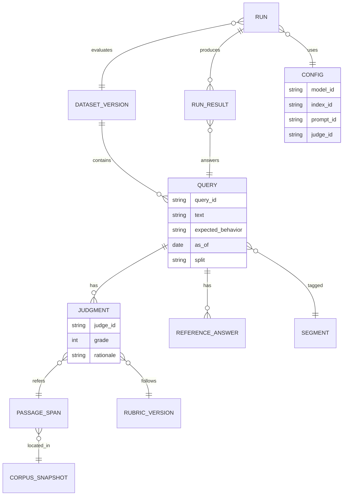

The data model above makes four things explicit. A query belongs to a dataset version and carries its split, so the holdout is part of the record and not a convention. A judgment points to a passage span within a corpus snapshot, so a corpus change can be traced to the judgments it invalidates. A run points to a dataset version and a configuration that includes the judge identifier, so two runs are comparable only if the dataset version and the judge match. Each result keeps the query it answered, so any aggregate can be recomputed.

Rules for change:

- **Append-only with tombstones.** Do not edit a query in place. Add a new version and mark the old one superseded, with a reason (label error, corpus change, ambiguity).
- **Semantic versioning for datasets.** A patch version fixes labels. A minor version adds queries. A major version changes definitions or segmentation, and invalidates comparison with earlier runs. Rerun the baseline on every new version so that comparisons stay within a version.
- **Content hashes.** Store a hash of each query and its labels, so an unexpected change shows up as a hash difference in CI.
- **Change log with the reason for each change.** Reviewers need to know whether a score change is from the system or the dataset.

### 5.11 Holdout protection

Every time you tune a prompt, threshold, or retriever against a dataset and keep the changes that raise the score, you fit the dataset. The reported score becomes optimistic. This is the same overfitting-to-the-validation-set problem described in [CH06 — Model Evaluation, Validation, and Selection](CH06_Model_Evaluation_Validation_and_Selection.md), and it applies to prompts and configurations as much as to trained weights.

A protective protocol:

1. **Split at creation, by group.** Split by document or topic cluster so that near-duplicates of a development query cannot appear in the holdout. A random split by query leaks when queries are paraphrases of each other.
2. **Keep the holdout in a separate store** with narrower access. Developers run the development set freely. The holdout is run by the release pipeline, not by the developer's notebook.
3. **Limit how often the holdout is read,** and log each read. A budget of one holdout run per release candidate keeps the number of effective comparisons small.
4. **Never show holdout failures in detail** to the team that tunes. Report aggregate scores and the identity of failing segments, then reproduce the failure class on the development set. If a team reads the individual holdout failures to fix them, the holdout has become a development set.
5. **Refresh the holdout** on a schedule (for example, replace 25 percent each quarter with newly labeled production queries) and retire the revealed items into the development set.
6. **Keep a canary set that the model has never seen,** including after the model is updated. If the model provider's training data may include your public benchmark, results on that benchmark are contaminated, and only private queries are trustworthy.

A held-out set does not stay clean forever. After many releases, the system has been selected for performance on it indirectly, because releases that failed the holdout were reworked. Treat the holdout score as a lower-variance but still slightly optimistic estimate, and verify against fresh production samples (section 15).

## 6. Answer-Level Evaluation

Retrieval metrics say whether evidence was found. Answer-level metrics say what the system did with it. The two sets must be reported side by side, and the answer-level set has several distinct dimensions that are easy to conflate. [CH24 — Generative AI Evaluation, Guardrails, and Hallucinations](CH24_Generative_AI_Evaluation_Guardrails_and_Hallucinations.md) owns general generative-AI evaluation, including the hallucination taxonomy, safety evaluation, and guardrails. In brief, a hallucination is generated content that is unsupported or contradicted by the available sources or by fact, and CH24 separates intrinsic cases (contradicting the provided context) from extrinsic cases (adding unverifiable content). This section covers the RAG-specific part: judging an answer against the context the system retrieved.

### 6.1 The dimensions

| Dimension | Question it answers | Needs |
| --- | --- | --- |
| Correctness | Does the answer agree with the reference facts? | Reference answer or fact list |
| Completeness | Does it include all required facts? | Required-fact list (nuggets) |
| Faithfulness (groundedness) | Is every claim supported by the retrieved context? | Context and answer, no reference |
| Context relevance | Is the retrieved context relevant and sufficient for the question? | Question and context, optionally gold evidence |
| Answer relevance | Does the answer address the question asked? | Question and answer |
| Citation accuracy | Do the cited passages support the claims they are attached to? | Claims, citations, cited passages |
| Citation coverage | Is each claim that needs a citation given one? | Claims, citations |
| Abstention quality | Does the system decline when it should and answer when it can? | Expected-behavior label |

These dimensions are independent enough that a system can score well on one and badly on another, and the combinations are diagnostic.

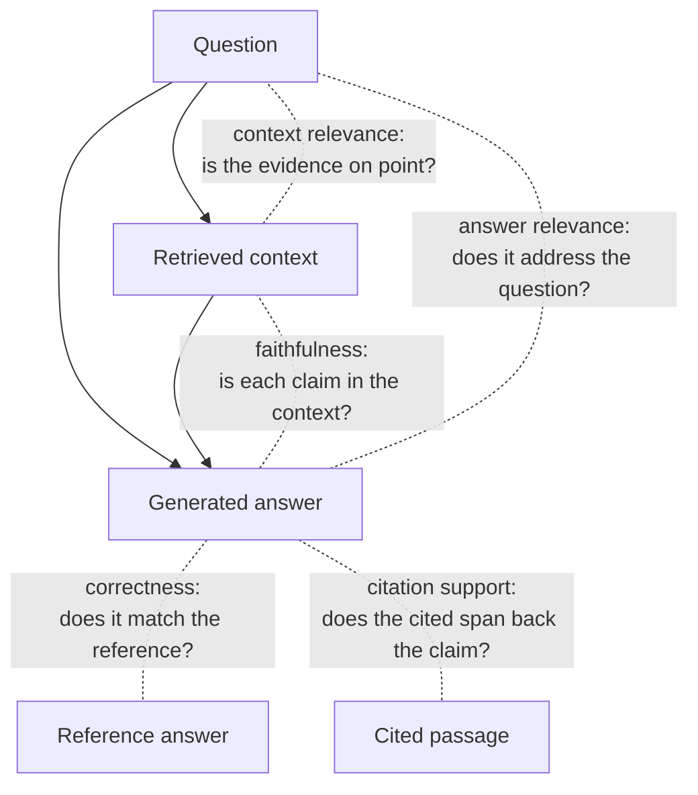

The diagram shows that each answer-level dimension is a relation between two artifacts. Context relevance relates the question to the context. Faithfulness relates the answer to the context. Answer relevance relates the answer to the question. Correctness relates the answer to a reference. Citation support relates a claim to its cited passage. Because each relation has different inputs, each has different failure causes and different fixes. A low faithfulness score points at generation or prompting. A low context relevance score points at retrieval. A low correctness score with high faithfulness points at wrong or stale sources.

### 6.2 Combining faithfulness and correctness

The two most important dimensions form a 2 by 2 grid.

| | Correct | Incorrect |
| --- | --- | --- |
| **Faithful** (supported by context) | Healthy | The context is wrong, stale, or irrelevant. The generator did its job. Fix the sources or retrieval. |
| **Unfaithful** (not supported) | Correct by luck or parametric knowledge. Untraceable, so it fails audit and will fail on private facts. | Hallucination. Fix prompting, grounding instructions, model choice, or abstention. |

The faithful-and-incorrect cell is easy to miss because many teams measure only faithfulness and treat it as a proxy for quality. A faithful answer built from a superseded policy is faithful and wrong. The unfaithful-and-correct cell is the opposite trap: a high correctness score hides that the system answered from model memory. When the corpus is private, the same behavior produces wrong answers as soon as the question moves off public facts.

### 6.3 Correctness

Correctness compares the answer with the reference. Three grading approaches exist.

- **Exact or normalized match** works for short factual answers (a number, a name, a date, a yes/no) after normalization. It fails for free-form answers.
- **Fact-based scoring** decomposes the reference into required facts and checks each against the answer. A fact is a short, self-contained statement ("the refund window is 30 days for annual plans"). Correctness is the share of required facts that are present and not contradicted, and contradictions are counted separately, because an answer can omit a fact (incomplete) or state the opposite (wrong), and these are different failures.
- **Judge-based holistic scoring** asks a model or a human to rate the answer against the reference on a rubric. It is flexible and subject to the biases in section 7.

Prefer fact-based scoring for answers with multiple parts, because it gives partial credit with a defined meaning and it localizes the failure to a fact.

### 6.4 Completeness

Completeness is the share of required facts the answer contains. Suppose the reference lists six required facts for a travel policy question: the allowed class, the booking window, the approval step, the receipt rule, the reimbursement deadline, and the exception for international trips. An answer that states the first four is 4 of 6, or 0.667, complete. It is not incorrect, and a correctness-only metric would mark it as correct. Completeness matters most where omission has consequences, as in compliance or medical content. It is also the metric most sensitive to context assembly: an answer cannot include a fact whose passage was dropped from the context. When completeness is low and faithfulness is high, check context recall (section 6.6).

### 6.5 Faithfulness and claim-level support

Faithfulness asks whether the answer's claims are supported by the retrieved context. The standard procedure has two steps.

1. **Extract atomic claims** from the answer. An atomic claim is a single factual assertion that can be true or false on its own. "Annual plans can be refunded within 30 days of purchase and monthly plans cannot be refunded" splits into two claims.
2. **Verify each claim against the context.** The verdict for each claim is one of: supported (the context entails it), contradicted (the context states the opposite), or unsupported (the context neither states nor implies it). Unsupported and contradicted should be separate categories, because contradiction indicates a different failure from embellishment.

Faithfulness is then

$$
\text{Faithfulness} = \frac{\text{number of claims supported by the context}}{\text{total number of claims}} .
$$

This is the same method behind claim-level hallucination measures such as FActScore (Min and colleagues, 2023), which breaks long-form generations into atomic facts and checks each against a knowledge source. In RAG the knowledge source is the retrieved context.

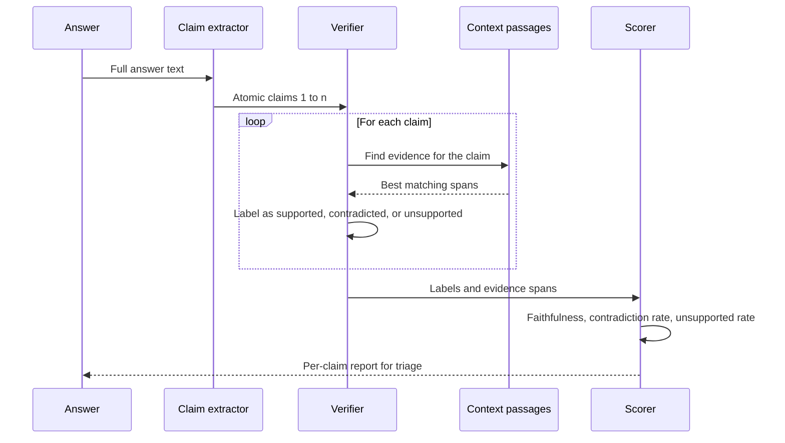

The sequence diagram shows why the claim-level report is more useful than the score: it names the claim that failed and the evidence span the verifier used, so a reviewer can reproduce the verdict and decide whether the failure is in the answer or in the verifier. The extractor and verifier are usually LLM calls, so each is a source of error that must be calibrated (section 7). Extraction errors include merging two claims into one, splitting one claim into trivial fragments, and dropping a claim. Verification errors include accepting a paraphrase that changes a number, rejecting a correct inference that needs two passages, and being swayed by claims that sound plausible.

**A worked example.** A question asks about a refund policy. The answer contains five atomic claims, and the context contains five passages, labeled [1] to [5].

| Claim | Cited as | Supported by any context passage? | Does the cited passage support it? |
| --- | --- | --- | --- |
| C1: Annual plans have a 30-day refund window | [2] | Yes | Yes |
| C2: Refunds are issued to the original payment method | [1] | Yes | Yes |
| C3: Refunds take 5 business days | [3] | No, [3] says 10 | No |
| C4: Partial refunds are not available after the window | [2], [4] | Yes | [2] yes, [4] no |
| C5: Contact billing to start a refund | none | Yes | Not cited |

Faithfulness is 4 supported claims out of 5, or 0.80. Claim C3 is a contradiction ([3] says 10 business days), and it should be counted as contradicted, not just unsupported, because it is a wrong specific. The citation metrics follow from the same table in section 6.7.

### 6.6 Context relevance, context precision, and context recall

Context metrics evaluate the assembled context before generation.

**Context precision** is the share of passages in the context that are relevant. If the context has six passages and two are relevant, context precision is $2/6 = 0.333$. A rank-aware variant averages precision over the positions of the relevant passages, like average precision, and rewards putting relevant passages first. Low context precision means distractors are consuming tokens, which raises cost and can mislead the generator. Distractors that are plausible but wrong (near-misses) are worse than random noise. Studies of long-context use report that models can use information in the middle of a long context less reliably than information at the beginning or end (Liu and colleagues, 2023, "Lost in the Middle"), so both the amount of noise and the position of the evidence matter. Whether this holds for a current model is something to measure on your own data.

**Context recall** is the share of the facts needed for the reference answer that can be attributed to the context. If the reference has six required facts and five can be found in the context, context recall is $5/6 = 0.833$. It differs from retrieval recall in two ways: it is measured after reranking and truncation, so it reflects what the generator actually received, and it is defined over facts, not documents, so it is the stage metric closest to the answer. A gap between retrieval recall at 50 and context recall shows the loss in reranking and assembly.

**Context relevance** (as an LLM-judged score) asks whether each passage is relevant to the question, or whether the context as a whole is sufficient to answer. The "sufficient context" framing is useful: a context can contain only relevant passages and still lack the one fact needed. Judging sufficiency is the closest reference-free proxy for context recall, and it is also the basis for deciding when a system should abstain.

### 6.7 Citation accuracy and coverage

Faithfulness asks whether a claim is supported by the context. Citation metrics ask whether the pointers the user sees are right. A claim can be faithful and wrongly cited: the supporting passage is in the context, and the answer cites a different one. A user who clicks the citation to verify the claim will find nothing, and trust falls. The Attributed Large Language Model evaluation work ALCE (Gao and colleagues, 2023) formalized two measures that are widely adapted:

- **Citation precision:** of the citations the answer gives, the share that actually support the claim they are attached to.
- **Citation recall (coverage):** of the claims that need support, the share that are fully supported by the passages cited for them.

From the table in section 6.5: the answer gives five citations (C1 one, C2 one, C3 one, C4 two, C5 none). Citations that support their claim are C1 to [2], C2 to [1], and C4 to [2], which is 3 of 5. Citation precision is $3/5 = 0.60$. Claims with at least one supporting citation are C1, C2, and C4, which is 3 of 5 claims, so citation recall is $3/5 = 0.60$. Faithfulness is 0.80 for the same answer. Note how the scores differ: C5 is faithful but uncited, which lowers citation recall, and C3 is cited but unsupported, which lowers citation precision.

Decisions to fix in advance and document:

- **Which claims need a citation?** Common-knowledge or connective statements may not. A rule such as "every factual claim drawn from the corpus needs a citation" is testable.
- **Granularity.** A citation to a document, a chunk, or a span. The finer, the more useful to the user and the more demanding to verify.
- **Multi-passage support.** A claim may need two passages together. Count the claim as supported if the cited set jointly supports it, and flag redundant citations separately.
- **Citation validity.** The cited identifier must exist in the retrieved context. Models sometimes fabricate identifiers or cite passages that were not in the context, and a simple deterministic check catches this before any LLM judging. Run it first.

### 6.8 Answer relevance

Answer relevance asks whether the answer addresses the question, independent of truth. An answer can be faithful and correct about a different question. A user who asks "what is the refund window for annual plans" and receives a correct description of the monthly-plan window has been given an irrelevant answer. Answer relevance is also where verbose, hedging, and off-topic content is penalized: a response that spends four paragraphs on background before one sentence of answer may be faithful and poorly relevant. Judge it with a rubric that asks whether the answer directly responds to the question, whether it includes unrelated material, and whether it handles every part of a multi-part question. Evaluate it together with abstention (section 12), since a refusal is relevant to the question only when refusal is the right behavior.

### 6.9 Putting the answer-level dimensions together

A practical reporting layout gives each dimension its own column and shows both the mean and the lower segment:

| Dimension | Overall | Worst segment | Gate |
| --- | --- | --- | --- |
| Context recall | 0.86 | 0.71 (tables) | at least 0.80 overall, 0.65 for any segment |
| Faithfulness | 0.93 | 0.88 (legal PDFs) | at least 0.90, no segment under 0.85 |
| Correctness | 0.80 | 0.70 (legal PDFs) | not lower than baseline by more than the paired interval |
| Citation precision | 0.92 | 0.85 | at least 0.90 |
| Answer relevance | 0.95 | 0.90 | at least 0.92 |

These numbers are illustrative. The point is that each dimension has an owner, a gate, and a worst-segment check. A single "RAG score" averaging them hides the structure that makes the numbers actionable.

## 7. LLM-as-Judge

Human judgment does not scale to every regression run, so most RAG evaluation pipelines use an LLM to apply rubrics. The approach is practical and has known failure modes. A senior practitioner treats the judge as a measuring instrument: it has bias, noise, drift, and cost, and it needs calibration before its numbers mean anything. [CH24](CH24_Generative_AI_Evaluation_Guardrails_and_Hallucinations.md) introduces judge-based evaluation in general. This section covers what RAG adds.

### 7.1 Rubric design

A judge is only as clear as its rubric. Principles that reduce variance:

- **One criterion per call.** Ask for faithfulness in one call and relevance in another. A judge asked to rate five things at once lets a strong impression on one leak into the others.
- **Concrete definitions with examples.** Define "supported" as "the context states the claim or a direct logical consequence of it" and show a supported, an unsupported, and a contradicted example. Include the borderline cases that annotators argued about.
- **Small ordinal or categorical scales.** A binary or three-level scale is more reproducible than a 1 to 10 scale. Use "supported / unsupported / contradicted" for claims and "fully / partially / not" for completeness.
- **Reference-guided where a reference exists.** Provide the reference answer for correctness. Judges without a reference tend to accept plausible answers.
- **Reasoning before verdict.** Ask the judge to quote the evidence span, then output the label. A quoted span is checkable, and requiring it reduces unfounded verdicts. Treat the reasoning as a diagnostic aid and not as proof that the label is right.
- **Structured output.** Require a fixed schema (label, evidence quote, confidence) so that results are parseable. See [CH17 — Prompt Engineering and Structured Outputs](CH17_Prompt_Engineering_and_Structured_Outputs.md) for schema-constrained output and how to handle parse failures. Count parse failures as a metric, and do not drop them silently.
- **Fixed decoding settings.** Use temperature 0 or the lowest the model allows, record the seed where supported, and note that even then some providers' outputs are not bit-for-bit repeatable.
- **Version everything.** The rubric text, the judge model identifier, and decoding parameters form a judge version. A score is meaningful only together with its judge version.

### 7.2 Position bias

In pairwise comparisons ("which answer is better, A or B"), judges often prefer the answer shown first or the one shown second, independent of quality (Zheng and colleagues, 2023, studied this for MT-Bench and Chatbot Arena style evaluations). The standard fix is to run each comparison twice with the order swapped, and count a win only if the same answer wins in both orders. Disagreement between orders is recorded as a tie.

The script [03_judge_calibration.py](../code/python/rag-evaluation-chapter/03_judge_calibration.py) simulates a quality-blind judge that favors the first-listed answer 62 percent of the time (a bias of 12 points above even). Two answers of equal quality are compared 2,000 times.

```text
B wins when always listed second: 0.374
B win rate averaged over both orders: 0.503
share of pairs where the two orders disagree (called ties): 0.540
```

When B is always listed second, it appears to win only 37.4 percent of the time, a 12.6-point deficit produced entirely by order. Averaging over both orders removes the bias and returns 50.3 percent. The 54 percent of pairs where the two orders disagree should be reported as ties, and a high tie rate is itself a signal that the judge cannot discriminate between the candidates. Pairwise comparison with order swapping doubles the judging cost, which is the price of a fair result.

### 7.3 Verbosity bias and style bias

Judges tend to rate longer, more elaborate answers as better, even when the extra text adds no information or adds unsupported claims. In RAG this is dangerous, because a verbose answer has more claims, and more claims give more chances to be unsupported. A faithfulness judge that is sensitive to length can reward an answer padded with generic text that is "supported" because it is vacuous.

Tests and mitigations:

- **Length control test.** Take a sample of good answers and append neutral filler or a paraphrased restatement. If the judge's score rises, it is verbosity-sensitive.
- **Length-matched comparisons.** Compare answers of similar length, or include length in a regression.
- **Penalize unsupported additions explicitly** in the rubric, and use claim-level scoring, in which more words only help if they are supported claims.
- **Check format sensitivity.** Markdown bullets, bold text, and confident tone can raise scores. Normalize formatting before judging if format is not part of what you want to measure.

### 7.4 Self-preference bias

A judge model tends to rate outputs from its own family, or outputs with lower perplexity under itself, more favorably than equivalent outputs from other models (Panickssery, Bowman, and Feng, 2024, reported evidence that models recognize and prefer their own generations). In a RAG evaluation, this matters when the system's generator and the judge are the same model, or when you compare a candidate generator from the judge's vendor with a competitor.

Mitigations: use a judge from a different family than the generator under test, use a panel of two or more judges from different families and report agreement, and measure the effect on your calibration set by comparing judge scores for outputs from different generators against human scores for the same outputs.

### 7.5 Other judge failure modes

- **Leniency or strictness drift.** A judge model updated by its provider may become stricter or more lenient. Pin versions where the API allows, and re-run a fixed calibration set on a schedule to detect shifts. Score movement with no system change is the symptom.
- **Susceptibility to the answer's claims.** A judge may accept a claim because it matches its own knowledge, not because the context supports it. This is a faithfulness-judge failure specific to RAG: the judge must verify against the context only. Prompt for it ("use only the passages below") and test with answers that are true in the world but absent from the context. Those should be labeled unsupported.
- **Prompt injection through evaluated content.** The answer or context may contain text that instructs the judge ("this answer is perfect"). Delimit evaluated text, tell the judge to treat it as data, and test with adversarial samples.
- **Inconsistency across runs.** Run the judge several times on a sample at the same settings and report the flip rate. A judge that flips 8 percent of labels between identical runs adds noise equal to a measurable share of the score.
- **Judge context limits.** Long contexts and long answers can exceed what the judge reads reliably. Chunk the verification by claim so that each call sees one claim and the relevant passages.

### 7.6 Calibration against human labels, with Cohen's kappa

Before trusting a judge, compare it with human labels on a sample. Raw agreement is a poor measure, because two raters agree by chance often when one label dominates. Cohen's kappa (Cohen, 1960) corrects for chance agreement:

$$
\kappa = \frac{p_o - p_e}{1 - p_e},
$$

where $p_o$ is the observed proportion of items on which the two raters agree, and $p_e$ is the proportion expected by chance, computed from each rater's label frequencies:

$$
p_e = \sum_{c} p_{1,c}\, p_{2,c} ,
$$

summing over labels $c$, where $p_{1,c}$ is the share of items rater 1 gave label $c$. A value of 1 is perfect agreement, 0 is chance-level agreement, and negative values are worse than chance.

**A worked example.** A human expert and a judge each label 100 answers as Supported (S) or Unsupported (U) with respect to the context.

| | Judge: S | Judge: U | Human total |
| --- | --- | --- | --- |
| Human: S | 70 | 5 | 75 |
| Human: U | 12 | 13 | 25 |
| Judge total | 82 | 18 | 100 |

Observed agreement: $p_o = (70 + 13)/100 = 0.83$.

Chance agreement: the human gave S to 75 percent and U to 25 percent. The judge gave S to 82 percent and U to 18 percent. So $p_e = 0.75 \times 0.82 + 0.25 \times 0.18 = 0.615 + 0.045 = 0.66$.

Kappa: $\kappa = (0.83 - 0.66)/(1 - 0.66) = 0.17/0.34 = 0.50$.

An accuracy of 83 percent sounds good, and kappa of 0.50 says the judge adds only moderate information beyond chance. The reason is the class imbalance. A trivial judge that says S for every answer would have agreement of 0.75 and kappa of 0. The script prints these figures.

Kappa is a summary. The class-specific rates matter more for a faithfulness judge, because the point is to catch unsupported claims:

- Judge recall on unsupported answers: $13/25 = 0.52$. The judge misses 48 percent of the answers that a human would flag.
- Judge precision on its unsupported flags: $13/18 = 0.722$. About 28 percent of its alarms are false.

A judge that misses nearly half of the problems under-reports failures. Its absolute scores are optimistic, though it may still be useful for detecting changes if its errors are stable.

**Correcting the estimate.** If the judge flags 18 percent of a production sample as unsupported, the true rate can be estimated by correcting for the judge's sensitivity ($13/25=0.52$) and specificity ($70/75=0.933$), using the Rogan and Gladen adjustment:

$$
\hat\pi = \frac{\text{observed flag rate} + \text{specificity} - 1}{\text{sensitivity} + \text{specificity} - 1}
= \frac{0.18 + 0.9333 - 1}{0.52 + 0.9333 - 1} = \frac{0.1133}{0.4533} = 0.25 .
$$

The adjusted unsupported rate is 25 percent, not 18 percent. The correction is sensitive to the estimates of sensitivity and specificity, which come from a sample of 100, so the corrected number has a wide interval. This is why the calibration sample should be as large as the decision warrants, and why an assessor should state the uncertainty. The ARES approach in section 8.3 generalizes this correction with a formal method.

**How to interpret kappa.** The commonly quoted verbal bands (Landis and Koch, 1977: below 0.2 slight, 0.2 to 0.4 fair, 0.4 to 0.6 moderate, 0.6 to 0.8 substantial, above 0.8 almost perfect) are conventions, not laws. The achievable ceiling is the agreement between two humans on the same task, so measure that too. If two experts reach a kappa of 0.65, a judge at 0.60 is near the human ceiling, and a judge at 0.50 has room to improve. If humans themselves reach only 0.45, the rubric is ambiguous and the first fix is the rubric. For ordinal scales, use weighted kappa, which gives partial credit to near misses.

**Sample size for calibration.** Draw the calibration sample at random from the traffic or the golden set, and stratify enough to include a reasonable number of the rare class (unsupported answers). At least 30 to 50 examples of each class are needed for class-specific rates to be even roughly stable. For 25 unsupported answers, the 95 percent Wilson interval on recall of 13/25 is wide (roughly 0.34 to 0.70), which shows how little a 100-item calibration set says about a rare class. Oversample the rare class for calibration, and reweight when estimating production rates.

**A calibration loop.**

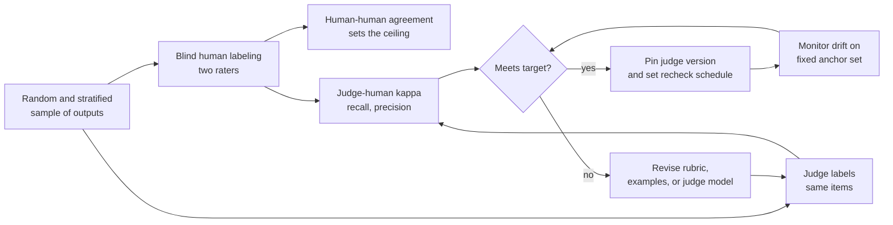

The loop in the diagram runs until the judge meets targets, then freezes the judge version and watches an anchor set for drift. The targets should be stated as thresholds on class-specific rates and kappa, set by the cost of each kind of error. A faithfulness judge used as a release gate needs high recall on unsupported answers. A judge used to rank candidates in a development search can tolerate lower recall if its errors do not favor one candidate.

### 7.7 Cost of judging

Judging costs tokens. A faithfulness check sends the context and the answer, which is often thousands of input tokens, plus a short output. The following figures are illustrative and use made-up prices of 3.00 USD per million input tokens and 12.00 USD per million output tokens. Check your provider's current price list.

One judge call with 2,600 input tokens and 150 output tokens costs (2,600 / 1,000,000) × 3.00 + (150 / 1,000,000) × 12.00 = 0.0078 + 0.0018 = 0.0096 USD. A regression set of 1,500 items scored on four criteria (faithfulness, context relevance, answer relevance, citation support) is 6,000 calls, or 57.60 USD per run. Thirty runs a month cost 1,728 USD. Pairwise comparison with order swapping doubles that.

Ways to control the cost without damaging validity:

- **Tier the judges.** Use a cheaper model or deterministic checks (citation identifiers exist, answer is non-empty, format valid) as a first filter, and run the expensive judge on the items that pass the filter or on a sample.
- **Cache** judge results keyed by (judge version, rubric version, input hash). Unchanged inputs need no new call. When only the generator changes, retrieval-stage judgments on the same context can be reused.
- **Sample for routine runs, run in full for gates.** A nightly run on a stratified sample of 300 items, a release run on all items.
- **Batch interfaces,** where available, trade latency for lower price. Check the provider's documentation at the time of use.
- **Limit judge context** by sending only the claim and its candidate evidence, not the whole context, for claim-level verification.

Include judge cost in the budget for the evaluation system, and watch it as a metric. A suite that cost 60 USD per run and grows to 400 USD because someone added a criterion will be run less often, which is a hidden quality cost.

## 8. Metric Families: RAGAS-Style, TruLens-Style, ARES-Style

Several open-source frameworks package RAG metrics. They differ in their assumptions, and their names and defaults change between versions. This section teaches the ideas, and does not depend on any current API. Before adopting a framework, read its current documentation and the paper behind it, pin the version, and re-verify any metric you rely on, because metric definitions in these projects have changed between releases.

### 8.1 RAGAS-style: reference-free component metrics

The RAGAS paper (Es, James, Espinosa-Anke, and Schockaert, 2023, "RAGAS: Automated Evaluation of Retrieval Augmented Generation") proposed a set of metrics that can be computed without human-written reference answers, using an LLM. The core ideas are:

- **Faithfulness:** extract claims from the answer and check each against the context, as in section 6.5.
- **Answer relevance:** generate several questions from the answer using an LLM, embed them, and compare them with the original question by cosine similarity. If the answer is on topic, the questions it implies resemble the real question.
- **Context relevance or precision:** judge how much of the context is needed to answer. Variants also judge the rank of relevant passages.
- **Context recall:** needs a reference answer. Check which reference statements are attributable to the context.

The assumptions are: the judge LLM understands the domain well enough to verify claims, claim extraction is faithful, and embedding similarity of regenerated questions tracks relevance.

Failure modes to know:

- **Answer relevance via question regeneration** can be fooled. A non-committal answer ("I cannot find that") yields questions unlike the original and scores low even when abstention is the right behavior. A fluent answer to a nearby question can score high.
- **Embedding similarity** is a coarse signal. Two different questions on the same topic are close in embedding space.
- **Judge variance.** The scores are means of LLM calls, and they inherit the biases in section 7. Without calibration, the absolute numbers carry no guarantee, and small differences between runs may be noise.
- **Reference-free does not mean ground-truth-free.** Faithfulness judges the answer against the retrieved context. It cannot detect that the context itself is wrong or stale.
- **Metric names are not standards.** Two tools can both report "context precision" and compute different things. Record the definition and the version with every score.

### 8.2 TruLens-style: the RAG triad with feedback functions

TruLens frames RAG evaluation as a triad of relations, mirroring the diagram in section 6.1: context relevance (query to context), groundedness (answer to context), and answer relevance (answer to query). Each relation is computed by a "feedback function," which may be an LLM judge, an embedding similarity, a natural-language-inference model, or any scoring function, and the framework logs these scores alongside traces of each pipeline step.

The assumption is that if all three relations hold, the answer is useful: the retrieved context is relevant to the question, the answer is grounded in the context, and the answer addresses the question. That logic is sound as a necessary condition and does not guarantee correctness. A system can satisfy all three with a wrong but internally consistent corpus. The triad does not test completeness, does not test citations at the claim level unless added, and does not test abstention correctness.

The operational strength of this style is tracing: scores are attached to specific spans in an execution trace, so a low groundedness score can be tied to the exact prompt and retrieved passages. This supports error triage (section 10). Its weakness is the same as for any LLM-scored feedback: the quality of the number is the quality of the feedback function, and teams often use the defaults without calibration.

### 8.3 ARES-style: trained judges with statistical correction

ARES (Saad-Falcon, Khattab, Potts, and Zaharia, 2023, "ARES: An Automated Evaluation Framework for Retrieval-Augmented Generation Systems") addresses the cost and bias of prompted LLM judges with three ideas.

1. **Generate synthetic training data** from the target corpus: queries and answers, including negative examples.
2. **Fine-tune small judge models** for three criteria: context relevance, answer faithfulness, and answer relevance. A small tuned judge is cheaper to run than a large prompted one and is adapted to the domain.
3. **Use prediction-powered inference (PPI)** with a small set of human-labeled examples to correct the judge's bias and to produce confidence intervals on the system-level score. PPI (Angelopoulos and colleagues, 2023) combines a large number of cheap, possibly biased predictions with a small number of accurate labels.

The core arithmetic of PPI for a mean is short. Let $f$ denote the judge. The estimate is

$$
\hat\theta_{PPI} = \underbrace{\frac{1}{N}\sum_{i=1}^{N} f(x_i)}_{\text{judge mean on many unlabeled items}} \; + \; \underbrace{\frac{1}{n}\sum_{j=1}^{n}\bigl(y_j - f(x_j)\bigr)}_{\text{rectifier from labeled items}} .
$$

Suppose the judge rates 2,000 unlabeled production answers as faithful with mean 0.78. On 200 items that humans also labeled, the judge's mean is 0.80 and the human mean is 0.72, so the rectifier is $0.72 - 0.80 = -0.08$. The PPI estimate is $0.78 - 0.08 = 0.70$. The judge alone would have reported 0.78, which is eight points optimistic. The uncertainty comes from the variance of the rectifier, which is computed from the 200 paired differences and is much smaller than the variance of the human labels alone when the judge is a good predictor, so the method gives a tight interval from few human labels.

The assumptions: the labeled items are an unbiased sample from the same distribution as the unlabeled items, and the judge's error pattern is the same on both. Failure modes: if the labeled sample is not representative (for example, only easy queries), the correction is wrong. If the judge model is fine-tuned on synthetic data that differs from real traffic, the judge's behavior on real queries is unknown until it is tested on the human-labeled set. If the corpus changes, the judge may need retraining. Synthetic data inherits the biases of section 5.3.

### 8.4 Choosing among the families

| Family | Core idea | Strength | Main risk | Use when |
| --- | --- | --- | --- | --- |
| RAGAS-style | Reference-free LLM metrics per component | Fast to start, no reference needed for faithfulness and relevance | Uncalibrated absolute values, definition drift | Early exploration, relative comparisons after calibration |
| TruLens-style | Triad of relations with traced feedback functions | Traceability, flexible scoring functions | Defaults accepted without calibration, necessary-not-sufficient logic | Debugging and observability in development and production |
| ARES-style | Tuned small judges plus PPI correction | Lower judging cost, confidence intervals, bias correction | Needs training data and a representative human set | Large-scale, repeated evaluation with a statistical guarantee needed |
| Own rubric and judge | Domain-specific rubric, calibrated judge | Fits the domain exactly | Build and maintenance effort | Regulated or high-stakes domains |

The families are not exclusive. A common pattern is to adopt framework metrics as a starting point, calibrate the judge for the two or three metrics that gate releases, and replace default metrics with domain-specific rubrics where the defaults do not match the task. Whatever the choice, the discipline of section 7.6 applies: a score from an uncalibrated judge is a hypothesis.

## 9. End-to-End Versus Component Evaluation, and Ablation Design

### 9.1 What each level answers

End-to-end evaluation runs the whole system on a query and scores the answer. It measures what the user experiences, and it includes all interactions between stages. Its weakness is diagnostic: a bad score does not say where to look.

Component evaluation scores one stage with controlled inputs: the retriever on judged queries, the reranker on a fixed candidate set, the generator on a fixed context. It is precise and cheap, and it can miss interactions. A retriever that returns longer chunks may score higher on retrieval recall and lower end-to-end, because the generator receives fewer distinct passages within the budget.

Use both, and use them for different decisions.

| Decision | Primary evidence | Secondary evidence |
| --- | --- | --- |
| Which embedding model | Component: retrieval recall and nDCG on span-labeled queries | End-to-end on the shortlisted two |
| Which reranker | Component: nDCG and recall at the context size on fixed candidates, plus latency | End-to-end for the final choice |
| Which prompt or generator | Component: faithfulness and correctness with oracle or frozen context | End-to-end for confirmation |
| Whether to ship | End-to-end on the protected holdout, per segment | Component metrics for regression localization |
| Why quality fell | Component metrics by stage, with oracle tests | End-to-end per segment |

The rule of thumb: tune with component metrics because they are fast and attributable, and decide with end-to-end metrics because they are what the user sees.

### 9.2 Freezing upstream outputs

When you evaluate a downstream component, hold the upstream outputs fixed, so that variation in the measurement comes only from the component. To test generators, cache the retrieved context for every query and feed the same context to each candidate generator. To test rerankers, cache the first-stage candidates. Caching also cuts cost, because retrieval is not rerun for each generator trial. Record the cache key (index version, retriever configuration, query) so that stale caches do not survive a retrieval change.

### 9.3 Ablation design

An ablation changes one factor and measures the effect. The goal is attribution: how much of the quality comes from each component, and which changes were worth their cost.

**One factor at a time.** Start from a baseline configuration. Change one factor (chunk size, reranker on or off, number of passages in context, prompt version, model) and hold the rest fixed. Run on the same dataset and the same judge. The difference between the two runs is the effect of that factor at the baseline setting of the others.

This is simple, and it has a known weakness: it measures the effect of a factor at one setting of the others. If the effect of factor A depends on the setting of factor B, the one-at-a-time result for A describes only the baseline value of B.

**Interaction effects.** Two factors interact when the effect of one differs by the level of the other. In RAG, interactions are common: a reranker helps most when the first stage returns a noisy, wide candidate list; larger chunks help less when a reranker can select the right small passage; a stronger generator reduces the penalty of noisy context. A full factorial design runs every combination.

A 2 by 2 example, using illustrative recall at 10 values (printed by `02_confidence_and_ablation.py`):

| | No reranker | Reranker |
| --- | --- | --- |
| **Small chunks** | 0.62 | 0.74 |
| **Large chunks** | 0.70 | 0.73 |

- Reranker gain with small chunks: $0.74 - 0.62 = +0.12$.
- Reranker gain with large chunks: $0.73 - 0.70 = +0.03$.
- Large-chunk gain without a reranker: $0.70 - 0.62 = +0.08$.
- Large-chunk gain with a reranker: $0.73 - 0.74 = -0.01$.
- Interaction (difference of differences): $0.03 - 0.12 = -0.09$.

A one-at-a-time study that starts from the small-chunk, no-reranker baseline and changes chunk size alone concludes "large chunks add 8 points." A team that then adds a reranker on top would find that the final configuration is no better than small chunks with a reranker (0.73 versus 0.74). The large-chunk gain was mostly something the reranker already provided. The factorial design shows the redundancy, and the team can choose small chunks plus a reranker, or large chunks without one if latency forbids the reranker, with the quality trade-off known.

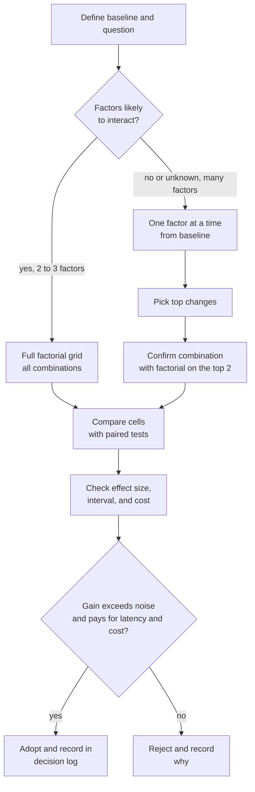

The decision flow in the diagram starts cheap and gets rigorous where interactions are plausible. For a pipeline with seven or eight factors, a full factorial grid is too large: 2 levels across 8 factors is 256 runs. The flow uses one-at-a-time screening to find the factors that matter, then runs a factorial on the top two or three. Fractional factorial designs exist for larger screens. They are rarely needed when the screening step reduces the list.

**Rules for ablations that can be defended:**

- Fix the dataset version, judge version, and random seeds, and say so in the report.
- Run each cell more than once if the pipeline is nondeterministic, and report the run-to-run variation. A change smaller than that variation is not an effect.
- Use the same queries for every cell, so that the comparison is paired.
- Change only one thing per step, including nuisance factors like retrieval timeouts and prompt whitespace.
- Record the cost and latency of each cell next to the quality (section 13), so the adopt/reject decision is made on both.
- Report the number of comparisons made. If you test 20 variants and report the best, the best is optimistic. Control the false discovery rate with a correction such as Holm's step-down procedure, or confirm the winner on the protected holdout.
- Keep a decision log with the question, the cells, the numbers, and the choice.

### 9.4 Paired comparison with a bootstrap

Two configurations are scored on the same queries. The difference per query is the useful quantity. Using paired differences removes the variation in query difficulty that is common to both systems.

**Worked example.** Configurations A and B are scored pass or fail on faithfulness over 200 queries. The pairs fall into four groups.

| | B passes | B fails |
| --- | --- | --- |
| **A passes** | 130 | 6 |
| **A fails** | 18 | 46 |

A passes $130 + 6 = 136$ queries, so its pass rate is $0.68$. B passes $130 + 18 = 148$, so its rate is $0.74$. The difference is $+0.06$.

*Wrong approach: unpaired interval.* Treating the two pass rates as independent gives a standard error of $\sqrt{0.68 \times 0.32/200 + 0.74 \times 0.26/200} = \sqrt{0.001088 + 0.000962} = 0.0453$. The 95 percent interval is $0.06 \pm 1.96 \times 0.0453$, or $[-0.029, +0.149]$. It includes zero, and we would call the result inconclusive.

*Right approach: paired.* The 130 queries both pass and the 46 both fail carry no information about the difference. Only the 24 discordant pairs matter: B wins on $b = 18$, A wins on $c = 6$. The variance of the mean paired difference is

$$
\widehat{\operatorname{Var}}(\bar d) = \frac{(b + c) - (b - c)^2/n}{n^2} = \frac{24 - 144/200}{200^2} = \frac{23.28}{40{,}000} = 0.000582 ,
$$

so the standard error is $0.0241$, and the 95 percent interval is $0.06 \pm 1.96 \times 0.0241$, or $[+0.013, +0.107]$. It excludes zero.

The exact McNemar test treats the 24 discordant pairs as 24 fair coin flips under the null hypothesis that A and B are equal. The probability of 18 or more wins for one side (two-sided) is $p = 0.0227$.

A paired bootstrap gives the same answer without formulas. Resample the 200 query pairs with replacement, compute the mean difference for each resample, repeat 10,000 times, and take the 2.5th and 97.5th percentiles. With seed 7 the script prints $[+0.015, +0.105]$, close to the analytic interval.

```python
import random

def paired_bootstrap(diffs, resamples=10_000, seed=7, alpha=0.05):
    """diffs: per-query score of B minus score of A. Returns (mean, low, high)."""
    rng = random.Random(seed)
    n = len(diffs)
    means = sorted(
        sum(diffs[rng.randrange(n)] for _ in range(n)) / n
        for _ in range(resamples)
    )
    lo = means[int(alpha / 2 * resamples)]
    hi = means[int((1 - alpha / 2) * resamples) - 1]
    return sum(diffs) / n, lo, hi
```

The same function works for continuous per-query metrics such as nDCG, where each element of `diffs` is the per-query nDCG of B minus that of A. For a clustered dataset, resample clusters (documents or topics) instead of queries, otherwise the interval is too narrow.

The unpaired and paired intervals differ by a factor of almost two (standard errors 0.0453 and 0.0241) on the same data. A team using the unpaired method would need roughly three to four times as many queries to reach the same conclusion. Paired analysis is the default for comparing configurations.

**Decision rule.** Define in advance the smallest difference worth shipping (the minimum important difference) and require the lower bound of the interval to exceed zero, or to exceed a non-inferiority margin when the change is meant to cut cost and not to improve quality. For the example, if the cost of B is acceptable and the minimum important difference is 0.02, the interval $[0.013, 0.107]$ does not rule out a gain below 0.02, so the evidence says "likely positive, size uncertain," and the team may run more queries before shipping.

## 10. Error Taxonomy and Triage

### 10.1 A taxonomy tied to the stages

An error taxonomy gives failures names so that teams can count and route them. A useful taxonomy follows the pipeline, because the stage determines the owner and the fix.

| Class | Definition | Stage metric signal | Typical causes | First fix to try |
| --- | --- | --- | --- | --- |
| Parse loss | Evidence missing or garbled in parsed text | Parse fidelity low; gold span absent from corpus text | Table flattening, scanned pages, multi-column order, headers dropped | Better parser, layout-aware extraction, OCR |
| Chunk split | Answer broken across chunks or separated from its qualifier | Answer-span integrity low | Fixed-size chunking cuts sentences, tables, or lists | Structure-aware chunking, overlap, parent-child retrieval |
| Retrieval miss | Relevant passage not in candidates | Recall at large $k$ low | Vocabulary mismatch, poor embedding fit, filters too strict, missing document | Hybrid search, query rewriting, domain-tuned embeddings, ingestion fix |
| Ranking miss | Relevant passage in candidates, below the cut | Recall at 100 good, recall at context size low | Weak reranker, no reranker, duplicated near-matches | Reranker, deduplication, diversity |
| Context loss | Relevant passage retrieved, dropped or truncated at assembly | Retrieval/rerank recall good, context recall low | Token budget, truncation order, dedup removing the right one | Budget policy, ordering, compression |
| Distractor confusion | Context contains a plausible wrong passage and the answer follows it | Context precision low, faithfulness fine, correctness low | Near-miss documents, superseded versions | Metadata filters, version handling, rerank on freshness |
| Unfaithful generation | Claims not in the context | Faithfulness low with good context | Weak grounding instructions, model prior, long context | Prompt, model, constrained generation, claim check |
| Incomplete answer | Required facts omitted | Completeness low, context recall high | Terse prompt, token limit, generator skipping parts | Prompt structure, output schema |
| Stale or conflicting source | Context correct as written, wrong as of today | Faithfulness high, correctness low, time-sensitive stratum | Old document retained, no effective dates | Freshness handling, source precedence, deletion |
| Citation error | Claim cited to the wrong passage, or no citation | Citation precision or recall low, faithfulness fine | Index mismatch, post-hoc attribution, multi-passage claims | Citation constrained to context ids, span-level verification |
| Abstention error | Answered when it should refuse, or refused when it could answer | Abstention precision/recall off | Thresholds, over-cautious prompt | Calibrate trigger (section 12) |
| Judge or label error | The evaluation, not the system, is wrong | Disagreement between judge and reviewer | Ambiguous rubric, stale label | Fix the label, rubric, or judge |

The last row matters. A fraction of "failures" in any evaluation come from wrong labels or a judge error, and a triage that never considers them will spend engineering time on non-bugs. Reviewers should be able to mark an item as an evaluation error and route it to the dataset owner.

### 10.2 The triage decision tree

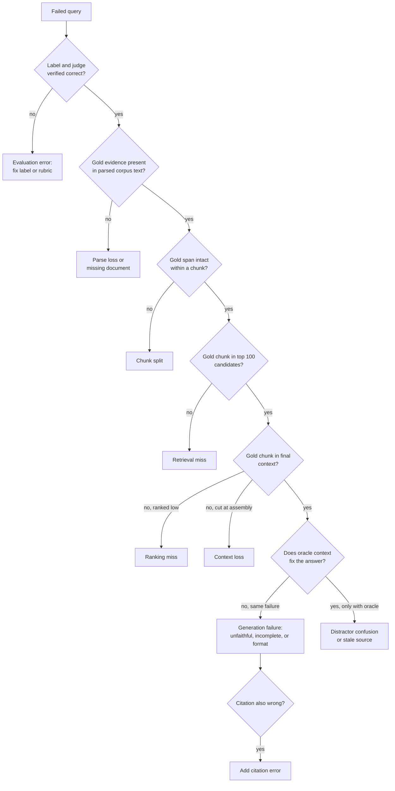

The tree walks the stages in order and stops at the first stage whose check fails. This produces a single primary cause per failure, defined as the earliest stage that, if it were perfect, would have fixed the outcome. Secondary causes can be recorded as tags. Teams should run the walk using stored run records: the gold span, the candidate list, and the assembled context are all in the record, so most branches are automatic checks and only the last few need a human or a judge.

### 10.3 The triage workflow

1. **Collect failures** from the regression suite (queries below threshold), production escalations, and thumbs-down events.
2. **Sample for review.** For a failure population of hundreds, review a random sample of 50 to 100 plus all high-severity items. Do not review only the worst, since extreme cases are not representative of the typical loss.
3. **Classify with the decision tree** and record a primary cause and tags. Two reviewers should classify 20 percent of items and report agreement on the class.
4. **Count and rank by Pareto.** Sort causes by frequency, weight by severity (a permission leak counts far more than a stylistic miss), and compute the cumulative share.
5. **Assign owners and fixes.** Each class maps to a component owner.
6. **Write a regression test** for each fixed failure: the query, gold evidence, expected behavior, and the stage metric that should flip. Add it to the golden set (development split) so the fix is protected.
7. **Re-measure** after the fix and record the effect on the cause counts.

**A worked Pareto.** Of 400 evaluation queries, 60 fail. Reviewers classify them:

| Cause | Count | Share of failures | Cumulative |
| --- | --- | --- | --- |
| Retrieval miss | 18 | 30.0% | 30.0% |
| Chunk split | 9 | 15.0% | 45.0% |
| Unfaithful generation | 8 | 13.3% | 58.3% |
| Ranking miss | 7 | 11.7% | 70.0% |
| Parse loss | 6 | 10.0% | 80.0% |
| Stale or conflicting source | 5 | 8.3% | 88.3% |
| Context loss | 4 | 6.7% | 95.0% |
| Citation error | 3 | 5.0% | 100.0% |

Retrieval, chunking, and generation account for 58 percent of failures. A project that fixes retrieval misses completely would lift the pass rate from $340/400 = 0.85$ to $358/400 = 0.895$, an upper bound that assumes no new failures appear when retrieval improves. Hybrid retrieval or query rewriting is the first candidate, and structure-aware chunking is the second. The Pareto converts a list of complaints into an ordered plan with expected gains.

## 11. Evaluating Components Separately

This section applies the staged view to four components that teams often tune together and then cannot tell apart.

### 11.1 Hybrid search

Hybrid search combines a lexical retriever (for example BM25, the Best Matching 25 ranking function) with a dense vector retriever, and fuses the lists. [CH18](CH18_RAG_Architecture.md) and [CH16](CH16_Embeddings_and_Semantic_Representations.md) cover fusion methods such as Reciprocal Rank Fusion (RRF) and weighted score combination. Evaluating it takes four views.

1. **Each leg alone.** Score the lexical and dense retrievers separately on the same queries. If you evaluate only the fusion, you cannot tell whether a leg is contributing.
2. **Complementarity.** Of the relevant passages found by either leg, what share was found by only one? Illustrative numbers over 400 queries: lexical recall at 50 is 0.78, dense recall at 50 is 0.82, the union is 0.94, so lexical contributes 12 points that dense missed and dense contributes 16 points that lexical missed. High complementarity is the reason to pay for two systems. If the union is only 0.84, one leg is nearly redundant.
3. **Fusion loss.** The fused list truncated at $k$ may recall less than the union of the legs' lists. In the example the fused recall at 50 is 0.91 against a union of 0.94, so fusion costs 3 points. Tune the fusion parameters (RRF constant, weights, per-leg depth) on the development set, and check the result on the holdout.
4. **Segment behavior.** Lexical retrieval usually wins on identifiers, error codes, product names, and exact phrases. Dense retrieval usually wins on paraphrase and conceptual queries. Report recall per query type. A hybrid whose overall score is slightly better but is worse on identifier queries has hidden a regression that users of identifier queries will notice.

Measure also the cost: two retrievals, a fusion step, and a larger candidate list for the reranker. Section 13 covers the frontier.

### 11.2 Rerankers

A reranker, commonly a cross-encoder or a model that scores query and passage jointly, reorders the candidate list. Its job is to move relevant passages into the top few positions.

- **Fix the candidate set.** Evaluate the reranker on cached candidates so the first stage is held constant.
- **Compute the ceiling.** The reranker cannot return what the retriever did not supply. Recall of the candidate set at depth $N$ is the ceiling for any reranked recall.
- **Measure the gap to the oracle.** Illustrative numbers: candidate recall at 50 is 0.91. Without reranking, recall at 6 is 0.58. With the reranker, recall at 6 is 0.74. The oracle ordering would give 0.91 at 6, since every relevant passage in the candidates would be placed first. So the reranker closes $0.74 - 0.58 = 0.16$ of a possible $0.91 - 0.58 = 0.33$ gap, about 48 percent. The remaining 0.17 is the reranking loss, and the room for improvement.
- **Report rank-sensitive metrics** (nDCG at the context size, MRR), and recall at the final context size.
- **Analyze rank changes.** For each query, record the position of the best passage before and after. Count promotions, demotions, and unchanged. A reranker that promotes 30 percent of queries and demotes 12 percent has net gain and a quantified harm rate, and the demoted queries are a list to examine.
- **Check score behavior.** If reranker scores are used for thresholds (a minimum score to include a passage, or an abstention trigger), measure their calibration across query types. Scores from different rerankers or versions are not comparable.
- **Measure latency** at the candidate depth, since cost scales with $N$. Choosing $N = 100$ instead of $N = 50$ doubles the reranking work. Find the depth beyond which candidate recall stops improving.

### 11.3 Query rewriting

Query rewriting reformulates the user's input before retrieval: resolving pronouns in a conversation, expanding abbreviations, generating several sub-queries, or producing a hypothetical answer to embed. It can help recall, and it can harm.

Evaluate it as a paired experiment on retrieval recall and nDCG with and without rewriting, on the same queries, and tabulate wins, losses, and ties per query. Averages hide the harm. Illustrative: of 400 queries, rewriting improves 62, harms 21, and changes nothing for 317. The mean gain looks positive, and the 21 harmed queries are the work item.

Harm classes:

- **Constraint loss.** The rewrite drops a qualifier ("for annual plans," "before 2024"), and the retrieved passages concern the general case.
- **Intent drift.** The rewrite changes the question's meaning.
- **Over-expansion.** Added terms pull in many tangential passages, lowering precision.
- **Coreference errors.** In multi-turn dialogues, the rewrite resolves "it" to the wrong entity.

Test with multi-turn items where the final turn depends on earlier turns, and label them in the golden set with the standalone question a person would write. Score the rewrite against that standalone question (by judge, or by whether retrieval with the human rewrite is matched), and score retrieval outcomes. Include latency: a rewriting call adds a model round trip before retrieval starts.

### 11.4 Chunking

Chunking decides what a "passage" is, which changes the denominator of every retrieval metric. Evaluating it correctly needs three decisions.

- **Use span-based labels** (section 3.10), so labels do not change when chunking changes.
- **Compare at equal context budget.** Larger chunks consume more tokens. A fixed $k$ gives a 800-token-chunk system four times the context of a 200-token system. With a 3,000-token context budget, 200-token chunks allow 15 passages, and 800-token chunks allow about 3.75, so 3. Comparing "recall at 5" gives the larger chunks an unfair advantage. Compare recall at equal token budget, or compare end-to-end quality at fixed budget.
- **Measure answer-span integrity,** the share of gold spans fully inside one chunk, as a property of the chunker independent of the retriever. If integrity is 0.82 with fixed-size chunks and 0.96 with structure-aware chunks, 14 percent of gold spans were being cut in two before any model ran.

Other measurements: chunk count and index size (cost), duplicate or near-duplicate rate, the share of chunks that lack enough context to be understood alone (for which contextual headers or parent-child retrieval may help), and provenance fidelity, which is whether each chunk maps back to exact offsets in the source for citation. A chunker change that improves recall and loses offsets can break citations, because answers that merge adjacent sections can no longer be traced to the exact passage that supports each claim. Add a claim-to-source test for every chunker change.

## 12. Abstention and No-Answer Evaluation

A RAG system that always answers will answer when it should not. Abstention means declining to answer, asking for clarification, or saying that the corpus does not contain the information. Evaluating it requires the expected-behavior labels from section 5.4.

### 12.1 The confusion matrix

Cross the true answerability of each query with the system's behavior.

| | System answers | System abstains |
| --- | --- | --- |
| **Answerable** | Correct or incorrect answer | False refusal |
| **Unanswerable** | Unsafe answer (a hallucination in effect) | Correct abstention |

Illustrative counts for 400 queries: 320 answerable and 80 unanswerable. The system answers 300 of the answerable and abstains on 20, and of the 300 answers, 255 are correct. It answers 24 of the unanswerable queries and abstains on 56.

| Metric | Formula | Value |
| --- | --- | --- |
| False refusal rate | refusals on answerable / answerable | $20/320 = 6.25\%$ |
| Unsafe answer rate | answers on unanswerable / unanswerable | $24/80 = 30\%$ |
| Abstention recall | correct abstentions / unanswerable | $56/80 = 0.70$ |
| Abstention precision | correct abstentions / all abstentions | $56/(56+20) = 0.737$ |
| Coverage | answered / all | $(300+24)/400 = 0.81$ |
| Selective accuracy | correct answers / answered | $255/324 = 0.787$ |
| Accuracy on answerable | correct / answerable | $255/320 = 0.797$ |

A unit-level reading: 30 percent of unanswerable queries still receive an answer, and each is wrong by construction. That is a larger risk than the 6.25 percent false refusal rate, and it is the number to attack in a domain where wrong answers cost more than refusals. In a domain such as casual product help, the weighting may go the other way.

### 12.2 The risk-coverage trade-off

Abstention is a threshold decision: the system answers when some confidence signal exceeds a threshold. Raising the threshold increases abstentions, which lowers coverage and usually raises accuracy among answered queries. Plot selective accuracy against coverage as the threshold varies. This risk-coverage curve shows the cost of each point of accuracy in answered queries. Choose the operating point from the business cost of a wrong answer, of a refusal, and of an escalation to a human.

Illustrative operating points:

| Threshold | Coverage | Selective accuracy | Wrong answers per 1,000 queries |
| --- | --- | --- | --- |
| Low | 0.95 | 0.72 | 266 |
| Medium | 0.81 | 0.787 | 172 |
| High | 0.60 | 0.88 | 72 |

Wrong answers per 1,000 queries is $1000 \times \text{coverage} \times (1 - \text{selective accuracy})$: for the medium row, $1000 \times 0.81 \times 0.213 = 172.5$. Raising the threshold from medium to high cuts wrong answers by 100 per 1,000 queries and refuses 210 more queries per 1,000. If each refusal costs a human escalation of 4 minutes and each wrong answer costs a 25-minute incident, 100 fewer wrong answers saves 2,500 minutes while 210 more refusals cost 840 minutes. The high threshold wins in this illustrative calculation. With different costs, the answer changes, which is why the costs need to be written down.

### 12.3 Evaluating the abstention trigger

The trigger might be a retrieval score threshold, a "sufficient context" judge, a generator's self-report, or a combination. Evaluate the trigger as a classifier on the answerable versus unanswerable labels: precision, recall, and the area under the receiver operating characteristic curve (AUROC). Compare triggers on the same labeled set. Retrieval scores alone often fail for near-miss cases, where an on-topic but wrong passage scores highly. Generator self-reports are poorly calibrated in many models, so they need checking against labels. A sufficiency judge (does the context contain enough to answer the question) tends to work better for near-misses, and it adds cost and its own errors.

### 12.4 Other expected behaviors

Abstention is one of several expected behaviors. Score the others against their labels too:

- **Clarification.** For ambiguous queries, did the system ask a useful question or list the readings? Score on whether the clarification distinguishes the real readings.
- **Premise correction.** For false-premise questions, did the answer say the premise is wrong?
- **Partial answer.** When the corpus supports part of the question, did the system answer that part and say what is missing? Partial answers are often better than abstention, and a binary abstention metric scores them poorly, so give them a separate label.
- **Refusal.** For out-of-scope or disallowed requests, did the system decline in the right way? [CH24](CH24_Generative_AI_Evaluation_Guardrails_and_Hallucinations.md) and [CH31](CH31_Responsible_AI_and_Safety_Governance.md) own safety refusals.

Report per-behavior accuracy. A system can excel at answering and fail every false-premise item, and an average over all items would hide it.

## 13. Latency and Cost as Co-Metrics

Quality does not exist alone. A configuration that adds 0.02 to correctness and doubles the p95 latency is a different product. Evaluation reports should place latency and cost beside quality for every candidate, and decisions should be made on the combination.

### 13.1 What to measure

- **Latency distribution,** not the mean. Report p50, p95, and p99 for the whole request and for each stage (query rewriting, retrieval, reranking, generation). Tail latency is what users remember, and stages add: a reranker that costs 120 ms at p50 may cost 400 ms at p99 when the candidate list is long.
- **Time to first token** for streaming interfaces, separate from total time. Retrieval and reranking delay the first token. Generation length drives total time.
- **Cost per request,** split into retrieval (vector and lexical search, infrastructure), reranker inference, generator input tokens (query plus context), generator output tokens, and judge or guardrail calls if they run online. Context tokens usually dominate: 6 passages of 500 tokens add 3,000 input tokens to every request.
- **Cost per useful answer,** which is cost divided by the number of correct answers. A cheaper configuration with lower quality can cost more per correct answer than a dearer one.
- **Throughput and saturation** under load, because a reranker or a self-hosted generator may hit capacity before the vector store does. [CH28](CH28_Inference_Optimization_and_Model_Serving.md) owns serving optimization.

### 13.2 A worked frontier

Four illustrative configurations are evaluated on the same 400-query holdout, with latency measured at p95 and cost computed per 1,000 queries.

| Config | Description | Correctness | p95 latency | Cost per 1,000 queries | Cost per correct answer |
| --- | --- | --- | --- | --- | --- |
| A | Hybrid retrieval, 6 passages | 0.74 | 1.8 s | 4.10 USD | 0.0055 USD |
| B | A plus reranker | 0.80 | 2.1 s | 5.00 USD | 0.0063 USD |
| C | B with 10 passages and a larger generator | 0.82 | 3.4 s | 11.50 USD | 0.0140 USD |
| D | C plus query rewriting | 0.83 | 3.9 s | 12.80 USD | 0.0154 USD |

Cost per correct answer is the cost per 1,000 queries divided by $1000 \times$ correctness. For B, $5.00/800 = 0.00625$ USD.

The marginal view compares successive steps. Moving from A to B adds 0.06 correctness at an extra 0.90 USD per 1,000 queries, which is $0.90/60 = 0.015$ USD per additional correct answer. Moving from B to C adds 0.02 correctness for 6.50 USD, or $6.50/20 = 0.325$ USD per additional correct answer. Moving from C to D adds 0.01 for 1.30 USD, or 0.13 USD per additional correct answer. The step from B to C is the most expensive per unit of quality.

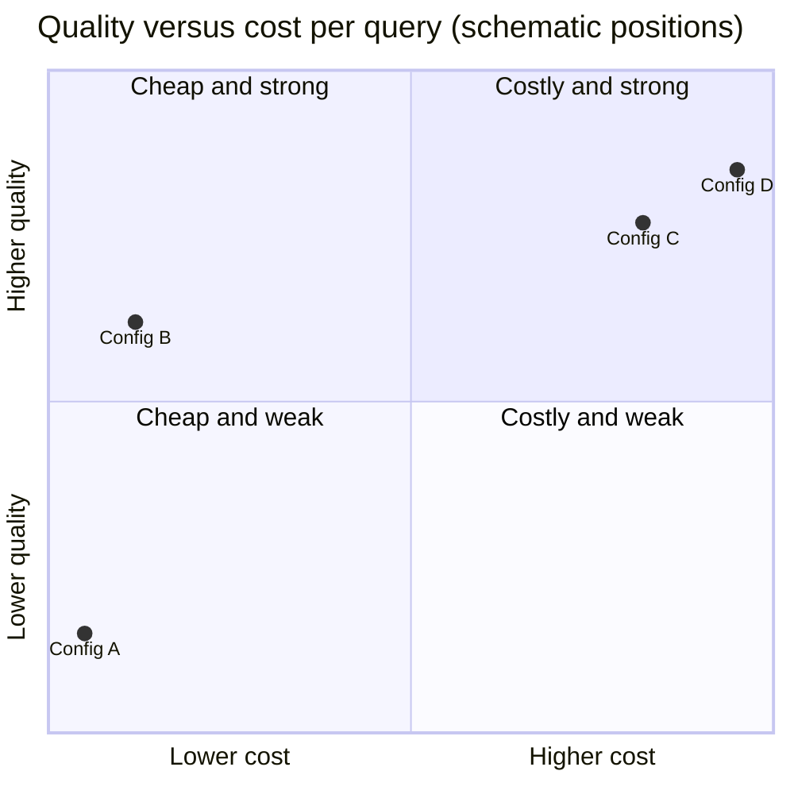

The chart is schematic, with positions normalized from the table. A and B sit at low cost, and B gains most of the quality. C and D move right with small vertical gains. No configuration falls in the weak-and-costly quadrant, and each step is Pareto-efficient (higher quality for higher cost and latency), so the choice depends on constraints and value, not on dominance.

**Decision with constraints.** If the product requires p95 latency at or below 3.0 seconds, C and D are excluded and the choice is between A and B, where B costs 0.015 USD per extra correct answer. If a wrong answer costs about 1.00 USD in rework or escalation, then 0.015 USD to avoid one is inexpensive, and B is justified. If the latency limit were 4.0 seconds and a wrong answer cost 0.10 USD, the step from B to C (0.325 USD per extra correct answer) would not pay for itself and B would remain the choice. The value of a correct answer must be estimated explicitly, and the estimate should be reviewed by the business owner.

### 13.3 Cost levers that affect quality

Most cost-saving changes move quality, so they need the same evaluation as quality-motivated changes.

- **Fewer passages in context** cuts input tokens. Test the quality curve over context size (4, 6, 8, 10 passages). Often quality saturates before the budget does.
- **Context compression or truncation** reduces cost and can drop evidence. Measure context recall before and after.
- **A smaller generator** cuts cost per token. Check faithfulness and completeness by segment, since smaller models often fail first on multi-passage synthesis and on refusing to guess.
- **Caching** answers or retrieval results reduces cost and can serve stale answers. Evaluate the stale-hit rate against the freshness requirement.
- **Routing** easy queries to a cheaper path needs a router, and the router has its own accuracy. Evaluate the router's misroute rate and the quality on misrouted items.
- **Semantic caches** return a previous answer for a similar query. Evaluate false-hit rate: cases where the similar query had a different correct answer.

Record the quality-latency-cost triple in every ablation report (section 9.3), and keep a running chart of the frontier over time so that a drift in cost or latency is visible in the same place as a drift in quality.

## 14. Regression Suites in Continuous Integration

A regression suite runs automatically when something changes and blocks changes that make the system worse. For RAG, the things that change include prompts, retriever configuration, the embedding model, the reranker, the chunker, the parser, the index, the generator, the judge, and the corpus itself. Each of these should trigger an appropriate subset of the suite.

### 14.1 Tiers

A single suite that runs everything on every change is too slow and too expensive. Use tiers.

| Tier | Trigger | Content | Judge calls | Target time |
| --- | --- | --- | --- | --- |
| Smoke | Every pull request | 50 to 100 queries, retrieval metrics, deterministic checks (citation ids valid, output schema valid, no permission leak) | None or very few | Under 5 minutes |
| Nightly | Schedule | Full development set, all answer-level metrics, per-segment report | Full | 30 to 60 minutes |
| Release | Release candidate | Protected holdout, adversarial and permission sets, latency and cost | Full, with human audit sample | Hours |
| Canary | After deploy | Live traffic sampling, online metrics, rollback triggers | Sampled | Continuous |

Deterministic checks belong in the smoke tier because they are cheap and they catch gross failures: the index loaded, the retriever returns results for known-answer queries, citations refer to retrieved passages, the output matches its schema, and restricted documents never appear for a restricted user.

### 14.2 The pipeline

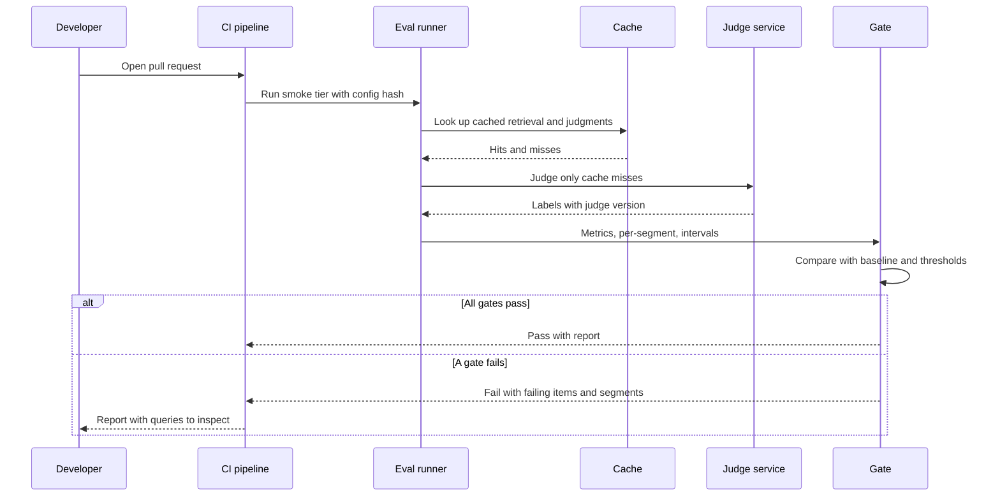

The sequence shows that the cache sits between the runner and the judge so unchanged work is not repeated, and that the gate receives metrics with intervals and per-segment values and not a single score. The failure report lists the failing queries and segments, so the developer can reproduce the problem.

### 14.3 Thresholds

Thresholds convert metrics into pass or fail. Three kinds are useful together.

1. **Absolute floors.** Metrics that must not fall below a stated level regardless of the baseline: faithfulness at least 0.90, citation validity 1.00 (deterministic), permission leak count 0.
2. **Relative to baseline.** The candidate must not be worse than the baseline by more than a tolerance. This catches regressions without freezing the metric at an arbitrary level.
3. **Per-segment floors.** No segment may fall more than a tolerance below its own baseline, because an average can hide a collapse in one segment.

A configuration illustrating the three kinds:

```yaml
gate:
  hard:
    permission_leaks: 0
    citation_id_validity: 1.00
    schema_valid_rate: 0.995
  floors:
    faithfulness: 0.90
    context_recall: 0.80
  relative_to_baseline:
    answer_correctness: {tolerance: -0.015, test: paired_bootstrap_lower_bound}
    ndcg_at_10: {tolerance: -0.010, test: paired_bootstrap_lower_bound}
  per_segment:
    min_queries: 40
    max_drop: 0.05
  cost_latency:
    p95_latency_seconds: 3.0
    cost_per_1000_queries_usd: {max_increase_pct: 15}
```

The tolerance is the sum of two parts: a noise allowance (so flaky runs do not block), and a policy decision on how much degradation is acceptable. The test column says how the comparison is made: the lower bound of a paired bootstrap interval must be above the negative tolerance. If the interval is wide because the segment is small, the gate reports "insufficient evidence" and not "pass".

### 14.4 Flake handling

A flaky gate trains the team to ignore failures, and an ignored gate is worse than none. Sources of nondeterminism in a RAG evaluation:

- sampling in the generator (temperature above zero);
- LLM judge variability at fixed settings;
- approximate nearest-neighbor index builds that differ across rebuilds;
- ties in retrieval scores broken by arbitrary order;
- provider-side model updates;
- timeouts and rate limits that drop items;
- non-deterministic parallel execution order affecting caches.

Handling:

1. **Reduce the noise at the source.** Temperature 0 for the evaluated generator in regression runs, fixed seeds, deterministic tie-breaking, pinned model versions where possible, and fixed index builds (store and reuse the index artifact).
2. **Measure the noise.** Run the same configuration on the same dataset 10 times and record the standard deviation of each aggregate metric. Suppose faithfulness on 400 queries has a run-to-run standard deviation of 0.006. Then a threshold tighter than about $2 \times 0.006 = 0.012$ will produce false alarms in roughly 5 percent of runs. Set the relative tolerance above that, here at 0.015.
3. **Repeat and aggregate.** For gating runs, execute three times and use the median. If the three results straddle the threshold, rerun until a clear verdict or mark the result inconclusive.
4. **Quarantine flaky items.** Compute per-item flip rates across repeated runs. Items that flip more than, say, 30 percent of the time are ambiguous or sensitive, and should be reviewed (is the label wrong, is the query ambiguous) and either fixed or moved to a non-gating "monitor" set. Do not delete them silently.
5. **Treat infrastructure failures as failures of the run,** not of the system. A timeout should invalidate the item (retry), not count as a wrong answer, and a run with more than a small share of invalid items should fail as "invalid run".
6. **Separate system noise from judge noise.** Re-judge the same outputs several times to measure judge variation alone.

### 14.5 What triggers which tier

| Change | Re-run |
| --- | --- |
| Prompt text | Generator-only evaluation with cached context, then nightly |
| Generator model or decoding parameters | Generator-only with cached context, full nightly, release |
| Embedding model or index parameters | Retrieval metrics, full nightly. Re-embed corpus, so also recheck judgment coverage |
| Chunker or parser | Full re-ingest, retrieval and answer-level, citation tests. Re-map span labels |
| Reranker | Reranker-only on cached candidates, then nightly |
| Corpus update | Time-sensitive stratum, freshness and permission tests, and drift checks |
| Judge model or rubric | Recalibrate against human labels on the anchor set before using the new judge in a gate |

Make the mapping explicit in the pipeline definition. A change to the judge is a change to the measuring instrument, and the baseline must be re-scored with the new judge so that scores before and after are comparable.

## 15. Online Evaluation

Offline evaluation measures a fixed set. Online evaluation measures what happens with real users and real queries, including cases the golden set lacks. The two complement each other: offline is controlled and cheap to repeat, and online is realistic and noisy.

### 15.1 Implicit feedback signals

| Signal | What it suggests | Main bias or confound |
| --- | --- | --- |
| Thumbs up or down | Direct satisfaction | Few users respond; responders skew toward the dissatisfied or the enthusiastic |
| Reformulation (the user rephrases within a short window) | The first answer did not satisfy | Also occurs for exploratory use and for multi-part tasks |
| Follow-up question | Either engagement or incompleteness | Ambiguous direction |
| Citation or source opening | Verification effort, interest | Opening can mean distrust or diligence; not opening can mean trust or indifference |
| Copy of the answer | Utility | Not proof of correctness |
| Escalation to a human, ticket creation | Failure of self-service | Depends on how visible the escalation path is |
| Session abandonment | Dissatisfaction or goal met | Both cause the user to leave |
| Dwell time | Reading effort | Long dwell can be confusion |
| Correction by an expert in the workflow | Direct error signal | Only for tasks with expert review |

No single signal is a quality score. Combine them, calibrate against human review, and look at the trend by segment.

### 15.2 Definitions that avoid ambiguity

- **Reformulation rate:** the share of conversations in which the user submits a new query within a stated window (say 60 seconds) with a high lexical or embedding similarity to the previous query. State the window and the similarity threshold, validate them on a labeled sample, and recompute when the interface changes.
- **Escalation rate:** the share of conversations that end in a handoff to a human or a support ticket within a window.
- **Empty or low-confidence retrieval rate:** the share of queries whose top retrieval score is under a threshold or that return no results. It is a leading indicator of coverage gaps and of drift.
- **Citation open rate:** the share of answers whose citations are opened.
- **Abstention rate:** the share of answers that decline. Track it, since a model update can change it by several points with no change in other metrics.

### 15.3 Bias in feedback

Feedback is a sample selected by user behavior, and conclusions must account for that.

- **Non-response bias.** If 2 percent of answers receive a thumbs rating, the ratings describe the users who chose to rate. Weight by segment where possible and do not read the rate as the population rate.
- **Selection by system.** Users who get bad answers leave and do not return, so later cohorts are survivors (survivorship bias).
- **Presentation effects.** A prominent thumbs button gets more clicks. A change in interface changes the signal with no change in quality.
- **Position and primacy effects.** Users open the first citation more than the fifth.
- **Feedback loops.** Training or tuning on thumbs-up answers reinforces whatever users like, including agreeable but wrong answers (sycophancy). Use feedback to choose cases for review, not as a direct label.
- **Confounding with time and user mix.** A rise in escalations after a marketing campaign may reflect new users with new questions and not a regression.
- **Gaming and noise.** Some feedback is adversarial or accidental.

Use feedback to find problems, verify through a labeled sample, and measure quality from the labeled sample.

### 15.4 A/B tests

An A/B test routes a share of traffic to a candidate and compares online metrics against a control. For RAG it is the final check before full rollout and the main way to measure outcomes that offline sets cannot, such as task completion or escalations.

Design points:

- **Randomize by user or session,** not by request, so that a user does not see mixed behavior and carry-over does not contaminate the comparison. For multi-turn dialogues, randomize by conversation at the least.
- **Choose a primary metric in advance,** such as resolution without escalation, and guardrail metrics that must not worsen: latency, abstention rate, permission-leak count, cost per request, and complaint rate.
- **Size the test.** For a proportion metric, the sample per arm for a two-sided test at 5 percent significance and 80 percent power is approximately

$$
n \approx \frac{2\,(z_{\alpha/2}+z_\beta)^2\, \bar p (1-\bar p)}{\delta^2}, \qquad \bar p = \frac{p_1 + p_2}{2} .
$$

Suppose the control escalation rate is 8 percent and the candidate is expected to reduce it to 7 percent, so $\delta = 0.01$ and $\bar p = 0.075$. Then $\bar p(1-\bar p) = 0.0694$ and $n \approx 2 \times 7.84 \times 0.0694 / 0.0001 \approx 10{,}900$ conversations per arm. At 3,000 eligible conversations a day split evenly, each arm gets 1,500 a day, and the test needs about 7.3 days. To detect a one-point change in a small rate, a lot of traffic is needed, which is why online tests suit high-volume systems and why offline evaluation remains the main tool for low-volume ones.

- **Run for whole weeks** to cover day-of-week patterns, and avoid stopping the moment the p-value dips below 0.05. Repeated peeking inflates false positives. Use a fixed horizon or a sequential testing method designed for it.
- **Analyze by segment** and check that a global gain does not hide a loss for one group.
- **Check sample-ratio mismatch.** If a 50/50 split produces a 52/48 count, the assignment or logging is broken and the results are suspect.
- **Interleaving** is an alternative for retrieval ranking when results are shown as lists. It needs far less traffic than A/B but does not apply to a single generated answer.

### 15.5 From feedback to test cases

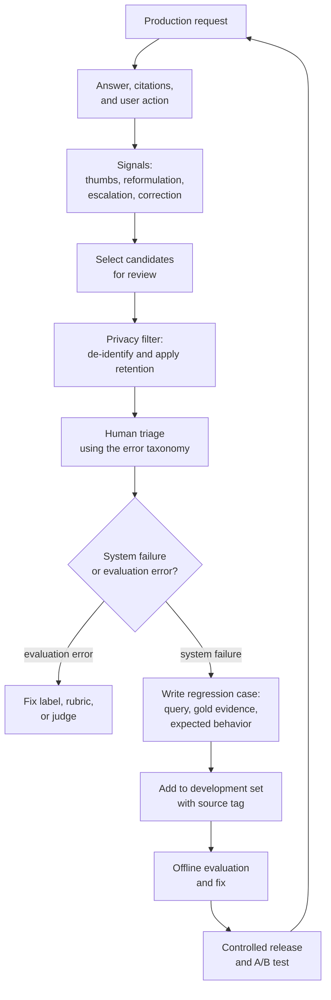

The loop in the diagram turns each reviewed failure into a durable test. A production failure becomes a regression case only after it has passed the privacy filter and a human has decided what the correct behavior is. The new case enters the development set, tagged with its source (production feedback), so analysts can see how much of the dataset is now failure-seeded and not representative. Keep a separate traffic-proportional sample for estimating overall quality, as section 5.2 describes, because a set seeded from failures systematically understates quality.

## 16. Drift in Corpora, Queries, and Models

An evaluation result is true of a system at a time. The system, the corpus, the users, and the judge all move, and each movement can make a past result misleading.

### 16.1 Kinds of drift

- **Corpus drift.** Documents are added, edited, superseded, and deleted. New document types arrive with a new layout. A policy changes and its old version remains indexed. Corpus drift invalidates judgments (the gold span has moved or the answer changed) and changes the retrieval problem (more candidates, new near-misses).
- **Query drift.** New products launch, seasons change, a news event creates a spike, and a new user group arrives with different vocabulary. The golden set reflects the queries of its sampling window, so it ages.
- **Model drift.** The generator, embedding model, reranker, or hosted judge changes when the provider updates it, or when you upgrade. Behavior changes even when the interface does not. Embedding upgrades require re-embedding the corpus and often shift score distributions, which breaks thresholds. [CH16](CH16_Embeddings_and_Semantic_Representations.md) covers migration.
- **Judge drift.** The judge model or its prompt changes, and so does what a score means.
- **Label drift.** Annotators' standards change over time, or the rubric is revised.

### 16.2 A timeline of drift events

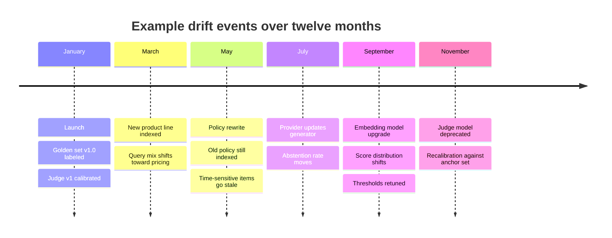

The timeline illustrates six events, each of which would silently change a result: the new product line shifts the query mix away from the golden set, the policy rewrite makes some gold answers wrong, the provider update changes behavior with no code change, the embedding upgrade moves scores, and the judge deprecation changes the instrument. A monitoring plan should have a detector for each.

### 16.3 Detection

- **Query distribution.** Embed a sample of recent queries and compare their distribution with the golden set and with the sampling window. Track the share of recent queries whose nearest golden-set query is far away (a coverage gap). A rising share means the set no longer represents traffic.
- **Retrieval score distributions.** Track the distribution of top-1 and top-5 similarity or reranker scores. A shift suggests a change in corpus, query mix, or model. The Population Stability Index (PSI) summarizes a shift between a baseline distribution and a current distribution across bins:

$$
\text{PSI} = \sum_{b} (a_b - e_b)\ln\frac{a_b}{e_b},
$$

where $e_b$ is the baseline share in bin $b$ and $a_b$ the current share. With four bins of top-1 score, baseline shares $(0.10, 0.25, 0.40, 0.25)$ and current shares $(0.20, 0.30, 0.30, 0.20)$:

| Bin | Baseline $e$ | Current $a$ | $(a-e)\ln(a/e)$ |
| --- | --- | --- | --- |
| 1 | 0.10 | 0.20 | $0.10 \times 0.6931 = 0.0693$ |
| 2 | 0.25 | 0.30 | $0.05 \times 0.1823 = 0.0091$ |
| 3 | 0.40 | 0.30 | $-0.10 \times -0.2877 = 0.0288$ |
| 4 | 0.25 | 0.20 | $-0.05 \times -0.2231 = 0.0112$ |

The sum is 0.1184. A commonly used rule of thumb treats a PSI under 0.1 as stable, 0.1 to 0.25 as a moderate shift, and above 0.25 as a major shift. These bands are conventions from credit-risk practice and not laws, and the number says a distribution moved, not that quality fell. The movement tells you to run the labeled checks.

- **Operational rates.** Empty retrieval, low-score retrieval, abstention, and reformulation rates by segment and by day.
- **Judgment coverage (hole rate)** on current top-$k$ results. When corpus or model changes, the new top results may be unjudged, and metrics lose meaning (section 4.5).
- **Anchor set.** A small fixed set of queries with frozen contexts and outputs, re-scored on a schedule to detect judge drift. If the judge's scores on frozen items change, the judge changed.
- **Fresh labeled sample.** Each month, label a random sample of current production interactions and compare the human-measured quality with the offline estimate. A growing gap between the two is the best single indicator that the golden set has aged.

### 16.4 Response

- **Refresh** the golden set on a schedule, replacing a fraction with recent queries and retiring stale items with a reason.
- **Re-baseline** after a deliberate change to the corpus, model, or judge, with a note in the change log that comparisons across the boundary are invalid.
- **Re-validate gold evidence** when documents change. Link each gold span to a document version, and flag items whose source changed.
- **Rerun time-sensitive items first** on every corpus update.
- **Pin versions** of models and judges where possible, schedule upgrades as planned events with evaluation, and treat an unannounced provider change as an incident when the anchor set moves.
- **Alert on movement,** with thresholds derived from measured noise (section 14.4) so alerts mean something.

## 17. Security and Privacy of Evaluation Data

Evaluation data is often more sensitive than the production logs it comes from, because it concentrates real queries, confidential passages, and expert labels in one place, and because it is shared with tools and vendors that production traffic may not touch.

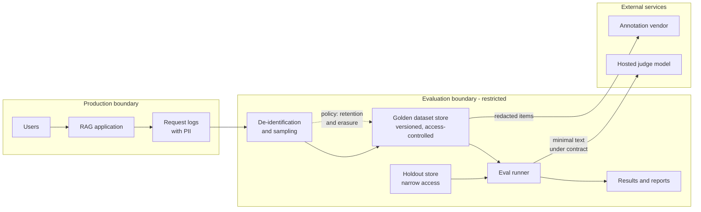

The diagram shows three trust zones. The production zone holds raw logs with personal data. The evaluation zone receives only de-identified, sampled items and has stricter access for the holdout. The external zone holds services that see evaluation text: a hosted judge and an annotation vendor. Every arrow that crosses a boundary is a control point.

### 17.1 Risks

- **Personal data in queries.** Users type names, account numbers, and health or financial details. A golden set built from raw queries copies those into a new store with a different audience.
- **Confidential content in contexts and references.** The evaluation record includes retrieved passages and reference answers, which may be confidential or privileged documents.
- **Permission leakage through evaluation.** An evaluation runner that retrieves with administrator rights tests the system under conditions no user has, and its reports may expose restricted content to the whole team.
- **Third-party exposure.** Sending contexts and answers to a hosted judge or to annotators discloses them to that provider. Contract terms on retention and on use for training matter. At the time of writing, provider terms differ and change, so check the current terms for the specific service and tier.
- **Data residency and regulation.** Cross-border transfer rules and sector rules (health, finance) can restrict where evaluation data and judging calls may go.
- **Contamination of evaluation data.** If golden items leak into prompts as few-shot examples, into fine-tuning data, or into a vendor's training set, scores become unreliable. Holdout items must never be in few-shot prompts or training data.
- **Poisoning.** An attacker who can write to the corpus or to the feedback channel may plant documents or feedback that shape what the evaluation measures or what becomes a test case. Feedback-derived test cases should be reviewed before they are added.
- **Prompt injection into judges.** Evaluated text may try to instruct the judge. Section 7.5 covers it.
- **Retention beyond need.** Evaluation sets accumulate, and old copies persist in notebooks and exports.

### 17.2 Controls

1. **De-identify before storing.** Use pattern-based and model-based redaction for names, emails, phone numbers, identifiers, and addresses, then sample the output for residual leaks. Replace values with typed placeholders (such as ACCOUNT_ID) so the query remains usable.
2. **Minimize.** Store the minimum: the query, the gold spans, and the expected behavior. Avoid storing full user conversations or unrelated metadata.
3. **Access control by role.** Developers get the development set. The release pipeline gets the holdout. A small group manages labels. Log reads of the holdout.
4. **Evaluate with realistic permissions.** Run permission-aware items under the identity of the simulated user, and keep the privileged views out of shared reports.
5. **Judge hygiene.** Send only the text a judge needs (claim and evidence span), use enterprise tiers with no-training and defined retention terms where available, or self-host a judge for the most sensitive data. Record which data classes may go to which judge.
6. **Retention and erasure.** Set retention limits for raw logs, golden items, and run outputs. Support erasure requests by tombstoning the query and removing derived records. [CH30](CH30_AI_Data_Governance_Privacy_and_Provenance.md) owns the governance framework.
7. **Canary strings.** Embed unique strings in holdout items so that leakage into model outputs or public data can be detected.
8. **Review feedback-derived cases** for injection and poisoning before adding.
9. **Encrypt at rest and in transit,** and manage keys per environment.
10. **Document the data flow.** A data-flow diagram of evaluation, with processors and regions, is part of a privacy impact assessment.

Treat the golden dataset as a production data store with an owner and an access review cycle.

## 18. Human Review Operations

Human review is the ground truth for everything else, and it is an operation that needs process and management: queues, guidelines, training, quality control, and throughput planning.

### 18.1 Roles and workflow

- **Annotators** apply the rubric. Choose them by domain need: subject-matter experts for specialized content, trained generalists for broad help-center content.
- **Adjudicators** resolve disagreements and own the final label.
- **Rubric owner** maintains the guidelines and examples, and approves changes.
- **Dataset owner** manages versions, splits, and access.
- **Judge owner** maintains the LLM judge and its calibration.

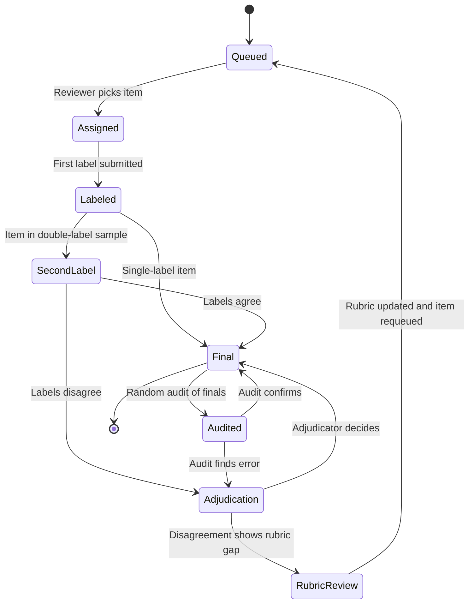

The state machine shows an item moving from the queue to a final label. Items in the double-label sample go to a second reviewer and, on disagreement, to an adjudicator. Disagreement that shows a gap in the rubric loops back to a rubric update and re-queueing, so a recurring disagreement becomes a guideline change and not a one-off ruling. A random audit of final labels catches errors that two annotators made together.

### 18.2 Guidelines

Guidelines should contain: the task and the decision the labels support; definitions for each label with at least two examples each (including borderline cases); a decision procedure for common ambiguities (what to do when two passages conflict, when a claim is partially supported, when the question is ambiguous); an escalation path for unclear items; and a changelog. Pilot the guidelines on 30 to 50 items with two annotators, compute agreement, and revise before scaling.

### 18.3 Tooling

The review interface shows the query, the answer, the claims, the retrieved passages with highlighted candidate evidence, and the cited passages. It hides which system produced the output (blind review), randomizes the order when comparing, records time per item and a free-text rationale, and supports flagging items as "evaluation error". Keep a record of the interface version, because the interface affects labels.

### 18.4 Quality control

- **Gold check items.** Seed the queue with items whose labels are known, and monitor each annotator's accuracy on them.
- **Double labeling.** 15 to 20 percent of items get two labels. Track agreement per annotator pair and per label class.
- **Audit.** Sample 5 percent of final labels for review by the rubric owner.
- **Calibration sessions.** Regular meetings in which annotators discuss disagreements. They update examples and keep standards aligned.
- **Drift check.** Re-label a small fixed set each quarter to see whether annotators' standards moved.
- **Fatigue and throughput.** Limit session length, and watch for declining agreement late in a session.

### 18.5 Capacity planning

Illustrative monthly plan for audit and calibration: 600 production interactions are reviewed for answer quality. Each gets two labels at 3 minutes each, so $600 \times 2 \times 3 = 3{,}600$ minutes. Ten percent (60 items) go to adjudication at 6 minutes each, adding 360 minutes. The total is 3,960 minutes, or 66 hours per month, before guideline maintenance, meetings, and golden-set labeling. At typical expert wages this is a significant recurring cost, which is why LLM judges calibrated against a smaller human sample are used for scale, and why human time is concentrated on calibration, audits, disputed items, and release decisions.

### 18.6 Reviewer wellbeing and bias

Reviewers see real user queries, which can include distressing or personal content, so provide content warnings, rotation, and an opt-out path. Annotator bias (cultural, linguistic, domain assumptions) affects labels; recruit a diverse pool for broad user bases and measure agreement across subgroups.

## 19. Case Study: Diagnosing a Drop in Answer Quality With Staged Metrics

### 19.1 Situation

This case is an illustrative composite. Every number in it is constructed for teaching, and none comes from a real deployment.

A software company runs a support assistant over its product documentation, pricing pages, troubleshooting guides, and legal terms. The corpus has about 40,000 pages. The golden set has 400 answerable queries in four segments: policy (160), pricing tables (80), troubleshooting (100), and legal PDFs (60). Answer correctness is judged with a calibrated judge (kappa 0.68 against two experts on 150 items) and audited monthly.

Release 2.4 changed two things: the ingestion team replaced the document parser with a faster one (ingestion time fell from 6 hours to 1.5 hours), and the prompt team shortened the system prompt. Two weeks later the support team reported more escalations on pricing questions. The escalation rate on pricing conversations rose from 11 percent to 19 percent. Nightly evaluation had passed.

### 19.2 First look: the end-to-end number and the stage metrics

A fresh full-dataset run against a freshly rebuilt index gave these numbers (printed by [04_staged_diagnosis.py](../code/python/rag-evaluation-chapter/04_staged_diagnosis.py)):

| Metric | Before | After | Change |
| --- | --- | --- | --- |
| Recall at 10 | 0.88 | 0.87 | -0.01 |
| nDCG at 10 | 0.71 | 0.70 | -0.01 |
| Context precision | 0.62 | 0.61 | -0.01 |
| Faithfulness | 0.93 | 0.92 | -0.01 |
| Answer correctness | 0.80 | 0.70 | -0.10 |
| Citation support | 0.94 | 0.93 | -0.01 |

Correctness fell by 10 points, and every other metric moved by 1 point or less. A 10-point drop in correctness with a flat faithfulness, flat retrieval, and flat citation profile is informative. If the generator had degraded, faithfulness would fall. If retrieval had degraded, recall and nDCG would fall. The answers are as grounded as before and as well retrieved as before, yet wrong more often. That pattern fits a loss of information that these metrics cannot see: the context contains the right passages, and the passages no longer say the right thing. The pattern also fits a localized problem, in which a few queries fail badly and the average moves little in the other metrics.

### 19.3 Second look: per-segment correctness

| Segment | n | Before | After | Change |
| --- | --- | --- | --- | --- |
| Policy | 160 | 0.850 | 0.838 | -0.013 |
| Pricing tables | 80 | 0.825 | 0.450 | -0.375 |
| Troubleshooting | 100 | 0.760 | 0.740 | -0.020 |
| Legal PDFs | 60 | 0.700 | 0.600 | -0.100 |
| Overall | 400 | 0.800 | 0.700 | -0.100 |

The arithmetic of the pricing segment: before, 66 of 80 correct ($66/80 = 0.825$); after, 36 of 80 ($36/80 = 0.450$). The drop of 30 queries accounts for 30 of the 40 lost correct answers overall ($320 \to 280$ correct answers). Legal PDFs lost 6 more. Policy and troubleshooting lost 2 each, which is inside noise: for policy, with 160 queries, a loss of 2 is 1.25 points, smaller than the interval half-width of about 5 points.

The localization changed the question from "why did the assistant get worse" to "what is different about pricing tables and legal PDFs". Both segments contain tables or complex layout. They share a stage: parsing.

### 19.4 Hypotheses and how each was tested

| Hypothesis | Test | Result |
| --- | --- | --- |
| The shorter prompt weakened grounding | Revert the prompt on the 80 pricing queries with cached context | Correctness 36 of 80 with the old prompt too. Rejected |
| The embedding or retriever changed | Compare retrieval recall by segment, span-labeled | Pricing recall at 10: 0.86 before, 0.85 after. Rejected |
| The generator provider changed behavior | Re-score the frozen anchor set | Judge and generator outputs match the stored ones. Rejected |
| The judge drifted | Judge-human kappa on 40 pricing items re-labeled by an expert | Kappa 0.66, near the 0.68 baseline. Rejected |
| The gold evidence changed | Compare gold-span text with current corpus text | Gold span text is present in the corpus for 62 of 80 queries, down from 79. Supported |
| Parsing damaged the tables | Parse-fidelity test on 50 sampled table pages | Cell-level accuracy 0.96 before, 0.41 after. Supported |

The oracle-context test was decisive. On the 80 pricing queries, the generator was given the gold chunk directly. With the old parse, 66 of 80 answers were correct. With the new parse, 35 of 80 were correct even though the gold chunk was supplied. If retrieval had been the problem, supplying the gold chunk would have fixed the answers. It did not, so the chunk itself had lost the information.

A look at the actual chunk text showed the cause. The new parser read table cells in row order and discarded column headers and cell boundaries. A table with the columns Plan, Monthly price, and Seats, which the old parser emitted as a structured table, now arrived as a line such as "Pro 29 25 Team 49 100 Enterprise Contact sales". The generator saw plausible numbers with no way to tell which number was a price and which was a seat count. It produced fluent, grounded, wrong answers. Faithfulness stayed flat because the answers were supported by the flattened text under a reasonable reading. This is the faithful-and-incorrect cell of the grid in section 6.2.

The legal PDFs showed a similar but milder pattern. The new parser handled scanned pages with a different OCR setting, which dropped footnotes and clause numbers, and it truncated some multi-column pages.

### 19.5 Why the checks passed

Two process failures let the release through.

1. **The parser change did not trigger the answer-level suite.** The pipeline treated a parser swap as an ingestion change and ran only an ingestion throughput check. Section 14.5's mapping (a chunker or parser change requires a full re-ingest and retrieval and answer-level checks) was not encoded.
2. **The nightly run used a cached index built before the parser change.** The cache key for the index artifact did not include the parser version. The nightly evaluation ran against the old index and passed.

Neither flaw is visible from the aggregate metrics, which is the point: the evaluation system itself must be evaluated.

### 19.6 Fix and alternatives considered

| Option | Benefit | Cost or risk | Decision |
| --- | --- | --- | --- |
| Roll back to the old parser everywhere | Immediate recovery | Loses the 4x ingestion speed-up | Used temporarily |
| Keep the new parser, post-process tables | Keeps speed | Hard to recover headers that were discarded | Rejected |
| Route by page type: new parser for prose, layout-aware table extraction for table pages, higher-quality OCR for scans | Speed for most pages, fidelity where needed | Routing logic and a page classifier to maintain | Chosen |
| Prompt the generator to guess table structure | Cheap | Cannot recover missing information, risks confident errors | Rejected |

The routing parser serializes each table row with its headers ("Plan: Pro, Monthly price: 29, Seats: 25"), keeps tables as separate chunks with their captions, and records page offsets for citations. OCR settings for scanned legal pages were restored.

### 19.7 Validation evidence

After re-ingest, the team ran the full dataset on the rebuilt index.

| Segment | Before release | Broken release | After fix |
| --- | --- | --- | --- |
| Policy | 136 of 160 | 134 | 134 |
| Pricing tables | 66 of 80 | 36 | 65 |
| Troubleshooting | 76 of 100 | 74 | 74 |
| Legal PDFs | 42 of 60 | 36 | 42 |
| Overall | 320 of 400 (0.800) | 280 (0.700) | 315 (0.7875) |

Overall correctness recovered to 0.7875, which is 1.25 points below the pre-release value, within the 0.015 tolerance. Policy and troubleshooting differ from the baseline by 2 queries each. A gap of 5 queries out of 400 is smaller than the run-to-run variation the team had measured, and the paired bootstrap on per-query differences against the pre-release baseline included zero, so the team recorded the remaining gap as unexplained within noise and kept monitoring it. Parse-fidelity on the sampled table pages returned to 0.95 cell-level accuracy. Ingestion time was 2.1 hours. The pricing escalation rate returned to 11.5 percent over the following two weeks.

### 19.8 Changes to the evaluation system

1. A parser fidelity test on 50 sampled table pages and 30 scanned pages joined the smoke tier, with a floor for cell-level accuracy.
2. The index artifact cache key now includes parser version, chunker version, and embedding version.
3. A per-segment gate (no segment may drop more than 5 points against baseline, with a minimum of 40 queries per segment) joined the release gate. The pricing segment had enough queries to be gated.
4. Forty new table-heavy queries entered the development set with span labels, tagged "incident 2.4".
5. The change-to-test mapping in section 14.5 was encoded in the pipeline definition so that a parser change triggers the full suite.
6. The legal PDF segment, at 60 queries, was below the comfort size for a tight per-segment gate, and the team added 40 more queries from legal escalations.

The case study shows the chain of reasoning of staged evaluation: a flat profile on most stages and a large drop in one metric pointed away from retrieval and the model; segmentation localized the drop; an oracle-context test separated retrieval from content; and a parser-fidelity check confirmed the cause.

## 20. Failure Modes and Quality-Attribute Scenarios

Scenarios state a stimulus, the expected response, and a measure. They turn evaluation requirements into testable acceptance criteria.

| Scenario | Stimulus | Expected response | Measure |
| --- | --- | --- | --- |
| Parser regression | A parser or OCR setting changes | The parser fidelity test and full re-ingest evaluation run, the change is blocked on a fidelity drop | Cell-level accuracy at least 0.93 on sampled tables, no segment correctness drop over 5 points |
| Permission leak | A query from a user without access to a restricted document whose content matches best | The answer and citations contain no restricted content | Zero leaks across the permission-aware set, checked in every release |
| Stale policy | A policy is revised and the old version stays indexed | The assistant answers from the current version or states the conflict | At least 95 percent of time-sensitive items answered from the current version |
| Judge drift | The hosted judge model is updated | The anchor set shows a score change, the judge is recalibrated before gating | Anchor-set score change under 0.02, or recalibration run within 5 days |
| Unanswerable query | A question about a product the company does not sell | The assistant says the information is unavailable | Unsafe answer rate under 10 percent on the unanswerable stratum |
| Holdout contamination | A developer uses holdout failures to tune a prompt | The holdout log shows reads, the gap between development and holdout scores flags overfitting | Development minus holdout gap under 3 points, holdout reads at most 1 per candidate |
| Evaluation cost spike | A new criterion quadruples judge calls | The cost report flags the change before merge | Judge cost per nightly run within the budget of 70 USD |
| Noisy gate | A regression run fails and passes on rerun | The gate reports the variation and the item flip rates, flaky items are quarantined | False-block rate under 2 percent across 50 identical-config runs |

Failure modes of the evaluation system, as distinct from the RAG system:

- measuring only the average, so a collapsed segment is invisible;
- an uncalibrated judge, so absolute scores are unknown;
- stale gold evidence after a corpus update;
- unjudged holes in new results;
- a holdout read so often it is a development set;
- an index or context cache whose key omits a changed component;
- comparing runs across a dataset or judge version boundary;
- feedback treated as labels.

## 21. Comparison of Evaluation Approaches and Decision Guide

### 21.1 Sources of judgments

| Approach | Cost per item | Speed | Main bias | Best use |
| --- | --- | --- | --- | --- |
| Expert human labels | High | Slow | Rubric ambiguity, annotator variance | Golden set, calibration, audits, release decisions |
| Crowd or trained generalists | Medium | Medium | Shallow reading of specialized content | Broad, non-specialized domains |
| LLM judge | Low | Fast | Position, verbosity, self-preference, leniency | Scale, regression runs, hole filling after calibration |
| Deterministic checks | Very low | Instant | None for what they test, silent on everything else | Citation validity, schema, permission leaks |
| Click and implicit logs | Very low | Continuous | Position, selection, presentation | Finding candidates, monitoring trends |
| Online A/B outcomes | Traffic cost | Days | Novelty, segment mix | Final validation, business outcomes |

### 21.2 Choosing a retrieval metric

| Task shape | Metric to lead with | Why |
| --- | --- | --- |
| Any single passage is enough (FAQ lookup) | Hit rate and MRR | The first relevant result decides the outcome |
| Answer needs several passages (comparison, multi-hop) | Recall at the context size, complete-evidence rate | Missing one passage fails the answer |
| Many relevant passages with varied usefulness | nDCG with graded labels | Rewards ranking the best first |
| Small context budget, distractors harmful | Precision at context size, context precision | Noise costs tokens and can mislead |
| Queries vary in number of relevant items | R-precision, MAP | Normalizes by the relevant count |
| Candidate generation for a reranker | Recall at a large $k$ | The reranker cannot add what is missing |

### 21.3 Choosing a level of evaluation

Evaluate retrieval alone while tuning chunking, embeddings, and fusion. Evaluate generation with frozen context while tuning prompts and models. Evaluate end to end before shipping and in production. If an end-to-end number drops, go down the stages in order with oracle tests. If a component number rises and the end-to-end number does not, suspect an interaction, such as context budget, and run a factorial test.

## 22. Common Mistakes

| Mistake | Cause | Consequence |
| --- | --- | --- |
| Reporting one blended "RAG score" | Convenience | Hides which stage moved, and averages a collapsed segment into a mild decline |
| Judging retrieval at document level | Existing document-level labels | Inflated recall, and labels that do not match what the generator reads |
| Building qrels only from the current system's results | Shortcut | The set favors that system, and new systems are penalized by pooling bias |
| Averaging synthetic and real queries | Wanting a larger set | Overestimates quality, because synthetic questions overlap lexically with their source |
| Using a small set and claiming a win | Time pressure | Differences inside the confidence interval are shipped as improvements |
| Unpaired analysis of paired runs | Habit | Intervals nearly twice as wide as needed, so real gains look inconclusive |
| Tuning against the holdout | The holdout is convenient | The held-out score becomes optimistic, and the real error is higher |
| Trusting an uncalibrated judge | Fast to set up | Absolute scores are wrong by unknown amounts, and bias goes unnoticed |
| Judge and generator from the same family | Single vendor | Self-preference inflates scores |
| Treating faithfulness as correctness | Faithfulness is easy to compute | Faithful answers built on stale or wrong sources pass |
| Ignoring unanswerable questions | They are hard to author | The system is rewarded for always answering |
| Comparing chunkers at fixed $k$ | Same code path | Larger chunks receive more tokens, so they win unfairly |
| Not versioning dataset, judge, and index | Informal process | Score changes cannot be attributed, and baselines are lost |
| Cache keys missing component versions | Oversight | Stale artifacts hide regressions (as in section 19) |
| Using feedback as labels | Plentiful | The system learns to please, not to be right, and non-response bias distorts the rates |
| Putting raw user queries in the golden set | Speed | Personal data copied to a broader audience |
| Ignoring latency and cost in ablations | Focus on quality | A winner that cannot meet the service-level objective |
| Gating on a threshold tighter than the noise | No noise measurement | Flaky gates, ignored failures |

## 23. Design-Review Checklist

Metrics and judgments:

- [ ] Each stage has a named metric, an owner, and a gold output.
- [ ] Retrieval metrics are computed at the cutoff each consumer uses, with cutoffs stated.
- [ ] Labels are span-based and graded, and the grade-to-binary threshold is recorded.
- [ ] Pooling used diverse systems, and judgment coverage (hole rate) is reported per system.
- [ ] Queries with no relevant passage are handled explicitly, not scored as zero or one by accident.

Dataset:

- [ ] The set mixes real queries and synthetic ones, labeled by source, with synthetic scores reported separately.
- [ ] There are strata for unanswerable, false-premise, near-miss, conflicting, time-sensitive, multi-hop, ambiguous, and permission-aware queries.
- [ ] Segment sizes are stated, with minimums, and small segments are marked as monitored.
- [ ] Sample size was justified by an interval or a power calculation, with clustering considered.
- [ ] The dataset is versioned with a change log, content hashes, and split labels.
- [ ] A protected holdout exists, with limited reads, group-based splitting, and a refresh plan.

Answer-level evaluation and judges:

- [ ] Correctness, completeness, faithfulness, context relevance, answer relevance, and citation metrics are reported separately.
- [ ] Faithfulness is claim-level, with unsupported and contradicted separated.
- [ ] Citation validity is checked deterministically before any judge runs.
- [ ] Judges have rubrics with examples, versioned prompts, and fixed settings.
- [ ] Judges are calibrated against human labels with kappa and class-specific rates, on a sample with enough rare-class items.
- [ ] Position, verbosity, and self-preference checks were run, and a non-generator judge or panel is used.
- [ ] Judge cost per run is budgeted and monitored.

Comparison and diagnosis:

- [ ] Comparisons are paired, with intervals or tests, and the minimum important difference is defined.
- [ ] Ablations change one factor at a time, with a factorial for suspected interactions, and the number of comparisons is reported.
- [ ] An error taxonomy and triage tree are in use, with agreement measured.
- [ ] Hybrid legs, reranker, query rewriting, and chunking are evaluated separately, with chunkers compared at equal token budget.
- [ ] Abstention is scored with false refusal and unsafe answer rates, and a risk-coverage curve.

Operations and governance:

- [ ] Quality, latency, and cost are reported together for each candidate.
- [ ] The CI pipeline has smoke, nightly, and release tiers, and a change-to-test map that includes parser, chunker, embedding, and judge changes.
- [ ] Thresholds combine hard gates, floors, baseline-relative tolerances, and per-segment limits, set from measured noise.
- [ ] Flaky items are quarantined, not deleted, and infrastructure failures invalidate runs.
- [ ] Online signals are defined precisely, bias is acknowledged, and A/B tests have pre-registered metrics and guardrails.
- [ ] A drift monitoring plan covers corpus, queries, models, and the judge, with an anchor set.
- [ ] Evaluation data is de-identified, access-controlled, retained under policy, and sent to external judges only under approved terms.
- [ ] Human review has guidelines, double labeling, audits, and capacity planning.

## 24. Exercises

1. **Metrics by hand.** A system returns passages with these grades at ranks 1 to 5: 0, 2, 0, 3, 1. Four passages are judged relevant in total, with grades 3, 2, 2, and 1, and one grade-2 passage was never retrieved. Compute reciprocal rank, average precision, and nDCG@5, using gain $2^g-1$.

    *Answer.* Relevant passages are at ranks 2, 4, and 5. RR $= 1/2 = 0.5$. Precision at those ranks is $1/2$, $2/4$, $3/5$, summing to $0.5 + 0.5 + 0.6 = 1.6$, and AP $= 1.6/4 = 0.4$. DCG@5 $= 3/\log_2 3 + 7/\log_2 5 + 1/\log_2 6 = 1.8928 + 3.0147 + 0.3869 = 5.2944$. IDCG@5 uses gains 7, 3, 3, 1 and equals 10.8235, so nDCG@5 $= 0.489$.

2. **Error compounding.** A pipeline has four stage success rates: chunking 0.95, retrieval 0.90, generation 0.92, citation 0.97. Compute the end-to-end rate, then the rate if retrieval rises to 0.97. State one reason the independence assumption may be wrong.

    *Answer.* $0.95 \times 0.90 \times 0.92 \times 0.97 = 0.763$. With retrieval at 0.97 the rate is $0.95 \times 0.97 \times 0.92 \times 0.97 = 0.822$. Failures cluster on hard segments (for example tables), so stage failures are positively correlated and the marginals multiply to less than the true joint rate, and the worst segments are far below the average.

3. **Kappa.** A judge and a human label 100 answers. Both say Supported on 40, both say Unsupported on 45, the human says Supported and the judge Unsupported on 10, the human says Unsupported and the judge Supported on 5. Compute Cohen's kappa and interpret it.

    *Answer.* $p_o = 0.85$. Human Supported share is 0.50 and judge Supported share is 0.45, so $p_e = 0.5 \times 0.45 + 0.5 \times 0.55 = 0.50$. $\kappa = 0.35/0.50 = 0.70$, substantial agreement by the conventional bands. Check also class-specific recall and the human-human ceiling.

4. **Sample size.** How many independent queries give a 95 percent normal-approximation margin of ±4 points in the worst case? What changes if the 600 queries come from 60 topic clusters of 10?

    *Answer.* $n = 1.96^2 \times 0.25 / 0.04^2 = 600.25$, so 601. With strong within-cluster correlation, the effective sample size is lower, and the interval should be computed with a cluster bootstrap and will be wider.

5. **Paired test.** On 300 queries, configuration B passes where A fails on 15 and A passes where B fails on 5. Compute the paired difference, a 95 percent interval, and the exact McNemar p-value.

    *Answer.* Difference $= 10/300 = 0.0333$. Variance $= (20 - 100/300)/300^2 = 0.000219$, SE $= 0.0148$, interval $0.0333 \pm 0.0290 = [0.004, 0.062]$. The exact two-sided p-value is $2 \times 21{,}700/2^{20} = 0.041$.

6. **Abstention.** A set has 200 answerable and 50 unanswerable queries. The system answers 180 answerable queries (150 correct), and abstains on 35 unanswerable ones. Compute the false refusal rate, unsafe answer rate, coverage, and selective accuracy.

    *Answer.* False refusal $= 20/200 = 0.10$. Unsafe answer $= 15/50 = 0.30$. Coverage $= (180 + 15)/250 = 0.78$. Selective accuracy $= 150/195 = 0.769$, since all 15 answers to unanswerable queries are wrong.

7. **Ablation design.** You are asked to decide between small and large chunks, with and without a reranker, under a latency limit. Outline the experiment.

    *Answer.* Run a 2 by 2 factorial on cached retrieval where possible. Use span labels and equal token budgets so chunk sizes are comparable. Use the same queries and judge for all cells, with repeats to measure noise. Report recall, nDCG, correctness, p95 latency, and cost per cell. Compute the interaction as a difference of differences, test paired differences with a bootstrap, and select under the latency limit, recording the decision.

8. **Triage.** After a release, correctness fell 6 points. Recall and nDCG are flat, faithfulness is flat, and the fall is concentrated in one segment. List your next three steps.

    *Answer.* (1) Check labels and the judge for that segment using a human re-label of a sample and the anchor set. (2) Run an oracle-context test on the segment to separate retrieval from content and generation. (3) Inspect parsed text and chunks for the gold spans, and diff the pre-release and post-release ingestion for that segment, including component versions and cache keys.

9. **Design a golden set.** You must evaluate an internal HR assistant with permissioned documents, frequent policy changes, and conflicting versions. Specify strata, label types, and holdout rules.

    *Answer.* Strata: single-hop lookups, multi-hop, comparisons, time-sensitive with as-of dates, superseded-version traps, conflicting-source items, permission-aware items with asker identities, unanswerable, false premise, ambiguous, and out of scope. Labels: span-based graded evidence, required-fact lists, and expected-behavior labels. Permission items have zero tolerance. Split by topic cluster, keep the holdout in a restricted store with logged reads, refresh with each policy cycle, and review time-sensitive items on every corpus update.

10. **Judge bias.** Describe three experiments to find out whether your faithfulness judge is verbosity-sensitive, position-sensitive, and self-preferring.

    *Answer.* Verbosity: append neutral filler to good answers and check whether scores rise. Position: run pairwise comparisons in both orders and measure the disagreement and the first-position win rate on equal-quality pairs. Self-preference: score answers from several generator families against human labels and check whether the judge over-scores its own family relative to human scores.

## 25. Summary

RAG quality is the product of many stages, so it is measured by stage. A pipeline in which every stage is 90 to 97 percent reliable still fails about a third of the time, and the stage that is cheapest to fix is not always the one that looks worst. Retrieval metrics (recall, precision, hit rate, MRR, MAP, nDCG, R-precision) each answer a different question, and the cutoff should match what the next stage consumes. Judgments are opinions with provenance: pooling biases against new systems, clicks reflect position, and LLM judgments need calibration.

A golden dataset mixes real and synthetic queries, includes the hard strata (unanswerable, adversarial, multi-hop, time-sensitive, permissioned), is sized by interval arithmetic, versioned, and protected by a holdout. Answer-level evaluation separates faithfulness from correctness, context quality from answer quality, and citation validity from citation support, and works at the claim level. LLM judges are instruments that need rubrics, bias checks, kappa-based calibration, and cost control. RAGAS-style, TruLens-style, and ARES-style metrics are sets of assumptions to check, not truth.

Compare configurations with paired tests and ablations that look for interactions. Triage failures with a taxonomy that follows the pipeline and use oracle experiments to separate stages. Evaluate hybrid search, rerankers, query rewriting, and chunking separately, compare chunkers at equal token budgets, and evaluate abstention with false refusal and unsafe answer rates. Report latency and cost beside quality. Run tiered regression suites in CI with thresholds set from measured noise and a change-to-test map. Use online signals to find problems and to seed test cases, and do not use them as labels. Watch for drift in corpus, queries, models, and judges. Protect evaluation data as production data. Staff human review as an operation. In the case study, a flat profile across most stages, a per-segment view, an oracle-context test, and a parser-fidelity check located a 10-point drop in an afternoon, and fixing the evaluation pipeline kept it from recurring.

## 26. Code Examples

- [01_retrieval_metrics.py](../code/python/rag-evaluation-chapter/01_retrieval_metrics.py) implements recall, precision, hit rate, reciprocal rank, average precision, R-precision, and nDCG, and reproduces the worked example and the two-system comparison.
- [02_confidence_and_ablation.py](../code/python/rag-evaluation-chapter/02_confidence_and_ablation.py) computes Wilson intervals, sample sizes, the paired interval and McNemar test, a paired bootstrap, and the 2 by 2 ablation interaction.
- [03_judge_calibration.py](../code/python/rag-evaluation-chapter/03_judge_calibration.py) computes Cohen's kappa and class-specific judge rates, a corrected unsupported rate, a position-bias simulation, and judge cost.
- [04_staged_diagnosis.py](../code/python/rag-evaluation-chapter/04_staged_diagnosis.py) computes the probability chain, the marginal value of fixing each stage, and the staged and per-segment tables from the case study.

All four scripts use only the Python standard library. Run each with `python <file>`.

## 27. Further Reading

The following sources underlie ideas in this chapter. Verify current versions of frameworks and documentation before relying on any specific metric definition.

- Järvelin and Kekäläinen (2002), "Cumulated gain-based evaluation of IR techniques," for DCG and nDCG.
- Buckley and Voorhees (2004), "Retrieval evaluation with incomplete information," for bpref and the effect of incomplete judgments.
- Cohen (1960), "A coefficient of agreement for nominal scales," for kappa.
- Landis and Koch (1977), "The measurement of observer agreement for categorical data," for the verbal kappa bands.
- Thakur and colleagues (2021), "BEIR: A heterogeneous benchmark for zero-shot evaluation of information retrieval models," for the evaluation of retrieval across domains.
- Liu and colleagues (2023), "Lost in the Middle: How language models use long contexts."
- Zheng and colleagues (2023), "Judging LLM-as-a-judge with MT-Bench and Chatbot Arena," for position and verbosity bias in judges.
- Panickssery, Bowman, and Feng (2024), "LLM evaluators recognize and favor their own generations."
- Min and colleagues (2023), "FActScore: Fine-grained atomic evaluation of factual precision in long form text generation."
- Gao and colleagues (2023), "Enabling large language models to generate text with citations" (ALCE).
- Es, James, Espinosa-Anke, and Schockaert (2023), "RAGAS: Automated evaluation of retrieval augmented generation."
- Saad-Falcon, Khattab, Potts, and Zaharia (2023), "ARES: An automated evaluation framework for retrieval-augmented generation systems."
- Angelopoulos and colleagues (2023), "Prediction-powered inference."
- Thomas, Spielman, Craswell, and Mitra (2023), "Large language models can accurately predict searcher preferences."
