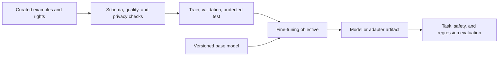
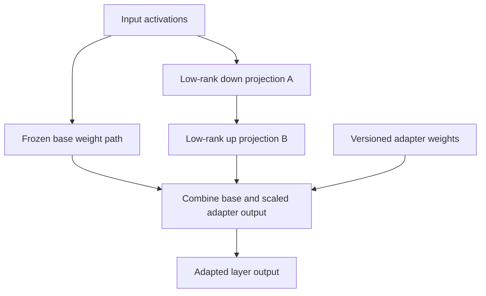
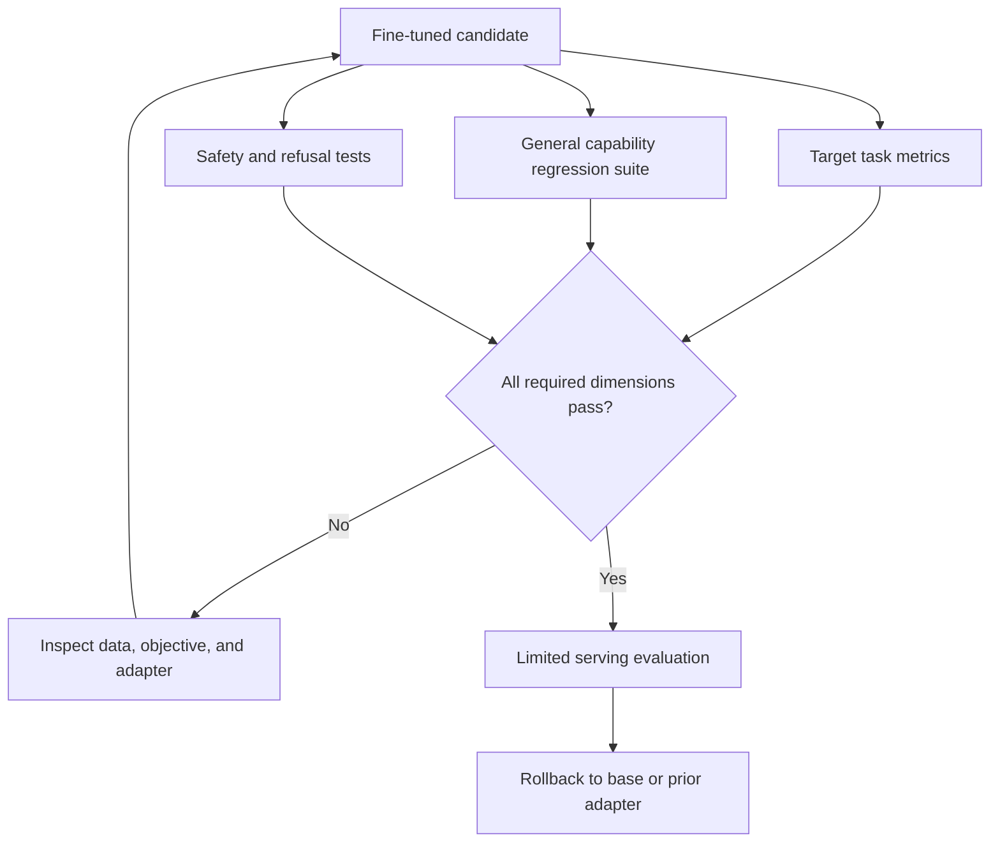
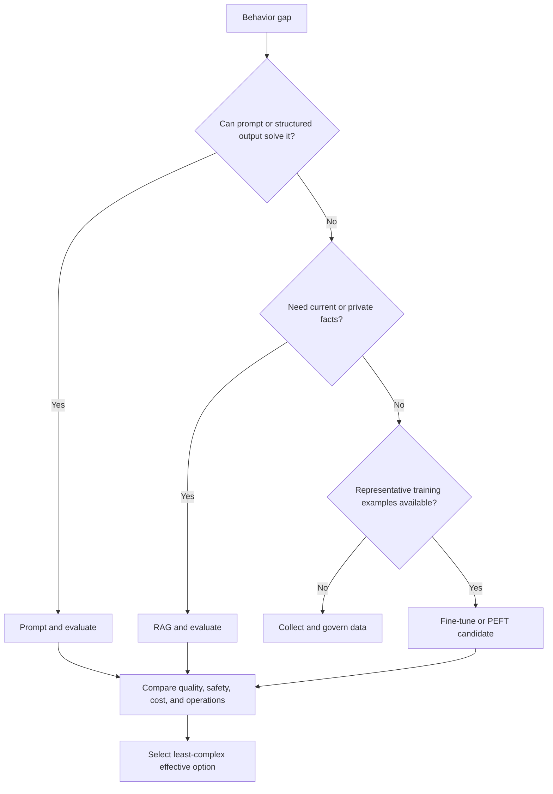
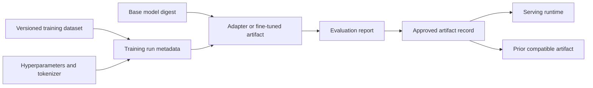

# Fine-Tuning, PEFT, and LoRA

Part: [16 — Artificial Intelligence, Machine Learning, and Generative AI](PART_OVERVIEW.md)

Fine-tuning updates a pretrained model using task- or domain-specific examples. Parameter-Efficient Fine-Tuning (PEFT) adapts a subset or added parameters; Low-Rank Adaptation (LoRA) represents weight updates through smaller low-rank matrices. Fine-tuning can change behavior and format, but is not a reliable way to add frequently changing facts or repair poor retrieval. Compare against prompting and RAG before training.

## Data, Objective, and Training Setup

Training examples should represent the desired behavior and include difficult, boundary, and refusal cases where relevant. Remove duplicates, sensitive data without a valid basis, and examples that encode unsafe or contradictory behavior. Split by source, user, or time to prevent leakage between train and evaluation.

For supervised fine-tuning, decide which tokens contribute to the loss. Many instruction datasets concatenate a prompt with an ideal response but mask prompt-token loss so optimization focuses on the desired completion; other objectives intentionally train on the full sequence. The choice changes what the model learns to reproduce and should match inference formatting. Deduplicate by conversation and source before splitting, not only by exact text, because paraphrased copies can leak the same answer into train and test. Audit label consistency and ensure refusal examples are paired with the relevant request context rather than learned as a generic phrase.



Choose supervised fine-tuning when examples demonstrate desired outputs or task transformations. Preference optimization uses comparisons and has different data and evaluation requirements; [CH14 — Reinforcement Learning from Human Feedback](CH14_Reinforcement_Learning_from_Human_Feedback.md) owns that pipeline. Training settings, tokenizer, base model, data mixture, and random seed influence results and should be versioned.

## Parameter-Efficient Adaptation and LoRA

Full fine-tuning updates many or all weights and can be resource-intensive. LoRA freezes base weights and learns low-rank matrices injected into selected layers. Other PEFT approaches add trainable prompt or adapter parameters. These methods reduce trainable parameters but may still require significant activation memory and careful serving support.



Adapter compatibility depends on base model revision, layer selection, rank, scaling, tokenizer, and runtime. Merging weights can simplify serving but changes artifact identity and may affect precision. Keep base and adapter lineage linked; do not treat the adapter as standalone without its exact base.

For a frozen weight matrix $W\in\mathbb{R}^{d_{out}\times d_{in}}$, LoRA learns an update $\Delta W=(\alpha/r)BA$, where $A\in\mathbb{R}^{r\times d_{in}}$, $B\in\mathbb{R}^{d_{out}\times r}$, and rank $r$ is much smaller than either dimension. The trainable parameter count becomes approximately $r(d_{in}+d_{out})$ rather than $d_{in}d_{out}$. This is cheaper when the task-specific update is well approximated by a low-rank change. Increasing rank adds adaptation capacity and memory; it does not guarantee better generalization. Layer placement, rank, and scaling are hyperparameters that require held-out evaluation.

A concrete scale comparison shows why LoRA reduces training cost so sharply. For an attention projection with $d_{in}=d_{out}=4096$, full fine-tuning of that single matrix updates $4096\times4096\approx16.8$ million parameters. A LoRA update at rank $r=8$ instead trains $8\times(4096+4096)=65{,}536$ parameters for that matrix, about 0.4% as many. Applied across the handful of projection matrices in every transformer block, this is why LoRA can make fine-tuning feasible on far smaller accelerator memory than full fine-tuning of the same base model: the optimizer state (commonly two to three times the trainable parameter count for common adaptive optimizers) scales with the much smaller trainable set, not with the frozen base weights. The frozen weights still need to be loaded for the forward pass, so total memory is not reduced to the adapter's size alone — it is reduced to roughly the base model's inference footprint plus a small adapter training overhead instead of the much larger full fine-tuning optimizer-state footprint.

```python
from peft import LoraConfig, get_peft_model

lora_config = LoraConfig(
    r=8,
    lora_alpha=16,
    target_modules=["q_proj", "v_proj"],
    lora_dropout=0.05,
    bias="none",
    task_type="CAUSAL_LM",
)
model = get_peft_model(base_model, lora_config)
model.print_trainable_parameters()
```

Measure forgetting with a fixed, versioned regression suite run before and after adaptation, not only the target-task metric. If baseline general-task accuracy drops from 88% to 81% after adapting for a narrow support-triage task, that four-to-seven-point regression on unrelated prompts is a signal to reduce rank, restrict adapted layers, mix in general-capability examples, or lower the learning rate — not a cost to accept silently because the target metric improved.

## Forgetting, Evaluation, and Deployment

Fine-tuning may improve a target task while degrading general capabilities, safety behavior, or other languages. Evaluate target quality and regression suites, including base-model behavior that must be retained. Separate training from evaluation data, avoid repeated tuning against the final holdout, and test calibration and refusal behavior.



Deployment must bind model and adapter versions, quantization, runtime, and routing. Support rollback to a known artifact. If the model is updated, repeat evaluation; a provider's base-model change can invalidate adapter compatibility or behavior.

## Choose Fine-Tuning or Alternatives

Fine-tuning fits style, task format, classification, or domain-specific transformations when representative examples are available. RAG fits changing factual knowledge and source citation needs. Prompting fits low-volume instructions and quick experiments. A hybrid may be suitable, but adds evaluation and operations cost. Do not fine-tune to memorize confidential or fast-changing records without a clear data governance basis.





## Worked Case and Review Checklist

A support team wants consistent structured triage output. It first tests prompt-only formatting, then fine-tunes a small adapter using reviewed, de-identified examples. A held-out customer/time split measures field accuracy and refusal behavior; a regression set checks unrelated tasks. The adapter is served with its exact base-model digest and can be disabled independently if quality degrades.

Review training data rights, deduplication, split, objective, base version, adapter lineage, PEFT memory needs, forgetting, safety regression, evaluation holdout, deployment compatibility, monitoring, and rollback.

## Questions and Summary

1. When is fine-tuning preferable to RAG or prompting?
2. Draw how LoRA combines frozen base weights and trainable low-rank updates.
3. Identify data leakage risks in examples derived from the same customer or conversation.
4. Design regression tests for catastrophic forgetting and safety degradation.
5. Which versions must be recorded to reproduce an adapter deployment?

Fine-tuning adapts learned behavior using curated data and a defined objective. PEFT can reduce training cost but does not remove data, evaluation, compatibility, or serving requirements. Use it when prompting or retrieval do not address the need, and validate both target gains and regressions before deployment.
