# Fine-Tuning, Parameter-Efficient Fine-Tuning (PEFT), and Low-Rank Adaptation (LoRA)

Part: [16 — Artificial Intelligence, Machine Learning, and Generative AI](PART_OVERVIEW.md) · Status: Revised (in-depth rewrite)

## 1. Introduction

Fine-tuning continues the training of a pretrained model on a smaller, curated dataset so that the model's weights, and therefore its default behaviour, change. A prompt changes the input to a fixed function. Retrieval changes the evidence placed in that input. Fine-tuning changes the function. That difference explains nearly every decision in this chapter: what fine-tuning is good at (format, style, task skill, latency and cost at scale), what it is bad at (fresh facts, per-user access control, anything that must be deletable on demand), and why it carries operational obligations that prompts and retrieval indexes do not (training data governance, artifact lineage, regression testing, safety re-evaluation, and a new model to serve).

For a solution architect the interesting questions are rarely about the optimizer. They are questions such as these. Should we fine-tune at all, or is a better prompt or a retrieval layer cheaper and safer? If we do, do we pay a vendor to host the result or run training ourselves? What does a 7-billion-parameter fine-tune cost in graphics processing unit (GPU) memory and money, and why does that number drop by a factor of 25 under LoRA? How do we know the tuned model did not quietly get worse at things we did not test? Which data are we allowed to train on, and what happens when a data subject asks for deletion? How do we serve fifty tenant-specific variants without fifty GPUs? This chapter answers those questions with mechanisms and worked arithmetic, so that the reader can reproduce the numbers for their own model and workload.

### 1.1 Reader outcomes

After this chapter the reader should be able to do the following.

- Choose between prompting, retrieval, fine-tuning, and combinations, using decision criteria and a cost break-even calculation rather than preference.
- Prepare supervised fine-tuning (SFT) data: chat templates, loss masking on completion tokens, packing, deduplication, decontamination, and label audits.
- Compute the memory needed for full fine-tuning of a 7B model (weights, gradients, optimizer state, activations) and for LoRA and QLoRA, and explain each term.
- Derive LoRA from the low-rank hypothesis, count its parameters, choose rank, scaling, and target modules, and merge adapters into base weights.
- Select hyperparameters, recognise the failure signatures of bad runs, and read a loss curve.
- Design an evaluation plan with task metrics, a general-capability regression suite, and safety re-checks; reason about catastrophic forgetting, replay, memorization, and privacy leakage.
- Merge models (task arithmetic, TIES, SLERP) with awareness of the risks, and serve many adapters on shared hardware.
- Compare vendor-hosted and self-hosted fine-tuning, estimate GPU-hours and dollars, and keep lineage, versioning, and rollback under control.
- Run a go/no-go decision on a realistic project, as in the case study in section 22.

### 1.2 Scope and ownership

This chapter owns the general fine-tuning and parameter-efficient adaptation lifecycle. It recaps and links neighbouring topics instead of re-teaching them.

| Topic | Owner | Treatment here |
| --- | --- | --- |
| Preference data, reward models, policy optimization, Direct Preference Optimization (DPO) | [CH14 — Reinforcement Learning from Human Feedback](CH14_Reinforcement_Learning_from_Human_Feedback.md) | Short recap in section 3.3, with the data and evaluation differences that matter for planning |
| Tokenization, autoregressive decoding, context windows, quantization basics | [CH15 — Large Language Model Fundamentals and Inference](CH15_Large_Language_Model_Fundamentals_and_Inference.md) | Assumed. Quantization is extended for training in section 8 |
| Prompt assembly, few-shot examples, structured outputs | [CH17 — Prompt Engineering and Structured Outputs](CH17_Prompt_Engineering_and_Structured_Outputs.md) | Used as the baseline that fine-tuning must beat |
| Retrieval-augmented generation (RAG) lifecycle | [CH18 — RAG Architecture](CH18_RAG_Architecture.md) and [CH19 — Retrieval Quality and RAG Evaluation](CH19_Retrieval_Quality_and_RAG_Evaluation.md) | Compared in section 2. Not re-taught |
| Generative evaluation, guardrails, hallucination measurement | [CH24 — Generative AI Evaluation, Guardrails, and Hallucinations](CH24_Generative_AI_Evaluation_Guardrails_and_Hallucinations.md) | Fine-tuning-specific evaluation in sections 12 and 13 |
| Inference engines, batching, multi-adapter serving internals | [CH28 — Inference Optimization and Model Serving](CH28_Inference_Optimization_and_Model_Serving.md) | Architectural trade-offs in section 16. Engine internals are linked |
| Experiment tracking, model registry, deployment automation | [CH29 — MLOps and LLMOps](CH29_MLOps_and_LLMOps.md) | Lineage requirements in section 19 |
| Training-data governance, privacy, provenance, licensing | [CH30 — AI Data Governance, Privacy, and Provenance](CH30_AI_Data_Governance_Privacy_and_Provenance.md) | Fine-tuning-specific obligations in sections 11 and 19 |
| Safety governance and responsible AI | [CH31 — Responsible AI and Safety Governance](CH31_Responsible_AI_and_Safety_Governance.md) | Safety regression after tuning in section 13 |
| General model evaluation, validation, leakage | [CH06 — Model Evaluation, Validation, and Selection](CH06_Model_Evaluation_Validation_and_Selection.md) and [CH02 — Data Preparation, Feature Engineering, and Leakage](CH02_Data_Preparation_Feature_Engineering_and_Leakage.md) | Applied to generative tasks in section 12 |

### 1.3 The adaptation pipeline at a glance

Figure 1 shows the whole path from a versioned base model and rights-cleared data to a deployed artifact. Every stage leaves a record, and every stage can fail independently. The rest of the chapter walks the diagram left to right.

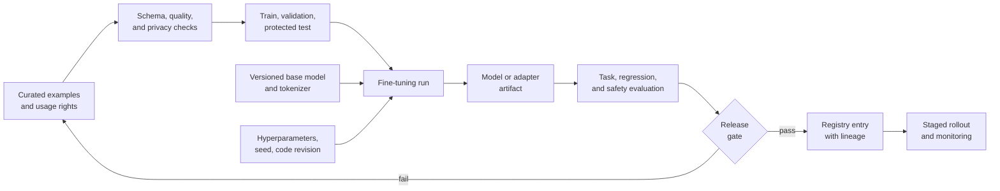

*Figure 1. The fine-tuning pipeline from curated data to a monitored release.*

The loop from the gate back to the data is the normal case, not an exception. In practice most improvement comes from fixing data after evaluation reveals a weakness, and only a small fraction comes from changing hyperparameters. A team that plans one pass through the diagram will be surprised; a team that plans three or four passes and budgets for them will not.

### 1.4 A short history that explains the vocabulary

The terms in this chapter come from a few waves of work. Transfer learning with pretrained encoders (the BERT era, 2018 onward) made "pretrain, then fine-tune all weights on a task" the standard recipe for classification and extraction. As models grew, copies of the full weights per task became impractical, and adapter modules (Houlsby et al., 2019) showed that inserting small trainable bottlenecks, and freezing the rest, could match full fine-tuning on many benchmarks. Prefix tuning (Li and Liang, 2021) and prompt tuning (Lester et al., 2021) moved the trainable parameters into the input or attention keys and values. LoRA (Hu et al., 2021) put the trainable parameters into a low-rank update of existing weight matrices, which can be merged away after training and so adds no inference latency. QLoRA (Dettmers et al., 2023) combined LoRA with a 4-bit quantized frozen base model and made fine-tuning of 65-billion-parameter models feasible on a single 48 GB GPU. Meanwhile instruction tuning and preference tuning turned base language models into assistants, and the practical question moved from "can we adapt a model" to "should we, and how do we keep the result safe and maintainable".

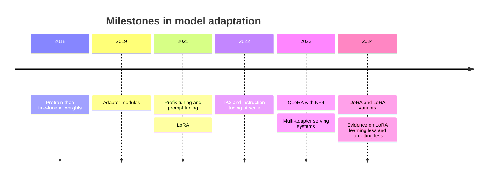

*Figure 2. Milestones in adaptation methods. Dates are the first publication years of the cited papers.*

## 2. Fine-Tune, Prompt, or Retrieve

The most common fine-tuning mistake is not a technical one. It is training a model to solve a problem that a prompt or a retrieval layer would have solved more cheaply, more safely, and with less maintenance. This section builds the decision from first principles.

### 2.1 What each technique changes

Think of a deployed model as a function $y = f_\theta(\text{context})$ where $\theta$ are weights and the context is everything in the input window. There are three levers.

1. **Prompting** edits the instruction part of the context. It is instant to change, requires no training, and is versioned like code. Its limits are the context budget, the model's ability to follow long instructions consistently, and the per-request cost of re-sending the instructions and examples every time.
2. **Retrieval** edits the evidence part of the context at request time. It is the right tool when the answer depends on facts that are large, private, changing, or access-controlled, because the facts stay outside the weights, can be updated in minutes, can be cited, and can be filtered per user. See [CH18](CH18_RAG_Architecture.md).
3. **Fine-tuning** edits $\theta$. It changes what the model does by default, with no per-request overhead, but the change is baked in, is hard to inspect, cannot be filtered per user, and goes stale with the data it was trained on.

A useful summary is that prompting and fine-tuning shape *behaviour*, retrieval supplies *knowledge*, and fine-tuning is the only one of the three that changes *capability and cost structure*. The corollary is that a behaviour problem is a candidate for fine-tuning only after cheaper behaviour tools have been tried and measured.

### 2.2 Decision criteria

Table 1 lists the questions to ask, roughly in order. The first "yes" that applies usually settles the matter.

| Question | If yes | Reason |
| --- | --- | --- |
| Does the answer depend on facts that change weekly or more often? | Retrieval (or tools) | Training bakes in a snapshot. Retraining on every change is slow and expensive |
| Must different users see different facts according to permissions? | Retrieval with access control | Weights cannot enforce per-user authorization |
| Must individual records be deletable on request? | Retrieval | Removing a record from an index is routine. Removing it from weights is research |
| Must answers cite sources? | Retrieval | A tuned model produces plausible citations but cannot reliably point to its training sources |
| Is the failure a format, tone, or schema problem that a handful of examples in the prompt fixes? | Prompt, with structured output constraints | Cheapest fix. Measure first |
| Does the prompt need thousands of tokens of instructions and examples on every call, at high volume? | Fine-tune to internalise them | Removes input tokens per request. See the break-even in section 2.4 |
| Is a small, cheap model required to match a large model on a narrow task? | Fine-tune the small model (distillation or SFT) | Narrow tasks are where small tuned models match large general ones |
| Is the skill rare in the pretraining data (a niche language, a proprietary notation, a unique output grammar)? | Fine-tune | The model cannot be prompted into a skill it never saw |
| Do you need consistent behaviour that the model drifts from under long contexts? | Fine-tune, and test | Tuning bakes in behaviour that long prompts dilute |
| Is the latency budget too tight for long prompts or retrieval round trips? | Fine-tune a small model | Shorter prompts reduce time to first token |

Figure 3 turns the table into a decision tree. The tree is deliberately conservative: it sends most problems to cheaper tools first.

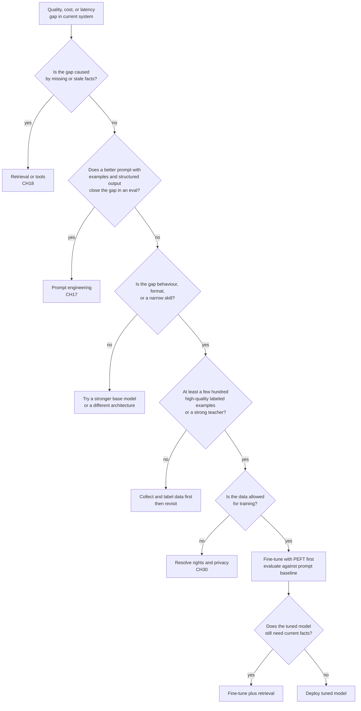

*Figure 3. Decision tree for choosing among prompting, retrieval, and fine-tuning.*

Two branches deserve emphasis. The "does a better prompt close the gap in an eval" branch requires an evaluation set, which means the project cannot skip building one. The second is that the answer is often "both": a fine-tuned model that produces the right output schema and tone, fed by retrieval that supplies the facts. These combinations are common in production, for example a small tuned model that extracts fields in a strict schema from retrieved documents.

### 2.3 What fine-tuning does not do well

Several expectations repeatedly fail, and an architect should recognise them early.

**Teaching new facts.** Fine-tuning on a few thousand documents does not reliably add knowledge. Studies of knowledge injection through SFT find that models learn to reproduce the training texts but generalise poorly to questions about them, and that fine-tuning on facts the model did not already know can increase hallucination on other topics (see for example Gekhman et al., 2024, "Does Fine-Tuning LLMs on New Knowledge Encourage Hallucinations?"). Continued pretraining on large volumes of domain text does inject knowledge, but it is a different and much larger undertaking (section 3.1). For stable, large knowledge bases the usual answer is retrieval.

**Repairing bad retrieval.** If the retriever returns the wrong passages, a tuned generator cannot recover the missing evidence. It may instead learn to answer confidently from its weights. Fix retrieval first (see [CH19](CH19_Retrieval_Quality_and_RAG_Evaluation.md)).

**Replacing access control.** A model trained on documents from several tenants can reveal one tenant's content to another through memorization (section 14). Tenant separation by weights requires one adapter or model per tenant, with the serving and governance cost that implies.

**Fixing reasoning limits.** Tuning improves the format and consistency of reasoning on tasks that look like the training set. It does not reliably lift a model above its pretrained reasoning ability. Distilling reasoning traces from a stronger teacher can help narrow tasks, with caveats in section 11.5.

**Being cheap to maintain.** Each fine-tuned model is a new artifact that needs evaluation, a registry entry, a deployment, a deprecation plan, and retraining when the base model changes or the data drifts. A prompt is a text file. A tuned model is a product.

### 2.4 Cost break-even arithmetic

Fine-tuning usually pays when it replaces a long prompt and a large model with a short prompt and a small model at high volume. The break-even calculation has four ingredients: the per-request cost today, the per-request cost after tuning, the one-time cost of building the tuned model, and the recurring cost of keeping it current.

Take a classification-and-extraction workload. All prices are illustrative; replace them with current prices from the vendor's pricing page and your cloud bill.

*Today (prompted large model, hosted API).* Each request sends 1,800 input tokens (instructions plus few-shot examples plus the document) and receives 60 output tokens. With an illustrative price of \$2.50 per million input tokens and \$10.00 per million output tokens:

$$
\text{cost per request} = 1800 \times \frac{2.50}{10^6} + 60 \times \frac{10.00}{10^6} = 0.0045 + 0.0006 = \$0.0051 .
$$

At 2,000,000 requests per month this is \$10,200 per month.

*After tuning (small model, self-hosted).* The few-shot examples and most instructions move into the weights, so each request sends 250 tokens and receives 60. Suppose one GPU costs \$3.00 per hour, so one GPU-month is \$3.00 × 730 = \$2,190. The workload averages $2{,}000{,}000 / (730 \times 3600) \approx 0.76$ requests per second, with an assumed peak of five times the average. An 8B-class model on a modern accelerator with batching serves far more than that on one device, so the limiting factor is redundancy: two GPUs for availability. Serving cost is \$4,380 per month.

*One-time cost.* Labeling 5,000 examples at \$1.50 each is \$7,500. Engineering time for data pipeline, training, evaluation, and deployment, assumed at \$30,000 for the project. Training compute is small (section 18) and is ignored here. Total one-time cost: \$37,500.

*Recurring cost.* Quarterly retraining, re-evaluation, and monitoring, amortised at \$2,000 per month.

The monthly saving is $10{,}200 - 4{,}380 - 2{,}000 = \$3{,}820$. The break-even time is

$$
T_{\text{break-even}} = \frac{37{,}500}{3{,}820} \approx 9.8 \text{ months}.
$$

Without the recurring cost the figure would have been $37{,}500 / 5{,}820 \approx 6.4$ months, which shows how much a maintenance estimate changes the answer. The decision is also sensitive to volume. At 200,000 requests per month the prompted cost is \$1,020, which is below the self-hosted GPU cost alone, and tuning never breaks even. At 20,000,000 requests per month the prompted cost is \$102,000 and the savings dominate.

Four lessons follow. First, volume decides: fine-tuning is mostly a scale optimization. Second, a cheaper alternative exists that is often missing from the comparison: prompt caching and a smaller general model with a tighter prompt can capture much of the saving with no training. Third, the quality comparison must be on the same evaluation set: if the small tuned model is worse by two points of accuracy and each error costs \$5 of downstream handling, 2,000,000 requests × 2% × \$5 = \$200,000 per month would erase the saving. Fourth, if the vendor offers fine-tuning of its own small model and charges a premium on tuned-model tokens, the same arithmetic applies with the vendor's tuned-model prices in the "after" column.

A general form helps. Let $V$ be monthly request volume, $c_0$ and $c_1$ the per-request costs before and after, $F$ the one-time cost, and $M$ the recurring monthly cost of the tuned model. Then

$$
T_{\text{break-even}} = \frac{F}{V\,(c_0 - c_1) - M}, \qquad \text{valid only if } V\,(c_0 - c_1) > M .
$$

The denominator condition is the sentence "tuning must save more per month than it costs to keep alive". If it fails, no amount of waiting recovers the investment. Fixed costs in $c_1$ (the GPUs) do not scale with $V$ until capacity is exceeded, so in practice $c_1$ falls as volume grows within a hardware step and then jumps at the next step.

### 2.5 Non-cost reasons to fine-tune, and how to value them

Cost is not the only driver. Three others appear in real projects and should be estimated, even roughly.

*Latency.* Time to first token grows with prompt length, because the prefill phase processes every input token. Cutting a 1,800-token prompt to 250 tokens cuts prefill compute by about a factor of seven. If the product has a latency service-level objective that the long prompt misses, tuning has a value that is not captured in dollars.

*Data control.* Some organizations cannot send documents to a third-party API at all. A self-hosted tuned open-weight model may be the only compliant way to use generative models on those documents. The relevant comparison is then between a tuned local model and no model, not between a tuned model and a hosted one.

*Consistency.* Output-format drift in a prompted model shows up as parse failures. If the prompted pipeline fails to produce valid output 1.5% of the time and each failure needs a retry or a human, the tuned model's 0.1% failure rate has a computable value. Constrained decoding (see [CH17](CH17_Prompt_Engineering_and_Structured_Outputs.md)) often closes this gap without tuning, so measure it first.

### 2.6 Sequencing: the cheapest-first ladder

A practical sequence for a team starting a new generative workload is the following. Each rung is attempted only after the previous rung's measured ceiling is reached.

1. Write an evaluation set (section 12) before changing anything.
2. Baseline with a clear prompt, structured output constraints, and a handful of examples.
3. Add retrieval if facts are the gap.
4. Try a stronger base model, which is a one-line change and sometimes the right answer.
5. Fine-tune a model with PEFT on a few hundred to a few thousand curated examples.
6. Fine-tune a smaller model with distillation from a larger one to cut serving cost.
7. Only for deep domain shifts, consider continued pretraining or a custom base model.

The ladder encodes a principle: spend effort in proportion to what the previous rung proved is necessary. Teams that begin at rung 5 usually do not have an evaluation set, and so cannot tell whether rung 5 helped.

## 3. Types of Adaptation

"Fine-tuning" names several different procedures with different data, objectives, and risks. This section separates them.

### 3.1 Continued pretraining (domain-adaptive pretraining)

Continued pretraining (CPT) keeps the next-token prediction objective of pretraining but changes the data: large volumes of unlabeled text from a target domain or language, such as legal opinions, clinical notes, source code in a niche language, or a company's internal documentation. The training loss is computed on all tokens, there are no prompts or completions, and the dataset is large, typically hundreds of millions to tens of billions of tokens.

CPT is appropriate when the base model lacks domain vocabulary or fluency, for example in a low-resource language or a specialised notation. Its costs are large relative to SFT: the compute scales with the token count, the model usually loses some general ability unless the mixture includes general-domain data, and an instruction-tuned model that undergoes CPT often loses its instruction-following and has to be instruction-tuned again. The common workflow is CPT on a base (not chat) checkpoint, then SFT, then optional preference tuning.

Learning-rate guidance for CPT is more conservative than for pretraining from scratch, because the model starts from a good optimum. Re-warming the rate to a peak that is a fraction of the original pretraining peak, then decaying with a cosine schedule, is common. Mixing in a replay fraction of the original distribution (often a few percent to several tens of percent, tuned on a held-out general suite) limits forgetting (section 13.3).

Since LoRA learns low-rank updates, it is a poor fit for CPT on a large new corpus: the evidence in Biderman et al. (2024), "LoRA Learns Less and Forgets Less", is that LoRA underperforms full fine-tuning in code and math continued pretraining at standard ranks, while retaining more of the base model's behaviour. This is a useful characterisation: LoRA is a limited-capacity adapter, which is both its weakness for knowledge-heavy shifts and its strength for behaviour changes.

### 3.2 Supervised fine-tuning (instruction tuning)

SFT trains on pairs of an input (the prompt, which may include a system message, conversation history, and a task input) and a target output (the completion). The objective is the usual cross-entropy of the target tokens given the prompt. SFT is the workhorse of practical adaptation. It is used to:

- teach a base model to follow instructions and chat formats (instruction tuning);
- teach a specific output schema, style, or tone;
- specialise a model on a narrow task such as classification, extraction, or routing;
- distil a larger model's behaviour into a smaller one (section 3.4).

SFT quality depends mostly on data. The LIMA study (Zhou et al., 2023) trained a 65B model on only 1,000 carefully curated examples and obtained strong results in human preference comparisons, arguing that most knowledge comes from pretraining and that SFT mainly teaches format and style, the "superficial alignment hypothesis". The finding has caveats (evaluation by human preference on open-ended prompts, a strong base model), but it gave practitioners a defensible reason to prefer a few hundred excellent examples over many thousands of mediocre ones.

### 3.3 Preference tuning: a recap

SFT shows the model one acceptable answer. Preference tuning shows it which of two answers is better. [CH14](CH14_Reinforcement_Learning_from_Human_Feedback.md) owns the pipeline: collecting comparisons, training a reward model, optimizing a policy with a Kullback-Leibler (KL) penalty against a reference model, and direct methods such as DPO that skip the explicit reward model. The planning differences to remember here are these.

- Data: pairs or rankings of responses to the same prompt rather than a single target. Annotation cost is higher per example, but comparisons are often easier for humans than writing ideal answers.
- Memory: DPO needs the policy and a frozen reference model. With LoRA the reference is the base model with the adapter disabled, so there is no second copy.
- Order: SFT usually comes first, so that the policy starts near the preferred distribution and the reference is sensible.
- Failure modes: reward over-optimization, verbosity bias, and distribution shift between the preference data and the policy's own samples.
- Evaluation: preference-tuned models need regression checks on helpfulness and safety, as in section 13.

### 3.4 Distillation

Distillation trains a smaller student to imitate a larger teacher. In its classical form (Hinton et al., 2015), the student matches the teacher's output probabilities (soft targets), which carry more information per example than hard labels. For large language models the usual practical form is sequence-level: collect the teacher's responses to a set of prompts and run SFT on them. This needs only API access to the teacher's outputs, not its logits, and is the basis of many open instruction-tuned models.

Distillation is the most common path to a cheap, fast model for a narrow task: a large model labels or answers a few tens of thousands of in-domain inputs, a human reviews a sample, and a small model is fine-tuned on the result. Section 11.5 covers its risks: inherited errors, licensing restrictions on using a vendor's outputs to train competing models, loss of diversity, and benchmark contamination.

### 3.5 Other forms in brief

- **Reinforcement fine-tuning** optimizes a policy against a programmatic or model-based grader, useful for tasks with verifiable outcomes such as code that passes tests or maths with a checkable answer. CH14 and [CH13](CH13_Reinforcement_Learning.md) own the mechanics.
- **Task-specific heads.** For pure classification, adding a classification head to an encoder or decoder and training with cross-entropy over labels is simpler, cheaper, and more reliably calibrated than generating the label as text. Section 22 compares both for the case study.
- **Embedding-model fine-tuning.** Tuning a retrieval embedding model on domain pairs with contrastive loss improves retrieval and belongs to [CH16](CH16_Embeddings_and_Semantic_Representations.md) and [CH19](CH19_Retrieval_Quality_and_RAG_Evaluation.md).

Figure 4 positions the main options on two axes: how much they change the model and how much they cost to build and maintain. The positions are qualitative and depend on the specific setup.

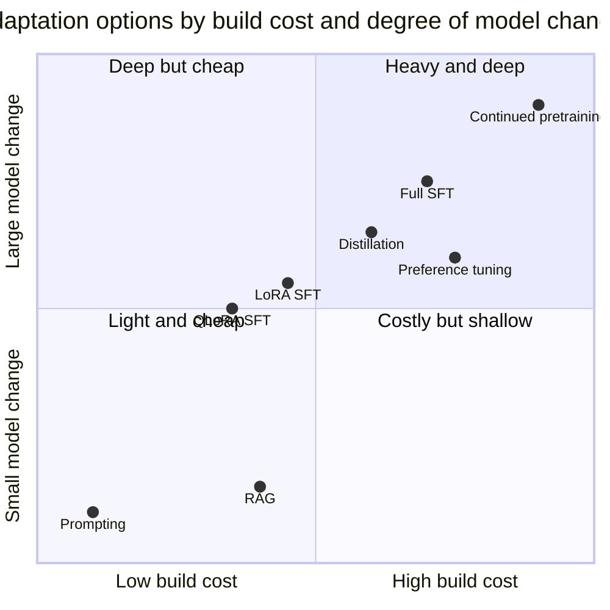

*Figure 4. Qualitative positioning of adaptation options.*

The figure's message is that the cheap zone is wide: prompting, retrieval, and parameter-efficient SFT cover the large majority of production needs, and the right-hand side is reserved for cases that justify a training program.

## 4. Supervised Fine-Tuning Data Mechanics

SFT looks simple (feed pairs, minimise loss) but the details of how text becomes token sequences and labels determine whether the model learns the right behaviour. Mistakes here silently degrade results while the loss still goes down.

### 4.1 Data formats

Three formats dominate.

**Prompt-completion pairs.** Each record has a `prompt` and a `completion`. This is the simplest format for single-turn tasks such as classification and extraction.

```json
{"prompt": "Classify the ticket: 'refund not received after 10 days'", "completion": "billing_issue"}
```

**Chat (messages) format.** Each record is a list of messages with roles (`system`, `user`, `assistant`, and sometimes `tool`). Multi-turn conversations, system prompts, and tool calls fit this structure. Most vendor fine-tuning APIs and open-source trainers accept it.

```json
{"messages": [
  {"role": "system", "content": "You triage support tickets."},
  {"role": "user", "content": "refund not received after 10 days"},
  {"role": "assistant", "content": "billing_issue"}
]}
```

**Preference format.** Records contain a prompt with a `chosen` and a `rejected` response, used for the DPO-style methods in CH14.

The format is a storage convention. Before training, a *chat template* converts the structured record into one token sequence.

### 4.2 Chat templates

Instruction-tuned models were trained with specific special tokens that mark roles and turn boundaries, for example tokens that open and close each message and mark the end of an assistant turn. The mapping from a messages list to the exact string, and so to the exact token ids, is the chat template. Open-weight tokenizers usually ship a template (in Hugging Face Transformers it is exposed as the tokenizer's `apply_chat_template`). Three rules prevent the most common defects.

1. **Use the model's own template.** Training with a different template from the one the base or instruct model learned wastes capacity on relearning the format and can cause the model to emit stray role markers at inference. If you deliberately adopt a new format on a base model, record that choice in the lineage (section 19).
2. **Train and serve with byte-identical templates.** A trailing space, a missing newline, or a differently placed system prompt between training and serving shifts the token ids. The model sees a distribution it was not tuned on. Many "the tuned model works in the notebook but not in production" incidents trace to template drift between the training library and the serving engine. Include a test that renders the same conversation through both paths and compares token ids.
3. **Teach the stop token.** The assistant turn must end with the end-of-turn token in training labels, and that token must be in the loss. Otherwise the tuned model does not learn when to stop and generates until the length limit.

Figure 5 shows how a record becomes tokens and labels.

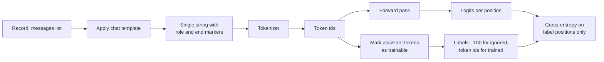

*Figure 5. From a structured record to a masked cross-entropy loss.*

### 4.3 Loss masking on completions

For a sequence of tokens $x_1,\dots,x_T$ with a prompt occupying positions $1..P$ and a completion occupying $P+1..T$, the standard causal language-model loss over all positions is

$$
\mathcal{L}_{\text{all}} = -\frac{1}{T-1} \sum_{t=2}^{T} \log p_\theta(x_t \mid x_{<t}).
$$

The completion-only loss restricts the sum to completion positions:

$$
\mathcal{L}_{\text{completion}} = -\frac{1}{|\mathcal{C}|} \sum_{t \in \mathcal{C}} \log p_\theta(x_t \mid x_{<t}), \qquad \mathcal{C} = \{P+1, \dots, T\}.
$$

Implementations set the label of every ignored position to a sentinel (conventionally $-100$ in PyTorch's cross-entropy, which skips that index) and normalise by the count of non-ignored tokens.

**Why mask the prompt.** The prompt contains the user's input and the system instructions. Training on those tokens teaches the model to reproduce user text, spends gradient signal on tokens it does not need to generate, and in a classification task with a 400-token document and a one-token label would make the label contribute roughly $1/401$ of the loss. The model would mostly learn to model documents. With completion-only loss, the label receives the entire gradient.

**When not to mask.** There are cases for training on the full sequence. For continued pretraining there is no prompt. For very small datasets some practitioners find that including the prompt acts as a regulariser, though the evidence is mixed (a result reported in the instruction-tuning literature is that the effect depends on the ratio of prompt to completion lengths). For tasks where the model should also learn to model the input distribution, such as data augmentation, full-sequence loss is deliberate. Make the choice explicitly and record it.

**Normalisation subtleties.** Averaging the loss per sequence versus per token changes the weighting. If a batch contains one 10-token answer and one 1,000-token answer, token-level normalisation lets the long answer dominate, and sequence-level normalisation weights them equally. Large-batch training with gradient accumulation adds a trap: averaging micro-batch losses by sequence, when micro-batches contain different token counts, gives a different gradient from the true token-level average. Libraries have fixed this several times, so use a current version and check that the loss reported on a tiny fixed batch is identical whether you use accumulation or not.

**Multi-turn conversations.** In a conversation with several assistant turns, either train on only the final assistant turn or on all assistant turns while masking user and system tokens. Training on all assistant turns uses the data more efficiently, and is correct only if earlier assistant turns are also the behaviour you want. If earlier turns come from a weaker model, mask them.

**Tool calls and structured output.** If the assistant's turn includes a tool call in a specific serialised format, the tokens of the call are part of the completion. Train on the exact serialisation the runtime will parse. A common mistake is training with pretty-printed JSON and serving a parser that expects compact JSON, or the reverse.

The script [`03_data_curation.py`](../code/python/fine-tuning-chapter/03_data_curation.py) shows a toy example of the masking and counts the tokens that carry loss.

### 4.4 Packing and padding

Training batches need equal-length sequences. Two strategies exist.

**Padding** places each example in its own row and pads to the longest in the batch (or to the maximum context). Short examples waste compute on pad tokens. With the lengths in the script (10 examples of 60 to 700 tokens, context 1,024), padding to the context uses

$$
\text{utilisation} = \frac{\sum_i \ell_i}{N \times C} = \frac{2765}{10 \times 1024} = 0.27,
$$

so about 73 percent of the tokens processed are padding. Sorting by length and padding only to the batch maximum improves this, at the cost of correlating batch composition with length, which can bias gradient estimates slightly.

**Packing** concatenates several examples into one row up to the context length, separated by end-of-sequence tokens. The same ten examples pack into 3 sequences of 1,024 tokens with utilisation $2765/(3 \times 1024) = 0.90$. Packing increases throughput by roughly the inverse ratio of utilisation, so a 3.3× speed-up in this example. The correctness issue is *cross-contamination*: without care, tokens of example B can attend to the tokens of example A that precede it in the same row, and position ids continue across the boundary. Correct implementations either build a block-diagonal attention mask so that each example attends only to itself and reset the position ids at every boundary, or use variable-length attention kernels that take cumulative sequence lengths. Whether naive packing hurts depends on the task; for short, independent examples the effect is often small, and for tasks where one example's content could be mistaken for context (for instance extraction from a document) it can matter. If your trainer offers an option that preserves example boundaries in attention, use it, and run an ablation on your validation set.

Packing also interacts with loss normalisation (the token count per row changes) and with data ordering (a row is a bundle of examples, so shuffling must happen before packing).

### 4.5 Sequence length and truncation

Set the maximum sequence length from the length distribution of the data, not the model's maximum context. Report the 95th and 99th percentile token counts. Two defects are common. Truncating from the right removes the end of the completion, including the end-of-turn token, so the model never learns to stop on long examples. Truncating a prompt silently removes the instruction. The safer policy is to drop or split examples that exceed the limit and log how many were dropped, since a dataset that silently loses its longest 5 percent has changed its distribution.

Longer sequences cost memory quadratically in attention (unless a memory-efficient kernel is used) and linearly in activations, so the sequence length belongs in the memory arithmetic of section 5.

### 4.6 Data volume and learning curves

How many examples are needed depends on the task's distance from what the model already does. Rough practitioner ranges, which are heuristics and not laws, are as follows.

- Format or style adaptation of a strong instruct model: 100 to 1,000 examples.
- Narrow classification or extraction with a stable schema: 500 to 5,000 examples, with diminishing returns after a few thousand per hard class.
- New task skill or domain jargon: 5,000 to 50,000 examples.
- New language fluency or deep domain knowledge: continued pretraining on millions to billions of tokens.

The correct way to size a dataset for a given project is empirical: train on 12.5, 25, 50, and 100 percent of the data, plot validation quality against example count, and look for the knee. If doubling the data from 50 to 100 percent raises accuracy by less than the evaluation noise, collecting more of the same kind of data has little value, and effort should go to harder examples, label quality, or a different approach. The same plot shows when a project is data-starved: a steep curve at 100 percent says that labelling is the bottleneck.

## 5. Full Fine-Tuning and Its Memory Arithmetic

Full fine-tuning updates every weight. It is the reference point against which parameter-efficient methods are compared, and its memory cost explains why PEFT exists. This section derives the memory needed for a 7B model term by term. The numbers come from [`02_memory_and_cost.py`](../code/python/fine-tuning-chapter/02_memory_and_cost.py), which you can adapt to your own architecture.

### 5.1 The model used in the examples

The worked examples use a decoder-only transformer with the shape of the Llama-2-7B family: hidden size $d = 4096$, 32 layers, a gated feed-forward (SwiGLU) block with intermediate size $d_{ff} = 11008$, a vocabulary of $V = 32000$ tokens, and separate (untied) input embedding and output projection matrices. Each layer has four attention projections of size $d \times d$ (query, key, value, output; this model has no grouped-query attention, so key and value are full size) and three feed-forward matrices (gate, up, down), plus two RMSNorm vectors of size $d$.

$$
P_{\text{layer}} = 4d^2 + 3\,d\,d_{ff} + 2d = 4(4096^2) + 3(4096)(11008) + 8192 = 67{,}108{,}864 + 135{,}266{,}304 + 8{,}192 = 202{,}383{,}360 .
$$

$$
P_{\text{total}} = 32 \times 202{,}383{,}360 + 2Vd + d = 6{,}476{,}267{,}520 + 262{,}144{,}000 + 4{,}096 = 6{,}738{,}415{,}616 \approx 6.74\text{B}.
$$

Current open models differ (grouped-query attention shrinks the key and value matrices, vocabularies are larger, feed-forward ratios vary), so recompute with the real configuration. The method is the point.

### 5.2 The four memory terms

Training memory has four parts.

**Weights.** The forward pass needs the model parameters. In bf16 (brain floating point, 16 bits), that is $2P$ bytes: $2 \times 6.738 \times 10^9 = 13.5$ GB.

**Gradients.** Backpropagation produces one gradient per trainable parameter, stored in the same precision as the compute copy of the weights: another $2P = 13.5$ GB in bf16.

**Optimizer state.** AdamW (Adam with decoupled weight decay) keeps a first-moment estimate $m$ and a second-moment estimate $v$ per parameter, conventionally in 32-bit floating point (fp32) for numerical stability: $4P + 4P = 8P = 53.9$ GB. When training in bf16, most recipes also keep an fp32 *master copy* of the weights, because bf16 has only 8 bits of significand and updates smaller than about $2^{-8}$ of the weight value are rounded away: another $4P = 27.0$ GB.

**Activations.** The forward pass stores intermediate tensors needed by the backward pass. This term depends on batch size and sequence length, not on the number of trainable parameters, and for long sequences it is often the largest term. A standard estimate for a transformer layer without recomputation, with a memory-efficient attention kernel that does not store the full attention score matrix, is approximately $34\,s\,b\,d$ bytes per layer in 16-bit precision (Korthikanti et al., 2022), where $s$ is the sequence length and $b$ the micro-batch size. For $s = 2048$, $b = 4$:

$$
34 \times 2048 \times 4 \times 4096 \approx 1.14 \times 10^9 \text{ bytes per layer}, \quad \times 32 \text{ layers} = 36.5 \text{ GB}.
$$

With full *activation checkpointing* (also called gradient checkpointing), only each layer's input is stored and everything else is recomputed during the backward pass: $2\,s\,b\,d$ bytes per layer, or $2 \times 2048 \times 4 \times 4096 \times 32 = 2.15$ GB, at the cost of one extra forward pass, which raises compute per token from about $6P$ to about $8P$ FLOPs, a 33 percent slowdown.

The total before activations for mixed-precision AdamW is $2 + 2 + 4 + 8 = 16$ bytes per parameter:

$$
16 \times 6.738 \times 10^9 = 107.8 \text{ GB}.
$$

Add activations and the run needs roughly 110 to 145 GB, depending on checkpointing. No single 80 GB accelerator holds this.

```text
Full fine-tuning of a 7B model, mixed-precision AdamW (GB, approximate)

weights bf16      |#####                       13.5
gradients bf16    |#####                       13.5
fp32 master copy  |##########                  27.0
Adam m and v      |####################        53.9
                  +---------------------------
subtotal                                       107.8
activations, s=2048, b=4, no checkpointing      36.5
activations, full checkpointing                  2.2
```

### 5.3 Sharding and other ways to fit

If the model state does not fit on one device, there are four families of remedy.

1. **Shard the state across devices.** Zero Redundancy Optimizer stage 3 (ZeRO-3, from the DeepSpeed library) and PyTorch Fully Sharded Data Parallel (FSDP) split weights, gradients, and optimizer state across the $N$ data-parallel workers, gathering each layer's weights just in time. On 8 GPUs the 107.8 GB of state becomes 13.5 GB per GPU, leaving room for activations. The cost is communication: each step all-gathers weights twice (forward and backward) and reduce-scatters gradients, so interconnect bandwidth matters.
2. **Shrink the optimizer.** 8-bit optimizers store $m$ and $v$ in 8 bits (1 byte each), reducing the 8-byte term to 2 bytes per parameter. Adafactor and related methods factorise the second moment. A recipe that keeps weights and gradients in bf16, drops the fp32 master copy, and uses an 8-bit optimizer needs $2 + 2 + 2 = 6$ bytes per parameter, or 40.4 GB, but pure-bf16 updates risk precision loss unless stochastic rounding or Kahan summation is used.
3. **Offload.** Move optimizer state or weights to host memory or NVMe (ZeRO-Offload, ZeRO-Infinity). It trades GPU memory for PCIe traffic and is slow, but it can make an otherwise impossible run possible.
4. **Do not train all the weights.** PEFT. This is the subject of the next four sections.

Memory is the constraint that stops most teams from full fine-tuning. The second is operational: a full fine-tune produces a new 13.5 GB (bf16) model file per variant. Ten tenants mean 135 GB of weights to store, version, scan, and serve. Section 16 returns to this.

### 5.4 When full fine-tuning is still the right choice

Despite the cost, full fine-tuning is preferable in some situations. When the target task is far from the pretraining distribution (new modality adapters, a new language, a substantial change of output vocabulary), low-rank updates may lack capacity. When the dataset is large (hundreds of thousands to millions of examples), the capacity gap between LoRA and full updates widens (Biderman et al., 2024). When the highest possible quality matters more than the cost and the team has the infrastructure, full tuning gives a small edge. When a single tuned model will be served at very large volume, the saving from a merged LoRA is no different, so cost does not favour either choice on the serving side.

The usual guidance, which this chapter follows, is: start with LoRA or QLoRA, measure, and move to full fine-tuning only if a well-tuned LoRA run (all linear layers, adequate rank, tuned learning rate) leaves a measured gap that matters.

## 6. Parameter-Efficient Methods Before LoRA

PEFT methods freeze the pretrained weights and train a small number of new or selected parameters. The motivation is the memory arithmetic above: gradients and optimizer state exist only for trainable parameters, so training 0.5 percent of the weights removes about 99 percent of those two terms. A second motivation is storage and serving: the trained artifact is small and can be swapped. A third is regularisation: restricting the update to a low-dimensional family limits how far the model can move from its pretraining solution, which reduces forgetting (with the cost, noted earlier, of learning less).

Figure 6 organises the main families by where they place trainable parameters.

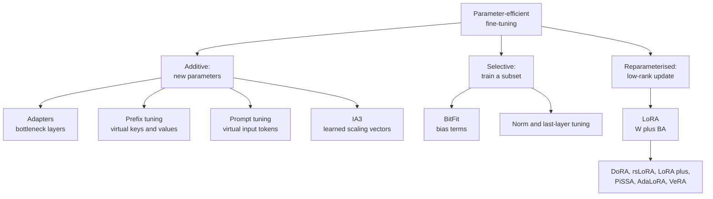

*Figure 6. Families of parameter-efficient fine-tuning methods.*

The figure shows why LoRA has become the default: it is the only family that is both a reparameterisation of existing weights (so it can be merged and costs nothing at inference) and flexible about where it is applied.

### 6.1 Adapters

Houlsby et al. (2019) inserted a small bottleneck module after the attention sub-layer and after the feed-forward sub-layer of each transformer block. The module projects the hidden vector $h \in \mathbb{R}^d$ down to a dimension $m \ll d$, applies a nonlinearity, projects back up, and adds the result to the input through a residual connection:

$$
h' = h + W_{\text{up}}\,\sigma(W_{\text{down}}\, h), \qquad W_{\text{down}} \in \mathbb{R}^{m \times d},\; W_{\text{up}} \in \mathbb{R}^{d \times m}.
$$

With biases the module has $2dm + d + m$ parameters. For $d = 4096$ and $m = 64$ that is $2 \times 4096 \times 64 + 4096 + 64 = 528{,}448$ per module; two modules per layer over 32 layers is $33.8$ million parameters, about 0.5 percent of the base model. The up-projection is initialised near zero so that the module starts as an identity function and training begins from the pretrained behaviour.

Adapters work well, but they add *sequential* computation: two extra small layers per block that cannot be folded into the existing weights because of the nonlinearity. That adds measurable latency at small batch sizes, where inference is dominated by kernel-launch overhead and memory reads rather than arithmetic. This latency cost is the property LoRA was designed to avoid.

### 6.2 Prefix tuning and prompt tuning

Prefix tuning (Li and Liang, 2021) prepends $p$ trainable vectors to the keys and values at every attention layer, as if the model had attended to $p$ extra "virtual tokens" whose representations are learned directly instead of coming from text. The parameter count is $2 \times L \times p \times d$ (a key and a value vector for each virtual token in each of $L$ layers), so with $p = 20$ it is $2 \times 32 \times 20 \times 4096 = 5.2$ million. Direct optimisation of the prefix is unstable, so the paper trains it through a reparameterisation (a small feed-forward network) and discards the network after training.

Prompt tuning (Lester et al., 2021) is simpler: learn $p$ virtual token embeddings at the input layer only. For $p = 20$ and $d = 4096$ that is 81,920 parameters. The authors reported that prompt tuning approaches full fine-tuning quality only as the model grows, reaching parity at around ten billion parameters, which makes it more attractive for very large models and less attractive for small ones.

Both methods have practical drawbacks. The virtual tokens consume sequence positions and so shrink the usable context by $p$. Their training can be touchy and sensitive to initialisation and learning rate. They cannot be merged into the weights, so every request pays attention cost over the extra positions. They remain interesting for multi-tenant settings, because a prompt is tiny, but LoRA adapters are small enough that the advantage is marginal.

### 6.3 IA3: scaling activations

IA3 ("Infused Adapter by Inhibiting and Amplifying Inner Activations", Liu et al., 2022, in the T-Few recipe) learns three vectors per layer that multiply the keys, the values, and the feed-forward intermediate activations elementwise:

$$
k' = \ell_k \odot k, \qquad v' = \ell_v \odot v, \qquad u' = \ell_{ff} \odot u .
$$

Here $\odot$ is elementwise multiplication and the vectors are initialised to ones. For our model the per-layer count is $d + d + d_{ff} = 4096 + 4096 + 11008 = 19{,}200$ and the total is $19{,}200 \times 32 = 614{,}400$ parameters, which is about 0.009 percent of the base model. Because each scaling vector multiplies the output of a linear map, it can be folded into that map's weights after training, so IA3 is mergeable like LoRA. Its capacity is extremely limited: it can only rescale existing features. This makes it a sensible choice for few-shot adaptation with tens to a few hundred examples, and a poor one when the task needs the model to compute something new.

### 6.4 BitFit and selective tuning

BitFit (Ben Zaken et al., 2022) trains only the bias terms of a BERT-style model, about 0.1 percent of its parameters, and was competitive on small-to-medium datasets for classification. Most modern decoder-only language models (the Llama family and many others) have no bias terms in their linear layers, so BitFit is not directly applicable. Related selective schemes train only the normalisation parameters, the final layers, or the output head. Selective tuning has almost no implementation complexity and is a useful baseline: if training only the last few layers or the classification head reaches the target quality, nothing heavier is warranted.

### 6.5 Choosing among them

Table 2 compares the methods on the properties architects care about. Parameter counts are for the 7B example and illustrative.

| Method | Trainable parameters (7B example) | Mergeable into weights | Added inference cost | Typical use |
| --- | --- | --- | --- | --- |
| Full fine-tuning | 6.74B | Not applicable | None | Large data, far domain shift |
| Adapters (m = 64) | about 34M | No | Extra sequential layers | Encoder tasks, legacy setups |
| Prefix tuning (p = 20) | about 5.2M | No | Longer attention context | Research, very large models |
| Prompt tuning (p = 20) | about 82K | No | Longer input | Very large models, tiny artifacts |
| IA3 | about 0.6M | Yes | None after merge | Few-shot tuning |
| BitFit | Not applicable to bias-free models | Yes | None | Small encoders |
| LoRA (r = 16, all linear) | about 40M | Yes | None after merge | Default for decoder LLMs |

*Table 2. PEFT methods compared.*

The shape of the table explains the market: LoRA sits in the sweet spot of enough capacity, mergeability, and tool support.

## 7. Low-Rank Adaptation (LoRA)

### 7.1 The low-rank hypothesis

A weight matrix $W_0 \in \mathbb{R}^{d \times k}$ in a pretrained model is trained to a point where it already works well. Full fine-tuning moves it to $W_0 + \Delta W$, where $\Delta W$ is a dense matrix with $dk$ free entries. The question is whether $\Delta W$ needs all those degrees of freedom. The empirical observation behind LoRA, building on work on the *intrinsic dimension* of fine-tuning (Aghajanyan et al., 2020) which found that pretrained models can be fine-tuned effectively within random subspaces of surprisingly small dimension, is that the useful updates lie close to a low-dimensional subspace. In matrix terms, $\Delta W$ is well approximated by a matrix of low rank $r$.

Recall from linear algebra that any matrix of rank at most $r$ can be written as a product $\Delta W = B A$ with $B \in \mathbb{R}^{d \times r}$ and $A \in \mathbb{R}^{r \times k}$. The product has $dk$ entries but only $r(d + k)$ free parameters. The singular value decomposition shows that the best rank-$r$ approximation of any matrix (in Frobenius norm) keeps its top $r$ singular values and vectors (the Eckart-Young theorem), which justifies the search for the update in this family.

### 7.2 Formulation

LoRA (Hu et al., 2021) freezes $W_0$ and trains only $A$ and $B$. For an input $x \in \mathbb{R}^k$ the layer output is

$$
h = W_0 x + \frac{\alpha}{r} B A x ,
$$

where $r$ is the *rank*, and $\alpha$ is a constant *scaling factor* (often called `lora_alpha`). Define $s = \alpha / r$. Then $h = W_0 x + s\,B(Ax)$. The computation order matters: computing $A x$ first yields an $r$-dimensional vector, so the adapter costs $r(d + k)$ multiply-adds per token instead of $dk$. For $d = k = 4096$ and $r = 16$ that is $131{,}072$ against $16{,}777{,}216$, or 0.78 percent of the matrix's cost.

Figure 7 shows the data path through one adapted layer.

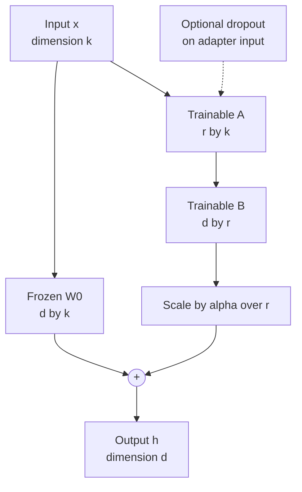

*Figure 7. The LoRA update path. Only A and B receive gradients. W0 stays frozen.*

Because $W_0$ is frozen, no gradient or optimizer state is kept for it. But the backward pass still has to flow *through* $W_0$ to reach earlier layers, so it computes the gradient with respect to the layer input, $W_0^\top \partial L / \partial h$. This is why LoRA does not remove the activation memory term and why its compute per token is about $4P$ (forward $2P$ plus activation-gradient $2P$) rather than $6P$: the weight-gradient matrix multiplication for the frozen weights is skipped.

### 7.3 Initialisation

If both $A$ and $B$ were initialised randomly, the adapted model would start from a perturbed $W_0$ and training would begin by damaging the pretrained function. LoRA initialises $A$ with small random values (Gaussian or Kaiming-uniform in common implementations) and $B$ to zero. Then $BA = 0$ at step 0, the adapted model equals the base model exactly, and the loss at step 0 equals the base model's loss. This is easy to test: the first logged training loss should match the evaluation loss of the unmodified base model on the same batch.

The asymmetry has a consequence for the first updates. The gradients are

$$
\frac{\partial L}{\partial B} = s\, \frac{\partial L}{\partial h}\,(A x)^\top, \qquad \frac{\partial L}{\partial A} = s\, B^\top \frac{\partial L}{\partial h}\, x^\top .
$$

At $B = 0$ the gradient with respect to $A$ is exactly zero, so the first step changes only $B$. After that $B$ is nonzero and both matrices learn. If one initialised $A$ to zero and $B$ randomly, the roles would swap. Setting both to zero would stall training permanently, since each gradient is proportional to the other matrix.

### 7.4 The scaling factor and the rank

The scale $s = \alpha / r$ divides the update by the rank. The original paper's reasoning is that when $\alpha$ is held constant while $r$ varies, the magnitude of the update stays comparable and less retuning of the learning rate is needed as rank changes. Subsequent analysis (Kalajdzievski, 2023, "A Rank Stabilization Scaling Factor for Fine-Tuning with LoRA") argues that dividing by $r$ makes learning slow down at higher ranks, and proposes $\alpha / \sqrt{r}$ ("rsLoRA"), under which higher rank gives better results as expected. Practitioners commonly set $\alpha = r$ or $\alpha = 2r$ (so $s = 1$ or $2$) and tune the learning rate. Whichever convention you use, treat $\alpha$ and the learning rate as coupled: doubling $s$ scales the effective step on the update roughly as a larger learning rate would.

Rank $r$ sets capacity. Typical values are 8 to 64. Evidence from several studies is that results are not very sensitive to rank on narrow tasks (rank 8 to 16 is often enough), while tasks that need more new knowledge (code, mathematics, large domain shifts) benefit from higher rank (Biderman et al., 2024). A reasonable procedure is to try $r \in \{8, 32\}$ and a learning-rate sweep on a validation set, and to increase rank only if the training loss plateaus well above what full fine-tuning on the same data reaches.

### 7.5 Which modules to target

The original paper adapted only the query and value projections in attention. Later practice, notably the QLoRA study, found that adapting *all* linear layers (attention q, k, v, o and feed-forward gate, up, down) matters for matching full fine-tuning quality, and that the number of adapted matrices matters more than the rank on each. The memory cost is modest. For our 7B model, all linear layers at rank 16:

$$
\text{attention: } 4 \times r (d + d) = 4 \times 16 \times 8192 = 524{,}288, \qquad \text{feed-forward: } 3 \times r (d + d_{ff}) = 3 \times 16 \times 15104 = 724{,}992 ,
$$

$$
\text{per layer} = 1{,}249{,}280, \qquad \text{total} = 32 \times 1{,}249{,}280 = 39{,}976{,}960 \approx 40.0\text{M} \;(0.59\%\text{ of } 6.74\text{B}).
$$

Applying LoRA to only q and v at rank 16 would give $32 \times 2 \times 16 \times 8192 = 8.4$M parameters. The script prints the all-layer counts for ranks 8, 16, and 64 (about 20.0M, 40.0M, and 159.9M, or 0.30, 0.59, and 2.37 percent).

Embedding and output layers are normally left frozen. If the task adds new tokens (new special tokens, new role markers), the embedding and output rows for those tokens must be trainable, otherwise the model cannot learn them. Libraries expose this as "modules to save" in addition to the adapter. Forgetting to save these modules alongside the adapter is a classic defect: the adapter loads, the new tokens map to untrained rows, and outputs are garbled.

### 7.6 Worked example: a runnable low-rank demo

The script [`01_lora_demo.py`](../code/python/fine-tuning-chapter/01_lora_demo.py) uses no libraries. It builds a frozen $12 \times 10$ layer, a "teacher" layer that differs by a rank-2 update, and trains a rank-4 LoRA by gradient descent on mean squared error with the analytic gradients above. It prints the parameter counts and the loss every few steps, then merges the update into the base matrix and compares outputs. The output reproduced below comes from a run on Python 3.14.

```text
full layer params = 120, LoRA params (r=4) = 88, ratio = 0.73
step    0  mse = 0.843555
step  100  mse = 0.076976
step  500  mse = 0.000000
step 1000  mse = 0.000000
step 1500  mse = 0.000000
max |merged - unmerged| output difference = 8.88e-16
relative error of learned update vs teacher update: 0.0000
```

Three observations. First, the loss at step 0 is the loss of the unmodified model, since $B = 0$. Second, a rank-4 adapter recovers a true rank-2 update exactly, which is the low-rank hypothesis in its idealised form: if the required change has low rank, the adapter finds it. For a layer that small the adapter is 73 percent of the size of the full matrix, so there is no saving; the saving appears when $r \ll \min(d, k)$, as in the 0.78 percent figure above. Third, the merged layer reproduces the unmerged layer to floating-point rounding (difference $8.9 \times 10^{-16}$ in float64).

### 7.7 Merging an adapter into the base weights

Because the adapter is a linear update, it can be folded into the base weight:

$$
W_{\text{merged}} = W_0 + \frac{\alpha}{r} B A .
$$

After merging, the model has exactly the base architecture, no adapter modules, and the same inference cost as the base model. Merge when you serve a single variant per deployment and want zero overhead, or when handing the artifact to a runtime that does not support adapters. Do not merge when you need to serve many variants on shared base weights (section 16), or when you want to keep the adapter separable for rollback, audit, or removal.

Two precision issues deserve care. First, the update is small relative to the base weights, and merging in bf16 rounds the sum to 8 bits of significand. Updates smaller than roughly $0.4$ percent of a weight's magnitude (about $2^{-8}$) can be partly lost, so a merged bf16 model may differ slightly from the unmerged adapter model. For most tasks the difference is not material, but you must evaluate the merged artifact, not assume it is equivalent. Merge in fp32 and then cast, when possible. Second, merging into a *quantized* base requires dequantising, adding the update, and requantising, which adds quantisation error that the adapter was never trained to compensate. The standard practice for QLoRA models is to merge into a 16-bit copy of the base (loaded separately) and then optionally quantize the result for serving, followed by re-evaluation.

### 7.8 What LoRA gains and what it gives up

LoRA reduces trainable parameters, optimizer memory, and checkpoint size by two to three orders of magnitude, adds no inference latency after merging, and makes switching between tasks a matter of swapping small files. The price is reduced capacity. The study "LoRA Learns Less and Forgets Less" (Biderman et al., 2024) compared LoRA and full fine-tuning on code and mathematics, in both instruction tuning and continued pretraining. LoRA underperformed full fine-tuning on the target domain, especially for continued pretraining, and forgot less of the source domain; it also gave more diverse generations. A separate analysis (Shuttleworth et al., 2024, "LoRA vs Full Fine-tuning: An Illusion of Equivalence") reported that even when LoRA and full fine-tuning match on a task, LoRA updates contain "intruder dimensions", new high-rank singular directions that are absent from full fine-tuning and that correlate with more forgetting of pretraining behaviour in sequential tuning. These are research findings on specific models and tasks, and their size varies, but they correct the folk belief that LoRA is simply a cheaper equivalent of full fine-tuning.

The practical reading: for behaviour, format, and narrow skills with thousands of examples, LoRA matches full fine-tuning at a fraction of the cost. For large, knowledge-heavy shifts, expect a gap and test.

## 8. Quantized LoRA (QLoRA)

### 8.1 The idea

LoRA removes the gradient and optimizer terms but leaves the base weights at 16 bits: 13.5 GB for the 7B model, and 130 GB for a 65B model. QLoRA (Dettmers et al., 2023) stores the frozen base weights in 4 bits, dequantises them layer by layer on the fly to bf16 for the matrix multiplications, and trains LoRA adapters in 16-bit precision on top. Gradients flow through the dequantised weights into the adapters. The base weights are never updated, so quantisation error in them is fixed and the adapter learns to work with the quantised model.

Figure 8 shows what lives where during a QLoRA step.

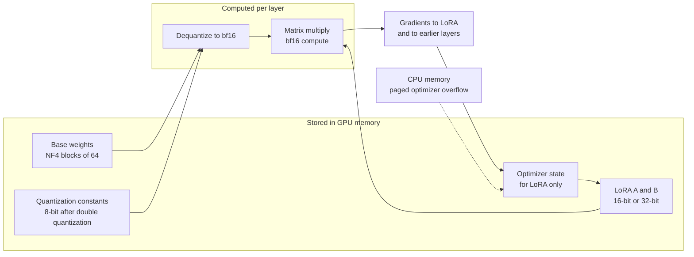

*Figure 8. Components of a QLoRA training step.*

The picture also shows the cost of the method: the dequantisation step runs on every forward and backward pass, so QLoRA trades GPU memory for extra compute, and throughput is typically lower than 16-bit LoRA on the same hardware. Measure it rather than assuming a ratio; it depends on the kernel implementation and the batch size.

### 8.2 NF4: the 4-bit NormalFloat data type

Uniform 4-bit quantization splits the range $[-a, a]$ into 16 equally spaced levels. But pretrained weights are approximately zero-mean and normally distributed within a block, so most weights cluster near zero and few lie near the extremes. Equally spaced levels waste resolution on rare large values. A better design places the 16 levels at *quantiles* of the standard normal distribution, so that each level represents an equal share of the weights. The QLoRA authors called the resulting type *4-bit NormalFloat (NF4)* and showed it to be information-theoretically optimal for normally distributed data, with the levels normalised to $[-1, 1]$ and with an exact zero level.

The quantization procedure for a block of $B = 64$ weights is as follows.

1. Compute the block's absolute maximum $c = \max_i |w_i|$ (the quantization constant, stored in higher precision).
2. Normalise: $\tilde w_i = w_i / c \in [-1, 1]$.
3. Replace each $\tilde w_i$ by the index of the nearest of the 16 NF4 levels, a 4-bit code.
4. To dequantize, look up the level for each code and multiply by $c$.

Blockwise scaling matters because one outlier in a large block would stretch the range and crush the resolution of every other weight; small blocks confine the damage to 64 values. The cost of small blocks is the storage of one constant per block.

The script [`04_merging_and_nf4.py`](../code/python/fine-tuning-chapter/04_merging_and_nf4.py) quantizes 25,600 Gaussian weights ($\sigma = 0.02$) in blocks of 64 with the 16 NF4 levels and with 16 uniform levels. It reports a signal-to-noise ratio (weight variance over mean squared quantization error) of 121 for NF4 against 100 for uniform 4-bit, which is about 0.8 dB better. The difference is modest in this idealised test but real; QLoRA's own experiments showed NF4 beating 4-bit float and integer types in downstream perplexity and accuracy.

### 8.3 Double quantization

With one 32-bit constant per block of 64 weights, constants cost $32 / 64 = 0.5$ bits per parameter, a 12.5 percent overhead on top of 4 bits. *Double quantization* quantizes the constants themselves: the first-level constants are grouped in blocks of 256, quantised to 8 bits, with a second-level 32-bit constant per group of 256. The overhead becomes

$$
\frac{8}{64} + \frac{32}{64 \times 256} = 0.125 + 0.00195 = 0.127 \text{ bits per parameter},
$$

a saving of $0.5 - 0.127 = 0.373$ bits per parameter. For the 7B model that is $6.738 \times 10^9 \times 0.373 / 8 = 0.31$ GB; for a 65B model about 3 GB, the figure the QLoRA paper reports. It is a small saving on a small model and matters on the largest ones, where it can decide whether a model fits.

### 8.4 Paged optimizers

Training memory has spikes: a batch with an unusually long sequence produces large activations, and the process runs out of memory even though the average usage fits. QLoRA's *paged optimizers* allocate optimizer state in CUDA unified memory, which lets the driver evict pages to CPU memory when the GPU is full and bring them back when needed, the same way an operating system pages virtual memory. A spike then slows the step instead of crashing the run. Paging helps only occasional spikes; if every step pages, the run is dominated by PCIe transfers and you should shorten sequences or the batch.

### 8.5 QLoRA memory arithmetic for the 7B model

Total memory is the NF4 base, the adapter state, and activations.

*Base in NF4.* Each parameter takes 4 bits plus 0.127 bits of constants: $6.738 \times 10^9 \times 4.127 / 8 = 3.48$ GB. In practice libraries keep the embedding and output matrices (262M parameters) in 16-bit, adding $262 \times 10^6 \times (2 - 0.516) \approx 0.39$ GB beyond the NF4 estimate (NF4 costs $4.127/8 = 0.516$ bytes per parameter), so plan for about 3.9 GB for the base.

*Adapter state at rank 16.* There are 40.0M adapter parameters. Held in fp32 with fp32 gradients and Adam moments, each takes $4 + 4 + 4 + 4 = 16$ bytes: $39{,}976{,}960 \times 16 = 0.64$ GB. (Some stacks hold adapter weights in bf16 and the optimizer in fp32; the order of magnitude is the same.)

*Total before activations.* $3.48 + 0.64 = 4.1$ GB from the script, or about 4.5 GB including 16-bit embeddings. At rank 64 the adapter state is 2.56 GB and the total is 6.0 GB.

*Activations.* With activation checkpointing at $s = 2048$, $b = 4$ the layer inputs total 2.15 GB, plus the working memory of one layer being recomputed (a few hundred megabytes to about 1 GB) and the logits, which for a 32,000-token vocabulary are $b \times s \times V \times 4$ bytes in fp32 $= 4 \times 2048 \times 32000 \times 4 = 1.05$ GB, and more for a larger vocabulary. Without checkpointing, activations are 36.5 GB.

So a QLoRA run of this model fits in roughly 8 to 12 GB with checkpointing, which matches common experience that 7B QLoRA runs on a 16 GB or 24 GB consumer or workstation GPU. The same model needs about 14 GB just for 16-bit LoRA base weights plus activations, so 24 GB cards suffice with checkpointing, and full fine-tuning needs a multi-GPU node.

Table 3 collects the 7B numbers.

| Method | Weights | Trainable parameters | Gradients and optimizer state | Total before activations |
| --- | --- | --- | --- | --- |
| Full fine-tuning, mixed precision AdamW | 13.5 GB bf16, plus 27.0 GB fp32 master | 6.74B | 13.5 + 53.9 GB | 107.8 GB |
| LoRA r = 16, bf16 base | 13.5 GB | 40.0M | 0.64 GB | 14.1 GB |
| QLoRA r = 16, NF4 base | 3.5 GB | 40.0M | 0.64 GB | 4.1 GB |
| QLoRA r = 64, NF4 base | 3.5 GB | 159.9M | 2.56 GB | 6.0 GB |

*Table 3. Training memory for a 7B model, excluding activations. Computed by `02_memory_and_cost.py`.*

The ratio between full fine-tuning and QLoRA at rank 16 is $107.8 / 4.1 \approx 26$, which is where the "factor of 25" in the introduction comes from. The reduction is mostly from the optimizer and master-weight terms vanishing and the base shrinking fourfold; activations are the same for both, which is why sequence length and batch size remain the main levers once the model state is small.

### 8.6 Quality and the cost of quantization

The QLoRA paper reported that 4-bit NF4 with double quantization and LoRA on all linear layers matched 16-bit full fine-tuning on the benchmarks studied. Later work has shown that this holds for many but not all tasks, and that quantisation error in the frozen base can leave a residual gap, especially at 3 bits or lower and on small models, which lose proportionally more from quantisation than large ones. Variants such as LoftQ initialise the adapter to compensate the quantisation error. Treat "QLoRA matches full fine-tuning" as a result to check on your task, using your own evaluation set, and compare QLoRA against 16-bit LoRA at least once before settling on the cheaper path.

Production considerations also differ. A model trained as QLoRA is best served either as the 16-bit base plus the adapter, or merged into 16-bit and re-quantised for serving with an inference-oriented format (such as Activation-aware Weight Quantization (AWQ) or GPTQ, a post-training quantization method, covered in [CH28](CH28_Inference_Optimization_and_Model_Serving.md)). Serving the NF4 base used in training is possible in some stacks, but the kernels are slower than inference-optimised formats. In every case the tuned model's quality must be measured in the form that will be served, because training in NF4 and serving in a different 4-bit format combines two quantisation errors.

## 9. DoRA and Other LoRA Variants

LoRA has attracted dozens of variants. A senior practitioner does not need to adopt them, but should understand what problems they target, so that a symptom in a run can be matched to a likely remedy. In every case, the default advice is to start from standard LoRA, and to adopt a variant only when an ablation on your own validation set shows a gain larger than the noise.

**Weight-Decomposed Low-Rank Adaptation (DoRA).** Liu et al. (2024) observed that full fine-tuning changes the *magnitude* and *direction* of weight vectors in a way that differs from LoRA's coupled update. DoRA decomposes each pretrained weight column-wise into a magnitude vector $m$ and a direction matrix, applies the low-rank update only to the direction, and trains the magnitude as a separate vector:

$$
W' = m\, \frac{W_0 + s\,BA}{\lVert W_0 + s\,BA \rVert_c},
$$

where $\lVert \cdot \rVert_c$ is the column-wise vector norm. The paper reports consistent gains over LoRA at the same rank across commonsense reasoning, instruction following, and vision-language tasks, with the ability to use a lower rank to match LoRA. The extra cost is the norm computation in the forward and backward pass, which increases memory and step time, though the final weights can still be merged. If LoRA at a reasonable rank leaves a gap to full fine-tuning, DoRA is one of the first things to try.

**Rank-stabilised LoRA (rsLoRA).** Replaces $\alpha / r$ with $\alpha / \sqrt{r}$ so that higher ranks train as expected (section 7.4). It costs nothing and matters when you use ranks of 64 and above.

**LoRA+.** Hayou et al. (2024) showed that using the same learning rate for $A$ and $B$ is inefficient for wide models and proposed a higher learning rate for $B$ (a ratio of about 16 in their experiments), reporting faster convergence and small quality gains at no extra memory cost.

**Principal Singular values and Singular vectors Adaptation (PiSSA).** It initialises $A$ and $B$ from the top-$r$ singular components of $W_0$ and stores the residual in the frozen part, so that training updates the principal directions instead of a random subspace. It tends to converge faster than standard LoRA initialisation, at the cost of a singular value decomposition at start-up and an adapter that is not a pure delta from the base (so it cannot be applied as a diff to an unmodified base unless converted).

**Adaptive Low-Rank Adaptation (AdaLoRA).** Zhang et al. (2023) parameterise the update in SVD form and prune singular values during training, which allocates more rank to the matrices that need it and less to the rest within a fixed total budget. It adds complexity and extra hyperparameters.

**Vector-based Random Matrix Adaptation (VeRA).** Shares one pair of frozen random low-rank matrices across all layers and trains only small scaling vectors per layer, which shrinks the adapter by another order of magnitude. It is relevant when thousands of adapters must be stored.

**Gradient Low-Rank Projection (GaLore).** Zhao et al. (2024) is different in kind: it trains *all* weights but projects the gradients onto a low-rank subspace to store compressed optimizer state, which cuts optimizer memory without restricting the final weight update to low rank. It is closer to full fine-tuning in outcome and is mainly of interest for pretraining and continued pretraining on constrained hardware.

**Adapter-quantization hybrids.** LoftQ and QA-LoRA reduce the gap between quantised and full-precision tuning, or make the merged result quantisation-friendly, as noted in section 8.6.

A short decision table for variants:

| Symptom | Candidate remedy |
| --- | --- |
| Training loss plateaus higher than full fine-tuning on the same data | Raise rank, add targets (all linear), then try DoRA |
| Higher ranks do not help | Use rsLoRA scaling, check the learning rate |
| Slow convergence | LoRA+ learning-rate ratio, PiSSA initialisation |
| Thousands of tenant adapters to store | Lower rank, VeRA, or shared basis methods |
| Quantised base degrades quality | 16-bit LoRA, LoftQ initialisation, higher bit width |
| Knowledge-heavy domain shift | Consider full fine-tuning or continued pretraining instead of a better LoRA variant |

*Table 4. Mapping symptoms to variants.*

The table makes one thing explicit: variants are tools for specific symptoms, and the first diagnostic question in every row is whether the problem is data, not method.

## 10. Hyperparameters and Failure Signatures

Fine-tuning has fewer hyperparameters than pretraining, but they interact, and a bad setting often produces a model that looks plausible in a demo and fails in production. This section gives defaults with the reasoning behind them, a worked step count, and a catalogue of failure signatures with their usual causes.

### 10.1 Learning rate

The learning rate is the most sensitive setting. The right value depends on the method.

- **Full fine-tuning** of a 7B-class model typically uses a peak learning rate between $5 \times 10^{-6}$ and $2 \times 10^{-5}$. The weights are already good, and large steps destroy pretraining knowledge.
- **LoRA and QLoRA** typically use $10^{-4}$ to $3 \times 10^{-4}$, which is ten times higher or more. The reason is that the adapter starts at zero and has few parameters, so it needs larger steps to move the output, and the scale $\alpha / r$ interacts with the rate. The QLoRA paper used $2 \times 10^{-4}$ for models up to 13B and $10^{-4}$ for 33B and 65B, with constant schedules after warmup in those experiments.
- **Preference tuning** (CH14) uses much lower rates than SFT, often $5 \times 10^{-7}$ to $5 \times 10^{-6}$ for full tuning, because the objective can push the policy far from the reference quickly.

Treat these as starting points and run a short sweep. A practical sweep is three values spaced by a factor of about 3 (for LoRA: $5 \times 10^{-5}$, $1.5 \times 10^{-4}$, $5 \times 10^{-4}$), each trained for a fraction of the planned steps on the same data and seed, compared on validation loss and on the task metric. The best rate is usually just below the rate at which loss becomes unstable, so the sweep should include a value that is too high so that you know where the cliff is.

### 10.2 Schedule and warmup

A learning-rate schedule has a warmup, where the rate rises linearly from near zero to the peak over the first few percent of steps, and a decay, where it falls toward zero or a floor. Warmup matters because Adam's second-moment estimate is poorly calibrated at the start of training, so the first updates are noisy and large relative to the signal. Without warmup, the early steps can push weights to a bad region from which a short run does not recover.

Common choices are 3 to 10 percent warmup followed by cosine or linear decay to 10 percent of the peak or to zero. For short runs (a few hundred steps) a linear schedule is easy to reason about. Constant schedules with warmup also work in practice for LoRA, but decay generally gives a slightly better final loss, and the ability to pick the checkpoint at the end of the schedule is convenient.

### 10.3 Batch size, epochs, and steps

The effective batch size is micro-batch size times gradient-accumulation steps times the number of data-parallel workers. Typical SFT values are 16 to 128 sequences. Smaller batches give noisier gradients and more updates per epoch; larger batches give smoother gradients and need a higher learning rate. A rule of thumb that works for Adam in this regime is to scale the learning rate with the square root of the batch size when changing the batch by a large factor, then verify.

The number of epochs controls how many times each example is seen. SFT usually runs 1 to 3 epochs. More epochs than that tend to overfit small datasets, and the overfitting shows up as memorization of training responses (section 14) before it shows up in validation loss. If the data is small and noisy, prefer fewer epochs and more data over more epochs.

A worked step count: 5,000 training examples, effective batch size 32, 3 epochs.

$$
\text{steps per epoch} = \lceil 5000 / 32 \rceil = 157, \qquad \text{total steps} = 3 \times 157 = 471 .
$$

(The arithmetic gives 156.25 steps per epoch, and the last batch of each epoch is partial or dropped depending on settings.) With 5 percent warmup, the warmup lasts about $0.05 \times 471 \approx 24$ steps. The tokens processed per epoch are the number of examples times the mean packed or padded length, which feeds the cost estimate in section 18. At 471 steps there are few updates, so each decision matters and evaluating every 25 to 50 steps gives a usable curve.

### 10.4 Other settings

- **Weight decay.** 0 to 0.1. In LoRA runs it matters less than the rate.
- **Gradient clipping.** A global norm clip of 1.0 is standard and protects against single bad batches.
- **LoRA dropout.** 0.05 to 0.1 applied to the input of the adapter acts as a regulariser. Higher values rarely help.
- **Precision.** bf16 is the default on modern accelerators because it has the exponent range of fp32 and avoids the loss scaling that fp16 requires. fp16 training needs dynamic loss scaling and is more prone to overflow.
- **Seed and determinism.** Data order, dropout, and adapter initialisation depend on the seed. Different seeds can change a metric by a point or more on small evaluation sets, so compare configurations over at least two or three seeds before claiming that one is better.
- **Maximum sequence length** (section 4.5) and **packing** (section 4.4).

### 10.5 Reading the loss curves

A fine-tuning run produces two curves, training loss and validation loss, plus task metrics. The healthy pattern is a rapid fall in both during the first fraction of an epoch, as the model learns the format, then a slow decline, with validation loss close to training loss. Because the base model already does well on the language, losses start low (for example 1.5 to 2.5 nats per token for general chat, and much lower for structured outputs) and fall to a plateau.

An important caveat about validation loss: it is an average per-token cross-entropy, and it can keep falling while task performance stalls, because most tokens are easy. For a JSON extraction task, the tokens that matter (the values) are a minority of the output, so a model can reduce loss by predicting the braces and keys better while getting the values no better. Always track a task metric (section 12) at each evaluation step and choose checkpoints by it.

### 10.6 Failure signatures

Table 5 lists patterns that appear repeatedly, and the checks that resolve them. The diagnostic order is: look at the data, then the template and labels, then the learning rate, then the method.

| Signature | Probable cause | Check or fix |
| --- | --- | --- |
| Loss is NaN or spikes to a large value early | Learning rate too high, no warmup, fp16 overflow, or a corrupt example | Lower the rate, add warmup and clipping, switch to bf16, scan for empty or huge examples |
| Loss is exactly zero or NaN from step 0 | All labels masked (no completion tokens survive truncation or masking) | Print one batch with labels, count loss-bearing tokens |
| Loss does not move from its initial value | Rate too low, adapter not attached to the right modules, or gradients disabled | Verify trainable parameter count, target module names, and that `requires_grad` is set |
| Training loss collapses to near zero within one epoch | Duplicates, leakage between prompt and completion, or a task that is trivially memorised | Deduplicate, inspect examples, check for the answer appearing in the prompt |
| Training loss falls, validation loss rises after epoch 1 | Overfitting | Fewer epochs, more data, lower rank, higher dropout, early stopping |
| Validation loss falls but the task metric does not | Loss dominated by easy tokens, or metric mismatch | Evaluate generations with the real metric, consider upweighting answer tokens |
| Model never stops generating | End-of-turn token missing from labels or truncated away | Inspect the last tokens of labelled sequences |
| Garbled output or stray role markers | Template mismatch between training and serving, or new-token embeddings not saved | Compare token ids from both paths, save embedding and output modules |
| Tuned model behaves like the base model | Adapter not loaded at inference, wrong adapter version, or scale set to zero | Compare logits with the adapter disabled, check loading logs |
| Good on validation, poor in production | Distribution shift between validation and live traffic, or split leakage | Rebuild the validation set from production samples, split by group |
| Model refuses or hedges more than before | Refusal-heavy data, or over-correction after safety mixing | Audit refusal ratio in the training set and test over-refusal |
| General abilities degrade (maths, code, languages) | Forgetting from high rate, long training, or narrow data | Replay data, lower rate, fewer epochs, LoRA with lower rank, regression suite |

*Table 5. Failure signatures in fine-tuning runs.*

Figure 9 turns the first part of the table into a decision flow that a team can follow when a run misbehaves.

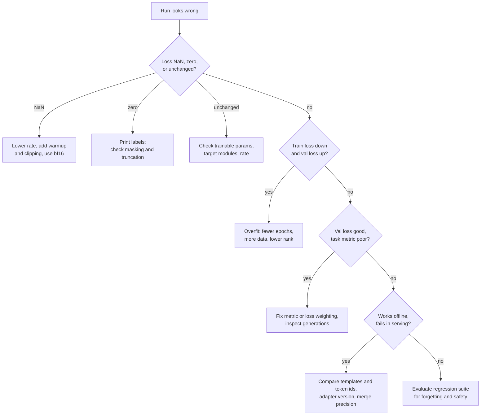

*Figure 9. A diagnostic flow for failed or suspicious runs.*

The structure of the flow matters more than any single branch: it starts with cheap checks that need no new training (print the labels, count the trainable parameters, compare token ids), and only reaches expensive remedies at the end.

## 11. Data Curation

Fine-tuning quality is bounded by data quality. A model fine-tuned on 1,000 consistent, correct, representative examples usually beats a model fine-tuned on 20,000 inconsistent ones, which is the practical lesson of the LIMA result. Curation is where most of the schedule goes and where most of the improvement comes from.

### 11.1 Quality over quantity

Define quality along five axes and audit samples along each.

1. **Correctness.** The target output is right. For extraction, the extracted values match the source. For classification, the label matches the written guideline.
2. **Consistency.** Similar inputs get similar outputs. Two annotators who label the same ticket differently teach the model to be uncertain, and since the model reproduces the average, to be wrong on both.
3. **Coverage.** The examples include the distribution of real inputs: easy and hard, common and rare, clean and noisy, short and long, and the boundary cases and refusals that matter. A dataset made of the easy cases produces a model that is overconfident on the hard ones.
4. **Format fidelity.** The outputs have exactly the format that downstream code parses. Hand-written examples drift in whitespace, field order, and quoting; validate every output with a schema or parser, and reject records that fail.
5. **Representativeness of the target distribution.** Training examples should resemble production inputs in length, language, noise, and topic. Synthetic or curated examples that are too clean produce a model that fails on messy input.

A cheap way to detect problems is to sample 100 records and read them. In most first datasets this finds a surprising number of defects: truncated outputs, copy-paste errors, annotator disagreements, hidden personal data. Reading is not a substitute for automated checks, but it finds the kinds of problem the automated checks were not written for.

### 11.2 Deduplication

Duplicates harm in two ways. They inflate apparent dataset size and skew the model toward the repeated items, and they leak between train and validation splits, giving optimistic evaluation. Lee et al. (2022), "Deduplicating Training Data Makes Language Models Better", showed that deduplication reduced memorization, improved efficiency, and removed train-test overlap in common corpora.

Deduplicate at three levels.

- **Exact.** Hash the normalised text (lowercase, collapse whitespace) and drop repeats.
- **Near-duplicate.** Compare shingle sets with Jaccard similarity, or use MinHash with locality-sensitive hashing for large datasets. In [`03_data_curation.py`](../code/python/fine-tuning-chapter/03_data_curation.py) two support tickets that differ only in punctuation and case are not exactly equal but have Jaccard similarity 1.00 on three-word shingles after normalisation, and a third ticket with a small rewording has 0.38. A threshold of 0.7 to 0.8 on Jaccard is a common starting point; tune it by reading pairs just above and below the threshold.
- **Semantic.** Embedding-based clustering catches paraphrases that share few words. Use it to cap the number of examples per cluster instead of removing all but one, because some repetition reflects real frequency.

Deduplicate *before* splitting, and keep duplicates in the same split. If you split first and deduplicate within each split, near-duplicates can cross the boundary.

### 11.3 Decontamination against evaluation sets

*Contamination* occurs when evaluation items appear, in whole or in part, in the training data. It makes scores meaningless. It happens through obvious routes (an evaluation set built from the same corpus as the training set) and subtle ones (the same document appears as a different example, a benchmark question posted online and copied into scraped data, or a synthetic data generator that has seen the benchmark).

Decontaminate with n-gram overlap: for every training example, compute its word n-grams (13-grams were used for the GPT-3 contamination analysis; shorter n such as 6 to 8 is stricter and appropriate for short texts), compare against the n-grams of every evaluation item, and drop or flag training examples with any overlap. In the script, a training sentence sharing five 6-grams with a test sentence is dropped, while an unrelated one is kept. Run the check against *all* evaluation sets you intend to report: the task test set, the general-capability regression suite, and public benchmarks you plan to cite. Also run it in the other direction, from the evaluation set to external benchmark data, when publishing results.

For synthetic data, decontamination should include the prompts given to the generator and the generated outputs. A teacher model that has memorised a benchmark can reproduce it in its outputs.

### 11.4 Label noise

Real labels are noisy. Annotator disagreement rates of 5 to 20 percent are common in subjective or ambiguous tasks. Noise matters for fine-tuning because large models can fit noisy labels given enough epochs, and then reproduce the noise.

Practical steps:

- Write a labelling guideline with examples of each class and the hard boundary cases, and measure inter-annotator agreement (Cohen's kappa for two annotators, Krippendorff's alpha for more). Low agreement indicates a guideline problem more often than an annotator problem.
- Use model-assisted cleaning: train on a fold, predict the rest, and inspect examples where the model confidently disagrees with the label. Confident learning (Northcutt et al., 2021) formalises this and finds label errors systematically; in published audits of common benchmarks it found error rates around 3 percent.
- Adjudicate disagreements instead of discarding them. Disagreement is information about where the task is ambiguous, and the adjudicated examples are among the most valuable ones in the dataset.
- Keep a clean, expert-labelled evaluation set that is never used for training, even when the training labels are noisy.

### 11.5 Synthetic and distilled data

A common way to get thousands of examples is to prompt a strong model to generate them: either new inputs (Self-Instruct, Wang et al., 2022), outputs for real inputs (distillation, section 3.4), or both. It is fast and cheap, and for narrow tasks it works well. It also has risks that a design review should address.

- **Inherited errors and bias.** The student learns the teacher's mistakes with the confidence of correct labels. Sample and review a statistically meaningful number of generated records. If the teacher is 94 percent accurate on the task, the student trained on its output has a ceiling near that, and often below it, unless the student also sees a corrected subset.
- **Lack of diversity.** Generated inputs cluster around the generator's habits: similar phrasing, similar length, and topics it finds typical. The tuned model then fails on the long tail of real inputs. Mitigate with seed data from real traffic, explicit diversity instructions (personas, styles, error types), and clustering checks.
- **Model collapse.** Repeatedly training models on the outputs of earlier models loses the tails of the distribution over generations (Shumailov et al., 2024, "AI models collapse when trained on recursively generated data"). A single generation of distillation is far from the collapse regime, but pipelines that retrain on their own outputs each cycle can drift into it.
- **Benchmark leakage.** Covered in section 11.3.
- **Licensing and terms of service.** Some model providers prohibit using their outputs to train competing models, and some open models carry licences with conditions on derived or distilled models. Read the terms of the teacher and the licence of the student's base model, and record the finding in the lineage. This is a legal question, so involve counsel and do not infer it from a blog post.
- **Self-confirming evaluation.** If the same model both generates the training data and judges the outputs, errors correlate and measured quality is inflated. Evaluate with human-labelled data or at least a different judge model.

A defensible recipe combines both sources: real, human-reviewed examples for the evaluation set and for the hardest cases, synthetic examples for volume, and a measured ablation (train with and without the synthetic portion and compare on the human-labelled test set).

### 11.6 Privacy, personal data, and licensing of training data

Training data enters the model's weights and cannot be reliably removed afterward (section 14). The governance of what goes in is therefore a gate, not an afterthought. [CH30](CH30_AI_Data_Governance_Privacy_and_Provenance.md) owns the framework. The fine-tuning-specific checkpoints are as follows.

- **Lawful basis and purpose.** Confirm that the purpose of training is compatible with the purpose for which the data was collected, and that notices and consents cover it. Customer support transcripts collected to resolve tickets may not cover training a model that is used for another product.
- **Data minimisation.** Strip fields the model does not need: names, emails, account numbers, free-text identifiers. Redaction by pattern misses cases, so measure its recall on a labelled sample, and prefer replacing identifiers with consistent placeholders, which preserves the structure the model learns from.
- **Third-party content and licences.** Scraped text, purchased datasets, and customer content each carry different terms. Keep a per-source record of origin, licence, and permitted uses (a data card or bill of materials).
- **Cross-tenant mixing.** Do not train one shared model on data from several customers unless contracts and law permit it and you have tested for leakage. Per-tenant adapters (section 16) keep each tenant's data in its own artifact.
- **Deletion and retention.** Decide in advance what happens if a data subject exercises deletion rights: the realistic answer is retrain without the records on a defined schedule, so keep the dataset manifest that makes retraining possible and keep the retraining pipeline working.
- **Data used by vendor fine-tuning APIs.** Check whether the vendor retains training files, whether it uses them for its own training, where they are stored, and for how long (section 17).

Figure 10 summarises the flow from raw sources to a training-ready dataset with the gates described in this section.

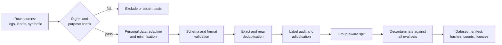

*Figure 10. Data curation gates from raw sources to a versioned dataset.*

The ordering is deliberate: privacy and rights checks come first, because anything that fails them should not be copied into further processing stages, and the manifest comes last, so that it describes the final bytes that were trained on.

## 12. Splits and Evaluation for Generative Tasks

### 12.1 Three sets with three jobs

Fine-tuning needs three disjoint datasets, as in any supervised learning problem (see [CH06](CH06_Model_Evaluation_Validation_and_Selection.md)).

- The **training set** updates the weights.
- The **validation set** guides decisions: hyperparameters, when to stop, which checkpoint to keep, which data fix to try. Because many decisions are made against it, it becomes slightly optimistic over time.
- The **test set** is touched once per candidate release to estimate real performance. It is protected: not used for tuning, not shared with the people who curate training data, and replaced when it has been consulted too often.

Figure 11 shows the separation and what flows between the sets.

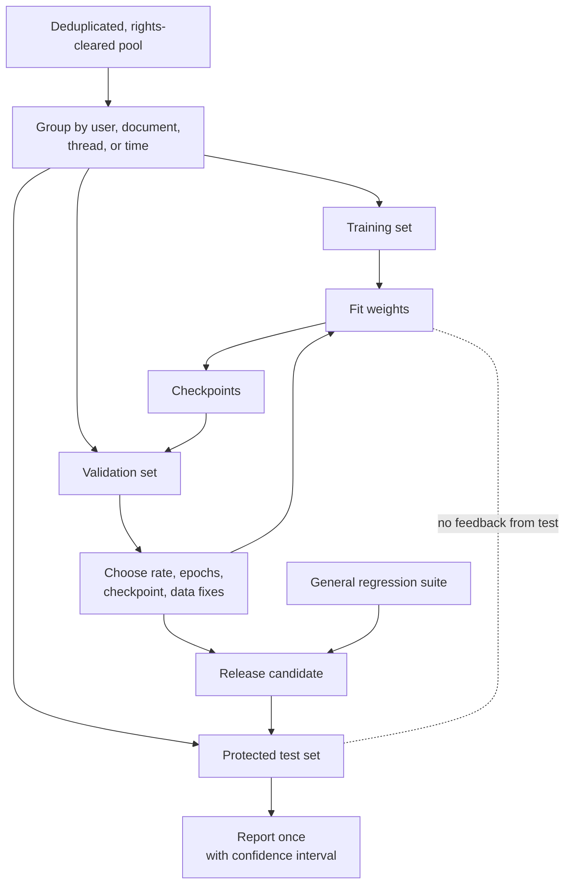

*Figure 11. Train, validation, and test separation, with the protected test and a separate regression suite.*

The dotted line states the rule: no information from the test set flows back into the training loop, and the test set is read only when a release candidate is evaluated. Once a team starts reading test failures to decide what training data to add, the test set has become a validation set, and a new test set is needed.

### 12.2 Splitting rules that prevent leakage

Splitting randomly by row is usually wrong for text data. Use these rules.

- **Split by group.** If several rows share a user, a conversation, a document, a ticket thread, or a template, keep all of them in one split. Otherwise the model sees the same author's style, entities, or phrasing in training and is tested on it.
- **Split by time when the task is temporal.** If production predicts the future from the past, train on earlier data and validate and test on later data. A random split overstates performance when the distribution drifts.
- **Deduplicate before splitting** (section 11.2) and keep near-duplicate clusters whole.
- **Split before any generative augmentation.** Synthetic variants of a test item must never enter training.
- **Stratify** so rare classes appear in every split. With 1 percent of examples in a rare class and a 500-example test set, the expected count is five, and the metric on that class is noise, so size the test set for the rare classes you care about.
- **Keep prompt-only holdouts for generation tasks.** In open-ended generation there is no label to leak, but prompts can repeat. Hold out whole prompt templates, not only individual prompts, to test generalisation to new phrasings.

### 12.3 How large must the evaluation set be

A test metric is a sample estimate with sampling error. For an accuracy of $p$ measured on $n$ independent examples, the standard error is $\sqrt{p(1-p)/n}$, and an approximate 95 percent interval is $\pm 1.96\,\mathrm{SE}$. For $p = 0.90$:

$$
n = 400: \; \mathrm{SE} = \sqrt{0.09/400} = 0.015, \; \text{interval } \pm 2.9 \text{ points};
$$

$$
n = 1000: \; \mathrm{SE} = 0.0095, \; \text{interval } \pm 1.9 \text{ points}.
$$

To get an interval of $\pm 2$ points you need $n \approx 1.96^2 \times 0.09 / 0.02^2 \approx 864$ examples. So a claim that the tuned model beats the prompted baseline by 2 points, on a test set of 400 examples, is within noise unless the comparison is paired. A paired test on the same examples (McNemar's test for binary outcomes, a paired bootstrap for continuous metrics) is more powerful because it only uses the examples on which the two systems differ. Report intervals, not point estimates, and decide the minimum difference that matters in advance.

### 12.4 Task metrics for generative outputs

The task determines the metric. The following list gives defaults.

- **Classification as text:** accuracy, macro-averaged F1 (to avoid hiding poor performance on rare classes), and the confusion matrix. Parse the generated label strictly; count unparseable output as an error and report the unparseable rate separately.
- **Extraction:** per-field exact match or normalised match, field-level precision and recall, and the schema-validity rate. Evaluate nulls: the model must say "absent" when a field is absent, and hallucinated values for absent fields are the most costly error type.
- **Summarisation, rewriting, open-ended answers:** automatic overlap metrics correlate weakly with quality. Use rubric-based human review on a sample, pairwise comparison of tuned versus baseline outputs reported as a win rate with confidence interval, or a judge model calibrated against human labels (CH24 covers judge reliability).
- **Code and structured query generation:** execution-based metrics, where the output runs against tests or a database and the result is compared.
- **Tool use:** function-name accuracy, argument accuracy, and end-to-end task success in a sandbox.
- **Safety and policy:** refusal rate on disallowed requests, and the over-refusal rate on benign near-miss requests (section 13.5).

Always compare the tuned model against the *best prompted baseline* on the same set. A fine-tuned model beating a poorly prompted baseline is not evidence for tuning.

### 12.5 Evaluating during training

Evaluate at a fixed step interval on the validation set, with greedy decoding for reproducibility, and log the task metric together with the loss. Greedy decoding on 300 validation examples per evaluation is cheap compared with training. Keep every checkpoint's evaluation record. Selecting the checkpoint with the best validation metric introduces mild optimism; the protected test set measures the cost of that selection.

## 13. Catastrophic Forgetting, Capability Regression, and Safety

### 13.1 What forgetting is

Fine-tuning minimises loss on the new data only. Nothing in the objective rewards preserving behaviours the new data does not exercise. Weight changes that improve the new task may overwrite weights that supported other tasks. This is *catastrophic forgetting* (McCloskey and Cohen, 1989; for neural networks generally, Kirkpatrick et al., 2017). In language models it appears as lost skills: worse arithmetic, weaker code, lost languages, forgotten formatting conventions, less-fluent general chat, and weaker instruction following after tuning an instruct model on a narrow task. An empirical study of continual fine-tuning (Luo et al., 2023) found forgetting present across model sizes from 1B to 7B and, in their experiments, more severe in larger models in some settings, so scale does not remove it.

Several factors control the amount of forgetting.

- **Distance from the original distribution.** A narrow, very different task changes more.
- **Step size and duration.** Higher learning rates and more epochs mean more drift.
- **Number of changed parameters and the structure of the change.** LoRA forgets less than full fine-tuning at equal target-domain gain in the study cited earlier, though not zero.
- **Data diversity.** A narrow dataset pushes the model along one direction. Mixing in other tasks anchors it.
- **Starting point.** Tuning a base model has less to forget than tuning a heavily aligned instruct model, which has safety and instruction behaviours that narrow data can overwrite.

### 13.2 Capability regression as a release gate

The regression suite is the test that the tuned model remains acceptable at everything *other than* the new task. It consists of:

1. **Task-adjacent skills the product still needs:** summarisation, following a system prompt, multi-turn consistency, tool calling, the languages you support.
2. **General benchmarks** at small scale: a few hundred items from each of reasoning, mathematics, code, knowledge, and instruction following. Use the same subsets before and after tuning, with the same decoding settings.
3. **Format and behavioural checks:** does the model still stop correctly, still honour length limits, still refuse out-of-scope requests as the product requires.
4. **Safety and policy checks** (section 13.5).
5. **Production-sampled prompts** from adjacent features, evaluated by rubric or pairwise comparison against the base model.

The release gate defines allowed regression per area, for example no more than 2 points absolute on general benchmarks and zero tolerance on specified safety checks, with the confidence intervals from section 12.3 taken into account. A threshold smaller than the evaluation noise cannot be enforced, so size the suite to the threshold.

Figure 12 shows the evaluation structure.

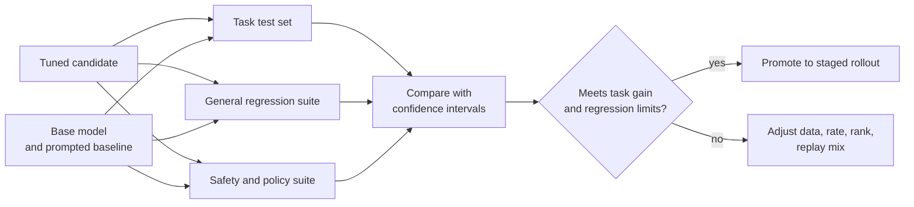

*Figure 12. Capability-regression evaluation compares the candidate with the base model on task, general, and safety suites.*

What matters in the figure is the symmetry: the base model and the prompted baseline are evaluated on the same suites as the candidate, so that every claim is a difference rather than an absolute number. A suite score of 62 means nothing until the base model's score on the same items is known.

### 13.3 Replay and regularisation

Three families of countermeasure reduce forgetting.

**Data replay (rehearsal).** Mix examples from the original or general distribution into the fine-tuning set. For an instruct model, include general instruction-following examples, which can be generated by the base model itself on diverse prompts (self-distillation: the model's own responses preserve its own behaviour). Mixing 5 to 30 percent general data is common, and the right fraction is the smallest that keeps the regression suite within limits. Replay is simple and effective, and it costs training tokens.

**Regularisation toward the original weights.** Penalise movement away from the pretrained weights. Elastic Weight Consolidation (Kirkpatrick et al., 2017) weights an $L_2$ penalty by an estimate of each parameter's importance (the diagonal of the Fisher information) so that parameters important for old tasks move less. In large-model practice, explicit penalties are rare because of cost, and implicit regularisation is common: low learning rates, few epochs, LoRA's restricted update subspace, and weight averaging between the base and the tuned model (section 15.4).

**Restricting the update.** LoRA and other PEFT methods limit how far the weights can move by construction. Lower rank and fewer target modules mean more restriction and generally less forgetting (and less learning). Layer-wise choices, such as not adapting the lowest layers, also work in some cases.

A fourth practical measure is *early stopping on the regression suite*, not only on the task metric: stop at the checkpoint where the combined objective, task gain minus regression penalty, peaks.

### 13.4 Worked example: choosing the replay fraction

Suppose a tuned model improves the task metric from 71 to 92 percent, but a general-knowledge suite falls from 64.0 to 58.5 percent, a 5.5-point drop, against a limit of 2 points. The team trains three more variants that mix general-instruction data: 10, 20, and 30 percent of the training tokens. Illustrative results:

| Replay fraction | Task accuracy | General suite | Regression vs base |
| --- | --- | --- | --- |
| 0 percent | 92.0 | 58.5 | -5.5 |
| 10 percent | 91.6 | 61.2 | -2.8 |
| 20 percent | 91.2 | 62.6 | -1.4 |
| 30 percent | 90.1 | 63.1 | -0.9 |

*Table 6. Illustrative effect of replay on task accuracy and regression (invented numbers for the arithmetic).*

The 20 percent mixture meets the limit while costing 0.8 task points. The 30 percent mixture buys 0.5 more regression points for another 1.1 task points, a worse trade. The choice is not a single best value but a policy: the smallest replay fraction that passes the gate, because each extra percent of replay data dilutes the task data and costs tokens. If differences between rows are smaller than evaluation noise (check the intervals), do not over-interpret the ordering.

### 13.5 Safety degradation after fine-tuning

Safety behaviours installed during alignment are not locked in. Qi et al. (2023), "Fine-tuning Aligned Language Models Compromises Safety, Even When Users Do Not Intend To", showed that fine-tuning an aligned model on a small number of adversarial examples could remove its refusal behaviour at a cost of cents, and that even fine-tuning on benign, widely used instruction datasets reduced safety measurably. The mechanism is the same as other forgetting: refusal behaviours are learned patterns, not constraints, and gradient updates on data that never refuses push the policy away from refusing.

Consequences for architects:

- **Every fine-tuned model is a new model for safety purposes.** Re-run the safety evaluation. The safety certification of the base does not transfer.
- **Test both directions.** Measure refusal on disallowed requests (under-refusal, a harm risk) and compliance on benign near-miss requests (over-refusal, a product risk). Training on refusal-heavy data fixes the first and breaks the second.
- **Mix safety data.** Include refusal and safe-completion examples in the training mix, in a proportion validated on the safety suite.
- **Do not make the model the only control.** Keep input and output guardrails (classifiers, policy engines, schema validators) outside the tuned model, as covered in [CH24](CH24_Generative_AI_Evaluation_Guardrails_and_Hallucinations.md) and [CH31](CH31_Responsible_AI_and_Safety_Governance.md). A guardrail that does not depend on the weights keeps working when the weights change.
- **Control who can tune.** If customers can submit fine-tuning data through your platform, you are exposing the equivalent of a model-editing interface. Screen training data, evaluate the resulting model before release, and restrict the tuned model to the customer's tenant.

## 14. Overfitting, Memorization, and Privacy Leakage

### 14.1 Memorization is a property of fine-tuning, not a bug

A language model trained to predict the next token on a string with enough repetitions or enough capacity reproduces the string. Fine-tuning on small datasets for several epochs does exactly that: the training set is tiny relative to the model, each example is seen several times, and the examples are specific (names, account details, internal phrases). Carlini et al. (2021), "Extracting Training Data from Large Language Models", extracted verbatim training sequences, including personal information, from a deployed model. Later work (Carlini et al., 2023, "Quantifying Memorization Across Neural Language Models") found that memorization grows with model size, with the number of times a sequence is repeated in the data, and with the length of context provided to the model when prompting.

For fine-tuning, the risk factors are:

- many epochs on a small dataset;
- duplicated examples;
- unique, high-entropy strings in the data (identifiers, keys, phone numbers, free-text names);
- high learning rate and high rank;
- a deployment that lets users prompt the model with the beginning of a training record (a prefix), which is the extraction pattern.

### 14.2 Measuring memorization

Three practical tests can be done before release.

**Verbatim extraction probe.** For a sample of training records, give the model the first part of the record as a prefix and check whether greedy or low-temperature decoding reproduces the rest. The fraction of training records reproduced verbatim (or above an edit-distance threshold) is a direct memorization rate. Compare against the same probe on held-out records of the same kind: a base model that completes held-out records equally well is not memorizing, it is just predicting well.

**Canary insertion.** Insert synthetic canary sequences, such as a fake identifier with a random secret part, into the training data at a known frequency (Carlini et al., 2019, "The Secret Sharer"). After training, compute the model's likelihood of the true secret against random alternatives; the *exposure* metric summarises how much easier the canary is to guess than chance. Canaries that are easily recovered show that real secrets in the data are at risk.

**Membership inference.** Test whether an attacker can tell from the model's loss on a record whether it was in the training set. The attack is imperfect, but loss gaps between training and held-out records indicate leakage, and the gap grows with epochs.

### 14.3 Mitigations

1. **Remove what must not be remembered.** Redact personal data and secrets before training (section 11.6). It is the only complete fix.
2. **Deduplicate.** Repeated records are memorised first.
3. **Limit exposure to the data.** Fewer epochs, lower learning rate and rank, early stopping on validation loss. Track the train-validation loss gap as a proxy.
4. **Differentially private training.** Differentially private stochastic gradient descent clips per-example gradients and adds noise to give a mathematical bound on the influence of any single record. For LLM fine-tuning, research has shown that PEFT with differential privacy can give useful models at moderate privacy budgets, but it costs accuracy, needs per-example gradient computation and large batches, and requires expertise in choosing the privacy budget. Use it where the data is sensitive and the harm of leakage justifies it.
5. **Control access to the tuned model** as you would to the training data. A model trained on confidential data is a derived store of that data. If every user of the application is entitled to every record in the training set, memorization is harmless; if not, it is a data breach waiting for the right prompt.
6. **Output filters.** Detect and block outputs that match training records or personal-data patterns. This reduces the exposure but is a second line.
7. **Per-tenant adapters** so that one tenant's data never touches another tenant's model.

### 14.4 Regulatory and contractual implications

Whether a model trained on personal data is itself personal data is a legal question that regulators have addressed in opinions and guidance. At the time of writing, the European Data Protection Board's Opinion 28/2024 (December 2024) states that a model trained on personal data cannot always be treated as anonymous, and that anonymity must be shown case by case, including resistance to extraction and inference. Verify the current position in your jurisdiction with counsel. For architecture, the safe assumption is that the tuned weights inherit the sensitivity classification of the most sensitive data in the training set, and that they are stored, transferred, and access-controlled accordingly. If a deletion request applies to the training data, the plan is to retrain or to document why the model cannot reveal the record, so keep the manifest and the pipeline that make retraining possible.

## 15. Model Merging

Model merging combines the weights of several models that share an architecture and an ancestor into one model without further training. It is cheap (minutes on a CPU), needs no data, and has become a common way to combine skills or to blend a tuned model with its base. It is also easy to misuse, because the merged model is a new model that needs the same evaluation as any other.

### 15.1 Why merging works at all

Fine-tuned models that start from the same pretrained weights tend to stay in the same loss basin. Their weights differ by a small displacement, and the loss along the line between them is often low, unlike two independently trained networks, where interpolation passes through a high-loss barrier. This observation underlies model soups (Wortsman et al., 2022), which average the weights of several fine-tuned models, and WiSE-FT (Wortsman et al., 2022), which interpolates between a pretrained model and its fine-tuned version to recover robustness lost in tuning. The condition is the shared ancestor: models fine-tuned from *different* bases, or from the same base with different tokenizers, cannot be meaningfully merged by weight arithmetic.

### 15.2 Task vectors and task arithmetic

Ilharco et al. (2023), "Editing Models with Task Arithmetic", define the *task vector* of a fine-tuned model as the difference between its weights and those of its base:

$$
\tau = \theta_{\text{ft}} - \theta_{\text{base}} .
$$

Task vectors can be scaled and added:

$$
\theta_{\text{merged}} = \theta_{\text{base}} + \lambda \sum_i \tau_i ,
$$

where $\lambda$ is a scaling coefficient chosen on a validation set (values near 0.3 to 1 are typical, and smaller when more vectors are summed). Adding task vectors gives a model with several skills; negating a vector ($-\tau$) can reduce a behaviour such as toxicity or a specific capability. LoRA adapters are task vectors in factored form, so merging two LoRA adapters trained on the same base is adding their deltas.

A trap: the sum of two LoRA deltas is $B_1 A_1 + B_2 A_2$, which is *not* $(B_1 + B_2)(A_1 + A_2)$. The second expression has cross terms $B_1 A_2 + B_2 A_1$ that correspond to nothing either adapter learned. Combine adapters in the full-matrix space or by concatenating the factors along the rank dimension ($[B_1\; B_2][A_1; A_2]^\top$ arrangement), never by averaging the factors separately.

### 15.3 TIES and DARE: reducing interference

Simple addition fails when task vectors interfere: two vectors push the same parameter in opposite directions and cancel, or many small, noisy changes accumulate. TIES-Merging (TrIm, Elect Sign, and Merge; Yadav et al., 2023, "Resolving Interference When Merging Models") adds three steps.

1. **Trim.** For each task vector keep only the parameters with the largest magnitudes (for example the top 20 percent) and set the rest to zero, on the grounds that most fine-tuning changes are redundant noise.
2. **Elect sign.** For each parameter, choose the sign with the greater total magnitude across task vectors.
3. **Disjoint merge.** For each parameter, average only the values that agree with the elected sign, ignoring those that conflict.

DARE (Yu et al., 2024, "Language Models are Super Mario") randomly drops a fraction $p$ of the delta parameters and rescales the remainder by $1/(1-p)$, preserving the expected update. It reports that very high drop rates (90 percent and more) retain the fine-tuned behaviour for supervised fine-tuned models, which shows how redundant the deltas are, and is typically combined with task arithmetic or TIES.

The script [`04_merging_and_nf4.py`](../code/python/fine-tuning-chapter/04_merging_and_nf4.py) applies task arithmetic and TIES to two toy task vectors over six parameters:

```text
task vector A: [+0.120, +0.000, +0.000, -0.100, +0.000, +0.040]
task vector B: [-0.100, +0.000, +0.150, -0.100, +0.150, +0.000]
task arithmetic (lambda=0.7): [+0.514, -0.200, +0.205, +0.660, -0.495, +0.328]
TIES merged update: [+0.120, +0.000, +0.150, -0.100, +0.150, +0.040]
TIES merged weights: [+0.620, -0.200, +0.250, +0.700, -0.450, +0.340]
```

The first parameter is the conflict. Task A raises it by 0.12 and task B lowers it by 0.10. Task arithmetic with $\lambda = 0.7$ adds the two deltas and scales, giving $0.7 \times (0.12 - 0.10) = +0.014$ on the base value of 0.50, so the merged weight is 0.514 and both tasks' changes are nearly cancelled. TIES compares total mass: the positive side (0.12) outweighs the negative (-0.10), so it elects a positive sign, drops task B's conflicting value, and keeps A's +0.12 intact. The fourth parameter, where both tasks agree on -0.10, is averaged to -0.10 by TIES (full strength) and summed and scaled by task arithmetic ($0.7 \times -0.20 = -0.14$, giving 0.66). Neither is "right" in general. TIES preserves each task's changes when only one task cares about a parameter, and task arithmetic with a single $\lambda$ shrinks everything uniformly. The correct choice is whichever scores better on both tasks' held-out sets.

### 15.4 Spherical linear interpolation (SLERP) and weight averaging

SLERP interpolates between two weight vectors $p$ and $q$ along the arc of a great circle instead of the straight chord:

$$
\mathrm{slerp}(p, q; t) = \frac{\sin((1-t)\Omega)}{\sin \Omega}\, p + \frac{\sin(t\Omega)}{\sin \Omega}\, q, \qquad \Omega = \arccos\!\left(\frac{p \cdot q}{\lVert p \rVert \lVert q \rVert}\right),
$$

with $t \in [0, 1]$. Linear interpolation shrinks the norm of the result when $p$ and $q$ point in different directions, and SLERP preserves it. In the script, the two toy models have norms 1.183 and 1.022; at $t = 0.5$ the linear midpoint has norm 1.095 and the SLERP midpoint has norm 1.103. The difference is small because the vectors are nearly parallel, and it grows as the angle between them grows. SLERP is applied layer by layer in practice, and it handles exactly two models, so combining more requires nesting.

The simplest merge of all is *weight interpolation with the base* (WiSE-FT style): $\theta = (1 - \beta)\,\theta_{\text{base}} + \beta\,\theta_{\text{ft}}$. It is the cheapest forgetting mitigation available after training: sweep $\beta$ from 0 to 1 in steps of 0.1 and plot the task metric and the regression metric. Often there is a $\beta$ around 0.5 to 0.8 where the task metric has lost little and the regression metric has recovered much of the loss. For a LoRA adapter this is the same as scaling the adapter by $\beta$ at merge time.

### 15.5 Risks of merging

- **Compatibility.** Same architecture, same tokenizer and vocabulary, same base weights. Merges across mismatched vocabularies silently corrupt embeddings.
- **No guarantee of capability.** Merged models can lose both skills. Evaluate on each constituent task, the regression suite, and safety.
- **Safety can get worse.** If one parent had safety behaviour weakened by fine-tuning, the merge can carry it into the product. Merging is a way for a problem to enter a model through a component whose provenance you did not check.
- **Provenance and licensing.** A merged model has several parents. All of their licences, usage restrictions, and data terms apply, and the strictest governs. Merges of merges built from public hub checkpoints make the chain long and hard to audit.
- **Reproducibility.** The recipe (parents with exact hashes, method, coefficients, per-layer settings) is the artifact. A merged model without its recipe cannot be reproduced or retired when a parent is found to be problematic.
- **Benchmark gaming.** Public leaderboards have been dominated by merges tuned against the benchmark. A merge's leaderboard score says little about your task; your own held-out data says much more.
- **Numerical issues.** Merging in 16-bit rounds small deltas away (section 7.7). Merge in fp32 and cast.

Figure 13 shows how merging fits in the workflow: it is a post-training step with its own artifacts and evaluation, not a free shortcut.

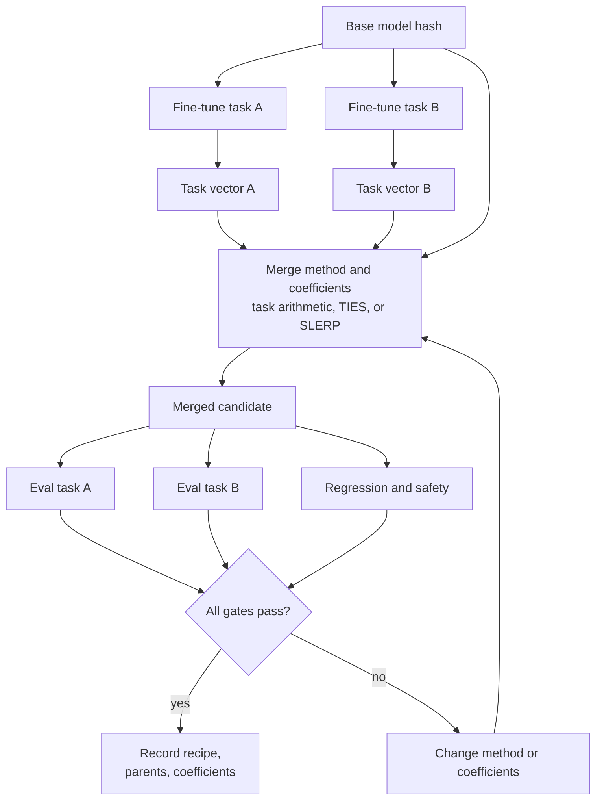

*Figure 13. Merging as a recorded, evaluated workflow.*

Merging is attractive for an architect because it turns a combinatorial serving problem (a model per skill) into a build-time operation. The alternative, serving separate adapters at request time, is the subject of the next section.

## 16. Serving Adapters and Merged Models

### 16.1 Two serving shapes

A LoRA-tuned model can be served in two shapes.

**Merged.** Fold $\frac{\alpha}{r} BA$ into $W_0$ (section 7.7) and deploy a standard model. Inference is as fast as the base, any engine can serve it, and there is nothing special to operate. The costs are one full copy of the weights per variant (13.5 GB for a 7B bf16 model) and the loss of the ability to switch variants without loading a new model.

**Unmerged with runtime adapter application.** Load one copy of the base and apply a small adapter per request: compute $W_0 x$ as usual, then add $\frac{\alpha}{r} B(Ax)$ using the adapter that matches the request. One base can then serve many variants.

The adapter path has a computational cost: the extra matrix multiplications are tiny in FLOPs (0.59 percent of the model's parameters at rank 16 on all linear layers) but add kernel launches and memory traffic. At small batch sizes, where decoding is limited by memory bandwidth and launch overhead, this overhead can be large in relative terms; at large batch sizes it shrinks. Whatever a benchmark says, measure on your hardware, engine version, and traffic pattern.

### 16.2 Multi-adapter serving

When many variants share one base, a serving system must (a) hold many adapters, (b) route each request to its adapter, and (c) run batches in which different requests use different adapters without running them one at a time. Research systems showed how.

- **Punica** (Chen et al., 2023) introduced a batched kernel (Segmented Gather Matrix-Vector, SGMV) that applies different LoRA adapters to different rows of the same batch in one kernel call, so a heterogeneous batch is as efficient as a homogeneous one for the adapter computation.
- **S-LoRA** (Sheng et al., 2023) extended this to thousands of adapters: it keeps adapters in host memory, pages the active ones into a unified GPU memory pool shared with the key-value cache, and uses custom kernels for batching across adapters of different ranks.
- Open-source engines now implement multi-LoRA serving; vLLM and LoRAX (from Predibase, built on text-generation-inference) are widely used. Support, limits (maximum concurrent adapters, supported ranks, supported target modules), and performance change quickly, so check the engine's current documentation. [CH28](CH28_Inference_Optimization_and_Model_Serving.md) covers the engine internals, batching, and the key-value cache.

Memory arithmetic shows why this matters. A rank-16 adapter on all linear layers of the 7B model has 39,976,960 parameters, which at 2 bytes each is about 80 MB. One hundred tenants' adapters occupy 8 GB, and a thousand occupy 80 GB, which fits in host RAM. The same thousand variants as merged models would need $1000 \times 13.5 = 13{,}500$ GB, so holding all of them resident on 80 GB GPUs would take about $13{,}500 / 80 \approx 169$ GPUs for weights alone, against one base copy plus 80 GB of adapters in the unmerged design. The comparison drives the economics of per-tenant customisation.

Loading an adapter from local NVMe at 3 GB/s takes about $80\text{ MB} / 3000\text{ MB/s} \approx 27$ ms. From an object store at an effective 100 MB/s it takes about 0.8 s. A cold start of under a second is acceptable for many applications, and not for interactive chat at tight latency targets, which is why the hot set is cached on GPU with an eviction policy and the long tail is loaded on demand.

### 16.3 Request path and hot-swapping

Figure 14 shows a request to a multi-adapter service.

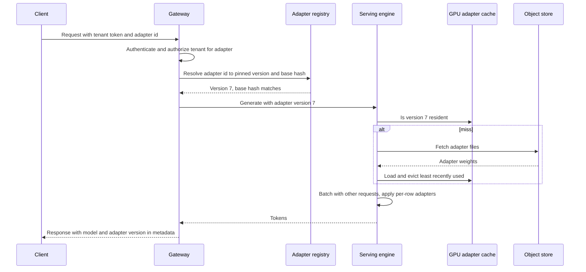

*Figure 14. A request path through a multi-adapter serving system.*

Several design points follow from the diagram.

- **Authorization at the adapter level.** The gateway must check that this tenant may use this adapter. An adapter is a data-bearing artifact (section 14), so cross-tenant access is a data breach, not just a billing error.
- **Pinned versions and base hash.** The registry resolves a logical adapter name to a specific version and verifies that the serving engine's loaded base matches the base hash the adapter was trained on. An adapter applied to a different base revision produces plausible but degraded output with no error.
- **Hot-swap.** Deploying a new adapter version means registering it, warming it into the cache, shifting a fraction of traffic (canary), and then promoting. Because adapters are small, the swap does not require restarting the base model, which is an operational advantage over merged deployments.
- **Cache keys.** Prefix caching and key-value cache reuse must include the adapter identity in the cache key. Two requests with identical prompts but different adapters produce different keys and values. An engine or gateway that shares cached prefixes across adapters would return wrong results, and across tenants would leak data. Verify this property in the engine you use.
- **Noisy neighbours.** One tenant with a large rank or heavy traffic can crowd the cache or the batch. Apply quotas per tenant and cap supported ranks.
- **Observability.** Log the adapter id and version on every request, and report latency, error rate, and quality metrics per adapter version (CH29).

### 16.4 Merged versus unmerged: choosing

| Factor | Merged | Unmerged, multi-adapter |
| --- | --- | --- |
| Inference latency | Same as base | Small to moderate overhead, depends on batch size and kernels |
| Number of variants per GPU pool | One (or a few) | Hundreds to thousands |
| Storage per variant | Full model | Tens to hundreds of MB |
| Rollback | Redeploy previous model | Repoint to previous adapter version |
| Engine compatibility | Any | Needs adapter support, constraints on rank and modules |
| Quantized serving | Merge then quantize, re-evaluate | Adapter on quantized base needs support, and training and serving formats should match |
| Isolation between tenants | Strong (separate model) | Needs careful cache and authorization design |
| Operational complexity | Lower per model, higher in number | Higher in the platform, lower per variant |

*Table 7. Merged versus unmerged serving.*

The rule of thumb is: one or two production variants, merge; many variants, especially per tenant, or frequent adapter updates, run multi-adapter serving. A hybrid is common: merge the one adapter that carries the product's core behaviour into a base, and serve tenant-specific adapters on top of that merged base.

## 17. Vendor-Hosted Versus Self-Hosted Fine-Tuning

### 17.1 The options

The choice is between three arrangements: fine-tuning a vendor's proprietary model through the vendor's API, fine-tuning an open-weight model on infrastructure you control (your cloud account or on premises), or a middle path where a managed platform trains an open-weight model inside your account. Table 8 compares them on the dimensions that decide.

| Dimension | Vendor API on proprietary model | Self-hosted on open weights | Managed platform in your account |
| --- | --- | --- | --- |
| Time to first result | Hours to days | Days to weeks the first time | Days |
| Skills needed | Data preparation, evaluation | Plus training, GPU, and serving expertise | Between the two |
| Control of method | Vendor-defined methods and hyperparameters | Full control (method, rank, schedule) | Limited by platform |
| Quality ceiling | Access to the vendor's strongest models, subject to what is tunable | Limited to the best open model | Same as open weights |
| Data residency | Training data leaves your boundary. Check regions, retention, and use terms | Stays inside your boundary | Stays in your cloud account |
| Weights ownership | You receive no weights. The tuned model runs only on the vendor | You own the artifact | You own the artifact |
| Cost structure | Per-token training fee plus a possibly higher per-token inference price | GPU-hours plus serving infrastructure | Platform fee plus GPU-hours |
| Lock-in | High. Tuned model works only with that vendor and base | Low. Portable across clouds | Medium |
| Deprecation risk | Base model retirement forces retraining | You control retirement. Open weights remain available | Depends on the platform |
| Safety and compliance | Vendor filters on data and outputs | Your responsibility | Shared |

*Table 8. Vendor-hosted, self-hosted, and managed fine-tuning compared.*

### 17.2 Trust boundaries and data flow

Figure 15 shows where data crosses boundaries in each arrangement.

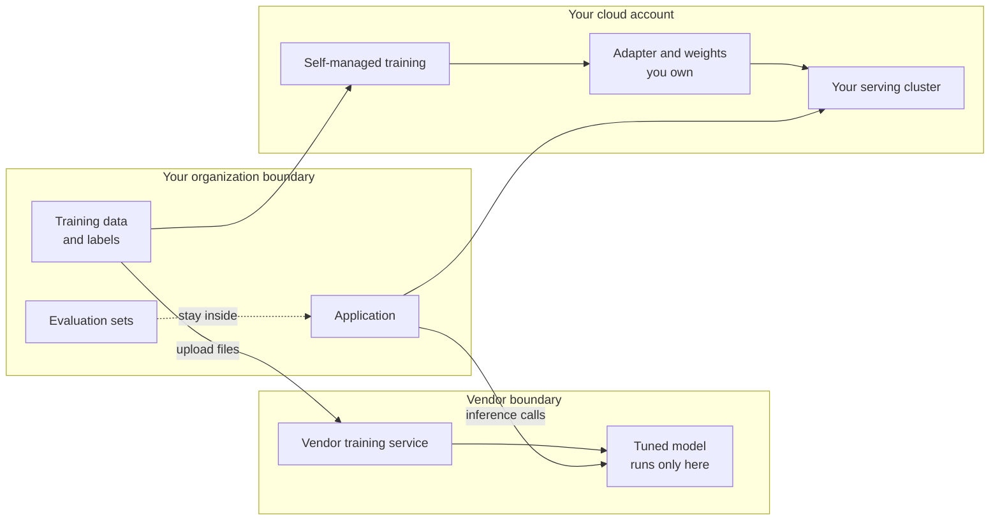

*Figure 15. Data flows and trust boundaries for vendor-hosted and self-hosted fine-tuning.*

The figure contains a design rule: keep the evaluation sets inside your boundary in both arrangements, and send the vendor only what the training requires. The vendor-hosted path sends training files outside; the inference path then also sends production prompts outside, unless the vendor offers private networking and zero-retention options that your policy accepts.

### 17.3 Lock-in and model deprecation

Vendor-hosted fine-tuned models depend on the vendor's base. When the vendor retires the base model, the tuned model goes with it, and the migration is a new fine-tune on the successor model, if the successor can be tuned at all. At the time of writing, this risk is concrete: OpenAI's announcement on its fine-tuning vision page, dated May 2026, states that it is winding down its fine-tuning platform, closing it to new users while allowing existing users to create jobs for a period ([OpenAI, "Introducing vision to the fine-tuning API"](https://openai.com/index/introducing-vision-to-the-fine-tuning-api)), and third-party reports describe fixed dates for stopping job creation and retiring fine-tuned snapshots. Verify the current dates on the vendor's deprecations page before relying on any figure. The lesson does not depend on one vendor: any tuned artifact on proprietary infrastructure has the lifetime of its base model and the vendor's willingness to support it.

Mitigations an architect can apply:

1. **Own the data and the recipe.** Keep the training set, the evaluation sets, the hyperparameters, and the scripts in your repositories, so that retraining on a new base is a re-run, not a project.
2. **Keep an abstraction at the call site.** A thin internal interface to "the classification model" lets you swap the implementation (vendor-tuned, open-weight tuned, or a prompted model) without changing callers.
3. **Maintain a prompted fallback.** A prompted baseline on a general model, evaluated on the same set, is both the reference for deciding whether tuning pays and the fallback if the tuned model is retired.
4. **Track deprecation dates** as an operational calendar with owners, and budget a retraining per base-model generation (for example, every 12 to 18 months).
5. **Prefer open weights where the tuned asset is strategic**, and vendor tuning where speed matters and the asset is replaceable.

### 17.4 Cost and control comparison

Vendor fine-tuning has a low fixed cost and a higher marginal price: training is billed per token processed (tokens times epochs), and inference on tuned models may be priced above the base model. Self-hosting has a higher fixed cost (GPU engineering, serving platform, on-call) and a lower marginal cost at scale. Use the break-even formula from section 2.4 with the vendor's numbers in the "after" column and your own in the other, and include the engineering and on-call time on the self-hosted side, which teams routinely forget.

Data governance can override cost. If regulation, contracts, or policy prevent sending the training data to the vendor, or require processing in a particular region, the decision is made. If the vendor offers data-processing agreements, regional processing, zero retention, and an assurance that customer data is not used for its own training, the vendor path can be acceptable, and the evidence is the contract, not the marketing page.

## 18. Training Infrastructure and Worked Cost Estimates

### 18.1 What you need

A self-hosted fine-tuning stack has these parts.

- **Compute.** GPUs with enough memory for the method (section 5 and 8): one 24 GB GPU for 7B QLoRA, one 80 GB GPU for 7B LoRA with long sequences or 13B to 70B QLoRA, a multi-GPU node for full fine-tuning of 7B and above.
- **Training framework.** Hugging Face Transformers with PEFT and TRL, Axolotl, Unsloth, torchtune, and LLaMA-Factory are common open-source choices at the time of writing. Distributed strategies (FSDP, DeepSpeed ZeRO) are used for multi-GPU runs.
- **Storage and data loading.** Versioned datasets in object storage, a manifest with hashes, and a loader that tokenizes with the same tokenizer and template as serving.
- **Experiment tracking and registry.** Hyperparameters, metrics, code revision, dataset version, base hash, and artifacts (CH29).
- **Evaluation harness.** Task, regression, and safety suites runnable on every checkpoint.
- **Scheduling.** A queue for GPU jobs, preemption handling (spot or preemptible instances need checkpoint-resume), and budget alerts.
- **Security.** Network isolation for training data, artifact signing, and secrets handling.

### 18.2 Compute: a FLOP-based estimate

The compute for a training run follows from the token count. For a dense transformer with $N$ parameters trained on $D$ tokens:

- Full fine-tuning: forward $2N$, backward $4N$, total about $6ND$ FLOPs.
- LoRA: forward $2N$, activation-gradient backward $2N$, adapter terms negligible, total about $4ND$.
- With full activation checkpointing add another forward pass ($+2ND$).

The time on one accelerator is the FLOPs divided by the sustained throughput, which is the peak throughput times the model FLOPs utilisation (MFU), the fraction of peak actually achieved. Fine-tuning runs at modest MFU, commonly 20 to 45 percent, due to short sequences, small batches, padding, data-loader stalls, and dequantisation overhead.

Worked example: 50,000 examples averaging 600 tokens, 3 epochs: $D = 50{,}000 \times 600 \times 3 = 9 \times 10^7$ tokens (90 million). Take a 7B model ($N = 6.738 \times 10^9$) and an accelerator with an assumed peak of $989 \times 10^{12}$ bf16 FLOPs per second (the dense bf16 figure of an H100-class part; check the datasheet for your hardware) at 35 percent MFU, so $3.46 \times 10^{14}$ FLOPs per second sustained.

$$
\text{Full: } 6ND = 6 \times 6.738 \times 10^9 \times 9 \times 10^7 = 3.64 \times 10^{18} \;\Rightarrow\; \frac{3.64 \times 10^{18}}{3.46 \times 10^{14}} = 10{,}500 \text{ s} = 2.9 \text{ GPU-hours.}
$$

$$
\text{LoRA: } 4ND = 2.43 \times 10^{18} \;\Rightarrow\; 7{,}000 \text{ s} = 1.9 \text{ GPU-hours.}
$$

At an illustrative \$3.00 per GPU-hour, that is \$9 for full fine-tuning compute and \$6 for LoRA, as printed by [`02_memory_and_cost.py`](../code/python/fine-tuning-chapter/02_memory_and_cost.py). These are lower bounds from an idealised model. Real runs include evaluation passes, checkpointing, startup, and lower utilisation. A more conservative approach is to use measured throughput: if QLoRA on a single 24 GB GPU processes about 2,000 tokens per second (an illustrative figure, to be replaced by your measurement), 90 million tokens take $9 \times 10^7 / 2000 = 45{,}000$ s $= 12.5$ hours, and at \$0.80 per GPU-hour that is \$10.

For a 70B model the same data costs $6 \times 70 \times 10^9 \times 9 \times 10^7 = 3.78 \times 10^{19}$ FLOPs for full fine-tuning, or $3.78 \times 10^{19} / 3.46 \times 10^{14} \approx 109{,}000$ s $= 30$ GPU-hours at the same MFU. The memory is the bigger problem: $16 \times 70 \times 10^9 = 1.12$ TB of state, which needs at least 14 80-GB GPUs for the state alone and a realistic 16 to 32 with activations, so it is a multi-node job. QLoRA on the 70B model keeps the NF4 base at $70 \times 10^9 \times 4.127/8 = 36$ GB, which fits on a single 80 GB GPU with room for adapters and checkpointed activations.

### 18.3 Where the money actually goes

Compute for a single run is often the smallest cost. A realistic budget for a first fine-tuning project, in illustrative dollars, looks like this.

| Item | Illustrative cost | Notes |
| --- | --- | --- |
| Data collection and labelling | \$7,500 | 5,000 examples at \$1.50. Often the largest line |
| Label audit and adjudication | \$2,000 | Second review of 10 to 20 percent, expert time |
| Evaluation set creation | \$3,000 | 1,000 expert-labelled examples |
| Engineering (pipeline, evaluation, deployment) | \$30,000 | About 3 engineer-weeks plus review |
| Training compute for the sweep | \$200 | 12 runs of 2 to 10 GPU-hours |
| Final training run and repeats | \$50 | Included for completeness |
| Serving (monthly) | \$4,380 | Two GPUs for redundancy, section 2.4 |
| Retraining and monitoring (monthly) | \$2,000 | Amortised |

*Table 9. A realistic first-project budget (illustrative).*

Compute is under 1 percent of the one-time spend. This changes the engineering emphasis: save labelling and engineering time, not GPU-hours. Running more experiments on a cheap GPU is usually a better use of money than optimising kernel throughput.

### 18.4 Operational practices for training runs

- **Checkpoint regularly and resume.** Spot instances save 60 to 70 percent of list price at the cost of preemption. Checkpoint every few hundred steps and test the resume path, including data-loader state, so that a resumed run reproduces the same data order.
- **Pin the environment.** Container image with pinned library versions. Library updates change defaults (loss normalisation, packing behaviour, template handling).
- **Record GPU type and count.** Numerics differ slightly across hardware, and the effective batch size depends on the world size.
- **Budget guards.** A maximum runtime per job and alerts on spend. A hung job on an expensive node costs more than the run it replaced.
- **Smoke test first.** Train for 20 steps on 64 examples and verify: the loss decreases, labels are as intended, the adapter saves, loads, and produces a different output from the base.
- **Test the exact export path.** Merge, convert, quantize, and serve the artifact the way production will, and evaluate that artifact.

## 19. Lineage, Versioning, Rollback, and Governance

### 19.1 What a fine-tuned artifact depends on

A tuned model is determined by far more than its weights file. If any of the following is lost, the artifact cannot be reproduced, audited, or safely replaced.

- The exact **base model** (name, revision, weights hash) and **tokenizer** (including special tokens and chat template).
- The **dataset version**: a manifest of record identifiers or file hashes, counts, filters applied, splits, and the licensing and provenance of each source.
- The **recipe**: method (full, LoRA, QLoRA), rank, alpha, target modules, learning rate, schedule, epochs, batch size, packing, masking, seed, precision.
- The **code revision** and **environment** (library versions, container digest).
- The **evaluation reports**: task, regression, and safety results with the dataset versions for each.
- The **approvals**: who accepted the release and under which gate.
- **Deployment records**: which environments serve which version, since when.

Figure 16 shows these as an entity-relationship model.

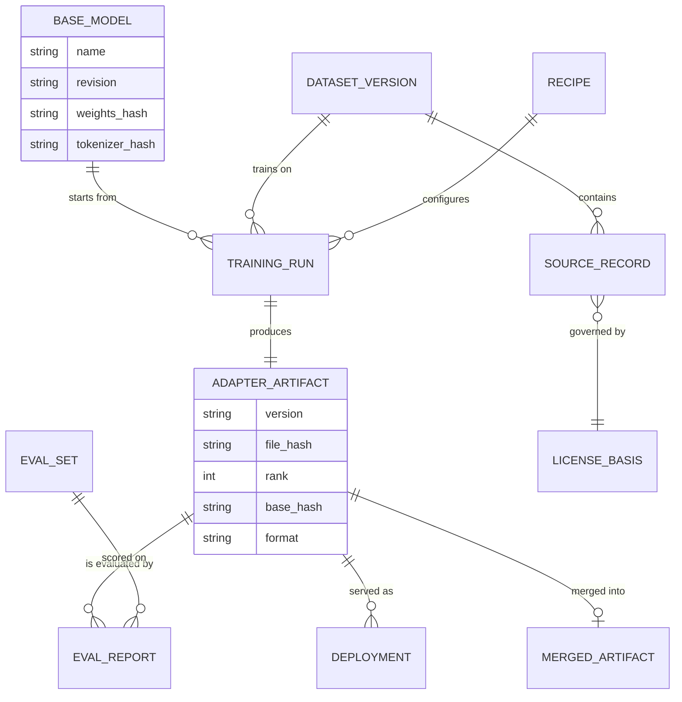

*Figure 16. Lineage entities for a fine-tuned model.*

The relationships to keep in mind: one adapter has exactly one training run and one base; one dataset version feeds many runs; and a deployment points to one artifact. A change to any upstream entity, such as the discovery that a source record was not licensed for training, should be traceable to all affected adapters and deployments by a query.

### 19.2 Artifact lifecycle and rollback

Figure 17 shows the states of a candidate adapter.

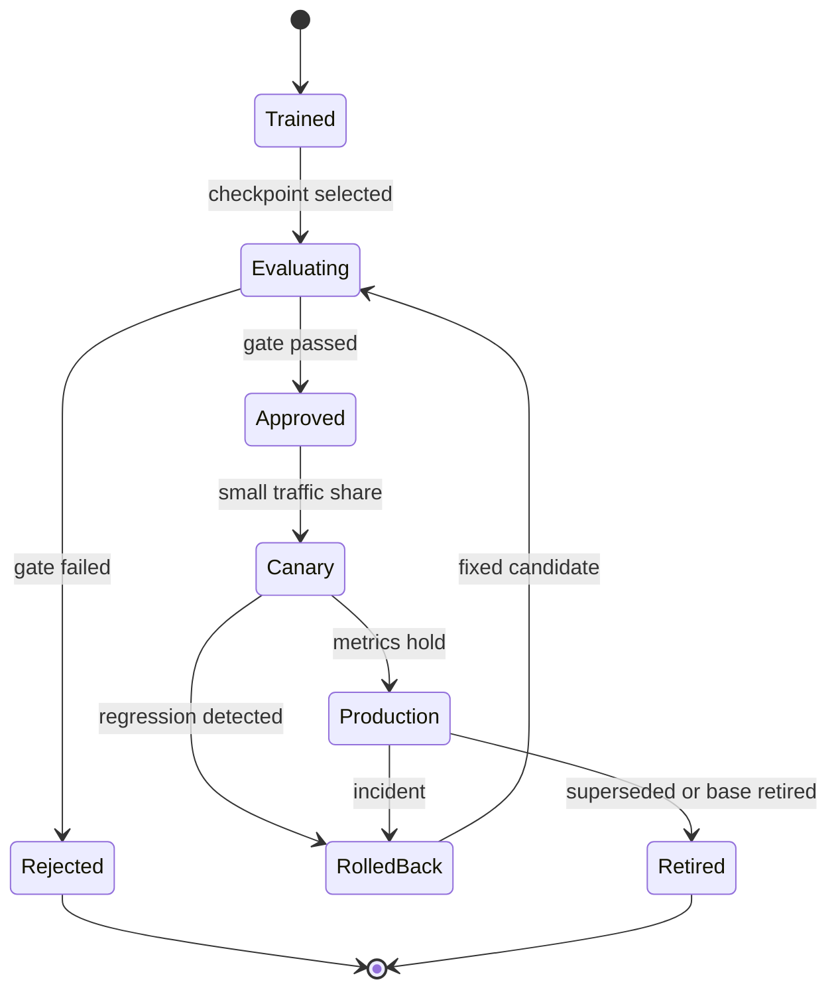

*Figure 17. Lifecycle states of a fine-tuned model artifact.*

Rollback is where adapters have an advantage. With a pinned base, rolling back means pointing the registry at the previous adapter version, which takes seconds and requires no new GPU capacity. For merged models rollback means redeploying a previous full model, which takes minutes and needs the previous artifact retained. In both cases, keep at least the previous two production versions and the base they depend on, and test rollback as part of release rehearsal. A rollback plan for a base-model upgrade is harder: all adapters trained on the old base are incompatible with the new one and must be retrained, so a base upgrade is a project, with the data and recipe kept ready.

Version identifiers should be immutable and content-addressed (the hash of the files), with human-readable aliases (`ticket-classifier:prod`) that move. Never serve by a mutable alias without recording which hash it resolved to on each request.

### 19.3 Artifact security

Model files are executable supply-chain objects. Python pickle-based checkpoint formats can run arbitrary code on load. Prefer the safetensors format, which stores tensors without executable content, load third-party models and adapters in sandboxes, and avoid enabling "trust remote code" options for model code you have not reviewed. Verify hashes and, for internal releases, signatures. Scan datasets and adapters pulled from public hubs, and treat them as untrusted input. A tampered adapter can embed backdoor behaviours that appear only with a trigger phrase, which evaluation on benign data will not reveal; for adapters from outside your control, run behavioural tests with adversarial and trigger-style inputs, and prefer sources with provenance.

### 19.4 Governance of training data and models

[CH30](CH30_AI_Data_Governance_Privacy_and_Provenance.md) provides the framework. For fine-tuning, the governance record per release should include:

- a **data card** for each dataset: purpose, sources, collection method, consent and legal basis, known biases and gaps, redaction applied, retention period, and the owner;
- a **model card** for each artifact: intended use, out-of-scope uses, evaluation results including known weaknesses, safety results, base-model licence and obligations, and limitations;
- a **change record**: reason for retraining, data differences, evaluation differences, and approver;
- **access control**: who can read the training data, run training jobs, publish artifacts, and promote to production, with separation of duties between the person who prepares the data and the person who approves release;
- **retention and deletion**: how long raw data, processed data, checkpoints, and logs are kept, and the retraining schedule for deletion requests (section 14.4);
- **risk classification** under the applicable regulation and internal policy ([CH31](CH31_Responsible_AI_and_Safety_Governance.md)), since a tuned model may change a system's risk class (for example, a classifier used for employment decisions).

These controls are not paperwork for its own sake. Each one answers a question that an incident or an auditor will ask: what data was this model trained on, who approved it, how was it tested, and how do we turn it off.

### 19.5 Experiment tracking and reproducibility

Reproducibility in fine-tuning is partial. Even with fixed seeds, floating-point non-associativity in GPU kernels, different library versions, and different hardware change results at the fourth decimal of the loss, and sometimes by a point on a metric. The practical goals are: any run can be rerun from its record to a result within a defined tolerance, the evaluation is deterministic given the model, and the difference between two candidate models is larger than the seed-to-seed variation. To check the last, train two or three seeds of the best configuration and report the spread; a 1-point improvement within a 1.5-point seed spread is not an improvement.

## 20. Implementation Patterns

This section shows the shape of a QLoRA training script and of the surrounding checks. The code is illustrative. It uses the Hugging Face Transformers, PEFT, and bitsandbytes libraries, whose APIs change between releases, so pin versions and confirm argument names against the documentation for the version you install ([PEFT documentation](https://huggingface.co/docs/peft), [TRL documentation](https://huggingface.co/docs/trl)). The runnable scripts that ship with this chapter use only the standard library.

### 20.1 Configuring QLoRA

```python
import torch
from transformers import AutoModelForCausalLM, AutoTokenizer, BitsAndBytesConfig
from peft import LoraConfig, get_peft_model, prepare_model_for_kbit_training

BASE = "org/base-model"          # placeholder: pin an exact revision
REVISION = "<commit-hash>"       # record this in the lineage manifest

bnb = BitsAndBytesConfig(
    load_in_4bit=True,
    bnb_4bit_quant_type="nf4",
    bnb_4bit_use_double_quant=True,
    bnb_4bit_compute_dtype=torch.bfloat16,
)
tok = AutoTokenizer.from_pretrained(BASE, revision=REVISION)
model = AutoModelForCausalLM.from_pretrained(
    BASE, revision=REVISION, quantization_config=bnb, device_map="auto"
)
model = prepare_model_for_kbit_training(model)   # casts norms, enables checkpointing hooks

lora = LoraConfig(
    r=16,
    lora_alpha=32,                # scale s = alpha / r = 2
    lora_dropout=0.05,
    target_modules=["q_proj", "k_proj", "v_proj", "o_proj",
                    "gate_proj", "up_proj", "down_proj"],
    task_type="CAUSAL_LM",
)
model = get_peft_model(model, lora)
model.print_trainable_parameters()   # compare with the count you computed by hand
```

Compare the printed trainable-parameter count with the hand calculation (about 40.0 million for the 7B example at rank 16). A mismatch means a target module name did not match, which silently yields a smaller adapter. Module names differ across model families, so print the model's module names once and set the list from that output.

### 20.2 Building labels with completion-only loss

Trainer libraries offer options for masking prompts, with names that have changed over versions, so verify behaviour by inspecting one batch. The logic is simple enough to write and unit test yourself:

```python
IGNORE = -100

def build_example(tok, messages, max_len=2048):
    """Return input_ids and labels where only the final assistant turn is trained."""
    prompt_ids = tok.apply_chat_template(
        messages[:-1], tokenize=True, add_generation_prompt=True
    )
    full_ids = tok.apply_chat_template(messages, tokenize=True)
    assert full_ids[: len(prompt_ids)] == prompt_ids, "template prefix mismatch"
    labels = [IGNORE] * len(prompt_ids) + full_ids[len(prompt_ids):]
    if len(full_ids) > max_len:
        return None                      # drop and log, do not truncate silently
    return {"input_ids": full_ids, "labels": labels}
```

The assertion catches a common defect: a template whose rendering of the prompt differs when the assistant message is present, which makes the prompt-length boundary wrong. Add tests that check that (a) at least one label is not ignored, (b) the last non-ignored label is the end-of-turn token, and (c) decoding the labelled tokens yields exactly the assistant text.

### 20.3 Merge and export

```python
from transformers import AutoModelForCausalLM
from peft import PeftModel
import torch

base = AutoModelForCausalLM.from_pretrained(BASE, revision=REVISION, torch_dtype=torch.bfloat16)
merged = PeftModel.from_pretrained(base, "adapters/ticket-classifier/v7").merge_and_unload()
merged.save_pretrained("export/ticket-classifier-v7-merged", safe_serialization=True)
```

The base is reloaded in 16-bit, not in NF4, for the merge (section 7.7). After the export, run the full evaluation on the merged artifact in the serving stack, not in the training environment, and record the hash of the exported files.

### 20.4 A lineage manifest

A small, machine-readable record stored beside every adapter makes the lineage queries in section 19 possible. The values below are placeholders.

```json
{
  "artifact": "ticket-classifier",
  "version": "v7",
  "file_sha256": "<hash of adapter_model.safetensors>",
  "base": {"name": "org/base-model", "revision": "<commit-hash>", "tokenizer_sha256": "<hash>"},
  "method": {"type": "qlora", "r": 16, "alpha": 32, "targets": "all-linear", "dropout": 0.05},
  "train": {"lr": 2e-4, "epochs": 2, "effective_batch": 32, "seed": 11, "packing": false,
            "loss_mask": "assistant-final-turn", "precision": "bf16"},
  "data": {"manifest": "datasets/tickets/2026-09/manifest.json", "train_n": 4120, "val_n": 510,
           "test_n": 1200, "decontaminated_against": ["test-v3", "regression-v2"]},
  "code": {"repo": "internal/ft-pipelines", "commit": "<hash>", "image_digest": "<digest>"},
  "eval": {"task_report": "reports/v7-task.json", "regression_report": "reports/v7-reg.json",
           "safety_report": "reports/v7-safety.json"},
  "approval": {"by": "model-risk-board", "date": "2026-10-02"}
}
```

### 20.5 Template parity test

```python
def test_template_parity(train_tok, serve_render):
    convo = [{"role": "system", "content": "You triage tickets."},
             {"role": "user", "content": "Refund not received."}]
    a = train_tok.apply_chat_template(convo, tokenize=True, add_generation_prompt=True)
    b = serve_render(convo)          # call the serving stack's tokenizer endpoint
    assert a == b, f"token mismatch at {next(i for i,(x,y) in enumerate(zip(a,b)) if x!=y)}"
```

This test is cheap and prevents one of the most common production defects. Run it in the release pipeline against the actual serving build.

## 21. Quality-Attribute Scenarios and Trade-off Analysis

### 21.1 Scenarios

Quality-attribute scenarios turn vague requirements into testable statements. Table 10 gives ones relevant to a fine-tuned model.

| Attribute | Stimulus | Response | Measure |
| --- | --- | --- | --- |
| Accuracy | Test set of 1,200 production-sampled emails | Tuned model classifies and extracts | Accuracy at least 94 percent, lower interval bound above the prompted baseline |
| Regression | General suite of 600 items run before and after tuning | Candidate compared with the base | No area drops more than 2 points absolute with interval taken into account |
| Safety | 300 disallowed and 300 benign near-miss prompts | Model refuses the first group and answers the second | Refusal at least as high as the base on the first, over-refusal no more than 1 point higher |
| Latency | 95th percentile of the production load | Serving stack responds | p95 end-to-end under 800 ms |
| Availability | One GPU fails | Remaining capacity serves the load | No request errors, p95 under 1.2 s during failover |
| Rollback | Canary shows accuracy drop of 3 points | Registry repoints to the previous adapter | Rollback completes in under 5 minutes with no redeploy of the base |
| Privacy | Extraction probe on 200 training records | Model asked to complete prefixes | Zero verbatim completions, canary exposure at chance level |
| Maintainability | Base model announces retirement in 6 months | Team retrains on the successor | Pipeline reruns from the manifest in under 5 working days |
| Cost | Monthly volume of 2 million requests | Serving and maintenance | Total below the prompted alternative including error cost |
| Provenance | Auditor asks what data trained version 7 | Manifest and data cards produced | Complete answer in under one hour |

*Table 10. Quality-attribute scenarios for a fine-tuned model.*

### 21.2 Comparing the alternatives

Table 11 summarises the options for a behaviour or skill gap and the conditions that favour each.

| Option | Strengths | Weaknesses | Favoured when |
| --- | --- | --- | --- |
| Prompting with examples | Instant, versioned as code, no training | Per-request token cost, limited by context and consistency | Low volume, rapidly changing requirements |
| Retrieval | Fresh, citable, access-controlled, deletable | Needs an index and retrieval quality work | The gap is facts |
| Stronger general model | One-line change | Higher per-token price | Quality gap without volume pressure |
| LoRA or QLoRA SFT | Cheap, mergeable or hot-swappable, small artifacts | Learns less than full tuning on large shifts, needs data and evaluation | Behaviour, format, narrow skills at volume |
| Full fine-tuning | Highest capacity | Memory and operations burden | Large data, deep shift, strong justification |
| Distillation to a small model | Lowest serving cost and latency | Ceiling at the teacher, licence questions | Narrow task at very high volume |
| Continued pretraining | Injects domain language and knowledge | Large cost, forgetting, retuning needed | New language or deep domain corpus |
| Preference tuning (CH14) | Optimises quality criteria hard to demonstrate | Needs comparisons, reward hacking risks | Style or safety trade-offs beyond demonstrations |
| Model merging | No training, fast | Interference, provenance, evaluation burden | Combining existing skills, forgetting mitigation |

*Table 11. Adaptation options compared.*

The key trade-offs are as follows. Control versus convenience: self-hosting provides control of data, method, and lifetime at the cost of a platform to operate. Capacity versus forgetting: higher rank and more parameters learn more and forget more. Specialisation versus generality: a tuned model is better at its task and worse in expectation elsewhere, which is acceptable only if the product limits its use to the task, with guardrails preventing drift into other uses. Cost versus agility: a tuned small model is cheaper at volume, but each requirement change is a data-and-retraining cycle measured in days, while a prompt change is measured in minutes.

## 22. Case Study: Classification and Extraction for Inbound Broker Emails

### 22.1 Context and requirements

A commercial insurance broker receives about 2 million emails per month from clients and carriers. Each email must be routed to one of 14 intents (new quote request, policy change, certificate request, claim notice, billing question, and so on) and must have six fields extracted when present (policy number, insured name, effective date, line of business, claim date, and requested action). The current system sends each email to a hosted frontier model with a long prompt of instructions and 12 examples. It works acceptably, but costs \$10,200 per month for the model calls, has a 95th-percentile latency of 2.4 seconds, mis-routes about 9.5 percent of emails (requiring manual re-triage at an average cost of \$0.40), and sends client emails, which include personal and commercial data, to a third-party API. The security team wants to reduce the exposure, and operations wants a lower error rate and latency.

Requirements: at least 94 percent routing accuracy, field-level F1 of at least 0.92, 100 percent schema-valid output, p95 latency under 800 ms, no client data leaving the company boundary, and a total monthly cost lower than the current system including re-triage cost.

### 22.2 Options considered

| Option | Verdict |
| --- | --- |
| A. Keep the prompted frontier model | Baseline. Fails latency, accuracy, and data-boundary requirements |
| B. Add retrieval over past routed emails | Rejected. The failures are not missing facts. Error analysis showed confusions between similar intents and format errors in dates, which retrieval does not fix |
| C. Prompted mid-size hosted model with prompt caching | Evaluated. 91.8 percent routing accuracy, p95 1.4 s, about \$3,200 per month in model cost. Cheap, but data still leaves the boundary and accuracy is below the requirement |
| D. Encoder classifier for routing plus a generative model for extraction | Considered. Strong routing at very low cost. Two models to maintain, and the extraction model would still be tuned, so the saving over a single tuned model is small |
| E. Full fine-tuning of an 8B open-weight model | Rejected for now. 100+ GB of training state for a gain over LoRA that the data volume does not justify. Revisit if LoRA misses targets |
| F. QLoRA fine-tuning of an 8B open-weight model, self-hosted, with constrained decoding | Selected for a pilot |

*Table 12. Options and verdicts. Percentages and costs for C are from pilot runs, illustrative for this chapter.*

### 22.3 Data and splits

The team assembled 6,000 historic emails with routing and extraction labels from the work-queue system, where staff had already corrected the routing. Data steps followed section 11.

1. **Rights and privacy.** Legal confirmed that using client emails to train an internal model that stays in the company boundary was within the notice given to clients, and excluded emails from two clients whose contracts prohibit it. PII was handled by replacing client names and policy numbers with consistent placeholders in the training text, except in the extraction fields, where the model must learn the formats. The extraction task required real-shaped identifiers, so the team generated synthetic ones with the same patterns instead of using real values.
2. **Deduplication.** Forwarded chains and quoted replies made many near-duplicates. Shingle-based Jaccard at 0.8 removed 9 percent, and clusters were kept whole.
3. **Splitting.** Split by thread and by client, then by time: threads from before July 2026 for training (4,120 emails) and validation (510), the final two months for the protected test set (1,200). The group-aware split mattered: a first random split had given the prompted baseline 96.1 percent accuracy, which collapsed to 90.5 percent on the time-split test set, so the random split had been leaking threads and client-specific phrasing.
4. **Decontamination.** Six-gram overlap against the test set and the regression suite found 37 training emails sharing signature blocks or quoted text with test emails. They were removed.
5. **Label audit.** Two adjudicators reviewed 600 sampled labels. Inter-annotator agreement on routing was kappa 0.88. Confident-learning style review of cases where a model disagreed confidently with the label found 31 label errors out of 400 inspected (7.8 percent), concentrated between "policy change" and "endorsement request", which the guidelines were then rewritten to separate. Corrected labels replaced the originals.
6. **Synthetic augmentation.** Rare intents (certificate request variants, 2 percent of the data) were augmented with 300 generated emails from a teacher model, human-reviewed on a 25 percent sample, with 6 percent rejected. These were used only in training, and the test set was fully human-labelled.

### 22.4 Training and results

QLoRA on an 8B open-weight instruct model with r = 16, alpha = 32, all linear layers, learning rate $2 \times 10^{-4}$ with 5 percent warmup and linear decay, effective batch 32, 2 epochs, completion-only loss on the final assistant turn (a JSON object with intent and fields). Training: 4,120 examples averaging 650 tokens, 2 epochs, about 5.4 million tokens, roughly 45 minutes on one 80 GB GPU. A sweep of 12 runs (three learning rates, two ranks, two epochs) cost under \$50 in compute.

Table 13 reports the results of the protected test set (1,200 emails) and the regression suites. Values are illustrative figures for the case study.

| Measure | Prompted frontier model (A) | Prompted mid-size model (C) | Tuned 8B (F) |
| --- | --- | --- | --- |
| Routing accuracy | 90.5 percent | 91.8 percent | 94.3 percent |
| Field-level F1 | 0.89 | 0.88 | 0.94 |
| Schema-valid outputs | 97.8 percent | 96.9 percent | 99.9 percent, 100 percent with constrained decoding |
| p95 latency | 2.4 s | 1.4 s | 0.6 s |
| General regression suite (600 items) | not applicable | not applicable | -1.1 points vs base 8B (limit 2) |
| Safety suite | not applicable | not applicable | refusal on disallowed 97 percent vs 98 percent base, over-refusal unchanged |
| Verbatim memorization probe (200 train records) | not applicable | not applicable | 0 of 200 |

*Table 13. Case-study results.*

The difference in routing accuracy between the tuned model and the prompted frontier baseline is 3.8 points. To check that it exceeds noise, the paired comparison counted 96 emails the tuned model got right and the baseline wrong, and 50 the other way round. The net is 46 emails, and 46 / 1,200 = 3.83 points. A McNemar test gives $\chi^2 = (96 - 50)^2 / (96 + 50) = 2116 / 146 = 14.5$, well above the 3.84 threshold for the 5 percent level (equivalently $z = 46/\sqrt{146} = 3.8$). The 95 percent interval on the tuned accuracy alone is $\pm 1.96 \sqrt{0.943 \times 0.057/1200} = \pm 1.3$ points. The 94 percent target is therefore met at a point estimate with a lower bound of 93.0 percent, so the team recorded the target as "met on the point estimate, not demonstrated at the lower bound", and set a production monitoring threshold accordingly.

Error analysis of the tuned model's 68 routing errors showed that 41 were between two intents the guideline treats as adjacent, 15 were emails with several requests, and 12 were noisy scans or attachments-only emails. The multi-request cases were a product question, not a model defect: the schema allowed only one intent.

### 22.5 Economics and the go/no-go decision

The first cost view looks only at model spend. Option A costs \$10,200 per month. The tuned model on two GPUs costs \$4,380 for serving plus \$2,000 for maintenance, or \$6,380, which saves \$3,820 per month against A. With one-time costs of \$37,500 the break-even is 9.8 months, as in section 2.4.

The harder comparison is against option C, the cheap hosted model. C costs \$3,200 per month in calls, which is less than the tuned model's \$6,380. On model spend alone C wins. The decision turns on error cost and the data boundary. Mis-routes at \$0.40 each:

| Option | Mis-route rate | Mis-routes per month | Re-triage cost | Model and platform cost | Total per month |
| --- | --- | --- | --- | --- | --- |
| A (prompted frontier) | 9.5 percent | 190,000 | \$76,000 | \$10,200 | \$86,200 |
| C (prompted mid-size) | 8.2 percent | 164,000 | \$65,600 | \$3,200 | \$68,800 |
| F (tuned 8B) | 5.7 percent | 114,000 | \$45,600 | \$6,380 | \$51,980 |

*Table 14. Monthly cost including error cost (2 million emails per month, \$0.40 per mis-route).*

Compared with C, option F saves $68{,}800 - 51{,}980 = \$16{,}820$ per month. The payback on the one-time cost of \$37,500 is $37{,}500 / 16{,}820 \approx 2.2$ months. The conclusion depends on the error-rate difference: most of the saving is the 2.5-point reduction in mis-routes (\$20,000 per month), partly offset by \$3,180 more in model cost. If the production error rate for the tuned model were 7.0 percent instead of 5.7, the mis-route cost would be \$56,000, the monthly saving against C would be $65{,}600 - 56{,}000 - 3{,}180 = \$6{,}420$, and the payback would be $37{,}500 / 6{,}420 \approx 5.8$ months. If it were 8.2 percent (no improvement), the saving would be negative ($-3{,}180$ per month), which is why the monitoring plan includes a kill criterion.

Figure 18 shows the decision logic the review board followed.

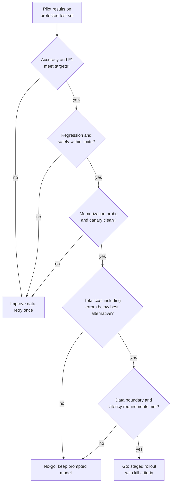

*Figure 18. Go/no-go decision flow for the case study.*

**Decision: go, with conditions.** The board approved a staged rollout: 5 percent of traffic in shadow mode for two weeks (the tuned model's output logged but not used, compared with the existing system and with staff corrections), then 20 percent live, then full traffic. Kill criteria: if live routing accuracy, measured on a weekly 400-email human-reviewed sample, falls below 92.5 percent for two consecutive weeks, or any safety or privacy check fails, roll back to the prompted option via the registry. A prompted baseline remains deployable on 1 hour's notice. The retraining cadence is quarterly, plus on trigger when the monitored accuracy drops or a new intent is added. The base model's licence permits commercial use, which counsel confirmed and recorded in the model card.

### 22.6 What the case study shows

Four points generalise. The first is that the random split would have misled the team in both directions, inflating the baseline and hiding the true gap, so the split design was the single most valuable piece of work. The second is that the decisive economics was error cost and the data boundary, not model spend, so the analysis had to include them. The third is that the cheaper alternative (C) was the right comparison, and the case would have failed against it on spend alone. The fourth is that the project's real cost was people and labels: compute was about \$50, and the approvals, evaluation work, and platform made up the rest.

## 23. Common Mistakes

Each mistake is described with its cause and consequence.

1. **Fine-tuning before building an evaluation set.** Cause: eagerness to train. Consequence: no way to tell whether the tuned model is better than the prompt, so the project continues on faith and a regression ships unnoticed.
2. **Using tuning to add facts.** Cause: treating the model as a database. Consequence: a model that sounds authoritative, repeats stale or distorted facts, and cannot cite sources. Use retrieval.
3. **Random splits on grouped data.** Cause: default train/test split. Consequence: leakage through shared authors, threads, or templates, inflated metrics, and production results far below the report.
4. **Training on the prompt tokens by accident.** Cause: default full-sequence loss. Consequence: gradient dominated by input modelling, slow learning of the answer, and occasional regurgitation of inputs.
5. **Template mismatch between training and serving.** Cause: different libraries or hand-edited prompts. Consequence: degraded or garbled output that no evaluation in the training environment shows.
6. **Missing end-of-turn token in the labels.** Cause: truncation or template defect. Consequence: a model that does not stop.
7. **Tuning the learning rate on the test set.** Cause: repeated reuse of the same evaluation. Consequence: an optimistic estimate, followed by disappointment in production.
8. **Ignoring forgetting and safety.** Cause: evaluating only the target task. Consequence: lost capabilities and weakened refusals discovered by users.
9. **Too many epochs on a small dataset.** Cause: following the training loss. Consequence: memorization, leakage of records, and a brittle model.
10. **Trusting synthetic data without review.** Cause: scale and convenience. Consequence: inherited teacher errors, narrow diversity, contaminated evaluation, and possibly a terms-of-service violation.
11. **Merging adapters by averaging factors.** Cause: treating $A$ and $B$ as ordinary weights. Consequence: cross terms that correspond to nothing learned.
12. **Merging into a quantized base and shipping without re-evaluating.** Cause: assuming equivalence. Consequence: silent quality loss.
13. **No lineage.** Cause: notebooks and ad-hoc scripts. Consequence: an artifact that cannot be reproduced, audited, or safely retrained when the base is retired or a data source is withdrawn.
14. **Serving an adapter on the wrong base revision.** Cause: mutable aliases. Consequence: plausible, degraded output with no error.
15. **Sharing caches across adapters or tenants.** Cause: engine defaults. Consequence: wrong answers and data leakage.
16. **Choosing a vendor without an exit plan.** Cause: speed. Consequence: forced retraining on the vendor's schedule, and no portable asset.
17. **Optimising GPU-hours instead of data quality.** Cause: engineering instinct. Consequence: effort spent on the 1 percent of project cost while labels and evaluation, which dominate the outcome, are neglected.
18. **Treating a leaderboard score of a merge or tuned public model as evidence for your task.** Cause: benchmark culture. Consequence: a model that wins the leaderboard and loses on your data.

## 24. Design Review Checklist

**Need and alternatives**

- [ ] An evaluation set exists and the best prompted baseline (and retrieval, if relevant) has been measured on it.
- [ ] The gap is behaviour, format, or skill, not missing facts or retrieval quality.
- [ ] Break-even was computed with maintenance and error cost, against the best cheap alternative.
- [ ] A prompted fallback is deployable.

**Data**

- [ ] Legal basis, purpose compatibility, licences, and contractual exclusions are documented per source.
- [ ] Personal data and secrets are redacted or justified, with measured redaction recall.
- [ ] Deduplication was done before splitting, with near-duplicate clusters kept whole.
- [ ] Splits are by group and, where relevant, by time. The test set is protected.
- [ ] Training data is decontaminated against all evaluation and regression sets.
- [ ] Labels were audited. Agreement and error rates are known.
- [ ] Synthetic data was reviewed, ablated, and checked against teacher licence terms.

**Training**

- [ ] The chat template matches serving. A parity test exists.
- [ ] Loss masking and the end-of-turn token were verified by inspecting a batch.
- [ ] Method, rank, targets, learning rate, and epochs were chosen from a sweep, with seed variation measured.
- [ ] The memory and cost estimate was computed and compared with measured values.
- [ ] Runs checkpoint and resume. The environment is pinned.

**Evaluation and safety**

- [ ] Task metrics have confidence intervals and a paired comparison against the baseline.
- [ ] A regression suite with thresholds and a safety suite (under-refusal and over-refusal) were run against the base and the candidate.
- [ ] A memorization probe and a canary test were run.
- [ ] The merged or exported artifact was evaluated in the serving stack.

**Serving, lineage, and governance**

- [ ] Merged versus unmerged serving was chosen against the number of variants and latency.
- [ ] Adapter authorization, version pinning, base-hash check, and cache keys including the adapter were verified.
- [ ] A lineage manifest, data card, and model card exist, and the artifact is stored in a safe format with a hash.
- [ ] Rollback was rehearsed, and the previous two versions and their base are retained.
- [ ] Base-model retirement is on a calendar, and a retraining path exists from the manifest.
- [ ] Guardrails outside the model remain in place.

## 25. Exercises

1. **Parameter count.** A 13B model has hidden size 5120, 40 layers, feed-forward size 13,824, and a vocabulary of 32,000 with untied embeddings, with the same layer structure as the 7B example. (a) Compute the total parameters. (b) Compute the LoRA parameters at rank 16 on all seven linear matrices per layer. (c) Compute the full fine-tuning state at 16 bytes per parameter.

   *Answer outline.* (a) Per layer: $4 \times 5120^2 = 104{,}857{,}600$ plus $3 \times 5120 \times 13824 = 212{,}336{,}640$ plus $2 \times 5120 = 10{,}240$, total $317{,}204{,}480$. Times 40 is $12{,}688{,}179{,}200$. Add $2 \times 32000 \times 5120 + 5120 = 327{,}685{,}120$ for a total of $13{,}015{,}864{,}320$, about 13.02B. (b) Attention: $4 \times 16 \times 10240 = 655{,}360$. Feed-forward: $3 \times 16 \times (5120 + 13824) = 909{,}312$. Per layer $1{,}564{,}672$, times 40 is $62{,}586{,}880$, about 62.6M or 0.48 percent. (c) $16 \times 13.016 \times 10^9 \approx 208$ GB.

2. **Break-even.** A workload of 500,000 requests per month costs \$0.008 per request prompted. A tuned model would cost \$0.0015 per request including hosting, plus \$1,500 per month for retraining and monitoring, with \$24,000 one-time. Compute the break-even and state when tuning never pays.

   *Answer outline.* Monthly saving before maintenance is $500{,}000 \times (0.008 - 0.0015) = \$3{,}250$. After maintenance, $3{,}250 - 1{,}500 = \$1{,}750$. Break-even is $24{,}000/1{,}750 \approx 13.7$ months. It never pays if volume falls so that $V(c_0 - c_1) \le M$, here $V \le 1{,}500/0.0065 \approx 230{,}800$ requests per month.

3. **Evaluation size.** A classifier is expected to be about 95 percent accurate. How many test examples give a 95 percent interval of $\pm 1.5$ points? Why might a paired comparison need fewer?

   *Answer outline.* $n = 1.96^2 \times 0.95 \times 0.05 / 0.015^2 = 3.8416 \times 0.0475 / 0.000225 \approx 811$. A paired test uses only the examples on which two systems differ, and removes variation that both share, so differences can be detected with fewer examples than are needed to measure each accuracy precisely.

4. **Merge precision.** A weight has value 0.05 and a LoRA update of $+0.0001$ is merged in bf16. bf16 has 7 explicit mantissa bits. Is the update preserved?

   *Answer outline.* 0.05 lies in $[2^{-5}, 2^{-4})$, so the spacing between representable bf16 numbers is $2^{-5} \times 2^{-7} = 2^{-12} \approx 0.000244$. The update, 0.0001, is less than half a spacing (0.000122), so the sum rounds back to 0.05 and the update is lost for this weight. Merge in fp32 and cast, and evaluate the result.

5. **Loss share.** An example has a 400-token prompt and a 1-token label. What share of the full-sequence loss does the label receive under uniform token weighting, and under completion-only loss?

   *Answer outline.* With 401 tokens contributing (ignoring the first position), the label is about $1/401 \approx 0.25$ percent of the average. With completion-only loss it is 100 percent. In practice the model also finds many prompt tokens easy, so the gradient is dominated by the prompt tokens that are hard to predict, which have nothing to do with the task.

6. **Adapter storage.** A platform serves 500 tenants, each with a rank-8, all-linear adapter on the 7B model. Compute adapter storage in bf16 and compare with 500 merged models.

   *Answer outline.* Each adapter has 19,988,480 parameters, about 40.0 MB in bf16, so 500 adapters take about 20.0 GB. Merged models would take $500 \times 13.5 = 6{,}750$ GB. The adapter design is about 340 times smaller, and also lets one base copy stay resident on the GPU.

7. **Design question.** A legal department wants a model that answers questions about its 40,000 contracts, citing clauses, with access limited by matter team. Fine-tune, retrieve, or both?

   *Answer outline.* Retrieval, with permission filtering and citation, is the core: the facts are large, access-controlled, and must be citeable and deletable. Fine-tuning may add value for style, clause-extraction schemas, or abstention behaviour, trained on non-confidential or synthetic data, or on a per-matter adapter if policy allows. Fine-tuning the contracts into shared weights would break access control.

8. **Regression gating.** A tuned model gains 4 points on the task and loses 3 points on a general suite of 300 items with baseline accuracy 70 percent. Is the loss real, given a limit of 2 points?

   *Answer outline.* The standard error of an accuracy near 70 percent on 300 items is $\sqrt{0.7 \times 0.3/300} = 0.026$, so the interval is about $\pm 5$ points for each system. An unpaired comparison cannot establish a 3-point loss. Use a paired comparison on the same items, enlarge the suite, and check per-area breakdowns. If the paired loss is significant, apply replay or weight interpolation (section 15.4) and re-measure.

9. **Provenance.** Adapter version 7 was trained on a dataset that included a source later found to be unlicensed. List the steps and the lineage data needed to respond.

   *Answer outline.* Query the lineage for all training runs using that dataset version and source records, identify adapters and merged artifacts derived from them, and all deployments. Decide the policy: retire or retrain without the source. Rebuild the dataset manifest minus the source, retrain, re-evaluate, canary, and promote. Roll back to a previous adapter that does not include the source, if one exists. Record the incident, the change, and the approvals.

10. **QLoRA memory.** Estimate the QLoRA memory for a 70B model (80 layers, hidden 8192, rank 16 over all linear layers) base weights only.

    *Answer outline.* Parameters about 70B. NF4 with double quantization is 4.127 bits per parameter, so $70 \times 10^9 \times 4.127 / 8 \approx 36.1$ GB. Add adapter state (roughly 16 bytes per adapter parameter), activations, and 16-bit embeddings. This fits on one 80 GB GPU with checkpointing, and does not on a 48 GB GPU once activations and logits are included unless sequences are short.

## 26. Summary

Fine-tuning changes the weights, and so it changes the behaviour, cost structure, and obligations of a system. Use it when the gap is behaviour, format, or a narrow skill, when volume makes shorter prompts and smaller models pay, or when data control demands a model you host. Do not use it to add facts, repair retrieval, or enforce access control. Decide with an evaluation set, a measured prompted baseline, and a break-even calculation that includes maintenance and error cost.

Supervised fine-tuning succeeds or fails on data and mechanics: the right chat template, completion-only loss, a stop token in the labels, careful packing, deduplication, decontamination, label audits, and group-aware splits. Full fine-tuning of a 7B model needs about 16 bytes per parameter before activations (107.8 GB). LoRA freezes the base and learns a low-rank update $\frac{\alpha}{r} BA$, about 0.59 percent of parameters at rank 16 on all linear layers, which cuts the state to 14 GB with a 16-bit base. QLoRA stores the base in 4-bit NormalFloat with double quantization and brings it to about 4 GB plus activations. The price is lower capacity on knowledge-heavy shifts, and a quantization error that must be evaluated in the form that will be served.

Every tuned model needs its own evaluation: task metrics with confidence intervals, a regression suite compared with the base, and a safety re-check, because forgetting and safety degradation happen without warning. Memorization is a property of the training process, so redact first, limit epochs, probe for it, and control access to the weights like the data. Merging and multi-adapter serving offer efficiency, but each merged or served artifact needs its own lineage, authorization, cache isolation, and evaluation. Vendor-hosted tuning trades control for speed and ties the asset to the vendor's base model, so own the data and the recipe. Compute is a small part of project cost. Labels, evaluation, platform, and governance are most of it.

## 27. Code Examples

All scripts use only the Python standard library and were run with Python 3.14. Their printed output is quoted in this chapter.

- [`01_lora_demo.py`](../code/python/fine-tuning-chapter/01_lora_demo.py) trains a rank-4 LoRA adapter in pure Python to reproduce a rank-2 update, then shows that merging gives identical outputs.
- [`02_memory_and_cost.py`](../code/python/fine-tuning-chapter/02_memory_and_cost.py) computes parameter counts, full fine-tuning, LoRA, and QLoRA memory for a 7B model, activation estimates, and GPU-hours and dollars.
- [`03_data_curation.py`](../code/python/fine-tuning-chapter/03_data_curation.py) demonstrates loss masking, packing utilisation, shingle-based near-duplicate detection, and n-gram decontamination.
- [`04_merging_and_nf4.py`](../code/python/fine-tuning-chapter/04_merging_and_nf4.py) applies task arithmetic, TIES, and SLERP to toy vectors and compares NF4 with uniform 4-bit quantization error.

## 28. References and Further Reading

- Aghajanyan, A., Zettlemoyer, L., and Gupta, S. (2020). Intrinsic Dimensionality Explains the Effectiveness of Language Model Fine-Tuning.
- Ben Zaken, E., Ravfogel, S., and Goldberg, Y. (2022). BitFit: Simple Parameter-efficient Fine-tuning for Transformer-based Masked Language-models.
- Biderman, D., et al. (2024). LoRA Learns Less and Forgets Less.
- Carlini, N., et al. (2019). The Secret Sharer: Evaluating and Testing Unintended Memorization in Neural Networks.
- Carlini, N., et al. (2021). Extracting Training Data from Large Language Models.
- Carlini, N., et al. (2023). Quantifying Memorization Across Neural Language Models.
- Chen, L., et al. (2023). Punica: Multi-Tenant LoRA Serving.
- Dettmers, T., Pagnoni, A., Holtzman, A., and Zettlemoyer, L. (2023). QLoRA: Efficient Finetuning of Quantized LLMs.
- Gekhman, Z., et al. (2024). Does Fine-Tuning LLMs on New Knowledge Encourage Hallucinations?
- Hayou, S., Ghosh, N., and Yu, B. (2024). LoRA+: Efficient Low Rank Adaptation of Large Models.
- Hinton, G., Vinyals, O., and Dean, J. (2015). Distilling the Knowledge in a Neural Network.
- Houlsby, N., et al. (2019). Parameter-Efficient Transfer Learning for NLP.
- Hu, E., et al. (2021). LoRA: Low-Rank Adaptation of Large Language Models.
- Ilharco, G., et al. (2023). Editing Models with Task Arithmetic.
- Kalajdzievski, D. (2023). A Rank Stabilization Scaling Factor for Fine-Tuning with LoRA.
- Kirkpatrick, J., et al. (2017). Overcoming Catastrophic Forgetting in Neural Networks.
- Korthikanti, V., et al. (2022). Reducing Activation Recomputation in Large Transformer Models.
- Lee, K., et al. (2022). Deduplicating Training Data Makes Language Models Better.
- Lester, B., Al-Rfou, R., and Constant, N. (2021). The Power of Scale for Parameter-Efficient Prompt Tuning.
- Li, X. L., and Liang, P. (2021). Prefix-Tuning: Optimizing Continuous Prompts for Generation.
- Liu, H., et al. (2022). Few-Shot Parameter-Efficient Fine-Tuning is Better and Cheaper than In-Context Learning.
- Liu, S.-Y., et al. (2024). DoRA: Weight-Decomposed Low-Rank Adaptation.
- Luo, Y., et al. (2023). An Empirical Study of Catastrophic Forgetting in Large Language Models During Continual Fine-tuning.
- Northcutt, C., Jiang, L., and Chuang, I. (2021). Confident Learning: Estimating Uncertainty in Dataset Labels.
- Qi, X., et al. (2023). Fine-tuning Aligned Language Models Compromises Safety, Even When Users Do Not Intend To.
- Shuttleworth, R., et al. (2024). LoRA vs Full Fine-tuning: An Illusion of Equivalence.
- Sheng, Y., et al. (2023). S-LoRA: Serving Thousands of Concurrent LoRA Adapters.
- Shumailov, I., et al. (2024). AI Models Collapse When Trained on Recursively Generated Data.
- Wang, Y., et al. (2022). Self-Instruct: Aligning Language Models with Self-Generated Instructions.
- Wortsman, M., et al. (2022). Model Soups: Averaging Weights of Multiple Fine-tuned Models Improves Accuracy without Increasing Inference Time. And Robust Fine-tuning of Zero-shot Models (WiSE-FT).
- Yadav, P., et al. (2023). TIES-Merging: Resolving Interference When Merging Models.
- Yu, L., et al. (2024). Language Models are Super Mario: Absorbing Abilities from Homologous Models as a Free Lunch.
- Zhang, Q., et al. (2023). Adaptive Budget Allocation for Parameter-Efficient Fine-Tuning (AdaLoRA).
- Zhao, J., et al. (2024). GaLore: Memory-Efficient LLM Training by Gradient Low-Rank Projection.
- Zhou, C., et al. (2023). LIMA: Less Is More for Alignment.
- European Data Protection Board (2024). Opinion 28/2024 on certain data protection aspects related to the processing of personal data in the context of AI models.
- OpenAI, [Introducing vision to the fine-tuning API](https://openai.com/index/introducing-vision-to-the-fine-tuning-api), with the update on the winding down of the fine-tuning platform (accessed October 2026).
