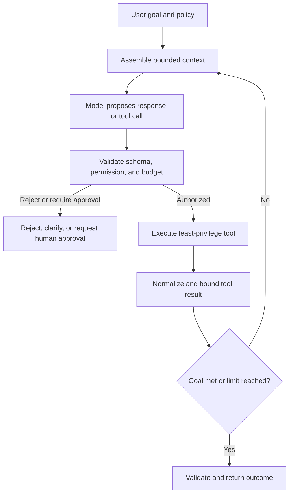
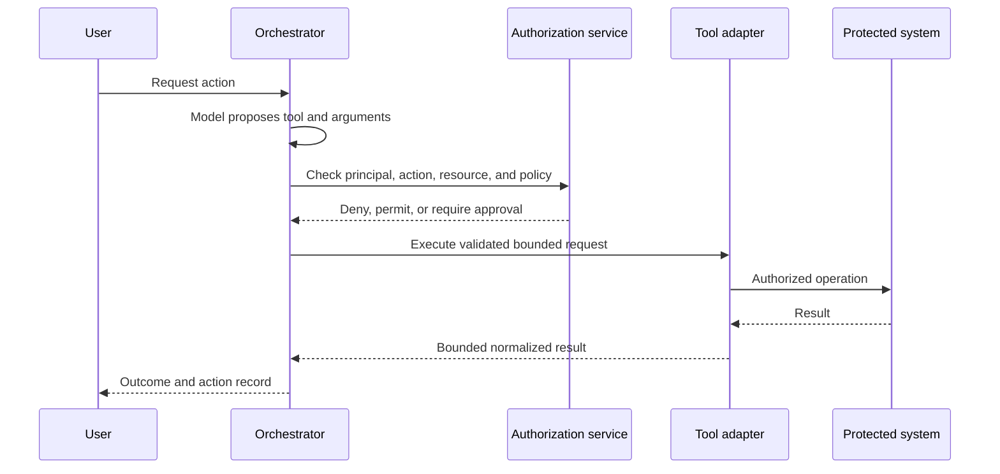
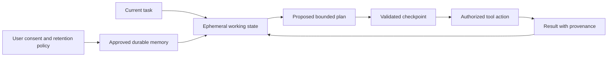
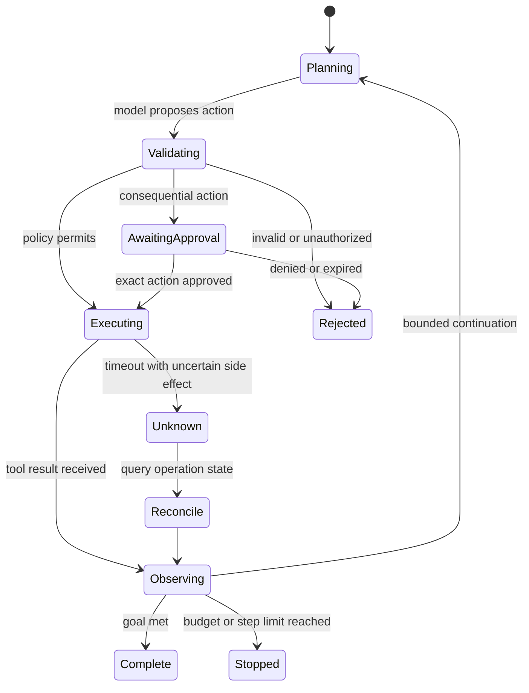
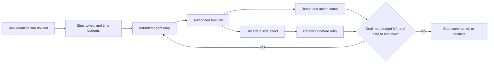

# Agents, Tool Calling, Memory, Planning, and Reasoning

Part: [16 — Artificial Intelligence, Machine Learning, and Generative AI](PART_OVERVIEW.md)

An agentic application uses a model to choose steps, invoke tools, interpret results, and continue toward a goal. This chapter owns model-facing loops, planning, memory, and tool-interaction mechanics. [Part 17 CH06 — Agentic System Architecture](../17_AI_Architecture/CH06_Agentic_System_Architecture_and_Tool_Boundaries.md) owns the production executor boundary, identity binding, deterministic authorization, approval, and durable workflow architecture; Part 15 owns security foundations.

## Agent Loop and Control Boundaries

A typical loop assembles context, asks the model for a response or tool call, validates the proposal, executes an authorized action, and returns a bounded result. The loop needs a maximum step count, token or time budget, termination condition, and explicit handling for repeated failures. A model's reasoning text is not a reliable security or audit boundary; record action decisions and outcomes separately.

Define progress in observable terms: a tool call returned a new fact, a requested state transition was confirmed, or a human supplied a decision. Repeatedly issuing equivalent searches or retrying a rejected action is not progress. Classify failures as malformed proposal, policy denial, transient tool error, permanent domain error, or uncertain side effect. Retry only errors known to be transient, use a smaller bounded result when context overflows, and stop when the goal cannot be completed within the remaining budget. Separate step, wall-clock, token, and tool-call limits because exhausting one does not imply the others are safe.

A concrete loop-detection rule: track the last $N$ (for example, five) proposed tool calls including their normalized arguments. If the current proposal matches a prior one in that window and the prior call's result was already incorporated into context, treat the proposal as non-progress rather than executing it again — surface a forced-choice prompt ("that action already returned X; choose a different step or stop") instead of silently re-running a side-effecting tool. This single check catches a large share of the repeated-search and repeated-write failure patterns seen in production agent loops, and it is cheap to implement compared with more elaborate planning-quality heuristics.

## Tool Schemas, Permissions, and Side Effects

Expose narrow tools with typed inputs, explicit side effects, and clear error behavior. A model proposal is not authorization: production identity, resource scope, and approval must be checked by the deterministic executor described in [Part 17 CH06](../17_AI_Architecture/CH06_Agentic_System_Architecture_and_Tool_Boundaries.md). Here, focus the tool contract on schema, effect classification, bounded results, and the interaction the model can request. Separate read-only discovery from state-changing actions.

Tool results are also untrusted input. Limit size, redact sensitive fields, and distinguish data from instructions. Protect against prompt injection in retrieved pages, tool output, or user-supplied files. Before human approval, display the exact action and arguments rather than a model-generated summary.

## Planning, Memory, and State

Planning can decompose a goal into steps, but plans are hypotheses that should be revalidated against tool results and policy at execution time. Persist only necessary state. Working memory may hold current task context; durable memory may persist user preferences or facts but needs provenance, consent, expiry, and deletion behavior. Do not confuse model context history with an authoritative system of record.

Separate three scopes: the current prompt context, task state required to resume one run, and durable memory reused across runs. Prompt context is transient and may be truncated; task state should contain typed observations and action status rather than an unbounded transcript; durable memory needs a source, timestamp, owner, purpose, and expiry so stale or disputed facts can be corrected. Retrieval from memory can be irrelevant or cross-scope, so test whether the item belongs to this user and task before exposing it to the model. If provenance is absent, prefer asking again or consulting the authoritative system over silently treating remembered text as fact.

For long-running or consequential actions, durable checkpointing and reconciliation belong to the surrounding workflow boundary; see [Part 17 CH06](../17_AI_Architecture/CH06_Agentic_System_Architecture_and_Tool_Boundaries.md). At the agent-mechanics level, distinguish an observation from a completed action, carry operation identifiers in state, and never infer success from a timeout. Memory retrieval should remain scoped to the task and its authorized context.

## Reliability, Evaluation, and Failure Modes

Model output can be malformed, repetitive, irrelevant, or non-deterministic. Bound retries and stop loops that repeat the same action. Use deterministic code for validation, arithmetic, access checks, and state transitions when possible. Define fallback behavior when a model or tool is unavailable and communicate incomplete work clearly.

Evaluate task completion, tool selection, argument correctness, policy adherence, unsafe action rate, loop length, cost, and recovery. Use scenario sets with adversarial tool output and permission denials. Human review should focus on consequential and uncertain outcomes rather than every low-risk deterministic step.

## Worked Case and Review Checklist

A support agent can inspect account status and draft a refund but cannot issue one without approval. The user is authenticated by the application. The orchestrator exposes separate read and write tools, validates the account and amount, checks the user's permission, and presents the exact refund request to an authorized reviewer. A timeout triggers reconciliation using an operation ID before any retry. The final record captures principal, action, approval, tool result, and model version without storing hidden reasoning as proof.

Review tool surface, schemas, authorization, side effects, human approval, prompt-injection boundary, state and memory, checkpoints, idempotency, limits, fallback, audit, and evaluation. Confirm loop termination is guaranteed under repeated tool failure.

## Questions and Summary

1. Draw the loop from user goal through authorization, tool call, observation, and stop condition.
2. Why must authorization be enforced outside the model?
3. Design a safe retry for a tool action that timed out after submission.
4. Which memory requires consent, provenance, retention, and deletion controls?
5. Define tests for malicious tool output and repeated loop behavior.

Agentic systems add a model-directed control loop around tools and state. Safety depends on external authorization, narrow tools, bounded execution, verified outputs, human approval where needed, and recoverable side effects. Treat plans and model text as proposals; the system must own policy and truth.
