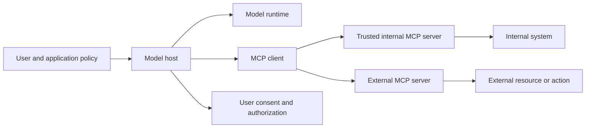
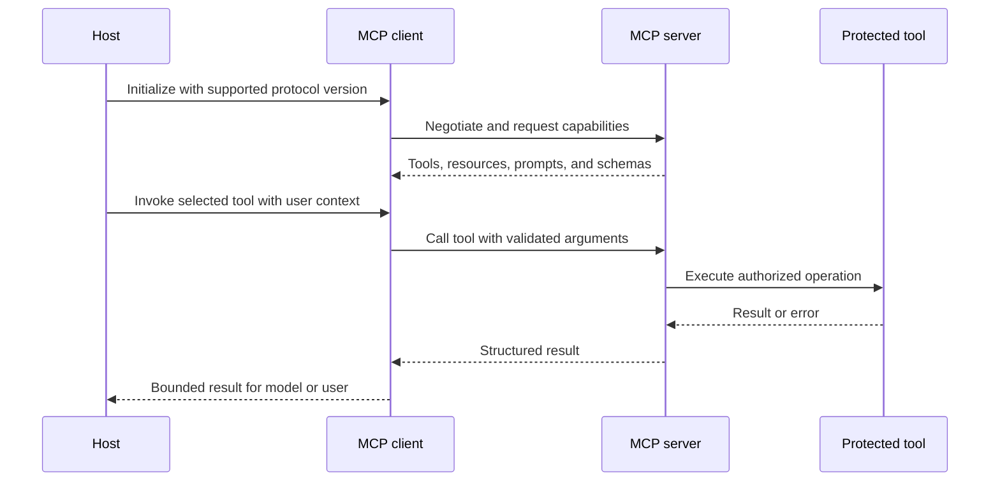
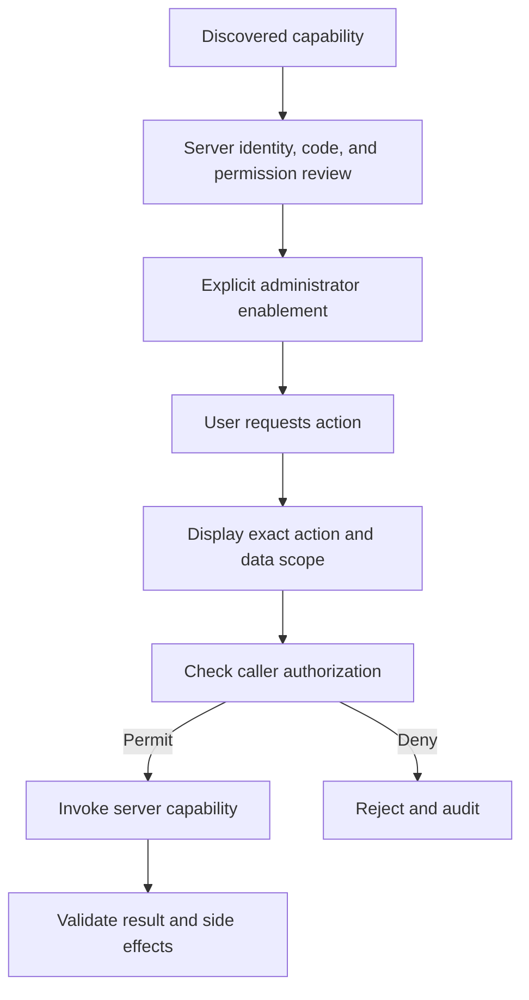
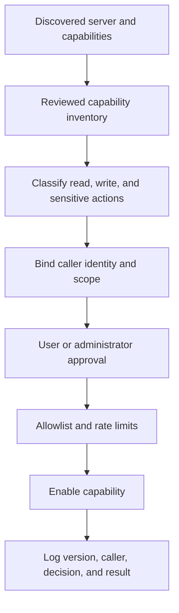
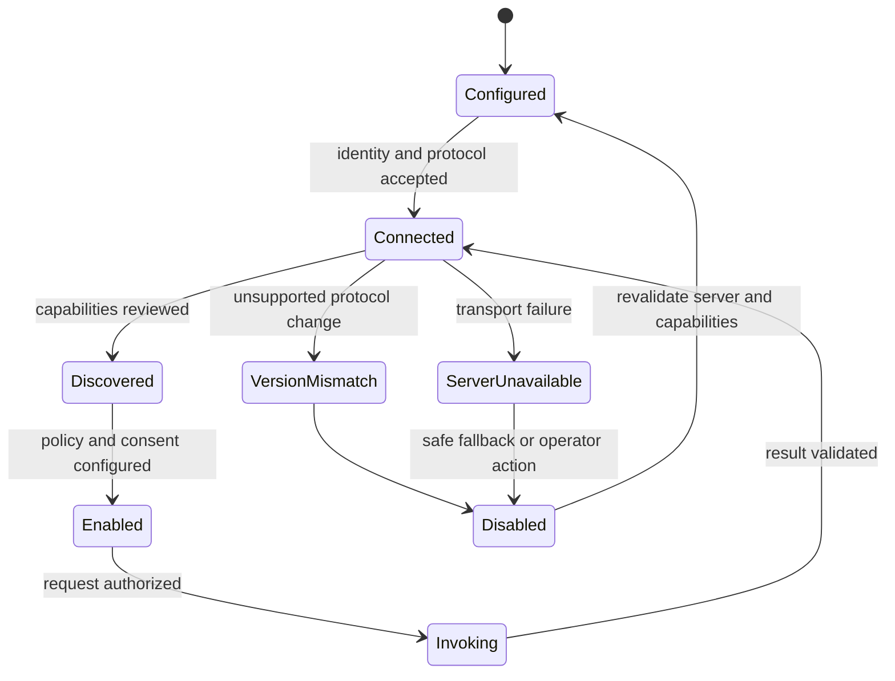

# Model Context Protocol (MCP)

Part: [16 — Artificial Intelligence, Machine Learning, and Generative AI](PART_OVERVIEW.md)

The Model Context Protocol (MCP) is a protocol for connecting model hosts and clients to servers that expose tools, resources, and prompts. It standardizes discovery and interaction shapes; it does not automatically make a tool trustworthy, authorize a user, or provide safe consent. MCP specifications evolve, so pin the supported protocol version and verify current official requirements before deployment. [Part 15 — Security](../15_Security/PART_OVERVIEW.md) owns security foundations; [Part 17 CH06 — Agentic System Architecture](../17_AI_Architecture/CH06_Agentic_System_Architecture_and_Tool_Boundaries.md) owns system-level agent authority and executor boundaries.

## Host, Client, and Server Roles

A host application manages user interaction, model access, and policy. An MCP client maintains a protocol connection to an MCP server. A server advertises capabilities such as tools that perform actions, resources that provide data, or prompts that provide reusable templates. The host decides which capabilities to make available and how user identity and consent are applied.

The server may run locally or remotely. Local execution does not imply trust: a local process can read files, environment variables, or credentials available to its account. Remote transport introduces authentication, network, tenant, and server-identity concerns. Maintain an inventory of installed servers and their capabilities.

A concrete local-execution hazard: a developer installs an MCP server packaged as a script that, by default, runs under the same user account as the host application, which means a vulnerability or malicious update in that server's dependency chain could read the host's environment variables — including any API keys the host process holds — without any MCP-level permission check ever being involved. Treating "runs on my machine" as equivalent to "sandboxed" is the mistake; a local server intended to only read a specific project directory should be launched with restricted filesystem and environment access (a dedicated service account, container, or OS-level sandbox), not the developer's full account privileges, regardless of how narrow its advertised MCP capability looks.

## Capability Discovery and Invocation

Clients discover supported capabilities and their input schemas. Tool invocation sends a method and arguments; the server returns structured content or an error. Resources provide data under a URI-like identifier; prompts provide structured prompt templates. Validate capability schemas and constrain outputs before they reach the model or another tool.

Discovery is not approval. A newly advertised tool should not become available to a model automatically, especially when it can mutate data or access sensitive resources. Review schemas, outputs, permission scope, and server behavior before enabling capabilities.

A concrete discovery hazard is a server that silently changes its advertised capability between sessions — the same tool name now accepting a new argument that grants broader access, or a resource URI now resolving to different, less-restricted data. Pin and hash the capability schema a reviewer approved, and re-run review whenever the server reports an updated schema version rather than trusting the name alone; a name match across versions is not a guarantee that the underlying behavior or permission scope is unchanged.

MCP messages use request/response and notification patterns with correlation identifiers, so clients can associate a result or error with the operation that produced it. Initialization negotiates a supported protocol version and exchanges client/server capabilities before normal feature discovery. A notification is not an acknowledged operation; do not treat it as proof that a side effect completed. Distinguish protocol-level failures such as unsupported methods or malformed messages from tool-level failures such as validation rejection or unavailable business data. Preserve that distinction when mapping errors back to the model, because retrying a permanent tool rejection can create a loop.

## Trust, Consent, and Authorization

Treat server descriptions, prompt templates, resource content, and tool results as untrusted unless a trusted operator establishes provenance. A tool name or schema cannot prove the implementation matches its description. Enforce authorization at the host and at the protected system. Pass user identity and scope securely; do not use a broad server credential for every caller if the target supports delegated or per-user authority.

Consent should be specific, informed, and bound to the action and data being shared. For consequential actions, provide one preview identifying the exact target, each argument, and the expected effect. A blanket “allow MCP” setting does not establish informed consent for future capabilities.

## Transport, Failure, and Governance

Select transport based on deployment, identity, network exposure, and lifecycle. Protect remote connections with authenticated channels, server identity validation, and least privilege. Avoid exposing local stdio servers to untrusted callers or remote endpoints to broad networks. Protocol version negotiation and capability changes should be logged and reviewed.

Set timeouts, output-size limits, retry rules, and circuit breakers. A failed tool must not cause the model to invent a successful result. Record server identity, capability version, caller, decision, and outcome while minimizing sensitive payloads. Maintain an allowlist and remove unused or compromised servers.

## Worked Case and Review Checklist

A host connects to an internal knowledge server and a ticketing server. The knowledge server exposes read-only resources; the ticketing server exposes create and update tools. Administrators review server binaries and scopes. Users can search approved documents without granting ticket access. A ticket creation request displays project, title, and body for confirmation; the ticket server independently checks the caller's permission. Tool results are bounded and audited.

Review host/client/server roles, server identity, protocol version, capability inventory, schema, transport, delegated authority, consent, output handling, timeouts, resource limits, audit, and server lifecycle. Confirm local servers do not inherit unintended filesystem or environment access.

## Questions and Summary

1. Distinguish host, client, and server authority.
2. Why does capability discovery not imply capability trust or user consent?
3. Design the approval flow for a server that can create and update tickets.
4. What controls are needed when an MCP server runs locally under a developer account?
5. How should a host behave when a server changes protocol version or becomes unavailable?

MCP standardizes capability exchange, not the security properties of the capability. Govern server identity, scopes, transport, consent, authorization, and result handling. Pin protocol versions, review capability changes, and keep consequential actions bounded and independently authorized.
