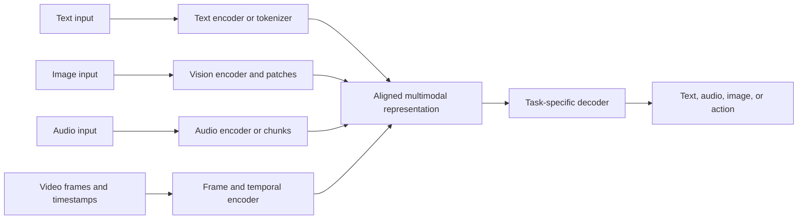
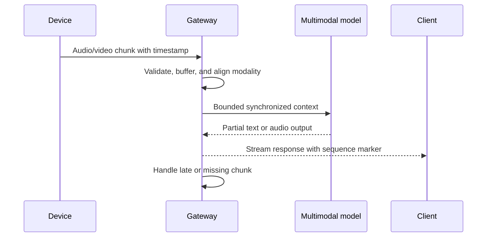
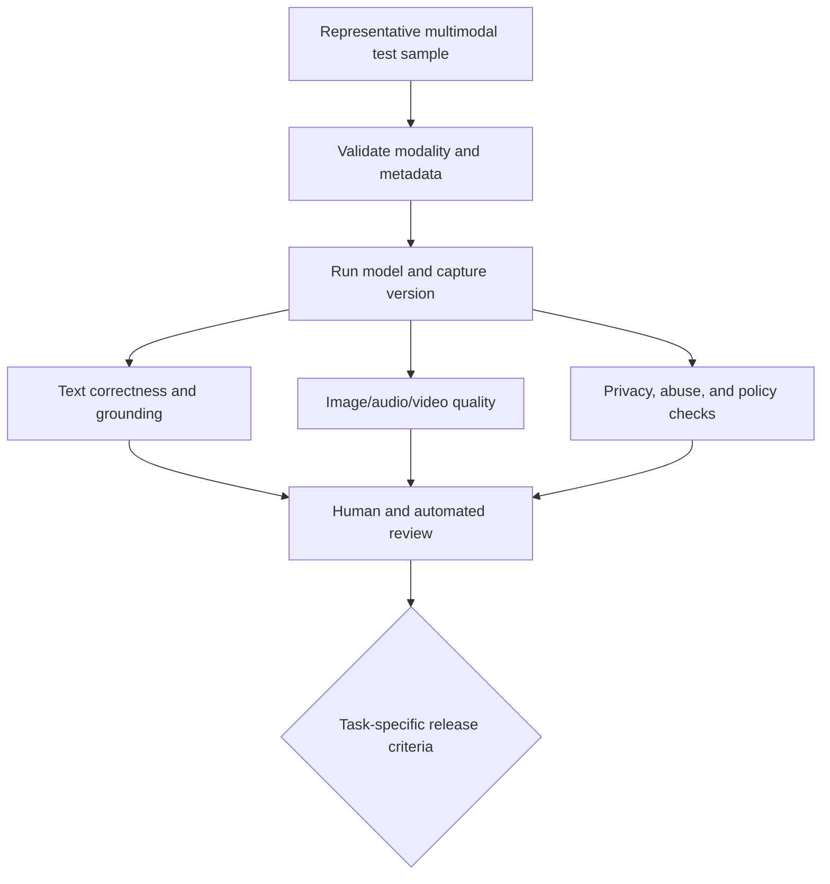
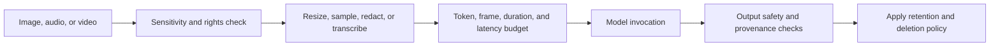

# Multimodal Generative AI

Part: [16 — Artificial Intelligence, Machine Learning, and Generative AI](PART_OVERVIEW.md)

Multimodal generative models accept or produce combinations of text, images, audio, and video. They use modality-specific encoders and decoders plus shared or aligned representations. A single model interface can hide different latency, synchronization, privacy, and evaluation requirements for each modality. Part 17 owns end-to-end multimodal system architecture.

## Modality Paths and Alignment

An image may be divided into patches or encoded into visual tokens; audio may be encoded into frames or discrete units; video adds temporal ordering. The model aligns these representations with text or other modalities. Resolution, frame rate, chunking, and audio sample rate affect token count, latency, and information loss.

Alignment does not guarantee equal understanding across modalities or demographic groups. Test cross-modal grounding with examples that isolate each input and interaction. Preserve timestamps and attribution so generated claims can be traced to a frame, segment, or source.

Fusion can happen at different points. A dual-encoder design maps each modality into a shared space and compares representations efficiently, but may lose fine-grained token-to-region relationships. Cross-attention lets one modality condition on detailed representations from another, improving localized grounding at greater compute and context cost. Early fusion interleaves modality tokens before joint processing; late fusion combines modality-specific outputs and can isolate failures more cleanly. These designs solve different tasks and are not interchangeable. Evaluate alignment at the granularity of the decision: a clip-level caption does not prove that a claim is grounded in the correct frame or audio interval.

Sampling is part of the model input contract. Sparse video frames reduce cost but can miss brief events or alias motion; audio chunking can lose prosody and dependencies across boundaries. Record sample rate, resize/crop, frame-selection, timestamp, and chunk-overlap policies with the model version. Test boundary cases such as a critical event between sampled frames, speech over background audio, and a transcript whose timestamps drift from video.

Frame-sampling rate is a direct, measurable trade-off between cost and recall. A 30-second clip captured at 30 frames per second contains 900 frames; sampling one frame per second reduces that to 30 frames, a 97% reduction in vision-encoder work, but any event lasting under one second between two sampled frames can be missed entirely. Doubling the sampling rate to two frames per second halves that blind window at twice the vision-token cost for the same clip. Choose the rate from the shortest event the task must not miss, not from a default pulled from an unrelated demo, and validate the choice against a labeled set of clips containing exactly those short events.

## Streaming and Synchronization

Real-time audio/video systems process data incrementally. Chunk size trades latency against context and quality; excessive buffering increases delay, while small chunks increase overhead. Synchronize audio, video, and transcript segments using timestamps and handle dropped, duplicated, or out-of-order chunks explicitly.

Backpressure and cancellation must cross modality pipelines. When the user disconnects, stop model work that is no longer needed. Release associated buffers. Define whether late data is dropped, reordered within a bound, or triggers a restart.

## Evaluation and Safety by Modality

Text metrics do not assess image fidelity, speech intelligibility, synchronization, or video temporal consistency. Define modality-specific metrics and human review. For perception tasks, evaluate recognition and grounding; for generation, evaluate quality, diversity, safety, and instruction adherence. Test adversarial inputs such as text embedded in images or audio instructions that conflict with user intent.

Choose measures that match the task. Word Error Rate (WER) can measure transcription substitutions, deletions, and insertions, but it does not assess speaker attribution, prosody, or whether an audio answer is understandable in context. Image similarity metrics can reward pixel resemblance while missing semantic correctness. Video evaluation should check event ordering and temporal consistency, not only sampled-frame quality. For synchronized tasks, measure timestamp alignment error and test dropped, duplicated, or late chunks. Pair automated scores with blinded human judgments and stratify by language, recording condition, and relevant user groups; a single average can hide a failing modality path.

```mermaid
gantt
    title Synchronized multimodal request timeline
    dateFormat X
    axisFormat %L ms
    section Inputs
    Audio chunk A :0, 120
    Video frame sequence :0, 160
    Audio chunk B :120, 240
    section Processing
    Alignment and buffering :0, 180
    Model processing :180, 310
    Output stream :310, 430
```

Timestamp alignment determines whether the model sees synchronized events. Define tolerance for late and missing chunks; do not silently associate audio with the wrong frame interval.

## Privacy, Cost, and Operational Limits

Media can contain faces, voices, location, documents, or biometric information. Minimize retention, restrict access, remove unnecessary metadata, and document consent and rights. Do not assume a modality encoder removes sensitive information. Large images, long audio, and high-resolution video increase inference cost and may require preprocessing or sampling.

## Worked Case and Review Checklist

A field-support assistant accepts a device image and a short spoken description. The service removes unnecessary metadata, limits image resolution and audio duration, preserves timestamps, and sends a bounded multimodal request. The model returns a text diagnosis with cited visual regions and an audio response. High-impact repair instructions require confirmation; ambiguous results route to a technician. Inputs and outputs follow a defined retention period.

A concrete budget for this case: a 1080p photo downsized to 768 pixels on the long edge before encoding, a 30-second audio clip capped at 16kHz mono, and a reserved 300-token response allowance leaves a predictable, bounded request size regardless of what the technician's device originally captured. Without that explicit downsizing step, a small fraction of users submitting 4K photos or multi-minute recordings would silently dominate both latency and cost for the whole service, which is why input normalization belongs in the request contract, not left to whatever the client happens to send.

Review modality coverage, alignment, chunking, timestamps, latency, token/frame budget, missing data, evaluation per modality, privacy, consent, output provenance, human review, and deletion.

## Questions and Summary

1. Draw an input path for synchronized audio and video and identify buffering points.
2. How does resolution or chunk size affect model cost and latency?
3. Design tests for text instructions embedded inside an image.
4. Which quality metrics differ for speech generation versus image classification?
5. Define a privacy and retention policy for voice and face-containing media.

Multimodal models combine modality-specific representations with shared generation or reasoning paths. Their systems must account for alignment, synchronization, modality-specific evaluation, privacy, and cost. A unified API does not remove differences in data handling or failure behavior.
