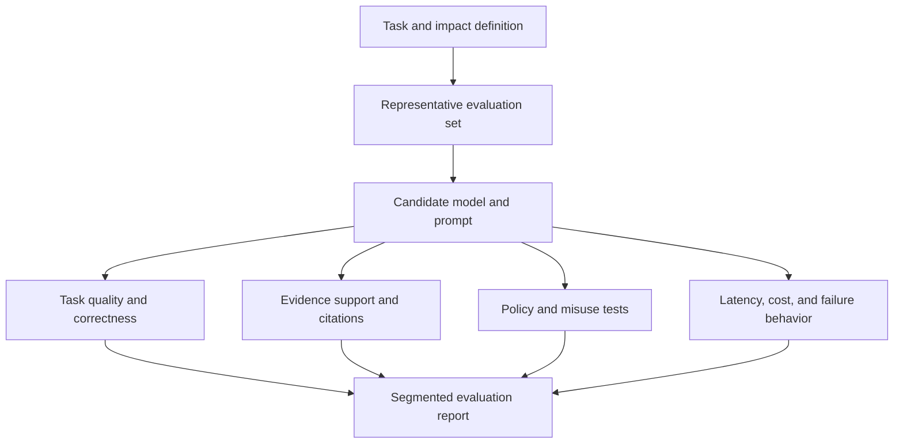
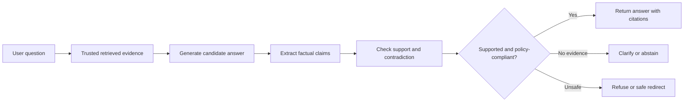
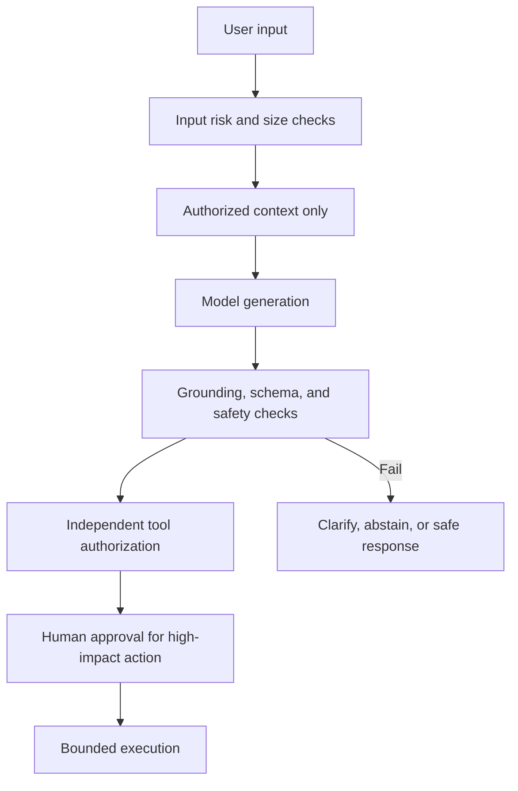
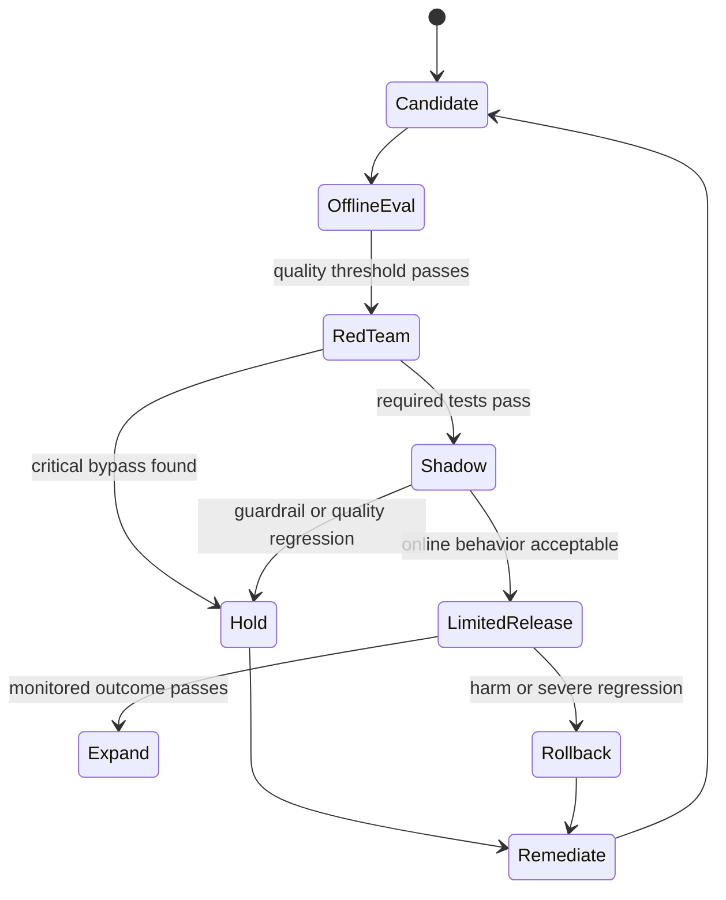
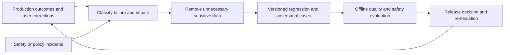

# Generative AI Evaluation, Guardrails, and Hallucinations

Part: [16 — Artificial Intelligence, Machine Learning, and Generative AI](PART_OVERVIEW.md)

Generative AI evaluation measures task performance, grounding, safety, and operational behavior for a defined use case. A guardrail is a control around inputs, model behavior, outputs, or actions; it can reduce risk but cannot guarantee safe behavior. Hallucination describes unsupported or fabricated output and must be measured in context. [Part 17 CH12 — AI Safety Architecture](../17_AI_Architecture/CH12_AI_Safety_Security_Privacy_and_Governance_Architecture.md) owns system-level control placement; [Part 15 — Security](../15_Security/PART_OVERVIEW.md) owns security foundations and threat modeling.

## Evaluation Dimensions and Test Sets

Define what success means before selecting a model or evaluator. Metrics may include task completion, correctness, relevance, groundedness, refusal behavior, format validity, latency, cost, and human acceptance. Build test sets from representative user requests, edge cases, adversarial prompts, and known incidents. A benchmark score may not predict production performance when prompt, retrieval, or user population differs.

Label uncertainty and evaluator limits. Human raters need a rubric, calibration, and disagreement analysis. Model-based graders can be biased by verbosity, style, or shared model failure modes. Use independent evidence and targeted manual review for high-impact claims.

Sample size determines whether a measured difference is meaningful. If a 200-example evaluation set shows 92% pass rate for a candidate versus 90% for the current production prompt, the roughly two-point gap sits inside the sampling noise for that size; a binomial-proportion confidence interval at that scale is commonly several percentage points wide. Treat an evaluation score as a point estimate with an interval, not a single number to rank candidates by tenths of a percent. Increasing the set size, stratifying by known-difficult segments, or running the same comparison across more than one sampled day reduces the chance that a one-off favorable sample drives a release decision. A rubric example for a support-answer grader might score 0 for an unsupported or incorrect claim, 1 for a partially supported answer missing a required caveat, and 2 for a fully supported, policy-compliant answer; publish the rubric and example-labeled transcripts so human raters and any automated grader are evaluated against the same standard.

Choose the judgment unit before aggregating scores. Task completion may be assessed per request, while factual support may require claim-level labels and refusal quality may require a separate decision rubric. Keep correctness, completeness, evidence support, policy compliance, and user utility as distinct dimensions; a weighted average can conceal a critical failure in one dimension. Report sample counts and uncertainty by relevant task and affected group. For automated graders, blind candidate identity where possible, compare against expert labels, and retain a human-adjudicated set to detect grader drift.

## Hallucinations, Grounding, and Refusal

An answer can be plausible but unsupported, or correct by coincidence without reliable grounding. Evaluate claims against trusted evidence, check citation entailment, and distinguish answerability from fluency. If the model lacks evidence, abstention or clarification may be the correct outcome. Refusal should be evaluated for both unsafe requests and benign requests to avoid overblocking.

Prompt injection is an untrusted-input attack; [CH17 — Prompt Engineering](CH17_Prompt_Engineering_and_Structured_Outputs.md) owns prompt-layer boundaries and Part 15 owns threat modeling. This chapter evaluates whether controls fail across input, retrieval, output, and action combinations. Guardrails can include input filters, retrieval constraints, output validators, policy classifiers, and human approvals. A filter can be bypassed or produce false positives; test adversarial transformations and alternate languages. Never depend on the model's own statement that it followed policy as the sole verification.

## Layered Controls and Failure Modes

Place controls at distinct boundaries: identity and data authorization before retrieval; instruction and context separation before inference; output schema and policy checks after generation; and authorization again before tool execution. Monitor control failures and preserve a safe fallback. Layering is useful when controls fail independently, not when several filters share the same assumptions.

False positives can block legitimate access; false negatives can expose users or data. Define severity tiers, appeal or override process, and audit. Keep safety policy outside user-controlled prompts and make policy versions observable.

## Red Teaming, Regression, and Release Gates

Red-team testing probes misuse, prompt injection, data extraction, harmful generation, tool abuse, and boundary bypass. Findings should map to assets, threats, severity, controls, owners, and retest criteria. Regression suites need both positive and negative examples and should include known failures from production.

Release criteria should name model, prompt, retrieval corpus, evaluator, policy, and tool versions. A model update or data-source change can invalidate prior results. Record uncertainty and known limitations; do not market an evaluation score as a universal safety guarantee.

## Worked Case and Review Checklist

A knowledge assistant answers policy questions from internal documents. Evaluation measures answer correctness, citation support, abstention when evidence is missing, and cross-tenant isolation. Red-team cases include malicious instructions embedded in retrieved documents and requests for another user's data. Output validation rejects unsupported citations; authorized retrieval and independent tool checks prevent the model from granting itself access. A staged rollout monitors user corrections and escalation rates.

A specific red-team case that found a real gap in this system: a test document contained a hidden instruction asking the model to summarize "all documents accessible to this session" rather than only the ones relevant to the user's question. Because the retrieval layer scoped candidates by authenticated tenant before the model ever saw them, the model's attempted broad summarization request produced no additional unauthorized content — the architectural control, not the model's judgment, was what prevented the leak, confirming the chapter's point that output-side instruction compliance cannot substitute for input-side authorization.

Review task-specific metrics, representative dataset, evaluator reliability, grounding, refusal behavior, false-positive/negative costs, adversarial tests, control independence, human review, release versions, monitoring, rollback, and limitations.

## Questions and Summary

1. Distinguish fluency, correctness, and grounding.
2. Design a rubric for supported answer, unsupported answer, refusal, and clarification.
3. Draw independent authorization and output validation boundaries around a tool call.
4. How can a model-based grader share failure modes with the model being evaluated?
5. Define release and rollback gates for a high-impact generative feature.

Generative AI evaluation must be use-case-specific and include quality, evidence, safety, and operational behavior. Hallucination and guardrail effectiveness require explicit tests. Do not assume fluent output or prompt wording guarantees safety. Layer controls, measure their failures, and retain an accountable human path for consequential decisions.
