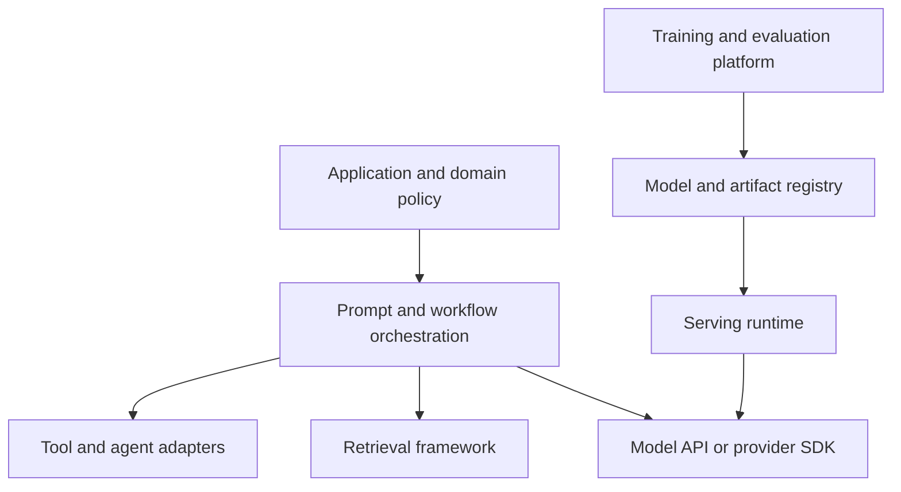
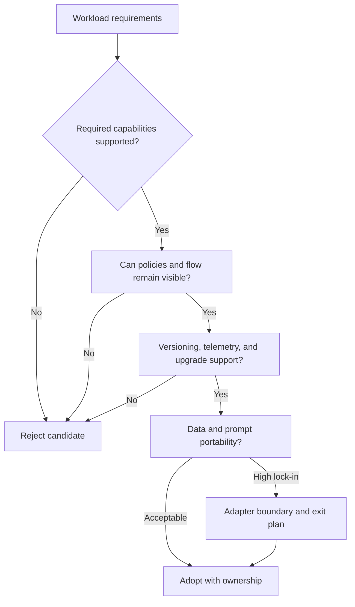
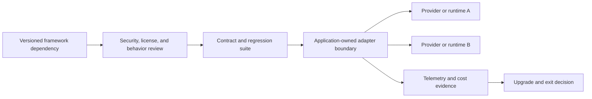
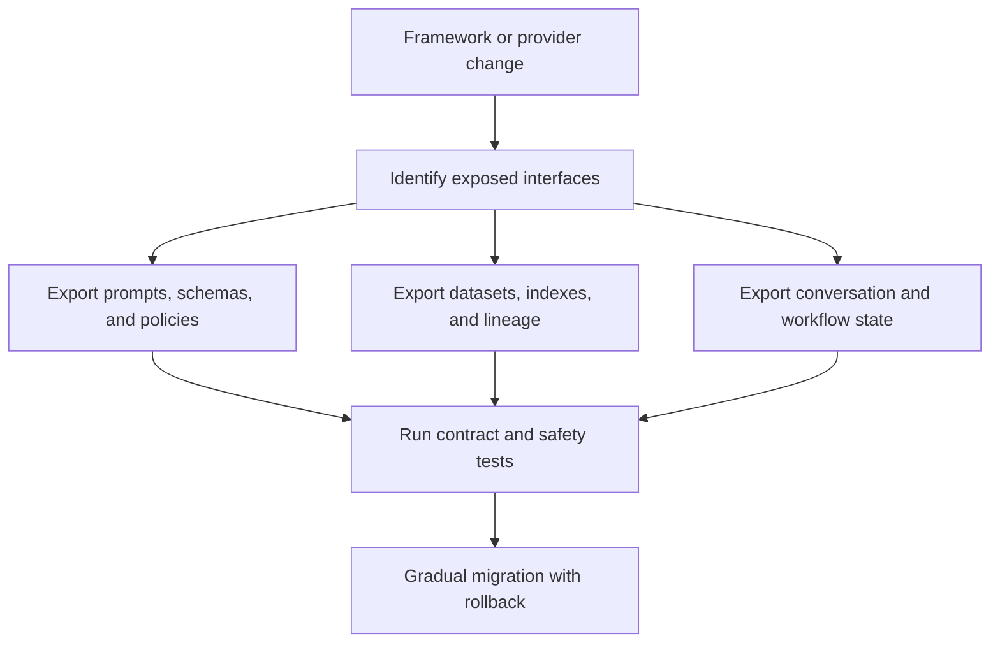
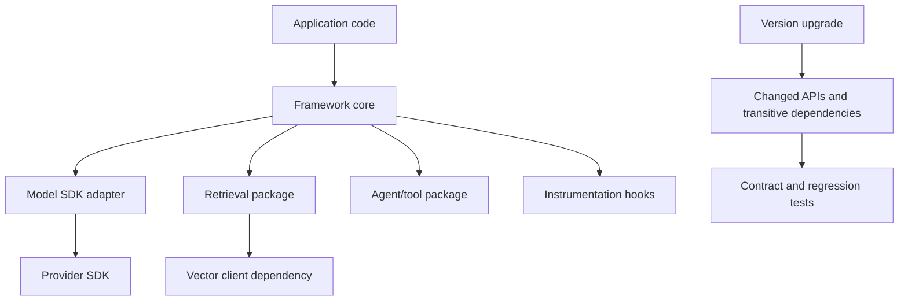

# AI Framework Ecosystem

Part: [16 — Artificial Intelligence, Machine Learning, and Generative AI](PART_OVERVIEW.md)

AI frameworks provide abstractions for model access, orchestration, retrieval, agents, evaluation, training, and deployment. They can accelerate implementation and standardize interfaces, but also add dependencies, hide control flow, constrain observability, and increase upgrade or exit cost. Choose frameworks by workload need and operational evidence rather than popularity alone.

This chapter compares software frameworks by abstraction and lifecycle fit. [CH27 — AI Infrastructure and Platform Components](CH27_AI_Infrastructure_and_Platform_Components.md) owns the distinct roles of inference engines, model servers, schedulers, registries, and platform components.

## Framework Roles and Layers

Frameworks operate at different layers: model SDKs call providers or local runtimes; orchestration libraries compose prompts and tools; retrieval frameworks manage ingestion and search workflows; training platforms track experiments and artifacts; serving systems manage inference. Similar product names may overlap without serving the same role.

Keep business policy and authorization in application-owned boundaries. A framework may help construct tool calls, but the service must still validate arguments, enforce permissions, and own side effects. Part 17 owns end-to-end AI architecture; this chapter compares implementation frameworks.

## Selection Criteria and Abstraction Costs

Assess supported models, APIs, local versus hosted execution, streaming, tool behavior, retrieval features, evaluation, observability, license, security posture, release cadence, and ecosystem maturity. Prototype the critical path rather than a happy-path demo. Measure latency, token usage, failure handling, and ability to access low-level provider features.

Abstractions reduce repeated code but can hide retries, token accounting, streaming, error types, or model-specific settings. Keep a path to inspect raw requests and responses with secrets redacted. Avoid wrapping every vendor feature into a lowest-common-denominator interface if doing so prevents a required capability; isolate provider-specific branches behind a narrow adapter.

A worked example of hidden retry cost: a framework's convenience wrapper retried failed completions up to three times with no application-visible signal, so a team's measured "model cost per successful response" was silently 2.4x higher than the token count of a single call would suggest, because roughly 60% of requests to one provider were failing transiently and being retried without being logged as distinct calls. Only after instrumenting the raw HTTP layer beneath the framework did the discrepancy between billed tokens and application-visible token counts become explainable, which is why cost dashboards should be built from provider billing data or raw request logs, not from the framework's self-reported call count.

Test the risky integration contract, not merely whether a demo returns text. Exercise timeout and cancellation behavior, structured-output failures, tool argument serialization, streaming termination, retry duplication, token accounting, and the ability to capture safe diagnostic metadata. Compare the framework path with a small direct-client baseline so abstraction cost and hidden behavior are visible. Pin which layer owns state: conversation history, agent checkpoints, retrieval configuration, and prompt serialization should not become inaccessible framework-owned data by accident. An exit plan should specify how to export those artifacts, recreate index and workflow state, and run a compatibility suite against the replacement.

A concrete failure-mode test worth running before adoption: disconnect the network mid-stream and check whether the framework's retry logic resubmits the full request (potentially duplicating a side-effecting tool call) or resumes cleanly. One widely used orchestration library's default retry wrapper was found, in exactly this kind of test, to re-invoke a tool-calling step rather than only the model call when a transient network error occurred mid-response — a difference invisible in a happy-path demo but consequential for any tool with a side effect, such as sending an email or charging a payment. Document the result and the library version tested, since default retry behavior can change between releases without a corresponding major-version bump.

## Versioning, Security, and Observability

Pin library and model versions where behavior changes affect output or data handling. Review dependency updates for license, network behavior, telemetry collection, and transitive dependencies. Frameworks that execute plugins or user-defined code need process and credential isolation. Instrument framework calls with request IDs, model identity, latency, token use, and error categories while protecting prompts and outputs.

Before a major upgrade, run golden-task and safety regressions, validate prompt serialization, inspect changed defaults, and compare cost and failure behavior. Preserve an exit plan: prompts, datasets, indexes, policies, and artifacts should be exportable or reproducible without depending on undocumented framework state.

## Worked Case and Review Checklist

A team evaluates an orchestration library for an internal support assistant with retrieval, read-only tools, streaming, and per-user access policy. It compares the library with a thin provider SDK and application-owned orchestration. The workload requires streaming cancellation, typed tool arguments, source references, and a way to inspect the serialized request without exposing secrets. A polished quick-start is not enough: the team builds a vertical test that includes an unavailable retriever, malformed model output, a provider timeout after partial streaming, and a denied tool call.

The library passes message construction and streaming tests but persists conversation state in a vendor-specific format and hides retry behavior. The thin SDK needs more application code but keeps identity, cancellation, and workflow state explicit. The team adopts a narrow adapter for provider serialization while retaining application ownership of authorization, retries, and state. It pins the dependency and model versions, stores prompts and schemas outside framework-private state, records token and failure telemetry, and tests export of conversation references and retrieval configuration before upgrading. These are the concrete exit artifacts; “portable API” alone would not prove the system can migrate.

Review framework role, critical features, abstraction visibility, extensibility, telemetry, secrets, license, version cadence, dependency tree, data export, provider portability, and exit cost. Confirm ownership for upgrades and incidents.

## Questions and Summary

1. Distinguish model SDK, orchestration, retrieval, training, and serving layers.
2. Which abstractions in a candidate framework hide operationally important behavior?
3. Design a provider adapter that preserves required features without coupling business policy.
4. Build an upgrade regression suite for an orchestration library.
5. Identify the data and configuration needed to exit a framework cleanly.

Frameworks are implementation choices with lifecycle and control-plane consequences. Select by workload fit, visible behavior, operational support, and portability. Keep domain policy outside framework magic, pin dependencies, test upgrades, and maintain an exit path proportional to lock-in risk.
