# AI Framework Ecosystem

Part: [16 — Artificial Intelligence, Machine Learning, and Generative AI](PART_OVERVIEW.md) · Status: Revised (in-depth rewrite)

## 1. Introduction

An AI application is rarely written against a model alone. Between the business requirement and the model API sit software layers that call providers, chain prompts, parse outputs, retrieve documents, run tool loops, record traces, evaluate quality, and sometimes train the model itself. Each layer has a library or framework that offers to do the work for you. The offers are real: a good library removes weeks of undifferentiated work. The costs are also real: every layer adds dependencies, hidden behavior, upgrade obligations, and ways to be locked in. A solution architect has to decide which layers to adopt, which to build, and where to put the boundary so that a later change of framework, provider, or model costs days instead of quarters.

This chapter treats frameworks as architectural components with a lifecycle, not as tutorials. It does not teach how to use any single library. It teaches how to see the ecosystem as layers, what each layer saves, what each layer costs, how to measure the cost, how to keep the option to leave, and how to make and document the decision.

### 1.1 Reader outcomes

After this chapter you should be able to:

1. Place any AI library on a layered map and say which job it does and which jobs it does not do, even when its marketing names a larger scope.
2. Name the specific costs of abstraction in a framework (hidden prompts, extra model calls, retries, debugging opacity, dependency weight) and measure them with a small benchmark.
3. List the dimensions of lock-in (application programming interface shape, data formats, state stores, tracing formats, provider features) and rate a candidate on each.
4. Plan for versioning and upgrade risk using pinning, deprecation tracking, and security patch cadence, and describe why 2025 and 2026 gave several concrete lessons.
5. Implement a no-framework baseline in the Python standard library: a provider-agnostic client, retry, structured output validation, a tool loop, and tracing hooks.
6. Design a provider adapter that acts as an anti-corruption layer, and test it with record and replay plus contract tests.
7. Run a build-versus-adopt decision with a weighted scoring matrix, hard gates, and sensitivity analysis.
8. Write an exit strategy with a migration path and an effort estimate.
9. Set governance for frameworks: an approved list, review steps, a software bill of materials (SBOM), and a security response routine.
10. Justify a stack choice for an internal assistant, including the alternatives you rejected.

### 1.2 Why this matters to a solution architect

Three facts make framework choice an architecture topic and not a developer preference.

First, the rate of change is high. Between 2023 and October 2026, the major orchestration libraries went through multiple breaking redesigns, one major cloud provider retired a product API on a published date, one major vendor merged two of its own agent frameworks into a third, and a widely used gateway library was hit by supply-chain attacks. Details appear in sections 7 and 8. A decision that looks safe for the length of a demo has to survive several of these events over a system life of three to five years.

Second, frameworks sit on the critical path of every request. A framework decides how many model calls a request makes, what text is added to the prompt, what is retried, what is logged, and where credentials live. Those are cost, latency, security, and reliability properties that the architect owns.

Third, frameworks are hard to remove once they hold data. Conversation state, vector indexes, trace history, evaluation datasets, and prompt files all acquire the framework's shape. The cheapest time to plan the exit is before the first line of production code.

### 1.3 Scope and ownership

This chapter owns the comparison of software frameworks by layer, abstraction cost, lock-in, and lifecycle. It recaps techniques that other chapters own and links to them.

| Topic | Owner | What this chapter does with it |
| --- | --- | --- |
| Prompt design and structured output techniques | [CH17 — Prompt Engineering and Structured Outputs](CH17_Prompt_Engineering_and_Structured_Outputs.md) | Compares libraries that implement the techniques. Does not teach the techniques. |
| Retrieval-augmented generation (RAG) pipeline design | [CH18 — RAG Architecture](CH18_RAG_Architecture.md) | Compares RAG frameworks. Does not teach chunking, ranking, or fusion. |
| Retrieval quality and RAG evaluation | [CH19 — Retrieval Quality and RAG Evaluation](CH19_Retrieval_Quality_and_RAG_Evaluation.md) | Notes evaluation library roles. |
| Fine-tuning, parameter-efficient fine-tuning (PEFT), and low-rank adaptation (LoRA) | [CH20 — Fine-Tuning, PEFT, and LoRA](CH20_Fine_Tuning_PEFT_and_LoRA.md) | Places training libraries on the map and covers their versioning risk. |
| Agents, tool calling, memory, planning | [CH21 — Agents, Tool Calling, Memory, and Planning](CH21_Agents_Tool_Calling_Memory_Planning.md) | Compares agent frameworks and SDKs. Does not teach agent design. |
| Model Context Protocol (MCP) | [CH22 — Model Context Protocol](CH22_Model_Context_Protocol.md) | Treats MCP as a portability mechanism for tools. |
| Evaluation, guardrails, hallucinations | [CH24 — Generative AI Evaluation, Guardrails, and Hallucinations](CH24_Generative_AI_Evaluation_Guardrails_and_Hallucinations.md) | Compares evaluation frameworks as software. |
| Vector stores | [CH26 — Vector Databases for AI Retrieval](CH26_Vector_Databases_for_AI_Retrieval.md) | Treats the vector client as a dependency. |
| Inference engines, model servers, schedulers, registries | [CH27 — AI Infrastructure and Platform Components](CH27_AI_Infrastructure_and_Platform_Components.md) | Marks the boundary and links. |
| Inference optimization and serving | [CH28 — Inference Optimization and Model Serving](CH28_Inference_Optimization_and_Model_Serving.md) | Marks the boundary and links. |
| Machine learning operations (MLOps) and large language model operations (LLMOps) | [CH29 — MLOps and LLMOps](CH29_MLOps_and_LLMOps.md) | Provides the lineage records that exit plans depend on. |
| End-to-end gateway, routing, and fallback architecture | [Part 17 CH08 — Model Gateway, Routing, and Fallback Architecture](../17_AI_Architecture/CH08_Model_Gateway_Routing_and_Fallback_Architecture.md) | Recaps the gateway as a framework layer. |
| End-to-end AI observability architecture | [Part 17 CH11 — Evaluation and Observability Architecture for AI Systems](../17_AI_Architecture/CH11_Evaluation_and_Observability_Architecture_for_AI_Systems.md) | Compares tracing libraries and the OpenTelemetry vocabulary. |

Part 17 composes these pieces into end-to-end architectures. This chapter supplies the component-level knowledge that Part 17 assumes.

### 1.4 A note on facts that drift

Library versions, maintenance status, and vendor product names change within months. Statements about the state of a framework in this chapter are marked "at the time of writing" and refer to October 2026, based on the project's own documentation where possible. Treat them as a snapshot and as an example of how to look the information up, not as a ranking. The method (check release notes, versioning policy, license, security advisories, and maintainers) outlasts the snapshot. Section 15.4 gives a one-page procedure.

## 2. Background: what frameworks are for

### 2.1 The work that every model-calling application repeats

Take the smallest useful generative AI feature: answer a customer question using internal documents. Even with one provider the code has to do all of the following.

1. Authenticate to the provider and set timeouts.
2. Build a request: messages, system instruction, sampling settings, tool definitions, response format.
3. Send it, handle transient failures with retry and backoff, and honor rate-limit headers.
4. Stream partial tokens to the user and handle cancellation.
5. Parse the response: text, tool-call requests, finish reason, token usage.
6. Validate any structured output against a schema and repair or reject it.
7. Run tools the model asked for, check arguments, enforce permissions, return results.
8. Repeat from step 2 until the model stops or a step limit is reached.
9. Retrieve documents before the first call, and cite them after the last.
10. Record what happened in a form that supports debugging, cost accounting, and audit.
11. Evaluate answer quality before and after changes.

Frameworks exist because every team writes these steps and most teams write them slightly wrong at first. The value of a framework is the expected number of defects and engineer-days that you avoid by not writing the step yourself. The cost is everything that comes along with the code you did not write.

### 2.2 A short history of why the ecosystem is crowded

The crowding has a causal explanation that helps predict which parts will persist.

- **2022 to 2023: the glue era.** Large language model (LLM) APIs arrived with a single completion endpoint. Early libraries such as LangChain and LlamaIndex packaged prompt templates, chains, and document loaders. They were valuable because there was little else, and they grew by adding integrations rapidly.
- **2023 to 2024: the abstraction reckoning.** Teams that took the chain abstractions into production reported hidden prompts, hard-to-debug call stacks, and breaking changes. The response was a split: lower-level, explicit runtimes (graph-based state machines) on one side, and thin typed libraries on the other.
- **2024 to 2025: providers add the loop.** Providers added native tool calling, structured outputs, and then hosted agent runtimes and agent SDKs. Several jobs that third-party libraries performed moved into first-party SDKs. The Model Context Protocol ([CH22](CH22_Model_Context_Protocol.md)) standardized how tools are described and served.
- **2025 to 2026: consolidation and churn.** Major vendors consolidated their own frameworks, stabilised first major versions, and retired products. Observability moved toward OpenTelemetry vocabulary. Supply-chain incidents showed that AI infrastructure libraries concentrate credentials.

The pattern is that layers close to a stable, universal need (HTTP client for a model, schema validation, tracing) converge and get absorbed into standards or provider SDKs, while layers that encode a design opinion about how to structure applications (chains, agent teams, memory abstractions) churn faster.

### 2.3 A definition that avoids confusion

Throughout this chapter:

- A **library** is code you call. You control the main loop.
- A **framework** is code that calls you. It owns control flow and you fill in hooks. The boundary is a spectrum, and many AI libraries are libraries in some modules and frameworks in others.
- A **runtime** executes a program you define (for example, a graph of steps) and gives it durable state, retries, and streaming.
- A **gateway** or **proxy** is a network service or in-process router that presents one interface to several providers.
- A **platform** is a hosted product with a console and managed state. Platforms are lock-in by design and are covered under lock-in dimensions.

The more control flow a component owns, the more it can save you and the more it can hide from you. That trade runs through the rest of the chapter.

## 3. The layered map of the ecosystem

The ecosystem is easier to reason about as twelve layers. Many products straddle two or three. The point of the map is to ask, for each product, which layer's job it is doing for your system today.

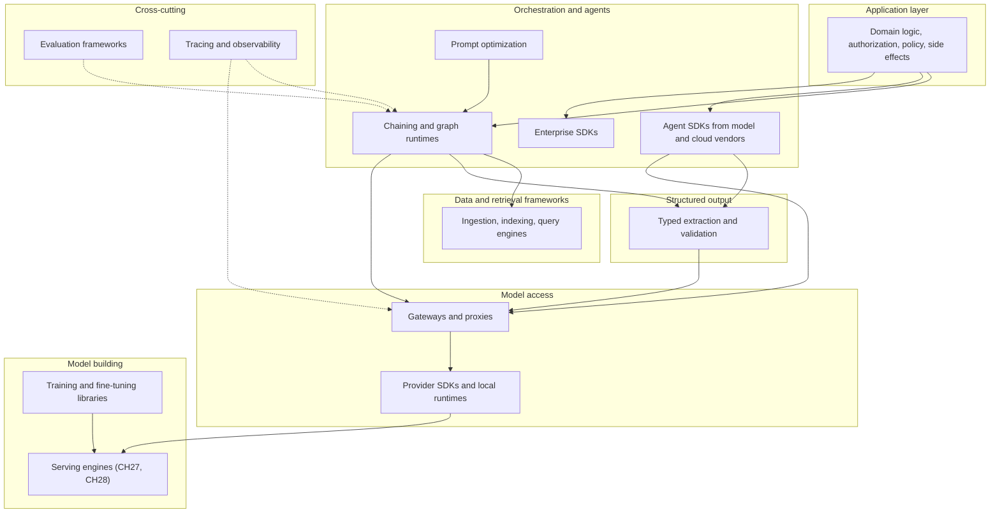

The diagram places the application on top and the model on the bottom. Orchestration, retrieval, and structured output libraries sit in the middle and all route model calls through an access layer. Evaluation and tracing attach to many layers with dotted lines because they observe rather than command. The training libraries feed the serving engines that the access layer eventually reaches when a model is self-hosted. The practical implication is that the access layer, a narrow band, is the best place for an application-owned boundary (section 10), because everything above it needs a model call and everything below it varies by provider.

### 3.1 Layer 1: Provider and local-runtime SDKs

**What it does.** A provider SDK wraps one vendor's HTTP API in typed client objects. It handles authentication, request serialization, response parsing, streaming events, pagination, and often retries and timeouts. Examples at the time of writing include the official Python and TypeScript SDKs from OpenAI, Anthropic, Google, and the cloud providers (for example, the AWS SDK for Amazon Bedrock and the Azure SDKs). Local runtime clients (for engines served by the tools in [CH27](CH27_AI_Infrastructure_and_Platform_Components.md)) often expose an OpenAI-compatible HTTP endpoint, so the same client works with a different base URL.

**Work saved.** Hand-writing HTTP, server-sent events (SSE) parsing, and request schemas for each provider. Typed models for responses. Provider-specific error classes. Usually a week for the first provider and a few days for each additional one if you write your own client, and almost nothing if you use the official SDK.

**Costs.** The SDK is tied to one vendor's data model. Feature flags land first in the vendor's SDK and last, if ever, in cross-provider libraries. SDK major versions follow the vendor's API evolution. When a vendor retires an API generation, the SDK's old surface disappears with it.

**A concrete example of lifecycle risk.** OpenAI's Assistants API was deprecated in 2025 with removal published for August 26, 2026, and the Responses API was designated as its replacement. The [OpenAI migration guide](https://developers.openai.com/api/docs/assistants/migration) maps Assistants to Prompts, Threads to Conversations, Runs to Responses, and Run steps to Items. Third-party reports at the time note that the vendor does not ship an automated tool for moving existing thread history, so applications that stored conversation state in vendor-hosted threads have to write their own backfill. Verify the current status on the vendor's page before relying on this account. The lesson does not depend on the exact dates: vendor-hosted state is a dependency with an end date you do not control.

**When the layer is enough.** Single provider, single model family, a short tool loop, no need for cross-provider fallback, and a team willing to own retry, validation, and tracing. This is the "direct SDK plus own glue" option in the scoring matrix of section 13.

### 3.2 Layer 2: Gateways and proxies

**What it does.** A gateway exposes one stable interface (most often an OpenAI-compatible chat endpoint) and routes to many providers. A proxy can run in process as a library or as a standalone service. It usually adds key management, per-team budgets, rate limits, fallbacks, caching, and request logging. Examples at the time of writing are LiteLLM (a Python library and proxy server), OpenRouter (a hosted router), Portkey, Cloudflare AI Gateway, and gateways bundled with cloud platforms. [Part 17 CH08](../17_AI_Architecture/CH08_Model_Gateway_Routing_and_Fallback_Architecture.md) owns the gateway architecture; this chapter treats the gateway as a dependency.

**Work saved.** Provider-specific request translation, a single place for credentials, usage accounting across teams, and failover.

**Costs.**

- A lowest-common-denominator interface. Provider features that do not map to the common schema (extended thinking controls, prompt-cache directives, built-in provider tools, citations, batch endpoints) either need pass-through fields or are lost.
- A concentration of secrets. A gateway holds keys for every provider, so a compromise of the gateway package or its host exposes all of them. Section 8.2 describes two LiteLLM incidents in 2026 that illustrate this.
- An added network hop when run as a service, usually a few milliseconds on a private network.
- A second layer of retry and timeout semantics that can multiply with the client's own (section 5.3).

**Rule of thumb.** A gateway is worth its weight when more than one team or more than one provider is involved, and when someone is accountable for its operation and patching. For a single team on one provider it is usually an unnecessary layer.

### 3.3 Layer 3: Orchestration and chaining libraries

**What it does.** These libraries compose prompt templates, model calls, retrievers, tools, and output parsers into a workflow. Two design families dominate.

- **Chain-style composition**, where steps are connected with a composition operator and data flows through the chain. This is quick to write and hard to debug when a step does something unexpected.
- **Graph or state-machine runtimes**, where you define nodes, edges, and an explicit state object, and the runtime executes the graph with persistence, retries, streaming, and human-in-the-loop interrupts. This is more code up front and much easier to reason about.

**LangChain and LangGraph.** At the time of writing, LangChain and LangGraph have both reached 1.0 releases (announced in the [LangChain and LangGraph 1.0 post](https://www.langchain.com/blog/langchain-langgraph-1dot0)). According to the [LangChain v1 release notes](https://docs.langchain.com/oss/python/releases/langchain-v1), the `langchain` package namespace was reduced to the building blocks for agents, with older chain-style functionality moved to a separate `langchain-classic` package. The [LangGraph v1 notes](https://docs.langchain.com/oss/python/releases/langgraph-v1) describe a stability-focused release that keeps the core graph APIs. The project's [versioning policy](https://docs.langchain.com/oss/python/versioning) states that stable APIs keep backward compatibility within a major version and that breaking changes arrive in major releases. This is a healthy policy, and it is also a reminder that between 2023 and 2025 the project shipped many 0.x releases in which breaking changes were allowed. A team that built on early versions paid for that.

**Work saved.** Graph execution, checkpointing, streaming, conditional edges, human interrupts, and a large catalogue of integrations. For agent workflows with branching and long-running state this is real work that a team would otherwise rebuild.

**Costs.** Large dependency trees (section 5.6), a framework-owned state schema, and prompts or instructions you did not write in some prebuilt components. Integration packages vary in quality and maintenance. The project's own history of splitting `langchain`, `langchain-core`, `langchain-community`, and `langchain-classic` shows the integration surface is hard to keep stable.

### 3.4 Layer 4: Data and retrieval frameworks

**What it does.** Ingestion (loaders and parsers for files, databases, and web sources), chunking, embedding calls, vector-store writes, query engines, rerankers, and evaluation helpers. [CH18](CH18_RAG_Architecture.md) owns the pipeline design and [CH26](CH26_Vector_Databases_for_AI_Retrieval.md) owns the stores. LlamaIndex centers on data connectors and an event-driven Workflows runtime. Haystack, from deepset, centers on an explicit pipeline graph of typed components that can be serialized. At the time of writing, LlamaIndex core is on a 0.14 line and Haystack is on a 2.x line (verify with the projects' release pages; some secondary sources mention a Haystack 3.0 rewrite, which this chapter could not confirm from the project's own documentation).

**Work saved.** Document parsers, connectors to dozens of sources, chunkers, and ready query pipelines. The ingestion side saves the most, because the long tail of file formats and source systems is tedious.

**Costs.** Index and metadata formats become framework-shaped. A vector index built through a framework's wrapper may store chunk text and metadata under the framework's field names. If the vector store is queried directly by another service, these names become a hidden contract. The retrieval query path is where hidden prompts and extra model calls (query rewriting, sub-question decomposition) most often appear.

**Rule of thumb.** Adopt a retrieval framework for ingestion and parsing sooner than for the query path. The query path is short and its behavior matters for quality, so write it yourself or review the framework's implementation line by line.

### 3.5 Layer 5: Enterprise SDKs

**What it does.** These are software development kits from large vendors that fit models into enterprise languages and conventions: dependency injection, plug-in registries, telemetry hooks, and support commitments. Semantic Kernel from Microsoft is the best-known example. At the time of writing, Microsoft states that Microsoft Agent Framework reached general availability (1.0) in April 2026 as the successor to both Semantic Kernel and AutoGen, with Python and .NET support ([build announcement](https://devblogs.microsoft.com/agent-framework/microsoft-agent-framework-at-build-2026-announce), [AutoGen migration guide](https://learn.microsoft.com/en-us/agent-framework/migration-guide/from-autogen/)). Reports indicate Semantic Kernel v1 continues to receive critical bug and security fixes during the transition. Verify the support window on the Microsoft pages before planning around it.

**Lesson.** An enterprise vendor SDK offers support contracts and long-term stability in principle, and the same vendor can merge or replace the SDK. Within eighteen months, a team adopting "the Microsoft agent framework" could have used AutoGen, Semantic Kernel, or Agent Framework, each with a different programming model. The migration cost fell on the adopters. A vendor SDK reduces the risk of abandonment and does not remove the risk of redesign.

Other enterprise-oriented SDKs follow similar patterns: Spring AI for Java (a 2.0.0 GA release was announced in June 2026 on the [Spring blog](https://spring.io/blog/2026/06/12/spring-ai-2-0-0-GA-available-now)), and LangChain4j for the Java Virtual Machine ecosystem.

### 3.6 Layer 6: Agent SDKs from model providers and cloud vendors

**What it does.** First-party SDKs package a tool-using loop with the vendor's models: tool registration, guardrail hooks, handoffs between agents, tracing, and sometimes sandboxed code or file tools. At the time of writing the main ones are the OpenAI Agents SDK, the Claude Agent SDK from Anthropic, Google's Agent Development Kit (ADK), and Strands Agents from AWS. Cloud platforms also offer hosted agent runtimes (for example Amazon Bedrock AgentCore and similar offerings from other clouds), which add managed state, identity, and deployment.

**Work saved.** The inner agent loop, tool schema generation from code, model-specific prompting defaults, and often tight integration with the vendor's best features (for example, built-in tools, long-running tasks, or reasoning controls). These SDKs give the most direct access to provider features, because the same company writes both.

**Costs.** Alignment with one vendor, though several advertise support for other models. A fast release cadence: in the first eleven days of October 2026, according to one trade report, the Claude Agent SDK, OpenAI Agents SDK, and Google ADK each shipped new versions, and these are still 0.x or recently renumbered lines in several cases. A hosted runtime moves state and execution to the vendor. OpenAI's own statement that it is winding down its Agent Builder and Evals products on November 30, 2026, and recommending the Agents SDK for code-defined workflows ([announcement update](https://openai.com/index/introducing-agentkit)), is a fresh example of platform products having shorter lives than code libraries.

**Rule of thumb.** Prefer code-first SDKs to console-defined agents. Code is reviewable, testable, and exportable. A workflow that exists only as configuration in a vendor console has to be rebuilt from scratch when the console changes.

### 3.7 Layer 7: Programmatic prompt optimization

**What it does.** DSPy (from Stanford NLP and now a community project) treats an LLM program as modules with typed signatures (inputs and outputs) and compiles it against a metric. An optimizer searches over instructions and few-shot examples. At the time of writing DSPy is on a 3.x line and its documentation highlights GEPA (Genetic-Pareto), a reflective prompt optimizer described by Agrawal et al. (2025) in "GEPA: Reflective Prompt Evolution Can Outperform Reinforcement Learning" (arXiv 2507.19457). [CH17](CH17_Prompt_Engineering_and_Structured_Outputs.md) owns prompt engineering; this chapter recaps only the framework consequence.

**Work saved.** Manual prompt iteration, if you have a labeled development set and a metric that captures quality. The optimizer treats prompts as parameters.

**Costs.** It needs an evaluation set and a metric you trust ([CH24](CH24_Generative_AI_Evaluation_Guardrails_and_Hallucinations.md)). Optimization runs consume model calls, and the compiled program is an artifact tied to a model and a library version. When the model changes, you re-run the optimization. The prompts the optimizer writes are real prompts that the team should read, store, and review like code. The compiled artifacts are therefore a lock-in dimension to track: save them in a plain text format outside the library's cache.

**Fit.** DSPy is a good fit where quality on a measurable task matters and the team has data. It is a poor fit where the metric is subjective and no evaluation set exists.

### 3.8 Layer 8: Structured-output libraries

**What it does.** These libraries turn model output into typed objects. They define a schema (usually with Pydantic in Python or Zod in TypeScript), request structured output from the provider or fall back to prompt-based JSON, validate the result, and retry with the validation error when it fails. Examples at the time of writing are Instructor (a long-lived, widely downloaded library whose scope is narrow) and Pydantic AI (an agent framework from the Pydantic team). [CH17](CH17_Prompt_Engineering_and_Structured_Outputs.md) owns the techniques (constrained decoding, schema design, repair loops).

**Pydantic AI versioning as an example of explicit policy.** The project reached V1 in September 2025 with a commitment not to break user code until V2, and its documentation at the time of writing says V2 shipped in June 2026 ([version policy](https://pydantic.dev/docs/ai/project/version-policy/)). An explicit policy with dates is what you should ask of every dependency. Note too that a major version arrived within nine months of V1, so plan for a major bump inside a year even from a project that keeps its promises.

**Work saved.** Schema generation, validation, and the repair loop. A structured-output library is often the highest-value, lowest-cost adoption, because its scope is small, its failure modes are visible (a validation error), and the application's own types are the schema.

**Costs.** Retries are model calls that you pay for (each repair attempt re-sends the conversation plus the error). Use a retry cap and record the count, as the baseline in section 9 does.

### 3.9 Layer 9: Evaluation frameworks

**What it does.** Evaluation libraries run test cases against your application, compute metrics (exact match, semantic similarity, model-graded rubrics, retrieval metrics), and store results for comparison. Examples at the time of writing include Ragas, DeepEval, promptfoo, Inspect from the UK AI Security Institute, OpenAI Evals-style harnesses, and the evaluation features of tracing platforms. [CH24](CH24_Generative_AI_Evaluation_Guardrails_and_Hallucinations.md) and [CH19](CH19_Retrieval_Quality_and_RAG_Evaluation.md) own the metrics and the statistics.

**Framework consequences.** The metric implementation is code you rely on to make release decisions, so its details matter: which judge prompt, which model, which aggregation. A silent change to a judge prompt in a library upgrade moves your scores without any change to your system. Pin the version, store the judge prompt and judge model identifier with each score, and compare scores across runs only when both are unchanged. The OpenAI Evals product wind-down noted above is another reminder to keep datasets and metric code outside any hosted console.

### 3.10 Layer 10: Observability and tracing

**What it does.** Tracing libraries and platforms record each model call, tool call, retrieval, and agent step with inputs, outputs, latency, token counts, and cost. Commercial and open-source platforms exist (for example LangSmith, Langfuse, Arize Phoenix, Pydantic Logfire, Datadog LLM Observability, and others). Most accept OpenTelemetry (OTel) traces. OpenTelemetry's generative AI semantic conventions define attribute names such as `gen_ai.operation.name`, `gen_ai.request.model`, and token usage attributes for spans, metrics, and events.

**The stability caveat.** At the time of writing, the OpenTelemetry [generative AI span conventions](https://github.com/open-telemetry/semantic-conventions/blob/main/docs/gen-ai/gen-ai-spans.md) carry a Development status, which in the OpenTelemetry maturity scheme means names can still change. Secondary reports in 2026 also describe instrumentation libraries that disagree on several attributes. Treat the conventions as the best available vocabulary, emit them through a thin layer that you own so a rename is a one-file change, and verify the current status in the repository.

**Work saved.** A trace viewer, cost aggregation, and a place to turn failures into evaluation cases. See section 12 for what each approach lets you see.

### 3.11 Layer 11: Training and fine-tuning libraries

**What it does.** These are libraries for building and adapting models: PyTorch and JAX at the array and automatic-differentiation level; Hugging Face Transformers for model definitions and loading; PEFT for adapter methods such as LoRA; TRL for post-training methods such as supervised fine-tuning and preference optimization; Accelerate and DeepSpeed-style libraries for distributed training. [CH20](CH20_Fine_Tuning_PEFT_and_LoRA.md) owns when and how to fine-tune. [CH27](CH27_AI_Infrastructure_and_Platform_Components.md) owns the platform pieces around them.

**Version coupling.** Hugging Face states that Transformers v5 was a major release with more than three million daily installs ([release post](https://huggingface.co/blog/transformers-v5)), and community reports note that v5 removed TensorFlow and Flax support and renamed some arguments. Practitioners also describe the Hugging Face stack (transformers, datasets, accelerate, huggingface_hub, peft, trl) as libraries that move together, so tutorials silently assume one snapshot. A training job that worked last quarter can fail after an unpinned upgrade of any one of them. The fix is a locked environment (a lock file or container image digest) recorded in the experiment lineage of [CH29](CH29_MLOps_and_LLMOps.md).

**Lock-in.** Low in the sense that model weights in standard formats are portable, and moderate in the sense that training scripts embed library-specific configuration. The artifact, not the script, is the thing to keep portable.

### 3.12 Layer 12: Serving engines

Serving engines such as vLLM, Hugging Face Text Generation Inference, NVIDIA Triton and TensorRT-LLM, SGLang, and llama.cpp turn model weights into an endpoint. They are not orchestration frameworks, and putting them on the same decision matrix as LangChain is a category error. [CH27](CH27_AI_Infrastructure_and_Platform_Components.md) covers their roles and [CH28](CH28_Inference_Optimization_and_Model_Serving.md) covers batching, quantization, and speculative decoding. From the framework perspective, what matters is the interface they expose (usually an OpenAI-compatible HTTP endpoint) and the fact that this interface is the seam where a hosted provider and a self-hosted model become interchangeable.

The count matters less than the habit: when someone says "we use LangChain" or "we use LiteLLM", ask which of these jobs the component is doing in your system, which it is not doing, and who owns the rest.

## 4. What each layer actually saves

Before counting costs, estimate the benefit honestly. A framework earns its place by the engineering effort it removes, net of the effort to learn, integrate, debug, and upgrade it. The table below gives illustrative effort estimates for a competent backend engineer who has not built the component before. They are planning assumptions from the author's experience of typical teams, not measurements from a study. Replace them with your own team's numbers.

| Capability | Build it yourself (engineer-days) | What a good library removes | What remains yours |
| --- | --- | --- | --- |
| Single-provider client with typed responses | 3 to 5 | Almost all of it (use the official SDK) | Timeouts, error mapping |
| Retry with backoff, jitter, retry budget | 1 | Most of it | Deciding what is safe to retry |
| Streaming with cancellation | 2 to 4 | Event parsing | Backpressure, user cancellation semantics |
| Structured output with validation and repair | 2 to 3 | Schema generation, validation, repair loop | Schema design, retry caps |
| Tool loop with schema generation | 3 to 5 | Schema from function signatures, loop | Authorization, argument checks, side-effect safety |
| Multi-provider routing with fallback | 5 to 10 | Request translation per provider | Policy: which fallback is acceptable |
| Document ingestion for 10 file formats | 15 to 30 | Parsers, loaders, chunkers | Access control metadata, quality checks |
| Graph runtime with checkpointing and interrupts | 15 to 25 | Persistence, resumption, streaming | State schema, idempotency of nodes |
| Trace capture with viewer | 10 to 20 | Viewer, storage, cost roll-ups | What to redact, retention |
| Evaluation harness with judge prompts | 5 to 10 | Runners, caching, report | Dataset, rubric, judge validation |
| Prompt optimization loop | 10 to 20 | Search over instructions and examples | Metric, dataset |

Two patterns stand out. The first is that the high-value rows (ingestion, graph runtime, trace viewer) are large and have well-defined edges, so they are the best adoption candidates. The second is that the cheap rows (client, retry, validation, a simple loop) cost one to five days each. A team can write all four in under three weeks. Adopting a large framework to avoid those four rows trades three weeks of well-understood work for a permanent dependency on a design opinion.

The last column of the table is the part frameworks never remove. Authorization, side-effect safety, data access control, and retention policy remain the application's responsibility ([CH21](CH21_Agents_Tool_Calling_Memory_Planning.md) covers tool authorization; [Part 17 CH12](../17_AI_Architecture/CH12_AI_Safety_Security_Privacy_and_Governance_Architecture.md) covers governance architecture). A framework that implies otherwise is overselling.

### 4.1 Break-even reasoning

A simple model helps decide. Let $B$ be the effort to build the capability, $L$ the effort to learn and integrate the framework, $M$ the yearly maintenance effort of the build (bug fixes, provider changes), $U$ the yearly effort of upgrades and incident response for the framework, and $T$ the planning horizon in years. Adopt when

$$
L + T\,U < B + T\,M .
$$

Worked numbers for a structured-output capability: $B = 3$ days to build, $M = 2$ days per year for provider changes, $L = 1$ day to learn a small typed library, $U = 1$ day per year to read release notes and bump the version. For $T = 3$ years the left side is $1 + 3 \times 1 = 4$ days and the right side is $3 + 3 \times 2 = 9$ days, so adopting the small library wins by 5 days. For a large orchestration framework used only to run a four-step loop: $B = 4$, $M = 2$, $L = 8$ days to learn the abstractions, $U = 6$ days per year (the major version changes, integration package bumps, and security advisories take longer to track). The left side is $8 + 18 = 26$ days against $4 + 6 = 10$ days on the right, so building wins by 16 days. The same inequality reverses when the capability is large: for a graph runtime with checkpointing, $B = 20$, $M = 6$, $L = 6$, $U = 5$, giving $6 + 15 = 21$ against $20 + 18 = 38$, so adopting wins by 17 days.

The model hides two things, and both belong in the decision. It ignores risk: a rare supply-chain event costs far more than the average upgrade day, and section 8 prices it separately. It also ignores option value: a build leaves you owning a component you can modify, and an adoption leaves you able to take advantage of community improvements. Use the model to sort candidates, then use the scoring matrix of section 13 to decide.

## 5. The cost of abstraction

An abstraction is a promise that you do not need to know what is below it. In AI frameworks that promise is routinely broken in specific, predictable ways. Knowing the ways lets you test for them before adoption.

### 5.1 Leaky abstractions at the provider boundary

A unified chat interface assumes that providers differ only in syntax. They also differ in semantics.

- **Message structure.** Some providers accept a separate system parameter, others a system-role message. Some require strict alternation of user and assistant roles, others do not. A framework must either normalize (and sometimes rewrite your messages) or pass through (and the call fails on some providers).
- **Tool calling.** Tool-call arguments arrive as a JSON string with one provider and a parsed object with another. Parallel tool calls, forced tool choice, and tool-result formats differ. Partial JSON in streaming differs again.
- **Structured output.** A provider may support schema-constrained decoding natively, only JSON mode, or neither. The subset of JSON Schema supported differs (for example, restrictions on optional fields, recursion, or numeric bounds). A schema that works on one provider can be rejected by another.
- **Reasoning and thinking controls.** Parameters for reasoning effort or thinking budgets, and how reasoning content is returned and billed, are provider-specific and change frequently.
- **Prompt caching.** Some providers cache automatically by prefix, others need explicit cache markers. A framework that rebuilds the prompt with a changing prefix (a timestamp or a reordered tool list) can destroy the cache hit rate without any error.
- **Finish reasons and refusals.** Names and semantics differ: a length cutoff, a content filter, a refusal, a tool request, and a normal stop are not reported uniformly.
- **Token accounting.** Cached, reasoning, and tool-schema tokens are counted and billed in different ways.

The framework's response to each difference is one of three: normalize (lose information), pass through (leak the difference), or pick one provider's semantics (break on others). None is free. Run a contract suite (section 11) that exercises each difference for each provider you actually use.

### 5.2 Hidden prompts and extra model calls

Two behaviors cause most of the surprise on invoices and in output quality.

**Hidden prompts.** Prebuilt agents, query engines, output parsers, and memory modules include instruction text that the application author did not write. Examples of what such text can contain: a default system prompt, format instructions appended to every call, a summarization prompt used to compress memory, a question-rewriting prompt in a conversational retrieval chain, and a "reflect on your answer" prompt in a self-correction loop. This text changes with library versions. It consumes tokens on every call, steers behavior in ways you did not test, and can conflict with your own instructions.

**Extra model calls.** Some features make additional calls without being obvious in the code you write: query rewriting before retrieval, sub-question decomposition, reranking with a model, conversation summarization when memory grows, validation-repair retries, self-reflection steps, and tool-routing calls. Each is a billed, latency-adding request.

The sequence below shows a retrieval question that looks like one call to the application.

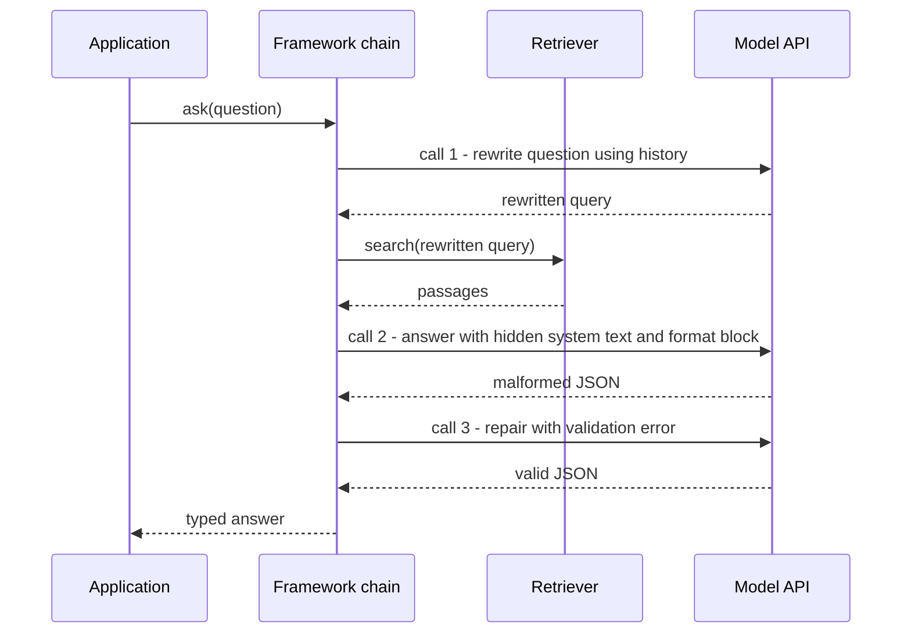

The application issues one call and the provider receives three. Call 1 adds input and output tokens plus a round trip before retrieval can start. Call 2 includes text the team never wrote. Call 3 re-sends the conversation plus the error. If the framework also retries transient failures inside each step, the count grows. The implication is that cost and latency estimates based on "one call per request" understate reality by a factor that depends on configuration, and that only a trace of provider-level requests shows the real number. Section 5.5 measures the effect with the repository's benchmark.

### 5.3 Compounding retries and timeouts

Retries are a common source of silent cost and sometimes of correctness bugs. The layers that can retry in one request path are: the provider SDK, the framework's model wrapper, the framework's step runner, the gateway, the application, and the job queue. Each may be configured with its own count and timeout.

If each of $k$ layers allows $n_i$ attempts, the worst-case number of provider requests for one user action is

$$
N_{\max} = \prod_{i=1}^{k} n_i .
$$

Worked example: the provider SDK retries 2 times (3 attempts), the framework wrapper allows 3 attempts, and the gateway allows 2 attempts. Then $N_{\max} = 3 \times 3 \times 2 = 18$ provider requests for one logical call. At a transient error rate during an incident of 60 percent per request, the expected attempts at a single layer capped at $n$ attempts is $(1 - p^n)/(1 - p)$. For one layer with $p = 0.6$ and $n = 3$ this is $(1 - 0.216)/0.4 = 1.96$. With three nested layers the multiplication can reach several times that and also amplifies load on a provider that is already struggling, which makes the incident longer. Rate-limit responses (HTTP 429) are the worst case, because retries by every layer add to the load that caused the limit.

There is also a correctness dimension. Retrying a pure model call is safe, since the same request can be sent again and only costs tokens. Retrying a step that has executed a side-effecting tool is not safe unless the tool is idempotent. A framework whose retry wrapper re-runs a whole step that includes tool execution can send an email or charge a payment twice. When evaluating any framework, test where the retry boundary lies: disconnect the network after the model response arrives and before the tool result is recorded, and see what is re-executed. Record the framework version tested, since retry defaults can change in minor releases.

Design rules that follow:

1. Pick exactly one layer to own retries for model calls, and set the others to zero.
2. Never retry a side-effecting tool call automatically. Give tool calls idempotency keys and let the tool decide ([CH21](CH21_Agents_Tool_Calling_Memory_Planning.md)).
3. Put a retry budget on the request, not only on each call. For example, no more than 4 provider attempts and 20 seconds in total for one user turn.
4. Log every provider attempt as its own record with an attempt number, so that billed tokens can be reconciled with application-visible tokens.

### 5.4 Debugging opacity

When a chain gives a wrong answer, the first question is "what exactly was sent to the model?". In frameworks that build prompts through several layers of templates, message transformers, and callbacks, the answer is not in the code you read. It exists only at runtime, at the HTTP boundary. Symptoms of opacity:

- The stack trace of a failure runs through ten framework frames, none of which are yours.
- Setting a verbose or debug flag prints a truncated or pretty-printed version of the prompt, not the bytes sent.
- Callbacks fire in an order that is hard to predict, and a callback that raises can suppress the real error.
- Streaming errors surface late and out of context.
- Asynchronous code hides which task issued which request.

The remedy is a capability, not a style preference: the system must be able to capture, with secrets redacted, the exact provider request and response for any production request that the operator chooses to inspect. Test it at selection time. If the only path to the raw request is a framework-specific debug mode, the architecture depends on that mode forever. Prefer the HTTP-level hook (an HTTP client event hook or a transport wrapper) or an OpenTelemetry instrumentation of the provider SDK, since those sit below the framework.

### 5.5 Measuring token and latency overhead

The following results come from the benchmark script [`02_abstraction_overhead.py`](../code/python/ai-frameworks-chapter/02_abstraction_overhead.py). All sizes are illustrative assumptions set in a configuration dictionary at the top of the script, so you can replace them with numbers measured from your own traces.

**Part A: tokens and cost.** The direct path sends a 200-token user input and a 300-token application system prompt (500 input tokens) and receives 250 output tokens. The layered path adds a 150-token hidden system prompt, a 120-token format-instruction block, and a query-rewrite call with 250 input and 30 output tokens. It also retries transient failures at a rate of 10 percent per attempt, capped at 3 attempts, and the failing attempt is billed for its input.

The expected number of attempts is $(1 - 0.1^3)/(1 - 0.1) = 0.999/0.9 = 1.11$. The main call's input is $500 + 150 + 120 = 770$ tokens, multiplied by 1.11 attempts gives 854.7 tokens, and the rewrite call adds 250 for 1,104.7 input tokens. Output is $250 + 30 = 280$ tokens. At illustrative prices of 3.00 dollars per million input tokens and 15.00 dollars per million output tokens, the direct path costs $500 \times 3 / 10^6 + 250 \times 15 / 10^6 = 0.0015 + 0.00375 = 0.00525$ dollars. The layered path costs $1104.7 \times 3 / 10^6 + 280 \times 15 / 10^6 = 0.003314 + 0.0042 = 0.007514$ dollars. The script prints:

```text
Part A: token and cost amplification (illustrative)
  direct   : in=500 out=250 calls=1.00 cost=$0.005250
  layered  : in=1104.7 out=280 calls=2.11 cost=$0.007514
  input-token ratio: 2.21x   cost ratio: 1.43x
  expected attempts at p=0.1: 1.110
```

Input tokens more than double, the cost rises by 43 percent, and the expected number of provider calls is 2.11 instead of 1. Because output tokens are priced higher and change little, the cost ratio is smaller than the input-token ratio. For a workload where input dominates (long retrieved context), the ratio moves closer to the input ratio. At a million requests per month the difference is $7{,}514 - 5{,}250 = 2{,}264$ dollars per month under these assumptions, which may or may not matter. The point of the exercise is that you can compute it only if you know the hidden pieces.

**Part B: in-process cost.** The script wraps a no-op provider in a layer that builds message objects, deep-copies payloads, and fires three callbacks per phase. On the author's workstation, the median of five runs was 0.11 microseconds for the direct call and 8.65 microseconds for the layered call, an addition of about 0.0085 milliseconds. Against an 800 millisecond model call this is 0.0011 percent. Your numbers will differ, and the conclusion generalizes: in-process framework CPU overhead is almost never the latency problem for model calls. The latency problems are extra network round trips (the rewrite call above adds a full model latency before retrieval starts), serial steps that could run in parallel, and larger prompts that raise time to first token. Large frameworks can also add import time and memory. Cold-start of a function-as-a-service deployment that imports a heavy dependency tree can cost hundreds of milliseconds to seconds, which matters for serverless workloads and not for long-lived services. Measure import time with `python -X importtime` in your own environment.

**What this implies.** Do not reject a framework for CPU overhead. Reject or configure it for call count, token count, serial dependencies, and opaque retries. Compare candidates with a trace of provider-level requests on a representative task, recording calls per request, input tokens, output tokens, time to first token, and total time.

### 5.6 Dependency weight

A dependency is code you run, patch, and are liable for. The number of transitive packages is a proxy for the surface of that obligation. The script [`03_scoring_and_dependencies.py`](../code/python/ai-frameworks-chapter/03_scoring_and_dependencies.py) includes a transitive-closure function and an illustrative graph. The graph mirrors typical shapes and is not a measurement of any named library: a direct-HTTP application (an HTTP client and its dependencies), a thin application (HTTP client plus a validation library), and an application on a large framework with several integration packages. The script reports:

```text
  app-direct       7 transitive packages
  app-thin        11 transitive packages
  app-framework   36 transitive packages
```

The ratio of roughly 1 : 1.6 : 5 is the useful part. Real numbers depend on versions and extras, so measure your candidate with your package manager (for example, `pip install --dry-run --report report.json <package>` lists everything that would be installed, and the same function can be run on installed metadata). Record the count, the largest packages, any native extensions, and any package that is not maintained.

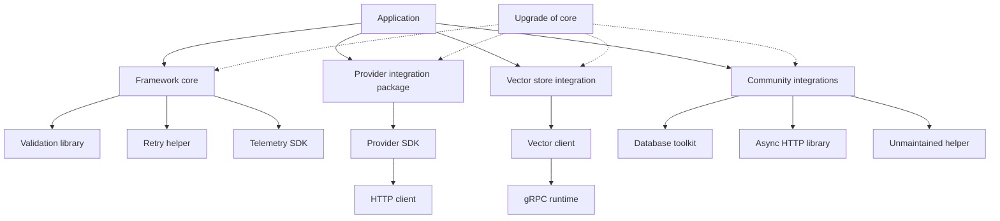

The diagram shows how one framework fans into integration packages, each of which brings its own subtree. Two risks follow from the shape. The first is version conflicts: integration package A requires a validation library below version 3 and integration package B requires version 3 or above, and the resolver fails or silently chooses a combination that was never tested. The second is the blast radius of an upgrade: a core bump may force bumps in every integration package, so the upgrade effort scales with the number of integrations, not with the size of the core. The unmaintained helper at the bottom illustrates the third risk, an abandoned transitive dependency that cannot receive a security patch. Limit integrations to those you use, install only the integration packages you need, and review the leaves.

A practical limit for a service is to set a dependency budget in the design record, for example "no more than 40 transitive runtime packages and no package without a release in the last 18 months", and check it in continuous integration.

## 6. Lock-in dimensions

Lock-in is the cost of leaving, measured along the dimensions where the framework or provider holds something of yours. Rate each dimension for each candidate rather than giving one overall impression. The dimensions below recur.

### 6.1 API shape

Your application code calls the framework's classes, passes its message types, handles its exceptions, and subclasses its base classes. The more application code imports the framework, the larger the rewrite on exit. A rough measure is the count of files that import the framework divided by the count of files in the application. Under 10 percent means the framework is behind a boundary. Over 50 percent means the framework is the architecture.

A second API-shape effect is the programming model: chain composition operators, graph node signatures, event-driven step decorators, and agent loops are different ways of expressing control flow. Moving between them means rethinking the program, not renaming calls.

### 6.2 Data formats

Data written by the framework takes its shape: serialized chain or pipeline definitions, vector index records (field names, metadata layout, embedding model identifiers), cached completions, prompt files, and evaluation datasets. The exit question is "can I read this data without the framework?". Ask for the specification, not the Python class. A pipeline serialized to YAML has a documented structure that can be parsed by hand. A pickled object does not. There is also a security reason to avoid framework-native serialization of objects that may include untrusted data (section 8.4).

### 6.3 State and memory stores

Conversation history, agent checkpoints, long-term memory, and workflow state determine whether users lose context on migration. Vendor-hosted state (threads in a hosted assistants product, memory in a managed agent runtime) is the most locked-in, because export may be limited or absent and the vendor can retire the product. Framework-managed checkpoints stored in your own database are less locked in, but the schema is framework-defined and changes between versions. Application-owned state, with an explicit schema in your database, is the portable baseline.

Ask four questions about every state store: where does it live, in what schema, who can read it without the framework, and what happens to it on a version upgrade.

### 6.4 Tracing formats and platforms

Trace data and dashboards are valuable history, since they hold the examples that become regression tests. A platform that stores traces in a proprietary schema, with a proprietary software development kit (SDK) for instrumentation, locks both the instrumentation code and the history. Instrumentation that emits OpenTelemetry spans to a collector keeps the instrumentation portable even when the backend changes, with the caveat on convention stability noted in section 3.10. Keep a periodic export of traces and annotated examples in an open format.

### 6.5 Provider features lost behind a lowest-common-denominator interface

The reverse of lock-in is a hidden cost: the interface that makes you portable also hides the provider's best features. If your workload needs prompt caching with explicit breakpoints, native citations, a provider-hosted search or code tool, a batch endpoint at half price, or a long reasoning budget, a unified interface either exposes these as pass-through options (portable in name only) or omits them. The way to reason about this is to list the provider features that your workload requires in order to meet its quality, cost, or latency targets, and classify them:

- **Table stakes**: all target providers support them and the common interface exposes them (basic chat, streaming, tool calling).
- **Differentiators you need**: only some providers support them. Use them behind your own adapter and accept that moving providers means re-tuning (section 10).
- **Differentiators you do not need**: ignore them and keep the interface narrow.

### 6.6 Skills and process lock-in

A framework also locks in team knowledge, internal documentation, onboarding material, and review habits. This form of lock-in is cheap to create and expensive to unwind, and it is the one teams most often forget in exit estimates. Section 15 returns to it.

### 6.7 Rating lock-in

The quadrant chart below places typical approaches by how much control the application keeps and how fast a first version arrives. The positions are the author's judgments for a typical team, not measurements.

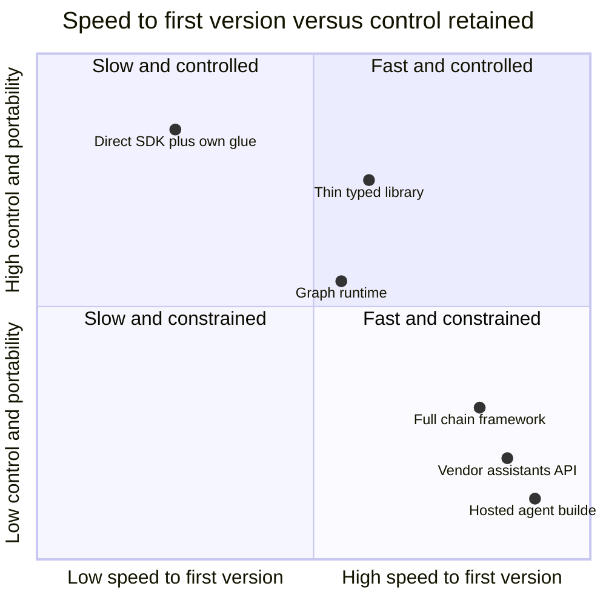

The chart is not a recommendation to always choose the upper left. A prototype that must be in front of users next week sits well in the right half, and a regulated workload that must be explainable and auditable sits in the upper half. What the chart shows is the trade each approach makes, and the practical consequence: the approaches in the lower right are the right choice for experiments with a planned discard, and the wrong choice for a system that will outlive its first sponsor. If you start in the lower right, plan the migration into the upper half before the system holds data you cannot export.

A short scorecard keeps the rating concrete. For each dimension, rate a candidate 1 (data and behavior fully exportable and documented) to 5 (no export, vendor-hosted, undocumented):

| Dimension | Question that sets the rating |
| --- | --- |
| API shape | What fraction of application files import the framework? |
| Data formats | Is every artifact in a documented, framework-independent format? |
| State and memory | Where does it live and can you read it without the framework? |
| Tracing | Does instrumentation emit a standard vocabulary to a backend you can replace? |
| Provider features | Which required differentiators are unavailable through the interface? |
| Skills and process | How much internal documentation and training is framework-specific? |

A total over about 20 of 30 suggests that an adapter boundary and a written exit plan are required, not optional.

## 7. Versioning and upgrade risk

### 7.1 Why AI libraries break more often than most

Four forces make AI dependencies change faster than, for example, an HTTP server or a database driver.

1. **The upstream moves.** Provider APIs add parameters, rename them, and retire generations. A wrapper must follow, and wrappers that cover many providers have many upstreams to follow.
2. **The design space is unsettled.** Whether an application is a chain, a graph, an event-driven workflow, or a loop around a model is still debated, so libraries redesign their core abstractions.
3. **Behavior is part of the interface.** A change in a default prompt, a default retry count, or a default chunk size is a breaking change in effect even when no function signature changes.
4. **Young projects and fast growth.** Many libraries were created after 2022 and reached 1.0 only in 2025 or 2026. Before 1.0, semantic versioning permits breaking changes in minor releases.

### 7.2 A timeline of events that shaped upgrade planning

The timeline lists events that bear on framework risk. Each is cited later in the chapter. Dates come from the cited vendor or project pages and may be revised, so verify before reusing them.

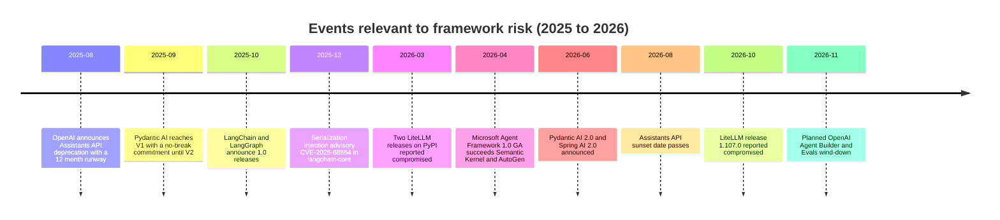

Read the timeline for the rate, not the individual entries. In fifteen months there were two vendor product retirements, one vendor framework merger, three major version bumps in libraries that many teams use, one critical advisory in a core orchestration package, and two supply-chain incidents in a gateway library. A system with a three-year life should expect a comparable number of events and schedule capacity for them. The planning figure that follows is an assumption: budget between 5 and 15 percent of the framework-facing engineering capacity per year for upgrades and incident response, and rehearse the major upgrade path before you need it under pressure.

### 7.3 Breaking-change patterns

Classify a change by the type of break, since the type decides how you detect it.

| Break type | Example pattern | How it shows up | Detection |
| --- | --- | --- | --- |
| Signature or import removal | Chain classes moved into a separate "classic" package in a major release | Import error at startup | Type checks, import tests |
| Behavior change under the same signature | A default prompt, parser, or retry count changes | Quality or cost changes without errors | Golden-task regression, trace diff |
| Data format change | Checkpoint or index schema changes | Old state fails to load or loads wrongly | State migration tests with fixtures |
| Provider API retirement | A hosted API generation is removed | Hard runtime failure on a date | Deprecation calendar |
| Dependency conflict | Two integration packages need incompatible versions | Resolver failure or untested combination | Lock file plus CI install check |
| Supply-chain compromise | Malicious release uploaded under a trusted name | Credential theft with no functional symptom | Pinning with hashes, egress control |

The second row is the dangerous one, because it passes every unit test that checks types and strings. It is the reason the rest of this chapter insists on regression suites that measure behavior ([CH24](CH24_Generative_AI_Evaluation_Guardrails_and_Hallucinations.md)) and on traces that record the prompts that were actually sent.

### 7.4 Pinning policy

Use two levels of pinning.

- **Application level: lock exact versions with hashes.** Use a lock file produced by a resolver (for example, `pip-tools`, `uv`, or Poetry for Python; the lock files of npm, pnpm, or yarn for TypeScript; Maven or Gradle dependency locking for Java; `packages.lock.json` for .NET). Install in production from the lock file with hash verification (`pip install --require-hashes`). This protects against a malicious new release being picked up by an unpinned build, which is exactly what happens in a supply-chain incident.
- **Library level: declare compatible ranges.** If you publish an internal library, declare the ranges you have tested. Applications then resolve within them.

Pinning alone is not a security plan. It stops automatic uptake of new releases, and it also stops automatic uptake of security fixes, so pinning requires a process for reading advisories and bumping within a defined time. The routine in section 15.4 sets that time.

Also pin the non-code dependencies that change behavior: the model identifier (use a dated version string where the provider offers one instead of a moving alias), the embedding model and its dimensionality, the judge model for evaluation, and prompt files (in version control, with a content hash recorded in each trace). [CH29](CH29_MLOps_and_LLMOps.md) shows how to record these in a lineage row.

### 7.5 Reading a deprecation policy

For each dependency, find and record five items:

1. **Versioning scheme.** Is it semantic versioning, and what counts as a breaking change? The LangChain policy cited above states that stable APIs keep backward compatibility until a major release, and the Pydantic AI policy makes a similar promise from V1.
2. **Pre-release and experimental markers.** Modules with names such as "experimental" or "beta" may change in any release. If your critical path uses one, treat the dependency as pre-1.0.
3. **Deprecation window.** How many releases or months pass between a deprecation warning and removal? Twelve months is typical for a vendor API, as in the Assistants retirement, and shorter for libraries.
4. **Support for old majors.** How long do security fixes continue for the previous major? The Microsoft position on Semantic Kernel v1 (critical fixes during transition) is an example of a published but time-limited commitment.
5. **Release cadence.** Many releases per week signal an active project and a large reading burden. Few releases for a year signal either maturity or abandonment, and you decide which by reading the issue tracker.

### 7.6 The upgrade as a managed process

An upgrade should follow a repeatable path so that it is routine rather than an event. The state machine shows the path.

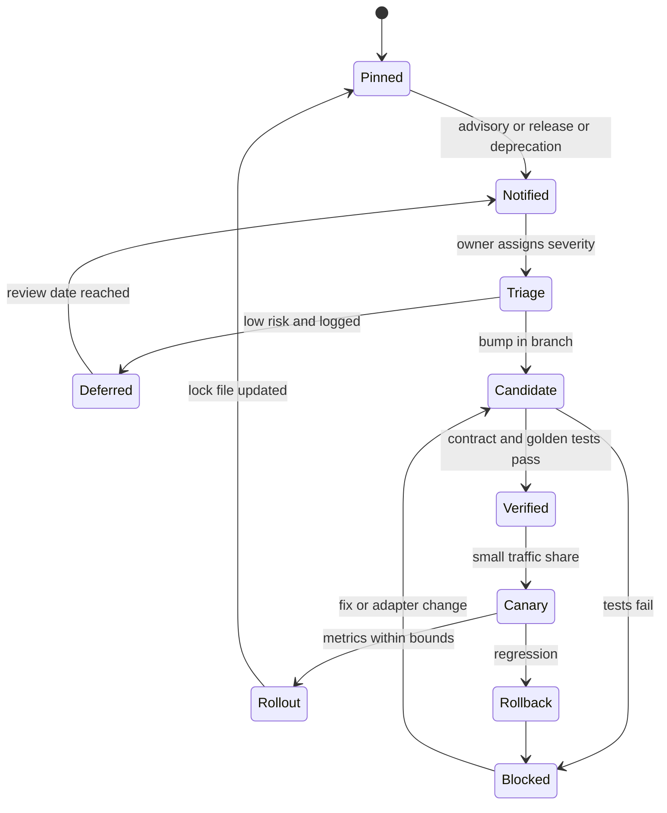

The path has three properties worth keeping. A deferred item has a review date, so deferral is a decision and not neglect. The verification step is behavioral, not just a build. The canary step reads cost and latency along with quality, since a hidden extra call shows up first as a cost change. A critical security advisory short-circuits the path (Triage to Candidate to Canary within hours), and a team that has never rehearsed the full path will find that the short-circuit is not possible on the day.

### 7.7 Worked example: a major-version upgrade estimate

A service uses an orchestration library at 0.x with a graph of 12 nodes, 30 prompt templates, a custom memory class, and 4 integration packages. The vendor releases 1.0 with a migration guide. A practical estimate has the following steps. The day counts are planning assumptions for a team of two engineers.

| Step | Days | Reason |
| --- | --- | --- |
| Read release notes and migration guide, list impacted imports | 1 | Fixed cost |
| Update imports and renamed classes in 40 files | 2 | Mostly mechanical |
| Replace the custom memory class that used a removed base class | 3 | Design change |
| Update 4 integration packages and resolve conflicts | 2 | Resolver and API drift |
| Run golden tasks, compare traces, fix prompt regressions | 4 | Behavior changes |
| Canary and monitor | 3 | Calendar time, small effort |
| Buffer at 25 percent of the above | 3.75 | Unknowns |

The sum of the non-buffer items is $1 + 2 + 3 + 2 + 4 + 3 = 15$ days and the buffer adds $0.25 \times 15 = 3.75$ days for a total of 18.75 days, about 9 to 10 calendar days for two engineers. If the application imports the library in 40 of 120 files (33 percent), the import work scales with that fraction. If the same library had been behind an adapter used by 4 files, the import step would shrink from 2 days to a few hours, and the memory class would have been the application's own. The adapter does not remove the behavior-regression step, which is why the test suite matters more than the boundary.

## 8. Supply chain, licensing, and security

### 8.1 Why AI libraries are attractive targets

An AI application is a bundle of secrets: provider API keys, cloud credentials, vector database tokens, and access tokens for tools. Libraries that sit in the request path see those secrets at runtime. Gateways and proxies concentrate them. Developer tooling around AI (notebooks, agent coding assistants, evaluation runners) often runs with the developer's own credentials. For an attacker, one compromised package in this ecosystem can reach many organizations' keys, which makes the ecosystem a high-value target.

### 8.2 Two supply-chain incidents in a gateway library

The incidents below are recounted from published security writeups. Details were still emerging at the time of writing, so verify them against the cited sources and the project's advisories.

- **March 2026.** Security researchers reported that two LiteLLM releases (1.82.7 and 1.82.8) were published to the Python Package Index (PyPI) with malicious code after the maintainer's publishing access was compromised, and that PyPI quarantined the project ([Datadog Security Labs](https://securitylabs.datadoghq.com/articles/litellm-compromised-pypi-teampcp-supply-chain-campaign/)). Reports describe a payload that harvested credentials.
- **October 2026.** The project reported that release 1.107.0 was pushed to PyPI and to its official container images by an attacker who had compromised its release pipeline, and that the release was pulled; all earlier versions were described as safe ([LiteLLM statement](https://docs.litellm.ai/blog/security-incident-oct-21-2026), [Microsoft Security blog](https://www.microsoft.com/en-us/security/blog/2026/10/23/inside-the-litellm-1-107-0-supply-chain-compromise-credential-theft-through-python-startup-hooks/)). The Microsoft analysis describes malicious files that Python executes during normal interpreter start-up, so the code can run without the application ever calling the library. Datadog's writeup states that the release was available for about two hours.

Three lessons apply to any dependency, not only this library.

1. **Install-time and start-up execution defeats "we never call that function".** Python path configuration files, post-install scripts in the Node.js ecosystem, and build plugins can run code without the application calling the library. Reduce the exposure by installing from a lock file with hashes, using a private mirror that applies a delay (for example, refusing releases younger than 48 to 72 hours unless approved), and building images in an environment without production secrets.
2. **Blast radius is set by what the process can reach.** A gateway that holds all provider keys makes every key a target. Give the gateway only the keys it routes, rotate keys on a schedule, set provider-side spending caps, and restrict egress to the provider hostnames so that stolen credentials cannot be sent to an arbitrary host.
3. **Pinning reduced the exposure only for teams that pinned.** An unpinned `latest` container tag or an unpinned `pip install` in a build picked up the malicious release. Pin container images by digest, not by tag.

### 8.3 The trust boundary view

The diagram shows where an attacker can enter, which dependencies cross the trust boundary of the runtime, and what the boundary should block.

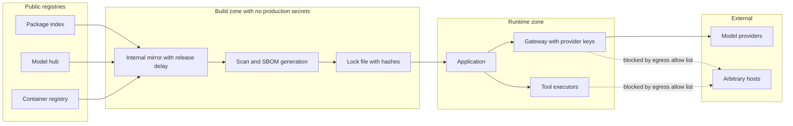

The build zone holds no production secrets, so a malicious package that runs at build time finds nothing to steal. The mirror and its delay create a window in which the community or scanners can detect a bad release. The runtime zone's egress allow list limits where stolen secrets can go. No single control is sufficient: the delay does not help against a package that has been malicious for months, the scan does not detect a new payload, and the egress list does not stop abuse of keys through legitimate providers. Together they limit the harm.

### 8.4 Vulnerabilities in frameworks

Frameworks have ordinary software vulnerabilities, and they also have vulnerabilities specific to how they handle model output and prompts. Four categories recur.

**Deserialization.** Libraries that serialize and reload objects can be tricked into instantiating attacker-chosen classes or leaking secrets. A concrete case: CVE-2025-68664, disclosed in December 2025, described a serialization injection flaw in LangChain's `dumps()` and `dumpd()` functions, where dictionaries containing a reserved `lc` key were not escaped and could be interpreted as serialized framework objects when loaded again, with the potential to expose environment secrets ([GitHub advisory](https://github.com/advisories/GHSA-c67j-w6g6-q2cm)). It affected `langchain-core` before the fixed releases listed in the advisory. A relevant property is that model output and user-supplied data can reach such serialization paths (for example, when message metadata is persisted), which turns a prompt injection into a path to the vulnerability. Defensive rules: never load serialized framework objects from untrusted sources, treat model output as untrusted data even when stored, use data-only formats (plain JSON with an application-owned schema) for state and caches, and patch quickly. In machine learning generally, the same category covers pickle-based model files (use the `safetensors` format and `torch.load` with `weights_only=True`) and `trust_remote_code=True` in Hugging Face loaders, which executes code from a model repository.

**Plug-in and integration ecosystems.** Community integration packages, tool registries, MCP servers ([CH22](CH22_Model_Context_Protocol.md)), and agent skills are third-party code with access to the same process or to powerful tools. The risk grows with the permissiveness of the host: an integration that runs in the application process inherits all its credentials. Treat each plug-in like any other third-party code: review, pin, sandbox, and give it the minimum credential.

**Prompt template injection.** Template engines that evaluate expressions (Jinja2 and similar) can execute code or read objects if a template string comes from an untrusted party. Two separate problems share a name: (a) *template injection* proper, where the template text itself is attacker-controlled; and (b) *prompt injection*, where untrusted data inserted into a fixed template manipulates the model ([CH24](CH24_Generative_AI_Evaluation_Guardrails_and_Hallucinations.md), [Part 17 CH12](../17_AI_Architecture/CH12_AI_Safety_Security_Privacy_and_Governance_Architecture.md)). For (a), never accept template strings from users or from model output, use a sandboxed environment if expressions are needed at all, and prefer logic-less substitution. For (b), the framework cannot solve the problem. Authorization at the tool boundary does.

**Agent and tool execution.** Frameworks that provide code interpreters, shell tools, or file access execute model-directed actions. The vulnerability is often a design property, not a bug: the model can be induced to call the tool. Run such tools in a sandbox with no ambient credentials and with explicit per-call authorization.

### 8.5 Licensing

Most of the AI libraries named in this chapter use permissive licenses, typically MIT, Apache License 2.0, or BSD. At the time of writing, to the best of the author's reading of the projects' repositories: LangChain, LangGraph, LlamaIndex, DSPy, Pydantic AI, Instructor, and Semantic Kernel are MIT; Haystack, Transformers, PEFT, TRL, JAX, and vLLM are Apache-2.0; PyTorch is BSD-3-Clause. Verify each in the repository's license file before relying on this list, because licenses can change and some projects mix licenses by directory. For example, a gateway project may ship an MIT core and place enterprise features in a directory under a separate commercial license.

Checks that matter more than the headline license:

1. **Model licenses are separate from library licenses.** Open-weight models carry their own terms (acceptable use policies, user thresholds, attribution, restrictions on using outputs to train other models). Record the model license in the lineage row ([CH29](CH29_MLOps_and_LLMOps.md), [CH30](CH30_AI_Data_Governance_Privacy_and_Provenance.md)).
2. **Dataset and example licenses.** Evaluation datasets and few-shot examples shipped in a library may have their own terms.
3. **Hosted service terms.** A platform's terms govern data use, retention, and training on your inputs, which the library license does not cover.
4. **Network behavior and telemetry.** Some libraries send usage data by default or call home to check versions. Check for telemetry and disable or block it as policy requires.
5. **Copyleft in the tree.** Use a license scanner on the full dependency tree, not only on direct dependencies.

### 8.6 SBOM and provenance

A software bill of materials lists the components in a build. Generate one at build time in a standard format (CycloneDX or SPDX) for the application image, store it with the artifact, and feed it to vulnerability matching. For AI systems, add the non-code components: model identifiers and digests, datasets, and prompt files. CycloneDX has defined an ML bill of materials extension for this purpose. Provenance attestations (for example, build provenance in the SLSA framework) record how an artifact was built. These records let you answer the question that opens every incident: "which of our services run the affected version?". Without an SBOM the answer is a search through repositories at 2 a.m.

## 9. A minimal no-framework baseline

The baseline in this section is the reference against which any framework should be compared. It is also a legitimate production choice for many internal assistants. It uses only the Python standard library and is runnable offline with a scripted fake provider: [`01_minimal_baseline.py`](../code/python/ai-frameworks-chapter/01_minimal_baseline.py). The code is about 200 lines. The concepts apply in any language.

### 9.1 The provider-agnostic client interface

The application defines its own vocabulary and one narrow interface. Everything the application above needs from a model is in the interface, and everything provider-specific stays below it.

```python
@dataclass
class Completion:
    text: str = ""
    tool_calls: list = field(default_factory=list)   # [ToolCall(name, arguments)]
    input_tokens: int = 0
    output_tokens: int = 0
    model: str = ""

class ModelClient(Protocol):
    def complete(self, messages: list, tools: list | None = None) -> Completion: ...
```

Two error classes complete the vocabulary: `TransientError` (timeouts, rate limits, 5xx) and `PermanentError` (authentication, bad request, schema failure). Each provider adapter maps its exceptions into these two. The retry policy and the circuit-breaking policy then live in one place instead of in every vendor's exception hierarchy.

### 9.2 Retry with a budget

```python
def with_retry(fn, tracer, max_attempts=3, base_delay=0.0, rng=None):
    for attempt in range(1, max_attempts + 1):
        try:
            result = fn()
            tracer.record("model_call", attempt=attempt, outcome="ok", ...)
            return result
        except TransientError:
            tracer.record("model_call", attempt=attempt, outcome="transient_error")
            if attempt == max_attempts:
                raise
            time.sleep(base_delay * (2 ** (attempt - 1)) * (0.5 + rng.random()))
```

The delay is exponential with jitter, so concurrent clients do not retry in lockstep. A production version adds a per-request deadline, honors a `Retry-After` header when present, and shares a token-bucket retry budget across requests so that a provider outage does not turn every request into three requests. Each attempt is traced with its attempt number, which is the log record that section 5.3 asks for.

### 9.3 Structured output validation with bounded repair

```python
def structured(client, prompt, tracer, max_repairs=1):
    messages = [{"role": "user", "content": prompt}]
    for repair in range(max_repairs + 1):
        out = with_retry(lambda: client.complete(messages), tracer)
        try:
            obj = validate_ticket(json.loads(out.text))
            tracer.record("validation", repair=repair, outcome="ok")
            return obj
        except (ValueError, json.JSONDecodeError) as exc:
            tracer.record("validation", repair=repair, outcome="invalid", error=str(exc))
            messages += [{"role": "assistant", "content": out.text},
                         {"role": "user", "content": f"Invalid: {exc}. Return only valid JSON."}]
    raise PermanentError("structured output failed after repairs")
```

The validator is plain Python here. In a real service, use Pydantic or JSON Schema for the same job ([CH17](CH17_Prompt_Engineering_and_Structured_Outputs.md) covers schema design and constrained decoding). The structure to keep is the bounded repair loop with a cap and a trace record for each outcome. An unbounded repair loop is a cost bug.

### 9.4 A tool loop with an allow-list

```python
def run_tool_loop(client, user_text, tracer, max_steps=4):
    messages = [{"role": "user", "content": user_text}]
    for step in range(max_steps):
        out = with_retry(lambda: client.complete(messages, tools=list(TOOLS)), tracer)
        if not out.tool_calls:
            return out.text
        for call in out.tool_calls:
            entry = TOOLS.get(call.name)
            if entry is None:
                result = "error: tool not permitted"
            elif set(call.arguments) != entry[1]:
                result = "error: bad arguments"
            else:
                result = entry[0](**call.arguments)
            tracer.record("tool_call", step=step, tool=call.name, result=result)
            messages.append({"role": "tool", "name": call.name, "content": result})
    raise PermanentError("tool loop exceeded max_steps")
```

The loop enforces an allow-list, argument validation before any side effect, and a step cap. The application owns these three things in the baseline, and each one is a point where frameworks often delegate to the model or to defaults. In production add per-user authorization on every tool call ([CH21](CH21_Agents_Tool_Calling_Memory_Planning.md)), idempotency keys for side-effecting tools, and a wall-clock deadline.

### 9.5 Tracing hooks

The `Tracer` records one span for every model attempt, validation outcome, and tool call. In production, replace its list with OpenTelemetry spans using the generative AI attribute names and a redaction step for prompt and output content. Because every call passes through `with_retry`, instrumentation is in exactly one place. This is the main structural advantage of the baseline: there is one model-call function, so there is one place to measure it.

### 9.6 Running it

The script exercises two scenarios with a scripted fake provider. In the first, the provider raises a transient error, then returns JSON with an invalid priority value, then returns a valid object after the repair message. In the second, the model asks for a tool that is not on the allow-list, then for a permitted one. The output is:

```text
structured: {'priority': 'high', 'summary': 'Printer down'}
provider calls: 3 spans: 5
billed tokens seen by app: 319
tool loop: Order A-1001 has shipped.
  tool span: delete_order -> error: tool not permitted
  tool span: get_order_status -> shipped
```

Three provider requests served one logical call. Five spans were recorded: the failed attempt, the first successful attempt, its failed validation, the second successful attempt, and its passing validation. The application sees 319 billed tokens, which is $(120 + 15) + (170 + 14) = 135 + 184$. The transient failure bills nothing in this simulation because it fails before a response, but a real provider can bill a request that fails after acceptance, which is why reconciling these numbers against provider invoices is a standing practice.

### 9.7 What the baseline does not give you

The baseline has no streaming, no parallel tool calls, no checkpointing, no document ingestion, no viewer, no multi-provider translation, and no evaluation harness. Adding streaming and cancellation costs a few days. Checkpointing for long-running agents, an ingestion pipeline for many file formats, and a trace viewer are each large enough that adopting a library is usually correct. The baseline is therefore a floor for comparison and a starting point, not a claim that frameworks are unnecessary. Section 13 uses it as option A in the scoring matrix.

## 10. Provider adapter boundary and anti-corruption layer

### 10.1 The problem

Domain-driven design uses the term anti-corruption layer for a translation layer that stops a foreign model from leaking into your domain model. Provider SDKs and frameworks are foreign models. Without a boundary their types spread: a `ChatCompletionMessage` appears in a repository class, a framework exception is caught in a controller, and a vendor tool schema becomes the application's definition of a tool. After a year, changing providers means editing the domain.

### 10.2 The structure

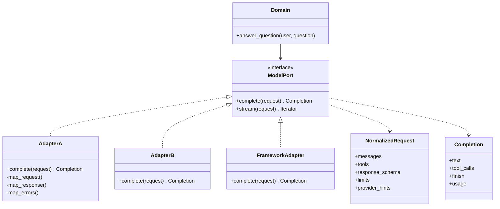

The domain depends only on the port. Each adapter implements the port for one provider SDK, one gateway, or one framework. The framework adapter is shown on the same footing as the provider adapters, which is the central idea: even a framework is an implementation detail behind the port. The `provider_hints` field in the request carries optional, namespaced options (for example, a cache breakpoint or a reasoning budget) that an adapter applies if it supports them and ignores or rejects according to a declared policy.

### 10.3 Design rules for the port

1. **Normalize only what you need.** Include the fields your application uses. Resist adding every vendor option. A narrow port keeps adapters small.
2. **Represent absence explicitly.** Make unsupported features visible: capabilities flags such as `supports_parallel_tools` or `supports_strict_schema`, so that the domain can choose a different path instead of discovering a failure at run time.
3. **Normalize errors into a small taxonomy.** Transient, rate-limited (with retry-after), context-length exceeded, content refused, authentication, invalid request, and unknown. The retry policy and user-facing messages then depend on the taxonomy, not on vendor classes.
4. **Normalize finish reasons and usage.** Map to a fixed set (stop, length, tool use, refusal, filtered) and always return input, output, cached, and reasoning token counts when the provider reports them.
5. **Keep a raw escape hatch.** Return the raw response in a field that only the tracing layer reads. This preserves debuggability and allows a gradual extension of the port.
6. **Own the tool definition.** Define tools in the application's schema (name, description, JSON Schema for arguments, handler). Adapters translate that to each vendor's tool format. If you use MCP ([CH22](CH22_Model_Context_Protocol.md)), the tool definitions already have a standard form that adapters can consume.
7. **Do not let the port decide policy.** Authorization, redaction, and budgets belong in domain services that wrap the port, so they apply regardless of adapter.

### 10.4 Where the boundary goes with an agent framework

If you adopt an agent framework, its natural placement is on the application side of the port or even above it. There are two patterns.

- **Framework above the port.** The framework's model wrapper is configured to call your port, so framework behavior sits on top of your normalized interface. This needs a custom model class for the framework, which is usually small, and gives you control of retries, tracing, and provider choice. The framework still owns the loop.
- **Framework behind a task port.** The domain calls a coarser port ("run this task and return a result") and the framework implements it internally. This hides the framework fully but means the framework's loop, prompts, and retries run unobserved unless you instrument below it. Use it for self-contained subsystems such as an ingestion pipeline, where a failure surfaces as a task result.

The first pattern suits agent loops with side effects. The second suits batch pipelines.

### 10.5 What the boundary costs

An adapter layer costs engineering time and some capability. Estimate three to five days for the port and one adapter, and one to three days for each additional adapter plus contract tests. The capability loss is the one covered in section 6.5: features that do not map are exposed only through hints. If a team does not plan to change providers or frameworks for the life of the system, and the cost of a rewrite is bounded (for example, a 2,000-line application), the adapter may be over-engineering. A useful test is the exit estimate of section 14: if migration without an adapter would cost less than the adapter plus its upkeep, skip it.

## 11. Testing strategies for framework-based code

Framework-based AI code is hard to test for three reasons: the model is nondeterministic, the provider is a network service with cost and rate limits, and the framework hides calls. A test strategy has to separate the questions "does my code handle every shape of provider behavior?" and "does the model give good answers?". The first is deterministic and belongs in continuous integration. The second is statistical and belongs in evaluation ([CH24](CH24_Generative_AI_Evaluation_Guardrails_and_Hallucinations.md), [CH19](CH19_Retrieval_Quality_and_RAG_Evaluation.md)).

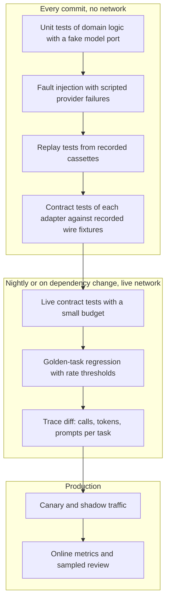

The pyramid is ordered by cost and determinism. Cheap, deterministic tests run on every commit and catch most integration bugs. Live tests detect drift in the provider or the framework. Production signals catch what no test suite anticipated. The key habit is to run the live layers whenever a dependency changes, not only when your code changes.

### 11.1 Fakes and scripted providers

A fake implements the model port with a script of responses and failures. The baseline's `FakeProvider` pops one item per call: a `Completion` or an exception. With it you can test the behavior that matters and that live calls rarely produce on demand:

- a transient error followed by success, to check that the retry count and tracing are right;
- a timeout after partial streaming, to check cancellation and that a partial answer is not committed;
- malformed JSON, to check bounded repair and the final failure path;
- a tool request for an unlisted tool, or with wrong arguments, to check refusal;
- a refusal or content-filter finish reason, to check the user-facing message;
- a context-length error, to check truncation or summarization;
- a response with zero usage fields, to check that cost accounting does not divide by zero.

Fakes are the main reason for the port. If the framework's model class cannot be replaced by a fake in a test, the framework is untestable in the way that counts, and that is a selection criterion.

### 11.2 Contract tests around the provider boundary

A contract test states what the application requires of any adapter, and runs against every adapter. The repository script [`04_record_replay_contract.py`](../code/python/ai-frameworks-chapter/04_record_replay_contract.py) defines two fake vendor transports whose wire formats differ (one returns a `choices` list with tool-call arguments as a JSON string, the other returns `content` blocks with tool input as an object and a different stop-reason vocabulary). Two adapters map both into one normalized `Completion`, and one suite runs against both:

```text
recorded interactions: 2
vendor_a contract: plain text=pass, tool call normalized=pass, usage reported=pass
vendor_b contract: plain text=pass, tool call normalized=pass, usage reported=pass
replay A: pong
drift detected: 'request drift: no recording for key 211069b3e96c'
```

The wire formats in the script are simplified and illustrative, not the real vendor schemas. The structure is what matters. The suite asserts the normalized behavior (text, tool call, finish reason, usage) and never the vendor's shape. When you add a third provider, you write one adapter and run the same suite. When a vendor changes its wire format, the recorded-fixture version of the suite fails in the adapter and nowhere else.

Useful contract assertions:

1. Plain text round trip, with finish reason `stop`.
2. A forced tool call produces exactly the normalized `(name, arguments)` list, with arguments parsed into an object.
3. Usage fields are present and positive.
4. A length cutoff maps to `length`, and a refusal maps to `refusal`.
5. Rate limit and server errors map to the transient class, and authentication errors map to the permanent class.
6. Streaming yields the same final text as non-streaming for the same fixture.
7. A request with the maximum number of tools, or the largest schema you use, is accepted.

### 11.3 Record and replay

Record and replay stores real provider responses in a cassette and serves them in later test runs. It gives realistic test data without cost or flakiness. The script keys each interaction by the SHA-256 hash of the canonical JSON of the request (sorted keys, no whitespace), truncated for display. If the code under test changes the request (a new hidden instruction, a different tool order), the key changes, no recording matches, and the test fails with a "request drift" error. That failure is a feature: it makes silent changes to the prompt visible in code review, which is how you catch a hidden-prompt change in a framework upgrade.

Guidelines for cassettes:

- **Scrub secrets and personal data before storing.** Remove authorization headers and any customer text. Use synthetic inputs for recordings where possible.
- **Key on the semantic request, not volatile fields.** Exclude timestamps, request identifiers, and random seeds from the key, or inject deterministic values in tests.
- **Version them with the code and give them an expiry.** Re-record on a schedule (for example monthly) and on every dependency upgrade. A cassette older than the last provider API change tests a past that no longer exists.
- **Record the failures too.** Record real rate-limit and error responses as fixtures.
- **Treat a replay pass as proof of handling, not of quality.** The recorded answer was good once. Replay says nothing about whether the model still produces it.

### 11.4 Live contract tests and their cost

A small live suite catches drift that cassettes cannot. A budget example: 40 tests, each with about 500 input tokens and 100 output tokens, at the illustrative prices of 3.00 and 15.00 dollars per million tokens. The input is $40 \times 500 = 20{,}000$ tokens, costing $20{,}000 \times 3 / 10^6 = 0.06$ dollars. The output is $40 \times 100 = 4{,}000$ tokens, costing $4{,}000 \times 15 / 10^6 = 0.06$ dollars. A nightly run costs 0.12 dollars and a 30-night month 3.60 dollars per provider. This is negligible next to the cost of one production incident, so the real constraint is rate limits and flake handling, not money.

### 11.5 Golden-task regression and the arithmetic of flakiness

Golden tasks check behavior: for a fixed set of inputs, the system's answers satisfy a rubric, and the pass rate does not fall. Because model output varies, a test that requires every task to pass on every run is fragile. Suppose each of 50 tasks passes independently with probability 0.95. The chance that all 50 pass in one run is

$$
0.95^{50} = e^{50 \ln 0.95} = e^{-2.565} \approx 0.077 ,
$$

so the suite fails about 92 percent of runs even when nothing is wrong. Gate on rates and tolerances instead: for example, "the aggregate pass rate is at least 0.92 over 3 runs, and no safety task fails in any run". Use the confidence-interval and sample-size methods of [CH24](CH24_Generative_AI_Evaluation_Guardrails_and_Hallucinations.md) to choose thresholds, and set temperature to zero in regression runs where the provider supports it, noting that zero temperature does not guarantee determinism.

### 11.6 Trace-diff tests

For framework upgrades, the most informative test is a comparison of what the framework sends. Run the golden tasks before and after the upgrade with provider-level tracing on, then compare: number of provider calls per task, input and output tokens per task, the hash of the system prompt and tool list, and the order of calls. A diff in any of these is a behavior change to review. This is how a hidden default-prompt change or a new extra call is found before production. The check is cheap to automate: store a small JSON summary per task and fail the build when call count or token count moves beyond a tolerance (for example, plus or minus 10 percent) without an approved note.

### 11.7 Testing the exit

Include a periodic test of the exit path: export conversation state, prompt files, evaluation datasets, and index metadata into the open formats of the exit plan, and load them into the baseline implementation. A passing test shows that the exit is real. A failing one is far cheaper to find in a scheduled drill than during a forced migration.

## 12. Observability visibility comparison

Observability for AI systems answers: what did the system do, how long and how much did it cost, and why did it give this answer? Different vantage points see different parts of the answer. [Part 17 CH11](../17_AI_Architecture/CH11_Evaluation_and_Observability_Architecture_for_AI_Systems.md) owns the architecture. This section compares what each tool-choice lets you see.

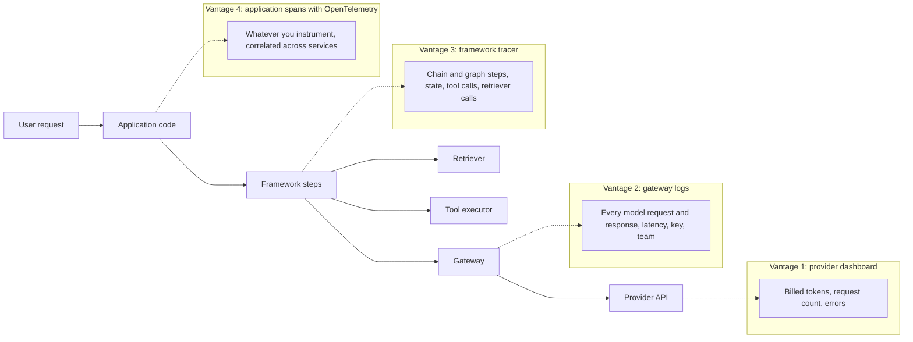

Each vantage sees a slice. The provider dashboard sees what is billed but nothing about your application structure, users, or tool calls. The gateway sees every model request regardless of framework but not retrieval, tool execution, or application state. The framework tracer sees steps and state but may summarize prompts and may miss calls that bypass the framework. Application spans see whatever you instrument and can correlate across services if context propagates. The implication is that a complete picture needs a join across at least two vantage points, and the join key is a request or trace identifier carried through every layer.

| Question | Provider dashboard | Gateway logs | Framework tracer | App OpenTelemetry spans |
| --- | --- | --- | --- | --- |
| How many tokens were billed? | Yes (authoritative) | Yes (computed or reported) | Often (self-reported) | Yes if usage attributes are recorded |
| What exact prompt was sent? | No | Yes | Sometimes summarized | Only if captured below the framework |
| Which retries occurred? | Counts only | Yes if gateway retries | Only framework-level | Yes if you trace each attempt |
| Which tool ran with which arguments? | No | No | Yes | Yes if instrumented |
| Which documents were retrieved? | No | No | Yes | Yes if instrumented |
| What did this user see end to end? | No | No | Partial | Yes with context propagation |
| Does it survive a framework change? | Yes | Yes | No | Yes if on open vocabulary |
| Does it expose personal data? | No | Yes, if bodies are logged | Yes | Yes, depends on capture settings |

### 12.1 The OpenTelemetry vocabulary

The OpenTelemetry generative AI conventions name operations and attributes so that a trace from any library reads the same way. In the version I read at the time of writing, a model call is a span whose operation name attribute identifies the kind of call (for example a chat call, an embeddings call, a tool execution, or an agent invocation), with attributes for the provider, the requested and returned model, and input and output token usage, and with the response finish reasons. Content (prompts and completions) is opt-in because of privacy. Verify the exact attribute names in the [conventions repository](https://github.com/open-telemetry/semantic-conventions/blob/main/docs/gen-ai/gen-ai-spans.md) because the status is Development at the time of writing and names have changed before.

The design implications are:

1. **Use a thin emission layer.** One module in your code maps your internal trace events to the convention names. A rename is then a one-file change.
2. **Capture content by policy.** Default to metadata only (model, tokens, latency, finish reason, hashes of prompt files). Capture prompts and outputs only for sampled, redacted, access-controlled storage, in line with [CH30](CH30_AI_Data_Governance_Privacy_and_Provenance.md).
3. **Propagate context across tool and service calls.** Tools served over MCP or HTTP should receive the trace context so that a slow tool is visible in the same trace as the model call that requested it.
4. **Beware of double counting.** If a framework instruments its model wrapper and your provider SDK is also instrumented, one call can appear as two spans. Choose one layer to own model-call spans.

### 12.2 Reconciling billed and observed tokens

A routine reconciliation catches hidden calls. Weekly, compare the sum of tokens your tracing layer records with the token totals on the provider invoice or usage export, by model. Define the gap

$$
g = \frac{T_{\text{billed}} - T_{\text{observed}}}{T_{\text{billed}}} .
$$

If the traces captured 8.4 million tokens in a week and the invoice shows 10.5 million, the gap is $g = (10.5 - 8.4)/10.5 = 0.20$, so 20 percent of billed tokens are invisible to your traces. Typical causes: calls that bypass instrumented code paths (a background summarizer, a library's internal call), retries not recorded as separate attempts, evaluation jobs sharing the key, and developers using the production key. A gap above about 5 percent deserves investigation. The structure in the baseline, where every call passes through one function, is designed to keep this gap near zero.

### 12.3 Choosing a tracing backend

Selection criteria specific to tracing platforms: accepts OpenTelemetry traces and metrics natively; supports content redaction and field-level access control; exports data in an open format; runs in your region or on premises if data rules require it; has an evaluation or dataset feature that turns traces into test cases; has a clear retention and deletion model; and publishes its own security posture. The decision follows the lock-in scorecard of section 6.7. The lowest-risk pattern is to emit OpenTelemetry to a collector that can fan out to the chosen platform and to your own object storage, so that history exists independent of the platform.

## 13. Build versus adopt

### 13.1 The decision as a sequence

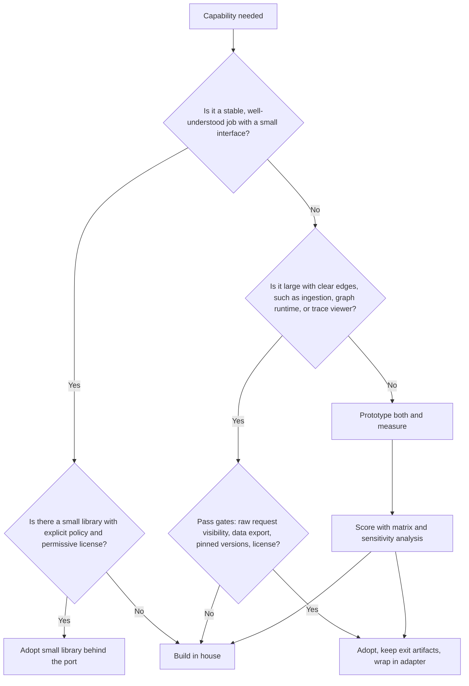

The first branch shows that small, stable jobs go to a small library or to your own code. The second branch shows that large jobs with clear edges are the best candidates for adoption, subject to gates. Gates differ from scores. A gate is a pass or fail requirement: a candidate that fails a gate is out regardless of the total. Typical gates: raw request and response can be captured with secrets redacted; every state artifact can be exported in a documented format; the license is acceptable; versions can be pinned and installed from a mirror; and the maintainer has a published security contact and advisory process.

### 13.2 Criteria and scoring

Score each option from 1 to 5 on each criterion, multiply by a weight, and sum. Criteria and what the scores mean:

| Criterion | 5 means | 1 means |
| --- | --- | --- |
| Fit | Covers all required features today | Covers few required features |
| Visibility | Every request, prompt, and state change is inspectable | Control flow and prompts are hidden |
| Operations | Mature telemetry, retries, timeouts, deployment guidance | Demo-grade operation |
| Portability | Open formats, narrow API surface, easy exit | Proprietary state, wide API surface |
| Security | Published process, small tree, sandbox support | Wide tree, execution of untrusted content |
| Team skills | Team already knows it or it is easy to hire for | Specialist skills needed |
| Speed to first value | Days | Months |

Weights express the context. A regulated internal assistant might weight visibility, portability, and security at 4 or 5 and speed at 3. A hackathon prototype would weight speed at 5 and portability at 1.

### 13.3 Worked example: the matrix

The script [`03_scoring_and_dependencies.py`](../code/python/ai-frameworks-chapter/03_scoring_and_dependencies.py) computes the matrix for four options with weights fit 5, visibility 4, operations 4, portability 4, security 4, skills 2, and speed 3 (sum of weights 26, maximum score $5 \times 26 = 130$). The scores are illustrative judgments for an internal assistant with retrieval and read-only tools, as in the case study of section 19.

| Option | Fit | Visibility | Ops | Portability | Security | Skills | Speed | Weighted total |
| --- | --- | --- | --- | --- | --- | --- | --- | --- |
| A. Direct SDK plus own glue | 4 | 5 | 4 | 4 | 4 | 3 | 2 | 100 |
| B. Thin typed library plus port | 4 | 4 | 4 | 4 | 4 | 4 | 4 | 104 |
| C. Full orchestration framework | 5 | 2 | 3 | 2 | 3 | 4 | 5 | 88 |
| D. Low-code platform | 2 | 1 | 3 | 1 | 3 | 5 | 5 | 67 |

The arithmetic for option B is $5 \times 4 + 4 \times 4 + 4 \times 4 + 4 \times 4 + 4 \times 4 + 2 \times 4 + 3 \times 4 = 20 + 16 + 16 + 16 + 16 + 8 + 12 = 104$. For option A: $20 + 20 + 16 + 16 + 16 + 6 + 6 = 100$. For C: $25 + 8 + 12 + 8 + 12 + 8 + 15 = 88$. For D: $10 + 4 + 12 + 4 + 12 + 10 + 15 = 67$.

The script prints:

```text
Part A: weighted scores (max = 130 )
  104  B thin library (typed, small)
  100  A direct SDK + own glue
   88  C full orchestration framework
   67  D low-code platform
  winner: B thin library (typed, small); changes in 78/2000 random +/-1 weight perturbations
  gate fail: D low-code platform -> visibility, portability
```

Three observations discipline the reading. First, the margin between B and A is 4 points of 130 (3 percent), which is within judgment error. The sensitivity run perturbs each weight by minus one, zero, or plus one at random 2,000 times, and B stays on top in $2000 - 78 = 1922$ trials (96.1 percent). That supports B over C and D but does not separate B from A decisively. When two options are this close, choose by secondary factors such as team preference and exit cost. Second, the gate rule (minimum 2 on visibility and portability) eliminates D regardless of its speed score. Third, the matrix is only as good as the scores, so each score should cite evidence: a vertical prototype, a trace, a license file, a dependency count.

### 13.4 How to produce the scores honestly

1. Build the same vertical slice in each shortlisted option: one retrieval call, one tool call that is denied, one malformed-output repair, one provider timeout after partial streaming, and one cancellation. Do not use a happy-path demo.
2. Record provider calls per request, input and output tokens, time to first token, and lines of application code.
3. Capture the raw request for each case with secrets redacted. If you cannot, that is the visibility score.
4. Run the export test for each state artifact. If you cannot read it without the framework, that is the portability score.
5. Count transitive dependencies and run a vulnerability and license scan.
6. Have someone who did not write the slice read it and explain the control flow. Time taken is the evidence for visibility and for skills.

### 13.5 When adoption is clearly right

Adopt without long deliberation when the capability is large, the interface is narrow, and the failure is visible. Examples: a document parser for many formats, a trace viewer, a model-loading library for open-weight models (Transformers), an array and gradient library (PyTorch or JAX), and a typed validation library. Build without long deliberation when the capability is small and you already know exactly what you need: a retry helper, a call to one provider, a router across two models with a fixed rule. The hard cases lie between: orchestration of agent workflows, memory management, and evaluation frameworks. For those, run the vertical slice.

## 14. Exit strategy and migration path

### 14.1 What an exit plan contains

An exit plan is a document and a tested procedure. It lists the artifacts that must leave with you, the target of the migration, the order of steps, the effort, and the triggers. The artifacts, by lock-in dimension:

| Artifact | Portable form | Where it commonly gets stuck |
| --- | --- | --- |
| Prompts and instructions | Plain text files in version control with a content hash | Prompts embedded in framework classes or console-only objects |
| Tool definitions | JSON Schema plus handler code, optionally MCP | Framework decorators that generate schemas at run time |
| Output schemas | JSON Schema or application models | Library-specific model classes |
| Conversation history | Application database rows with an explicit schema | Vendor-hosted threads or framework pickles |
| Agent or workflow state | Documented checkpoint schema, or state that can be recomputed | Serialized objects loadable only by the framework |
| Retrieval index and metadata | Source documents, chunking configuration, embedding model identifier, and vector store export | Framework-specific field names, no re-ingestion script |
| Evaluation datasets and rubrics | Files in open formats (JSON Lines) with the judge prompt | Datasets inside a hosted console |
| Traces and annotations | OpenTelemetry export or JSON Lines | Proprietary platform storage |
| Configuration | Environment-driven, documented | Settings scattered in code and console |
| Optimized prompts (for example from DSPy) | Saved program text plus the metric and dataset | Cached artifacts in a library directory |

An artifact that exists only in an application programming interface of the framework counts as not exported. The test of section 11.7 checks this on a schedule.

### 14.2 Migration patterns

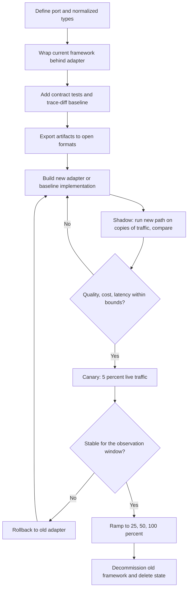

The path is a strangler pattern. The old implementation stays live behind the port until the new one has run in shadow mode and on a canary share of traffic with measured quality, cost, and latency. Rollback is possible until the last step, which means state written by the new path has to be readable by the old one during the canary, or the canary must be stateless. Write to both stores during overlap if the state model allows it. The last step includes deleting retained data from the old system to meet retention commitments ([CH30](CH30_AI_Data_Governance_Privacy_and_Provenance.md)).

### 14.3 Effort estimates with worked numbers

A migration estimate is the sum of code rewrite, data migration, behavior re-baselining, parallel running, and a contingency. The example is a service with 120 source files, of which 40 import the framework directly, and an assistant with conversation state and a retrieval index. The hours are planning assumptions.

| Item | Without adapter | With adapter |
| --- | --- | --- |
| Rewrite call sites (1.5 hours per file) | 40 files, 60 h | 4 files, 6 h |
| State migration script | 24 h | 24 h |
| State verification | 16 h | 16 h |
| Re-baseline prompts and evaluation | 32 h | 32 h |
| Shadow run and cutover | 40 h | 40 h |
| Subtotal | 172 h | 118 h |
| Contingency at 30 percent | 51.6 h | 35.4 h |
| Total | 223.6 h (about 28 person-days) | 153.4 h (about 19 person-days) |

The adapter saves about 70 hours, or 8.8 person-days. If building the port and the first adapter cost 4 person-days up front plus an estimated 1 person-day per year of upkeep, the net benefit over 3 years in which one migration occurs is $8.8 - 4 - 3 = 1.8$ person-days. That is a thin margin, and it shows that the adapter pays for itself mainly when a migration is likely or when more than one migration occurs. It also pays through testability and tracing in ordinary work, which this arithmetic omits. The arithmetic also shows where the real cost sits: state migration, re-baselining, and parallel running (112 hours of the 172) do not shrink with an adapter. They shrink only with documented state formats and a regression suite.

Typical effort for common exits, as planning ranges for a service of the size above (assumptions to calibrate against your own history):

| Exit | Range (person-days) | Dominant cost |
| --- | --- | --- |
| Change model within one provider | 1 to 5 | Prompt re-tuning and evaluation |
| Change provider behind an existing adapter | 5 to 15 | Provider-specific features and re-baselining |
| Gateway swap | 2 to 8 | Key management and routing rules |
| Tracing backend swap (OpenTelemetry-based) | 2 to 5 | Dashboards and alerts |
| Tracing backend swap (proprietary SDK) | 10 to 25 | Re-instrumentation |
| Framework to baseline (no adapter) | 20 to 40 | Call sites, state, behavior |
| Framework to another framework | 25 to 50 | Different programming model |
| Hosted assistants product to own state | 15 to 40 | Backfilling history, retrieval, files |
| Re-embed and re-index a corpus (new embedding model) | 3 to 15 | Compute, evaluation, cutover |

The Assistants API retirement is an example of the "hosted assistants to own state" row. Applications that stored history in hosted threads and files in hosted vector stores had to rebuild state with their own scripts, with a fixed external deadline.

### 14.4 Triggers for exit

Write the triggers down so the decision is not made in a crisis:

- a security advisory with no fix within the agreed time;
- a maintainer announcement of end of life, a merger, or relicensing;
- a cost or latency regression that cannot be configured away;
- repeated breaking changes (for example, more than two minor-version breaks in a year);
- loss of a required provider feature through the interface;
- an acquisition or governance change that alters the project's direction;
- a regulatory or customer requirement that the framework cannot satisfy (data location, audit trail).

Each trigger should have an owner who checks it at a defined interval, which section 15.4 sets.

## 15. Team skills, hiring, and governance

### 15.1 What skills each choice demands

A framework changes which skills a team needs, and the change is often the opposite of the sales pitch. A framework that hides the model call lets a less experienced engineer ship a prototype, and demands a more experienced engineer to debug it in production, because debugging needs knowledge of both the framework internals and the layer below. A direct-SDK baseline asks every engineer to understand the request and response shapes, which is a smaller body of knowledge, and it distributes that knowledge across the team.

| Choice | Skills needed to build | Skills needed to operate and debug | Hiring pool |
| --- | --- | --- | --- |
| Direct SDK plus own glue | HTTP, JSON, async basics, testing | Same, plus tracing | Large, any backend engineer |
| Thin typed library | Above plus the library's typing model | Above | Large |
| Graph runtime | State machines, persistence, idempotency | Framework internals, checkpoint schemas | Medium |
| Full chain framework | Framework idioms | Framework internals, callback model, version history | Medium to large, but quality varies |
| Provider agent SDK | Provider features, sandboxing | Provider support channels | Medium |
| Low-code platform | Platform skills | Platform support | Small, and not transferable |
| DSPy-style optimization | Evaluation design, statistics | Dataset curation, optimizer behavior | Small |
| Training libraries | Deep learning, distributed training | GPU debugging, numerical issues | Small and expensive |

Two cautions apply when reading the table. First, job postings that list a framework name ("must have experience with framework X") select for the vocabulary of a library that may be redesigned within a year. The durable skills are the ones underneath: how to build a reliable request path, how to evaluate nondeterministic output, how to design a tool boundary, how to read a trace. Second, the hiring pool for a framework includes many people whose experience is a tutorial. In interviews, ask a candidate to explain what request a given framework call produces on the wire. People who can answer that are the people who can debug it.

### 15.2 Training and bus factor

Plan for at least two engineers who can read the framework's source, not only call its API. A framework with one internal expert has a bus factor of one. Keep a short internal guide with the project's conventions: where raw requests are captured, how to run the contract suite, how to bump the version, and which framework features are approved or prohibited. Rotate the on-call so that every engineer meets a framework failure at least once with the senior person watching.

### 15.3 Governance: the approved list

An approved list records which libraries and platforms may be used for what. Without one, each team adopts its own favorite, and the organization cannot answer "which systems use this library?" during an incident. The list has to be light enough that teams do not route around it.

A workable structure uses four statuses.

| Status | Meaning | Conditions |
| --- | --- | --- |
| Approved | May be used in production for stated use cases | Passed review, owner named, version policy known |
| Conditionally approved | May be used with restrictions | For example, only behind the port, only in non-sensitive workloads |
| Evaluation | May be used in a sandbox with synthetic data | Time-boxed, with an expiry date |
| Prohibited | May not be used | Unpatched critical issue, unacceptable license, abandoned |

Each entry names the use case ("typed output validation in services"), the approved versions or range, the owner, the review date, and the exit plan. A new request goes through the review of section 15.4. The list is a living document with an expiry on every entry, so that "approved in 2024" does not persist as an unexamined fact.

### 15.4 The review procedure and routine

**Initial review checklist.** A reviewer gathers the following from the project's own pages and from tooling, in an hour or two for a small library and a day for a large one.

1. Purpose and the layer it occupies (section 3).
2. License and the licenses of transitive dependencies; telemetry behavior.
3. Maintainers: organization or individuals, number of active maintainers, bus factor, funding signals, and the response time on recent issues.
4. Release history: cadence, last release, breaking-change history, the versioning and deprecation policy.
5. Security: published advisory process, security contact, recent advisories and time to fix, use of trusted publishing and signed releases.
6. Dependency tree: count, native extensions, unmaintained packages, size of the installed footprint.
7. Behavior: hidden prompts, extra calls, retries, telemetry, network calls at import time. Evidence: a trace of the vertical slice.
8. Data: what state it writes, in what format, with what export.
9. Extensibility and escape hatches: can raw requests be captured, can the model client be replaced.
10. Fit: results of the vertical slice and the scoring matrix of section 13.

**Routine.** A rule of thumb for cadence, to be adapted to your risk appetite:

- Watch advisories continuously through automated matching of the SBOM against vulnerability feeds.
- Review release notes of approved dependencies monthly.
- Apply critical security fixes within 72 hours of availability and high-severity fixes within 14 days, or record a risk acceptance.
- Run the full upgrade path (section 7.6) at least quarterly for each core dependency, even without a driving advisory, so the path stays rehearsed.
- Re-review each approved entry annually and at any major version, relicensing, change of maintainer, or security incident.
- Run the exit drill (section 11.7) annually.

**Roles.** Name an owner per dependency (a team, not a person), a platform or security group that owns the approved list and the mirror, and an incident lead for dependency incidents. A dependency without an owner is a dependency nobody patches.

### 15.5 Procurement and vendor terms for hosted frameworks and platforms

For hosted products, add questions the license does not answer: where the data is stored and processed; whether prompts and outputs are used for training; the retention period and deletion mechanism; the export format and process; the notice period for retiring features; service level agreements; incident notification duties; sub-processors; and the contractual remedy if the product is withdrawn. The OpenAI statements about winding down Agent Builder and Evals products, with a stated shutdown date, show that a product can be withdrawn on a notice measured in months. Write the notice period you can accept into the contract or the selection criteria.

## 16. Multi-language ecosystems

Most reference material in this field is in Python, and many production systems are not. The right question for a Java, .NET, or TypeScript shop is which of three approaches fits: use a native library in your language, call a Python service from your language, or build on the provider's SDK in your language.

| Language | Provider SDKs | Orchestration and agents | Notable points at the time of writing |
| --- | --- | --- | --- |
| Python | First-party SDKs from all major providers | LangChain and LangGraph, LlamaIndex, Haystack, DSPy, Pydantic AI, provider agent SDKs, Microsoft Agent Framework | Largest ecosystem, fastest churn, richest training and evaluation tooling |
| TypeScript and JavaScript | First-party SDKs from major providers | Vercel AI SDK (version 6 announced December 2025 with an agent abstraction and Model Context Protocol support), LangChain.js and LangGraph.js, provider agent SDKs | Strong for web and edge, schema libraries such as Zod fill the role of Pydantic |
| Java and the JVM | Official or community SDKs, cloud SDKs | Spring AI (2.0.0 GA announced June 2026), LangChain4j, Semantic Kernel for Java | Fits enterprise dependency injection, observability, and security conventions |
| .NET | Official SDKs and Azure SDKs | Microsoft Agent Framework (1.0 GA reported April 2026), Semantic Kernel, Microsoft.Extensions.AI abstractions | Close alignment with Azure, a common abstraction interface for chat clients |
| Go, Rust, others | First-party or community SDKs vary in completeness | Smaller ecosystems | Often best to call a service or use an OpenAI-compatible endpoint |

Verify the table against each project's releases before use. Several entries changed within the year before this was written.

### 16.1 Interoperability mechanisms

Because language ecosystems do not match, rely on language-neutral interfaces at the seams.

- **HTTP with an OpenAI-compatible or provider-native schema.** Most gateways and serving engines expose it. A Java client can call a vLLM or gateway endpoint without a Java AI framework.
- **JSON Schema** for tool arguments and structured output. It is language independent and supported by providers.
- **Model Context Protocol** for tools and resources ([CH22](CH22_Model_Context_Protocol.md)). A tool server written in one language serves clients in others.
- **OpenTelemetry** for traces, with the same conventions on the wire from any language.
- **OpenAPI or gRPC** for the service that wraps the AI component.

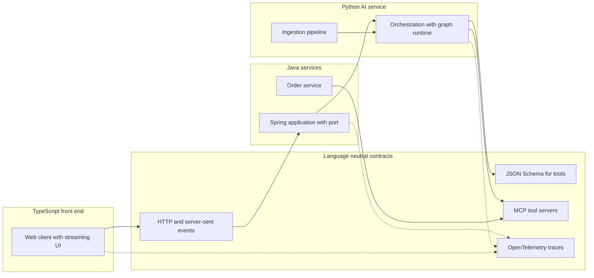

The picture is a polyglot system where each team uses native tooling and contracts are neutral. The traces cross language boundaries because every service emits the same vocabulary, and the MCP tool servers serve both the Java and Python clients. The implication is that the AI-specific framework choice can be confined to one service whose interface is a task or a streaming endpoint, which makes it replaceable. The cost is an extra network hop and a second runtime to operate and patch. Choose it when the language of your AI team differs from the language of the rest of the platform. Use native libraries when the AI feature is a small part of a large Java or .NET application, since adding a second runtime for a few model calls can cost more than it saves.

### 16.2 Language-specific cautions

- **Python packaging.** Resolvers differ in speed and behavior, native wheels vary by platform, and the heavy numerical stack makes images large. Use lock files and slim base images.
- **JavaScript supply chain.** Install scripts and the depth of the package tree call for lock files, install-script restrictions, and an internal registry mirror.
- **JVM.** Spring AI and LangChain4j follow the release rhythm of their parent ecosystems. For Spring AI, milestone releases of the next line appeared at the time of writing after the 2.0 GA, which is a reminder to depend on GA releases for production.
- **.NET.** The common chat-client abstraction is a useful port. Microsoft's own framework transitions (Semantic Kernel and AutoGen to Agent Framework) apply here as well.

## 17. Failure modes and quality-attribute scenarios

### 17.1 Quality-attribute scenarios

A scenario states the stimulus, the system response, and a measure. These can serve as acceptance tests for the framework decision.

| Attribute | Stimulus | Expected response | Measure |
| --- | --- | --- | --- |
| Changeability | Provider retires an API generation with 12 months notice | Adapter replaced, domain unchanged | Under 15 person-days and zero domain-file changes |
| Changeability | The team switches the primary model to another provider | Adapter and prompt re-tuning only | Golden-task pass rate within 2 points of baseline after 10 person-days |
| Security | A dependency is reported compromised | Affected services identified and deployments halted | Identification in under 1 hour from SBOM, rotation of exposed keys in under 4 hours |
| Security | A user message contains serialized framework-object syntax | Treated as plain data | No object instantiation, verified by test |
| Reliability | The provider returns 429 for 10 minutes | Bounded retries, circuit opens, fallback or clear user message | At most 4 provider attempts per user turn, no retry storm |
| Reliability | Network drops after the model response and before the tool result is recorded | No duplicate side effect | Zero duplicate tool executions, verified by idempotency keys |
| Cost | A framework upgrade adds an internal call | Detected before production | Trace-diff fails on more than 10 percent change in calls or tokens per task |
| Observability | An operator investigates a wrong answer | Raw request found from a trace identifier | Under 5 minutes, secrets redacted |
| Testability | A new engineer adds a feature | Fake model port allows a unit test without network | Test runs in under 1 second with no credentials |
| Availability | The tracing backend is down | Requests continue | No request fails because of telemetry, spans buffered or dropped |

### 17.2 Failure mode analysis

| Failure mode | Cause | Consequence | Detection | Mitigation |
| --- | --- | --- | --- | --- |
| Silent behavior change | Library upgrade changes a default prompt or parser | Quality drop or cost increase with no error | Trace diff, golden tasks | Pinning, upgrade path, regression suite |
| Retry multiplication | Several layers retry | Cost spike, provider throttling, longer outages | Attempt counts per request | Single retry owner, request-level budget |
| Duplicate side effect | Step retry re-executes a tool | Duplicate email, payment, or record | Idempotency key collisions | Idempotent tools, no automatic retry on tools |
| State loss on upgrade | Checkpoint schema changes | Users lose conversations or workflows | State migration tests | Application-owned schema, versioned state |
| Vendor-state retirement | Hosted threads or agents withdrawn | Forced migration on a deadline | Deprecation calendar | Own the state, export regularly |
| Gateway compromise | Malicious release or leaked pipeline key | All provider keys exposed | Egress alerts, SBOM matching | Hash pinning, mirror delay, egress allow list, key scoping |
| Deserialization exploit | Untrusted data reaches framework loaders | Secret leakage, arbitrary class instantiation | Advisory matching, tests | Data-only state, patch SLAs |
| Dependency conflict | Integration packages need incompatible versions | Build failure or untested combination | CI install check | Fewer integrations, lock file |
| Abstraction leak | Feature missing behind common interface | Quality or cost target missed | Capability tests | Provider hints in the port, adapter-specific branches |
| Unobserved calls | Library makes calls outside instrumented path | Billed tokens exceed observed tokens | Weekly reconciliation | Single call path, egress logging |
| Telemetry leakage | Prompts and outputs sent to a tracing backend | Personal data exposed | Data flow review | Metadata-first capture, redaction, access control |
| Abandoned dependency | Maintainer stops releasing | Unpatched vulnerabilities | Release cadence monitoring | Exit triggers, fork or replace |

The failure that deserves the most attention is the first, since it is silent. A system can run correctly by every technical measure while giving answers that are shorter, less grounded, or twice as expensive. Behavioral regression tests and trace diffs are the controls.

## 18. Comparison of alternatives

The table compares categories, not products, since products change faster than categories. It repeats the lock-in and cost ideas of earlier sections in one place for reference.

| Approach | Strengths | Weaknesses | Lock-in | Best for |
| --- | --- | --- | --- | --- |
| Official provider SDK only | Newest features, official support, small tree | Single provider, no orchestration | Low to medium (API shape) | Single-provider services with simple flows |
| Direct SDK with a port and own glue | Full visibility, testable, small tree | More code, you own retry and tracing | Low | Internal assistants, regulated workloads |
| Gateway or proxy | Multi-provider routing, central keys and budgets | Lowest common denominator, concentrated secrets, extra hop | Medium | Multiple teams or providers |
| Thin typed library (validation, structured output) | Small scope, visible failures | Another dependency to track | Low | Almost every service |
| Graph or state-machine runtime | Durable state, interrupts, explicit control flow | Learning curve, framework-owned state schema | Medium | Long-running multi-step agents |
| Chain-style framework | Fast prototypes, many integrations | Hidden prompts and calls, large tree, churn | Medium to high | Prototypes, demos |
| Data and retrieval framework | Connectors, parsers, query pipelines | Index format coupling, hidden query calls | Medium | Ingestion at scale |
| Provider agent SDK | Best access to provider features, built-in tools | Vendor alignment, fast release cadence | Medium | Teams committed to one provider |
| Cloud-hosted agent runtime | Managed state, identity, deployment | State and execution at the vendor, product retirement risk | High | Teams without platform capacity, with an exit plan |
| Enterprise SDK (JVM, .NET) | Conventions, support, dependency injection | Vendor redesigns (for example the 2026 merger) | Medium | Enterprises standardized on that vendor's stack |
| Programmatic prompt optimization | Systematic improvement against a metric | Needs data and a metric, artifacts tied to a model | Medium | Tasks with labeled data |
| Low-code platform | Speed, non-engineer access | Opaque, hard to test, proprietary state | High | Short-lived internal automations |

The central trade-off is between speed to the first version and control over the long life of the system. The order of rows roughly follows decreasing control from top to bottom. Sort your own system by where it sits on the life-span axis: a one-month prototype should be near the bottom, a five-year regulated service near the top, and a mid-sized product in the middle, with a port to move later.

## 19. Case study: selecting a stack for an internal assistant

### 19.1 Context and requirements

A company with 3,000 employees wants an internal assistant that answers HR and IT policy questions and can look up a ticket's status. The requirements:

- 25,000 documents (PDF, Word, wiki pages) refreshed weekly, with per-department access control on documents.
- About 15,000 questions per day, with a target time to first token under 1.5 seconds at the 95th percentile.
- Read-only tools: ticket lookup and a directory lookup, each requiring the caller's identity.
- Every answer cites sources. An audit log keeps tool calls for 12 months.
- The company has a single approved model provider at launch, with a plan to add an on-premises model for sensitive HR content within a year.
- A team of five engineers with Python and Java experience. The platform team runs the Java services.
- A system life of at least three years.

### 19.2 Constraints that decide the shape

Three constraints dominate. The access control per document means that retrieval filters and the tool boundary must enforce identity, which no framework supplies and which therefore must be written in the application. The planned on-premises model means that provider portability has real value, not hypothetical value. The audit requirement demands that every tool call and retrieved document be recorded with the user identity, which favors an architecture with one instrumented call path.

### 19.3 Options evaluated

The team built a vertical slice in four options. The slice had one retrieval question with a permission filter, one denied tool call, one malformed-output repair, one provider timeout after partial streaming, and one cancellation. The following table reports **illustrative results**, using the same style of numbers a real slice should produce. They are not measurements of named products.

| Measure | A. Direct SDK plus port | B. Thin typed library plus port | C. Full orchestration framework | D. Low-code platform |
| --- | --- | --- | --- | --- |
| Provider calls per question (mean) | 1.05 | 1.07 | 2.10 | 2.0 |
| Application lines for the slice | 420 | 310 | 180 | 40 (plus console configuration) |
| Transitive packages (illustrative graph, section 5.6) | 7 | 11 | 36 | not applicable |
| Raw request capture with secrets redacted | Yes, in one place | Yes, in one place | Yes, with a custom callback | No |
| State export in documented format | Yes | Yes | Partial (framework-specific checkpoints) | No |
| Denied tool call enforced in application code | Yes | Yes | Yes, with a custom hook | Platform policy only |
| Time for a reviewer to explain control flow | 20 minutes | 25 minutes | 90 minutes | Not possible from code |

Option C reached the shortest application code and the longest explanation time, and it made about twice as many provider calls per question as the others because of a default query-rewrite step and a repair step. The extra rewrite call costs roughly 250 input and 30 output tokens. At the illustrative prices from section 5.5, one rewrite costs $250 \times 3 / 10^6 + 30 \times 15 / 10^6 = 0.00075 + 0.00045 = 0.0012$ dollars. Over 15,000 questions per day this is $15{,}000 \times 0.0012 = 18$ dollars per day, or 540 dollars per month. The base cost of a question with 2,500 input and 400 output tokens is $2{,}500 \times 3 / 10^6 + 400 \times 15 / 10^6 = 0.0075 + 0.006 = 0.0135$ dollars, or 202.50 dollars per day and 6,075 dollars per month. The rewrite call therefore adds $0.0012 / 0.0135 = 8.9$ percent. The cost alone would not decide the matter. The rewrite call also adds a model round trip, roughly 300 to 600 milliseconds under the illustrative assumption of a small model, before retrieval can start, which pressed against the 1.5 second target. Switching it off in the framework was possible, and doing so showed that the team needed to read and test the framework's defaults on every upgrade.

### 19.4 The decision

The team applied the gates of section 13.1 (raw request capture, state export, license, pinning), then scored with the matrix of section 13.3. The scores produced 104 for B, 100 for A, 88 for C, and 67 for D, with D failing the visibility and portability gates. The team chose a hybrid that sits between A and B:

1. **Model access.** The provider's official Python SDK behind an application-owned `ModelPort` with two error classes, normalized finish reasons, and usage fields. The planned on-premises model will be a second adapter calling an OpenAI-compatible endpoint exposed by a serving engine ([CH27](CH27_AI_Infrastructure_and_Platform_Components.md)).
2. **Structured output.** Pydantic models for answer and citation schemas, with a bounded repair loop of one retry, as in the baseline of section 9.
3. **Orchestration.** An application-owned loop of about 300 lines with a step cap of four, an allow-list of two tools, argument validation, and per-user authorization on every tool call. No graph runtime, because the flow has no long-running state or human interrupt.
4. **Ingestion.** A retrieval framework's document parsers and connectors, used only offline in the ingestion job, writing to the vector store ([CH26](CH26_Vector_Databases_for_AI_Retrieval.md)) under an application-defined schema with document identifier, department, chunk text, and embedding model identifier. The query path is application code with the permission filter applied in the store query ([CH18](CH18_RAG_Architecture.md)).
5. **Observability.** OpenTelemetry spans emitted from the single call path through a thin emission module, with metadata-first capture and sampled, redacted content in an access-controlled store, exported to an OpenTelemetry-compatible backend and to object storage for history.
6. **Testing.** Fake port for unit tests, cassettes re-recorded monthly, a 40-test live contract suite nightly, a golden set of 200 questions run weekly with rate thresholds, and trace-diff on every dependency bump.
7. **Governance.** Approved-list entries for the provider SDK, the validation library, and the ingestion parsers (conditionally approved: offline use only). Lock file with hashes, an internal mirror with a 72-hour delay, an SBOM per build, and egress restricted to the provider host.

### 19.5 Rejected alternatives and reasons

| Alternative | Reason for rejection | Condition to revisit |
| --- | --- | --- |
| Full chain-style framework for the whole path | Default extra calls pressed the latency target, 90-minute explanation time, framework-specific checkpoint format, 36-package tree | If the flow grows to long-running multi-agent workflows with human approvals |
| Graph runtime | No long-running state yet. The extra concept count was not justified for a four-step loop | If workflows need pause, resume, or approval steps |
| Low-code platform | Failed visibility and portability gates, no raw request capture | Only for a throwaway prototype by non-engineers |
| Hosted assistants or agent builder product | State held by the vendor, announced retirements of such products in 2026, conflicts with on-premises plan | Not planned |
| Gateway or proxy | One provider at launch. A gateway would hold the only key and add a hop and a package to patch | When a second team or provider needs central budgets and routing, at which point it joins behind the port |
| Provider agent SDK | Capable, but ties the loop to one vendor's evolving API when a second adapter is planned | If the company standardizes on one vendor and accepts that lock-in |
| DSPy-style optimization | No labeled dataset or trusted metric yet | After the golden set reaches several hundred labeled examples and the judge is validated |

### 19.6 Validation evidence and results after launch

The team set acceptance measures before launch and tracked them. The values below are **illustrative** of what to report.

| Measure | Target | Result at 8 weeks |
| --- | --- | --- |
| p95 time to first token | under 1.5 s | 1.2 s |
| Provider calls per question (mean) | under 1.2 | 1.06 |
| Gap between billed and observed tokens | under 5 percent | 2.4 percent |
| Golden-set pass rate | at least 0.90 | 0.93 |
| Citation present and valid | at least 0.97 | 0.98 |
| Denied tool calls logged | 100 percent | 100 percent |
| Upgrade drill (dependency bump to canary) | under 3 days | 2 days |
| Exit drill (export to open formats and reload) | passes | passes |

The gap measure uses the formula of section 12.2. With 10.0 million billed tokens and 9.76 million observed in a week, $g = (10.0 - 9.76)/10.0 = 0.024$, or 2.4 percent, which is within the target and attributable to evaluation runs that use the same key. The team later gave evaluation its own key.

### 19.7 Lessons

In this illustrative scenario the chosen stack has fewer features than the framework option and costs about two engineer-weeks more to build. It is cheaper in what matters over the life of the system: reviewers can explain the control flow in minutes, the audit trail comes from a single call path, and the second provider adapter planned for year two is estimated at four days including contract tests (section 10.5 gives the range). The decision was documented with its alternatives and revisit conditions, so a later team could change course on evidence and not on fashion.

## 20. Common mistakes

Each entry gives the cause and the consequence so that the pattern is recognizable in a review.

1. **Choosing by popularity or a conference talk.** Cause: the stars on a repository or the confidence of a presenter stand in for evidence. Consequence: the team adopts a design opinion that does not match its workload and discovers it after the prototype has become the product. Fix: run the vertical slice of section 13.4 before deciding.
2. **Evaluating with a happy-path demo.** Cause: the quick-start works, so the framework is judged to work. Consequence: retry duplication, partial-stream handling, and denied tool paths are first met in production. Fix: test failure paths.
3. **Letting framework types into the domain.** Cause: convenience. Consequence: a rewrite touches most files when the framework changes. Fix: the port of section 10 and an import-count check in continuous integration.
4. **Trusting the framework's self-reported cost.** Cause: dashboards built from framework callbacks. Consequence: spending is understated when calls bypass callbacks or retries are not counted. Fix: reconcile against provider billing weekly (section 12.2).
5. **Stacking retries.** Cause: each layer's defaults are reasonable alone. Consequence: multiplicative request counts and retry storms (section 5.3). Fix: one retry owner and a per-request budget.
6. **Automatic retry of side-effecting steps.** Cause: the retry wrapper encloses tool execution. Consequence: duplicate emails, payments, or records. Fix: idempotency keys and no automatic tool retries.
7. **Leaving prompts inside framework objects or consoles.** Cause: prompts are strings in classes or web forms. Consequence: no review, no diff, no export. Fix: prompt files in version control with a content hash in each trace.
8. **Storing state in vendor-hosted objects.** Cause: the hosted option is the shortest path. Consequence: forced migration when the product is retired, with no export tool. Fix: application-owned conversation and workflow state.
9. **Pinning without a patch process.** Cause: the team pins to avoid breakage and forgets. Consequence: known vulnerabilities remain deployed. Fix: advisory matching against the SBOM and the patch deadlines of section 15.4.
10. **Not pinning at all.** Cause: `latest` tags and open version ranges. Consequence: a malicious or breaking release is installed by the next build, as the 2026 gateway incidents showed. Fix: lock files with hashes and image digests.
11. **Giving the gateway broad credentials.** Cause: one key per provider shared across everything. Consequence: a compromise exposes all spending and data access. Fix: scoped keys, spending caps, rotation, and an egress allow list.
12. **Assuming a unified interface means identical behavior.** Cause: the interface hides differences in message structure, tool-call format, and schema support. Consequence: quality changes when the provider is swapped. Fix: contract tests and golden tasks per provider.
13. **Deserializing framework objects from untrusted sources.** Cause: reusing the framework's persistence for convenience. Consequence: secret exposure or object instantiation, as in the 2025 advisory. Fix: data-only formats for state and caches.
14. **Using `trust_remote_code` or pickle-based weights from unreviewed sources.** Cause: speed. Consequence: arbitrary code execution at model load. Fix: safetensors, pinned revisions, and review of any repository code.
15. **Adopting a training stack without a locked environment.** Cause: tutorials assume a snapshot of several libraries. Consequence: experiments that cannot be reproduced after an unpinned upgrade. Fix: container image digest and lock file recorded in the lineage row.
16. **Optimizing prompts without a trustworthy metric.** Cause: the optimizer needs a number, so any number is supplied. Consequence: the optimizer improves the metric and not the task. Fix: validate the metric against human judgments first ([CH24](CH24_Generative_AI_Evaluation_Guardrails_and_Hallucinations.md)).
17. **Treating a major version as a safe harbor.** Cause: 1.0 sounds stable. Consequence: unplanned work when the next major arrives within a year, as with Pydantic AI, whose V2 followed V1 by about nine months. Fix: plan an upgrade budget regardless of version number.
18. **No exit plan until the exit.** Cause: it always seems early. Consequence: migration is designed under deadline. Fix: write the plan and run the drill while the system is small.
19. **Over-building the adapter.** Cause: planning for every possible provider. Consequence: a large interface that no one understands, with capabilities nobody uses. Fix: normalize what the application uses and add capability flags.
20. **Ignoring the people cost.** Cause: only licenses and compute are counted. Consequence: framework experts become single points of failure and hiring takes longer. Fix: the skills analysis of section 15.1 and a rotation plan.

## 21. Design-review checklist

Use this list in a design review of any AI system that uses or proposes a framework. Mark each item as pass, fail, or not applicable, and note evidence.

Role and fit:

- The component is placed on the layered map (section 3) with the job it does and does not do.
- The need is stated as capabilities, and the vertical slice covered the failure paths.
- The build-versus-adopt decision is recorded with the scoring matrix, gates, sensitivity, and rejected alternatives.

Abstraction cost:

- Provider calls per request, input tokens, and output tokens were measured on a representative task.
- Hidden prompts and extra calls were found by tracing at the provider boundary, and each is either disabled or accepted with a cost estimate.
- Retry ownership is assigned to one layer, with a per-request budget, and tool calls are not retried automatically.
- Raw requests and responses can be captured with secrets redacted.

Lock-in and portability:

- The lock-in scorecard (section 6.7) is filled in.
- A port isolates domain code from provider and framework types, with capability flags and a normalized error taxonomy.
- Prompts, schemas, tool definitions, datasets, conversation state, and index metadata are in documented open formats.
- State is application-owned, or the export procedure has been tested.

Versioning and supply chain:

- Versions are pinned with hashes in a lock file, and images are pinned by digest.
- An internal mirror applies a release delay, or an equivalent control is in place.
- An SBOM is generated per build and matched against advisories.
- The deprecation policy, release cadence, and security contact of each dependency are recorded.
- The dependency budget (count and maintenance rule) is checked in CI.
- The licenses of the library, transitive dependencies, models, and datasets are recorded.

Security:

- Untrusted data never reaches framework deserializers. Template strings are never user or model controlled.
- Plug-ins, integrations, and tool servers are reviewed, pinned, and sandboxed with minimal credentials.
- Egress is restricted to approved hosts, provider keys are scoped with spending caps, and rotation is rehearsed.

Testing:

- A fake model port exists and is used in unit tests.
- Contract tests run against every adapter. Cassettes have an expiry and request-drift detection.
- Golden tasks use rate thresholds, and trace-diff runs on dependency changes.
- The upgrade path and exit drill are rehearsed on a schedule.

Observability and cost:

- Model calls are traced from one place using a stable internal schema mapped to OpenTelemetry names.
- Prompt and output capture follow a privacy policy.
- Billed and observed tokens are reconciled weekly, with the gap tracked.

Governance and people:

- The approved list shows the status, owner, version range, and review date.
- At least two engineers can read the framework source.
- Exit triggers have owners and check intervals.

## 22. Exercises

Answers are outlines. Use the repository scripts where noted.

1. **Layer placement.** For each of the following, name the layer(s) of section 3 it occupies and one job it does not do: (a) a library that serves an OpenAI-compatible endpoint from a local model, (b) a library that defines typed signatures and optimizes instructions against a metric, (c) a hosted router that forwards requests to many providers, (d) a library that loads PDF files and builds an index.
   *Answer outline:* (a) serving engine and local runtime, which does not do orchestration or retrieval; (b) programmatic prompt optimization, which does not do retrieval connectors or serving; (c) gateway, which does not run tools or store application state; (d) data and retrieval framework, which does not decide authorization on documents.
2. **Break-even.** A capability costs 5 engineer-days to build and 3 days per year to maintain. A library costs 2 days to learn and 2 days per year to upgrade. For a 4-year horizon, which wins and by how many days? What if upgrades cost 4 days per year?
   *Answer outline:* build is $5 + 4 \times 3 = 17$ days and adopt is $2 + 4 \times 2 = 10$ days, so adopt wins by 7. With upgrades of 4 days, adopt is $2 + 16 = 18$ and build wins by 1. The result is sensitive to the upgrade cost, so check the dependency's real release history.
3. **Retry multiplication.** The SDK allows 3 attempts, the framework 4, and the gateway 2. What is the worst-case provider request count for one call, and what design reduces it?
   *Answer outline:* $3 \times 4 \times 2 = 24$. Set two layers to one attempt each, leaving a single retrying layer with a request-level budget, giving a worst case of 4 (or whatever the one layer allows).
4. **Overhead arithmetic.** Run [`02_abstraction_overhead.py`](../code/python/ai-frameworks-chapter/02_abstraction_overhead.py). Change `transient_fail_rate` to 0.3 and `max_attempts` to 4. Compute by hand the expected attempts, then check the script.
   *Answer outline:* $(1 - 0.3^4)/(1 - 0.3) = (1 - 0.0081)/0.7 = 1.4170$. The layered main input becomes $770 \times 1.417 = 1091.1$ tokens, plus 250 for the rewrite, giving about 1,341 input tokens.
5. **Reconciliation.** Traces show 6.3 million tokens in a week and the invoice shows 7.0 million. Compute the gap and list three likely causes.
   *Answer outline:* $g = 0.7/7.0 = 0.10$, 10 percent, above the 5 percent threshold. Causes: a background job calling the model outside the instrumented path, retries not traced as attempts, evaluation or developer use of the production key.
6. **Scoring sensitivity.** Using [`03_scoring_and_dependencies.py`](../code/python/ai-frameworks-chapter/03_scoring_and_dependencies.py), set the speed weight to 5 and the visibility weight to 2. Which option wins? What does that say about the stated context?
   *Answer outline:* weights become fit 5, visibility 2, ops 4, portability 4, security 4, skills 2, speed 5 (sum 26). Totals: A $20 + 10 + 16 + 16 + 16 + 6 + 10 = 94$; B $20 + 8 + 16 + 16 + 16 + 8 + 20 = 104$; C $25 + 4 + 12 + 8 + 12 + 8 + 25 = 94$; D $10 + 2 + 12 + 4 + 12 + 10 + 25 = 75$. B still wins, and C catches up to A. The matrix is robust to this change, but the gates still eliminate D.
7. **Contract test design.** Add a third adapter to [`04_record_replay_contract.py`](../code/python/ai-frameworks-chapter/04_record_replay_contract.py) whose wire format returns the tool arguments as a string and uses the stop reason `max_tokens`. Which contract assertions would you add?
   *Answer outline:* length cutoff maps to `length`, tool arguments parsed to an object, and a malformed argument string maps to a permanent error or a repair path.
8. **Migration estimate.** A service has 80 files, 25 of which import the framework. Rewrite costs 2 hours per call-site file. State migration takes 3 days, verification 2 days, re-baselining 4 days, and shadow plus cutover 5 days. Contingency is 25 percent. Compute the total with and without an adapter that confines the framework to 3 files. Use 8-hour days.
   *Answer outline:* without: $25 \times 2 = 50$ h, plus $(3 + 2 + 4 + 5) \times 8 = 112$ h, subtotal 162 h, with contingency $162 \times 1.25 = 202.5$ h, about 25.3 days. With: $3 \times 2 = 6$ h plus 112 h is 118 h, with contingency 147.5 h, about 18.4 days. The saving is 55 hours, about 6.9 days.
9. **Security review.** A team wants to store agent state by serializing framework objects to a shared cache, where user messages are included in the state. Identify the risk class, give one test, and propose an alternative.
   *Answer outline:* deserialization of attacker-influenced data (compare CVE-2025-68664). Test: include the framework's reserved serialization marker in a user message and confirm no object is instantiated and no secret is read. Alternative: store plain JSON with an application-owned schema and validate on load.
10. **Decision record.** Write the revisit conditions for rejecting a graph runtime in the case study, and list the three measurements that would trigger revisiting.
    *Answer outline:* conditions are the need to pause and resume workflows or add human approvals, more than about six steps with branches, or checkpoint requirements. Measurements: count of workflows needing durable state, rate of user-visible failures caused by lost in-memory state, and engineering time spent on hand-built resumption logic.

## 23. Summary

AI frameworks are layers of software that save specific, measurable work and add specific, measurable costs. Place any component on the layered map by the job it does: provider SDKs, gateways, orchestration runtimes, retrieval frameworks, enterprise and agent SDKs, prompt optimizers, structured-output libraries, evaluation, tracing, training libraries, and serving engines. Estimate the saved effort honestly, since small jobs such as a client, retry, and validation take days, and large jobs such as ingestion, durable graph execution, and trace viewing take weeks.

Abstraction cost shows up in hidden prompts, extra model calls, stacked retries, and debugging opacity, and rarely in CPU time. The benchmark of this chapter shows input tokens rising 2.21 times and cost 1.43 times for a layered path under stated assumptions, while in-process overhead was a thousandth of a percent of a model call. Measure calls, tokens, and serial round trips at the provider boundary.

Lock-in has several dimensions: API shape, data formats, state stores, tracing formats, provider features, and skills. Vendor-hosted state carries the highest risk, as the 2025 to 2026 product retirements show. Versioning risk is structural: expect major versions within a year even from projects with good policies, pin with hashes, track deprecations, and rehearse the upgrade path. Supply-chain incidents in a widely used gateway library in 2026 show that AI infrastructure concentrates credentials and that start-up execution defeats the argument that a function is never called.

The minimal baseline of a provider-agnostic port, retry with a budget, bounded structured-output repair, an allow-listed tool loop, and one tracing call path is the reference for every comparison and a valid production choice. Build an anti-corruption layer so that frameworks and providers are replaceable behind a narrow port, test it with fakes, contract tests, record and replay, golden tasks with rate thresholds, and trace diff. Decide with gates first and weighted scores second, and report sensitivity. Write the exit plan, estimate it, and run the drill. Govern with an approved list, an owner for every dependency, an SBOM, patch deadlines, and a recorded decision with rejected alternatives and revisit conditions.

Techniques are owned elsewhere. Use [CH17](CH17_Prompt_Engineering_and_Structured_Outputs.md) for prompt and output methods, [CH18](CH18_RAG_Architecture.md) and [CH19](CH19_Retrieval_Quality_and_RAG_Evaluation.md) for retrieval, [CH21](CH21_Agents_Tool_Calling_Memory_Planning.md) and [CH22](CH22_Model_Context_Protocol.md) for agents and tools, [CH24](CH24_Generative_AI_Evaluation_Guardrails_and_Hallucinations.md) for evaluation, [CH27](CH27_AI_Infrastructure_and_Platform_Components.md) and [CH28](CH28_Inference_Optimization_and_Model_Serving.md) for serving, and [CH29](CH29_MLOps_and_LLMOps.md) for lifecycle records.

## 24. Code examples

- [`01_minimal_baseline.py`](../code/python/ai-frameworks-chapter/01_minimal_baseline.py): standard-library client port, retry with tracing, bounded structured-output repair, and an allow-listed tool loop run against a scripted fake provider.
- [`02_abstraction_overhead.py`](../code/python/ai-frameworks-chapter/02_abstraction_overhead.py): token, call, and cost amplification from hidden prompts, an extra call, and retries, plus a measured in-process wrapper cost.
- [`03_scoring_and_dependencies.py`](../code/python/ai-frameworks-chapter/03_scoring_and_dependencies.py): weighted build-versus-adopt scoring with gates and weight-perturbation sensitivity, and a transitive dependency counter.
- [`04_record_replay_contract.py`](../code/python/ai-frameworks-chapter/04_record_replay_contract.py): two vendor-shaped adapters, a shared contract suite, and a hash-keyed record and replay cassette with drift detection.

## 25. References and sources to verify

Version numbers, dates, and product status below were read in October 2026 and drift quickly. Check the primary page before relying on any of them.

- LangChain: [LangChain and LangGraph 1.0 announcement](https://www.langchain.com/blog/langchain-langgraph-1dot0), [LangChain v1 release notes](https://docs.langchain.com/oss/python/releases/langchain-v1), [LangGraph v1 release notes](https://docs.langchain.com/oss/python/releases/langgraph-v1), [versioning policy](https://docs.langchain.com/oss/python/versioning).
- LangChain advisory: [CVE-2025-68664, GitHub Security Advisory GHSA-c67j-w6g6-q2cm](https://github.com/advisories/GHSA-c67j-w6g6-q2cm).
- OpenAI: [Assistants API migration guide](https://developers.openai.com/api/docs/assistants/migration), [AgentKit announcement with the June 2026 update on Agent Builder and Evals](https://openai.com/index/introducing-agentkit).
- Microsoft: [Agent Framework announcements at Build 2026](https://devblogs.microsoft.com/agent-framework/microsoft-agent-framework-at-build-2026-announce), [migration guide from AutoGen](https://learn.microsoft.com/en-us/agent-framework/migration-guide/from-autogen/).
- LiteLLM incidents: [project statement on the October 2026 release](https://docs.litellm.ai/blog/security-incident-oct-21-2026), [Microsoft Security blog analysis](https://www.microsoft.com/en-us/security/blog/2026/10/23/inside-the-litellm-1-107-0-supply-chain-compromise-credential-theft-through-python-startup-hooks/), [Datadog Security Labs on the March 2026 releases](https://securitylabs.datadoghq.com/articles/litellm-compromised-pypi-teampcp-supply-chain-campaign/).
- OpenTelemetry: [generative AI span conventions](https://github.com/open-telemetry/semantic-conventions/blob/main/docs/gen-ai/gen-ai-spans.md).
- Pydantic AI: [version policy](https://pydantic.dev/docs/ai/project/version-policy/).
- DSPy: [documentation](https://dspy.ai/current/) and Agrawal et al. (2025), "GEPA: Reflective Prompt Evolution Can Outperform Reinforcement Learning," arXiv 2507.19457.
- Hugging Face: [Transformers v5 release post](https://huggingface.co/blog/transformers-v5).
- Spring AI: [2.0.0 GA announcement](https://spring.io/blog/2026/06/12/spring-ai-2-0-0-GA-available-now). Vercel: [AI SDK 6](https://vercel.com/blog/ai-sdk-6).
