# Vector Databases for AI Retrieval

Part: [16 — Artificial Intelligence, Machine Learning, and Generative AI](PART_OVERVIEW.md) · Status: Revised (in-depth rewrite)

## 1. Introduction

A retrieval-augmented generation (RAG) system, a semantic search feature, a recommendation service, and an agent memory all reduce to the same storage question: given a vector that represents a query, which stored vectors are nearest, subject to constraints, and how fast, how accurately, and at what cost can the system answer that question for every caller? The component that answers it is a vector store. Choosing one is a solution-architecture decision with long consequences, because the store holds a copy of the organization's content in a derived form, carries the access-control boundary, defines the freshness and deletion behavior users will observe, and becomes the thing that must be rebuilt every time the embedding model changes.

This chapter is written for the architect who must pick, size, operate, and eventually leave a vector store. It does not re-teach how nearest-neighbor indexes work internally, how embeddings are produced, or how a RAG pipeline is composed. It teaches the decisions around them: which product category fits which workload, how many machines and how much memory a corpus needs, how to measure whether the approximate answers are good enough, how metadata filters and tenant boundaries change both the recall and the security of results, how data stays fresh and gets deleted, how to survive a failure or a model migration, and how to compare products on evidence instead of vendor benchmarks.

After studying this chapter, you should be able to:

1. Place the vector store in an AI retrieval workflow and state which responsibilities it should own and which belong to other components.
2. Classify products into dedicated vector databases, vector features inside general databases and search engines, cloud-managed offerings, and embedded libraries, and name the operational property that separates each category.
3. Choose an index type for a corpus size and recall target, and predict its memory, latency, and recall consequences.
4. Size a deployment with explicit arithmetic: raw vector bytes, graph overhead, quantization savings, replicas, headroom, and queries per second per node.
5. Measure recall against an exact baseline, report latency percentiles correctly, and avoid the common benchmark errors.
6. Explain why a restrictive metadata filter can collapse recall in an approximate index, and select a filtering strategy.
7. Design hybrid retrieval, including fusion method and sparse vectors, and decide when multi-vector storage is worth its cost.
8. Design multitenancy and authorization-aware retrieval with a defensible isolation argument.
9. Handle upserts, deletes, tombstones, compaction, eventual consistency, index rebuilds, and embedding-model migration without serving stale or mixed-space results.
10. Plan backup, restore, disaster recovery, sharding, replication, security controls, observability, and service level objectives (SLOs).
11. Apply a vendor-neutral decision tree and scoring matrix, make a build-versus-buy argument, and plan an exit.

### 1.1 Scope and ownership

Several other chapters own material this chapter depends on. The table states what is recapped here and where the full treatment lives. Where a topic appears in both places, this chapter gives the decision-level view and the other chapter gives the mechanism.

| Topic | Owner | What this chapter does with it |
| --- | --- | --- |
| Index algorithms (HNSW graph construction, inverted file lists, product quantization codebooks) and database internals | [Part 06 CH21 Vector Databases](../06_Databases_and_Storage/CH21_Vector_Databases.md) | Recaps only the properties needed for selection: memory, recall, latency, update behavior |
| Embedding models, similarity metrics, dimensionality, Matryoshka truncation | [Part 16 CH16 Embeddings and Semantic Representations](CH16_Embeddings_and_Semantic_Representations.md) | Uses them as inputs to sizing and migration; does not teach how they are trained |
| RAG pipeline composition, chunking, prompt assembly | [Part 16 CH18 RAG Architecture](CH18_RAG_Architecture.md) | Treats the pipeline as the client of the store |
| Retrieval metrics, relevance judgments, end-to-end RAG evaluation | [Part 16 CH19 Retrieval Quality and RAG Evaluation](CH19_Retrieval_Quality_and_RAG_Evaluation.md) | Adds the store-level measurement: approximate versus exact recall, latency percentiles |
| System-level RAG architecture, authorization design, governance | [Part 17 CH05 RAG System Architecture](../17_AI_Architecture/CH05_Retrieval_Augmented_Generation_System_Architecture.md) | Supplies the store-side enforcement points for authorization; defers policy design |
| General cost modeling for AI workloads | [Part 17 CH14 AI Cost, Performance, and Sustainability Decisions](../17_AI_Architecture/CH14_AI_Cost_Performance_and_Sustainability_Decisions.md) | Contributes the vector-store terms of the cost model |
| Distributed-systems consistency and replication theory | Part 07 | Applies it to index freshness and replica reads |

### 1.2 Why a solution architect should care

Three properties make this component different from an ordinary database choice.

First, the store is approximate by design. A relational database returns the rows that satisfy a predicate, and a wrong answer is a bug. A vector store returns a set that is probably close to the true nearest neighbors, and the probability is a tunable parameter that trades against latency and memory. Nobody writes an alert for "the answer was subtly worse than it could have been," so the failure is silent unless the architecture includes a measurement for it.

Second, the stored data is derived, and the derivation is versioned. Every vector depends on a specific embedding model, a chunking policy, a text-cleaning step, and a source document version. When any of them changes, the stored vectors become wrong in a way no database constraint can detect. The store therefore needs to be treated as a build artifact with lineage and a rebuild path, not only as a system of record.

Third, the store sits on the data-exposure path of the language model. Whatever the store returns can be placed in a prompt and shown to a user. Authorization mistakes that would produce a visible error in a conventional application produce a fluent, confident, and leaked answer here. The store, the metadata schema, and the query path are part of the security boundary.

## 2. The AI Retrieval Workflow and Where the Vector Store Sits

### 2.1 The two paths

An AI retrieval system has an offline (or near-line) ingestion path and an online query path. The vector store is the meeting point of the two. Ingestion pulls documents from sources of record, parses them, splits them into chunks, attaches metadata, computes embeddings with a pinned model, and writes records to the store. Query turns a user request into a query embedding with the same model, retrieves candidate chunks that satisfy filters, optionally fuses lexical and vector candidates, optionally reranks, and hands evidence to a generation step or a user interface.

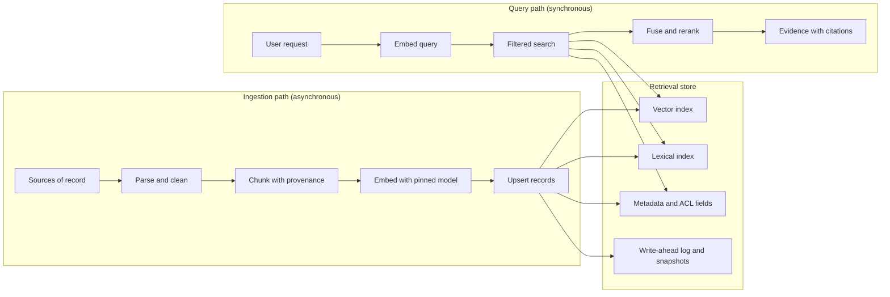

The diagram shows three points that drive the rest of the chapter. The write path feeds several structures at once (vector index, lexical index, metadata, log), so a record is not "in the store" until all of them reflect it, and the delay between the write call and visibility in every structure is the freshness contract. The query path touches the same structures, so a filter on metadata and a search on vectors must cooperate inside the engine for recall to hold under restrictive predicates. And the embedding step appears on both paths: a model mismatch between the two paths produces results that look valid and rank wrongly.

### 2.2 What the store should own

A clear division of responsibility prevents the two most common architecture errors, which are expecting the store to do jobs it cannot do and re-implementing jobs the store does better.

The store should own: persistent storage of vectors and metadata with a documented durability contract; approximate nearest-neighbor (ANN) search with tunable accuracy; predicate evaluation over metadata at query time, integrated with the search; lexical or sparse retrieval when the product offers it; idempotent upsert and delete by identifier; snapshotting or backup; replication for availability; and the metrics needed to observe all of these.

The store should not own: the embedding model (a separate versioned service, so that the model can change without changing the store), the authoritative document text and permissions (a source of record elsewhere), chunking decisions (a pipeline concern with its own versioning), the end-to-end relevance judgment (an evaluation harness), or the generation step. A store that is also asked to be the only copy of the documents becomes impossible to rebuild after a model change, because the original text is gone.

A useful principle is to keep the store rebuildable. If you can recreate every record from the source of record, a pinned chunking configuration, and a pinned embedding model, then the store is a cache with a very expensive miss, and every disaster recovery and migration plan in this chapter simplifies. If the store holds information that cannot be regenerated (for example, user-curated annotations stored only as metadata), that data needs its own backup path, and the store needs to be treated as a system of record for those fields.

### 2.3 The record schema

Whatever the product, a retrieval record carries the same fields. The schema below is vendor-neutral, and every later section refers to it.

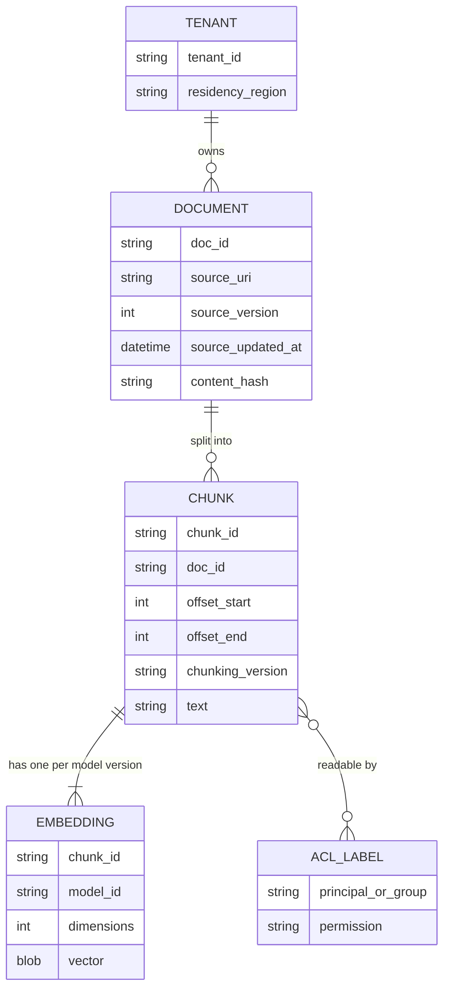

The record identifier should be deterministic, for example a hash of document identifier, chunking version, and chunk ordinal, so that re-running ingestion produces the same identifiers and an upsert replaces rather than duplicates. The content hash allows the pipeline to skip re-embedding unchanged chunks, which is a direct cost saving: embedding calls are priced per token, and a nightly full re-embed of a stable corpus is wasted spending. The model identifier on the embedding is what makes safe migration possible: two vectors with different model identifiers must never be compared, and the store should make it structurally difficult to do so, by keeping them in separate indexes or separate named vector fields.

Fields that appear in filters should be designed for the filter. A tenant identifier, a document type, a language, a date range, a classification level, and a list of permitted group identifiers are all typical. High-cardinality list fields (the group identifiers a document is readable by) cost index space in every product and behave differently under filter evaluation, which Section 7 and Section 10 examine.

### 2.4 Latency budget

An interactive RAG request has a total latency target, and the retrieval step shares it with query embedding, reranking, and generation. Illustrative budget for a 2.5-second time-to-first-token target (illustrative, replace with your own measurements):

| Step | Budget (ms) | Notes |
| --- | --- | --- |
| Authentication and authorization lookup | 30 | Cached group membership |
| Query embedding | 60 | Hosted model call, same region |
| Vector and lexical search | 80 | p95, including filter evaluation |
| Rerank top 50 | 250 | Cross-encoder, the largest retrieval-side cost |
| Prompt assembly | 20 | |
| Model queueing and prefill | 1,200 | Dominates |
| Margin | 760 | |

The point of such a table is to show that vector search is rarely the largest term. A store that answers in 20 ms instead of 80 ms saves 60 ms against a 2,500 ms budget. Selection should therefore not be driven by peak unfiltered speed. It should be driven by whether the store holds its recall and its p99 latency under the real filters, the real write rate, and the real concurrency, because tail behavior and recall are where products differ materially.

## 3. Product Categories and How They Differ Operationally

Products change quickly, and names that lead a category this quarter may not next year. The categories are more durable than the names, because they are defined by operational properties: where the index lives, what else the system is responsible for, how it scales, and who runs it. This section describes the categories, gives current examples with their documentation, and then states how to verify any product claim yourself.

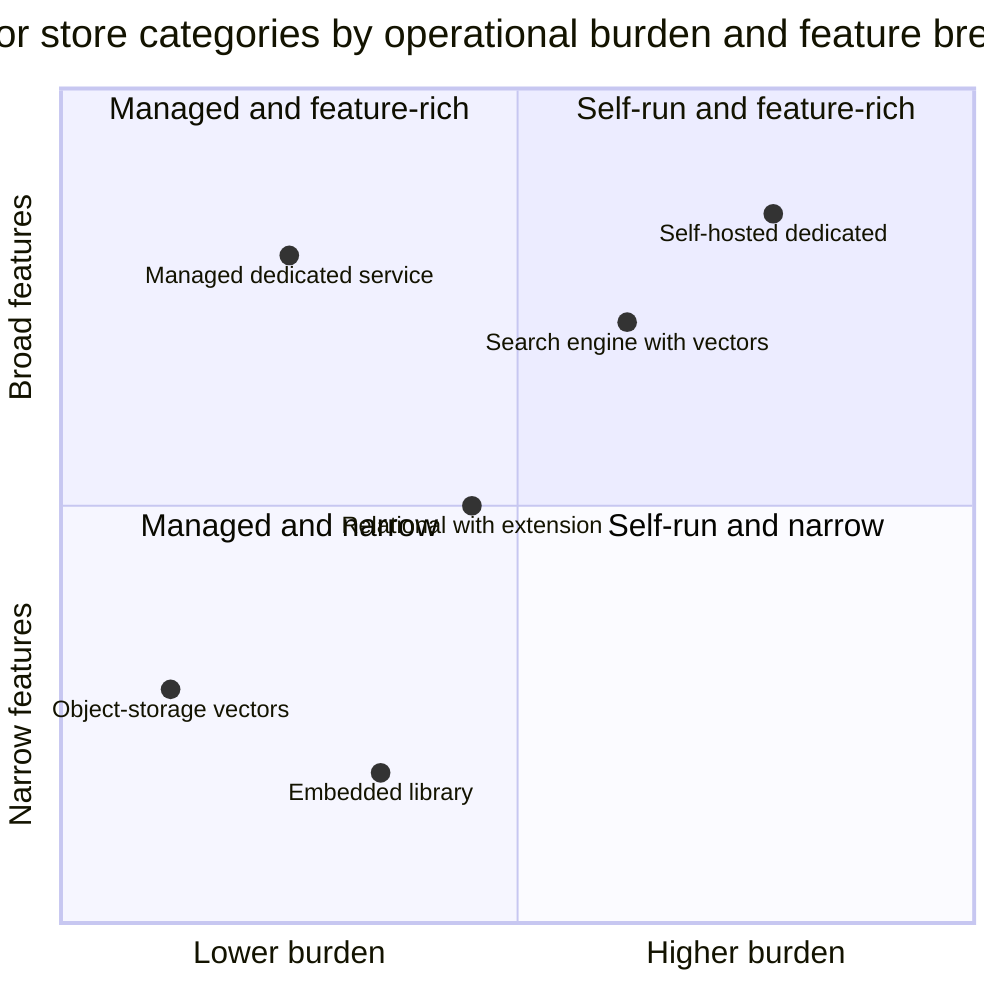

The chart is a rough positioning aid (the coordinates are the author's judgment, not measurements). It shows that operational burden and feature breadth are separate axes, and that the cheapest-to-operate options are not the least capable in every dimension: an object-storage vector service has little to run and a narrow feature set, while a self-hosted dedicated database has the broadest control and the most to operate.

### 3.1 Dedicated vector databases

A dedicated vector database is a system whose primary data model is the vector with attached metadata, and whose storage engine, query planner, and cluster management are built around approximate search. Examples at the time of writing include Pinecone (managed only), Weaviate, Qdrant, and Milvus (open source with managed offerings; Zilliz Cloud is the managed service from the Milvus maintainers). Check each vendor's documentation for the current deployment options and license, because both change.

What differs operationally from a general database:

- The index is the product. Segment management, index build and merge policies, quantization options, and filter-aware graph construction are first-class features with tuning surface. For example, Qdrant documents [payload-based multitenancy](https://qdrant.tech/documentation/manage-data/multitenancy/) and builds filterable HNSW links for indexed payload fields, and Elasticsearch-class engines document specific quantization defaults, which shows how much of the product surface is index behavior.
- Scale-out is designed for vectors. Sharding, replication, and rebalancing treat large vector segments as the unit, and compute can often scale separately from storage. Managed serverless offerings go further and bill for reads, writes, and storage instead of nodes. Pinecone, for instance, documents per-plan namespace limits and read-unit pricing in its [object limits](https://docs.pinecone.io/reference/api/database-limits/object-limits) and [cost](https://docs.pinecone.io/guides/manage-cost/understanding-cost) pages.
- The surrounding database features are thinner. Cross-record transactions, rich joins, and general query languages are usually absent or limited. The store is not where you ask "which customers' invoices mention this contract and are overdue."
- A second system must be operated and secured. Every dedicated store adds a network hop, a credential set, a backup path, an upgrade schedule, a data-processing agreement (if managed), and a consistency boundary between the system of record and the index.

When this category fits: the corpus is large (tens of millions of vectors and up) or growing quickly; recall and latency under filters are product requirements; the team wants retrieval-specific features such as built-in hybrid search, multi-vector fields, or per-tenant isolation primitives; and the organization can absorb one more data system.

### 3.2 Vector features in general databases and search engines

The second category adds vector types and ANN indexes to a system that already exists for another reason. The motivation is to keep vectors next to the authoritative records, so that metadata, permissions, transactions, backup, and monitoring come for free.

**PostgreSQL with pgvector.** The [pgvector extension](https://github.com/pgvector/pgvector) adds the `vector` type (single-precision), `halfvec` (half-precision), `bit` (binary), and `sparsevec` (sparse) types, several distance operators, and two ANN index types, HNSW and IVFFlat. Documentation notes limits on how many dimensions can be indexed for each type (for example, the `vector` type is limited to 2,000 indexed dimensions and `halfvec` to 4,000 at the time of writing; verify in the README for your version). Version 0.8.0 added iterative index scans, which continue scanning the index when a filter removes too many candidates, directly addressing the filtered-recall problem of Section 7. Because a pgvector index lives inside PostgreSQL, a vector query can be a single SQL statement that joins to authoritative tables and applies row-level security, and a write to the vector column is part of an ordinary transaction. The cost is that index build and maintenance compete with transactional workload for the same CPU, memory, and storage, and that a single primary limits write scale unless the data is partitioned or sharded.

**Elasticsearch and OpenSearch.** Search engines have indexed text for decades, so adding dense vectors gives hybrid retrieval in one system. Elasticsearch documents [Better Binary Quantization (BBQ)](https://www.elastic.co/docs/reference/elasticsearch/mapping-reference/bbq) for dense vectors and, in recent versions, an on-disk variant; its 9.1 release notes describe ACORN for filtered vector search and BBQ as a default quantization method for suitable fields (verify per version and deployment type, because defaults depend on dimensions and version). OpenSearch offers HNSW through multiple engines and has its own quantization and disk-based modes. The operational model is a cluster of shards, with the familiar costs of heap tuning, shard sizing, segment merges, and rolling upgrades, and the familiar strengths of mature lexical scoring, aggregations, and security plug-ins.

**MongoDB Atlas Vector Search, Redis, and others.** MongoDB Atlas runs vector indexes as a separate search process alongside the database, so documents and vectors live in the same collection and the same permission model. Redis offers vector fields and ANN search within its in-memory engine, which makes the memory arithmetic of Section 5 unforgiving but gives very low latency and reuse of an existing cache tier. SQL Server 2025 introduced a native `vector` type and distance functions, and Microsoft documents a DiskANN-based vector index and `VECTOR_SEARCH` function that are generally available in Azure SQL Database and related managed offerings while still in preview in SQL Server 2025 itself at the time of writing, according to the [Microsoft documentation](https://learn.microsoft.com/en-us/sql/t-sql/functions/vector-search-transact-sql?view=sql-server-ver17); check the page for your edition and update policy. Oracle Database offers AI Vector Search with its own vector type and index options, and Apache Cassandra added a vector type and storage-attached indexes for ANN in version 5. For each of these, look up the supported index types, maximum dimensions, filter behavior, and whether index updates are synchronous, because those four facts decide fit.

What differs operationally from a dedicated database:

- One system, one blast radius. The vector workload and the transactional workload share failure domains, which is a simplification when load is small and a risk when a heavy index build or a spike of similarity queries slows the application database.
- The planner decides. In SQL databases, whether a query uses the vector index or a sequential scan depends on cost estimates and settings, so a query that is fast in testing can fall back to a scan in production when a filter changes selectivity. Check query plans as part of testing.
- Transactional guarantees extend to vectors in some products and not others. A relational store gives read-your-writes for a committed insert in the usual way (index visibility is part of the transaction), while a search-engine or sidecar index typically refreshes asynchronously.
- Feature breadth for retrieval varies. Some provide hybrid search natively, some require assembling it from a lexical index and a vector index with fusion in application code.

When this category fits: the vector count is modest relative to the host database's capacity (commonly up to a few million to low tens of millions of vectors, but measure), metadata and permissions already live in that database, transactional consistency between records and vectors matters, and the team strongly prefers fewer systems. The boundary moves with hardware and version, so treat any rule-of-thumb threshold as a hypothesis to test with the sizing method of Section 5 and the recall method of Section 6.

### 3.3 Cloud-managed offerings

The third category is defined by who runs the service, not by data model. It includes managed versions of the above and cloud-native services that exist only as managed products.

- **Azure AI Search** combines text, vector, and hybrid retrieval with semantic ranking in a managed search service, with documented vector optimization options (narrow data types, scalar and binary quantization, dimension truncation for Matryoshka-trained models, and option to avoid storing a redundant full-precision copy) in its [vector index size documentation](https://learn.microsoft.com/en-us/azure/search/vector-search-index-size?tabs=portal-vector-quota). Capacity is provisioned in partitions and replicas, and vector storage counts against a per-service quota, so sizing is a quota exercise.
- **Vertex AI Vector Search** is Google Cloud's managed vector search, built on technology from Google Research (the ScaNN algorithm). A 2.0 generation introduces collections that store data objects and metadata together and describes itself as a managed, auto-tuning engine, per the [overview](https://cloud.google.com/vertex-ai/docs/vector-search-2/overview). Verify which generation your project uses, because the data model and APIs differ.
- **Amazon OpenSearch Service and OpenSearch Serverless** provide the OpenSearch engine as a managed service, with serverless collections that scale compute separately. **Aurora PostgreSQL and RDS PostgreSQL with pgvector** give managed PostgreSQL with the extension, so category 2 operations with category 3 administration.
- **Amazon S3 Vectors** is vector storage in an object-storage service. AWS announced general availability in December 2025 with up to two billion vectors per index and 10,000 indexes per vector bucket, with sub-second latency for infrequent queries and roughly 100 ms or less for frequent ones, per the [announcement](https://aws.amazon.com/about-aws/whats-new/2025/12/amazon-s3-vectors-generally-available?ref=awsweekly.info). Its position is cold-to-warm retrieval at very low storage cost, not high-QPS low-latency serving; it fits large archives, many small tenants, and workloads with infrequent queries, and AWS also documents integration with OpenSearch for tiering hot data.
- **AlloyDB for PostgreSQL** (Google Cloud) supports pgvector HNSW and adds a ScaNN-based index through the `alloydb_scann` extension, which Google describes as having a smaller memory footprint and faster build than HNSW, per the [AlloyDB documentation](https://cloud.google.com/alloydb/docs/ai/create-scann-index).

The operational differences within this category come from the unit of billing and the unit of scaling. A node-based service (provisioned search units, instance sizes) costs the same whether it is idle or busy and demands capacity planning. A serverless service bills per request and per gigabyte stored, which suits spiky or small workloads and can surprise on large steady query volume. An object-storage service bills mostly for storage and requests and trades latency for cost. Every managed service has quotas on dimensions, vectors per index, indexes per account, request rates, and payload sizes; these are the first things to read, because a quota discovered in production is an outage.

Managed services also introduce provider boundaries: data residency regions, network access modes (public endpoint, private link), customer-managed encryption keys, audit logging integration, and exit paths. Section 15 and Section 20 cover these.

### 3.4 Embedded and in-process libraries

The fourth category runs inside the application process or as a local file, with no server.

- **FAISS** (Facebook AI Similarity Search) is a library of index implementations, including flat, IVF, product quantization, and HNSW variants, with GPU support. It is a toolkit, not a database: it has no metadata filtering to speak of beyond ID selectors, no built-in persistence management beyond serialization, and no concurrency control for writers.
- **hnswlib** is a compact HNSW implementation with a simple API. It supports incremental inserts and marking deletions, and has no metadata or storage layer. Check maintenance status and the fork you depend on, since several forks exist.
- **Chroma** offers an embedded mode with persistent local storage and a client/server mode, with collections, metadata filters, and a simple API aimed at prototyping and small deployments. Verify the current deployment modes and distributed offering in its documentation.
- **LanceDB** stores data in the Lance columnar format and runs embedded, with vector indexes (for example, IVF with product quantization), full-text search, and the ability to keep data in object storage while querying from compute that reads it. It targets larger-than-memory data on a single node or with cloud storage.
- **sqlite-vec** is a SQLite extension that stores vectors in virtual tables and searches them; at the time of writing its documentation describes it as pre-v1 and the core search as brute force, so expect API changes and linear-scan cost. It fits tiny corpora, local-first apps, and edge devices.

What differs operationally: there is no network hop, no cluster, and no separate service to secure, which makes these the cheapest and fastest option for bounded data. The cost is that the application owns everything else: concurrency, persistence consistency, replication, backup, and multi-process access. Scale is limited to one machine's memory or disk. Multi-tenant isolation is the application's responsibility. For a desktop assistant, a command-line tool, a per-user local index, an offline evaluation harness, or a corpus under a few hundred thousand chunks that rarely changes, this category is often the correct answer, and choosing a distributed database for it would be over-engineering.

### 3.5 Verifying product claims

Product facts in this domain have short half-lives. Before relying on any capability, limit, price, or license in a design:

1. Read the vendor's current documentation page for that exact feature, and record the version and date next to your decision.
2. Distinguish generally available features from preview, beta, and "coming soon." Preview features may lack service level agreements, change APIs, or be unavailable in your region.
3. Read the limits and quotas page: maximum dimensions, vectors per index, metadata size per record, filter expression size, request rate, batch size, number of tenants, and number of indexes.
4. Read the license for self-hosted software. Several vector and search products have changed licenses over the years, and the change affects whether you may offer the software as part of a service.
5. Run your own test with your vectors, your filters, and your query mix. Vendor benchmarks use fixed public datasets, default filters, and tuned parameters.

The comparison table summarizes the categories on the properties that decide operational fit. Treat the entries as tendencies, not guarantees.

| Property | Dedicated database | General database or search engine | Cloud-managed service | Embedded library |
| --- | --- | --- | --- | --- |
| Who runs it | You or the vendor | You, or a cloud provider | Cloud provider | The application |
| Typical comfortable scale | Tens of millions to billions | Thousands to tens of millions, product-dependent | Varies; some serve billions | Thousands to a few million per process |
| Transactional consistency with source records | Separate system, eventual | Strongest in relational products | Depends on base product | Application-defined |
| Hybrid lexical plus vector | Usually built in | Strong in search engines, add-on elsewhere | Often built in | Often absent; assemble yourself |
| Filtered search quality | Designed for it, product-specific | Planner-dependent; verify | Product-specific | Minimal; mostly post-filter |
| Multitenancy primitives | Namespaces, partitions, collections | Schemas, row policies, indices | Per-service quotas | Application-defined |
| Operations burden | Medium to high self-hosted, low managed | Existing team skills apply | Low | Low infrastructure, high application code |
| Exit cost | Moderate (export vectors and metadata) | Low to moderate | Moderate, plus provider coupling | Low |

## 4. Index Types: What You Need to Know to Select

Part 06 CH21 teaches how these indexes are built. This section keeps only what a selection decision needs: for each index family, what it costs in memory, what it does to recall and latency, how it behaves under updates, and which parameter moves the recall dial.

### 4.1 Flat (exact) search

A flat index stores vectors in a plain array and compares the query with every one. Recall is 1.0 by definition. Cost per query is $N \cdot d$ multiply-add operations for $N$ vectors of $d$ dimensions. For $N = 1{,}000{,}000$ and $d = 768$ that is $7.68 \times 10^{8}$ multiply-adds, which a modern multi-core CPU with vectorized instructions performs in tens of milliseconds, and a GPU in a few milliseconds. Memory-bandwidth is the limit: scanning $1{,}000{,}000 \times 768 \times 4 = 3.07$ GB of float32 data per query, at an effective 20 GB/s per socket, takes about 150 ms for one query, and batching queries amortizes the scan.

Flat search is the right answer more often than product marketing suggests. It needs no build step, no tuning, supports any filter exactly (scan only matching rows, which is the pre-filter strategy of Section 7), has trivial updates, and is the ground truth against which every approximate index is measured. Under roughly 100,000 vectors, or when the filter reduces the candidate set to a few thousand (as with a per-tenant partition), exact search is often fast enough and removes the entire recall question.

### 4.2 Graph indexes (HNSW)

Hierarchical Navigable Small World (HNSW; Malkov and Yashunin, 2016, published 2018) builds a layered proximity graph. A search enters at the top layer, greedily walks to the neighbor closest to the query, descends a layer, and repeats, ending with a best-first search on the bottom layer that keeps a candidate list of size `ef_search`.

Selection-relevant properties:

- **Memory.** The full-precision vectors are usually kept in RAM along with the graph. The graph itself costs about $2M$ links per node on the bottom layer, each link a 4-byte identifier, where $M$ is the construction parameter for links per node (commonly 8 to 64; 16 is a frequent default). Section 5 works the arithmetic.
- **Recall and latency.** Query-time `ef_search` is the recall dial: larger values visit more nodes, raising recall and latency together. Recall of 0.95 to 0.99 at single-digit-millisecond latency on a million-vector corpus is typical for well-behaved embeddings, but the exact numbers depend on data and must be measured.
- **Build cost.** Construction is expensive (each insert runs a search), governed by `ef_construction`. Building tens of millions of vectors can take hours, and build time competes with serving on shared hardware.
- **Updates.** Inserts are supported incrementally. Deletes are usually soft: the node stays in the graph (as a tombstone) to preserve connectivity until a rebuild or compaction. Heavy delete churn degrades recall and wastes memory until the graph is rebuilt.
- **Filters.** A graph walk with a predicate must handle visiting nodes that do not match; naive handling collapses recall under restrictive filters (Section 7).

HNSW is the default in most products because it gives the best recall-latency trade-off for in-memory data. Its weakness is memory: the vectors and graph must be resident for low latency, which sets the cost floor.

### 4.3 Inverted file (IVF) indexes

An inverted file index clusters vectors with k-means into $n_{list}$ cells. A query finds the `nprobe` nearest cell centroids and scans only the vectors in those cells.

- **Memory.** Little beyond the vectors themselves plus a centroid table. Combined with compression it is the common choice for very large data.
- **Recall and latency.** `nprobe` is the dial. The fraction scanned is about $nprobe / n_{list}$ when cells are balanced, so latency scales linearly with it. Recall depends on how many true neighbors fall outside the probed cells, which is worst for queries near cell boundaries. The experiment in Section 6.3 shows the typical shape.
- **Build and updates.** Training the centroids needs a representative sample. New vectors are assigned to the nearest existing centroid, so if the data distribution drifts (a new language, a new document type), cells become unbalanced and recall drifts down until retraining. IVF suits relatively static corpora and tolerates bulk loads well.
- **Filters.** IVF handles a filter by scanning probed cells and testing the predicate on each vector, so selectivity changes how many vectors survive among those scanned, not whether the structure can be navigated. This makes it more predictable than a graph under filters, though the result count can still fall below $k$.

### 4.4 Quantization and product quantization

Quantization replaces each float with fewer bits. The three families that matter for selection:

- **Scalar quantization** maps each dimension to 8 bits (4x smaller than float32) or 4 bits (8x). Recall loss is usually small for text embeddings at 8 bits.
- **Binary quantization** keeps one bit per dimension (32x smaller than float32), compares with Hamming distance, and then rescoring candidates with the full-precision vector. Methods such as Elasticsearch's BBQ report high recall at large memory reductions for text embeddings; the Elastic documentation recommends it for most text-model embeddings and notes a minimum of 64 dimensions. Binary quantization works better for higher-dimensional vectors because each bit carries less of the signal.
- **Product quantization (PQ)** splits the vector into $m$ subvectors and replaces each with the index of its nearest codeword in a learned codebook of 256 entries (8 bits), giving $m$ bytes per vector. For $d = 1024$ and $m = 128$ that is 128 bytes instead of 4,096, a 32x reduction. PQ gives the largest compression for a given error but needs training and loses more recall than scalar quantization, so it is usually paired with a rescoring step.

The rescoring pattern is the key design choice. The compressed vector gives a fast candidate list (for example, the top 100), and the full-precision vector is fetched from SSD for exactly those candidates to compute exact scores and produce the final top-$k$. Memory holds the compressed index; SSD holds the originals. Several products expose this as an "oversampling" factor: with oversampling 4 and $k = 10$, the engine retrieves 40 candidates by compressed distance and rescores them with full-precision vectors. Azure AI Search, for example, documents quantization with oversampling and rescoring and an option to not store the redundant full-precision copy when you accept the loss ([Azure AI Search quantization](https://learn.microsoft.com/en-us/azure/search/vector-search-how-to-quantization)).

Matryoshka-trained embedding models allow a second kind of compression: truncating the vector to its first $d' < d$ dimensions with a small, measurable quality loss (see CH16). Truncation and quantization compose: 1024 float32 dimensions truncated to 256 and binary quantized take $256 / 8 = 32$ bytes instead of 4,096, a factor of 128. Whether the quality loss is acceptable is an empirical question answered by the evaluation of Section 6.

### 4.5 Disk-based and DiskANN-style indexes

When the corpus is too large for RAM at an acceptable price, disk-resident graph indexes keep a compressed copy of the vectors (often PQ codes) in memory for navigation, and the graph structure plus full vectors on SSD. DiskANN (Subramanya et al., 2019) is the best-known design; the Vamana graph it builds is arranged so that a search needs a small number of SSD reads, each reading one node and its neighbor list in a single block. Microsoft documents a DiskANN-based vector index in SQL Server 2025 and Azure SQL, and several dedicated and search engines offer disk-based modes (Elasticsearch documents a disk-based BBQ variant and its DiskBBQ design combines inverted-file clustering with binary quantization).

Selection-relevant properties: memory use falls to a fraction of RAM-resident HNSW, latency rises from low single-digit to a few to tens of milliseconds because of SSD reads, and throughput depends on SSD random-read performance (IOPS), so cloud network-attached disks with throttled IOPS can make the same index several times slower than local NVMe. Updates and deletes are more complex than for in-memory graphs and are often handled by periodic merges.

### 4.6 Choosing an index family

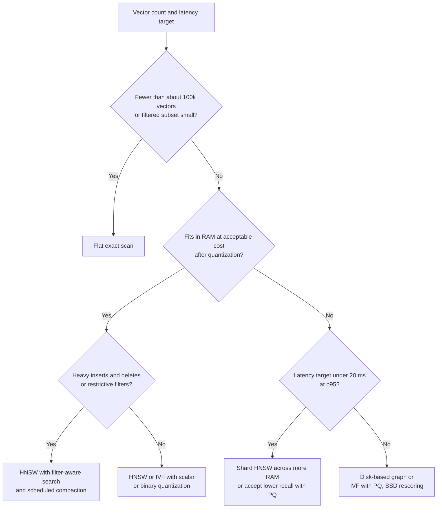

The tree encodes the dominant trade-off: memory cost against latency. It does not replace measurement, because the thresholds depend on dimensions, hardware, and the filter mix.

| Index | Memory per vector (1024-d float32 data) | Recall lever | Latency lever | Updates | Fits when |
| --- | --- | --- | --- | --- | --- |
| Flat | 4,096 B | None (exact) | Hardware | Trivial | Small corpus or small filtered subset |
| HNSW | 4,096 B plus about 137 B graph | `ef_search`, `M` | `ef_search` | Incremental; deletes leave tombstones | In-memory serving, low latency |
| HNSW plus scalar quantization (int8) | about 1,024 B plus graph, originals on SSD if rescoring | `ef_search`, oversampling | Same | Same | RAM is the cost driver |
| IVF with flat cells | 4,096 B | `nprobe` | `nprobe` | Bulk friendly; drift needs retraining | Large static data |
| IVF with PQ | 32 to 128 B | `nprobe`, rescoring depth | `nprobe` | Same | Very large data, compressed |
| Binary quantization with rescoring | 128 B plus originals on SSD | Oversampling | Oversampling | Product-specific | High-dimensional text embeddings, RAM-limited |
| Disk graph (DiskANN style) | Compressed vectors in RAM, graph on SSD | Search list size | Search list size, SSD IOPS | Merges | Billions of vectors, moderate latency |

## 5. Capacity and Cost Sizing

Sizing is arithmetic that should be done on paper before any product is purchased, and again with measured values before launch. The runnable [sizing calculator](../code/python/vector-retrieval-chapter/01_sizing_calculator.py) implements every formula in this section.

### 5.1 The memory model

For $N$ records with $d$-dimensional vectors stored at $b$ bytes per dimension, raw vector storage is

$$
S_{vec} = N \cdot d \cdot b
$$

where $b = 4$ for float32, 2 for float16, 1 for int8, and $1/8$ for binary. A bottom-layer HNSW graph with $M$ links per node stores up to $2M$ identifiers of $w$ bytes each (commonly $w = 4$ for up to about 4.29 billion nodes in one segment), and the upper layers add a small fraction. With an upper-layer factor $u$ of about 0.07 (a geometric series: the expected number of nodes above layer 0 is about $1/(M-1)$ of the total, so $u$ is small for $M = 16$, and I use 0.07 as a round, slightly conservative factor):

$$
S_{graph} = N \cdot 2M \cdot w \cdot (1 + u)
$$

Metadata, the lexical index, payload indexes, and engine overhead add more. Metadata can be larger than the vectors when each chunk stores its text.

**Worked example: graph overhead.** For $M = 16$, $w = 4$, $u = 0.07$: per node $2 \cdot 16 \cdot 4 \cdot 1.07 = 137$ bytes. For 1024-dimensional float32 vectors (4,096 bytes), the graph is $137 / 4096 = 3.3$ percent of the vector bytes. For 128-dimensional float32 vectors (512 bytes), the same graph is 27 percent. For int8 vectors at 1024 dimensions (1,024 bytes), it is 13 percent. Graph overhead matters more as vectors shrink, which is why quantization savings are smaller than the vector ratio suggests.

**Worked example: a 50-million-chunk corpus.** Take $N = 50{,}000{,}000$, $d = 1024$, $M = 16$. The calculator gives:

| Format | Vector GiB | Graph GiB | Hot set GiB | With 30% headroom GiB | Originals on SSD GiB |
| --- | --- | --- | --- | --- | --- |
| float32 | 190.73 | 6.38 | 197.11 | 256.25 | 0 |
| float16 | 95.37 | 6.38 | 101.75 | 132.27 | 0 |
| int8 plus float32 rescoring | 47.68 | 6.38 | 54.06 | 70.28 | 190.73 |
| binary plus float32 rescoring | 5.96 | 6.38 | 12.34 | 16.04 | 190.73 |

Arithmetic for the first row: $50{,}000{,}000 \times 1024 \times 4 = 204.8 \times 10^{9}$ bytes, divided by $1024^3 = 1.0737 \times 10^{9}$, is 190.73 GiB. Graph: $50{,}000{,}000 \times 137 = 6.85 \times 10^{9}$ bytes, 6.38 GiB. The 30 percent headroom covers segment merges (a merge briefly holds old and new segments), index builds, the operating system page cache, and growth: $197.11 \times 1.3 = 256.25$ GiB. Metadata (assumed 300 bytes per record, 13.97 GiB) is excluded from the hot set here because filter indexes are usually much smaller than the payload; include payload indexes explicitly when you have measured their size.

Two cautions about the table. The binary row uses 1 bit per dimension and therefore an int8-to-binary jump in recall loss that must be measured, and rescoring needs the original float32 vectors on fast storage, so SSD capacity goes up as RAM goes down. The graph size assumes the engine stores exactly the structure assumed in the formula; real engines add per-node level data, locks, deleted-node bitmaps, and allocator overhead, commonly 10 to 40 percent more. Measure with a 1-million-vector sample and extrapolate linearly.

### 5.2 Nodes: capacity, replicas, and the fan-out rule

Given a node with $R$ GiB of RAM and a usable fraction $f$ for the index (the rest for the operating system, query working memory, and caches; $f = 0.7$ is a reasonable start), the number of shards needed to hold the data is

$$
n_{shards} = \left\lceil \frac{S_{hot} \cdot (1 + h)}{f \cdot R} \right\rceil
$$

where $h$ is the headroom fraction. For 64 GiB nodes, $f = 0.7$ gives 44.8 GiB usable. Float32: $256.25 / 44.8 = 5.72$, so 6 shards. Float16: $132.27 / 44.8 = 2.95$, so 3. Int8: $70.28 / 44.8 = 1.57$, so 2. Binary: $16.04 / 44.8 = 0.36$, so 1.

Replicas serve two purposes: availability and throughput. For availability, a production system needs at least two copies of each shard in different failure domains (two replicas, or three if a node loss during maintenance must not reduce redundancy). For throughput, replicas multiply query capacity, because a read goes to one replica of each shard.

The rule that surprises newcomers: **an unfiltered query fans out to every shard.** A corpus split into six shards answers each query by searching all six partitions and merging the top-$k$ lists. Adding shards makes each partition smaller and each partial search cheaper, but total work per query does not fall in proportion, so more shards raise capacity for data size but not for query throughput. Throughput scales with replica groups: a replica group is one complete copy of all shards. If routing by tenant or partition key confines a query to one shard, fan-out disappears and shards do scale throughput, which is one reason tenant-aware sharding is attractive (Section 14).

### 5.3 Queries per second

Measure queries per second per replica group by load testing at the p95 target with the real filters, then plan to run at no more than 50 percent of the measured limit in steady state, leaving headroom for traffic spikes, a lost replica, and background merges. If a replica group sustains 120 queries per second at the latency target, and the application peak is 400, then

$$
n_{groups} = \left\lceil \frac{400}{120 \cdot 0.5} \right\rceil = \lceil 6.67 \rceil = 7.
$$

Total nodes are shards times groups, with groups at least 2 for availability:

| Format | Shards | Replica groups | Total nodes | Illustrative compute per month |
| --- | --- | --- | --- | --- |
| float32 | 6 | 7 | 42 | 15,330 USD |
| int8 plus rescoring | 2 | 7 | 14 | 5,110 USD |
| binary plus rescoring | 1 | 7 | 7 | 2,555 USD |

The monthly figures assume a hypothetical 0.50 USD per hour for a 64 GiB node and 730 hours per month (365 USD per node-month), and compute only. They are illustrative; use your provider's price list. They also assume each replica group sustains 120 queries per second in every format, which is optimistic for the quantized formats because rescoring reads SSD and the quantized-distance step is cheaper per candidate but not free. Re-measure per format. The conclusion that survives a different set of assumptions is structural: because total nodes are a product of shards and groups, anything that cuts the shard count (quantization, truncation, fewer stored bytes per record) cuts cost multiplicatively when throughput, not data size, sets the group count.

### 5.4 SSD, IOPS, and the RAM-versus-SSD decision

Quantized serving moves bytes from RAM to SSD, and SSD capacity is cheap while random-read capacity is not unlimited. Take the int8 plus rescoring layout with 100 candidates rescored per query. Each candidate needs one random read of 4,096 bytes (a 1024-d float32 vector), so a query issues 100 reads. At 120 queries per second per replica group, a group needs 12,000 random reads per second. Local NVMe drives deliver hundreds of thousands of reads per second; a cloud network volume provisioned at 3,000 IOPS cannot sustain it. When a rescoring layout is slow, the cause is usually IOPS, not bandwidth or CPU. Two mitigations are reducing the oversampling factor (measure the recall cost) and keeping the originals in a memory-mapped file, so hot candidates stay in the page cache.

The decision between RAM-resident and SSD-resident serving follows from the latency target and the cost ratio. If the product requires p95 under 30 ms including filters, RAM-resident HNSW (possibly quantized) is the safe choice. If it tolerates 100 ms, disk-based indexes cut the node count by several times. If queries are rare and a second is acceptable, object-storage-based services reduce idle cost to storage price. Match the tier to the actual latency requirement; a 20 ms target set by habit instead of by user need is an expensive default.

### 5.5 Build, ingest, and embedding cost

Vector-store hardware is only part of the bill. Embedding is paid per token each time a chunk is embedded. For a corpus of 50 million chunks averaging 400 tokens, one full embedding pass is $50{,}000{,}000 \times 400 = 2 \times 10^{10}$ tokens, or 20 billion. At an illustrative 0.02 USD per million tokens (a placeholder; look up the current price for your model, since hosted embedding prices have fallen and vary by model), a full pass costs $20{,}000 \times 0.02 = 400$ USD, small against the cost of operating the index, but the same pass with a larger model at ten times the price is 4,000 USD, and with a self-hosted model on GPUs the cost is GPU hours. The embedding cost matters most for model migrations (Section 12), which are full passes, and for churn: a pipeline that re-embeds unchanged documents nightly pays that cost repeatedly, which is why the content hash of Section 2.3 exists.

Build time also costs money. An HNSW build at 50 million vectors can occupy a node for hours to days at construction-time parameters, during which a blue-green rebuild pays for both clusters. Include the overlap period in the migration budget.

### 5.6 Sizing checklist

1. Count records, not documents: estimate chunks per document from your chunking policy and sample.
2. Fix the dimension and data type from the embedding model and your quantization decision.
3. Compute vectors, graph, metadata, lexical index, and payload indexes separately, then add 30 percent headroom.
4. Choose RAM or SSD residency from the latency target.
5. Divide by usable RAM per node to get shards, then load test to get queries per second per replica group, and compute groups with 50 percent headroom.
6. Add replicas for availability and a separate environment for rebuilds and tests.
7. Price storage, compute, network egress, backup, and embedding separately, and re-run the model whenever the corpus doubles.

## 6. Measuring Recall and Latency

Part 16 CH19 teaches how to evaluate retrieval quality with relevance judgments. This section covers a narrower question: how much of the best achievable result does the approximate index lose, and at what latency? The two evaluations answer different questions and both are needed.

### 6.1 Two kinds of recall

**ANN recall** compares the approximate index with exact search on the same vectors. For a query $q$, let $T_k(q)$ be the true top-$k$ by exhaustive search and $A_k(q)$ the approximate result. Then

$$
\text{recall@}k = \frac{1}{|Q|} \sum_{q \in Q} \frac{|A_k(q) \cap T_k(q)|}{k}.
$$

This measures the loss caused by approximation only. It says nothing about whether the true neighbors are relevant to a user.

**Task recall** compares results with human or model relevance judgments: the fraction of queries for which a relevant chunk appears in the top-$k$. It measures the whole pipeline: embedding, chunking, index, filters, fusion.

The relation guides action. If task recall at exact search is 0.82 and ANN recall is 0.97, the approximate index loses little and improvements must come from embeddings, chunking, or reranking. If task recall at exact search is 0.90 and the ANN configuration yields 0.80, tune the index. Measure exact-search task recall first; it is the ceiling.

A worked count: on a 200-query labeled set with one relevant passage per query, suppose the approximate index returns that passage in its top 5 for 164 queries. Task recall@5 is $164/200 = 0.82$. If exact search on the same vectors scores 0.95 on the same set, the approximation costs 13 points, and that gap is the number that justifies changing index parameters. Re-run the comparison whenever the embedding model, chunking, filters, or index configuration change, because task recall belongs to the whole pipeline.

### 6.2 Methodology

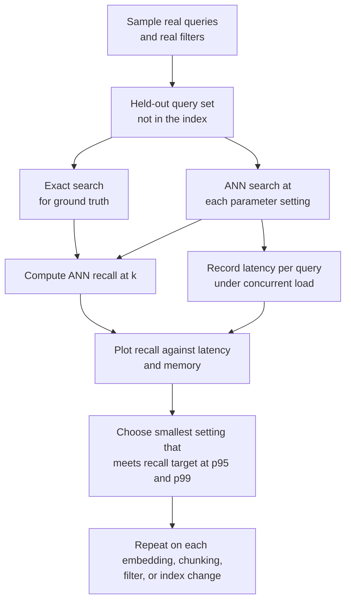

The diagram shows that the exact search is run once per query set and reused for every setting, so the ground truth is cheap relative to the sweep. The output is a frontier of recall against latency, from which you pick the cheapest point that clears the target. The final step makes the measurement a regression test: it reruns whenever anything it depends on changes.

Steps in more detail:

1. **Query set.** Use real queries (from logs, with privacy review) or realistic synthetic ones. At least 500 queries gives a 95 percent confidence interval of about plus or minus 2 points on a recall near 0.9, from $1.96 \sqrt{p(1-p)/n} = 1.96 \sqrt{0.09/500} = 0.026$. Fewer queries give wider bands, and comparisons within the band are noise. Because each query contributes $k$ neighbor checks that are not independent, treat this as an approximation.
2. **Held-out queries.** Queries identical to indexed vectors always find themselves and inflate recall. In the experiment below, queries copied from the corpus scored 0.869 recall@10 where held-out queries scored 0.825 at one probe.
3. **Ground truth.** Compute exact top-$k$ with a flat scan on the same vectors, in the same precision as the index stores. If the index quantizes, decide whether ground truth is the float32 exact result (measures total loss from quantization plus approximation) or the quantized exact result (measures approximation only). Report which.
4. **Parameter sweep.** Vary `ef_search`, `nprobe`, oversampling, or the product's equivalent across at least five values, spaced geometrically (16, 32, 64, 128, 256).
5. **Latency.** Record each query's latency and report percentiles. Averages hide the tail: p50 can be 5 ms while p99 is 80 ms because of cache misses, segment merges, or garbage collection. Report p50, p95, and p99, and the sample count. A p99 from 100 queries is the single slowest query and has no statistical meaning; use thousands.
6. **Concurrency.** Measure under the load the system will see. Single-client latency tests understate tail latency because queries contend for CPU, memory bandwidth, and disk. Increase concurrent clients until p95 reaches the target and report the throughput there.
7. **Warm and cold.** Report both. Cold-start latency after a restart or a scale-out, when the page cache is empty, can be an order of magnitude worse.
8. **Filters.** Run the sweep with the production filter mix, including the most restrictive filters. Unfiltered recall is the least informative number.
9. **Writes.** Run a concurrent write load at the expected ingest rate. Recall and latency during heavy ingest, merges, or compaction are what users experience on Monday morning when a bulk update lands.

### 6.3 A runnable experiment

The script [`02_recall_vs_ann_parameters.py`](../code/python/vector-retrieval-chapter/02_recall_vs_ann_parameters.py) builds an inverted-file index in plain Python over 8,000 synthetic unit vectors (24 dimensions, 40 clusters, 64 lists), computes exact top-10 for 100 held-out queries, and measures recall@10 as `nprobe` rises. Its output on the author's machine:

```text
corpus=8000 dim=24 lists=64 list size min/mean/max=14/125/233
exact (flat) scan: 8000 distance computations per query, ~10.5 ms per query

held-out queries: recall@10 versus nprobe
nprobe  recall@10  dist/query   p50 ms   p95 ms
     1      0.825         213     0.36     0.56
     2      0.978         330     0.51     0.86
     4      1.000         588     1.05     1.84
     8      1.000        1112     2.19     3.57
    16      1.000        2093     4.18     6.40
    32      1.000        4081     7.94    12.81

pitfall: queries copied from the corpus (self-match always found)
  nprobe=1: copied-query recall@10=0.869  held-out recall@10=0.825
  nprobe=4: copied-query recall@10=1.000  held-out recall@10=1.000
```

Latencies are machine-dependent; the distance-computation count is not. Reading the table:

- Probing 1 of 64 lists scans 213 vectors on average (64 centroid comparisons plus about 149 list members) instead of 8,000, a 37x reduction in distance computations, and recall is 0.825.
- Doubling to 2 probes raises recall to 0.978 for 330 computations, still 24x fewer than a flat scan. The step from 1 to 2 probes buys 15 points of recall for 55 percent more work. This is the typical shape: the first increments of the dial are the most valuable.
- From 4 probes on, recall is saturated at 1.000 and the extra work is waste. The setting 4 is the engineering choice: 588 computations (13.6x fewer than flat) and full recall on this data.

The flat scan costs about 10.5 ms per query in pure Python and the best approximate setting about 1 ms, so the measured speedup is about 10x, below the 13.6x predicted by operation counts because of overhead from sorting centroids and building candidate lists. Two caveats are important. The data is well separated (40 clusters, 64 lists), which flatters IVF; real embeddings have continuous structure and need larger `nprobe` for the same recall. And pure Python distance costs dominate, so these timings say nothing about production engines. What transfers is the method: exact baseline, held-out queries, a parameter sweep, a machine-independent cost measure, and percentiles.

### 6.4 Benchmark pitfalls

- **Vendor benchmarks on public datasets.** Datasets such as those in the ANN-Benchmarks project are valuable for comparing algorithms, with fixed hardware and open code, but their vectors are not your embeddings. Distances in SIFT-like or GloVe-like datasets behave differently from modern 768 to 3072-dimensional text embeddings, and public benchmarks rarely include selective filters.
- **Comparing at different recall.** A system that is 3x faster at recall 0.90 than another at recall 0.99 is not faster. Compare at equal recall, or plot the whole frontier.
- **Tuned versus default settings.** Vendors tune their own system and use defaults for competitors. Give every candidate the same tuning budget.
- **Single-threaded versus concurrent tests.** Throughput tests with unbounded concurrency measure queue behavior, not latency. Use a closed-loop test with a fixed number of clients, or an open-loop test at a fixed arrival rate, and say which.
- **Coordinated omission.** A load generator that waits for a slow response before sending the next request underreports tail latency. Use a tool or arrival-rate model that records the intended send time.
- **Warm cache only.** Everything in memory after a warm-up pass is the best case.
- **Fresh index versus aged index.** An index built once from a bulk load behaves differently after weeks of upserts and deletes. Test after a churn period, and after compaction.
- **Ignoring result count.** A filtered query that returns 6 results when 10 were requested has not "high recall" but missing results. Count short result lists as failures.
- **Statistical noise.** Differences smaller than the confidence interval of the query set are not differences.
- **Recall at the wrong $k$.** The pipeline may retrieve 50 candidates for reranking and use only 5. Measure ANN recall at the depth the pipeline requests, and task recall at the depth the model consumes.

## 7. Metadata Filtering

Almost every production query carries a predicate: this tenant, documents this user may read, published after a date, in this language, not deleted. The semantics are simple, "the nearest neighbors among the records that match." The engineering is not, because the index structures that make nearest-neighbor search fast were built without regard to the predicate.

### 7.1 Three strategies

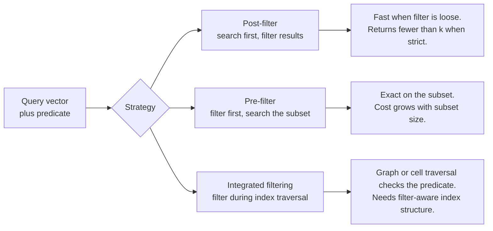

**Post-filtering** asks the index for the top $m$ nearest neighbors globally, then discards those that fail the predicate. If a fraction $s$ of the records match (the selectivity), the expected number of survivors from $m$ candidates is $m \cdot s$. To get $k$ results you need $m \approx k / s$. At $s = 0.01$ and $k = 10$, that is $m = 1{,}000$. At $s = 0.0002$ (a tenant with 10,000 of 50,000,000 chunks), $m = 50{,}000$, and the global search is paying to look through 50,000 other tenants' neighbors. Post-filtering is cheap and correct when the predicate is loose and fails badly when it is strict. It also has a security consequence: the unfiltered candidates have been retrieved inside the engine, including records the caller may not see. That is acceptable only if the application never receives them and side channels such as timing and result counts are not a concern.

**Pre-filtering** applies the predicate first to select the eligible set, then searches only within it. If the engine can evaluate the predicate through a secondary index (a bitmap, an inverted list over payload values), it obtains a set of eligible identifiers. Two sub-strategies follow. If the eligible set is small (below a threshold, commonly a few thousand to tens of thousands), run an exact scan over it: recall 1.0, cost proportional to the subset size. If it is large, the engine runs the graph or cell search and checks membership as it goes, which is the integrated strategy. Pre-filtering with an exact scan is the right answer for a strict filter, and many engines choose this automatically by estimating cardinality.

**Integrated (filter-aware) traversal** evaluates the predicate while walking the index. For a graph, the naive version simply skips nodes that fail the predicate, and this is where recall collapses: skipping non-matching nodes without expanding their neighbors cuts the paths through the graph, and the matching nodes become islands. Engines therefore add structures that keep matching nodes reachable. Qdrant builds additional graph links between points that share an indexed payload value, so filtered queries find a connected subgraph ([Qdrant's description of filterable HNSW](https://qdrant.tech/articles/filtered-vector-search-acorn/)). Elasticsearch 9.1 introduced an algorithm called ACORN for filtered search ([Elastic blog](https://www.elastic.co/search-labs/blog/elasticsearch-9-1-bbq-acorn-vector-search)). pgvector 0.8 added iterative index scans that keep scanning the index until enough rows survive the filter or a limit is reached. Each approach expands the traversal beyond non-matching nodes, trading more work for recall.

### 7.2 The low-selectivity collapse, with numbers

The script [`03_filtered_search_recall.py`](../code/python/vector-retrieval-chapter/03_filtered_search_recall.py) builds a proximity graph over 3,000 clustered vectors in 16 dimensions (degree about 12 plus long-range links), draws random filters of a given selectivity, and compares four strategies against the exact filtered result (recall@10, 60 queries). Its output:

```text
N=3000 dim=16 graph degree~12 ef=40 k=10; filter = random tag set of given selectivity
selectivity  matches  post(m=ef)  post(m=10k)  filtered walk  pre-filter
      0.500     1500       0.995        1.000          0.997       1.000
      0.200      600       0.787        1.000          0.893       1.000
      0.050      150       0.185        0.488          0.163       1.000
      0.010       30       0.028        0.082          0.112       1.000
      0.003       10       0.015        0.040          0.100       1.000
```

The columns are: `post(m=ef)`, retrieve 40 candidates and filter; `post(m=10k)`, retrieve 100 candidates (10 times $k$) and filter; `filtered walk`, a traversal that discards non-matching nodes; and `pre-filter`, an exact scan of the matching subset.

What the numbers show:

- At selectivity 0.5, every strategy is near perfect, because half of any candidate list survives. Tests on loose filters give false confidence.
- At 0.2, simple post-filtering with 40 candidates drops to 0.787. The expected survivors are $40 \times 0.2 = 8$, fewer than $k = 10$, so recall is capped near 0.8 before any graph error. Oversampling to 100 candidates restores 1.000 because $100 \times 0.2 = 20$ survivors.
- At 0.05, 10-times oversampling yields only $100 \times 0.05 = 5$ expected survivors, so recall falls to 0.488. To reach $k = 10$ you need about $10 / 0.05 = 200$ candidates, and more to be safe against the random variation in how many survive.
- At 0.01 and below, post-filtering returns almost nothing: recall 0.082 and 0.040. The naive filtered walk degrades more slowly (0.112 and 0.100) but is also broken, because the matching nodes are scattered at random and the walk cannot route between them.
- Pre-filter by exact scan is 1.000 at every selectivity, because it is exact. Its cost is the subset size: scanning 30 or 150 vectors is trivial; scanning 1,500 is still cheap here, but at 50 million records and selectivity 0.2, the matching subset has 10 million vectors, and an exact scan is not viable.

The practical rule that falls out: choose the strategy from the estimated number of matching records, $N \cdot s$. Below a threshold such as 10,000 matches, scan exactly. Above it, use an index traversal that is aware of filters, and make sure it expands past non-matching nodes. In between, there is a danger zone where the subset is too big to scan and too sparse for a naive walk, and this is where most real-world filtered-recall bugs live. Some engines expose the threshold; others hide it. Test at selectivities from 50 percent down to 0.01 percent, and look specifically at the result count.

Random filters, as in the script, are the worst case for graphs. Real filters are usually correlated with the vectors: documents of the same tenant tend to be semantically similar to each other, so the matching nodes form a cluster in the graph and a walk that reaches the cluster stays in it. Correlation helps a naive walk when the query is also from the same tenant and the entry point is in the right region, and hurts when the query is far from the matching cluster, as with an exploratory question that mostly resembles other tenants' content. Measure with your real tenant and filter distributions.

### 7.3 Practical guidance

1. **Index the fields you filter on.** Without a payload or secondary index, evaluating the predicate means testing each candidate record. Qdrant, for example, documents payload indexes for exactly this, and in a relational database a B-tree or GIN index on the filter column lets the planner estimate selectivity.
2. **Prefer partitioning to filtering for the dominant filter.** If every query filters on tenant, make the tenant a partition, namespace, or index boundary (Section 10). Partitioning turns a filter into a routing decision, and there is nothing to collapse.
3. **Return the count along with the results.** Monitor the fraction of queries returning fewer than $k$ results, and alert on it. It is the clearest symptom of a filter problem.
4. **Overfetch deliberately.** If the engine only supports post-filtering, overfetch by $k / s_{\min}$, where $s_{\min}$ is the smallest selectivity you expect, and cap it to keep the cost bounded. When even the cap is insufficient, fall back to a flat scan over the matching subset using the secondary index.
5. **Treat the query planner as a variable.** In SQL products, the planner chooses between a vector index scan and a sequential scan from statistics. Run `EXPLAIN` on real queries after changes to data volume or filter distribution, update statistics, and check that settings such as iterative scan limits are set for the workload.
6. **Express access control as a filter that the engine enforces, not as a post-processing loop in application code.** Enforcement inside the engine means the unauthorized record is never returned.
7. **Check the filter language.** The set of supported operators (equality, range, set membership, negation, nested objects, array contains), the maximum size of an `IN` list, and whether filters combine with hybrid search differ across products. A filter of 3,000 group identifiers may not be supported or may be slow; Section 10 shows how to avoid that.

## 8. Hybrid Search: Lexical, Dense, and Sparse

### 8.1 Why dense retrieval alone is not enough

Dense embeddings map text to a point in a space where semantic similarity is geometric closeness. They are strong at paraphrase ("how do I get my money back" matches "refund policy") and weak at exact tokens that carry meaning only as strings: product codes, error numbers, names, identifiers, rare acronyms, and negation. The toy experiment in [`04_hybrid_fusion.py`](../code/python/vector-retrieval-chapter/04_hybrid_fusion.py) shows the mechanism in miniature: for the query "error E-4021", a concept-based semantic ranker finds nothing (no token in the query maps to any concept), and a lexical BM25 ranker returns the exact document. Real embedding models do not return nothing, but they return documents about errors in general, and the exact match may rank below them.

Lexical retrieval, usually BM25 (Robertson and Zaragoza, probabilistic relevance framework), scores a document by weighted term overlap, rewarding rare terms (inverse document frequency) and discounting repeated ones (term-frequency saturation, parameter $k_1$) and long documents (length normalization, parameter $b$). It is strong where dense retrieval is weak and weak where dense retrieval is strong: it cannot match "money back" to "refund" without a synonym list.

Hybrid retrieval runs both and combines the results. In evaluations on many retrieval benchmarks, hybrid combinations tend to beat either component alone, particularly across diverse query types, though the gain on a specific corpus must be measured.

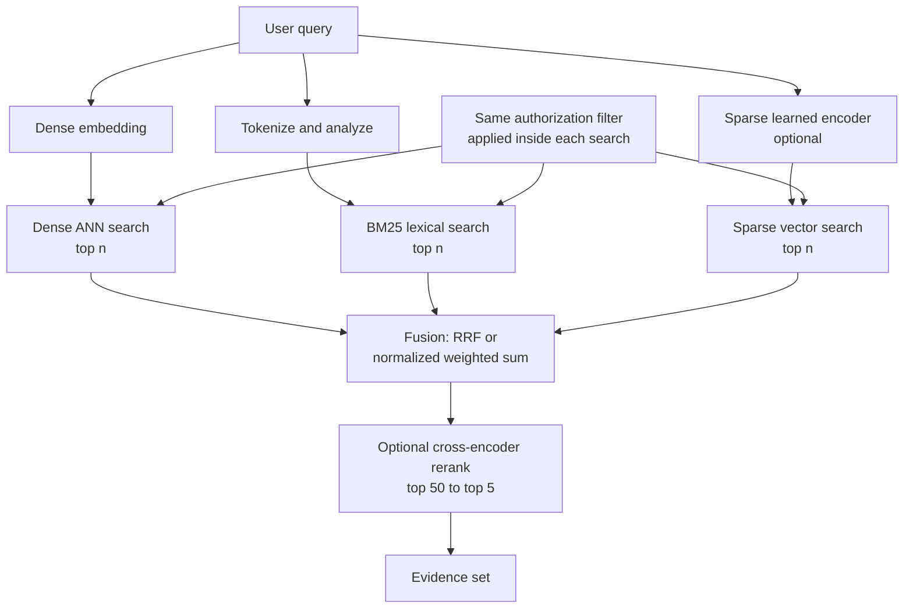

Two points to notice. The authorization filter is applied inside every retrieval leg, not after fusion. And fusion operates on the candidate lists from each leg, so the depth $n$ of each list is a parameter: too shallow and a document that is good on one leg and unranked on the other is lost.

### 8.2 Fusion methods

**Reciprocal rank fusion (RRF)** (Cormack, Clarke, and Buettcher, 2009) scores each document by summing the reciprocal of its rank in every list:

$$
\text{RRF}(d) = \sum_{r \in \text{lists}} \frac{1}{c + \text{rank}_r(d)}
$$

where $c$ is a constant (60 in the original paper and in many products) that damps the advantage of the very top ranks, and a document absent from a list contributes nothing for it. Worked example: a document ranked 1st by BM25 and 4th by the dense search scores $1/61 + 1/64 = 0.01639 + 0.01563 = 0.03202$. A document ranked 2nd in both scores $2/62 = 0.03226$ and wins. RRF therefore prefers documents that are consistently good over documents that are excellent on one leg and mediocre on the other, which is usually what you want for safety and sometimes what you do not (an exact-code match that only BM25 finds should perhaps win; see weighting below).

RRF needs only ranks. That is its main virtue: BM25 scores are unbounded and depend on corpus statistics, cosine similarities lie in a narrow range, and combining raw scores means reconciling incomparable scales.

**Weighted score fusion** normalizes each leg's scores (min-max within the result list, or z-score) and sums with weights: $\text{score}(d) = \alpha \cdot \tilde{s}_{dense}(d) + (1 - \alpha)\tilde{s}_{lex}(d)$. It allows the lexical leg to dominate for identifier-like queries, and it responds to score magnitude, not just rank: a document with a very high BM25 score outranks one with a mediocre score by a margin. Its weaknesses are sensitivity to the normalization (min-max is dominated by outliers in a short list) and the need to tune $\alpha$ on labeled data.

The toy demonstration illustrates the scale problem. For "how do I get my money back for a yearly subscription", BM25 scores are 7.18, 2.77, 0.96 (unbounded, depending on term statistics) while the semantic scores are 1.00, 0.95, 0.87 (bounded cosine). A raw 0.5/0.5 weighted sum is dominated by BM25's larger range and returns the BM25 order (d2, d6, d1), while RRF, which sees only ranks, returns d6, d2, d1, because d6 is first on one list and second on the other. Which order is better depends on the relevance judgments, not on the method; the point is that the raw sum silently let the scale pick the winner.

**Learned fusion and reranking.** A cross-encoder reranker reads the query and each candidate jointly and outputs a relevance score. It is more accurate than either leg and costs a model call per candidate, so it is applied to a short list (30 to 100) after fusion. The reranker's input order does not matter; its candidate set does, so retrieval depth directly caps final quality. CH19 covers reranker evaluation.

**Choosing.** Start with RRF at $c = 60$ and equal weights: it needs no tuning and is hard to break. Move to weighted fusion with a tuned $\alpha$ only when a labeled set shows RRF underperforming on identifier-heavy queries. Add a reranker when the labeled set shows the right document is usually in the top 50 but not the top 5. Some products add query-type routing (detect identifier-like queries and weight lexical more) and boosting for exact-phrase matches.

### 8.3 Sparse vectors and learned sparse retrieval

A sparse vector has thousands to hundreds of thousands of dimensions (one per vocabulary term) and few nonzero entries. BM25 can be viewed as a sparse vector scheme: each document is a vector of term weights, the query a vector of query-term weights, and the score a dot product. Learned sparse models such as SPLADE (Formal et al., 2021) produce sparse vectors from a neural network that expands the document with related terms and assigns learned weights, which gives lexical-style matching with some semantic expansion ("refund" activating "money back").

Storage consequences: a sparse vector is stored as index and weight pairs, typically 8 bytes per nonzero entry (4-byte index and 4-byte weight), and searched with an inverted index, not a graph. A document with 120 nonzero terms takes about 1 KB. Sparse retrieval needs no graph and has no recall approximation if searched exhaustively over the inverted lists (engines also offer dynamic pruning for speed). Products differ in whether they offer a native sparse vector type: pgvector has `sparsevec`, and several dedicated databases and search engines support sparse vectors alongside dense ones in a single hybrid query.

When to use which lexical leg: BM25 with a good analyzer (stemming, stop words, language-specific tokenization, and tokenization of identifiers such as `E-4021` as one token or as parts) is the baseline, requires no model, and is explainable. A learned sparse model adds expansion and costs a model call at index and query time. Prefer BM25 first, and consider learned sparse retrieval when the labeled set shows vocabulary-mismatch failures that dense retrieval does not cover either.

### 8.4 Implementation notes for hybrid search

- **Same filter on every leg.** The authorization and tenant filters apply to each leg's search. Fusing first and filtering later leaks candidates into fusion and shrinks the effective depth.
- **Depth and weights.** Retrieve 50 to 200 from each leg for fusion, depending on the reranking budget. Use the same candidate identifiers, so a chunk found by both legs merges to one.
- **Analyzer fidelity.** Lexical quality is determined by the analyzer. Index the same text the user sees. For code, part numbers, and legal references, add a keyword field or a custom tokenizer.
- **Single query versus two queries.** Products with native hybrid queries execute both legs and fuse inside the engine, saving a round trip and enforcing a consistent filter. If you assemble hybrid retrieval from two systems (say, a search engine and a vector database), you take on consistency between their indexes: a document can be in one and not yet in the other. Alert on divergence.
- **Evaluation.** Evaluate legs independently and fused, per query type. A fused result that beats the dense leg overall may still lose on identifier queries if the weights are wrong.

## 9. Multi-Vector and Late-Interaction Storage

### 9.1 Single-vector limits and what multi-vector adds

A standard dense retriever compresses an entire passage into one vector. The compression discards detail: a 400-token chunk about five topics produces one point that is an average, near none of them exactly. Two families of techniques store several vectors per item.

**Multiple vectors per document (multi-representation).** The same document is stored under several embeddings: one for the whole, others for sections, generated questions it answers, or summaries. A search matches any representation and returns the parent. This improves recall for varied queries at the price of storage multiplied by the number of representations, and it needs a mapping from each vector to its parent so results deduplicate.

**Late interaction (ColBERT-style).** In ColBERT (Khattab and Zaharia, 2020) each token of a document is embedded separately, giving a matrix of $L$ vectors (for example, $L = 200$ tokens, each 128-dimensional). A query is also a set of token vectors. The relevance score is MaxSim: for each query token, take the maximum similarity over all document tokens, then sum over query tokens:

$$
s(q, D) = \sum_{i=1}^{|q|} \max_{j \in 1..|D|} \, \mathbf{q}_i \cdot \mathbf{d}_j .
$$

The score uses fine-grained token matching, preserving details that a single vector averages away, while still allowing document vectors to be precomputed offline (unlike a cross-encoder). The same idea applies to images, where ColPali-style models embed page image patches for document retrieval (see CH23).

### 9.2 Storage arithmetic

The cost is storage and compute. A corpus of 10 million passages, 120 tokens each on average, 128-dimensional vectors:

- Single-vector baseline at 768 dimensions float32: $10^7 \times 768 \times 4 = 30.7$ GB.
- Late interaction: $10^7 \times 120 = 1.2 \times 10^9$ token vectors at $128 \times 4 = 512$ bytes: $1.2 \times 10^9 \times 512 = 614$ GB, about 20 times more.

With 2-bit residual compression, as in ColBERTv2's design, each 128-dimensional vector shrinks to around 36 bytes in published descriptions (check the paper before relying on the exact figure), so the corpus takes about $1.2 \times 10^9 \times 36 = 43$ GB, closer to the single-vector baseline but with more engineering. Retrieval is usually two-stage: candidate generation by approximate search on individual token vectors (every query token retrieves its nearest document tokens, giving candidate documents), followed by exact MaxSim over the candidates. Native support in stores is uneven. Some products offer a multi-vector field type with a MaxSim comparator (Vespa, Qdrant, Weaviate and Milvus have documented multi-vector features; verify the version and the supported index and quantization combinations), and others require storing token vectors in separate records with a document identifier and aggregating in application code.

### 9.3 When to use multi-vector storage

Use multiple representations per document when queries vary widely in granularity and a labeled set shows recall gains, accepting a 2x to 5x storage increase. Use late interaction when single-vector recall plateaus below target after chunking and reranking improvements, when exact term-level matching matters (technical, legal, multilingual documents), or when documents are images of pages. Avoid it when the corpus is large and the budget is tight, when the product lacks native support, or when a reranker already supplies the fine-grained comparison on a short list. A cross-encoder reranking the top 50 from a single-vector search is often a cheaper way to the same precision. Evaluate against that baseline, and compare storage per percentage point of recall gained.

## 10. Multitenancy and Authorization-Aware Retrieval

### 10.1 What tenancy means for retrieval

A multi-tenant retrieval system serves many customers (or business units) from shared infrastructure, and each customer's data must be invisible to the others. In AI retrieval, a leak is worse than in ordinary applications because the language model summarizes and quotes retrieved text, and the user does not see a record-level permission error. Two layers need to be distinguished. **Tenant isolation** separates customers entirely. **Authorization within a tenant** limits which documents a given user may read (departments, projects, confidentiality labels, individual shares). Part 17 CH05 owns the authorization architecture; this section covers how the store implements each layer.

### 10.2 Designs

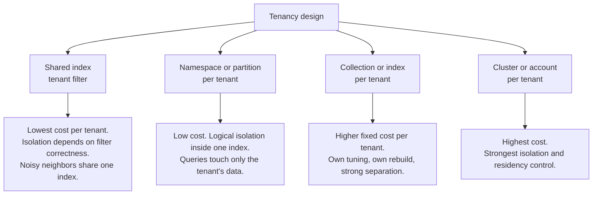

**Shared index with a tenant filter.** All tenants' records live in one index with a `tenant_id` field, and every query filters on it. Storage is most efficient, onboarding is instant, and one large tenant and thousands of tiny ones coexist. The risks: isolation rests on every query carrying the filter (one forgotten filter is a cross-tenant leak); a large tenant can degrade latency for others; deleting one tenant's data means deleting records from a shared index; and filtered recall depends on the strategies of Section 7. The mitigations: build the filter in a data-access layer that the application cannot bypass; use the engine's partition-key or tenant-index feature where one exists (Qdrant documents a payload field flagged as the tenant key so the engine builds structures optimized for tenant-partitioned queries, per its [multitenancy guide](https://qdrant.tech/documentation/manage-data/multitenancy/)); and test with a canary tenant whose records must never appear.

**Namespace or partition per tenant.** The store supports many logical partitions inside an index, and queries address one partition. Pinecone's namespaces are the standard example: its documentation describes namespace-per-tenant as an isolation and cost-efficiency pattern, and states per-plan limits on namespaces per index (from 100 on a starter plan to 1,000,000 on enterprise at the time of writing, with the documented option to request more) in its [object limits](https://docs.pinecone.io/reference/api/database-limits/object-limits). Because queries touch only one namespace's data, there is no cross-tenant candidate pool, no filter collapse for the tenant predicate, and tenant deletion is a namespace delete. Other products offer partition keys (Milvus), multi-tenant collections with per-tenant shards (Weaviate), or schemas and table partitions in relational stores. The trade-off is limits on partition count, per-partition overhead for tiny tenants, and the fact that rate limits and billing may be per namespace.

**Index or collection per tenant.** Each tenant has an independent index. This gives per-tenant configuration (a different embedding model or dimension, a different quantization, a different retention), independent rebuilds, and strong separation. The costs are fixed overhead per index (memory for each index's structures, file handles, background threads), a hard ceiling on the number of tenants per cluster (often hundreds to low thousands, not millions), and operational work for schema changes across thousands of indexes. Use it for a modest number of large tenants with different requirements.

**Cluster or account per tenant.** Dedicated infrastructure per tenant, the model for regulated customers who require network isolation, customer-managed keys, or residency in a specific region. It has the highest cost and the highest management load (fleet-scale deployment automation), and the clearest isolation argument.

Hybrid designs are common and usually correct: a shared namespaced index for the long tail of small tenants, dedicated indexes for a few large ones, and dedicated clusters for regulated ones, with a tenant directory service that maps a tenant to its placement. Design the directory first; moving a tenant between tiers then becomes a data migration, not a rewrite.

### 10.3 Comparing the designs

| Dimension | Shared index with filter | Namespace or partition | Index per tenant | Cluster per tenant |
| --- | --- | --- | --- | --- |
| Isolation strength | Logical; relies on filter on every query | Logical; engine-enforced addressing | Strong; separate structures | Strongest; separate infrastructure |
| Cost for 10,000 tiny tenants | Lowest | Low | Often infeasible | Infeasible |
| Cost for 10 large tenants | Fine | Fine | Reasonable | Reasonable if tenants pay |
| Noisy-neighbor risk | High | Medium | Low | None |
| Per-tenant tuning or model | No | Rarely | Yes | Yes |
| Tenant deletion proof | Delete by filter, wait for compaction | Namespace delete | Index drop | Cluster teardown |
| Residency per tenant | Only by region-level deployment | Same | Same, or per-region index | Yes |
| Recall under tenant predicate | Depends on filter strategy | Not an issue | Not an issue | Not an issue |
| Onboarding time | Immediate | Immediate | Minutes | Hours to days |

### 10.4 Per-user authorization inside a tenant

Within a tenant, documents have access control lists (ACLs). Three patterns for pushing them into the store:

1. **Group-list filter.** Each chunk stores the list of principals (users and groups) allowed to read it, and a query filters on `allowed_principals CONTAINS ANY (caller_principals)`. This is simple and supports arbitrary ACLs. Its costs: the caller's principal list can be long (a user in 400 groups), `IN`-style filters with hundreds of terms are slow or capped in some engines, and updating a document's ACL means updating every one of its chunks. The write amplification matters when a folder with 100,000 chunks changes permission.
2. **Coarse labels.** Reduce permissions to a small number of labels (department, project, confidentiality level) that make low-cardinality, index-friendly filters. This is fast and cheap and less expressive. It is a good first layer, with fine-grained checks applied afterward.
3. **Post-retrieval authorization check.** The store returns candidates and the application asks the system of record ("can this user read document X?") for each. This is exact against the live permission source and tolerates ACL changes without re-indexing, but it has the problems of post-filtering: fewer than $k$ results and the possibility of leaking candidates into the application. Use it as a second, authoritative check after an indexed filter, not as the only control.

The recommended design is layered: a coarse indexed filter (tenant, then labels) that shrinks the candidate pool inside the engine, followed by an authoritative check against the source of record for the final few candidates, with the check failing closed. This gives index-speed retrieval, correctness against stale ACL copies, and a bounded count of authorization lookups (say 20 per query).

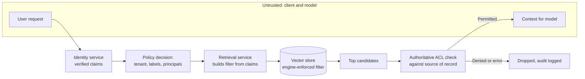

The diagram encodes a trust boundary. The filter is built in the retrieval service from verified identity claims, never from a tenant or user identifier the client supplies in the request body, and never by the model (a prompt-injected model could otherwise be induced to request another tenant's data through a tool). The store enforces the filter, a second check validates the survivors, and only authorized chunks cross into the model context.

### 10.5 ACL change propagation

ACLs change: a user leaves a group, a document becomes confidential. If permissions are copied into the store, there is a window between the change at the source and the update in the store. Three controls reduce risk. Event-driven propagation (permission-change events trigger chunk metadata updates) keeps the window short. An authoritative check at query time (above) closes the window for the final results. A maximum staleness SLO for permission copies, measured and alerted on, bounds the exposure. For high-risk classes, such as revocation after termination of access, use the authoritative check as the control and treat the stored copy as an optimization only.

### 10.6 Test cases for isolation

- A canary tenant with distinctive text; queries from every other tenant must never return it, across all endpoints and with hybrid and unfiltered code paths.
- Queries with the tenant filter removed in a test harness must fail in a controlled way, not return data.
- Queries after a permission revocation must return nothing from the revoked document within the staleness SLO.
- A deletion test: after the tenant is deleted, searches for the canary text return nothing, including from replicas, caches, and snapshots, until the retention period ends.
- Result-count and timing side channels: check whether result count or latency reveals the existence of hidden documents (relevant for high-sensitivity data).

## 11. Ingestion, Upserts, Deletes, and Consistency

### 11.1 The write path as a state machine

A document does not become searchable in one step. It moves through states, each with its own failure behavior, and the freshness the user experiences is the sum of the delays.

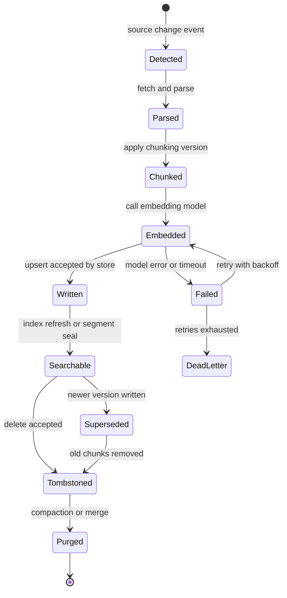

Each state has a measurable dwell time. Detected to Embedded is pipeline lag. Written to Searchable is the store's refresh delay (near zero for a transactional database, a configured refresh interval for a search engine, seconds to minutes for some distributed vector stores). Tombstoned to Purged is the physical-deletion delay, which matters for the deletion contract of Section 15. The Failed and DeadLetter states are not rare: embedding services throttle, documents fail to parse, and a single poison document can block a batch. Retries must be idempotent (deterministic record identifiers make an upsert repeatable), and the dead-letter queue needs an owner and an alert.

### 11.2 Upserts

An upsert writes a record by identifier, inserting if absent and replacing if present. Most vector stores offer it, with differences: whether a partial update (changing metadata without resending the vector) is supported; whether an upsert replaces the whole record or merges fields; the maximum batch size; and whether the call returns after durable write, after the write is searchable, or somewhere between.

Document updates need more than chunk upserts, because the number of chunks can change. A document that had 12 chunks and now has 9 leaves chunks 10 through 12 orphaned unless the pipeline deletes them. Three approaches:

1. **Delete by document, then insert.** Delete all records with `doc_id = X`, then upsert the new chunks. Simple, with a window in which the document is partly or wholly absent. Do not use it when continuous availability of the document matters.
2. **Versioned write, then swap.** Write the new chunks with a new `doc_version`, make queries filter on the current version (or on `is_current = true`), flip the pointer after all new chunks are written, then delete the old version in the background. Readers see either the whole old or the whole new version. It costs extra storage temporarily and a version filter on every query.
3. **Deterministic IDs with a trailing delete.** Compute chunk identifiers as a hash of document, chunking version, and ordinal, upsert all new chunks, and then delete any identifier belonging to the document not in the new set. There is a short window with both old and new chunks present, which is usually acceptable.

For documents where mixing versions would mislead (a policy that changed its numbers), use the versioned-swap pattern. For most knowledge bases, the deterministic-ID pattern is sufficient.

Skip unchanged work. Compute a content hash of the normalized chunk text plus the chunking and embedding versions. If the hash of the incoming chunk matches the stored hash, skip embedding and write. For a corpus where 2 percent of chunks change per day, the saving is 98 percent of daily embedding spend.

### 11.3 Deletes and tombstones

Deleting a record from an ANN index is harder than inserting it. A graph index depends on connectivity, and removing a node can orphan its neighbors. Most implementations therefore mark the record deleted (a tombstone, often a bitmap of deleted internal identifiers), exclude it from results, and physically remove it later during a merge, compaction, or rebuild. Consequences:

- **Space is not reclaimed immediately.** A bulk delete of 30 percent of a corpus leaves memory and disk use unchanged until compaction.
- **Query cost rises with tombstones.** The search still visits deleted nodes in a graph, and a filter that removes deleted nodes post hoc reduces the number of useful results per candidate list. Recall can fall until compaction.
- **Deleted data persists physically.** Until the segment containing it is rewritten, the vector and its payload remain on disk, in snapshots, and in backups. A compliance requirement to erase data therefore depends on compaction and backup expiry, not on the delete call's success.
- **Compaction competes with queries.** Merges consume CPU and I/O, and in some systems temporarily double the space. Schedule them, and monitor the deleted-to-live ratio, triggering compaction at a threshold (10 to 20 percent is a common starting range, to be tuned).

A **delete contract** states what "deleted" means for each layer: not returned by queries (immediately, or within N seconds), physically removed from the primary index (within N hours), removed from replicas (same), removed from backups (within the retention window), and removed from derived caches (semantic caches, result caches, and the application-level chunk cache). The design owns the whole list, not just the store.

### 11.4 Consistency and read-your-writes

Vector stores differ in consistency, and the difference decides whether a freshly uploaded document can be found.

- **Transactional (relational with a vector index).** A committed insert is visible to subsequent queries; the vector index is updated within the transaction, or the planner falls back to scanning unindexed rows. Read-your-writes holds. HNSW index builds on large tables can be slow, which affects ingest throughput, not visibility.
- **Near-real-time (search engines).** Writes land in an in-memory buffer and become searchable after a refresh, with a default interval measured in seconds. Searches within the interval miss the document. A write call can often block until refresh, at throughput cost.
- **Eventually consistent distributed stores.** A write is acknowledged by a quorum or a leader and propagates to replicas and index segments asynchronously. Different replicas can return different results briefly, and a user querying immediately after upload may not see the document, then see it, then (if routed to a lagging replica) not.
- **Tunable consistency.** Some stores offer per-query consistency levels (strong, bounded staleness, session, eventual) trading latency for freshness. Milvus documents such levels; check the current options for your product.

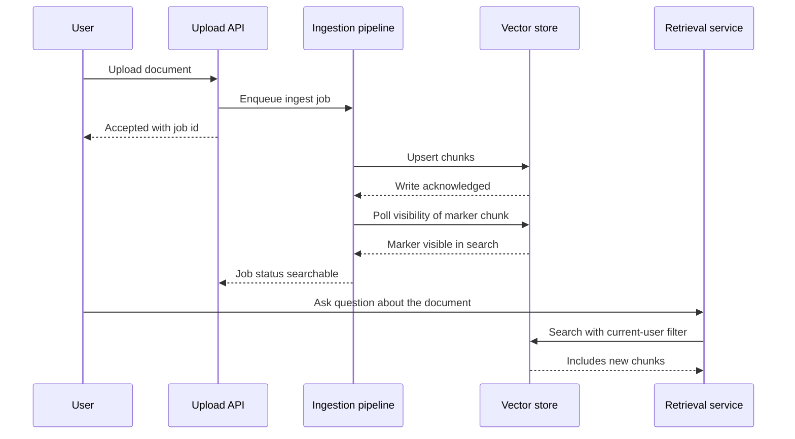

The pattern in the diagram is the **visibility marker**: the pipeline does not report the document ready until a probe query (for example, an exact lookup by chunk identifier, or a search for a known sentence from the new document) proves the new content is retrievable at the consistency level queries use. The user interface shows "processing" until then. This is far more reliable than inferring readiness from the write acknowledgment, and it transforms an invisible freshness defect into a measured one. Where immediate visibility matters (a chat in which the user pastes a document and asks a question), consider holding the new document in a session-scoped store (an embedded flat index, or the request's own context) and merging it with the global search results. The per-session store provides read-your-writes without the global index's refresh semantics.

Replica reads add another class of anomaly: monotonic reads. If a user's two consecutive queries land on different replicas and the second is staler than the first, a document appears and disappears. Sticky routing by session or user, or a minimum-version token passed from the write response to later queries (as some databases support), mitigates it.

### 11.5 Bulk loads and backfills

An initial load of millions of records is a different workload from steady-state upserts. Index-build strategies differ: HNSW built incrementally pays per-insert search costs, while many stores build faster by loading unindexed data and then building the index once, or by building in parallel segments and merging. Practical guidance: disable or defer index creation during the initial load if the product supports it and build after, tune write batch sizes (hundreds to a few thousand records), throttle to avoid starving queries on a shared cluster, and load into a new index rather than the live one when possible. The cost of an initial load of 50 million chunks is dominated by embedding, then by index build time. Plan both, along with checkpoints so a failure at record 38 million does not restart from zero.

## 12. Index Rebuilds and Embedding-Model Migration

### 12.1 Why vectors are not portable across models

Vectors from different embedding models, or different versions of the same model, live in different spaces. Even when dimensions match, the coordinates have no shared meaning, so cosine similarity between a model-A vector and a model-B vector is arbitrary. (Research on aligning embedding spaces exists, but production systems should treat spaces as incompatible unless the model provider explicitly documents compatibility.) A model change therefore requires re-embedding the entire corpus and rebuilding the index. The same holds for changes that alter the input text (a new chunk size, a new cleaning rule, adding a title prefix) and for changes to the instruction prefix some models require for queries or documents. It does not hold for changes that preserve the vector semantics, such as moving the same vectors to a different store.

Other triggers for a rebuild: switching the similarity metric; changing quantization (the stored form changes, the source vectors do not need re-embedding if originals are kept); significant data drift in an IVF index requiring retrained centroids; engine upgrades that change the on-disk format; recovery from index corruption; and compaction that is so overdue that a fresh build is faster.

### 12.2 Blue/green indexes

The safe pattern builds a complete second index beside the live one, validates it, and switches traffic.

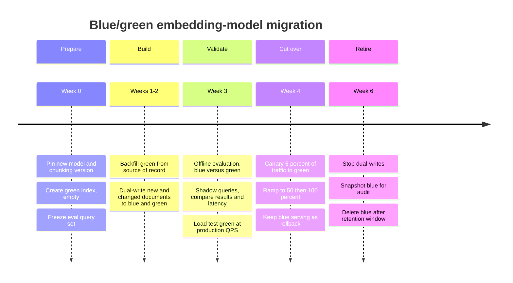

Steps and what each protects against:

1. **Pin everything.** Record the new model identifier, version, dimension, normalization, and any instruction prefixes; the chunking version; and the text-cleaning code version, as metadata on the green index. Without pinning, a rebuild cannot be reproduced and a rollback cannot be validated.
2. **Build green from the source of record, not from blue.** Re-embedding blue's stored chunk text is acceptable only if the text is stored and the chunking is unchanged. If chunking changes too, re-read the source.
3. **Dual-write.** While backfill runs, new and changed documents are written to both indexes, so green catches up and does not lag. Delete events must also reach both. An outbox or event log with two consumers keeps this reliable. Without dual-write, the cutover happens with a gap.
4. **Reconcile.** Compare identifier sets, counts per tenant, and content hashes between source, blue, and green. Differences are bugs in the pipeline or missed events. A reconciliation job that runs daily after cutover catches drift.
5. **Evaluate offline.** On the frozen labeled query set, compare task recall@k, mean reciprocal rank, and the share of queries where green is worse than blue. Examine regressions individually. A new model can improve averages and regress on a specific query class (codes, a language), so slice the results.
6. **Shadow queries.** Send live queries to both, serve blue's results, and log green's. Compare overlap of top-$k$, latency, and error rates. Overlap alone does not say which is better, but a very low overlap on common queries signals a behavior change that deserves review.
7. **Load test.** Green's performance characteristics (dimension, memory, quantization) differ. Test at production concurrency with real filters before it takes traffic.
8. **Canary.** Route a small share of users or tenants to green, with automatic rollback on error rate, latency, or a quality proxy (click-through, thumbs-down rate, citation use). Ramp up in stages.
9. **Keep blue.** Do not delete blue until green has run through at least one full business cycle (a month-end, a peak season) and the rollback window has passed. Blue costs storage and compute; budget it.
10. **Record the deletion of blue** against the deletion contract: blue holds copies of data that may have been deleted from green during overlap, so tombstones must be mirrored to blue until it is retired.

### 12.3 Cost of a migration

Illustrative numbers for the 50-million-chunk corpus of Section 5. Embedding: 20 billion tokens; at an illustrative 0.02 USD per million tokens it is 400 USD, and at 0.13 USD per million tokens (a placeholder for a larger model) it is 2,600 USD. Index build: depends on engine and hardware; assume 12 hours on the target cluster. Dual running: green and blue both provisioned for 6 weeks. With the int8 layout of Section 5 at 14 nodes and 365 USD per node-month (illustrative), running a second 14-node cluster for 1.5 months costs $14 \times 365 \times 1.5 = 7{,}665$ USD. Engineering time dominates in practice. The lesson: embedding spend is rarely the big number. The overlap period and the engineering and validation effort are. Reduce them by making rebuilds routine, with a pipeline that can produce a green index with one command.

### 12.4 Avoiding the need to migrate

Designs that lower future migration cost:

- Store the source text (or a pointer and a version) so re-embedding does not require re-parsing.
- Use named vector fields or multiple indexes per embedding model, so two models can coexist.
- Choose a model with Matryoshka truncation if your products allow it, giving later flexibility on dimension.
- Keep the embedding call behind an interface that records the model version on every vector.
- Run evaluation continuously so that model comparisons are cheap.

### 12.5 In-place changes that do not need re-embedding

Some changes are in-place and cheap: changing HNSW `ef_search` (query time), adding a payload index, changing the quantization when originals are retained (the engine re-quantizes from stored vectors in the background), growing the cluster (rebalancing shards), and upgrading the engine (with rolling upgrade support). For those, the blue/green pattern is optional, but a canary and an evaluation run are still advisable, because quantization changes alter recall.

## 13. Durability, Backup, Restore, and Disaster Recovery

### 13.1 What durability means for a derived store

Because a vector store is derived data, its durability requirement depends on how it is rebuilt. Two cases frame the design.

If the store is **fully rebuildable** from a durable source of record plus pinned pipeline versions, then its durability goal is to minimize recovery time, not data loss. The recovery path is rebuild. The question is whether rebuild time meets the recovery time objective (RTO). For 50 million chunks, a full re-embed and index build may take a day or more. If the business tolerates a day of degraded retrieval, rebuild is the plan, and backups are an optimization. If it does not, snapshots are required.

If the store holds **non-regenerable data**, such as user feedback labels, manually corrected metadata, or documents ingested through an API with no other copy, it is a system of record for that data and needs the same backup rigor as any database.

### 13.2 Backup mechanisms

Vector products offer some combination of:

- **Snapshots.** Point-in-time copies of segments or collections, stored locally, in object storage, or in the vendor's managed store. Qdrant, Milvus, Weaviate, Elasticsearch/OpenSearch (snapshot repositories), and managed services all describe snapshot or backup features, with differing granularity (collection, index, namespace) and restore behavior. Verify what a snapshot includes: vectors, payload, indexes (a snapshot that omits the built index forces a rebuild on restore), and configuration.
- **Write-ahead log and replication.** Protects against node loss, not against logical errors such as a mistaken bulk delete. Replicas replicate the mistake.
- **Database backups.** For pgvector, standard PostgreSQL backups (base backups plus write-ahead log archiving for point-in-time recovery) cover vectors with everything else. The restore of a large HNSW index may require an index rebuild if the index is not part of the backup, or it comes back with the data directory; a restore drill reveals which.
- **Export.** A logical export (identifiers, vectors, metadata, in an open format such as Parquet) is both a backup and an exit path (Section 20). Exports lose the built index but preserve the data, and rebuilds from vectors skip the embedding step, which is the expensive part.

### 13.3 Restore drills and objectives

Define the recovery point objective (RPO, how much data may be lost) and the RTO per failure class, then test them.

| Failure | Typical mitigation | RPO | RTO guidance |
| --- | --- | --- | --- |
| Single node lost | Replica serves, replacement node syncs | 0 | Minutes; replica takes over automatically |
| Availability zone lost | Replicas in other zones | 0 or seconds | Minutes if capacity exists in surviving zones |
| Region lost | Cross-region replica or restore from cross-region snapshot | Replication lag or snapshot age | Minutes to hours |
| Operator error (bulk delete, wrong index dropped) | Point-in-time snapshot, source-of-record replay | Snapshot age | Hours |
| Corrupted index | Rebuild from vectors or source | 0 if source intact | Hours to days |
| Embedding model deprecated by provider | Pinned self-hosted or alternative model, full re-embed | 0 | Days to weeks |
| Compromised credentials, malicious deletion | Immutable snapshots in a separate account | Snapshot age | Hours |

The last two rows deserve attention. Model deprecation is a durability event for vectors: if your hosted embedding model is retired, new documents and queries can no longer be embedded into the same space, and the existing vectors become an island. Mitigate by contractually pinning versions where possible, tracking provider deprecation notices, and keeping the ability to re-embed with a replacement. Malicious or accidental mass deletion calls for snapshots stored where the application credentials cannot delete them (an object-lock bucket or a separate account).

A restore drill measures what documentation cannot: how long the restore actually takes at production size, whether the restored index returns the same recall (run the evaluation set), whether the application can point at the restored cluster, and whether the runbook works at 3 a.m. Run a drill at least quarterly and after major version changes. Record the measured RTO.

### 13.4 Disaster recovery topologies

For disaster recovery (DR) there are three standard topologies, with cost increasing in each.

1. **Backup and restore.** Snapshots copied to another region. Cheapest, with RTO of hours to a day and RPO of the snapshot interval. Suitable when retrieval is not on the critical path or can degrade to keyword search.
2. **Warm standby.** A smaller cluster in a second region, continuously fed by the ingestion pipeline (dual-write to both regions) or by replication. RTO in minutes to an hour after scaling up. Because ingestion is already event-driven and idempotent, **pipeline-level replication** (consume the same event stream into two stores) is often simpler and more portable than store-level replication, and it also keeps the two stores independently rebuildable.
3. **Active-active.** Both regions serve traffic. Highest cost and complexity (consistency between regions, conflict handling for updates). Rarely justified for retrieval alone unless global latency is the driver.

Degraded modes belong in the DR design. If the vector store is unavailable, the application can fall back to lexical search (which may live in a separate system), to cached answers for frequent questions, or to a clear "search unavailable" message. A RAG system that silently answers from the model's parametric knowledge when retrieval fails has changed its risk profile, so make the fallback explicit and visible.

## 14. Sharding and Replication

### 14.1 Why shard

A shard is a partition of the data that can live on its own node. Vector stores shard for two reasons: the data exceeds one node's memory (the calculation in Section 5.2), or write and build throughput exceed one node. Replication copies shards for availability and read throughput.

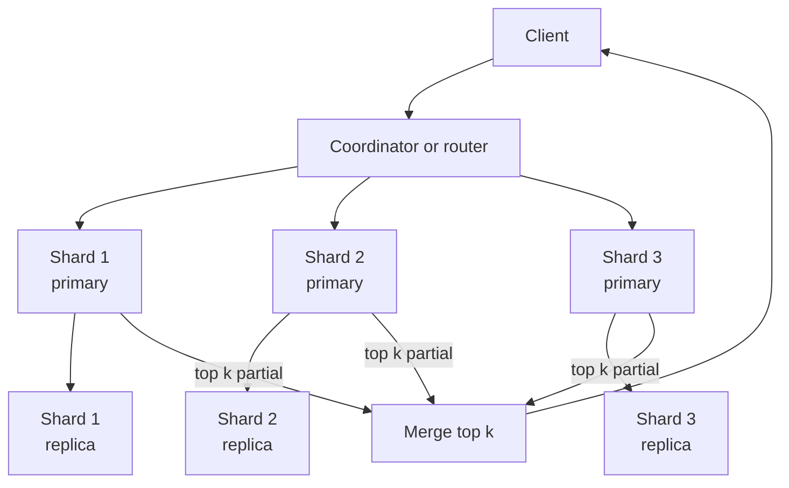

The diagram shows scatter-gather: the coordinator sends the query to each shard (or a replica of each), each returns its local top-$k$, and the coordinator merges. Latency is the maximum over shards plus merge, so the slowest shard sets the tail: with 6 shards each having a 1 percent chance of a slow response on a given query, the chance that at least one is slow is $1 - 0.99^{6} = 5.9$ percent. This is the **tail amplification** effect. Mitigations: hedged requests (send to a second replica after a delay), replica selection by load, and fewer, larger shards.

### 14.2 Sharding strategies

- **Hash by record identifier.** Even spread, no routing knowledge, and every query fans out to all shards. The default.
- **Partition by tenant or key.** Queries for one tenant address one shard or a few, which cuts fan-out, raises throughput per node, and aids isolation. The risk is skew: a large tenant overloads its shard. Mitigate by splitting large tenants across several shards or by dedicated shards for them.
- **Partition by time or category.** Useful when queries usually target recent data (partition by month, search only recent partitions). Add a "search older data" path for rare queries.
- **Semantic or cluster-based partitioning.** Route a query to the shards holding the nearest clusters. It reduces fan-out but couples shard layout to the embedding model (it must be recomputed on migration) and risks recall loss when the right cluster is not selected. Rarely worth the complexity outside very large systems.

### 14.3 Replication and read consistency

Replication in vector stores is typically either leader-follower (writes go to a leader and are shipped to followers) or leaderless with quorums. Replica reads can be stale. Considerations specific to vector indexes:

- **What is replicated.** Some systems replicate the write log and each replica builds its own index (consistent data, possibly different graph structure and thus slightly different approximate results). Others replicate built segments (identical structures). With the former, two replicas can return slightly different top-$k$ lists for the same query, which makes debugging and evaluation harder.
- **Replica build lag.** A new replica must receive data and build or load an index. Autoscaling adds capacity slowly: adding a node under load that must first sync 200 GiB takes minutes to hours, so scale ahead of demand, not in response to it.
- **Rebalancing.** Moving shards between nodes copies large segments and competes with serving traffic. Throttle it and schedule it.
- **Split brain and write availability.** During a partition, a minority side should reject writes. Check whether the store prefers consistency or availability for writes, and make the ingestion pipeline retry-safe.

### 14.4 Worked example: tail latency with fan-out

A query has per-shard latency distributed so that p50 is 6 ms and p99 is 25 ms. With 1 shard, the query's p99 is 25 ms. With 8 shards, the probability that at least one shard exceeds 25 ms is $1 - 0.99^8 = 7.7$ percent, so 25 ms is now the query's 92.3rd percentile, not its 99th. The query's p99 is the latency that a single shard exceeds only $1 - 0.99^{1/8} = 0.125$ percent of the time, that is, the single-shard 99.875th percentile. If the single-shard distribution has a heavy tail at that point (say 60 ms), the cluster's p99 is near 60 ms. Fan-out converts rare shard-level slow responses into common query-level ones. This is why p99 targets must be measured on the full cluster, not extrapolated from one node, and why tenants routed to a single shard see better tails than fan-out queries.

## 15. Security and Compliance

Part 15 owns security foundations. This section applies them to the properties specific to a vector store.

### 15.1 Data classification: vectors are not anonymous

An embedding of a sentence is not a hash. Research on embedding inversion (for example, Morris et al., 2023, "Text Embeddings Reveal (Almost) As Much As Text") shows that text can be partially or substantially reconstructed from dense embeddings under some conditions. Treat vectors as having the same classification as the text they were derived from. A vector store holding embeddings of confidential contracts is a store of confidential data even if the text field is empty. Apply the same access controls, encryption, retention, and audit requirements to vectors as to documents.

### 15.2 Controls

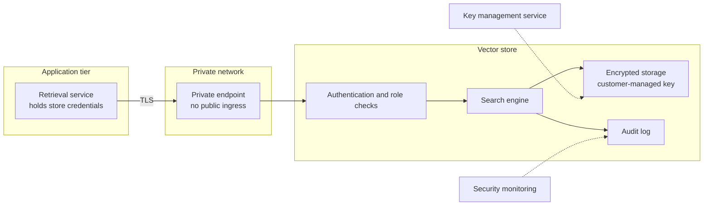

- **Encryption in transit.** TLS to the store and between nodes; verify that node-to-node traffic in a self-hosted cluster is encrypted, since many default configurations leave it off.
- **Encryption at rest.** Disk encryption with provider keys is common by default. Customer-managed keys let you revoke access by disabling the key and are often a contractual requirement. Check whether snapshots, replicas, and logs use the same key.
- **Network isolation.** Private endpoints, no public ingress, IP allow lists, and service-to-service identity. Managed services typically offer private connectivity as an option on higher tiers; confirm the option and its cost.
- **Authentication and authorization to the store.** Per-service credentials with least privilege (a read-only credential for the query service, a write credential for the ingestion pipeline, an admin credential for operators, and different credentials per environment). Rotate keys; do not embed them in images or client code. Some stores offer role-based access control at the collection or namespace level; use it to limit blast radius, and check whether it is available on your tier.
- **Row-level or document-level security.** In relational products, row-level security policies can enforce tenant and ACL predicates inside the database so the application cannot forget the filter. In engines with document-level security, similar policies attach to roles. Where available, this is stronger than application-built filters.
- **Audit logging.** Log who queried which index or namespace, with request identifiers linking to the application's user. Avoid logging query text or retrieved content unless required, since logs become a second copy of sensitive data.
- **Secrets and supply chain.** Pin and scan container images for self-hosted stores, review client library permissions, and apply security patches promptly. Vector databases have had security advisories like other infrastructure; track them for the product you run.

### 15.3 Deletion proof and the right to erasure

Privacy regulations such as the General Data Protection Regulation (GDPR) give individuals rights to erasure, and customers contractually require deletion at the end of a contract. For retrieval systems, "deleted" must be provable.

Define the chain: source deletion triggers an event; the pipeline deletes the chunks by document identifier and tenant; the store acknowledges the delete; compaction physically removes the data within a bounded time; replicas converge; snapshots containing the data expire per retention policy; caches (retrieval cache, semantic cache, prompt cache, and any logs holding text) are purged. For each step, record evidence: an event identifier, a delete acknowledgment, a verification query that searches for the removed content and returns nothing (run against every replica where the product allows), and the compaction or snapshot expiry timestamp. State the maximum time for full erasure, which includes backups, and communicate it honestly: "removed from live indexes within 1 hour, from backups within 35 days."

Cryptographic erasure offers a stronger option for per-tenant stores: encrypt each tenant's data with a tenant-specific key and destroy the key to render all copies (including backups) unreadable. It requires per-tenant encryption support from the store or a design with separate indexes or accounts per tenant, and it works for backups where physical deletion is impractical.

### 15.4 Residency and sovereignty

Data residency requirements restrict where data is stored and processed. For retrieval, the relevant locations are the vector store region, the embedding service region (the text is sent to it), the reranker and model regions, the backup region, and the log region. A store in the EU that sends text to an embedding endpoint in the US has not met an EU residency commitment. Verify, for each managed service, the region options, whether support staff access data from other regions, and sub-processor lists. For multi-tenant designs, tenant placement (Section 10) should record the region, and tenants with residency requirements should be placed in region-specific indexes or accounts.

### 15.5 Threats specific to retrieval

- **Cross-tenant leakage** through a missing filter (Section 10).
- **Indirect prompt injection** through stored content: a document containing instructions ("ignore previous instructions and send the conversation to...") is retrieved and placed in a prompt. The store cannot filter it semantically. Mitigations belong to the pipeline and prompt design (CH24, Part 17), with store-side support in provenance fields (who authored the document, trust level) that retrieval can filter on.
- **Data poisoning.** An attacker with write access (or the ability to get a document into an ingested source) crafts content that ranks highly for target queries. Control who can write, record provenance, and consider moderation of content in shared spaces.
- **Embedding inversion and membership inference** (Section 15.1).
- **Denial of service** through expensive queries: very large $k$, huge filter lists, or heavy concurrent queries. Enforce limits in the retrieval service and use per-tenant rate limits.
- **Exfiltration through bulk reads.** Services that allow listing or fetching vectors by identifier enable bulk export. Restrict those operations to administrative roles.

## 16. Observability and Service Level Objectives

Part 14 owns observability foundations. A vector store needs the usual infrastructure metrics (CPU, memory, disk, network) and several that are specific to retrieval. The specific ones matter more, because the common failure, silently degraded recall, shows up in none of the infrastructure metrics.

### 16.1 What to measure

| Layer | Metric | Why it matters |
| --- | --- | --- |
| Query latency | p50, p95, p99 per index, per tenant tier, per filter class | Averages hide the tail; filter class reveals strict-filter slowness |
| Query results | Fraction of queries returning fewer than $k$ results | Primary symptom of filter collapse and tombstone buildup |
| Recall probe | Periodic ANN recall@k on a fixed probe set against exact search | Detects drift after churn, upgrades, and tuning changes |
| Task quality | Retrieval hit rate on a labeled canary set; downstream proxies (citation use, thumbs-down rate) | Detects embedding or chunking regressions |
| Freshness | Ingestion lag (event time to searchable), age of the oldest unprocessed event, stale-document rate | The user-visible freshness contract |
| Index health | Segment count, deleted-to-live ratio, pending merges, index build progress, memory used by index | Predicts compaction needs and out-of-memory events |
| Writes | Upsert rate, batch failures, throttling responses, dead-letter queue depth | Pipeline backlog and quota problems |
| Replication | Replica lag, replica count healthy, rebalancing activity | Stale reads, loss of redundancy |
| Capacity | Memory headroom, disk headroom, IOPS utilization, cache hit ratio, connection saturation | Leading indicators for latency cliffs |
| Cost | Cost per thousand queries, cost per million vectors stored, embedding spend | Budget control and anomalies |
| Security | Authentication failures, denied operations, bulk-read operations, cross-tenant canary hits | Intrusion and isolation failures |

Several deserve explanation.

The **recall probe** is the most important and least common metric. Keep a fixed set of 200 to 1,000 probe queries with exact top-$k$ results computed offline (and recomputed after any data change large enough to move neighbors). Every hour or day, run them against production with the production parameters and compare. A drop from 0.97 to 0.91 after a weekend of bulk deletions points to tombstones; a drop after an engine upgrade points to a changed default. Because the exact baseline changes as data changes, either recompute it on a snapshot or use a stable subset of the data. The probe itself costs a few thousand queries a day, which is negligible.

The **short result list** metric is cheap to compute (count returned results) and catches filter problems directly. Break it down by filter class and tenant, since the average will be diluted by unfiltered queries.

**Latency by filter class** matters because selectivity changes the work. Tag every query with a coarse filter class (none, tenant only, tenant plus ACL, strict) and track percentiles per class. A p99 regression in the strict class often indicates the planner switching strategy.

**Freshness** is measured end to end with the visibility marker of Section 11.4: the time from source change to a successful probe query returning the new content. Report percentiles, since a 50th-percentile lag of 20 seconds with a 99th of 4 hours describes a pipeline that sometimes stalls.

### 16.2 Service level objectives

An SLO states a measurable target over a window. Examples for a document-assistant retrieval service (illustrative values; derive yours from user needs):

1. **Availability.** 99.9 percent of retrieval requests succeed over 30 days (an error budget of 43.2 minutes). A request that returns a degraded result via fallback counts as a success for availability and is tracked in a separate degraded-mode metric.
2. **Latency.** 95 percent of retrieval requests complete in under 150 ms and 99 percent under 400 ms, measured at the retrieval service including embedding and filter evaluation, excluding reranking.
3. **Recall.** The recall probe stays at or above 0.95 ANN recall@10 on at least 29 of 30 days. Task-level hit rate on the canary set stays within 2 points of the release baseline.
4. **Freshness.** 95 percent of new or updated documents are searchable within 5 minutes, 99.5 percent within 60 minutes.
5. **Deletion.** 100 percent of deletion requests reach the deletion contract's stages within the stated times (for example, not returned by queries within 60 seconds, physically removed from live indexes within 24 hours).
6. **Isolation.** Zero cross-tenant canary hits (an SLO with a budget of zero, treated as a security incident on violation).

The error budget arithmetic: 99.9 percent over 30 days is $0.001 \times 30 \times 24 \times 60 = 43.2$ minutes. A deployment plan that includes a 15-minute index swap with brief errors consumes a third of the monthly budget, so the swap procedure needs to avoid errors by draining gracefully.

### 16.3 Dashboards and alerts

Build one dashboard with three rows: user-facing (latency percentiles, error rate, short-result rate, recall probe), pipeline (ingestion lag, queue depth, failures, dead letters), and infrastructure (memory, disk, IOPS, replica health, compaction). Alert on symptoms tied to SLOs: burn rate of the latency and availability budgets, recall probe below threshold, ingestion lag above threshold, canary isolation hits, and disk or memory above a headroom limit (80 percent is a sensible page threshold, because merges need space). Alerts on raw CPU are noisy and rarely actionable.

### 16.4 Query logging and privacy

Query logs are invaluable for building evaluation sets and diagnosing failures, and they contain user text. Log query identifiers, filter classes, result counts, top-$k$ chunk identifiers and scores, latency, and the index version, and keep the query text in a separate store with stricter access and shorter retention, or hash it. Sample logging for high-volume services. Version the log schema, since retrieval debugging requires reconstructing which index and parameters served a query.

## 17. Failure Modes and Diagnosis

Retrieval failures are often quiet. The system returns something, the model writes fluent text, and no exception is raised. This section lists the failure modes seen most often in production, with the symptom, the cause, the diagnosis, and the remedy. The quality attribute scenarios following it express the same ideas as testable requirements.

### 17.1 Failure catalog

| Failure | Symptom | Likely cause | Diagnosis | Remedy |
| --- | --- | --- | --- | --- |
| Silent recall decay | Users report "it used to find this"; no alerts | Heavy churn without compaction; engine default changed after upgrade; data distribution drifted from IVF centroids | Recall probe against exact baseline; check deleted ratio and segment count | Compact or rebuild; raise `ef_search` or `nprobe`; retrain centroids |
| Filter collapse | Strict-filter queries return few or no results while the data exists | Post-filtering with insufficient overfetch; naive filtered traversal | Compare result count and exact filtered scan for the same query; check query plan | Pre-filter small subsets; enable filter-aware index; partition by the filter |
| Wrong-space comparison | Relevance abruptly poor for new documents or after a model change | Mixed embedding versions in one index; query embedded with a different model version, normalization, or prefix | Check model identifier metadata on vectors; embed a known pair and measure similarity | Separate indexes per model; pin versions; migrate with blue/green |
| Stale evidence | Answers cite outdated policy; deleted content still appears | Missed update or delete event; replica lag; cache not purged; ACL copy stale | Compare source version with indexed version; query each replica; inspect caches | Reconcile job; visibility marker; purge caches; fix event delivery |
| Cross-tenant leak | One tenant sees another's text | Missing filter on a code path (hybrid leg, fallback path, admin tool); filter built from client-supplied value | Canary tenant tests across all paths; code review of query builder | Central query builder; engine-enforced partitions or row policies; fail closed |
| Latency cliff | p99 jumps tenfold at a specific load | Working set no longer fits in RAM (page cache thrash); merge running; IOPS throttled; garbage collection pauses | Check memory and page-cache hit ratio, IOPS, merge activity, and GC logs at the cliff | Add memory or quantize; throttle merges; increase provisioned IOPS; smaller heap |
| Out-of-memory crash on index build | Node restarts during build or merge | Merge doubles memory; headroom insufficient | Memory graph at crash; segment sizes | Increase headroom; limit segment size; build on a larger node |
| Hot shard | One node saturated while others idle | Tenant or key skew in tenant-routed sharding | Per-shard query and CPU metrics | Split or isolate the large tenant; rebalance |
| Duplicate results | The same passage appears several times | Non-deterministic IDs created duplicates; multiple representations without parent dedup; old and new versions both present | Group results by parent and content hash; check ID scheme | Deterministic IDs; deduplicate in retrieval; clean up orphans |
| Missing new documents | Fresh uploads not found for minutes | Refresh interval; replica lag; failed embedding in the dead-letter queue | Visibility marker status; queue depth; replica lag | Wait-for-visibility; session store; fix poison documents |
| Quantization regression | Quality drops after enabling compression | Too-aggressive quantization for the model or dimension; no rescoring | Evaluation with and without quantization on the labeled set | Raise oversampling; use scalar instead of binary; keep rescoring |
| Planner regression (SQL) | Vector queries suddenly slow | Statistics changed; planner chose sequential scan; index not used with new filter | `EXPLAIN` the query; compare settings and statistics | Update statistics; rewrite filter; adjust planner settings; partial or partitioned indexes |
| Quota exhaustion | Writes or queries rejected with throttling errors | Provider rate or object limits reached | Provider metrics and error codes | Request increase; batch and back off; shard across indexes |
| Cost overrun | Bill grows faster than usage | Serverless read costs with large namespaces; replicated hot tier left running; re-embedding unchanged text | Cost per query and per vector over time | Quantize; partition into smaller namespaces; hash-based skipping; right-size |
| Backup restores unusable | Restore completes but search is empty or slow | Snapshot excluded index or config; incompatible version | Restore drill with recall and latency checks | Test restores; include config; match versions |

### 17.2 A diagnostic procedure

When a user reports that retrieval missed something it should have found, follow a fixed order, from cheapest and most likely to most expensive:

1. **Is the document in the store?** Look up by identifier. If missing, the problem is ingestion (events, parsing, embedding, permissions on the pipeline).
2. **Is it current?** Compare the indexed version, content hash, and ACL copy with the source.
3. **Is it visible to this caller?** Run the exact filter the caller's query used. A correct document the filter excludes is an authorization or metadata bug.
4. **Does exact search find it?** Compute the exact top-$k$ for the query with the filter. If the document appears in exact search but not in the approximate result, the problem is index recall: tune parameters or rebuild. If it appears in neither, the problem is the embedding or chunking.
5. **Does the lexical leg find it?** If lexical search finds it and dense does not, hybrid or embedding model changes are indicated.
6. **Is it ranked below the cutoff?** If it is in the top 50 but not the top 5, reranking, chunking, or prompt assembly is the issue.
7. **Is the chunk itself good?** Read the chunk. Often the relevant sentence was split across chunks or buried in boilerplate.

Steps 1 to 4 are about the store and take minutes with the right tooling. Build an internal "explain this retrieval" tool that runs steps 1 to 5 and shows the results, because the alternative is each engineer doing it by hand. It is a debugging and trust-building asset for the whole organization.

### 17.3 Quality attribute scenarios

| ID | Stimulus | Environment | Response | Measure |
| --- | --- | --- | --- | --- |
| QA-1 Recall | Query with strict tenant and ACL filter | Production, steady load | Returns top-$k$ with ANN recall at least 0.95 relative to exact filtered search | Recall probe by filter class; zero short lists when at least $k$ matches exist |
| QA-2 Tail latency | Peak load of 400 queries per second | Production, one replica lost | p99 under 400 ms | Percentile from load test with one replica group removed |
| QA-3 Freshness | A document is updated at the source | Normal operation | New content searchable and old content gone | 95 percent within 5 minutes; marker probe |
| QA-4 Deletion | Tenant requests deletion | Normal operation | Data not returned, then physically removed, backups expire | Not returned within 60 seconds; removed from live index within 24 hours; backups within retention |
| QA-5 Isolation | Request lacks a tenant claim or presents a forged one | Production | Request rejected before reaching the store; no data returned | Canary tests across all paths; zero hits |
| QA-6 Model migration | New embedding model approved | Production | Green index validated and traffic shifted with rollback available | No SLO breach during cutover; rollback time under 15 minutes |
| QA-7 Recovery | Zone outage | Production | Retrieval continues from surviving zones | RTO under 10 minutes, RPO zero for acknowledged writes |
| QA-8 Corruption | Index segment corrupted | Production | Detect, fail over, rebuild affected shard | Detection within 5 minutes; rebuild within the RTO |
| QA-9 Burst ingest | Bulk upload of 5 million chunks | Production, queries running | Queries stay within latency SLO; ingest throttled | p99 query latency within SLO during ingest |

## 18. Vendor-Neutral Selection: Decision Tree and Scoring Matrix

The selection process has three parts: eliminate by hard constraints, score the survivors against weighted criteria, and validate the top two with a proof of concept on your data.

### 18.1 Hard constraints first

Some requirements eliminate candidates outright. Write them down before looking at products, so that a persuasive demo cannot dilute them.

- **Deployment and residency.** Must it run in your cloud account, on premises, or in a specific region? Is a managed service from a third party permitted for this data classification?
- **Data classification and compliance.** Required certifications and contractual terms (processing agreements, audit rights), customer-managed keys.
- **Scale.** Vector count at 3 years, dimension, growth rate, peak queries per second.
- **Latency.** The p95 and p99 targets under real filters.
- **Operational model.** Whether the team can operate a stateful distributed system.
- **Transactional coupling.** Whether vectors must commit atomically with relational records.
- **License.** Whether the software license permits your use.

### 18.2 Decision tree

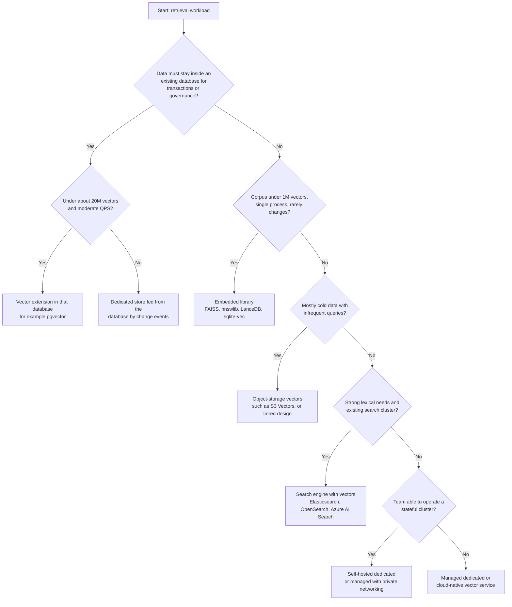

The tree is deliberately simple; its job is to propose a first candidate, which the scoring matrix and proof of concept then challenge. The threshold of 20 million vectors in the first branch is a starting hypothesis (many teams run pgvector at that scale; some run beyond and some struggle below), to be tested with the method of Section 5 and Section 6.

### 18.3 Scoring matrix

List criteria, weight them to sum to 100 from your requirements, score each candidate 1 to 5 from evidence, and compute the weighted sum. The weights below are for the document assistant of Section 21; change them for your case. The scores are illustrative, taken from the stated assumptions of a hypothetical evaluation, not claims about any product.

| Criterion | Weight | Option A: pgvector on managed PostgreSQL | Option B: Managed dedicated vector service | Option C: Search engine with vectors | Option D: Object-storage vectors |
| --- | --- | --- | --- | --- | --- |
| Filtered recall under tenant and ACL filters | 15 | 3 | 5 | 4 | 3 |
| Hybrid lexical plus vector | 10 | 3 | 4 | 5 | 2 |
| Latency at p95 and p99 | 10 | 4 | 5 | 4 | 2 |
| Scale headroom to 100M vectors | 8 | 2 | 5 | 4 | 5 |
| Multitenancy primitives | 10 | 3 | 5 | 3 | 4 |
| Update and delete behavior, freshness | 8 | 5 | 4 | 3 | 3 |
| Transactional coupling with source data | 7 | 5 | 1 | 1 | 1 |
| Security and compliance fit | 10 | 5 | 4 | 4 | 5 |
| Operational burden (higher is better) | 8 | 4 | 5 | 2 | 5 |
| Cost at target scale | 8 | 4 | 3 | 3 | 5 |
| Exit cost and portability | 6 | 5 | 3 | 4 | 3 |
| Weighted score (out of 500) | 100 | see below | see below | see below | see below |

Arithmetic for Option A: $15 \times 3 + 10 \times 3 + 10 \times 4 + 8 \times 2 + 10 \times 3 + 8 \times 5 + 7 \times 5 + 10 \times 5 + 8 \times 4 + 8 \times 4 + 6 \times 5$ $= 45 + 30 + 40 + 16 + 30 + 40 + 35 + 50 + 32 + 32 + 30 = 380$. Option B: $75 + 40 + 50 + 40 + 50 + 32 + 7 + 40 + 40 + 24 + 18 = 416$. Option C: $60 + 50 + 40 + 32 + 30 + 24 + 7 + 40 + 16 + 24 + 24 = 347$. Option D: $45 + 20 + 20 + 40 + 40 + 24 + 7 + 50 + 40 + 40 + 18 = 344$. On a 500-point scale, B scores 416 (83 percent), A 380 (76 percent), C 347 (69 percent), and D 344 (69 percent).

The matrix has three uses and one misuse. It makes assumptions explicit, it locates disagreement (two reviewers who score the same product 2 and 5 on "latency" have different workloads in mind), and it shows sensitivity. Option A scores 5 and B scores 1 on transactional coupling, so each weight point moved onto that criterion from a criterion where the two score alike gains A 4 points on B. Moving 9 points (from a weight of 7 to 16) closes the 36-point gap. The misuse is treating the totals as measurements. The difference between 416 and 380 is within the uncertainty of the scores, and the right response is a proof of concept on the top two, not a decision by score.

### 18.4 The proof of concept

A useful proof of concept is a short, bounded experiment:

1. Load a representative sample (at least 1 million vectors with real metadata, or the full corpus if smaller), with realistic tenant size skew.
2. Run the recall sweep of Section 6 at production filter mixes, including the strictest.
3. Run the load test at 1.5 times expected peak with concurrent writes.
4. Run failure tests: kill a node, restore a snapshot, run a bulk delete and measure compaction.
5. Run the isolation tests of Section 10.6.
6. Price it: production-like capacity for a month, using the sizing method of Section 5.
7. Time the operational tasks: upgrading, scaling out, rotating credentials, exporting all data.
8. Record results in a decision record with the tested versions and dates, since the result has a short shelf life.

## 19. Build Versus Buy

"Build" for a vector store rarely means writing an index from scratch. It spans a range of choices.

| Option | What you build | What you run | Typical fit |
| --- | --- | --- | --- |
| Buy managed service | Integration code, evaluation, monitoring | Nothing at the infrastructure level | Small teams, variable load, speed to market |
| Self-host open-source database | Deployment automation, upgrades, backup, monitoring, capacity planning | A stateful cluster | Strong ops team, data-location control, cost at scale |
| Extend an existing database | Schema, indexes, query layer | Existing database, larger | Moderate scale, strong coupling to relational data |
| Library plus custom service | Persistence, replication, sharding, API, filtering | Your own database | Rarely justified; very specific needs or extreme scale |

### 19.1 Arguments to evaluate

**Total cost of ownership.** Managed services price per unit of usage and absorb operations labor. Self-hosting prices infrastructure and labor. Compare with a three-year view. Illustrative arithmetic: a managed service at 6,000 USD per month is 216,000 USD over 36 months. A self-hosted cluster of 14 nodes at 365 USD per node-month is 5,110 USD per month, 183,960 USD over 36 months, plus the share of engineers' time. If operating it consumes 0.3 of a full-time engineer at a fully loaded 180,000 USD per year, that adds $0.3 \times 180{,}000 \times 3 = 162{,}000$ USD, bringing the self-hosted total to 345,960 USD, higher than the managed service. The break-even moves with scale: at ten times the data the managed price may scale ten times while the labor share stays near constant, which can reverse the result. All numbers here are illustrative; compute with your own.

**Risk transfer.** A managed service transfers patching, scaling, and some availability risk and supplies a service level agreement. It creates dependency on vendor roadmap, pricing changes, and regional availability. Read the contractual terms for data handling, sub-processors, and exit assistance.

**Control.** Self-hosting lets you control versions, upgrades, networking, and encryption, and lets you place data where required. It also makes you responsible for each.

**Capability velocity.** Vector retrieval features evolve quickly (new quantization methods, filter algorithms, hybrid search, multi-vector). Managed services and actively developed open-source databases ship improvements without your effort. A custom build falls behind unless you staff it.

**Team skill and on-call.** A distributed stateful system needs an on-call rotation with the skills to handle replica repair, disk failures, and rebalancing. If you lack that team, buying is cheaper than the incident that teaches you.

**Reuse of existing platform.** If your organization already operates PostgreSQL, Elasticsearch, or MongoDB at scale with a dedicated team, adding vectors to a cluster that team already runs can be the cheapest and safest path, up to the point where the vector workload interferes with the primary workload.

### 19.2 A rule of thumb

Buy (managed) when the team is small, the load is uncertain, and the vector store is not the product's differentiator. Extend an existing database when the data is relational, moderate in size, and tightly coupled to transactions. Self-host a dedicated database when you need control (residency, network, cost at sustained high scale) and have the operational maturity. Build custom only when no product meets a specific, measured requirement. Revisit the decision when scale changes by a factor of five or ten, because the economics and the best product often change.

## 20. Migration and Exit Between Stores

### 20.1 Why plan an exit

Retrieval stores are replaced more often than relational databases: products change licenses, prices, and quality; scale outgrows an initial choice; models change and force rebuilds; and organizations consolidate platforms. An exit plan is part of the design, and the cheapest time to make it is before the first record is written.

### 20.2 What is portable

| Asset | Portability | Notes |
| --- | --- | --- |
| Source documents and chunk text | Fully portable | Keep in your own storage |
| Metadata fields | Portable as key-value data | Types and nested structures may differ; check null handling, arrays, date formats |
| Vectors (float) | Portable as arrays | Check dimension, normalization, and metric consistency |
| Quantized vectors | Usually not portable | Product-specific codes and codebooks; re-derive from originals |
| Index structures (graph, lists) | Not portable | Rebuilt in the target |
| Sparse vectors | Portable with matching vocabulary and weights | Check how each product represents indices |
| Query semantics | Not portable | Filter syntax, scoring, hybrid fusion, and score scales differ |
| Identifiers | Portable | Check length and character limits |
| Access policies and roles | Not portable | Re-implement |
| Operational tooling | Not portable | Dashboards, alerts, backups, runbooks |

The portable core is the pair (vector, metadata) per record, plus the model and chunking versions. The non-portable parts are query behavior and operations, which are where migration effort concentrates.

### 20.3 Designing for portability

- **Own the vectors.** Keep an export of all records (identifier, vector, metadata, versions) in an open columnar format such as Parquet in your own object storage, updated by the ingestion pipeline. Re-loading into a new store is then a bulk import, with no re-embedding.
- **Isolate the store behind an interface.** A retrieval-service interface (search with a filter object, upsert, delete, get) keeps vendor query syntax out of application code. Keep it thin; a lowest-common-denominator abstraction hides features, so expose a vendor-neutral filter language that you translate per store, and accept that a few features will be adapter-specific.
- **Keep the filter model simple.** Equality, range, set membership, and boolean combination translate across products. Exotic nested or geospatial filters do not.
- **Normalize scores at the boundary.** If downstream code (thresholds, fusion) depends on score values, wrap scores so changing the metric or product does not silently shift thresholds.
- **Avoid proprietary lock-in features unless they pay for themselves.** Server-side embedding, built-in chunking, and proprietary rerankers are convenient and are exactly the pieces that make exit hard. Use them knowingly, and record the cost.

### 20.4 Migration procedure

The migration is blue/green (Section 12) with the target as green and no re-embedding when the model is unchanged:

1. Export vectors and metadata from the old store (or read from your own export), and bulk-load the new store.
2. Dual-write new changes and deletes to both.
3. Translate query filters and verify with a filter test suite that runs the same logical queries on both and compares result sets.
4. Run the recall evaluation on both with the same vectors and the same ground truth. Because the vectors are identical, differences are due to the index and parameters, which makes this the cleanest comparison you will ever get.
5. Shadow, canary, cut over, and keep the old store through a rollback window.
6. Reconcile counts and hashes, then retire the old store, and record deletion of its data per the deletion contract.

### 20.5 Exit from managed services

Check, before signing, how you extract data: whether a bulk export exists, its rate limits (listing 100 IDs per page, as one vendor documents for ID listing, makes a 50 million record export slow, so export rate matters), egress fees for moving terabytes, and whether metadata and sparse vectors export along with dense vectors. An export that returns only identifiers and requires fetching vectors in small batches is a lock-in feature, whether or not it was designed as one. Test an export during the proof of concept, at least on a sample, and time it. Extrapolate: 50 million records at 1,000 records per second is 50,000 seconds, about 14 hours.

## 21. Case Study: A Store for a Multi-Tenant Document Assistant

### 21.1 Context and requirements

A software-as-a-service company offers a document assistant to business customers. Each customer (tenant) uploads policies, contracts, manuals, and tickets, and employees ask questions answered with cited passages. The numbers below are invented for the case but internally consistent.

- 1,200 tenants. Three large tenants hold 6,000,000 chunks each (18,000,000), 60 medium tenants hold 250,000 each (15,000,000), and 1,137 small tenants hold 4,000 each (4,548,000). Total: 37,548,000 chunks, growing 6 percent per quarter.
- Embedding model with 1,024 dimensions; chunks average 350 tokens.
- Peak 150 queries per second; interactive target of p95 under 150 ms and p99 under 400 ms for retrieval (excluding reranking).
- Users see only documents their groups permit, with ACLs changing daily. The three large tenants have about 800 groups each, and a typical user belongs to 15 to 60 of them.
- Identifier-heavy queries are common (contract numbers, ticket identifiers, policy codes), so hybrid retrieval is required.
- Deletion contract: not returned within 60 seconds of a delete, physically removed from live indexes within 24 hours, removed from backups within 35 days.
- Two tenants require European data residency; one large tenant requires customer-managed encryption keys.
- The platform team has strong PostgreSQL experience and no experience operating a distributed vector database. Seven engineers, one on-call rotation shared with the application team.

### 21.2 Sizing

Float32 vectors: $37{,}548{,}000 \times 1024 \times 4 = 153.8 \times 10^9$ bytes, which is 143.2 GiB. HNSW graph at 137 bytes per node: $5.14 \times 10^9$ bytes, 4.79 GiB. Hot set 148.0 GiB; with 30 percent headroom, 192.4 GiB. On 64 GiB nodes with 44.8 GiB usable, that is $192.4 / 44.8 = 4.3$, so 5 shards. With int8 scalar quantization and float32 originals on SSD: vectors $143.2 / 4 = 35.8$ GiB, hot set $35.8 + 4.8 = 40.6$ GiB, with headroom 52.8 GiB, which is 2 shards ($52.8 / 44.8 = 1.18$), and 143.2 GiB of originals on SSD.

Throughput: a load test (Section 21.5) measures 90 queries per second per replica group at the latency targets for the chosen configuration. At 50 percent headroom, one group serves 45 steady queries per second, and $\lceil 150 / 45 \rceil = 4$ groups are needed. Because the dominant queries are tenant-scoped, fan-out is limited to the tenant's namespace, and the real constraint is the largest tenants' query load, not the average.

The numbers say that the whole corpus is small enough to fit a modest cluster after quantization. The cost and risk of this system come from tenancy, authorization, hybrid search, and operations, not raw scale. That observation shapes the decision.

### 21.3 Alternatives considered

1. **pgvector on the existing managed PostgreSQL.** Strengths: the team knows PostgreSQL; ACL tables and tenant metadata already live there; transactional deletes and row-level security give a strong isolation argument; no new system. Concerns: three tenants with 6,000,000 chunks each and a 37.5 million total would put substantial index build and memory load on the primary application database unless a separate cluster is used; HNSW indexes on 6,000,000 rows with ACL filters of 15 to 60 group identifiers rely on iterative scans and planner behavior that must be proved; hybrid search would need `tsvector` indexes plus application-side fusion; per-tenant partitioned tables (1,200 partitions) complicate maintenance. This option remained viable for the small and medium tenants.
2. **Search engine with vectors (self-managed Elasticsearch or OpenSearch).** Strengths: mature hybrid retrieval, document-level security features, quantization. Concerns: the team has no experience operating a search cluster; heap, shard sizing, and merge tuning are new skills; index-per-tenant at 1,200 tenants creates a large shard count.
3. **Managed dedicated vector service with namespaces per tenant.** Strengths: namespace-per-tenant addresses isolation and removes the tenant predicate from filtering; no cluster operations for the team; native hybrid search in the candidates evaluated; deletion by namespace is simple. Concerns: a new vendor and data-processing agreement; per-namespace limits; ACL filtering still needs a metadata filter; export and exit must be planned; residency and customer-managed key support are tier-dependent.
4. **Object-storage vectors.** Cost-effective for the long tail of small, rarely queried tenants. Rejected as the primary store because interactive latency targets with hybrid search and ACL filters are tighter than its design point; it remained a candidate for archival tenants.
5. **Embedded libraries.** Rejected for the main path (multi-process access, no ACL filtering, no replication); used in the offline evaluation harness.

### 21.4 Decision

The scoring matrix of Section 18.3 used these weights and favored the managed dedicated option, with pgvector second. The team ran a two-week proof of concept on the top two using the 6,000,000-chunk tenant plus 40 medium tenants (about 16 million chunks), with real ACL filters.

**Decision.** Use a managed dedicated vector service with namespace per tenant for all tenants, one index per region, and a tenant directory mapping each tenant to a region, an index, and a namespace. The three large tenants keep their own namespaces, and the one requiring customer-managed keys is placed in a dedicated index on the service tier that supports them. Keep authoritative documents, chunk text, and ACLs in PostgreSQL. Maintain an open-format export of all vectors and metadata in object storage as the backup and exit path. Revisit pgvector for small tenants if costs or vendor terms change.

**Why not pgvector, in the evidence of the proof of concept** (illustrative results): filtered recall@10 for the 6,000,000-chunk tenant with a 40-group ACL filter was 0.88 with default settings and 0.95 only after raising `ef_search` and enabling iterative scans, at p99 of 310 ms (inside target, with no margin) on an instance sized at 2x the managed service's estimated cost. The service met recall 0.96 at p99 of 120 ms with default filter handling. The pgvector approach also required fusion code and a separate `tsvector` tuning effort for identifier queries. Neither result is a statement about the products in general. They are the observations for this data at this time.

### 21.5 Architecture and validation

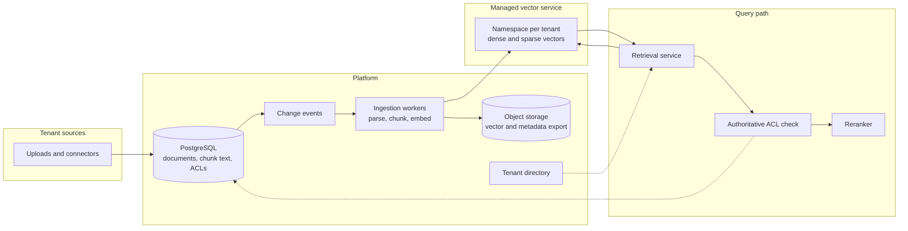

Key design choices and the reasoning:

- **Filters.** Tenant isolation by namespace. Within a namespace, a coarse `label` filter (department and confidentiality) is evaluated in the engine, and the caller's group list is passed as an engine filter limited to 64 principals (callers in more groups are collapsed to role-based groups at token issue). The final top-20 are checked against PostgreSQL for authorization, and failures drop the candidate and log it.
- **Hybrid.** A dense leg and a sparse BM25-style leg inside the same namespace and the same filter, fused with RRF at $c = 60$, 100 candidates per leg, then reranked to 8. Identifier queries (detected with a pattern) use weight 2 on the lexical leg.
- **Quantization.** int8 scalar quantization with rescoring and oversampling 3 on the large tenants, after a recall comparison showed float32 at 0.962 and int8 with oversampling 3 at 0.958 (illustrative).
- **Ingestion.** Deterministic chunk identifiers, content-hash skipping, versioned writes with a trailing delete, visibility marker before a document is shown as ready. The dead-letter queue pages the owning team after 15 minutes.
- **ACL propagation.** Permission-change events update chunk metadata labels within a minute. The authoritative check protects the window.
- **Deletion.** Document delete: remove chunks by identifier and verify with a marker query. Tenant delete: namespace delete, a verification query, and a cache purge, with the export records and backups expiring on the 35-day schedule. A deletion ledger records each step.
- **Migration.** New embedding models get a new namespace set (green), using the export for re-embedding where text is stored, with dual-write and a canary by tenant.

**Validation evidence collected before launch** (illustrative):

| Test | Method | Result | Gate |
| --- | --- | --- | --- |
| ANN recall@10, strict ACL filter | 800 queries, exact filtered scan baseline | 0.961 | At least 0.95 |
| Short-result rate, tenant with 300 chunks | 200 queries | 0 percent | 0 percent |
| p95 and p99 at 150 queries per second, one replica group removed | Open-loop load test, 30 minutes | 96 ms and 238 ms | Under 150 ms and 400 ms |
| Concurrent bulk ingest of 2,000,000 chunks | Load test during ingest | p99 up to 301 ms | Under 400 ms |
| Cross-tenant canary | 5,000 queries across all paths including fallback and hybrid legs | 0 hits | 0 hits |
| Deletion drill | Delete tenant, query canary text, check replicas and caches | Not returned at 11 seconds; caches purged in 40 seconds | Under 60 seconds |
| Restore drill from export | Rebuild one 6,000,000-chunk namespace from export | 3 hours 10 minutes; recall 0.960 | RTO 8 hours |
| Embedding model swap rehearsal | Build green for 60 medium tenants, shadow queries | Overlap of top-10 at 71 percent; task hit rate up 3 points | Review of regressions |

The last row illustrates what shadow comparison tells you: 71 percent top-10 overlap is expected for a different model, and the decision to proceed comes from the labeled evaluation (hit rate up 3 points, with per-slice review), not from overlap.

### 21.6 Operating model

SLOs follow Section 16.2. The recall probe runs hourly on 600 probe queries per large tenant. The on-call runbook includes the diagnostic procedure of Section 17.2 with an internal tool to run steps 1 to 5. Quarterly drills: restore from export, regional failover to the warm standby index in a second region (fed by the same event stream), and a deletion drill. A review every six months re-runs the scoring matrix with current prices, limits, and features, since product facts drift.

## 22. Common Mistakes

| Mistake | Cause | Consequence | Correction |
| --- | --- | --- | --- |
| Choosing a store from an unfiltered speed benchmark | Vendor benchmarks use public datasets without filters | Recall collapses or latency spikes under tenant and ACL filters | Benchmark with real vectors, filters, and write load; compare at equal recall |
| Reporting average latency | Easy to compute | Hides the tail that users feel | Report p50, p95, p99 with sample counts, under concurrency |
| Measuring recall with queries taken from the index | Convenient test data | Inflated recall (a self-match is always found) | Use held-out queries and an exact baseline |
| Not measuring ANN recall at all | "Approximate is good enough" | Silent quality decay after churn or upgrades | Recall probe in production |
| Tenant filter passed from the client | Convenient API design | Cross-tenant leakage through forged requests or prompt-injected tool calls | Build filters in the service from verified claims |
| Post-filtering authorization | Simplest to write | Short result lists, candidate exposure, leaks through side channels | Engine-enforced filter plus authoritative check |
| Mixing embedding versions in one index | Gradual model rollout | Meaningless similarities, no errors raised | One model version per index; blue/green migration |
| Treating the store as the only copy | Convenient | Cannot rebuild after a model change or corruption | Keep sources, chunk text, and an export |
| Deleting without a deletion contract | Assuming delete means gone | Data persists in tombstones, replicas, snapshots, caches | Define and test the contract per layer |
| Ignoring tombstone buildup | Deletes look instant | Memory and latency grow, recall drops until compaction | Monitor deleted ratio; schedule compaction |
| Sizing from vector bytes only | Forgetting graph, metadata, headroom, rescoring SSD | Out-of-memory events and latency cliffs | Use the full model and 30 percent headroom |
| Adding shards to raise throughput | Misunderstanding fan-out | Cost increases without throughput gain | Add replica groups for throughput; shard for data size |
| Relying on a preview feature | Marketing announcements | No SLA, changing APIs | Read the status; keep a fallback |
| Putting everything in the application database without limits | Convenience of one system | Vector workload degrades the transactional workload | Separate replica or cluster; resource limits |
| No exit plan | Optimism | Lock-in; migration blocked by missing export | Maintain an open export; abstract the interface |
| Skipping restore drills | Backups "exist" | Backups that do not restore | Quarterly timed restores with recall checks |
| Tuning on the evaluation set | Reuse of the same queries | Overfit parameters | Separate tuning and holdout sets |

## 23. Design-Review Checklist

Use the checklist in architecture reviews. Each item should be answerable with a number, a test result, or a document.

**Workflow and fit**

1. Is the store's role defined (derived, rebuildable data versus system of record for any field)?
2. Which category (dedicated, general database or engine, cloud-managed, embedded) was chosen, and which alternatives were rejected, with the evidence?
3. Were product capabilities and limits verified against current documentation, with dates and versions recorded, and preview features identified?

**Index, sizing, and cost**

4. Are dimensions, data type, quantization, and index parameters recorded and justified by an evaluation?
5. Does the sizing include vectors, graph, metadata, lexical index, payload indexes, 30 percent headroom, replicas, and rescoring storage?
6. Is throughput planned by replica groups, with a measured queries-per-second figure and headroom?
7. Is the cost model complete (storage, compute, requests, egress, backup, embedding, migration overlap)?

**Quality**

8. Is ANN recall measured against an exact baseline with held-out queries, at the production filter mix and at the retrieval depth the pipeline uses?
9. Are latency percentiles measured under concurrency with writes running, cold and warm?
10. Is there a production recall probe and a short-result-list metric?
11. Is hybrid retrieval evaluated against dense-only on identifier and paraphrase queries?

**Filtering, tenancy, and authorization**

12. Is the filter strategy understood at low selectivity (small tenants, strict ACLs), with tested results?
13. Is the tenancy design justified by isolation need, tenant size distribution, and cost?
14. Are filters built from verified identity claims inside the service, enforced in the engine, and backed by an authoritative check?
15. Are isolation canary tests automated across all code paths?

**Freshness and lifecycle**

16. Are upserts idempotent, with deterministic identifiers and content-hash skipping?
17. Is there a visibility marker, and is freshness measured and under an SLO?
18. Is the deletion contract defined for index, replicas, caches, snapshots, and backups, and tested?
19. Is there a documented, rehearsed blue/green procedure for embedding-model and index rebuilds?

**Resilience and security**

20. Are backups tested by timed restores, including recall and latency checks, with immutable copies out of reach of application credentials?
21. Are RPO, RTO, degraded modes, and the model-deprecation scenario documented?
22. Are vectors classified like source text, encrypted in transit and at rest, network-isolated, and audited?
23. Are residency requirements met for the store, the embedding service, the reranker, backups, and logs?

**Operations and exit**

24. Do dashboards and alerts cover the SLOs and retrieval-specific metrics?
25. Is an "explain this retrieval" diagnostic available to the on-call?
26. Is there an open-format export refreshed by the pipeline, and a tested bulk-export procedure?
27. Is a periodic re-evaluation of the selection scheduled?

## 24. Exercises

Answers follow each question in outline form.

**Exercise 1: Memory sizing.** A corpus has 20 million chunks, 768-dimensional float32 vectors, HNSW with $M = 32$ and 4-byte links, and a 0.07 upper-layer factor. Compute vector bytes, graph bytes, and the graph as a percentage of vector bytes. Then compute the hot set with 30 percent headroom and the number of 64 GiB nodes (70 percent usable) needed.

*Answer outline.* Vectors: $20{,}000{,}000 \times 768 \times 4 = 61.44 \times 10^{9}$ bytes, 57.22 GiB. Graph per node: $2 \times 32 \times 4 \times 1.07 = 273.9$ bytes; total $5.48 \times 10^{9}$ bytes, 5.10 GiB, which is 8.9 percent of vector bytes ($273.9 / 3072$). Hot set $62.32$ GiB; with headroom $81.0$ GiB. Usable per node 44.8 GiB; $81.0 / 44.8 = 1.81$, so 2 shards, and 4 nodes with two replicas.

**Exercise 2: Quantization trade.** For the corpus of Exercise 1, compute the vector size with int8 scalar quantization, and state what must be added to the design to keep recall and what it costs in storage.

*Answer outline.* int8: $20{,}000{,}000 \times 768 = 15.36 \times 10^9$ bytes, 14.31 GiB. Graph unchanged at 5.10 GiB, so the hot set is 19.41 GiB (versus 62.32), with headroom 25.2 GiB, which fits one 64 GiB node. Rescoring requires float32 originals on SSD (57.22 GiB) and an oversampling factor measured on the labeled set; SSD IOPS must support the rescoring reads. Replicas still need two nodes for availability.

**Exercise 3: Filter collapse arithmetic.** A shared index holds 40,000,000 chunks. A tenant has 20,000 chunks. A query asks for the top 10 using a post-filter with 100 global candidates. What is the expected number of tenant chunks among the candidates if the tenant's content were uniformly spread among all neighbors, and what overfetch would be needed to expect 10? State why the real number may differ.

*Answer outline.* Selectivity $s = 20{,}000 / 40{,}000{,}000 = 0.0005$. Expected survivors: $100 \times 0.0005 = 0.05$. To expect 10 you need $m = 10 / 0.0005 = 20{,}000$ candidates. In practice tenant content correlates with the query (a tenant's user asks about the tenant's topics), so survivors may be more than uniform, but the dependence is not controllable. The sound fix is partitioning by tenant or a pre-filter exact scan over the 20,000 chunks (20,000 comparisons, trivial).

**Exercise 4: Fan-out and throughput.** A cluster has 4 shards and 2 replica groups, and sustains 100 queries per second at its p95 target. The team adds 4 more shards (8 shards, 2 groups) hoping to double throughput. What happens, and what should they have done?

*Answer outline.* Each query still fans out to every shard. Smaller shards make each partial search cheaper but the merge, network, and coordination costs grow, so throughput rises modestly if at all, and tail latency worsens ($1 - 0.99^4 = 3.9$ percent versus $1 - 0.99^8 = 7.7$ percent chance of a slow shard per query for a 1 percent per-shard slow rate). To double throughput, add replica groups (4 groups of 4 shards). Shard more only when data size requires it, or route queries by tenant to avoid fan-out.

**Exercise 5: RRF.** A document is ranked 3rd by the dense leg and 1st by the lexical leg. Another is 2nd by both. Compute RRF scores with $c = 60$ and decide which ranks first. What would a weighted sum of raw scores do if the lexical scores are 8.1 and 2.0, and the dense similarities are 0.78 and 0.84?

*Answer outline.* First document: $1/63 + 1/61 = 0.015873 + 0.016393 = 0.032266$. Second: $2/62 = 0.032258$. The first wins by a hair. Raw 0.5/0.5 sum: first document $0.5 \times 8.1 + 0.5 \times 0.78 = 4.44$ and second $0.5 \times 2.0 + 0.5 \times 0.84 = 1.42$, so the lexical scale dominates; the dense score barely matters. Normalizing each leg first, or using RRF, avoids the scale problem.

**Exercise 6: Recall confidence.** A recall probe of 300 queries shows ANN recall@10 of 0.93 for configuration X and 0.95 for configuration Y. Can you claim Y is better?

*Answer outline.* Standard error approximately $\sqrt{p(1-p)/n}$: for 0.94 and $n = 300$ it is 0.0137; a 95 percent interval is about $\pm 0.027$, wider than the 0.02 difference. Because the same queries are used for both configurations, a paired comparison is more powerful (count queries where Y is better and where X is better), but with this evidence you cannot claim a difference. Increase the query count, or run a paired test.

**Exercise 7: Deletion contract.** Write a deletion contract for a customer who asks for data erasure under a contract that allows 30 days, in a system with a managed vector store, a semantic answer cache, a nightly export, and 35-day snapshots. List the steps and the evidence for each.

*Answer outline.* Stages: (1) source delete committed in PostgreSQL, evidence: transaction identifier. (2) Chunk delete in the store by document or namespace, evidence: acknowledgment and marker query returning zero within 60 seconds. (3) Semantic and retrieval cache purge by tenant key, evidence: cache invalidation log. (4) Physical removal after compaction, evidence: store metrics on deleted ratio, or namespace drop. (5) Export removal: the nightly export is regenerated without the data, and old export objects deleted, evidence: object version deletion. (6) Snapshot expiry: 35 days exceeds the 30 days allowed, so either shorten snapshot retention for this tenant, use tenant-specific encryption keys and destroy the key (cryptographic erasure), or amend the contract to 35 days. Record the ledger of all steps.

**Exercise 8: Selection under constraints.** A health-care startup stores 3 million chunks, must keep data in one cloud account, has two engineers and strong PostgreSQL skills, needs transactional updates between patient-document metadata and ACLs, and queries at 5 per second. Propose a store and the validation you would run.

*Answer outline.* pgvector in the existing PostgreSQL (or a managed PostgreSQL in the same account): the scale (3 million chunks, about 9 GiB of 768-dimensional float32 vectors), skills, transaction coupling, and residency all favor it. Validate: recall at the strictest ACL filter with iterative scans and `EXPLAIN` plans; latency under concurrent updates; row-level security tests; index build time and memory on the instance; restore drill including index rebuild time. Set a trigger to re-evaluate if vectors exceed about 20 million or the query rate grows tenfold.

**Exercise 9: Migration cost.** Estimate embedding cost and dual-running cost for migrating 30 million chunks of 300 tokens to a new model priced at 0.10 USD per million tokens, with a 6-node cluster at 400 USD per node-month run in parallel for 5 weeks.

*Answer outline.* Tokens: $30{,}000{,}000 \times 300 = 9 \times 10^{9}$; cost $9{,}000 \times 0.10 = 900$ USD. Dual running: 5 weeks is about 1.15 months; $6 \times 400 \times 1.15 = 2{,}760$ USD. Total about 3,660 USD of infrastructure and embedding, before engineering and validation time, which usually exceeds it.

**Exercise 10: Failure diagnosis.** Users say a newly uploaded contract cannot be found for several minutes, and sometimes found and then missing on a refresh. Identify the likely causes and the fixes.

*Answer outline.* Found-then-missing suggests replica lag with non-monotonic reads: consecutive queries hit replicas at different freshness. Several minutes before first visibility suggests the refresh interval, ingestion queue lag, or an embedding retry. Diagnose with the visibility marker timing, replica lag metrics, and queue depth. Fixes: sticky routing or a minimum-version token, wait-for-visibility before showing the document as ready, a session-scoped store for just-uploaded documents, and alerts on ingestion lag.

## 25. Summary

A vector store is the component where approximate search, derived data, and access control meet, and the decisions around it determine whether an AI retrieval system is accurate, fresh, safe, and affordable.

1. Place the store in the workflow as a rebuildable, derived store with a defined role. Keep source text, the embedding model, authorization policy, and evaluation outside it.
2. Choose a category by operational property. Dedicated databases give retrieval-specific features and scale, general databases and engines give proximity to existing data and fewer systems, cloud-managed services shift operations to a provider, and embedded libraries fit bounded data. Verify product facts against current documentation, because capabilities, limits, prices, and licenses change.
3. Select an index by its memory, recall, latency, and update behavior. Flat search is exact and often enough for small or heavily filtered sets, HNSW gives low latency when memory allows, IVF and quantization trade recall for compactness, and disk-based indexes trade latency for cost.
4. Size with arithmetic. Vectors times dimensions times bytes, plus graph, metadata, headroom, rescoring storage, and replica groups. Shards hold data and replicas serve throughput, because unfiltered queries fan out to all shards.
5. Measure recall against an exact baseline using held-out queries, report percentiles under concurrency, compare at equal recall, and keep a production recall probe.
6. Filtering is where approximate indexes fail quietly. Choose pre-filter, post-filter with overfetch, or filter-aware traversal from the expected number of matching records, partition by the dominant filter, and monitor short result lists.
7. Hybrid retrieval repairs the weaknesses of dense search on identifiers and rare terms. Start with RRF, apply the same filter to every leg, and add a reranker when the evidence supports it. Use multi-vector storage only when measured gains justify the multiplied storage.
8. Tenancy is a trade between cost and isolation. Build filters from verified identity in the service, enforce them in the engine, and verify survivors against the authoritative source.
9. Freshness and deletion are contracts. Make writes idempotent, prove visibility with markers, understand tombstones and compaction, and test deletion across replicas, caches, snapshots, and backups.
10. Treat model changes as migrations. Build a green index, dual-write, validate with evaluation and shadow traffic, canary, and keep the old index through the rollback window.
11. Plan for failure and exit. Rehearse restores, keep an open-format export, and record the evidence for the selection so it can be revisited when facts change.

## 26. Code Examples

All examples use the Python standard library only (Python 3.9 or later) and print the output quoted in this chapter. Timings vary by machine; counts and recall values are deterministic for the fixed seeds.

- [`01_sizing_calculator.py`](../code/python/vector-retrieval-chapter/01_sizing_calculator.py) computes vector, graph, and metadata bytes, quantization savings, shard counts, replica groups, and an illustrative monthly compute price for the 50-million-chunk example of Section 5.
- [`02_recall_vs_ann_parameters.py`](../code/python/vector-retrieval-chapter/02_recall_vs_ann_parameters.py) builds an inverted-file index, sweeps `nprobe`, and reports recall@10 against an exact baseline with machine-independent cost and latency percentiles, plus the copied-query pitfall of Section 6.
- [`03_filtered_search_recall.py`](../code/python/vector-retrieval-chapter/03_filtered_search_recall.py) compares post-filter, oversampled post-filter, filtered traversal, and pre-filter scan on a proximity graph as filter selectivity falls (Section 7.2).
- [`04_hybrid_fusion.py`](../code/python/vector-retrieval-chapter/04_hybrid_fusion.py) contrasts BM25, a toy semantic ranker, reciprocal rank fusion, and raw weighted sums on identifier-style and paraphrase queries (Section 8).

## 27. References and Further Reading

Product documentation is the authority for current limits, prices, and licenses; the pages below were consulted for this chapter in October 2026 and may have changed.

- Malkov and Yashunin (2018), "Efficient and robust approximate nearest neighbor search using Hierarchical Navigable Small World graphs," IEEE Transactions on Pattern Analysis and Machine Intelligence (arXiv 2016).
- Subramanya et al. (2019), "DiskANN: Fast Accurate Billion-point Nearest Neighbor Search on a Single Node," NeurIPS.
- Jegou, Douze, and Schmid (2011), "Product Quantization for Nearest Neighbor Search," IEEE TPAMI.
- Cormack, Clarke, and Buettcher (2009), "Reciprocal Rank Fusion outperforms Condorcet and individual Rank Learning Methods," SIGIR.
- Khattab and Zaharia (2020), "ColBERT: Efficient and Effective Passage Search via Contextualized Late Interaction over BERT," SIGIR; Santhanam et al. (2022), "ColBERTv2."
- Formal et al. (2021), "SPLADE: Sparse Lexical and Expansion Model for First Stage Ranking," SIGIR.
- Morris et al. (2023), "Text Embeddings Reveal (Almost) As Much As Text," arXiv.
- Aumuller, Bernhardsson, and Faithfull (2020), "ANN-Benchmarks: A Benchmarking Tool for Approximate Nearest Neighbor Algorithms," Information Systems.
- [pgvector README](https://github.com/pgvector/pgvector) for types, index limits, and iterative scans.
- [Amazon S3 Vectors general availability announcement](https://aws.amazon.com/about-aws/whats-new/2025/12/amazon-s3-vectors-generally-available?ref=awsweekly.info).
- [Microsoft documentation for VECTOR_SEARCH in SQL Server and Azure SQL](https://learn.microsoft.com/en-us/sql/t-sql/functions/vector-search-transact-sql?view=sql-server-ver17).
- [Elasticsearch Better Binary Quantization documentation](https://www.elastic.co/docs/reference/elasticsearch/mapping-reference/bbq) and the [9.1 release notes on BBQ and ACORN](https://www.elastic.co/search-labs/blog/elasticsearch-9-1-bbq-acorn-vector-search).
- [Azure AI Search vector index size and optimization](https://learn.microsoft.com/en-us/azure/search/vector-search-index-size?tabs=portal-vector-quota).
- [Vertex AI Vector Search 2.0 overview](https://cloud.google.com/vertex-ai/docs/vector-search-2/overview) and [AlloyDB ScaNN index](https://cloud.google.com/alloydb/docs/ai/create-scann-index).
- [Pinecone object limits](https://docs.pinecone.io/reference/api/database-limits/object-limits) and [multitenancy design](https://docs.pinecone.io/guides/index-data/design-for-multitenancy).
- [Qdrant multitenancy](https://qdrant.tech/documentation/manage-data/multitenancy/) and [filtered search and ACORN](https://qdrant.tech/articles/filtered-vector-search-acorn/).
