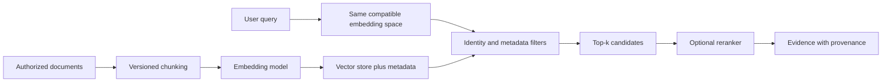
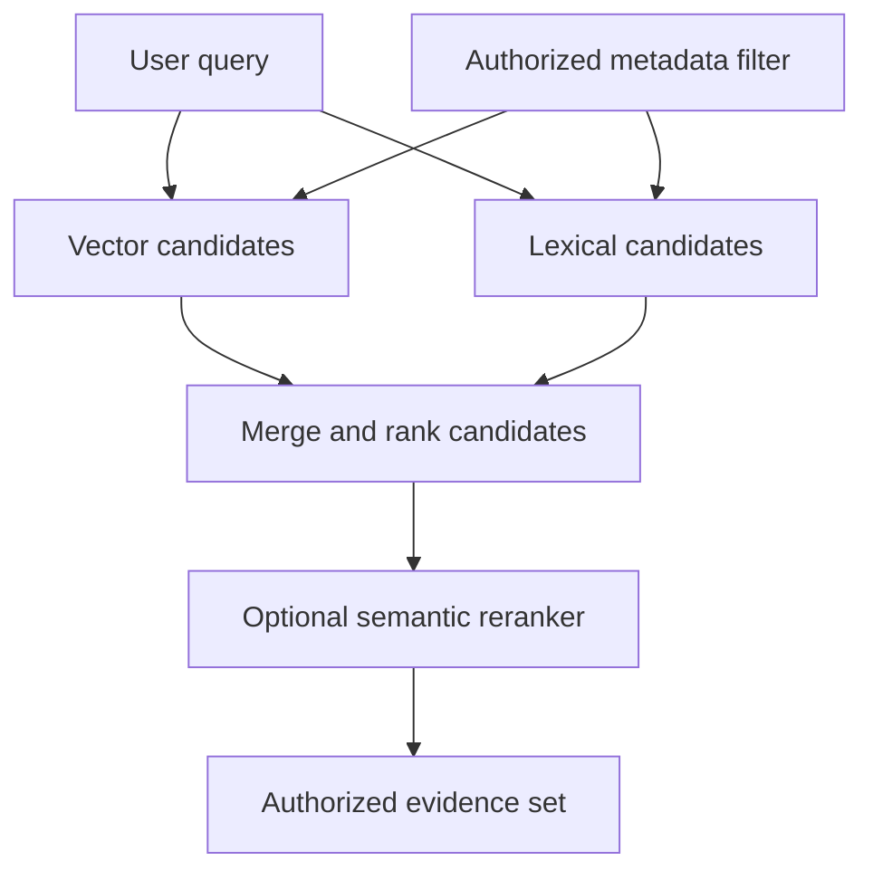
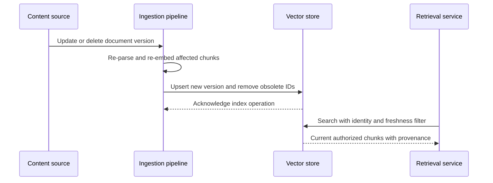
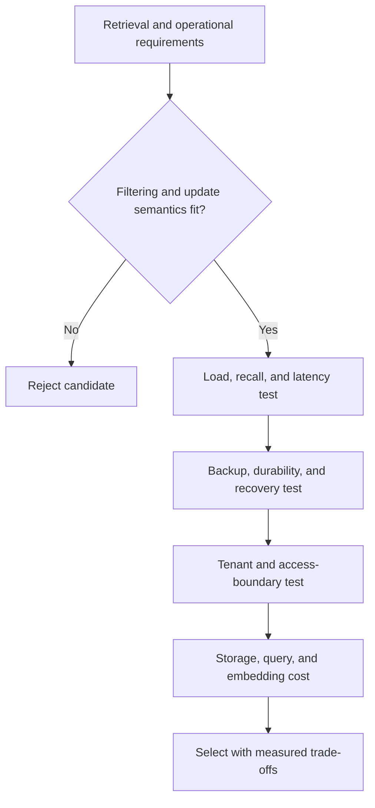
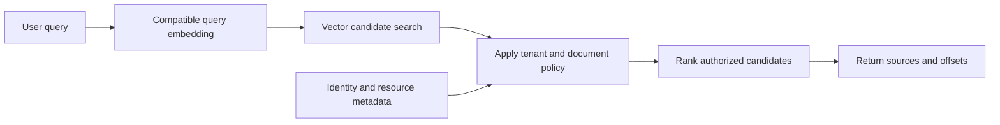

# Vector Databases for AI Retrieval

Part: [16 — Artificial Intelligence, Machine Learning, and Generative AI](PART_OVERVIEW.md)

Vector databases store and search embedding vectors alongside identifiers and metadata for retrieval tasks. AI systems use them to find semantically related content, but retrieval quality depends on embedding model, filters, chunking, freshness, and evaluation. [Part 06 CH21 — Vector Databases](../06_Databases_and_Storage/CH21_Vector_Databases.md) owns vector-index structures, filtering internals, durability, and database mechanics. This chapter focuses on AI retrieval workflow and product-fit decisions, recapping those storage concerns rather than re-teaching index algorithms.

## Retrieval Request Path

An ingestion pipeline transforms source documents into chunks, embeds them with a selected model, and stores vectors with provenance and access metadata. At query time, the system embeds the request, applies caller authorization filters, retrieves candidates, optionally reranks them, and constructs context for a downstream task.

Use the same embedding model version and compatible preprocessing for indexed documents and queries. If versions change, do not compare raw vectors across spaces unless the model explicitly guarantees compatibility. Preserve document IDs, source offsets, version, update time, and access labels.

## Similarity, Hybrid Search, and Filtering

Vector similarity captures learned relationships but may miss exact identifiers, rare terms, negation, or structured constraints. Hybrid retrieval combines vector similarity with lexical search, metadata filters, or domain rules. Ranking fusion and reranking can improve relevance but add latency and cost. Evaluate candidates after access filtering; unauthorized content must never enter model context.

Filters can change recall and index performance. Test filter behavior with tenant boundaries, document deletion, and missing metadata. Index-level filter semantics and transaction guarantees belong to Part 06 CH21.

Distinguish pre-filtering from post-filtering. A pre-filter restricts the eligible candidate set before nearest-neighbor selection and can preserve the requested result count, but selective predicates may make the search harder or reduce recall if the index handles them poorly. A post-filter first retrieves global neighbors and then removes ineligible records; it may return fewer than $k$ results, so implementations often overfetch and rerank. Overfetch increases work and must never expose unauthorized text to the application or model. Build the filter from trusted identity and resource policy, not from a tenant identifier supplied only in the query; Part 17 owns the surrounding authorization architecture.

## Freshness, Provenance, and Deletion

Source updates must propagate to chunks, embeddings, and indexes. Track source version and ingestion timestamp; define how quickly changed or deleted content disappears from query results. Deletion may require removing source records, derived chunks, cached results, and snapshots. An index that returns stale evidence can produce confidently wrong outputs even if the model is unchanged.

Monitor ingestion lag, failed embedding jobs, stale-document rate, index update acknowledgement, and delete completion. Retain a reconciliation process for missed events. Do not report a delete as complete until downstream indexes and caches meet the defined deletion contract.

## Product Fit and Operational Trade-offs

Choose a vector store based on recall/latency targets, metadata filtering, tenant isolation, update and delete behavior, scale, durability, backup, operational skill, and cost. Managed services reduce operations but introduce provider boundaries and pricing dependence; self-managed systems require index lifecycle, capacity, upgrades, and recovery ownership. Validate with representative data and concurrent load rather than synthetic vectors alone.

Measure retrieval quality with recall@k against a labeled query set before comparing products on raw query latency. If a 200-query evaluation set has one correct passage per query and an approximate index returns that passage within its top 5 results for 164 queries, recall@5 is $164/200=0.82$. Comparing an exact brute-force baseline's recall@5 of, say, 0.95 on the same set quantifies the approximation cost of the chosen index parameters (such as the number of graph neighbors or probe count), which is the number that should drive a configuration decision, not an assumption that "approximate" always means "good enough." Re-run this measurement whenever the embedding model, chunking strategy, or index configuration changes, because recall is a property of the whole pipeline, not the vector store alone.

Start by asking whether vector retrieval needs independent scaling or a separate lifecycle. An embedded library can fit a local, bounded collection where search shares the application's process and rebuild is simple. A vector extension in an existing database can keep metadata, transactions, and authorization predicates near authoritative records, but may couple search capacity and maintenance to that database. A dedicated service separates scale and offers retrieval-specific operations, while adding replication, identity, backup, and consistency boundaries to operate. Compare filtered recall, tail latency, update visibility, delete guarantees, and recovery time on the actual query mix; raw nearest-neighbor speed on unfiltered synthetic vectors is not a sufficient product benchmark.

## Worked Case and Review Checklist

A support knowledge system indexes versioned policy documents. It chunks by headings, embeds with a pinned model, stores tenant and classification metadata, and uses hybrid retrieval for exact policy numbers plus semantic questions. Query-time authorization filters content before reranking. Updates replace only affected chunks; deletion tests verify stale vectors and cache entries disappear. Retrieval changes run against a labeled query set.

A concrete migration hazard this system guards against: embeddings from model version A and model version B are not comparable in the same similarity space, even when both produce vectors of the same dimension. After a planned embedding-model upgrade, the team ran a dual-write period where new content was embedded with both models into separate indexes, verified retrieval quality on the labeled query set for the new index before cutover, and only then began a background re-embedding job for existing content — rather than mixing old and new vectors in one index, which would have silently degraded ranking without any error being raised.

Review embedding compatibility, chunk provenance, authorization filtering, hybrid search need, update/delete freshness, retrieval evaluation, reranking latency, embedding cost, and product-specific operational ownership. Refer to [Part 06 CH21](../06_Databases_and_Storage/CH21_Vector_Databases.md) for index algorithms, filtering internals, and database guarantees.

## Questions and Summary

1. Draw ingestion and query paths and show where identity filtering occurs.
2. When does hybrid search outperform vector-only retrieval?
3. Plan a model upgrade without mixing incompatible vector spaces.
4. Define deletion completion across source, vector index, and cache.
5. Compare managed and self-hosted options using recovery, scale, isolation, and cost.

Vector stores provide a retrieval substrate, not a complete RAG system. Embedding compatibility, provenance, access filters, freshness, ranking, and evaluation determine whether retrieved evidence is useful and safe. Index structures and durability internals remain owned by Part 06.
