# AI Infrastructure and Platform Components

Part: [16 — Artificial Intelligence, Machine Learning, and Generative AI](PART_OVERVIEW.md) · Status: Revised (in-depth rewrite)

## 1. Introduction

Teams that adopt machine learning (ML) in production meet a vocabulary problem before they meet a hardware problem. Someone says "we run vLLM", someone else says "we run KServe", a third person says "we use Ray", and a fourth says "our platform is Kubeflow". All four statements can be true on the same cluster, and none of them is a substitute for another. vLLM executes the math of a large language model (LLM). KServe turns a model into a managed Kubernetes service. Ray is a general distributed-computing runtime. Kubeflow is a family of lifecycle components. They sit at different layers of the same stack and answer different questions. An architect who treats them as competing products will pick the wrong one, buy something that duplicates an existing layer, or leave a layer with no owner.

This chapter builds the stack from the bottom up, names the job of each layer, and then places the products that matter at the time of writing (October 2026) inside that structure. It also teaches the arithmetic that decides whether a design works: how much memory a model needs, why decode speed depends on memory bandwidth, how long a replica takes to start, how many models fit on a GPU, how much a checkpoint costs to write, and when renting tokens from a hosted application programming interface (API) is cheaper than running your own Graphics Processing Units (GPUs).

### 1.1 Reader outcomes

After this chapter you should be able to:

1. Classify any AI infrastructure product by layer and role (engine, server, scheduler, orchestrator, registry, tracker, pipeline engine, platform) and say what it does not do.
2. Estimate the memory footprint of weights and the key-value (KV) cache for a model, and explain why decode throughput is limited by memory bandwidth at small batch sizes and by compute at large ones.
3. Choose a model format and packaging approach, and explain which formats can execute code on load and which cannot.
4. Select an inference engine and a serving layer for a workload, with reasons, and avoid known mismatches such as using a laptop runner for multi-tenant production traffic.
5. Describe how GPUs are exposed to Kubernetes, how they can be shared (Multi-Instance GPU, time-slicing, Multi-Process Service), how batch queues and gang scheduling work, and compute packing and fragmentation examples.
6. Compute cold-start time from weight size and storage bandwidth, and choose caching and warm-pool strategies.
7. Size checkpoint storage for training and decide where checkpoints live.
8. Read GPU and inference-server telemetry and map symptoms to failure modes.
9. Build a break-even model for hosted APIs versus self-hosting, using utilization rather than list price.
10. Describe the security boundaries of a multi-tenant AI platform, including supply-chain risks in model artifacts.
11. Argue build versus buy for a platform and propose a team topology.

### 1.2 Why it matters to a solution architect

Infrastructure decisions are expensive to reverse and hard to see from the application layer. A decision to standardize on one engine determines which quantization formats you can serve. A decision about interconnect determines which model sizes you can serve with acceptable latency. A decision to run on spot capacity determines the checkpoint cadence of every training job. A scheduler choice determines whether a 64-GPU training job can start while 40 percent of the cluster looks idle. These are architecture decisions with money, reliability, and security consequences, and most of them are made once, early, by whoever stood up the first cluster.

The product market also drifts quickly. Between 2023 and 2026 the leading open serving engines changed, one major engine entered maintenance mode, a major serving product was renamed, and Kubernetes changed the way GPUs are requested. This chapter therefore teaches mechanisms first and marks product facts "at the time of writing". Where a fact is likely to change, it tells you how to verify it.

### 1.3 Scope and ownership

This chapter owns infrastructure component roles and prerequisites. Neighbouring chapters own the techniques that run on top of that infrastructure, and this chapter recaps them only enough to place them.

| Topic | Owner | What this chapter does |
| --- | --- | --- |
| Batching, KV-cache management, quantization, speculative decoding, streaming, capacity control | [CH28 — Inference Optimization and Model Serving](CH28_Inference_Optimization_and_Model_Serving.md) | Names the techniques where they affect engine choice. Does not derive them. |
| ML lifecycle process: experiments, evaluation gates, promotion, monitoring, rollback, retirement | [CH29 — MLOps and LLMOps](CH29_MLOps_and_LLMOps.md) | Describes tools that support the lifecycle (tracking, registry, pipelines) by role. |
| LLM mechanics: tokens, attention, prefill and decode | [CH15 — Large Language Model Fundamentals and Inference](CH15_Large_Language_Model_Fundamentals_and_Inference.md) | Uses the prefill and decode vocabulary without re-teaching it. |
| Framework trade-offs (PyTorch, JAX, vendor SDKs) | [CH25 — AI Framework Ecosystem](CH25_AI_Framework_Ecosystem.md) | Assumes the framework is chosen. Covers what runs after export. |
| Fine-tuning methods | [CH20 — Fine-Tuning, PEFT, and LoRA](CH20_Fine_Tuning_PEFT_and_LoRA.md) | Covers where adapters are stored and loaded, not how they are trained. |
| Kubernetes mechanics (pods, scheduling, autoscaling, operators, security) | [Part 12 — Kubernetes](../12_Kubernetes/CH09_Autoscaling.md) | Applies them to GPUs. Does not re-teach pods, services, or the horizontal pod autoscaler. |
| Cloud compute services and cost levers | [Part 09 — Cloud Computing](../09_Cloud_Computing/CH04_Compute.md) | Applies on-demand, committed, and interruptible capacity to GPUs. |
| End-to-end AI system architecture and placement decisions | [Part 17 — AI Architecture](../17_AI_Architecture/CH07_Inference_Serving_and_Model_Placement.md) | Supplies component facts that Part 17 uses in system designs. |
| Data governance, privacy, and provenance policy | [CH30 — AI Data Governance, Privacy, and Provenance](CH30_AI_Data_Governance_Privacy_and_Provenance.md) | Covers artifact integrity mechanisms only. |

## 2. The Layered Stack

### 2.1 Ten layers, ten different questions

A useful way to stop confusing products is to ask which question each one answers. The stack below has ten layers. Real products often span two or three, but each layer's question is distinct.

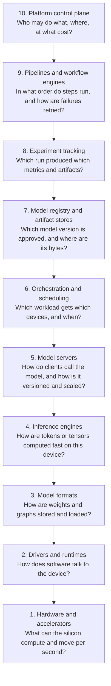

The diagram reads from the top, where people and policy interact with the system, down to silicon. Two groupings matter in practice. Layers 1 to 4 decide how fast one model runs on one machine. Layers 5 and 6 decide how that capability becomes a reliable shared service. Layers 7 to 10 decide how models arrive, who approves them, and how the whole system is governed. Problems at one grouping rarely get fixed by buying a product from another. A slow engine is not repaired by a better registry, and a sprawl of unregistered models is not repaired by a faster kernel.

Each layer is described below with its inputs, outputs, and typical owner. Later sections go deeper.

**Layer 1, hardware and accelerators.** central processing units (CPUs), GPUs, tensor processing units (TPUs), and custom accelerators, with their memory and interconnect. The architecture here sets the limits: memory capacity decides which models fit, memory bandwidth decides decode speed, and interconnect decides how well multi-device models scale. The owner is usually a cloud provider or a data-center team.

**Layer 2, drivers and runtimes.** The kernel driver, the user-space runtime (Compute Unified Device Architecture, CUDA, for NVIDIA; ROCm for AMD; the Neuron software development kit (SDK) for AWS accelerators; the Accelerated Linear Algebra (XLA) compiler stack for TPUs), container toolkits that map devices into containers, and collective communication libraries such as the NVIDIA Collective Communications Library (NCCL). Version compatibility across this layer is the most common source of "works on my machine" failures in GPU systems.

**Layer 3, model formats.** How a trained model is serialized: safetensors, GGUF (the GPT-Generated Unified Format used by llama.cpp), Open Neural Network Exchange (ONNX), PyTorch checkpoints, TensorRT engine files, and quantized variants. The format determines which engines can load the model, how fast it loads, and whether loading can execute attacker-controlled code.

**Layer 4, inference engines.** Libraries that execute the model efficiently: vLLM, SGLang, TensorRT-LLM, llama.cpp, ONNX Runtime, and others. They own scheduling inside one process or one tightly coupled group of processes: continuous batching, KV-cache memory management, kernel selection, tensor-parallel execution across the devices of one model replica.

**Layer 5, model servers.** The network-facing layer: Hypertext Transfer Protocol (HTTP) and gRPC (remote procedure call) endpoints, request validation, model repository and versioning, multi-model hosting, health and readiness endpoints, metrics, and sometimes dynamic batching for non-LLM models. Triton Inference Server (now NVIDIA Dynamo-Triton) is a model server. KServe is a Kubernetes-native serving platform that deploys model servers. Many engines also ship an OpenAI-compatible server, which blurs layers 4 and 5 on purpose.

**Layer 6, orchestration and scheduling.** Placing workloads on devices: the Kubernetes scheduler and device plugins, dynamic resource allocation, batch queueing (Kueue, Volcano), gang scheduling, quotas, and priority. Slurm plays this role in many high-performance computing (HPC) environments. Ray adds an application-level scheduler on top.

**Layer 7, model registry and artifact stores.** Durable, versioned storage for model weights, adapters, tokenizers, and metadata, plus a record of lineage and approval state. The MLflow Model Registry, the Hugging Face Hub, an Open Container Initiative (OCI) registry holding model artifacts, and plain object storage with a naming convention are all examples.

**Layer 8, experiment tracking.** A record of training and evaluation runs: parameters, metrics, code version, data version, artifacts. MLflow Tracking, Weights & Biases, and Neptune are typical.

**Layer 9, pipelines and workflow engines.** Directed acyclic graph (DAG) execution of data preparation, training, evaluation, and deployment steps with retries, caching, and scheduling. Kubeflow Pipelines, Argo Workflows, Flyte, Metaflow, and Apache Airflow occupy this layer.

**Layer 10, platform control plane.** The user-facing surface that ties the lower layers into a product for internal teams: identity and access, quotas and chargeback, templates, a catalogue of approved models and runtimes, audit, and cost reporting. In many organizations this is custom glue over open components. Cloud ML platforms such as Amazon SageMaker AI, Google Vertex AI, and Microsoft Azure Machine Learning sell a managed version of layers 5 to 10.

### 2.2 Engine, server, and platform are different things

The most common confusion is between layers 4, 5, and 10. The diagram below shows how they nest for a request.

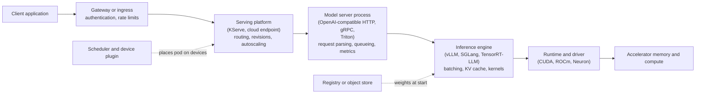

Solid arrows are the request path. Dotted arrows are control and loading paths that matter at start-up and during scaling. The practical implications are these.

First, a platform such as KServe does not make tokens faster. It decides how many replicas exist and where requests go. If a replica is slow, the cause is in the engine, the model, or the device, and the fix is there.

Second, an engine does not authenticate callers, enforce per-tenant quotas, or manage a fleet. vLLM started with `vllm serve` exposes an HTTP endpoint, but it has no concept of your tenants, your budgets, or your rollout policy. Teams that skip the gateway and platform layers discover this when one noisy client consumes all capacity.

Third, a model server such as Triton can host many models and frameworks behind one protocol, and gives you dynamic batching for classic ML models. For autoregressive LLM generation, the batching has to be iteration-level (continuous batching) and share a paged KV cache, which is why LLM engines are separate projects. Triton can host an LLM by delegating to an engine through a backend, which is the "server over engine" composition.

Fourth, the same product name is often used for different layers. "Ollama" is used as an engine, a server, and a model registry by different people. It bundles all three for a single user's machine, which is the reason it is easy to start and the reason it should not be mistaken for a platform.

### 2.3 Where products sit

The following table assigns the products named in this chapter to layers. A product listed in several columns bundles several roles. Check the primary role before comparing two products.

| Product | Primary layer | Also provides | Does not provide |
| --- | --- | --- | --- |
| NVIDIA data-center GPUs (H100, H200, B200 and later) | 1 Hardware | | Software stack above CUDA |
| Google TPU (Ironwood and earlier) | 1 Hardware | Pods with a custom interconnect | CUDA compatibility |
| AWS Trainium and Inferentia | 1 Hardware | Neuron SDK at layer 2 | CUDA compatibility |
| CUDA, ROCm, Neuron SDK | 2 Runtime | Compilers, math libraries | Model serving |
| NCCL and RCCL | 2 Collective library | | Scheduling |
| safetensors, GGUF, ONNX | 3 Format | ONNX also defines operators | Execution (ONNX Runtime executes) |
| vLLM, SGLang | 4 Engine | OpenAI-compatible server | Fleet management |
| TensorRT-LLM | 4 Engine (NVIDIA only) | Compiler and runtime, server wrappers | Non-NVIDIA hardware |
| llama.cpp | 4 Engine | Simple HTTP server, GGUF tooling | High-concurrency multi-tenant serving |
| Ollama | 4 and 5 for one user | Model pull and catalogue, local API | Multi-tenant production controls |
| ONNX Runtime | 4 Engine for exported graphs | Execution providers per device | Native LLM continuous batching at vLLM level |
| NVIDIA Dynamo-Triton (formerly Triton) | 5 Model server | Dynamic batching, ensembles, multiple backends | LLM-specific scheduling by itself |
| KServe | 5 and 6 on Kubernetes | InferenceService and LLM resources, autoscaling, canary | Making an engine faster |
| llm-d | 5 and 6 on Kubernetes | Cache-aware routing, disaggregated serving over vLLM or SGLang | Replacing the engine |
| Ray (Core, Serve, Train, Data) | 6 and 9 application-level | Distributed actors, serving, training, data processing | A registry or governance |
| Kubernetes with device plugin or DRA | 6 Orchestration | | Training or serving logic |
| Kueue, Volcano | 6 Batch queueing | Quotas, fair share, gang scheduling | Execution of the job itself |
| MLflow | 7 and 8 | Tracking, registry, model packaging, evaluation tooling | Serving at scale (it has a basic server) |
| Kubeflow | 9 and 10 | Pipelines, notebooks, training operators, Katib, model registry | Replacing Kubernetes |
| Argo Workflows, Flyte, Metaflow, Airflow | 9 Pipelines | Scheduling, retries, caching | Model serving |
| Cloud ML platforms | 5 to 10 managed | Endpoints, registries, pipelines, IAM integration | Portability |

The table is a classification aid, not a ranking. When two products share a row, compare them on the dimensions that matter at that layer, which later sections define.

### 2.4 Control plane and data plane

Two further distinctions run through every layer. The **data plane** handles bytes that serve users: request tokens, responses, activations, training batches. The **control plane** handles decisions about the system: which model version is live, which tenant may use which quota, which node hosts which replica. They fail differently and need different security postures.

An inference replica needs read access to approved model artifacts, and it needs the ability to emit telemetry. It does not need write access to the registry, access to the training data, or the ability to promote a model. If the serving identity can do those things, then a compromise of the serving container (for example through a prompt-injection-driven tool call, or through a vulnerable dependency) becomes a compromise of the model supply chain. Section 14 returns to this when it covers trust boundaries.

For training the picture is reversed. Training jobs need read access to datasets and write access to checkpoint and artifact stores, but no inbound request path from users. Separating those identities is cheap at design time and painful later.

## 3. Hardware and Accelerators

### 3.1 What an accelerator is made of

For serving and training transformer models, five properties of an accelerator matter, in roughly this order for LLMs:

1. **Memory capacity**, in gigabytes. This decides whether weights plus working state fit on one device. Modern data-center accelerators use High Bandwidth Memory (HBM), stacked memory placed next to the compute die.
2. **Memory bandwidth**, in terabytes per second. This decides how fast weights and KV cache can be read, which limits decode speed.
3. **Compute throughput**, in floating-point operations per second (FLOPS; TFLOPS and PFLOPS are trillions and quadrillions of them) at a given precision. BF16 is the 16-bit brain floating-point format, and FP8 and FP4 are 8-bit and 4-bit floating-point formats. This decides prefill speed and large-batch decode speed. Tensor cores (NVIDIA) or matrix units (others) deliver most of it, and throughput roughly doubles each time precision halves (BF16, FP8, FP4) where the hardware and kernels support it.
4. **Interconnect bandwidth and topology** between devices in a node and between nodes. This decides how well a model split across devices performs.
5. **Software maturity.** Kernels, compilers, and engine support. A faster chip with weak engine support often loses to a slower chip with strong support for the model you need.

Power and cooling are a sixth, practical constraint. A rack of recent NVIDIA systems draws more power than many data-center halls were designed for, which is why managed cloud capacity and colocation with liquid cooling dominate new deployments. For an architect, this means on-premises GPU expansion is a facilities project with long lead times, not a purchase order.

### 3.2 NVIDIA generations

NVIDIA's data-center GPUs dominate production AI. The table lists representative parts. The numbers are from vendor material and are approximate. Variants (SXM versus PCIe form factor, sparsity versus dense) change them, so always check the datasheet for the exact part before sizing.

| Part | Architecture | Memory | HBM bandwidth (approx.) | Dense BF16 (approx.) | Notes |
| --- | --- | --- | --- | --- | --- |
| A100 80 GB | Ampere (2020) | 80 GB HBM2e | 2.0 TB/s | 312 TFLOPS | Multi-Instance GPU (MIG) up to 7 slices. No FP8. |
| H100 SXM | Hopper (2022) | 80 GB HBM3 | 3.35 TB/s | 989 TFLOPS | FP8 via Transformer Engine. NVLink 900 GB/s total. |
| H200 | Hopper | 141 GB HBM3e | 4.8 TB/s | 989 TFLOPS | Same compute as H100, more and faster memory. |
| B200 | Blackwell (2024-2025) | 180 to 192 GB HBM3e | about 8 TB/s | about 2.25 PFLOPS | FP4 support. NVLink 5 at 1.8 TB/s per GPU. |
| B300 (Blackwell Ultra) | Blackwell | 288 GB HBM3e | about 8 TB/s | | More memory per GPU. |
| Rubin | Rubin (2026) | 288 GB HBM4 (announced) | up to about 22 TB/s (announced) | | Verify shipping status and cloud availability. |
| L4 | Ada | 24 GB GDDR6 | 0.3 TB/s | | Low power inference, small models, video. |
| L40S | Ada | 48 GB GDDR6 | 0.86 TB/s | | Cost-efficient inference for models up to roughly 20B parameters at 4-bit or 8-bit weights. |

Two patterns in the table explain most buying decisions.

First, between H100 and H200 the compute is the same and the memory is larger and faster. For a memory-bandwidth-bound workload such as small-batch LLM decode, H200 delivers roughly the bandwidth ratio, 4.8 divided by 3.35, which is about 1.43 times the decode speed of H100 for the same model, plus room for more KV cache. For a compute-bound workload such as large-batch prefill, the two are equal. Chip generation names do not predict which of your workloads improves. The roofline model in section 3.6 does.

Second, data-center parts with HBM cost many times more per gigabyte than parts with GDDR memory (L4, L40S, consumer cards). GDDR parts have far lower bandwidth, so they are slower per token on the same model but far cheaper. Small models, batch workloads without latency targets, and embedding or reranking models often run most cheaply on them.

### 3.3 AMD, Google TPU, AWS Trainium and Inferentia, and others

**AMD Instinct.** The MI300X offers 192 GB of HBM3 at about 5.3 TB/s, and the MI355X offers 288 GB of HBM3e at about 8 TB/s. Large memory per device is the selling point for memory-bound inference, because a 70-billion-parameter model at 8-bit precision (70 GB) fits on one device with a large KV-cache budget. The software stack is ROCm. Major engines (vLLM, SGLang, PyTorch) support ROCm, but kernel coverage, newest-model support, and tuning lag the NVIDIA path by varying amounts. The architectural cost of AMD is therefore qualification effort: you need to test your models and engine versions, and keep an NVIDIA fallback until you trust the path.

**Google TPU.** TPUs are matrix-multiply accelerators designed by Google and available only on Google Cloud. The seventh generation, Ironwood (exposed as TPU7x in documentation), has 192 GB of HBM3e at about 7.4 TB/s and about 4.6 PFLOPS of FP8 per chip, with pods of up to 9,216 chips connected by a custom interconnect, according to [Google's Ironwood description](https://cloud.google.com/blog/products/compute/inside-the-ironwood-tpu-codesigned-ai-stack). TPUs are programmed through XLA (Accelerated Linear Algebra), typically via JAX or PyTorch/XLA, and vLLM has a TPU backend. The trade-off is lock-in to Google Cloud and different tuning knowledge, against attractive price-performance at large scale.

**AWS Trainium and Inferentia.** AWS designs these chips and exposes them through the Neuron SDK. Per [AWS's announcement](https://aws.amazon.com/about-aws/whats-new/2025/12/amazon-ec2-trn3-ultraservers/), each Trainium3 chip has 144 GB of HBM3e at 4.9 TB/s and 2.52 PFLOPS of FP8 compute, in UltraServers that scale to 144 chips. Inferentia2 is the earlier inference-oriented chip with smaller memory per chip. Both require compiling models with Neuron, which supports a defined set of architectures. The trade-off mirrors TPU: lower price per token for supported models, lock-in to AWS, and a compile step in your deployment path.

**Others.** Intel's Gaudi line, Groq's language processing units (which keep weights in on-chip static memory and need many chips per model), Cerebras's wafer-scale systems, and Apple silicon with unified memory each serve niches. Apple silicon matters for local development and edge inference with llama.cpp because unified memory allows models of tens of gigabytes to run on a laptop, at bandwidth far below data-center HBM. Treat vendors outside the big four as candidates for specific, benchmarked workloads, and verify their current product status before committing, because roadmaps and availability change.

A practical rule for the architect: **choose the software ecosystem first, then the chip.** If your models and engines are validated on CUDA and you have a small platform team, additional silicon is an expense in engineering time. If you operate at a scale where inference spend is large and stable, a second accelerator family is a negotiation lever and a cost lever, and the qualification project pays for itself.

### 3.4 Memory capacity: what has to fit

The first question for any model is whether it fits. A simplified accounting for inference is:

$$
M_{\text{total}} \approx M_{\text{weights}} + M_{\text{KV}} + M_{\text{activations}} + M_{\text{runtime}}
$$

where $M_{\text{weights}} = P \cdot b$ for $P$ parameters at $b$ bytes per parameter, $M_{\text{KV}}$ is the key-value cache for all active sequences, $M_{\text{activations}}$ is workspace for the current forward pass, and $M_{\text{runtime}}$ covers the framework, CUDA context, allocator fragmentation, and graph captures. Engines such as vLLM let you set the fraction of device memory they may use, then fill what remains after weights and activations with KV-cache blocks.

Weight bytes per parameter are 2 for BF16 or FP16, 1 for FP8 or INT8, and about 0.5 plus scale overhead for 4-bit formats. The script [01_memory_and_roofline.py](../code/python/ai-infrastructure-chapter/01_memory_and_roofline.py) computes these. For an 8-billion-parameter model it gives 16.0 GB at BF16, 8.0 GB at FP8, and 4.0 GB at 4 bits. For a 70-billion-parameter model it gives 140 GB, 70 GB, and 35 GB.

The KV cache grows per token. For a transformer with $L$ layers, $H_{kv}$ key-value heads, head dimension $d$, and $e$ bytes per element, each token stores one key vector and one value vector per layer:

$$
\text{bytes per token} = 2 \cdot L \cdot H_{kv} \cdot d \cdot e
$$

For a Llama-style 8B configuration (32 layers, 8 key-value heads under grouped-query attention, head dimension 128, BF16) this is $2 \cdot 32 \cdot 8 \cdot 128 \cdot 2 = 131{,}072$ bytes, or 128 KiB per token. For the 70B configuration (80 layers, 8 key-value heads, head dimension 128) it is 327,680 bytes, or 320 KiB per token. These are illustrative configurations. Read the real `config.json` of your model to get its numbers. [CH28](CH28_Inference_Optimization_and_Model_Serving.md) owns the derivation and the optimizations (paging, prefix sharing, quantized caches). This chapter needs only the budget consequence.

Worked example, one 80 GB device serving the 8B model in BF16, reserving 10 percent of memory for activations, runtime, and fragmentation:

- Usable memory: $80 \times 0.9 = 72$ GB.
- Weights: 16 GB. Remaining for KV cache: 56 GB.
- At a 4,096-token maximum context, one sequence needs $4096 \times 128\text{ KiB} = 512$ MiB. The device holds $56\text{ GB} / 512\text{ MiB} \approx 104$ full-length sequences.
- At 8,192 tokens the count halves to 52. At 32,768 tokens it is 13.

The script prints exactly these figures (104, 52, 13). The lesson is that concurrency is a budget, not a setting. Doubling the maximum context halves the number of concurrent maximum-length sequences. In practice most sequences are shorter than the maximum, and a paged cache lets many short sequences share the pool, so real concurrency exceeds the worst-case figure. Capacity plans should use the measured distribution of sequence lengths and use the worst case as a safety check.

The 70B model in FP8 needs 70 GB for weights. On an 80 GB device with the same 10 percent reserve only 2 GB remains for KV cache, which is about 6,100 tokens in total at 320 KiB per token. That is a configuration that loads but cannot serve realistic traffic. This is the typical shape of a capacity surprise: the model fits, but nothing else does. The fix is more devices (tensor parallelism across two GPUs gives 144 GB usable after the same reserve, so 74 GB of KV budget after weights, or about 226,000 tokens), a device with more memory, or a smaller or more compressed model.

### 3.5 Memory bandwidth: why decode is slow

LLM generation has two phases. In **prefill**, the model processes the prompt tokens in parallel; the work is large matrix-matrix multiplication and is limited by compute. In **decode**, the model produces one token per step for each active sequence. In each decode step, every weight must be read from HBM into the compute units once, no matter how many sequences are in the batch. For a single sequence, each weight read supports just two floating-point operations (one multiply and one add). The ratio of operations to bytes read is called **arithmetic intensity**.

Define arithmetic intensity as FLOPs per byte of memory traffic. For decode at batch size $B$, with weights at $b$ bytes each, every weight is used in $B$ multiply-add pairs, which is $2B$ FLOPs per $b$ bytes read:

$$
I_{\text{decode}} \approx \frac{2B}{b} \text{ FLOP per byte}
$$

At BF16 ($b=2$) this is $B$ FLOP per byte. At FP8 ($b=1$) it is $2B$. A single-sequence decode step therefore has an intensity of 1 FLOP per byte at BF16. A modern GPU can perform hundreds of FLOPs for every byte it can fetch, so the compute units wait on memory for almost the entire step.

### 3.6 The roofline model

The roofline model (Williams, Waterman, and Patterson, 2009) bounds the performance of a kernel by the lower of two ceilings:

$$
\text{Perf} \le \min\left(P_{\text{peak}},\; I \cdot BW\right)
$$

where $P_{\text{peak}}$ is peak compute in FLOPS, $BW$ is memory bandwidth in bytes per second, and $I$ is arithmetic intensity. The **ridge point** $I^* = P_{\text{peak}} / BW$ is the intensity at which the two ceilings meet. Below it a kernel is memory-bound, above it compute-bound.

For H100 SXM, with $P_{\text{peak}} = 989\ \text{TFLOPS}$ dense BF16 and $BW = 3.35\ \text{TB/s}$:

$$
I^* = \frac{989 \times 10^{12}}{3.35 \times 10^{12}} \approx 295 \text{ FLOP per byte}
$$

Decode at BF16 has intensity $B$, so the crossover to compute-bound occurs at batch size near 295. Below that batch size, throughput grows linearly with batch size because the same weight reads serve more sequences. The script confirms this for an 8B BF16 model on H100:

| Batch size | Upper bound tokens per second | Regime |
| --- | --- | --- |
| 1 | 209 | memory-bound |
| 8 | 1,675 | memory-bound |
| 32 | 6,700 | memory-bound |
| 128 | 26,800 | memory-bound |
| 256 | 53,600 | memory-bound |
| 512 | 61,812 | compute-bound |

The single-sequence figure is $BW / (\text{weight bytes}) = 3.35 \times 10^{12} / 16 \times 10^9 \approx 209$ tokens per second. These are upper bounds. They ignore KV-cache reads (which grow with context length and batch size), attention, communication, scheduling overhead, and imperfect kernel efficiency. Real engines reach a fraction of them. The shape is the useful result: batching is nearly free until the ridge point, and that is why continuous batching is the central idea of LLM serving engines and why a lightly loaded GPU is an expensive GPU.

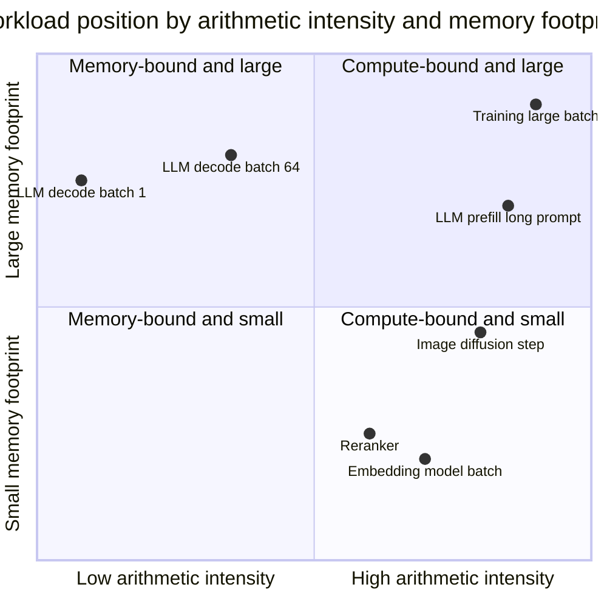

The quadrant chart is qualitative, with positions chosen to show relative placement, not measurements. It shows why one accelerator choice rarely suits all workloads. Decode of large models sits in the memory-bound, large-footprint corner, where HBM capacity and bandwidth dominate and extra compute is wasted. Embedding and reranking models are small and run at high intensity when batched, so inexpensive GDDR-based parts with decent compute suit them. Training sits in the compute-bound, large corner and benefits from the highest FLOPS and interconnect.

**What limits LLM serving, in order.** Putting the above together, a serving deployment is limited by the first of these that binds:

1. **Fit.** Weights plus minimum KV budget must fit across the devices in one replica.
2. **KV-cache capacity.** After weights, how many concurrent tokens fit. This caps concurrency and therefore throughput.
3. **Memory bandwidth.** Governs time per output token at small to moderate batch sizes, and so the inter-token latency a user perceives.
4. **Compute.** Governs time to first token for long prompts and throughput at large batch sizes.
5. **Interconnect.** For multi-device replicas, adds per-step communication time. Section 4 covers it.
6. **Scheduling and host overhead.** CPU-side launch overhead, tokenization, sampling, and Python overheads matter for small models and low-latency targets, where the GPU is fast enough that the host becomes the limit.

A deployment's tuning work follows that order. Engineers who tune kernels before checking whether the KV cache is exhausted spend time on the wrong bottleneck. The metric that exposes each limit is covered in section 12.

### 3.7 Precision and what the hardware supports

Lower precision reduces weight bytes and raises compute throughput, but only where the hardware has native support and the engine has kernels. Hopper adds FP8; Blackwell adds FP4 variants (NVFP4, and the open microscaling formats such as MXFP4). A100 has no FP8 tensor cores, so FP8 weights on A100 save memory through weight-only schemes but not compute. AMD's MI300 series supports FP8, and MI355X adds lower-precision formats. TPUs and Trainium have their own supported types. Before choosing a quantized checkpoint, confirm three things: the hardware has native support, your engine has kernels for that format on that hardware, and the quality loss on your evaluation set is acceptable. [CH28](CH28_Inference_Optimization_and_Model_Serving.md) owns the quality-throughput analysis.

### 3.8 Choosing hardware for a workload

The following heuristics reduce a large option space, and each must be confirmed by a benchmark on your model and traffic.

- **Interactive chat with a 7B to 13B model at moderate traffic:** a single 24 to 80 GB device per replica. L4 or L40S for cost sensitivity and modest latency, H100 or equivalent for lower latency and high concurrency.
- **70B-class model, interactive:** two to eight devices with fast interconnect per replica, or one 192 GB to 288 GB device where the model at 8-bit precision fits with KV headroom. Large single-device memory removes tensor parallelism and its communication.
- **Mixture-of-experts (MoE) frontier-scale open models:** many devices per replica with expert parallelism, which makes interconnect and rack-scale NVLink domains primary selection criteria.
- **Embedding, reranking, speech, small vision models:** inexpensive inference parts, CPU for tiny models, and MIG or time-sliced sharing to avoid wasting a full device.
- **Training and large-scale fine-tuning:** highest FLOPS and the best interconnect available, plus parallel file storage.
- **Edge and developer machines:** Apple silicon, consumer GPUs, and llama.cpp with GGUF.

The architect's output at this stage is not a part number. It is a statement of the binding constraint (fit, bandwidth, compute, or interconnect) for each workload class and the hardware family that relaxes it at the lowest cost.

## 4. Interconnect: When Device-to-Device Bandwidth Matters

### 4.1 Three tiers of links

A single GPU is rarely the whole story. A model replica may span 2 to 8 GPUs in a node, and a training job may span thousands across nodes. The tiers use NVLink, Peripheral Component Interconnect Express (PCIe), and network fabrics. Bandwidth falls by roughly an order of magnitude at each tier.

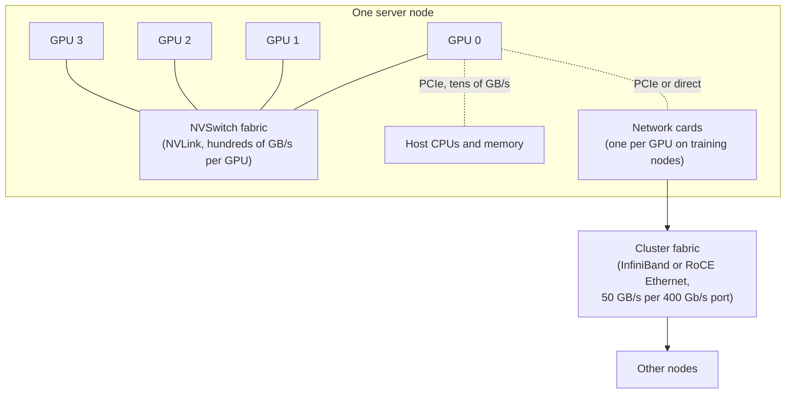

The three tiers are:

1. **Scale-up link inside a node or rack.** NVIDIA's NVLink connects GPUs through NVSwitch chips so that any GPU can talk to any other at full link speed. Hopper provides 900 GB/s of total bidirectional bandwidth per GPU, and Blackwell NVLink 5 doubles it to 1.8 TB/s. In NVL72-class rack systems, 72 GPUs share one NVLink domain, so a tensor-parallel group can span much more than 8 devices without leaving the fast fabric. AMD uses Infinity Fabric links and Google uses inter-chip interconnect (ICI) in a torus topology across a pod.
2. **PCIe.** The link between GPU and host CPU, and between GPU and network card when no direct path exists. PCIe Gen5 x16 provides about 64 GB/s per direction. Without NVLink, GPUs in the same node communicate across PCIe, often through the CPU's root complex. That is roughly an order of magnitude slower than NVLink and adds latency.
3. **Scale-out network between nodes.** InfiniBand (NDR at 400 Gb/s per port, which is 50 GB/s, with XDR at 800 Gb/s arriving) or Ethernet with RDMA over Converged Ethernet (RoCE v2). Training clusters typically give each GPU its own network port. Remote Direct Memory Access (RDMA) lets a network card read and write GPU memory without CPU copies; "GPUDirect RDMA" is NVIDIA's name for the GPU-to-NIC path.

InfiniBand and RoCE both provide RDMA. InfiniBand has a purpose-built lossless fabric with credit-based flow control, adaptive routing, and mature collective offloads. RoCE v2 runs RDMA over Ethernet and needs careful configuration of priority flow control and explicit congestion notification to behave as a lossless fabric. Ethernet-based designs win on vendor choice and operations familiarity, and InfiniBand wins where the vendor tuning and diagnostics are decisive. At large scale, networking vendors are converging on Ethernet-based fabrics with RDMA features, so the choice is less binary than it was, but the requirement is constant: a low-loss, high-bandwidth fabric with predictable latency and good tooling.

### 4.2 Collective operations

Distributed training and tensor-parallel inference rely on collectives implemented by NCCL (NVIDIA), the ROCm Communication Collectives Library (RCCL, AMD), or equivalents:

- **All-reduce:** every participant contributes a tensor, every participant receives the sum. Used for gradient synchronization in data parallelism and for combining partial results in tensor parallelism.
- **All-gather:** every participant ends up with the concatenation of all shards. Used by fully sharded data parallelism to reassemble parameters.
- **Reduce-scatter:** the sum is computed and each participant receives one shard. Paired with all-gather in sharded training.
- **All-to-all:** every participant sends a distinct piece to every other. Used by expert parallelism in MoE models and some sequence-parallel schemes.

A ring all-reduce of a tensor of $S$ bytes over $N$ devices transfers about $2 \cdot \frac{N-1}{N} \cdot S$ bytes through each device's link. With per-link bandwidth $B_{\text{link}}$ and per-operation latency $\alpha$, the time is approximately:

$$
T_{\text{allreduce}} \approx \alpha + \frac{2(N-1)}{N} \cdot \frac{S}{B_{\text{link}}}
$$

This is a first-order model that ignores tree and other algorithms that NCCL selects, but it captures the dependence: small messages are latency-bound, large messages bandwidth-bound.

### 4.3 When interconnect matters: tensor-parallel inference

Consider a 70B-class model in FP8 served with tensor parallelism over $N=8$ GPUs. Each layer performs two all-reduces (after the attention output projection and after the feed-forward block). With 80 layers that is 160 all-reduces per decode step. Suppose the batch is 128 sequences and the hidden size is 8,192 with BF16 activations, so each all-reduce moves $S = 128 \times 8192 \times 2 = 2{,}097{,}152$ bytes, about 2.1 MB. The numbers below are illustrative.

- **NVLink path,** effective 300 GB/s per GPU and 10 microseconds of latency: data time is $2 \times \frac{7}{8} \times 2.1\text{ MB} / 300\text{ GB/s} \approx 12.2\ \mu s$. Each all-reduce costs about $22\ \mu s$. Across 160 operations the communication time is about 3.5 ms per step.
- **PCIe path,** effective 50 GB/s and 20 microseconds of latency: data time is about $73\ \mu s$. Each all-reduce costs about $93\ \mu s$. Across 160 operations the communication time is about 14.9 ms per step.
- **Weight reading,** for comparison: each GPU holds $70\text{ GB}/8 = 8.75$ GB of weights and reads them at 3.35 TB/s, which takes about 2.6 ms per step.

On NVLink, communication (3.5 ms) is of the same order as the weight-read time (2.6 ms), which is acceptable but already visible: scaling from 4 to 8 GPUs shrinks the weight-read term and leaves the communication term, so returns diminish. On PCIe, communication (14.9 ms) is nearly six times the weight-read time, and adding GPUs makes the step slower. The practical conclusion is a rule: **tensor parallelism across PCIe-only GPUs for latency-sensitive decode is usually a mistake.** Either use NVLink-connected GPUs, use a larger-memory single device, or use pipeline parallelism, which communicates only activations at stage boundaries and tolerates slower links at the cost of bubble inefficiency and per-token latency.

### 4.4 When interconnect matters: training

Data-parallel training synchronizes gradients every step. Take a 7B-parameter model with BF16 gradients (14 GB) across nodes with one 400 Gb/s port per GPU (about 45 GB/s effective). The ring all-reduce moves about $2 \cdot 14 = 28$ GB per GPU, which takes about 0.62 s at 45 GB/s. If the compute for a step takes 1.5 s, communication is 41 percent of compute time unless it overlaps with the backward pass. Frameworks overlap gradient communication with computation by bucketing gradients, which is why training stacks tune bucket sizes. Fully sharded schemes move more data (all-gather of parameters before use plus reduce-scatter of gradients) in return for lower memory per GPU, and they need the best fabric available. For a platform architect this means:

- Training jobs spanning nodes need **rail-aligned, non-oversubscribed** network design, so that GPU $i$ on every node reaches GPU $i$ on every other node without contention. Oversubscribed top-of-rack uplinks silently turn into training slowdowns.
- **Topology-aware placement** matters: place a job on nodes under the same leaf switches, or in the same NVLink domain for rack-scale systems. Section 10 shows how to ask the scheduler for this.
- **Straggler detection** requires per-rank step-time metrics, because one slow link or throttled GPU slows every rank at the next collective.

### 4.5 When interconnect does not matter

Single-GPU replicas, data-parallel replicas that never communicate (stateless inference replicas behind a load balancer), embedding and reranking services, and independent batch jobs do not need premium interconnect. Many organizations over-buy network for inference clusters that run one model per GPU. The rule of thumb: pay for the fabric only for workloads that run collectives on the critical path, and measure the collective share of step time before expanding.

## 5. Drivers, Runtimes, and Containers

### 5.1 The compatibility chain

A GPU application depends on a chain of versions that must all agree. For NVIDIA, the chain from bottom to top is:

1. **Kernel driver** on the host (the `nvidia` kernel modules). It is the only component that must be installed on the host.
2. **CUDA driver API** library (`libcuda`), shipped with the driver.
3. **CUDA runtime and toolkit** libraries (`libcudart`, cuBLAS, cuDNN, NCCL), which are usually bundled in the container image or in the framework wheel.
4. **Framework** (PyTorch) built against a specific CUDA runtime.
5. **Engine** (vLLM, TensorRT-LLM) built against a specific framework and CUDA version, sometimes with custom kernels compiled for specific GPU architectures.
6. **Model artifact** that may require specific quantization kernels.

Compatibility rules at the time of writing, which you should verify in the NVIDIA documentation for your versions: a newer host driver supports older CUDA runtimes (backward compatibility), but a container's CUDA runtime requires a minimum driver version; and newer GPU architectures need a CUDA version that knows about them. A container built with CUDA 12.x that runs on a host with an older driver may fail at start with "CUDA driver version is insufficient for CUDA runtime version", or may run in a compatibility mode with limited features. Compiled kernels target a compute capability (for example 9.0 for Hopper); an engine image built without that target can fail or fall back to slow code paths on newer silicon.

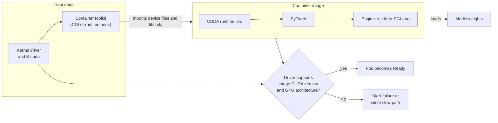

The diagram shows the contract: the host supplies the driver, the toolkit injects the device and driver library into the container, and the image supplies everything else. The check in the middle is where most incidents occur after a node image upgrade. It is also where architects should place a gate: a version matrix, tested in a staging pool, before any driver update reaches production nodes.

### 5.2 Kubernetes GPU stack components

On Kubernetes the usual components are:

- **NVIDIA GPU Operator,** which installs the driver (or uses a preinstalled one), the container toolkit, the device plugin, GPU Feature Discovery (node labels such as GPU product and memory), the DCGM exporter for metrics, and optionally the MIG manager. It uses the operator pattern covered in [Kubernetes Operators](../12_Kubernetes/CH10_Operators.md).
- **Device plugin,** which advertises `nvidia.com/gpu` as an extended resource so that pods can request integer counts of GPUs.
- **Container Device Interface (CDI),** a specification that describes how devices are injected into containers, increasingly used instead of runtime hooks.
- **Dynamic Resource Allocation (DRA),** the newer Kubernetes API for requesting devices by attributes. It graduated to general availability in Kubernetes 1.34, per the [Kubernetes release notes](https://v1-35.docs.kubernetes.io/blog/2025/09/01/kubernetes-v1-34-dra-updates/). Section 10 explains how it changes GPU requests.

Managed Kubernetes services (Amazon EKS, Google GKE, Azure AKS) provide GPU node images with drivers preinstalled, which shifts the version-matrix burden to the provider but not the responsibility to test your engine image against it.

### 5.3 AMD, Google, and AWS equivalents

AMD's stack is the amdgpu driver and the ROCm runtime, with a device plugin and an AMD GPU Operator. The compatibility chain is the same in shape, with ROCm in place of CUDA, and with a smaller set of tested engine images. TPU workloads on GKE use the TPU runtime and node pools with topology constraints, because TPU slices must be requested in valid shapes. Trainium and Inferentia on EKS use the Neuron driver, Neuron device plugin, and a Neuron-compiled model artifact. In each case the architectural point is the same: **the accelerator runtime and the compiled artifact are coupled**. Treat the pair as a versioned unit.

### 5.4 Practices that prevent runtime incidents

1. **Pin the tuple.** Record driver version, CUDA runtime version, framework version, engine version, GPU architecture, and model artifact revision as one compatibility tuple, and store it with each deployment. Rolling back a model without rolling back its engine can fail if the model required newer kernels.
2. **Build images for the architectures you run,** and test on each GPU type in the fleet.
3. **Roll driver upgrades by node pool,** with a canary pool and automatic rollback criteria, the same way you roll a database patch.
4. **Run a smoke test at node admission:** a short CUDA kernel, an NCCL all-reduce among the node's GPUs, and a memory test. Remove nodes that fail from the schedulable pool before they accept production traffic.
5. **Keep images small and layered.** CUDA-enabled images are often 10 to 25 GB. The layer cache and a pre-pull strategy decide cold-start time, as section 11 shows.

## 6. Model Formats and Packaging

### 6.1 What a model artifact contains

A model artifact has several parts, and a format question applies to each:

- **Weights:** large arrays of numbers, the bulk of the bytes.
- **Architecture description:** either implicit (code in a library such as Transformers that knows the architecture named in a configuration file) or explicit (a computation graph stored in the file, as in ONNX).
- **Tokenizer and preprocessing:** vocabulary and rules, which must match the weights exactly.
- **Configuration:** hyperparameters (layer counts, head counts), generation defaults, chat template.
- **Metadata:** license, training data summary, evaluation results, provenance.

Teams that move only the weights lose the tokenizer or chat template and see silent quality problems. The packaging principle is that **everything required to reproduce inference behavior ships in one versioned unit.**

### 6.2 Safetensors

Safetensors is a tensor serialization format created at Hugging Face. Its design goals are safe loading (no code execution), fast loading (memory-mappable), and a simple layout. A file is:

```text
bytes 0..7    : unsigned 64-bit little-endian integer N (header size)
bytes 8..8+N-1: JSON header (UTF-8)
bytes 8+N..   : raw tensor data, contiguous

JSON header example:
{
  "__metadata__": {"format": "pt"},
  "model.layers.0.self_attn.q_proj.weight": {
      "dtype": "BF16", "shape": [4096, 4096], "data_offsets": [0, 33554432]},
  "model.layers.0.self_attn.k_proj.weight": {
      "dtype": "BF16", "shape": [1024, 4096], "data_offsets": [33554432, 41943040]}
}
```

Each tensor entry gives dtype, shape, and a byte range into the data region. Because the layout is explicit, a loader can memory-map the file and read just the tensors it needs, which makes it efficient for tensor-parallel loading where each rank wants only its shard, and for lazy loading. The format contains no executable content. It can still be malicious in other ways (poisoned weights that change model behavior), so safe loading is not the same as trustworthy content. Section 7 treats that distinction.

Large models are split into **shards**, each a safetensors file, with an index file, `model.safetensors.index.json`, mapping each tensor name to the shard that holds it. Shard sizes are typically 2 to 10 GB, which allows parallel download and parallel read.

### 6.3 PyTorch pickle checkpoints

`.bin` and `.pt` files saved with `torch.save` use Python's pickle serialization. Unpickling can run arbitrary code, because pickle was designed to reconstruct arbitrary Python objects, including by calling arbitrary callables. Loading an untrusted pickle file is equivalent to running an untrusted program. Recent PyTorch versions changed `torch.load` to default to `weights_only=True` (from PyTorch 2.6), which restricts unpickling to a safe set of types, and this reduces but does not remove the risk for code paths that opt out or use other pickle consumers (`pickle.load`, joblib, scikit-learn model files). The rule is to prefer safetensors for distribution and to treat any pickle-based file as code.

### 6.4 GGUF

GGUF is the single-file format used by llama.cpp and its ecosystem. A GGUF file bundles key-value metadata (architecture, hyperparameters, tokenizer data, chat template) with tensors, in a layout designed for memory mapping. Its major feature is a family of **block-quantized tensor types** (for example Q8_0, Q6_K, Q5_K_M, Q4_K_M) that store weights in small blocks with per-block scales, reaching 4 to 6 bits per weight with modest quality loss. A single file runs on CPU, Apple silicon, or consumer GPUs, with layers optionally offloaded to the GPU. That portability is why Ollama, LM Studio, and local tools all build on GGUF. For data-center GPU serving, GGUF is generally not the format of choice: vLLM and SGLang can load some GGUF files, but their fastest paths use safetensors with GPU-oriented quantization (FP8, AWQ, GPTQ, NVFP4).

### 6.5 ONNX

ONNX is a protocol-buffer format describing a computation graph with a standard operator set, plus weights. Because the graph is explicit, any runtime that implements the operators can execute it, and ONNX Runtime (ORT) maps graphs onto hardware through **execution providers** (CUDA, TensorRT, OpenVINO, DirectML, CoreML, and others), with graph optimizations such as operator fusion and constant folding. ONNX is a good fit for classical deep learning models, encoders (embedding and reranking models), vision models, and cross-platform deployment (browsers, mobile, Windows), where a single artifact must run on varied hardware. For large autoregressive LLMs, ONNX export loses the dynamic features engines depend on (paged KV cache, continuous batching), and ORT's generative support (the `onnxruntime-genai` library) targets smaller and on-device models rather than competing with vLLM on GPU clusters.

### 6.6 TorchScript, torch.export, and compiled artifacts

TorchScript (`torch.jit.script` and `torch.jit.trace`) was PyTorch's earlier route to a serializable, Python-free model. PyTorch documentation now treats it as no longer actively developed, and recommends `torch.export` for new work. `torch.export` captures an ahead-of-time graph (an "ExportedProgram") that can be lowered to other runtimes, for example ExecuTorch for mobile and edge devices, AOTInductor for ahead-of-time compiled shared libraries, or compiled engines. Verify the current recommended path in the PyTorch documentation when you start, because this area changed repeatedly in 2023 to 2026.

**Compiled engines.** TensorRT and TensorRT-LLM compile a model to an engine specialized for a GPU architecture, precision, and shape ranges. The engine file is not portable: an engine built for Hopper does not run on Ampere, and it is tied to the TensorRT version. Treat engines as build outputs cached by key (model revision, hardware, TensorRT version, build flags) and store the key with the artifact. Neuron-compiled artifacts for Trainium and Inferentia and XLA-compiled programs for TPUs have the same property: they are hardware- and version-bound.

### 6.7 Quantized formats

Quantization stores weights (and sometimes activations and KV cache) at lower precision. The families you will meet are:

| Family | Typical bits | Where used | Notes |
| --- | --- | --- | --- |
| FP8 (E4M3, E5M2) | 8 | Hopper and later, MI300 and later | Often near-lossless for weights. Native hardware compute support. |
| INT8 weight-only or with activations | 8 | Broad | Requires calibration for activation quantization. |
| GPTQ | 3 to 4 | GPU engines | Post-training, layer-wise, uses calibration data. |
| AWQ (Activation-aware Weight Quantization) | 4 | GPU engines | Protects salient weights using activation statistics. |
| bitsandbytes NF4 | 4 | Fine-tuning with QLoRA | Convenient, not the fastest for serving. |
| GGUF K-quants | 2 to 8 | llama.cpp ecosystem | Block-wise quantization, CPU and consumer GPU. |
| NVFP4 and MXFP4 | 4 | Blackwell and newer | Block-scaled 4-bit floating-point formats. Needs hardware and kernel support. |

Packaging implication: **a quantized checkpoint is a different artifact from its base model.** It has its own revision, its own evaluation results, and its own compatibility requirement (engine version, hardware). Registries should link a quantized artifact to its base model and record the quantization method, calibration dataset, and evaluation delta. [CH28](CH28_Inference_Optimization_and_Model_Serving.md) owns method selection and quality measurement.

### 6.8 Hugging Face Hub layout and cache

The Hugging Face Hub hosts model repositories as git repositories with large files in Large File Storage. A typical LLM repository contains:

```text
config.json                          architecture and hyperparameters
generation_config.json               default sampling parameters
tokenizer.json, tokenizer_config.json, special_tokens_map.json
model-00001-of-00004.safetensors     weight shards
model-00002-of-00004.safetensors
model-00003-of-00004.safetensors
model-00004-of-00004.safetensors
model.safetensors.index.json         tensor name to shard map
README.md                            model card with license and evaluation notes
```

The local cache (by default under `~/.cache/huggingface/hub`) uses a content-addressed layout:

```text
models--org--name/
  blobs/<sha256>                 actual file contents
  snapshots/<commit-sha>/        symlinks to blobs, one directory per revision
  refs/main                      text file holding the commit hash that "main" points to
```

Two operational lessons follow. First, **pin a revision by commit hash,** not by branch name. A reference to `main` fetches whatever the repository owner last pushed, which breaks reproducibility and is a supply-chain risk. Second, **mirror approved artifacts into storage you control.** Production pods should read from an internal bucket or registry, not from the public internet at start time, both for availability (a public outage or rate limit becomes your outage) and for control (you decide what enters your environment, as section 7 covers).

### 6.9 Packaging as OCI artifacts

Container registries can store arbitrary artifacts using the OCI specification. Tools such as KitOps (ModelKit) package model weights, tokenizer, configuration, datasets, and documentation as an OCI artifact with a manifest, so the same registry, access control, signing, and replication used for images apply to models. Kubernetes has also gained support for mounting OCI artifacts as volumes (image volumes, in beta at the time of writing), which lets a pod mount model weights from a registry without baking them into the container image. The architectural benefit is a single supply-chain mechanism for code and models. The cost is that registries must handle objects of tens to hundreds of gigabytes, so verify size limits and replication throughput before choosing this route.

## 7. Safety of Model Formats, Provenance, and Signing

### 7.1 Two different risks

Treat these separately, because tools for one do not address the other.

1. **Code execution on load.** The file itself carries code that runs when loaded: pickle files, Keras Lambda layers, custom model code fetched with `trust_remote_code=True`, and scripts in repositories. Controls: choose non-executable formats (safetensors, GGUF, ONNX with a pinned runtime), never set `trust_remote_code=True` for unreviewed code, and load in a sandbox with no network or credentials when you must handle untrusted files.
2. **Malicious or tampered content in a safe format.** The weights are valid but the model was backdoored, fine-tuned to leak data, or replaced after you reviewed it. A safe format does not help. Controls: provenance, integrity verification, signing, evaluation before promotion, and restricted sources.

Not all formats are equal on the first risk. GGUF and ONNX parsers have had memory-safety bugs in the past, as any binary parser does, so keep runtimes patched and run model loading in a sandboxed process when sources are untrusted.

### 7.2 A trust boundary for model artifacts

```mermaid
flowchart LR
    subgraph Untrusted["Untrusted zone"]
        Pub["Public hub or vendor download"]
    end
    subgraph Quarantine["Quarantine zone (no production credentials)"]
        Fetch["Fetch by pinned commit hash"]
        Scan["Format scan:<br/>pickle opcodes, unsafe layers,<br/>custom code review"]
        Eval["Behavior evaluation:<br/>quality, safety, backdoor probes"]
        Hash["Compute digest of every file"]
    end
    subgraph Trusted["Trusted zone"]
        Sign["Sign manifest<br/>(key held by release system)"]
        Reg["Internal registry or bucket"]
    end
    subgraph Runtime["Serving zone (read-only)"]
        Verify["Verify signature and digests<br/>at pod start"]
        Serve["Engine loads weights"]
    end
    Pub --> Fetch --> Scan --> Eval --> Hash --> Sign --> Reg --> Verify --> Serve
    Verify -. "mismatch: refuse to start" .-> Alert["Alert and block rollout"]
```

The pipeline places human and automated gates between the public internet and the serving fleet. Each gate has a clear purpose. The quarantine zone has no access to production secrets or networks, so that a malicious file that does execute code finds nothing to steal. The signing step binds the manifest of file digests to a key that only the release system holds. The verification step in the serving zone refuses to start if any digest or signature mismatches, which blocks tampering in transit or at rest. The serving identity is read-only, so a compromised replica cannot rewrite the registry.

### 7.3 Scanning

Scanners inspect pickle files for dangerous opcodes and imports (calls to `os.system`, `subprocess`, `eval`, `builtins`, network functions). Open-source tools such as picklescan and ModelScan, and the scanning built into the Hugging Face Hub, implement this. Scanners are best-effort. Pickle is expressive enough that determined attackers have found ways to evade pattern-based scanning, which is why the preferred control is to avoid pickle entirely, convert in a sandbox to safetensors, and then discard the original. Use scanning as defense in depth and as a gate for legacy artifacts, not as the primary control.

### 7.4 Signing and integrity

For container images, signing with Sigstore's cosign and verification at admission (using a Kubernetes admission controller such as Kyverno or the Sigstore policy controller) is established practice. For models, the OpenSSF Model Signing project provides tooling to sign a model directory as a set of file digests and verify it later, using the same Sigstore-style identity-based signing. The mechanism is: compute a digest of every file, put the digests in a manifest, sign the manifest, store the signature next to the model, and verify before load. This detects tampering after signing. It does not prove the model is good: it proves that the bytes you serve are the bytes your release process approved. Pair it with:

- **Provenance attestations,** such as Supply-chain Levels for Software Artifacts (SLSA) style statements recording how and from what inputs the artifact was produced, or an ML bill of materials (for example, the CycloneDX ML-BOM profile) listing base model, datasets, and licenses.
- **License review,** because model licenses differ in commercial use and redistribution terms, and a license check belongs in the quarantine gate.
- **Immutable storage,** such as object versioning with object lock, so approved artifacts cannot be silently replaced.

[CH30](CH30_AI_Data_Governance_Privacy_and_Provenance.md) owns the policy and governance side of provenance; this chapter covers the mechanisms that enforce it at deploy time.

### 7.5 Worked example: digest verification cost

Verification must not make cold start unusable. Hashing a 140 GB model with SHA-256 at a single-core rate of about 1.5 GB/s takes roughly 93 seconds, which is long on the start path. Options: hash shards in parallel across cores (16 cores bring it near 6 seconds if storage keeps up), verify when the artifact is copied into the node cache (once per node, not once per pod start), or use a Merkle-tree style scheme that verifies chunks as they stream. The design principle is to verify at the boundary where bytes enter a trust zone, and to keep verified bytes in a cache that only trusted components can write.

## 8. Inference Engines and Runtimes

### 8.1 What an engine must do

A general-purpose framework can run a forward pass. An inference engine does the additional work that makes serving economical. For LLMs that work is:

1. **Continuous (iteration-level) batching.** Instead of waiting for a fixed batch to finish, the engine adds and removes sequences at every decode step, so short requests leave and new ones join without idling the device.
2. **KV-cache memory management.** Allocating cache in fixed-size blocks (paging) to avoid fragmentation, sharing blocks between sequences with common prefixes, and evicting or swapping under pressure.
3. **Optimized kernels.** Fused attention (FlashAttention-style), quantized matrix multiplication, and graph capture to reduce launch overhead.
4. **Parallelism.** Tensor, pipeline, expert, and data parallelism across devices, with the collective communication this implies.
5. **Scheduling policy.** Deciding how to interleave prefill (compute-heavy) and decode (bandwidth-heavy) work, so a long prompt does not stall every other user's tokens. Chunked prefill is the common mechanism.
6. **A request interface.** Usually an OpenAI-compatible HTTP server with streaming, plus a Python API.

[CH28](CH28_Inference_Optimization_and_Model_Serving.md) teaches the techniques. This section helps you choose between the engines that implement them.

### 8.2 vLLM

vLLM began as a research project at the University of California, Berkeley, which introduced PagedAttention (Kwon et al., 2023, "Efficient Memory Management for Large Language Model Serving with PagedAttention"). PagedAttention treats the KV cache like virtual memory pages, which removes most internal and external fragmentation and raised achievable batch sizes substantially in the original paper. The project has since become the most widely deployed open serving engine. Its main properties at the time of writing:

- **Breadth.** Wide model coverage (dense, MoE, multimodal, embedding and reranking models), quantization support (FP8, AWQ, GPTQ, and newer 4-bit formats), LoRA adapter serving, and structured output.
- **Hardware.** NVIDIA is the primary target, with AMD ROCm, Google TPU, Intel, CPU, and AWS Neuron through backends or plugins. Verify the support matrix for your accelerator and model.
- **Parallelism.** Tensor, pipeline, expert, and data parallelism, with multi-node execution through Ray or a native multiprocessing backend. The KServe 0.18 release notes describe orchestrating multi-node vLLM without Ray using the multiprocessing backend, per the [KServe v0.18 announcement](https://kserve.github.io/website/blog/kserve-0.18-release).
- **Features.** Prefix caching, chunked prefill, speculative decoding, and disaggregated prefill and decode.
- **Architecture.** A re-architected "V1" engine core (2025) separates the API server, scheduler, and workers into processes to reduce host overhead.
- **Governance.** The project is hosted by the PyTorch Foundation under the Linux Foundation. Verify current governance and release cadence on the project site.

Where it fits: the default choice for multi-tenant serving of open-weight models on NVIDIA or AMD GPUs when you want broad model support and a large community. Its weakness is not speed on any one benchmark but that breadth means more configuration surface, and release-to-release behavior changes require regression testing. Pin versions.

### 8.3 SGLang

SGLang came from the Large Model Systems Organization (LMSYS) and introduced RadixAttention (Zheng et al., 2023, "SGLang: Efficient Execution of Structured Language Model Programs"), which stores the KV cache in a radix tree keyed by token prefix so that requests with shared prefixes reuse computation automatically. It also provides a frontend language for multi-call programs and a fast structured-output (constrained decoding) implementation. Its strengths are workloads with heavy prefix sharing (multi-turn chat with long system prompts, agent loops, retrieval-augmented generation with shared context, few-shot prompts) and strong support for large MoE models. It runs on NVIDIA and AMD GPUs and has TPU support at the time of writing.

vLLM and SGLang have converged on features, so benchmarks that rank them swing with model, version, and workload. The decision variable that matters more than peak throughput is **how much of your traffic shares prefixes** and **how often your model set changes**. A fleet with a stable model set and high prefix sharing may favor SGLang. A fleet with frequent model changes may favor vLLM for coverage. Run both on your own traffic replay before standardizing, and write the engine choice down as a reversible decision by keeping the OpenAI-compatible interface as your contract.

### 8.4 TensorRT-LLM

TensorRT-LLM is NVIDIA's open-source LLM inference library, built on TensorRT's kernel and compiler technology. It provides in-flight batching, paged KV cache, FP8 and FP4 quantization, speculative decoding, and multi-GPU, multi-node execution. NVIDIA's own results use it to demonstrate the highest throughput on new NVIDIA hardware, because NVIDIA ships kernels for new architectures with it first. Recent versions added a PyTorch-based workflow that reduces the need to ahead-of-time compile engines for every configuration, but compile-and-cache workflows remain important for peak performance.

Where it fits: large, stable deployments on NVIDIA hardware where a few percent to tens of percent of throughput is worth real engineering effort, and where the model set is limited to well-supported architectures. Costs: NVIDIA lock-in, engine builds that are specific to GPU architecture and library version, and slower support for new open models than the community engines in some periods. Many production fleets run vLLM or SGLang for breadth and use TensorRT-LLM for the highest-volume models.

### 8.5 llama.cpp

llama.cpp is a C/C++ inference library by Georgi Gerganov and contributors, built around GGUF. It runs on CPUs (with vector instructions), Apple Metal, CUDA, HIP, Vulkan, and SYCL, and supports partial offload of layers to a GPU when the model exceeds VRAM. Its `llama-server` provides an OpenAI-compatible HTTP server with parallel slots and continuous batching. Its strengths are portability, low dependency footprint, and aggressive low-bit quantization that lets a 7B to 70B model run on commodity hardware.

Where it fits: developer machines, edge and on-premises appliances, CPU-only environments, privacy-sensitive single-user tools, and embedded applications. Where it does not: high-concurrency multi-tenant serving on data-center GPUs, where vLLM or SGLang with paged cache and tensor parallelism deliver far higher throughput per device.

### 8.6 Ollama: what it is for, and what it is not for

Ollama is a local model runner. It packages a model library (pull a model by name), a model configuration file (Modelfile), a background daemon with a local REST API (and an OpenAI-compatible endpoint), and a runtime derived from llama.cpp's technology. Its value is developer experience: one command downloads a quantized model and runs it with sensible defaults on a laptop, workstation, or small server, with automatic offload between GPU and CPU.

Use it for: prototyping, local development, demos, offline use, evaluating models quickly, and single-user or very-small-team internal tools.

Do not use it as the serving layer of a multi-tenant production platform, for these reasons:

- **Concurrency.** Its defaults favor a small number of parallel requests. A Red Hat benchmark on a single A100 reported vLLM reaching a peak of 793 output tokens per second against 41 for Ollama at 256 concurrent users, with 99th-percentile latency of 80 ms against 673 ms ([Red Hat Developer, 2025](https://developers.redhat.com/articles/2025/08/08/ollama-vs-vllm-deep-dive-performance-benchmarking)). Treat the numbers as one vendor's measurement on one setup. The direction (a large gap under concurrency) is consistent across the independent comparisons surveyed, while at one concurrent user the two are close.
- **Platform controls.** No tenant-aware authentication or quotas, limited observability, no cluster-level scheduling, and no rollout controls.
- **Model lifecycle.** Models are pulled from a public library. That bypasses the quarantine, signing, and mirroring practices of section 7.
- **Network exposure.** The default API has no authentication and is intended to bind to localhost. Exposing it on a network without an authenticating proxy is a recurring cause of exposed model endpoints.

The honest summary: Ollama is a very good developer tool and a poor production platform. The migration path from Ollama to production is to keep the same OpenAI-compatible client code and replace the backend with vLLM or SGLang behind a gateway.

### 8.7 Hugging Face Text Generation Inference (TGI)

TGI was Hugging Face's production inference server for LLMs, with continuous batching, tensor parallelism, quantization, and a Rust router. At the time of writing, Hugging Face documents that TGI entered maintenance mode on 11 December 2025, accepting only minor bug fixes, documentation improvements, and lightweight maintenance ([TGI documentation](https://huggingface.co/docs/text-generation-inference/)). Secondary reports state that the repository was subsequently archived and that Hugging Face points new deployments to vLLM or SGLang. Verify the current repository state before relying on it. The architectural lesson is general: **an engine's maintenance status is a selection criterion.** For a legacy TGI deployment, plan a migration: engines expose different flags, different metric names, and slightly different generation behavior, so migrate behind a gateway with shadow traffic and compare outputs on an evaluation set. Note that Hugging Face's Text Embeddings Inference (TEI), a separate project for embedding models, should be checked for its own status rather than assumed to follow TGI.

### 8.8 ONNX Runtime

ONNX Runtime is a cross-platform inference engine for ONNX graphs with execution providers for CPU, CUDA, TensorRT, OpenVINO, DirectML, CoreML, and mobile accelerators. It fits encoder models (BERT-style embedding and reranking), vision models, speech models, and classical neural networks, particularly when one artifact must run on varied hardware or inside an application process (a desktop app, a browser through WebAssembly or WebGPU, a mobile app). Its generative extension targets smaller on-device language models. Choose it when portability and a small footprint matter more than the last increment of GPU throughput. Choose a dedicated LLM engine when the workload is autoregressive generation at scale.

### 8.9 Other engines worth knowing

The market has many more engines than a chapter can cover. LMDeploy (TurboMind engine), MLC-LLM (compiler-based, runs on many devices including phones and browsers), OpenVINO (Intel CPUs and GPUs), Text Embeddings Inference (embedding models), and NVIDIA NIM (prebuilt containers that bundle an optimized engine and a model for NVIDIA hardware under NVIDIA AI Enterprise licensing) each address a niche. When you meet a new engine, ask five questions before benchmarking it: which hardware does it support, which model architectures and quantization formats, does it implement continuous batching and paged or radix KV caching, how is it maintained (release cadence, governance, number of active maintainers), and what is its observability surface.

### 8.10 Choosing an engine

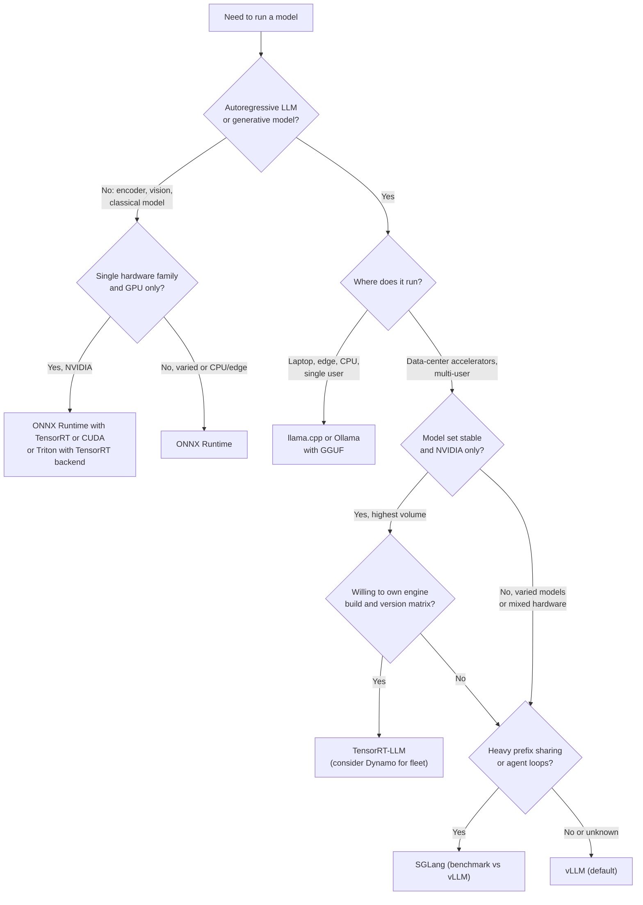

The decision tree encodes the reasoning of this section. It starts from workload type because that eliminates most candidates. Hardware and user count come next. For multi-user GPU serving, the remaining choice depends on how stable the model set is, how much operational complexity the team will accept, and how much prefix sharing exists. When in doubt, vLLM is the conservative default, and the OpenAI-compatible contract keeps the decision reversible.

## 9. Model Servers, Distributed Compute, and Kubernetes-Native Serving

### 9.1 NVIDIA Triton Inference Server, now Dynamo-Triton

Triton Inference Server is an open-source model server from NVIDIA. It serves models from a **model repository** (a directory tree with one folder per model, numbered version subfolders, and a configuration file), over HTTP and gRPC using the KServe v2 inference protocol, and exposes Prometheus metrics. Its key features are:

- **Multiple backends:** TensorRT, ONNX Runtime, PyTorch, TensorFlow (older versions), OpenVINO, Python (arbitrary code), a Forest Inference Library backend for tree models (XGBoost, LightGBM, scikit-learn), and backends that wrap vLLM and TensorRT-LLM.
- **Dynamic batching:** the server holds requests briefly (a configurable queue delay) to form a batch up to a preferred size, which raises throughput for models like encoders and CNNs where batching is not handled inside the model.
- **Concurrent model execution:** several instances of a model on a GPU, or several models on one GPU.
- **Ensembles and business logic scripting:** pipelines of models (preprocess, model, postprocess) defined in configuration.
- **Model management:** load, unload, and version policies, and a model-control API.

Naming, which causes confusion: NVIDIA states that as of 18 March 2025 Triton Inference Server became part of the NVIDIA Dynamo platform and was renamed **NVIDIA Dynamo-Triton** ([NVIDIA developer blog](https://developer.nvidia.com/blog/deploying-nvidia-triton-at-scale-with-mig-and-kubernetes)). NVIDIA Dynamo is a separate, newer open-source distributed inference framework for LLMs that adds disaggregated prefill and decode, KV-aware routing, and cache transfer across GPUs, and it can run vLLM, SGLang, or TensorRT-LLM as engines. So there are two NVIDIA names to keep apart: Dynamo-Triton is the model server (formerly Triton), and Dynamo is the LLM fleet framework. Documentation, container registries, and community posts still use "Triton" widely, so search for both names.

Where Triton fits: heterogeneous model portfolios (a fraud model, a recommender, an embedding model, and a speech model behind one serving layer), GPU-efficient serving of non-LLM models, and organizations that standardize on NVIDIA. Where it fits less well: pure LLM serving where the engine's own server (vLLM, SGLang) is simpler. Triton's value there is composition with pre- and post-processing and unified metrics.

### 9.2 Ray

Ray is an open-source distributed computing framework for Python, developed at the University of California, Berkeley, and commercialized by Anyscale. It has a small core and libraries built on it.

**Ray Core** provides three primitives. A **task** is a stateless function executed remotely. An **actor** is a stateful worker (a class instance living in a process) whose methods are invoked remotely. An **object** is an immutable value in a distributed shared-memory object store, referenced by an object reference so that large data moves between tasks without going through the driver. The cluster has a head node (running the Global Control Service) and worker nodes, and Ray schedules tasks and actors by declared resource requirements (CPUs, GPUs, memory, custom resources). This is a general scheduler at the application level, which is distinct from the Kubernetes pod scheduler.

**Ray Data** is a distributed data-processing library built on streaming execution, designed for ML pipelines: read from object storage, apply CPU preprocessing and GPU model stages, and write results, with heterogeneous resource requests per stage so that CPU stages and GPU stages scale independently. Its main use is **offline batch inference** (embedding a corpus, labeling a dataset) and data loading for training. Streaming execution avoids materializing intermediate datasets, which matters when a corpus is terabytes.

**Ray Train** wraps distributed training: it launches worker processes, sets up the process group for PyTorch Distributed, Lightning, Hugging Face Transformers, or others, handles checkpointing and restarts, and integrates with Ray Data. It does not invent parallelism strategies. It standardizes the launch, fault tolerance, and resource handling.

**Ray Tune** runs hyperparameter searches over many trials. **RLlib** supports reinforcement learning. Both are relevant to the post-training workloads that have grown since 2024.

**Ray Serve** is an online serving library. A *deployment* is a Python class or function with replicas, autoscaling configuration, and resource requirements. Deployments compose into graphs, so one HTTP request can flow through preprocessing, an LLM, and postprocessing in separate scalable stages. Ray Serve supports request batching, model multiplexing (many fine-tuned variants on a replica pool), and integrations to run vLLM or SGLang as the engine inside a deployment.

**KubeRay** is the Kubernetes operator that creates `RayCluster`, `RayJob`, and `RayService` resources, so Ray clusters are provisioned and upgraded as Kubernetes objects. The relationship to the Kubernetes scheduler is layered: Kubernetes places Ray worker pods on nodes, and Ray places tasks and actors inside those pods. Ray autoscaling asks KubeRay for more pods when pending tasks need resources, and a cluster autoscaler adds nodes when pods cannot be placed.

When Ray fits:

- Workloads with Python-native, heterogeneous pipelines that mix CPU and GPU stages (multimodal data processing, batch embedding, video).
- Offline batch inference at corpus scale, where Ray Data's streaming and resource-aware scheduling avoids idle GPUs.
- Teams that want one programming model for data processing, training, and serving.
- Multi-node inference coordination for very large models, though engines are reducing the need for it, as the KServe note above shows.
- Reinforcement learning and agentic training loops with many rollouts.

When it does not fit: a single-model online endpoint with no pipeline (an engine plus a platform is simpler), organizations that cannot operate another distributed control plane, and workloads that need strict multi-tenant isolation (Ray's security model assumes a trusted cluster, and the dashboard and job APIs must be network-restricted and authenticated, since open Ray dashboards have been exploited in the wild).

### 9.3 KServe

KServe is a Kubernetes-native model serving platform, developed in the Kubeflow community and now a Cloud Native Computing Foundation (CNCF) project. Its core abstraction is a custom resource, `InferenceService`, that declares a predictor (the model server and model location), optionally a transformer (pre- and postprocessing), and an explainer. A controller creates the underlying Deployments, Services, and autoscalers.

Mechanisms to understand:

- **Serving runtimes.** A `ServingRuntime` (or cluster-wide `ClusterServingRuntime`) defines a container image and arguments for a model format (Triton, vLLM-based Hugging Face runtime, scikit-learn, XGBoost, others). The `InferenceService` names a model format and storage URI, and KServe picks a runtime.
- **Model loading.** A storage initializer (init container) downloads the model from object storage or a Hugging Face reference into a shared volume before the server starts. Newer options include "ModelCar" (packaging the model as an OCI sidecar image) and a model cache, aimed at cold start and node-local reuse, per the [v0.18 notes](https://kserve.github.io/website/blog/kserve-0.18-release).
- **Deployment modes.** Serverless mode builds on Knative Serving, offering request-based autoscaling and scale to zero. Raw Deployment mode uses plain Kubernetes Deployments with the horizontal pod autoscaler or Kubernetes Event-driven Autoscaling (KEDA), which avoids the Knative dependency and is the more common choice for GPU workloads where scale to zero implies a cold start of minutes.
- **Rollouts.** Canary traffic splitting between revisions of a model, so a new model version receives a percentage of traffic.
- **Inference graphs.** Chained or routed models.
- **LLM serving.** KServe v0.17 introduced an `LLMInferenceService` resource built on the llm-d framework, and v0.18 added multi-node inference without Ray, OpenAI Responses API routing, and namespace-scoped model cache, per the [KServe release announcements](https://kserve.github.io/website/blog/kserve-0.17-release). Verify the current release and the maturity of these resources before you depend on them.

KServe fits when you run many models for many teams on Kubernetes, want a declarative API and consistent rollout controls, and already operate Kubernetes well. It fits poorly when the team is small and has one model, when the organization is not on Kubernetes, or when a managed cloud endpoint would remove the operational load.

### 9.4 llm-d and cache-aware routing

A fleet of identical LLM replicas behind a generic load balancer wastes the main asset of each replica: its warm KV cache. If a conversation's second turn lands on a different replica than the first, the engine recomputes the shared prefix. llm-d is an open-source, Kubernetes-native stack, led by contributors from Red Hat, Google, IBM, NVIDIA, CoreWeave, and others, that adds an inference gateway aware of cache state and load, and supports disaggregated prefill and decode pools running vLLM or SGLang. Press coverage reports a 1.0 release in October 2026, announced at the PyTorch Conference; verify the release status and support matrix on the project site.

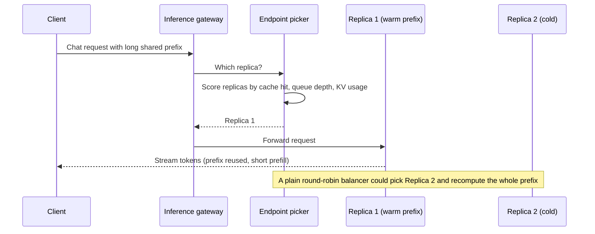

The sequence shows the extra decision a cache-aware gateway makes. The implication is architectural: for LLM serving, routing is part of the performance path, not generic plumbing. A conversation-heavy workload with long prompts can see large prefill savings from affinity-aware routing, while a workload of unrelated short prompts gains little. Measure prefix reuse in your traffic before adopting the added components.

### 9.5 Other Kubernetes-native and managed serving options

- **Ray Serve on KubeRay** (section 9.2) for Python-centric graphs.
- **NVIDIA Dynamo** for disaggregated serving on NVIDIA fleets.
- **Seldon, BentoML and BentoCloud, and similar frameworks** provide packaging and deployment abstractions with their own APIs. Check licensing and maintenance status of each at selection time, because several model-serving projects changed license terms or ownership in recent years.
- **Cloud endpoints** (Amazon SageMaker AI endpoints and Bedrock, Google Vertex AI endpoints, Azure AI Foundry and Azure Machine Learning endpoints) manage replicas, scaling, and networking for you; section 17 covers the trade-off.
- **Serverless GPU platforms** (Modal, RunPod serverless, Baseten, Together, Replicate, and others) scale containers to zero and bill per second of GPU time. They suit spiky or low-volume workloads, with cold start as the cost.

### 9.6 Which layer for which job

| Need | Right layer | Wrong layer |
| --- | --- | --- |
| Faster tokens per second on a given GPU | Engine, quantization, hardware | Platform or gateway |
| Per-tenant rate limits and cost attribution | Gateway and platform | Engine |
| Canary a new model version | Platform (KServe revision, gateway weights) | Engine |
| Batch embeddings over 5 TB of documents | Ray Data, Spark, or a batch job queue | Online serving platform |
| Several model types behind one API | Model server (Triton) or platform | Single-purpose engine |
| Reproduce a past training run | Tracking, registry, pipeline | Serving layer |
| Share 64 GPUs fairly among teams | Scheduler and queues (Kueue, Volcano) | Engine or model server |

## 10. GPU Scheduling on Kubernetes

### 10.1 The default model and its limits

The device plugin framework lets a node advertise a vendor resource, such as `nvidia.com/gpu`, with an integer capacity. A pod requests it under `resources.limits`, and the scheduler places the pod on a node with free capacity, after which the device plugin allocates specific devices. The default model has these properties:

- **Whole devices only.** A pod gets 1, 2, or 8 GPUs, never 0.3 of one. A small model that needs 10 GB of an 80 GB GPU still consumes a whole device.
- **Counts, not attributes.** The scheduler sees only a number. It cannot express "a GPU with at least 40 GB" or "two GPUs on the same NVLink switch" without node labels and affinity rules layered on top.
- **No queueing.** If no node has capacity, a pod is Pending. There is no concept of fair share between teams or an ordering by priority beyond pod priority and preemption.
- **No gang semantics.** A distributed job of 16 pods is scheduled pod by pod. A partial placement can hold GPUs while waiting for the rest, which deadlocks the cluster when two such jobs each hold half.

Each of the mechanisms below addresses one of these limits. The basics of requests, limits, taints, and affinity are in [Part 12](../12_Kubernetes/CH09_Autoscaling.md) and are not repeated here. A GPU pod normally also needs a toleration for the GPU node taint, so that ordinary pods do not occupy expensive nodes.

### 10.2 Sharing a GPU: four mechanisms

| Mechanism | How it shares | Memory isolation | Fault isolation | Performance isolation | Typical use |
| --- | --- | --- | --- | --- | --- |
| Whole device (default) | No sharing | n/a | n/a | n/a | Large models, training |
| Time-slicing | Context switches between processes | None | None (an out-of-memory error or crash in one can affect others) | None, latency jitter | Development, notebooks, bursty small models |
| Multi-Process Service (MPS) | Kernels from several processes run concurrently on shared SMs through one server process | Optional per-client limit | Weak | Partial: thread percentage cap per client | Many small inference jobs from one trusted tenant |
| Multi-Instance GPU (MIG) | Hardware partition into isolated instances, each with dedicated SMs, L2 cache, memory controllers | Yes, hardware | Yes | Yes | Multi-tenant inference, guaranteed slices |
| Virtualized GPU (vGPU) | Hypervisor-level partitioning with licensing | Yes | Yes | Configurable | Virtual desktops, VM-based clouds |

**Time-slicing** is configured in the device plugin by advertising each physical GPU as $N$ replicas. Eight replicas on one GPU lets eight pods "each have one GPU". The pods share the device's memory without limits, so two pods that each want 50 GB will crash when the 80 GB device fills. Time-slicing gives the appearance of fractional GPUs for scheduling but no protection. It is acceptable for development clusters and for trusted workloads of known small size, and it is a poor basis for multi-tenant production.

**MPS** lets processes submit kernels concurrently, so small workloads that would each leave the GPU mostly idle can fill it together, with a cap on the share of streaming multiprocessors (SMs) per client and optionally a pinned memory limit. Because the clients share one address space context managed by the MPS server, a fatal fault in a client can disrupt others, so MPS fits workloads from one trust domain.

**MIG** partitions supported GPUs (A100, H100, H200, B200, and some workstation Blackwell parts) into up to seven instances. Profile names encode compute slices and memory, for example `1g.10gb` is one-seventh of the compute and 10 GB of memory on an 80 GB part. Each instance has hardware isolation of compute, memory, and cache, so one tenant's out-of-memory error or noisy neighbor cannot affect another. Limits: the available profiles are fixed combinations, changing the layout requires draining the GPU, instances cannot communicate over NVLink with each other, and partial-GPU instances run models only up to their slice's memory. MIG is the right tool for multi-tenant inference of small and medium models, which is common for embedding, reranking, classification, and speech services. The NVIDIA blog on [deploying Triton with MIG and Kubernetes](https://developer.nvidia.com/blog/deploying-nvidia-triton-at-scale-with-mig-and-kubernetes) walks through the configuration.

The decision rule: prefer **MIG** when you need isolation, **MPS** when you want throughput among cooperating processes, **time-slicing** when you only need convenience, and **whole devices** when the model uses the GPU well on its own.

### 10.3 Dynamic Resource Allocation

DRA, generally available since Kubernetes 1.34, replaces the integer count with a claim model. Cluster administrators or drivers publish `ResourceSlice` objects describing available devices and their attributes (product name, memory, architecture, partition capabilities). Administrators define `DeviceClass` objects. Workloads create `ResourceClaim` or `ResourceClaimTemplate` objects that request devices by class with Common Expression Language (CEL) selectors, such as a device with at least 40 GiB of memory, and pods reference the claim. The scheduler matches claims to devices during pod scheduling.

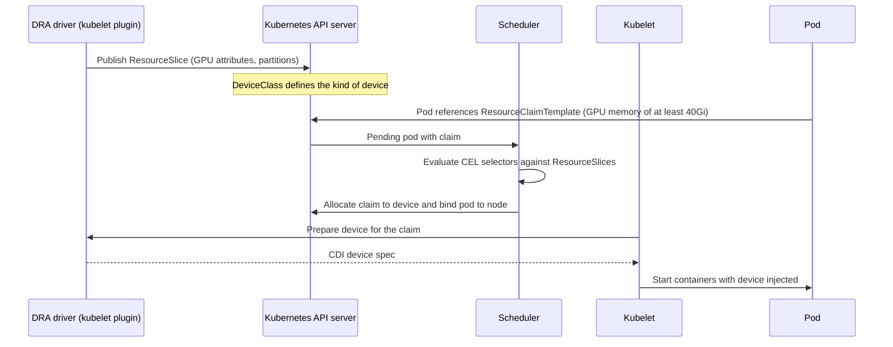

The implications: the scheduler now understands device attributes, so "any GPU with at least 40 GiB" or "a MIG slice of this profile" is a first-class request. Claims can be shared between containers or pods, and a driver can create partitions on demand (dynamic MIG) rather than pre-partitioning nodes. Topology constraints (devices on the same node, same NVLink domain) can be expressed in claims. Migration is gradual: the device plugin path continues to work, and many clusters run both during the transition. The CNCF notes that DRA does not itself enforce fractional use inside a container at the CUDA call level, which is the part projects like HAMi address ([CNCF blog, August 2026](https://www.cncf.io/blog/2026/08/07/does-kubernetes-dra-replace-hami/)). In other words, DRA improves *requesting and allocating* devices, while isolation is still determined by the sharing mechanism underneath.

### 10.4 Topology-aware scheduling

Placement within a node and across nodes affects performance. Within a node, GPUs connected by NVLink (all of them on NVSwitch systems, but pairs on some PCIe servers) perform collectives faster than GPUs reached across PCIe and CPU sockets. GPUs and network interface cards (NICs) attached to the same PCIe switch communicate faster with each other. The kubelet's Topology Manager can align CPU, memory, and device allocations to one non-uniform memory access (NUMA) node. Across nodes, jobs perform best when their nodes sit under the same leaf switch or in the same rack-scale NVLink domain. Mechanisms include node labels for rack or block, pod affinity rules, Kueue's topology-aware scheduling, DRA claims that express device topology, and, for NVL72-class systems, NVIDIA's "compute domain" abstraction that sets up shared memory access through the Internode Memory Exchange (IMEX) service among GPUs on different nodes. The practical guidance: label every node with its network position, express training placement as a topology preference at job-submission time, and record in your platform which workloads require strict versus preferred placement.

### 10.5 Queueing, quotas, and gang scheduling: Kueue and Volcano

Plain Kubernetes has no notion of a queue of jobs waiting for resources. Two projects supply it.

**Kueue** is a Kubernetes special interest group (SIG) project that adds job queueing to the existing scheduler without replacing it. Its concepts:

- A **ResourceFlavor** names a variant of a resource, for example `h100-spot` and `h100-ondemand`, tied to node labels.
- A **ClusterQueue** holds the quota for each flavor (nominal quota), and may belong to a **cohort** whose members can borrow unused quota from each other.
- A **LocalQueue** is a namespaced entry point that teams submit to.
- A **Workload** is Kueue's representation of a job (a Job, JobSet, RayJob, Kubeflow training job, or a plain pod group). Kueue holds the job suspended until the whole Workload can be admitted, then unsuspends it. That is **all-or-nothing admission**, which gives gang semantics without a custom scheduler.
- **Preemption** policies decide whether a higher-priority workload may evict lower-priority ones in the same queue, or reclaim quota that a cohort peer borrowed.
- **Fair sharing** and **admission checks** (for example, waiting for a cluster autoscaler to provision nodes) refine the policy.

**Volcano** is a CNCF batch scheduler that runs as an additional scheduler. A `PodGroup` with `minMember` ensures a set of pods is placed together or not at all. Volcano also has queues with weights and capability, and plugins for gang scheduling, dominant resource fairness, and bin-packing. It is more invasive than Kueue because it replaces the default scheduler for the pods it manages. It is common in HPC-flavored and Spark-on-Kubernetes environments. **NVIDIA KAI Scheduler**, the open-source scheduler derived from Run:ai technology, provides GPU-sharing-aware queues and gang scheduling, and is another candidate in the same slot. Upstream Kubernetes is also adding native workload-level gang scheduling support, so check what your Kubernetes version provides before adding a scheduler.

The selection heuristic: use **Kueue** when you want to stay close to upstream and your jobs are standard Kubernetes Job-like objects. Use **Volcano or KAI** when you need scheduler-level features such as sophisticated bin-packing, GPU fractions, or existing integrations with your batch ecosystem. Use **Slurm** if the environment is an HPC center whose users already submit sbatch scripts, possibly with Slurm-on-Kubernetes bridges.

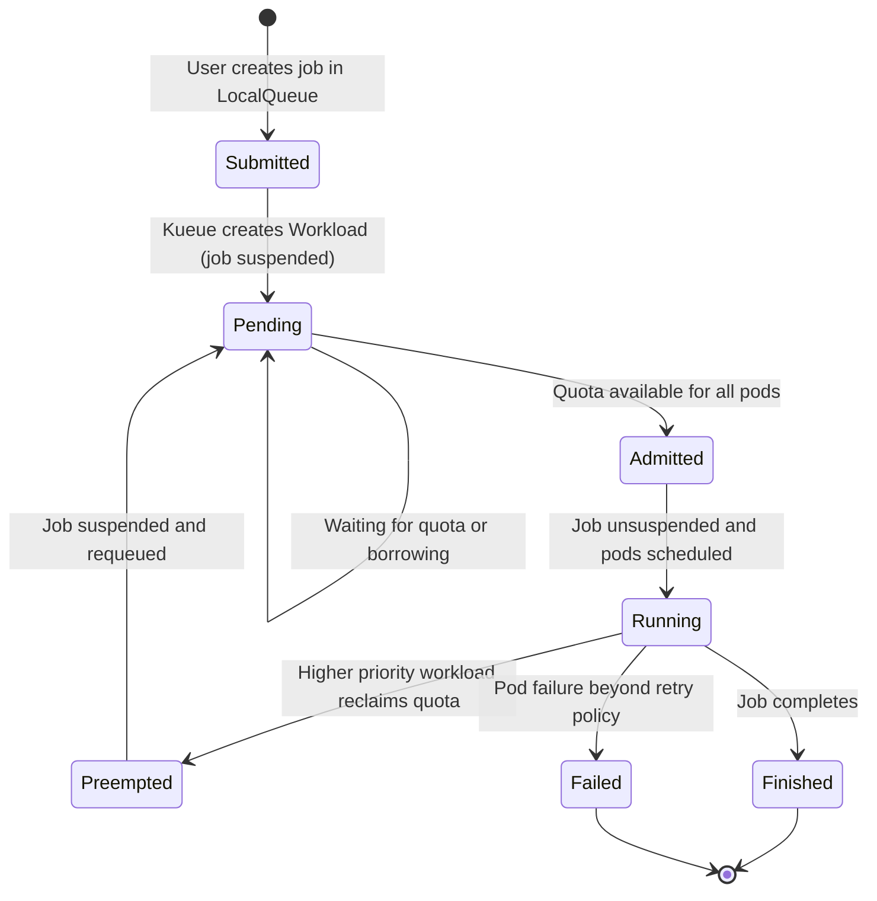

The state machine shows why queueing changes behavior. The critical edges are Pending to Admitted (all-or-nothing) and Running to Preempted. A preempted training job loses all progress since its last checkpoint, so preemption policy and checkpoint cadence are one decision. Section 13 gives numbers.

### 10.6 Worked example: bin-packing replicas onto GPUs

The script [02_gpu_packing_and_utilization.py](../code/python/ai-infrastructure-chapter/02_gpu_packing_and_utilization.py) packs ten model replicas with memory footprints (in GB, including weights, KV budget, and overhead) of 45, 40, 30, 25, 20, 20, 15, 10, 10, and 5, onto 80 GB GPUs.

- Total demand is 220 GB. The lower bound on GPUs is $\lceil 220/80 \rceil = 3$.
- First-fit-decreasing places items in descending size order into the first GPU where they fit. Result: GPU 0 holds 45+30+5 = 80 GB, GPU 1 holds 40+25+15 = 80 GB, GPU 2 holds 20+20+10+10 = 60 GB. Three GPUs, with memory utilization $220/240 = 91.7$ percent.
- With one replica per GPU (whole-device allocation) the ten replicas use ten GPUs, for a memory utilization of $220/800 = 27.5$ percent.

Bin packing is NP-hard, but first-fit-decreasing is within a known constant factor of optimal and is almost always near the lower bound for realistic mixes. Three conditions make the ideal packing unattainable in practice. First, fitting by memory ignores compute and bandwidth: three replicas that each need 90 percent of a GPU's decode bandwidth do not fit on one GPU even if their memory does. Second, co-location requires an isolation mechanism (MIG, MPS, or trusted tenants), as in section 10.2, or the packing gives each replica unpredictable latency. Third, replicas are not static: autoscaling changes the mix, which fragments the cluster over time.

MIG packing has two dimensions (compute slices and memory), and both must fit. An 80 GB GPU offers seven compute slices and memory in 10 GB units. Take four services with profiles `1g.10gb`, `1g.10gb`, `2g.20gb`, and `3g.40gb`: they use 1+1+2+3 = 7 slices and 10+10+20+40 = 80 GB, an exact fit at 100 percent on both dimensions. Adding one more `1g.10gb` instance would need an eighth slice. The reverse hazard exists too: two `3g.40gb` instances use 6 slices and the full 80 GB, so the seventh slice is stranded because no memory is left. Profile selection is therefore a packing problem on its own, and a platform should publish a small set of approved shapes rather than allow arbitrary requests.

### 10.7 Worked example: gang scheduling and fragmentation

A cluster has 8 nodes of 8 GPUs (64 GPUs). After a day of small jobs the free GPUs per node are 3, 5, 2, 6, 4, 1, 7, and 4, a total of 32 free GPUs, which is half the cluster. A job needs 16 GPUs as two whole 8-GPU nodes, because its tensor-parallel group of 8 must sit on one NVLink domain. The number of nodes with all 8 GPUs free is zero. By count, 32 free GPUs could hold two such jobs; by placement none can start. This is **fragmentation**: free capacity exists but not in a usable shape.

Remedies, in the order to try them:

1. **Bin-pack small jobs onto fewer nodes** (the scheduler's most-allocated scoring strategy rather than least-allocated) so whole nodes stay free for large jobs. This trades spreading for packing, and so the blast radius of a node failure rises.
2. **Reserve a pool** of whole-node capacity for large jobs, using separate node pools or Kueue flavors.
3. **Use preemption** so a high-priority large job can evict small jobs, with the small jobs' checkpoint behavior understood.
4. **Defragment** by draining and rescheduling small jobs, which works only for restartable work.
5. **Choose job shapes** that tolerate partial placement: 4-GPU groups instead of 8-GPU groups cost throughput but start sooner.

A second hazard is **gang deadlock** without all-or-nothing admission. Two jobs of 4 pods each want 4 GPUs from a cluster with 6 free GPUs. The default scheduler places 3 pods from job A and 3 from job B. Each holds 3 GPUs, each waits for a fourth, and both wait forever while 6 GPUs sit allocated and idle. Kueue's suspended-until-admitted behavior, or Volcano's `minMember`, prevents this.

### 10.8 Worked example: utilization targets and quotas

Take a 64-GPU cluster at an on-demand price of $3.00 per GPU hour (illustrative). Idle capacity costs $192 per hour or about $140,000 per month at 730 hours. A team reports "average GPU utilization of 30 percent". The effective price of a *useful* GPU hour is $3.00 / 0.30 = $10.00. At 60 percent it falls to $5.00. A platform that moves average utilization from 30 to 60 percent halves the cost per delivered unit of work with the same hardware, which is why scheduling and sharing sit among the highest-return platform investments.

"Utilization" needs care. The `GPU_UTIL` counter from NVIDIA tools reports the fraction of time during which at least one kernel was running, not how much of the GPU's compute or memory bandwidth was used. A decode kernel that uses 5 percent of the SMs reports 100 percent utilization. Use profiling counters (tensor-core activity, DRAM activity, SM activity) as section 12 explains, and define utilization targets at the *workload* level, such as achieved tokens per second per GPU relative to a measured saturation point.

A quota design for the same cluster could be: 24 GPUs reserved for production inference (non-preemptible, no borrowing out), 32 GPUs for training with a shared cohort, and 8 GPUs for experimentation, with borrowing so that unused production capacity can serve experiments but is reclaimed instantly when inference autoscaling needs it. Expected preemption loss for a 32-GPU training job with a 30-minute checkpoint interval is on average half an interval, 15 minutes, of lost work: $32 \times 0.25 = 8$ GPU hours, about $24 at $3.00. If preemption happens twice a day, that is $48 per day of rework in exchange for the borrowed capacity, which is usually a good trade. If the checkpoint interval were 2 hours, the loss would be 32 GPU hours per preemption, about $96, and the trade changes.

## 11. Model Loading and Cold Start

### 11.1 Anatomy of a cold start

Time from "scale up" to "serving traffic" is the sum of stages that run mostly in sequence:

$$
T_{\text{cold}} = T_{\text{node}} + T_{\text{image}} + T_{\text{read}} + T_{\text{copy}} + T_{\text{init}} + T_{\text{warm}}
$$

- $T_{\text{node}}$: provisioning a GPU node if none is available. Minutes in the cloud, and the largest term when it applies.
- $T_{\text{image}}$: pulling the container image, often 10 to 25 GB for CUDA stacks.
- $T_{\text{read}}$: reading the weights from their source. Approximately weight size divided by the storage bandwidth that is actually available to this pod.
- $T_{\text{copy}}$: moving weights from host memory to device memory over PCIe, about weight size divided by 25 to 50 GB/s.
- $T_{\text{init}}$: engine initialization: building the model graph, profiling memory to size the KV cache, allocating cache blocks, compiling or loading kernels, and capturing CUDA graphs.
- $T_{\text{warm}}$: warmup requests that trigger lazy initialization, so the first real user does not pay for it.

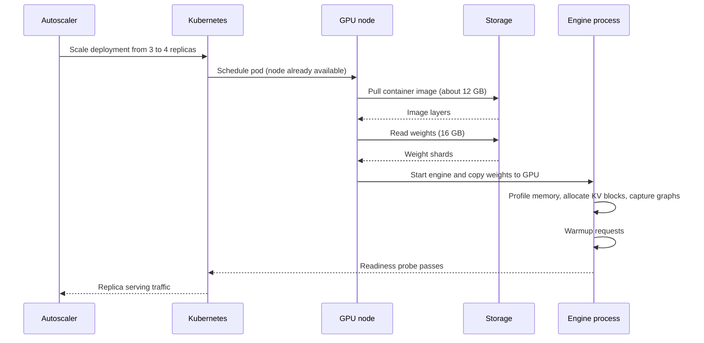

The sequence makes the dominant costs visible. Weights are read twice in effect: once from remote storage into host memory (or page cache), then across PCIe into device memory. Any stage can be removed from the critical path by moving it earlier (pre-pulling images and weights to nodes before they are needed) or by making it parallel (reading shards concurrently across storage connections).

### 11.2 Worked example

The script [03_cold_start_calculator.py](../code/python/ai-infrastructure-chapter/03_cold_start_calculator.py) uses these illustrative assumptions: image pull 0.5 GB/s for a 12 GB image, PCIe copy 25 GB/s, engine initialization 30 seconds for 8B and 60 seconds for 70B, and warmup 15 and 30 seconds. Results:

| Scenario | Pull | Read | Copy | Init | Warm | Total |
| --- | --- | --- | --- | --- | --- | --- |
| 8B BF16 (16 GB), object store at 10 Gbit/s, cold node | 24.0 s | 12.8 s | 0.6 s | 30 s | 15 s | 82.4 s |
| 8B BF16, local Non-Volatile Memory Express (NVMe) solid-state cache at 6 GB/s, image present | 0 | 2.7 s | 0.6 s | 30 s | 15 s | 48.3 s |
| 8B BF16, page cache at 20 GB/s (second start on same node) | 0 | 0.8 s | 0.6 s | 30 s | 15 s | 46.4 s |
| 70B FP8 (70 GB), object store at 10 Gbit/s, cold node | 24.0 s | 56.0 s | 2.8 s | 60 s | 30 s | 172.8 s |
| 70B FP8, four tensor-parallel ranks each reading a shard from local NVMe | 0 | 2.9 s | 0.7 s | 60 s | 30 s | 93.6 s |
| 70B BF16 (140 GB), object store at 25 Gbit/s, cold node | 24.0 s | 44.8 s | 5.6 s | 70 s | 30 s | 174.4 s |

The quantities to take from the table are these:

- **Read time is the first-order term only when storage is slow.** At 10 Gbit/s (1.25 GB/s), a 70 GB model takes 56 seconds to read. At local NVMe speeds, it takes a few seconds.
- **After caching, initialization dominates.** The 8B model spends 45 of its 48 seconds in initialization and warmup. Optimizing storage further changes little. The only remaining levers are engine-level: compilation caches, fewer CUDA graph captures, and snapshotting.
- **A cold node adds an image pull comparable to the weight read.** Image size matters as much as model size for small models.
- **Provisioning a node is not in the table** and typically adds several minutes for GPU nodes in the cloud, because the instance must start, join the cluster, and install or verify drivers. If your autoscaler must add nodes, the cold start is minutes, not seconds.

The 10 Gbit/s assumption is a per-node bandwidth ceiling. Several replicas starting on the same node share it. Eight replicas starting at once on a node with a 10 Gbit/s link each get an eighth of the bandwidth, so the 56-second read becomes 7.5 minutes unless the data comes from a node-local copy. Mass restarts after a node pool upgrade create exactly this thundering herd.

### 11.3 Techniques to shrink cold start

1. **Pre-pull images** to GPU nodes with a DaemonSet or an image pre-puller, so the image pull leaves the critical path. Image streaming features (for example lazy-pulling snapshotters such as stargz, Nydus, or Seekable OCI (SOCI), and the equivalents offered by managed Kubernetes services) start containers before all layers have downloaded.
2. **Keep weights out of the image** and load them from a model cache. Baking 16 to 140 GB of weights into the image makes every image push and pull enormous and ties model changes to image rebuilds. The exception is small models where a single self-contained artifact simplifies operations.
3. **Cache weights on node-local NVMe** with a DaemonSet or a caching layer that fills the cache before pods need it, so $T_{\text{read}}$ is local-disk speed. KServe's model cache and ModelCar features address this, and so do node-local cache daemons in other platforms.
4. **Use a shared read-only network volume** (a parallel file system or network file system with high throughput) when many replicas read the same weights. The bandwidth is shared, so size it as aggregate demand: replicas starting together times weight size, divided by the target read time.
5. **Parallel and streaming loaders.** Reading safetensors shards concurrently and streaming tensors straight to GPU memory overlaps $T_{\text{read}}$ and $T_{\text{copy}}$. Libraries such as the Run:ai Model Streamer and fastsafetensors implement this, and engines expose them as load-format options. Verify support in your engine version.
6. **Memory-map weights** on single-node CPU/GPU hybrids to make restarts of the same process cheap through the page cache. This is how llama.cpp restarts quickly.
7. **Snapshot and restore.** Restoring a process image including GPU memory skips initialization entirely. NVIDIA provides CUDA checkpoint/restore utilities, and some serverless GPU platforms advertise memory snapshots that cut start-up to seconds. Some engines offer a "sleep" mode that offloads weights and cache to CPU memory and wakes quickly, which suits time-sharing a GPU between models. These capabilities are young and version-sensitive, so test failure and rollback behavior.
8. **Warm pools and headroom** (next section) avoid the cold start by not scaling from zero in the first place.

### 11.4 Autoscaling with a cold start

Autoscaling must provision capacity ahead of demand by at least the cold-start time. Suppose traffic can ramp by 60 requests per second over two minutes (0.5 requests per second per second), each replica handles 10 requests per second at the target latency, and replicas take 82 seconds to start (8B model, cold node, spare node available). During the 82 seconds, the new demand is $0.5 \times 82 = 41$ requests per second, which needs $\lceil 41/10 \rceil = 5$ replicas of headroom to avoid queueing or shedding. Headroom of this size must be running already when the ramp starts. If a node must be provisioned first and takes four minutes, then $T_{\text{cold}}$ is about 5.4 minutes, and covering a 0.5 requests per second per second ramp needs $0.5 \times 322 / 10 \approx 17$ replicas of headroom. At that point a predictive or scheduled scaling policy, a warm pool of ready nodes, or load shedding with a graceful degradation path is cheaper than headroom.

Practical rules:

- Scale on a signal that leads latency, such as queue depth or running-request count per replica, not on GPU utilization or CPU, which lag.
- Set a minimum replica count that covers the baseline needed to meet the service-level objective (SLO), and limit scale-down rate so that a short lull does not discard warm replicas you will need in five minutes.
- Treat scale to zero as acceptable only when the product tolerates minutes of first-request latency (internal batch tools, rarely used models), or when a platform with snapshot restore reduces cold start to seconds.
- Keep a **fallback path** during scale-up: route overflow to a hosted API or a smaller model, as the gateway design in [Part 17](../17_AI_Architecture/CH07_Inference_Serving_and_Model_Placement.md) describes.

## 12. Observability for GPUs and Inference Servers

### 12.1 Two telemetry layers

GPU health and utilization come from the device. Request behavior comes from the engine. Neither is enough without the other: a GPU can look busy while requests queue badly, and a request latency spike can come from a throttled device. Correlate them by node, device, pod, and model.

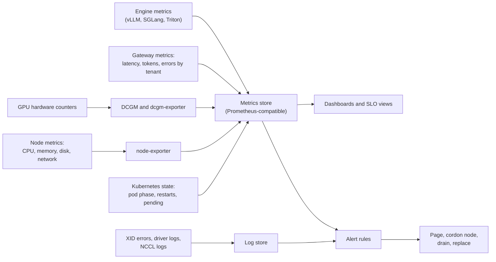

The diagram shows two features of a good design. Alerts can trigger *automated remediation* (cordon a node with a failing GPU) and not only pages. And logs are first-class: some GPU faults appear as kernel log events (NVIDIA "Xid" errors) before they appear in any metric.

### 12.2 GPU metrics (DCGM)

NVIDIA Data Center GPU Manager (DCGM) exposes device counters, and `dcgm-exporter` publishes them in Prometheus format. Field names at the time of writing include the following. Check your DCGM version's documentation, because available fields vary by GPU and driver.

| Metric (field name) | Meaning | What it tells you |
| --- | --- | --- |
| `DCGM_FI_DEV_GPU_UTIL` | Percent of time at least one kernel ran | Coarse activity. Does not measure how much of the GPU is used. |
| `DCGM_FI_PROF_SM_ACTIVE` | Fraction of time SMs had at least one warp assigned | Better measure of compute occupancy. |
| `DCGM_FI_PROF_PIPE_TENSOR_ACTIVE` | Fraction of cycles tensor cores were active | Whether matrix units are used. Low during decode is normal. |
| `DCGM_FI_PROF_DRAM_ACTIVE` | Fraction of cycles the memory interface was active | Memory-bandwidth pressure. High during decode is expected. |
| `DCGM_FI_DEV_FB_USED`, `DCGM_FI_DEV_FB_FREE` | Framebuffer (GPU memory) used and free | Memory headroom and leaks. |
| `DCGM_FI_DEV_POWER_USAGE` | Power draw in watts | Load proxy. Compare against the power cap. |
| `DCGM_FI_DEV_GPU_TEMP`, `DCGM_FI_DEV_MEMORY_TEMP` | Temperatures | Cooling problems and throttle risk. |
| `DCGM_FI_DEV_SM_CLOCK`, `DCGM_FI_DEV_MEM_CLOCK` | Clock frequencies | Thermal or power throttling shows as clocks below base. |
| `DCGM_FI_DEV_CLOCK_THROTTLE_REASONS` | Bitmask of throttle causes | Distinguishes thermal, power, and software caps. |
| `DCGM_FI_DEV_XID_ERRORS` | Last XID error code | Hardware and driver fault signals. |
| `DCGM_FI_DEV_ECC_DBE_VOL_TOTAL` | Double-bit error-correcting code (ECC) errors | Uncorrectable memory errors. Replace the device. |
| `DCGM_FI_PROF_NVLINK_TX_BYTES`, `DCGM_FI_PROF_NVLINK_RX_BYTES` | NVLink traffic | Collective load, link problems. |
| `DCGM_FI_PROF_PCIE_TX_BYTES`, `DCGM_FI_PROF_PCIE_RX_BYTES` | PCIe traffic | Weight loading, host-device copies. |

Interpretation patterns:

- **Decode-heavy serving:** high `DRAM_ACTIVE`, moderate `SM_ACTIVE`, low `TENSOR_ACTIVE`. This is the memory-bound signature of section 3.5. A GPU that shows 100 percent `GPU_UTIL` but 5 percent `SM_ACTIVE` is not saturated; add batch or colocate work.
- **Prefill-heavy or training:** high `TENSOR_ACTIVE` and `SM_ACTIVE`, power near the cap.
- **Throttling:** `SM_CLOCK` well below the rated boost under load, with throttle reasons set. Repair cooling or power, or exclude the node.
- **Straggler in a training job:** one GPU with lower clocks, different temperature, or higher NVLink or PCIe error counts than its peers.

Profiling counters (`DCGM_FI_PROF_*`) have a collection cost and can conflict with other profilers running on the device, so enable only the ones you use and avoid running Nsight profiling on a GPU that DCGM is sampling.

### 12.3 XID errors

The driver logs numbered XID events for faults. Frequently seen examples: XID 79 (the GPU has fallen off the bus, usually hardware or power), XID 48 (double-bit ECC error), XID 94 and 95 (contained and uncontained ECC memory errors on newer GPUs), XID 74 (NVLink error), and XID 13, 31, and 43 (application-level exceptions and memory faults, often a software bug or out-of-bounds access). Maintain a table mapping XID codes to actions (restart the pod, drain the node, open a hardware ticket) in your runbook, and ingest them from the kernel log into your alerting. NVIDIA publishes the XID catalogue, so consult it rather than relying on memory.

### 12.4 Inference-server metrics

LLM engines expose Prometheus endpoints. Names differ between engines and versions, so treat these as families and confirm them on your version:

- **Queue and concurrency:** requests waiting, requests running, requests swapped or preempted. A growing waiting count with GPU at capacity means the replica is saturated.
- **KV cache usage:** fraction of cache blocks in use. Sustained values near 100 percent coincide with preemptions (recomputing evicted sequences) and rising latency.
- **Latency:** time to first token (TTFT), time per output token (TPOT) or inter-token latency, and end-to-end latency, as histograms.
- **Throughput:** prompt tokens and generation tokens processed per second.
- **Prefix cache hit rate:** whether routing and prompt design are producing reuse.
- **Batch size and scheduler iteration time:** how full each step is.
- **Errors:** rejected, aborted, and timed-out requests.

Triton exposes per-model inference counts, queue durations, compute durations, and batch statistics, which distinguish time spent waiting to batch from time spent computing. Take care with histograms: choose bucket boundaries around your SLOs (for example 100 ms, 250 ms, 500 ms, 1 s, 2.5 s for TTFT), or percentile estimates will be coarse where it matters.

### 12.5 Reading symptoms

| Symptom | Likely cause | Evidence to check |
| --- | --- | --- |
| TTFT rising, GPU idle-ish | Queueing before the engine, gateway limits, tokenization or host CPU overload | Gateway queue time, CPU saturation, waiting requests = 0 |
| TTFT rising, waiting requests high, KV usage high | Saturation: not enough cache or compute | KV usage near 100 percent, running requests at max |
| TPOT rising only at peak | Batch growth moves decode toward compute-bound, or KV reads grow with context | Batch size, average context length |
| Throughput lower than benchmark, same traffic | Throttling, noisy neighbor (time-slicing), wrong parallelism, misconfigured batching | Clock speed, throttle reasons, co-located pods |
| Sporadic 5xx after hours of uptime | Memory fragmentation or leak, driver faults | Framebuffer trend, XID, restarts |
| Training step time varies by rank | Straggler: throttled GPU, slow link, data loader stall | Per-rank step time, DCGM per device |
| Jobs Pending with free GPUs listed | Fragmentation, taints, quota, topology | Scheduler events, queue state |

Define service-level indicators (SLIs) at the request level (TTFT, TPOT, error rate, availability) and capacity indicators at the fleet level (queue depth, KV usage, cost per million tokens). [CH29](CH29_MLOps_and_LLMOps.md) covers quality monitoring and drift, and [Part 14](../14_Observability/PART_OVERVIEW.md) covers the observability stack in general.

## 13. Storage and Data Pipelines for Training and Checkpointing

### 13.1 What training asks of storage

Training has three storage workloads, each with a different access pattern.

1. **Dataset reads.** Large sequential reads of many shards, repeated across epochs, with random shard order. Aggregate bandwidth scales with the number of GPUs. A data-parallel job over 1,024 GPUs, each consuming a modest 50 MB/s of tokenized data, needs about 51 GB/s aggregate, a load no single bucket prefix or network file server sustains without design. Multimodal and video training raises the per-GPU rate by orders of magnitude.
2. **Checkpoint writes.** Large, bursty, synchronized writes from all ranks at once.
3. **Artifact and log writes.** Small and frequent, low bandwidth, but numerous files that stress metadata servers.

Object storage (Amazon S3, Google Cloud Storage, Azure Blob Storage) is the durable home for datasets and checkpoints because of its capacity, cost, and durability, but its per-request latency is high and its per-prefix throughput limited. Parallel file systems (Lustre, IBM Storage Scale, WEKA, BeeGFS, and managed offerings such as Amazon FSx for Lustre, Google Managed Lustre, and Azure Managed Lustre) provide POSIX semantics and high aggregate bandwidth for datasets and checkpoints. They cost far more per gigabyte. The usual architecture is tiered: object storage as the system of record, a parallel file system or local NVMe as a cache or scratch tier, and explicit staging and eviction.

### 13.2 Dataset formats and loaders

Reading millions of small files from object storage fails at scale because of per-request overhead. Convert datasets into large shards: tar-based formats (WebDataset), Parquet or Arrow for tabular and tokenized text, or streaming formats such as MosaicML Streaming that store shard indexes and download only what a rank needs. Three practices matter:

- **Shard size of 100 MB to 1 GB** keeps request counts manageable while allowing parallel reads and fine-grained shuffling.
- **Deterministic sharding by rank,** with the seed and shard order recorded, so that a restarted job resumes at the same data position instead of repeating or skipping data. Loss of data position on restart is a quiet source of non-reproducible results.
- **Prefetch and overlap.** Loader workers on CPU read, decompress, and tokenize ahead of the GPU. If data loader time is more than a small fraction of step time, GPUs wait. Detect it by profiling the idle gap before each step, and fix it with more workers, pre-tokenized data, or local caching.

### 13.3 Checkpoint size

Training state is far larger than the final model. With mixed-precision training and the Adam optimizer, the typical state per parameter is:

| Component | Bytes per parameter |
| --- | --- |
| BF16 weights (working copy) | 2 |
| FP32 master weights | 4 |
| Adam first moment (FP32) | 4 |
| Adam second moment (FP32) | 4 |
| BF16 gradients (transient, not usually checkpointed) | 2 |

The total training memory is about 16 bytes per parameter, and a *checkpoint* that can resume training holds about 14 bytes per parameter (weights, master weights, and both moments). For a 70B-parameter model, training state is $70 \times 10^9 \times 16 \approx 1.12$ TB, which does not fit on fewer than 14 GPUs of 80 GB even before activations, so sharding states across ranks (fully sharded data parallel or ZeRO-style partitioning) is required. A resumable checkpoint is $70 \times 10^9 \times 14 = 980$ GB, close to a terabyte. The model that you serve afterward is just the 140 GB of BF16 weights (or less after quantization), so only about one-seventh of the checkpoint bytes are kept for deployment.

Checkpoints are written sharded: each rank writes its own piece in parallel (PyTorch Distributed Checkpoint is the standard mechanism), so write bandwidth scales with the number of ranks. Writing 980 GB at an aggregate 20 GB/s takes about 49 seconds. At 2 GB/s (a single NFS server) it takes about 8 minutes, during which GPUs idle if the write is synchronous.

### 13.4 Checkpoint frequency: a worked optimization

Frequent checkpoints waste time writing. Rare checkpoints lose more work at each failure. The classic first-order balance (Young 1974, Daly 2006) gives an interval

$$
T_{\text{opt}} \approx \sqrt{2 \, C \cdot M}
$$

where $C$ is the time to write a checkpoint (as a stall) and $M$ is the mean time between failures of the job. The expected overhead fraction is approximately $C/T + T/(2M)$ (writing time plus half an interval of lost work per failure).

Meta's report on training Llama 3 (Dubey et al., 2024) described 419 unexpected interruptions during a 54-day period on a cluster of 16,384 H100 GPUs, about one every 3.1 hours, with most due to hardware faults. That is a useful real-world calibration: at that scale failures are routine, not exceptional. Take $M = 3.1\ \text{h} = 11{,}160\ \text{s}$ for the illustration:

- **Synchronous checkpoint,** $C = 49$ s. $T_{\text{opt}} = \sqrt{2 \times 49 \times 11160} \approx 1{,}046$ s, about 17 minutes. Overhead: $49/1046 + 1046/22320 = 4.7\% + 4.7\% = 9.4\%$ of training time.
- **Asynchronous checkpoint,** where the stall is only the copy of state from GPU to host memory, say $C = 5$ s, with the write to storage overlapped. $T_{\text{opt}} = \sqrt{2 \times 5 \times 11160} \approx 334$ s, about 5.6 minutes. Overhead: $5/334 + 334/22320 = 1.5\% + 1.5\% = 3.0\%$.

On 16,384 GPUs, the difference between 9.4 and 3.0 percent is about 1,000 GPUs of useful capacity. That is why large training stacks invest in asynchronous, tiered checkpointing: copy to host memory, write to local NVMe, then replicate to remote storage in the background. A smaller job on 64 GPUs has a much longer MTBF (days), so checkpoint every 30 to 60 minutes is sensible, and the savings are small. Choose the interval from your measured failure rate and write stall, not from a default.

A checkpoint is valid only if it can be restored. Verify by restoring periodically in a test job, include data loader state and random number generator state, write to a temporary name and rename on completion so that a half-written checkpoint is never read, keep the last several checkpoints (the newest may be corrupt if the failure happened during the write), and record the training configuration and code revision alongside.

### 13.5 Data pipeline design for fine-tuning and batch inference

Most enterprises fine-tune or batch-score more often than they pretrain, and the data pipeline looks different: tens to thousands of gigabytes, a single node or a handful of nodes, and heavy preprocessing (deduplication, filtering, tokenization, packing). The pattern that works is a staged pipeline with materialized, versioned outputs: raw data in object storage, cleaned and tokenized shards in a versioned prefix with a manifest listing files and digests, and training jobs that reference a manifest version. This keeps dataset lineage queryable and lets you rerun a training job against exactly the same data. [CH02](CH02_Data_Preparation_Feature_Engineering_and_Leakage.md) covers data preparation correctness and [CH30](CH30_AI_Data_Governance_Privacy_and_Provenance.md) covers governance. For offline batch inference over a corpus, use a framework that streams data through the model with GPU and CPU stages scaled separately (Ray Data, Spark with GPU stages, or a Kubernetes Job queue) and write results incrementally with idempotent shard outputs, so a failure restarts only the failed shards.

## 14. Security and Multi-Tenancy

### 14.1 Threat model

An AI platform inherits the security problems of any multi-tenant container platform and adds several that are specific to models and accelerators.

| Asset | Threat | Control |
| --- | --- | --- |
| Model weights (proprietary or fine-tuned) | Theft by a compromised workload or insider | Least-privilege read access, encryption at rest, access audit, no direct internet egress from serving pods |
| Model artifacts in supply chain | Tampered or backdoored model, pickle code execution | Quarantine, scanning, signing, verification at start (section 7) |
| Container images | Vulnerable or malicious dependencies | Image scanning, software bill of materials, signing, admission policy, pinned digests |
| Prompts and outputs | Cross-tenant leakage, logging of sensitive data | Per-tenant isolation of caches and logs, data classification, redaction |
| Platform control APIs | Unauthorized deployments or promotions | Strong authentication, role-based access, separate promotion identity |
| Secrets | Exposure in images, environment, logs | Workload identity, secret manager, short-lived credentials |
| GPUs and nodes | Container escape, cross-tenant side channels, cryptomining abuse | Patching, isolation, resource quotas, runtime monitoring |
| Training data | Exfiltration, poisoning | Dataset access controls, manifests with digests, egress controls |
| Management endpoints | Unauthenticated dashboards, notebook servers, runner APIs | Authenticated gateway, network policies, no public exposure |

### 14.2 Trust boundaries in a multi-tenant platform

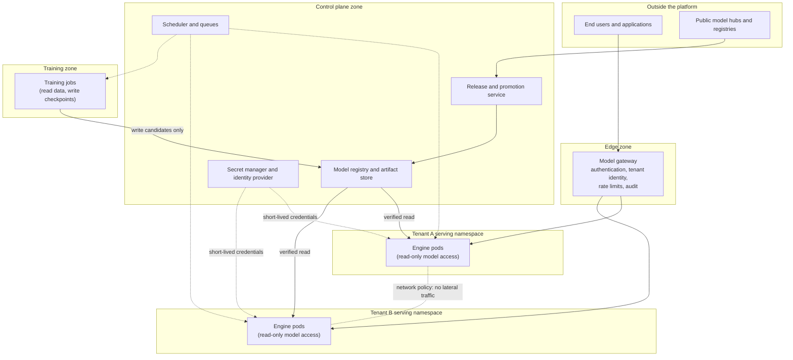

The diagram makes the privilege boundaries explicit. Training jobs can write candidates to the registry but cannot promote them: promotion belongs to the release service, which runs checks. Serving pods have read-only, verified access to the artifacts they need and nothing else. Tenants are isolated by namespace, network policy, identity, and (where needed) hardware partition. The gateway is the only user-facing entry. Each boundary should correspond to an enforced control (an IAM policy, a network policy, an admission rule), not just a label. A scheduler label that says "tenant A" is not a security boundary unless an authorization rule enforces it.

### 14.3 GPU sharing and isolation levels

Choose the sharing mechanism by trust level:

- **Different companies or regulated data classes:** dedicated nodes or whole GPUs. MIG is acceptable for many but not all compliance regimes. Check the assurance you need.
- **Different teams in one company:** MIG for hardware isolation of memory and compute, or whole devices, with network and namespace isolation.
- **Same team, trusted workloads:** MPS or time-slicing for efficiency.

Memory is a particular concern. Hardware and drivers normally clear GPU memory between processes, but research has shown leaks on some devices: the LeftoverLocals vulnerability disclosed in 2024 let one process read leftover local memory from another on affected GPUs (reported for several AMD, Apple, Qualcomm, and Imagination parts). The general lesson is that shared accelerator memory is a side-channel surface, which supports hardware partitioning and patching for multi-tenant deployments.

LLM serving has an additional shared-state risk. Prefix caches that are shared across users can leak information through timing: a request that hits a cached prefix is faster, which reveals that another user sent that prefix. Mitigations include isolating the cache per tenant (some engines support a cache salt or namespace parameter in requests, so that identical prefixes from different tenants do not share cache), limiting cache sharing to non-sensitive system prompts, and adding noise or fixed-latency policies in high-sensitivity settings. State the policy explicitly: prefix reuse across tenants is a performance win and a confidentiality trade-off.

### 14.4 Container and runtime security

GPU containers have often been run with elevated privileges for convenience. Avoid it:

- Use the device plugin or DRA, which mount only the allocated devices, instead of `privileged: true`.
- Run as a non-root user, drop capabilities, use a read-only root filesystem with explicit writable volumes for caches, and apply the runtime default seccomp profile.
- Patch the NVIDIA Container Toolkit and GPU Operator promptly. The toolkit has had container-escape vulnerabilities (for example CVE-2024-0132 and a 2025 follow-up), and it runs with high privilege on every GPU node.
- Scan images and keep a software bill of materials (SBOM). CUDA base images and Python dependency trees are large and accumulate vulnerabilities. Rebuild on a schedule, and pin by digest.
- Do not mount cloud credentials broadly. Use workload identity (Identity and Access Management (IAM) roles for service accounts, GKE Workload Identity, Azure workload identity) with a role limited to the model bucket prefix.
- Forbid pods from pulling arbitrary models at runtime from the public internet. Enforce with egress policy, and mirror approved artifacts internally.

[Kubernetes Security](../12_Kubernetes/CH13_Security.md) covers pod security standards, network policies, and admission control in detail.

### 14.5 Management endpoints are the common breach

The most frequent real-world incidents involving AI infrastructure are not exotic. They are open management interfaces. The ShadowRay campaign (reported by Oligo Security in 2024) exploited unauthenticated Ray dashboards and job APIs exposed to the internet, running attacker code on clusters with GPUs and credentials. Exposed Ollama endpoints, notebook servers, MLflow tracking servers, and inference servers without authentication follow the same pattern. Controls: no public IPs on management and inference endpoints, authentication in front of every one (an authenticating proxy for tools without their own), network policy restricting who can reach them, and an inventory scan that looks for listening AI services. Ray's own documentation states that it assumes a trusted network, so treat that as a design constraint.

### 14.6 Governance mechanisms at deploy time

Enforce policy with admission control rather than documents: allow only images signed by the platform, only model artifacts whose signature verifies, only approved runtimes from an allowlist, only namespaces with a cost center label, and only pods that request resources within quota. Policy engines (Kyverno, Open Policy Agent Gatekeeper, the Kubernetes ValidatingAdmissionPolicy) implement these rules. Record every deployment event with model digest, image digest, identity, and approval link in an audit log. That log is the evidence base for incident response and for regulatory questions about which model version served which request. [CH30](CH30_AI_Data_Governance_Privacy_and_Provenance.md) covers the policy content, and [Part 15](../15_Security/PART_OVERVIEW.md) covers general security architecture.

## 15. Lifecycle Tools: Registry, Tracking, Pipelines

[CH29](CH29_MLOps_and_LLMOps.md) owns the lifecycle process: what gets evaluated, who approves, how rollback works. This section covers the tools by role, so that you can place them in the stack and avoid buying two products for one job.

### 15.1 Five roles that tools get confused across

1. **Experiment tracking** records runs: parameters, metrics over time, code revision, environment, and output artifacts. It answers "what did we try and how did it do".
2. **Model registry** records models as versioned, named entities with state (candidate, approved, deprecated), lineage back to the run and data, and a pointer to the artifact. It answers "what is the approved version of this model and where are its bytes".
3. **Artifact store** holds the bytes: object storage, an OCI registry, or a model hub. The registry holds metadata and pointers; the artifact store holds weights. Keep these distinct in design, because they have different durability, access control, and replication needs.
4. **Pipeline or workflow engine** executes a graph of steps with dependencies, retries, schedules, and caching. It answers "run these steps in this order, and rerun only what changed".
5. **Training and serving runtimes** execute the heavy work: operators that launch distributed training jobs, and servers that host models.

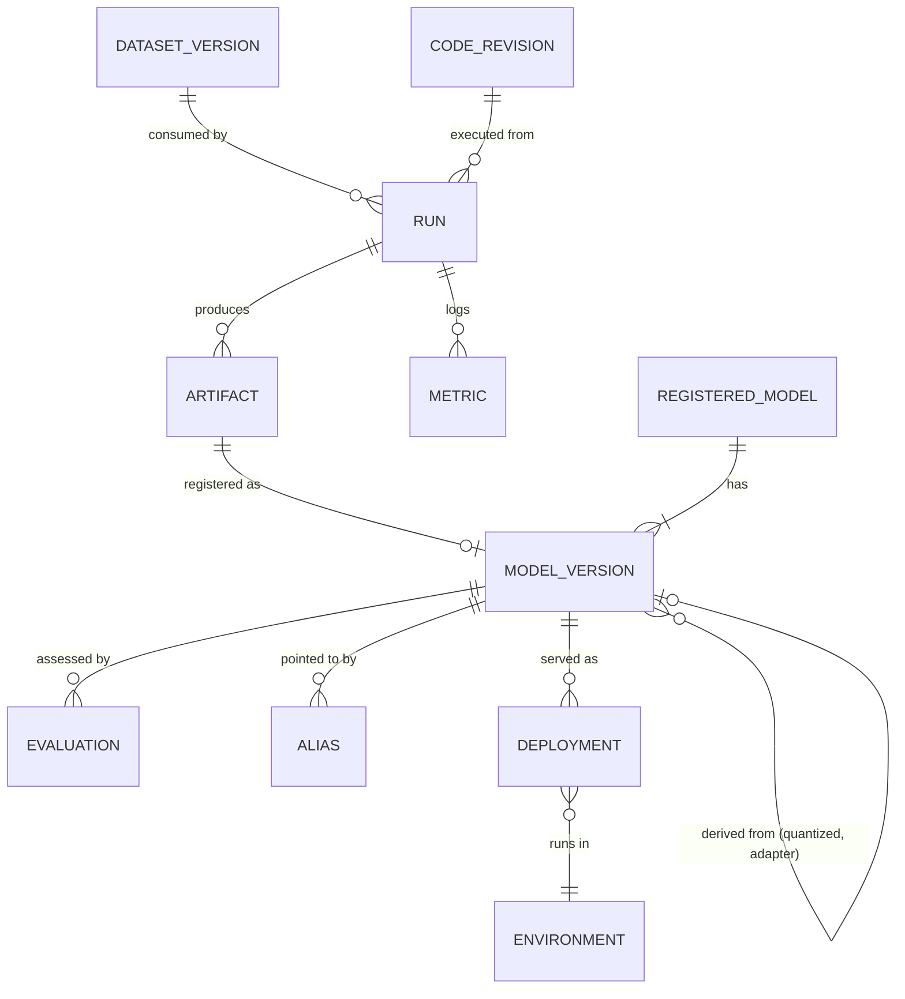

The entity model shows what lineage requires. A model version points to the run that produced it, which points to a dataset version and code revision. Evaluations attach to model versions. Deployments attach to model versions and environments. An alias (such as "production" or "champion") is a movable pointer to a version, which lets the release service promote or roll back by moving the pointer, while versions remain immutable. The self-referencing relationship records that a quantized model or adapter derives from a base version, which section 6.7 required. If your tools cannot answer "which dataset version trained the model that served this request yesterday", the lineage chain has a gap, and the usual gap is the link between a deployment and a model digest.

### 15.2 MLflow

MLflow is an open-source platform, now under the Linux Foundation and primarily developed by Databricks and the community. Its components:

- **Tracking:** an API and server to log parameters, metrics, tags, and artifacts for runs organized into experiments. Backend: a SQL database for metadata and an object store for artifacts.
- **Model Registry:** registered models with immutable versions, tags, and aliases. Older "stage" labels (Staging, Production) were deprecated in favor of aliases, so check which your version supports.
- **Models:** a packaging convention (an `MLmodel` file describing "flavors" such as PyTorch, scikit-learn, Transformers, and a generic Python function flavor) that lets tools load and serve a model uniformly. It includes signature and environment capture.
- **Evaluation and GenAI tooling:** evaluation harnesses, and in MLflow 3 a larger emphasis on LLM and agent tracing, prompt versioning, and evaluation. Verify the current feature set in the release notes.
- **Serving:** `mlflow models serve` and deployment plugins give a basic server. It is useful for validation and small workloads, not a replacement for an engine or a serving platform.

MLflow fits as the **tracking and registry** layer in many stacks. It is not a pipeline engine, a scheduler, or a high-performance server. Security: the tracking server historically shipped without authentication; newer versions add basic authentication, but you should still front it with an authenticating proxy and keep it off public networks. Operate the backing database and artifact bucket as production systems, because the registry is the source of truth for what is deployable.

### 15.3 Kubeflow

Kubeflow is a collection of Kubernetes-native projects for the ML lifecycle, not a single product. The components that matter:

- **Kubeflow Pipelines (KFP):** author pipelines in Python, compile them to a portable representation, and run them on a Kubernetes-based backend. Each step is a containerized component with typed inputs and outputs, and the system records artifacts and lineage. It is a pipeline engine with ML metadata.
- **Kubeflow Trainer** (the successor to the Training Operator): Kubernetes custom resources that launch distributed training jobs (PyTorch, JAX, and others) with the right topology of pods, environment variables, and rendezvous configuration. It is the "training runtime" role.
- **Katib:** hyperparameter tuning and neural architecture search.
- **Notebooks:** managed notebook servers inside the cluster.
- **Model Registry:** a registry component that integrates with the serving stack.
- **KServe:** the serving platform of section 9.3, which began in the Kubeflow community and is now a separate project.
- **Spark Operator and others** for data processing.

Kubeflow fits an organization that wants a Kubernetes-native, open-source lifecycle platform and has platform engineers to run it. Installation and upgrades are non-trivial because it composes many components, authentication, multi-tenancy (profiles and namespaces), and an Istio-based networking layer in the full distribution. Teams that need only a pipeline engine often run Kubeflow Pipelines or Argo alone, and teams that need only distributed training launches run the Trainer alone. Treat Kubeflow as a menu.

### 15.4 Argo Workflows, Flyte, Metaflow, Airflow, and others

| Tool | Origin and model | Strengths | Limits | Fits when |
| --- | --- | --- | --- | --- |
| Argo Workflows | CNCF graduated project. Kubernetes custom resources, each step a pod, DAGs and steps, artifacts in object storage | Native to Kubernetes, scales to large fan-out, many integrations, Kubeflow Pipelines can run on it | Verbose YAML, weak local development, limited typing | Platform teams that want a generic Kubernetes workflow engine under higher-level tools |
| Flyte | Created at Lyft, now a Linux Foundation AI & Data project. Typed Python tasks and workflows, versioned and cached, compiled to a Kubernetes-executed plan | Strong typing, reproducibility, caching, dynamic workflows, multi-tenancy, data lineage | Needs a control plane to operate, learning curve | ML and data teams that value reproducibility and type safety at scale |
| Metaflow | Created at Netflix. Python decorators on flows, runs locally and deploys to AWS Step Functions, Argo, or Airflow for scheduling | Data-scientist ergonomics, versioned data artifacts, easy path from laptop to cluster | Less control over infrastructure details, scheduler comes from a separate system | Teams that want to give data scientists a simple Python interface |
| Apache Airflow | Python-defined DAGs with a scheduler, workers, and a large operator library | Mature, huge ecosystem, strong scheduling and backfill, widely known | Not designed around ML artifacts or dynamic, data-dependent graphs, though newer versions improve this; task-level isolation depends on the executor | Data engineering pipelines, scheduled batch scoring, glue to external systems |
| Dagster, Prefect | Python orchestrators with asset or task models | Developer ergonomics, asset lineage (Dagster) | Smaller ML-specific ecosystem than Kubernetes-native options | Data-centric teams standardizing on a modern orchestrator |
| Slurm | HPC batch scheduler | Mature gang scheduling and topology, researchers know it | Not container-native by default, separate from Kubernetes | Research clusters and large training where the team already operates Slurm |

Selection criteria that matter more than feature lists:

1. **Where do steps run?** If your compute is Kubernetes and your steps need GPUs and queues, an engine that creates pods through Kueue integrates cleanly. If compute is Slurm, use Slurm-native tools.
2. **What is the unit of reproducibility?** Typed, cached, versioned tasks (Flyte, KFP) make "rerun with changed input" cheap and exact. Task graphs without caching push that burden to you.
3. **Who writes pipelines?** Data scientists favor Python-first, laptop-runnable tools. Platform engineers tolerate YAML and CRDs.
4. **What exists already?** An organization with a healthy Airflow estate gains little by adding another engine for scheduled batch scoring. It gains more by running GPU steps as Kubernetes pods launched from Airflow.

The wrong move is to run training inside the orchestrator's worker process. Orchestrators should launch jobs (a Kubernetes Job, a Trainer resource, a Ray job) and track them, not execute the heavy computation themselves. Doing so ties the orchestrator's availability and resource shape to training needs.

### 15.5 How the pieces connect

The lifecycle path is: dataset version, pipeline engine launches a training job through a queue, the job logs to tracking and writes a candidate artifact to the artifact store, evaluation steps attach results, the release service registers a version and moves an alias after gates pass, and the serving platform watches the alias (or receives a deployment event) and rolls out. Each arrow in that path crosses a trust boundary from section 14.2. The tools differ, but the contracts are the same: immutable versions, digests in deployments, gates that are code, and promotion by an identity that training jobs do not hold.

## 16. Cost Model for AI Infrastructure

### 16.1 What drives cost

For GPU workloads, cost is dominated by accelerator hours. Nearly everything else (storage, network, orchestration) is a small fraction until training data volumes become very large or egress is high. The cost model therefore reduces to three questions: how many GPU hours are provisioned, at what price per hour, and what useful work each hour delivers.

$$
\text{cost per unit of work} = \frac{\text{price per GPU hour}}{\text{useful units of work per GPU hour}}
$$

For serving, a unit of work is a million tokens. Useful work per hour is the sustained tokens per second at the target latency, multiplied by the average utilization of provisioned capacity and 3,600 seconds. Utilization appears twice in practice: how loaded each replica is within its latency target, and how many hours a replica sits provisioned with no traffic.

### 16.2 Purchasing options for GPUs

| Option | How it works | Discount versus on-demand (illustrative) | Risk |
| --- | --- | --- | --- |
| On-demand | Pay per second or hour, no commitment | None | Capacity may be unavailable in popular GPU types and regions |
| Committed use or reserved (1 to 3 years) | Commit to a quantity of GPU hours at a lower rate | 30 to 50 percent | You pay whether you use it or not, and the GPU generation may be superseded |
| Capacity blocks and scheduled reservations | Reserve a block of GPUs for a fixed window (days to weeks) | Varies, with guaranteed availability for the window | Window is fixed. Planning is needed. |
| Spot or preemptible | Spare capacity at a steep discount, interruptible with short notice | 50 to 90 percent | Interruption: you lose the instance, with a notice of seconds to a couple of minutes |
| Specialized GPU clouds | Providers focused on GPU capacity with flexible contracts | Often lower list prices than hyperscalers | Differences in managed services, networking, compliance, and support |
| Own hardware (on-premises or colocation) | Buy servers, pay for power, space, cooling, and staff | Lowest cost per hour at high sustained utilization | Capital, lead time, depreciation risk, operations burden |

The percentages are illustrative ranges, and they vary by provider, region, GPU type, and over time. Verify current rates from the providers' price pages. The structure of the decision is stable.

**Reserved versus on-demand break-even.** If a one-year commitment costs $(1-d)$ times the on-demand price for every hour of the year regardless of use, then with a fraction $u$ of hours actually needed, the commitment is cheaper when $(1-d) < u$. With $d=0.35$, reserve if you would use the GPU more than 65 percent of the hours. Baseline serving capacity, which runs around the clock, clears that bar. Peak-only capacity, which runs 8 hours per day (33 percent), does not, so cover the peak with on-demand or scheduled capacity.

**Spot effective price.** Spot discounts must be reduced by the overhead of interruptions: checkpoint stalls, rework after interruption, and time spent waiting for replacement capacity. With an illustrative on-demand price of $3.00 per GPU hour, a 65 percent spot discount gives $1.05. If the job loses 15 percent of its time to checkpointing and rework (a combination of the overhead computed in section 13.4 and interruptions), the effective price is $1.05 / 0.85 = $1.24 per useful GPU hour, still 59 percent below on-demand. Spot is attractive for fault-tolerant, checkpointed training, batch inference, and evaluation sweeps. It is a poor fit for latency-sensitive serving unless the platform keeps a non-spot base and uses spot for burst with fast failover.

### 16.3 A blended fleet example

Consider an inference service and a weekly fine-tuning workload. Illustrative inputs: on-demand $3.00, one-year commitment 35 percent off ($1.95), spot 65 percent off ($1.05), 730 hours per month.

- Serving baseline: 16 GPUs around the clock, reserved. Cost: $16 \times 730 \times 1.95 = \$22{,}776$ per month.
- Serving peak: 8 additional GPUs for 8 hours on 22 working days (176 hours), on-demand. Cost: $8 \times 176 \times 3.00 = \$4{,}224$.
- Fine-tuning: 32 GPUs for 20 hours per week, about 87 hours per month, on spot with checkpointing. Cost: $32 \times 87 \times 1.05 = \$2{,}923$. (87 is 20 hours times 4.35 weeks.)
- Total: approximately $29,900 per month.

For comparison, running every workload on demand around the clock for the same maximum fleet (48 GPUs) costs $48 \times 730 \times 3.00 = \$105{,}120$, and 24 GPUs on demand around the clock for the serving fleet alone is $52,560. The blended design costs 57 percent of the latter and delivers the training capacity on top. The savings come from matching purchase type to demand shape, not from squeezing any single rate.

### 16.4 Utilization targets

Targets differ by workload and must be defined on useful measures, not on `GPU_UTIL`:

| Workload | Target | Reason |
| --- | --- | --- |
| Online interactive serving | 40 to 60 percent of measured saturation throughput | Headroom keeps latency within SLO under bursts and covers failures |
| Batch and offline inference | 80 to 95 percent | No latency constraint, so fill the device |
| Training | 85+ percent of provisioned GPU hours busy (model FLOPs utilization is often 30 to 55 percent for large jobs) | The scheduler should keep devices busy. Model FLOPs utilization measures how efficiently the job uses the hardware. |
| Notebooks and experimentation | 15 to 30 percent | Low by nature. Use MIG, time-slicing, or auto-shutdown to limit waste. |

Model FLOPs utilization (MFU) is the ratio of the model's useful FLOPs per second to the hardware's peak, and it is a standard efficiency metric for training (Chowdhery et al., 2022, in the PaLM paper). Typical large-scale jobs report values from roughly 30 to 55 percent. Use it to judge the training stack, not to compare unlike jobs.

### 16.5 Chargeback and showback

Chargeback allocates platform cost to the consuming teams. Without it, GPU demand grows until supply is exhausted, because the capacity looks free. Approaches in order of maturity:

1. **Showback.** Report each team's GPU hours and estimated cost without charging them. It changes behavior surprisingly often.
2. **Allocation by requested GPU hours.** Teams pay for GPU time they reserved or requested, whether or not they used it. This is easy to measure and punishes idle reservations, which is the intended incentive. Kubernetes cost tools (OpenCost, Kubecost) attribute GPU costs by namespace and label.
3. **Allocation by usage with a baseline fee.** Charge a flat fee for always-on platform components and a variable price per GPU hour or per million tokens.
4. **Unit pricing.** Publish an internal price per million tokens per model tier. This hides GPU details from application teams, makes comparison with hosted APIs direct, and gives the platform team an incentive to improve utilization (they keep the difference between the internal price and their cost).

Tag every workload with team and cost center at admission, enforce it with policy, and allocate unlabeled spend to a visible "unowned" bucket that someone must clear. [Cost Optimization](../09_Cloud_Computing/CH14_Cost_Optimization.md) covers general cloud cost allocation, and [Part 17](../17_AI_Architecture/CH14_AI_Cost_Performance_and_Sustainability_Decisions.md) covers AI cost and sustainability decisions at the system level.

## 17. Managed Alternatives Versus Self-Hosting

### 17.1 The spectrum of options

From least to most operational responsibility:

1. **Hosted model API** (a model provider's API or a hyperscaler's model marketplace): pay per token; no infrastructure; the provider controls model versions, capacity, and rate limits.
2. **Serverless or on-demand open-model endpoints** (inference providers hosting open-weight models; serverless GPU platforms): pay per token or per second of GPU; you choose the model, including your fine-tunes; the provider runs the engine.
3. **Dedicated managed endpoints** (cloud ML platforms such as SageMaker AI, Vertex AI, Azure Machine Learning; provider dedicated deployments): you pick instance type and count; the platform manages the serving stack and scaling; pay per instance hour.
4. **Self-managed on rented GPUs** (Kubernetes on cloud GPU instances): you run the engine, platform, and scaling; pay per GPU hour plus staff.
5. **Self-managed on owned hardware:** you also run the hardware, power, and network; lowest marginal cost at sustained utilization.

Each step down the list buys control and lower marginal cost with more fixed cost and staff load. The decision is therefore a function of volume, stability, and non-cost requirements.

### 17.2 Non-cost factors that can decide it before arithmetic

- **Model capability.** The strongest proprietary models are available only through their providers' APIs or partner clouds. If your task needs one, self-hosting is not an option.
- **Data residency and confidentiality.** Regulatory and contractual constraints may exclude some hosted APIs or require private deployments in specific regions.
- **Customization.** Fine-tuned or adapter-served models, custom decoding, and guaranteed model versions favor options 2 to 5.
- **Latency and locality.** Co-locating inference with data, or meeting tight latency targets, may exclude shared APIs.
- **Rate limits and capacity guarantees.** Shared APIs impose quotas. Dedicated capacity removes noisy-neighbor effects at a fixed cost.
- **Operational capacity.** A team without GPU operations skills pays for mistakes in outages and idle devices.
- **Exit risk.** A single provider's deprecation schedule becomes your migration project. Keep the application on a provider-neutral interface through a gateway ([Part 17 CH08](../17_AI_Architecture/CH08_Model_Gateway_Routing_and_Fallback_Architecture.md)).

### 17.3 The break-even model

The calculator [04_selfhost_vs_api_breakeven.py](../code/python/ai-infrastructure-chapter/04_selfhost_vs_api_breakeven.py) compares a hosted API with self-hosting a model that fits on one GPU. All inputs are illustrative assumptions and must be replaced with your quotes and your measured throughput.

Inputs:

- Hosted API price: $0.30 per million input tokens and $1.20 per million output tokens, with 80 percent of tokens being input. Blended: $0.80 \times 0.30 + 0.20 \times 1.20 = \$0.48$ per million tokens.
- GPU: $3.00 per hour on demand.
- Measured throughput: 5,000 tokens per second per GPU (mixed prefill and decode at the target batching) for a small model.
- Average utilization: 50 percent of that throughput (traffic does not fill capacity continuously).
- Minimum two GPUs for availability.
- Operations: $6,000 per month of engineer time and tooling attributed to this service.

Derived quantities:

- Capacity per GPU per month: $5000 \times 0.5 \times 3600 \times 730 / 10^6 = 6{,}570$ million tokens.
- Marginal GPU cost per million tokens: $3.00 \times 730 / 6570 = \$0.333$.
- Fixed floor: two GPUs plus operations: $2 \times 3.00 \times 730 + 6000 = \$10{,}380$ per month. This is flat until volume exceeds the two-GPU capacity of 13,140 million tokens per month.
- Cost per million tokens at that capacity: $10{,}380 / 13{,}140 = \$0.790$, higher than the API's $0.48.
- Once volume exceeds the floor, cost grows as GPUs are added. Break-even occurs where the API bill equals the self-hosted bill. The script, stepping GPU counts in whole units, finds a break-even at 44,500 million tokens per month, which is 44.5 billion tokens per month. Below that, the hosted API is cheaper.

The table in the script output:

| Monthly volume (M tokens) | API cost | Self-hosted cost | Cheaper |
| --- | --- | --- | --- |
| 500 | $240 | $10,380 | API |
| 5,000 | $2,400 | $10,380 | API |
| 20,000 | $9,600 | $14,760 | API |
| 40,000 | $19,200 | $21,330 | API |
| 60,000 | $28,800 | $27,900 | self-host |
| 100,000 | $48,000 | $41,040 | self-host |

Two lessons follow. First, with these assumptions the break-even is far higher than many teams expect, because the floor of two GPUs plus engineering time is costly and utilization below saturation raises the cost per token. Second, the answer is sensitive to price and ops cost. The sensitivity analysis in the script gives these break-even volumes (millions of tokens per month):

| GPU price per hour | Ops $0 | Ops $6,000 | Ops $15,000 |
| --- | --- | --- | --- |
| $2.00 | 6,083 | 23,276 | 58,190 |
| $3.00 | 9,125 | 40,909 | 102,273 |
| $4.50 | never | never | never |

At $4.50 per hour, the marginal GPU cost per million tokens ($0.50) is above the API price ($0.48), so there is no volume at which self-hosting is cheaper on cost alone. The levers that move the result, in order of effect: raising utilization (batching, consolidation, off-peak batch work to fill valleys), lowering GPU price (commitments, spot for batch, cheaper GPU types for small models), improving throughput (quantization, a better engine, [CH28](CH28_Inference_Optimization_and_Model_Serving.md)), and spreading operations cost across more services on the same platform (the platform's fixed cost is shared, so the per-service ops cost falls as the platform serves more workloads).

Note the assumptions this model does not capture: the quality difference between the open model you can host and the hosted model you compare against (a cheaper model that fails more tasks is not cheaper), prompt caching discounts offered by APIs, batch API discounts for non-urgent work, the cost of a fallback path, and idle capacity during traffic troughs, which the utilization factor approximates. Use the model to find the order of magnitude and to identify which assumption drives the answer, then validate with a pilot.

### 17.4 Decision guidance

| Situation | Recommended starting point |
| --- | --- |
| Early product, uncertain volume, need strongest model | Hosted API behind a gateway |
| Moderate volume, need open or fine-tuned model, small platform team | Serverless open-model endpoint or dedicated managed endpoint |
| High and stable volume of a model that fits a few GPUs, strong platform team | Self-managed on reserved GPUs |
| Strict data control | Private deployment: dedicated managed endpoint in your cloud account or self-managed |
| Spiky batch workloads | Serverless GPU or spot-based batch queue |
| Very large sustained volume | Self-managed, with committed or owned hardware, plus a second accelerator vendor for negotiation |

Revisit the decision at least yearly, because token prices, GPU prices, and model capabilities all move, and the break-even point moves with them.

## 18. Platform Build Versus Buy and Team Topology

### 18.1 What you are building

An internal AI platform is a product for application and data science teams. The core promise is self-service: a team requests a model endpoint or training capacity through a template and receives a secure, observable, budgeted result without learning GPU operations. The platform's contents are the layers from section 2: the platform team owns layers 2 to 7 and 10, and teams that use the platform own their models and pipelines.

### 18.2 Build, adopt, or buy by layer

| Layer | Default stance | Reason |
| --- | --- | --- |
| 1. Hardware | Buy (rent from cloud, or buy servers) | Not a differentiator for most organizations |
| 2. Drivers and runtimes | Adopt vendor stacks, manage via operator and managed node images | Compatibility work is operationally heavy, so use provider-managed images where possible |
| 3. Model formats | Adopt standards (safetensors, GGUF, ONNX) | Standards avoid lock-in |
| 4. Engines | Adopt open source (vLLM, SGLang) with a pinned-version policy | Fast-moving, community maintained. Contributing upstream beats forking. |
| 5. Servers and serving platform | Adopt (KServe, llm-d) or buy (cloud endpoints) | Common patterns, avoid writing a custom serving controller |
| 6. Scheduling | Adopt (Kubernetes, Kueue) | Mature enough, platform team configures policy |
| 7 to 9. Registry, tracking, pipelines | Adopt (MLflow, Argo, Flyte) or buy (cloud platform) | Commodity, valuable if integrated |
| 10. Control plane and developer experience | Build thin, on top of adopted pieces | Where your organization's policy, identity, and cost model live. A differentiator for adoption |

The recurring failure mode is building at layers 4 to 6 (a custom serving engine or scheduler) because it looks tractable, then being unable to keep up with upstream. The reverse failure mode is buying a managed platform that fixes layers 5 to 10 and then discovering that your identity, networking, and cost policy cannot be expressed in it. Put the build effort where your policy lives (layer 10) and adopt everywhere else.

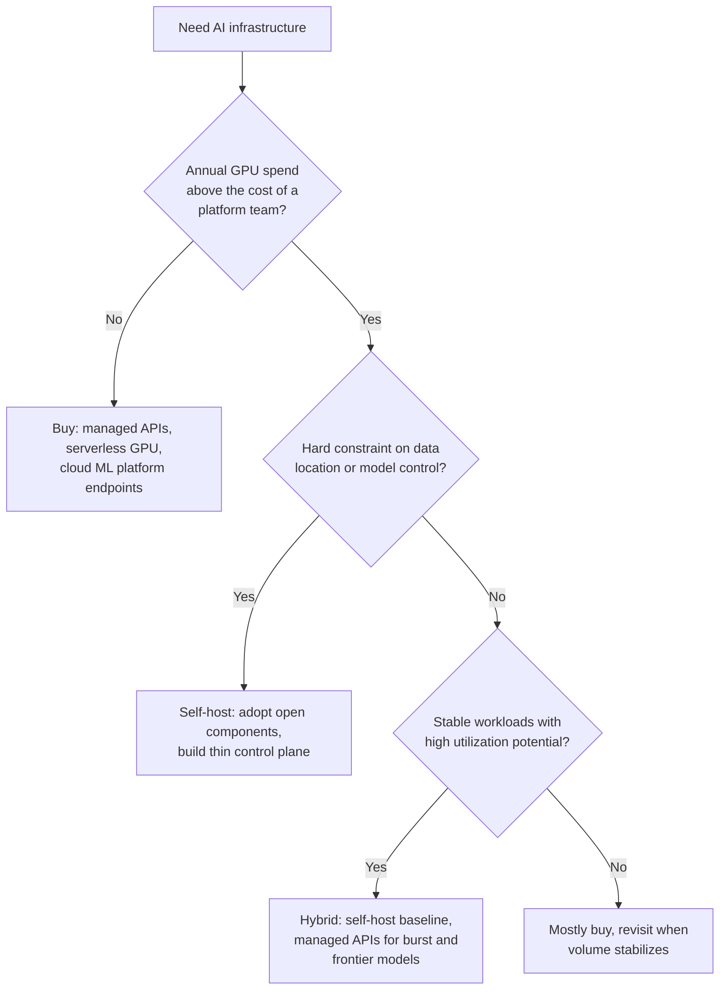

The tree starts with scale economics. Below the point where annual GPU spend justifies several platform engineers, a managed option wins even at a higher unit price, because the staffing cost is the larger number. Above it, hard constraints decide whether self-hosting is mandatory. For the rest, stable volume that can be kept at high utilization is the criterion for a hybrid design.

### 18.3 Team topology

Using the vocabulary of Team Topologies (Skelton and Pais, 2019), a workable arrangement is:

- **Platform team** (a platform team in the Team Topologies sense) owns GPU clusters, the serving and training platforms, base images, the version matrix, cost reporting, and on-call for infrastructure. It treats application teams as customers and measures adoption, time to first deployment, and platform availability.
- **Stream-aligned application teams** own models, prompts, evaluation, and the product behavior. They consume the platform through templates and APIs.
- **Enabling team or guild** (a small group of ML infrastructure experts) helps application teams with performance tuning, quantization, and migration, and feeds lessons back to the platform. In a small organization this is the platform team's role.
- **Security and governance partners** define policy for artifacts, data, and tenants, and the platform enforces it as code.
- **FinOps partner** owns cost allocation and commitments planning.

A rough staffing guide, illustrative: a platform that runs a handful of models on managed Kubernetes with an adopted serving stack can be run by 2 to 3 engineers if on-call is shared with a broader SRE rotation. A multi-tenant platform with its own GPU clusters, training queues, and a 24x7 service level generally needs 5 to 10 engineers across infrastructure, SRE, and security. These counts depend on scope and on how much is managed. The point for budgeting is that the people cost often exceeds GPU savings at small scale, which supports the break-even logic of section 17.

### 18.4 Platform maturity stages

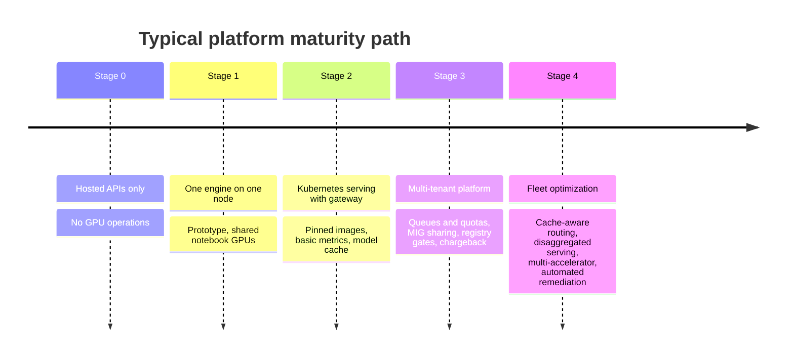

Each stage should be justified by a demonstrated need, and moving to the next stage before the previous one is stable is a common cause of platform failure. A team at Stage 1 that adopts disaggregated serving has added complexity without the traffic that rewards it.

## 19. Operational Prerequisites by Component

Before adopting a component, confirm that the prerequisites exist. A component whose prerequisites are missing becomes a source of incidents.

| Component | Prerequisites to have in place | Who operates it | First verification |
| --- | --- | --- | --- |
| GPU node pool | Driver and toolkit version matrix, node image pipeline, monitoring, quota in the cloud account, capacity plan | Platform team | Smoke test kernel and NCCL test per node |
| NVIDIA GPU Operator and device plugin or DRA driver | Kubernetes version that supports your chosen API, node labels and taints, upgrade plan | Platform team | Test pod requests a GPU and lists it |
| MIG or MPS configuration | Defined approved profiles, procedure to reconfigure with drain, isolation requirement stated | Platform team | Workload on each profile meets its latency target |
| Kueue or Volcano | Queue and quota policy agreed with teams, priority classes, preemption rules, checkpoint standard | Platform team with team leads | Submit competing jobs and observe admission and preemption |
| vLLM, SGLang, or TensorRT-LLM engine | Pinned version, image build pipeline, load test with representative traffic, tested quantization, rollback image | Platform team and model owners | Throughput and latency at target concurrency |
| Triton (Dynamo-Triton) | Model repository layout, configuration per model, backend versions, batching settings measured | Platform team | Per-model latency and queue time under load |
| KServe | Kubernetes admin skills, ingress and gateway, decision on Knative or raw mode, certificate management, model storage access | Platform team | Deploy an `InferenceService` end to end, including rollback |
| llm-d or cache-aware routing | Gateway API support, metrics scraping from engines, evidence of prefix reuse in traffic | Platform team | Measured prefix-cache hit rate improvement versus plain balancing |
| Ray and KubeRay | Authenticated dashboard behind a gateway, network policy, resource quotas per job, version pinning of Ray and Python | Platform team | Run a job that scales workers up and down |
| MLflow | Production-grade database and bucket, backup, authentication, retention policy | Platform team | Restore from backup test |
| Kubeflow components | Identity integration, multi-tenancy design, upgrade plan, ownership of each component | Platform team | Run a pipeline as a non-admin user |
| Argo, Flyte, Airflow | Executor sizing, secrets handling, retry and idempotency conventions | Platform team and data teams | Kill a worker mid-run and confirm retry and resume |
| Model registry and artifact store | Naming convention, immutability, signing keys in a managed key service, retention | Platform team with security | Tamper test: modify a file and confirm start is refused |
| DCGM and metrics stack | Prometheus-compatible storage, dashboards, alert rules, XID log ingestion | Platform team and SRE | Inject a fault or load and confirm an alert |
| Parallel file system or checkpoint store | Capacity plan, throughput measured at the full job rank count, lifecycle policy for old checkpoints | Platform team | Checkpoint write and restore at full scale |
| Gateway | Authentication, quotas, logging policy, fallback routes | Platform team | Failover test to alternate backend |
| Cost reporting | Labels on every workload, price tables, ownership of unlabeled spend | FinOps and platform | Monthly reconciliation against the cloud bill |

A useful discipline is to write this table for your own environment, assign a named operator to each row, and refuse to promote a component to production until its row is filled in.

## 20. Failure Modes

Failures in GPU systems differ from failures in stateless web services in three ways. Faults are often partial (a device throttles instead of dying). They are correlated (one bad link stalls an entire distributed job). And recovery is slow (a restart costs a cold start or a checkpoint reload). This section covers the failure modes a platform must anticipate, each with cause, detection, mitigation, and the lesson for design.

### 20.1 Out-of-memory (OOM)

There are two distinct OOMs, and confusing them wastes hours.

**Device OOM** ("CUDA out of memory"). Causes: the engine's memory fraction is set so high that a transient spike (a long prefill, a large multimodal input, a CUDA graph capture, a collective buffer) cannot be satisfied; a long-context request exceeds the budget assumed at capacity planning; another process shares the device (time-slicing, a leftover process, a profiler); allocator fragmentation after days of uptime; or a larger `max_model_len` or batch token limit than the KV pool supports. Detection: engine logs, restart counts, `DCGM_FI_DEV_FB_USED` at the ceiling before the failure. Mitigation: reserve headroom (a memory utilization fraction of 0.85 to 0.92 is a common starting range, validated by load test), cap context length and batched tokens, reject oversized requests at the gateway with a clear error rather than allowing them to crash the replica, avoid sharing the device without MIG, and test the worst-case request shape (longest prompt, many parallel sequences) as a release gate.

**Host OOM** (the container is killed by the kernel with exit code 137 and `OOMKilled` in pod status). Causes: loading a large checkpoint into host memory before copying to the GPU, with a pod memory limit smaller than weights plus page cache plus pinned buffers; multiple tensor-parallel ranks each loading full copies before sharding; a CPU-side cache or tokenizer pool growing. Detection: pod status and node events, not GPU metrics. Mitigation: size the pod memory limit from the load path (for a 140 GB checkpoint loaded by one process, plan for well above 140 GB unless the loader streams shards), use loaders that stream tensors to the device, and keep the limit consistent with the node's physical memory.

Design lesson: when a replica OOMs under a rare request shape, the load balancer retries the same request on the next replica, which also dies. This is a **poison request** failure, and it takes down the fleet in sequence. Defend with request validation, per-request limits, and a retry policy that does not retry a request that crashed an engine.

### 20.2 Driver and runtime mismatch

Causes: a node image upgrade changed the driver, and the container's CUDA runtime or compiled kernels no longer match; a new GPU type joined the pool, and the engine image was not built for its architecture; the container toolkit and driver are inconsistent after a partial upgrade; NCCL versions differ between nodes of one job. Symptoms: pods in `CrashLoopBackOff` with CUDA initialization errors, "no kernel image is available for execution on the device", silent fallback to slow kernels (throughput drops by large factors without errors), or collectives that fail to initialize. Detection: node admission smoke tests, an inventory of driver and runtime versions per node as metrics, and canary traffic after every upgrade. Mitigation: pin the compatibility tuple (section 5.4), upgrade node pools gradually with automatic rollback, and keep the previous node image available. Design lesson: the failure appears minutes to hours after the change, in a different team's workload. Treat driver rollouts as changes to every AI workload and announce them as such.

### 20.3 Straggler

In synchronous distributed training every step ends with collectives, so the step time equals the slowest rank. One GPU running at reduced clocks (thermal, power, or a faulty fan), one node with a degraded network link, or one data loader rank blocked on slow storage slows the entire job to its pace. A 1,024-GPU job with one rank 20 percent slow runs 20 percent slower, which wastes about 200 GPUs' worth of compute.

Detection requires per-rank step-time telemetry, because the job-level throughput number hides the cause. Compare per-GPU clocks, temperatures, and NVLink or network error counters across ranks. Mitigation: proactively exclude nodes that fail burn-in or show repeated throttling, run a short per-node NCCL bandwidth test before assigning nodes to a job, and replace stragglers from a spare pool at the next checkpoint boundary. Large training operators keep a few percent of spare nodes for this reason. Design lesson: spare capacity is an availability feature for training, not waste.

### 20.4 Hung collective

A collective operation requires all ranks to participate. If one rank crashed, deadlocked in user code, or entered a different collective than its peers (a code path divergence), the others wait forever, with the GPU kernels spinning. The signature is the confusing one: GPU utilization reads 100 percent, power is high, and no progress is made.

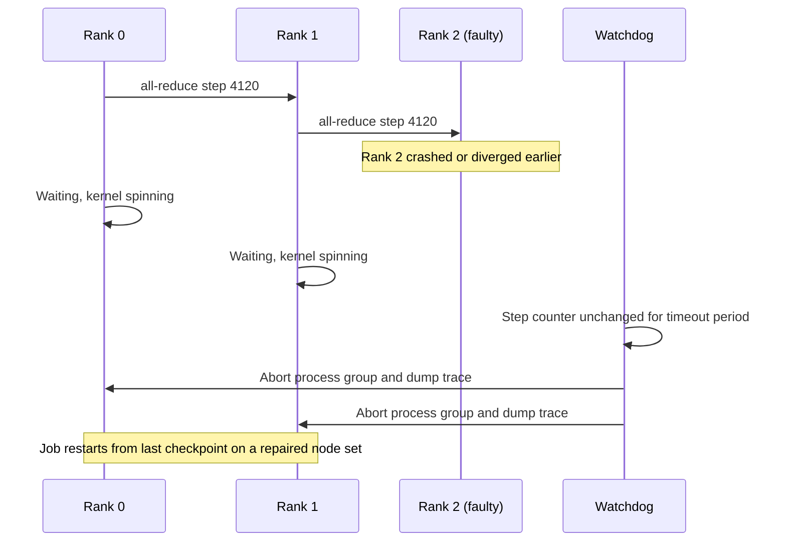

The sequence shows why the watchdog is mandatory. Without a timeout, the job hangs until a human notices, burning the entire allocation. PyTorch's NCCL backend has a watchdog and a configurable timeout, and a flight recorder that captures the recent collective history on each rank, which allows diagnosis of which rank diverged. Set the timeout above the longest legitimate pause (a checkpoint write, an evaluation phase) and below the cost you can accept for a hang. Add an external heartbeat: a job-level monitor that alerts if the step counter or tokens-processed metric stalls, so that the detection does not depend on the same process that is hung. After an abort, the recovery path is the checkpoint restore of section 13.4, which is why checkpoint validity is the foundation of hang recovery.

For inference, tensor-parallel replicas have the same exposure: one dead worker stalls the replica. The engine's health endpoint must reflect worker health, and the readiness probe must fail so the replica leaves the pool and is restarted. A health check that only tests whether the HTTP server answers will keep a hung replica in rotation.

### 20.5 Thermal and power throttling

GPUs reduce clocks when temperature or power limits are reached. Causes: failed fans or liquid cooling issues, blocked airflow, high ambient temperature, power cap policy set by the facility or cloud, or a poorly seated heat sink. Symptoms: throughput decline at constant load, rising time per output token, wide variance across GPUs, a training straggler. Detection: `DCGM_FI_DEV_GPU_TEMP`, SM clocks relative to rated, and throttle reason bitmasks. Mitigation: alert on sustained throttle reasons, cordon and drain throttled nodes, and report to the provider for replacement. In a multi-tenant cloud you cannot fix cooling, but you can detect and replace the instance. Design lesson: benchmark per instance when you start it, because two instances of the same type can differ by double-digit percentages, and a slow node should be removed from the pool before it becomes someone's latency incident.

### 20.6 Other failure modes worth designing for

| Failure | Mechanism | Mitigation |
| --- | --- | --- |
| ECC double-bit errors, XID 79 | Hardware fault, GPU unusable or falling off the bus | Alert from XID log, cordon and drain automatically, replace the instance |
| Thundering herd on model load | Many replicas start together and share a bandwidth limit | Stagger starts, node-local cache, rate-limit rollouts, read from a replicated store |
| Registry or hub rate limiting | Public hubs throttle many parallel pulls | Mirror internally, authenticate, cache on nodes |
| Image pull failure | Registry unavailable or throttled during scale-up | Pre-pull, regional registry cache, multiple registries |
| KV-cache thrash | Cache nearly full, sequences preempted and recomputed repeatedly | Lower concurrency limit, scale out earlier, cap context, add cache memory |
| Noisy neighbor on shared GPU | Time-slicing or MPS contention | Move to MIG or dedicated devices, set resource quotas |
| Spot interruption | Capacity reclaimed with short notice | Checkpoint, drain on notice, mixed fleet with a reserved base |
| Scheduler fragmentation | Free GPUs in unusable shapes | Bin-pack small jobs, reserve whole-node pools, defragmentation (section 10.7) |
| Silent data corruption | Hardware errors produce wrong numbers without crashes | Loss spike detection, periodic checksum or redundant computation checks, restart from earlier checkpoint |
| Version skew between replicas | Rolling update leaves mixed engine or model versions | Gateway pins session to a version, readiness gates on version, compatibility tests |
| Quota exhaustion in the cloud | GPU quota or capacity not available at scale-up | Quota requests ahead of events, multi-region capacity, fallback to hosted APIs |

### 20.7 A node health state machine

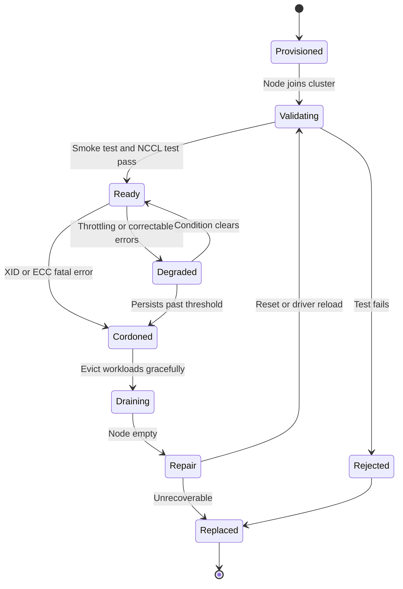

The state machine is the automation target. Each transition has a detection source (DCGM metric, XID log, test result) and an action (taint, evict, reset, replace). Platforms that implement it reduce mean time to repair from "when someone notices" to minutes, and they prevent bad nodes from silently degrading jobs. Managed Kubernetes services and node health tooling from GPU vendors provide parts of it. Verify what your environment supplies before building it.

### 20.8 Quality-attribute scenarios

Quality-attribute scenarios (stimulus, response, measure) make requirements testable. These are examples to adapt.

| Attribute | Stimulus | Expected response | Measure |
| --- | --- | --- | --- |
| Availability | One GPU node fails during peak | Router removes its replicas, autoscaler adds replicas elsewhere | Error rate under 1 percent for under 2 minutes, full capacity within the cold-start time |
| Performance | Traffic ramps from 30 to 100 percent of peak in 5 minutes | Replicas scale ahead of queueing | P95 time to first token stays under 1.5 s |
| Scalability | Add a tenant with a new 8B model | Deploy through template without platform code changes | Time to first request under 1 working day |
| Security | A modified weight file is placed in the model bucket | Pods refuse to start the modified artifact | 100 percent of tampered artifacts rejected, alert raised within 1 minute |
| Recoverability | A training rank hangs | Watchdog aborts and job restarts from checkpoint | Lost work under one checkpoint interval, detection under 15 minutes |
| Cost | Utilization of the serving fleet falls below target for a week | Alert, right-size recommendation, scheduled scale-down | Average utilization restored to target within one sprint |
| Isolation | A tenant sends a pathological long-context request | Only that tenant's request fails with a clear error | No impact on other tenants' latency beyond 5 percent |
| Operability | Driver upgrade is rolled out | Canary pool validates before general rollout | Zero production incidents attributable to the upgrade |

## 21. Comparison and Trade-Off Summary

### 21.1 Engines

| Engine | Strengths | Weaknesses | Hardware | Best for |
| --- | --- | --- | --- | --- |
| vLLM | Breadth of models and hardware, community, features | Many options to tune, version churn | NVIDIA, AMD, TPU, CPU and others | Default multi-tenant serving |
| SGLang | Prefix reuse, structured outputs, strong MoE support | Smaller ecosystem than vLLM | NVIDIA, AMD, others | Agent loops, shared prefixes |
| TensorRT-LLM | Peak NVIDIA performance, new-hardware features first | Vendor lock-in, build complexity, narrower model set at times | NVIDIA | Stable high-volume NVIDIA deployments |
| llama.cpp | Portability, low-bit quantization, runs anywhere | Lower throughput for many users | CPU, Apple, consumer GPU, some data-center GPUs | Edge, desktop, single user |
| Ollama | Developer experience | Not designed for multi-tenant production | Same as llama.cpp | Local development and demos |
| TGI | Historic production use | Maintenance mode since December 2025 | NVIDIA, AMD, others | Migrate away for new work |
| ONNX Runtime | Portability, encoders, vision | Not the best path for large LLMs | Many | Embeddings, rerankers, on-device |

### 21.2 Serving layers

| Option | Level | Strengths | Weaknesses | Choose when |
| --- | --- | --- | --- | --- |
| Engine's built-in server | Single process | Simplest | No fleet features | Prototype, small deployments |
| Dynamo-Triton | Model server | Multi-framework, dynamic batching, ensembles | LLM features rely on backends | Mixed model portfolio on NVIDIA |
| KServe | Kubernetes platform | Declarative API, canary, autoscaling, many runtimes | Needs Kubernetes expertise | Many models on Kubernetes |
| llm-d with an inference gateway | Kubernetes LLM routing | Cache-aware routing, disaggregation | Younger, more components | Large LLM fleets with prefix reuse |
| Ray Serve | Python serving graph | Pipelines and composition, Python-native | Another control plane | Multi-stage Python pipelines |
| Cloud managed endpoints | Managed service | Least operations | Provider lock-in, less control | Small teams, standard needs |

### 21.3 GPU sharing mechanisms

| Mechanism | Isolation | Efficiency | Complexity | Use when |
| --- | --- | --- | --- | --- |
| Whole GPU | Full | Low for small models | Lowest | Large models, strict SLOs |
| MIG | Hardware | Good for fixed small models | Medium, fixed profiles | Multi-tenant small and medium inference |
| MPS | Weak | High for cooperating processes | Medium | One tenant, many small processes |
| Time-slicing | None | Moderate | Low | Dev and notebooks |

### 21.4 Pipeline and lifecycle tools

| Need | First choice | Alternative |
| --- | --- | --- |
| Tracking and registry | MLflow | Cloud platform registry, Weights & Biases plus a registry |
| Generic Kubernetes workflows | Argo Workflows | Flyte, Kubeflow Pipelines |
| Typed, cached ML workflows | Flyte | Kubeflow Pipelines |
| Data scientist ergonomics | Metaflow | Flyte local execution |
| Scheduled data and batch scoring | Airflow | Dagster, Prefect |
| Distributed training launch | Kubeflow Trainer or Ray Train | Slurm, cloud training jobs |
| Batch inference over corpora | Ray Data or Spark | Kubernetes Job queue |

## 22. Case Study: Building an Internal Inference Platform

The company and numbers below are fictional but constructed to be realistic. All performance figures are illustrative pilot results, and prices are the illustrative prices used earlier in the chapter.

### 22.1 Context and requirements

Northwind Insurance has 12 product teams. Three needs arrive at once:

- **Assistant (model A).** An 8B-parameter instruction model for claims and policy chat. Average 600 input and 250 output tokens, peak 40 requests per second, average 12.
- **Analysis (model B).** A 70B-class model for complex document reasoning, quantized to FP8. Average 1,500 input and 400 output tokens, peak 6 requests per second, average 2.
- **Retrieval (model C).** An embedding model and a reranker for retrieval-augmented generation, small models, peak 200 requests per second.

Constraints: customer data may not leave the company's cloud account (a contractual and regulatory requirement), teams need isolation from each other, and the first service must go live in 10 weeks. The platform team has four engineers.

### 22.2 Sizing

The team load-tested candidate engines on a single H100 80 GB and measured saturation throughput at their latency targets (time per output token of 40 ms for A and 50 ms for B). Illustrative results:

- Model A on one GPU (BF16): 3,800 output tokens per second at saturation.
- Model B at FP8 on two GPUs with tensor parallelism over NVLink: 1,100 output tokens per second per replica.
- Embedding model: about 60 requests per second per `1g.10gb` MIG slice.

Peak demand and replica counts, with a target utilization of 60 percent of saturation to preserve latency headroom:

- **A.** Peak output demand: $40 \times 250 = 10{,}000$ tokens per second. Replicas needed: $10000 / (3800 \times 0.6) = 4.4$, so 5, plus one for failure tolerance: 6 GPUs.
- **B.** Peak output demand: $6 \times 400 = 2{,}400$ tokens per second. Replicas: $2400 / (1100 \times 0.6) = 3.6$, so 4, plus one: 5 replicas, 10 GPUs. Check the memory: with 144 GB usable across two GPUs (after the 10 percent reserve), 70 GB of weights leave 74 GB for KV cache, which at 320 KiB per token holds about 226,000 tokens. At 1,900 tokens per sequence, that is about 119 concurrent sequences per replica. Little's law gives the expected concurrency: 6 requests per second times about 21 seconds per request (400 output tokens at 50 ms plus prefill) is about 126 sequences at peak across the fleet, or about 25 to 31 per replica with 4 to 5 replicas. Memory is therefore not the binding constraint, and memory bandwidth is.
- **C.** Peak 200 requests per second at 60 per slice: 4 slices, plus 2 for the reranker and 1 spare, all on one GPU partitioned into seven `1g.10gb` instances: 1 GPU.

The total at peak is $6 + 10 + 1 = 17$ GPUs, plus one development GPU, so 18, which is three 8-GPU nodes less six GPUs.

### 22.3 Decisions and rejected alternatives

| Decision | Rejected alternative | Reason |
| --- | --- | --- |
| vLLM as the engine for A and B | Ollama | Pilot showed single-digit concurrency scaling and no tenant controls. Section 8.6 reasons |
| vLLM | TGI | In maintenance mode. A new platform should not start on a frozen engine |
| vLLM | TensorRT-LLM | Pilot gain of 12 percent was real, but the engine build matrix and slower support for new model releases did not fit a four-person team. Revisit when model B is stable for a year |
| ONNX Runtime on a MIG slice for model C | vLLM for embeddings | Encoder models benefit from ONNX Runtime batching and use less memory |
| Raw Deployment mode KServe with an internal gateway | Knative serverless mode | Scale to zero is unacceptable with a cold start of about 3 minutes on an uncached node for B |
| KServe | Ray Serve as the platform | Teams ship single-model endpoints, not Python graphs, and a second control plane doubled operations |
| KServe | Custom controller | Declarative API and canary already exist |
| MLflow for tracking and registry plus Argo Workflows | Full Kubeflow | The team needed a registry and simple pipelines, not notebooks or Katib. Fewer components to patch |
| MIG for model C and development | Time-slicing | Needed isolation between teams' experiments and production |
| Kueue for training and evaluation jobs | Volcano | Staying close to upstream, jobs are plain Kubernetes Jobs and JobSets |
| Gateway session affinity with vLLM prefix caching | llm-d at launch | Fleet of 6 replicas, prefix hit rate in replayed traffic was 78 percent with affinity versus 24 percent with round-robin. Affinity captured most of the gain, so the additional components were deferred. Revisit above ten replicas per model |
| Signed, mirrored model artifacts in an internal bucket | Pulling from a public hub at start | Residency requirement and supply-chain control. Section 7 |
| 12 reserved GPUs plus 6 on-demand burst | All on demand | Computed below |

The prefix-affinity figure in the table is the type of evidence the team collected before rejecting an architectural component. Keep this practice: each rejected option should have a measured reason.

### 22.4 Architecture

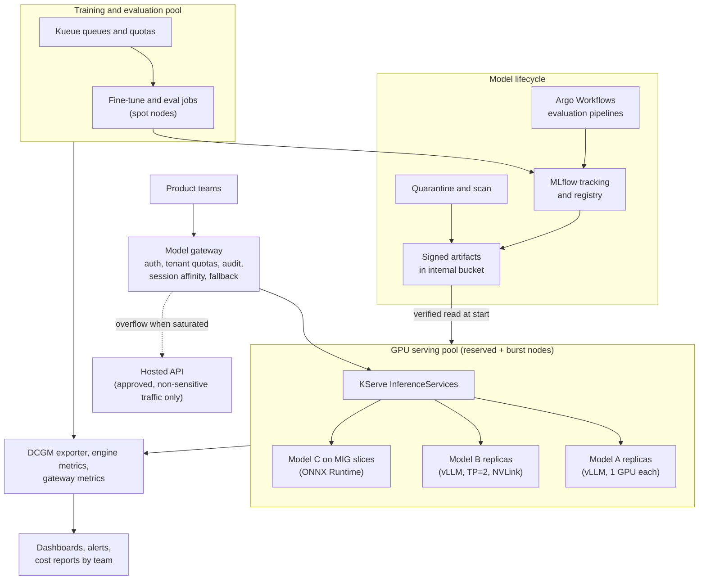

The architecture follows the layering of section 2. The gateway handles tenant concerns. KServe handles revisions and scaling. vLLM and ONNX Runtime execute models. MIG gives hardware isolation to the small models. Artifacts flow one way: from quarantine through signing into the bucket, and from the bucket into serving with verification. Training uses a separate spot pool through Kueue and has no path to promote a model. The hosted API is a bounded overflow path for non-sensitive traffic, which respects the residency constraint.

### 22.5 Cost

Peak requirement: 18 GPUs. Reserved base: 12 GPUs (A: 4, B: 6, C and development: 2) at the illustrative one-year price of $1.95. Burst: 6 GPUs (A: 2, B: 4) on demand at $3.00 for 176 peak hours per month.

- Reserved: $12 \times 730 \times 1.95 = \$17{,}082$.
- Burst: $6 \times 176 \times 3.00 = \$3{,}168$.
- GPU subtotal: $20{,}250. Add $6,000 per month attributed to platform operations and about $750 for storage and network: roughly $27,000 per month.

Comparison with a hosted API, using the same traffic. Monthly tokens: A averages $12 \times 850 = 10{,}200$ tokens per second, which over 2,628,000 seconds is about 26,800 million tokens; at the blended $0.48 per million this is about $12,900. B averages $2 \times 1{,}900 = 3{,}800$ tokens per second, or about 9,990 million tokens per month; at an illustrative $1.00 per million for a comparable large model this is about $10,000. The API equivalent is therefore roughly $22,900 per month, so self-hosting costs about 18 percent more. The cost case does not justify the platform. Residency does. The team documented that honestly and set three actions to close the gap: raise average utilization with offline batch work scheduled into the valleys, move embedding workloads from an external API onto model C (an avoided external charge outside this comparison), and revisit commitments after six months of measured demand. The review committee approved because the decision record stated what was being bought: control and compliance, at a measured premium.

### 22.6 Validation evidence

The platform went through five tests before launch. Figures are illustrative.

1. **Load test with replayed traffic.** At 100 percent of projected peak, model A reached P95 time to first token of 0.9 s and P95 time per output token of 36 ms. Model B reached 1.4 s and 47 ms. Error rate was 0.0 percent.
2. **Failure drill.** A GPU node was cordoned and drained at peak. The gateway removed replicas within 10 seconds, and the error rate rose to 0.7 percent for 38 seconds. Replacement replicas of model A on the burst node took 52 seconds to become ready (NVMe cache hit), close to the 48-second calculation of section 11.2.
3. **Tamper test.** A weight shard in the bucket was modified. The pod failed verification and did not start, and an alert fired in 40 seconds.
4. **Isolation test.** A tenant sent 32,000-token prompts in a loop. The request limit at the gateway rejected them with an error, and other tenants' P95 latency changed by 2 percent.
5. **Upgrade drill.** A driver update on the canary node pool passed the smoke and NCCL tests. A second run with a deliberately mismatched image was rejected at admission.

Evidence of this kind is what turns an architecture diagram into an approvable design. The remaining risks recorded in the decision log were GPU price changes, a new model family requiring engine changes, and dependence on one platform on-call rotation.

## 23. Common Mistakes

| Mistake | Cause | Consequence | Fix |
| --- | --- | --- | --- |
| Treating engine, server, and platform as interchangeable | Marketing names blur layers | Duplicate components, missing gateway or scheduler | Classify by layer before selecting (section 2) |
| Using Ollama for a shared production service | Easy start, familiar API | Collapse under concurrency, exposed unauthenticated endpoint | Keep client code, swap backend to vLLM or SGLang behind a gateway |
| Sizing by weights only | Ignoring KV cache and overhead | Model fits but cannot serve realistic concurrency | Budget weights, KV cache, activations, and overhead (section 3.4) |
| Sharding across PCIe-only GPUs for low latency | Assuming more GPUs means faster | Communication dominates, slower than fewer GPUs | Use NVLink, a larger-memory GPU, or pipeline parallelism (section 4.3) |
| Using `GPU_UTIL` as the efficiency metric | It is the default dashboard panel | Underuse hidden behind 100 percent readings | Use SM, tensor, and DRAM activity and workload-level throughput |
| Scaling from zero for large models | Copying a web service autoscaling pattern | Minutes-long first requests | Keep warm replicas, size headroom from cold start (section 11.4) |
| Loading `main` from a public hub in production | Convenience | Unreviewed changes, outages, supply-chain exposure | Pin commit hashes, mirror and sign artifacts |
| Loading pickle files from untrusted sources | Legacy checkpoints | Remote code execution on load | Convert in a sandbox to safetensors |
| Time-slicing for multi-tenant production | It was easy to enable | No isolation, one tenant's OOM kills others | MIG or dedicated devices |
| No gang scheduling | Default scheduler places pods one by one | Partial allocations and deadlock | Kueue or Volcano with all-or-nothing admission |
| Rare or never-validated checkpoints | Assuming they work | Failure costs hours of lost work or corrupt restart | Interval from failure data, restore tests, keep multiple versions |
| Public management endpoints | Defaults and convenience | Cluster takeover (Ray dashboards, notebook servers) | Authenticate, restrict networks, scan for exposure |
| Upgrading drivers cluster-wide at once | Operational convenience | Fleet-wide incident from one mismatch | Canary node pools and compatibility tuples |
| Buying commitments before measuring demand | Pressure to lock in a discount | Paying for idle GPUs | Commit to measured baseline only |
| Comparing API price to GPU list price | Ignoring utilization and staff | Wrong break-even by large factors | Use cost per useful million tokens (section 17) |
| Building a custom engine or scheduler | Underestimating upstream pace | Unmaintainable fork | Adopt upstream, build thin policy layers |

## 24. Design Review Checklist

Use this list in architecture reviews of AI platform designs. Each question should have a documented answer.

**Layering and roles**

- Is each product assigned to a layer, and is there a named owner for every layer?
- Which component enforces tenant identity, quotas, and audit? Is it separate from the engine?
- Is the client-facing interface provider-neutral so engines and models can change?

**Capacity and hardware**

- Are weights, KV cache, activations, and overhead computed for the worst-case request shape?
- Is the binding constraint (fit, KV capacity, bandwidth, compute, interconnect) identified per workload?
- Does any multi-GPU replica cross a slow link? Is NVLink or equivalent present where tensor parallelism is used?
- Has the hardware vendor and engine support matrix been tested for each model, including quantization?

**Scheduling and sharing**

- Which GPU sharing mechanism is used, and does its isolation match the trust level of the tenants?
- Is gang scheduling or all-or-nothing admission in place for distributed jobs?
- Are quotas, priorities, and preemption rules written down and tested?
- Is fragmentation monitored, and is there a whole-node pool for large jobs?

**Loading and scaling**

- What is the measured cold-start time, and does the headroom policy cover it?
- Where are weights cached, and what happens when many replicas start together?
- Is there a fallback path during scale-up or capacity loss?

**Artifacts and security**

- Are model artifacts in a safe format, scanned, signed, mirrored, and pinned by digest?
- Can the serving identity only read approved artifacts? Can training jobs promote models?
- Are management endpoints authenticated and unreachable from the public internet?
- Is the container toolkit and GPU operator patched on a schedule?
- Is prefix-cache sharing across tenants explicitly decided?

**Operations**

- Do dashboards separate GPU health, engine behavior, and request SLIs? Are XID errors ingested and actionable?
- Is there a node health automation path (cordon, drain, replace)?
- Is the driver and runtime compatibility tuple recorded per deployment, with canary rollouts?
- Are checkpoint interval, restore tests, and hang detection defined for training?

**Cost**

- Is the purchase mix (reserved, on-demand, spot) matched to demand shape?
- Is utilization defined on useful metrics with targets per workload class?
- Is there showback or chargeback with enforced labels?
- Has the self-hosting versus managed break-even been computed with measured inputs and revisited on a schedule?

**Team**

- Is the platform team sized for the scope and on-call burden?
- Is each component's prerequisites row (section 19) filled in with a named operator?

## 25. Exercises

1. **Classification.** For each of the following, name the layer(s) it occupies and one thing it does not do: vLLM, KServe, Kueue, MLflow, safetensors, NCCL, Argo Workflows, Ray Serve.
2. **Memory budget.** A 13B-parameter model has 40 layers, 8 key-value heads, head dimension 128, and is served in BF16 on a 48 GB L40S with a 10 percent reserve. How many 4,096-token sequences fit in the KV cache?
3. **Bandwidth bound.** Using the single-stream bound $BW/\text{weights}$, what is the maximum decode speed for a 70B model in FP8 on an H200 with 4.8 TB/s? How does it compare with H100?
4. **Interconnect.** Four GPUs run tensor-parallel decode with a 2 MB all-reduce per operation. NVLink offers 300 GB/s effective and 10 microseconds latency. PCIe offers 50 GB/s and 20 microseconds. Compute the time per all-reduce on each and the ratio.
5. **Cold start.** A 40 GB model is stored on a network file system with 2 GB/s total bandwidth. Four replicas start at the same moment on different nodes. How long does the read take per replica? How long if each node has the model on local NVMe at 6 GB/s?
6. **Reservation.** A one-year reservation gives a 40 percent discount. Above what usage fraction does reserving beat on-demand? Which of the following should be reserved: a 24-hour serving base, a nightly batch job running 6 hours per day?
7. **Gang scheduling.** Cluster has 6 free GPUs. Jobs A and B each need 4 GPUs as 4 single-GPU pods. Describe what happens under the default scheduler and under Kueue.
8. **Checkpoint interval.** A job has a checkpoint stall of 30 seconds and a mean time between failures of 6 hours. Compute the interval from $T = \sqrt{2CM}$ and the overhead fraction.
9. **Security design.** Draw the identities needed for a training job, a release service, and a serving pod, and state which can read and write which store.
10. **Decision.** A team serves 3 billion tokens per month with a model that fits one GPU, has no GPU operations staff, and has no residency constraint. Use the break-even logic of section 17 to recommend an option, and list what would change your answer.

### Answers and outlines

1. vLLM: layer 4 (engine, with an HTTP server); does not manage fleets or tenants. KServe: layers 5 and 6 on Kubernetes; does not make a replica faster. Kueue: layer 6; does not run the job. MLflow: layers 7 and 8; not a high-throughput server or scheduler. safetensors: layer 3; contains no execution. NCCL: layer 2 collective library; does not schedule. Argo Workflows: layer 9; does not serve models. Ray Serve: layers 5 and 6 at application level; not a registry or governance system.
2. KV bytes per token: $2 \times 40 \times 8 \times 128 \times 2 = 163{,}840$ (160 KiB). Per 4,096-token sequence: 671,088,640 bytes (640 MiB). Usable memory $48 \times 0.9 = 43.2$ GB. Weights: $13 \times 2 = 26$ GB. Free: 17.2 GB. Sequences: $17.2 \times 10^9 / 671{,}088{,}640 = 25.6$, so 25.
3. H200: $4.8 \times 10^{12} / 70 \times 10^9 = 68.6$ tokens per second. H100: $3.35 \times 10^{12} / 70 \times 10^9 = 47.9$. Ratio 1.43, equal to the bandwidth ratio. Real engines achieve less, and batching raises aggregate throughput, not single-stream speed.
4. Data term: $2 \times (3/4) \times 2 \text{ MB} = 3 \text{ MB}$ moved per GPU. NVLink: $3\ \text{MB} / 300\ \text{GB/s} = 10\ \mu s$ plus 10 µs latency = 20 µs. PCIe: $3 \text{ MB} / 50 \text{ GB/s} = 60\ \mu s$ plus 20 µs = 80 µs. Ratio 4.
5. Four replicas share 2 GB/s, so each gets 0.5 GB/s: $40/0.5 = 80$ s. With local NVMe: $40/6 = 6.7$ s each. Moral: shared storage bandwidth scales with the number of simultaneous starts.
6. Reserve if usage exceeds 60 percent ($1-0.40$). The 24-hour base is at 100 percent, so reserve it. The nightly job uses 25 percent, so use on-demand or spot, not a reservation.
7. Default scheduler: places 3 pods of each job (or some split), each job holds GPUs waiting for a fourth, deadlock with 6 GPUs idle. Kueue: admits job A (4 GPUs), keeps job B suspended until 4 GPUs are free, so A runs and B waits, no deadlock.
8. $T = \sqrt{2 \times 30 \times 21600} = \sqrt{1{,}296{,}000} \approx 1{,}138$ s (about 19 minutes). Overhead $\approx 30/1138 + 1138/43200 = 2.6\% + 2.6\% = 5.3\%$.
9. Training job identity: read dataset prefixes, write checkpoints and candidate artifacts, no registry promote rights. Release service identity: read candidates, write signed artifacts and move aliases, holds the signing key through a managed key service. Serving identity: read signed approved artifacts only, no write access anywhere except telemetry. Network policy denies serving pods access to training data.
10. Billed at the illustrative blended $0.48 per million, 3,000 million tokens per month costs $1,440 per month through an API. A self-hosted floor of two GPUs plus operations is above $10,000 in the chapter's example. Recommend a hosted API or serverless endpoint. Changes that would flip the answer: a residency constraint, a volume rising by one to two orders of magnitude, a fine-tuned model the API cannot host, or latency requirements the API cannot meet.

## 26. Summary

AI infrastructure is a stack of ten layers with distinct jobs. Hardware sets the limits through memory capacity, bandwidth, compute, and interconnect. Drivers and runtimes bind software to devices and form a compatibility chain that must be pinned. Model formats decide what can be loaded and whether loading can run code. Engines turn weights into tokens efficiently, servers expose models, and platforms and schedulers turn them into shared services. Registries, tracking, and pipelines record and automate the path to deployment, and a thin control plane applies the organization's identity, quota, and cost policy.

The arithmetic that guides decisions is short. Weights are parameters times bytes. KV cache grows per token and sets concurrency. Decode is bandwidth-bound until the batch reaches the ridge point, which is why batching is nearly free and why idle GPUs are expensive. Tensor parallelism needs fast links. Cold start is the sum of image pull, weight read, copy, initialization, and warmup, and it sets how much headroom autoscaling needs. Training checkpoints are larger than the model and their interval follows from write cost and failure rate. Break-even between hosted APIs and self-hosting depends on utilization, GPU price, and staffing more than on list prices.

Operationally, the failures that matter are device and host memory exhaustion, driver mismatch, stragglers, hung collectives, throttling, and unauthenticated management endpoints. Each has a detection signal and an automated response worth building. Product names change; the maintenance status of TGI and the renaming of Triton to Dynamo-Triton are recent examples. Choose by role, verify current status, keep interfaces provider-neutral, adopt rather than build below the control plane, and write down what each component needs in order to be operated.

## 27. Code Examples

- [01_memory_and_roofline.py](../code/python/ai-infrastructure-chapter/01_memory_and_roofline.py) computes weight memory, KV-cache bytes per token, concurrency budgets, and the decode roofline on an H100, reproducing the figures in sections 3.4 to 3.6.
- [02_gpu_packing_and_utilization.py](../code/python/ai-infrastructure-chapter/02_gpu_packing_and_utilization.py) runs first-fit-decreasing packing, a MIG slice fit, and the gang-scheduling fragmentation example of section 10.
- [03_cold_start_calculator.py](../code/python/ai-infrastructure-chapter/03_cold_start_calculator.py) computes the cold-start breakdown for several storage and caching scenarios (section 11).
- [04_selfhost_vs_api_breakeven.py](../code/python/ai-infrastructure-chapter/04_selfhost_vs_api_breakeven.py) is the self-hosting versus hosted API calculator of section 17, with a sensitivity table. Replace the assumptions at the top of `main` with your own quotes and measurements.

## 28. Sources to Verify

Product facts in this chapter were checked in October 2026 and will drift. Re-verify these before relying on them: the [Hugging Face TGI documentation](https://huggingface.co/docs/text-generation-inference/) for maintenance status, the [NVIDIA description of the Dynamo-Triton rename](https://developer.nvidia.com/blog/deploying-nvidia-triton-at-scale-with-mig-and-kubernetes), the [Kubernetes v1.34 DRA release note](https://v1-35.docs.kubernetes.io/blog/2025/09/01/kubernetes-v1-34-dra-updates/), the [KServe v0.18 release](https://kserve.github.io/website/blog/kserve-0.18-release), [Google's Ironwood description](https://cloud.google.com/blog/products/compute/inside-the-ironwood-tpu-codesigned-ai-stack), and [AWS's Trainium3 announcement](https://aws.amazon.com/about-aws/whats-new/2025/12/amazon-ec2-trn3-ultraservers/). Hardware numbers come from vendor material and secondary summaries, and prices are illustrative. Papers referenced: Kwon et al. (2023) on PagedAttention; Zheng et al. (2023) on SGLang and RadixAttention; Williams, Waterman, and Patterson (2009) on the roofline model; Dubey et al. (2024) on Llama 3 training interruptions; Chowdhery et al. (2022) on PaLM and model FLOPs utilization; Young (1974) and Daly (2006) on checkpoint intervals.
