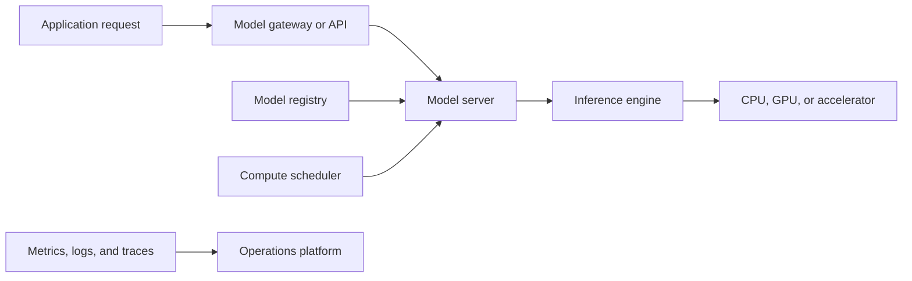
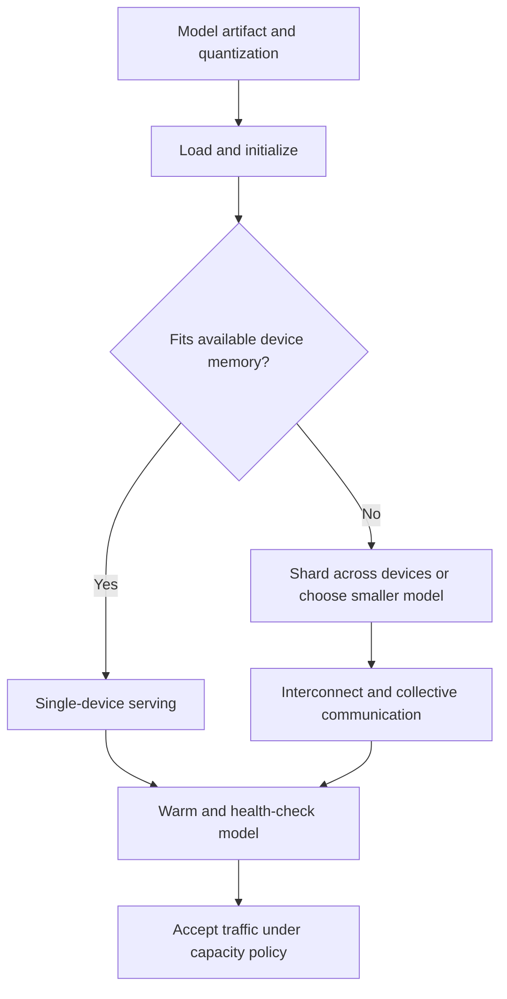
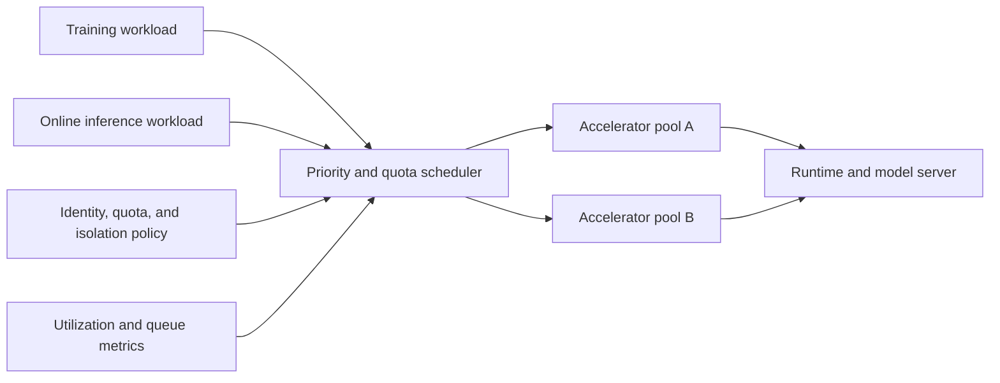
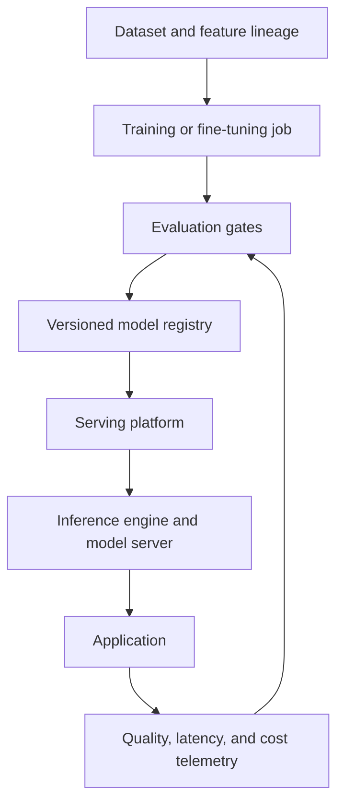
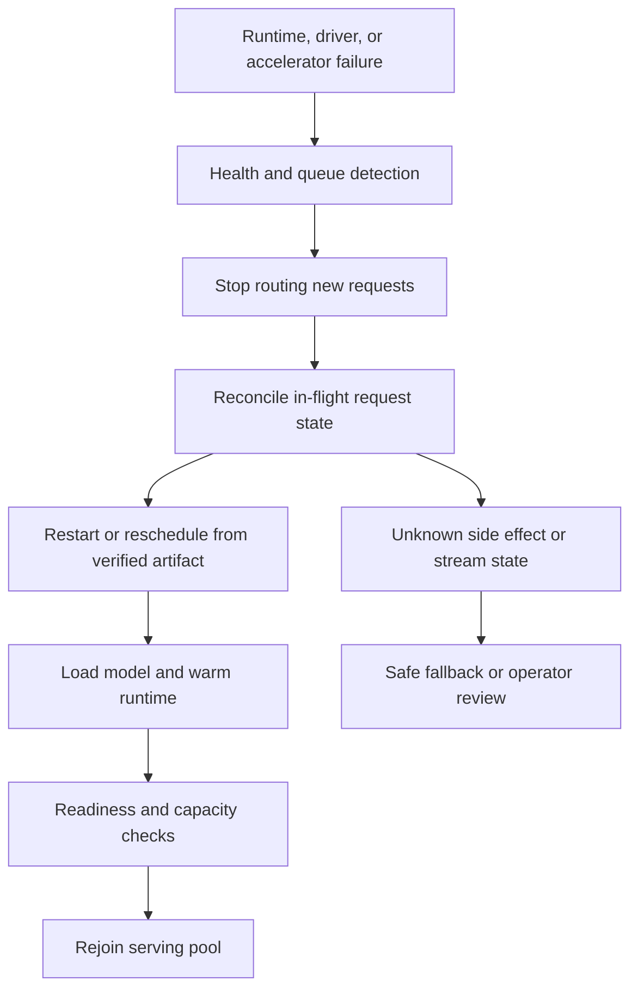

# AI Infrastructure and Platform Components

Part: [16 — Artificial Intelligence, Machine Learning, and Generative AI](PART_OVERVIEW.md)

AI infrastructure includes model runtimes, inference engines, schedulers, accelerators, experiment systems, registries, and orchestration platforms. These components operate at different layers and should not be treated as interchangeable products. [CH25 — AI Framework Ecosystem](CH25_AI_Framework_Ecosystem.md) compares software frameworks and dependency trade-offs; this chapter owns infrastructure component roles and prerequisites. Part 17 owns end-to-end AI architecture, Part 12 owns Kubernetes mechanics, and CH29 owns ML lifecycle governance.

## Component Roles and Planes

An inference engine executes model computation; a model server exposes request and streaming APIs; a scheduler places workloads on CPU, GPU, or specialized accelerators; an orchestration platform manages jobs or distributed execution; experiment and lifecycle tools track data, models, and evaluations. Products may combine several roles, but the architectural responsibilities remain distinct.

Control planes manage deployment, scheduling, configuration, and lifecycle; data planes serve inference or process training data. Protect model artifacts and control APIs, and avoid giving online inference more registry or training authority than necessary.

## Model Loading and Hardware Placement

Model size, precision, context cache, concurrency, and accelerator memory determine placement. A model may not fit on one device; tensor or pipeline parallelism distributes work but adds communication and coordination. Cold-start time includes artifact download, deserialization, memory allocation, and kernel initialization.

A first capacity estimate for weights is parameter count times bytes per stored parameter; a model with $P$ parameters at $b$ bytes per weight needs roughly $Pb$ bytes before quantization scales and runtime overhead. That estimate is not a serving reservation: activations, workspace, fragmentation, and per-request key-value state consume additional memory. [CH28 — Inference Optimization](CH28_Inference_Optimization_and_Model_Serving.md) owns the detailed cache calculation. Tensor parallelism splits individual layer operations across devices and requires frequent collectives; pipeline parallelism assigns layer groups to stages and can incur bubbles when stages are imbalanced. Choose based on model fit, interconnect bandwidth, concurrency, and latency target, then benchmark the complete runtime path.

For scale, a seven-billion-parameter model stored at two bytes per weight needs about 14 gigabytes for weights alone. A 24-gibibyte device therefore does not have 10 gibibytes of usable request cache by default: runtime workspaces, allocator overhead, activations, and fragmentation also consume memory. A four-bit weight representation may reduce the weight term to roughly one quarter, but quantization scales and kernel support add overhead, while the key-value cache remains a separate term unless it is quantized too. Capacity planning must use peak context and target concurrency, not only a model's nominal parameter count.

Pin driver, runtime, model, and accelerator compatibility. Measure real model throughput; theoretical accelerator peak does not account for memory bandwidth, kernel utilization, batching, or communication.

Tensor parallelism and pipeline parallelism fail differently under imbalance. Tensor parallelism splits a layer's matrix operations across $N$ devices and requires an all-reduce or similar collective after each split operation; if the interconnect is slow relative to compute, that communication step can dominate wall-clock time regardless of how many devices are added. Pipeline parallelism instead assigns consecutive layer groups to stages; if one stage is given disproportionately more layers than the others, every other stage sits idle waiting for it — a "pipeline bubble" proportional to that imbalance. Neither failure mode shows up in a single-request latency test; both require a concurrent, representative-load benchmark across the full placement before a capacity plan is trusted.

## Scheduling and Isolation

Training and inference compete for accelerators, memory, and network. Scheduling should account for priority, quotas, locality, preemption, and failure recovery. Multi-tenant platforms require isolation at identity, namespace/project, network, artifact, and accelerator-sharing boundaries. A scheduler label is not a security boundary without enforced authorization.

Separate latency-sensitive serving from long-running training where contention would violate response objectives. Define preemption consequences and checkpoint behavior. Monitor queue wait, utilization, memory pressure, failed placement, and accelerator health.

## Platform Components and Integration

Inference engines, such as vLLM, local model runners, or vendor runtimes, differ in supported model formats, batching, quantization, streaming, and hardware. Model servers and Kubernetes-serving platforms provide deployment, routing, or autoscaling layers. Experiment and lifecycle systems provide tracking and registries. Verify current feature support and operating model before adopting a product.

## Worked Case and Review Checklist

A team serves an open model behind an internal API. A registry stores signed model artifacts; a scheduler assigns accelerator capacity; a model server exposes streaming requests; an inference engine manages batching and key-value cache. A separate training platform produces candidates and submits them for evaluation. Production serving identity can read approved model artifacts but cannot modify training data or promote a new model by itself.

The team targets a 24-gibibyte accelerator for a seven-billion-parameter model at two bytes per weight. The approximately 14-gigabyte weight footprint leaves limited room for runtime workspaces and concurrent request state, so the scheduler reserves capacity using measured peak context rather than starting at maximum batch size. Quantization is evaluated as a candidate placement change, not assumed to create a proportional throughput gain. Training runs are placed in a separate pool because preempting a long training job and delaying interactive inference have different recovery and service costs. A failed model load keeps the instance out of routing until artifact verification, memory headroom, and health checks pass.

Review component roles, artifact provenance, hardware fit, cold start, accelerator scheduling, tenant isolation, API boundary, model loading, autoscaling, telemetry, failure recovery, version compatibility, and ownership. Avoid introducing a platform component without a clear capability need and operator.

## Questions and Summary

1. Distinguish inference engine, model server, scheduler, registry, and lifecycle platform.
2. Estimate model placement constraints from weights, cache, concurrency, and device memory.
3. Design isolation between training and production inference workloads.
4. Which compatibility tuple should be pinned for reproducible serving?
5. Draw control-plane and data-plane authority for model promotion.

AI platforms compose specialized infrastructure roles. Place control and data planes deliberately, bind artifacts to provenance, and size serving from memory and workload evidence. Product names change; evaluate capabilities, operational burden, and security boundaries rather than assuming one platform covers every need.
