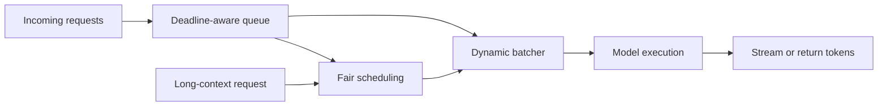
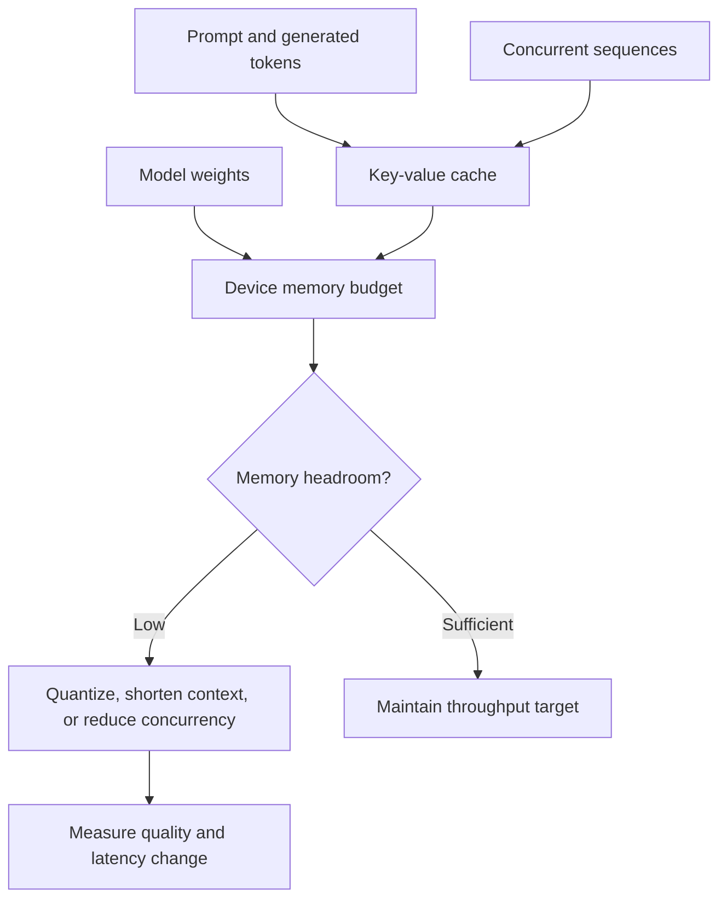
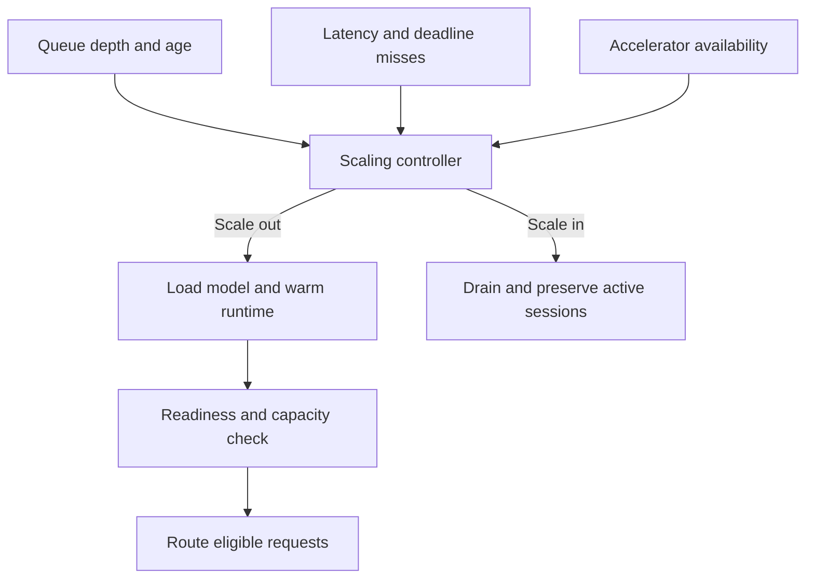
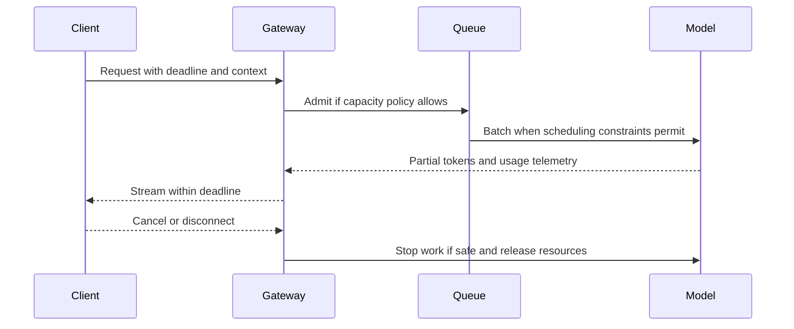
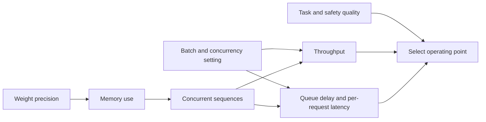

# Inference Optimization and Model Serving

Part: [16 — Artificial Intelligence, Machine Learning, and Generative AI](PART_OVERVIEW.md)

Model serving converts requests into model outputs under latency, throughput, quality, privacy, and cost constraints. Optimization choices such as batching, quantization, cache use, placement, and autoscaling interact; improving throughput can increase per-request latency or reduce quality. CH15 owns LLM inference fundamentals; Part 17 owns system-level serving architecture.

## Request Queueing and Batching

Static batching groups a fixed set of requests; continuous or dynamic batching admits new requests as execution slots become available. Larger batches can improve accelerator utilization but increase queue delay and may create head-of-line blocking for long contexts. Set deadlines and isolate workloads with different latency classes.

Track time to first token, inter-token latency, total latency, queue wait, throughput, and timeout rate. A single average hides tail behavior. Backpressure should reject or queue within a defined bound rather than allowing unbounded memory growth.

Continuous batching must schedule two different kinds of work: prompt prefill processes many input tokens, while decode advances active sequences one token at a time. A long prompt can monopolize memory bandwidth and delay short interactive requests even when aggregate tokens per second look healthy. Use admission limits, deadlines, and fairness across sequence lengths or service classes. Cancellation should release a sequence's cache promptly; otherwise disconnected clients continue consuming capacity. Benchmark a mixed workload of short and long prompts instead of tuning on one fixed batch size.

Overload policy should activate before queue age exceeds the request deadline. Reject or defer low-priority work, cap maximum context and output length, and reserve capacity for tasks that cannot safely be shed. Autoscaling can lag a burst because model loading is slow, so warm-pool size and scale-up triggers should reflect measured load time. A queue that grows faster than replicas become ready is an admission-control failure, not a reason to retry every request.

## Memory, KV Cache, and Quantization

Autoregressive models reuse key/value attention state across generated tokens. Cache memory grows with context length, model layers, hidden dimensions, precision, and concurrent sequences. Cache eviction or swapping may preserve capacity at latency cost. Quantization reduces weight precision and memory footprint but can alter quality, calibration, and supported kernels.

Evaluate quantized models on task-specific and safety tests. Weight-only memory reduction does not necessarily reduce activation or cache memory. Include worst-case context and concurrency in capacity estimates.

For a decoder-only transformer, an approximate key-value cache size is $M_{KV}\approx2LBT H_{kv}d_hb$ bytes: the factor 2 stores keys and values, $L$ is layer count, $B$ is concurrent sequences, $T$ is cached tokens per sequence, $H_{kv}$ is the number of key/value heads, $d_h$ is head width, and $b$ is bytes per element. Variable-length requests require summing each sequence's cached length. This estimate excludes allocator metadata, fragmentation, temporary activations, and runtime workspaces, so it is a lower bound rather than a reservation target.

Weight memory has a separate lower bound of parameter count times bytes per weight. Device planning must leave headroom for the cache, activations, temporary kernels, and fragmentation. Grouped-query attention reduces $H_{kv}$ relative to query-head count and can lower cache use; quantizing weights alone does not change that cache term. Paged allocation can reduce fragmentation and permit flexible batching, but it does not remove the underlying per-token key/value state.

A worked capacity example grounds this formula. For a 32-layer model with 32 key/value heads, 128-dimensional heads, 2-byte precision, 2,000 cached tokens per sequence, and 16 concurrent sequences: $M_{KV}\approx2\times32\times16\times2000\times32\times128\times2\,\text{bytes}\approx 17.2$ gigabytes just for cache — often comparable to or larger than the weight memory of a mid-sized model. Doubling concurrency or context length roughly doubles this term, which is why a serving platform that was sized for 2,000-token contexts can run out of memory under an otherwise-identical request pattern once users start sending 4,000-token prompts, even though weight memory did not change.

## Placement, Warm Pools, and Autoscaling

Hardware placement depends on model size, accelerator memory, interconnect, locality, and cost. Cold starts can dominate latency when weights are large. Warm pools reduce initialization delay but consume idle capacity. Autoscaling needs queue and latency signals, model-load time, and scale-down hysteresis; reactive scaling may arrive after a burst has already violated deadlines.

## Streaming, Reliability, and Cost

Streaming improves perceived latency but complicates cancellation, partial output safety, and retries. Define whether tokens can be revoked or only stopped after emission. Use idempotency for request submission and avoid retrying a generation when it may already have produced external side effects through tools.

Cost per request depends on input/output tokens, model and hardware, utilization, retries, and idle capacity. Optimize using a quality/cost frontier, not token price alone. Preserve a smaller or deterministic fallback for overload when product requirements permit.

## Worked Case and Review Checklist

A chat service receives burst traffic. The server uses continuous batching, a per-request deadline, context limits, and a warm accelerator pool. It measures time to first token and total completion latency. Quantization is tested against held-out task and refusal evaluations. When queue age exceeds policy, the service sheds low-priority requests and routes supported tasks to a smaller model rather than allowing unbounded queuing.

Review batching, fairness, queue limits, cache memory, quantization evidence, cold start, hardware placement, scaling signals, drain behavior, streaming cancellation, cost, fallback, and quality regressions.

## Questions and Summary

1. Compare batch size effects on throughput, queue delay, and tail latency.
2. Estimate KV-cache growth as context, layer count, and concurrency change.
3. What does quantization reduce, and what must be reevaluated?
4. Design autoscaling for a model with a long cold-start time.
5. Define safe overload behavior for a streaming response service.

Inference optimization is a joint capacity, quality, and scheduling problem. Batching, cache, quantization, placement, and autoscaling trade one metric for another. Measure end-to-end behavior under realistic bursts, bound queues, and retain a safe overload path.
