# Inference Optimization and Model Serving

Part: [16 — Artificial Intelligence, Machine Learning, and Generative AI](PART_OVERVIEW.md) · Status: Revised (in-depth rewrite)

## 1. Introduction

A trained language model is a file of numbers. Serving turns that file into an answer for a person who is waiting, at a price the business can afford, with a latency the product can tolerate, and without losing the request when a machine fails. The model is fixed at serving time, so every improvement comes from how the surrounding software schedules arithmetic, moves bytes, shares memory, and shapes traffic. This chapter teaches that engineering from first principles, with numbers, so that an architect can predict what a configuration will do before buying hardware and can tell a real optimization from a benchmark artifact.

Most of the chapter concerns large language model (LLM) serving, because that is where the optimization problem is hardest and where the economics are most visible. The same ideas apply, with simpler arithmetic, to embedding, ranking, speech, and image models. The reader who has finished [CH10 Transformers and Attention](CH10_Transformers_and_Attention.md) and [CH15 Large Language Model Fundamentals and Inference](CH15_Large_Language_Model_Fundamentals_and_Inference.md) already knows what the forward pass computes, why the key-value (KV) cache exists, and how a sampler picks the next token. This chapter starts from there and asks what a fleet of accelerators has to do to run that loop for thousands of people at once.

### 1.1 Reader outcomes

After this chapter you should be able to do the following.

1. Define time to first token (TTFT), time per output token (TPOT), inter-token latency (ITL), end-to-end latency, throughput, goodput under a service-level objective (SLO), utilization, and cost per million tokens, and say which metric a given product decision depends on.
2. Explain why prefill is compute-bound and decode is memory-bandwidth-bound, using roofline arithmetic, and compute the decode time per step for a named model on a named accelerator class with the formula shown.
3. Explain static, dynamic, and continuous (iteration-level) batching, run a simulator that compares them, and predict which policy wins under a given arrival pattern.
4. Size the KV cache, explain block-based allocation (PagedAttention), fragmentation, prefix caching, and the economics of a prefix cache hit rate, and describe KV cache quantization and offload.
5. Describe attention kernels such as FlashAttention at the level needed to know when they matter.
6. Choose among weight-only and weight-activation quantization schemes, evaluate the quality effect, and recognize the situations in which quantization breaks.
7. Compute the expected speedup of speculative decoding from an acceptance rate, and say when it stops helping.
8. Compare tensor, pipeline, expert, and sequence parallelism by communication cost, and explain chunked prefill and prefill/decode disaggregation.
9. Apply queueing arithmetic and Little's Law to admission control, priority classes, and autoscaling signals, including the scale-up lag calculation.
10. Design a benchmark that does not lie, using open-loop load, realistic length distributions, warmup, and percentile reporting.
11. Turn a traffic forecast into a GPU count and a monthly cost, and compare self-hosting against a hosted API with a break-even calculation.
12. Plan for failure: out-of-memory under long contexts, head-of-line blocking, noisy neighbors, thundering herds on cold start, regional failover.

### 1.2 Why this matters to a solution architect

An architect sets the constraints that the serving team then optimizes inside. Four decisions depend on this chapter.

- **Whether to self-host at all.** A hosted API removes the whole subject, and its price per million tokens is a ceiling for what self-hosting must beat. The break-even calculation in Section 21 shows that utilization, not hardware price, decides the answer.
- **Which SLOs are promised.** A promise about TTFT, a promise about streaming speed, and a promise about total completion time pull the system in different directions. Section 2 separates them.
- **How much headroom to buy.** Queueing theory makes tail latency explode as utilization approaches one, so a fleet sized at 95 percent average utilization is a fleet that violates its SLO.
- **What to put in the contract between product and platform.** Maximum context length, maximum output length, priority classes, and cancellation behavior are product decisions that move cost by integer factors.

### 1.3 Scope and ownership

The table lists what this chapter teaches fully and what it only recaps. A recap is two or three sentences and a link. Nothing in a recap is re-derived.

| Topic | Owner | Treatment here |
|---|---|---|
| Transformer layers, attention, grouped-query attention, positional encodings | [CH10](CH10_Transformers_and_Attention.md) | Recap only; the KV cache size formula is restated once for use in the worked examples |
| Decoding loop, sampling, temperature, stop conditions, token and cost basics | [CH15](CH15_Large_Language_Model_Fundamentals_and_Inference.md) | Recap only |
| Inference engines (vLLM and similar), model servers, schedulers, accelerator placement products | [CH27](CH27_AI_Infrastructure_and_Platform_Components.md) | This chapter explains the techniques an engine implements, not the product choice |
| LoRA training and adapter merging | [CH20](CH20_Fine_Tuning_PEFT_and_LoRA.md) | Recap; this chapter owns serving many adapters |
| Quality evaluation of generated text | [CH24](CH24_Generative_AI_Evaluation_Guardrails_and_Hallucinations.md) | Recap; this chapter owns evaluating a quantized or speculative configuration |
| Lifecycle, registry, rollout, and rollback | [CH29](CH29_MLOps_and_LLMOps.md) | Link only |
| System-level serving placement, gateway, routing, and fallback | [Part 17 CH07](../17_AI_Architecture/CH07_Inference_Serving_and_Model_Placement.md), [Part 17 CH08](../17_AI_Architecture/CH08_Model_Gateway_Routing_and_Fallback_Architecture.md) | Recap; this chapter covers the serving-layer mechanics inside one deployment |
| Cost and sustainability decisions across a portfolio | [Part 17 CH14](../17_AI_Architecture/CH14_AI_Cost_Performance_and_Sustainability_Decisions.md) | Recap; this chapter supplies the per-token cost arithmetic |
| Kubernetes scheduling mechanics | Part 12 | Link only |

### 1.4 Running example

Several sections use one running example, an internal assistant for support agents. It is illustrative. Replace every number with a measurement of your own workload.

- Model: a 70-billion-parameter dense decoder with grouped-query attention, 80 layers, 8 KV heads, head width 128, model width 8,192. This is the shape of the Llama 3 70B family, used here as a named example of a "70B-class" model.
- Accelerator class: an 80 GB device of the NVIDIA H100 SXM generation, with rounded datasheet figures of 3.35 terabytes per second of memory bandwidth and 989 teraFLOP per second of dense BF16 (bfloat16, a 16-bit floating-point format) compute. At the time of writing, newer parts have more memory and bandwidth. The method in this chapter is the same, and the reader should substitute the datasheet of the device actually purchased.
- Traffic: a median prompt of about 650 tokens (system prompt plus retrieved passages plus the question), a median answer of about 150 tokens, and a peak of 4 requests per second per replica group.
- Target: p95 TTFT under 2 seconds, p95 TPOT under 60 milliseconds, and a cost per million output tokens that beats the hosted alternative.

All the numbers in Sections 4, 5, and 6 are produced by the scripts in the code folder. Section 32 lists them.

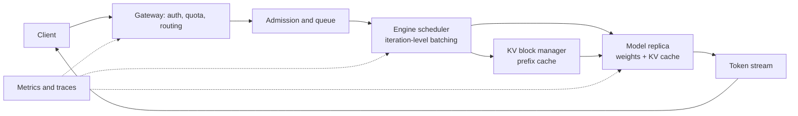

The diagram shows the path every request in this chapter follows. The gateway and routing layers belong to Part 17. The queue, the scheduler, the KV block manager, and the replica are the subject of this chapter. The dotted lines are the telemetry that every later section depends on: you cannot tune what the scheduler does not report.

## 2. Serving objectives and metrics

Optimization needs a target. Serving has several targets that cannot all be maximized at once, and the first skill is naming which one a decision serves. This section defines each metric precisely, because loose definitions are the main reason two teams report incompatible numbers for the same system.

### 2.1 The life of one streamed request

Figure 2 shows one request from the client's side. The client sends a prompt, waits, receives a first token, and then receives further tokens at some rate until a stop condition ends the stream.

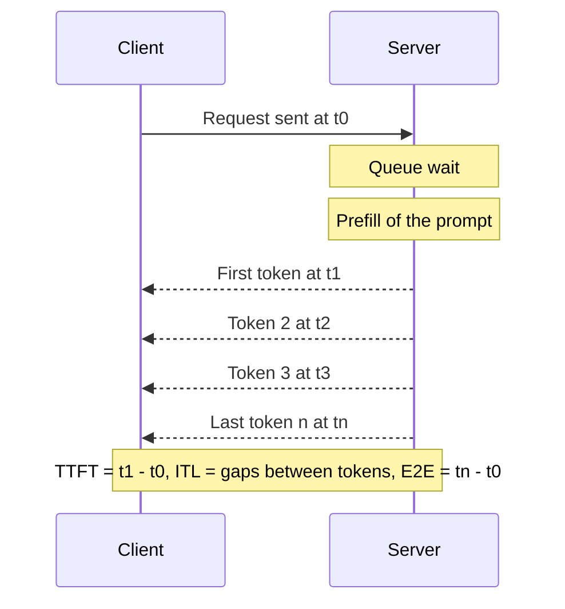

The figure fixes three timestamps that the metrics below use. Let $t_0$ be the moment the client sends the request, $t_1$ the arrival of the first output token, and $t_n$ the arrival of the last of $n$ output tokens.

### 2.2 Latency metrics

**Time to first token** is $\text{TTFT}=t_1-t_0$. It contains network time, queue wait, scheduling delay, and the prefill computation. For an interactive chat it is the delay before the user sees anything, and it drives perceived responsiveness. For a long prompt it is dominated by prefill, which is compute-bound and grows roughly linearly with prompt length. For an overloaded server it is dominated by queue wait.

**Inter-token latency** (ITL) is the gap between two consecutive output tokens, $t_{i+1}-t_i$. It is a distribution, not a number: each gap is one decode iteration of the engine, so it varies with batch size, with other requests' prefills sharing the iteration, and with garbage collection or kernel launches. A user perceives streaming as smooth when ITL is steady and below roughly the reading speed. A common reference point is that human reading speed is on the order of four to eight tokens per second, so a TPOT of 60 milliseconds (about 17 tokens per second) is faster than most people read. Applications that feed the output to another program or a voice synthesizer need faster rates.

**Time per output token** (TPOT) is the average gap over the request,

$$
\text{TPOT}=\frac{t_n-t_1}{n-1}=\frac{\text{E2E}-\text{TTFT}}{n-1}
$$

for $n\ge2$, where $\text{E2E}=t_n-t_0$ is the end-to-end latency. Vendors and benchmark tools use ITL and TPOT inconsistently, and some report the inverse, tokens per second per user. When comparing numbers, check whether the first token is included, whether the figure is a mean or a percentile, and whether time is measured at the server or at the client.

**End-to-end latency** is $\text{E2E}=\text{TTFT}+(n-1)\,\text{TPOT}$ by the definition above. This identity is the most useful single formula in serving, because it shows that the answer length $n$ multiplies TPOT. A request that produces 300 tokens with a TTFT of 0.8 seconds and a TPOT of 30 milliseconds finishes at $0.8+299\times0.030=9.77$ seconds. Halving TTFT saves 0.4 seconds. Halving TPOT saves 4.5 seconds. Which one matters depends on whether the user waits for the whole answer or reads along as it streams, and many products promise both.

### 2.3 Throughput, goodput, and utilization

**Throughput** is work completed per unit time. Serving papers and dashboards use several versions and the differences matter: requests per second, output tokens per second, input tokens per second, and total tokens per second. A system tuned to maximize total tokens per second will favor long prompts, because prefill tokens are cheap per token (Section 4.5). A system tuned to maximize requests per second will favor short answers. State which one you mean.

**Goodput** is throughput counted only for requests that meet their SLO. Suppose in one minute a service completes 1,000 requests. Of these, 900 have TTFT within 1 second, 850 have TPOT within 50 milliseconds, and 800 satisfy both. Throughput is 1,000 requests per minute, and goodput is 800 requests per minute, or 80 percent. The distinction matters because a scheduler that admits everything can show a record throughput while goodput collapses, since every request is late. Goodput is the metric that connects capacity to the promise made to users, and it is the right quantity to maximize when a service has an SLO. The idea of measuring goodput under latency SLOs is used explicitly in the DistServe paper (Zhong et al., 2024), which uses it to compare serving architectures.

**Utilization** has two forms for LLM serving, and mixing them up hides the real bottleneck.

- Model FLOP utilization (MFU) is achieved floating-point operations per second divided by the device's peak. It is the right number for compute-bound work such as training and prefill.
- Memory bandwidth utilization (MBU) is achieved bytes moved per second divided by peak bandwidth. It is the right number for decode, where the limit is how fast weights and cache stream out of memory. For the 4-way tensor-parallel 70B example in Section 4, one decode step at batch size 1 reads 140 gigabytes of weights in 16.29 milliseconds across four devices with a combined peak of 13.4 terabytes per second, so $\text{MBU}=140\times10^{9}/0.01629/13.4\times10^{12}\approx0.64$. The same device shows an MFU of well under 1 percent in that step. A dashboard that reports only GPU "utilization" as the fraction of time any kernel is running would call this device busy while it does almost no arithmetic.

Operating system or driver "GPU utilization" counters typically report the fraction of sampling intervals in which at least one kernel was active. A device that runs one tiny kernel continuously reports 100 percent. Treat that number as a liveness signal and use MFU, MBU, batch occupancy, and KV cache occupancy for capacity decisions.

### 2.4 Cost per million tokens

Cost is the metric the business sees. For a self-hosted fleet,

$$
\text{cost per million tokens}=\frac{\text{fleet cost per second}}{\text{tokens per second}}\times10^{6},
$$

where the fleet cost includes idle time. Idle time makes the effective price higher than the price at full load. The decode example in Section 4.6 gives \$1.49 per million output tokens at batch size 64 with a fully busy 4-GPU group at an assumed \$4.00 per GPU-hour. At 60 percent average utilization the same hardware costs $1.49/0.6=\$2.48$ per million tokens, because 40 percent of the paid time produces nothing. Input (prefill) tokens are cheaper in this model, at about \$0.31 per million, because prefill runs at the compute limit and processes many tokens per unit of weight read. Hosted APIs usually charge input and output tokens at different rates for the same reason, with output priced several times higher than input.

The cost metric has a trap: it is lowest at the highest batch size and highest utilization, which is also where latency is worst. Cost per million tokens must therefore be quoted at a stated latency SLO, which is the same as saying it must be quoted as cost per million *good* tokens.

### 2.5 Percentiles and why means mislead

Latency distributions in serving are heavy-tailed. A few long prompts, a retry, a garbage-collection pause, or a preempted sequence produce values many times the median. Report percentiles (p50, p90, p95, p99), and say over what window they were measured. A mean of 2 seconds can hide a p99 of 20 seconds.

Two further rules apply. First, percentiles do not add. If a request passes through a gateway, a retrieval step, and a model, the end-to-end p99 is not the sum of the stage p99 values. It depends on the joint distribution, and in practice it is larger than any single-stage p99 and smaller than the sum. Dean and Barroso (2013) describe why fan-out multiplies the effect of rare slow events: if a user request waits for $k$ parallel calls and each is slow with probability $p$, then the request is slow with probability $1-(1-p)^k$. With $p=0.01$ and $k=100$, that is $1-0.99^{100}=0.634$, so a one-in-a-hundred event per call hits 63 percent of user requests. Second, averaging percentiles across servers is invalid. Merge histograms or raw samples and compute the percentile of the merged data.

### 2.6 Choosing the metric that a decision serves

The following table maps product types to the metrics that decide their configuration.

| Product | Primary latency metric | Throughput metric | Typical optimization lever |
|---|---|---|---|
| Interactive chat | TTFT and TPOT percentiles | Goodput at SLO | Continuous batching, prefix caching, speculative decoding |
| Code completion in an editor | TTFT (tens to hundreds of ms) | Requests per second | Small model, speculative decoding, short outputs, prefix caching |
| Batch summarization overnight | None (deadline for the whole job) | Total tokens per second per dollar | Largest feasible batch, quantization, no latency constraint |
| Voice assistant | TTFT plus steady ITL | Concurrent sessions | Low-latency parallelism, dedicated capacity |
| Agent with tool calls | E2E per step, compounding over many steps | Tokens per task | Prefix caching of the conversation, short outputs, structured decoding |
| Reasoning model | E2E (thousands of hidden tokens) | Tokens per second per user | Memory bandwidth, speculative decoding, KV cache capacity |

A batch job and an interactive chat can use the same weights on the same hardware and want nearly opposite configurations. The first wants the largest batch and accepts a long wait. The second wants a small batch and a short wait. That conflict is why mixed workloads need separate priority classes or separate pools (Section 13).

## 3. Anatomy of an LLM request: prefill and decode

[CH15](CH15_Large_Language_Model_Fundamentals_and_Inference.md) teaches the generation loop and [CH10](CH10_Transformers_and_Attention.md) teaches the KV cache as a mathematical device. The serving view of the same loop is that a request has two phases with different resource profiles.

### 3.1 The two phases

In **prefill** the engine processes all $P$ prompt tokens in one forward pass. Every token in the prompt is known, so the $P$ rows can be multiplied against each weight matrix together. The pass writes the keys and values of every prompt token into the KV cache and produces the logits for the first output token. Prefill determines TTFT.

In **decode** the engine generates one token per step. Each step takes the single newest token, multiplies its one row through every weight matrix, attends over the cached keys and values of all earlier positions, appends the new token's key and value to the cache, and produces logits for the next token. A request with $n$ output tokens requires $n$ steps, and the steps are sequential: step $i+1$ cannot start until step $i$ has chosen its token. Decode determines TPOT.

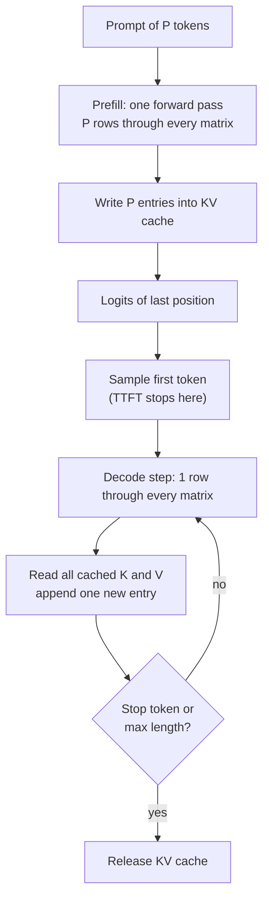

The diagram makes the structural difference visible. Prefill is a single wide pass. Decode is a loop of narrow passes. The weight matrices are read from memory once per pass in both cases. In prefill that read is shared by $P$ tokens. In decode it is shared by only the number of sequences that the engine batches together in that step. The rest of the chapter is largely a consequence of that sentence.

### 3.2 Cost of each phase

Using the forward-pass cost from [CH10 Section 10](CH10_Transformers_and_Attention.md), a model with $N$ matrix-multiplied parameters costs about $2N$ floating-point operations (FLOPs) per token, ignoring the attention score term, which is smaller for short and medium contexts. Prefill of $P$ tokens costs about $2NP$ FLOPs. Decode of one token costs $2N$ FLOPs plus the attention work over the current context.

The memory traffic is different. A forward pass reads each weight once from device memory, which is $N b_w$ bytes, where $b_w$ is bytes per weight. For the 70B example in BF16 ($b_w=2$), that is 140 gigabytes. Decode also reads the KV cache of every sequence in the batch.

| Phase | FLOPs per pass | Bytes read per pass (weights) | Tokens sharing the weight read | Bound |
|---|---|---|---|---|
| Prefill, $P$ tokens | $2NP$ | $N b_w$ | $P$ | Compute (for $P$ above a few hundred) |
| Decode, batch $B$ | $2NB$ | $N b_w$ plus KV reads | $B$ | Memory bandwidth (for small and moderate $B$) |

The next section turns this table into a prediction with the roofline model.

## 4. The roofline model and why decode is memory-bound

### 4.1 The model

A processor can be limited by arithmetic or by data movement. The **roofline model** (Williams, Waterman, and Patterson, 2009) states this precisely. Define the **arithmetic intensity** of a kernel as the FLOPs it performs divided by the bytes it moves to and from memory,

$$
I=\frac{\text{FLOPs}}{\text{bytes moved}}\quad[\text{FLOP/byte}].
$$

Let $F$ be the peak compute rate in FLOP per second and $W$ the peak memory bandwidth in bytes per second. In a time $t$ the device can do at most $Ft$ FLOPs and move at most $Wt$ bytes. A kernel needing $A$ FLOPs and $D$ bytes therefore takes at least

$$
t\;\ge\;\max\!\left(\frac{A}{F},\;\frac{D}{W}\right).
$$

If $A/F>D/W$ the kernel is compute-bound, otherwise memory-bound. The crossover is at the **ridge point**, the intensity $I^{*}=F/W$. Below $I^{*}$ the attainable rate is $WI$ (a slanted line on a log-log plot), and above $I^{*}$ it is $F$ (a flat line). The picture looks like a roof, hence the name.

```text
 attainable
 FLOP/s
   ^                      ______________________  peak F (compute roof)
   |                    /
   |                  /
   |                /   slope = W (bandwidth roof)
   |              /
   |            /
   |          /
   +--------+-------------------------------> arithmetic intensity I
          ridge I* = F / W
   decode (small B) lives left of the ridge, prefill lives right of it
```

The ASCII sketch shows the two regimes. Work to the left of the ridge is limited by how fast bytes arrive, so adding compute does nothing and adding bandwidth helps proportionally. Work to the right is limited by arithmetic, so more bandwidth does nothing.

### 4.2 The ridge point for a named accelerator class

For the illustrative H100-class device with $F=989\times10^{12}$ FLOP/s and $W=3.35\times10^{12}$ bytes/s,

$$
I^{*}=\frac{989\times10^{12}}{3.35\times10^{12}}\approx295\ \text{FLOP/byte}.
$$

Real kernels reach a fraction of each peak. Using the assumptions in the script (50 percent of peak FLOP/s in large matrix multiplications and 70 percent of peak bandwidth), the achievable ridge is $295\times0.50/0.70\approx211$ FLOP/byte. This figure is only illustrative. Kernel efficiency depends on shapes, libraries, and clocks, and it should be measured.

### 4.3 Arithmetic intensity of a weight matrix multiply

A linear layer multiplies a batch of $B$ token vectors (an $B\times k$ matrix) by a weight matrix of shape $k\times n$ stored in $b_w$ bytes per element. The FLOPs are $2Bkn$. The bytes moved are dominated by the weights, $knb_w$, because activations are $B(k+n)b_a$ and are small when $B\ll k,n$. The intensity is

$$
I\approx\frac{2Bkn}{knb_w}=\frac{2B}{b_w}.
$$

For BF16 weights ($b_w=2$) the intensity is exactly $B$ FLOP/byte. This is the central fact of LLM decode: **the arithmetic intensity of the weight multiplications equals the number of tokens sharing the weight read.** One sequence in the batch gives an intensity of 1, which is two orders of magnitude below the ridge of 211 to 295. The device is idle on arithmetic more than 99 percent of the time in that step.

For 8-bit weights ($b_w=1$) the intensity is $2B$, and for 4-bit weights ($b_w=0.5$) it is $4B$. Quantizing weights raises intensity at a fixed batch size because fewer bytes are read per FLOP. That is the mechanism by which weight-only quantization speeds up decode (Section 9), and it explains why the speedup is close to the byte reduction at small batch sizes and fades at large ones.

### 4.4 Worked example: decode of a 70B model

The following numbers are illustrative. They are computed by [01_roofline_decode.py](../code/python/inference-serving-chapter/01_roofline_decode.py) from the assumptions stated in its docstring. The model has $N=70\times10^{9}$ parameters in BF16, which is 140 GB of weights, and uses 4-way tensor parallelism across four 80 GB devices.

**Step 1: weights per device and room for the cache.** Each device holds $140/4=35$ GB. With 90 percent of 80 GB usable (72 GB), each device has $72-35=37$ GB for the KV cache, activations, and runtime workspace. A single device cannot hold the weights (140 GB exceeds 80 GB), so at least two devices are required. Two would leave $2\times72-140=4$ GB for everything else, which is why four is the practical minimum for this model in BF16.

**Step 2: time to read the weights.** At batch size 1 each device reads its 35 GB shard. With the assumed 70 percent bandwidth efficiency, the effective bandwidth per device is $3.35\times0.70=2.345$ TB/s, so

$$
t_{\text{mem}}=\frac{35\times10^{9}}{2.345\times10^{12}}\approx14.9\ \text{ms}.
$$

The KV reads for one 2,000-token sequence add $2000\times327{,}680=655$ MB across the group, a further 0.07 ms. The script reports 15.00 ms.

**Step 3: time to do the arithmetic.** One token costs $2N=1.4\times10^{11}$ FLOPs. Across four devices at 50 percent of 989 teraFLOP/s, the compute rate is $4\times989\times10^{12}\times0.5=1.978\times10^{15}$ FLOP/s, so $t_{\text{cmp}}=1.4\times10^{11}/1.978\times10^{15}=0.07$ ms. Memory time is 200 times compute time. The step is memory-bound.

**Step 4: communication.** Tensor parallelism places two all-reduce operations in every layer (Section 11). With 80 layers that is 160 collectives per step. Each moves a very small payload at batch size 1 (a vector of 8,192 BF16 values, 16 KB), so the time per collective is dominated by launch and synchronization latency. At an assumed 8 microseconds each, 160 collectives cost about 1.3 ms. The script reports 1.29 ms.

**Step 5: the step time and the speed ceiling.** The step takes about $15.00+1.29=16.29$ ms, so a single stream cannot decode faster than $1/0.01629\approx61$ tokens per second on this hardware, however many more FLOP/s the device has. This is the practical lower bound on TPOT for this configuration. To go faster for a single user, one needs more bandwidth per sequence (more devices in a tensor-parallel group, but communication grows), fewer bytes per weight (quantization), or fewer weight reads per token (speculative decoding).

The table below shows the effect of batching more sequences into the same step, from the script output at a context of 2,000 tokens.

| Batch $B$ | Memory time (ms) | Compute time (ms) | Communication (ms) | Step (ms) | Tokens per second | Bound |
|---:|---:|---:|---:|---:|---:|---|
| 1 | 15.00 | 0.07 | 1.29 | 16.29 | 61 | memory |
| 4 | 15.20 | 0.28 | 1.33 | 16.54 | 242 | memory |
| 16 | 16.04 | 1.13 | 1.49 | 17.53 | 913 | memory |
| 32 | 17.16 | 2.26 | 1.70 | 18.86 | 1,697 | memory |
| 64 | 19.40 | 4.53 | 2.12 | 21.52 | 2,975 | memory |
| 128 | 23.87 | 9.06 | 2.96 | 26.83 | 4,771 | memory |
| 256 | 32.81 | 18.12 | 4.64 | 37.45 | 6,836 | memory |
| 512 | 50.70 | 36.24 | 7.99 | 58.69 | 8,724 | memory |

Going from batch 1 to batch 64 multiplies throughput by 49 while the step time grows by only 32 percent (16.29 to 21.52 ms). Every user's TPOT is a little worse, and the machine serves 49 times as many tokens. That ratio is the economic engine of batching.

Notice that the step remains memory-bound even at batch 512. The reason is the KV cache. The weight-matrix term would become compute-bound near a batch of 211 (the achievable ridge), but each sequence in the batch also reads its own 655 MB cache (2,000 tokens at 327,680 bytes per token), and that traffic scales with $B$. At batch 512 the cache reads are $512\times655$ MB $=335$ GB, more than twice the weights. In long-context serving the KV traffic, not the weight traffic, sets the limit, which is why KV cache reduction (Section 7) appears in every high-throughput design.

### 4.5 Worked example: prefill of the same model

Prefill of a 2,000-token prompt costs $2NP=2\times70\times10^{9}\times2000=2.8\times10^{14}$ FLOPs. At $1.978\times10^{15}$ FLOP/s that takes 141.6 ms, matching the script. The weights are read once (about 15 ms of memory time), so the arithmetic dominates by roughly nine to one and the phase is compute-bound. The prefill rate is $2000/0.1416\approx14{,}100$ tokens per second, independent of prompt length in this model, with two caveats. The attention score term grows with the square of the prompt length, which slows very long prompts. And a short prompt of, say, 20 tokens has an intensity of 20 and is memory-bound like decode.

Two consequences follow. First, a 2,000-token prompt delays every other sequence in the same iteration by up to 142 ms unless the engine chunks it (Section 12), and a decode step is only 16 to 22 ms, so one long prefill looks like seven or eight missed decode steps to everyone else in the batch. Second, input tokens are about five to eight times cheaper per token than output tokens in this model: 14,129 tokens per second of prefill against 1,697 to 2,975 tokens per second of decode at batch 32 to 64. That ratio explains why API prices charge less for input than for output, although a provider's price ratio also reflects its margin and demand and is not a pure cost ratio.

### 4.6 Worked example: cost per token

At an assumed \$4.00 per GPU-hour for four devices, the fleet costs \$16 per hour, or \$0.004444 per second. At batch 64, decode yields 2,975 tokens per second:

$$
\frac{0.004444}{2975}\times10^{6}=\$1.49\ \text{per million output tokens}.
$$

At batch 1 the same hardware yields 61 tokens per second, which is \$72.7 per million. Batch size alone moves the price by a factor of 49. The \$4.00 figure is an assumption for the sake of arithmetic; actual prices vary by provider, commitment, and region and should be looked up.

### 4.7 What the roofline leaves out

The model is a first-order tool. It ignores overlap of memory and compute within a kernel, cache effects, launch overhead, imperfect parallel scaling, and the non-matmul operations (normalization, rotary embeddings, sampling), which together add a few milliseconds per step. Treat its predictions as upper bounds on throughput within about a factor of two, use it to decide what to try, and measure the result. The roofline predicts the direction and order of magnitude of each optimization in this chapter, which is what a design review needs.

## 5. Arithmetic intensity, batch size, and the latency-throughput frontier

### 5.1 Why batch size is the main lever

Section 4.3 showed that the intensity of the weight multiply equals the batch size. Raising $B$ reuses each weight read for more tokens. Throughput therefore rises almost linearly with $B$ until one of three limits is reached.

1. **The compute ridge.** When $B$ reaches the achievable ridge (about 211 for BF16 in the example), the weight multiply becomes compute-bound and throughput flattens.
2. **KV cache memory.** Each sequence occupies cache memory proportional to its context length. The device holds only so many sequences.
3. **The latency SLO.** Step time grows with $B$ because the KV reads and the compute grow. When step time exceeds the TPOT target, the batch must stop growing.

The smallest of the three sets the operating point. For many deployments the second or third limit binds long before the ridge.

### 5.2 The concurrency limit from cache memory

Recap of the KV cache size from [CH10 Section 13](CH10_Transformers_and_Attention.md): the cache holds, for each token, a key and a value in every layer, so

$$
\text{bytes per token}=2\,L\,H_{kv}\,d_h\,b_{kv},
$$

where $L$ is the number of layers, $H_{kv}$ the number of KV heads, $d_h$ the head width, and $b_{kv}$ the bytes per cached element. For the 70B example, $2\times80\times8\times128\times2=327{,}680$ bytes, or 320 KiB per token. A sequence of 8,192 tokens holds $8192\times327{,}680=2.68$ GB.

With four devices and the free memory from Section 4.4, the group has $4\times72-140=148$ GB for the cache and workspace. Ignoring workspace, that holds $\lfloor148/2.68\rfloor=55$ sequences of 8,192 tokens. With eight devices the free memory is $8\times72-140=436$ GB, which holds 162 such sequences, nearly three times as many for twice the devices. Memory left over after the weights is the real product of adding devices to a group, and this is why serving large models on more devices than the weights strictly need often improves cost per token.

The older estimate in this chapter's draft used a model with 32 KV heads and no grouped-query attention. Under that shape a 2,000-token sequence takes $2\times32\times32\times128\times2\times2000=1.05$ GB, and 16 of them take 16.8 GB. Grouped-query attention with 8 KV heads cuts the per-token cache by a factor of four, which is why modern 70B-class models are much cheaper to batch than the multi-head-attention models from a few years earlier.

### 5.3 The latency-throughput frontier

For a fixed deployment, plot the achievable throughput against TPOT as $B$ varies. From the Section 4.4 table, TPOT is the step time, so the points are (16.5 ms, 242 tok/s), (21.5 ms, 2,975 tok/s), (37.5 ms, 6,836 tok/s), and (58.7 ms, 8,724 tok/s). The curve rises steeply and then flattens: past a batch of about 128 each added sequence buys little throughput and costs every user latency.

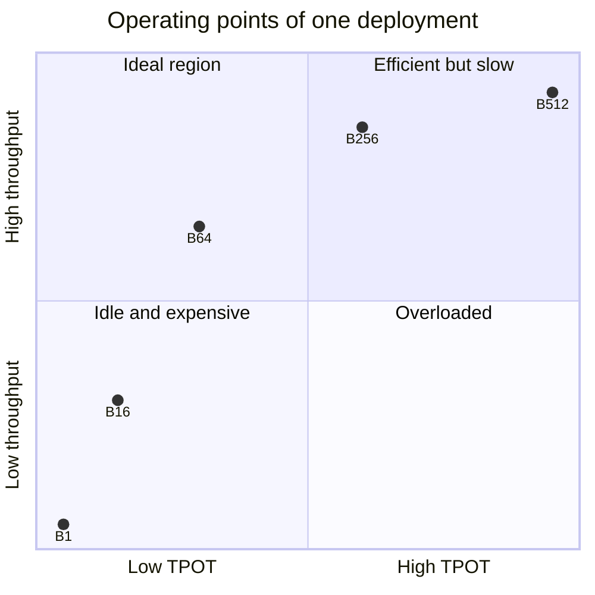

The chart is schematic. Batch 1 sits in the bottom-left: very fast per user, very expensive per token. Batch 512 sits in the top-right: cheap per token and slow per user. A latency SLO draws a vertical line, and the best configuration is the highest point to the left of that line. Tightening the SLO from 60 ms to 25 ms moves the operating point from a batch of about 500 to a batch of about 110 in this model (interpolating the table) and cuts throughput from roughly 8,700 to roughly 4,400 tokens per second, which means about twice the hardware for the same traffic. The table also ignores memory capacity: 512 sequences of 2,000 tokens need 335 GB of cache, more than the 148 GB the group has free, so the top rows are reachable only with shorter contexts, more devices, or a smaller cache per token. The cost of a latency promise is therefore visible and can be priced before it is made.

### 5.4 Why simply waiting to fill a batch fails

A naive way to raise the batch is to wait until enough requests arrive. This adds queue delay to every request in proportion to the inter-arrival time. If requests arrive at 2 per second, waiting for 32 takes 16 seconds. The delay is paid in TTFT, and it is pure waste. The next section shows how modern engines raise the effective batch without making anyone wait for a fixed count.

## 6. Batching: static, dynamic, and continuous

Section 5 established that a bigger batch means cheaper tokens. Batching policy decides how a server gets a big batch without making users wait for it. There are three generations of policy, and the difference between them is the single largest software-side gain in LLM serving.

### 6.1 Static batching

In **static batching** the server collects a fixed number of requests, runs them together from prefill to the last finished sequence, and returns the whole batch. This is the natural extension of how classifiers and image models are served, where every item in the batch costs the same and finishes at the same moment.

Autoregressive generation breaks both assumptions. Output lengths differ by an order of magnitude inside one batch, and a sequence that emits its stop token at step 40 holds its slot, its cache memory, and its share of the batched matrix multiplication until the longest sequence in the batch ends at step 700. The slot does no useful work. If the 32 sequences in a batch have mean output length $\bar n$ and the longest has length $n_{\max}$, the fraction of slot-steps doing useful work is

$$
u=\frac{\bar n}{n_{\max}}.
$$

For the lognormal output distribution used in the simulator (median 148, mean about 198, capped at 800), the expected maximum of 32 draws is several hundred tokens, and the useful fraction is roughly 30 percent. About 70 percent of the batched compute is spent on finished sequences. Static batching also forces new arrivals to wait for the current batch to finish entirely, so TTFT includes the remaining runtime of a batch that may last 15 seconds.

### 6.2 Dynamic batching

**Dynamic batching** (the term used by several model servers, including Triton Inference Server) keeps the request-level execution model of static batching but changes how the batch is formed. The server waits for either a maximum batch size or a maximum queue delay, whichever comes first, and then runs the batch. It fixes the problem that static batching waits indefinitely for a batch to fill, and it is the right policy for models where every request costs about the same, such as encoders, classifiers, rerankers, and embedding models. It does not fix the problem that a finished sequence blocks its slot, because execution is still request-level. For generative models it is the policy of the previous generation.

### 6.3 Continuous (iteration-level) batching

**Continuous batching**, introduced under the name *iteration-level scheduling* in the Orca system (Yu et al., OSDI 2022), moves the scheduling decision from the request to the iteration. After every decode step the scheduler can remove sequences that have finished and add sequences that are waiting. The batch composition changes at every step.

```text
Static batching: slots are held until the longest sequence ends (. = idle slot, # = work)

 slot 1  ##########................
 slot 2  ##################........
 slot 3  ####......................
 slot 4  ##########################   <- longest sequence sets the batch length
 time -->  new requests wait until the whole row ends

Continuous batching: a freed slot is refilled at the next iteration

 slot 1  ##########|######|########
 slot 2  ##################|######
 slot 3  ####|##########|##########
 slot 4  ##########################
 time -->  | marks a new sequence entering the batch
```

The ASCII picture shows why the policy matters. Idle space disappears because freed slots are refilled the next iteration. Arrivals wait for one iteration (tens of milliseconds) instead of for a whole batch (seconds to minutes). The batch stays near its maximum whenever there is a queue, so throughput stays near the Section 5 optimum.

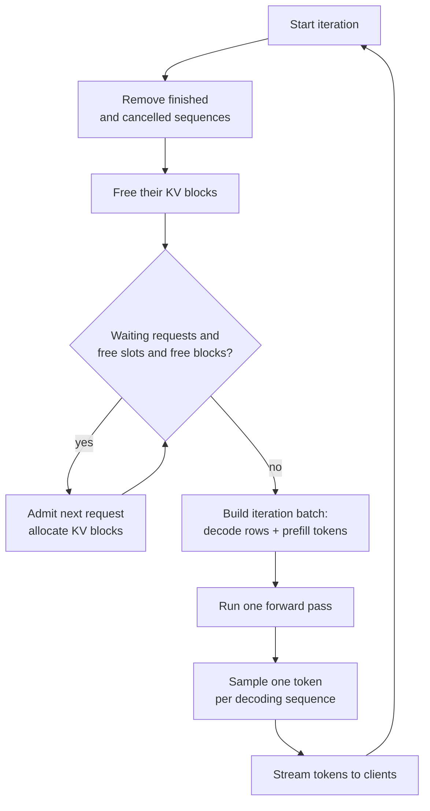

The diagram is the scheduler loop in an engine such as vLLM or SGLang. Three details carry the cost. First, admission depends on memory as well as on slot count: a request is admitted only if enough KV blocks are free for its prompt, with a policy for what to do when generation later needs more blocks than remain (Section 7.3). Second, the batch mixes prefill work and decode work in one forward pass, which is what makes chunked prefill (Section 12) possible. Third, streaming tokens to clients occurs inside the loop, so a slow consumer must never block the loop; the engine writes to a buffer and the network layer drains it.

Continuous batching needs a model forward pass that tolerates a ragged batch: sequences of different lengths, at different stages, in one call. Orca introduced selective batching, which batches the operations that do not depend on sequence length (the matrix multiplications) and handles attention per sequence, since each sequence attends over its own cache. Modern attention kernels (Section 8) take a list of sequence lengths and block tables for this purpose.

### 6.4 Simulator results

The script [02_batching_simulator.py](../code/python/inference-serving-chapter/02_batching_simulator.py) simulates all three request-level and iteration-level policies on the same arrival trace. The cost model is

$$
t_{\text{iter}}=C_0+C_1\,n_{\text{dec}}+C_2\,n_{\text{pf}},
$$

where $n_{\text{dec}}$ is the number of sequences decoding in the iteration and $n_{\text{pf}}$ the number of prompt tokens prefilled in it. The constants are $C_0=18.5$ ms (the weight-read floor, shaped like the 70B example in Section 4), $C_1=0.22$ ms per sequence (KV reads), and $C_2=0.07$ ms per prefilled token (compute-bound prefill, about 14,000 tokens per second). The maximum is 32 concurrent sequences. Prompt lengths are lognormal with median about 665 tokens and mean about 980, and output lengths are lognormal with median about 148 and mean about 198 tokens. The goodput SLO is TTFT at most 2 seconds and TPOT at most 60 ms. These numbers are an illustrative model, not a measurement of any engine.

| Arrival rate | Policy | TTFT p50 (s) | TTFT p99 (s) | TPOT p50 (ms) | TPOT p99 (ms) | Output tokens/s | Goodput |
|---|---|---:|---:|---:|---:|---:|---:|
| 1 req/s | static, batch 32 | 17.13 | 37.17 | 24.1 | 25.5 | 201 | 1.2% |
| 1 req/s | dynamic, 50 ms window | 6.02 | 16.82 | 20.5 | 22.9 | 201 | 10.9% |
| 1 req/s | continuous | 0.08 | 0.41 | 20.9 | 27.4 | 202 | 100% |
| 2 req/s | static, batch 32 | 15.27 | 30.63 | 24.1 | 25.5 | 393 | 0.1% |
| 2 req/s | dynamic, 50 ms window | 17.18 | 31.05 | 23.9 | 25.5 | 390 | 0.7% |
| 2 req/s | continuous | 0.09 | 0.44 | 24.1 | 33.5 | 399 | 100% |
| 4 req/s | static, batch 32 | 178.41 | 355.24 | 24.1 | 25.5 | 403 | 0.1% |
| 4 req/s | dynamic, 50 ms window | 185.03 | 371.79 | 24.0 | 25.5 | 394 | 0.5% |
| 4 req/s | continuous | 0.16 | 2.22 | 33.7 | 47.5 | 778 | 98.3% |

Reading the table:

- **At 1 request per second, the static policy's TTFT is 17 seconds.** The server sits idle waiting for 32 requests to accumulate. Dynamic batching with a 50 ms window cuts the median to 6 seconds, but the batch is then small and runs to completion before the next batch can start, so arrivals queue behind it. Continuous batching has a median TTFT of 80 ms because each request is admitted at the next iteration.
- **Request-level capacity saturates at about 2 requests per second.** Throughput stops at about 400 output tokens per second for both static and dynamic policies at rates of 2 and 4 requests per second, and the queue grows without bound (a median TTFT of 178 seconds at 4 requests per second). At those rates continuous batching sustains 778 tokens per second, about twice the request-level maximum, while keeping a p99 TTFT of 2.2 seconds.
- **TPOT is the price of the extra throughput.** Per-token latency under continuous batching rises from 21 ms at 1 request per second to 34 ms at 4 requests per second because the batch is fuller and each iteration reads more cache. Request-level policies show a flat TPOT of 24 ms because their batches are always the same size, but their users wait minutes for the first token.
- **Goodput separates the policies more than throughput does.** At 2 requests per second the throughput numbers differ by 2 percent between the three policies, yet goodput is under 1 percent for the request-level ones and 100 percent for continuous batching, because nearly every request under the first two misses the TTFT SLO.

The simulator is a model. It omits memory-driven admission limits, the network, tokenization, and kernel launch overhead, all of which add to real latencies. It shows the mechanism and the relative size of the effect, and that is what a design review needs. Published results on real engines point the same way; the vLLM paper (Kwon et al., SOSP 2023) reports multiple-fold throughput gains over earlier systems at the same latency, from the combination of iteration-level scheduling and paged memory. Those multiples depend on the workload and baseline, so verify them against your own traffic.

### 6.5 When request-level batching is still right

Dynamic batching is not obsolete. It is the correct policy for any model with fixed per-request cost: embedding, reranking, speech encoders, image classifiers, and the encoder side of encoder-decoder models. For these, the server picks a maximum batch size from the latency-throughput curve and a short maximum delay from the latency budget. A reranker with a 25 ms budget might wait up to 5 ms to collect a batch. The rule for generative models is different because the cost per request varies by an order of magnitude and the work is split into many steps.

## 7. The KV cache as a managed resource

[CH10 Section 13](CH10_Transformers_and_Attention.md) explains why the cache exists and how to size it. In serving the cache is the scarce resource that limits concurrency, and an engine manages it like an operating system manages memory.

### 7.1 Growth and the concurrency ceiling

Section 5.2 gave the per-token cost of the 70B example: 327,680 bytes. The cache for one sequence grows by that amount at every decode step, so memory use is a ramp. A request with an 1,100-token prompt that generates 200 tokens occupies 360 MB at the end of prefill and 426 MB when it finishes. The ceiling on concurrent sequences is the free memory divided by the average cache a sequence will hold at its peak, and it falls linearly as contexts lengthen.

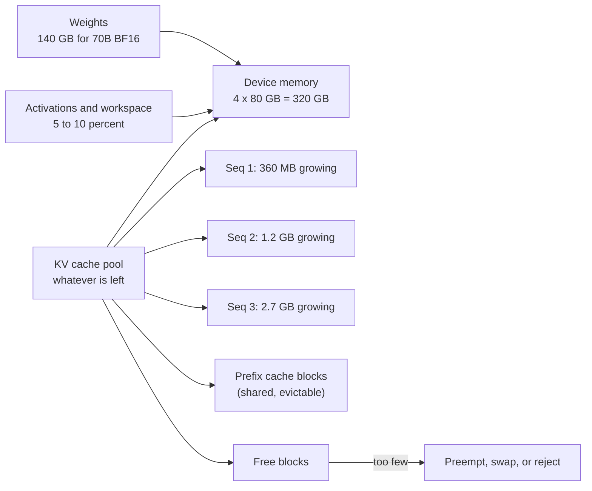

The figure shows the memory budget the engine builds at startup. Weights are fixed. Engines typically run a profiling pass to measure peak activation memory, reserve a configurable fraction of device memory (a parameter such as `gpu_memory_utilization` in vLLM), and give the rest to the block pool. Everything in the lower half competes for the same pool: live sequences, the prefix cache, and free space. When free blocks run out, the engine must preempt something (Section 7.3) or refuse new work (Section 13).

### 7.2 The fragmentation problem

Before block-based allocation, engines reserved a contiguous region per sequence sized for its maximum possible length, since a contiguous tensor was the simplest layout for the attention kernel. This wastes memory in three ways, which Kwon et al. (2023) name in the vLLM paper.

1. **Reservation waste.** Space reserved for tokens that will be generated later, but not yet used. If the maximum length is 8,192 and the sequence will stop at 1,300, 84 percent of its reservation is never touched.
2. **Internal fragmentation.** Space reserved for the maximum length but never used because the sequence stops early. Over the whole life of the sequence this is the same space as above, now seen at the end.
3. **External fragmentation.** Gaps between regions of different sizes, which cannot be merged into one region large enough for a new sequence.

The vLLM paper measured that in prior systems only about 20 to 40 percent of KV cache memory held real token state. The remainder was reserved or fragmented.

**Worked example.** Take the 70B group with 148 GB free for the cache. Suppose the engine reserves for the maximum context of 8,192 tokens. One reservation is $8192\times327{,}680=2.68$ GB, so the group fits $\lfloor148/2.68\rfloor=55$ sequences. If the average sequence actually holds 1,100 tokens (360 MB), then 55 sequences use 19.8 GB of real state, and the utilization of the pool is $19.8/148=13.4$ percent. With exact allocation, 148 GB holds $148/0.360\approx410$ such sequences. The reservation policy costs a factor of about seven in concurrency, and therefore a factor of about seven in cost per token if the workload is concurrency-limited.

### 7.3 PagedAttention and block allocation

PagedAttention (Kwon et al., 2023; [arXiv 2309.06180](https://arxiv.org/abs/2309.06180)) borrows virtual memory from operating systems. The cache is divided into fixed-size **blocks**, each holding the keys and values of a fixed number of tokens, commonly 16. Each sequence has a **block table** that maps its logical token positions to physical blocks anywhere in the pool. The attention kernel is written to gather keys and values through the block table, so a sequence's cache need not be contiguous.

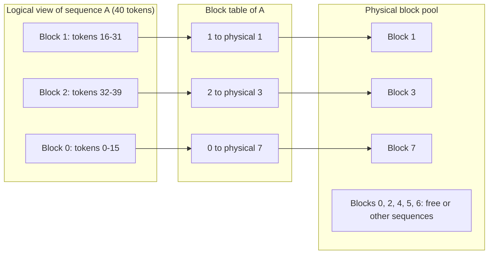

The diagram shows one sequence whose three logical blocks sit in non-adjacent physical blocks. Allocation is on demand: the engine allocates a new block when the last block fills, so reservation waste disappears. The only waste is the unfilled tail of each sequence's last block, at most $\text{block size}-1$ tokens, on average about 8 tokens for a block of 16.

**Worked example, continued.** One block of 16 tokens for the 70B group is $16\times327{,}680=5.24$ MB. Average internal waste is about 8 tokens, or 2.6 MB per sequence. For a sequence of 1,100 tokens (360 MB) that is 0.7 percent. The pool holds about $148/(0.360+0.0026)\approx408$ sequences instead of 55, an increase of 7.4 times over the reservation policy with no change in the hardware.

Other consequences of block-based allocation:

- **Sharing and copy-on-write.** Several sequences can point to the same physical block. Parallel sampling (several answers from one prompt) and beam search share the prompt's blocks. When a sequence writes into a shared block it first copies the block, as an operating system does with a forked page. This is also the mechanism behind prefix caching (Section 7.4).
- **Block size trade-off.** A small block wastes less at the tail and shares at finer granularity, but it makes the block table larger and makes the gather less efficient on the hardware. A large block does the reverse. Sixteen tokens is a common default, and some engines expose it as a parameter. At the time of writing, verify the defaults of the engine you run.
- **Running out of blocks.** Because allocation is on demand, the pool can be exhausted while sequences are mid-generation. The engine must **preempt** one or more sequences. There are two ways to do it. *Recompute* frees the sequence's blocks and later re-runs prefill over its prompt and the tokens it has generated so far. *Swap* copies the blocks to host memory and back. Recompute costs compute, and swap costs transfer bandwidth and host memory. Section 7.6 compares them. Preemption protects the engine from out-of-memory crashes at the price of a latency spike for the victim, and a high preemption rate is a signal that the pool is too small for the admission policy.
- **Watermarks.** Engines hold back a small fraction of blocks when admitting new requests so that already running sequences have room to grow. Without a watermark, a burst of admissions fills the pool, every running sequence then needs a block at the next step, and the engine thrashes between admitting and preempting.

### 7.4 Prefix caching and its economics

Many requests share a long prefix: a system prompt, a tool schema, a few-shot block, a document the user asks several questions about, or the conversation history of a chat that grows by one turn at a time. The keys and values for that prefix are the same each time, because a causal model's cache for token $i$ depends only on tokens $1,\dots,i$. **Prefix caching** keeps the blocks of finished or running sequences and reuses them when a new request begins with the same tokens.

The standard implementation hashes each full block together with the hash of the preceding block, so a block's identity encodes its entire prefix. A new request computes the chain of hashes for its prompt, looks each up, and reuses the longest run of matching blocks, prefilling only the remainder. SGLang's RadixAttention (Zheng et al., 2023) organizes cached sequences as a radix tree with the same effect and an LRU (least recently used) eviction policy over leaves.

**Economics.** Reuse saves prefill compute and cuts TTFT, and it costs cache memory held for the chance of reuse. Both sides can be computed.

- *Savings.* A cached prefix of $m$ tokens saves $2Nm$ FLOPs of prefill and about $m/14{,}129$ seconds of group time in the 70B example. For a 2,000-token system prompt that is 0.142 seconds per request. At 4 requests per second, a hit on every request frees $4\times0.142=0.57$ group-seconds per second, more than half of one four-GPU group.
- *Cost.* Holding the prefix costs $2000\times327{,}680=655$ MB, 0.44 percent of the 148 GB pool, and it is stored once however many requests use it.

The ratio of savings to cost is very favorable for hot prefixes and falls for rare ones. A prefix is worth holding if the expected prefill time saved by keeping it, $\lambda_p\,m/r_{\text{pf}}$ for arrival rate $\lambda_p$ of requests with that prefix and prefill rate $r_{\text{pf}}$, exceeds the value of the memory it displaces. Engines approximate this with LRU.

**Hit rate and fleet size.** The hit rate is not a property of the workload alone. It depends on how the load balancer distributes requests. Suppose a prefix is requested at total rate $\lambda_p$ spread randomly over $R$ replicas, and a replica keeps the prefix resident for a time $T$ after its last use. If arrivals at one replica are Poisson with rate $\lambda_p/R$, the probability that the next one arrives while the prefix is still resident is $1-e^{-\lambda_p T/R}$. With $\lambda_p=0.4$ per second and $T=60$ s, 8 replicas give $1-e^{-3}=95$ percent, while 64 replicas give $1-e^{-0.375}=31$ percent. The same traffic gets a third of the benefit when the fleet is eight times larger, because each replica sees the prefix too rarely to keep it. The fixes are cache-aware routing (route requests with the same prefix hash to the same replica, with a fallback when that replica is overloaded) or a shared cache tier (Section 7.6). [Part 17 CH08](../17_AI_Architecture/CH08_Model_Gateway_Routing_and_Fallback_Architecture.md) owns the gateway side of that routing.

**Prompt structure decides the hit rate.** Only a prefix can be reused, so anything that varies must come after anything that repeats. Put the system prompt, tool definitions, and policy text first, then retrieved context, then the user's question. A timestamp, a request ID, or a user name placed at the top of the prompt changes the first block and invalidates every later block. The common mistake is a "current date and time" line at the start of the system prompt. It makes the hit rate zero, and the fix is to move it to the end or round it to the day.

**Security.** Prefix reuse leaks timing. A request that hits the cache has a lower TTFT than one that misses, so an attacker who can send requests and measure TTFT can test whether another user's prompt began with a guessed prefix. This is a real side channel that has been discussed in the research literature on LLM serving. The mitigations are to isolate caches per tenant (include a tenant identifier or cache salt in the first block's hash), to share only prefixes that are public to all users of the cache (a system prompt), and to avoid exposing precise timing to untrusted clients. Cache isolation costs hit rate because tenants no longer share, so the decision belongs to the threat model. [CH30](CH30_AI_Data_Governance_Privacy_and_Provenance.md) covers the data-governance side.

### 7.5 KV cache quantization

The cache can be stored at lower precision than the activations that produced it. Storing keys and values in 8-bit formats (INT8, or FP8 in the E4M3 or E5M2 formats) halves the bytes per token. For the 70B example that is 160 KiB per token and doubles the number of cached tokens, and it halves the KV bytes read per decode step, which matters when the KV traffic dominates (the batch 512 row of Section 4.4). Four-bit caches double the gain again, at a higher quality risk.

Keys and values behave differently. Key vectors can contain outlier channels, so research methods such as KIVI (Liu et al., 2024) quantize keys per channel and values per token. Per-head or per-token scale factors are stored with the quantized data, which adds a small overhead. The kernel dequantizes on the fly inside the attention computation, so the extra cost is arithmetic that decode has spare. The risk is quality loss on long contexts, where small errors in many cached keys accumulate in attention scores. Test KV quantization on the longest contexts you serve, and on retrieval-style tasks (needle-in-a-haystack, multi-document question answering), not only on short chat prompts.

### 7.6 KV cache offload and transfer

When the pool is full, the choice is between dropping a sequence's cache and recomputing it later, or moving it to a larger and slower memory tier. The comparison for the 70B group and an 8,192-token sequence:

- **Recompute.** Prefill of 8,192 tokens takes $8192/14{,}129=0.58$ s of group time.
- **Swap to host memory.** The cache is 2.68 GB. Over a host link of about 64 GB/s each way (a PCIe Gen 5 x16 theoretical rate, with real transfers lower), the copy takes $2.68/64=42$ ms in each direction. Even at half the nominal rate it is about 85 ms, so swapping is several times cheaper than recompute for long sequences, but it consumes host memory and link bandwidth that other sequences also use.

Offload is therefore attractive for long, idle, or likely-to-return sequences (a chat paused while the user reads) and for cold prefix blocks. Some systems extend the idea to a tiered store with GPU memory, host memory, local NVMe, and remote storage, and to cache sharing between machines. Mooncake (Qin et al., 2024), the serving platform behind a Chinese consumer chatbot service, is a published example of a KV-cache-centric architecture with a disaggregated cache pool. NVIDIA's Dynamo and the LMCache project describe similar tiers; at the time of writing, these are fast-moving, so check each project's documentation for the current feature set before relying on one.

Reducing the cache at the model level is the other lever: grouped-query attention (Ainslie et al., 2023) shares KV heads across query heads, multi-head latent attention (introduced in DeepSeek-V2, 2024) compresses the cache into a low-rank latent, and sliding-window layers cap the cache for some layers. These are model-design choices taken at training time, so the serving team inherits them and should include cache bytes per token when choosing between candidate models.

## 8. Attention kernels and FlashAttention

[CH10 Section 11](CH10_Transformers_and_Attention.md) explains the quadratic cost of attention. This section covers the kernel-level idea that makes long prompts practical, at the depth an architect needs to read an engine's release notes.

### 8.1 The memory problem inside attention

Standard attention computes the score matrix $S=QK^{\top}/\sqrt{d_h}$ for each head, applies a softmax row by row, and multiplies by $V$. A straightforward implementation writes $S$ to device memory, reads it back for the softmax, writes the probabilities, and reads them again for the multiplication. For a prompt of 8,192 tokens and 32 query heads in BF16 the score matrix per layer per sequence is $32\times8192\times8192\times2=4.3$ GB. That is too large to keep, and the repeated trips through memory make the operation slow even where the FLOPs are cheap. Attention at long lengths becomes memory-bound, even in prefill.

### 8.2 Tiling and the online softmax

FlashAttention (Dao et al., 2022; [arXiv 2205.14135](https://arxiv.org/abs/2205.14135)) avoids materializing $S$. It splits $Q$, $K$, and $V$ into tiles small enough to fit in the on-chip memory of the GPU (shared memory and registers, which are much faster than the main device memory, called HBM for high-bandwidth memory). It computes attention for one tile of queries against one tile of keys at a time and accumulates the result.

The difficulty is the softmax, which normalizes over a whole row. The solution is the **online softmax**: for each query row keep a running maximum $m$ and a running sum of exponentials $\ell$. When a new tile of scores arrives with local maximum $m'$, rescale the previous partial output and the running sum by $e^{m-m_{\text{new}}}$, add the new tile's contribution, and update $m$ and $\ell$. After the last tile, divide by $\ell$. The result equals the exact softmax attention (up to floating-point rounding), so FlashAttention is an exact algorithm and not an approximation.

The effect is that the score matrix never exists in memory. Extra memory is linear in sequence length instead of quadratic, and the traffic to HBM drops because each tile of $K$ and $V$ is read once per tile of queries and intermediate results stay on-chip. The arithmetic count is unchanged, and the speedup comes entirely from moving fewer bytes. This is the clearest example of a roofline argument in the field: the kernel was memory-bound, so reducing bytes made it faster.

### 8.3 Variants

- **FlashAttention-2** (Dao, 2023) restructures the loops and work partitioning to raise utilization of the GPU's compute units and parallelize over the sequence dimension.
- **FlashAttention-3** (Shah et al., 2024) targets the Hopper generation, with asynchronous data movement and low-precision FP8 support. It requires the hardware features of that generation.
- **Flash-decoding** addresses the decode case. With one query row and a long cache there is little parallelism over queries, so the kernel splits the key-value sequence across thread blocks and combines partial softmax results. Without it, a single long sequence in decode uses a fraction of the GPU. This matters for long-context serving at small batch sizes.
- **Paged attention kernels** read keys and values through block tables (Section 7.3). They are the kernels engines use in decode.
- **Multi-query and grouped-query kernels** exploit the shared KV heads to reuse loaded cache across query heads in a group.

### 8.4 What the architect needs to know

Three practical points. First, the engine picks an attention backend at startup based on hardware, data type, head size, and features such as sliding windows, soft-capping, or custom masks. An unsupported combination falls back to a slower path with no error. Check the engine's startup log for the selected backend, and rerun a benchmark after changing the model, the data type, or the engine version. Second, kernels are tied to hardware generations, so an upgrade of GPU generation can change which optimizations are available (FP8 attention, for example). Third, FlashAttention helps most for long prompts in prefill, where it prevents out-of-memory errors and speeds the phase up, and in long-context decode through flash-decoding. For short prompts at batch sizes where weight reads dominate, attention kernels are not the bottleneck and switching them gains little.

## 9. Quantization

Quantization stores numbers in fewer bits. In serving it attacks the central cost identified in Section 4: bytes read per token. It also reduces memory footprint, which frees space for the KV cache or lets a model fit on fewer devices. [CH20](CH20_Fine_Tuning_PEFT_and_LoRA.md) covers quantized fine-tuning (QLoRA). This section covers quantization for inference.

### 9.1 The basic mechanism

Affine quantization maps a real value $x$ to an integer $q$ with a scale $s$ and zero point $z$:

$$
q=\operatorname{clip}\!\big(\operatorname{round}(x/s)+z,\;q_{\min},\;q_{\max}\big),\qquad \hat{x}=s\,(q-z).
$$

For a $b$-bit signed integer in **symmetric** quantization, $z=0$ and $s=\max|x|/(2^{b-1}-1)$. For 8 bits the integer range is $-127$ to $127$, and for 4 bits it is $-7$ to $7$. The rounding error for each value is at most $s/2$, and if the values are spread evenly across a bin the error variance is $s^2/12$. Two consequences follow. The error is proportional to the scale, so one extreme value in a group stretches the scale and degrades the precision of every other value in that group. And fewer bits mean larger bins: going from 8 to 4 bits multiplies the scale by $127/7\approx18$ for the same range.

The standard defence against outliers is **grouping**: compute a separate scale for each small group of weights (commonly 64 or 128 consecutive values along the input dimension), so an outlier only damages its own group. The scales are stored in 16-bit format, which adds $16/128=0.125$ bits per weight for a group of 128.

**Worked example: memory.** For the 70B model, BF16 weights occupy $70\times10^{9}\times2=140$ GB. INT8 weights occupy 70 GB. INT4 with group size 128 uses $4+0.125=4.125$ bits per weight, which is $70\times10^{9}\times4.125/8=36.1$ GB. The 4-bit model fits on a single 80 GB device with $72-36.1=35.9$ GB left for the cache, whereas BF16 needs at least two devices and in practice four.

### 9.2 What to quantize: weights, activations, and cache

| Format name | Weights | Activations | KV cache | Main gain | Where it helps |
|---|---|---|---|---|---|
| W16A16 | BF16 | BF16 | BF16 | Reference | |
| W8A16 | INT8 | BF16 | BF16 | Memory, bandwidth | Decode at small batch |
| W4A16 | INT4 | BF16 | BF16 | Memory, bandwidth (about 3.5x fewer bytes) | Decode, fitting on fewer devices |
| W8A8 | INT8 or FP8 | INT8 or FP8 | any | Compute (2x tensor-core rate) and bandwidth | Prefill and large-batch decode |
| FP8 KV | any | any | FP8 | Cache capacity, KV bandwidth | Long contexts, high concurrency |
| W4A4, FP4 families | 4-bit | 4-bit | any | Compute and bandwidth | Newer hardware with 4-bit tensor cores |

Weight-only quantization ("WxA16") shrinks bytes but computes in 16-bit: the kernel loads packed integers, dequantizes in registers, and multiplies in BF16. It helps where the step is memory-bound (decode at small and moderate batch) and does nothing for the FLOPs, so it does not speed up a compute-bound prefill. Weight-and-activation quantization ("WxAx") also runs the matrix multiplication in low precision on the tensor cores, which doubles the peak FLOP rate for 8-bit formats on supporting hardware. It helps compute-bound work and costs more quality risk because activations are harder to quantize than weights.

**Roofline estimate.** Return to the 70B decode at batch 1, context 2,000. With 4-bit grouped weights ($4.125$ bits), the bytes per step drop from 140 GB to 36.1 GB. On the same four devices the memory time becomes $(36.09+0.655)\times10^{9}/(4\times2.345\times10^{12})=3.92$ ms, and with the 1.29 ms communication floor the step is 5.21 ms, a speedup of $16.29/5.21=3.1$ times over BF16. The speedup is below the byte ratio of 3.9 because communication does not shrink. A better configuration is to drop tensor parallelism: one device holds the 36 GB of weights and its step is $(36.09+0.655)\times10^{9}/2.345\times10^{12}=15.7$ ms, about the same speed as the BF16 four-device step but with a quarter of the hardware. That is a four-fold improvement in tokens per GPU-dollar at batch 1. Real kernels add dequantization overhead, so measured gains are smaller than these upper bounds, and they shrink as the batch grows because the step moves toward compute-bound.

### 9.3 Algorithms for weight quantization

Rounding every weight to the nearest grid point (round-to-nearest, RTN) works for 8-bit but damages quality at 4 bits. The main post-training methods differ in what they correct.

- **GPTQ** (Frantar et al., 2022; [arXiv 2210.17323](https://arxiv.org/abs/2210.17323)) quantizes a layer one column at a time and, after rounding each column, adjusts the remaining unquantized weights to compensate for the error just introduced. The adjustment uses second-order information, the Hessian of the layer's output error with respect to its weights, estimated from a small calibration set as $H=2XX^{\top}$ where $X$ holds the layer's input activations. The idea descends from the Optimal Brain Surgeon pruning method. GPTQ needs a few hundred calibration samples and takes minutes to hours for a large model.
- **AWQ** (Activation-aware Weight Quantization, Lin et al., 2023; [arXiv 2306.00978](https://arxiv.org/abs/2306.00978)) observes that a small fraction of weight channels (about 1 percent) matter far more than the rest, and that they are identified by the magnitude of the *activations* that multiply them, not by the weights. It scales those channels up before quantizing, which reduces their relative rounding error, and folds the inverse scale into the preceding operation. It needs no backpropagation and little calibration data.
- **SmoothQuant** (Xiao et al., 2022; [arXiv 2211.10438](https://arxiv.org/abs/2211.10438)) targets W8A8. Activations in large models have a few channels with very large magnitudes (outliers, observed at scale by Dettmers et al., 2022, in LLM.int8()), which makes per-tensor activation quantization lose most values to a coarse scale. Weights have no such outliers. SmoothQuant moves difficulty from activations to weights with a per-channel scale: for channel $j$, $s_j=\max|X_j|^{\alpha}/\max|W_j|^{1-\alpha}$, then it computes $Y=(X\,\operatorname{diag}(s)^{-1})(\operatorname{diag}(s)\,W)$. The product is mathematically unchanged, but the rescaled activations are easier to quantize and the rescaled weights absorb the difficulty. The parameter $\alpha$ between 0 and 1 sets the balance; 0.5 is a common default.
- **LLM.int8()** (Dettmers et al., 2022) keeps the few outlier feature dimensions in 16-bit and quantizes the rest in 8-bit with vector-wise scales, at a throughput cost from the mixed-precision decomposition.
- **FP8** (floating-point with 8 bits) has two common layouts: E4M3 (4 exponent bits, 3 mantissa bits, more precision, range up to 448) for weights and activations, and E5M2 (5 exponent bits, 2 mantissa bits, wider range) for gradients. Hopper-generation and later GPUs have FP8 tensor cores with twice the BF16 peak. A floating-point format handles outliers better than INT8 at the same width because the step size grows with magnitude, so FP8 often needs only per-tensor or per-channel scales and little or no calibration search. It is the lowest-friction path to a compute speedup on supported hardware.
- **4-bit floating-point formats** (such as the micro-scaling MXFP4 and NVIDIA's NVFP4) store blocks of values with a shared scale and are supported in hardware on the newest GPU generation. At the time of writing, support and quality depend on the model, engine, and hardware, so verify before planning around them.

### 9.4 A decision flow

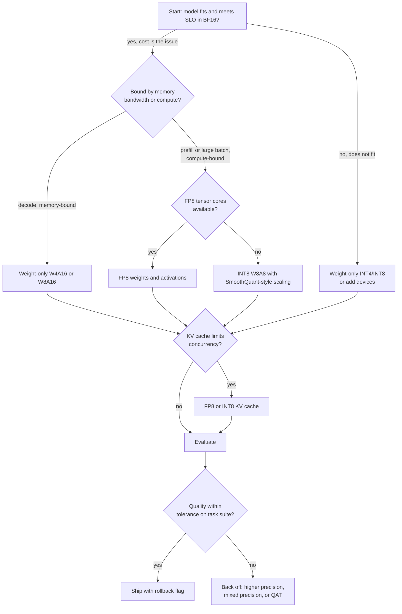

The flow encodes the rule that the bottleneck chooses the technique. Weight-only schemes win when bytes dominate, activation quantization wins when FLOPs dominate, and cache quantization wins when capacity limits concurrency. The final test is quality, and it is a gate with a rollback, not a formality.

### 9.5 Evaluating quality after quantization

Perplexity on a general text corpus is the cheapest check and is a poor stopping criterion. A model can keep its perplexity within a fraction of a percent and still degrade on the tasks that matter, because perplexity averages over easy tokens. The evaluation should cover:

1. **The product's own task set**, the held-out examples and graders from [CH24](CH24_Generative_AI_Evaluation_Guardrails_and_Hallucinations.md), run on the quantized and reference models with identical prompts and decoding settings.
2. **Capabilities that quantization attacks first**: multi-step arithmetic and code (small numerical errors compound along a reasoning chain), long-context retrieval, low-resource languages and rare tokens, strict formats (JSON validity, tool-call syntax), and instruction following at the end of long prompts.
3. **Safety behavior**: refusal rates, jailbreak resistance, and over-refusal, since post-training behavior can shift under quantization.
4. **Calibration drift**: if downstream code uses token probabilities for thresholds or routing, compare the distributions.

**Sample size.** Two models are compared on the same prompts, so the comparison is paired. Let $d$ be the fraction of prompts on which exactly one model is correct (the discordant fraction). The standard error of the accuracy difference is about $\sqrt{d/n}$. To detect a true drop of $\delta$ with a two-sided test at 5 percent significance and 80 percent power, the needed number of prompts is roughly

$$
n\approx\frac{(z_{0.975}+z_{0.8})^{2}\,d}{\delta^{2}}=\frac{(1.96+0.84)^{2}\,d}{\delta^{2}}.
$$

With $d=0.06$ and $\delta=0.01$, $n\approx7.84\times0.06/0.0001\approx4{,}700$ prompts. A 200-prompt smoke test cannot see a one-point regression; it can only catch a collapse. State the minimum detectable effect that the product can tolerate and size the test to it. For generative tasks, grade with the same judge and use multiple samples per prompt if temperature is above zero, to separate model change from sampling noise.

### 9.6 When quantization breaks

- **Small models.** A 7B-class model has less redundancy than a 70B-class one, and 4-bit quantization typically costs more quality on the former. Test per model, not per method.
- **Outlier-heavy activations.** W8A8 with per-tensor scales collapses if an activation outlier channel is not handled, which is the failure SmoothQuant and LLM.int8() address.
- **Calibration mismatch.** GPTQ and AWQ calibrate on a sample. If the sample is English web text and the product is code or Japanese, the chosen scales fit the wrong distribution. Calibrate on production-like data.
- **Mixture-of-experts models.** Rarely used experts see few calibration tokens, and router decisions can flip under small numerical changes.
- **Long contexts and cache quantization.** Errors accumulate in attention scores over many cached positions. Test at the longest context served.
- **Kernel support.** A quantized checkpoint is only fast if the engine has a kernel for its format, group size, and hardware. An unsupported layout dequantizes to 16-bit and runs slower than the original. Always benchmark the checkpoint in the target engine, not just on the quality set.
- **Silent behavior change in format.** Models trained or fine-tuned at low precision (quantization-aware training) can reach 4-bit with less loss than post-training methods. When the vendor publishes a quantized variant of the model, use it in preference to producing your own, then run your own evaluation anyway.

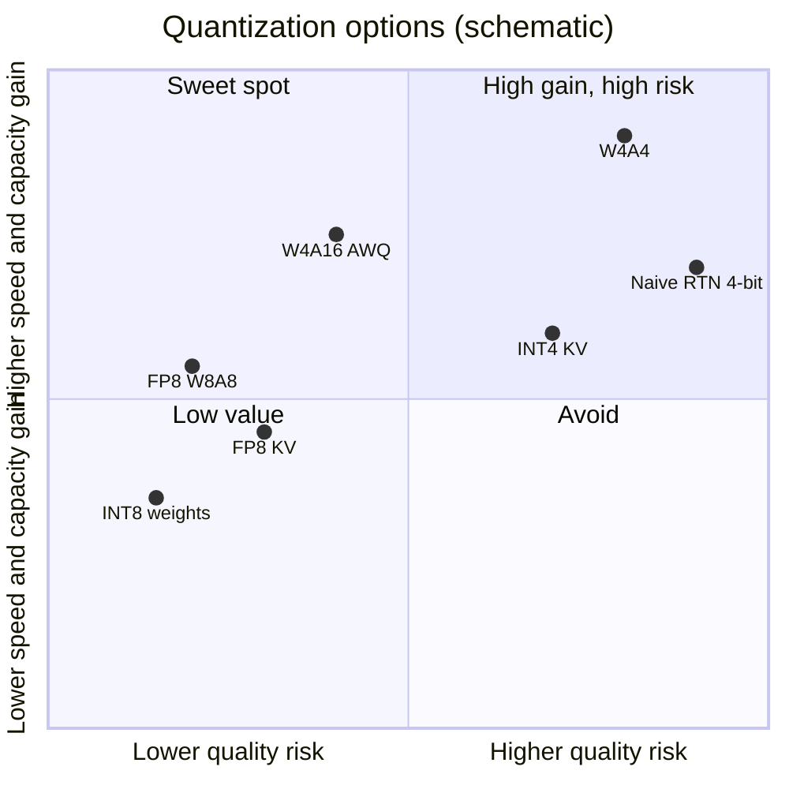

The chart ranks options by a typical pattern, not by measurements. The pattern to take from it: 8-bit weights and FP8 cost little quality for a moderate gain, well-calibrated 4-bit weights give the largest gain at a quality risk that must be measured, and naive rounding at 4 bits has the same gain as calibrated methods with a worse outcome, so it should be avoided.

## 10. Speculative decoding

Decode is slow because each token needs a full read of the weights and produces only one token per sequence (Section 4). **Speculative decoding** attacks that directly. A cheap process proposes several future tokens, and the large model checks all of them in one forward pass. Where the proposals are right, one weight read yields several tokens. The method was introduced independently by Leviathan, Kalman, and Matias (2023; [arXiv 2211.17192](https://arxiv.org/abs/2211.17192)) and by Chen et al. (2023; [arXiv 2302.01318](https://arxiv.org/abs/2302.01318)).

### 10.1 Why verification is cheap

A forward pass over $k+1$ new positions of a single sequence reads the same weights as a pass over one position. In the memory-bound regime of Section 4 the time barely changes: for the 70B example, 5 query rows cost about 0.35 ms of compute against 15 ms of weight reads. Checking five proposed tokens therefore costs almost the same as generating one. The speedup depends on how many proposed tokens survive.

### 10.2 The algorithm

One round proceeds as follows.

1. A **draft** mechanism proposes $k$ tokens $x_1,\dots,x_k$ autoregressively, with draft probabilities $q(x_i)$ at each position.
2. The **target** model runs one forward pass over the current context plus all $k$ drafted tokens and produces its own distributions $p$ at every position, including position $k+1$.
3. Going left to right, accept draft token $x_i$ with probability $\min\!\big(1,\,p(x_i)/q(x_i)\big)$. At the first rejection, discard the remaining drafts and sample a replacement token from the *residual* distribution proportional to $\max\!\big(0,\,p(x)-q(x)\big)$.
4. If all $k$ are accepted, sample one more token from the target's distribution at position $k+1$ for free.

The residual-sampling rule makes the output distribution *exactly* equal to the target's, so the technique is lossless for sampling. For greedy decoding the rule reduces to "accept while the draft token equals the target's argmax". The important property for an architect is that speculative decoding does not change the answer's distribution, only the speed, provided the implementation is correct and numerical differences between the batched verification pass and a one-token pass are negligible. In practice small numerical differences can change a greedy output in rare cases, so a regression test should compare distributions or task scores, not require bit-identical text.

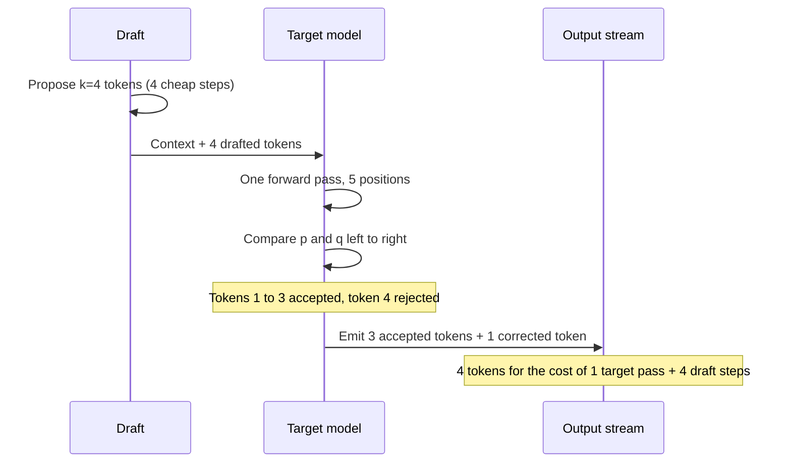

The round in the diagram yields 4 tokens (three accepted plus the corrected one) for one target pass and four draft steps. If the draft is 20 times cheaper than the target, the four draft steps cost about 0.2 target steps, so the round costs 1.2 target steps for 4 tokens.

### 10.3 The expected speedup formula

Assume each drafted token is accepted independently with probability $\alpha$ (the acceptance rate; $\alpha=1-\mathrm{TV}(p,q)$ averaged over positions, where TV is total variation distance). The number of accepted drafts is the length of the run of acceptances before the first rejection, capped at $k$. A round always produces the accepted drafts plus one more token (the corrected token on rejection, or the bonus token when all are accepted). The probability that at least $i$ drafts are accepted is $\alpha^{i}$, so the expected tokens per round is

$$
E[\text{tokens}]=1+\sum_{i=1}^{k}\alpha^{i}=\frac{1-\alpha^{k+1}}{1-\alpha}.
$$

Let $c$ be the cost of one draft step divided by the cost of one target step. A round costs $1+kc$ target steps (one verification pass plus $k$ draft steps). The speedup in time per token over plain decoding is

$$
S(\alpha,k,c)=\frac{1-\alpha^{k+1}}{(1-\alpha)(1+kc)}.
$$

**Worked example.** With $\alpha=0.8$, $k=4$, $c=0.05$: $E=(1-0.8^{5})/(1-0.8)=(1-0.32768)/0.2=3.36$ tokens per round. The cost is $1+4\times0.05=1.2$. The speedup is $3.36/1.2=2.80$. The script [03_speculative_decoding.py](../code/python/inference-serving-chapter/03_speculative_decoding.py) confirms $E$ by Monte Carlo: formula 3.362, simulated 3.357 over 200,000 rounds.

The table below is the script's output for $c=0.05$.

| Acceptance $\alpha$ | $k=1$ | $k=2$ | $k=3$ | $k=4$ | $k=5$ | $k=6$ | $k=8$ | Best $k$ in 1 to 8 |
|---:|---:|---:|---:|---:|---:|---:|---:|---:|
| 0.5 | 1.43 | 1.59 | 1.63 | 1.61 | 1.57 | 1.53 | 1.43 | 3 |
| 0.6 | 1.52 | 1.78 | 1.89 | 1.92 | 1.91 | 1.87 | 1.77 | 4 |
| 0.7 | 1.62 | 1.99 | 2.20 | 2.31 | 2.35 | 2.35 | 2.28 | 6 |
| 0.8 | 1.71 | 2.22 | 2.57 | 2.80 | 2.95 | 3.04 | 3.09 | 8 |
| 0.9 | 1.81 | 2.46 | 2.99 | 3.41 | 3.75 | 4.01 | 4.38 | 8 |

Three lessons come out of the table. The best number of drafted tokens grows with acceptance: with $\alpha=0.5$, drafting beyond three tokens wastes draft work, and with $\alpha=0.9$ even eight is worth it. The gain from acceptance is steep, since moving from $\alpha=0.7$ to $0.9$ at $k=4$ raises the speedup from 2.31 to 3.41. And draft cost matters: at $\alpha=0.8$ and $k=4$ the speedup is 3.11 for $c=0.02$, 2.80 for $c=0.05$, 2.40 for $c=0.10$, 1.87 for $c=0.20$, and 1.29 for $c=0.40$. A draft model that costs 40 percent of the target barely pays.

The independence assumption is an approximation. Real acceptance varies by position and by content: it is high on boilerplate and code, and low at points of genuine choice in a sentence. The formula is a planning tool; measure the acceptance rate per workload, and when it varies a lot, use the distribution of accepted lengths instead of a single $\alpha$.

### 10.4 Where the draft comes from

- **A smaller model of the same family**, such as a 1B or 8B model drafting for a 70B model. The draft needs the same tokenizer and similar training data for the acceptance rate to be high. It costs memory for its weights and for its own KV cache, and a draft that is too large (high $c$) loses the gain.
- **Prompt lookup or n-gram drafting.** Propose the continuation of the last matching n-gram found earlier in the prompt. It needs no model and works well for tasks that copy from the context: summarization with quotes, code editing, retrieval-augmented answers that quote passages, and structured extraction. It is near-zero cost ($c\approx0$) and has a low acceptance on free-form text.
- **Medusa** (Cai et al., 2024; [arXiv 2401.10774](https://arxiv.org/abs/2401.10774)) adds extra prediction heads on top of the target model's last hidden state, each predicting a token several positions ahead, and verifies a tree of candidates in one pass using a tree attention mask. There is no separate model, but the heads must be trained, and the candidate tree widens the verification pass.
- **EAGLE** (Li et al., 2024; [arXiv 2401.15077](https://arxiv.org/abs/2401.15077)) drafts at the feature level: a small network predicts the target's next hidden state from the previous hidden states and sampled tokens, and then the target's own output head converts it to token probabilities. Reported acceptance rates are higher than for a standalone small model at similar cost, and later versions extend the idea. The trade-off is again a training step per target model.
- **Built-in multi-token prediction** is available in some recent model families trained with multi-token objectives, whose extra prediction modules double as drafters. This is a property of the model release, so check the model card.

Tree-structured drafts verify several candidate continuations at once. They raise the expected accepted length at the cost of a wider verification pass, which is cheap only while the pass stays memory-bound.

### 10.5 The interaction with batching

Speculative decoding converts spare compute into speed. That is only possible while there is spare compute. At a large batch the verification pass has $B(k+1)$ rows and can cross the ridge, so extra rows are no longer free. Model verification time as $\max(1,\,B(k+1)/R)$ target steps, where $R$ is the batch at which the pass becomes compute-bound (the script uses $R=150$ as an illustration), and compare it with plain decoding at $\max(1,B/R)$. For $\alpha=0.8$ and $c=0.05$:

| Batch $B$ | $k=2$ | $k=4$ | $k=8$ |
|---:|---:|---:|---:|
| 1 | 2.22 | 2.80 | 3.09 |
| 8 | 2.22 | 2.80 | 3.09 |
| 32 | 2.22 | 2.65 | 1.87 |
| 64 | 1.77 | 1.44 | 1.02 |
| 128 | 0.92 | 0.75 | 0.54 |
| 256 | 0.80 | 0.66 | 0.47 |

At batch 1 to 8, the gain is the full 2.2 to 3.1 times. At batch 64 it falls to 1.0 to 1.8 times and prefers a smaller $k$. At batch 128 and above it is a net loss (below 1.0), because the target spends compute verifying tokens that are then thrown away. Speculative decoding is therefore a latency tool for lightly loaded or latency-critical deployments, and a throughput tool only when decode is far from the ridge. Engines handle this by disabling speculation or shrinking $k$ adaptively as the batch grows. A fleet that runs hot (high batch) all day gets little from it, and a fleet with strict TPOT SLOs at low concurrency (an interactive coding assistant, a voice agent) gets the most.

### 10.6 Operational notes

Speculation changes the cost model. The draft needs memory and extra kernels; acceptance varies by traffic mix, so a change in the user population can erode the gain without any code change. Monitor the acceptance rate and the average accepted length as first-class metrics. Compare the output of speculative and plain decoding on a held-out set for equivalence at the level of task scores (Section 9.5's method applies). Turn it off under overload. Structured decoding (Section 18.4) and speculation interact: grammar constraints can be applied to the draft to raise acceptance, but the implementation must apply the same mask on both sides.

## 11. Parallelism and communication cost

When a model does not fit on one device, or one device is too slow for the latency target, the model is split across devices. Each split style puts a different communication pattern into the critical path. [CH27](CH27_AI_Infrastructure_and_Platform_Components.md) recaps tensor and pipeline parallelism at the placement level. This section gives the communication arithmetic.

### 11.1 Data parallelism (replicas)

Replicate the whole model on independent groups and spread requests among them. There is no communication in the critical path, scaling is linear, and failure of one replica loses only its share. This is the default for any model that fits on a device or a small tensor-parallel group. Larger models still use data parallelism across groups, so the question is only how big each group must be.

### 11.2 Tensor parallelism

Tensor parallelism (TP) splits each weight matrix across $n$ devices (Megatron-LM, Shoeybi et al., 2019). In a transformer block the usual layout splits the attention projections by head and the first feed-forward matrix by column, so each device computes a slice independently. The output projection and the second feed-forward matrix are split by row, so each device produces a *partial sum* of the full output that must be added across devices. That addition is an **all-reduce**, and it occurs twice per layer: after attention and after the feed-forward block.

An all-reduce of a tensor of $S$ bytes on $n$ devices with a ring algorithm moves $2\frac{n-1}{n}S$ bytes per device. In the 70B example $S=P\,d\,b$ for $P$ tokens in the pass, model width $d=8192$, and $b=2$ bytes.

- **Decode, $P=1$:** $S=16$ KB. The transfer time is trivial, and the cost is the fixed latency of launching and synchronizing a collective, on the order of 5 to 10 microseconds in good conditions. With $2\times80=160$ collectives per step, that is $1.3$ ms (assuming 8 µs), which is the communication term in Section 4.4. It does not shrink with a faster link, and it grows with $n$ in practice.
- **Prefill, $P=2000$:** $S=2000\times8192\times2=32.8$ MB. On $n=4$ the volume is $1.5\times32.8=49.2$ MB per device per all-reduce, and $160$ all-reduces move $7.9$ GB per device. At an effective 300 GB/s on an NVLink-class link, that is $26$ ms, or about 18 percent of the 142 ms compute time. If the devices were connected only by PCIe at roughly 25 GB/s effective, the same traffic would take about $315$ ms, more than doubling the prefill time.

Tensor parallelism therefore needs a fast interconnect, and it is confined in practice to devices that share a high-bandwidth domain, typically the 8 GPUs of one server, and in some rack-scale systems a larger domain. At the time of writing, verify the size of the fast domain for your hardware. TP reduces the latency of a single step because each device reads only $1/n$ of the weights, and it increases the memory available for the cache. It does not scale throughput per dollar linearly, because communication and synchronization time do not divide by $n$.

### 11.3 Pipeline parallelism

Pipeline parallelism (PP) assigns consecutive groups of layers to different devices (stages). Only the activations at the stage boundary move, $P\,d\,b$ bytes once per boundary, which is small and point-to-point, so PP tolerates slower links, including the network between servers. The cost is the **pipeline bubble**. If a batch is split into $m$ micro-batches that flow through $p$ stages, stages are idle for a fraction

$$
\text{bubble}=\frac{p-1}{m+p-1}
$$

of the time. For $p=4$ and $m=8$, the bubble is $3/11=27$ percent. For one request in decode ($m=1$), the bubble is 75 percent of the pipeline: the token passes through the stages one after another and PP gives no latency benefit, only more total memory. For inference, PP raises throughput when many independent micro-batches are in flight and lets a model span servers, but it never shortens the single-stream step. It also exposes imbalance: if one stage has more layers or the embedding and output head, every other stage waits for it. The usual design is TP inside a server and PP across servers, used only when the model does not fit inside one server's fast domain.

### 11.4 Expert parallelism

Mixture-of-experts (MoE) models (covered in [CH10](CH10_Transformers_and_Attention.md)) replace each feed-forward block with many expert networks, and each token uses only a few. **Expert parallelism** (EP) places different experts on different devices. A token's hidden state is sent to the devices that hold its selected experts and returned after processing, through two **all-to-all** exchanges per MoE layer. The volume per exchange is $P\,k_e\,d\,b$ for $P$ tokens each routed to $k_e$ experts.

Two properties are particular to serving. First, **the bandwidth saving of sparsity fades with batch size.** Per token only $k_e$ of $E$ experts are active, but a batch of $B$ tokens touches an expert unless all $B$ miss it. For a model with $E=256$ routed experts and $k_e=8$, the chance that a given expert is untouched by $B=64$ tokens is $(1-8/256)^{64}=0.131$, so 87 percent of the experts' weights are read in that step. At small batch the model reads little (good for latency), and at moderate batch it reads nearly everything, so decode bandwidth looks like a dense model with the *total* parameter count, not the active count. Second, **load imbalance.** Routing is learned, and popular experts receive more tokens. The step waits for the most loaded device, and balance in training does not guarantee balance on production traffic. Engines replicate hot experts or rebalance placement. Large-scale MoE serving deployments, such as those described by DeepSeek for its V3 and R1 models, use a large expert-parallel group over many nodes with careful overlap of communication and compute. That is expert territory, and a team without MoE-specific serving experience is usually better served by a managed endpoint for such models.

### 11.5 Sequence and context parallelism

For very long prompts, even a single sequence's prefill does not fit comfortably on one TP group, and attention is quadratic. **Sequence parallelism** (or context parallelism) splits the sequence across devices. In prefill, ring attention (Liu et al., 2023) passes blocks of keys and values around a ring of devices while each computes attention for its slice of queries, overlapping communication with compute; DeepSpeed-Ulysses (Jacobs et al., 2023) instead redistributes by attention head using all-to-all. In decode, splitting the KV cache of one very long sequence across devices parallelizes the cache read (the flash-decoding idea at device scale). These techniques matter at hundreds of thousands to millions of tokens. For prompts under about 32,000 tokens, standard TP plus chunked prefill is usually adequate, and the engineering effort of context parallelism rarely pays.

### 11.6 Choosing

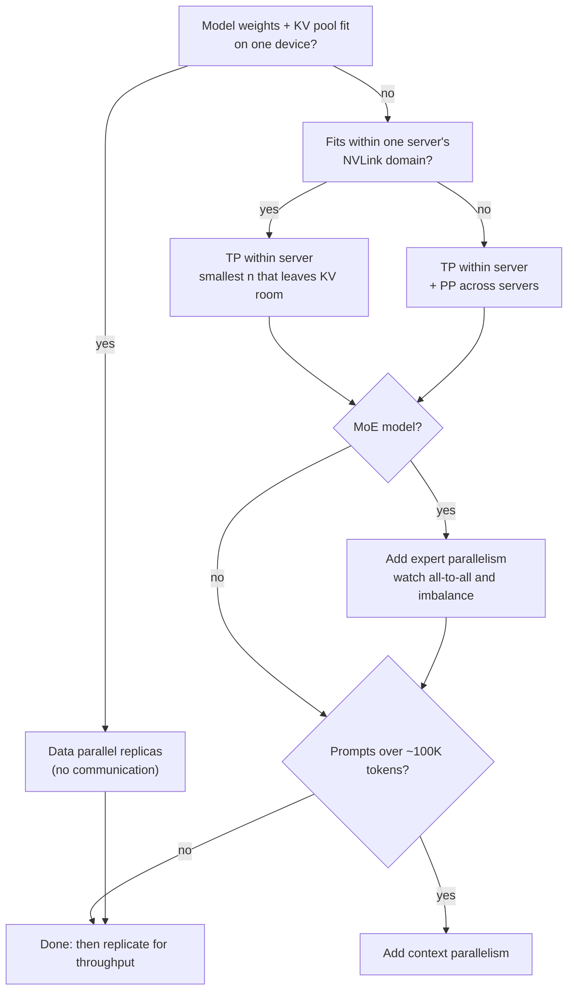

The decision tree encodes a rule of thumb: use the least model parallelism that gives you memory and latency, then add replicas for throughput. Each extra TP degree buys memory headroom and lower step time at the price of communication, and a replica adds throughput at no communication cost. Because TP degree also changes the free cache memory (Section 5.2: TP=8 held 162 sequences against 55 for TP=4 in the 70B example), the cheapest configuration per token is sometimes a larger TP group than the weights need. Evaluate candidate degrees with the throughput curve for your workload.

## 12. Chunked prefill and prefill/decode disaggregation

Prefill and decode have opposite resource profiles (Section 3), yet they share a device and an iteration. Two techniques deal with the interference.

### 12.1 The interference problem

Without chunking, an iteration that includes a new prompt takes as long as the prefill. For the 70B example, a 24,000-token prompt needs $24000/14{,}129\approx1.7$ s of compute. Every sequence decoding in that iteration sees a gap of 1.7 s between tokens instead of 20 ms. In the simulator, 5 percent of prompts at 24,000 tokens at 2 requests per second push TPOT p99 from 33 ms (no long prompts) to 91 ms, and TTFT p99 from 0.44 s to 3.3 s (the last two rows of the table in Section 12.3). Short requests behind a long prefill are the **head-of-line blocking** failure.

### 12.2 Chunked prefill

**Chunked prefill** splits a long prompt into chunks and processes one chunk per iteration, alongside the decoding sequences. This is the idea of the Sarathi-Serve system (Agrawal et al., 2024; [arXiv 2403.02310](https://arxiv.org/abs/2403.02310)), which calls the resulting schedule *stall-free batching*. The scheduler fixes a **token budget** per iteration, the maximum total number of tokens (decode rows plus prefill tokens) in one forward pass. Decode rows go first, because each decoding sequence needs exactly one row. The rest of the budget is filled with prompt tokens from waiting or partially prefilled requests.

The roofline gives a principled budget. In the 70B example at batch 64, the memory time for the step is 19.4 ms and each token of compute costs $2N/(F_{\text{eff}})=1.4\times10^{11}/1.978\times10^{15}=0.071$ ms. The iteration becomes compute-bound when the total tokens exceed $19.4/0.071\approx274$, which is 64 decode rows plus roughly 210 prompt tokens. Up to that point prefill tokens ride on the weight read that decode already pays for, so they are nearly free in iteration time. Beyond it, each added prompt token adds 0.071 ms to every decoding sequence's TPOT. The budget is thus a direct dial between TTFT for long prompts and TPOT for everyone else:

- A budget of 512 tokens extends a 64-row decode iteration from about 21.5 ms to roughly $(512+64)\times0.071+2.1=43$ ms, and a 24,000-token prompt completes in about 47 iterations, roughly 2 seconds. Decoders see 43 ms gaps instead of a 1.7 s gap.
- A budget of 256 tokens gives an iteration of about $(256+64)\times0.071+2.1=25$ ms and takes about 94 iterations (2.4 seconds) for the same prompt.
- A budget of 2,048 tokens gives about 150 ms iterations. The prompt finishes in 12 iterations but each decoder stalls 150 ms.

There are two costs. Total prefill takes longer (more iterations, each re-reading weights and, for later chunks, the cache of earlier chunks), and the long prompt's own TTFT rises. Chunked prefill buys interactivity for everyone else at the expense of the long-prompt request. It is the correct trade when the long prompts are rare or less latency-sensitive than the short ones.

### 12.3 Simulator evidence

The simulator in [02_batching_simulator.py](../code/python/inference-serving-chapter/02_batching_simulator.py) applies the budget as a cap on prefill tokens per iteration. On the mixed workload (2 requests per second, 5 percent of prompts at 24,000 tokens), it gives:

| Policy | TTFT p50 (s) | TTFT p99 (s) | TPOT p50 (ms) | TPOT p99 (ms) | Goodput (TTFT ≤ 2 s, TPOT ≤ 60 ms) |
|---|---:|---:|---:|---:|---:|
| No long prompts, continuous (reference) | 0.09 | 0.44 | 24.1 | 33.5 | 100% |
| Long prompts, whole-prompt prefill | 0.11 | 3.31 | 26.5 | 90.9 | 92.9% |
| Long prompts, chunk budget 512 | 0.21 | 5.19 | 27.5 | 58.5 | 80.7% |
| Long prompts, chunk budget 2048 | 0.12 | 2.91 | 26.9 | 87.6 | 92.4% |

The result is not what a one-sided account of chunking would predict, and it is the honest one. Chunking at 512 tokens brings TPOT p99 under the 60 ms SLO (58.5 against 90.9 ms), but it raises TTFT p99 from 3.3 to 5.2 seconds, because every prompt now waits for its chunks to interleave with decode work, and under this SLO pair the goodput falls from 93 to 81 percent. A budget of 2,048 tokens sits near the unchunked behavior. Whether chunking wins depends on which SLO binds. If TPOT p99 is the promise (streaming smoothness), use a small budget. If the first token matters more and long prompts are 5 percent of traffic, a larger budget or a separate pool for long prompts may serve better. The budget is a tunable, and the evidence for a setting comes from replaying your traffic.

### 12.4 Prefill/decode disaggregation

Chunking limits interference within one device. **Disaggregation** removes it by running prefill and decode on different pools of devices. A request is prefilled on a prefill-pool replica, its KV cache is transferred over the network to a decode-pool replica, and decode proceeds there. The idea was developed in Splitwise (Patel et al., 2023; [arXiv 2311.18677](https://arxiv.org/abs/2311.18677)), DistServe (Zhong et al., 2024; [arXiv 2401.09670](https://arxiv.org/abs/2401.09670)), and production-scale systems such as Mooncake.

```mermaid
sequenceDiagram
    participant R as Router
    participant P as Prefill pool replica
    participant X as KV transfer
    participant D as Decode pool replica
    participant C as Client
    R->>P: Request with prompt
    P->>P: Prefill (compute-bound)
    P-->>C: First token
    P->>X: KV blocks, layer by layer
    X->>D: Blocks arrive over network
    D->>D: Join continuous batch
    loop each decode step
        D-->>C: Next token
    end
```

The figure shows the path. The first token can come from the prefill replica (it already has the last-position logits), so TTFT is prefill time and does not include the transfer. Decode starts when the KV blocks arrive.

The benefits follow from specialization. The prefill pool runs compute-bound work at high MFU with modest batch sizes and can use a TP degree chosen for the TTFT target. The decode pool runs large batches of memory-bound work with a TP degree chosen for cache capacity and TPOT. Neither interferes with the other, so TTFT and TPOT SLOs can be met independently. DistServe frames the benefit as higher goodput under both SLOs than colocated serving.

**Transfer cost.** The KV cache of a 2,000-token prompt in the 70B example is 655 MB. Over a 400 Gb/s network link (50 GB/s), that is 13 ms. Over a 100 Gb/s link it is 52 ms. An 8,000-token prompt is 2.6 GB: 52 ms at 400 Gb/s and 210 ms at 100 Gb/s. Compare with prefill time of 142 ms for 2,000 tokens and 566 ms for 8,000 tokens. Transfers are overlapped with prefill by sending each layer's blocks as soon as that layer finishes, which hides most of the cost, but the network must carry sustained traffic at the prefill rate. At 14,129 tokens per second, the prefill pool emits $14{,}129\times327{,}680=4.6$ GB/s of KV traffic per 4-GPU replica, about 37 Gb/s. A rack of such replicas needs a fabric that can carry it without competing with other traffic.

**Sizing.** The two pools must be sized in proportion to the workload. In the capacity example of Section 20 with a prefix cache, prefill demand is 4.42 group-seconds per second and decode demand 8.75, a ratio of about 1 to 2. If the traffic mix shifts (longer prompts, shorter answers), one pool becomes the bottleneck while the other idles. The system therefore needs two autoscaling loops and a router that balances between replicas of each type.

**When not to disaggregate.** Disaggregation adds failure modes (a lost transfer, a stalled decode pool), a second fleet to operate, a dependence on network bandwidth, and stranded capacity when the ratio drifts. For a fleet below a few dozen devices, chunked prefill achieves most of the benefit with none of that complexity. The decision rule: disaggregate when strict TTFT and TPOT SLOs must hold together, the fleet is large enough that two pools each have enough replicas to be efficient, the interconnect is fast, and chunked prefill has been tried and measured as insufficient. Engines are adding support, and at the time of writing the maturity differs between engines, so confirm what the one you run supports.

## 13. Scheduling, priority, admission control, and queueing

Sections 6 to 12 describe what happens inside an iteration. This section covers what happens before a request is admitted to one, and what the system does when demand exceeds capacity. [Part 17 CH07](../17_AI_Architecture/CH07_Inference_Serving_and_Model_Placement.md) places the queue in the larger architecture. The mechanics are here.

### 13.1 The request lifecycle

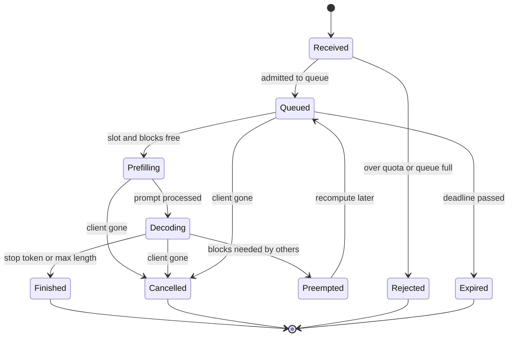

The state machine lists every exit. A production system must account for requests in each terminal state in its metrics: rejected, expired, cancelled, and finished requests have different costs and different meanings for the SLO. A common fault is counting only finished requests, which hides the rejections that make the finished ones look fast.

### 13.2 Queueing arithmetic

Queueing theory explains why latency explodes near full utilization. For a single server with Poisson arrivals at rate $\lambda$ and exponential service at rate $\mu$ (the M/M/1 queue), utilization is $\rho=\lambda/\mu$, and the mean time in the system is

$$
W=\frac{1}{\mu-\lambda}=\frac{1}{\mu}\cdot\frac{1}{1-\rho}.
$$

The factor $1/(1-\rho)$ is 2 at $\rho=0.5$, 5 at 0.8, 10 at 0.9, and 20 at 0.95. Kingman's approximation for a general single server adds the effect of variability: the mean wait in the queue is approximately

$$
W_q\approx\frac{\rho}{1-\rho}\cdot\frac{c_a^{2}+c_s^{2}}{2}\cdot\bar{s},
$$

where $c_a^{2}$ and $c_s^{2}$ are the squared coefficients of variation of inter-arrival and service times and $\bar{s}$ is the mean service time. LLM service times are highly variable (output lengths span an order of magnitude, so $c_s^{2}$ is at or above 1), so waits are longer than for the M/M/1 case.

A serving replica is not a single server. It has many slots (32 sequences in the simulator), which behaves like a multi-server queue. Pooling many servers makes the system tolerate higher utilization before delays appear, but the cliff still comes. The script [04_load_model_and_capacity.py](../code/python/inference-serving-chapter/04_load_model_and_capacity.py) simulates 32 slots with a mean service time of about 8.4 seconds (capacity 3.87 requests per second):

| Offered load | Utilization | p50 (s) | p95 (s) | p99 (s) |
|---|---:|---:|---:|---:|
| 2.0 req/s | 52% | 7.0 | 18.7 | 28.9 |
| 3.5 req/s | 91% | 8.6 | 21.9 | 31.3 |
| 3.8 req/s | 98% | 40.5 | 68.6 | 77.0 |
| 4.2 req/s | 109% | 277.3 | 526.6 | 542.6 |

With 32 servers the system is nearly flat up to 90 percent utilization (median 8.6 seconds against 7.0 at light load) and then collapses between 91 and 98 percent. Above 100 percent, delay grows for as long as the overload lasts: the 4.2 req/s run has a median of 277 seconds, and it would be longer in a longer run. A fleet sized for 95 percent average utilization has no margin against the burstiness of real traffic. The practical rule is to provision so that peak utilization stays at 60 to 80 percent on the binding resource, and the lower end of that range for small pools, high service variance, or slow scale-up.

### 13.3 Little's Law

For any stable system, the long-run average number of items in the system equals the arrival rate times the average time each spends there:

$$
L=\lambda W.
$$

The law makes no assumption about arrival or service distributions, which is why it is so useful. It gives four serving calculations.

1. **Concurrency.** At 4 requests per second with a 9-second mean residence, $L=36$ requests are in flight. A replica with 32 slots needs at least 2 replicas at full slot occupancy. At a 70 percent slot-occupancy ceiling, it needs $\lceil36/(32\times0.7)\rceil=2$ replicas (1.6 rounded up), which leaves almost no room for growth.
2. **KV memory.** Each request holds on average its prompt plus half its output during its residence. For 1,500 prompt tokens and 250 output tokens, that is $1500+125=1625$ tokens, or $1625\times327{,}680=533$ MB. Thirty-six requests in flight hold $36\times0.533=19.2$ GB. The pool of 148 GB supports $148/0.533\approx277$ requests in flight, so at a 9-second residence the memory-limited arrival rate is $277/9=30.8$ requests per second. Compute usually binds first: the 4-GPU group in Section 20 handles less than that.
3. **Queue length from delay.** If the mean queue wait is $W_q=2$ s at 4 requests per second, the mean queue length is $L_q=\lambda W_q=8$ requests. A queue depth alarm at 8 is the same statement as a queue wait alarm at 2 seconds.
4. **Drain time.** If 60 requests are waiting and capacity exceeds arrivals by 0.4 requests per second (4.4 against 4.0), the backlog shrinks at 0.4 per second and drains in $60/0.4=150$ seconds. A small surplus drains a backlog slowly, so recovery from an overload lasts far longer than the overload itself. This is the arithmetic behind the idea that autoscaling lag is expensive (Section 16).

### 13.4 Admission control

A server that accepts everything fails in a specific way: the queue grows, queue wait exceeds what any user will tolerate, requests complete after the client has given up, and the work spent on them is waste. Admission control keeps the queue short enough that admitted requests can meet their deadline.

- **Bound the queue by age, not count.** An admission rule such as "reject when the estimated wait exceeds the TTFT budget minus the prefill time" ties the decision to the SLO. An estimate of the wait is the tokens queued ahead divided by the current prefill throughput.
- **Count tokens, not requests.** A request with a 30,000-token prompt is not the same load as one with 300. Limit tokens in flight (prompt plus the output budget) per replica and per tenant.
- **Reject early and clearly.** Return an HTTP 429 (too many requests) or 503 (service unavailable) with a `Retry-After` header, and not a request that hangs. A fast rejection costs microseconds, and a slow timeout costs a held connection and the work done on it.
- **Do not start doomed work.** A request whose deadline has already passed when it reaches the head of the queue should be dropped without prefill.
- **Cap what the product allows.** Maximum prompt tokens, maximum output tokens, and maximum context are admission parameters. A cap on output length is a cap on cache growth and on the worst-case slot-hold time.
- **Make retries safe.** Clients that retry immediately on failure double the load in an overload. Require exponential backoff with jitter, retry budgets (for example, no more than 10 percent of recent requests may be retries), and idempotency keys for requests that have side effects. A retry storm is a common cause of an overload outliving its trigger.

### 13.5 Priority and fairness

Interactive and batch traffic have different value per second of latency. A scheduler can serve them from one pool with **priority classes**: interactive requests are admitted first, and batch requests fill the remaining capacity and are preempted when interactive load rises. Strict priority can starve low classes, so add aging (a waiting request's priority rises with its wait) or a reserved fraction of capacity for each class. Per-tenant fairness is a separate concern: a tenant that sends a flood of long prompts should not degrade others. Sheng et al. (2024) propose a virtual token counter that tracks the weighted tokens each client has received and serves the client with the lowest counter first, which gives max-min fairness in token service. Simpler platforms use per-tenant rate limits and token-bucket quotas at the gateway.

Another lever is shortest-job-first ordering. Because the output length is unknown, schedulers use a predicted length (from a small classifier or from the request's `max_tokens`) and favor shorter jobs, which lowers mean latency at the risk of starving long ones. Treat it as an optimization of mean latency that needs an aging guard.

When two traffic types have conflicting needs (interactive chat with a 2-second TTFT and a bulk summarization job that prefers a 200-token batch budget), the simplest dependable design is separate pools, with the batch pool using spare capacity during troughs. Part 17 CH08 treats the routing side.

## 14. Streaming and cancellation

Streaming sends tokens as they are generated, and it changes failure handling.

### 14.1 Transports

Server-sent events (SSE) over HTTP are the common choice: one long-lived response, text frames, automatic reconnect support in browsers, and compatibility with ordinary load balancers. WebSocket supports bidirectional traffic and suits voice and realtime applications. gRPC server streaming is typical between services. All of them must survive intermediaries. Reverse proxies and content-delivery networks may buffer a response until it reaches a size or a time limit, which removes the streaming effect; disable response buffering on the streaming route and verify with a test that measures the arrival time of the first byte at the client, not at the server. Idle timeouts are another trap. A reasoning model may produce no visible token for 30 to 90 seconds while it works through hidden tokens, and a proxy with a 60-second idle timeout will cut the connection. Send periodic keep-alive comments (SSE allows lines beginning with a colon) or emit a progress event.

### 14.2 Cancellation

A client that closes the page, presses a stop button, or times out leaves a running sequence in the engine. Without cancellation propagation, the engine finishes generating tokens that nobody will read, holding a batch slot and cache blocks.

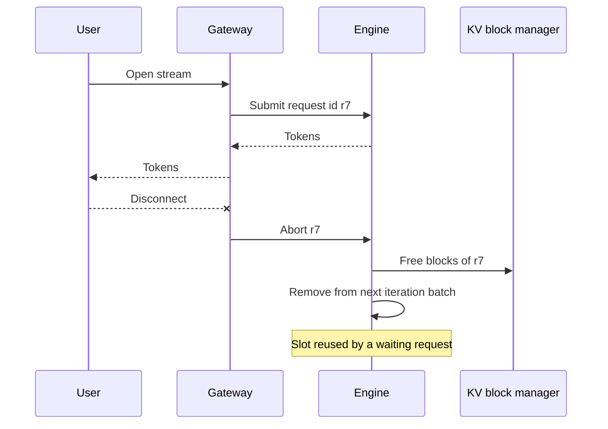

The path must exist at every hop: client to gateway (connection close is detected through a write error or a disconnect event), gateway to engine (an explicit abort call, not just closing the upstream socket on some frameworks), and engine to cache (blocks freed and the slot returned in the next iteration). The common breakage is a hop in the middle that holds the connection open, for example a proxy that keeps reading from the engine into a buffer after the client has left.

**Arithmetic.** Suppose 10 percent of requests are abandoned on average after 100 of the 250 output tokens they would have produced. Without cancellation propagation, the wasted decode work is $0.10\times150/250=6$ percent of all output tokens, plus the cache held for the extra seconds. With the average residence at 9 seconds and abandoned requests holding slots for the remaining 6 seconds, the slot-time waste is about $0.10\times6/9=6.7$ percent of slot capacity. If users retry after abandoning, the waste doubles for those requests. These are small percentages in normal times and a large fraction of capacity during overload, when abandonment rates rise.

### 14.3 Backpressure and slow readers

A client that reads slowly (a mobile device on a bad link) should not stall the engine. The engine writes tokens into a bounded per-request buffer and the network layer drains it. If the buffer fills, the options are to drop the connection, to pause that sequence (taking it out of the batch while holding its cache), or to let the buffer grow to a limit. Pausing holds memory for a request that is not progressing, so cap the pause time. The engine's main loop must never block on a client socket.

### 14.4 Partial output, retries, and safety

A stream cannot be un-sent. Three consequences follow.

- **Output moderation.** If an output classifier must approve text before the user sees it, either buffer a window of tokens and release after the check (adding delay equal to the window), or accept that a violating span may be shown and then retracted, which is a product decision. [CH24](CH24_Generative_AI_Evaluation_Guardrails_and_Hallucinations.md) owns the guardrail design; the serving constraint is that a hold-and-release buffer adds latency, and a cancel after emission cannot recall what was displayed.
- **Retry after a mid-stream failure.** If an engine fails after 120 tokens, a plain retry restarts the answer, and the user sees the text change. Options are to hide the failure by buffering the first part, to retry transparently and discard the partial text on the client, or to resume by sending the partial answer back as a prefix for the model to continue (this works when the partial text is a valid prefix and the cost of reprefill is acceptable). Choose by product, and document it.
- **Tool side effects.** A generation that triggers a tool call with an external effect (sending an email, creating a ticket) must not be retried blindly. Attach an idempotency key to each tool call and make the tool layer deduplicate. [Part 17 CH08](../17_AI_Architecture/CH08_Model_Gateway_Routing_and_Fallback_Architecture.md) covers retries at the gateway.

Token boundaries inside multi-byte characters require the client to buffer incomplete bytes, as [CH15](CH15_Large_Language_Model_Fundamentals_and_Inference.md) explains.

## 15. Model loading, warm pools, and cold start

A replica of a large model takes minutes to become ready. That delay determines how fast the fleet can respond to demand, and it is where a fleet that looks fine on a steady-state benchmark fails in practice.

### 15.1 What cold start contains

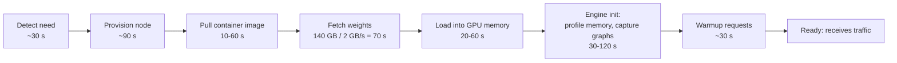

The figure lists the stages with illustrative durations. Each stage can dominate depending on where the fleet runs.

- **Provisioning and image pull.** A new GPU node may need to be allocated by the cloud provider (minutes when capacity is tight, with a risk of no availability at all), and the container image with CUDA libraries and the inference engine is several gigabytes.
- **Fetching weights.** At 140 GB for a BF16 70B model and an effective 2 GB/s from object storage, the download takes 70 seconds. A 36 GB 4-bit checkpoint takes 18 seconds at the same rate. Tensor-parallel replicas each fetch only their shard, but if the four devices share one network interface, the aggregate rate is the interface's. Weight transfer is the stage that scales with model size.
- **Loading to the device.** Deserializing into pinned host memory and copying to the GPU over PCIe takes tens of seconds. File formats that memory-map tensors (such as safetensors) avoid a copy, and direct storage-to-GPU paths reduce it further.
- **Engine initialization.** The engine runs a profiling pass to determine how much memory remains for the cache, may compile kernels, and captures CUDA graphs for common batch sizes, which can take tens of seconds to minutes. Skipping graph capture shortens startup and slows decode steps.
- **Warmup.** The first requests exercise code paths and caches. A replica that reports ready before warmup serves its first requests slowly.

The total in this example is 280 seconds when provisioning is included. This is the number to use in the scale-up lag arithmetic in Section 16.

### 15.2 Reducing cold start

| Technique | Mechanism | Effect and cost |
|---|---|---|
| Quantized checkpoint | Fewer bytes to move | 3 to 4 times faster fetch; quality evaluation needed |
| Node-local weight cache | Weights on local NVMe or in the page cache, keyed by model digest | Fetch becomes local read (tens of seconds); disk space per node |
| Peer-to-peer distribution | New replica pulls from running replicas over the cluster network | Avoids object-store limits; adds load to serving nodes |
| Pre-pulled images and pre-provisioned nodes | Image resident, node already exists | Removes the first 100 seconds or so; idle node cost |
| Reduced graph capture | Capture fewer batch sizes or defer | Faster start, slower steady-state steps for uncovered shapes |
| Warm pool | Replicas already loaded and idle | Lag falls to detect plus routing; pays for idle GPUs |
| Snapshot and restore | Restore engine state from a snapshot | Fast start; experimental and engine-specific at the time of writing |

### 15.3 Warm pools

A **warm pool** keeps replicas fully loaded and warmed but not yet counted as serving capacity, or serving only low-priority traffic that can be preempted. When the controller scales out, it promotes a warm replica instead of loading a cold one. The cost is idle devices. Two spare 4-GPU groups at \$4.00 per GPU-hour cost $8\times4\times730=\$23{,}360$ per month. The benefit is the difference in the lag: in the example of Section 16, a 60-second lag instead of 280 seconds reduces the peak backlog from 1,660 to 52 group-seconds. The warm pool is insurance, and its size is set by the largest burst you want to absorb during the cold-start time: pool size $\ge$ ramp rate $\times$ cold-start time, bounded by what is economical. An alternative is to keep the warm replicas busy with batch work that is evicted when needed, which converts idle cost into useful work at the cost of eviction machinery.

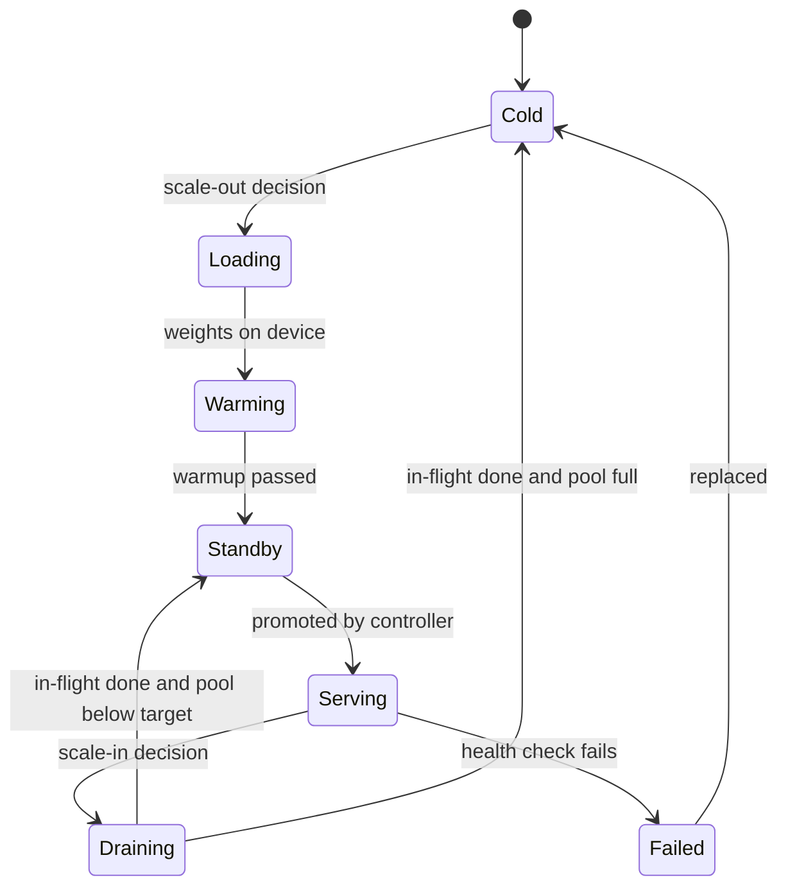

The state machine adds the **standby** state between loaded and serving, and a path back from draining to standby so a recently needed replica does not unload immediately. The controller moves replicas along these edges, and it exposes the count in each state as a metric.

### 15.4 The thundering herd

When many replicas start together (a rollout of a new model version, a regional restart after an outage, a node pool upgrade), each pulls the full weights. Twenty replicas fetching 140 GB is 2.8 TB. Object stores and registries have per-prefix and per-account limits, and shared network links saturate, so each replica's fetch slows and the total time grows far beyond the single-replica 70 seconds. Meanwhile traffic is hitting the fleet, and replicas that report ready early take all of it. Defenses:

- Roll out in batches with a maximum surge and a maximum number unavailable, so the fleet keeps serving capacity.
- Use a node-local cache and peer distribution so the origin is read once per node (or once per cluster).
- Gate readiness on a successful warmup request, and use a *startup* probe with a long timeout separate from the liveness probe, so the orchestrator does not kill a replica that is slowly loading and restart the whole cycle.
- Add jitter to autoscaler and restart timers so replicas do not synchronize.
- Limit the rate of traffic sent to a freshly ready replica (slow start) while its caches and graphs warm.

## 16. Autoscaling signals and scale-up lag

Autoscaling matches the number of replicas to demand. For model serving the signal choice and the lag decide whether it works.

### 16.1 Why CPU and GPU utilization are poor signals

The classic autoscaler scales on CPU utilization. For an LLM replica that signal is nearly useless: the host CPU mostly orchestrates and waits, and its utilization is nearly flat from idle to saturated. GPU "utilization" counters report the fraction of time any kernel runs, which reaches 100 percent at a tiny batch (Section 2.3). Neither tells you how close the replica is to violating the SLO. Scale on signals tied to the engine's actual resources:

| Signal | What it measures | Strength | Weakness |
|---|---|---|---|
| Queue depth and oldest-request age | Waiting work | Leading, directly tied to TTFT | Zero until saturated, then jumps |
| Running plus waiting requests per replica | Concurrency against slots | Simple, from Little's Law | Ignores request size |
| Tokens in flight | Prompt plus output budget of live requests | Accounts for size | Needs the engine to report it |
| KV cache utilization | Blocks used over blocks total | Direct limit on concurrency | Rises when prefix cache fills pool (use non-evictable portion) |
| Preemption or swap rate | Memory pressure | Early warning of OOM-like trouble | Late: pool is already full |
| TTFT and TPOT p95 | Actual SLO status | Directly the objective | Lagging, noisy, needs a window |
| Request rate over measured per-replica capacity | Demand against capacity | Leading with a good capacity number | Capacity depends on request mix |

The strongest practice is to combine a leading signal (request rate, or tokens in flight against measured capacity) with a protective one (queue age or KV utilization) that scales out quickly when it crosses a threshold. In Kubernetes, these are custom or external metrics exposed by the engine's metrics endpoint to the autoscaler (for example through the Horizontal Pod Autoscaler with a metrics adapter, or KEDA). Part 12 owns the mechanics. Use a target per replica derived from the capacity test: "scale out when waiting plus running requests exceed 70 percent of the measured max concurrency at the SLO."

### 16.2 The lag arithmetic

Scale-up lag $\ell$ is the time from the moment demand rises until new capacity serves traffic: detect $+$ provision $+$ download $+$ init $+$ warmup. In the example, $\ell=30+90+70+60+30=280$ s cold, and $30+30=60$ s with a warm pool.

Consider a ramp where demand rises from 10 to 20 busy group-seconds per second (g-s/s) over 120 seconds, with 12 groups of capacity available until new replicas arrive. The script [04_load_model_and_capacity.py](../code/python/inference-serving-chapter/04_load_model_and_capacity.py), Part D, integrates the backlog (demand minus capacity, floored at zero), where the work backlog is measured in group-seconds.

| Scale-out path | Lag | Peak backlog (group-seconds) | Time to drain after capacity arrives (22 groups vs demand 20) |
|---|---:|---:|---:|
| Cold | 280 s | about 1,660 | about 830 s |
| Warm pool | 60 s | about 52 | about 26 s |

The backlog check by hand: demand exceeds 12 from $t=24$ s. Until $t=120$ s the excess grows linearly from 0 to 8, an area of $\tfrac12\times96\times8=384$. From $t=120$ to $t=280$ the excess is a constant 8 for 160 seconds, giving $1{,}280$. The total is $1{,}664$. Because the post-scale surplus is only 2 groups (22 minus 20), the backlog drains at 2 group-seconds per second, so it takes 830 seconds, nearly 14 minutes, to clear. For those minutes every request queues. The warm path's 52 group-seconds drains in 26 seconds.

Two rules follow. First, the headroom a fleet must hold ahead of demand is the growth in demand over the lag: if traffic can grow 100 percent within 280 seconds (as here), the cold path can only be safe with headroom equal to that growth, which defeats the economics of scaling. Second, reduce lag before adding signal sophistication. A faster signal helps by seconds, whereas cold-start work (Section 15.2) removes minutes.

### 16.3 Predictive and scheduled scaling

Many workloads are diurnal with a predictable morning ramp. A schedule that scales out 10 minutes before the known ramp removes the lag from the user-facing path. Combine a schedule for the predictable shape with a reactive loop for the deviation, and review forecast errors: a launch, a marketing email, or a news event breaks the schedule, and the reactive loop with a warm pool is the backstop.

### 16.4 Scaling in

Scale-in is easy to get wrong because a replica that is removed takes the full cold-start time to return. Use a long stabilization window (often 10 to 15 minutes for large models), scale in one replica at a time, and require both signals to be low. Drain before termination: stop routing new requests, let in-flight streams finish, and set the termination grace period longer than the longest permitted generation, or the pod will be killed mid-stream. The longest allowed output length times TPOT is the minimum grace period. For a 4,096-token cap at 40 ms per token that is $4096\times0.040=164$ seconds.

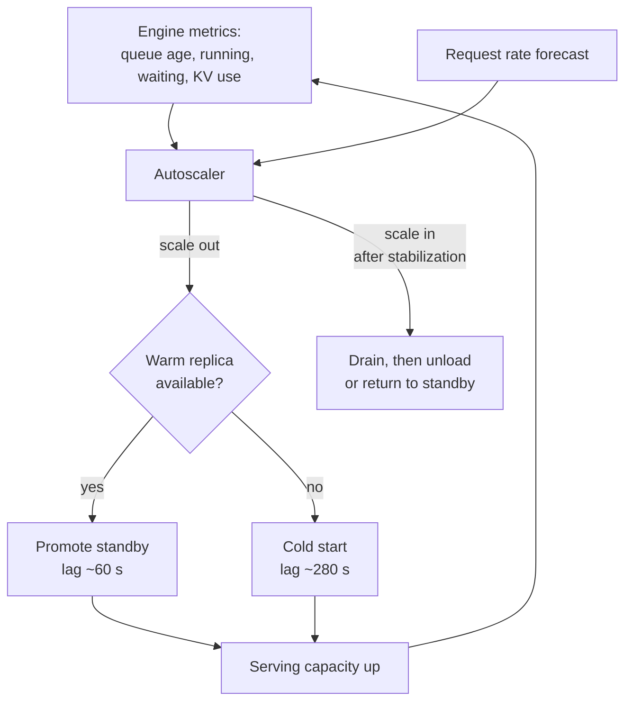

The control loop in the figure closes through the engine's metrics. The decision point after a scale-out request is whether a warm replica exists, which fixes the lag at 60 or 280 seconds before any signal tuning matters.

## 17. Serving many LoRA adapters

[CH20](CH20_Fine_Tuning_PEFT_and_LoRA.md) explains low-rank adaptation: a fine-tuned layer is the frozen base weight $W$ plus a low-rank update, $W'=W+\frac{\alpha}{r}BA$, where $A\in\mathbb{R}^{r\times d_{\text{in}}}$ and $B\in\mathbb{R}^{d_{\text{out}}\times r}$ are small trained matrices of rank $r$. Products that give each customer, team, or task its own fine-tuned behavior produce hundreds or thousands of adapters over one base model. Serving each as a separate model would multiply the hardware bill by the number of adapters.

### 17.1 How big an adapter is

For the 70B example with rank $r=16$ on all linear layers (attention projections of widths 8192 and 1024, feed-forward matrices between 8192 and 28,672), one layer adds $r(d_{\text{in}}+d_{\text{out}})$ parameters per matrix: 262,144 for each of the query and output projections, 147,456 for each of the key and value projections, and 589,824 for each of the three feed-forward matrices. The layer total is 2,588,672, and 80 layers give 207.1 million parameters, 414 MB in BF16. That is 0.3 percent of the base model's weights. The extra compute per token is $2\times207\times10^{6}$ FLOPs against $1.4\times10^{11}$ for the base, also 0.3 percent.

### 17.2 Three ways to serve adapters

1. **Merge and deploy per adapter.** Compute $W'$ once and serve it as an ordinary model. There is no runtime overhead, and each adapter needs its own replica group. At 4 GPUs per group and \$2,920 per GPU-month (the \$4.00 per hour used in this chapter), 100 tenants cost $100\times4\times2920=\$1{,}168{,}000$ per month, nearly all of it idle capacity because each tenant's traffic is small.
2. **Dynamic adapter swap per replica.** Keep the base in memory and load one adapter at a time. It works when a replica serves one adapter for a long period, but a batch cannot mix adapters, so utilization suffers.
3. **Multi-LoRA batching.** Keep the base weights shared, hold many adapters in memory, and apply each request's adapter inside the batched forward pass. This is the design of S-LoRA (Sheng et al., 2023; [arXiv 2310.18547](https://arxiv.org/abs/2310.18547)) and Punica (Chen et al., 2023), and engines such as vLLM and LoRAX implement variants of it.

The base matrix multiplication $XW$ runs once for the whole batch. The adapter term $XA_i^{\top}B_i^{\top}$ is computed per request with that request's adapter $i$, through a gathered batched kernel that handles different adapters (and different ranks) in one launch. Because the adapter matrices are small, this term is cheap in FLOPs, and the overhead comes from gather logic and many small matrix products that use the device inefficiently. Measured overhead depends on rank, batch composition, and the kernel, so benchmark with your adapter mix instead of assuming the 0.3 percent FLOP figure.

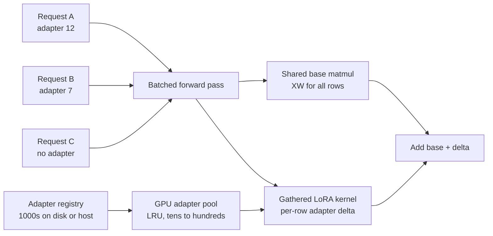

The figure shows the memory hierarchy that makes thousands of adapters practical. The registry holds all adapters on disk or in host memory. A GPU pool holds the active ones, evicting by recency, and a request for an absent adapter waits for it to load. Loading 414 MB over a 64 GB/s host link takes about 6.5 ms, and from local NVMe at 3 GB/s about 140 ms, so a cold adapter adds a visible TTFT penalty. S-LoRA pages adapters and KV blocks in a unified pool so that adapter memory and cache memory trade off.

### 17.3 What can go wrong

- **Pool thrash.** If the active set of adapters exceeds the pool, every request loads an adapter. Track the adapter cache hit rate. If hot adapters follow a skewed (Zipf-like) distribution, a small pool works. If traffic is uniform over thousands of adapters, it does not.
- **Prefix cache keys.** A cached prefix computed under one adapter is invalid under another, because the adapter changes the keys and values. The block hash must include the adapter identity.
- **Fairness.** One tenant with a popular adapter can crowd out the others in the shared batch. Apply the per-tenant token budgets of Section 13.5.
- **Quantized bases.** Serving adapters over a quantized base (a QLoRA-style setup) works, but verify that the adapter was trained against a base with the same quantization, or evaluate the mismatch.
- **Governance.** Each adapter is a separate artifact with its own training data lineage and evaluation, and tenant data may be embedded in the adapter weights. Registry, access control, and deletion obligations apply ([CH29](CH29_MLOps_and_LLMOps.md), [CH30](CH30_AI_Data_Governance_Privacy_and_Provenance.md)).
- **Quality.** The serving path has to produce the same output as the merged model, within numerical tolerance. Test that equivalence for each adapter family before cutover.

Cost for the earlier example: 100 tenants on a shared pool of three 4-GPU groups (12 GPUs, \$35,040 per month) against \$1,168,000 for dedicated replicas, a ratio of about 33 to 1, at the cost of the operational complexity above. Multi-LoRA is justified when there are many adapters with low individual traffic. For a handful of adapters with heavy traffic each, dedicated merged replicas are simpler and as cheap.

## 18. Routing, caching, and constrained decoding at the serving layer

Part 17 [CH08](../17_AI_Architecture/CH08_Model_Gateway_Routing_and_Fallback_Architecture.md) owns gateway design, model routing, and fallback. This section covers the mechanisms that sit at or near the serving engine and change its cost.

### 18.1 Exact-match response cache

A response cache returns a stored answer when the same request recurs. The key must include everything that determines the output: model and version, the full prompt after templating, tool definitions, sampling parameters, and any system configuration. It applies only when the answer is deterministic enough to reuse: greedy decoding or temperature zero, and no personalization that depends on data not in the key. Set a time-to-live, and flush the cache on a model or prompt-template change, since a stale answer after an upgrade is a silent regression.

*Economics.* At the stage S2 cost in Section 27, GPU cost is \$256,960 per month for 90 million requests, or \$0.00286 per request. If 8 percent of requests are exact repeats (frequent in FAQ-style assistants, scheduled report generation, and retries), the cache avoids 7.2 million model calls, about \$20,600 per month, against the cost of a small key-value cluster. The same cache cuts TTFT for those requests from hundreds of milliseconds to the lookup time. Measure the real repeat rate on logged traffic before building it. Hit rates under 1 percent do not pay for the operational cost and the staleness risk.

### 18.2 Semantic cache

A semantic cache embeds the query ([CH16](CH16_Embeddings_and_Semantic_Representations.md)) and returns the stored answer for the nearest previous query if the similarity exceeds a threshold $\tau$. It widens the match from identical strings to paraphrases, and it brings a failure mode the exact cache lacks: a **false hit**, an answer to a different question that happened to embed nearby ("how do I cancel my order" and "how do I cancel my subscription" can be close). The threshold trades hit rate against false-hit rate, so tune it on labeled pairs from your own traffic and report the false-hit rate at the chosen threshold. A scale illustration: if a semantic cache hits on 5 percent of 3 million daily requests (150,000 hits) and 1 percent of hits are false, 1,500 users per day get an answer to the wrong question.

Rules for use: restrict it to low-risk, non-personalized content such as public FAQs; include tenant and permission scope in the key so one user's cached answer is never served to another who lacks access to the underlying data; keep it out of any path where a wrong answer has legal, financial, or safety consequences; and store the original query so a reviewer can audit false hits. The cache sits in the gateway or application layer, so it also bypasses the safety checks on the generation path unless the cached entry was produced with those checks.

### 18.3 Routing inside the serving tier

- **Least-loaded by tokens, not requests.** Round-robin ignores request size. Route to the replica with the fewest tokens in flight or the shortest estimated queue wait. Sampling two replicas at random and choosing the less loaded (power of two choices) gets most of the benefit with no global state.
- **Prefix affinity.** Hash the stable prefix and prefer the replica that likely holds it (Section 7.4), with a spill rule when that replica is overloaded. Affinity trades load balance against hit rate, so cap the imbalance.
- **Length-based pools.** Send long prompts to replicas configured for long contexts and large chunk budgets, and short ones to replicas tuned for latency. It reduces head-of-line blocking at the price of two pools.
- **Cascades.** Try a small model first and escalate to a larger one when a confidence signal or a verifier says the answer is not good enough. The saving depends on the share handled by the small model and the cost of the extra pass when it escalates. [Part 17 CH14](../17_AI_Architecture/CH14_AI_Cost_Performance_and_Sustainability_Decisions.md) covers cascade economics.

### 18.4 Structured and constrained decoding

[CH17](CH17_Prompt_Engineering_and_Structured_Outputs.md) explains why applications want output that matches a schema. Constrained decoding enforces it during generation: at every step, a grammar (a regular expression, a JSON Schema compiled to a grammar, or a context-free grammar) determines which tokens are allowed, and the sampler sets the logits of all other tokens to negative infinity before choosing. The output is guaranteed to be syntactically valid.

*Serving cost.* The grammar is tracked by an automaton. For each sequence and step, the engine must compute the allowed-token mask over a vocabulary of 100,000 or more entries. Naively this scans the vocabulary on the CPU. If the mask costs 0.2 ms per sequence and a batch has 64 sequences processed serially, the step gains 12.8 ms, a 60 percent slowdown on a 21.5 ms step. Engines reduce this with token-level automata precompiled once per grammar, caches of masks per automaton state, vectorized or GPU-side mask computation, and overlap of mask computation with the GPU forward pass. XGrammar (Dong et al., 2024) is one published design that targets this overhead. Compile time is a second cost: a complex schema may take from tens of milliseconds to seconds to compile, which is TTFT for the first request. Cache compiled grammars by schema hash and precompile known schemas at startup.

*Quality.* Forcing tokens can distort the model's distribution. If the schema requires a field the model would not have produced, the model is pushed into low-probability tokens, and the content can degrade even though the syntax is valid. Constrain the format and still prompt for the content, include the schema in the prompt so the model's own probabilities already favor valid output, and evaluate field-level correctness, not just parse success. Tokenization boundaries also matter: the grammar is defined over characters while the model emits tokens, and a mismatch can make valid strings unreachable. Constrained decoding interacts with speculative decoding (apply the same mask to the draft) and with prefix caching (the grammar is not part of the cached prefix, so it does not break it).

## 19. Benchmarking methodology

A benchmark is a model of production traffic. If the model is wrong the numbers are wrong, and the team will buy the wrong hardware or ship the wrong configuration. Most published tokens-per-second figures use settings that production does not.

### 19.1 Workload shape

- **Use a realistic distribution of input and output lengths.** The common tool default of fixed 128-token prompts and 128-token outputs is wrong for nearly everyone. Take lengths from production logs or from a public conversation dataset that resembles your use, and keep the joint distribution (long prompts often have short outputs). In the running example, the median prompt is 665 tokens with a mean near 980, and the heavy tail drives both memory and head-of-line blocking.
- **Reproduce prefix sharing as it exists.** A benchmark that sends the same prompt repeatedly measures a 100 percent prefix cache hit rate and reports a flattering TTFT. A benchmark with random prompts measures a zero hit rate and understates production. Reproduce the real distribution of shared prefixes.
- **Include the real decoding parameters.** Temperature, `max_tokens`, stop sequences, structured output, and speculative settings all change cost. Forcing every request to generate exactly its maximum (`ignore_eos`) produces comparable runs, but it is not the production output length distribution. Use it for kernel-level comparisons and not for capacity plans.
- **Include the mix.** Real traffic mixes short chat, long documents, and structured calls. Benchmark the mixture, plus separate runs for each class.

### 19.2 Open-loop versus closed-loop load

A **closed-loop** generator keeps a fixed number of requests in flight: each virtual user waits for a reply before sending the next. An **open-loop** generator sends requests at scheduled times, independent of whether earlier ones have finished, as real users do.

The distinction matters because a closed loop self-throttles. When the server slows down, a closed-loop client slows with it, so it never offers more load than the server can handle and cannot show a queue. The measurement then understates latency, a defect sometimes called coordinated omission. The script [04_load_model_and_capacity.py](../code/python/inference-serving-chapter/04_load_model_and_capacity.py) shows this on one simulated pool of 32 slots with a capacity of about 3.87 requests per second:

| Generator | Offered | Achieved (req/s) | p50 (s) | p95 (s) | p99 (s) |
|---|---|---:|---:|---:|---:|
| Open loop | 3.5 req/s | 3.53 | 8.6 | 21.9 | 31.3 |
| Open loop | 3.8 req/s | 3.84 | 40.5 | 68.6 | 77.0 |
| Open loop | 4.2 req/s | 4.24 | 277.3 | 526.6 | 542.6 |
| Closed loop | 32 users | 3.82 | 6.9 | 18.8 | 28.9 |
| Closed loop | 48 users | 3.82 | 11.2 | 23.0 | 32.9 |

At the same throughput of about 3.8 requests per second, the closed loop with 32 users reports a p99 of 28.9 seconds, and the open loop at 3.8 requests per second reports 77 seconds, and at 4.2 requests per second it reports 543 seconds. The closed loop is a measurement of the server's maximum throughput at a given concurrency, which is useful for finding capacity, but it cannot find the load at which the SLO breaks. Use open-loop load (Poisson arrivals, or replay of recorded timestamps) for latency SLO testing, and closed-loop load to find maximum throughput.

### 19.3 The load sweep and the knee

Run a series of open-loop tests at increasing request rates, measure the SLO metrics at each, and plot goodput against offered rate. Goodput rises with the offered rate, flattens at the knee, and then falls as the queue grows and requests miss their deadlines. The capacity to plan on is a point below the knee with margin, typically 60 to 80 percent of the knee rate. The sweep also shows which resource gives out first: watch queue depth, KV utilization, preemption count, and batch size at each step.

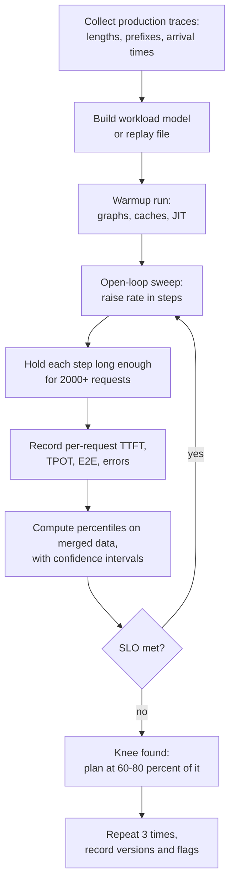

The procedure in the figure has three controls that guard against common mistakes: a warmup before measurement, a minimum number of requests per step, and repetition.

### 19.4 Warmup, steady state, and sample size

The first requests after startup run slower because kernels compile or autotune, CUDA graphs are captured lazily, and caches are cold. Discard a warmup period, and measure over a steady-state window with enough requests. A p99 estimate from 1,000 requests rests on the 10 slowest, so it is unstable. As a guideline, use at least 2,000 requests per step for p99 and at least 20,000 for p99.9, and compute a confidence interval by bootstrap resampling of the per-request values. Repeat the whole run at least three times, because GPU clocks, other tenants, and network conditions vary.

Also record: engine and driver versions, command-line flags, model checkpoint digest, hardware, whether the benchmark client ran on a separate machine (a client on the same host competes for CPU), and where timestamps were taken. Measure TTFT at the client, since server-side numbers omit network and proxy time.

### 19.5 A minimal open-loop client

The loop below sends requests at pre-computed Poisson times and measures TTFT and TPOT at the client. The key detail is that the schedule is fixed in advance and independent of response times.

```python
import asyncio, random, time

async def one_request(session_post, prompt, max_tokens, results, t_sched):
    t0 = time.perf_counter()
    first = None
    n = 0
    async for _chunk in session_post(prompt, max_tokens):   # your streaming client
        n += 1
        if first is None:
            first = time.perf_counter()
    t_end = time.perf_counter()
    results.append({
        "sched_delay": t0 - t_sched,            # >0 means the client itself fell behind
        "ttft": (first - t0) if first else None,
        "tpot": (t_end - first) / (n - 1) if first and n > 1 else None,
        "e2e": t_end - t0, "tokens": n,
    })

async def run(rate, duration, workload, session_post, seed=1):
    rng, results, tasks = random.Random(seed), [], []
    start = time.perf_counter()
    t = 0.0
    while t < duration:
        t += rng.expovariate(rate)                              # Poisson arrivals
        await asyncio.sleep(max(0.0, start + t - time.perf_counter()))
        prompt, max_tokens = workload(rng)                      # sampled from your trace
        tasks.append(asyncio.create_task(
            one_request(session_post, prompt, max_tokens, results, start + t)))
    await asyncio.gather(*tasks)
    return results
```

The `sched_delay` field catches a client that cannot keep up: if requests start later than scheduled, the generator is closed-loop in disguise and the run is invalid.

### 19.6 Pitfalls

| Pitfall | Effect | Remedy |
|---|---|---|
| Fixed short prompts and outputs | Overstated throughput, no memory pressure | Sample lengths from production |
| Repeated identical prompts | Prefix cache hit rate of 100 percent | Randomize or reproduce real sharing |
| Closed-loop only | No queue, understated tail | Open-loop sweep |
| Mean latency reported | Hides the tail | Report p50, p95, p99 with intervals |
| No warmup | First-request penalty counted | Discard warmup |
| Averaging percentiles across runs | Wrong tail | Merge raw samples |
| Client on the server host | CPU contention | Separate load generator |
| Ignoring error and timeout rates | Failures treated as fast | Count them in goodput |
| Tuning on one batch size | Optimum does not transfer | Sweep, then validate on the mix |
| Comparing engines at different precision or quality | Unfair speed claims | Hold quality fixed |

## 20. Capacity planning: from traffic to GPUs and dollars

Capacity planning converts a traffic forecast into hardware. This worked example uses the script [04_load_model_and_capacity.py](../code/python/inference-serving-chapter/04_load_model_and_capacity.py), Part C. All figures are illustrative assumptions, and the method is the point.

### 20.1 The assumptions

- Traffic: 3 million requests per day, with a mean of 1,500 prompt tokens (system prompt, retrieved passages, history, and question) and 250 output tokens per request. That is 34.7 requests per second on average.
- Peak-to-average ratio: 3, so the peak is 104 requests per second.
- Hardware: 4-GPU groups of the H100-class device running the 70B model in BF16, with the Section 4 rates: 14,129 prefill tokens per second and 2,975 decode tokens per second (batch 64, 21.5 ms per step) per group.
- Price: \$4.00 per GPU-hour, 730 hours per month (an assumption).
- Target: no more than 60 percent utilization of the binding resource at peak (Section 13.2).

### 20.2 The steps

**Step 1: token rates.** Average input rate $=3{,}000{,}000\times1500/86{,}400=52{,}083$ tokens per second. Average output rate $=3{,}000{,}000\times250/86{,}400=8{,}681$ tokens per second. At the peak factor 3 these are 156,250 and 26,042.

**Step 2: group-seconds of work per second.** Prefill: $156{,}250/14{,}129=11.06$. Decode: $26{,}042/2{,}975=8.75$. Because prefill and decode share the devices, the demands add: $19.81$ group-seconds per second at peak, that is, 19.81 groups would be fully busy.

**Step 3: apply the utilization ceiling.** $19.81/0.60=33.0$, so 34 groups, or 136 GPUs.

**Step 4: price.** $136\times\$4.00\times730=\$397{,}120$ per month.

**Step 5: apply optimizations and recompute.** A prefix cache that removes 60 percent of prompt tokens from prefill (Section 7.4) cuts prefill demand to $11.06\times0.4=4.42$. Total $=4.42+8.75=13.18$, and $13.18/0.6=21.97$, so 22 groups, 88 GPUs, \$256,960 per month.

**Step 6: check the other limits.** Memory: with 148 GB of cache per group and the average live request holding 533 MB (Section 13.3), a group holds 277 requests in flight. The group's decode batch of 64 is far below that, so memory is not binding. Latency: at batch 64 the step is 21.5 ms, below a 60 ms TPOT target. Concurrency from Little's Law: at 104 requests per second over 22 groups, each group sees 4.7 requests per second, so with a 9-second residence there are about 43 requests in flight per group. That is within the batch of 64, so the batch assumption is consistent.

**Step 7: add resilience.** The fleet above survives no failure. To lose one of three zones (each carrying a third of the fleet) and still serve the peak, the remaining two zones must carry the whole load: capacity must be $1.5\times$ the peak need, so 33 groups, 132 GPUs, \$385,440 per month. Alternatives are to accept degraded service on zone loss (shed batch traffic, cap output lengths, route overflow to a hosted API) and provision for $N+1$ groups instead.

| Plan | Groups | GPUs | Monthly cost |
|---|---:|---:|---:|
| Peak, no prefix cache | 34 | 136 | \$397,120 |
| Peak, 60 percent prefix cache hit | 22 | 88 | \$256,960 |
| Same, survive loss of 1 of 3 zones at full peak | 33 | 132 | \$385,440 |

### 20.3 What the plan teaches

The average load needs $52{,}083\times0.4/14{,}129+8{,}681/2{,}975=1.47+2.92=4.39$ group-seconds per second against 22 provisioned groups, so **average utilization is 20 percent**. Most of the bill is headroom for the peak and for latency. This is the central economic fact of serving with a peaky workload. Four levers act on it, and they are in decreasing order of effect for this example:

1. **Reduce the peak-to-average ratio.** Shift deferrable work (batch summarization, evaluation jobs, embeddings) into the troughs, with a lower-priority class that is preempted at the peak. Smoothing traffic from a 3:1 peak to 2:1 reduces the fleet by about a third.
2. **Make each GPU produce more.** Quantization, better batching, and prefix caching (Section 27 shows the stack).
3. **Autoscale.** A fleet that follows the daily curve pays for the average more than for the peak, bounded by the cold-start lag (Section 16). With a fast warm path, the cost approaches the integral of demand plus a standing headroom.
4. **Offload the peak.** Route the top slice of peak traffic to a hosted API, paid per token only when used. This turns a fixed cost into a variable one for the part of the curve with the worst utilization.

The calculation also gives the sensitivity: halving output length cuts decode demand in half, whereas halving the prompt length cuts prefill demand in half. Product decisions (answer-length limits, a retrieval depth of 3 passages versus 10) are capacity decisions.

## 21. Cost per token and the break-even against hosted APIs

### 21.1 Cost per token for the self-hosted plan

From Section 20, the 88-GPU plan costs \$256,960 for $90\text{ million}\times(1500+250)=157.5$ billion tokens per month, or \$1.63 per million total tokens. This is 20 percent utilization. At 60 percent average utilization (a flat traffic shape) the cost per token would be a third of that, about \$0.54. The formula for cost per token at utilization $u$ is

$$
c(u)=\frac{\text{fleet cost per month}}{u\times\text{fleet token capacity per month}},
$$

and the practical question is which $u$ the workload shape can reach.

### 21.2 Break-even against a hosted API

A hosted API charges per token and carries no idle cost. It wins whenever the self-hosted fleet is under-used. The self-hosted option wins above some volume and utilization, plus when other factors (data residency, latency control, model choice, fine-tuned adapters, rate limits) outweigh price. The script's Part C compares the plans with a placeholder price of \$0.60 per million input tokens and \$2.40 per million output tokens (these are assumptions for arithmetic, not a vendor quote; look up current prices). For 135,000 million input and 22,500 million output tokens per month the API bill is $135{,}000\times0.60+22{,}500\times2.40=\$81{,}000+\$54{,}000=\$135{,}000$.

| Plan | Monthly cost | Ratio to API |
|---|---:|---:|
| Self-host, no prefix cache, peak 3:1 | \$397,120 | 2.94 |
| Self-host, 60 percent prefix cache, peak 3:1 | \$256,960 | 1.90 |
| Same, peak 2:1 | \$175,200 | 1.30 |
| Same, peak 1.5:1 | \$128,480 | 0.95 |
| Same, peak 1.2:1 | \$105,120 | 0.78 |

The break-even is governed by the shape of the traffic. At a 3:1 peak the API is cheaper by almost half. At a 1.5:1 peak, which is typical of a global product with traffic spread across time zones or a large batch workload, the self-hosted plan is at parity, and below that it wins. The next table adds the optimization stack of Section 27 (FP8 on two-GPU groups, a 44-GPU plan at a 3:1 peak, \$128,480 per month) and engineering cost, assumed at \$40,000 per month for the share of platform engineers needed to run and evaluate the fleet:

| Plan at 3:1 peak | Hardware | With \$40,000 engineering | Ratio to API |
|---|---:|---:|---:|
| FP8, two-GPU groups, prefix cache | \$128,480 | \$168,480 | 1.25 |

Even after a 9.5-fold reduction from the naive configuration (stage S0 to S3 in Section 27), a peaky workload at this volume does not beat the API at placeholder prices once people are counted. Break-even needs more volume (the fixed engineering cost spreads over more tokens), a flatter profile, or a reason beyond price. A rough rule: self-hosting is a cost decision only when the fleet is large (hundreds of GPUs), the traffic is flat, and the team already runs GPU infrastructure; for most other situations it is justified by control, privacy, or customization.

Hosted API prices have fallen quickly and vary by model tier, by batch or cached-input discounts, and by commitment. Recompute the break-even every quarter with current price sheets, and test whether a cheaper hosted tier or a smaller hosted model meets the quality bar, since moving down a model tier often beats optimizing a large model. Part 17 [CH14](../17_AI_Architecture/CH14_AI_Cost_Performance_and_Sustainability_Decisions.md) places this in the portfolio-level decision.

### 21.3 Other cost levers

- **Reserved and committed capacity** lowers the hourly price against on-demand, in exchange for commitment. Commit for the base load and use on-demand or spot for the rest.
- **Spot or preemptible capacity** is cheap but can be revoked on short notice. It suits batch classes that checkpoint progress or can be re-queued, and not interactive streams.
- **Accelerator choice.** Newer parts have more bandwidth per dollar for decode and more FLOPs for prefill. Compare cost per million tokens measured on your workload and not the list price per hour.
- **Smaller model, same quality.** Distillation, a fine-tuned small model, or a better prompt can reduce the model size by 4 to 10 times, which dominates every other optimization in this chapter. Check it first ([CH20](CH20_Fine_Tuning_PEFT_and_LoRA.md)).
- **Energy.** Power draw scales with utilization and device count. Part 17 CH14 covers sustainability.

## 22. Multi-region serving and failover

### 22.1 Why more than one region

Reasons to serve from several regions are data residency rules, latency to users, capacity availability (accelerators are often scarce in a given region), and resilience to a regional outage. Each has a cost: weights must be replicated to each region, capacity is held in each, and the routing layer becomes global.

### 22.2 Headroom arithmetic

If $R$ regions each run at utilization $u$ and one fails, the survivors absorb its load, and their utilization becomes $u\,R/(R-1)$. For $R=3$ and $u=0.60$ that is $0.90$. That is past the safe zone of Section 13.2, and latency will degrade. For $R=2$ it is $1.20$, so a two-region active-active setup at 60 percent has no survival margin and must run below 50 percent to survive a failure at full load. To keep post-failover utilization at or below 80 percent, steady-state utilization must be at most $0.8(R-1)/R$: 53 percent for $R=3$ and 40 percent for $R=2$. Insurance is expensive. Cheaper alternatives are an explicit degraded mode on failover (shorter output caps, shedding of batch work, a smaller model) and an overflow path to a hosted API.

### 22.3 The cold cache after failover

KV and prefix caches are not portable. When traffic moves to a surviving region, its prefix cache holds nothing relevant to the new users, and the hit rate drops to near zero. Return to the capacity example: with a 60 percent hit rate, the fleet's prefill demand is 4.42 group-seconds per second at peak, and with no hits it is 11.06, an extra 6.64. Failover load is therefore larger than the pure traffic shift suggests, by the ratio $1/(1-h)$ on the prefill share, here 2.5 times. Plan for it, or keep conversation affinity so returning users hit a warm region as the cache warms. Cold KV is also a reason that failback should be gradual.

### 22.4 Routing and health

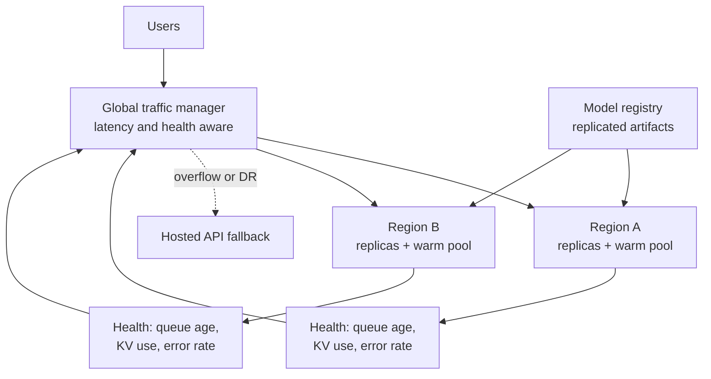

The health signal given to the global router must reflect capacity and latency, not just process liveness. A region whose replicas are alive but whose queue age is 30 seconds is failing. Route on queue age or an equivalent load score, and shift weight gradually to avoid overloading the destination. Also replicate the model artifacts so a region can start replicas without a cross-region fetch in an emergency, and test the failover path regularly, since a path never exercised usually fails the first time.

## 23. Observability and SLOs

### 23.1 What to measure

| Layer | Metrics |
|---|---|
| Request | TTFT, TPOT or ITL (histograms), E2E, queue wait, prompt tokens, output tokens, finish reason, cached prompt tokens, error class |
| Engine | Running and waiting requests, batch size distribution, tokens per iteration, step time, KV block utilization, preemptions and swaps, prefix cache hit rate, speculative acceptance rate, adapter cache hit rate |
| Hardware | Memory use, clock and thermal throttling, error counters (ECC, bus errors), interconnect errors, power, MFU and MBU estimates |
| Fleet | Replica states (cold, loading, standby, serving, draining, failed), cold-start duration by stage, autoscaler decisions, warm-pool size |
| Business | Tokens per dollar, idle GPU-hours, cost per request, cost per tenant, rejection and timeout rate |

Segment latency by prompt-length bucket, request class, tenant, and model version. An aggregate TTFT hides the fact that all slow requests belong to the long-prompt bucket, and a global average hides a noisy neighbor. Record distributed traces with spans for queue, prefill, decode, and KV transfer, using the same request identifier across gateway and engine. OpenTelemetry has been developing semantic conventions for generative AI telemetry; at the time of writing they are still evolving, so check the current version before standardizing attribute names.

Logging prompts and completions is useful for debugging and dangerous for privacy. Default to logging lengths, hashes, and metadata. Sample full text only with a documented purpose, retention limit, and access control ([CH30](CH30_AI_Data_Governance_Privacy_and_Provenance.md)).

### 23.2 Service-level indicators and objectives

A service-level indicator (SLI) is a measured ratio of good events to all valid events. Examples: the fraction of requests with TTFT at most 1 second, the fraction with TPOT at most 50 ms, and the fraction that complete without error. A service-level objective (SLO) sets a target over a window: 99 percent of requests meet TTFT of 1 second over 28 days. The **error budget** is the allowed failure: 1 percent of requests. At 90 million requests per month, the budget is 900,000 requests that may violate the TTFT objective.

Alert on the **burn rate**, the rate at which the budget is consumed relative to the SLO's allowance. A burn rate of 1 consumes the budget exactly over the window. Multi-window rules from the Google SRE workbook pair a fast window and a slow window to balance speed and noise: for example, a burn rate above 14.4 over one hour (which would consume 2 percent of a 30-day budget, since $14.4\times1/720=0.02$) pages a person, while a burn rate above 1 over three days opens a ticket. Define separate SLOs by request class: interactive requests have latency objectives, and batch requests have completion-deadline objectives. Count rejected and expired requests as bad events for availability SLOs, or the measurement will reward load shedding that users experience as failure.

```mermaid
flowchart LR
    E["Request events<br/>and engine metrics"] --> SLI["SLIs per class and bucket"]
    SLI --> SLO["SLO targets<br/>28-day window"]
    SLO --> BUD["Error budget<br/>remaining"]
    BUD --> BURN["Burn-rate alerts<br/>fast and slow windows"]
    BURN --> ACT["Page or ticket"]
    BUD --> POL["Release policy:<br/>freeze when budget low"]
    SLI --> CAP["Capacity review:<br/>knee vs peak"]
```

The diagram connects measurement to action. The budget drives both alerting and release policy (a team that has spent its budget slows risky changes such as engine upgrades and quantization switches), and the same indicators feed the quarterly capacity review.

## 24. Failure modes and quality-attribute scenarios

### 24.1 Failure modes

| Failure | Cause | Symptom | Detection | Mitigation |
|---|---|---|---|---|
| Out of memory from long contexts | One 131,072-token request needs $131{,}072\times327{,}680=42.9$ GB of cache; several at once exhaust the pool | Engine crash, or preemption storms | KV utilization near 100 percent, preemption rate, OOM kills | Cap context and output length; admit by token budget; watermark; reserve headroom; separate long-context pool |
| Head-of-line blocking | A long prefill monopolizes an iteration, or FCFS puts a long job ahead of short ones | TPOT spikes, short-request TTFT tail | TPOT p99 by prompt bucket | Chunked prefill, priority classes, length-based pools |
| Noisy neighbor | One tenant's traffic or an unmanaged co-located job degrades others on a shared device or engine | Latency variance for unrelated tenants | Per-tenant latency and token usage | Per-tenant token budgets and rate limits; MIG-style hardware partitions for hard isolation; dedicated pools |
| Thundering herd on cold start | Many replicas fetch weights at once, or all retry together | Slow or failed rollouts, origin throttling | Fetch durations, readiness lag | Rolling updates with surge limits; node cache; peer distribution; jitter |
| Retry storm | Clients retry on timeout during overload | Load above original demand, overload outlasts trigger | Request rate vs unique-request rate | Retry budgets, backoff with jitter, shed early with Retry-After |
| Preemption thrash | Admission too aggressive for pool size | Throughput collapse, TTFT and TPOT tail | Preemption count, recompute tokens | Admission watermark; lower max concurrency; larger pool |
| Straggler device | One GPU throttles on heat or has a link error; the tensor-parallel group runs at the slowest member | Whole replica slow | Per-device clocks, step time vs peers | Health checks on step time; evict replica; thermal monitoring |
| Group failure | Tensor-parallel group fails when any member fails; with per-device failure probability $p$ the group fails with probability $1-(1-p)^n$ | Replica loss, in-flight streams lost | Collective timeouts | Replica-level redundancy; fast restart; client retry policy |
| Collective hang | Communication library timeout or deadlock | Replica unresponsive, no error | Watchdog on step progress | Step watchdog; automatic restart |
| Silent numerical change | Kernel or engine upgrade alters outputs | Quality shift without errors | Canary evaluation, output diff | Pin versions; evaluate before rollout; canary |
| Template or tokenizer mismatch | Model update with different chat template | Degraded quality, wrong stop behavior | Golden-prompt tests | Version prompts with the model; compatibility test |
| Quantized kernel fallback | Unsupported format dequantizes to 16 bit | Slower than baseline | Throughput regression test | Benchmark the artifact in the target engine |
| Memory fragmentation or leak in long-running engine | Allocator behavior over days | Gradual OOM, slowdown | Memory trend per replica | Periodic rolling restart; engine upgrade |
| Config drift between replicas | Manual changes | Inconsistent behavior | Config hash in metrics | Declarative deployment; hash check |

### 24.2 Quality-attribute scenarios

| Attribute | Stimulus | Response | Measure |
|---|---|---|---|
| Latency | Traffic rises from 40 to 100 requests per second in 2 minutes | Admission control sheds batch class; warm pool promoted; autoscaler adds replicas | Interactive TTFT p95 at most 2 s, TPOT p95 at most 60 ms throughout; batch queue age bounded |
| Availability | One GPU in a four-GPU group fails | Replica removed from rotation, in-flight streams terminated with a retryable error, replacement started | Fewer than 1 percent of requests fail; capacity restored within the cold-start time |
| Scalability | Peak doubles over a quarter | Capacity plan recomputed from the load sweep; fleet extended | Utilization at peak stays at or below 70 percent |
| Cost | Hosted API price drops by 40 percent | Break-even recomputed and routing share adjusted | Cost per million tokens reported monthly against the API baseline |
| Security | A tenant probes the prefix cache for other tenants' prompts | Tenant-salted cache keys; no cross-tenant hits | Zero cross-tenant cache hits in the test; TTFT distribution does not depend on other tenants' content |
| Modifiability | Swap the engine version | Canary with golden prompts, throughput regression test, quality gate | No regression beyond tolerance before full rollout |

## 25. Security, privacy, and governance consequences

Serving sits between untrusted input and valuable assets, and its optimizations create sharing that the plain model lacks.

- **Shared caches leak through timing.** Prefix caches and semantic caches are shared state. Timing differences expose whether content was seen before (Section 7.4). Salt cache keys per tenant when tenants are mutually untrusting, and do not expose fine-grained timing to untrusted callers. Treat cross-tenant cache sharing as a security decision, not only a performance one.
- **Batch-mates share an engine.** Requests in one batch share kernels, memory pools, and iteration timing. A correct engine isolates their data, but bugs in block reuse, adapter selection, or masks can mix them. Test isolation explicitly: send canary secrets in one tenant and check that they do not appear in another's outputs, and keep the engine version under change control.
- **Exposed inference endpoints.** Many open-source engines ship with an unauthenticated HTTP API for convenience. Bind to an internal interface, put authentication and rate limits at the gateway, apply network policy, and do not expose admin endpoints (model load, metrics with prompt samples) to untrusted callers.
- **Denial of service by request shape.** A request that asks for a huge context or a huge output consumes cache and slot time. Enforce caps on prompt tokens, output tokens, and concurrent requests per tenant, and meter by tokens.
- **Model artifacts.** Weights are valuable and are an attack vector. Prefer formats that cannot execute code on load (safetensors, rather than pickle-based formats), verify checksums or signatures, store in access-controlled storage, and limit which identities can read them ([CH27](CH27_AI_Infrastructure_and_Platform_Components.md), [CH29](CH29_MLOps_and_LLMOps.md)). Third-party checkpoints and custom kernels are supply-chain inputs.
- **Logs and traces.** Prompts and outputs often contain personal and confidential data. Apply the logging policy of Section 23.1, mask or hash, and bound retention.
- **Isolation of devices.** Time-slicing a GPU between tenants gives no memory isolation. Hardware partitioning (such as NVIDIA's Multi-Instance GPU on supported parts) gives separate memory and compute slices, and dedicated devices give the strongest isolation. At the time of writing some GPU generations also support confidential-computing modes that protect data in use; check the vendor's documentation and your threat model.
- **Multi-region data handling.** Failover that moves a request to another jurisdiction can violate residency rules, so route policy must encode them and fallback to a hosted API must be allowed only for data classes that permit it ([CH30](CH30_AI_Data_Governance_Privacy_and_Provenance.md)).

## 26. Comparison of optimization techniques

| Technique | Mainly improves | Typical gain (illustrative) | Costs and risks | Best when | Quality risk |
|---|---|---|---|---|---|
| Continuous batching | Throughput, TTFT | About 2x tokens per second over request-level (Section 6.4) | Scheduler complexity | Always for generative serving | None |
| Paged KV cache | Concurrency | 5 to 7x more sequences vs max-length reservation (Section 7.3) | Kernel and engine dependence | Always | None |
| Prefix caching | TTFT, prefill cost | Cuts prefill by the hit rate (60 percent in example) | Memory, side channel, needs prompt discipline | Shared system prompts, multi-turn chat, RAG with repeats | None |
| FlashAttention-class kernels | Prefill speed, memory | Large at long context | Hardware and backend support | Long prompts | None (exact) |
| Weight-only INT4/INT8 | Decode speed, memory | 2 to 4x in bytes; up to 3x step speed at low batch | Calibration, kernel support | Memory-bound decode, fitting on fewer GPUs | Low to moderate; measure |
| FP8 weights and activations | Compute, memory | About 2x tensor-core rate; half the weight bytes | Needs hardware support | Prefill-heavy or high batch on supported GPUs | Low; measure |
| KV cache quantization | Concurrency, KV bandwidth | About 2x cache capacity | Long-context accuracy | Cache-limited, long contexts | Low to moderate; test long contexts |
| Speculative decoding | TPOT at low batch | 2 to 3x at batch 1 to 8, loses at high batch (Section 10.5) | Draft memory, acceptance drift | Latency-critical, low-concurrency | None in principle |
| Chunked prefill | TPOT p99 | Bounds decode stalls | Raises long-prompt TTFT | Mixed short and long prompts | None |
| Prefill/decode disaggregation | Goodput under both SLOs | Higher goodput at scale | Network, two fleets, complexity | Large fleets with strict SLOs | None |
| Tensor parallelism | Latency, cache room | Lower step time, more KV memory | Communication, needs fast links | Model does not fit, or latency target | None |
| Multi-LoRA | Cost for many tenants | About 33x cheaper in the 100-tenant example | Adapter pool, fairness, kernel overhead | Many low-traffic adapters | None if equivalent |
| Response caching | Cost, latency | Hit rate times cost per request | Staleness, false hits for semantic | Repetitive, non-personalized queries | Staleness, false hits |
| Smaller model | Everything | 4 to 10x cost | Capability loss | Task is within a smaller model's ability | Moderate to high; evaluate |

The table's last column matters for governance: items marked "None" change speed or memory but not the function the model computes, so they can ship after a regression test. Items with quality risk need the evaluation in Section 9.5 and a rollback plan. The order in which to adopt them usually follows risk and effort: continuous batching and paged memory arrive with the engine, prefix caching and chunked prefill are configuration, FP8 and weight quantization need an evaluation, and speculative decoding and disaggregation need a measured case.

## 27. Case study: from naive serving to an optimized configuration

This case study follows an internal support-agent assistant through five changes. Every figure is illustrative and comes from the models in this chapter and the four scripts, not from a production measurement. The point is the order of decisions, the arithmetic behind each, the alternatives that were rejected, and the evidence that a team would collect before each change ships.

### 27.1 The starting point

The service uses a 70B-class dense model in BF16 on 4-GPU tensor-parallel groups. A model server built for a classifier handles generation with request-level batching of 32, no prefix cache, and contiguous KV reservation. Traffic is the Section 20 forecast: 3 million requests per day, mean 1,500 prompt tokens and 250 output tokens, peak-to-average ratio 3, and a target of at most 60 percent utilization at peak.

Observed symptoms: the p50 time to first token is about 17 seconds at a load of 1 request per second per group; users report that the assistant "thinks for a long time and then types fast". The monthly bill is large. A 104-group fleet is needed because request-level batching delivers only about 30 percent useful slot-steps (Section 6.1), so each group's decode capacity is $1{,}697\times0.30=509$ tokens per second instead of 2,975.

### 27.2 The sequence of changes

```mermaid
flowchart LR
    S0["S0 naive<br/>416 GPUs<br/>1.21M USD per month"] --> S1["S1 continuous batching<br/>+ paged KV<br/>136 GPUs, 397K USD"]
    S1 --> S2["S2 prefix cache 60%<br/>88 GPUs, 257K USD"]
    S2 --> S3["S3 FP8 weights, acts, KV<br/>TP2 groups<br/>44 GPUs, 128K USD"]
    S3 --> S4["S4 cancellation<br/>propagation<br/>42 GPUs, 123K USD"]
    S4 --> S5["S5 scheduled scale-in<br/>32 GPUs average<br/>93K USD"]
```

The flowchart shows the cost after each change, and the script's Part E reproduces them. The stages are ordered by risk and by the dependence between them, not strictly by size of gain.

**S1: continuous batching and paged KV cache (a change of engine).** Moving to an engine with iteration-level scheduling and block-based KV memory takes the decode rate to 2,975 tokens per second per group at batch 64 (Section 4.4). The group-seconds of work at peak fall from 62.21 to 19.81 and the fleet from 104 groups to 34 (136 GPUs, \$397,120 per month). Latency evidence from the simulator at 3 requests per second per group (the peak per-group rate of this stage, 3.06) against the naive policy at 1 request per second per group (the peak rate of S0, 1.00):

| Metric | S0: request-level, 1.0 req/s per group | S1: continuous, 3.0 req/s per group |
|---|---:|---:|
| TTFT p50 | 17.13 s | 0.10 s |
| TTFT p99 | 37.17 s | 0.49 s |
| TPOT p50 | 24.1 ms | 28.1 ms |
| TPOT p99 | 25.5 ms | 41.3 ms |
| E2E p99 | 43.5 s | 22.3 s |
| Goodput (TTFT at most 2 s, TPOT at most 60 ms) | 1.2% | 100% |

Per-token latency becomes worse, from 24 to 28 ms at p50, because the batch is fuller. The first token arrives 170 times sooner at the median. Validation is a replay of recorded traffic through the new engine at the production request mix, plus a regression test of output equivalence on a golden prompt set (the change should not alter the function the model computes). The gate: TTFT p95 at most 2 s and TPOT p95 at most 60 ms at the planned per-group rate.

**S2: prefix caching.** Support-agent prompts begin with a 2,000-token block of policy text and tool schemas that is the same for all agents. After moving the date and the agent's name to the end of the prompt (a change in the application, not the engine), measured prefix hits cover 60 percent of prompt tokens. Prefill demand falls from 11.06 to 4.42 group-seconds per second, and the fleet from 34 to 22 groups (88 GPUs, \$256,960). The routing layer hashes the first 2,000 tokens to pick a replica with a spill rule, so the hit rate does not dilute across replicas (Section 7.4). The cache is salted per tenant because the platform serves two business units that may not share content. Gate: hit rate above 55 percent in a week of shadow traffic, and no change in task scores.

**S3: FP8 weights, activations, and KV cache on two-GPU groups.** FP8 halves the weight bytes to 70 GB, so a two-GPU group holds the model with $2\times72-70=74$ GB left for the cache. An FP8 KV cache of 163,840 bytes per token holds 2,000-token contexts of 327 MB each, so the group still holds 226 sequences. The script's roofline check gives a decode step of 21.2 ms at batch 64, which is 3,014 tokens per second per two-GPU group. Prefill runs at the FP8 tensor-core rate, which is about double BF16, so a two-GPU group matches the prefill rate of the four-GPU BF16 group at 14,129 tokens per second. The fleet becomes 22 groups of 2 GPUs: 44 GPUs, \$128,480.

The evidence for this change is the quality evaluation of Section 9.5. The team ran 5,000 paired prompts from the production task set, with a discordant fraction of 6 percent. An illustrative result: task pass rate 91.2 percent for FP8 against 91.5 percent for BF16, a difference of $-0.3$ points with a 95 percent interval of about $[-1.0,+0.4]$ ($\pm1.96\sqrt{0.06/5000}=\pm0.68$ points around $-0.3$). The pre-agreed tolerance was a drop no larger than 1 point, and the interval's lower end sits at the boundary, so the team also ran the 200 longest-context prompts and the JSON-validity suite, which showed no degradation, and shipped behind a flag with the BF16 group kept for rollback for two weeks. The gate is the tolerance stated in advance, not a result judged after the fact.

**S4: cancellation propagation.** A trace review shows that 10 percent of streams are abandoned after about 100 of 250 tokens, and the gateway kept reading from the engine after the browser closed. Adding the abort call (Section 14.2) removes about 6 percent of decode tokens. Decode demand falls from 8.63 to 8.11 group-seconds, and one group is saved (42 GPUs, \$122,640). It is a small saving that costs a few lines of code, and the same fix lowers memory pressure during bursts.

**S5: scheduled scale-in.** Traffic over the night eight hours is about a quarter of the daily mean. The fleet runs 21 groups for 16 hours and 6 groups for 8 hours, an average of $(21\times16+6\times8)/24=16$ groups, or 32 GPUs on average, \$93,440 per month. The scale-out ahead of the morning ramp is scheduled 10 minutes early to cover the cold-start lag (Section 16.3), and two groups stay warm.

### 27.3 Alternatives considered and rejected

| Alternative | Reason rejected | Condition that would reverse it |
|---|---|---|
| INT4 weight-only on single-GPU replicas | The fleet's per-GPU decode throughput would be higher at low batch, but in this illustrative case the pilot showed larger regressions on long-document tasks than FP8, and the gain over FP8 at batch 64 is smaller than the roofline step estimate suggests because the step is already near the KV-bound regime | New evaluation showing parity on the long-document suite |
| Speculative decoding | At the planned operating batch of about 43 per group, the Section 10.5 table gives a gain between 1.4 and 2.6 times, but TPOT is already 22 ms against a 60 ms target, and the draft adds memory and an acceptance risk | A tighter TPOT target (for example, voice) or a low-traffic deployment |
| Prefill/decode disaggregation | The fleet is 22 groups, the TTFT and TPOT targets are met with chunked prefill, and a second fleet adds a network dependence | Fleet growth past roughly 100 groups with strict dual SLOs |
| Larger TP degree (TP=8) | Room for more concurrent sequences, which is not binding at batch 64 | Move to 128K contexts |
| Move to the hosted API | At placeholder prices the API is \$135,000, against \$93,440 to \$128,480 for hardware plus about \$40,000 for engineering | A flatter load, or a price drop, or a hardware cost increase |
| Semantic cache | The false-hit risk on policy answers is not acceptable | A FAQ-only deployment |

### 27.4 Before and after

| Measure | Before (S0) | After (S4) | After scheduling (S5) |
|---|---:|---:|---:|
| GPUs at peak | 416 | 42 | 42 peak, 32 average |
| Monthly GPU cost | \$1,214,720 | \$122,640 | \$93,440 |
| Cost per million total tokens (157.5 billion per month) | \$7.71 | \$0.78 | \$0.59 |
| TTFT p50 and p99 | 17.1 s and 37.2 s | about 0.1 s and 0.5 s (simulator at S1 load, S2 to S4 expected lower from caching) | same |
| TPOT p99 | 25.5 ms | about 41 ms (simulator at S1 load) | same |
| Goodput at SLO | 1.2% | about 100% | same |

The overall reduction in GPU cost is 9.9 times from S0 to S4, and 13 times to S5. The first three steps (S1, S2, S3) deliver a 9.5-fold reduction of the 9.9-fold total to S4. Most of the gain came from scheduling and memory management, which change no model output, and the remaining gain came from precision, which needed the evaluation gate. Note what the table leaves out: S2 through S5 were not simulated end to end, so the latency figures in the last two columns are the S1 simulator results plus an argument that caching and FP8 only lower them. The team would confirm them with a replay test at the production per-group rate of 4.7 requests per second, which is above the 32-slot simulator's comfort zone and relies on the 64-sequence batch of the capacity model.

## 28. Common mistakes

| Mistake | Cause | Consequence |
|---|---|---|
| Sizing from average tokens per second | Ignoring the peak and the latency ceiling | SLO violated at every peak; Section 20 shows a 20 percent average utilization even when the plan is right |
| Benchmarking with fixed 128/128 lengths | Tool defaults | Hardware bought for a workload that does not exist |
| Closed-loop load tests only | Easy to script | The queue never forms, so the test passes and production fails |
| Reporting the mean or averaging percentiles | Convenience | A tail problem is hidden; Section 2.5 shows 63 percent of fan-out requests slowed by a 1 percent event |
| Reading GPU utilization as busy-ness | Driver counters report kernel presence | A device doing 1 percent of peak FLOPs appears 100 percent used |
| Autoscaling on CPU | Default autoscaler metric | No scale-out until too late; scale-in flaps |
| Ignoring cold-start lag | Treating replicas as instant | Scale-out arrives after the backlog (1,660 group-seconds in the Section 16 example) |
| Putting volatile text at the top of the prompt | Natural to write a date line first | Prefix cache hit rate falls to zero |
| Enabling a quantized checkpoint without testing it in the engine | Checkpoint existed | Falls back to a slow kernel, or silently loses quality |
| Judging quantization by perplexity | It is cheap | A task regression ships; a 200-prompt test cannot see a 1-point drop (Section 9.5 needs about 4,700) |
| Not propagating cancellation | Cancellation is hard to test | 6 percent of decode wasted in the Section 14 example |
| Retrying immediately on timeout | Client library default | A retry storm extends the overload |
| Raising `max_tokens` and context limits without capacity work | Product request | Memory exhaustion; one 131K-token request holds 42.9 GB |
| Applying speculative decoding at every load | It helped in a demo at batch 1 | A slowdown at batch 128 and above |
| Sharing prefix caches across tenants | Better hit rate | A timing side channel |
| Tuning for cost per token without an SLO | Cost is easy to measure | The highest batch, and the worst latency |

## 29. Design-review checklist

Use these questions in a serving design review. Each has an evidence item to look for.

1. **Objectives.** Are TTFT, TPOT, E2E, and goodput targets defined per request class, with percentiles and a window? Evidence: SLO document.
2. **Workload model.** Do the length distributions, prefix sharing, and arrival process come from production data? Evidence: trace analysis.
3. **Roofline estimate.** Is the decode step time computed from weight bytes, cache bytes, and bandwidth, with the assumptions listed? Evidence: calculation.
4. **Batching policy.** Is it iteration-level for generative models, with a stated maximum concurrency, token budget, and admission rule? Evidence: engine configuration.
5. **KV cache budget.** Is the pool size computed for worst-case context and concurrency, with a watermark, preemption policy, and a cap on context and output? Evidence: memory calculation and load test at the cap.
6. **Prefix caching.** Are prompts ordered stable-first, is the hit rate measured, and is routing affinity or a shared tier used so the hit rate holds at fleet size? Is the cache isolated by tenant where required?
7. **Quantization.** Is quality evaluated on the task suite, long contexts, formats, and safety, with a pre-stated tolerance and enough samples? Is the kernel confirmed in the target engine?
8. **Speculation.** Is the acceptance rate measured and the operating batch within the region where the gain is positive?
9. **Parallelism.** Is the TP degree the smallest that gives memory and latency, within the fast interconnect domain? Is the failure domain (the whole group) accepted?
10. **Prefill interference.** Is chunked prefill configured, or separate pools used, and was TPOT p99 tested with long prompts mixed in?
11. **Overload.** Is the queue bounded by age, are there token-based limits, priority classes, Retry-After, and a retry budget? What is rejected first?
12. **Streaming and cancellation.** Is cancellation propagated through every hop and proven by a test? Are proxy buffering and idle timeouts handled? What happens on a mid-stream failure?
13. **Cold start and scaling.** Is the cold-start time measured by stage, the warm pool sized to the ramp times the lag, the autoscaling signal tied to engine metrics, and the scale-in drained?
14. **Benchmarking.** Was an open-loop sweep run to find the knee, with warmup, enough samples, repeats, and recorded versions? Is the plan at 60 to 80 percent of the knee?
15. **Capacity and cost.** Are the fleet size, utilization at average and peak, redundancy, and monthly cost computed, and compared with a hosted alternative including engineering cost?
16. **Resilience.** What happens on loss of a GPU, a node, a zone, and a region? Is post-failover utilization acceptable, and is the cold-cache effect included?
17. **Observability.** Are SLIs segmented by prompt bucket and tenant, with burn-rate alerts and engine, hardware, and fleet metrics? Are prompts kept out of logs by default?
18. **Security.** Are endpoints authenticated, caches isolated, artifacts verified and in safe formats, request shapes capped, and data residency respected in failover?
19. **Change management.** Are engine, driver, and model versions pinned, with canary, golden-prompt tests, and a rollback flag for each optimization?

## 30. Exercises

1. A model has 32 layers, 8 KV heads, head width 128, and BF16 cache. How much KV memory do 16 concurrent sequences of 4,000 tokens need? What happens to it if the context doubles?
2. A request has TTFT 0.5 s and TPOT 25 ms and produces 400 tokens. What is its end-to-end latency? Which saves more time: halving TTFT or halving TPOT?
3. For an 8B-parameter model in BF16 on one device with 3.35 TB/s of bandwidth at 70 percent efficiency, estimate the batch-1 decode step time and the single-stream token rate. Is a batch of 32 compute-bound?
4. A drafted sequence uses $k=3$, acceptance $\alpha=0.7$, and draft cost ratio $c=0.1$. Compute the expected tokens per round and the speedup. Is $k=4$ better?
5. Traffic is 12 requests per second with a 6-second mean residence and an average live context of 2,000 tokens on the 70B example. How many requests are in flight, how many replicas with 48 slots at a 70 percent slot ceiling, and how much KV memory is in use?
6. A prefix is requested at 0.8 per second in total and stays resident for 30 seconds after its last use on a replica. With random routing, what is the hit rate on 4 replicas and on 16 replicas? What does that imply for routing?
7. Demand grows 5 percent per minute during a ramp and scale-out lag is 300 seconds. How much headroom must the fleet hold to avoid a shortfall during the lag?
8. A deployment uses 4 regions at equal load. To keep post-failover utilization at or below 80 percent when one region fails, what is the maximum steady-state utilization?
9. A quantization test has a discordant fraction of 4 percent. How many paired prompts are needed to detect a 0.5-point drop at 5 percent significance and 80 percent power?

**Answer outlines.**

1. Per token: $2\times32\times8\times128\times2=131{,}072$ bytes. Tokens: $16\times4000=64{,}000$. Memory: $8.39$ GB. Doubling context doubles it to 16.8 GB (or halves the concurrency that fits).
2. $0.5+399\times0.025=10.475$ s. Halving TTFT saves 0.25 s and halving TPOT saves 4.99 s, so TPOT dominates for long answers unless the user only needs the first sentence.
3. Weights 16 GB; $16\times10^{9}/2.345\times10^{12}=6.8$ ms, about 147 tokens per second. At batch 32 compute time is $2\times8\times10^{9}\times32/(989\times10^{12}\times0.5)=1.0$ ms, far below the memory time, so it is still memory-bound.
4. $E=(1-0.7^{4})/0.3=2.53$ tokens; cost $1+3\times0.1=1.3$; speedup 1.95. For $k=4$: $E=2.77$, cost 1.4, speedup 1.98, a small improvement. For $k=5$: 1.96. The optimum is $k=4$.
5. $L=12\times6=72$ in flight. Replicas: $\lceil72/(48\times0.7)\rceil=\lceil2.14\rceil=3$. KV: $72\times2000\times327{,}680=47.2$ GB.
6. Hit rate $1-e^{-\lambda_pT/R}$: for $R=4$, $1-e^{-6}=99.8$ percent; for $R=16$, $1-e^{-1.5}=77.7$ percent. Larger fleets dilute the hit rate; use prefix-affinity routing or a shared cache tier.
7. Growth over the lag is $1.05^{5}=1.276$, so about 28 percent headroom ahead of demand (more if the signal also adds detection delay).
8. $u\,R/(R-1)\le0.8$ gives $u\le0.8\times3/4=0.6$, so 60 percent.
9. $n\approx7.84\times0.04/0.005^{2}=7.84\times0.04/0.000025=12{,}544$ prompts.

## 31. Summary

Serving a language model is a scheduling and memory problem layered on a bandwidth problem. Decode reads all the weights to produce one token per sequence, so its arithmetic intensity equals the batch size, and the device sits far below the compute ridge until the batch is in the hundreds. Throughput therefore comes from batching, and the cost of a latency promise is the batch it forbids. Continuous batching removes idle slots and batch waits, paged allocation removes reservation waste and lets the batch fill, and prefix caching removes repeated prefill when prompts are written with stable content first. Quantization attacks bytes per token and cache size, and it needs an evaluation with enough samples and a stated tolerance. Speculative decoding spends spare compute to cut latency, and it stops helping when the batch is large. Parallelism adds memory and lowers step time at the cost of communication that needs a fast link, chunked prefill bounds decode stalls at the price of long-prompt TTFT, and disaggregation separates the phases at the price of a network and a second fleet.

Around the engine, queueing arithmetic and Little's Law set utilization ceilings and admission rules, cancellation and streaming need explicit propagation, cold start and scale-up lag decide whether autoscaling works, and benchmarks must use open-loop load, realistic lengths, warmup, and percentiles. The capacity plan turns traffic into GPUs and dollars, and with a peaky workload average utilization is low, which is why a hosted API often wins at small scale. The case study shows a roughly tenfold cost reduction from changes that mostly alter scheduling and memory management and not model outputs. A team that measures its own workload, states its SLOs and tolerances before it optimizes, and keeps a rollback for each change will reach a similar position by its own route.

## 32. Code examples

All four scripts use only the Python standard library and print the results quoted in this chapter. They were run with Python 3.14. All hardware and price figures in them are illustrative.

- [01_roofline_decode.py](../code/python/inference-serving-chapter/01_roofline_decode.py) computes KV bytes per token, the ridge point, decode step time by batch size, concurrency limits, prefill speed, and cost per million tokens for the 70B example.
- [02_batching_simulator.py](../code/python/inference-serving-chapter/02_batching_simulator.py) is a discrete-event simulator that compares static, dynamic, continuous, and chunked-prefill batching, and reports TTFT, TPOT, throughput, and goodput.
- [03_speculative_decoding.py](../code/python/inference-serving-chapter/03_speculative_decoding.py) checks the expected-tokens formula by Monte Carlo and tabulates speedup against acceptance rate, draft cost, and batch size.
- [04_load_model_and_capacity.py](../code/python/inference-serving-chapter/04_load_model_and_capacity.py) compares open-loop and closed-loop load, applies Little's Law, builds the capacity plan and the API break-even, computes scale-up lag, and reproduces the case-study stages.

## 33. References and further reading

Papers are cited by author and year; verify details and current engine support against the primary sources, since this field changes quickly.

- Yu et al., 2022. Orca: A distributed serving system for transformer-based generative models (OSDI 2022). Iteration-level scheduling.
- Kwon et al., 2023. [Efficient memory management for large language model serving with PagedAttention](https://arxiv.org/abs/2309.06180) (SOSP 2023). The vLLM system.
- Zheng et al., 2023. [SGLang: Efficient execution of structured language model programs](https://arxiv.org/abs/2312.07104). RadixAttention prefix caching.
- Dao et al., 2022. [FlashAttention: Fast and memory-efficient exact attention with IO-awareness](https://arxiv.org/abs/2205.14135). Dao, 2023, FlashAttention-2. Shah et al., 2024, FlashAttention-3.
- Leviathan, Kalman, and Matias, 2023. [Fast inference from transformers via speculative decoding](https://arxiv.org/abs/2211.17192). Chen et al., 2023. [Accelerating large language model decoding with speculative sampling](https://arxiv.org/abs/2302.01318).
- Cai et al., 2024. [Medusa](https://arxiv.org/abs/2401.10774). Li et al., 2024. [EAGLE](https://arxiv.org/abs/2401.15077).
- Frantar et al., 2022. [GPTQ](https://arxiv.org/abs/2210.17323). Lin et al., 2023. [AWQ](https://arxiv.org/abs/2306.00978). Xiao et al., 2022. [SmoothQuant](https://arxiv.org/abs/2211.10438). Dettmers et al., 2022. LLM.int8().
- Agrawal et al., 2024. [Taming throughput-latency tradeoff in LLM inference with Sarathi-Serve](https://arxiv.org/abs/2403.02310).
- Patel et al., 2023. [Splitwise](https://arxiv.org/abs/2311.18677). Zhong et al., 2024. [DistServe](https://arxiv.org/abs/2401.09670). Qin et al., 2024. Mooncake.
- Sheng et al., 2023. [S-LoRA](https://arxiv.org/abs/2310.18547). Chen et al., 2023. Punica. Sheng et al., 2024. Fairness in serving large language models.
- Ainslie et al., 2023. [GQA: Training generalized multi-query transformer models](https://arxiv.org/abs/2305.13245). Shoeybi et al., 2019. Megatron-LM. Liu et al., 2023. Ring attention. Jacobs et al., 2023. DeepSpeed-Ulysses.
- Williams, Waterman, and Patterson, 2009. Roofline: an insightful visual performance model for multicore architectures.
- Dean and Barroso, 2013. The tail at scale. Beyer et al., 2018. The site reliability workbook (burn-rate alerting).
