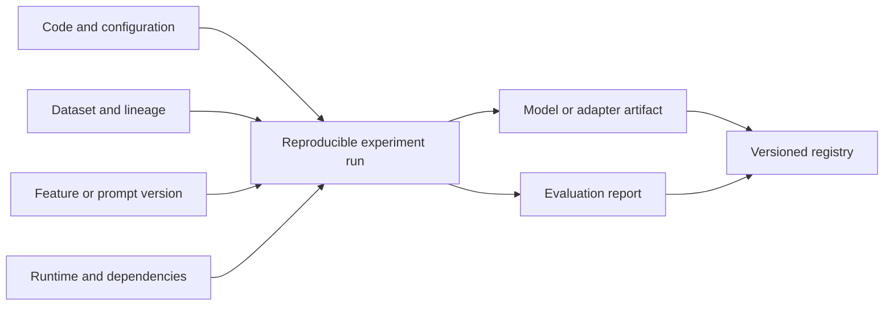
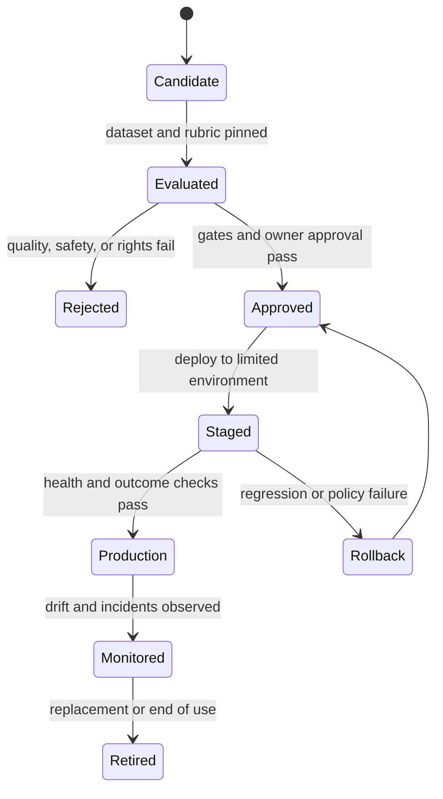
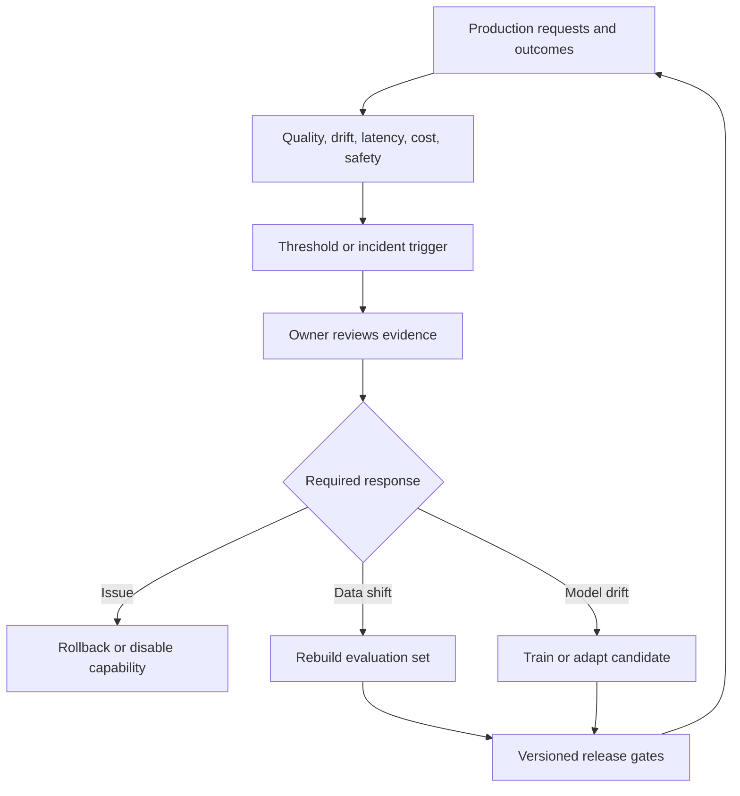
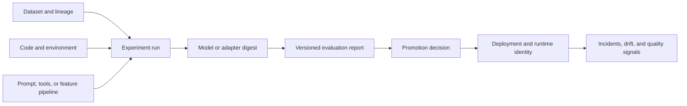

# MLOps and LLMOps

Part: [16 — Artificial Intelligence, Machine Learning, and Generative AI](PART_OVERVIEW.md)

Machine Learning Operations (MLOps) and Large Language Model Operations (LLMOps) govern data, experiments, models, prompts, evaluation, deployment, monitoring, rollback, and retirement. This chapter owns the technical lifecycle workflows and artifact evidence. [Part 17 CH10 — AI Platform and Model Lifecycle Architecture](../17_AI_Architecture/CH10_AI_Platform_and_Model_Lifecycle_Architecture.md) owns their composition into production release controls; [Part 25 CH04 — MLOps](../25_Additional_Architect_Competencies/CH04_MLOps_Machine_Learning_Operations.md) owns architect-level competency framing. Part 13 owns general delivery pipelines, and Part 14 owns observability foundations.

## Artifact Lineage and Experiment Tracking

An experiment should bind code, data snapshot, features, parameters, environment, model artifact, evaluation, and outcome. LLM systems add model provider/version, prompt template, retrieval corpus/index, tool schema, evaluation rubric, and safety policy. Mutable identifiers make results difficult to reproduce.

Store sensitive datasets and prompts under access and retention policies. An experiment registry should capture enough metadata to identify how an artifact was produced, without copying private data into broadly accessible logs.

Prefer immutable identifiers and digests for code, data snapshots, model weights, prompts, evaluation rubrics, and runtime configuration. A digest proves which bytes were referenced, not that the artifact is available or legally reusable; pair it with an access-controlled location and retention owner. Record the random seed and deterministic settings when they are meaningful, but document nondeterministic kernels, distributed order, or hosted-model variability when bit-for-bit reproduction is impossible. The operational goal is to reconstruct the evidence and explain behavior, not to claim determinism the platform cannot provide.

A concrete lineage record makes this checkable rather than aspirational: a registry row might read `run_id=run-2026-0931, code=git-sha a1b2c3d, data=dataset-v14#sha256:9f2e..., prompt=triage-template-v7, base_model=vendor-model-2026-08#digest:7ac1..., eval=rubric-v3, result=pass (92% task accuracy, 0% safety-gate failures)`. Any later question — “why did this request get a different answer last month” — should be answerable by diffing two such rows rather than by interviewing whoever ran the experiment from memory.

## Evaluation Gates and Promotion

Promote models through explicit stages: candidate, validated, approved, deployed, and retired. Evaluation gates should include task quality, safety, latency, cost, data rights, and regression against a baseline. A passing benchmark is necessary evidence for some releases, not proof of production suitability.

Approval should bind to an immutable artifact and evaluation report. Keep model and prompt changes distinct where possible so regressions can be attributed. For provider-hosted models, record the provider deployment identifier and change notices available to the consumer.

## Monitoring, Drift, and Feedback

Monitor input distributions, latency, errors, cost, safety outcomes, and task quality. Ground-truth labels may arrive late or be unavailable; proxy metrics need known limitations. Data drift does not always imply model failure, and stable input distributions do not guarantee stable model behavior after provider or runtime changes.

Feedback data may contain personal or sensitive content. Obtain a lawful basis, minimize retention, filter poisoning, and keep evaluation labels separate from training when measuring generalization. Define who can trigger retraining and who approves deployment.

Separate input drift from outcome degradation. A change in feature or prompt distributions is a reason to inspect the population and pipeline; it is not proof that task quality fell. When labels arrive late, monitor provisional indicators but keep them distinct from confirmed outcome metrics. Compare cohorts only after they have comparable observation windows, and record missing-label rates because selective feedback can bias the apparent score. For hosted models, provider changes can alter behavior without a new local artifact, so maintain a regression suite and a fallback decision for an unannounced or unverifiable version change.

## Rollback, Retirement, and Reproducibility

Rollback requires prior artifacts, compatible runtime and schema, routing control, and known data migration behavior. Model rollback cannot undo external actions taken by an agent or generated data written to a system. Retirement includes removing endpoints, credentials, scheduled jobs, caches, and downstream consumers while preserving required evidence.

```mermaid
flowchart LR
    Active[Active model and prompt versions] --> Incident[Regression or provider change]
    Incident --> Select[Select last known-good release]
    Select --> Verify[Check compatibility and data state]
    Verify --> Route[Restore traffic and revoke unsafe identity]
    Route --> Observe[Verify quality and health]
    Observe --> Review[Post-incident and lifecycle review]
    Review --> Retire[Retire old artifacts, keys, and consumers]
```

## Worked Case and Review Checklist

A transaction-classification model is promoted from experiment to production. The release record binds the dataset snapshot and label window to the feature pipeline, training code, runtime image, model digest, evaluation report, and approver. The team compares false-positive and false-negative rates by region, then starts in shadow mode so decisions can be compared with the existing process without changing outcomes. Only after the observation period and label-maturity window does it enable a limited cohort.

Monitoring then detects a region-specific rise in false positives. The label stream is delayed, so the operator treats the short-term score as a signal rather than confirmed degradation, pauses automated action for that region, and routes cases to human review. Once labels mature, the team traces affected requests to the release identifiers, adds representative failures to a versioned regression set, and finds a source-feature mapping change. It restores the prior compatible manifest, verifies the feature contract, and requires a new evaluation gate before re-promoting. The incident remains linked to the release record; it is not erased when traffic returns to the previous model.

The concrete trigger in this incident was a proxy metric tracked precisely because true labels were delayed: the model's predicted-positive rate for the affected region rose from a stable 2.1% to 3.4% over four days while the overall traffic mix was unchanged, which is a large enough shift relative to historical day-to-day variance (typically under 0.3 percentage points) to warrant pausing automation before any confirmed false positive arrived. Choosing and validating this kind of early proxy signal \u2014 and setting its alert threshold from historical variance rather than a guessed number \u2014 is what let the team react in days instead of waiting out the full label-maturity window before noticing anything was wrong.

Review lineage, versioning, data rights, experiment reproducibility, evaluation gate, artifact identity, approval owner, deployment strategy, monitoring, feedback governance, rollback compatibility, credential cleanup, and retirement plan.

## Questions and Summary

1. Which artifacts and metadata are needed to reproduce a model release?
2. Design evaluation gates for quality, safety, latency, and data rights.
3. How can drift be detected when labels arrive months later?
4. What does a rollback fail to undo in an agentic system?
5. Define the retirement steps for a model endpoint and its credentials.

MLOps and LLMOps connect experiments to production through lineage, evaluation, controlled promotion, monitoring, rollback, and retirement. Track every behavior-changing artifact, protect feedback data, and make owners and gates explicit. Operational maturity is evidence and recovery, not merely automation.
