# MLOps and LLMOps

Part: [16 — Artificial Intelligence, Machine Learning, and Generative AI](PART_OVERVIEW.md) · Status: Revised (in-depth rewrite)

## 1. Introduction

Machine Learning Operations (MLOps) is the set of practices that move a model from a notebook result to a production capability that can be changed, measured, recovered, and eventually retired. Large Language Model Operations (LLMOps) applies the same discipline to systems whose behavior is determined by a hosted or self-hosted foundation model plus prompts, retrieval indexes, tool definitions, and safety policies. The two share a core idea. A model-backed system changes behavior when any one of several artifacts changes, and most of those artifacts are not source code. Operations therefore has to version, test, release, and watch all of them.

A solution architect rarely trains the model, yet the architect decides whether the organization can answer the questions that matter after launch. Which data produced the model that approved this loan? Can last Tuesday's model be restored in ten minutes? Who decided that a four-point accuracy gain justified a 40 percent latency increase? Which customers are affected if the vendor retires the model next quarter? These are architectural questions, because their answers depend on registries, pipelines, contracts, and ownership that must be designed in advance.

After working through this chapter you should be able to:

1. Explain why machine learning (ML) systems fail differently from conventional software, using the hidden technical debt model, and name the failure modes that testing code alone cannot find.
2. Describe the lifecycle from problem framing to retirement and state what evidence each stage must leave behind.
3. Version datasets and features as artifacts, and demonstrate point-in-time correctness with a worked example.
4. Make an experiment reproducible, and state honestly what cannot be made bit-for-bit reproducible.
5. Design a training pipeline, a model registry with stage and alias semantics, and a promotion state machine.
6. Represent lineage from data to deployment as a graph, and use it to answer impact and audit queries.
7. Place the right tests at each stage of continuous integration, continuous delivery, and continuous training (CI/CD/CT).
8. Write an evaluation gate with statistical criteria and compute a go/no-go decision by hand.
9. Choose among shadow, canary, blue/green, A/B, and bandit deployment, and size the traffic and duration with arithmetic.
10. Monitor data drift, concept drift, prediction drift, and performance under delayed labels, and design alerts that do not train people to ignore them.
11. Decide when to retrain, and cost the decision.
12. Operate LLM-specific artifacts: prompt registry, versioned evaluation sets, gateway, caches, guardrails, traces, annotation queues, retrieval indexes, and provider model deprecations.
13. Place MLOps work in a team topology, fund it with cost governance, secure it, and measure the platform itself.

### 1.1 Why this matters to a solution architect

Three properties make the operations layer an architectural concern rather than a team preference.

First, the cost of a late discovery is asymmetric. A defect in a web handler is usually visible in a test or a stack trace. A defect in a model is usually a shift in a distribution, a leaked feature, or a stale label, and it appears as a slow decline in a business metric weeks after the change that caused it. By then, several other things have also changed, and attribution is expensive. Lineage and version identity, designed in at the start, are what make attribution cheap.

Second, the change rate is high and the change surface is wide. A conventional service changes when someone merges code. A model-backed service also changes when upstream data changes, when a feature definition is edited, when a retraining job runs on a schedule, when a vendor updates a hosted model alias, or when a user population shifts. Without a release process that covers all of those, the organization has an incident process in place of a release process.

Third, accountability is increasingly external. Regulators, auditors, and enterprise customers ask for records of how a model was built, tested, approved, and monitored. For example, the European Union (EU) Artificial Intelligence Act places documentation, logging, and post-market monitoring duties on providers of high-risk systems. A pipeline that produces those records as a side effect is far cheaper than a reconstruction exercise after a request arrives. This chapter treats the records as a design output.

### 1.2 Scope and ownership

This chapter owns the technical lifecycle workflows and the artifact evidence they produce. Neighbouring chapters own the surrounding topics, and this chapter recaps them only as far as needed.

| Topic | Owner | What this chapter does with it |
|---|---|---|
| Model and platform products (feature store products, registries, orchestrators) | [CH27 AI Infrastructure and Platform Components](CH27_AI_Infrastructure_and_Platform_Components.md) | Names products by role in Section 21 and teaches the semantics they must provide. |
| Serving optimization (batching, quantization, KV cache) | [CH28 Inference Optimization and Model Serving](CH28_Inference_Optimization_and_Model_Serving.md) | Uses serving only where release and rollback depend on it. |
| Evaluation methodology, metrics, and statistical validation | [CH06 Model Evaluation, Validation, and Selection](CH06_Model_Evaluation_Validation_and_Selection.md) | Applies those results as release gates. |
| Data preparation, leakage, and splits | [CH02 Data Preparation, Feature Engineering, and Leakage](CH02_Data_Preparation_Feature_Engineering_and_Leakage.md) | Shows how leakage reappears as training/serving skew. |
| Generative AI evaluation, guardrails, and hallucination | [CH24 Generative AI Evaluation, Guardrails, and Hallucinations](CH24_Generative_AI_Evaluation_Guardrails_and_Hallucinations.md) | Wires those evaluations into CI and release gates. |
| Agents, tool calling, and memory | [CH21 Agents, Tool Calling, Memory, and Planning](CH21_Agents_Tool_Calling_Memory_Planning.md) | Adds operational concerns in Section 20. |
| Data rights, consent, and provenance | [CH30 AI Data Governance, Privacy, and Provenance](CH30_AI_Data_Governance_Privacy_and_Provenance.md) | Records rights as lineage attributes and gate criteria. |
| Responsible AI and safety governance | [CH31 Responsible AI and Safety Governance](CH31_Responsible_AI_and_Safety_Governance.md) | Treats approvals as a gate input. |
| General delivery pipelines, release engineering | Part 13, [DevOps overview](../13_DevOps/PART_OVERVIEW.md) | Reuses CI/CD concepts and states what ML adds. |
| Observability foundations (metrics, logs, traces) | Part 14, [Observability overview](../14_Observability/PART_OVERVIEW.md) | Reuses the telemetry stack and states what ML adds. |
| Composed lifecycle and release-control architecture | [Part 17 CH10 AI Platform and Model Lifecycle Architecture](../17_AI_Architecture/CH10_AI_Platform_and_Model_Lifecycle_Architecture.md) and [Part 17 CH11 Evaluation and Observability Architecture for AI Systems](../17_AI_Architecture/CH11_Evaluation_and_Observability_Architecture_for_AI_Systems.md) | Provides the workflow building blocks those chapters compose. |
| Architect-level MLOps competency framing | [Part 25 CH04 MLOps](../25_Additional_Architect_Competencies/CH04_MLOps_Machine_Learning_Operations.md) | Not repeated here. |

The practical division is this: this chapter explains how each workflow works and what evidence it leaves, and Part 17 explains how the workflows are assembled into a platform with release controls across teams.

### 1.3 A note on numbers

Worked examples use illustrative figures chosen so that the arithmetic can be followed by hand. They are not measurements of any real system, vendor, or benchmark. Where a fact is likely to drift, such as a product feature or a provider policy, the text says "at the time of writing" and points to the source to check. The runnable scripts in [code/python/mlops-chapter](../code/python/mlops-chapter/01_psi_drift_monitor.py) reproduce every computed number that the chapter quotes from code.

## 2. Why ML Systems Fail Differently

### 2.1 Behavior is learned from data, so data is part of the program

In a conventional program the developer writes the rules. In supervised ML the rules are fitted: an algorithm searches a hypothesis space for parameters that fit a training dataset, and the resulting function is deployed. The consequence is that the dataset, the feature code, the labeling process, the training configuration, and the random seed jointly define the behavior. Change the dataset by one percent and the behavior may change measurably even though no line of code was edited. Source control and unit tests, the primary safety nets of conventional engineering, cover only a small part of the artifact set.

A second consequence is that correctness is statistical. A conventional function is right or wrong on a given input. A model is right with some probability on a population, and "right" is defined against labels that may themselves be late, noisy, or biased. A release decision is therefore a comparison of distributions with uncertainty, not a pass/fail assertion on examples. Sections 11 and 12 develop the arithmetic.

A third consequence is that failure is usually silent. A broken handler throws an exception. A model with a shifted input distribution returns a well-formed number, within latency, with a 200 status code. Nothing in the infrastructure signals that the number is now wrong. Monitoring must therefore be designed to look at the data and the outcomes, which is the subject of Section 14.

### 2.2 The hidden technical debt model

D. Sculley and colleagues at Google (2015), in "Hidden Technical Debt in Machine Learning Systems," observed that the model code in a production ML system is a small box surrounded by much larger boxes: data collection, feature extraction, data verification, configuration, serving infrastructure, resource management, analysis tools, process management, and monitoring. They argued that ML systems carry all the maintenance problems of conventional software plus a set of ML-specific ones. The paper's main categories remain a useful checklist.

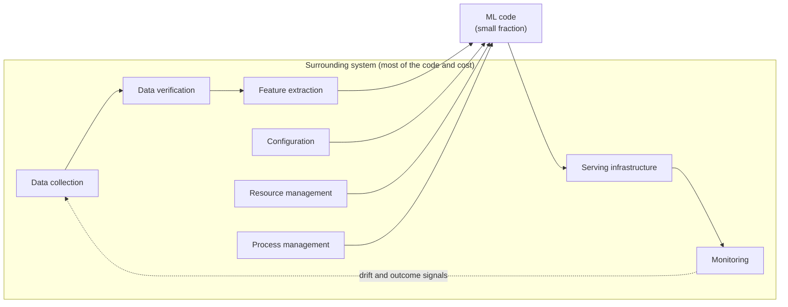

The diagram shows why operations dominates effort. The model-fitting code is one node among many, and every edge is an interface that can break independently: a schema change upstream, a configuration edit, a serving library upgrade, a monitoring gap. The dotted edge from monitoring back to data collection is the feedback loop discussed in Section 2.5. The implication for a team is that headcount and design attention must be allocated to the surrounding boxes, because staffing only the box labelled ML leaves most of the failure surface unowned.

### 2.3 Data dependencies

Code dependencies are checked by compilers and package managers. Data dependencies are rarely checked by anything. Sculley and colleagues identified several patterns worth knowing by name.

**Unstable data dependencies.** A feature that is an input signal produced by another model or another team's pipeline can change without notice. If an upstream sentiment score is retrained, every downstream consumer sees a distribution shift that nobody on their team caused. The mitigation is versioned inputs: consume a pinned version of the upstream output and upgrade deliberately, with the downstream evaluation rerun.

**Underutilized data dependencies.** Features that add a tiny gain are a liability. Each one is a dependency that can break, drift, or become unavailable. Legacy features that were once useful, bundled features added as a group, epsilon features whose gain is within noise, and correlated features all increase the surface area. A periodic leave-one-feature-out ablation, with a rule to remove features whose removal changes the validation metric by less than the run-to-run noise, keeps the dependency list honest.

**Static analysis for data.** Conventional tooling can trace which code uses which function. Data tooling should answer which models consume which feature, which features derive from which source columns, and which consumers break if a column is renamed. Section 9 builds this as a lineage graph.

**Training/serving skew.** The same feature is computed in two code paths, one for batch training and one for online serving, and the paths diverge. Section 5 treats this in depth.

### 2.4 Entanglement and the CACE principle

Sculley and colleagues named the principle "Changing Anything Changes Everything" (CACE). Suppose a model uses features $x_1, \dots, x_n$. Adding a new feature $x_{n+1}$, changing the input distribution of $x_1$, or removing $x_2$ can change the learned weights and effective importance of every other feature, because the model is fitted jointly. Unlike modular software, there is no isolation of a component's behavior. A common consequence is that a feature fix, correct in isolation, degrades the model that was implicitly tuned around the bug.

The operational implications are practical.

- Any change to inputs, features, or hyperparameters requires a full evaluation of the whole model against a fixed baseline, not a local test of the changed part.
- Ensembles and cascades compound the problem, since model B trained on the output of model A is entangled with A's behavior. Retraining A requires re-evaluating B, or freezing B's input contract.
- A "correction cascade," where a second model is trained to fix the first model's mistakes for a particular case, creates a dependency that makes the first model costly to improve.
- Isolating by slice evaluation, ablation, and explicit interface contracts reduces, but does not remove, entanglement.

### 2.5 Feedback loops

A model that influences the data it will later be trained on creates a feedback loop. Two forms exist.

A *direct* loop occurs when predictions determine which examples receive labels. A fraud model that blocks a transaction prevents the world from revealing whether the transaction was fraudulent. A loan model that rejects an applicant never observes whether the applicant would have repaid. Training only on approved or reviewed cases yields selection bias: the training population is the set the previous model chose to let through. Over successive retraining cycles the model's blind spots become self-reinforcing, because the cases it handles worst are exactly the ones it stops seeing labels for.

A *hidden* loop occurs through the world rather than the training pipeline. A recommender that surfaces a type of content changes what users consume, which changes the engagement data, which trains the next recommender. Two models owned by different teams that influence each other through a shared market, or a shared user population, create a loop that no single team's dashboard shows.

Mitigations are known and cost something. Reserve a small exploration slice where decisions are made at random or by a baseline policy, and log the propensity of each decision so that later training can reweight (inverse propensity weighting). Maintain a holdout where no model acts, to measure the counterfactual. Randomly audit a sample of declined cases to obtain labels. Each of these has a business cost, for example allowing a small fraction of possibly fraudulent transactions through, and the cost must be approved by the owner because it is paid in real losses. This is the reason monitoring and experimentation design are architectural matters.

### 2.6 Other ML-specific debt

The same paper and later work add several patterns that matter operationally.

- **Pipeline jungles.** Data preparation grows as a tangle of scrapes, joins, and sampling steps. Without an explicit pipeline abstraction, it becomes untestable and unrepeatable.
- **Dead experimental code paths.** Experimental branches left in production code multiply the combinatorial testing burden, and the Knight Capital incident in 2012 is a frequently cited example in the broader software literature of an old code path being triggered by a repurposed flag.
- **Configuration debt.** Hyperparameters, feature lists, thresholds, and data windows live in configuration, and configuration errors are a leading cause of failures. Configuration needs the same review, versioning, and testing as code.
- **Changes in the external world.** Thresholds that were tuned on historical data, such as an alert at a fixed score, lose meaning as the world moves. Monitoring must tie thresholds to distributions or to business cost, not to constants.
- **Reproducibility debt.** Results that cannot be regenerated cannot be audited or improved with confidence. Section 6 treats this.

### 2.7 What testing code cannot find

A table of failure types makes the point that classic software testing is necessary and insufficient.

| Failure | Example | Caught by unit tests on code? | What catches it |
|---|---|---|---|
| Upstream schema change | A column changes from dollars to cents | No | Data validation with range and unit checks |
| Silent distribution shift | A new customer segment arrives | No | Drift monitors, slice evaluation |
| Label leakage | A feature computed after the outcome | No | Point-in-time joins, leakage tests, suspicious-gain review |
| Training/serving skew | Different null handling online | No | Skew tests, logged-feature comparison |
| Concept drift | Fraudsters change tactics | No | Outcome monitoring, challenger models |
| Feedback loop | Model biases its own training set | No | Exploration slice, holdout, audits |
| Bad promotion | A model passes aggregate metrics but regresses a slice | No | Slice-level gates |
| Dependency drift | A library upgrade changes numeric behavior | Partially | Pinned environments, regression test on fixed inputs |
| Provider model change | A hosted model alias points to a new snapshot | No | Regression suite, pinned snapshot identifiers |

The table is the argument for the rest of the chapter. Each row maps to a mechanism: validation, point-in-time joins, registries, gates, monitors, and pinned identifiers.

## 3. The Lifecycle From Problem to Retirement

### 3.1 The stages and what each must leave behind

A model's life has a recognizable sequence. The stages overlap and loop, but naming them lets a team ask what evidence exists at each point.

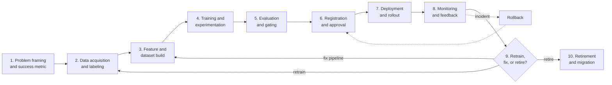

The loop from monitoring back to data acquisition is the point of "Ops." A model that ships once and is never revisited is a project. A model with a monitored, repeatable loop is a product, and the loop is what the rest of the chapter engineers.

| Stage | Question it answers | Evidence left behind |
|---|---|---|
| Problem framing | Is a model the right tool, and how will success be measured in business terms? | A written problem statement, baseline (rule or human) performance, decision and cost model, owner |
| Data acquisition and labeling | What data exists, with what rights and what label delay? | Source inventory, rights and consent record, labeling guidelines, label quality audit |
| Feature and dataset build | Are features computed identically for training and serving, and without leakage? | Feature definitions, dataset snapshot identifier, validation report |
| Training and experimentation | Which configuration is best, and can the result be regenerated? | Experiment records binding code, data, configuration, environment, seeds, and metrics |
| Evaluation and gating | Is the candidate better than the incumbent for the decision at hand, with what uncertainty? | Evaluation report, slice results, comparison to baseline, gate decision |
| Registration and approval | Who approved which immutable artifact for which use? | Registry entry, model card, approver, intended-use statement |
| Deployment and rollout | How is exposure increased, and what stops it? | Rollout plan, traffic schedule, abort criteria |
| Monitoring and feedback | Is the model still performing as the world changes? | Dashboards, alerts, drift and outcome reports, label feedback |
| Retrain, fix, or retire | What action does the evidence call for? | Decision record with the trigger and the evidence |
| Retirement and migration | Who depends on this model, and how are they moved? | Consumer list, migration plan, decommission checklist, retained audit evidence |

### 3.2 Problem framing is the first operational decision

Operations begins before any data is touched. The questions asked at problem framing determine whether the later system can be monitored. If the success metric is "accuracy," and nobody has defined who acts on a prediction, what the action costs, and how long until the outcome is known, then the monitoring plan cannot be written. Four framing outputs are worth requiring.

1. **The decision.** What action follows from a prediction, and who or what takes it? A prediction nobody acts on has no operational consequence and no feedback.
2. **The cost model.** What are the costs of a false positive, a false negative, and a review? [CH03 Section 7](CH03_Regression_and_Classification.md) derives threshold selection from such costs, and the same costs convert metric changes into money in the gates of Section 11.
3. **The label delay.** How long until the truth is known? A fraud chargeback can take weeks, a churn label months, and an LLM answer's usefulness may never be directly observed. Label delay sets the monitoring design in Section 14.
4. **The baseline.** What does the current process achieve, whether it is a rule set, a human team, or a previous model? Every later gate compares against it, and a model that cannot beat a rule set at lower cost should not ship.

### 3.3 Two loops with different clocks

It helps to separate two feedback loops that run at different speeds.

The *inner loop* is development: change something, train, evaluate offline, compare. It runs in minutes to hours and is owned by the model developer. It needs fast, deterministic-enough feedback and cheap experiment tracking.

The *outer loop* is operations: release, observe in production, collect outcomes, decide to retrain. It runs in days to months and is owned jointly by the model owner, the platform team, and the business. It needs controlled release, monitoring, and delayed-label handling.

Most MLOps failures come from mismatched clocks. Teams invest heavily in the inner loop, with fast notebooks and tracking, and discover on first launch that the outer loop has no instrumentation. Others build elaborate monitoring and cannot reproduce a training run to fix what the monitor found. A mature platform makes the two loops share artifacts: the evaluation set that gates a release is the same set that the monitor uses as a reference, and the dataset a retraining job consumes is registered the same way as the one a developer used.

### 3.4 Retirement is part of the lifecycle

A model that is never retired accumulates risk: unpatched dependencies, an unowned endpoint, credentials with no rotation, and consumers that cannot move. Retirement is a stage with its own plan. Section 25 details it, but the lifecycle framing matters now: every model registered must have an owner, a review date, and a retirement criterion on the day it is approved, so that the question "should this still run?" has a standing answer rather than an archaeological one.

## 4. Data Versioning and Datasets as Artifacts

### 4.1 Why a dataset needs an identity

A model is a function of its training data. If the data can change without a record, the model cannot be reproduced, an audit cannot be answered, and a regression cannot be attributed. The central rule is that a dataset used for training, validation, or evaluation is an *immutable, identified artifact*, in the same way a compiled binary is. A table name such as `transactions_clean` is not an identity, because the content behind it changes nightly. An identity is a name plus a content-derived version.

Three mechanisms provide that identity, with different cost and fidelity.

| Mechanism | How it works | Strengths | Weaknesses |
|---|---|---|---|
| Content hash of files | Hash each file, then hash the sorted list of hashes (a Merkle-style manifest). Tools such as DVC (Data Version Control) store pointers in Git and the bytes in object storage. | Exact, cheap to verify, works for files and directories | Copies data, large for very large sets, file-level rather than row-level |
| Table snapshot or time travel | Open table formats such as Delta Lake, Apache Iceberg, and Apache Hudi record versions of a table, so a query can name "version 412" or "as of timestamp T" | No copy, row-level, integrates with query engines | Retention limits, need to pin the version explicitly, vacuuming can delete history |
| Query plus source versions | Store the query text, the code version, and the source-table versions that regenerate the dataset | Compact, works when snapshotting is infeasible | Reproduction depends on all sources still being retrievable and on determinism of the query |

In practice, teams use table snapshots for large tabular data, content hashes for files such as images and evaluation sets, and the query-plus-source approach as a fallback with an explicit retention contract. Whichever mechanism is chosen, the training run must record the *resolved* identifier, such as "table version 412" or a manifest hash, never the moving alias such as "latest."

### 4.2 What a dataset artifact contains

A dataset version is more than rows. The registry entry should hold the following fields, because each answers a question that arises later.

- **Content identity:** manifest hash or table version, row count, and column schema with types and units.
- **Provenance:** the source systems, extraction time window, the code and query that produced it, and the pipeline run identifier.
- **Label information:** the label definition, the label window (for example "chargeback within 60 days"), and the label maturity at snapshot time. A snapshot taken before labels mature has biased negatives, as Section 14.5 shows numerically.
- **Splits:** the rule that assigns each row to training, validation, or test, ideally deterministic (a hash of an entity key) so that the same customer never appears on both sides and so the split survives regeneration. Leakage across splits is owned by [CH02](CH02_Data_Preparation_Feature_Engineering_and_Leakage.md).
- **Rights and sensitivity:** the lawful basis or license, consent scope, sensitivity classification, and retention period, as defined in [CH30](CH30_AI_Data_Governance_Privacy_and_Provenance.md). These travel with the dataset so that a gate can check them.
- **Quality report:** results of validation checks, such as null rates, ranges, uniqueness, and distribution summaries.

### 4.3 Data validation as a gate

Validation turns assumptions about data into executable checks. They fall into three levels, and each level catches a different class of failure.

1. **Schema checks.** Column presence, type, nullability, and allowed values. These catch the renamed column and the type change.
2. **Statistical checks on a single batch.** Null fraction below a bound, value ranges, uniqueness of keys, cardinality of categorical features, and units. These catch the dollars-to-cents change, which a schema check misses because the type is still a number.
3. **Distribution checks against a reference.** Compare each feature's distribution in the new batch against a reference batch using the drift statistics of Section 14. These catch population shifts before training consumes them.

Open-source libraries implement these patterns, among them Great Expectations, TensorFlow Data Validation, Pandera, and Deequ. Choose by the processing engine and language you already run; the semantics are similar. The important design point is *where the check blocks*. A validation failure on a training dataset should block the training pipeline from proceeding to registration, and a failure on a serving-time feature batch should route to a fallback, not silently continue.

### 4.4 Evaluation sets are datasets too

The evaluation set deserves the strictest treatment. It is versioned, access-controlled, and changed only through a reviewed process, because the evaluation set is the yardstick for every gate. Two failure patterns recur. First, a team tunes against the evaluation set repeatedly until its score no longer estimates production performance, which is a form of leakage through the selection process described in [CH06](CH06_Model_Evaluation_Validation_and_Selection.md). The remedy is a frozen test set consulted rarely, plus a refreshable validation set. Second, the evaluation set ages: the population it was sampled from has moved, so a score on it overstates or understates production quality. The remedy is to refresh it on a schedule and to record which version each model was gated against, so that scores across versions are not compared as if they were measured on the same yardstick.

### 4.5 Worked example: the cost of an unpinned dataset

A team trains on `orders_clean` on Monday and records "dataset: orders_clean." On Wednesday an upstream fix backfills 3 percent of rows, correcting a currency conversion. On Friday a regression appears in a different team's model that consumed the same table, and someone proposes retraining the Monday model to compare. The retrained model cannot match the Monday metrics because the data differ, and nobody can tell whether the difference is from the data fix or from the training code change made on Thursday. Two causes, one effect, no way to separate them: that is the cost. Pinning "orders_clean at table version 412" on Monday, at essentially zero cost, would have allowed a controlled comparison: retrain with the code of Monday and the data of Wednesday, then with the code of Thursday and the data of Monday, and read off the two effects.

## 5. Feature Stores and Training/Serving Skew

### 5.1 The problem a feature store solves

Features are computed from raw data, often with windows and aggregations: "count of transactions in the last 24 hours," "average basket value over 30 days." For training, a data scientist computes these in a batch engine over history. For serving, an engineer computes them in a low-latency service from a stream or an online store. If two implementations exist, they eventually differ: a rounding rule, a time zone, a null default, an inclusive versus exclusive window boundary. The model trained on one version is served the other. This mismatch is **training/serving skew**, and it is among the most common causes of a model that performs well offline and poorly in production.

A feature store addresses three problems at once.

1. **One definition.** A feature is defined once, in code, with a name, entity key, transformation, and owner. Both the offline pipeline and the online pipeline use that definition.
2. **Two stores, one source of truth.** An *offline store* holds history for training and batch scoring. An *online store* holds the latest value per entity for low-latency lookup. A materialization job moves values from offline to online.
3. **Point-in-time retrieval.** Training sets are built by joining each labeled event to the feature values that were available *at the event time*, not the current values. This is the correctness property treated next.

CH27 owns the products that implement these. This section teaches the semantics a product must provide so that the reader can evaluate one.

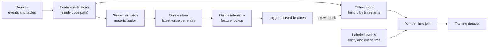

The diagram shows that training and serving read from the same definition, and that a logged copy of the features actually served flows back for comparison with the offline values. That dotted edge is the skew detector. Logging the served feature vector, with the model version and request identifier, is cheap, and it enables both skew checks and later debugging of individual decisions.

### 5.2 Point-in-time correctness

Let an entity $e$ (a customer) have a feature $f$ whose value changes over time, recorded as a series of rows $(e, t_k, v_k)$, where $t_k$ is the time the value became known and $v_k$ is the value. A labeled training example is $(e, \tau, y)$, where $\tau$ is the *decision time*, the moment at which the model would have been asked to predict, and $y$ is the label observed later. The point-in-time (PIT) correct feature value is

$$v(e,\tau) = v_k \quad \text{where } k = \max\{\, j : t_j \le \tau \,\}.$$

In words: take the latest value recorded at or before the decision time. A *naive* join takes the latest value overall, or the value at label time, and so can include information produced after $\tau$. That information is often correlated with the label, because the label itself may have caused it. Examples: a "number of chargebacks" feature updated after the fraud was confirmed, a "customer status" updated after churn, a "last contact outcome" updated after the sale.

**Worked example.** Two customers have a feature `txn_count_24h`. Times are in hours.

| customer | feature rows $(t_k, v_k)$ |
|---|---|
| c1 | (0, 2), (24, 3), (48, 40) |
| c2 | (0, 1), (24, 1), (48, 2) |

Customer c1's card was compromised around hour 40, so the burst of transactions appears in the hour-48 row. Three labeled examples exist:

| customer | decision time $\tau$ | label |
|---|---|---|
| c1 | 30 | fraud (1) |
| c2 | 30 | not fraud (0) |
| c1 | 10 | not fraud (0) |

A naive "latest value" join assigns c1 the value 40 in both of its examples, including the example at $\tau = 10$, when no burst had occurred. The PIT join uses the rule above. For c1 at $\tau = 30$, the rows with $t_j \le 30$ are hours 0 and 24, and the maximum index is the hour-24 row, so $v = 3$. For c1 at $\tau = 10$, only the hour-0 row qualifies, so $v = 2$. For c2 at $\tau = 30$, the hour-24 row gives $v = 1$.

The script [04_point_in_time_join.py](../code/python/mlops-chapter/04_point_in_time_join.py) prints:

```text
customer  decision_t  label  naive(latest)  point_in_time
c1                30      1             40              3
c2                30      0              2              1
c1                10      0             40              2
naive: mean feature for fraud=40.0, non-fraud=21.0
point-in-time: mean feature for fraud=3.0, non-fraud=1.5
```

Under the naive join the feature separates fraud (40) from non-fraud (21) strongly, so a trained model assigns it large weight and validates well. At serving time the feature at the moment of decision is 3, which looks like non-fraud, and the model's apparent skill disappears. The offline-to-online gap is entirely a data-construction error, and it is large enough that a model trained on the naive join may perform *worse* than one trained without the feature. Under the correct join, the feature is almost uninformative in this toy example (3.0 versus 1.5), which is the honest signal.

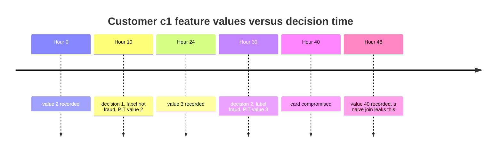

The timeline makes the leak visible. Both decisions occur before hour 48, and only a join that respects the decision time keeps the value 40 out of the training row. A practical test: a feature store or hand-written join should pass a unit test that builds a tiny table like this one and asserts the expected values.

### 5.3 Subtleties that the simple rule hides

**Event time versus ingestion time.** The rule uses the time at which the value became *available to the serving system*, not the time of the underlying event. If a transaction occurs at 10:00 but reaches the stream at 10:07, the online model could not have used it at 10:03. Join on ingestion (or "known") time, and keep both timestamps. Using event time when the pipeline has delay produces optimistic training data.

**Time-to-live (TTL) and freshness.** A value last updated 90 days ago may be stale enough that serving it is wrong. Features carry a TTL, and a lookup older than the TTL returns null or a flagged default. The training join must apply the same TTL, or the model sees fresh values in training and stale ones in serving.

**Late-arriving and corrected data.** Corrections to historical values (a backfill) change what the offline store returns for a past time. Training on corrected values while serving saw the uncorrected ones is a skew in the optimistic direction. Choose deliberately which version of history the model should learn from, and prefer "as known at the time" for features that drive decisions.

**Aggregations over windows.** A rolling 24-hour count at $\tau$ must exclude events at or after $\tau$. The boundary (inclusive or exclusive) must be identical in both paths and documented, since an off-by-one on a window boundary is a classic source of skew.

**Entity resolution.** If the online system keys on a session identifier and the training data keys on a resolved customer, the same feature is computed over different populations. The key semantics belong in the feature definition.

### 5.4 Detecting skew in operation

Three complementary checks catch skew after deployment.

1. **Logged-feature comparison.** Log the feature vector that was actually passed to the model. Later, recompute the same features through the offline path for the same entity and decision time, and compare. The fraction of rows where any feature differs beyond a tolerance is the *skew rate*. Investigate any rate above the numeric noise floor of the pipeline.
2. **Distribution comparison.** Compare the distribution of each feature in training data with its distribution at serving, using the Population Stability Index (PSI) or the Kolmogorov-Smirnov (KS) statistic, both defined in Section 14. A large gap on a feature that has no population explanation points to a pipeline difference.
3. **Replay test.** In CI, replay a fixed sample of historical requests through the serving path and compare predictions to those from the batch path. Differences beyond a small tolerance fail the build.

The cost of these checks is storage for the logged vectors and a periodic job, which is small compared with the cost of discovering skew through a business metric. Logged vectors are personal data in many systems and must follow the retention and access rules in Section 24.

### 5.5 When a feature store is not needed

A feature store is infrastructure with its own operating cost. It pays off when several models share features, when features need windowed aggregations with PIT semantics at low latency, or when training/serving skew has already caused incidents. A single batch-scored model whose features are columns of one table does not need one. A simple alternative for that case is a shared, versioned feature-computation library imported by both training and scoring code, plus the replay test above. Choosing the lighter option first and moving to a store when the second or third model arrives is a defensible sequence.

## 6. Experiment Tracking and Reproducibility

### 6.1 What an experiment record must bind

An experiment record is the unit of evidence for "we tried this." A useful record binds together everything that determined the result, so that anyone can regenerate or audit it.

| Bound item | Why it is needed | Typical identifier |
|---|---|---|
| Code | The training and feature code that ran | Git commit SHA (Secure Hash Algorithm), plus a flag for uncommitted changes |
| Data | The exact training, validation, and evaluation sets | Dataset manifest hash or table version (Section 4) |
| Configuration | Hyperparameters, feature list, thresholds, windows | A resolved configuration file, hashed |
| Environment | Language, library, driver, and hardware versions | Container image digest, lock file hash, GPU type and driver version |
| Randomness | Seeds for data order, initialization, augmentation, dropout | Integer seeds recorded per source of randomness |
| Metrics | Training and evaluation results, including slice metrics | Named metrics with the evaluation set version |
| Artifacts | The model weights or serialized pipeline, plots, reports | Content digest of each artifact |
| Parent | The run or model this one was initialized from or compared to | Run identifier |

The record is written by the training code through a tracking API, not assembled by hand afterward. Hand-assembled records omit the inconvenient fields.

A compact way to bind code, data, and configuration is a *run fingerprint*:

$$H_{\text{run}} = \operatorname{SHA256}\big(H_{\text{code}} \,\|\, H_{\text{data}} \,\|\, H_{\text{config}} \,\|\, H_{\text{env}}\big),$$

where $\|$ denotes concatenation and each component is itself a content hash. Two runs with the same fingerprint are *intended* to be identical; two runs with different fingerprints are different experiments. The fingerprint is a lookup key (has this been tried?) and a cache key (can a pipeline step be skipped because the same inputs already produced a stored output?). It is an identity for the inputs, not a promise about the outputs, which depend on determinism as discussed next.

### 6.2 What reproducibility can and cannot promise

There are three levels worth distinguishing.

1. **Re-runnable.** The run can be executed again from recorded inputs. This is achievable with the record above.
2. **Statistically reproducible.** Re-running yields metrics within the run-to-run noise. This is the practical standard and the one gates should rely on.
3. **Bit-for-bit reproducible.** The same weights, byte for byte. This is hard, and often not worth the cost.

Sources of non-determinism are well known. Graphics processing unit (GPU) kernels may use non-deterministic algorithms, for example atomic additions whose order varies, so floating-point sums differ in the last bits. Distributed training depends on the order in which gradients are reduced. Data loading with multiple workers may reorder examples. Library versions change numeric routines. Hardware generations differ in precision behavior. Frameworks provide switches to force deterministic algorithms, at some speed cost and with some operations unsupported, and seeds must be set for each source of randomness separately.

The sensible engineering position is the following. Set and record all seeds. Pin the environment by container digest. Enable deterministic modes where the cost is acceptable, for example in small runs used for regression tests. For large runs, accept statistical reproducibility and *measure the noise*: train the same configuration with several seeds and record the spread of the headline metric. That spread, say a standard deviation of 0.15 percentage points of recall, becomes the noise floor used when interpreting differences between candidates. A gain of 0.1 points that is inside the noise floor is not evidence of improvement, and a gate that treats it as such will promote random variation.

### 6.3 Worked example: using the seed spread

Suppose five seeds of the incumbent configuration give recall of 0.842, 0.845, 0.839, 0.847, and 0.843. The mean is $(0.842+0.845+0.839+0.847+0.843)/5 = 4.216/5 = 0.8432$. The deviations are $-0.0012$, $+0.0018$, $-0.0042$, $+0.0038$, and $-0.0002$, with squares of $1.44\times10^{-6}$, $3.24\times10^{-6}$, $17.64\times10^{-6}$, $14.44\times10^{-6}$, and $0.04\times10^{-6}$. Their sum is $36.8\times10^{-6}$; dividing by $n-1 = 4$ gives a variance of $9.2\times10^{-6}$ and a standard deviation of about $0.0030$. A new candidate scoring 0.848 on one seed is $0.848 - 0.8432 = 0.0048$ above the incumbent mean, which is about 1.6 seed standard deviations. That is within what random initialization alone produces, so the candidate should be rerun with several seeds before anyone treats it as better. The same logic applies to the paired test on a single large evaluation set in Section 11, which accounts for evaluation-sample noise but not for training-seed noise; a complete decision considers both.

### 6.4 Tracking systems and what to log

Experiment tracking tools, among them MLflow, Weights & Biases (W&B), and Neptune, provide an API to log parameters, metrics, and artifacts, a store, and a comparison interface. MLflow is open source and widely embedded in managed platforms; verify the current feature set in its documentation before choosing. What matters architecturally is not the product but the discipline of what is logged.

- Log the *resolved* configuration, not the default one. Defaults change between library versions.
- Log metrics at several granularities: per epoch for debugging, and per slice for the final evaluation.
- Log the evaluation set version next to every evaluation metric.
- Log resource usage (GPU hours, wall time, peak memory), since cost per experiment becomes a governance input in Section 23.
- Log the data and model *digests*, not the data itself. Sensitive datasets and prompts stay in access-controlled stores, and the tracking server holds references, so the tracking system does not become a broad-access copy of private data.
- Tag runs with an owner and a purpose so that abandoned experiments can be cleaned up and their artifacts expired.

### 6.5 Checkpoints, resumption, and long runs

Large training runs fail: preemptions, hardware faults, out-of-memory errors. A run that cannot resume from a checkpoint wastes its cost. Checkpoints must include model weights, optimizer state, learning-rate scheduler state, the position in the data order, and the random number generator states. If any is missing, resumption yields a run that differs from an uninterrupted one in ways that are hard to see. Checkpoints are also artifacts: stored with run identifiers and retention policies, since they are large and accumulate cost.

## 7. Training Pipelines and Orchestration

### 7.1 From notebook to pipeline

A pipeline is a directed acyclic graph (DAG) of steps with declared inputs and outputs: ingest, validate, build features, split, train, evaluate, register. It replaces the notebook as the record of how a model is produced. A notebook is for exploration. A pipeline is for anything that must run again, on schedule or on trigger, and produce a model that others rely on.

Properties of a good pipeline step:

- **Declared inputs and outputs.** Each step names the artifacts it reads and writes, which lets the orchestrator build the graph, cache results, and record lineage automatically.
- **Idempotence.** Running a step twice with the same inputs produces the same output (or an equivalent one) and does not duplicate side effects. This allows safe retries.
- **Parameterization by identifiers, not by "latest."** A run receives the dataset version and configuration as parameters, so it is reproducible and so a backfill can rerun an old configuration.
- **Isolation.** Each step runs in a container with a pinned environment, so that behavior does not depend on the host.
- **Small blast radius.** A step that fails should leave previous registered artifacts untouched. Writing outputs under a run-specific path, and registering only after gates pass, achieves this.

### 7.2 Orchestration choices

Orchestrators schedule steps, track state, retry failures, and pass artifacts. The choice follows from what you already run and from what the pipeline needs.

| Orchestrator | Model | Fits when |
|---|---|---|
| Apache Airflow | Python-defined DAGs, time-based scheduling, large operator ecosystem | The organization already uses it for data engineering, and ML steps are mostly calls to other systems |
| Kubeflow Pipelines | Containerized components on Kubernetes, artifact tracking | The platform is Kubernetes-native and teams want ML-specific components and caching |
| Argo Workflows | Kubernetes-native workflow engine defined as custom resources | Teams want a general workflow engine on Kubernetes, often under other tools |
| Flyte | Typed tasks and workflows with strong versioning and caching, on Kubernetes | Strong typing, reproducibility, and large-scale training pipelines matter |
| Managed pipelines (Vertex AI Pipelines, SageMaker Pipelines, Azure ML Pipelines, Databricks Workflows) | Cloud-managed execution, integrated with the cloud's registry and compute | The team accepts cloud coupling for lower operating burden |
| Dagster, Prefect, Metaflow | Python-native orchestration with asset or flow abstractions | Developer experience and local-to-cloud parity are priorities |

Product details change between releases, so verify current capabilities and versions in each project's documentation. The selection criteria that endure are: how artifacts and lineage are recorded, whether steps can be cached by input fingerprint, how failures and retries are handled, how secrets and identities are scoped, whether GPU scheduling and quotas are supported, and whether the orchestrator can trigger on events (new data, drift alert) as well as on time.

### 7.3 Triggers

Pipelines run on three kinds of trigger, and a platform usually needs all three.

1. **Schedule.** Weekly or daily retraining. Simple, predictable, and wasteful if nothing has changed.
2. **Event.** New data arrives, a code change merges, a drift alert fires. Responsive, and needs guards against storms (many triggers in a short time).
3. **Manual.** An authorized person triggers a run, for example to rebuild after a data correction. Always available, and audited.

Section 15 treats the economics of retraining triggers.

### 7.4 Caching and incremental computation

Training pipelines are expensive, and many steps are reusable. If the data validation step's inputs (dataset version and validation configuration) match a previous run's, its outputs can be reused. The run fingerprint of Section 6.1, computed per step, serves as the cache key. Caching speeds iteration and cuts cost, with one hazard: a step with a hidden dependency (reading an unpinned table, calling an external API) produces a stale cached result. The rule that every dependency is a declared input is what makes caching safe.

### 7.5 A minimal pipeline definition

The following sketch, in a generic orchestrator-neutral style, shows the shape. It is illustrative pseudo-configuration, not tied to one product.

```yaml
pipeline: fraud-model-training
parameters:
  dataset_version: "orders@412"
  config_hash: "c9a1..."
  seed: 17
steps:
  - name: validate_data
    inputs: [dataset_version]
    outputs: [validation_report]
    fail_policy: block
  - name: build_features
    inputs: [dataset_version, validation_report]
    outputs: [feature_table]
  - name: train
    inputs: [feature_table, config_hash, seed]
    outputs: [model_artifact, train_metrics]
    resources: {gpu: 4, preemptible: true, checkpoint: true}
  - name: evaluate
    inputs: [model_artifact, eval_set_version]
    outputs: [eval_report]
  - name: gate
    inputs: [eval_report, incumbent_model]
    outputs: [gate_decision]
  - name: register
    when: gate_decision == "pass"
    inputs: [model_artifact, eval_report]
    outputs: [registry_entry]
```

Note the design choices. The pipeline fails closed: if `validate_data` blocks, nothing downstream runs. The model registers only when the gate passes, so the registry holds candidates that have earned the name. Every input is a named artifact or parameter, which is what lets an orchestrator record lineage without extra code.

## 8. The Model Registry and Promotion State Machine

### 8.1 What a registry is for

A model registry is the system of record for model versions and their state. Its job is to answer, at any moment: which versions exist, which run and data produced each, what evaluation each passed, who approved it, and which version serves each environment. Without it, "the model in production" is whatever file someone last copied.

A registry entry holds the model artifact (or a reference with a digest), the lineage back to the experiment run and data, the evaluation report, a model card (Section 17), the intended use and limits, the owner, and the current lifecycle state.

### 8.2 Stages versus aliases

Two designs exist for expressing "which version is in production." The older design uses *stages*: a version is in the Staging stage, the Production stage, or Archived, and moves between them. The newer design uses *aliases*: named pointers such as `champion` and `challenger` that reference a version, plus free-form tags for metadata.

MLflow's registry illustrates the history. It introduced fixed stages, and the project later deprecated them in favor of aliases and tags, because a fixed list of stages did not match the workflows of many organizations. At the time of writing, MLflow's documentation describes model aliasing and tagging as the supported mechanism and marks the stage APIs as deprecated; verify the current state in the release notes of the version you run.

The semantic difference matters beyond naming.

| Property | Stages | Aliases |
|---|---|---|
| Cardinality | One version per stage, fixed set of stages | Any number of named pointers per model, user-defined |
| Meaning | Lifecycle position (Staging, Production) | Role in a deployment (`champion`, `challenger`, `shadow`, `canary`) |
| Multiple environments | Awkward (one Production per model) | Natural: `prod-eu`, `prod-us`, or per-consumer pointers |
| Consumer binding | Consumers load "Production" | Consumers load by alias, `models:/fraud@champion` |
| Rollback | Re-transition an older version | Repoint the alias to the older version, one atomic operation |
| Audit | Transition history | Alias change history, which should be logged |

Two principles hold in either design. First, a version is immutable: its artifact and metadata never change, and a fix is a new version. Second, the *pointer* is mutable and its changes are audited events, because moving `champion` is a production change.

### 8.3 The promotion state machine

Promotion is a controlled sequence of states with explicit guards. The state names below are generic and map onto stages, aliases plus tags, or the approval states of a managed platform.

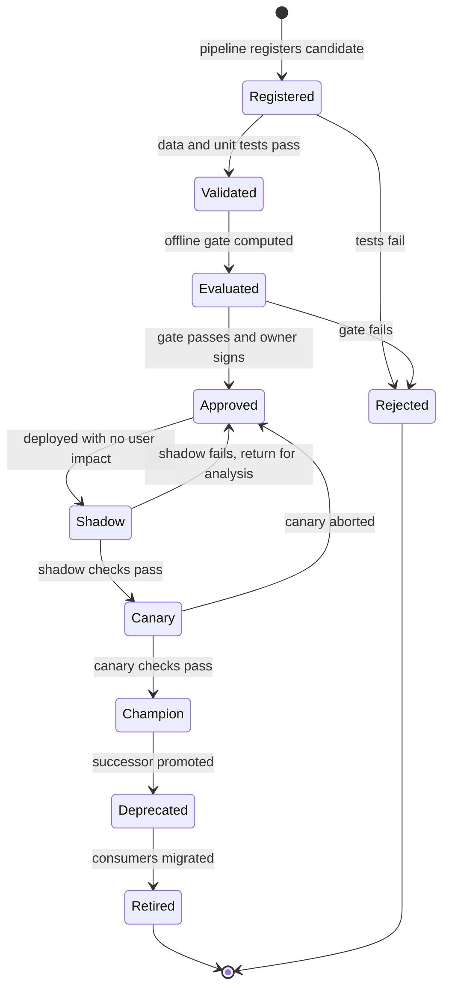

Each transition has a guard, an actor, and a record:

| Transition | Guard (condition) | Actor | Record |
|---|---|---|---|
| Registered to Validated | Schema, data, and unit tests pass | Pipeline | Test report attached |
| Validated to Evaluated | Offline evaluation on the pinned evaluation set completes | Pipeline | Evaluation report with set version |
| Evaluated to Approved | Statistical gate passes (Section 11), model card complete, rights check passes, owner approval | Model owner, and risk approver for high-risk uses | Signed approval bound to the artifact digest |
| Approved to Shadow | Deployment manifest valid, rollback target exists | Release automation | Deployment record |
| Shadow to Canary | Shadow metrics within tolerance for the observation period | Release automation, with owner notified | Shadow comparison report |
| Canary to Champion | Canary checks pass at each traffic step | Release automation | Rollout log |
| Champion to Deprecated | A successor reaches Champion | Release automation | Deprecation notice to consumers |
| Deprecated to Retired | Consumer list empty, grace period elapsed | Platform team | Decommission checklist |

Three design points deserve emphasis. Approval must bind to the artifact *digest*, so an approval cannot be reused for a different file. The Approved state should be unreachable without the gate record, enforced by the registry or a policy engine, not by convention. And every state has an exit that does not depend on the author: Rejected and Retired are terminal, and a stuck Canary has an abort path.

### 8.4 Registry data model

The relationships in a registry are small and worth drawing, because auditors and tooling both traverse them.

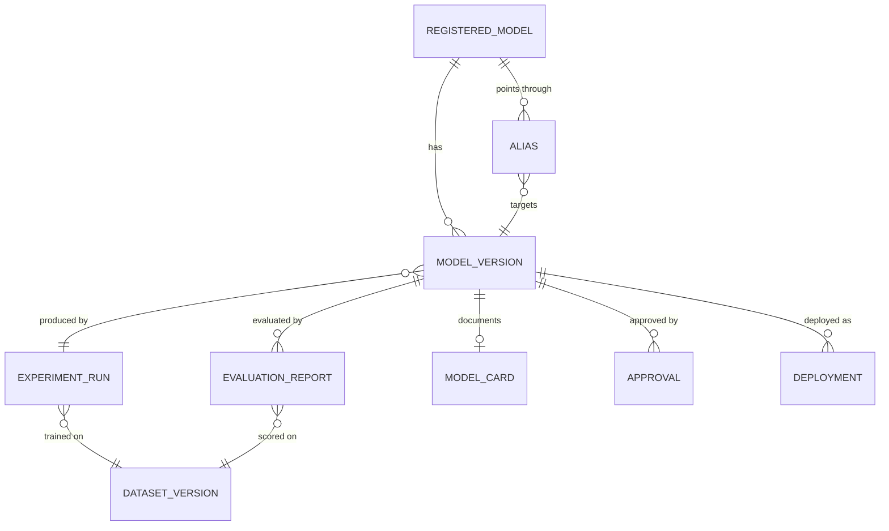

The diagram shows that an alias is a separate object from a version, which is why moving it is a distinct audited event. It also shows that an evaluation report references its own dataset version, separate from the training set, which is the structure that prevents comparing scores measured on different yardsticks.

### 8.5 Example registry operations

The snippet below shows the shape of alias-based promotion using the MLflow client. It is a sketch to illustrate semantics; confirm method names against the version you run, since APIs evolve.

```python
from mlflow import MlflowClient

client = MlflowClient()
name = "fraud-scorer"

# A pipeline registers a version, which is immutable once created.
# Gate results are attached as tags so that the registry is self-describing.
client.set_model_version_tag(name, "42", "gate.status", "passed")
client.set_model_version_tag(name, "42", "gate.eval_set", "eval-v9")
client.set_model_version_tag(name, "42", "approved.digest", "sha256:9f2e...")

# Promotion moves a pointer. The previous target is recorded first for rollback.
previous = client.get_model_version_by_alias(name, "champion").version
client.set_registered_model_tag(name, "rollback_target", previous)
client.set_registered_model_alias(name, "champion", "42")
```

Recording the rollback target before moving the alias turns rollback into a single operation, repointing `champion` to `rollback_target`, with no investigation needed during an incident.

## 9. Artifact Lineage as a Graph

### 9.1 Lineage is a directed acyclic graph

Lineage records which artifacts were derived from which. Its natural form is a DAG whose nodes are artifacts (source tables, datasets, feature tables, runs, models, evaluation reports, deployments) and whose edges are "was derived from" or "was used by." The chain from the topic map is data, then features, then training run, then model, then deployment.

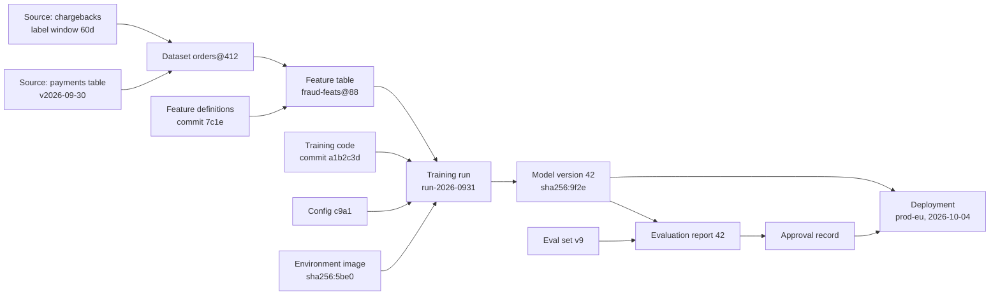

The graph records every input that determined the model and the evidence behind the release. Notice that the evaluation set and the approval are first-class nodes. A graph without them can say where a model came from but not why it was allowed to ship.

### 9.2 Queries the graph must answer

A lineage graph earns its cost by answering questions that otherwise require days of investigation.

1. **Impact (downstream).** A source table is found to contain corrupted rows for a date range. Which datasets, feature tables, runs, models, and live deployments consumed it? Traverse forward from the source node. The answer is a list of models to re-evaluate and, if needed, roll back.
2. **Provenance (upstream).** A customer disputes a decision. Which model version made it, trained on which data, approved by whom? Traverse backward from the deployment node via the logged model version.
3. **Rights propagation.** A dataset's license is revoked, or a data subject's deletion request arrives. Which derived artifacts contain material from it? Forward traversal from the dataset, filtered by the rule in [CH30](CH30_AI_Data_Governance_Privacy_and_Provenance.md).
4. **Reproduction.** What is the full input set for run X? Backward traversal to the leaves.
5. **Staleness.** Which deployed models were trained on data older than the policy allows? Join the graph with timestamps.

An impact query is a reachability computation: starting from node $s$, collect all nodes reachable by following edges forward. For a graph with $V$ nodes and $E$ edges this is $O(V + E)$ with a breadth-first search, so even a large lineage graph answers in well under a second when stored in a graph database or in a relational table of edges with an index on the source column.

### 9.3 How lineage is captured

There are three capture strategies.

- **Declared by the pipeline.** Each step names its inputs and outputs (Section 7.1), and the orchestrator writes the edges. This is the most reliable.
- **Instrumented by the tracking API.** Training code logs the dataset and model it used. This depends on developer discipline, and a lint or a platform wrapper enforces it.
- **Inferred by crawling.** Tools read query logs and job metadata to infer table-level lineage. This catches what developers did not declare, at lower precision.

Open standards exist for exchanging lineage events, such as OpenLineage, which defines a common event model for jobs, runs, and datasets. Using such a standard avoids lock-in to one catalog and lets lineage cross tool boundaries. Verify the status of the specification and its integrations in the project documentation.

### 9.4 Limits of lineage

Lineage records *that* an artifact was an input, not *how much* it influenced the output. A model trained on a billion rows, one of which is a revoked record, has that record in its lineage, but the model's behavior may or may not depend on it. Policies on unlearning and retraining after deletion are governed by [CH30](CH30_AI_Data_Governance_Privacy_and_Provenance.md). Lineage also stops at the boundary of tools that do not emit it, so every un-instrumented hand-off, such as a spreadsheet emailed to a labeling vendor, is a gap. A practical measure is *lineage coverage*: the fraction of production models whose graph reaches every leaf input through machine-recorded edges. Track it as a platform metric (Section 26) and treat manual edges as debt.

## 10. CI/CD/CT and What Is Tested at Each Stage

### 10.1 Three pipelines, not one

Part 13 teaches continuous integration and continuous delivery (CI/CD) for software. ML systems need those and a third loop, **continuous training (CT)**, in which the model is rebuilt automatically when data or conditions change. The three have different triggers and different artifacts.

| Pipeline | Trigger | Produces | Primary question |
|---|---|---|---|
| CI | Code, configuration, or test change | Tested code, container images, a small-scale training smoke test | Is the code correct, and does the pipeline still run end to end on a tiny dataset? |
| CT | Schedule, new data, drift alert, manual | A candidate model with evaluation evidence | Does retraining on current data produce a candidate that passes the gates? |
| CD | An approved model version or a changed serving configuration | A deployed, monitored release | Can this artifact be rolled out safely and rolled back quickly? |

The separation matters because a code change and a data change are different events with different risks. A code change should be validated by CI without the cost of a full training run. A scheduled retraining must not require a human to merge code. Deployment of an approved model should not require retraining. Teams that conflate the three end up either retraining on every commit, which is expensive, or deploying whatever the last retraining produced, which is unsafe.

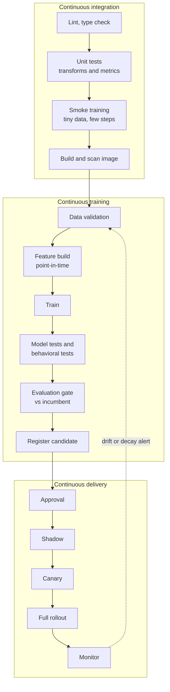

The dotted edge from monitoring to the start of the training pipeline is the thing that distinguishes ML delivery from standard delivery. In the figure, CI produces artifacts that CT consumes (the image and the code), and CT produces the artifact that CD releases (the registered model). Each stage's output is the next stage's pinned input, which is why the registry and lineage of Sections 8 and 9 sit between them.

### 10.2 The test pyramid for ML

A test at each layer catches a different failure at a different cost. Cheap tests run often and early. Expensive tests run before promotion.

| Layer | What is tested | Example assertions | When it runs | Cost |
|---|---|---|---|---|
| Unit tests for transforms | Feature and preprocessing functions, metric implementations, label construction | Window aggregation excludes the current event. Missing values map to the documented default. Currency conversion handles zero and negative amounts. The metric function returns 0.5 AUC for random scores on a known fixture | Every commit | Seconds |
| Data tests | Schema, ranges, nulls, uniqueness, freshness, distribution against reference | `amount > 0`, null rate of `country` below 1 percent, PSI of each feature versus the reference below 0.25 | Every data batch and each training run | Seconds to minutes |
| Pipeline smoke test | The whole pipeline end to end on a tiny dataset | Pipeline completes. Output artifact has the expected signature. Loss decreases over a few steps | Every commit that touches the pipeline | Minutes |
| Model tests | Properties of the trained artifact | Prediction on a fixed input equals the stored expected value within tolerance. Output within valid range. Serialization round trip preserves predictions. Inference time on a reference input within budget | After training | Minutes |
| Behavioral tests | Invariances and directional expectations | Changing a name does not change a credit decision (invariance). Higher income does not lower the score, all else equal (monotonicity). A negated sentence flips sentiment (directional) | After training | Minutes |
| Evaluation gates | Quality on the pinned evaluation set and slices, versus the incumbent | Statistical non-inferiority, slice limits, calibration (Section 11) | Before registration as Approved | Minutes to hours |
| Performance tests | Latency percentiles, throughput, memory, cold start under load | p95 under 100 ms at 500 requests per second on the target hardware | Before deployment | Minutes to hours |
| Integration and contract tests | The serving API, schema, feature lookups, fallbacks | A request with a missing optional field returns a degraded result. The response schema matches the consumer contract | Before deployment | Minutes |
| Shadow and canary checks | Real traffic behavior | Agreement with incumbent, error rate, latency (Section 12) | During rollout | Hours to days |

Behavioral testing for ML systems was popularized in natural language processing by Ribeiro and colleagues (2020) in the CheckList paper, which proposed minimum functionality tests, invariance tests, and directional expectation tests. The idea transfers to tabular models: property-based tests of monotonicity and invariance catch errors that aggregate metrics average away.

### 10.3 Unit tests for transforms: a concrete case

Most skew and leakage bugs originate in transforms, and transforms are ordinary code, so ordinary tests apply. A test for a rolling-count feature, written against the point-in-time rule of Section 5.2, looks like this.

```python
def test_rolling_count_excludes_decision_event():
    events = [(1, "c1"), (5, "c1"), (30, "c1")]    # (hour, customer)
    # At decision time 30 the window is [6, 30). The events at hours 1 and 5 are too old
    # and the event at hour 30 is the decision itself, so none are counted.
    assert rolling_count(events, customer="c1", decision_time=30, window=24) == 0

def test_rolling_count_window_boundary_is_half_open():
    events = [(6, "c1")]
    # Window [decision_time - 24, decision_time) includes hour 6 when decision_time is 30
    assert rolling_count(events, customer="c1", decision_time=30, window=24) == 1
```

The two tests pin the boundary convention: events at the decision time are excluded, events exactly 24 hours earlier are included. The convention itself is arbitrary. What matters is that the online and offline implementations are tested against the same fixtures, so that they cannot drift apart. Sharing the fixtures between the two code paths is the cheapest form of skew prevention.

### 10.4 Slice tests and the metric that hides a regression

An aggregate metric can improve while a subgroup degrades, because the subgroup is small. Gates should therefore evaluate a defined list of slices (region, device, customer tenure, language, a protected-attribute proxy where policy and law allow its use for evaluation) and fail on a regression in any slice beyond a stated margin. The slice list is a governance artifact, chosen with the business owner and the risk function, because the choice defines who is protected from regressions. Fairness criteria and their trade-offs belong to [CH31](CH31_Responsible_AI_and_Safety_Governance.md); the pipeline's responsibility is to compute and enforce what that chapter specifies. Section 11 shows the arithmetic for a slice that regresses while the total improves.

### 10.5 Testing the pipeline itself

The pipeline is software and deserves tests, including negative ones. Feed it a deliberately corrupted dataset (a column of nulls, a swapped unit) and assert that validation blocks it. Feed it a candidate known to be worse than the incumbent and assert that the gate rejects it. A gate that has never been seen to say no has not been shown to work. Keep these "canary failures" as permanent fixtures in the pipeline's test suite, and run them in CI.

## 11. Evaluation Gates With Statistical Criteria

### 11.1 What a gate is

An evaluation gate is an automated decision rule that maps evidence about a candidate to GO or NO-GO. It exists because human reviewers, shown a dashboard in which the candidate is "up 0.6 points," are poor at judging whether that difference is real, whether it holds on slices, and whether it justifies cost. A gate encodes those judgments before the result is known, which prevents post hoc rationalization of a result the team wants to ship.

A good gate has the following components, each stated before the experiment.

1. **Primary metric and direction.** One headline metric tied to the cost model of Section 3.2.
2. **A superiority or non-inferiority hypothesis.** Does the candidate need to beat the incumbent, or only not be worse than it by more than a margin $\delta$? A cheaper or faster candidate may only need to be non-inferior.
3. **A confidence requirement.** For example, a one-sided 95 percent bound.
4. **Guardrail metrics.** Latency, cost, calibration, slice performance, and safety metrics that must not regress.
5. **Evidence requirements.** The evaluation set version, minimum sample size, and completeness of the model card and rights checks.

### 11.2 The paired comparison

The candidate and incumbent are scored on the *same* evaluation examples. That pairing is valuable, because most examples are easy for both models, and what differs is a small set of cases. Using the pairing removes the variance due to example difficulty and gives a much tighter test than comparing two independent samples.

For a binary correct/incorrect outcome, classify each example into four cells.

| | Candidate right | Candidate wrong |
|---|---|---|
| **Incumbent right** | $a$ (both right) | $c$ (incumbent right, candidate wrong) |
| **Incumbent wrong** | $b$ (incumbent wrong, candidate right) | $d$ (both wrong) |

With $n = a + b + c + d$ examples, the candidate is wrong in cells $c$ and $d$, so its error rate is $(c + d)/n$. The incumbent is wrong in cells $b$ and $d$, so its error rate is $(b + d)/n$. The difference in error rate, candidate minus incumbent, is

$$\hat\Delta = \frac{c - b}{n}.$$

Only the *discordant* cells $b$ and $c$ matter, because $d$ and $a$ cancel. A negative $\hat\Delta$ means the candidate has fewer errors. Under the multinomial model for the four cells, the variance of $\hat\Delta$ is

$$\operatorname{Var}(\hat\Delta) = \frac{1}{n}\left[\frac{b + c}{n} - \left(\frac{c - b}{n}\right)^2\right] = \frac{b + c - (c - b)^2/n}{n^2}.$$

The derivation: let $X_i = 1$ if example $i$ falls in cell $c$, $-1$ if in cell $b$, and 0 otherwise. Then $\hat\Delta$ is the mean of the $X_i$. Its per-example variance is $E[X^2] - E[X]^2 = (b+c)/n - ((c-b)/n)^2$, and the variance of a mean of $n$ independent terms divides that by $n$. The standard error is $\operatorname{SE} = \sqrt{\operatorname{Var}(\hat\Delta)}$. For large $n$, a normal approximation gives confidence bounds $\hat\Delta \pm z\,\mathrm{SE}$. With $c = b$ the test reduces to McNemar's test, in which only the discordant counts carry information. Methodology and alternatives (bootstrap for non-decomposable metrics like AUC, area under the receiver operating characteristic curve) are owned by [CH06](CH06_Model_Evaluation_Validation_and_Selection.md).

### 11.3 Worked go/no-go arithmetic

An illustrative gate for a fraud-scoring candidate. The evaluation set has $n = 20{,}000$ labeled examples. At the production threshold, the incumbent is right and the candidate wrong on $c = 290$ examples, and the incumbent is wrong and the candidate right on $b = 410$.

1. Difference: $\hat\Delta = (290 - 410)/20{,}000 = -120/20{,}000 = -0.0060$. The candidate has 0.6 percentage points fewer errors.
2. Variance: numerator $= b + c - (c-b)^2/n = 700 - (−120)^2/20{,}000 = 700 - 14{,}400/20{,}000 = 700 - 0.72 = 699.28$. Denominator $= n^2 = 4\times10^8$. So $\operatorname{Var} = 1.7482\times10^{-6}$ and $\mathrm{SE} = 0.001322$.
3. One-sided 95 percent upper bound on the added error, using $z = 1.645$: $-0.0060 + 1.645\times0.001322 = -0.0060 + 0.002175 = -0.003825$.
4. Non-inferiority margin $\delta = +0.002$ (the candidate may add at most 0.2 points of error). The upper bound $-0.0038 \le 0.002$, so non-inferiority holds. In fact the upper bound is below zero, so superiority also holds at the one-sided 95 percent level.
5. Two-sided 95 percent interval, $z = 1.96$: $-0.0060 \pm 1.96\times0.001322 = -0.0060 \pm 0.002591$, giving $[-0.0086, -0.0034]$.

Slice checks follow the same formula on each slice with the slice's own counts. For `region_eu` ($n = 3{,}000$, $b = 60$, $c = 45$): $\hat\Delta = -15/3000 = -0.0050$; numerator $= 105 - 225/3000 = 104.925$; $\operatorname{Var} = 104.925/9\times10^6 = 1.1658\times10^{-5}$; $\mathrm{SE} = 0.003414$; upper bound $-0.0050 + 1.96\times0.003414 = +0.00169$. With a slice margin of $+0.010$, the slice passes.

For `new_customers` ($n = 1{,}200$, $b = 35$, $c = 30$): $\hat\Delta = -5/1200 = -0.004167$; numerator $= 65 - 25/1200 = 64.979$; $\operatorname{Var} = 64.979/1.44\times10^6 = 4.5125\times10^{-5}$; $\mathrm{SE} = 0.006718$; upper bound $= -0.004167 + 0.013167 = +0.0090$, which is under the slice margin of $0.010$. It passes, but narrowly: the small slice has a wide interval, so the gate has little room.

[02_promotion_gate_evaluator.py](../code/python/mlops-chapter/02_promotion_gate_evaluator.py) runs these computations, and prints for the first candidate:

```text
== Candidate A (better overall, all slices ok)
  [PASS] error non-inferiority (upper bound <= margin): diff=-0.0060 se=0.0013 upper=-0.0038 margin=0.002
  [PASS] p95 latency: 82 ms vs 100 ms
  [PASS] cost per 1k requests: 0.41 vs 0.5
  [PASS] slice region_eu (95% upper <= 0.01): diff=-0.0050 upper=+0.0017 n=3000
  [PASS] slice new_customers (95% upper <= 0.01): diff=-0.0042 upper=+0.0090 n=1200
  two-sided 95% CI of error difference: [-0.0086, -0.0034]  significantly better: True
  DECISION: GO
```

The script also runs two variants. In Candidate B the overall counts are held fixed to isolate the slice check, while the `new_customers` slice has $b = 10$ and $c = 45$. Then $\hat\Delta = 35/1200 = +0.0292$ and the upper bound is $+0.0412$, so the slice gate fails and the decision is NO-GO even though the overall result is unchanged. (The slice is part of the whole, so a real regression of that size would also move the total. The held-fixed counts are a simplification that makes the lesson clear.) In Candidate C, the accuracy is the same as A, but the p95 latency is 131 ms against a 100 ms limit, so the latency guardrail fails and the decision is NO-GO. The lesson of the three runs is that a GO requires every check to pass, and that the single headline metric is the weakest part of the decision.

### 11.4 Translating the difference into money

A statistically significant improvement of 0.6 points is only worth shipping if it is worth more than its cost. Convert using the cost model. Suppose the system makes 100,000 decisions per day, and each avoided error is worth on average \$12 net of review cost (illustrative). The expected daily gain is $100{,}000 \times 0.0060 \times 12 = 7{,}200$ dollars, with a 95 percent interval from $100{,}000\times0.0034\times12 = 4{,}080$ to $100{,}000\times0.0086\times12 = 10{,}320$ dollars. If the candidate adds $1{,}500$ per day in serving cost and $2{,}000$ per day in additional review capacity, the net daily gain is $3{,}700$ at the point estimate and about $580$ at the low end of the interval. The decision to ship is still positive, but the margin is smaller than the headline suggests, and the platform has recorded why. A gate can encode this as an expected-value criterion: GO if the lower confidence bound on net value is positive.

### 11.5 Multiple comparisons and the garden of forking paths

Every additional slice and metric is another chance of an apparent regression or an apparent gain by luck. If a gate checks 20 slices at 95 percent confidence and the candidate is truly no different, the expected number of slice failures by chance alone is $20 \times 0.05 = 1$. That is why teams report that gates "flake." Three remedies exist, with different trade-offs.

- **Pre-specify a short list of slices** that matter for the decision, so there are few tests.
- **Use margins, not zero.** A slice fails only if the upper bound exceeds a margin that represents a harm worth acting on. This removes most false alarms from tiny differences.
- **Correct for multiplicity** when the slice list is long, for example Bonferroni (divide the significance level by the number of tests) or Holm's procedure, accepting less power in exchange for fewer false failures.

Equally, a team that runs many candidate configurations against one evaluation set and promotes the best one has selected on noise. The estimate of the winner's performance is biased upward (the winner's curse). Hold out a final test set that is touched once per release decision, and use the seed-spread measure of Section 6.3 as a sanity check on small gains.

### 11.6 Sample size for the evaluation set

How many evaluation examples does the gate need? The standard error above shows that precision depends on the number of discordant examples, not on $n$ alone. If the candidate and incumbent differ on a fraction $p_d$ of examples, then $\mathrm{SE} \approx \sqrt{p_d/n}$. To detect a true difference of $\Delta = 0.003$ with 80 percent power at one-sided 95 percent confidence, the required effect-to-SE ratio is $z_{0.95} + z_{0.80} = 1.645 + 0.842 = 2.487$. So $\mathrm{SE} \le 0.003/2.487 = 0.001206$. With $p_d = 0.035$ (the models disagree in correctness on 3.5 percent of examples, which matches $700/20{,}000$ above), $n \ge p_d/\mathrm{SE}^2 = 0.035/(1.455\times10^{-6}) \approx 24{,}060$. So roughly 24,000 labeled examples are needed to detect a 0.3 point improvement reliably, which is more than the 20,000 in the example, whose gate passed because the true gain was 0.6 points. For rare-event problems, the relevant count is the number of *positive* examples, which can be a small fraction of $n$ and the actual constraint. Plan the evaluation set size from the smallest improvement worth shipping.

## 12. Deployment Strategies

### 12.1 What a deployment strategy controls

A deployment strategy controls three things: how much real traffic a new model sees, whose decisions it affects, and how fast a bad release can be stopped. Strategies differ in how they trade exposure against evidence. The conventional release patterns from Part 13 apply, and ML adds the need for evidence about model quality, which accumulates only with traffic and sometimes only after labels arrive.

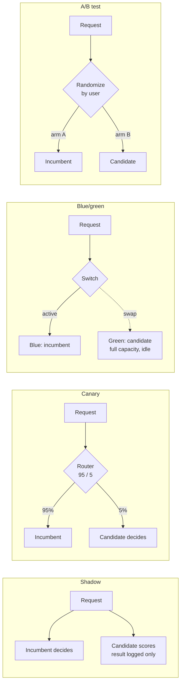

The diagram contrasts who decides in each case. In shadow, the candidate never decides, so shadow is safe for the user and gives no information about how decisions change outcomes. In canary and A/B, the candidate decides for a fraction of traffic, so outcomes can be compared, and risk is proportional to the fraction. Blue/green swaps all traffic at once between two full-capacity stacks, with a fast switch back.

### 12.2 Shadow deployment

In shadow mode, each request is also sent to the candidate, whose prediction is logged but not acted on. Shadow answers: does the candidate run on production inputs without errors, is its latency acceptable under real load, and how does its output distribution compare with the incumbent's?

What shadow cannot answer is whether the candidate's decisions are better, because the outcome of acting on them is never observed. If the incumbent blocks a transaction, the world never reveals whether the candidate's "allow" would have been right (the feedback problem of Section 2.5). Shadow is therefore a safety and compatibility check. Its useful metrics are: error and timeout rate, latency percentiles, the *agreement rate* with the incumbent, the distribution of scores, and the volume of disagreement in each direction.

The agreement rate is interpretable only against what is expected. If offline evaluation predicted that the candidate flips 3.5 percent of decisions (the discordant fraction above), shadow should show a flip rate near that. A flip rate of 12 percent signals skew between offline and online data, even before anyone looks at outcomes.

Costs of shadow: it doubles inference load for the observation period, writes additional logs that may contain personal data, and must not cause side effects (the candidate must not send emails or write to shared state). Isolating the shadow path from the response path, so that a slow candidate cannot delay the user response, is a standard design requirement; the shadow call is asynchronous with a timeout.

### 12.3 Canary rollout

A canary routes a small fraction of traffic to the candidate, watches guardrails, and increases the fraction in steps if all is well. The key arithmetic questions are how long to stay at each step and how small a defect the canary can see.

**Detecting a failure with zero events.** Suppose the canary receives $n$ requests and records no failures (errors, timeouts, invalid outputs). The failure rate is not zero. The "rule of three" gives an approximate 95 percent upper bound of $3/n$ on the true rate, because $(1-p)^n = 0.05$ implies $p \approx -\ln(0.05)/n \approx 3/n$. With 200,000 requests per day and a 1 percent canary, the canary gets 2,000 requests per day, or about 83 per hour. After one hour with zero failures, the upper bound on the failure rate is $3/83 = 3.6$ percent. After a day, $3/2000 = 0.15$ percent. A canary of one hour cannot rule out a 1 percent failure rate. The step durations in the rollout plan must be chosen from the smallest failure rate that matters.

**Detecting a quality difference.** Quality metrics need more traffic than failure counts. The sample size per arm for a two-sided test comparing proportions $p_1$ (incumbent) and $p_2$ (candidate), with significance $\alpha$ and power $1-\beta$, is

$$n = \frac{\left(z_{1-\alpha/2}\sqrt{2\bar p(1-\bar p)} + z_{1-\beta}\sqrt{p_1(1-p_1) + p_2(1-p_2)}\right)^2}{(p_1 - p_2)^2}, \qquad \bar p = \frac{p_1 + p_2}{2}.$$

Worked example. Detect a change in a conversion-like rate from $p_1 = 0.05$ to $p_2 = 0.06$, with $\alpha = 0.05$ ($z = 1.96$) and 80 percent power ($z = 0.8416$). Then $\bar p = 0.055$, $\sqrt{2\times0.055\times0.945} = \sqrt{0.10395} = 0.32241$, and $1.96 \times 0.32241 = 0.63192$. The second term is $0.8416\times\sqrt{0.0475 + 0.0564} = 0.8416\times0.32234 = 0.27129$. The sum is $0.90321$, whose square is $0.81579$. Dividing by $(0.01)^2 = 0.0001$ gives $n = 8{,}158$ per arm.

[03_canary_sample_size.py](../code/python/mlops-chapter/03_canary_sample_size.py) computes this and related cases:

```text
Sample size per arm (alpha=0.05 two-sided, power=0.80)
  baseline 0.0500 -> 0.0550: n per arm = 31,234
  baseline 0.0500 -> 0.0600: n per arm = 8,158
  baseline 0.0200 -> 0.0240: n per arm = 21,109
  baseline 0.0100 -> 0.0120: n per arm = 42,693

Canary duration for n = 8,158 per arm at 200,000 requests/day
  canary   1%:   4.08 days
  canary   5%:   0.82 days
  canary  10%:   0.41 days
  canary  50%:   0.08 days
```

The rows show two things. First, halving the effect roughly quadruples the sample ($0.05\to0.055$ needs $31{,}234$ against $8{,}158$ for $0.05\to0.06$), because $n$ scales with $1/\Delta^2$. Second, the canary fraction trades time against exposure. At 1 percent the canary needs four days to collect 8,158 requests; at 5 percent, under one day. Exposure is the number of users who see a possibly worse model: 1 percent of 200,000 per day is 2,000 per day, and 5 percent is 10,000 per day. If a worse candidate would cost \$2 per affected decision, four days at 1 percent exposes about $2\times8{,}158 = 16{,}316$ dollars of risk, and one day at 5 percent exposes roughly $2\times10{,}000 = 20{,}000$. The risk is similar, and the faster schedule gives evidence sooner, so for models with a slow-to-appear harm a smaller canary for longer can be preferable.

A staged plan uses small steps first for failure detection and larger steps for quality: 1 percent for two hours (catch crashes, schema errors), 5 percent for a day (latency, error rates, early proxy metrics), 25 percent for several days (quality metrics for fast labels), then 100 percent with the incumbent kept warm for a defined rollback window.

**Sample ratio mismatch.** If the canary is meant to receive 5 percent but receives 9,700 of 200,000 requests (4.85 percent) when 10,000 were expected, a chi-square check tests whether routing is working. With two cells, $\chi^2 = (9700-10000)^2/10000 + (190300-190000)^2/190000 = 9 + 0.474 = 9.47$, which for one degree of freedom gives $p \approx 0.002$. A mismatch this large signals a routing defect, such as a bot filter applied to one path, and invalidates comparisons until it is explained. Check the split before interpreting any metric.

### 12.4 Blue/green deployment

Two full environments exist. Blue serves traffic and green holds the candidate. After checks on green (synthetic traffic, smoke tests), the router switches all traffic to green, and blue is retained for fast rollback. The strengths are an atomic cutover and an instant, tested rollback path. The costs are double capacity during the overlap, which is significant for GPU-hosted models, and the fact that exposure jumps from 0 to 100 percent, so quality problems affect everyone before they are visible. Blue/green is best used for infrastructure and runtime changes (a new container image or serving library) with the model unchanged, or after a canary has already provided quality evidence. State handling needs care: if the model keeps per-user state or caches, switching can lose or invalidate it.

### 12.5 A/B testing

An A/B test randomly assigns units (users, sessions, accounts) to arms and compares an outcome metric. It is the strongest evidence of causal effect, because randomization removes confounding. It also costs the most time, since it needs the sample sizes above and sometimes weeks for slow outcomes.

Practical requirements: randomize at the level where interference is absent (by user rather than by request, if a user's experience across requests matters); fix the metric, duration, and sample size before starting, and avoid peeking and stopping on the first significant result unless a sequential method is used; check the sample ratio; and account for novelty effects, in which users react to change itself. Fraud and credit decisions often cannot be A/B tested on the decisioning path for ethical, legal, or loss reasons, and use shadow plus a small canary plus a holdout instead. The statistics of experimentation are developed in the product-management chapters on [Experimentation](../02_Design_Thinking_and_Product_Management/CH26_Experimentation.md) and [A/B Testing](../02_Design_Thinking_and_Product_Management/CH27_A_B_Testing.md); here the point is to place the tool in the release sequence.

### 12.6 Multi-armed bandit routing

A bandit adapts traffic while it learns, sending more traffic to variants that perform better. It suits cases where the cost of showing a worse variant is real, the reward is observed quickly, and there are several variants. A common method is Thompson sampling: keep a posterior over each variant's success rate (for a Bernoulli reward, a Beta distribution), draw one sample per variant for each request, and route to the variant with the highest draw. Variants that are likely better are chosen more often, and uncertainty drives exploration.

In the simulation in the script, three variants have true success rates 0.050, 0.055, and 0.065 over 20,000 requests. Thompson sampling routes:

```text
Thompson sampling, 3 variants with true rates 0.050 / 0.055 / 0.065, 20,000 requests
  variant 0: 382 requests (1.9%)
  variant 1: 3,192 requests (16.0%)
  variant 2: 16,426 requests (82.1%)
```

Compared with a fixed three-way split (6,667 requests each), the bandit sent 16,426 requests to the best variant. Expected successes under a fixed split are $6667\times(0.050+0.055+0.065) = 1{,}133$, while under the bandit allocation they are $382\times0.050 + 3192\times0.055 + 16426\times0.065 = 19.1 + 175.6 + 1067.7 = 1{,}262$ (using the reported counts; actual realized successes vary). The bandit gained about 129 successes by shifting traffic. Bandits have costs: the final comparison is less statistically clean, because arms receive unequal samples and the allocation depends on observed data, so estimating the size of the difference needs care; they assume rewards are observed promptly and are stationary, and they respond poorly to delayed labels, since traffic shifts on incomplete information; and they complicate audit, since a user's variant depends on the state of the posterior at that moment. Use bandits for low-stakes, fast-feedback choices such as ranking variants or prompt versions with click feedback. Use fixed-split experiments where a clean effect estimate or an audit trail is required.

### 12.7 Choosing a strategy

| Situation | Preferred strategy | Reason |
|---|---|---|
| New model with unknown runtime behavior | Shadow, then canary | Validate inputs, latency, and errors with no user impact first |
| Label delay of weeks | Shadow plus small long-running canary plus proxy metrics | Quality evidence arrives late, so limit exposure while waiting |
| Infrastructure or runtime change, model unchanged | Blue/green or canary | Behavior should be identical, and fast switching matters |
| Product metric uplift claim | A/B test | Causal estimate needed |
| Several cheap variants with fast feedback | Bandit | Reduce regret while learning |
| High-stakes, regulated decision | Shadow, limited canary with human review, documented approval | Exposure and audit matter more than speed |

## 13. Batch Versus Online Inference Pipelines

### 13.1 Two operating modes with different failure modes

**Batch inference** scores a large set of records on a schedule: nightly propensity scores, weekly churn lists, monthly risk re-ratings. Outputs are written to a table or file that downstream systems read. **Online inference** scores a request synchronously with a latency target, typically in tens to hundreds of milliseconds. A third mode, **streaming inference**, scores events as they arrive on a stream with seconds of tolerance. CH28 covers the serving optimization of online systems; this section covers the pipeline and release consequences.

| Property | Batch | Online |
|---|---|---|
| Latency requirement | Minutes to hours for the whole job | Milliseconds per request |
| Feature source | Offline store, full history | Online store plus request payload |
| Skew risk | Lower, same engine as training in many designs | Higher, separate code path and store |
| Failure visibility | Job fails or outputs are late | Errors and latency appear per request |
| Rollback | Rerun the job with the previous model, overwrite outputs | Repoint the router or alias |
| Cost profile | Elastic, can use spot capacity | Provisioned for peak, GPU always on |
| Freshness | Scores are as old as the last run | Scores reflect current features |
| Monitoring | Output distribution per run, row counts | Per-request telemetry, windows |

### 13.2 Choosing between them

The choice follows from the decision's latency need and the features' freshness. If the decision is made once a day on stable features, batch scoring is simpler, cheaper, and easier to monitor, and building an online endpoint is complexity without benefit. If the decision depends on a signal produced seconds ago, such as transaction velocity, online inference is required. Many systems are hybrid: a batch job precomputes slow-changing features and base scores, and an online model combines them with fresh signals at request time. The hybrid inherits both kinds of skew risk, which is a reason to keep the shared feature definitions of Section 5.

### 13.3 Batch pipeline specifics

- **Idempotent output writes.** A rerun for the same date partition overwrites that partition, never appends, so that retries and rollbacks do not duplicate rows.
- **Model version in the output.** Each output row stores the model version and run identifier, so downstream consumers and auditors can tell which model produced a score, and a mixed table during a rollover is interpretable.
- **Output validation.** Check row counts against input counts, the score range, and the score distribution against the last run before publishing. A job that "succeeds" with all scores equal to zero is a common silent failure.
- **Atomic publish.** Write to a staging location, validate, then swap, so that consumers never read a half-written table.
- **Backfill and late data.** Define how late-arriving records are handled and whether historical scores are recomputed when the model changes. Recomputing history changes past decisions, which may be undesirable for audit, so keep both the original and the recomputed scores, labeled by model version.

### 13.4 Online pipeline specifics

- **Fallbacks.** Define what happens when the model, the feature store, or a dependency is unavailable: a default score, the previous model, a rule-based path, or a decision to fail closed or open. Each has business consequences that the owner must approve in advance.
- **Timeouts and budgets.** Decompose the latency budget across feature retrieval, model inference, and post-processing, so that a slow feature lookup does not consume the whole budget.
- **Request logging.** Log request identifier, model version, feature vector (subject to privacy rules), prediction, and later the outcome, to enable monitoring, skew checks, and retraining.
- **Version coexistence.** During a rollout, two versions are live, so the logging and downstream consumers must handle both, and caches must be keyed by model version.

### 13.5 Recap of composed architecture

The way batch, streaming, and online paths, registries, gateways, and approval workflows compose into a platform with release controls across many teams belongs to [Part 17 CH10](../17_AI_Architecture/CH10_AI_Platform_and_Model_Lifecycle_Architecture.md). The evaluation and observability architecture that supports the monitors described next is in [Part 17 CH11](../17_AI_Architecture/CH11_Evaluation_and_Observability_Architecture_for_AI_Systems.md). This chapter specifies the behavior of each workflow, and those chapters place them in a reference architecture.

## 14. Online Monitoring

### 14.1 What to monitor, in layers

Part 14 teaches observability foundations: metrics, logs, and traces, service level indicators, and alerting. ML adds layers of monitoring that infrastructure telemetry cannot provide. From cheapest and fastest to most expensive and slowest:

1. **System health.** Latency, error rate, throughput, resource use, and saturation. Standard.
2. **Data quality.** Missing values, out-of-range values, schema violations, freshness of inputs. Available immediately.
3. **Input drift.** Distribution of features versus a reference. Available immediately, needs no labels.
4. **Prediction drift.** Distribution of model outputs: scores, predicted classes, predicted-positive rate. Available immediately.
5. **Proxy outcome metrics.** Early signals correlated with true outcomes: user acceptance, escalation rate, complaint rate, override rate by human reviewers.
6. **Outcome performance.** Accuracy, precision, recall, calibration, and business value against true labels. Slow, because labels are delayed.

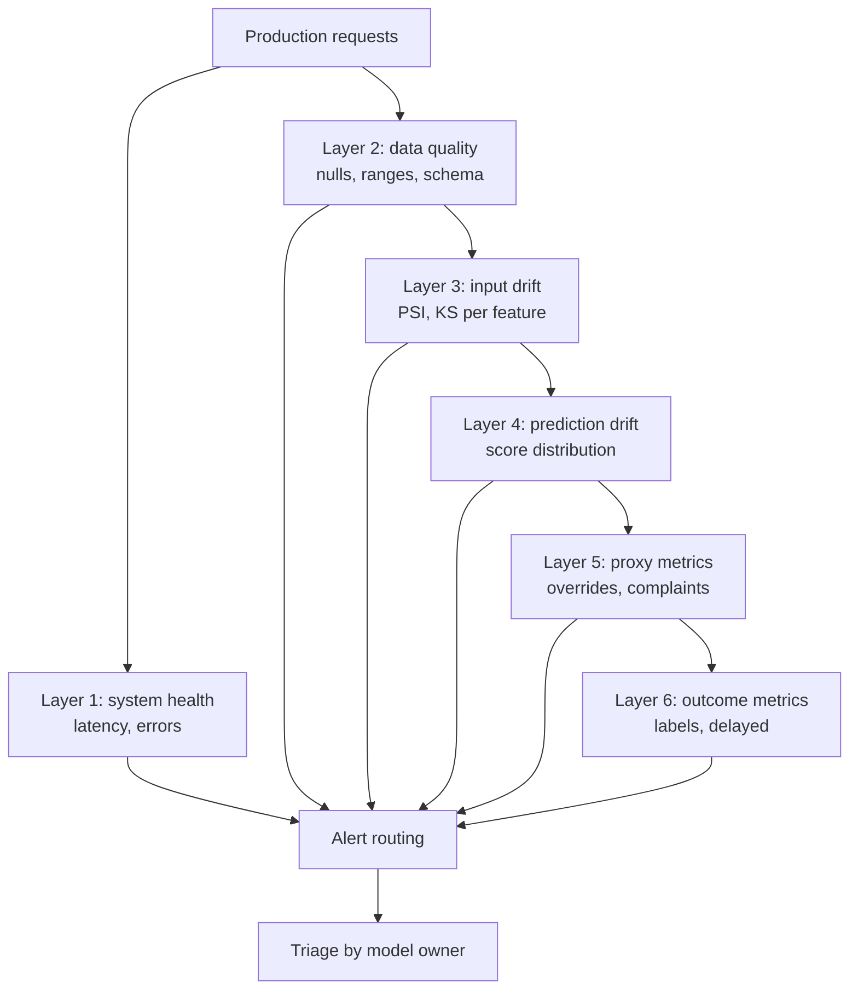

The ordering matches the order of arrival. An upstream break shows in layer 2 within minutes, drift in layer 3 within a day, and true performance loss in layer 6 weeks later. Without the earlier layers, the first signal of a problem is a late, confirmed, and expensive one.

### 14.2 A taxonomy of drift

Let $X$ denote the features, $Y$ the target, and $P(X, Y) = P(X)\,P(Y \mid X)$ the joint distribution. Three kinds of change are distinguished by which factor moves.

| Type | What changes | Example | Effect on model |
|---|---|---|---|
| Covariate shift (data drift) | $P(X)$ changes, $P(Y \mid X)$ stays | A new marketing channel brings younger customers | Model may extrapolate poorly in the new region. If it is well calibrated there, performance holds |
| Prior (label) shift | $P(Y)$ changes, $P(X \mid Y)$ stays | Fraud rate doubles during a holiday | Calibration breaks, since scores no longer match true rates (see [CH03 Section 8](CH03_Regression_and_Classification.md)) |
| Concept drift | $P(Y \mid X)$ changes | Fraudsters adopt a new tactic, so the same features now mean something different | The model's learned mapping is wrong. Retraining on new labels is needed |

Distinguishing these matters for the response. Covariate shift without concept drift may need no action, or only a recalibration. Prior shift may need a recalibration, with the intercept correction in CH03 Section 8. Concept drift needs new labeled data and retraining. Input drift detection alone cannot tell them apart: a feature distribution can shift with no effect on accuracy, and concept drift can occur with no shift in $P(X)$ at all. Only outcome metrics reveal concept drift directly, which is why label delay is the central difficulty.

Drift also has temporal shapes: *sudden* (a policy change, a bug, a vendor switch), *gradual* (slow population change), *incremental* (steady trend), and *recurring* (seasonality). Seasonality is not drift in a harmful sense, and a reference taken from a different season produces constant false alarms. Choose references that match the comparison, for example the same weekday and season, or compare to the training distribution only for features with no seasonal pattern.

### 14.3 The Population Stability Index

The Population Stability Index (PSI) compares the distribution of a variable in a current window with a reference. It originates in credit scoring, where it monitors score distributions. The procedure:

1. Choose bins from the reference distribution. For a numeric feature, use quantiles of the reference so that each bin holds $1/B$ of the reference. For a categorical feature, use the categories plus an "other" bin.
2. Compute the reference fractions $e_i$ and current fractions $a_i$ in each bin $i = 1, \dots, B$.
3. Compute

$$\text{PSI} = \sum_{i=1}^{B} (a_i - e_i)\,\ln\frac{a_i}{e_i}.$$

Bins with zero count need a floor (for example $10^{-6}$) to avoid $\ln 0$.

**Why this form.** The Kullback-Leibler divergence from $e$ to $a$ is $D(a\|e) = \sum a_i \ln(a_i/e_i)$ and from $a$ to $e$ is $D(e\|a) = \sum e_i \ln(e_i/a_i)$. Their sum is

$$D(a\|e) + D(e\|a) = \sum_i \left[a_i \ln\frac{a_i}{e_i} - e_i \ln\frac{a_i}{e_i}\right] = \sum_i (a_i - e_i)\ln\frac{a_i}{e_i},$$

so PSI is the symmetrized KL divergence (also called the Jeffreys divergence) between the binned distributions. Each term is non-negative, because $(a_i - e_i)$ and $\ln(a_i/e_i)$ have the same sign. PSI is zero only if all bins match. For small differences, $\ln(a_i/e_i) \approx (a_i - e_i)/e_i$, so $\text{PSI} \approx \sum (a_i - e_i)^2/e_i$, which resembles a chi-square statistic and shows why PSI grows with the *square* of a small shift.

**Worked example.** Five reference bins each hold 20 percent. In the current window the bins hold 10, 15, 20, 25, and 30 percent.

| Bin | $e$ | $a$ | $a - e$ | $\ln(a/e)$ | Term |
|---|---|---|---|---|---|
| 1 | 0.20 | 0.10 | −0.10 | −0.6931 | 0.0693 |
| 2 | 0.20 | 0.15 | −0.05 | −0.2877 | 0.0144 |
| 3 | 0.20 | 0.20 | 0.00 | 0.0000 | 0.0000 |
| 4 | 0.20 | 0.25 | +0.05 | +0.2231 | 0.0112 |
| 5 | 0.20 | 0.30 | +0.10 | +0.4055 | 0.0405 |

The terms sum to 0.0693 + 0.0144 + 0 + 0.0112 + 0.0405 = 0.1354. The script [01_psi_drift_monitor.py](../code/python/mlops-chapter/01_psi_drift_monitor.py) prints the same table and `PSI = 0.1354 -> investigate`.

Common rules of thumb from credit-scoring practice read PSI below 0.10 as stable, 0.10 to 0.25 as a moderate shift worth investigating, and above 0.25 as a major shift. These thresholds are conventions, not statistical theory, and they depend on the number of bins and the sample sizes. Treat them as starting points to calibrate against your own history.

**Sampling noise in PSI.** Even with no real change, finite samples produce a positive PSI. Using the chi-square approximation, if the reference has $n$ observations and the current window has $m$, the expected PSI under no change is approximately $(B - 1)(1/n + 1/m)$. With $B = 10$, $n = 20{,}000$, and $m = 5{,}000$ this is $9\times(0.00005 + 0.0002) = 0.00225$; the simulation below shows daily values of 0.0021 and 0.0028 for unshifted days, consistent with it. With a small window of $m = 500$ the floor rises to $9\times(0.00005+0.002) = 0.0185$. A window of a few hundred points can therefore show PSI near 0.02 with no drift at all, which is still under the 0.10 line, but a 0.10 alert on a window of 50 points would be mostly noise. Choose windows large enough that the noise floor is a small fraction of the alert threshold.

### 14.4 The Kolmogorov-Smirnov test and the difference between significance and size

The two-sample Kolmogorov-Smirnov (KS) statistic is the maximum vertical distance between the two empirical cumulative distribution functions:

$$D_{n,m} = \sup_x \left| F_n(x) - G_m(x) \right|.$$

The test rejects the hypothesis that both samples come from the same distribution at level $\alpha$ when $D_{n,m} > c(\alpha)\sqrt{(n+m)/(nm)}$, where $c(0.05) = \sqrt{-\tfrac12\ln(0.05/2)} = 1.358$. With $n = 20{,}000$ and $m = 5{,}000$, the critical value is $1.358\times\sqrt{25{,}000/10^8} = 1.358\times0.01581 = 0.0215$. KS applies to continuous numeric features and needs no binning, but it is sensitive to the sample size. The script simulates a feature with standard deviation 20 whose mean shifts over six days:

```text
day  mean_shift  PSI     level        KS      KS_crit  KS_reject
1      0        0.0021  stable       0.0146  0.0215   False
2      0        0.0028  stable       0.0123  0.0215   False
3      2        0.0043  stable       0.0307  0.0215   True
4      5        0.0509  stable       0.0943  0.0215   True
5     10        0.2546  action       0.2070  0.0215   True
6     20        0.9153  action       0.3879  0.0215   True
```

Day 3 is the instructive case. A mean shift of 2 on a standard deviation of 20 is a tenth of a standard deviation, which would rarely change model behavior, yet KS rejects at $\alpha = 0.05$ because the samples are large. PSI stays at 0.0043, far below any alert line. The two statistics answer different questions: KS answers "can I detect that the distributions differ?" and PSI, with its thresholds, answers "is the difference large enough to matter?" With high-volume traffic nearly any real difference is statistically significant, so an alert based on a KS p-value alone will fire constantly. Alert on an effect-size measure (PSI, or the KS distance itself compared to a practical threshold) and use significance tests only to avoid reacting to noise in small windows.

Other distances are used in practice: the Jensen-Shannon divergence (bounded, symmetric), the Wasserstein distance (sensitive to how far mass moves, in feature units), and chi-square tests for categorical features. For high-dimensional inputs such as embeddings, per-feature tests miss joint shifts. A domain-classifier approach trains a model to distinguish reference from current samples; an area under the curve near 0.5 means indistinguishable and near 1.0 means a large shift, and its feature importances indicate where the shift is.

### 14.5 Performance monitoring when labels are delayed

Outcome labels arrive after a delay: fraud chargebacks take 30 to 90 days, loan default takes months, churn takes a billing cycle. Computing a metric from the labels available so far gives a biased answer, because labels do not arrive evenly across outcome types.

**Worked example.** Among the 1,000 truly fraudulent transactions in a day's cohort, the model caught 760 and missed 240. The caught frauds were blocked and reviewed, so their labels are known almost at once. The missed frauds are discovered through customer disputes, and suppose only 40 percent of those have arrived by day 14, which is 96 of 240. The measured recall at day 14 is $760/(760+96) = 0.888$, but the true recall is $760/1000 = 0.76$. The measurement overstates recall by 12.8 points because the labels that are still missing are disproportionately the misses.

Three techniques address this.

1. **Wait for label maturity.** Compute outcome metrics only for cohorts older than the label window at which, say, 95 percent of labels have arrived, and report the maturity fraction beside each metric. This is accurate and slow.
2. **Maturity-adjusted estimates.** Estimate the maturity curve $m(d)$, the fraction of eventual labels present at age $d$, from historical cohorts, and divide late-arriving counts by it. Here the estimated number of missed frauds is $96/0.40 = 240$, restoring the recall estimate of $0.76$. This depends on the stability of the curve and has wide uncertainty at low maturity.
3. **Proxy and leading indicators.** Monitor quantities available at once that correlate with the outcome: the predicted-positive rate, the distribution of scores, reviewer override rate, manual-review hit rate, and complaint volume. These do not measure performance, but a shift in them is a reason to investigate before labels arrive.

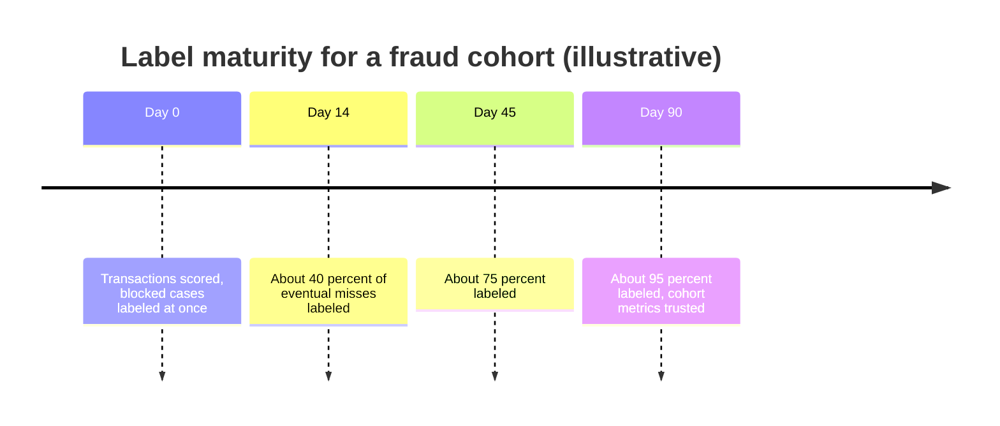

The timeline shows why the dashboard must show the maturity of each cohort. A recall figure for the cohort from two weeks ago and one from three months ago are not comparable until adjusted, and a trend line drawn through them manufactures an apparent decline or improvement from maturity alone.

### 14.6 Proxy metrics and their limits

A proxy metric is chosen because it moves with the true outcome and arrives early. Validate it before relying on it: using historical data, check how well it predicted outcome changes, and measure its lead time and false-alarm rate. Proxies fail when the relationship changes. A "reviewer override rate" proxy works while reviewers are consistent, and stops working when staffing changes or when reviewers begin deferring to the model (automation bias). A proxy can also be gamed by feedback: if the model's score influences what the reviewer does, the proxy measures the model against itself. Document each proxy's assumptions, owner, and the date it was last validated.

### 14.7 Monitoring by slice

Aggregate drift and performance hide local failures. A region with 3 percent of traffic can degrade severely while the overall metric moves by 0.1 point. Monitor on a defined list of slices, chosen as in Section 10.4, with the same statistics. Two obstacles arise. First, small slices have noisy metrics, so alert on confidence bounds and persistence, not on single points. Second, the number of slice-metric combinations grows quickly, so the false alert rate does too, which leads to alert design.

### 14.8 Alert design

An alert that fires without requiring action trains responders to ignore it. A monitoring system is only as good as its response rate, and a useful design rests on a few rules.

**Alert on symptoms that need action, and route the rest to dashboards.** A PSI of 0.12 on a minor feature is information. A 40 percent drop in the predicted-positive rate for a top region is a page.

**Estimate the false alarm rate before enabling an alert.** Suppose a team monitors 20 slices times 3 features, 60 tests per day, each at a 5 percent false positive rate. The expected number of false alerts per day is $60\times0.05 = 3$, which is a guaranteed daily distraction. Requiring a *persistence rule*, firing only after two consecutive daily breaches, reduces the false rate per test to $0.05^2 = 0.0025$ if days are independent, giving $60\times0.0025 = 0.15$ false alerts per day, about one a week. A persistence rule delays detection of a true shift by one period, which is a trade-off to choose deliberately. Alternatives are higher thresholds, multiplicity corrections, and limiting paging to a short list of features known to matter (by importance).

**Set thresholds from history.** The proxy example in the case at the end of this chapter uses a rise from 2.1 to 3.4 percent against a historical daily variation under 0.3 points. A threshold of three to four times the historical standard deviation, validated on past data for the number of alerts it would have produced, is more defensible than a guessed round number.

**Tie each alert to a runbook.** The alert text names the likely causes, the first check, who owns the response, and the rollback or mitigation option. An alert with no runbook produces an investigation from scratch every time.

**Severity by impact.** Combine the signal and the exposure: a shift in a feature the model barely uses is low severity, a shift in the highest-importance feature on the highest-volume slice is high.

**Review alerts periodically.** Track alert precision (the fraction that led to action). Remove or retune alerts below a floor, say 30 percent, or the alert set decays into noise.

### 14.9 Monitoring tools

Monitoring can be built from the telemetry stack of Part 14 plus a drift library, or bought as an ML observability product. Open-source libraries such as Evidently and NannyML (which specializes in performance estimation without labels) compute drift and quality reports; managed platforms provide model monitoring (Vertex AI Model Monitoring, SageMaker Model Monitor, Azure ML data drift monitors, Databricks Lakehouse Monitoring), and commercial vendors offer observability products. The capabilities change quickly, so evaluate against the six layers above and the alert design rules, not against feature lists. Build the data collection (logged features, predictions, outcomes) once, in a neutral store, so the analysis tool can be replaced.

## 15. Retraining Triggers and Cost

### 15.1 Three families of trigger

A model's performance decays as the world moves away from its training data. Retraining restores it at a cost. When to retrain is a decision with an economic structure.

**Scheduled.** Retrain every $T$ days regardless of evidence. Simple, predictable, and easy to staff and budget. It wastes compute when nothing changed and reacts slowly when something changed just after a run.

**Drift-triggered.** Retrain when input or prediction drift crosses a threshold. It responds to change, and it is noisy: drift does not always imply a performance loss, so some retrains are unnecessary, and concept drift without covariate drift is missed.

**Performance-triggered.** Retrain when the measured outcome metric falls below a bound. It targets the real objective and lags by the label delay, so damage accumulates before the trigger fires.

Most mature systems combine them: a schedule as a floor (a maximum age), drift triggers as an accelerator, and performance as the arbiter that tunes the other two.

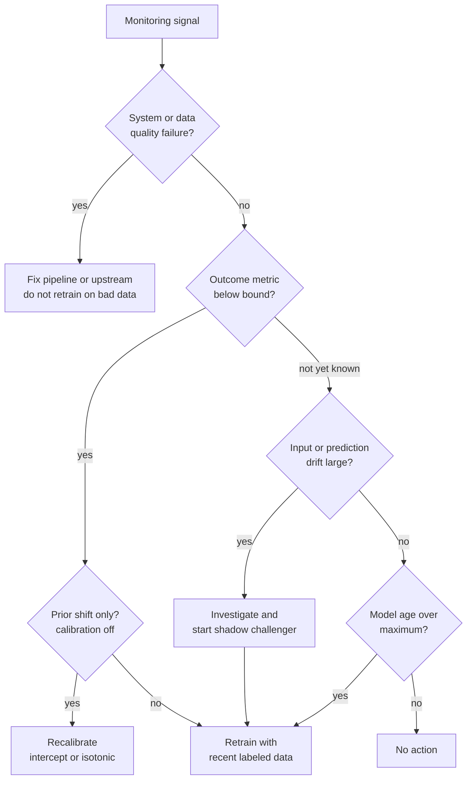

The tree puts data-quality failure first on purpose. Retraining on corrupted data produces a corrupted model with fresh timestamps, and automatic retraining on a drift alert without a data validation gate is a way to bake a pipeline bug into the production model. It also separates recalibration from retraining. When only the base rate changed, an intercept correction is cheaper and faster than a new model.

### 15.2 An economic model for the schedule

Suppose model quality decays roughly linearly with age at rate $r$ in value per unit time, and retraining at interval $T$ costs $C$ per run. Over a long horizon, the average staleness is $T/2$, so the average cost per unit time is

$$\text{Cost}(T) = \underbrace{\tfrac{r\,T}{2}}_{\text{value lost to staleness}} + \underbrace{\tfrac{C}{T}}_{\text{retraining}}.$$

Setting the derivative to zero, $r/2 - C/T^2 = 0$, gives the optimal interval

$$T^\ast = \sqrt{\frac{2C}{r}}.$$

This is the same form as the economic order quantity in inventory theory.

**Worked example (illustrative).** A fraud model protects about \$2.4 million of monthly exposure, roughly $553{,}000$ per week. Recall falls by 0.4 percentage points for each week of model age, so the loss grows at $r = 0.004\times553{,}000 = 2{,}212$ dollars per week per week of age. A retraining run, including compute, validation, and review, costs $C = 1{,}500$ dollars. Then the cost per week is $\text{Cost}(T) = 1{,}106\,T + 1{,}500/T$, and $T^\ast = \sqrt{2\times1500/2212} = \sqrt{1.356} = 1.16$ weeks. Evaluating:

| Retraining interval $T$ (weeks) | Staleness loss per week $1106\,T$ | Retraining cost per week $1500/T$ | Total per week |
|---|---|---|---|
| 1 | 1,106 | 1,500 | 2,606 |
| 1.16 | 1,283 | 1,293 | 2,576 |
| 2 | 2,212 | 750 | 2,962 |
| 4 | 4,424 | 375 | 4,799 |

The minimum is flat near 1 to 1.2 weeks, and a weekly cycle costs only about 1 percent more than the optimum while a four-week cycle costs roughly 86 percent more. The model's assumptions are strong: linear decay, a constant cost per run, and no risk in the retraining itself. Real decay is often slower at first, then abrupt after an event, and each retraining carries a probability of producing a worse model that the gate must catch. The model's value is in showing which quantities matter: the decay rate $r$ and the per-run cost $C$. Reducing $C$ through automation and caching allows a shorter interval, and measuring $r$ from the performance history is a reason to keep outcome monitoring even when labels are slow.

### 15.3 Other costs of retraining

- **Evaluation and approval cost.** Human review and compliance steps often dominate compute for regulated models. Automating the evidence package lowers $C$.
- **Label cost.** Fresh labels may be paid for. Active learning and targeted labeling reduce this, and labeling vendors need lineage records.
- **Instability cost.** A retrained model changes individual decisions, which can produce customer-visible inconsistency or break downstream rules tuned to the old score distribution. A policy of minimum improvement for replacement, or of keeping score calibration stable, reduces churn.
- **Opportunity cost of risk.** Each release carries a failure probability. More frequent releases amortize through automation and smaller changes, as software delivery research on deployment frequency suggests, but only when the gate and rollback are reliable.

### 15.4 Guarding against automated retraining hazards

Automatic CT needs controls that humans would otherwise supply. Validate the new data (Section 4.3). Limit the retraining rate to avoid storms. Require the same gates as a manual release, and require a manual approval for high-risk models even when training is automatic. Check for feedback-loop contamination, such as training on labels produced by the model's own decisions. Keep the previous model warm. Finally, alert when an automated retraining has not produced a promotable candidate for several cycles, since repeated failure is itself a signal that something upstream changed.

## 16. Rollback and Incident Response for Models

### 16.1 Why model rollback is harder than code rollback

Rolling back a service binary restores the earlier behavior, because the behavior was a function of the code. Rolling back a model restores the earlier *function* but not necessarily the earlier *situation*. Several things may have moved on.

- **The feature schema.** If the new model required a new feature and the pipeline now produces it while the old model expects the old set, the old model may not run. Keep the feature contract backward compatible for at least the rollback window, and record each model's required feature list.
- **Thresholds and downstream rules.** Operating thresholds, review queue sizes, and downstream rules are tuned to a model's score distribution. Restoring the old model with the new thresholds changes the decision rates. Store the threshold with the model version, not in separate configuration.
- **Cached and stored predictions.** Scores computed by the bad model may sit in caches, tables, and downstream features. Rolling back the router does not remove them. Identify and purge or recompute by model version.
- **Actions already taken.** A blocked transaction, a declined application, or an email sent stays done. For agentic systems, rollback cannot undo external actions (Section 20). The incident process needs a remediation path for affected decisions, such as re-review of every decision the faulty model made.
- **State and feedback.** Labels collected during the bad period reflect decisions made by the faulty model and may bias later training. Mark that window in the data lineage so retraining can exclude or reweight it.

### 16.2 Prerequisites for fast rollback

Rollback speed is decided before the incident. A checklist of what must exist:

1. The previous champion remains deployable, with its container image, weights, and dependencies still retrievable, and ideally still warm for the rollback window.
2. A recorded rollback target in the registry (Section 8.5), so no one chooses under pressure.
3. A routing control (alias or traffic weight) that switches without a deployment, with a tested command and the authority to run it granted to on-call staff.
4. A feature contract that supports both versions.
5. A tested fallback path for when no model is acceptable: a rule set, a conservative default, or human review.
6. Rollback drills. A rollback that has never been exercised is a hypothesis.

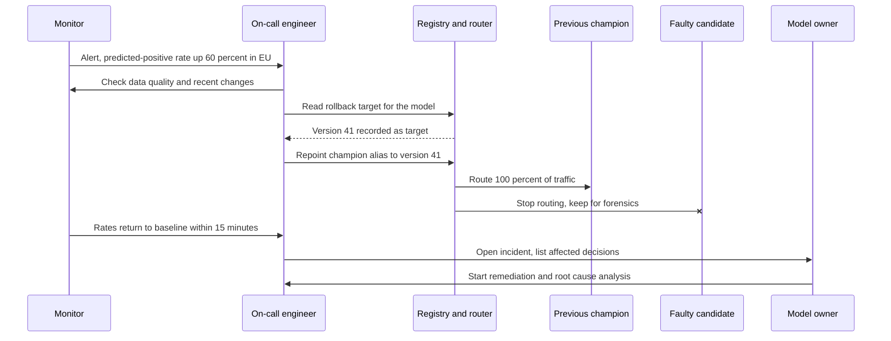

The sequence emphasizes a division of labor. The on-call engineer restores service using a prepared action that needs no judgment about the model internals, and the model owner then takes over diagnosis, remediation of affected decisions, and the fix. Mitigation before diagnosis is the same principle as in site reliability practice: stop the harm, then find the cause.

### 16.3 Model incident classes and first responses

| Incident | Typical signal | First response | Follow-up |
|---|---|---|---|
| Bad release | Metrics shift right after a deploy | Roll back to the recorded target | Reproduce offline, add a regression case to the gate |
| Upstream data break | Sudden schema or range violation, null spike | Switch to fallback features or pause scoring, fix at source | Add a validation rule, notify the upstream owner |
| Training/serving skew | Online distribution differs from offline for a feature | Roll back if tied to a release, otherwise patch the feature path | Add a replay test (Section 5.4) |
| Concept drift | Gradual outcome decay with stable inputs | Tighten thresholds or add human review while retraining | Shorten retraining interval, add features |
| Feedback-loop damage | Labels reflect the model's own choices | Pause automated retraining, restore a holdout | Add exploration and propensity logging |
| Provider change (LLM) | Quality drop with no local change | Pin or switch to the previous snapshot if available, route to a fallback | Add scheduled regression suite (Section 19.12) |
| Security event | Model theft, poisoning, prompt injection | Disable the capability, rotate credentials | See Section 24 and CH31 |
| Runaway cost | Token or GPU spend far above budget | Throttle at the gateway, cut the offending route | Add budget alarms (Section 23) |

### 16.4 Postmortem for models

A blameless postmortem for a model incident extends the standard form with ML-specific questions. Which artifact versions were live, from the lineage record? What was the detection delay, and which monitoring layer (Section 14.1) first saw it? Which gate should have caught it, and why did it not? Which slice, if any, was affected disproportionately? Were affected decisions identified and remediated? What regression case now represents the failure in the evaluation set? The last item turns each incident into permanent test coverage, which is how a gate improves over time. Keep the incident linked to the release record; deleting the record when traffic returns to the old model loses the evidence that a future audit will ask for.

### 16.5 Time to recover as a budget

Recovery time is the sum of detection, decision, and execution times. With layered monitoring, detection might be 20 minutes for a data-quality alert and 5 days for a label-based metric. With a prepared alias switch, execution takes a minute. Decision time is where unprepared teams lose hours: a debate about whether the signal is real. Pre-agreed rollback criteria remove the debate. For example, "if the predicted-positive rate for any top-5 region exceeds 1.5 times its 14-day mean for two consecutive hours, on-call rolls back without escalation." The criteria are written at design time and reviewed after each incident.

## 17. Model Cards and Documentation

### 17.1 What documentation is for

Documentation of a model serves four readers: the engineer who must operate it, the product owner who decides how to use it, the risk or compliance reviewer who must approve it, and the downstream consumer who must know its limits. A model card, introduced by Margaret Mitchell and colleagues (2019) in "Model Cards for Model Reporting," is a short structured document that travels with the model and covers intended use, evaluation across conditions, and limitations. Datasheets for datasets, proposed by Timnit Gebru and colleagues (2018), do the same for data. Both are templates for questions that otherwise go unasked.

### 17.2 Contents of an operational model card

| Section | Contents | Why it is needed |
|---|---|---|
| Identity | Name, version, artifact digest, owner, registry link, date | Ties the document to the immutable artifact |
| Intended use | Decisions supported, users, deployment context, and explicitly out-of-scope uses | Prevents silent reuse in contexts never evaluated |
| Training data | Dataset version, sources, time window, label definition, known gaps, rights summary | Supports audit and reproduction |
| Features and inputs | List with units, ranges, and source owners | Defines the contract and the monitoring reference |
| Evaluation | Evaluation set version, headline metrics with confidence intervals, slice results, calibration, comparison to baseline and incumbent | Gives the evidence for approval |
| Operating point | Threshold, rationale, and cost model assumptions | Explains the decision rule |
| Limitations and risks | Known failure modes, populations with weak performance, sensitivity to drift | Informs consumers and monitors |
| Monitoring plan | Signals, thresholds, label delay, alert owners, retraining triggers | Connects development to operations |
| Fairness and safety review | Metrics examined, findings, approvals, per [CH31](CH31_Responsible_AI_and_Safety_Governance.md) | Records the governance decision |
| Change log and lineage | Differences from the previous version, link to lineage graph | Supports comparison and audit |
| Retirement criteria | Conditions and review date | Prevents zombie models |

### 17.3 Generating the card

A card written by hand after launch is usually incomplete. Generate the evidence sections automatically from the pipeline: metrics and slice tables from the evaluation report, lineage from the graph, and data descriptions from the dataset registry. Leave to humans the sections that require judgment: intended use, limitations, and the rationale for the operating point. Make completeness a gate: the registry refuses the Approved state when required fields are empty.

Regulatory context shapes the required content. The EU Artificial Intelligence Act, for example, specifies technical documentation, record-keeping, and post-market monitoring for high-risk systems, and its obligations apply on a phased schedule that has been the subject of amendment proposals; confirm the dates and your system's classification against the current text of the regulation and legal advice. An automated card is a starting point for that documentation but does not replace the legal analysis of whether a system is in scope.

## 18. Maturity Levels and a Self-Assessment

### 18.1 A five-level scale

Maturity models describe how much of the lifecycle is automated and governed. Google's published MLOps guidance describes levels from manual processes to automated pipelines and CI/CD, and Microsoft publishes a five-level model; both are good references to read in full. The scale below is a compact synthesis, not a standard.

| Level | Name | Characteristics | Typical failure |
|---|---|---|---|
| 0 | Manual | Notebooks, manual handoff, models copied to servers, no registry, no monitoring beyond infrastructure | Cannot reproduce or roll back. Knowledge sits in one person |
| 1 | Tracked | Experiment tracking, versioned code and data, a registry, manual deployment with a checklist | Releases depend on discipline. Monitoring is ad hoc |
| 2 | Pipelined | Automated training pipeline, automated evaluation gates, CI for code and data tests, staged deployment | Pipelines break silently. Monitoring covers system health but not drift or outcomes |
| 3 | Monitored | Drift and outcome monitoring with alerts and runbooks, feature store or shared feature code, canary rollouts, rollback drills, model cards generated | Retraining is still triggered by people. Governance is per team |
| 4 | Governed and automated | Continuous training with triggers and guards, platform-wide policy as code, lineage coverage, cost attribution, audit-ready evidence, platform metrics reviewed | Over-automation without guardrails. Platform becomes a bottleneck if self-service is weak |

Higher is not always better for every model. A low-risk internal batch scorer used once a month may be correctly managed at level 1 or 2. A model that approves credit should be at level 3 or above. Maturity should be matched to risk and change rate, and a team that over-invests in automation for a model that changes yearly is wasting effort.

### 18.2 Self-assessment

Score each statement 0 (no), 1 (partly or for some models), or 2 (yes, for all production models). Total the 20 points.

| # | Statement | Score |
|---|---|---|
| 1 | Every production model version can be traced to the exact dataset version, code commit, configuration, and environment that produced it | 0 / 1 / 2 |
| 2 | Training and serving use the same feature definitions, and point-in-time correctness is tested | 0 / 1 / 2 |
| 3 | Training runs from an automated pipeline, not a notebook or manual script | 0 / 1 / 2 |
| 4 | A registry holds all deployable models with state, owner, and approvals bound to the artifact digest | 0 / 1 / 2 |
| 5 | An automated gate compares each candidate to the incumbent with statistical criteria and slice checks | 0 / 1 / 2 |
| 6 | New models roll out through shadow or canary with defined abort criteria | 0 / 1 / 2 |
| 7 | Input drift, prediction drift, and (delayed) outcome metrics are monitored with alerts tied to runbooks | 0 / 1 / 2 |
| 8 | Rollback to the previous version has been drilled in the last six months and takes under 30 minutes | 0 / 1 / 2 |
| 9 | Model cards are generated and complete before approval, and retirement criteria exist | 0 / 1 / 2 |
| 10 | Compute and inference cost are attributed to teams and models, with budgets and alarms | 0 / 1 / 2 |

A score of 0 to 6 indicates level 0 to 1: invest first in tracking, a registry, and reproducible training. A score of 7 to 13 indicates level 2 to 3: invest in gates, canary, and monitoring. A score of 14 or more indicates level 3 to 4: invest in lineage coverage, policy as code, and platform metrics. Within any band, fix the lowest-scoring item that carries the highest risk first, which is usually item 8 or item 7, because an unrecoverable and unobserved model is the larger exposure than a slow pipeline.

## 19. LLMOps: Operating Systems Built on Foundation Models

### 19.1 What changes and what stays the same

LLMOps keeps the structure of MLOps (artifacts, evaluation, controlled release, monitoring, rollback, retirement) and changes the artifacts and their risks. In many LLM applications the team does not train a model, and the behavior is set by a hosted model that someone else controls, plus text and configuration that the team writes.

| Aspect | Classical ML | LLM application |
|---|---|---|
| Primary behavior-defining artifacts | Training data, features, weights | Base model identifier, prompts, retrieval index, tool schemas, guardrail policies, sampling parameters |
| Who controls the model | The team | Often a provider, who may update or retire it |
| Change frequency | Retraining cycles | Prompt edits in hours, provider updates without notice |
| Evaluation | Labeled test set, numeric metrics | Rubrics, model-graded judges, human review, task-specific checks, non-deterministic outputs |
| Cost driver | Training compute, inference hosting | Tokens per request, context length, retrieval, retries |
| Typical regressions | Drift, skew, leakage | Prompt side effects, retrieval changes, provider updates, injection |
| Feedback | Delayed labels | Thumbs, edits, escalations, conversation outcomes |

Two consequences follow. First, a prompt change is a production change with the same blast radius as a model change, and it must pass the same style of gate. Second, because the model may be outside the team's control, the team must instrument for change it did not initiate. Generative evaluation and guardrail methods are owned by [CH24](CH24_Generative_AI_Evaluation_Guardrails_and_Hallucinations.md); this section covers how those are wired into the operating process.

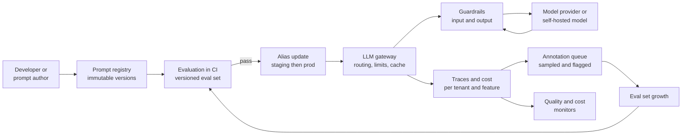

The flow closes a loop: production traces feed an annotation queue, whose reviewed cases extend the evaluation set, which tightens the CI gate for the next prompt change. The gateway is the single choke point where routing, limits, caching, guardrails, and telemetry can be applied uniformly, which is why it appears in the middle.

### 19.2 Prompt and configuration registry

A prompt is code that is written in natural language, and it deserves the same discipline: version control, review, tests, and controlled release. The registry should store, for each prompt:

- The template text with named variables, and the variable schema.
- The model identifier and sampling parameters it was tuned for, since a prompt tuned for one model often behaves differently on another.
- Tool definitions and output schemas that accompany it.
- An immutable version number and content hash, with a change description and author.
- Aliases such as `staging` and `production` that point to versions, so that releasing is moving an alias, as with model registries (Section 8.2).
- Links to the evaluation run that gated the version.

Two designs coexist. *Prompts in the code repository* gain code review, atomic deployment with the application, and the existing CI. Their cost is that changing a prompt requires an application release, which slows iteration and ties non-engineers out of the loop. *A prompt registry* separates prompt release from application release, enables fast iteration and rollback of a prompt alone, and lets domain experts propose edits, at the risk that prompts change production behavior without code review unless the registry enforces a gate. Several tools provide registries, including MLflow's prompt registry, Langfuse, and LangSmith; at the time of writing MLflow's documentation recommends its Prompt Registry for versioning, aliasing, and lineage of prompts. Check the current documentation of whichever you adopt. The key control is the same in either design: no alias moves to production without an evaluation record, and every production response logs the prompt version it used so that behavior can be attributed.

Keep model, prompt, retrieval, and guardrail changes distinct releases wherever possible. If a single release changes all four and quality drops, attribution requires an ablation. If each is a separate versioned artifact released on its own, the cause is usually obvious from the timing.

### 19.3 Versioned evaluation datasets and evaluation in CI

The LLM equivalent of the test set is a *golden set*: a curated, versioned collection of inputs with reference answers, rubrics, or checkable assertions. Build it from three sources: hand-written representative and adversarial cases, sampled and reviewed production traces, and past incidents. Version it with the same identity rules as any dataset (Section 4), record its version in every evaluation run, and grow it deliberately. Treat it as sensitive data: production traces may contain personal information, which needs redaction or a lawful basis before they enter a dataset (see [CH30](CH30_AI_Data_Governance_Privacy_and_Provenance.md)).

Evaluation checks come in layers, ordered by cost and determinism:

1. **Deterministic assertions.** Output is valid JSON matching a schema, contains a required citation, avoids forbidden strings, stays within a length bound, calls the correct tool with valid arguments. Cheap and exact.
2. **Reference-based metrics.** Exact match, code execution against tests, retrieval metrics (is the right document in the top $k$?). Exact where a reference exists.
3. **Model-graded judges.** A model scores outputs against a rubric. Flexible, noisy, and subject to biases (position, verbosity, self-preference). Calibrate against human labels on a sample and report agreement.
4. **Human review.** The reference standard, slow and costly, used to calibrate judges and to review the borderline and high-risk cases.

**Non-determinism.** Even at temperature zero, hosted models may return different outputs across calls, so a single pass over the golden set is a noisy estimate. Run each case $k$ times (3 to 5 is common), report the mean pass rate and its spread, and base the gate on a confidence bound, as in Section 11 but with variance from both the case sample and the run-to-run variation. A related measure, the probability that all $k$ attempts succeed, captures consistency, which matters for tool-using agents.

**Cost of evaluation in CI (illustrative).** Take 400 cases, 3 repeats, an average of 1,500 input tokens and 400 output tokens for the system under test, and a judge call of 2,500 input and 100 output tokens per run. With illustrative prices of \$3 per million input tokens and \$15 per million output tokens: the system calls total $1{,}200\times1{,}500 = 1.8$ million input tokens (\$5.40) and $1{,}200\times400 = 0.48$ million output tokens (\$7.20), and the judge calls total 3.0 million input tokens (\$9.00) and 0.12 million output tokens (\$1.80). The total is about \$23.40 per run. That is cheap enough for every pull request affecting prompts, and it makes a nightly regression run against a larger set affordable. The prices are placeholders; look up current ones.

Because evaluation is costly in time as well as money, use tiers: a small smoke set (30 to 50 cases) on every change, the full golden set before promotion, and a larger or human-reviewed set on a schedule.

### 19.4 The LLM gateway and routing

An LLM gateway is a service between applications and model providers. It centralizes concerns that otherwise repeat in every application.

- **Authentication and key management.** Applications hold gateway credentials, and the gateway holds provider keys. Rotating a provider key changes one place.
- **Routing and fallback.** Choose the model by rule, cost, latency, or request class, and fail over to a second provider or model when the first errors or times out.
- **Rate limits, quotas, and budgets** per team, tenant, and feature.
- **Caching** (Section 19.5).
- **Guardrails** applied uniformly (Section 19.6).
- **Observability.** Uniform traces, token counts, cost, and latency (Section 19.7).
- **Version pinning.** A mapping from a logical model name used by applications (`summarizer-default`) to a concrete provider model identifier, changed deliberately.

Open-source gateways such as LiteLLM, commercial gateways, API-management products with AI features, and cloud-provider services implement subsets of these. Choose by how well they support your providers, streaming, tool calling, and policy requirements, and by whether the gateway itself becomes a single point of failure. It sits on the request path of every call, so it needs the availability engineering that any critical dependency receives (replicas, health checks, and a bypass plan).

**Cascade routing arithmetic (illustrative).** Suppose a small model costs 10 percent as much per request as a large one. Route all requests to the small model first, apply a quality check, and escalate failed cases to the large model. If the small model alone suffices for 70 percent of traffic, the large model handles the other 30 percent. If the quality check also rejects 15 percent of the small model's answers on the 70 percent share (which then escalate), the relative cost per request is: small calls for the 70 percent share, $0.7\times0.1 = 0.07$; escalated small-model failures, $0.7\times0.15\times1 = 0.105$; and the 30 percent that go straight to the large model, $0.3$. The total is $0.475$ of the all-large cost, a saving of 52.5 percent. The saving depends on the checker's accuracy: if it lets bad small-model answers through, quality drops, and if it rejects good ones, cost climbs. Evaluate the cascade as a whole system on the golden set, never the parts separately.

### 19.5 Caching

Three kinds of cache apply to LLM traffic, with different risk.

**Exact-match cache.** Key on a hash of the normalized prompt, model, and parameters. Safe where the same request repeats and outputs may be reused. The hit rate is usually low for free-form chat and high for templated tasks.

**Semantic cache.** Embed the request and return a stored answer if a past request is similar enough. This gives higher hit rates and a real risk: a similarity threshold that is too loose returns an answer to a different question, and a stored answer may contain one user's data, which a different user must never receive. Key the cache by tenant and permission scope, set the threshold conservatively from measured false-hit rates on labeled pairs, and exclude requests that contain personal data or depend on live state.

**Provider prompt (prefix) caching.** Several providers discount repeated prompt prefixes, such as long system prompts or retrieved documents, with differing minimum lengths, lifetimes, and pricing. Structure prompts so that stable content comes first and variable content last. Check the provider's current documentation for conditions and prices.

**Worked arithmetic (illustrative).** One million requests per day, 1,200 input tokens and 300 output tokens each, at \$3 and \$15 per million tokens. Daily cost is $1{,}200\times3 = 3{,}600$ for input and $300\times15 = 4{,}500$ for output, totaling \$8,100. An exact-match cache with a 20 percent hit rate avoids those requests entirely and saves $0.20\times8{,}100 = 1{,}620$ per day. Now suppose, instead, that 900 of the 1,200 input tokens are a stable prefix billed at 10 percent of the base rate on a hit. With an 80 percent hit rate the effective input tokens per request are $300 + 900\times(0.8\times0.1 + 0.2\times1.0) = 300 + 900\times0.28 = 552$, so input cost falls to $552\times3 = 1{,}656$ and the total to $6{,}156$, a saving of $1{,}944$ per day. This ignores any cache-write surcharge, which some providers apply, so the real saving is somewhat lower. The two techniques combine, since the exact cache removes the request before the prefix discount matters. Measure hit rates in production, since the assumed values are the least reliable inputs.

### 19.6 Guardrail deployment

Guardrails are filters and classifiers that run before and after the model: prompt-injection detection, policy classifiers, personal-data redaction, grounding checks, and output schema validation. The design of those checks is in [CH24](CH24_Generative_AI_Evaluation_Guardrails_and_Hallucinations.md). Operationally, treat each guardrail as a model-like artifact with its own version, evaluation, and release.

- **Version and gate them.** A guardrail update changes what users see. It needs an evaluation on both harmful cases (does it block?) and benign cases (does it over-block?).
- **Release in shadow first.** Run a new guardrail in log-only mode, compare its decisions with the current one, and review the disagreements before enforcing.
- **Track both error types.** False negatives pass harmful content, and false positives block legitimate use. Report both by slice, since over-blocking often falls on particular languages and topics.
- **Budget the latency.** Guardrails on the request path add latency; run independent checks in parallel and set timeouts with a defined fail-open or fail-closed behavior chosen by risk.
- **Keep a kill switch.** A misbehaving guardrail can take down a product. The ability to disable or relax one without a code deploy, with audit, is part of the design.

### 19.7 Tracing, token accounting, and cost attribution

Every LLM request should produce a trace that records the request identifier, user or tenant (pseudonymous where possible), prompt version, model identifier, retrieval results with document identifiers, tool calls and results, guardrail decisions, token counts for input and output (and cached tokens), latency by step, and cost. OpenTelemetry has been developing semantic conventions for generative AI spans and metrics, which allow traces to flow into the observability stack of Part 14; the conventions have been evolving, so check their current status before standardizing on attribute names.

Cost attribution requires tags at the point of the call: team, product feature, tenant, environment, and experiment. Without tags, the monthly bill is one number that no one owns. With tags, the questions that govern spend become answerable: cost per resolved conversation, cost per tenant against revenue, and cost of the long tail of retries.

Two privacy points. Full prompts and responses in traces can contain personal and confidential data, so apply redaction, restrict access, set short retention, and sample rather than store everything where the use does not need it. And store enough to reproduce a failure: the prompt version, model identifier, retrieved document identifiers, and parameters, so a case can be rerun even when the raw text is not retained.

### 19.8 Feedback loops and annotation queues

Production signals for LLM systems are indirect: thumbs up or down, edits made to a draft, copy actions, regeneration clicks, escalation to a human, abandonment, and follow-up questions. Each is a noisy proxy with its own bias. Users who click thumbs are a small and unrepresentative fraction, and an edit to a draft may reflect style preference rather than error. Treat them as signals for where to look, and confirm with review.

An **annotation queue** is the work surface where sampled and flagged traces are labeled by reviewers: domain experts, trained annotators, or both. Design points:

- **Sampling.** Combine random sampling (for an unbiased quality estimate), targeted sampling (negative feedback, low judge scores, guardrail triggers, new topics), and incident-based sampling.
- **Rubrics and calibration.** Write clear criteria, measure agreement between annotators (for example with Cohen's kappa for two raters), and resolve disagreement before treating labels as truth.
- **Routing to experts.** Safety and legal questions need qualified reviewers. Access to traces follows the privacy rules above.
- **Closing the loop.** Reviewed failures enter the golden set as regression cases. Reviewed good examples may enter fine-tuning data, subject to rights and consent checks, and with a separation so that evaluation cases never become training data (otherwise measured quality is inflated).
- **Poisoning and abuse.** Public feedback channels can be manipulated. Rate-limit, weight by account reliability, and review before training on user-provided signals.

### 19.9 The retrieval-augmented generation index lifecycle

A retrieval-augmented generation (RAG) application depends on an index of documents. The index is a versioned, behavior-defining artifact like a model. Its lifecycle has stages: ingestion (parse, chunk, enrich with metadata and access control), embedding (convert chunks to vectors with an embedding model), indexing (store in a vector database, owned by [CH26](CH26_Vector_Databases_for_AI_Retrieval.md)), serving, refresh (add, update, delete), and retirement.

Operational rules that follow:

- **Version the whole chain.** An index version records the corpus snapshot, the parsing and chunking configuration, the embedding model and its version, and the index parameters. Changing any of them creates a new index version.
- **An embedding model change means a full re-embed.** Vectors from different embedding models are not comparable, so a new embedding model requires re-embedding every chunk and building a new index. For 10 million chunks of 500 tokens, that is 5 billion tokens. At an illustrative embedding price of \$0.02 per million tokens the compute is about \$100, which is small, while the wall-clock time and vector database load can be considerable. The larger cost is evaluation, since retrieval quality must be re-measured.
- **Blue/green for indexes.** Build the new index beside the old one, evaluate retrieval on a labeled query set (recall at $k$, ranking quality) and end-to-end answer quality, shadow it, then switch the alias used by the application. Keep the old index for the rollback window.
- **Freshness.** Define how quickly a changed source document must be reflected, measure the lag from source change to index availability, and alert on it.
- **Deletion propagation.** When a document is deleted or access is revoked at the source, it must disappear from the index and from caches and stored traces within a stated time. This is a compliance requirement as well as a correctness issue; see [CH30](CH30_AI_Data_Governance_Privacy_and_Provenance.md).
- **Authorization at query time.** Filter results by the caller's permissions, so that stale or over-broad indexes do not leak documents.
- **Evaluate retrieval and generation separately.** A drop in answer quality may come from retrieval (the right passage missing), from generation (the passage ignored), or from the corpus. Separate metrics point to the failing stage.

### 19.10 Fine-tuned model lineage

When a team fine-tunes a model (the methods are in [CH20](CH20_Fine_Tuning_PEFT_and_LoRA.md)), the lineage extends to the base model. A fine-tuned artifact record needs the base model identifier and exact version or digest, the adapter or full weights digest, the fine-tuning dataset version and its rights status, the training configuration (method, rank, learning rate, epochs, seeds), the evaluation report including a regression check against the base model on general capabilities and safety behavior, and the license terms inherited from the base. Two operational points deserve attention. An adapter is tied to its base: if the base model version changes, the adapter is not guaranteed to work and generally needs retraining and re-evaluation. And fine-tuning can degrade safety behavior or general capability while improving the target task, so the gate must include both.

For a provider-hosted fine-tune, the lineage includes the provider's fine-tuning job identifier and the provider's own lifecycle policy: a fine-tuned model may be tied to a base model that the provider later retires, forcing retraining on a successor. Plan for that cost when choosing fine-tuning over prompting.

### 19.11 Provider model deprecation and migration playbook

Hosted models are retired on the provider's schedule. At the time of writing, major providers publish deprecation pages and give notice periods that differ by provider and by model class, from weeks for previews to months for generally available models, and several providers retired multiple model versions during 2026. Verify the current policy and schedule for each provider you use; do not rely on a remembered number. A system that treats the model as a permanent dependency will meet a forced migration with little time.

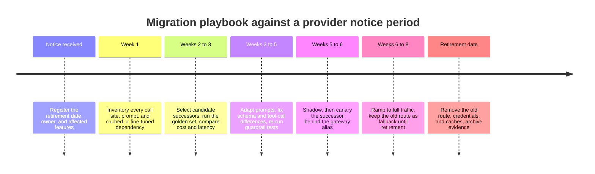

The timeline compresses a typical 8-week plan. If the provider's notice is shorter, the same steps run in parallel and the shadow period shrinks, which raises the importance of having the golden set and gateway alias in place before any notice arrives.

The playbook in steps:

1. **Maintain an inventory** of every model identifier in use, mapped through the gateway to features and owners. Subscribe to provider notices and track retirement dates in a calendar with owners.
2. **Pin concrete model versions** for production rather than floating aliases such as "latest," so that the change happens when you choose it. Keep a floating alias only in a canary or experimentation environment.
3. **Evaluate successors** on the golden set with the same gate as any release, including cost, latency, safety, and slice behavior. A newer model is not automatically better for your task, and it may be more verbose, follow instructions differently, or change tool-calling behavior.
4. **Adapt prompts.** A prompt tuned for one model may need adjustment. Compare variants with the evaluation set instead of by reading outputs.
5. **Migrate through the gateway alias**, canary, and keep the old route until the provider shuts it down, so rollback remains available until the last possible day.
6. **Handle dependent artifacts.** Fine-tuned models, embedding indexes tied to a retiring embedding model, cached responses, and stored evaluation baselines may all need regeneration.
7. **Close out.** Remove old routes and credentials, update the model cards and registry, and record the migration evidence.

### 19.12 Detecting silent changes in a hosted model

Providers may update a model behind a stable identifier, change serving infrastructure, or alter safety systems, and the application's behavior shifts without any deployment on your side. Pinning to a dated snapshot reduces the risk, but it does not remove infrastructure-level changes, and some identifiers are floating by design. Detection needs an active program.

1. **A scheduled canary suite.** Run a fixed set of prompts through the production route on a schedule, such as daily, with fixed parameters, and compare results with a stored baseline.
2. **Behavioral fingerprints.** Track stable measurable properties: output length distribution, refusal rate, format-compliance rate, tool-call rate, and judge scores on the golden set. Some APIs return a backend or version identifier in responses; log it when available, and treat a change in it as an event to investigate.
3. **Statistical power.** The suite must be large enough to detect a drop that matters. To detect a fall in a pass rate from 0.90 to 0.85 with $\alpha = 0.05$ two-sided and 80 percent power, the two-proportion formula of Section 12.3 gives $\bar p = 0.875$, $\sqrt{2\times0.875\times0.125} = 0.4677$, $1.96\times0.4677 = 0.9167$, $0.8416\times\sqrt{0.09 + 0.1275} = 0.3925$, a sum of $1.3092$, and $n = 1.3092^2/0.05^2 = 686$ cases per period when the two periods are compared as independent samples. A 400-case suite, evaluated once per day, cannot reliably see a 5-point change in one day. Options are a larger suite, pooling several days (accepting a delay), a paired design that re-uses the same prompts and compares per-case outcomes (which reduces variance because most cases are consistently easy or hard), or a sequential test that accumulates evidence.
4. **A response playbook.** If a regression is confirmed, route to a fallback model, switch to a previous snapshot if one exists, adjust prompts if the change is understood, and notify the provider through support channels. Record the event in the lineage.
5. **Contractual and architectural mitigation.** For high-stakes uses, consider self-hosted open-weight models where the artifact is under your control, at the cost of operating it (CH28) and of generally different capability and cost profiles, or provider contract terms for version stability. This is a trade-off between control and effort, not a default.

The overall principle is that a stable input distribution does not guarantee stable behavior after a provider or runtime change; the monitor must watch behavior, not only inputs.

## 20. Agent-Specific Operations

Agents, defined in [CH21](CH21_Agents_Tool_Calling_Memory_Planning.md), add loops, tools, and memory to an LLM application. Everything in Section 19 applies, and four further concerns appear because the system takes actions, not just produces text.

### 20.1 Version the whole agent, not only the model

An agent release is the combination of the model, the system prompt, the tool definitions and their implementations, the planner or orchestration logic, the memory configuration, the permission set, and the guardrails. A change to a tool's description alters when the model calls it, so tool definitions are prompts in effect, and they belong in the registry with version, owner, and evaluation record. Tool implementations are ordinary services with their own release cycles, and a backward-incompatible change to a tool can break an agent that was not touched. Treat each tool as a versioned API with a contract test in the agent's CI. Servers exposed through the Model Context Protocol ([CH22](CH22_Model_Context_Protocol.md)) need the same pinning, since an MCP server updated by its owner changes the tools an agent sees.

### 20.2 Evaluate trajectories, not just answers

An agent's final answer may be correct after an unsafe or wasteful path, or incorrect after a reasonable one. The evaluation set therefore includes expected *trajectories* or trajectory constraints: which tools may be called, in what order, with what argument ranges, and within what step and cost budget. Useful metrics are task success rate, steps per task, tool-call error rate, cost per task, the rate of calls to forbidden or high-risk tools, and the probability that all $k$ repeats succeed. Because runs are stochastic and long, evaluate on a recorded or simulated environment with tool outputs that are deterministic where possible, so that differences reflect the agent, not the world.

### 20.3 Control the blast radius

Rollback cannot undo an action the agent took in an external system: a sent email, a changed record, an executed payment. Operations therefore rely on prevention and containment:

- **Least-privilege identities.** The agent runs with its own identity and the minimum scopes for its tools, never the user's full credentials, and tool permissions are versioned with the agent.
- **Approval for irreversible actions.** Actions above a risk threshold (payments, deletions, external messages) require human approval or a second check.
- **Budgets and limits.** Maximum steps, tokens, wall time, and cost per task, enforced by the orchestrator, not left to the prompt. A loop that retries a failing tool indefinitely is a cost incident.
- **Idempotency and compensation.** Design tools so that repeating a call is safe, and provide compensating actions where an action can be reversed in a business sense (a refund for a charge).
- **Kill switch.** A control that stops new agent runs and halts in-flight ones, usable without a deploy.
- **Staged exposure.** Release a new agent version first in a mode that proposes actions without executing them, then to a small tenant set, then widely. This is the agent equivalent of shadow and canary.

### 20.4 Observe the run

Traces for agents are trees: each step has the model call, the tool calls, their results, and decisions. Store enough to replay a run: inputs, tool outputs, model versions, and prompt versions. Alert on loops (the same tool called repeatedly with the same arguments), step counts well above the norm, cost per task above budget, and a rising rate of tool errors. For incident response, the trace shows what the agent did, which determines the remediation: which external actions must be reviewed or reversed. Agent memory is state that also needs versioning, retention limits, and a way to purge a user's data, as covered in CH21 and [CH30](CH30_AI_Data_Governance_Privacy_and_Provenance.md).

## 21. Platform and Tooling Landscape by Role

### 21.1 Think in roles before products

The market offers many products, and the same product often covers several roles. Choosing by role keeps the selection tied to requirements and makes replacement possible. The product catalogue and selection criteria for infrastructure are in [CH27](CH27_AI_Infrastructure_and_Platform_Components.md); this section maps the MLOps roles from this chapter to representative tools. Capabilities change frequently, so treat the table as orientation and verify against current documentation before deciding.

| Role | What it must provide (this chapter) | Representative tools |
|---|---|---|
| Data versioning | Immutable dataset identity (Section 4) | DVC, lakeFS, Delta Lake, Apache Iceberg, Apache Hudi |
| Data validation | Schema, statistics, drift checks (Section 4.3) | Great Expectations, Pandera, TensorFlow Data Validation, Deequ |
| Feature store | One definition, offline and online stores, point-in-time joins (Section 5) | Feast, Tecton, Databricks feature engineering, Vertex AI Feature Store, SageMaker Feature Store |
| Experiment tracking | Parameters, metrics, artifacts, comparison (Section 6) | MLflow, Weights & Biases, Neptune, Comet, cloud-native trackers |
| Orchestration | DAGs, caching, retries, triggers (Section 7) | Airflow, Kubeflow Pipelines, Argo Workflows, Flyte, Dagster, Prefect, Metaflow |
| Registry | Versions, aliases or stages, approvals, lineage (Section 8) | MLflow Model Registry, Unity Catalog models, Vertex AI Model Registry, SageMaker Model Registry, Azure ML registries |
| Serving and rollout | Endpoints, traffic splitting, autoscaling (Section 12, CH28) | KServe, Seldon, BentoML, Ray Serve, managed endpoints on each cloud |
| Monitoring | Drift, quality, alerting (Section 14) | Evidently, NannyML, Arize, Fiddler, WhyLabs-style tools, cloud model monitors, general observability stacks |
| Lineage | Graph of artifacts (Section 9) | OpenLineage with Marquez, DataHub, OpenMetadata, Unity Catalog lineage |
| LLM gateway | Routing, limits, caching (Section 19.4) | LiteLLM, cloud AI gateways, API-management products |
| LLM tracing and evaluation | Traces, datasets, judges, prompt versions (Sections 19.2, 19.3, 19.7) | MLflow tracing and evaluation, Langfuse, LangSmith, Arize Phoenix, Braintrust, W&B Weave |

### 21.2 Integrated platforms versus assembled stacks

Cloud and data platforms bundle most roles: Google Cloud's Vertex AI, Amazon SageMaker, Microsoft Azure Machine Learning, and Databricks with MLflow and Unity Catalog. The open-source route assembles MLflow or similar, Kubeflow or Flyte or Airflow, Feast, KServe, and a monitoring library on Kubernetes.

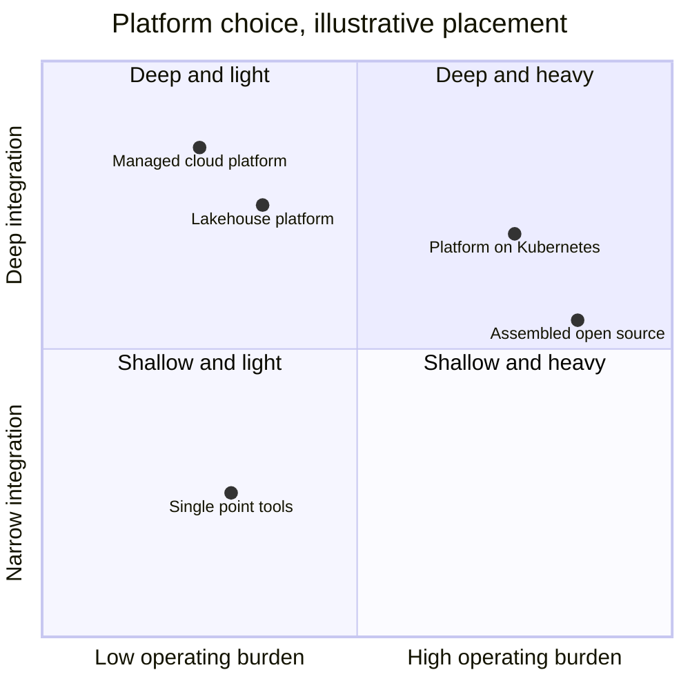

The placement is a judgment for orientation, not a measurement. Managed platforms reduce operating burden and give deep integration among registry, pipelines, endpoints, and monitoring, at the price of coupling to one vendor's APIs and a smaller choice of components. Assembled open-source stacks maximize control and portability and demand a platform team to run and integrate them. Single-purpose tools are light to adopt and leave the integration to you, which is where lineage gaps appear.

### 21.3 Selection criteria that hold across products

1. **Artifact and lineage model.** Can it record the chain in Section 9 without manual steps, and export it through open formats?
2. **Identity and policy.** Does it integrate with your identity provider, support fine-grained access, and write audit logs?
3. **Alias and approval semantics.** Does the registry support immutable versions, aliases, and approvals bound to digests (Section 8)?
4. **Portability.** Can models, pipelines, and metadata move out? Standard formats (Open Neural Network Exchange (ONNX), containers, OpenLineage, OpenTelemetry) reduce lock-in. Lock-in is acceptable when chosen deliberately for a stated gain.
5. **Fit with existing skills and systems.** A team fluent in Airflow gains little by moving to a different orchestrator for a marginal feature.
6. **Cost model.** Per-seat, per-run, per-endpoint-hour, or per-token pricing behaves differently as use grows. Model it at expected scale (Section 23).
7. **Operating burden.** What must your team patch, scale, and keep available?
8. **LLM support.** Does it handle prompts, traces, evaluation datasets, and judges as first-class objects, or only classical models?

## 22. Team Topology and Responsibility

### 22.1 Roles

MLOps is a joint effort of several roles, and unclear boundaries between them are a common source of gaps.

- **Model owner (product or ML lead).** Accountable for the model's business outcome, quality, and lifecycle. Approves release, accepts residual risk, and owns the retirement decision.
- **ML engineer or data scientist.** Builds and evaluates models, writes the pipeline code and tests, and responds to model-level incidents.
- **Data engineer.** Owns source pipelines, data quality, and feature pipelines.
- **Platform team.** Builds and runs the shared infrastructure: orchestration, registry, feature store, serving, monitoring, and the gateway. Provides paved paths and self-service.
- **Site reliability or operations engineer.** Owns availability, capacity, and on-call practice for serving systems.
- **Security and privacy.** Sets controls for data access, supply chain, and threat response.
- **Risk, legal, and compliance.** Define approval requirements for regulated uses and review documentation.
- **Domain experts and annotators.** Provide labels, rubrics, and review for quality.

### 22.2 Topology

Team Topologies (Matthew Skelton and Manuel Pais, 2019) describes four team types: stream-aligned teams that own a product flow, platform teams that provide internal services, enabling teams that spread expertise, and complicated-subsystem teams that hold deep specialist knowledge. Mapping those to ML gives three common patterns.

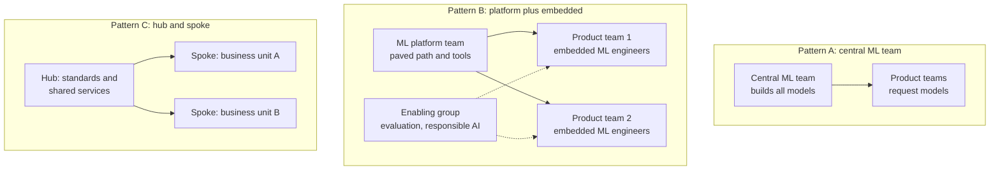

Pattern A concentrates expertise and creates a queue; it works for small organizations with few models. Pattern B, a platform team offering a paved path with ML engineers embedded in product teams, scales to many models: the product teams own outcomes and the platform team owns the means. An enabling group helps teams adopt evaluation and responsible-AI practices without owning their models. Pattern C suits federated organizations in which business units have different regulatory contexts, with a hub that sets standards and provides shared services. The common principle is that the model owner sits with the business outcome, while shared infrastructure is a product with internal customers, a roadmap, and service levels.

### 22.3 Responsibility matrix

The matrix below assigns Responsible (R), Accountable (A), Consulted (C), and Informed (I) for key activities. Adjust to your organization, but keep exactly one A per row.

| Activity | Model owner | ML engineer | Data engineer | Platform team | SRE | Security and privacy | Risk and compliance |
|---|---|---|---|---|---|---|---|
| Define success metric and cost model | A | R | C | I | I | I | C |
| Dataset versioning and quality | C | R | A | C | I | C | I |
| Feature definitions and store | C | R | A | R | I | C | I |
| Training pipeline code and tests | C | A | C | R | I | I | I |
| Evaluation set and gate criteria | A | R | C | C | I | I | C |
| Registry and promotion tooling | I | C | I | A | C | C | I |
| Approve release to production | A | R | I | C | C | C | C |
| Deployment and rollback mechanics | I | C | I | A | R | I | I |
| Monitoring design and alert thresholds | A | R | C | R | C | I | I |
| On-call response to model incidents | A | R | C | C | R | C | I |
| Model card and documentation | A | R | C | I | I | C | C |
| Supply chain and access control | I | C | C | R | C | A | C |
| Cost budget and attribution | A | C | C | R | C | I | I |
| Retirement decision and migration | A | R | C | R | C | I | C |

Two rows deserve comment. Approving a release has the model owner accountable, because the person who owns the outcome should also own the decision to accept the risk, with risk and compliance consulted for regulated uses and holding a veto where required by policy. On-call for model incidents is shared: the platform and SRE handle availability and rollback mechanics, and the ML engineers handle model-level diagnosis, so the rotation must include both and the runbook must say who does what.

### 22.4 Anti-patterns

- **Throw it over the wall.** Data scientists produce a notebook and engineers rebuild it. The rebuilt model differs, and the knowledge needed to debug it stays on the other side.
- **Platform without customers.** A platform team builds tools nobody asked for. Mitigate by measuring adoption and time to first model for a new team (Section 26).
- **Everything is a ticket.** Teams cannot deploy without a platform ticket. Self-service within guardrails is the goal.
- **Owner by absence.** Nobody is named as model owner, and the model runs until it breaks. Require an owner and a review date at registration.

## 23. Cost Governance and FinOps for AI

### 23.1 Why AI cost needs its own controls

Cloud financial operations (FinOps) practices apply, and AI adds high unit prices (accelerators), spiky demand (experiments, training), a long tail of idle resources (notebooks, endpoints), and token-based pricing whose total depends on user behavior. The [Cloud Computing cost optimization chapter](../09_Cloud_Computing/CH14_Cost_Optimization.md) covers the general discipline; this section covers what is specific to ML.

### 23.2 Understand the cost structure

| Cost category | Driver | Typical control |
|---|---|---|
| Experimentation compute | Number and size of runs, idle notebooks | Quotas, auto-shutdown, experiment tracking with cost fields |
| Training compute | Model size, data size, retraining frequency | Spot or preemptible capacity with checkpointing, right-sized instances, caching, reduced retraining by trigger design |
| Data storage and movement | Dataset copies, checkpoints, logs | Retention policies, lifecycle tiers, deduplicate snapshots |
| Labeling and review | Volume, expert time | Active sampling, rubric clarity, automation of easy cases |
| Serving compute | Peak capacity, utilization, model size | Autoscaling, batching and quantization (CH28), scale-to-zero for rare endpoints |
| LLM tokens | Requests, context length, retries, model choice | Gateway budgets, caching, routing, prompt trimming |
| Platform and tooling | Licenses, managed services, platform team | Consolidation, usage reviews |
| Evaluation | Judge calls, human review | Tiered evaluation (Section 19.3) |

### 23.3 Utilization arithmetic

Idle accelerators are the largest avoidable cost. Consider a shared pool of 64 GPUs. One month has about 730 hours, so the pool offers 64 × 730 = 46,720 GPU-hours. At an illustrative on-demand price of \$2.50 per GPU-hour, the pool costs \$116,800 per month. The cost of a *useful* GPU-hour is the price divided by utilization. At 35 percent utilization, the effective price is \$2.50 / 0.35 = \$7.14 per useful hour; at 60 percent, \$2.50 / 0.60 = \$4.17. Raising utilization from 35 to 60 percent is therefore equivalent to a 42 percent price cut, without negotiating anything. Training workloads that tolerate interruption and checkpoint regularly can use spot or preemptible capacity at a discount; at a 60 percent discount, the \$2.50 price becomes \$1.00 per GPU-hour, though interruptions and lost work reduce the saving, which should be measured.

Idle serving endpoints show the same effect in small. Six endpoints with one GPU each and no traffic cost 6 × 730 × \$2.50 = \$10,950 per month. A weekly job that lists endpoints with fewer than a threshold of requests and notifies owners, with a policy to scale to zero or delete after a grace period, recovers most of it.

### 23.4 Budgets, showback, and unit economics

Tag every resource and every LLM call with team, product, environment, and model, so that cost can be attributed (Section 19.7). Show each team its cost (showback) and, where the organization is ready, charge it (chargeback). Define budgets with alerts at stated fractions and a response plan for breaches: a throttle at the gateway, a pause on experimentation queues, an escalation to the owner. Express cost in *unit economics* that business owners can reason about: cost per thousand predictions, cost per resolved support conversation, cost per retrained model. A model whose unit cost exceeds the value it creates is a retirement candidate, and the unit view makes that visible.

### 23.5 Policy controls

- **GPU quotas** per team with a documented process to request more and a burst pool.
- **Mandatory auto-shutdown** for notebooks and development endpoints after idle periods.
- **Approval thresholds**: large training runs or new always-on endpoints above a cost threshold need owner and finance approval.
- **Cost as a gate criterion**: the evaluation gate (Section 11) includes cost per thousand requests, so a more accurate but much more expensive model cannot ship by default.
- **Regular review** of the top spenders, the most idle resources, and unit cost trends.

## 24. Security and Compliance in the Pipeline

### 24.1 The threat model

An ML pipeline has attack surface beyond a conventional service. The relevant threats, with the operational control for each:

| Threat | How it occurs | Control |
|---|---|---|
| Training data poisoning | Malicious or corrupted samples enter training data, including through public feedback channels | Source authentication, validation and outlier checks, provenance, review of user-sourced data, holdout evaluation on trusted data |
| Malicious model artifacts | A downloaded model file executes code on load (for example formats based on Python pickle) | Prefer safe serialization formats such as safetensors, scan artifacts, load in sandboxes, restrict sources |
| Supply chain compromise | A dependency, base image, or pretrained model is tampered with | Pin versions and digests, verify signatures, use internal mirrors, generate bills of materials |
| Model theft and extraction | Weights exfiltrated, or approximated through repeated queries | Access control, encryption, egress monitoring, rate limits and query monitoring |
| Unauthorized promotion | Someone moves an alias or approves their own model | Role separation, two-person rule for high-risk models, audit logs |
| Credential exposure | Keys in notebooks, configs, or traces | Secret managers, short-lived credentials, scanning, trace redaction |
| Data leakage via logs and traces | Prompts, features, and outputs retained broadly | Redaction, access tiers, retention limits |
| Prompt injection and tool abuse | Untrusted content steers an LLM or agent | Input isolation, least-privilege tools, output checks (CH24, CH31) |
| Inference-time attacks | Adversarial inputs, membership inference | Input validation, monitoring, privacy techniques where warranted |

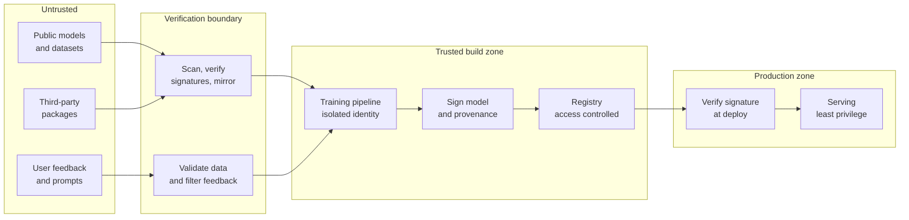

The diagram sets two verification boundaries. Everything from outside enters the trusted build zone only through scanning, signature verification, or validation. Everything leaving the build zone carries a signature that the production zone verifies before running. If an attacker or an error injects an artifact between the registry and serving, the signature check fails.

### 24.2 Signing, provenance, and bills of materials

*Signing* binds an identity to an artifact digest. Tooling for signing ML models has emerged on top of existing supply-chain standards, such as Sigstore-based model signing from the Open Source Security Foundation; verify the current status and integration of such tools before adopting one. A deployment policy then requires a valid signature from the build pipeline's identity, so that a model copied by hand into the registry is rejected.

*Provenance* attestations record how an artifact was built: the builder, inputs, and parameters. The SLSA (Supply-chain Levels for Software Artifacts) framework gives levels for build integrity, and the lineage graph of Section 9 supplies the ML-specific inputs.

A *bill of materials* lists components. Software bills of materials in Software Package Data Exchange (SPDX) or CycloneDX formats enumerate dependencies, and both formats have been extended to describe AI components such as models and datasets (CycloneDX through its machine learning bill of materials, SPDX through an AI profile in version 3). An AI bill of materials for a model lists the base model and its license, datasets and their rights, training code and environment digests, and evaluation references. Its use is to answer, quickly, which of our models are affected when a component is found vulnerable or a license changes.

### 24.3 Access control and audit

- **Separate identities** for data access, training, registry write, deployment, and serving, each with the minimum rights. A training job should not be able to promote its own output.
- **Environment separation**: development, staging, and production with distinct credentials and data access. Production data in development is a common leak path; if needed, use masked or synthetic data.
- **Role separation for approval**: the author of a change is not its sole approver for high-risk models.
- **Audit logs** that record who changed what and when for datasets, registries, aliases, gateway configuration, guardrails, and prompts. Write them to storage that the actors cannot alter, and retain them per policy.
- **Data access by purpose**: dataset access aligned to permitted use per [CH30](CH30_AI_Data_Governance_Privacy_and_Provenance.md), enforced technically where possible.

### 24.4 Compliance as a pipeline output

Controls are cheapest when evidence is a by-product. The pipeline's records already contain much of what an auditor asks: lineage, evaluation reports, approvals bound to digests, monitoring, incident history, and access logs. The task is to make them retrievable, tamper-evident, and retained for the required period. Where regulations such as the EU AI Act apply, map each documentation and logging duty to a pipeline artifact once, and have the pipeline fail if one is missing. Privacy law adds data subject rights; propagate deletion and consent changes through the lineage graph (Section 9.2) to datasets, features, caches, and, where required, retraining decisions (CH30).

## 25. Model Retirement and Consumer Migration

### 25.1 Why retirement needs a process

A model that is no longer needed still carries cost and risk: compute, an endpoint exposed to attack, credentials, unpatched dependencies, and consumers who may depend on it without the owner's knowledge. Retirement is also the moment when evidence must be preserved, since regulators and incident reviews ask about decisions made by models that no longer exist.

### 25.2 Triggers

Retire a model when a successor replaces it, when its use case ends, when quality or unit economics no longer justify it, when a dependency it needs is withdrawn (a provider retires the base model, a data source ends), when a legal or policy change forbids its use, or when its review date arrives and no owner renews it.

### 25.3 The retirement sequence

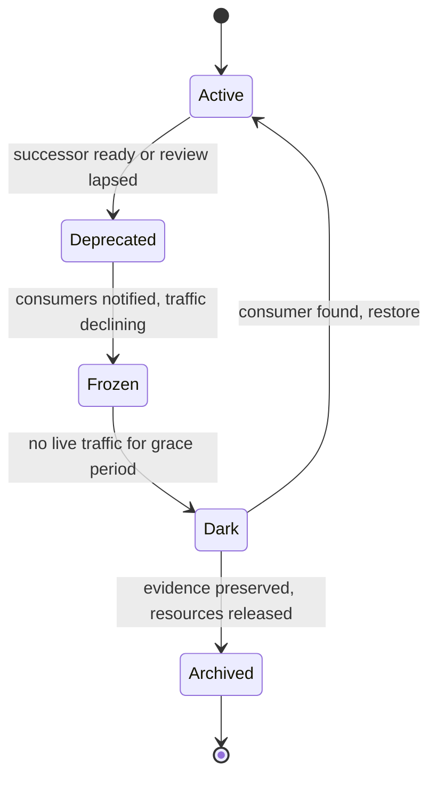

1. **Deprecate.** Announce the end date to all consumers, identified through the registry's consumer list and the gateway's traffic logs. Add a deprecation header or log warning to responses.
2. **Migrate consumers.** Provide the successor, a compatibility note on score distributions and thresholds, and a test endpoint. Track migration per consumer, and escalate to owners of laggards. The score distribution of a successor often differs, so consumers with fixed thresholds need new ones.
3. **Freeze.** Stop retraining and changes. Block new consumers.
4. **Go dark.** Disable the route for a grace period but keep the artifacts, so an unnoticed consumer can be found and the route restored quickly. Watch for failed calls.
5. **Archive and release.** Preserve what the retention policy requires: the model card, lineage record, evaluation reports, approvals, incident history, and where permitted the artifact and its training data reference. Delete the endpoint, scheduled jobs, caches, feature materializations used only by this model, and credentials. Update the registry state to Retired.
6. **Verify.** Confirm that no traffic, jobs, or credentials remain, and record the closure.

Retention and deletion are in tension: privacy rules may require deleting training data while audit rules require keeping evidence. Resolve it by retaining records about the data (identifiers, hashes, rights status) and deleting the data itself on its own schedule, as set out in CH30.

## 26. Metrics for the ML Platform Itself

A platform is a product, and it needs its own metrics, otherwise it can be evaluated only by anecdote. The four key measures from software delivery research (the DevOps Research and Assessment, or DORA, metrics: deployment frequency, lead time for changes, change failure rate, and time to restore service) have direct analogs for ML.

| Metric | ML analog | How to measure |
|---|---|---|
| Deployment frequency | Models and prompts released to production per period | Count alias promotions to production |
| Lead time for changes | Time from a change (merged code, new data version, approved prompt) to running in production | Median from trigger to production alias move |
| Change failure rate | Fraction of releases that need rollback, hotfix, or incident | Rollbacks and incidents divided by releases |
| Time to restore | Time from detection of a harmful model change to recovery | Median from alert to rollback complete |
| Retraining cycle time | Trigger to new champion, end to end | Pipeline timestamps |
| Gate escape rate | Defects found in production that a gate should have caught | Incident review tags |
| Gate precision | Fraction of gate failures that were true problems | Review of rejected candidates |
| Monitoring coverage | Fraction of production models with all six monitoring layers and runbooks | Registry audit |
| Lineage coverage | Fraction of production models with machine-recorded lineage to leaf inputs | Graph query |
| Reproducibility rate | Fraction of sampled past runs that regenerate within noise | Periodic audit rerun |
| Time to first model | Days from a new team's request to its first model in production on the platform | Onboarding records |
| Cost efficiency | Cost per thousand predictions, GPU utilization | Section 23 |
| Platform adoption | Share of models on the paved path | Registry data |

**Worked example (illustrative).** In a quarter, a platform records 40 production releases, of which 6 required rollback or a hotfix. The change failure rate is $6/40 = 15$ percent. Ten of the releases were prompt-only changes, none of which failed, while 30 were model or pipeline changes with 6 failures. The segmented view shows that the failures concentrate in model releases, a 20 percent failure rate ($6/30$), so effort belongs in the model gates, not in the prompt process. The six restores took 12, 25, 40, 55, 90, and 240 minutes. The median is the mean of the middle two, $(40+55)/2 = 47.5$ minutes, while the mean is $462/6 = 77$ minutes. The 240-minute outlier is the one to investigate, and the median alone would have hidden it. Report medians and the tail together.

Use the metrics to steer, not to rank teams. Targets applied to individuals produce gaming: a team can reduce its change failure rate by releasing less, or by not recording incidents. Pair each speed metric with a stability metric, and read them together.

## 27. Failure Modes and Quality-Attribute Scenarios

A quality-attribute scenario states a stimulus, the response the system should produce, and a measure that tells whether it did. Writing them for the operations layer turns vague goals ("be recoverable") into acceptance tests.

| Attribute | Stimulus | Required response | Measure |
|---|---|---|---|
| Recoverability | A newly promoted model raises the predicted-positive rate in one region by 50 percent | Monitor alerts, on-call repoints the alias to the recorded rollback target, traffic returns to the previous version | Alert within 30 minutes, restore within 15 minutes of the decision, no manual build required |
| Reproducibility | An auditor asks for the exact inputs of model version 42 nine months after release | Registry and lineage return dataset version, code commit, configuration, environment digest, seeds | All inputs retrievable, and a rerun reproduces the headline metric within the measured seed spread |
| Data integrity | An upstream job changes a currency unit from dollars to cents | Data validation blocks the training pipeline and the serving feature check routes to fallback | Zero models trained on the bad batch, alert to the upstream owner within one hour |
| Change safety | A candidate improves overall error but regresses a customer-tenure slice | The evaluation gate fails the candidate and reports the slice | Gate rejects candidates with slice upper bound above the stated margin, verified by a permanent negative test |
| Observability | Labels for a cohort are 40 percent mature | Dashboard shows the metric with its maturity fraction and a maturity-adjusted estimate | No unflagged metric computed on immature cohorts |
| Provider resilience | A provider retires a pinned model with 60 days notice | Migration through the gateway alias with evaluation, canary, and fallback | Successor in full production at least 7 days before retirement, no customer-visible outage |
| Silent provider change | A hosted model's refusal rate rises with no local change | Scheduled canary suite detects the shift and routes to the fallback | Detection within two scheduled runs for a drop of 5 percentage points or more |
| Cost control | A bug loops an agent so that token spend rises tenfold | Gateway budget throttle trips and alerts the owner | Spend capped at the configured daily budget, alert within 15 minutes |
| Security | An unauthorized identity attempts to move the production alias | Registry denies the action and records the attempt | Zero unauthorized promotions, alert on denial |
| Retirement | A deprecated model still receives calls from an unlisted consumer | Dark period reveals the failing calls and the route is restored briefly | Consumer found and migrated before the artifact is deleted |

The table also works as a design review aid. For each row, ask which component implements the response and whether it has been tested. A row with no tested implementation is a gap.

### 27.1 Failure modes of the MLOps machinery itself

The tools that protect production can fail. Some patterns:

- **Gate drift.** The evaluation set ages while the gate keeps passing, so quality seems stable while the population has moved. Refresh the set on a schedule, and track the age of each gate's reference data.
- **Alert fatigue.** Alert volume rises until responders ignore it. Track precision (Section 14.8) and prune.
- **Silent pipeline failure.** A scheduled retraining job fails for weeks, and the model grows stale with no alarm. Alert on the *absence* of a successful run within the expected interval, not only on errors.
- **Registry as a junkyard.** Thousands of unowned versions and aliases. Enforce ownership, expiry for unpromoted candidates, and periodic cleanup.
- **Monitoring blind spots.** New features added to the model are not added to the monitor. Generate the monitoring configuration from the feature list.
- **Approval by habit.** Reviewers click approve without reading. Make the approval screen show the gate evidence, changes since the last version, and open risks, and sample approvals for audit.
- **Automation without brakes.** Continuous training promotes a model trained on poisoned or feedback-contaminated data. Keep the gates and the manual approval for high-risk models (Section 15.4).

## 28. Comparison of Alternatives and Trade-offs

### 28.1 Build, buy, or assemble

| Option | Strengths | Weaknesses | Fits when |
|---|---|---|---|
| Managed cloud ML platform | Fast start, integrated registry, pipelines, endpoints, and monitoring, less to operate | Coupling to one vendor's APIs and pricing, less control over internals | Few platform engineers, workloads mostly on one cloud, regulated needs met by the vendor's compliance |
| Lakehouse-centered platform | Data, features, models, and governance in one catalog, lineage by default | Depends on the data platform choice, ML-specific depth varies | Data already in that platform, strong data governance needs |
| Assembled open source on Kubernetes | Maximum control, portability, no license cost | Needs a platform team, integration and upgrade burden, lineage gaps between tools | Multi-cloud or on-premises requirements, large scale, existing Kubernetes skill |
| Minimal custom scripts plus a tracking server | Cheap, understandable | Does not scale past a few models, ad hoc controls | One or two models, early stage, with a plan to migrate |
| Hybrid: managed compute with open interfaces | Portability of artifacts and metadata with managed execution | Needs discipline to keep the open interfaces | Teams wanting an exit path without running everything |

### 28.2 Trigger strategies compared

| Strategy | Responds to | Cost profile | Weakness |
|---|---|---|---|
| Fixed schedule | Time only | Predictable | Wasteful when stable, late when abrupt change |
| Drift trigger | Input or prediction shift | Variable | False triggers, misses concept drift without input drift |
| Performance trigger | Measured outcomes | Variable | Lagged by label delay |
| Hybrid with maximum age | All of the above | Moderate | More configuration to maintain |

### 28.3 Prompt and model release coupling

| Approach | Benefit | Risk |
|---|---|---|
| Prompt changes ship with application code | Code review, atomic release | Slow iteration, domain experts excluded |
| Prompt registry with gated aliases | Fast iteration, independent rollback | Bypass of review unless gates are enforced |
| Floating model alias | Automatic provider improvements | Unannounced behavior change |
| Pinned model snapshot | Predictable behavior | Forced migration at retirement, missed improvements |

The recommendation that appears in each table is a combination, with the reason stated: pair the cheap and fast option with a guard that covers its weakness. Examples are a prompt registry with an evaluation-gated alias, a drift trigger with a maximum age, and a pinned snapshot with a scheduled migration review.

## 29. Case Study: A Fraud Model and an LLM Assistant Through the Lifecycle

All figures are illustrative and chosen to make the arithmetic traceable. They are not measurements of any real system.

### 29.1 Part A: the fraud model

**Problem framing.** A card-not-present payments business processes 100,000 transactions per day. About 1.47 percent are fraudulent. The existing rule set blocks or reviews transactions with a set of hand-written conditions. The decision for each transaction is allow, review, or block. The cost model values each avoided error at about \$12 net of review cost on average, which turns percentage-point changes in error into money (Section 11.4). Labels arrive as chargebacks over up to 60 days, with about 40 percent of eventual missed-fraud labels present at day 14.

**Data and features.** The team snapshots the transaction table as `orders@412` with a 60-day label window and a time-based split: the last 90 days are held out for evaluation. Features are defined once in the feature store, including `txn_count_24h`. During development the first model shows excellent offline performance, which the team treats with suspicion. A replay test (Section 5.4) comparing offline scores with scores recomputed through the serving path shows large disagreement on `txn_count_24h`. Investigation finds that the first training set used a "latest value" join, so the feature had seen post-decision bursts (the exact pattern in the Section 5.2 example). The team rebuilds the training set with a point-in-time join. The offline score falls to a believable level, and the replay test passes. This incident is recorded in the pipeline's test suite as a permanent fixture. *Rejected alternative:* keeping two implementations of the feature with a tolerance check, because it leaves the divergence to be found again.

**Training and tracking.** The pipeline runs in the orchestrator with the declared inputs of Section 7.5. Five seeds of the incumbent configuration give a recall spread of about 0.30 points, so any claimed gain below that is treated as noise. Every run is tracked with dataset version, code commit, configuration hash, environment digest, and seeds.

**Evaluation gate.** The candidate is scored against the incumbent on 20,000 held-out transactions. The discordant counts are $b = 410$ and $c = 290$. As computed in Section 11.3, the error difference is $-0.0060$ with a one-sided 95 percent upper bound of $-0.0038$, so the non-inferiority margin of $+0.002$ is satisfied and the candidate is also significantly better. The two-sided interval is $[-0.0086, -0.0034]$, which at 100,000 decisions per day and \$12 per avoided error translates into a daily gain of about \$4,080 to \$10,320, or about \$7,200 at the point estimate. Slice results pass for `region_eu` and `new_customers` (upper bounds $+0.0017$ and $+0.0090$ against a margin of $+0.010$). Latency p95 is 82 ms against a 100 ms limit, and cost per 1,000 requests is \$0.41 against a \$0.50 limit. After deducting \$3,500 per day for extra serving and review capacity, the net daily gain at the low end of the interval is about \$580, still positive, and the model owner approves. *Rejected alternative:* promoting on aggregate AUC alone, which would not have shown the slice behavior or the cost.

**Registry and rollout.** The registry records version 42 with an approval bound to the digest `sha256:9f2e...` and sets `rollback_target` to version 41 before moving any alias. The release follows the sequence in Section 12.2 and Section 12.3. In shadow mode for 7 days, the flip rate against the incumbent is 3.6 percent, close to the 3.5 percent predicted offline, which suggests no skew. The canary then runs at 1 percent for two hours. One percent of 100,000 transactions per day is 1,000 per day, about 42 per hour, so two hours yields roughly 83 requests. With zero failures the 95 percent upper bound on the failure rate is $3/83 = 3.6$ percent, which is enough to catch a crash but not a subtle error. The plan therefore proceeds to 5 percent for a day, then 25 percent for three days, and then 100 percent, with abort criteria that include the predicted-positive rate by region. *Rejected alternative:* an A/B test on the decision path, ruled out by risk policy because fraud losses from the control arm cannot be recovered.

**Monitoring.** Layered monitoring (Section 14.1) covers latency, feature validity, per-feature PSI against the training reference with an alert only for the top ten features by importance, the predicted-positive rate by region, reviewer override rate, and chargeback-based recall computed only on cohorts at least 90 days old, with the maturity fraction shown. A day-14 recall figure computed naively would read 0.888 when the true value is 0.76, as in Section 14.5, so the dashboard shows the maturity-adjusted estimate and the confirmed figure separately.

**Incident.** In week 6, the EU predicted-positive rate rises from a stable 2.1 percent to 3.4 percent over four days while the traffic mix is unchanged, against a historical day-to-day variation under 0.3 points. The alert fires on the persistence rule (two consecutive days above three times the historical standard deviation). A feature check shows PSI of 0.41 on a merchant-category feature: an upstream team had changed a code mapping. On-call follows the runbook, repoints the `champion` alias to version 41 in a minute, and rates return to baseline within 15 minutes. Because the EU handles about 30,000 transactions per day and the excess positive rate ramped to 1.3 points, the average excess over four days is roughly 0.65 points, which implies about $120{,}000 \times 0.0065 = 780$ extra flagged transactions. These go to re-review. The labels from the affected window are tagged in the lineage so that retraining excludes them. The upstream mapping gets a contract test, a validation rule is added to the data checks, and the incident adds a regression case to the gate. The incident record stays linked to the release.

**Retraining decision.** From Section 15.2, using the illustrative exposure of \$553,000 per week, a recall decay of 0.4 points per week, and a run cost of \$1,500, the optimal interval is about 1.16 weeks and a weekly cadence costs \$2,606 per week against \$2,576 at the optimum. The team chooses weekly retraining with a maximum model age of 14 days, drift triggers that start a shadow challenger, and the same gate and approval for every candidate. Automatic registration stops at the Approved state for this high-risk model, and promotion requires the owner's sign-off.

**Retirement.** When version 57 becomes champion, version 42 moves to Deprecated, consumers that cache the score receive a notice, and the old version stays warm for the rollback window. After 30 days with no traffic, it is archived with its model card, lineage, evaluation, approvals, and incident links.

### 29.2 Part B: the LLM support assistant

**Problem framing.** A support assistant answers customer questions using a help-center index (RAG) and a read-only order-status tool, hosted on a provider's model through a gateway. About 50,000 conversations per day. The decision: answer, ask a clarifying question, or hand off to a human. Success is resolution without escalation and without a policy violation, measured by sampled human review and by a model-graded judge calibrated to the reviewers.

**Artifacts and registry.** The release is a bundle of versioned pieces: the system prompt `support-v7` in the prompt registry with aliases `staging` and `production`, tool schemas `order-status@3`, the retrieval index `helpcenter-idx@18` (corpus snapshot, chunking configuration, embedding model version), the guardrail policy `policy@11`, and the pinned provider model snapshot behind the gateway alias `support-default`. Each production trace logs all five identifiers.

**Evaluation in CI.** The golden set has 400 cases drawn from hand-written scenarios, reviewed production traces, and past incidents, versioned as `golden@9`. A smoke set of 40 runs on every prompt change. The full set, three repeats, with deterministic assertions (valid output schema, citation present, no forbidden commitments), retrieval recall at 5, and a calibrated judge, runs before any alias moves to production and costs about \$23.40 per run in the illustrative pricing of Section 19.3. The gate compares against the current production bundle on the same set and slices (language, product line, new versus returning customer) with the confidence-bound logic of Section 11, and reports the spread across repeats.

**Rollout.** A new prompt version goes to `staging`, then to a canary of 5 percent of tenants for two days, with the guardrail policy in shadow mode first to compare its decisions with the enforced one. The alias move is audited, and rollback is one alias change.

**Cost.** Baseline model spend is high because of long prompts. Prefix caching on the stable system prompt and retrieved boilerplate, following the arithmetic of Section 19.5, cuts the input cost by about a quarter in the team's measurement. A cascade sends simple order-status questions to a smaller model with a quality check, using the arithmetic of Section 19.4 to estimate a saving of about half on that traffic, and the team verifies it on the golden set before enabling it. *Rejected alternative:* a semantic cache over customer questions, because answers depend on the customer's order data and the leak risk across tenants outweighed the saving.

**Silent provider change.** Eleven weeks after launch, the nightly canary suite (400 prompts, three repeats) shows the format-compliance rate falling from 98.5 percent to 93 percent and the handoff rate rising, with no local change. A single night's data is noisy, but pooling two nights gives enough evidence under the power calculation of Section 19.12. The gateway routes the affected route to the fallback model while the team adjusts the output-format instructions in a new prompt version, evaluated on the golden set and canaried. They report the behavior change to the provider. The incident adds format-stress cases to the golden set.

**Index lifecycle.** A new embedding model offers better retrieval in the team's tests. The team builds a parallel index `helpcenter-idx@19`, re-embedding the full corpus, evaluates retrieval recall at 5 and end-to-end quality, shadows it, and switches the retrieval alias. The old index stays for the rollback window and is then deleted. A deletion request for a withdrawn article is propagated to the index, the cache, and the trace store within the stated time.

**Provider deprecation.** The provider announces retirement of the pinned snapshot with a notice period measured in months. Because the golden set, the gateway alias, and the model inventory exist, the team follows the playbook of Section 19.11: evaluate two successors, adapt prompts, shadow, canary, and ramp, finishing a week before the retirement date. The older route stays as fallback until the provider shuts it off, then the route and credentials are removed and evidence is archived.

**What the two halves show.** The fraud model's risks are statistical and slow: skew, drift, delayed labels, and feedback. The assistant's risks are textual and fast: prompt changes, retrieval, guardrails, and provider changes. Both rely on the same structure: immutable versions, a gate with explicit criteria, controlled exposure, layered monitoring, a prepared rollback, and recorded evidence. The shared platform provides that structure once, and each team supplies the domain-specific evaluation.

## 30. Common Mistakes

| Mistake | Cause | Consequence |
|---|---|---|
| Referring to data as "latest" or by table name | Convenience | Unreproducible runs, unattributable regressions |
| Joining features with a latest-value join | Simplest SQL | Leakage, inflated offline metrics, production underperformance |
| Separate feature code for training and serving | Different teams and runtimes | Training/serving skew discovered through business loss |
| Promoting on one aggregate metric | Easy comparison | Slice regressions, hidden cost or latency increases |
| Treating a small gain as real | Ignoring seed and sample noise | Promotion of random variation, winner's curse |
| Evaluating on a reused test set | Repeated tuning against one set | Overestimated quality that does not hold in production |
| Retraining automatically on any drift alert | Over-automation | Bad data baked into new models, retraining storms |
| Using a significance test as the drift alert | Large samples make tiny shifts significant | Constant false alarms, ignored alerts |
| Reading immature labels as final | Label delay not modeled | False comfort or false alarm from maturity effects |
| Rolling back the model but not the threshold or cache | State spread across systems | Inconsistent decisions after rollback |
| No rollback target recorded | Relying on memory | Slow, error-prone recovery under pressure |
| Floating model alias in production | Wanting automatic improvement | Behavior changes without a release |
| Prompt edits outside the release process | Treating prompts as content | Unreviewed production change with no gate |
| One tracing setup that stores all prompts forever | Convenience | Privacy exposure and retention violations |
| Semantic cache shared across tenants | Higher hit rate | Cross-tenant data leakage |
| Ignoring the deletion path in indexes and caches | Focus on ingestion | Compliance failures and stale answers |
| Platform metrics used to rank teams | Management pressure | Gaming, unreported incidents |
| No named model owner or review date | Diffusion of responsibility | Zombie models, unowned incidents |

## 31. Design-Review Checklist

Use these questions in a design review for an ML or LLM release. Each should have a concrete answer that points to an artifact.

**Lineage and reproducibility**

- Does every production model version link to exact dataset, code, configuration, environment, and seeds?
- Are dataset versions immutable and identified by content or table version, not by name?
- Is the seed spread measured, and is it used when interpreting differences?
- Is lineage machine-recorded, and what fraction of inputs is manual?

**Data and features**

- Are features defined once for training and serving, with point-in-time joins tested?
- Do data validation checks block training and trigger fallbacks in serving?
- Are label windows and label maturity recorded with each dataset?

**Evaluation and gates**

- Is the evaluation set versioned, access-controlled, and refreshed on a schedule?
- Does the gate state its hypothesis, margin, confidence level, slices, and guardrails before the experiment?
- Is the decision expressed in money or another business unit with an interval?
- Is there a permanent negative test showing that the gate rejects a worse candidate?

**Release and rollback**

- Is approval bound to the artifact digest, with the actor and evidence recorded?
- Is there a shadow or canary stage with abort criteria and sample-size reasoning?
- Is a rollback target recorded, the feature contract compatible, and the rollback drilled?
- Are thresholds stored with the model version?

**Monitoring and retraining**

- Are all six monitoring layers covered, and are slices defined?
- Are alerts tied to runbooks, with a measured false alarm rate and persistence rules?
- Are delayed labels handled with maturity-aware metrics?
- Are retraining triggers defined, with a maximum age and a cost rationale, and gated like manual releases?

**LLM and agent specifics**

- Are prompts, tools, retrieval indexes, guardrails, and model identifiers versioned and logged per trace?
- Is the model pinned, with a deprecation calendar, a golden set, and a scheduled canary suite sized for the effect that matters?
- Is the index lifecycle defined, including re-embedding, freshness, deletion, and query-time authorization?
- Do agents run with least-privilege identities, step and cost budgets, approval for irreversible actions, and a kill switch?

**Governance, security, and cost**

- Is there a named owner, a model card generated from pipeline evidence, and retirement criteria?
- Are artifacts signed and verified at deployment, with a bill of materials?
- Are identities separated and audit logs immutable?
- Are costs attributed by team and model, with budgets, alarms, and unit economics?
- Is the retirement plan defined, including consumer migration and evidence retention?

## 32. Exercises

1. **PSI.** A feature has four reference bins with 25 percent each. In the current window the bins hold 15, 20, 30, and 35 percent. Compute the PSI and classify it under the conventional thresholds. Then state how the result would change in meaning if the current window had only 200 observations.

2. **Canary arithmetic.** A canary at 5 percent receives traffic from a service with 90,000 requests per day. (a) How many requests does it get per day? (b) After 150 requests with no failures, what is the approximate 95 percent upper bound on the failure rate? (c) How many requests, and about how many hours at this rate, are needed to push that bound to 0.2 percent?

3. **Sample size.** You want to detect a change in acceptance rate from 10 percent to 11 percent with a two-sided $\alpha = 0.05$ and 80 percent power. Compute the sample size per arm. How many days does a 10 percent canary need at 60,000 requests per day?

4. **Paired gate.** On 10,000 paired evaluation examples, the incumbent is wrong and the candidate right in 120 cases, and the incumbent right and the candidate wrong in 90 cases. Compute the error difference, the standard error, and the one-sided 95 percent upper bound. Does the candidate pass a non-inferiority margin of $+0.002$? Does it show superiority?

5. **Retraining interval.** A model's value decays so that the loss grows by \$1,600 per week for each week of model age, and a retraining run costs \$800. Compute the optimal retraining interval and the weekly cost at that interval. What is the weekly cost at a two-week interval?

6. **Delayed labels.** In a cohort of 500 true positives, the model caught 350, and those labels are known at once. Of the 150 missed, 30 percent have been labeled at day 10. Compute the naive recall, the true recall, and the maturity-adjusted estimate.

7. **LLM caching.** An assistant handles 200,000 requests per day, each with 2,000 input tokens (1,500 of them a stable prefix) and 500 output tokens, at illustrative prices of \$2 per million input tokens and \$10 per million output tokens. Compute the daily cost with no caching. Then compute it if the prefix is cached with a 90 percent hit rate and cached tokens are billed at 10 percent of the base rate, ignoring any write surcharge.

8. **Platform metrics.** A quarter has 25 production releases, of which 4 were rolled back, and the four restore times were 10, 20, 30, and 200 minutes. Compute the change failure rate, the median and mean time to restore, and say which statistic you would investigate further and why.

9. **Design.** Draw the lineage graph, as nodes and edges, for a model trained from two source tables through one feature table, and list the three queries from Section 9.2 that an auditor is most likely to run. For each, say which direction of traversal answers it.

10. **Policy.** A provider announces retirement of the model behind `summarizer-default` with 90 days notice. List the first five actions in order, the evidence that each produces, and the criterion for going from canary to full traffic.

### Answer outlines

1. $\text{PSI} = (-0.10)\ln(0.6) + (-0.05)\ln(0.8) + (0.05)\ln(1.2) + (0.10)\ln(1.4) = 0.0511 + 0.0112 + 0.0091 + 0.0336 = 0.1050$, which is just above 0.10, so "investigate". With 200 observations the noise floor is about $(B-1)(1/n + 1/m)$; with $B = 4$, $n$ large, and $m = 200$ it is about $3/200 = 0.015$, so the 0.105 is well above noise but the bin fractions are uncertain by several points each, and the alert should be confirmed over a larger window.
2. (a) 4,500 per day. (b) $3/150 = 2$ percent. (c) $3/n = 0.002$ gives $n = 1{,}500$ requests, which at 4,500 per day is one third of a day, about 8 hours.
3. $\bar p = 0.105$, $\sqrt{2\times0.105\times0.895} = 0.4335$, so the first term is $1.96\times0.4335 = 0.8497$; the second is $0.8416\times\sqrt{0.09 + 0.0979} = 0.3648$; the sum is $1.2145$, squared $1.4751$, divided by $0.0001$ gives about 14,751 per arm. A 10 percent canary at 60,000 per day gets 6,000 per day, so 14,751 takes about 2.5 days.
4. $\hat\Delta = (90 - 120)/10{,}000 = -0.0030$. Numerator $= 210 - (-30)^2/10{,}000 = 209.91$, variance $= 209.91/10^8 = 2.0991\times10^{-6}$, $\mathrm{SE} = 0.001449$. Upper bound $= -0.0030 + 1.645\times0.001449 = -0.00062$. It passes non-inferiority (below $+0.002$) and shows superiority (below 0).
5. $T^\ast = \sqrt{2C/r} = \sqrt{2\times800/1600} = 1$ week; cost $= rT/2 + C/T = 800 + 800 = \$1{,}600$ per week. At $T = 2$: $1600 + 400 = \$2{,}000$ per week.
6. Naive recall at day 10 $= 350/(350 + 45) = 0.886$ (45 labeled misses). True recall $= 350/500 = 0.70$. Adjusted: estimated misses $= 45/0.30 = 150$, recall $= 350/500 = 0.70$.
7. No caching: input $200{,}000\times2{,}000 = 400$ million tokens, \$800; output $100$ million tokens, \$1,000; total \$1,800 per day. With caching, effective input tokens per request $= 500 + 1500\times(0.9\times0.1 + 0.1\times1) = 500 + 1500\times0.19 = 785$; input cost $= 157$ million tokens $\times\$2 = \$314$; total \$1,314, saving \$486 per day.
8. Change failure rate $= 4/25 = 16$ percent. Median restore time $= (20 + 30)/2 = 25$ minutes; mean $= 260/4 = 65$ minutes. The 200-minute case drives the gap and is the one to investigate, since the median hides it.
9. Nodes: two source tables, a dataset, a feature table, a training run (with code, configuration, and environment as inputs), a model version, an evaluation report, an approval, and a deployment. Impact of a bad source: forward traversal. Provenance of a disputed decision: backward from the deployment. Reproduction of a model: backward to leaf inputs. Rights propagation: forward from the dataset.
10. A reasonable order: register the date and owners and inventory call sites; run the golden set on candidate successors including cost and latency; adapt and re-evaluate prompts and guardrails; shadow then canary behind the gateway alias; ramp with the old route as fallback. Evidence: inventory, evaluation reports, gate results, shadow comparison, rollout log. Canary to full traffic when the successor's gate passes, the canary's guardrail metrics are within limits for the planned sample size, and no slice regresses beyond its margin.

## 33. Code Examples

All four scripts use only the Python standard library and print the output quoted in this chapter.

- [01_psi_drift_monitor.py](../code/python/mlops-chapter/01_psi_drift_monitor.py) computes the worked five-bin PSI table and a simulated daily drift series with PSI, the KS statistic, its critical value, and an alert level.
- [02_promotion_gate_evaluator.py](../code/python/mlops-chapter/02_promotion_gate_evaluator.py) evaluates a candidate against an incumbent with the paired non-inferiority test, latency and cost limits, and slice limits, and prints a GO or NO-GO decision for three candidates.
- [03_canary_sample_size.py](../code/python/mlops-chapter/03_canary_sample_size.py) computes per-arm sample sizes, canary duration by traffic fraction, and a Thompson-sampling router simulation.
- [04_point_in_time_join.py](../code/python/mlops-chapter/04_point_in_time_join.py) contrasts a latest-value join with a point-in-time join on the worked fraud example.

## 34. Summary

ML and LLM systems change when any behavior-defining artifact changes, and most of those artifacts are data, configuration, prompts, indexes, or hosted models, not source code. Conventional testing therefore covers a small part of the risk. Operations closes the gap with a small set of mechanisms that fit together.

Identify every artifact immutably, and record the chain from source data through features, training run, model, evaluation, approval, and deployment as a graph. Build features once and join them as of the decision time. Track experiments with the inputs that determine them, measure the seed spread, and treat small gains as noise until shown otherwise. Run training as a pipeline with declared inputs, and register candidates only after an automated gate passes. Write the gate before seeing results, with a hypothesis, a margin, a confidence bound, slice limits, and cost and latency guardrails, and convert the result into money with an interval. Release through shadow, canary, and staged exposure sized by arithmetic, with abort criteria. Monitor in layers from system health to delayed outcomes, use effect-size measures such as PSI for drift, handle label maturity explicitly, and design alerts with a known false alarm rate and a runbook. Decide retraining by an explicit cost model, gate automated retraining as strictly as manual, and prepare rollback before it is needed, including the thresholds, caches, and actions that rollback does not restore.

LLMOps applies the same structure to prompts, tools, retrieval indexes, guardrails, and provider models. Version and gate prompts, keep a versioned golden set and run it in CI, put routing, caching, limits, and telemetry behind a gateway, pin model versions and plan for forced migration, and watch behavior with a scheduled suite sized to the effect that matters. Agents add actions, so add least-privilege identities, budgets, approval for irreversible steps, and a kill switch.

Around the mechanisms sit people and money: a named model owner, a platform team that offers a paved path, a responsibility matrix with one accountable party per decision, cost attribution with budgets, supply-chain controls with signed artifacts, and platform metrics that steer improvement without ranking teams. Operational maturity is the ability to show what changed, to detect harm early, and to recover quickly, and automation is a means to that end. The composition of these workflows into an enterprise platform with release controls is the subject of [Part 17 CH10](../17_AI_Architecture/CH10_AI_Platform_and_Model_Lifecycle_Architecture.md) and [Part 17 CH11](../17_AI_Architecture/CH11_Evaluation_and_Observability_Architecture_for_AI_Systems.md).
