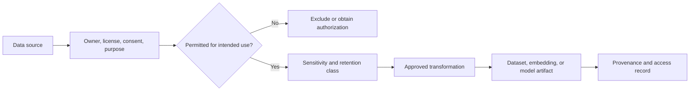
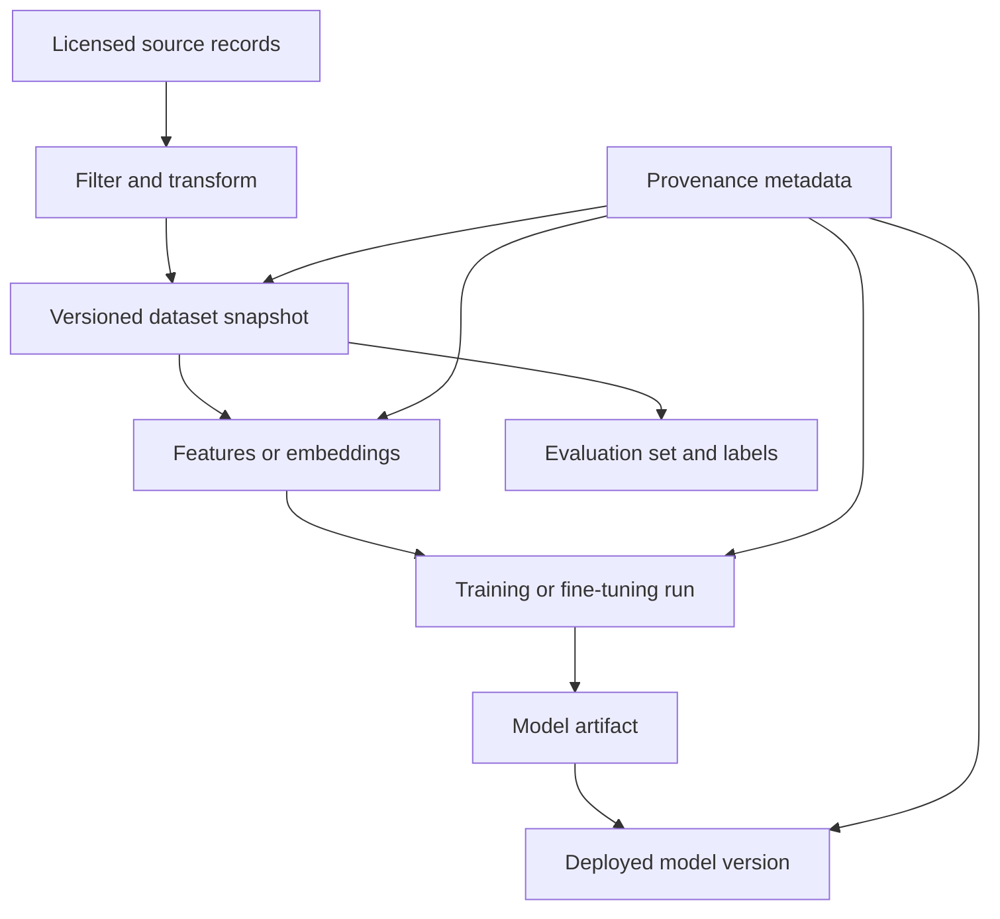
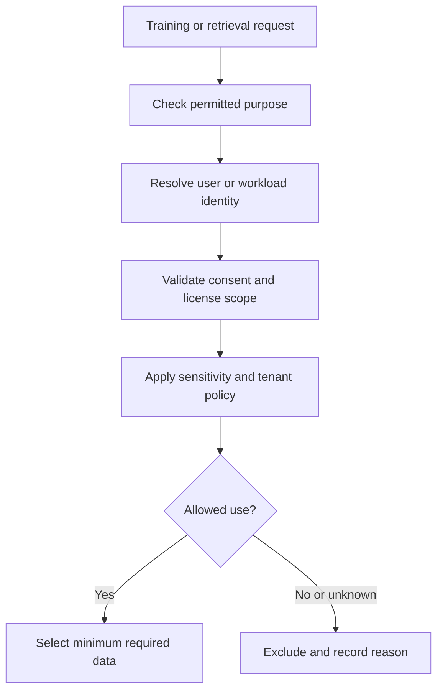
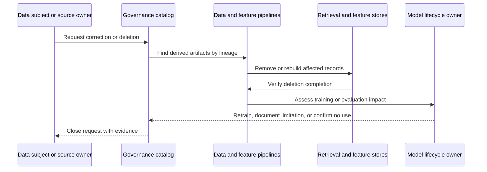
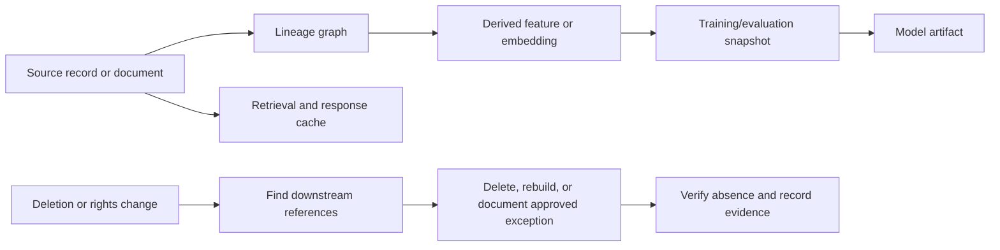

# AI Data Governance, Privacy, and Provenance

Part: [16 — Artificial Intelligence, Machine Learning, and Generative AI](PART_OVERVIEW.md)

AI data governance controls what data may be collected, transformed, used for training or retrieval, retained, shared, and deleted. Provenance explains where an artifact came from and how it was derived. Privacy and licensing constraints apply to raw data and derived features, embeddings, prompts, caches, and model artifacts. This chapter owns AI-specific rights, lineage, retention, and deletion mechanics. [Part 17 CH04 — AI Data Architecture](../17_AI_Architecture/CH04_AI_Data_Architecture_and_Preparation_Boundaries.md) owns system composition; [Part 15 — Security](../15_Security/PART_OVERVIEW.md) owns security and privacy foundations.

## Rights, Consent, and Permitted Use

For each source, record owner, collection basis, license, consent, permitted purpose, geographic constraints, sensitivity, retention, and downstream sharing limits. Data availability does not imply permission to train on it or expose it through retrieval. Separate the rights for model training, evaluation, inference, and user-visible output where they differ.

Apply data minimization and purpose limitation. Remove direct identifiers where they are unnecessary, but remember that de-identification can be reversible or linkable. Protect access to raw data, derived features, and embedding stores; derived data can still reveal sensitive attributes.

## Lineage Across Derived Artifacts

Track transformations from source to dataset snapshot, labels, features, embeddings, training run, model artifact, and deployed version. Lineage supports audit, incident response, reproducibility, and deletion analysis. Preserve source version and transformation configuration rather than recording only a descriptive dataset name.

Access to lineage should be scoped because metadata can expose source names, individuals, or business relationships. Record lineage completeness and identify opaque transformations that prevent impact analysis.

## Retention, Deletion, and Derived Data

Deletion obligations may cover raw records, backups, feature stores, embeddings, caches, training sets, and sometimes model artifacts. Deleting a source row does not automatically remove its influence from a trained model. Define a practical deletion and retraining policy, communicate limitations, and retain evidence of completed actions.

Define retention by purpose and storage tier; indefinite retention increases both compliance and breach impact. Legal hold and backup restoration must not silently reintroduce deleted data.

A worked deletion-propagation example clarifies the completeness bar. A single customer record might fan out into a raw ingestion snapshot, three feature-store rows, two embedding-store entries (one per document version), a retrieval-cache entry keyed by a recent query, and membership in one completed training run's dataset snapshot. A deletion request is not complete when the raw record is removed; it is complete only when every one of those six downstream stores has independently confirmed removal or scheduled removal within its documented maximum propagation delay, and the training-run question (was this record used to train a currently served model) has been explicitly answered and recorded, even if the answer is “yes, and retraining is not planned because X mitigating control exists.” An unanswered training-use question is not a completed deletion.

Treat a deletion request as a lineage impact query. Resolve the source record to snapshots, labels, features, embeddings, retrieval chunks, caches, evaluation sets, and model-training runs. Each store needs an owner, deletion operation, completion signal, and maximum propagation delay. A tombstone can block serving immediately while asynchronous physical removal completes, but the system must distinguish “not retrievable” from “purged from storage.”

Training-data removal is harder than deleting a row: a model's parameters may encode influence that cannot be located by source identifier. The owner should determine whether the model was trained on the data, whether retraining or a validated unlearning method is required, and what evidence the applicable policy accepts. Do not claim that source deletion erased model influence without a tested method. Backup restore must replay deletion records before a restored system serves traffic; otherwise an old snapshot can resurrect data that appeared deleted.

## Provenance, Audit, and Worked Case

A company creates embeddings from licensed support manuals and customer tickets. Manual content is allowed for retrieval; ticket content requires tenant filtering and retention review. The ingestion pipeline stores source ID, permission labels, version, transformation, embedding model, and index build. A license change triggers a lineage query, removal of affected content, cache purge, and verification that retrieval no longer returns it.

When a manual license is revoked, the owner first blocks new retrieval of the affected source version through a revocation record, then queries lineage to find its chunks, vector records, cached responses, and active index builds. The ingestion pipeline removes those derived records, publishes a replacement index, and tests both direct identifiers and semantic queries against the revoked content. A backup restore procedure replays revocation records before reopening query traffic. The closure record captures affected artifact IDs, deletion acknowledgments, test results, and exceptions without copying the sensitive document into the audit trail. If the manual also appeared in training data, the model owner assesses retraining or a validated unlearning path separately; index deletion is not represented as erasing model influence.

Review source rights, consent, purpose, classification, access, transformation lineage, derived-data sensitivity, retention, deletion propagation, model influence, audit, and ownership. Ensure model and retrieval teams can trace deployed outputs to source and policy versions.

## Questions and Summary

1. Which rights and restrictions should be recorded for each data source?
2. Draw lineage from a document through embedding to a deployed retrieval result.
3. Why can deleting raw training data be insufficient to remove learned influence?
4. Design a deletion verification process for raw data, index, cache, and model artifacts.
5. How should a system respond when data provenance is incomplete?

AI data governance follows information through every transformation and use. Record rights, purpose, sensitivity, and provenance; restrict derived data; and make retention and deletion obligations operational. Data governance must include embeddings, prompts, model artifacts, and deployed retrieval—not only source files.
